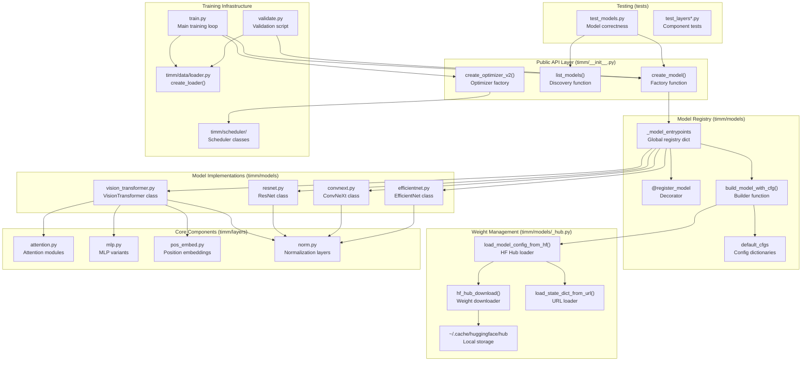
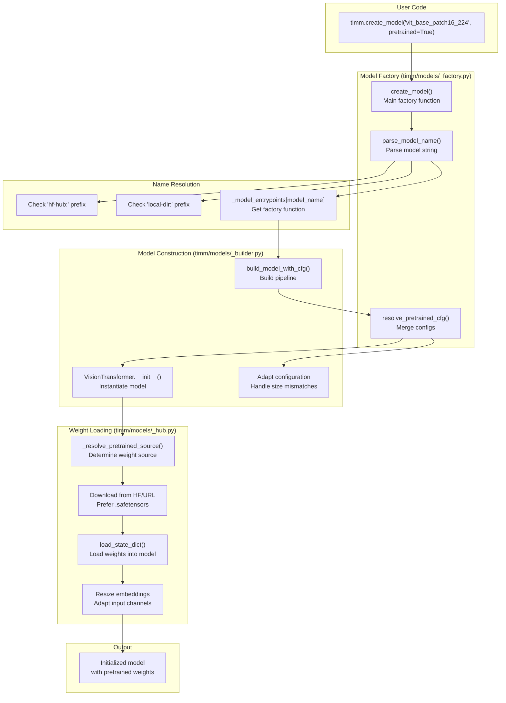

<!-- source: DeepWiki mcp.deepwiki.com · repo huggingface/pytorch-image-models · page 1 Overview · fetched 2026-10-26 -->

# Overview

<details>
<summary>Relevant source files</summary>

The following files were used as context for generating this wiki page:

- [README.md](README.md)
- [timm/version.py](timm/version.py)

</details>


## Purpose and Scope

This page provides a high-level overview of the PyTorch Image Models (timm) library architecture, its core subsystems, and how they interact. The timm library is a comprehensive collection of image models, training infrastructure, and utilities for computer vision research and applications.

**Scope of this document:**
- Overall library architecture and design principles
- Core subsystems and their responsibilities
- How components interact at a high level
- Entry points and primary APIs

**For detailed information about specific subsystems:**
- Model creation and registry mechanics: see [Model Creation and Registry System](#2)
- Model architecture families and variants: see [Model Architecture System](#3)
- Training and validation workflows: see [Training and Evaluation](#4)
- Data loading and augmentation: see [Data Pipeline](#5)
- Optimizer variants and configuration: see [Optimization System](#6)

## Library Architecture

The timm library is structured as a layered system with clear separation of concerns. At the highest level, users interact through public APIs for model creation, data loading, and optimization. These APIs are backed by a comprehensive registry system that manages 1000+ model variants and their configurations.

### System Components and Code Structure



**Sources:** [README.md:1-784](), High-level architecture diagrams

### Model Creation Pipeline

The model creation pipeline is the primary entry point for users. It handles model instantiation, configuration resolution, and pretrained weight loading from multiple sources.



**Sources:** [README.md:1-784](), Model creation diagram from high-level architecture

## Core Subsystems

### Model Registry and Factory System

The model registry is the central hub for model discovery and instantiation. It uses a decorator-based registration system where model factory functions are registered at module import time.

**Key components:**
- **Registry storage:** Global `_model_entrypoints` dictionary mapping model names to factory functions
- **Registration decorator:** `@register_model` decorator in `timm/models/_registry.py`
- **Factory function:** `create_model()` in `timm/models/_factory.py`
- **Builder pipeline:** `build_model_with_cfg()` in `timm/models/_builder.py`
- **Configuration management:** `default_cfgs` dictionaries in each model module

**Model name formats supported:**
- Standard registry names: `'vit_base_patch16_224'`
- HuggingFace Hub: `'hf-hub:timm/vit_base_patch16_224.augreg_in21k'`
- Local directory: `'local-dir:/path/to/model/folder'`

For detailed information, see [Model Creation and Registry System](#2).

**Sources:** [README.md:487-491](), High-level system architecture diagram

### Model Architecture Families

The library organizes models into three main architectural families, all built from a shared library of reusable components:

**Architecture categories:**

| Family | Count | Key Models | Location |
|--------|-------|------------|----------|
| Vision Transformers | 400+ variants | ViT, Swin, EVA, BEiT, DaViT, VOLO | `timm/models/vision_transformer.py`, `timm/models/swin_transformer*.py`, `timm/models/eva.py` |
| Convolutional Networks | 200+ variants | ResNet, EfficientNet, ConvNeXt, MobileNet | `timm/models/resnet.py`, `timm/models/efficientnet.py`, `timm/models/convnext.py` |
| Hybrid Models | 100+ variants | ViT-Hybrid, MobileViT, MaxViT, CoAtNet | `timm/models/vision_transformer_hybrid.py`, `timm/models/mobilevit.py` |

**Shared component library:**
- Attention mechanisms: `timm/layers/attention.py`
- MLP variants: `timm/layers/mlp.py`
- Position embeddings: `timm/layers/pos_embed.py`
- Normalization: `timm/layers/norm.py`
- Pooling: `timm/layers/pool*.py`

For detailed architecture information, see [Model Architecture System](#3) and its subsections.

**Sources:** [README.md:494-623](), Model architecture component hierarchy diagram

### Training and Evaluation Infrastructure

The library includes production-ready training and validation scripts with comprehensive testing infrastructure.

**Key scripts and modules:**

| Component | File | Purpose |
|-----------|------|---------|
| Training script | `train.py` | Main training loop with distributed support |
| Validation script | `validate.py` | Model evaluation on datasets |
| Benchmark script | `benchmark.py` | Performance profiling |
| Inference script | `inference.py` | Simple inference examples |
| Model tests | `tests/test_models.py` | Correctness validation |

**Features:**
- Distributed training: DDP and FSDP support
- Mixed precision: AMP (Automatic Mixed Precision)
- Model EMA (Exponential Moving Average)
- Knowledge distillation
- Gradient accumulation
- Comprehensive test suite with pytest markers

For detailed information, see [Training and Evaluation](#4).

**Sources:** [README.md:726-728](), Training and data pipeline architecture diagram

### Data Pipeline

Two distinct data loading pipelines are available:

**Standard pipeline:**
- Fixed batch size and resolution
- Located in `timm/data/loader.py` with `create_loader()` function
- Traditional augmentation: RandAugment, AutoAugment, Mixup, CutMix

**NaFlex pipeline:**
- Variable resolution and aspect ratios
- Located in `timm/data/naflex_loader.py` with `create_naflex_loader()` function
- Dynamic batch sizing based on sequence length
- Specialized for NaFlexViT models

For detailed information, see [Data Pipeline](#5).

**Sources:** [README.md:487-491](), [README.md:119-137]()

### Optimization System

The library provides 90+ optimizer variants through a unified factory interface.

**Key optimizers:**
- Standard: `adam`, `adamw`, `sgd`, `rmsprop`
- Advanced: `lamb`, `lars`, `lion`, `adopt`, `kron`, `muon`
- Custom implementations: `nadamw`, `adafactor`, `adafactorbv`, `mars`, `laprop`
- Cautious variants: `cadamw`, `clion` (with gradient masking)
- Corrected weight decay: `adamc`, `nadamc` suffixes

**Optimizer factory functions:**
- `create_optimizer_v2()`: Main factory in `timm/optim/optim_factory.py`
- `list_optimizers()`: Discovery function
- `get_optimizer_info()`: Metadata retrieval

**Parameter grouping strategies:**
- Weight decay filtering
- Layer-wise learning rate decay
- Custom parameter group configuration

For detailed information, see [Optimization System](#6).

**Sources:** [README.md:624-653](), Optimizer factory refactor notes

## Key Design Principles

### Unified Model Interface

All models in timm implement a consistent interface regardless of their underlying architecture:

**Common methods:**
- `forward()`: Standard forward pass
- `forward_features()`: Feature extraction without classification head
- `forward_head()`: Classification head only
- `forward_intermediates()`: Multi-scale intermediate features
- `get_classifier()`: Retrieve classification layer
- `reset_classifier(num_classes)`: Change number of output classes

**Common creation arguments:**
- `features_only=True`: Enable feature pyramid extraction
- `out_indices=(0,1,2,3,4)`: Specify which feature levels to output
- `output_stride=16`: Control output resolution via dilation
- `pretrained=True`: Load pretrained weights
- `num_classes=1000`: Number of output classes

**Sources:** [README.md:672-686]()

### Weight Compatibility and Adaptation

The weight loading system automatically handles common mismatches:

**Adaptation features:**
- Position embedding resizing for different input sizes
- Patch embedding resizing for different patch sizes
- Input channel adaptation (3→1 or 1→3 channels)
- Classifier head adaptation for different class counts
- State dict key filtering for old checkpoint formats

**Weight sources supported:**
- HuggingFace Hub (`.safetensors` or `.bin` files)
- Direct URLs with caching
- Local file paths
- Local directories with HF Hub structure

**Sources:** [README.md:681](), Model creation and loading pipeline diagram

### Extensive Testing and Validation

The testing infrastructure ensures model correctness across the entire library:

**Test categories (via pytest markers):**
- `base`: Basic forward/backward passes
- `cfg`: Configuration validation
- `features`: Feature extraction modes
- `jit`: TorchScript compilation
- `fx`: FX graph tracing

**Validation datasets:**
- ImageNet-1k (standard benchmark)
- ImageNet-V2 (distribution shift)
- ImageNet-Real (real labels)
- ImageNet-A (adversarial)
- ImageNet-R (renditions)
- Sketch (domain transfer)

**Sources:** [README.md:487-491](), Testing and validation infrastructure diagram

## Entry Points and Usage

### Basic Model Creation

```python
import timm

# Create model with pretrained weights
model = timm.create_model('resnet50', pretrained=True)

# List available models
all_models = timm.list_models()
vit_models = timm.list_models('vit_*')
pretrained_models = timm.list_models(pretrained=True)

# Create model for feature extraction
model = timm.create_model(
    'resnet50',
    pretrained=True,
    features_only=True,
    out_indices=(0, 1, 2, 3, 4)
)
```

### Training and Validation

```bash
# Train a model
python train.py /path/to/imagenet --model resnet50 --amp --epochs 100

# Validate a model
python validate.py /path/to/imagenet --model resnet50 --checkpoint /path/to/checkpoint.pth

# Benchmark model speed
python benchmark.py --model resnet50 --batch-size 256
```

### Optimizer Creation

```python
from timm.optim import create_optimizer_v2

# Create optimizer
optimizer = create_optimizer_v2(
    model,
    opt='adamw',
    lr=0.001,
    weight_decay=0.05
)

# List available optimizers
from timm.optim import list_optimizers
optimizers = list_optimizers(with_description=True)
```

**Sources:** [README.md:487-491](), [README.md:624-653](), [README.md:726-728]()

## Library Statistics

As of version [1.0.23.dev0]():

| Component | Count | Notes |
|-----------|-------|-------|
| Model architectures | 1000+ | Across all families and variants |
| Pretrained weights | 800+ | From various sources (timm, HF, external) |
| Optimizer variants | 90+ | Including base and variants |
| Test cases | 1000+ | Covering models, layers, and features |
| Layer modules | 50+ | Reusable components in `timm/layers/` |

**Sources:** [README.md:487-491](), [timm/version.py:1-2]()

## Project Structure Overview

```
pytorch-image-models/
├── timm/
│   ├── __init__.py              # Public API exports
│   ├── models/
│   │   ├── __init__.py          # Model API exports
│   │   ├── _factory.py          # create_model() implementation
│   │   ├── _registry.py         # Registry and @register_model
│   │   ├── _builder.py          # build_model_with_cfg()
│   │   ├── _hub.py              # Weight loading utilities
│   │   ├── vision_transformer.py # ViT implementations
│   │   ├── resnet.py            # ResNet implementations
│   │   └── [100+ model files]
│   ├── layers/
│   │   ├── attention.py         # Attention mechanisms
│   │   ├── mlp.py              # MLP variants
│   │   ├── pos_embed.py        # Position embeddings
│   │   ├── norm.py             # Normalization layers
│   │   └── [50+ layer files]
│   ├── data/
│   │   ├── loader.py           # Standard data loading
│   │   ├── naflex_loader.py    # Variable resolution loading
│   │   ├── transforms.py       # Image transformations
│   │   └── mixup.py            # Mixup/CutMix augmentation
│   ├── optim/
│   │   ├── optim_factory.py    # Optimizer factory
│   │   ├── [30+ optimizer files]
│   │   └── schedulers.py       # LR schedulers
│   └── scheduler/
│       └── [scheduler implementations]
├── tests/
│   ├── test_models.py          # Model correctness tests
│   ├── test_layers*.py         # Layer tests
│   └── test_optim.py           # Optimizer tests
├── train.py                     # Training script
├── validate.py                  # Validation script
├── benchmark.py                 # Benchmarking script
└── inference.py                 # Inference examples
```

**Sources:** [README.md:1-784]()

## Version and Release Information

Current development version: **1.0.23.dev0**

Latest stable release: **1.0.22** (December 2025)

**Recent major additions:**
- Differential attention support and `DiffParallelScalingBlock`
- NaFlexViT models with variable resolution support
- Muon optimizer family (Muon, AdaMuon, NAdaMuon)
- Meta Perception Encoder (PE) ViT models
- DINOv3 ConvNeXt and ViT models
- MobileNetV4 and MobileNetV5 families
- Extensive optimizer factory refactor

For detailed change history, see [README.md:13-486]().

**Sources:** [timm/version.py:1-2](), [README.md:13-486]()

---

