# Page: Overview

# Overview

<details>
<summary>Relevant source files</summary>

The following files were used as context for generating this wiki page:

- [README.md](README.md)
- [timm/version.py](timm/version.py)

</details>


## Purpose and Scope

This page provides a high-level overview of the PyTorch Image Models (timm) library architecture, its core subsystems, and how they interact. The timm library is a comprehensive collection of image models, training infrastructure, and utilities for computer vision research and applications.

**Scope of this document:**
- Overall library architecture and design principles
- Core subsystems and their responsibilities
- How components interact at a high level
- Entry points and primary APIs

**For detailed information about specific subsystems:**
- Model creation and registry mechanics: see [Model Creation and Registry System](#2)
- Model architecture families and variants: see [Model Architecture System](#3)
- Training and validation workflows: see [Training and Evaluation](#4)
- Data loading and augmentation: see [Data Pipeline](#5)
- Optimizer variants and configuration: see [Optimization System](#6)

## Library Architecture

The timm library is structured as a layered system with clear separation of concerns. At the highest level, users interact through public APIs for model creation, data loading, and optimization. These APIs are backed by a comprehensive registry system that manages 1000+ model variants and their configurations.

### System Components and Code Structure

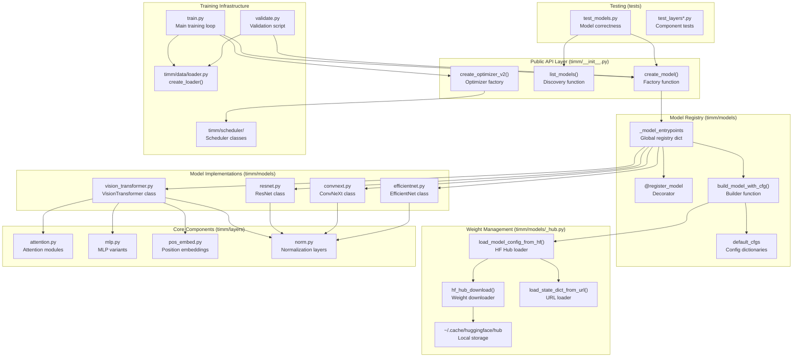

**Sources:** [README.md:1-784](), High-level architecture diagrams

### Model Creation Pipeline

The model creation pipeline is the primary entry point for users. It handles model instantiation, configuration resolution, and pretrained weight loading from multiple sources.

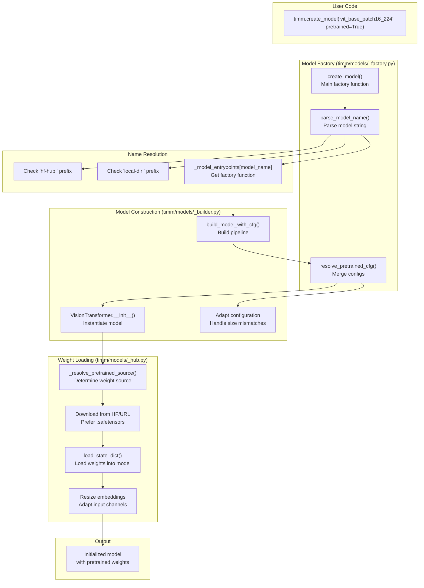

**Sources:** [README.md:1-784](), Model creation diagram from high-level architecture

## Core Subsystems

### Model Registry and Factory System

The model registry is the central hub for model discovery and instantiation. It uses a decorator-based registration system where model factory functions are registered at module import time.

**Key components:**
- **Registry storage:** Global `_model_entrypoints` dictionary mapping model names to factory functions
- **Registration decorator:** `@register_model` decorator in `timm/models/_registry.py`
- **Factory function:** `create_model()` in `timm/models/_factory.py`
- **Builder pipeline:** `build_model_with_cfg()` in `timm/models/_builder.py`
- **Configuration management:** `default_cfgs` dictionaries in each model module

**Model name formats supported:**
- Standard registry names: `'vit_base_patch16_224'`
- HuggingFace Hub: `'hf-hub:timm/vit_base_patch16_224.augreg_in21k'`
- Local directory: `'local-dir:/path/to/model/folder'`

For detailed information, see [Model Creation and Registry System](#2).

**Sources:** [README.md:487-491](), High-level system architecture diagram

### Model Architecture Families

The library organizes models into three main architectural families, all built from a shared library of reusable components:

**Architecture categories:**

| Family | Count | Key Models | Location |
|--------|-------|------------|----------|
| Vision Transformers | 400+ variants | ViT, Swin, EVA, BEiT, DaViT, VOLO | `timm/models/vision_transformer.py`, `timm/models/swin_transformer*.py`, `timm/models/eva.py` |
| Convolutional Networks | 200+ variants | ResNet, EfficientNet, ConvNeXt, MobileNet | `timm/models/resnet.py`, `timm/models/efficientnet.py`, `timm/models/convnext.py` |
| Hybrid Models | 100+ variants | ViT-Hybrid, MobileViT, MaxViT, CoAtNet | `timm/models/vision_transformer_hybrid.py`, `timm/models/mobilevit.py` |

**Shared component library:**
- Attention mechanisms: `timm/layers/attention.py`
- MLP variants: `timm/layers/mlp.py`
- Position embeddings: `timm/layers/pos_embed.py`
- Normalization: `timm/layers/norm.py`
- Pooling: `timm/layers/pool*.py`

For detailed architecture information, see [Model Architecture System](#3) and its subsections.

**Sources:** [README.md:494-623](), Model architecture component hierarchy diagram

### Training and Evaluation Infrastructure

The library includes production-ready training and validation scripts with comprehensive testing infrastructure.

**Key scripts and modules:**

| Component | File | Purpose |
|-----------|------|---------|
| Training script | `train.py` | Main training loop with distributed support |
| Validation script | `validate.py` | Model evaluation on datasets |
| Benchmark script | `benchmark.py` | Performance profiling |
| Inference script | `inference.py` | Simple inference examples |
| Model tests | `tests/test_models.py` | Correctness validation |

**Features:**
- Distributed training: DDP and FSDP support
- Mixed precision: AMP (Automatic Mixed Precision)
- Model EMA (Exponential Moving Average)
- Knowledge distillation
- Gradient accumulation
- Comprehensive test suite with pytest markers

For detailed information, see [Training and Evaluation](#4).

**Sources:** [README.md:726-728](), Training and data pipeline architecture diagram

### Data Pipeline

Two distinct data loading pipelines are available:

**Standard pipeline:**
- Fixed batch size and resolution
- Located in `timm/data/loader.py` with `create_loader()` function
- Traditional augmentation: RandAugment, AutoAugment, Mixup, CutMix

**NaFlex pipeline:**
- Variable resolution and aspect ratios
- Located in `timm/data/naflex_loader.py` with `create_naflex_loader()` function
- Dynamic batch sizing based on sequence length
- Specialized for NaFlexViT models

For detailed information, see [Data Pipeline](#5).

**Sources:** [README.md:487-491](), [README.md:119-137]()

### Optimization System

The library provides 90+ optimizer variants through a unified factory interface.

**Key optimizers:**
- Standard: `adam`, `adamw`, `sgd`, `rmsprop`
- Advanced: `lamb`, `lars`, `lion`, `adopt`, `kron`, `muon`
- Custom implementations: `nadamw`, `adafactor`, `adafactorbv`, `mars`, `laprop`
- Cautious variants: `cadamw`, `clion` (with gradient masking)
- Corrected weight decay: `adamc`, `nadamc` suffixes

**Optimizer factory functions:**
- `create_optimizer_v2()`: Main factory in `timm/optim/optim_factory.py`
- `list_optimizers()`: Discovery function
- `get_optimizer_info()`: Metadata retrieval

**Parameter grouping strategies:**
- Weight decay filtering
- Layer-wise learning rate decay
- Custom parameter group configuration

For detailed information, see [Optimization System](#6).

**Sources:** [README.md:624-653](), Optimizer factory refactor notes

## Key Design Principles

### Unified Model Interface

All models in timm implement a consistent interface regardless of their underlying architecture:

**Common methods:**
- `forward()`: Standard forward pass
- `forward_features()`: Feature extraction without classification head
- `forward_head()`: Classification head only
- `forward_intermediates()`: Multi-scale intermediate features
- `get_classifier()`: Retrieve classification layer
- `reset_classifier(num_classes)`: Change number of output classes

**Common creation arguments:**
- `features_only=True`: Enable feature pyramid extraction
- `out_indices=(0,1,2,3,4)`: Specify which feature levels to output
- `output_stride=16`: Control output resolution via dilation
- `pretrained=True`: Load pretrained weights
- `num_classes=1000`: Number of output classes

**Sources:** [README.md:672-686]()

### Weight Compatibility and Adaptation

The weight loading system automatically handles common mismatches:

**Adaptation features:**
- Position embedding resizing for different input sizes
- Patch embedding resizing for different patch sizes
- Input channel adaptation (3→1 or 1→3 channels)
- Classifier head adaptation for different class counts
- State dict key filtering for old checkpoint formats

**Weight sources supported:**
- HuggingFace Hub (`.safetensors` or `.bin` files)
- Direct URLs with caching
- Local file paths
- Local directories with HF Hub structure

**Sources:** [README.md:681](), Model creation and loading pipeline diagram

### Extensive Testing and Validation

The testing infrastructure ensures model correctness across the entire library:

**Test categories (via pytest markers):**
- `base`: Basic forward/backward passes
- `cfg`: Configuration validation
- `features`: Feature extraction modes
- `jit`: TorchScript compilation
- `fx`: FX graph tracing

**Validation datasets:**
- ImageNet-1k (standard benchmark)
- ImageNet-V2 (distribution shift)
- ImageNet-Real (real labels)
- ImageNet-A (adversarial)
- ImageNet-R (renditions)
- Sketch (domain transfer)

**Sources:** [README.md:487-491](), Testing and validation infrastructure diagram

## Entry Points and Usage

### Basic Model Creation

```python
import timm

# Create model with pretrained weights
model = timm.create_model('resnet50', pretrained=True)

# List available models
all_models = timm.list_models()
vit_models = timm.list_models('vit_*')
pretrained_models = timm.list_models(pretrained=True)

# Create model for feature extraction
model = timm.create_model(
    'resnet50',
    pretrained=True,
    features_only=True,
    out_indices=(0, 1, 2, 3, 4)
)
```

### Training and Validation

```bash
# Train a model
python train.py /path/to/imagenet --model resnet50 --amp --epochs 100

# Validate a model
python validate.py /path/to/imagenet --model resnet50 --checkpoint /path/to/checkpoint.pth

# Benchmark model speed
python benchmark.py --model resnet50 --batch-size 256
```

### Optimizer Creation

```python
from timm.optim import create_optimizer_v2

# Create optimizer
optimizer = create_optimizer_v2(
    model,
    opt='adamw',
    lr=0.001,
    weight_decay=0.05
)

# List available optimizers
from timm.optim import list_optimizers
optimizers = list_optimizers(with_description=True)
```

**Sources:** [README.md:487-491](), [README.md:624-653](), [README.md:726-728]()

## Library Statistics

As of version [1.0.23.dev0]():

| Component | Count | Notes |
|-----------|-------|-------|
| Model architectures | 1000+ | Across all families and variants |
| Pretrained weights | 800+ | From various sources (timm, HF, external) |
| Optimizer variants | 90+ | Including base and variants |
| Test cases | 1000+ | Covering models, layers, and features |
| Layer modules | 50+ | Reusable components in `timm/layers/` |

**Sources:** [README.md:487-491](), [timm/version.py:1-2]()

## Project Structure Overview

```
pytorch-image-models/
├── timm/
│   ├── __init__.py              # Public API exports
│   ├── models/
│   │   ├── __init__.py          # Model API exports
│   │   ├── _factory.py          # create_model() implementation
│   │   ├── _registry.py         # Registry and @register_model
│   │   ├── _builder.py          # build_model_with_cfg()
│   │   ├── _hub.py              # Weight loading utilities
│   │   ├── vision_transformer.py # ViT implementations
│   │   ├── resnet.py            # ResNet implementations
│   │   └── [100+ model files]
│   ├── layers/
│   │   ├── attention.py         # Attention mechanisms
│   │   ├── mlp.py              # MLP variants
│   │   ├── pos_embed.py        # Position embeddings
│   │   ├── norm.py             # Normalization layers
│   │   └── [50+ layer files]
│   ├── data/
│   │   ├── loader.py           # Standard data loading
│   │   ├── naflex_loader.py    # Variable resolution loading
│   │   ├── transforms.py       # Image transformations
│   │   └── mixup.py            # Mixup/CutMix augmentation
│   ├── optim/
│   │   ├── optim_factory.py    # Optimizer factory
│   │   ├── [30+ optimizer files]
│   │   └── schedulers.py       # LR schedulers
│   └── scheduler/
│       └── [scheduler implementations]
├── tests/
│   ├── test_models.py          # Model correctness tests
│   ├── test_layers*.py         # Layer tests
│   └── test_optim.py           # Optimizer tests
├── train.py                     # Training script
├── validate.py                  # Validation script
├── benchmark.py                 # Benchmarking script
└── inference.py                 # Inference examples
```

**Sources:** [README.md:1-784]()

## Version and Release Information

Current development version: **1.0.23.dev0**

Latest stable release: **1.0.22** (December 2025)

**Recent major additions:**
- Differential attention support and `DiffParallelScalingBlock`
- NaFlexViT models with variable resolution support
- Muon optimizer family (Muon, AdaMuon, NAdaMuon)
- Meta Perception Encoder (PE) ViT models
- DINOv3 ConvNeXt and ViT models
- MobileNetV4 and MobileNetV5 families
- Extensive optimizer factory refactor

For detailed change history, see [README.md:13-486]().

**Sources:** [timm/version.py:1-2](), [README.md:13-486]()

---

# Page: Model Creation and Registry System

# Model Creation and Registry System

<details>
<summary>Relevant source files</summary>

The following files were used as context for generating this wiki page:

- [README.md](README.md)
- [avg_checkpoints.py](avg_checkpoints.py)
- [clean_checkpoint.py](clean_checkpoint.py)
- [distributed_train.sh](distributed_train.sh)
- [tests/test_models.py](tests/test_models.py)
- [timm/models/__init__.py](timm/models/__init__.py)
- [timm/models/_builder.py](timm/models/_builder.py)
- [timm/models/_factory.py](timm/models/_factory.py)
- [timm/models/_helpers.py](timm/models/_helpers.py)
- [timm/models/_hub.py](timm/models/_hub.py)
- [timm/models/_manipulate.py](timm/models/_manipulate.py)
- [timm/models/_pretrained.py](timm/models/_pretrained.py)
- [timm/models/_prune.py](timm/models/_prune.py)
- [timm/models/_registry.py](timm/models/_registry.py)
- [timm/models/helpers.py](timm/models/helpers.py)
- [timm/models/mlp_mixer.py](timm/models/mlp_mixer.py)
- [timm/models/mobilevit.py](timm/models/mobilevit.py)
- [timm/version.py](timm/version.py)

</details>


## Purpose and Scope

This document describes the model creation and registry system in `timm`, which provides the infrastructure for discovering, instantiating, and loading pretrained weights for the 1000+ model variants in the library. This includes the registration mechanism, model discovery APIs, the `create_model()` pipeline, pretrained configuration management, and weight loading from multiple sources.

For information about specific model architectures, see [Model Architecture System](#3). For training infrastructure, see [Training Scripts and Infrastructure](#4.1).

---

## Registry Architecture

The registry system maintains a central database of all available models using global dictionaries defined in [timm/models/_registry.py:22-30]().

### Core Registry Data Structures

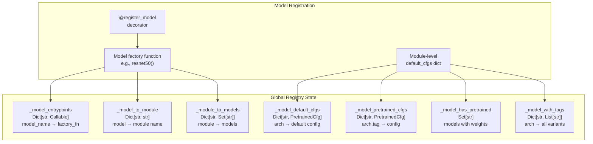

**Registry Components**

| Dictionary | Type | Purpose |
|------------|------|---------|
| `_model_entrypoints` | `Dict[str, Callable]` | Maps model name to factory function |
| `_model_has_pretrained` | `Set[str]` | Models with available pretrained weights |
| `_model_default_cfgs` | `Dict[str, DefaultCfg]` | Default configuration per architecture |
| `_model_pretrained_cfgs` | `Dict[str, PretrainedCfg]` | Configurations for model.tag variants |
| `_model_with_tags` | `Dict[str, List[str]]` | All tagged variants per architecture |

Sources: [timm/models/_registry.py:22-30]()

### Model Registration Process

The `@register_model` decorator registers model factory functions into the global registry:

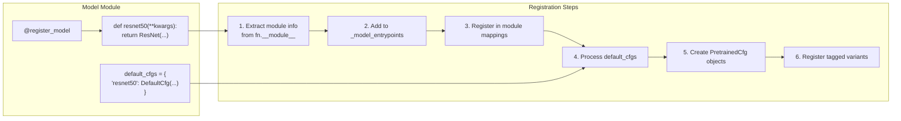

The decorator performs these operations at module import time:

1. **Extract module information** from the function's `__module__` attribute
2. **Register entrypoint** in `_model_entrypoints[model_name] = fn`
3. **Update module mappings** for `_model_to_module` and `_module_to_models`
4. **Process default configurations** from the module's `default_cfgs` dict
5. **Generate PretrainedCfg objects** with auto-completed fields
6. **Register tagged variants** like `model.tag1`, `model.tag2`

Sources: [timm/models/_registry.py:75-136]()

---

## Model Discovery

The library provides APIs to discover and filter available models.

### Discovery Functions

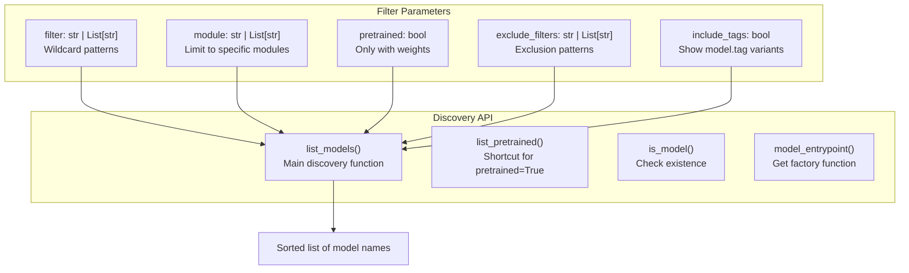

**Filter Examples**

```python
# All ResNet models
list_models('resnet*')

# Vision Transformers with pretrained weights
list_models('vit_*', pretrained=True)

# All models in vision_transformer module
list_models(module='vision_transformer')

# Exclude large models
list_models('*', exclude_filters=['*huge*', '*giant*'])

# Include tagged variants
list_models('resnet50', include_tags=True)
# Returns: ['resnet50', 'resnet50.a1_in1k', 'resnet50.tv_in1k', ...]
```

### Name Matching and Tags

Model names follow the pattern `architecture.tag` where tag identifies a specific pretrained variant:

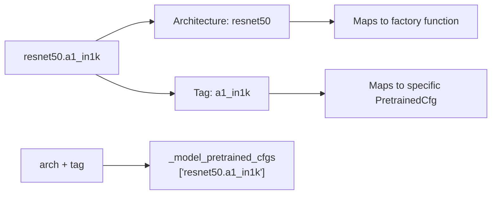

The `split_model_name_tag()` function parses model names:

```python
split_model_name_tag('resnet50.a1_in1k')  # ('resnet50', 'a1_in1k')
split_model_name_tag('resnet50')          # ('resnet50', '')
```

Sources: [timm/models/_registry.py:33-36](), [timm/models/_registry.py:185-265]()

---

## Model Creation Pipeline

The `create_model()` function is the main entry point for model instantiation.

### High-Level Creation Flow

```mermaid
graph TB
    create["create_model(model_name,<br/>pretrained=False, **kwargs)"]
    
    parse["parse_model_name()<br/>Extract source prefix"]
    
    subgraph "Source Detection"
        hf["Source: hf-hub:<br/>Load from Hugging Face"]
        local["Source: local-dir:<br/>Load from local path"]
        standard["Source: None<br/>Use registry"]
    end
    
    parse --> hf
    parse --> local
    parse --> standard
    
    hf --> load_hf["load_model_config_from_hf()<br/>Get config.json from HF"]
    local --> load_local["load_model_config_from_path()<br/>Get config.json from path"]
    standard --> split["split_model_name_tag()<br/>Separate arch from tag"]
    
    split --> lookup["model_entrypoint()<br/>Get factory function"]
    load_hf --> lookup
    load_local --> lookup
    
    lookup --> call["Call factory function:<br/>fn(pretrained=..., **kwargs)"]
    
    call --> build["build_model_with_cfg()<br/>Construct & configure model"]
    
    build --> result["Instantiated model"]
```

### Name Parsing Logic

The `parse_model_name()` function handles three formats:

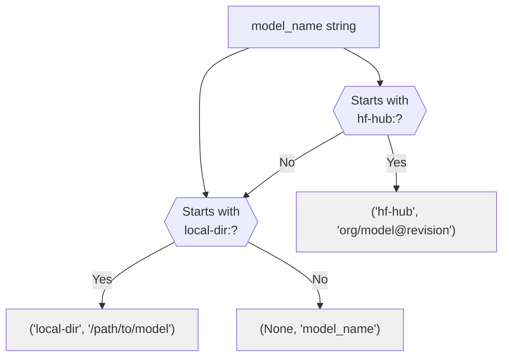

**Example Name Formats**

| Input Format | Source | Model Identifier |
|--------------|--------|------------------|
| `resnet50` | Standard registry | `resnet50` |
| `resnet50.a1_in1k` | Standard registry | `resnet50` with tag `a1_in1k` |
| `hf-hub:timm/resnet50.a1_in1k` | Hugging Face Hub | `timm/resnet50.a1_in1k` |
| `local-dir:/path/to/model` | Local directory | `/path/to/model` |

Sources: [timm/models/_factory.py:18-32](), [timm/models/_factory.py:44-149]()

### build_model_with_cfg Orchestration

The `build_model_with_cfg()` function orchestrates model construction and weight loading:

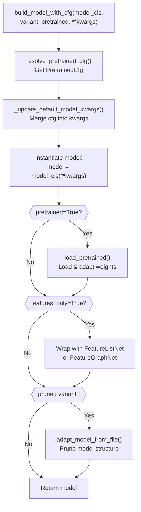

Key responsibilities:

1. **Resolve configuration** - Determine which `PretrainedCfg` to use
2. **Update kwargs** - Merge config values (num_classes, input_size, etc.) into model args
3. **Instantiate model** - Call the model class constructor
4. **Load weights** (if `pretrained=True`) - Download and apply pretrained weights
5. **Feature extraction** (if `features_only=True`) - Wrap model for intermediate outputs
6. **Pruning** (if pruned variant) - Adapt model structure from pruning metadata

Sources: [timm/models/_builder.py:376-498]()

---

## Pretrained Configuration System

Configurations define model metadata, input specifications, and weight sources.

### PretrainedCfg Dataclass

```mermaid
graph TB
    subgraph "PretrainedCfg Fields"
        subgraph "Weight Sources"
            url["url: str<br/>Remote URL"]
            file["file: str<br/>Local path"]
            hf_hub_id["hf_hub_id: str<br/>HuggingFace org/model"]
            state_dict["state_dict: Dict<br/>In-memory weights"]
        end
        
        subgraph "Input Configuration"
            input_size["input_size: Tuple[int, int, int]<br/>Channel, Height, Width"]
            interpolation["interpolation: str<br/>Resize method"]
            crop_pct["crop_pct: float<br/>Center crop ratio"]
            mean["mean: Tuple[float, ...]<br/>Normalization mean"]
            std["std: Tuple[float, ...]<br/>Normalization std"]
        end
        
        subgraph "Model Metadata"
            num_classes["num_classes: int<br/>Output classes"]
            architecture["architecture: str<br/>Model family"]
            tag["tag: str<br/>Variant identifier"]
            pool_size["pool_size: Tuple<br/>Feature map size"]
            first_conv["first_conv: str<br/>Input conv layer name"]
            classifier["classifier: str<br/>Classifier layer name"]
        end
    end
    
    cfg["PretrainedCfg<br/>instance"]
    
    cfg --> url
    cfg --> input_size
    cfg --> num_classes
```

### DefaultCfg for Multiple Variants

A single architecture can have multiple pretrained variants managed by `DefaultCfg`:

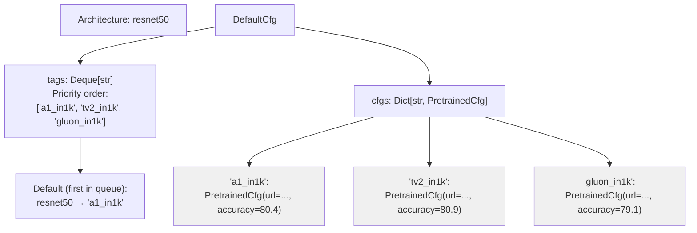

The `generate_default_cfgs()` function processes model configurations:

- Configs without tags or ending with `*` get priority as defaults
- Weights presence determines if a model is in `_model_has_pretrained`
- Tags are stored in priority order (first is default)

Sources: [timm/models/_pretrained.py:10-95](), [timm/models/_registry.py:43-72]()

---

## Weight Loading System

Weights can be loaded from multiple sources with automatic fallback and adaptation.

### Source Resolution

```mermaid
graph TB
    start["_resolve_pretrained_source(pretrained_cfg)"]
    
    check_source{{"cfg['source']?"}}
    
    start --> check_source
    
    check_source -->|"'hf-hub'"| hf_direct["Use HF Hub directly"]
    check_source -->|"'local-dir'"| local_direct["Use local directory"]
    check_source -->|"'timm' or None"| priority["Check priority order"]
    
    priority --> state_dict_check{{"state_dict<br/>in cfg?"}}
    
    state_dict_check -->|Yes| use_state["load_from='state_dict'<br/>Direct pass-through"]
    state_dict_check -->|No| file_check{{"file<br/>in cfg?"}}
    
    file_check -->|Yes| use_file["load_from='file'<br/>Load from path"]
    file_check -->|No| cache_check{{"Old cache<br/>valid?"}}
    
    cache_check -->|Yes| use_url["load_from='url'<br/>Use cached file"]
    cache_check -->|No| hf_fallback{{"hf_hub_id<br/>available?"}}
    
    hf_fallback -->|Yes| use_hf["load_from='hf-hub'<br/>Download from HF"]
    hf_fallback -->|No| url_check{{"url<br/>in cfg?"}}
    
    url_check -->|Yes| use_url
    url_check -->|No| none["load_from=''<br/>No weights"]
    
    style use_state fill:#e1ffe1
    style use_file fill:#e1ffe1
    style use_url fill:#e1ffe1
    style use_hf fill:#e1ffe1
    style none fill:#ffe1e1
```

### Weight Loading Pipeline

Once the source is resolved, `load_pretrained()` handles the actual loading:

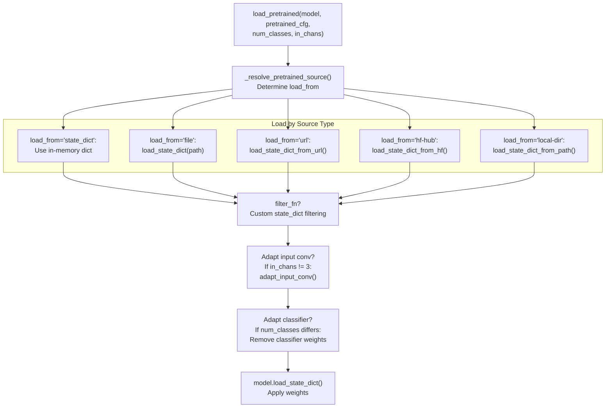

### Weight Adaptation Operations

The loading process automatically adapts weights to match the target model:

**Input Channel Adaptation**

When `in_chans` differs from the pretrained model (typically 3):

```python
# timm/models/_manipulate.py:288-310
def adapt_input_conv(in_chans: int, conv_weight: Tensor) -> Tensor:
    if in_chans == 1:
        # Sum across input channels: (O, 3, H, W) -> (O, 1, H, W)
        conv_weight = conv_weight.sum(dim=1, keepdim=True)
    elif in_chans != 3:
        # Repeat and scale: (O, 3, H, W) -> (O, in_chans, H, W)
        repeat = int(math.ceil(in_chans / 3))
        conv_weight = conv_weight.repeat(1, repeat, 1, 1)[:, :in_chans, :, :]
        conv_weight *= (3 / float(in_chans))
    return conv_weight
```

**Classifier Adaptation**

When `num_classes` differs from pretrained:

- Classifier layer weights are removed from state dict
- Model's classifier is randomly initialized to match new `num_classes`
- `strict=False` allows loading to proceed

**Custom Filter Functions**

Models can provide `checkpoint_filter_fn` to handle format conversions:

```python
# Example from model definition
def _filter_fn(state_dict, model):
    # Remap old key names
    if 'old.layer.weight' in state_dict:
        state_dict['new.layer.weight'] = state_dict.pop('old.layer.weight')
    return state_dict
```

Sources: [timm/models/_builder.py:43-88](), [timm/models/_builder.py:152-289](), [timm/models/_manipulate.py:288-310]()

---

## Hugging Face Hub Integration

The library supports loading models directly from Hugging Face Hub with the `hf-hub:` prefix.

### Hub Loading Flow

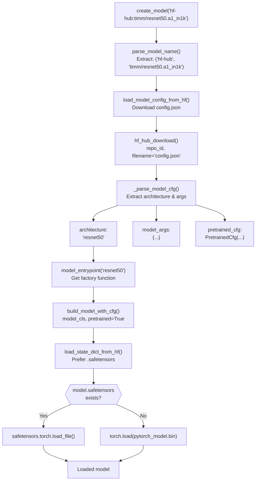

### Hub Configuration Format

Models stored on Hugging Face Hub use a `config.json` file:

```json
{
  "architecture": "resnet50",
  "num_classes": 1000,
  "num_features": 2048,
  "pretrained_cfg": {
    "tag": "a1_in1k",
    "input_size": [3, 224, 224],
    "mean": [0.485, 0.456, 0.406],
    "std": [0.229, 0.224, 0.225],
    "num_classes": 1000,
    "pool_size": [7, 7],
    "first_conv": "conv1",
    "classifier": "fc"
  },
  "model_args": {}
}
```

The `_parse_model_cfg()` function extracts:
- `architecture` - Model name to look up in registry
- `pretrained_cfg` - Configuration dict converted to `PretrainedCfg`
- `model_args` - Additional kwargs passed to model constructor

Sources: [timm/models/_hub.py:143-211](), [timm/models/_hub.py:213-251]()

---

## Local Directory Loading

Models can be loaded from local directories containing `config.json` and weight files:

```python
create_model('local-dir:/path/to/model', pretrained=True)
```

The directory structure:

```
/path/to/model/
├── config.json          # Model configuration
├── model.safetensors    # Weights (preferred)
└── pytorch_model.bin    # Weights (fallback)
```

The `load_state_dict_from_path()` function searches for weight files in priority order:

1. `model.safetensors`
2. `pytorch_model.bin`
3. `pytorch_model.pth`
4. Other `.safetensors` or `.pth` files

Sources: [timm/models/_hub.py:200-211](), [timm/models/_hub.py:266-296]()

---

## Complete Creation Example

Here's how a typical model creation flows through the system:

```python
model = create_model(
    'resnet50.a1_in1k',
    pretrained=True,
    num_classes=100,
    drop_rate=0.2
)
```

### Step-by-Step Execution

```mermaid
graph TB
    call["create_model('resnet50.a1_in1k',<br/>pretrained=True, num_classes=100)"]
    
    step1["1. parse_model_name()<br/>→ (None, 'resnet50.a1_in1k')"]
    
    step2["2. split_model_name_tag()<br/>→ ('resnet50', 'a1_in1k')"]
    
    step3["3. is_model('resnet50')<br/>→ True (exists in registry)"]
    
    step4["4. model_entrypoint('resnet50')<br/>→ timm.models.resnet.resnet50"]
    
    step5["5. Call entrypoint:<br/>resnet50(pretrained=True,<br/>pretrained_cfg='a1_in1k',<br/>num_classes=100)"]
    
    step6["6. build_model_with_cfg(<br/>ResNet, 'resnet50',<br/>pretrained=True, ...)"]
    
    step7["7. resolve_pretrained_cfg()<br/>Get PretrainedCfg for 'a1_in1k'"]
    
    step8["8. Instantiate:<br/>model = ResNet(<br/>  block=Bottleneck,<br/>  layers=[3,4,6,3],<br/>  num_classes=100)"]
    
    step9["9. load_pretrained()<br/>Download weights from URL"]
    
    step10["10. Adapt classifier:<br/>Remove fc.weight/fc.bias<br/>(1000 → 100 classes)"]
    
    step11["11. model.load_state_dict()<br/>strict=False"]
    
    result["Return configured model"]
    
    call --> step1
    step1 --> step2
    step2 --> step3
    step3 --> step4
    step4 --> step5
    step5 --> step6
    step6 --> step7
    step7 --> step8
    step8 --> step9
    step9 --> step10
    step10 --> step11
    step11 --> result
```

### Registry Lookups

| Lookup | Result |
|--------|--------|
| `_model_entrypoints['resnet50']` | `timm.models.resnet.resnet50` function |
| `_model_pretrained_cfgs['resnet50.a1_in1k']` | `PretrainedCfg(url='https://...', num_classes=1000, ...)` |
| `_model_has_pretrained` | Contains `'resnet50.a1_in1k'` ✓ |

### Configuration Override Precedence

1. **Explicit kwargs** (highest priority) - `num_classes=100` from user
2. **Pretrained config** - From `PretrainedCfg` for tag `a1_in1k`
3. **Model defaults** (lowest priority) - Defined in model class

Sources: [timm/models/_factory.py:44-149](), [timm/models/_builder.py:376-498]()

---

## Testing and Validation

The test suite validates registry and creation functionality:

### Model Discovery Tests

```python
# tests/test_models.py:172-189
@pytest.mark.parametrize('model_name', list_models())
def test_model_forward(model_name, batch_size):
    """Run a single forward pass with each model"""
    model = create_model(model_name, pretrained=False)
    model.eval()
    # ... test forward pass
```

Key test patterns:

- **Enumerate all models**: `list_models()` for comprehensive testing
- **Filter by category**: `list_models(module='vision_transformer')`
- **Test pretrained loading**: `list_models(pretrained=True)`
- **Exclude large models**: `exclude_filters=['*huge*', '*giant*']` for CI

### Registry Validation Tests

The test suite verifies:

1. All registered models can be instantiated
2. Pretrained weights can be loaded
3. Default configurations are correct
4. Feature extraction modes work
5. TorchScript compilation succeeds

Sources: [tests/test_models.py:1-700]()

---

## Summary

The Model Creation and Registry System provides:

1. **Centralized registration** - Single decorator registers models globally
2. **Flexible discovery** - Rich filtering for finding models
3. **Multiple weight sources** - URL, Hugging Face Hub, local files, in-memory
4. **Automatic adaptation** - Input channels, classifier heads, position embeddings
5. **Configuration management** - Pretrained configs with multiple variants
6. **Extensible pipeline** - Custom filter functions, pruning, feature extraction

The system supports 1000+ model variants through a clean API while handling the complexity of weight loading, configuration resolution, and model adaptation internally.

---

# Page: Model Architecture System

# Model Architecture System

<details>
<summary>Relevant source files</summary>

The following files were used as context for generating this wiki page:

- [README.md](README.md)
- [timm/models/convnext.py](timm/models/convnext.py)
- [timm/models/fastvit.py](timm/models/fastvit.py)
- [timm/models/mambaout.py](timm/models/mambaout.py)
- [timm/models/maxxvit.py](timm/models/maxxvit.py)
- [timm/models/vision_transformer.py](timm/models/vision_transformer.py)
- [timm/models/vision_transformer_hybrid.py](timm/models/vision_transformer_hybrid.py)
- [timm/models/vision_transformer_relpos.py](timm/models/vision_transformer_relpos.py)
- [timm/models/vision_transformer_sam.py](timm/models/vision_transformer_sam.py)
- [timm/models/vitamin.py](timm/models/vitamin.py)
- [timm/version.py](timm/version.py)

</details>


This document provides an overview of the model architecture system in timm, covering the different architecture families and their common patterns. It explains how various model types are organized and how they share common interfaces for feature extraction, forward passes, and integration with the model factory system.

For information about creating and registering models, see [Model Creation and Registry System](#2). For detailed coverage of specific architecture families, see [Vision Transformers](#3.1), [Convolutional Networks](#3.2), [Configurable and Hybrid Models](#3.3), and [Specialized Architectures](#3.4).

## Architecture Family Overview

The timm library organizes model architectures into distinct families, each implementing a common interface while providing architecture-specific optimizations. All architectures follow standardized patterns for feature extraction, classification heads, and intermediate layer access.

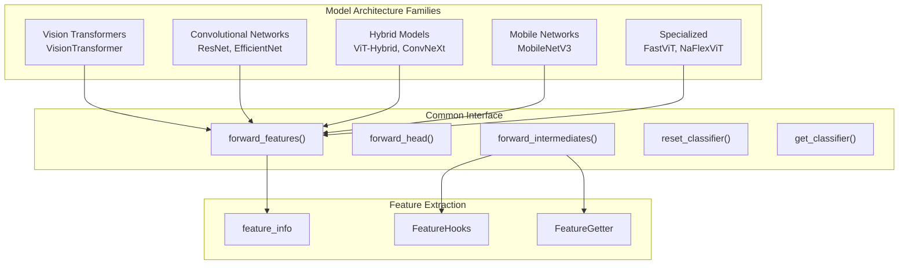

Sources: [timm/models/vision_transformer.py:444-950](), [timm/models/resnet.py:390-700](), [timm/models/efficientnet.py:59-342](), [timm/models/mobilenetv3.py:29-326]()

## Common Interface Patterns

All model architectures in timm implement a standardized interface that enables consistent usage across different model types. This interface separates feature extraction from classification and provides methods for intermediate layer access.

### Standard Model Interface

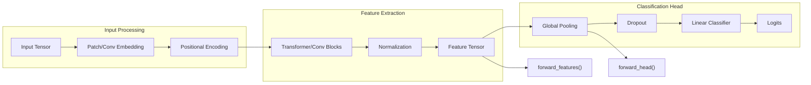

The interface methods implemented by all architectures:

| Method | Purpose | Return Type |
|--------|---------|-------------|
| `forward_features()` | Extract features without classification head | `torch.Tensor` |
| `forward_head()` | Apply classification head to features | `torch.Tensor` |
| `forward_intermediates()` | Extract intermediate layer features | `List[torch.Tensor]` |
| `reset_classifier()` | Change number of output classes | `None` |
| `get_classifier()` | Get current classifier module | `nn.Module` |
| `set_grad_checkpointing()` | Enable/disable gradient checkpointing | `None` |

Sources: [timm/models/vision_transformer.py:934-951](), [timm/models/resnet.py:617-700](), [timm/models/efficientnet.py:310-341](), [timm/models/mobilenetv3.py:276-325]()

## Architecture Categories

### Vision Transformers

Vision Transformers represent the newest paradigm in computer vision, applying transformer architectures originally designed for NLP to image recognition tasks. The `VisionTransformer` class serves as the base implementation.

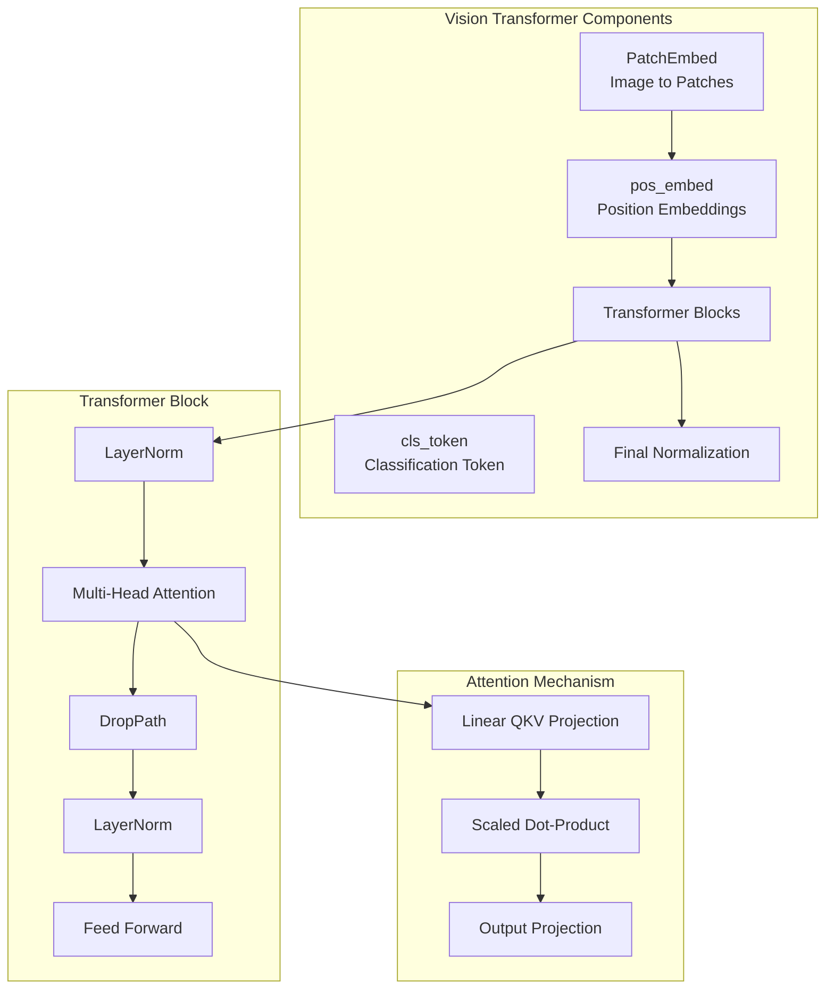

Key Vision Transformer characteristics:
- **Patch-based processing**: Images divided into fixed-size patches
- **Self-attention mechanism**: Global receptive field from first layer
- **Position embeddings**: Learnable or fixed positional encoding
- **Classification token**: Special `[CLS]` token for classification
- **Layer normalization**: Pre-normalization in transformer blocks

Sources: [timm/models/vision_transformer.py:444-624](), [timm/models/vision_transformer.py:109-179]()

### Convolutional Networks

Convolutional networks form the traditional backbone of computer vision models, with ResNet being a prime example. These architectures use hierarchical feature learning through convolution operations.

```mermaid
graph TD
    subgraph "ResNet Architecture"
        CONV1["Initial Convolution<br/>conv1 7x7"]
        BN1["Batch Normalization<br/>bn1"]
        MAXPOOL["Max Pooling<br/>maxpool"]
        LAYER1["Stage 1<br/>layer1"]
        LAYER2["Stage 2<br/>layer2"]
        LAYER3["Stage 3<br/>layer3"]
        LAYER4["Stage 4<br/>layer4"]
        GLOBAL_POOL["Global Pooling"]
        FC["Classification<br/>fc"]
    end
    
    subgraph "Residual Block"
        BLOCK_CONV1["3x3 Conv"]
        BLOCK_BN1["BatchNorm"]
        BLOCK_RELU1["ReLU"]
        BLOCK_CONV2["3x3 Conv"]
        BLOCK_BN2["BatchNorm"]
        SHORTCUT["Shortcut Connection"]
        BLOCK_RELU2["ReLU"]
    end
    
    CONV1 --> BN1
    BN1 --> MAXPOOL
    MAXPOOL --> LAYER1
    LAYER1 --> LAYER2
    LAYER2 --> LAYER3
    LAYER3 --> LAYER4
    LAYER4 --> GLOBAL_POOL
    GLOBAL_POOL --> FC
    
    BLOCK_CONV1 --> BLOCK_BN1
    BLOCK_BN1 --> BLOCK_RELU1
    BLOCK_RELU1 --> BLOCK_CONV2
    BLOCK_CONV2 --> BLOCK_BN2
    SHORTCUT --> BLOCK_RELU2
    BLOCK_BN2 --> BLOCK_RELU2
```

Convolutional network characteristics:
- **Hierarchical features**: Progressive feature abstraction through stages
- **Local receptive fields**: Convolution operations with limited spatial scope
- **Residual connections**: Skip connections for gradient flow (ResNet)
- **Batch normalization**: Normalization after convolution layers
- **Spatial downsampling**: Progressive reduction of spatial dimensions

Sources: [timm/models/resnet.py:390-624](), [timm/models/resnet.py:34-244](), [timm/models/efficientnet.py:59-167]()

### Mobile and Efficient Networks

Mobile networks like MobileNetV3 and EfficientNet optimize for efficiency while maintaining performance. They use techniques like depthwise separable convolutions and neural architecture search.

Key mobile network features:
- **Depthwise separable convolutions**: Factorized convolutions for efficiency
- **Squeeze-and-excitation**: Channel attention mechanisms
- **Inverted residuals**: Efficient residual block design
- **Neural architecture search**: Automated architecture optimization

Sources: [timm/models/mobilenetv3.py:29-140](), [timm/models/efficientnet.py:59-167]()

### Hybrid and Configurable Models

Hybrid models combine different architectural paradigms, such as CNN backbones with transformer heads. Configurable models allow runtime architecture modifications.

Examples include:
- **Vision Transformer Hybrid**: CNN backbone + ViT head
- **ConvNeXt**: CNN with transformer-inspired design choices
- **ByobNet**: Build-your-own-backbone configurable networks

Sources: [timm/models/vision_transformer_hybrid.py:130-143]()

## Feature Extraction System

The feature extraction system provides unified access to intermediate layer outputs across all architectures, enabling their use as backbones for downstream tasks.

### Feature Information Structure

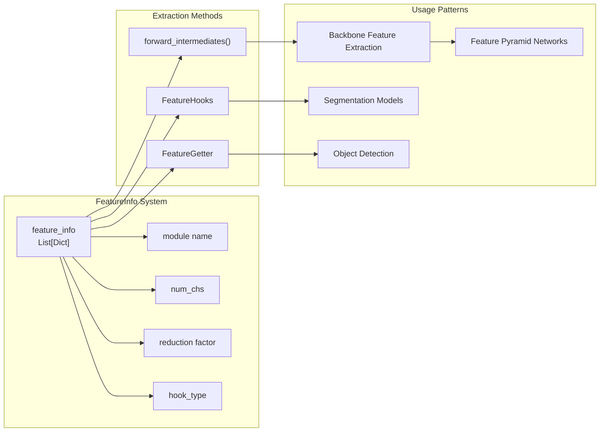

The feature extraction system enables:
- **Multi-scale features**: Access to outputs from different network depths
- **Backbone compatibility**: Use any timm model as a feature extractor
- **Flexible extraction**: Hook-based or direct intermediate access
- **Standardized interface**: Consistent API across all architectures

Sources: [timm/models/vision_transformer.py:782-875](), [timm/models/resnet.py:617-684](), [timm/models/efficientnet.py:219-277]()

## Integration with Model Factory

All architectures integrate seamlessly with the model factory system through standardized registration and configuration patterns.

### Registration Pattern

```mermaid
graph TD
    subgraph "Model Registration"
        REGISTER["@register_model"]
        FUNCTION["Model Function"]
        VARIANT["variant name"]
        PRETRAINED["pretrained weights"]
        KWARGS["**kwargs"]
    end
    
    subgraph "Configuration"
        DEFAULT_CFGS["default_cfgs"]
        PRETRAINED_CFG["PretrainedCfg"]
        INPUT_SIZE["input_size"]
        CLASSIFIER["classifier"]
        FIRST_CONV["first_conv"]
    end
    
    subgraph "Factory Integration"
        CREATE_MODEL["create_model()"]
        BUILD_MODEL["build_model_with_cfg()"]
        LOAD_PRETRAINED["load_pretrained()"]
    end
    
    REGISTER --> FUNCTION
    FUNCTION --> VARIANT
    FUNCTION --> PRETRAINED
    FUNCTION --> KWARGS
    
    DEFAULT_CFGS --> PRETRAINED_CFG
    PRETRAINED_CFG --> INPUT_SIZE
    PRETRAINED_CFG --> CLASSIFIER
    PRETRAINED_CFG --> FIRST_CONV
    
    FUNCTION --> CREATE_MODEL
    CREATE_MODEL --> BUILD_MODEL
    BUILD_MODEL --> LOAD_PRETRAINED
```

The integration provides:
- **Unified creation interface**: Single `create_model()` function for all architectures
- **Standardized configuration**: Common configuration patterns across models
- **Pretrained weight loading**: Automatic weight loading with adaptation
- **Feature extraction modes**: Seamless switching between classification and feature extraction

Sources: [timm/models/vision_transformer.py:1625-1700](), [timm/models/resnet.py:1450-1500](), [timm/models/__init__.py:90-102]()

This architecture system enables timm to provide a unified interface to dozens of different model architectures while maintaining the flexibility for architecture-specific optimizations and features.

---

# Page: Vision Transformers

# Vision Transformers

<details>
<summary>Relevant source files</summary>

The following files were used as context for generating this wiki page:

- [timm/layers/__init__.py](timm/layers/__init__.py)
- [timm/layers/attention.py](timm/layers/attention.py)
- [timm/layers/blur_pool.py](timm/layers/blur_pool.py)
- [timm/layers/mlp.py](timm/layers/mlp.py)
- [timm/layers/patch_embed.py](timm/layers/patch_embed.py)
- [timm/layers/pos_embed.py](timm/layers/pos_embed.py)
- [timm/layers/pos_embed_rel.py](timm/layers/pos_embed_rel.py)
- [timm/layers/pos_embed_sincos.py](timm/layers/pos_embed_sincos.py)
- [timm/models/beit.py](timm/models/beit.py)
- [timm/models/convnext.py](timm/models/convnext.py)
- [timm/models/csatv2.py](timm/models/csatv2.py)
- [timm/models/eva.py](timm/models/eva.py)
- [timm/models/fastvit.py](timm/models/fastvit.py)
- [timm/models/mambaout.py](timm/models/mambaout.py)
- [timm/models/maxxvit.py](timm/models/maxxvit.py)
- [timm/models/swin_transformer.py](timm/models/swin_transformer.py)
- [timm/models/swin_transformer_v2.py](timm/models/swin_transformer_v2.py)
- [timm/models/swin_transformer_v2_cr.py](timm/models/swin_transformer_v2_cr.py)
- [timm/models/vision_transformer.py](timm/models/vision_transformer.py)
- [timm/models/vision_transformer_hybrid.py](timm/models/vision_transformer_hybrid.py)
- [timm/models/vision_transformer_relpos.py](timm/models/vision_transformer_relpos.py)
- [timm/models/vision_transformer_sam.py](timm/models/vision_transformer_sam.py)
- [timm/models/vitamin.py](timm/models/vitamin.py)
- [timm/models/volo.py](timm/models/volo.py)

</details>


This page documents Vision Transformer (ViT) architectures and their variants in the timm library, including the core ViT implementation, Swin Transformers (V1, V2, V2-CR), EVA models with rotary position embeddings, BEiT with relative position bias, and specialized variants like VOLO and SAM. For hybrid models combining CNNs with transformers, see [Configurable and Hybrid Models](#3.3). For the layer components used across these architectures, see [Layer and Component Library](#3.5).

## Overview

Vision Transformers apply the transformer architecture from NLP to computer vision by dividing images into patches and treating them as sequence tokens. The timm library implements numerous ViT variants that differ primarily in their attention mechanisms, position encoding strategies, and architectural optimizations:

```mermaid
graph TB
    subgraph "ViT Families"
        CoreViT["VisionTransformer<br/>Standard ViT with learned pos embed"]
        Swin["Swin Family<br/>Window-based attention"]
        EVA["EVA Family<br/>ROPE + SwiGLU"]
        BEiT["BEiT Family<br/>Relative position bias"]
        Specialized["Specialized Variants<br/>VOLO, SAM, RelPos"]
    end
    
    subgraph "Key Differences"
        Attn["Attention Type<br/>Global, Window, Shifted Window"]
        PosEmbed["Position Encoding<br/>Learned, ROPE, Relative Bias"]
        MLP["MLP Variants<br/>Standard, SwiGLU, GatedMLP"]
        Norm["Normalization<br/>Pre-norm, Post-norm"]
    end
    
    CoreViT --> Attn
    CoreViT --> PosEmbed
    Swin --> Attn
    EVA --> PosEmbed
    EVA --> MLP
    BEiT --> PosEmbed
    
    style CoreViT fill:#f9f9f9
    style Swin fill:#f9f9f9
    style EVA fill:#f9f9f9
    style BEiT fill:#f9f9f9
```

**Sources:** [timm/models/vision_transformer.py:1-80](), [timm/models/eva.py:1-102](), [timm/models/swin_transformer.py:1-37](), [timm/models/beit.py:1-69]()

## Core VisionTransformer Architecture

The `VisionTransformer` class in [timm/models/vision_transformer.py:674-1095]() implements the standard ViT architecture from "An Image is Worth 16x16 Words". The model consists of a patch embedding stem, optional position embeddings, transformer blocks, and a classification head.

### Model Construction Pipeline

```mermaid
graph LR
    Input["Input Image<br/>B×C×H×W"]
    PatchEmbed["PatchEmbed<br/>Conv2d projection"]
    Tokens["Patch Tokens<br/>B×N×D"]
    ClsToken["Add cls_token<br/>& pos_embed"]
    Blocks["Transformer Blocks<br/>depth × Block"]
    Norm["Final Norm<br/>LayerNorm"]
    Pool["Global Pool<br/>token/avg/map"]
    Head["Classification Head<br/>Linear"]
    
    Input --> PatchEmbed
    PatchEmbed --> Tokens
    Tokens --> ClsToken
    ClsToken --> Blocks
    Blocks --> Norm
    Norm --> Pool
    Pool --> Head
```

**Key Configuration Parameters:**

| Parameter | Default | Purpose |
|-----------|---------|---------|
| `img_size` | 224 | Input image size |
| `patch_size` | 16 | Patch size for tokenization |
| `embed_dim` | 768 | Embedding dimension |
| `depth` | 12 | Number of transformer blocks |
| `num_heads` | 12 | Number of attention heads |
| `mlp_ratio` | 4.0 | MLP hidden dimension expansion |
| `qkv_bias` | True | Bias in QKV projections |
| `class_token` | True | Use class token |
| `global_pool` | 'token' | Pooling type: token/avg/map |

**Sources:** [timm/models/vision_transformer.py:674-795]()

### Patch Embedding

The `PatchEmbed` layer in [timm/layers/patch_embed.py:26-139]() converts images to patch tokens via a convolutional projection:

```mermaid
graph LR
    Img["Image<br/>B×3×224×224"]
    Conv["Conv2d<br/>kernel=16, stride=16"]
    Reshape["Reshape<br/>B×D×14×14 → B×196×D"]
    Tokens["Patch Tokens<br/>B×196×768"]
    
    Img --> Conv
    Conv --> Reshape
    Reshape --> Tokens
```

The patch embedding supports both static and dynamic image sizes through the `dynamic_img_size` parameter. When enabled, the output format is `NHWC` and flattening is deferred until after position embeddings are applied.

**Sources:** [timm/layers/patch_embed.py:26-139](), [timm/models/vision_transformer.py:786-795]()

## Transformer Block Variants

Vision transformers use different block architectures that vary in normalization placement and component ordering:

### Standard Pre-Norm Block

The standard `Block` in [timm/models/vision_transformer.py:126-208]() uses pre-normalization (norm before attention/MLP):

```mermaid
graph TB
    Input["x"]
    Norm1["norm1<br/>LayerNorm"]
    Attn["attn<br/>Attention"]
    LS1["ls1<br/>LayerScale"]
    Drop1["drop_path1<br/>DropPath"]
    Add1["x + residual"]
    Norm2["norm2<br/>LayerNorm"]
    MLP["mlp<br/>Mlp"]
    LS2["ls2<br/>LayerScale"]
    Drop2["drop_path2<br/>DropPath"]
    Add2["x + residual"]
    Output["output"]
    
    Input --> Norm1
    Norm1 --> Attn
    Attn --> LS1
    LS1 --> Drop1
    Input --> Add1
    Drop1 --> Add1
    Add1 --> Norm2
    Norm2 --> MLP
    MLP --> LS2
    LS2 --> Drop2
    Add1 --> Add2
    Drop2 --> Add2
    Add2 --> Output
```

### Post-Norm Block

The `ResPostBlock` in [timm/models/vision_transformer.py:210-278]() applies normalization after attention/MLP:

```python
# Post-norm: attn(x) + norm(x) vs Pre-norm: x + attn(norm(x))
x = x + drop_path(norm1(attn(x)))
x = x + drop_path(norm2(mlp(x)))
```

### Parallel Blocks

The `ParallelScalingBlock` in [timm/models/vision_transformer.py:280-398]() computes attention and MLP in parallel for efficiency:

```mermaid
graph TB
    Input["x"]
    InNorm["in_norm"]
    InProj["in_proj<br/>Linear: D → mlp_dim+3D"]
    Split["Split: x_mlp, q, k, v"]
    
    subgraph "Parallel Paths"
        Attn["Attention<br/>qk normalization"]
        MLP["MLP<br/>activation + dropout"]
    end
    
    Concat["Concatenate<br/>x_attn + x_mlp"]
    OutProj["out_proj<br/>Fused or separate"]
    LS["LayerScale"]
    DropPath["DropPath"]
    Add["x + residual"]
    Output["output"]
    
    Input --> InNorm
    InNorm --> InProj
    InProj --> Split
    Split --> Attn
    Split --> MLP
    Attn --> Concat
    MLP --> Concat
    Concat --> OutProj
    OutProj --> LS
    LS --> DropPath
    Input --> Add
    DropPath --> Add
    Add --> Output
```

**Sources:** [timm/models/vision_transformer.py:126-398]()

## Position Embeddings

Vision transformers use various position encoding strategies to provide spatial information to the attention mechanism:

### Learned Position Embeddings

Standard ViT uses learnable position embeddings added to patch tokens [timm/models/vision_transformer.py:802-806]():

```python
# Learned position embedding: [1, num_patches + num_prefix_tokens, embed_dim]
self.pos_embed = nn.Parameter(torch.randn(1, embed_len, embed_dim) * .02)
```

The embeddings are resized when the input resolution changes using bicubic interpolation in [timm/layers/pos_embed.py:19-52]().

### Rotary Position Embeddings (ROPE)

EVA models and variants use ROPE for position-aware attention [timm/models/eva.py:637-662](). ROPE applies rotations to query and key vectors based on their positions:

```mermaid
graph TB
    FeatShape["Feature Shape<br/>H×W"]
    BuildRope["build_rotary_pos_embed<br/>Create sin/cos embeddings"]
    SinCos["sin_emb, cos_emb<br/>[H*W, dim/4]"]
    QK["Query, Key Vectors<br/>B×num_heads×N×head_dim"]
    ApplyRot["apply_rot_embed_cat<br/>Rotate vectors"]
    RotQK["Position-aware Q, K"]
    
    FeatShape --> BuildRope
    BuildRope --> SinCos
    QK --> ApplyRot
    SinCos --> ApplyRot
    ApplyRot --> RotQK
```

ROPE variants in timm:
- **Standard ROPE**: Interleaved rotation [timm/layers/pos_embed_sincos.py:383-503]()
- **Cat ROPE**: Concatenated sin/cos [timm/layers/pos_embed_sincos.py:505-628]()
- **Mixed ROPE**: Depth-dependent frequencies [timm/layers/pos_embed_sincos.py:630-832]()
- **DINOv3 ROPE**: Specialized for DINOv3 [timm/layers/pos_embed_sincos.py:834-965]()

### Relative Position Bias

BEiT models use relative position bias computed through an MLP [timm/models/beit.py:72-104]():

```python
# Relative position index: [window_area+1, window_area+1]
relative_position_index = gen_relative_position_index(window_size)

# Bias table: [num_relative_positions, num_heads]
self.relative_position_bias_table = nn.Parameter(...)

# Applied to attention: attn = attn + relative_position_bias
```

**Sources:** [timm/layers/pos_embed_sincos.py:327-965](), [timm/models/eva.py:637-662](), [timm/models/beit.py:72-104](), [timm/layers/pos_embed.py:19-52]()

## Attention Mechanisms

### Standard Multi-Head Attention

The base `Attention` module in [timm/layers/attention.py:18-113]() implements standard scaled dot-product attention:

```mermaid
graph TB
    Input["x: B×N×C"]
    QKV["qkv projection<br/>Linear: C → 3×attn_dim"]
    Split["Split → q, k, v<br/>B×num_heads×N×head_dim"]
    QKNorm["q_norm, k_norm<br/>Optional normalization"]
    Scale["q * scale<br/>scale = head_dim^-0.5"]
    Matmul1["q @ k^T<br/>B×num_heads×N×N"]
    Softmax["softmax<br/>Attention weights"]
    AttnDrop["attn_drop<br/>Dropout"]
    Matmul2["attn @ v<br/>B×num_heads×N×head_dim"]
    Reshape["Reshape<br/>B×N×C"]
    Proj["proj<br/>Linear: C → C"]
    ProjDrop["proj_drop<br/>Dropout"]
    Output["output: B×N×C"]
    
    Input --> QKV
    QKV --> Split
    Split --> QKNorm
    QKNorm --> Scale
    Scale --> Matmul1
    Matmul1 --> Softmax
    Softmax --> AttnDrop
    AttnDrop --> Matmul2
    Matmul2 --> Reshape
    Reshape --> Proj
    Proj --> ProjDrop
    ProjDrop --> Output
```

**Key Features:**
- Supports fused attention via `F.scaled_dot_product_attention` when available
- Optional QK normalization for training stability
- Configurable head dimensions via `attn_head_dim` parameter

**Sources:** [timm/layers/attention.py:18-113]()

### Differential Attention

The `DiffAttention` module in [timm/layers/diff_attention.py:13-193]() implements differential attention from "Differential Transformer":

```python
# Computes difference between two attention maps
attn_1 = softmax(q_1 @ k_1^T)
attn_2 = softmax(q_2 @ k_2^T)
attn_diff = attn_1 - λ * attn_2  # λ is learnable
```

This mechanism helps reduce attention noise by subtracting redundant attention patterns.

**Sources:** [timm/layers/diff_attention.py:13-193](), [timm/models/vision_transformer.py:83-87]()

### Attention with ROPE

The `AttentionRope` module in [timm/layers/attention.py:115-225]() integrates rotary position embeddings:

```mermaid
graph TB
    QKV["q, k, v<br/>B×num_heads×N×head_dim"]
    SplitPrefix["Split prefix tokens<br/>cls/reg tokens"]
    RopeEmbed["rope: sin/cos embeddings<br/>[N-prefix, head_dim]"]
    ApplyRope["apply_rot_embed_cat<br/>to non-prefix tokens"]
    Concat["Concatenate<br/>prefix + rotated"]
    Attention["Standard Attention<br/>scaled dot-product"]
    
    QKV --> SplitPrefix
    RopeEmbed --> ApplyRope
    SplitPrefix --> ApplyRope
    ApplyRope --> Concat
    Concat --> Attention
```

**Sources:** [timm/layers/attention.py:115-225]()

## Swin Transformer Family

Swin Transformers use hierarchical architecture with shifted window attention for computational efficiency. The family includes three main variants: Swin V1, Swin V2, and Swin V2-CR.

### Window Attention Mechanism

```mermaid
graph TB
    Input["Feature Map<br/>B×H×W×C"]
    Partition["window_partition<br/>Split into windows"]
    Windows["Windows<br/>B*num_windows×Wh×Ww×C"]
    WindowAttn["WindowAttention<br/>Attention within windows"]
    Reverse["window_reverse<br/>Merge windows"]
    Output["Feature Map<br/>B×H×W×C"]
    
    subgraph "Window Attention"
        QKV["QKV projection"]
        RelPosBias["Relative Position Bias<br/>or Continuous Bias"]
        ScaledAttn["Scaled Dot-Product<br/>with position bias"]
    end
    
    Input --> Partition
    Partition --> Windows
    Windows --> WindowAttn
    WindowAttn --> QKV
    QKV --> RelPosBias
    RelPosBias --> ScaledAttn
    ScaledAttn --> Reverse
    Reverse --> Output
```

### Swin V1 Architecture

The `SwinTransformer` in [timm/models/swin_transformer.py:1-1045]() implements the original Swin architecture with:

- **Window Partitioning**: [timm/models/swin_transformer.py:42-59]()
- **Relative Position Bias Table**: Learnable bias indexed by relative positions [timm/models/swin_transformer.py:145-154]()
- **Shifted Window Attention**: Cyclic shifts for cross-window connections [timm/models/swin_transformer.py:270-283]()

```python
# Shifted window masking
if self.shift_size > 0:
    x = torch.roll(x, shifts=(-self.shift_size, -self.shift_size), dims=(1, 2))
    attn_mask = self.attn_mask
```

**Sources:** [timm/models/swin_transformer.py:42-283]()

### Swin V2 Improvements

The `SwinTransformerV2` in [timm/models/swin_transformer_v2.py:1-1082]() adds:

1. **Continuous Position Bias**: MLP-based position encoding [timm/models/swin_transformer_v2.py:121-141]()
2. **Cosine Attention**: Normalized attention computation [timm/models/swin_transformer_v2.py:195-219]()
3. **Log-spaced Coordinate Scaling**: Better adaptation to resolution changes [timm/models/swin_transformer_v2.py:143-161]()

```python
# Cosine attention with log-scaled coordinates
attn = (F.normalize(q, dim=-1) @ F.normalize(k, dim=-1).transpose(-2, -1))
logit_scale = torch.clamp(self.logit_scale, max=math.log(1. / 0.01))
attn = attn * logit_scale.exp()
```

**Sources:** [timm/models/swin_transformer_v2.py:78-219]()

### Swin V2-CR Variant

The CR (Christoph Reich) implementation in [timm/models/swin_transformer_v2_cr.py:1-1134]() is an experimental variant with:

- MLP-based meta network for position bias [timm/models/swin_transformer_v2_cr.py:135-142]()
- Sequential attention option for memory efficiency [timm/models/swin_transformer_v2_cr.py:117]()
- Dynamic window size support [timm/models/swin_transformer_v2_cr.py:164-173]()

**Sources:** [timm/models/swin_transformer_v2_cr.py:96-250]()

### Hierarchical Stage Structure

All Swin variants use a hierarchical structure with downsampling between stages:

| Stage | Resolution | Typical Depth | Window Size |
|-------|-----------|---------------|-------------|
| 0 | H/4 × W/4 | 2 | 7×7 |
| 1 | H/8 × W/8 | 2 | 7×7 |
| 2 | H/16 × W/16 | 6-18 | 7×7 |
| 3 | H/32 × W/32 | 2 | 7×7 |

**Sources:** [timm/models/swin_transformer.py:525-621](), [timm/models/swin_transformer_v2.py:499-589]()

## EVA Models

EVA (Exploring the Limits of Masked Visual Representation Learning at Scale) models in [timm/models/eva.py:1-1605]() are BEiT-based ViTs with several enhancements:

### EVA Architecture Components

```mermaid
graph TB
    subgraph "EVA Block"
        Input["x"]
        Norm1["norm1<br/>LayerNorm"]
        EvaAttn["EvaAttention<br/>ROPE + no k-bias"]
        Gamma1["gamma_1<br/>LayerScale"]
        Drop1["drop_path1"]
        Norm2["norm2"]
        MLPVar["MLP Variant<br/>SwiGLU or GluMlp"]
        Gamma2["gamma_2<br/>LayerScale"]
        Drop2["drop_path2"]
    end
    
    Input --> Norm1
    Norm1 --> EvaAttn
    EvaAttn --> Gamma1
    Gamma1 --> Drop1
    Input --> Add1["x + residual"]
    Drop1 --> Add1
    Add1 --> Norm2
    Norm2 --> MLPVar
    MLPVar --> Gamma2
    Gamma2 --> Drop2
    Add1 --> Add2["x + residual"]
    Drop2 --> Add2
```

### Key Features

1. **EvaAttention**: [timm/models/eva.py:104-244]()
   - ROPE for position encoding
   - No bias on key projections
   - Optional fused vs separate QKV projections
   - QK normalization for stability

2. **SwiGLU MLP**: [timm/layers/mlp.py:168-264]()
   ```python
   # SwiGLU activation
   x = gate * F.silu(x)  # Element-wise gating
   ```

3. **Scaling Normalization**: Applied inside attention and MLP [timm/models/eva.py:258-309]()

4. **Flexible ROPE Types**: [timm/models/eva.py:650-660]()
   - `'cat'`: Concatenated sin/cos for spatial
   - `'mixed'`: Depth-dependent frequencies
   - `'dinov3'`: DINOv3-specific ROPE

### EVA vs EVA02

| Feature | EVA | EVA02 |
|---------|-----|-------|
| Position Encoding | Absolute | Absolute + ROPE |
| MLP | Standard | SwiGLU |
| Scaling Norm | No | Yes (in MLP) |
| Global Pool | avg | avg |

**Sources:** [timm/models/eva.py:104-710](), [timm/layers/mlp.py:168-264]()

## BEiT Models

BEiT (BERT Pre-Training of Image Transformers) in [timm/models/beit.py:1-1040]() implements masked image modeling for self-supervised pre-training:

### Relative Position Bias

```mermaid
graph TB
    WindowSize["window_size: H×W"]
    GenIndex["gen_relative_position_index<br/>Create lookup table"]
    RelIndex["relative_position_index<br/>[window_area+1, window_area+1]"]
    BiasTable["relative_position_bias_table<br/>Parameter[num_positions, num_heads]"]
    Gather["Gather bias values<br/>using index"]
    RelBias["relative_position_bias<br/>[num_heads, N, N]"]
    Attention["Add to attention scores<br/>attn + bias"]
    
    WindowSize --> GenIndex
    GenIndex --> RelIndex
    BiasTable --> Gather
    RelIndex --> Gather
    Gather --> RelBias
    RelBias --> Attention
```

**Index Computation**: [timm/models/beit.py:72-104]()
- Encodes relative distances between all position pairs
- Special indices for class token interactions
- `num_relative_distance = (2*H-1) * (2*W-1) + 3`

### BEiT Attention Module

The `Attention` class in [timm/models/beit.py:107-221]() extends standard attention with:

```python
# Relative position bias lookup
relative_position_bias = self.relative_position_bias_table[
    self.relative_position_index.view(-1)
].view(window_area + 1, window_area + 1, -1)

# Add to attention: [num_heads, N, N]
attn = attn + relative_position_bias.permute(2, 0, 1).unsqueeze(0)
```

### BEiT vs BEiT-v2

| Feature | BEiT | BEiT-v2 |
|---------|------|---------|
| Tokenizer | dVAE | VQ-KD |
| Position Bias | Shared per head | Per-head parameters |
| MLP | Standard | Optional SwiGLU |
| Init Values | None | LayerScale |

**Sources:** [timm/models/beit.py:72-221](), [timm/models/beit.py:246-418]()

## Specialized ViT Variants

### VOLO (Vision OutLOoker)

VOLO in [timm/models/volo.py:1-1015]() uses outlook attention for fine-grained feature aggregation:

```mermaid
graph TB
    Input["Feature Map<br/>B×H×W×C"]
    Unfold["Unfold Operation<br/>Extract local windows"]
    OutlookAttn["Outlook Attention<br/>Attend within windows"]
    Fold["Fold Operation<br/>Reconstruct map"]
    Output["Attended Features<br/>B×H×W×C"]
    
    subgraph "Outlook Attention"
        V["Value Projection<br/>B×H×W×k^2×C"]
        Attn["Attention Weights<br/>Learned per position"]
        Weight["Weighted Aggregation"]
    end
    
    Input --> Unfold
    Unfold --> OutlookAttn
    OutlookAttn --> V
    V --> Attn
    Attn --> Weight
    Weight --> Fold
    Fold --> Output
```

**Key Components**:
- `OutlookAttention`: Local window-based attention [timm/models/volo.py:124-233]()
- `Outlooker`: Complete outlook attention block [timm/models/volo.py:236-297]()
- Two-stage architecture: Outlook attention → Transformer [timm/models/volo.py:778-848]()

**Sources:** [timm/models/volo.py:124-297](), [timm/models/volo.py:778-848]()

### SAM ViT

Segment Anything Model ViT in [timm/models/vision_transformer_sam.py:1-755]() adds:

1. **Decomposed Relative Position Embeddings**: [timm/models/vision_transformer_sam.py:52-134]()
   - Separate embeddings for height and width
   - Interpolated for different resolutions

2. **Window-Based Attention**: [timm/models/vision_transformer_sam.py:137-269]()
   ```python
   # Add relative position to attention
   attn = attn + self._get_rel_pos_bias()
   ```

3. **Optional ROPE**: Via `RotaryEmbeddingCat` [timm/models/vision_transformer_sam.py:402-411]()

**Sources:** [timm/models/vision_transformer_sam.py:52-269]()

### RelPos ViT

Relative position ViT in [timm/models/vision_transformer_relpos.py:1-626]() provides flexible relative position encoding:

**Supported Modes**:
- `RelPosBias`: Learnable bias table (Swin-style) [timm/layers/pos_embed_rel.py:191-302]()
- `RelPosMlp`: MLP-based bias (BEiT-v2 style) [timm/layers/pos_embed_rel.py:40-188]()

```python
# RelPosMlp computes bias via MLP
relative_position_bias = self.mlp(log_relative_coords)
```

**Sources:** [timm/models/vision_transformer_relpos.py:44-160](), [timm/layers/pos_embed_rel.py:40-302]()

## Model Creation and Weight Loading

### Factory Functions

All ViT models are registered with factory functions that configure and instantiate models:

```python
@register_model
def vit_base_patch16_224(pretrained=False, **kwargs):
    model_args = dict(patch_size=16, embed_dim=768, depth=12, num_heads=12)
    model = _create_vision_transformer('vit_base_patch16_224', pretrained=pretrained, **dict(model_args, **kwargs))
    return model
```

The `_create_vision_transformer` helper in [timm/models/vision_transformer.py:1274-1280]() calls `build_model_with_cfg` to:
1. Resolve configuration from registry
2. Instantiate model class
3. Load pretrained weights if requested

**Sources:** [timm/models/vision_transformer.py:1274-1280](), [timm/models/vision_transformer.py:1354-1361]()

### Weight Adaptation

The `checkpoint_filter_fn` in [timm/models/vision_transformer.py:1152-1272]() handles weight compatibility:

```mermaid
graph TB
    LoadWeights["Load state_dict"]
    CheckFormat["Check weight format"]
    
    subgraph "Adaptations"
        ResizePosEmbed["Resize pos_embed<br/>resample_abs_pos_embed"]
        ResizePatch["Resize patch_embed<br/>resample_patch_embed"]
        AdaptInput["Adapt input channels<br/>adapt_input_conv"]
        RemapKeys["Remap key names<br/>Handle old formats"]
    end
    
    FinalWeights["Adapted state_dict"]
    LoadState["model.load_state_dict"]
    
    LoadWeights --> CheckFormat
    CheckFormat --> ResizePosEmbed
    CheckFormat --> ResizePatch
    CheckFormat --> AdaptInput
    CheckFormat --> RemapKeys
    ResizePosEmbed --> FinalWeights
    ResizePatch --> FinalWeights
    AdaptInput --> FinalWeights
    RemapKeys --> FinalWeights
    FinalWeights --> LoadState
```

**Key Adaptations**:
- Position embedding resizing via bicubic interpolation [timm/layers/pos_embed.py:19-52]()
- Patch embedding weight resizing [timm/layers/patch_embed.py:155-232]()
- Input channel adaptation (3→1 or 1→3) [timm/models/_manipulate.py:219-267]()

**Sources:** [timm/models/vision_transformer.py:1152-1272](), [timm/layers/pos_embed.py:19-52](), [timm/layers/patch_embed.py:155-232]()

## Usage Examples

### Basic Model Creation

```python
import timm

# Create standard ViT-Base
model = timm.create_model('vit_base_patch16_224', pretrained=True)

# Create with custom configuration
model = timm.create_model(
    'vit_base_patch16_224',
    pretrained=True,
    img_size=384,           # Different input size
    num_classes=100,        # Custom number of classes
    drop_path_rate=0.2,     # Stochastic depth
)

# Feature extraction mode
model = timm.create_model('vit_base_patch16_224', pretrained=True, features_only=True)
features = model(x)  # Returns list of intermediate features
```

### Model-Specific Variants

```python
# Swin Transformer with window attention
swin = timm.create_model('swin_base_patch4_window7_224', pretrained=True)

# EVA with ROPE and SwiGLU
eva = timm.create_model('eva_giant_patch14_224', pretrained=True)

# BEiT with relative position bias
beit = timm.create_model('beit_base_patch16_224', pretrained=True)

# VOLO with outlook attention
volo = timm.create_model('volo_d1_224', pretrained=True)
```

### Dynamic Resolution

```python
# Create model with dynamic image size support
model = timm.create_model(
    'vit_base_patch16_224',
    pretrained=True,
    dynamic_img_size=True,  # Enable dynamic resolution
    dynamic_img_pad=True,   # Pad to match patch size
)

# Can now handle arbitrary sizes (that are multiples of patch size)
x1 = torch.randn(1, 3, 224, 224)
x2 = torch.randn(1, 3, 384, 384)
out1 = model(x1)
out2 = model(x2)
```

**Sources:** [timm/models/vision_transformer.py:707-708](), [timm/models/vision_transformer.py:997-1044]()

---

This page covered the Vision Transformer families in timm, from the standard ViT implementation to specialized variants like Swin, EVA, BEiT, VOLO, and SAM. For training these models, see [Training Scripts and Infrastructure](#4.1). For the shared layer components (attention, MLP, normalization), see [Layer and Component Library](#3.5). For hybrid models combining CNNs with transformers, see [Configurable and Hybrid Models](#3.3).

---

# Page: Convolutional Networks

# Convolutional Networks

<details>
<summary>Relevant source files</summary>

The following files were used as context for generating this wiki page:

- [timm/models/efficientnet.py](timm/models/efficientnet.py)
- [timm/models/hardcorenas.py](timm/models/hardcorenas.py)
- [timm/models/mobilenetv3.py](timm/models/mobilenetv3.py)
- [timm/models/res2net.py](timm/models/res2net.py)
- [timm/models/resnest.py](timm/models/resnest.py)
- [timm/models/resnet.py](timm/models/resnet.py)
- [timm/models/sknet.py](timm/models/sknet.py)
- [timm/models/tresnet.py](timm/models/tresnet.py)

</details>


## Purpose and Scope

This document covers pure convolutional neural network architectures in the timm library, including the ResNet family, EfficientNet family, MobileNet family, and their numerous variants. These models rely primarily on convolutional layers for feature extraction, in contrast to transformer-based architectures (see [3.1](#3.1) for Vision Transformers) and hybrid models (see [3.3](#3.3) for architectures combining convolutions with attention mechanisms).

The architectures documented here represent over 200 model variants spanning multiple design philosophies: residual connections (ResNet), efficient mobile-oriented designs (EfficientNet, MobileNet), split attention (ResNeSt), selective kernels (SKNet), and multi-scale feature hierarchies (Res2Net).

---

## Architecture Overview

The convolutional network implementations in timm are organized into three major families, each with distinct design principles and building blocks:

**ResNet Family Architecture**
```mermaid
graph TB
    subgraph "ResNet Family"
        ResNet["ResNet<br/>timm/models/resnet.py"]
        ResNeXt["ResNeXt<br/>Grouped convolutions"]
        SEResNet["SE-ResNet<br/>Squeeze-Excite attention"]
        ResNeSt["ResNeSt<br/>Split attention"]
        SKNet["SKNet<br/>Selective kernels"]
        Res2Net["Res2Net<br/>Multi-scale features"]
        TResNet["TResNet<br/>GPU-optimized"]
    end
    
    subgraph "Core Blocks"
        BasicBlock["BasicBlock<br/>3x3 + 3x3<br/>expansion=1"]
        Bottleneck["Bottleneck<br/>1x1 + 3x3 + 1x1<br/>expansion=4"]
        SKBottleneck["SelectiveKernelBottleneck<br/>Dynamic kernel selection"]
        Bottle2neck["Bottle2neck<br/>Multi-scale splits"]
        ResNestBottleneck["ResNestBottleneck<br/>Split attention"]
    end
    
    subgraph "Stem Variants"
        Stem7x7["7x7 Conv Stem<br/>Standard"]
        DeepStem["Deep Stem<br/>3x 3x3 convs"]
        TieredStem["Tiered Stem<br/>Variable widths"]
    end
    
    ResNet --> BasicBlock
    ResNet --> Bottleneck
    ResNet --> Stem7x7
    ResNet --> DeepStem
    
    ResNeXt --> Bottleneck
    SEResNet --> Bottleneck
    SKNet --> SKBottleneck
    Res2Net --> Bottle2neck
    ResNeSt --> ResNestBottleneck
    TResNet --> BasicBlock
    TResNet --> Bottleneck
```

**Sources:** [timm/models/resnet.py:437-778](), [timm/models/sknet.py:1-270](), [timm/models/res2net.py:1-241](), [timm/models/resnest.py:1-279](), [timm/models/tresnet.py:1-447]()

**EfficientNet/MobileNet Family Architecture**
```mermaid
graph TB
    subgraph "EfficientNet/MobileNet Family"
        EfficientNet["EfficientNet<br/>timm/models/efficientnet.py"]
        EfficientNetV2["EfficientNet-V2<br/>Fused-MBConv + MBConv"]
        EdgeTPU["EfficientNet-EdgeTPU<br/>Edge-optimized"]
        MNASNet["MNASNet<br/>NAS-discovered"]
        MobileNetV1["MobileNet-V1<br/>Depthwise separable"]
        MobileNetV2["MobileNet-V2<br/>Inverted residuals"]
        MobileNetV3["MobileNet-V3<br/>timm/models/mobilenetv3.py"]
        MobileNetV4["MobileNet-V4<br/>Enhanced efficiency"]
    end
    
    subgraph "Core Blocks"
        MBConv["MBConv/InvertedResidual<br/>1x1 expand + 3x3 DW + 1x1 project"]
        FusedMBConv["FusedMBConv<br/>3x3 conv + 1x1 project"]
        DSConv["DepthwiseSeparable<br/>3x3 DW + 1x1 PW"]
        EdgeBlock["EdgeBlock<br/>Edge-optimized kernels"]
    end
    
    subgraph "Attention"
        SE["SqueezeExcite<br/>Channel attention"]
    end
    
    EfficientNet --> MBConv
    EfficientNetV2 --> FusedMBConv
    EfficientNetV2 --> MBConv
    EdgeTPU --> EdgeBlock
    MobileNetV1 --> DSConv
    MobileNetV2 --> MBConv
    MobileNetV3 --> MBConv
    MobileNetV4 --> MBConv
    
    MBConv --> SE
```

**Sources:** [timm/models/efficientnet.py:59-475](), [timm/models/mobilenetv3.py:29-507]()

---

## ResNet Family

### Core ResNet Architecture

The `ResNet` class in [timm/models/resnet.py:437-778]() implements the base architecture used across all ResNet variants. It supports extensive customization through stem types, downsample strategies, block types, and attention mechanisms.

**ResNet Class Structure**
```mermaid
graph TB
    Input["Input Image<br/>3 x H x W"]
    
    subgraph "Stem"
        Conv1["conv1<br/>Conv2d or Sequential"]
        BN1["bn1<br/>BatchNorm2d"]
        Act1["act1<br/>ReLU"]
        MaxPool["maxpool<br/>MaxPool2d or AA variant"]
    end
    
    subgraph "Stage Blocks"
        Layer1["layer1<br/>Sequential of blocks"]
        Layer2["layer2<br/>Sequential of blocks"]
        Layer3["layer3<br/>Sequential of blocks"]
        Layer4["layer4<br/>Sequential of blocks"]
    end
    
    subgraph "Head"
        GlobalPool["global_pool<br/>SelectAdaptivePool2d"]
        FC["fc<br/>Linear classifier"]
    end
    
    Input --> Conv1
    Conv1 --> BN1
    BN1 --> Act1
    Act1 --> MaxPool
    MaxPool --> Layer1
    Layer1 --> Layer2
    Layer2 --> Layer3
    Layer3 --> Layer4
    Layer4 --> GlobalPool
    GlobalPool --> FC
```

**Sources:** [timm/models/resnet.py:437-608]()

### Building Blocks

**BasicBlock Implementation**

The `BasicBlock` class [timm/models/resnet.py:34-152]() implements the basic residual block used in ResNet-18 and ResNet-34:

```mermaid
graph LR
    Input["x"] --> Conv1["conv1: 3x3"]
    Conv1 --> BN1["bn1"]
    BN1 --> DropBlock1["drop_block"]
    DropBlock1 --> Act1["act1"]
    Act1 --> AA["aa: anti-alias"]
    AA --> Conv2["conv2: 3x3"]
    Conv2 --> BN2["bn2"]
    BN2 --> SE["se: optional"]
    SE --> DropPath["drop_path"]
    
    Input --> Downsample["downsample: optional"]
    
    DropPath --> Add["Add"]
    Downsample --> Add
    Add --> Act2["act2"]
    Act2 --> Output["out"]
```

Key characteristics:
- **Expansion factor:** 1 (output channels = input channels)
- **Structure:** Two 3x3 convolutions with batch normalization
- **Optional components:** Anti-aliasing, Squeeze-Excite attention, DropBlock, DropPath

**Sources:** [timm/models/resnet.py:34-152]()

**Bottleneck Implementation**

The `Bottleneck` class [timm/models/resnet.py:154-272]() implements the bottleneck block used in deeper ResNets (ResNet-50, 101, 152):

```mermaid
graph LR
    Input["x"] --> Conv1["conv1: 1x1"]
    Conv1 --> BN1["bn1"]
    BN1 --> Act1["act1"]
    Act1 --> Conv2["conv2: 3x3"]
    Conv2 --> BN2["bn2"]
    BN2 --> DropBlock["drop_block"]
    DropBlock --> Act2["act2"]
    Act2 --> AA["aa: anti-alias"]
    AA --> Conv3["conv3: 1x1"]
    Conv3 --> BN3["bn3"]
    BN3 --> SE["se: optional"]
    SE --> DropPath["drop_path"]
    
    Input --> Downsample["downsample: optional"]
    
    DropPath --> Add["Add"]
    Downsample --> Add
    Add --> Act3["act3"]
    Act3 --> Output["out"]
```

Key characteristics:
- **Expansion factor:** 4 (output channels = 4 × planes)
- **Structure:** 1x1 reduction → 3x3 convolution → 1x1 expansion
- **Grouped convolutions:** Support for ResNeXt via `cardinality` parameter
- **Width configuration:** `width = floor(planes * (base_width / 64)) * cardinality`

**Sources:** [timm/models/resnet.py:154-272]()

### Stem Variants

The ResNet implementation supports multiple stem configurations via the `stem_type` parameter:

| Stem Type | Description | Layers | First Conv |
|-----------|-------------|--------|------------|
| `''` (default) | Standard 7x7 stem | Single 7x7 conv, stride 2 | `conv1` |
| `'deep'` | Deep 3-layer stem | 3x 3x3 convs (32, 32, 64) | `conv1` Sequential |
| `'deep_tiered'` | Tiered deep stem | 3x 3x3 convs (24, 32, 64) | `conv1` Sequential |

The stem construction logic is in [timm/models/resnet.py:538-577]().

**Sources:** [timm/models/resnet.py:538-577]()

### Downsample Strategies

Two downsample functions provide flexibility for the residual path:

**`downsample_conv`** [timm/models/resnet.py:274-303]():
- Standard convolutional downsampling
- Uses 1x1 or 3x3 convolution based on stride/dilation

**`downsample_avg`** [timm/models/resnet.py:306-330]():
- Average pooling followed by 1x1 convolution
- Used in ResNet-D variants for improved accuracy
- Controlled by `avg_down=True` parameter

**Sources:** [timm/models/resnet.py:274-330]()

### Stage Construction

The `make_blocks` function [timm/models/resnet.py:348-434]() constructs the four stages (layer1-layer4) of the ResNet:

```mermaid
graph TB
    Params["Block Parameters<br/>block_fns, channels,<br/>block_repeats, inplanes"]
    
    subgraph "Stage Creation Loop"
        CreateStage["For each stage<br/>(0-3)"]
        DetermineStride["stride = 1 if idx==0<br/>else 2"]
        CheckOutputStride["if net_stride >= output_stride<br/>use dilation"]
        CreateDownsample["Create downsample<br/>if needed"]
        
        subgraph "Block Creation Loop"
            CreateBlocks["For each block<br/>in stage"]
            ApplyDropPath["Apply stochastic depth<br/>linear decay"]
            InstantiateBlock["Instantiate block"]
        end
    end
    
    Output["stages: List[Tuple[str, Sequential]]<br/>feature_info: List[Dict]"]
    
    Params --> CreateStage
    CreateStage --> DetermineStride
    DetermineStride --> CheckOutputStride
    CheckOutputStride --> CreateDownsample
    CreateDownsample --> CreateBlocks
    CreateBlocks --> ApplyDropPath
    ApplyDropPath --> InstantiateBlock
    InstantiateBlock --> Output
```

**Sources:** [timm/models/resnet.py:348-434]()

### ResNet Variants

**ResNeXt**

ResNeXt extends ResNet with grouped convolutions controlled by `cardinality` and `base_width` parameters:
- **cardinality**: Number of groups in 3x3 convolution
- **base_width**: Base width per group
- **Effective width**: `floor(planes * (base_width / 64)) * cardinality`

Example configurations:
- ResNeXt-50 32x4d: `cardinality=32, base_width=4`
- ResNeXt-101 32x8d: `cardinality=32, base_width=8`

**Sources:** [timm/models/resnet.py:202-203]()

**SE-ResNet/SE-ResNeXt**

Squeeze-Excite attention is integrated via the `attn_layer` parameter:
- Applied after the final convolution in each block
- Created using `create_attn(attn_layer, outplanes)` in [timm/models/resnet.py:115-116]() (BasicBlock) and [timm/models/resnet.py:231]() (Bottleneck)

**Sources:** [timm/models/resnet.py:115-116, 231]()

---

## Specialized ResNet Variants

### SKNet (Selective Kernel Networks)

SKNet [timm/models/sknet.py]() introduces selective kernel convolutions that dynamically adjust receptive fields through split-attend-merge:

**SelectiveKernelBottleneck Structure**
```mermaid
graph TB
    Input["Input"] --> Conv1["conv1: 1x1<br/>Reduce channels"]
    Conv1 --> SK["conv2: SelectiveKernel<br/>Multiple kernel paths<br/>Dynamic selection"]
    SK --> Conv3["conv3: 1x1<br/>Expand channels"]
    Conv3 --> SE["se: optional SE attention"]
    
    Input --> Down["downsample"]
    SE --> Add["Add residual"]
    Down --> Add
    Add --> Output["Output"]
```

The `SelectiveKernel` layer replaces the standard 3x3 convolution with a mechanism that:
1. Splits into multiple kernel paths (typically 3x3 and 5x5)
2. Fuses information with channel attention
3. Selects or combines kernel paths adaptively

**Sources:** [timm/models/sknet.py:100-169]()

### Res2Net (Multi-Scale Backbone)

Res2Net [timm/models/res2net.py]() introduces hierarchical residual-like connections within a single residual block:

**Bottle2neck Structure**
```mermaid
graph TB
    Input["Input"] --> Conv1["conv1: 1x1<br/>Expand to width*scale"]
    Conv1 --> Split["Split into scale parts"]
    
    subgraph "Multi-Scale Processing"
        Split --> S0["Scale 0"]
        Split --> S1["Scale 1<br/>Add prev scale"]
        Split --> S2["Scale 2<br/>Add prev scale"]
        Split --> SN["Scale N-1<br/>Add prev scale"]
        
        S0 --> Conv_S0["3x3 conv"]
        S1 --> Conv_S1["3x3 conv"]
        S2 --> Conv_S2["3x3 conv"]
        SN --> Pool["AvgPool<br/>if first block"]
    end
    
    Conv_S0 --> Concat["Concatenate"]
    Conv_S1 --> Concat
    Conv_S2 --> Concat
    Pool --> Concat
    
    Concat --> Conv3["conv3: 1x1<br/>Project to output"]
    Conv3 --> SE["se: optional"]
    
    Input --> Down["downsample"]
    SE --> Add["Add"]
    Down --> Add
    Add --> Output["Output"]
```

Key parameters:
- **scale**: Number of feature group splits (typically 4)
- **base_width**: Base width per cardinality group (typically 26)

The split features create a multi-scale hierarchy where each scale receives information from the previous scale, enabling efficient multi-scale feature representation.

**Sources:** [timm/models/res2net.py:19-128]()

### ResNeSt (Split-Attention Networks)

ResNeSt [timm/models/resnest.py]() uses split-attention blocks that apply attention across feature map groups:

**ResNestBottleneck Structure**
```mermaid
graph TB
    Input["Input"] --> Conv1["conv1: 1x1"]
    Conv1 --> AVD1["avd_first:<br/>Optional AvgPool"]
    AVD1 --> SplitAttn["conv2: SplitAttn<br/>Split into radix groups<br/>Apply channel attention<br/>Aggregate groups"]
    SplitAttn --> AVD2["avd_last:<br/>Optional AvgPool"]
    AVD2 --> Conv3["conv3: 1x1"]
    
    Input --> Down["downsample"]
    Conv3 --> Add["Add"]
    Down --> Add
    Add --> Output["Output"]
```

Key parameters:
- **radix**: Number of splits in split-attention (typically 2)
- **avd**: Apply average pooling for downsampling
- **avd_first**: Apply pooling before or after split-attention

**Sources:** [timm/models/resnest.py:20-143]()

### TResNet (GPU-Optimized Architecture)

TResNet [timm/models/tresnet.py]() optimizes ResNet for GPU training with:

1. **SpaceToDepth stem**: Replaces strided convolutions with space-to-depth transformation
2. **Anti-aliased downsampling**: Uses BlurPool2d for better shift-invariance
3. **SE modules**: Integrated squeeze-excite attention
4. **LeakyReLU activation**: Uses LeakyReLU instead of ReLU

**TResNet Structure**
```mermaid
graph TB
    Input["Input<br/>3 x H x W"] --> S2D["SpaceToDepth<br/>Converts to 48 x H/2 x W/2"]
    S2D --> Conv1["conv1: 3x3<br/>LeakyReLU"]
    Conv1 --> L1["layer1<br/>BasicBlock or Bottleneck<br/>stride=1"]
    L1 --> L2["layer2<br/>BasicBlock or Bottleneck<br/>stride=2, BlurPool2d"]
    L2 --> L3["layer3<br/>Bottleneck<br/>stride=2, BlurPool2d"]
    L3 --> L4["layer4<br/>Bottleneck<br/>stride=2, BlurPool2d<br/>No SE"]
    L4 --> Head["ClassifierHead<br/>global_pool + fc"]
    Head --> Output["Output"]
```

**Sources:** [timm/models/tresnet.py:131-350]()

---

## EfficientNet Family

### Core EfficientNet Architecture

The `EfficientNet` class [timm/models/efficientnet.py:59-350]() provides a flexible implementation supporting multiple efficient architectures through a unified builder system.

**EfficientNet Class Structure**
```mermaid
graph TB
    Input["Input Image"]
    
    subgraph "Stem"
        ConvStem["conv_stem<br/>Conv2d 3x3, stride=2"]
        BN1["bn1<br/>Norm+Act"]
    end
    
    subgraph "Blocks (Sequential)"
        Stage0["Stage 0<br/>IR/ER/DS blocks"]
        Stage1["Stage 1<br/>IR/ER/DS blocks"]
        Stage2["Stage 2<br/>IR/ER/DS blocks"]
        StageN["Stage N<br/>IR/ER/DS blocks"]
    end
    
    subgraph "Head"
        ConvHead["conv_head<br/>1x1 conv, optional"]
        BN2["bn2<br/>Norm+Act"]
        GlobalPool["global_pool"]
        Classifier["classifier<br/>Linear"]
    end
    
    Input --> ConvStem
    ConvStem --> BN1
    BN1 --> Stage0
    Stage0 --> Stage1
    Stage1 --> Stage2
    Stage2 --> StageN
    StageN --> ConvHead
    ConvHead --> BN2
    BN2 --> GlobalPool
    GlobalPool --> Classifier
```

**Sources:** [timm/models/efficientnet.py:81-175]()

### MBConv (Inverted Residual Block)

The Mobile Inverted Bottleneck Convolution (MBConv) is the fundamental building block, implemented through the `EfficientNetBuilder` in [timm/models/_efficientnet_builder.py]():

**MBConv Block Structure**
```mermaid
graph TB
    Input["Input<br/>C channels"] --> Expand["1x1 Conv Expand<br/>C → C*expansion"]
    Expand --> DW["Depthwise 3x3/5x5<br/>Groups = C*expansion"]
    DW --> SE["SqueezeExcite<br/>Optional channel attention"]
    SE --> Project["1x1 Conv Project<br/>C*expansion → C_out"]
    Project --> DropPath["DropPath<br/>Stochastic depth"]
    
    Input --> Skip["Skip connection<br/>if stride==1 and C==C_out"]
    
    DropPath --> Add["Add"]
    Skip --> Add
    Add --> Output["Output"]
```

Block variants are specified through architecture definition strings:
- **`ir`**: Inverted Residual (MBConv)
- **`er`**: Edge Residual (no expansion if expansion=1)
- **`ds`**: Depthwise Separable
- **`dsa`**: Depthwise Separable with point-wise separable

**Sources:** [timm/models/efficientnet.py:141-155]()

### Architecture Definition System

EfficientNet models are defined through compact architecture definition strings parsed by `decode_arch_def`:

Example EfficientNet-B0 architecture [timm/models/efficientnet.py:743-751]():
```python
[
    ['ds_r1_k3_s1_e1_c16_se0.25'],          # Stage 0
    ['ir_r2_k3_s2_e6_c24_se0.25'],          # Stage 1
    ['ir_r2_k5_s2_e6_c40_se0.25'],          # Stage 2
    ['ir_r3_k3_s2_e6_c80_se0.25'],          # Stage 3
    ['ir_r3_k5_s1_e6_c112_se0.25'],         # Stage 4
    ['ir_r4_k5_s2_e6_c192_se0.25'],         # Stage 5
    ['ir_r1_k3_s1_e6_c320_se0.25'],         # Stage 6
]
```

String format breakdown:
- `ir`: Inverted Residual block
- `r2`: Repeat 2 times
- `k3`: Kernel size 3
- `s2`: Stride 2
- `e6`: Expansion ratio 6
- `c24`: Output channels 24
- `se0.25`: SE ratio 0.25

**Sources:** [timm/models/efficientnet.py:743-751]()

### EfficientNet Scaling

The EfficientNet family uses compound scaling controlled by `channel_multiplier` and `depth_multiplier`:

| Model | Channel Multiplier | Depth Multiplier | Resolution | Params |
|-------|-------------------|------------------|------------|--------|
| B0 | 1.0 | 1.0 | 224 | 5.3M |
| B1 | 1.0 | 1.1 | 240 | 7.8M |
| B2 | 1.1 | 1.2 | 260 | 9.2M |
| B3 | 1.2 | 1.4 | 300 | 12M |
| B4 | 1.4 | 1.8 | 380 | 19M |
| B5 | 1.6 | 2.2 | 456 | 30M |
| B6 | 1.8 | 2.6 | 528 | 43M |
| B7 | 2.0 | 3.1 | 600 | 66M |

Channels are rounded using `round_channels` with specified `channel_divisor` (typically 8).

**Sources:** [timm/models/efficientnet.py:716-763]()

### EfficientNet-V2

EfficientNet-V2 improves training efficiency by mixing Fused-MBConv and MBConv blocks. Fused-MBConv replaces the depthwise convolution with a standard 3x3 convolution in early stages for faster training.

Architecture definition examples are found in the `_gen_efficientnetv2_*` functions.

**Sources:** [timm/models/efficientnet.py]()

---

## MobileNet Family

### MobileNet-V3 Architecture

The `MobileNetV3` class [timm/models/mobilenetv3.py:29-344]() implements the MobileNet-V3 architecture with its distinctive "efficient head" design.

**MobileNetV3 vs EfficientNet Structure**
```mermaid
graph TB
    subgraph "MobileNetV3 Head (Efficient)"
        Blocks3["blocks<br/>Sequential MBConv"]
        GP3["global_pool<br/>Before conv_head"]
        CH3["conv_head<br/>1x1 conv"]
        Act3["act2<br/>Activation only"]
        Flat3["flatten"]
        Class3["classifier<br/>Linear"]
    end
    
    subgraph "EfficientNet Head (Standard)"
        Blocks["blocks<br/>Sequential MBConv"]
        CH["conv_head<br/>1x1 conv"]
        BN["bn2<br/>Norm + Act"]
        GP["global_pool<br/>After bn2"]
        Class["classifier<br/>Linear"]
    end
    
    Blocks3 --> GP3
    GP3 --> CH3
    CH3 --> Act3
    Act3 --> Flat3
    Flat3 --> Class3
    
    Blocks --> CH
    CH --> BN
    BN --> GP
    GP --> Class
```

Key differences:
1. **Global pooling before head conv**: Reduces parameters
2. **No batch norm after head conv**: Simpler design
3. **Optional head norm**: MobileNet-V4 adds norm after head conv via `head_norm=True`

**Sources:** [timm/models/mobilenetv3.py:128-156]()

### MobileNet-V1 and V2 Generators

The library includes generators for MobileNet-V1 and V2 architectures:

**MobileNet-V1** [timm/models/efficientnet.py:578-611]():
- Uses depthwise separable convolutions (`dsa` blocks)
- Simpler than V2, no inverted residuals
- Optional head convolution with `head_conv=True`

**MobileNet-V2** [timm/models/efficientnet.py:614-648]():
- Uses inverted residual blocks (`ir` blocks)
- Linear bottleneck (no activation after final 1x1 projection)
- Fixed 1280-dimensional head features

**Sources:** [timm/models/efficientnet.py:578-648](), [timm/models/mobilenetv3.py:509-552]()

### MobileNet Architecture Variants

**MobileNet-V3 Small vs Large**

The architecture is selected based on the variant name [timm/models/mobilenetv3.py:579-651]():

```python
if 'small' in variant:
    num_features = 1024
    # Fewer stages, smaller expansion ratios
else:
    num_features = 1280
    # More stages, larger expansion ratios
```

**Minimal Variants**

Minimal variants use ReLU instead of Hard-Swish for activation, reducing complexity:
- `mobilenetv3_small_minimal`: Uses ReLU throughout
- `mobilenetv3_large_minimal`: Uses ReLU throughout

**Sources:** [timm/models/mobilenetv3.py:579-651]()

---

## Shared Components and Features

### Attention Mechanisms

**Squeeze-Excite (SE)**

The `SqueezeExcite` layer provides channel attention:
```mermaid
graph LR
    Input["Input<br/>C x H x W"] --> GAP["Global Avg Pool<br/>C x 1 x 1"]
    GAP --> FC1["FC: C → C/rd<br/>Reduction"]
    FC1 --> Act["Activation"]
    Act --> FC2["FC: C/rd → C<br/>Expansion"]
    FC2 --> Gate["Gate function<br/>Sigmoid/Hard-Sigmoid"]
    
    Input --> Mul["Multiply"]
    Gate --> Mul
    Mul --> Output["Output<br/>C x H x W"]
```

SE is integrated via the `create_attn` helper:
- ResNet: [timm/models/resnet.py:115, 231]()
- EfficientNet: Configured through architecture definition with `se` parameter

**Sources:** [timm/models/resnet.py:115, 231](), [timm/models/efficientnet.py:49]()

**Split Attention (ResNeSt)**

The `SplitAttn` layer in ResNeSt [timm/layers/split_attn.py]() applies attention across feature map splits:
1. Split input into `radix` groups
2. Apply group-wise convolutions
3. Compute split attention weights
4. Aggregate weighted splits

**Sources:** [timm/models/resnest.py:71-83]()

### Stochastic Depth (Drop Path)

Stochastic depth is implemented via `DropPath` and applied with linear decay:

```python
# In make_blocks for ResNet
block_dpr = drop_path_rate * net_block_idx / (net_num_blocks - 1)
drop_path = DropPath(block_dpr) if block_dpr > 0. else None
```

This improves regularization in deeper networks by randomly dropping residual paths during training.

**Sources:** [timm/models/resnet.py:416-423]()

### Feature Extraction Support

All convolutional models support intermediate feature extraction through:

**`forward_intermediates` method:**
- Returns features at specified stages
- Configurable via `indices` parameter
- Optional `stop_early` for efficiency

**`prune_intermediate_layers` method:**
- Removes unused layers after last required feature
- Optimizes model for feature extraction only

**`feature_info` attribute:**
- List of dicts with `num_chs`, `reduction`, `module` for each stage
- Used by feature pyramid networks and object detection frameworks

**Sources:** [timm/models/resnet.py:668-741](), [timm/models/efficientnet.py:227-316]()

### Model Creation and Registration

All models follow a consistent creation pattern:

```mermaid
graph TB
    EntryPoint["@register_model<br/>function"]
    Builder["_create_* function<br/>_create_resnet<br/>_create_effnet<br/>_create_mnv3"]
    BMC["build_model_with_cfg<br/>Core builder"]
    ModelClass["Model Class<br/>ResNet<br/>EfficientNet<br/>MobileNetV3"]
    Registry["Model Registry<br/>_model_entrypoints"]
    
    EntryPoint --> Builder
    Builder --> BMC
    BMC --> ModelClass
    EntryPoint --> Registry
    
    BMC --> LoadWeights["Load pretrained weights<br/>if pretrained=True"]
    LoadWeights --> FilterWeights["checkpoint_filter_fn<br/>Handle old formats"]
    FilterWeights --> FinalModel["Final Model"]
```

Example pattern from ResNet [timm/models/resnet.py:780-791]():
```python
def _create_resnet(variant: str, pretrained: bool = False, **kwargs) -> ResNet:
    return build_model_with_cfg(ResNet, variant, pretrained, **kwargs)

@register_model
def resnet50(pretrained=False, **kwargs) -> ResNet:
    model_args = dict(block=Bottleneck, layers=[3, 4, 6, 3])
    return _create_resnet('resnet50', pretrained, **dict(model_args, **kwargs))
```

**Sources:** [timm/models/resnet.py:780-791](), [timm/models/efficientnet.py:450-474](), [timm/models/mobilenetv3.py:473-506]()

---

## Model Variants Summary

### ResNet Family Variants

| Architecture | Key Feature | Block Type | Example Models |
|--------------|-------------|------------|----------------|
| ResNet | Residual connections | BasicBlock, Bottleneck | resnet18, resnet50, resnet101 |
| ResNeXt | Grouped convolutions | Bottleneck | resnext50_32x4d, resnext101_32x8d |
| SE-ResNet | Squeeze-Excite | Bottleneck + SE | seresnet50, seresnet101 |
| ResNet-D | Deep stem, avg downsample | Bottleneck | resnet50d, resnet101d |
| SKNet | Selective kernels | SelectiveKernelBottleneck | skresnet50, skresnext50_32x4d |
| Res2Net | Multi-scale features | Bottle2neck | res2net50, res2net101 |
| ResNeSt | Split attention | ResNestBottleneck | resnest50d, resnest101e |
| TResNet | GPU-optimized | BasicBlock/Bottleneck + S2D | tresnet_m, tresnet_l |

**Sources:** [timm/models/resnet.py](), [timm/models/sknet.py](), [timm/models/res2net.py](), [timm/models/resnest.py](), [timm/models/tresnet.py]()

### EfficientNet/MobileNet Variants

| Architecture | Key Feature | Scaling | Example Models |
|--------------|-------------|---------|----------------|
| EfficientNet | Compound scaling | Width + Depth + Resolution | efficientnet_b0 through b8 |
| EfficientNet-V2 | Fused-MBConv, faster training | Progressive training | efficientnetv2_s, m, l |
| EfficientNet-EdgeTPU | Edge optimization | Optimized for TPU | efficientnet_edge_s, m, l |
| MobileNet-V2 | Inverted residuals | Width multiplier | mobilenetv2_100, mobilenetv2_140 |
| MobileNet-V3 | Efficient head, NAS | Width multiplier | mobilenetv3_small, large |
| MNASNet | NAS-discovered | Width multiplier | mnasnet_a1, mnasnet_b1 |
| FBNet | Differentiable NAS | Width multiplier | fbnetc_100 |
| HardCoreNAS | Hardware-aware NAS | Multiple variants | hardcorenas_a through f |

**Sources:** [timm/models/efficientnet.py](), [timm/models/mobilenetv3.py](), [timm/models/hardcorenas.py]()

---

# Page: Configurable and Hybrid Models

# Configurable and Hybrid Models

<details>
<summary>Relevant source files</summary>

The following files were used as context for generating this wiki page:

- [timm/models/byobnet.py](timm/models/byobnet.py)
- [timm/models/cspnet.py](timm/models/cspnet.py)
- [timm/models/davit.py](timm/models/davit.py)
- [timm/models/edgenext.py](timm/models/edgenext.py)
- [timm/models/efficientvit_mit.py](timm/models/efficientvit_mit.py)
- [timm/models/efficientvit_msra.py](timm/models/efficientvit_msra.py)
- [timm/models/nfnet.py](timm/models/nfnet.py)
- [timm/models/resnetv2.py](timm/models/resnetv2.py)
- [timm/models/tiny_vit.py](timm/models/tiny_vit.py)
- [timm/models/vgg.py](timm/models/vgg.py)

</details>


This document covers timm's configurable architecture frameworks and hybrid CNN-Transformer models. These systems enable flexible model construction through dataclass-based configurations and seamlessly combine convolutional and transformer components in unified architectures.

For pure transformer architectures, see [Vision Transformers](#3.1). For traditional CNN architectures, see [Convolutional Networks](#3.2). For specialized emerging architectures, see [Specialized Architectures](#3.4).

## Overview

The configurable and hybrid model systems in timm serve two primary purposes:

1. **Configurable Architectures**: Framework-based models like `ByobNet` that use dataclass configurations to define arbitrary block stacking patterns
2. **Hybrid Models**: Architectures that combine CNN and Transformer components, such as `ConvNeXt`, `MaxxVit`, and `CoAtNet`

These models demonstrate timm's flexibility in supporting both configuration-driven model construction and novel architectural innovations that bridge different computational paradigms.

## Configurable Architecture Framework

### ByobNet System

The Bring-Your-Own-Blocks Network (`ByobNet`) provides a flexible framework for constructing networks with arbitrary block configurations using dataclass-based specifications.

```mermaid
graph TB
    subgraph "Configuration Layer"
        ModelCfg["ByoModelCfg<br/>blocks, stem_type, act_layer"]
        BlockCfg["ByoBlockCfg<br/>type, depth, channels, stride"]
    end
    
    subgraph "Block Types"
        BasicBlock["BasicBlock<br/>kxk + kxk"]
        BottleneckBlock["BottleneckBlock<br/>1x1 + kxk + 1x1"]
        DarkBlock["DarkBlock<br/>1x1 + 3x3"]
        EdgeBlock["EdgeBlock<br/>3x3 + 1x1"]
        RepVggBlock["RepVggBlock<br/>Multi-branch training"]
        MobileOneBlock["MobileOneBlock<br/>Reparameterizable"]
    end
    
    subgraph "Network Construction"
        ByobNet["ByobNet<br/>Main model class"]
        CreateBlock["create_block()<br/>Block factory"]
        CreateStem["create_byob_stem()<br/>Stem factory"]
    end
    
    ModelCfg --> ByobNet
    BlockCfg --> CreateBlock
    CreateBlock --> BasicBlock
    CreateBlock --> BottleneckBlock
    CreateBlock --> DarkBlock
    CreateBlock --> EdgeBlock
    CreateBlock --> RepVggBlock
    CreateBlock --> MobileOneBlock
    ByobNet --> CreateStem
    ByobNet --> CreateBlock
```

The system uses two primary dataclasses for configuration:

**Sources**: [timm/models/byobnet.py:53-106]()

### ByoANet Extension

The Bring-Your-Own-Attention Network (`ByoANet`) extends `ByobNet` with self-attention mechanisms, enabling hybrid attention-convolution architectures.

```mermaid
graph LR
    subgraph "Attention Types"
        Bottleneck["bottleneck<br/>Transformer attention"]
        Halo["halo<br/>Halo attention"]
        Lambda["lambda<br/>Lambda layers"]
    end
    
    subgraph "Model Variants"
        BotNet["BotNet<br/>Bottleneck Transformer"]
        HaloNet["HaloNet<br/>Halo attention"]
        LambdaNet["Lambda-ResNet<br/>Lambda layers"]
        ComboNet["Mixed attention<br/>Multiple types"]
    end
    
    subgraph "Block Interleaving"
        InterleaveBlocks["interleave_blocks()<br/>Mix conv + attention"]
    end
    
    Bottleneck --> BotNet
    Halo --> HaloNet
    Lambda --> LambdaNet
    InterleaveBlocks --> ComboNet
    InterleaveBlocks --> BotNet
    InterleaveBlocks --> HaloNet
    InterleaveBlocks --> LambdaNet
```

**Sources**: [timm/models/byoanet.py:25-262]()

## Hybrid CNN-Transformer Models

### ConvNeXt Architecture

ConvNeXt modernizes CNN design by incorporating transformer-inspired components while maintaining convolutional structure.

```mermaid
graph TB
    subgraph "ConvNeXt Design Principles"
        DWConv["Depthwise Conv 7x7<br/>Large kernel convolution"]
        InvBottle["Inverted Bottleneck<br/>Expand-compress pattern"]
        GELU["GELU Activation<br/>Transformer-style activation"]
        LayerScale["Layer Scale<br/>Residual scaling"]
        LayerNorm["LayerNorm2d<br/>Channels-first normalization"]
    end
    
    subgraph "ConvNeXt Block Structure"
        ConvNeXtBlock["ConvNeXtBlock"]
        ConvNeXtStage["ConvNeXtStage<br/>Multiple blocks"]
        Downsample["Downsample<br/>Between stages"]
    end
    
    subgraph "Model Variants"
        ConvNeXtV1["ConvNeXt v1<br/>Original design"]
        ConvNeXtV2["ConvNeXt v2<br/>Global Response Norm"]
    end
    
    DWConv --> ConvNeXtBlock
    InvBottle --> ConvNeXtBlock
    GELU --> ConvNeXtBlock
    LayerScale --> ConvNeXtBlock
    LayerNorm --> ConvNeXtBlock
    
    ConvNeXtBlock --> ConvNeXtStage
    ConvNeXtStage --> ConvNeXtV1
    ConvNeXtStage --> ConvNeXtV2
    Downsample --> ConvNeXtStage
```

**Sources**: [timm/models/convnext.py:91-178](), [timm/models/convnext.py:298-439]()

### MaxxVit Hybrid Framework

MaxxVit implements a flexible framework for combining convolutional and transformer blocks with sophisticated configuration systems.

```mermaid
graph TB
    subgraph "MaxxVit Configuration"
        MaxxVitCfg["MaxxVitCfg<br/>embed_dim, depths, block_type"]
        ConvCfg["MaxxVitConvCfg<br/>MBConv/ConvNeXt blocks"]
        TransformerCfg["MaxxVitTransformerCfg<br/>Grid/Window attention"]
    end
    
    subgraph "Block Types"
        MbConv["MbConvBlock<br/>Mobile bottleneck"]
        ConvNeXtBlock["ConvNeXtBlock<br/>Modern CNN block"]
        TransBlock2D["TransformerBlock2d<br/>2D attention"]
        MaxViTBlock["MaxViTBlock<br/>Grid + Window attention"]
        CoAtBlock["CoAtBlock<br/>CoAtNet block"]
    end
    
    subgraph "Attention Mechanisms"
        Attention2d["Attention2d<br/>NCHW attention"]
        AttentionCl["AttentionCl<br/>Channels-last attention"]
        WindowAttn["Window Attention<br/>Local attention"]
        GridAttn["Grid Attention<br/>Global attention"]
    end
    
    MaxxVitCfg --> ConvCfg
    MaxxVitCfg --> TransformerCfg
    ConvCfg --> MbConv
    ConvCfg --> ConvNeXtBlock
    TransformerCfg --> TransBlock2D
    TransformerCfg --> MaxViTBlock
    TransformerCfg --> CoAtBlock
    
    TransBlock2D --> Attention2d
    MaxViTBlock --> WindowAttn
    MaxViTBlock --> GridAttn
    CoAtBlock --> AttentionCl
```

**Sources**: [timm/models/maxxvit.py:61-144](), [timm/models/maxxvit.py:146-307]()

## Configuration System Architecture

### Dataclass-Based Configuration

The hybrid and configurable models use sophisticated dataclass systems for defining architecture parameters.

```mermaid
graph LR
    subgraph "Base Configuration Pattern"
        BaseConfig["@dataclass<br/>Configuration"]
        PostInit["__post_init__()<br/>Validation & defaults"]
        FieldFactory["field(default_factory)<br/>Nested configs"]
    end
    
    subgraph "Specific Configurations"
        ByoModelCfg["ByoModelCfg<br/>Block sequence config"]
        MaxxVitCfg["MaxxVitCfg<br/>Hybrid block config"]
        MaxxVitConvCfg["MaxxVitConvCfg<br/>Convolution config"]
        MaxxVitTransformerCfg["MaxxVitTransformerCfg<br/>Transformer config"]
    end
    
    subgraph "Model Factory Integration"
        BuildModel["build_model_with_cfg"]
        ModelRegistry["Model registry"]
        CreateModel["create_model()"]
    end
    
    BaseConfig --> ByoModelCfg
    BaseConfig --> MaxxVitCfg
    BaseConfig --> MaxxVitConvCfg
    BaseConfig --> MaxxVitTransformerCfg
    PostInit --> ByoModelCfg
    FieldFactory --> MaxxVitCfg
    
    ByoModelCfg --> BuildModel
    MaxxVitCfg --> BuildModel
    BuildModel --> ModelRegistry
    ModelRegistry --> CreateModel
```

**Sources**: [timm/models/byobnet.py:74-106](), [timm/models/maxxvit.py:132-144]()

### Block Factory System

The configurable models implement factory patterns for creating blocks based on string identifiers and configuration parameters.

| Block Factory Function | Purpose | Supported Block Types |
|------------------------|---------|----------------------|
| `create_block()` | ByobNet block creation | `basic`, `bottle`, `dark`, `edge`, `rep`, `one` |
| `create_byob_stem()` | Stem creation | `3x3`, `7x7`, `deep`, `overlap` |
| `_get_block_type()` | RDNet block selection | `Block`, `BlockESE` |
| Various stage builders | Stage-level construction | Architecture-specific |

**Sources**: [timm/models/byobnet.py:800-900](), [timm/models/rdnet.py:55-63]()

## Hybrid Model Patterns

### CNN-Transformer Integration Strategies

The hybrid models employ several strategies for combining convolutional and transformer components:

```mermaid
graph TB
    subgraph "Integration Patterns"
        Sequential["Sequential Integration<br/>CNN stages → Transformer stages"]
        Interleaved["Interleaved Blocks<br/>Conv + Attention alternating"]
        Parallel["Parallel Paths<br/>Separate conv/attention branches"]
        HybridBlock["Hybrid Blocks<br/>Conv + Attention in same block"]
    end
    
    subgraph "Model Examples"
        ConvNeXt["ConvNeXt<br/>CNN with transformer components"]
        MaxViT["MaxViT<br/>Grid/Window attention + Conv"]
        CoAtNet["CoAtNet<br/>Sequential CNN → Transformer"]
        BotNet["BotNet<br/>Interleaved conv + attention"]
        NextViT["NextViT<br/>Parallel conv + attention"]
    end
    
    Sequential --> ConvNeXt
    Sequential --> CoAtNet
    Interleaved --> BotNet
    Parallel --> NextViT
    HybridBlock --> MaxViT
```

**Sources**: [timm/models/convnext.py:1-27](), [timm/models/maxxvit.py:1-35](), [timm/models/byoanet.py:164-203]()

### Attention Mechanisms in Hybrid Models

Different hybrid models implement various attention mechanisms optimized for visual tasks:

| Attention Type | Implementation | Models Using |
|---------------|----------------|--------------|
| Grid Attention | Global attention on grid patches | MaxViT, CoAtNet |
| Window Attention | Local attention within windows | MaxViT, Swin-style |
| Halo Attention | Attention with halo regions | HaloNet variants |
| Lambda Layers | Linear attention approximation | Lambda-ResNet |
| Bottleneck Attention | Standard transformer attention | BotNet variants |

**Sources**: [timm/models/maxxvit.py:227-307](), [timm/models/byoanet.py:88-162]()

## Common Interface Patterns

### Shared Model Interface

All configurable and hybrid models implement consistent interfaces for feature extraction and classification:

```mermaid
graph LR
    subgraph "Core Interface Methods"
        ForwardFeatures["forward_features()<br/>Feature extraction"]
        ForwardHead["forward_head()<br/>Classification head"]
        ForwardIntermediate["forward_intermediates()<br/>Multi-scale features"]
        PruneIntermediate["prune_intermediate_layers()<br/>Reduce model size"]
    end
    
    subgraph "Configuration Methods"
        GetClassifier["get_classifier()<br/>Access head"]
        ResetClassifier["reset_classifier()<br/>Change num_classes"]
        GroupMatcher["group_matcher()<br/>Parameter grouping"]
        SetGradCheckpoint["set_grad_checkpointing()<br/>Memory optimization"]
    end
    
    subgraph "Feature Info"
        FeatureInfo["feature_info<br/>Multi-scale metadata"]
        NumFeatures["num_features<br/>Final feature dimension"]
    end
    
    ForwardFeatures --> ForwardHead
    ForwardIntermediate --> FeatureInfo
    PruneIntermediate --> FeatureInfo
    GetClassifier --> ResetClassifier
    GroupMatcher --> SetGradCheckpoint
```

**Sources**: [timm/models/convnext.py:441-583](), [timm/models/maxxvit.py:1385-1550]()

### Feature Extraction Support

The hybrid and configurable models provide comprehensive feature extraction capabilities:

```mermaid
graph TB
    subgraph "Feature Extraction Pipeline"
        FeatureTakeIndices["feature_take_indices()<br/>Index calculation"]
        ForwardIntermediates["forward_intermediates()<br/>Extract features"]
        FeatureInfo["feature_info<br/>Scale metadata"]
    end
    
    subgraph "Multi-Scale Features"
        Scale8["1/8 scale<br/>Early features"]
        Scale16["1/16 scale<br/>Mid features"]
        Scale32["1/32 scale<br/>Deep features"]
        ScaleCustom["Custom scales<br/>Model-specific"]
    end
    
    subgraph "Applications"
        ObjectDetection["Object Detection<br/>FPN, etc."]
        Segmentation["Semantic Segmentation<br/>Multi-scale input"]
        FeaturePyramid["Feature Pyramid<br/>Multiple resolutions"]
    end
    
    FeatureTakeIndices --> ForwardIntermediates
    ForwardIntermediates --> FeatureInfo
    FeatureInfo --> Scale8
    FeatureInfo --> Scale16
    FeatureInfo --> Scale32
    FeatureInfo --> ScaleCustom
    
    Scale8 --> ObjectDetection
    Scale16 --> Segmentation
    Scale32 --> FeaturePyramid
```

**Sources**: [timm/models/_features.py:1-50](), [timm/models/convnext.py:485-533]()

---

# Page: Specialized Architectures

# Specialized Architectures

<details>
<summary>Relevant source files</summary>

The following files were used as context for generating this wiki page:

- [avg_checkpoints.py](avg_checkpoints.py)
- [clean_checkpoint.py](clean_checkpoint.py)
- [distributed_train.sh](distributed_train.sh)
- [timm/data/__init__.py](timm/data/__init__.py)
- [timm/data/naflex_dataset.py](timm/data/naflex_dataset.py)
- [timm/data/naflex_loader.py](timm/data/naflex_loader.py)
- [timm/data/naflex_mixup.py](timm/data/naflex_mixup.py)
- [timm/data/naflex_random_erasing.py](timm/data/naflex_random_erasing.py)
- [timm/data/naflex_transforms.py](timm/data/naflex_transforms.py)
- [timm/layers/attention_pool.py](timm/layers/attention_pool.py)
- [timm/layers/diff_attention.py](timm/layers/diff_attention.py)
- [timm/layers/pool1d.py](timm/layers/pool1d.py)
- [timm/models/_builder.py](timm/models/_builder.py)
- [timm/models/_factory.py](timm/models/_factory.py)
- [timm/models/_helpers.py](timm/models/_helpers.py)
- [timm/models/_hub.py](timm/models/_hub.py)
- [timm/models/_manipulate.py](timm/models/_manipulate.py)
- [timm/models/_pretrained.py](timm/models/_pretrained.py)
- [timm/models/_prune.py](timm/models/_prune.py)
- [timm/models/_registry.py](timm/models/_registry.py)
- [timm/models/mlp_mixer.py](timm/models/mlp_mixer.py)
- [timm/models/mobilevit.py](timm/models/mobilevit.py)
- [timm/models/naflexvit.py](timm/models/naflexvit.py)

</details>


This page documents specialized model architectures designed for specific use cases or constraints. These architectures differ from standard Vision Transformers (see [3.1](#3.1)) and ConvNets (see [3.2](#3.2)) by introducing novel mechanisms to handle unique requirements such as variable resolution training, all-MLP processing, or mobile deployment.

The specialized architectures covered here include:
- **NaFlexVit**: Variable resolution and aspect ratio training for Vision Transformers
- **MLP-Mixer**: All-MLP architectures without convolution or attention
- **MobileViT**: Lightweight hybrid architectures combining convolution and transformers for mobile devices

For flexible/configurable architectures like BYOB and NFNet, see [3.3](#3.3).

---

## NaFlexVit Architecture

**NaFlexVit** (Native-resolution Flexible Vision Transformer) combines ideas from NaViT, FlexiViT, and SigLip-2 to enable efficient variable-resolution training of Vision Transformers. Unlike standard ViT models that require fixed input sizes, NaFlexVit can process images of varying resolutions and aspect ratios within the same batch.

### Core Architecture Components

The NaFlexVit architecture is configured through the `NaFlexVitCfg` dataclass and implemented in the `NaFlexVit` model class.

```mermaid
graph TB
    subgraph "Configuration"
        NaFlexVitCfg["NaFlexVitCfg<br/>(dataclass)"]
        PatchCfg["Patch Configuration<br/>patch_size, embed_proj_type"]
        PosCfg["Position Embedding<br/>pos_embed, rope_type"]
        TransformerCfg["Transformer Configuration<br/>depth, num_heads, mlp_ratio"]
    end
    
    subgraph "Model Components"
        NaFlexVit["NaFlexVit<br/>(main model)"]
        NaFlexEmbeds["NaFlexEmbeds<br/>(embedding module)"]
        Blocks["Transformer Blocks<br/>(Block or EvaBlock)"]
        GlobalPool["Global Pooling<br/>(token, avg, map, etc.)"]
    end
    
    subgraph "Embedding Sub-components"
        ProjLayer["Projection Layer<br/>(Conv2d or Linear)"]
        PosEmbed["Position Embeddings<br/>(learned, factorized, ROPE)"]
        PrefixTokens["Prefix Tokens<br/>(cls_token, reg_tokens)"]
    end
    
    NaFlexVitCfg --> NaFlexVit
    NaFlexVit --> NaFlexEmbeds
    NaFlexVit --> Blocks
    NaFlexVit --> GlobalPool
    
    PatchCfg --> NaFlexEmbeds
    PosCfg --> NaFlexEmbeds
    TransformerCfg --> Blocks
    
    NaFlexEmbeds --> ProjLayer
    NaFlexEmbeds --> PosEmbed
    NaFlexEmbeds --> PrefixTokens
```

**Sources:** [timm/models/naflexvit.py:58-145](), [timm/models/naflexvit.py:306-494](), [timm/models/naflexvit.py:815-1020]()

The `NaFlexVitCfg` dataclass contains over 40 configuration parameters organized into logical groups:

| Configuration Group | Key Parameters | Purpose |
|---------------------|----------------|---------|
| Architecture | `patch_size`, `embed_dim`, `depth`, `num_heads` | Basic transformer dimensions |
| Attention | `qkv_bias`, `qk_norm`, `attn_drop_rate` | Attention mechanism configuration |
| Position Embedding | `pos_embed`, `pos_embed_grid_size`, `rope_type` | Position encoding strategy |
| Regularization | `drop_rate`, `drop_path_rate`, `patch_drop_rate` | Dropout and stochastic depth |
| Embedding | `embed_proj_type`, `input_norm_layer`, `embed_norm_layer` | Patch embedding configuration |
| NaFlex Features | `dynamic_img_pad`, `enable_patch_interpolator` | Variable resolution support |

**Sources:** [timm/models/naflexvit.py:58-145]()

### Variable Resolution Support

NaFlexVit's variable resolution capability is implemented through specialized data pipeline components and coordinate-aware processing:

```mermaid
graph TB
    subgraph "Data Pipeline"
        Dataset["Base Dataset<br/>(ImageDataset)"]
        Transforms["NaFlex Transforms<br/>(ResizeToSequence, Patchify)"]
        Wrapper["NaFlexMapDatasetWrapper"]
        Collator["NaFlexCollator"]
        Loader["NaFlexPrefetchLoader"]
    end
    
    subgraph "Patchification"
        VarImages["Variable Size Images<br/>[(C,H1,W1), (C,H2,W2), ...]"]
        Patchify["Patchify Transform<br/>(batch_patchify)"]
        PatchDicts["Patch Dictionaries<br/>[{patches, patch_coord, patch_valid}]"]
    end
    
    subgraph "Batching"
        SeqLens["Dynamic Sequence Lengths<br/>(128, 256, 576, 784, 1024)"]
        CalcBatch["calculate_naflex_batch_size"]
        VarBatch["Variable Batch Sizes<br/>(larger for shorter sequences)"]
    end
    
    subgraph "Model Processing"
        EmbedFwd["NaFlexEmbeds.forward"]
        CoordAware["Coordinate-Aware<br/>Position Embedding"]
        BlockFwd["Transformer Blocks"]
        Pool["Global Pool<br/>(handles variable lengths)"]
    end
    
    Dataset --> Transforms
    Transforms --> Wrapper
    Wrapper --> VarImages
    VarImages --> Patchify
    Patchify --> PatchDicts
    
    PatchDicts --> Collator
    SeqLens --> CalcBatch
    CalcBatch --> VarBatch
    Collator --> Loader
    
    Loader --> EmbedFwd
    EmbedFwd --> CoordAware
    CoordAware --> BlockFwd
    BlockFwd --> Pool
```

**Sources:** [timm/data/naflex_dataset.py:30-71](), [timm/data/naflex_transforms.py:158-187](), [timm/data/naflex_loader.py:191-271]()

The NaFlex data pipeline handles variable resolutions through several key mechanisms:

1. **Sequence Length Constraint**: `ResizeToSequence` transform resizes images to fit a maximum sequence length while maintaining aspect ratio
2. **Patchification**: `Patchify` transform converts images to patches with coordinate information
3. **Dynamic Batching**: Batch size adjusts based on sequence length to maintain constant token count per batch
4. **Coordinate Tracking**: Each patch carries `(y, x)` grid coordinates for position embedding interpolation

**Sources:** [timm/data/naflex_transforms.py:126-190](), [timm/data/naflex_dataset.py:73-152]()

### Position Embedding Strategies

NaFlexVit supports four position embedding strategies, configurable via the `pos_embed` parameter:

```mermaid
graph LR
    subgraph "Position Embedding Types"
        Learned["'learned'<br/>2D Parameter Tensor<br/>[1, H, W, C]"]
        Factorized["'factorized'<br/>Separate Y/X Tables<br/>[1, H, C] + [1, W, C]"]
        ROPE["'rope'<br/>Rotary Embeddings<br/>(via EvaBlock)"]
        None["'none'<br/>No Position Encoding"]
    end
    
    subgraph "Interpolation Methods"
        Standard["Standard Interpolation<br/>_apply_learned_pos_embed"]
        NaFlexStd["NaFlex Standard<br/>_apply_learned_naflex_pos_embed"]
        NaFlexGrid["NaFlex Grid Sample<br/>_apply_learned_naflex_pos_embed_grid_sample"]
        FactStd["Factorized Standard<br/>_apply_factorized_pos_embed"]
        FactNaFlex["Factorized NaFlex<br/>_apply_factorized_naflex_pos_embed"]
    end
    
    Learned --> Standard
    Learned --> NaFlexStd
    Learned --> NaFlexGrid
    Factorized --> FactStd
    Factorized --> FactNaFlex
```

**Sources:** [timm/models/naflexvit.py:470-491](), [timm/models/naflexvit.py:536-783]()

Each strategy handles resolution changes differently:

| Strategy | Storage | Interpolation | NaFlex Support | Benefits |
|----------|---------|---------------|----------------|----------|
| Learned | `[1, H, W, C]` | 2D bicubic | ✓ (per-sample grid) | Standard, proven approach |
| Factorized | `[1, H, C] + [1, W, C]` | 1D linear (per axis) | ✓ (per-sample grid) | Memory efficient, faster |
| ROPE | Computed on-the-fly | N/A | ✓ (via iterator) | No learned parameters |
| None | N/A | N/A | ✓ | Fastest, for datasets with structure |

The NaFlex-specific interpolation methods (`_apply_*_naflex_*`) handle batches where each sample has a different grid size:

```python
# Example: Each sample in batch has different resolution
# Sample 0: 14x14 grid (196 patches)
# Sample 1: 16x24 grid (384 patches)
# Sample 2: 20x20 grid (400 patches)
# Position embeddings are interpolated per-sample based on patch_coord
```

**Sources:** [timm/models/naflexvit.py:536-639](), [timm/models/naflexvit.py:675-784]()

### Embedding Module Architecture

The `NaFlexEmbeds` module encapsulates the complete embedding pipeline:

```mermaid
graph TB
    subgraph "Input Modes"
        ImageInput["Image Input<br/>[B, C, H, W]"]
        PatchInput["Pre-patchified Input<br/>[B, N, P*P*C]"]
    end
    
    subgraph "NaFlexEmbeds Module"
        InputNorm["input_norm<br/>(optional, linear mode only)"]
        Projection["proj<br/>(Conv2d or Linear)"]
        ProjNorm["norm<br/>(optional, after projection)"]
        AddPrefix["Add Prefix Tokens<br/>(cls_token, reg_tokens)"]
        AddPosEmbed["Add Position Embeddings<br/>(learned/factorized/rope)"]
        PosDrop["pos_drop<br/>(dropout)"]
    end
    
    subgraph "Output"
        Embedded["Embedded Sequence<br/>[B, N_total, C]"]
    end
    
    ImageInput --> Projection
    PatchInput --> InputNorm
    InputNorm --> Projection
    Projection --> ProjNorm
    ProjNorm --> AddPrefix
    AddPrefix --> AddPosEmbed
    AddPosEmbed --> PosDrop
    PosDrop --> Embedded
```

**Sources:** [timm/models/naflexvit.py:306-494](), [timm/models/naflexvit.py:1179-1290]()

The `NaFlexEmbeds.forward` method handles three input formats:

1. **Standard Image Batch**: `[B, C, H, W]` tensors with uniform sizes
2. **NaFlex Patchified**: Pre-patchified with `patches` and `patch_coord` keys
3. **Variable Patch Size**: Support via `PatchEmbedInterpolator` when enabled

**Sources:** [timm/models/naflexvit.py:1179-1290]()

### Model Registration and Variants

NaFlexVit provides numerous model configurations registered through factory functions:

```python
# Key model families:
# - naflexvit_base: Base configurations (patch16_224, patch14_518, etc.)
# - naflexvit_large: Large configurations
# - naflexvit_huge: Huge configurations  
# - naflexvit_giant: Giant configurations (e.g., g14_518)
# 
# Special variants:
# - *_factorized: Use factorized position embeddings
# - *_rope: Use rotary position embeddings
# - *.siglip2_*: SigLip-2 pretrained weights
```

**Sources:** [timm/models/naflexvit.py:1624-1847]()

---

## MLP-Mixer Architecture

**MLP-Mixer** is an all-MLP architecture for vision that replaces attention mechanisms with token-mixing and channel-mixing MLPs. It demonstrates that convolution and attention are not strictly necessary for strong performance on vision tasks.

### MLP-Mixer Core Components

```mermaid
graph TB
    subgraph "MlpMixer Model"
        Stem["stem<br/>(PatchEmbed)"]
        Blocks["blocks<br/>(Sequential MixerBlocks)"]
        Norm["norm<br/>(LayerNorm)"]
        Head["head<br/>(Linear classifier)"]
    end
    
    subgraph "MixerBlock"
        Norm1["norm1<br/>(LayerNorm)"]
        TokenMix["mlp_tokens<br/>(Token-mixing MLP)"]
        DropPath1["drop_path"]
        Norm2["norm2<br/>(LayerNorm)"]
        ChannelMix["mlp_channels<br/>(Channel-mixing MLP)"]
        DropPath2["drop_path"]
    end
    
    subgraph "Token Mixing"
        Transpose1["Transpose<br/>[B, N, C] → [B, C, N]"]
        MLP1["MLP<br/>(operates on N)"]
        Transpose2["Transpose<br/>[B, C, N] → [B, N, C]"]
    end
    
    Stem --> Blocks
    Blocks --> Norm
    Norm --> Head
    
    Blocks --> Norm1
    Norm1 --> Transpose1
    Transpose1 --> MLP1
    MLP1 --> Transpose2
    Transpose2 --> DropPath1
    DropPath1 --> Norm2
    Norm2 --> ChannelMix
    ChannelMix --> DropPath2
```

**Sources:** [timm/models/mlp_mixer.py:59-102](), [timm/models/mlp_mixer.py:265-349]()

The `MixerBlock` implements two sequential MLP operations:

| Operation | Input Shape | MLP Input Dim | Purpose |
|-----------|-------------|---------------|---------|
| Token Mixing | `[B, N, C]` | `N` (sequence length) | Mix information across spatial locations |
| Channel Mixing | `[B, N, C]` | `C` (channels) | Mix information across channels |

**Key insight**: Token mixing operates on transposed tensors `[B, C, N]` so the MLP processes the spatial dimension. This allows patches to communicate with each other.

**Sources:** [timm/models/mlp_mixer.py:98-102]()

### ResMLP Variant

**ResMLP** is a residual variant of MLP-Mixer with layer-scale initialization and simpler normalization:

```mermaid
graph TB
    subgraph "ResBlock vs MixerBlock"
        direction LR
        
        subgraph "ResBlock"
            Affine1["Affine Norm<br/>(α * x + β)"]
            Linear["Linear<br/>(token mixing)"]
            LS1["LayerScale<br/>(ls1)"]
            Affine2["Affine Norm"]
            MLP2["MLP<br/>(channel mixing)"]
            LS2["LayerScale<br/>(ls2)"]
        end
        
        subgraph "Key Differences"
            Diff1["- Affine instead of LayerNorm"]
            Diff2["- Linear instead of MLP for tokens"]
            Diff3["- LayerScale parameters (ls1, ls2)"]
            Diff4["- init_values for scaling"]
        end
    end
```

**Sources:** [timm/models/mlp_mixer.py:124-172]()

ResMLP replaces standard LayerNorm with simpler `Affine` transformations and introduces learnable layer-scale parameters initialized to small values (default `1e-4`):

```python
# LayerScale in ResBlock:
x = x + self.drop_path(self.ls1 * self.linear_tokens(...))
x = x + self.drop_path(self.ls2 * self.mlp_channels(...))
```

**Sources:** [timm/models/mlp_mixer.py:167-170]()

### gMLP Variant

**gMLP** (Gated MLP) adds spatial gating to the channel mixing MLP:

```mermaid
graph TB
    subgraph "SpatialGatingBlock"
        Norm["norm<br/>(LayerNorm)"]
        GatedMLP["mlp_channels<br/>(GatedMlp with SGU)"]
        DropPath["drop_path"]
    end
    
    subgraph "SpatialGatingUnit (SGU)"
        Split["Split<br/>x → (u, v)"]
        NormV["norm(v)"]
        Proj["proj<br/>(Linear on spatial dim)"]
        Gate["Gating<br/>u * proj(v)"]
    end
    
    Norm --> GatedMLP
    GatedMLP --> Split
    Split --> NormV
    NormV --> Proj
    Proj --> Gate
    GatedMLP --> DropPath
```

**Sources:** [timm/models/mlp_mixer.py:174-212](), [timm/models/mlp_mixer.py:214-263]()

The `SpatialGatingUnit` splits the channel dimension and uses one half to gate the other:

```python
# Inside SpatialGatingUnit:
u, v = x.chunk(2, dim=-1)  # Split channels
v = self.norm(v)
v = self.proj(v.transpose(-1, -2))  # Project along spatial dimension
return u * v.transpose(-1, -2)  # Element-wise gating
```

**Sources:** [timm/models/mlp_mixer.py:206-211]()

### Model Variants and Configurations

MLP-Mixer supports multiple model scales and training recipes:

| Model Family | Patch Size | Blocks | Embed Dim | Token/Channel Ratio |
|--------------|------------|--------|-----------|---------------------|
| Mixer-S | 16 or 32 | 8 | 512 | (0.5, 4.0) |
| Mixer-B | 16 or 32 | 12 | 768 | (0.5, 4.0) |
| Mixer-L | 16 or 32 | 24 | 1024 | (0.5, 4.0) |
| ResMLP-12 | 16 | 12 | 384 | 4.0 (channel only) |
| ResMLP-24 | 16 | 24 | 384 | 4.0 (channel only) |
| ResMLP-36 | 16 | 36 | 384 | 4.0 (channel only) |
| gMLP-S | 16 | 30 | 512 | 6.0 (channel only) |
| gMLP-B | 16 | 30 | 512 | 6.0 (channel only) |

**Sources:** [timm/models/mlp_mixer.py:700-850]()

---

## MobileViT Architecture

**MobileViT** is a lightweight hybrid architecture that combines the efficiency of MobileNetV2-style inverted residuals with the modeling power of transformers. It is designed for mobile and edge devices.

### MobileViT Block Structure

```mermaid
graph TB
    subgraph "MobileVitBlock"
        ConvKxK["conv_kxk<br/>(depthwise conv)"]
        Conv1x1["conv_1x1<br/>(expand to transformer_dim)"]
        
        subgraph "Unfold"
            Interpolate["Interpolate<br/>(if needed for patch alignment)"]
            Reshape["Reshape<br/>[B,C,H,W] → [B*P,N,C]"]
        end
        
        Transformer["transformer<br/>(TransformerBlock stack)"]
        NormT["norm<br/>(LayerNorm)"]
        
        subgraph "Fold"
            Reshape2["Reshape<br/>[B*P,N,C] → [B,C,H,W]"]
            InterpolateBack["Interpolate back<br/>(if needed)"]
        end
        
        ConvProj["conv_proj<br/>(project back)"]
        ConvFusion["conv_fusion<br/>(fuse with shortcut)"]
    end
    
    ConvKxK --> Conv1x1
    Conv1x1 --> Interpolate
    Interpolate --> Reshape
    Reshape --> Transformer
    Transformer --> NormT
    NormT --> Reshape2
    Reshape2 --> InterpolateBack
    InterpolateBack --> ConvProj
    ConvProj --> ConvFusion
```

**Sources:** [timm/models/mobilevit.py:165-279]()

The `MobileVitBlock` operates in three stages:

1. **Local Representation** (`conv_kxk`, `conv_1x1`): Depthwise convolution followed by 1x1 expansion
2. **Global Representation** (unfold → transformer → fold): Reshape to patches, apply transformer, reshape back
3. **Fusion** (`conv_proj`, `conv_fusion`): Project and optionally fuse with shortcut

**Key mechanism**: The unfold operation converts `[B, C, H, W]` into `[B*P, N, C]` where `P = patch_h * patch_w` is the patch area and `N = num_patches_h * num_patches_w` is the number of patches. This allows transformers to process patch tokens from the same spatial location across all channels.

**Sources:** [timm/models/mobilevit.py:238-279]()

### MobileViTv2 Improvements

**MobileViTv2** replaces standard multi-head self-attention with linear self-attention for improved efficiency:

```mermaid
graph TB
    subgraph "LinearSelfAttention"
        QKVProj["qkv_proj<br/>(Conv2d 1x1)"]
        Split["Split<br/>→ query, key, value"]
        
        subgraph "Attention Computation"
            Softmax["Softmax(query)<br/>(along N dimension)"]
            ContextScores["Context Scores"]
            AttnDrop["attn_drop"]
            Multiply["context @ value"]
        end
        
        OutProj["out_proj<br/>(Conv2d 1x1)"]
        OutDrop["out_drop"]
    end
    
    QKVProj --> Split
    Split --> Softmax
    Softmax --> ContextScores
    ContextScores --> AttnDrop
    Split --> Multiply
    AttnDrop --> Multiply
    Multiply --> OutProj
    OutProj --> OutDrop
```

**Sources:** [timm/models/mobilevit.py:281-380]()

The `LinearSelfAttention` module reduces complexity from O(N²) to O(N) by:

1. Computing attention scores only on the query dimension (1 channel instead of embedding dimension)
2. Using point-wise convolutions instead of linear layers to avoid transpose operations
3. Applying softmax along the spatial dimension rather than computing full pairwise attention

**Sources:** [timm/models/mobilevit.py:331-375]()

### Model Configurations

MobileViT provides several scale configurations optimized for different deployment scenarios:

| Model | Stem Channels | Block Configs | Transformer Depths | Parameters |
|-------|---------------|---------------|-------------------|------------|
| mobilevit_xxs | 16 | [16, 24, 48, 64, 80] | [2, 4, 3] | Smallest |
| mobilevit_xs | 16 | [32, 48, 64, 80, 96] | [2, 4, 3] | Extra Small |
| mobilevit_s | 16 | [32, 64, 96, 128, 160] | [2, 4, 3] | Small |
| mobilevitv2_050 | 32×0.5 | [64, 128, 256, 384, 512]×0.5 | [2, 4, 3] | MobileViTv2 0.5x |
| mobilevitv2_100 | 32 | [64, 128, 256, 384, 512] | [2, 4, 3] | MobileViTv2 1.0x |
| mobilevitv2_150 | 32×1.5 | [64, 128, 256, 384, 512]×1.5 | [2, 4, 3] | MobileViTv2 1.5x |

**Sources:** [timm/models/mobilevit.py:67-161]()

The configuration uses `ByoModelCfg` from the BYOB (Build Your Own Block) system to define model architecture:

```python
# Example MobileViT configuration pattern:
blocks=(
    _inverted_residual_block(d=1, c=32, s=1),      # Stage 1
    _inverted_residual_block(d=3, c=64, s=2),      # Stage 2
    _mobilevit_block(d=1, c=96, s=2, ...),         # Stage 3 (with transformer)
    _mobilevit_block(d=1, c=128, s=2, ...),        # Stage 4 (with transformer)
    _mobilevit_block(d=1, c=160, s=2, ...),        # Stage 5 (with transformer)
)
```

**Sources:** [timm/models/mobilevit.py:88-161]()

---

## Cross-Cutting Concerns

### Feature Extraction

All specialized architectures support feature extraction through the `forward_intermediates` method:

```python
# Extract intermediate features from any specialized architecture
features = model.forward_intermediates(
    x,
    indices=[2, 4, 6, 8],          # Which blocks to extract from
    norm=True,                      # Apply normalization
    output_fmt='NCHW',              # Format: 'NCHW' or 'NLC'
)
```

**Sources:** [timm/models/naflexvit.py:1455-1545](), [timm/models/mlp_mixer.py:405-461]()

### Gradient Checkpointing

Memory-efficient training is supported via `set_grad_checkpointing`:

```python
model.set_grad_checkpointing(enable=True)
```

This applies PyTorch's gradient checkpointing to transformer blocks, trading compute for memory during backpropagation.

**Sources:** [timm/models/naflexvit.py:1104-1108](), [timm/models/mlp_mixer.py:378-384]()

### Model Surgery and Adaptation

The specialized architectures support various model manipulation operations:

| Operation | Method | Purpose |
|-----------|--------|---------|
| Classifier Reset | `reset_classifier(num_classes, global_pool)` | Change output head |
| Intermediate Pruning | `prune_intermediate_layers(indices)` | Remove unnecessary layers |
| Parameter Grouping | `group_matcher(coarse)` | Layer-wise learning rates |
| Feature Configuration | `get_feature_info()` | Query feature map properties |

**Sources:** [timm/models/naflexvit.py:1110-1155](), [timm/models/mlp_mixer.py:363-404]()

---

## Usage Examples

### Creating a NaFlexVit Model

```python
import timm

# Standard configuration with pretrained weights
model = timm.create_model(
    'naflexvit_base_patch16_224.siglip2_so400m_384',
    pretrained=True,
    img_size=384,  # Can override default
)

# Custom NaFlex configuration
model = timm.create_model(
    'naflexvit_base_patch16_224',
    pretrained=False,
    img_size=224,
    pos_embed='factorized',        # Use factorized position embeddings
    dynamic_img_pad=True,           # Enable dynamic padding
    patch_drop_rate=0.1,            # Patch dropout rate
)
```

**Sources:** [timm/models/_factory.py:44-149](), [timm/models/naflexvit.py:1624-1847]()

### Creating an MLP-Mixer Model

```python
# Standard Mixer-B/16 configuration
model = timm.create_model(
    'mixer_b16_224.goog_in21k_ft_in1k',
    pretrained=True,
)

# ResMLP variant
model = timm.create_model(
    'resmlp_24_224.fb_in1k',
    pretrained=True,
)

# gMLP variant
model = timm.create_model(
    'gmlp_s16_224.ra3_in1k',
    pretrained=True,
)
```

**Sources:** [timm/models/mlp_mixer.py:700-850]()

### Creating a MobileViT Model

```python
# MobileViT-S
model = timm.create_model(
    'mobilevit_s',
    pretrained=False,
    num_classes=1000,
)

# MobileViTv2 with width multiplier
model = timm.create_model(
    'mobilevitv2_150',  # 1.5x width multiplier
    pretrained=False,
)
```

**Sources:** [timm/models/mobilevit.py:88-161]()

### Using NaFlex Data Loader

```python
from timm.data import create_naflex_loader

loader = create_naflex_loader(
    dataset,
    patch_size=16,
    train_seq_lens=(128, 256, 576, 784),  # Variable sequence lengths
    max_seq_len=576,                       # For validation
    batch_size=32,                         # Base batch size
    is_training=True,
    use_prefetcher=True,                   # GPU prefetching
    mixup_fn=mixup_fn,                     # Optional mixup
)

for input_dict, targets in loader:
    # input_dict contains:
    # - patches: [B, N, P*P*C] or [B, N, Ph, Pw, C]
    # - patch_coord: [B, N, 2] with (y, x) coordinates
    # - patch_valid: [B, N] validity mask
    outputs = model(input_dict)
```

**Sources:** [timm/data/naflex_loader.py:191-329]()

---

# Page: Layer and Component Library

# Layer and Component Library

<details>
<summary>Relevant source files</summary>

The following files were used as context for generating this wiki page:

- [timm/layers/__init__.py](timm/layers/__init__.py)
- [timm/layers/attention.py](timm/layers/attention.py)
- [timm/layers/blur_pool.py](timm/layers/blur_pool.py)
- [timm/layers/mlp.py](timm/layers/mlp.py)
- [timm/layers/patch_embed.py](timm/layers/patch_embed.py)
- [timm/layers/pos_embed.py](timm/layers/pos_embed.py)
- [timm/layers/pos_embed_rel.py](timm/layers/pos_embed_rel.py)
- [timm/layers/pos_embed_sincos.py](timm/layers/pos_embed_sincos.py)
- [timm/models/convnext.py](timm/models/convnext.py)
- [timm/models/csatv2.py](timm/models/csatv2.py)
- [timm/models/efficientnet.py](timm/models/efficientnet.py)
- [timm/models/eva.py](timm/models/eva.py)
- [timm/models/fastvit.py](timm/models/fastvit.py)
- [timm/models/hardcorenas.py](timm/models/hardcorenas.py)
- [timm/models/mambaout.py](timm/models/mambaout.py)
- [timm/models/maxxvit.py](timm/models/maxxvit.py)
- [timm/models/mobilenetv3.py](timm/models/mobilenetv3.py)
- [timm/models/tresnet.py](timm/models/tresnet.py)
- [timm/models/vision_transformer.py](timm/models/vision_transformer.py)
- [timm/models/vision_transformer_hybrid.py](timm/models/vision_transformer_hybrid.py)
- [timm/models/vision_transformer_relpos.py](timm/models/vision_transformer_relpos.py)
- [timm/models/vision_transformer_sam.py](timm/models/vision_transformer_sam.py)
- [timm/models/vitamin.py](timm/models/vitamin.py)

</details>


## Purpose and Scope

This document covers the shared library of reusable components in timm that are used across all model architectures. These components include attention mechanisms, position embeddings, MLP variants, normalization layers, pooling strategies, and other building blocks that enable rapid development of new architectures by mixing and matching proven implementations.

For information about how these components are assembled into complete model architectures, see [Model Architecture System](#3). For training infrastructure that uses these models, see [Training and Evaluation](#4).

---

## Component Library Organization

The layer library is organized into functional categories, with each component designed for composability and flexibility across different architectural families.

```mermaid
graph TB
    subgraph "Component Categories"
        Attention["Attention Mechanisms<br/>attention.py, diff_attention.py"]
        PosEmbed["Position Embeddings<br/>pos_embed*.py"]
        MLP["MLP Variants<br/>mlp.py"]
        Norm["Normalization<br/>norm.py, norm_act.py"]
        Pool["Pooling<br/>adaptive_avgmax_pool.py, pool*.py"]
        Reg["Regularization<br/>drop.py, layer_scale.py"]
        Embed["Patch Embedding<br/>patch_embed.py"]
        Conv["Convolution Layers<br/>conv2d_same.py, create_conv2d.py"]
        Act["Activations<br/>activations.py"]
    end
    
    subgraph "Model Integration"
        VisionTransformer["Vision Transformer<br/>vision_transformer.py"]
        ConvNets["ConvNets<br/>efficientnet.py, resnet.py"]
        Hybrids["Hybrid Models<br/>maxxvit.py, vitamin.py"]
    end
    
    Attention --> VisionTransformer
    PosEmbed --> VisionTransformer
    MLP --> VisionTransformer
    Norm --> VisionTransformer
    Pool --> VisionTransformer
    Reg --> VisionTransformer
    Embed --> VisionTransformer
    
    Conv --> ConvNets
    Norm --> ConvNets
    Act --> ConvNets
    Pool --> ConvNets
    Reg --> ConvNets
    
    Attention --> Hybrids
    Conv --> Hybrids
    MLP --> Hybrids
    Norm --> Hybrids
    Embed --> Hybrids
    
    style Attention fill:#f0f0f0
    style PosEmbed fill:#f0f0f0
    style MLP fill:#f0f0f0
```

**Sources:** [timm/layers/__init__.py:1-160]()

---

## Attention Mechanisms

The library provides multiple attention mechanism implementations optimized for different use cases and supporting various features like ROPE, differential attention, and fused kernels.

### Core Attention Components

```mermaid
graph TB
    subgraph "Attention Variants"
        Attention["Attention<br/>Standard multi-head attention"]
        AttentionRope["AttentionRope<br/>With rotary position embeddings"]
        DiffAttention["DiffAttention<br/>Differential attention mechanism"]
        EvaAttention["EvaAttention<br/>EVA-specific attention"]
        MultiQueryAttention2d["MultiQueryAttention2d<br/>Multi-query for 2D"]
    end
    
    subgraph "Key Features"
        FusedAttn["use_fused_attn<br/>Scaled dot product attention"]
        QKNorm["qk_norm<br/>Query-Key normalization"]
        ScaleNorm["scale_norm<br/>Output scaling normalization"]
        BiasSupport["Bias options<br/>qkv_bias, proj_bias"]
    end
    
    subgraph "Usage Locations"
        VitBlock["VisionTransformer.Block<br/>vision_transformer.py:126-208"]
        EvaBlock["EvaBlock<br/>eva.py:246-365"]
        MaxxVitBlock["MaxxVitTransformerBlock<br/>maxxvit.py"]
    end
    
    Attention --> FusedAttn
    Attention --> QKNorm
    Attention --> ScaleNorm
    Attention --> BiasSupport
    
    AttentionRope --> Attention
    DiffAttention -.-> Attention
    EvaAttention -.-> Attention
    
    Attention --> VitBlock
    AttentionRope --> EvaBlock
    DiffAttention --> VitBlock
    
    style Attention fill:#f0f0f0
```

**Sources:** [timm/layers/attention.py:1-150](), [timm/layers/diff_attention.py](), [timm/models/vision_transformer.py:83-124](), [timm/models/eva.py:104-244]()

### Standard Attention Implementation

The `Attention` class implements standard multi-head self-attention with optional enhancements:

| Feature | Description | Configuration |
|---------|-------------|---------------|
| **QKV Projection** | Single fused or separate Q/K/V projections | `qkv_bias`, `proj_bias` |
| **QK Normalization** | Normalize query and key vectors | `qk_norm=True`, `norm_layer` |
| **Scale Normalization** | Normalize attention output | `scale_norm=True`, `norm_layer` |
| **Fused Attention** | Use `F.scaled_dot_product_attention` | Automatic via `use_fused_attn()` |
| **Head Dimension** | Custom head dimension override | `attn_head_dim` |

**Sources:** [timm/layers/attention.py:18-150]()

### Differential Attention

`DiffAttention` implements the differential attention mechanism from "Differential Transformer", which computes two separate attention patterns and takes their weighted difference:

```mermaid
graph LR
    Input["Input X"] --> QKV["QKV Projection<br/>Split into q1, q2, k1, k2, v"]
    QKV --> Attn1["Attention 1<br/>softmax q1 @ k1.T"]
    QKV --> Attn2["Attention 2<br/>softmax q2 @ k2.T"]
    Attn1 --> Diff["Differential<br/>attn1 - λ * attn2"]
    Attn2 --> Diff
    Lambda["λ = exp sum q_w * k_w<br/>Learned per-layer"] --> Diff
    Diff --> MatMul["@ V"] --> SubNorm["RmsNorm"] --> Scale["* 1 - λ_init"] --> Output["Output"]
    
    style Diff fill:#f0f0f0
```

Key parameters:
- `depth`: Block index for depth-dependent lambda initialization (`λ_init = 0.8 - 0.6 * exp(-0.3 * depth)`)
- `dual_lambda`: Use two scalars instead of per-dimension lambda parameters

**Sources:** [timm/layers/diff_attention.py](), [timm/models/vision_transformer.py:400-563]()

### Attention with Rotary Position Embeddings

`AttentionRope` integrates rotary position embeddings (ROPE) directly into the attention mechanism:

```mermaid
graph TB
    Input["Input Tensor<br/>B x N x C"] --> QKV["QKV Projection"]
    ROPE["Rotary Embeddings<br/>sin/cos components"] --> Apply["apply_rot_embed_cat<br/>Apply to Q and K"]
    QKV --> Reshape["Reshape to<br/>B x num_heads x N x head_dim"]
    Reshape --> QKNorm["Q/K Normalization<br/>Optional"]
    QKNorm --> Apply
    Apply --> Attn["Attention<br/>Fused or manual"]
    Attn --> Proj["Output Projection"] --> Output["Output"]
    
    style Apply fill:#f0f0f0
```

**Sources:** [timm/layers/attention.py:80-150](), [timm/models/eva.py:104-244]()

---

## Position Embedding Components

Position embeddings enable transformers to incorporate spatial information. The library supports multiple strategies for 2D image data.

### Position Embedding Types

```mermaid
graph TB
    subgraph "Absolute Position Embeddings"
        Learned["Learned Embeddings<br/>nn.Parameter"]
        Sincos["Sin-Cos Embeddings<br/>build_sincos2d_pos_embed"]
        Fourier["Fourier Embeddings<br/>build_fourier_pos_embed"]
    end
    
    subgraph "Relative Position Embeddings"
        RelPosBias["RelPosBias<br/>Additive bias table"]
        RelPosMlp["RelPosMlp<br/>MLP-based relative pos"]
        RelPosBiasTf["RelPosBiasTf<br/>TensorFlow-style bias"]
    end
    
    subgraph "Rotary Position Embeddings"
        RoPE["RotaryEmbedding<br/>2D rotary embeddings"]
        RoPECat["RotaryEmbeddingCat<br/>Concatenated sin/cos"]
        RoPEMixed["RotaryEmbeddingMixed<br/>Mixed freqs for VLMs"]
        RoPEDinoV3["RotaryEmbeddingDinoV3<br/>DINOv3 variant"]
    end
    
    subgraph "Utilities"
        Resample["resample_abs_pos_embed<br/>Resize for different resolutions"]
        ResamplePatch["resample_patch_embed<br/>Resize patch embeddings"]
        ApplyRot["apply_rot_embed<br/>Apply ROPE to tensors"]
    end
    
    Learned --> Resample
    Sincos --> VitModel["VisionTransformer"]
    RoPE --> EvaModel["Eva / EVA02"]
    RelPosBias --> SwinModel["Swin Transformer"]
    
    style RoPE fill:#f0f0f0
    style Learned fill:#f0f0f0
    style RelPosBias fill:#f0f0f0
```

**Sources:** [timm/layers/pos_embed.py:1-100](), [timm/layers/pos_embed_sincos.py:1-450](), [timm/layers/pos_embed_rel.py:1-300]()

### Learned Absolute Position Embeddings

The simplest form used in original ViT models:

```python
# From vision_transformer.py:799-805
self.pos_embed = nn.Parameter(torch.randn(1, embed_len, embed_dim) * .02)
```

Initialized with truncated normal and added to patch embeddings. Can be resized for different input resolutions using `resample_abs_pos_embed`.

**Sources:** [timm/models/vision_transformer.py:799-805](), [timm/layers/pos_embed.py:19-50]()

### Sinusoidal Position Embeddings

Fixed sinusoidal embeddings that don't require learning:

```python
# From pos_embed_sincos.py:40-78
def build_sincos2d_pos_embed(
    feat_shape: List[int],
    dim: int = 64,
    temperature: float = 10000.,
    reverse_coord: bool = False,
    interleave_sin_cos: bool = False,
):
    # Creates sin/cos position embeddings
    bands = freq_bands(dim // 4, temperature)
    grid = ndgrid(feat_shape)
    pos_emb = torch.stack([torch.sin(pos2), torch.cos(pos2)])
```

**Sources:** [timm/layers/pos_embed_sincos.py:40-78]()

### Rotary Position Embeddings (ROPE)

Rotary embeddings rotate Q and K vectors based on position, enabling relative position awareness:

| Component | Purpose | Usage |
|-----------|---------|-------|
| `RotaryEmbedding` | Base ROPE for 2D spatial data | EVA, EVA02 models |
| `RotaryEmbeddingCat` | Concatenated sin/cos for efficiency | SAM ViT variants |
| `RotaryEmbeddingMixed` | Mixed frequency bands for VLMs | Vision-language models |
| `RotaryEmbeddingDinoV3` | DINOv3-specific ROPE | DINOv3 models |

**Rotation mechanics:**

```mermaid
graph LR
    Q["Query Vector<br/>x0 x1 x2 x3"] --> Split["Split pairs<br/> x0,x1  x2,x3"]
    Split --> Rot["Rotate<br/> x0*cos - x1*sin<br/> x0*sin + x1*cos"]
    SinCos["Sin/Cos<br/>Position-based"] --> Rot
    Rot --> Output["Rotated Q<br/>Position-aware"]
    
    style Rot fill:#f0f0f0
```

**Sources:** [timm/layers/pos_embed_sincos.py:218-450]()

### Relative Position Bias

Used in Swin Transformer and variants, adds learned biases to attention based on relative positions:

```python
# From pos_embed_rel.py:124-200
class RelPosBias(nn.Module):
    def __init__(self, window_size, num_heads):
        self.window_size = window_size
        # Bias table: (2*Wh-1) * (2*Ww-1) x num_heads
        self.relative_position_bias_table = nn.Parameter(
            torch.zeros((2 * window_size[0] - 1) * (2 * window_size[1] - 1), num_heads)
        )
```

**Sources:** [timm/layers/pos_embed_rel.py:124-200]()

---

## MLP Components

MLP (Multi-Layer Perceptron) modules are fundamental building blocks used in transformer blocks and convolutional networks.

### MLP Variants

```mermaid
graph TB
    subgraph "Standard MLPs"
        Mlp["Mlp<br/>Standard 2-layer MLP"]
        ConvMlp["ConvMlp<br/>Convolutional MLP"]
    end
    
    subgraph "Gated MLPs"
        GluMlp["GluMlp<br/>Gated Linear Unit MLP"]
        GatedMlp["GatedMlp<br/>General gated MLP"]
        SwiGLU["SwiGLU<br/>Swish-Gated Linear Unit"]
        SwiGLUPacked["SwiGLUPacked<br/>Packed weights variant"]
    end
    
    subgraph "Specialized"
        GlobalResponseNormMlp["GlobalResponseNormMlp<br/>With GRN layer"]
    end
    
    subgraph "Common Features"
        ActLayer["Configurable activation<br/>GELU, SiLU, etc."]
        NormLayer["Optional normalization<br/>LayerNorm, RMSNorm"]
        Dropout["Dropout support"]
        BiasControl["Flexible bias options"]
    end
    
    Mlp --> ActLayer
    Mlp --> Dropout
    GluMlp --> ActLayer
    SwiGLU --> NormLayer
    GlobalResponseNormMlp --> GRN["GRN Layer"]
    
    style SwiGLU fill:#f0f0f0
    style Mlp fill:#f0f0f0
```

**Sources:** [timm/layers/mlp.py:1-300]()

### Standard MLP

The basic two-layer MLP used in most transformer models:

| Parameter | Description | Typical Value |
|-----------|-------------|---------------|
| `in_features` | Input dimension | `embed_dim` |
| `hidden_features` | Hidden layer size | `4 * embed_dim` |
| `out_features` | Output dimension | `embed_dim` |
| `act_layer` | Activation function | `nn.GELU` |
| `drop` | Dropout rate | `0.0` to `0.1` |
| `use_conv` | Use 1x1 convs instead of linear | `False` for ViT, `True` for some ConvNets |

```python
# From mlp.py:14-60
class Mlp(nn.Module):
    def __init__(self, in_features, hidden_features=None, ...):
        self.fc1 = nn.Linear(in_features, hidden_features, bias=bias)
        self.act = act_layer()
        self.drop1 = nn.Dropout(drop)
        self.norm = norm_layer(hidden_features) if norm_layer else nn.Identity()
        self.fc2 = nn.Linear(hidden_features, out_features, bias=bias)
        self.drop2 = nn.Dropout(drop)
```

**Sources:** [timm/layers/mlp.py:14-80]()

### SwiGLU and Gated MLPs

SwiGLU (Swish-Gated Linear Unit) is used in models like EVA02 and provides better performance through gating:

```mermaid
graph LR
    Input["Input"] --> Gate["Gate Branch<br/>Linear + SiLU"]
    Input --> Value["Value Branch<br/>Linear"]
    Gate --> Mul["Element-wise<br/>Multiply"]
    Value --> Mul
    Mul --> Norm["Optional<br/>Normalization"]
    Norm --> Drop["Dropout"]
    Drop --> Out["Linear"] --> Output["Output"]
    
    style Mul fill:#f0f0f0
```

Two implementations:
- `SwiGLU`: Separate projections for gate and value (when normalization used)
- `SwiGLUPacked` / `GluMlp`: Packed weights for efficiency (when no normalization)

**Sources:** [timm/layers/mlp.py:83-230]()

### Global Response Normalization MLP

Used in ConvNeXt-V2, adds a GRN (Global Response Normalization) layer:

```python
# From mlp.py:233-280
class GlobalResponseNormMlp(nn.Module):
    def forward(self, x):
        x = self.fc1(x)
        x = self.act(x)
        x = self.grn(x)  # Global Response Norm
        x = self.drop(x)
        x = self.fc2(x)
```

The GRN layer normalizes spatial features globally before the second projection.

**Sources:** [timm/layers/mlp.py:233-280]()

---

## Normalization Components

The library provides comprehensive normalization layer support with both standard and specialized variants.

### Normalization Layer Types

```mermaid
graph TB
    subgraph "Channel Normalization"
        LayerNorm["LayerNorm<br/>Standard layer normalization"]
        LayerNorm2d["LayerNorm2d<br/>For NCHW tensors"]
        RmsNorm["RmsNorm<br/>Root mean square norm"]
        RmsNorm2d["RmsNorm2d<br/>RMS for NCHW"]
        SimpleNorm["SimpleNorm<br/>Lightweight norm"]
        GroupNorm["GroupNorm<br/>Group-based normalization"]
    end
    
    subgraph "Batch Normalization"
        BatchNormAct2d["BatchNormAct2d<br/>BatchNorm + Activation"]
        SyncBatchNormAct["SyncBatchNormAct<br/>Synchronized BatchNorm"]
        FrozenBatchNormAct2d["FrozenBatchNormAct2d<br/>Frozen BN for transfer"]
    end
    
    subgraph "Specialized"
        EvoNorm["EvoNorm variants<br/>Normalization-free options"]
        FilterResponseNorm["FilterResponseNorm<br/>For CNNs"]
    end
    
    subgraph "FP32 Variants"
        LayerNormFp32["*Fp32 variants<br/>Force FP32 precision"]
    end
    
    LayerNorm --> ViT["Vision Transformer"]
    LayerNorm2d --> ConvNeXt["ConvNeXt"]
    RmsNorm --> EVA["EVA models"]
    BatchNormAct2d --> EfficientNet["EfficientNet"]
    
    style LayerNorm fill:#f0f0f0
    style RmsNorm fill:#f0f0f0
    style BatchNormAct2d fill:#f0f0f0
```

**Sources:** [timm/layers/norm.py](), [timm/layers/norm_act.py]()

### LayerNorm Variants

| Variant | Input Format | Precision | Use Case |
|---------|--------------|-----------|----------|
| `LayerNorm` | `(B, *, C)` | Mixed | Transformer blocks (channels last) |
| `LayerNorm2d` | `(B, C, H, W)` | Mixed | ConvNeXt, ConvNet blocks |
| `LayerNormFp32` | `(B, *, C)` | FP32 | Numerical stability for large models |
| `LayerNorm2dFp32` | `(B, C, H, W)` | FP32 | ConvNets with stability needs |

All LayerNorm variants support:
- Configurable epsilon: `eps` parameter (typically `1e-6`)
- Elementwise affine: `elementwise_affine=True` for learnable scale/bias
- Bias: `bias=True/False` to control bias parameter

**Sources:** [timm/layers/norm.py:40-150]()

### RMS Normalization

RmsNorm computes normalization without mean centering, used in modern efficient transformers:

```python
# From norm.py:180-220
class RmsNorm(nn.Module):
    def forward(self, x):
        # Normalize by RMS without mean subtraction
        x = x * torch.rsqrt(x.pow(2).mean(-1, keepdim=True) + self.eps)
        return x * self.weight
```

Benefits:
- Faster than LayerNorm (no mean computation)
- Often provides similar or better performance
- Used in EVA, LLaMA-style architectures

**Sources:** [timm/layers/norm.py:180-260]()

### BatchNorm with Activation

`BatchNormAct2d` fuses batch normalization and activation for efficiency:

```python
# From norm_act.py
class BatchNormAct2d(nn.BatchNorm2d):
    def __init__(self, num_features, act_layer=nn.ReLU, ...):
        super().__init__(num_features, ...)
        self.act = act_layer(inplace=True)
```

Features:
- Fused BN + activation for fewer kernel launches
- Supports all standard activations
- Drop-in replacement for `nn.BatchNorm2d`
- Used extensively in EfficientNet, ResNet variants

**Sources:** [timm/layers/norm_act.py:1-150]()

---

## Pooling and Spatial Processing

Pooling layers aggregate spatial information for classification or downsampling.

### Pooling Strategy Overview

```mermaid
graph TB
    subgraph "Global Pooling"
        SelectAdaptivePool2d["SelectAdaptivePool2d<br/>Configurable global pooling"]
        AdaptiveAvgMaxPool2d["AdaptiveAvgMaxPool2d<br/>Combined avg/max pool"]
        AttentionPoolLatent["AttentionPoolLatent<br/>Attention-based pooling"]
        AttentionPool2d["AttentionPool2d<br/>2D attention pooling"]
    end
    
    subgraph "Anti-Aliasing Pooling"
        BlurPool2d["BlurPool2d<br/>Blur + downsample"]
        AvgPool2dSame["AvgPool2dSame<br/>Same padding support"]
    end
    
    subgraph "Specialized"
        global_pool_nlc["global_pool_nlc<br/>For NLC format tensors"]
        TestTimePoolHead["TestTimePoolHead<br/>Test-time augmentation"]
    end
    
    subgraph "Pool Types"
        AvgPool["avg: Average pooling"]
        MaxPool["max: Max pooling"]
        AvgMaxPool["avgmax: Average of both"]
        CatAvgMax["catavgmax: Concatenate both"]
        TokenPool["token: Use class token"]
        MapPool["map: Attention pooling"]
    end
    
    SelectAdaptivePool2d --> AvgPool
    SelectAdaptivePool2d --> MaxPool
    SelectAdaptivePool2d --> AvgMaxPool
    
    style SelectAdaptivePool2d fill:#f0f0f0
    style BlurPool2d fill:#f0f0f0
```

**Sources:** [timm/layers/adaptive_avgmax_pool.py](), [timm/layers/blur_pool.py:1-150](), [timm/layers/attention_pool.py]()

### SelectAdaptivePool2d

Flexible global pooling used in most models:

| Pool Type | Description | Output Shape |
|-----------|-------------|--------------|
| `avg` | Global average pooling | `(B, C)` |
| `max` | Global max pooling | `(B, C)` |
| `avgmax` | Average of avg and max | `(B, C)` |
| `catavgmax` | Concatenate avg and max | `(B, 2*C)` |
| `'' (empty)` | No pooling | `(B, C, H, W)` |

```python
# From adaptive_avgmax_pool.py
pool = SelectAdaptivePool2d(pool_type='avg', flatten=True)
x = pool(features)  # (B, C, H, W) -> (B, C)
```

**Sources:** [timm/layers/adaptive_avgmax_pool.py:50-150]()

### Attention Pooling

`AttentionPoolLatent` uses learnable queries for pooling, providing more flexible aggregation:

```python
# From attention_pool.py
class AttentionPoolLatent(nn.Module):
    def __init__(self, in_features, num_heads=8, ...):
        self.latent = nn.Parameter(torch.zeros(1, 1, in_features))
        self.q = nn.Linear(in_features, in_features, bias=qkv_bias)
        self.kv = nn.Linear(in_features, in_features * 2, bias=qkv_bias)
```

Used in:
- Vision Transformers with `global_pool='map'`
- CLIP-style models
- Multi-scale feature aggregation

**Sources:** [timm/layers/attention_pool.py:1-150]()

### BlurPool for Shift Invariance

`BlurPool2d` implements blur pooling for making CNNs more shift-invariant:

```mermaid
graph LR
    Input["Input<br/>H x W"] --> Blur["Blur Filter<br/>Binomial kernel"]
    Blur --> Downsample["Strided Downsample<br/>stride=2"]
    Downsample --> Output["Output<br/>H/2 x W/2"]
    
    FilterSize["Filter Size<br/>3, 5, or 7"] --> Blur
    
    style Blur fill:#f0f0f0
```

Features:
- Reduces aliasing artifacts during downsampling
- Improves robustness to small spatial shifts
- Used in anti-aliased ResNets (ResNet-RS)

**Sources:** [timm/layers/blur_pool.py:20-150]()

---

## Regularization Components

Regularization layers prevent overfitting and improve generalization.

### Regularization Techniques

```mermaid
graph TB
    subgraph "Stochastic Depth"
        DropPath["DropPath<br/>Stochastic depth / drop path"]
        CalculateRates["calculate_drop_path_rates<br/>Linear or stagewise schedules"]
    end
    
    subgraph "Spatial Dropout"
        DropBlock2d["DropBlock2d<br/>Structured dropout"]
        PatchDropout["PatchDropout<br/>Drop entire patches"]
    end
    
    subgraph "Scaling"
        LayerScale["LayerScale<br/>Per-channel scaling"]
        LayerScale2d["LayerScale2d<br/>For NCHW tensors"]
    end
    
    subgraph "Usage Pattern"
        TransformerBlock["Transformer Block"]
        ConvBlock["Convolution Block"]
    end
    
    DropPath --> TransformerBlock
    LayerScale --> TransformerBlock
    DropBlock2d --> ConvBlock
    PatchDropout --> VitInput["ViT Input"]
    
    style DropPath fill:#f0f0f0
    style LayerScale fill:#f0f0f0
```

**Sources:** [timm/layers/drop.py](), [timm/layers/layer_scale.py](), [timm/layers/patch_dropout.py]()

### DropPath (Stochastic Depth)

Randomly drops entire residual paths during training:

```python
# From drop.py
class DropPath(nn.Module):
    def forward(self, x):
        if self.training and self.drop_prob > 0:
            keep_prob = 1 - self.drop_prob
            shape = (x.shape[0],) + (1,) * (x.ndim - 1)
            random_tensor = keep_prob + torch.rand(shape, ...)
            random_tensor.floor_()  # binarize
            x = x.div(keep_prob) * random_tensor
        return x
```

**Scheduling:** Drop rates typically increase linearly with depth:

| Depth | Drop Rate (max=0.1) | Drop Rate (max=0.3) |
|-------|---------------------|---------------------|
| 0 (early) | 0.0 | 0.0 |
| 6 (middle) | 0.05 | 0.15 |
| 12 (late) | 0.1 | 0.3 |

**Sources:** [timm/layers/drop.py:140-200]()

### LayerScale

Learnable per-channel scaling introduced in CaiT, stabilizes deep transformer training:

```python
# From layer_scale.py
class LayerScale(nn.Module):
    def __init__(self, dim, init_values=1e-5):
        self.gamma = nn.Parameter(init_values * torch.ones(dim))
    
    def forward(self, x):
        return x * self.gamma
```

Usage in transformer blocks:
```python
x = x + drop_path(layer_scale(attn(norm(x))))
x = x + drop_path(layer_scale(mlp(norm(x))))
```

**Sources:** [timm/layers/layer_scale.py:1-80]()

### PatchDropout

Drops random patches from the input token sequence:

```python
# From patch_dropout.py
class PatchDropout(nn.Module):
    def forward(self, x):
        # x: (B, N, C) where N = num_patches + num_prefix_tokens
        # Randomly drop patches (not class tokens)
        keep = torch.randperm(...)[:num_keep]
        return x[:, keep]
```

Benefits:
- Improves robustness to occlusions
- Acts as data augmentation
- Reduces computational cost during training

**Sources:** [timm/layers/patch_dropout.py:1-150]()

---

## Patch Embedding Components

Patch embedding layers convert images into token sequences for transformers.

### Embedding Strategies

```mermaid
graph TB
    subgraph "Standard Patch Embedding"
        PatchEmbed["PatchEmbed<br/>Conv2d projection"]
        PatchEmbedWithSize["PatchEmbedWithSize<br/>Returns grid size"]
    end
    
    subgraph "Hybrid Embedding"
        HybridEmbed["HybridEmbed<br/>CNN backbone + projection"]
        HybridEmbedWithSize["HybridEmbedWithSize<br/>Returns feature size"]
    end
    
    subgraph "Flexible Embedding"
        PatchEmbedInterpolator["PatchEmbedInterpolator<br/>Flexible input sizes"]
    end
    
    subgraph "Configuration"
        PatchSize["patch_size: 16, 14, etc."]
        Flatten["flatten: True/False"]
        OutputFmt["output_fmt: NCHW/NHWC"]
        Bias["bias: True/False"]
        Norm["norm_layer: Optional"]
    end
    
    PatchEmbed --> PatchSize
    PatchEmbed --> Flatten
    PatchEmbed --> OutputFmt
    HybridEmbed --> Backbone["ResNet/ConvNet<br/>Feature Extractor"]
    
    style PatchEmbed fill:#f0f0f0
    style HybridEmbed fill:#f0f0f0
```

**Sources:** [timm/layers/patch_embed.py:1-350](), [timm/layers/hybrid_embed.py]()

### PatchEmbed Implementation

Standard patch embedding using a strided convolution:

| Parameter | Description | Typical Value |
|-----------|-------------|---------------|
| `img_size` | Input image size | `224`, `384` |
| `patch_size` | Patch dimensions | `16`, `14`, `8` |
| `in_chans` | Input channels | `3` (RGB) |
| `embed_dim` | Output embedding dimension | `768`, `1024` |
| `flatten` | Flatten spatial dimensions | `True` for transformers |
| `norm_layer` | Post-projection normalization | `None` or `LayerNorm` |

```python
# From patch_embed.py:26-100
class PatchEmbed(nn.Module):
    def __init__(self, img_size=224, patch_size=16, in_chans=3, embed_dim=768):
        self.proj = nn.Conv2d(
            in_chans, embed_dim, 
            kernel_size=patch_size, 
            stride=patch_size
        )
        # Output: (B, embed_dim, H', W') where H' = H/patch_size
```

**Supported output formats:**
- `NCHW`: `(B, C, H, W)` - for convolution-friendly operations
- `NHWC`: `(B, H, W, C)` - for better memory layout in some ops
- `NLC`: `(B, N, C)` - flattened for transformer processing

**Sources:** [timm/layers/patch_embed.py:26-150]()

### Hybrid Embeddings

`HybridEmbed` uses a CNN backbone to extract features before projection:

```mermaid
graph LR
    Image["Input Image<br/>224x224x3"] --> Backbone["CNN Backbone<br/>ResNet, etc."]
    Backbone --> Features["Feature Maps<br/>7x7x2048"]
    Features --> Flatten["Flatten<br/>or keep spatial"]
    Flatten --> Proj["1x1 Conv<br/>to embed_dim"]
    Proj --> Tokens["Tokens<br/>49 x 768"]
    
    style Backbone fill:#f0f0f0
```

Usage:
```python
# From vision_transformer_hybrid.py:150-163
backbone = resnet50d(features_only=True, out_indices=[-1])
embed_layer = partial(HybridEmbed, backbone=backbone)
model = VisionTransformer(embed_layer=embed_layer, ...)
```

**Sources:** [timm/layers/hybrid_embed.py:1-200](), [timm/models/vision_transformer_hybrid.py:150-163]()

### Resizing Embeddings

Utilities for adapting pre-trained embeddings to different input sizes:

```python
# From patch_embed.py:180-250
def resample_patch_embed(
    patch_embed: torch.Tensor,
    new_size: Tuple[int, int],
    interpolation: str = 'bicubic',
    antialias: bool = True,
) -> torch.Tensor:
    # Resize patch embedding weights for different patch sizes
    # Used when fine-tuning at different resolutions
```

**Sources:** [timm/layers/patch_embed.py:180-280]()

---

## Squeeze-and-Excitation and Channel Attention

Channel attention mechanisms recalibrate feature channels based on global context.

### SE Module Variants

```mermaid
graph TB
    subgraph "Squeeze-and-Excitation"
        SEModule["SEModule<br/>Original SE block"]
        SqueezeExcite["SqueezeExcite<br/>Enhanced SE"]
        EffectiveSEModule["EffectiveSEModule<br/>Efficient variant"]
    end
    
    subgraph "Channel Attention"
        EcaModule["EcaModule<br/>Efficient Channel Attention"]
        CecaModule["CecaModule<br/>Circular ECA"]
    end
    
    subgraph "Implementation"
        GlobalPool["Global Pooling<br/>Squeeze spatial"]
        FC1["FC1<br/>Reduce channels"]
        Act["Activation<br/>ReLU/Swish"]
        FC2["FC2<br/>Restore channels"]
        Gate["Gate Layer<br/>Sigmoid/Hard-Sigmoid"]
        Scale["Scale<br/>Element-wise multiply"]
    end
    
    SEModule --> GlobalPool
    GlobalPool --> FC1
    FC1 --> Act
    Act --> FC2
    FC2 --> Gate
    Gate --> Scale
    
    style SEModule fill:#f0f0f0
    style Scale fill:#f0f0f0
```

**Sources:** [timm/layers/squeeze_excite.py](), [timm/layers/eca.py]()

### SEModule and SqueezeExcite

Standard SE block with optional enhancements:

| Parameter | Description | Common Values |
|-----------|-------------|---------------|
| `channels` | Input channel count | Feature map channels |
| `rd_ratio` | Channel reduction ratio | `0.25` (4x reduction) |
| `rd_channels` | Explicit reduction channels | Alternative to `rd_ratio` |
| `act_layer` | Activation after reduction | `nn.ReLU`, `nn.SiLU` |
| `gate_layer` | Final gating activation | `'sigmoid'`, `'hard_sigmoid'` |

```python
# From squeeze_excite.py
class SqueezeExcite(nn.Module):
    def forward(self, x):
        x_se = x.mean((2, 3), keepdim=True)  # Global pool
        x_se = self.fc1(x_se)  # Reduce
        x_se = self.act(x_se)
        x_se = self.fc2(x_se)  # Expand
        x_se = self.gate(x_se)  # Gate
        return x * x_se  # Scale input
```

**Sources:** [timm/layers/squeeze_excite.py:40-150]()

### Efficient Channel Attention (ECA)

ECA replaces FC layers with 1D convolution for efficiency:

```python
# From eca.py
class EcaModule(nn.Module):
    def __init__(self, channels, kernel_size=3):
        self.conv = nn.Conv1d(1, 1, kernel_size, padding=(kernel_size - 1) // 2)
    
    def forward(self, x):
        y = x.mean((2, 3))  # Global avg pool
        y = self.conv(y.unsqueeze(-1).transpose(-1, -2))
        y = y.transpose(-1, -2).unsqueeze(-1)
        return x * y.sigmoid()
```

Benefits over SE:
- Fewer parameters (no FC layers)
- Captures local channel interactions via 1D conv
- Adaptive kernel size based on channel count

**Sources:** [timm/layers/eca.py:30-120]()

---

## Convolution Utilities

Specialized convolution layers and utilities for consistent behavior across models.

### Convolution Helpers

```mermaid
graph TB
    subgraph "Convolution Creation"
        create_conv2d["create_conv2d<br/>Unified conv creation"]
        Conv2dSame["Conv2dSame<br/>TensorFlow-style padding"]
        StdConv2d["StdConv2d<br/>Standardized weights"]
    end
    
    subgraph "Padding Utilities"
        get_padding["get_padding<br/>Calculate padding"]
        get_same_padding["get_same_padding<br/>'SAME' mode padding"]
        pad_same["pad_same<br/>Explicit same padding"]
    end
    
    subgraph "Specialized Convs"
        CondConv2d["CondConv2d<br/>Dynamic conv kernels"]
        MixedConv2d["MixedConv2d<br/>Mixed kernel sizes"]
        SeparableConv2d["SeparableConv2d<br/>Depthwise + pointwise"]
    end
    
    subgraph "Features"
        Depthwise["Depthwise support<br/>groups=in_channels"]
        Padding["Padding modes<br/>same, valid, explicit"]
        Dilation["Dilation support"]
        DynamicPad["Dynamic padding<br/>For any input size"]
    end
    
    create_conv2d --> Conv2dSame
    create_conv2d --> Depthwise
    create_conv2d --> Padding
    
    style create_conv2d fill:#f0f0f0
```

**Sources:** [timm/layers/create_conv2d.py](), [timm/layers/conv2d_same.py](), [timm/layers/std_conv.py]()

### create_conv2d Factory

Unified convolution creation with automatic padding handling:

```python
# From create_conv2d.py
def create_conv2d(
    in_channels, out_channels, kernel_size,
    stride=1, dilation=1, groups=1,
    padding='', depthwise=False, **kwargs
):
    # Automatically selects Conv2d or Conv2dSame based on padding
    # Handles depthwise convolutions (groups=in_channels)
```

**Padding modes:**
- `''` or `'same'`: Dynamic same padding (like TensorFlow)
- `'valid'`: No padding
- Integer: Explicit padding value

**Sources:** [timm/layers/create_conv2d.py:1-150]()

### Conv2dSame

Provides TensorFlow-style SAME padding that adapts to input size:

```python
# From conv2d_same.py
class Conv2dSame(nn.Conv2d):
    def forward(self, x):
        # Calculate padding based on input size
        ih, iw = x.size()[-2:]
        pad_h = get_same_padding(ih, self.kernel_size[0], self.stride[0], self.dilation[0])
        pad_w = get_same_padding(iw, self.kernel_size[1], self.stride[1], self.dilation[1])
        x = pad_same(x, self.kernel_size, self.stride, self.dilation)
        return F.conv2d(x, self.weight, self.bias, ...)
```

**Sources:** [timm/layers/conv2d_same.py:1-100]()

---

## Component Integration Patterns

This section demonstrates how components are composed in real models.

### Transformer Block Composition

```mermaid
graph TB
    Input["Input Tensor<br/>B x N x C"] --> Norm1["LayerNorm"]
    Norm1 --> Attn["Attention Module<br/>With ROPE if used"]
    ROPE["Rotary Embeddings<br/>Optional"] -.-> Attn
    Attn --> LS1["LayerScale<br/>Optional"]
    LS1 --> DP1["DropPath<br/>Stochastic depth"]
    DP1 --> Add1["Residual Add"]
    Input --> Add1
    
    Add1 --> Norm2["LayerNorm"]
    Norm2 --> MLP["MLP Module<br/>SwiGLU or standard"]
    MLP --> LS2["LayerScale<br/>Optional"]
    LS2 --> DP2["DropPath"]
    DP2 --> Add2["Residual Add"]
    Add1 --> Add2
    
    Add2 --> Output["Output"]
    
    style Attn fill:#f0f0f0
    style MLP fill:#f0f0f0
    style Add1 fill:#f0f0f0
    style Add2 fill:#f0f0f0
```

**Example implementation:**

```python
# From vision_transformer.py:126-208
class Block(nn.Module):
    def forward(self, x, attn_mask=None):
        x = x + self.drop_path1(
            self.ls1(self.attn(self.norm1(x), attn_mask=attn_mask))
        )
        x = x + self.drop_path2(
            self.ls2(self.mlp(self.norm2(x)))
        )
        return x
```

**Sources:** [timm/models/vision_transformer.py:126-208]()

### ConvNet Block Composition

```mermaid
graph TB
    Input["Input<br/>B x C x H x W"] --> DWConv["Depthwise Conv<br/>kernel_size=3 or 7"]
    DWConv --> Norm["Normalization<br/>BatchNorm or LayerNorm"]
    Norm --> PW1["Pointwise Conv<br/>Expand channels"]
    PW1 --> Act["Activation<br/>GELU, SiLU"]
    Act --> SE["SE Module<br/>Optional"]
    SE --> PW2["Pointwise Conv<br/>Project back"]
    PW2 --> LS["LayerScale<br/>Optional"]
    LS --> DP["DropPath"]
    DP --> Add["Residual Add"]
    Input --> Shortcut["Shortcut<br/>Optional projection"]
    Shortcut --> Add
    Add --> Output["Output"]
    
    style SE fill:#f0f0f0
    style Add fill:#f0f0f0
```

**Example from ConvNeXt:**

```python
# From convnext.py:197-213
class ConvNeXtBlock(nn.Module):
    def forward(self, x):
        shortcut = x
        x = self.conv_dw(x)  # 7x7 depthwise
        x = self.norm(x)
        x = self.mlp(x)  # 1x1 -> expand -> GELU -> 1x1
        if self.gamma is not None:
            x = x.mul(self.gamma)  # LayerScale
        x = self.drop_path(x) + self.shortcut(shortcut)
        return x
```

**Sources:** [timm/models/convnext.py:117-214]()

### Hybrid Model Composition

```mermaid
graph TB
    Image["Input Image"] --> CNNStem["CNN Stem/Backbone<br/>ResNet, EfficientNet"]
    CNNStem --> Features["Conv Features<br/>B x C x H x W"]
    Features --> Flatten["Flatten to Sequence<br/>B x HW x C"]
    Flatten --> PosEmbed["Add Position Embeddings<br/>Learned or ROPE"]
    PosEmbed --> TransBlocks["Transformer Blocks<br/>Attention + MLP"]
    TransBlocks --> Pool["Global Pooling<br/>Class token or avg"]
    Pool --> Head["Classification Head"]
    
    style CNNStem fill:#f0f0f0
    style TransBlocks fill:#f0f0f0
```

**Example from ViT Hybrid:**

```python
# From vision_transformer_hybrid.py:150-163
backbone = resnet26d(features_only=True)
embed_layer = partial(HybridEmbed, backbone=backbone)
model = VisionTransformer(
    embed_layer=embed_layer,
    embed_dim=768,
    depth=12,
    num_heads=12,
    ...
)
```

**Sources:** [timm/models/vision_transformer_hybrid.py:150-163](), [timm/layers/hybrid_embed.py:1-150]()

---

## Activation Functions

The library supports a wide range of activation functions optimized for different use cases.

### Activation Layer Factory

| Activation | String ID | Description | Use Cases |
|------------|-----------|-------------|-----------|
| `nn.ReLU` | `'relu'` | Standard ReLU | ResNet, ConvNets |
| `nn.GELU` | `'gelu'` | Gaussian Error Linear Unit | Vision Transformers |
| `nn.SiLU` | `'silu'`, `'swish'` | Sigmoid Linear Unit | EfficientNet, modern CNNs |
| `nn.Hardswish` | `'hard_swish'` | Hard version of Swish | MobileNet V3 |
| `nn.Mish` | `'mish'` | Self-regularized activation | Some research models |
| `nn.PReLU` | `'prelu'` | Parametric ReLU | Varied usage |

```python
# From create_act.py
def get_act_layer(name):
    # Returns activation class by string name
    return _ACT_LAYER_MAP.get(name, nn.GELU)

def create_act_layer(name, inplace=False, **kwargs):
    # Creates activation instance
    act_layer = get_act_layer(name)
    return act_layer(inplace=inplace, **kwargs)
```

**Sources:** [timm/layers/create_act.py](), [timm/layers/activations.py]()

---

## Summary Tables

### Component Selection Guide

| Architecture | Attention | Position Embed | MLP | Normalization | Pooling |
|--------------|-----------|----------------|-----|---------------|---------|
| **ViT** | `Attention` | Learned absolute | `Mlp` | `LayerNorm` | Class token or `avg` |
| **Swin** | Window attention | Relative bias (`RelPosBias`) | `Mlp` | `LayerNorm` | `avg` |
| **EVA** | `EvaAttention` | Absolute + ROPE | `SwiGLU` | `LayerNorm` | `avg` |
| **DaVit** | Dual attention | Window + ROPE | `Mlp` | `LayerNorm` | `avg` |
| **ConvNeXt** | N/A | N/A | `Mlp` (conv) | `LayerNorm2d` | `avg` |
| **EfficientNet** | SE modules | N/A | N/A | `BatchNorm2d` | `avg` |
| **MaxViT** | Block + Grid | Relative | `Mlp` / `ConvMlp` | `LayerNorm2d` | `avg` |

### Common Component Parameters

| Component | Key Parameters | Impact |
|-----------|----------------|--------|
| **Attention** | `num_heads`, `qkv_bias`, `qk_norm` | Model capacity, stability |
| **MLP** | `mlp_ratio`, `act_layer` | Expressiveness, compute cost |
| **DropPath** | `drop_path_rate` | Regularization strength |
| **LayerScale** | `init_values` | Training stability for deep models |
| **Position Embed** | `temperature`, `in_pixels` | Position encoding resolution |
| **SE Module** | `rd_ratio` | Channel attention strength |

**Sources:** [timm/models/vision_transformer.py:1-1000](), [timm/models/eva.py:1-600](), [timm/models/convnext.py:1-500]()

---

# Page: Training and Evaluation

# Training and Evaluation

<details>
<summary>Relevant source files</summary>

The following files were used as context for generating this wiki page:

- [README.md](README.md)
- [benchmark.py](benchmark.py)
- [inference.py](inference.py)
- [timm/data/config.py](timm/data/config.py)
- [timm/version.py](timm/version.py)
- [train.py](train.py)
- [validate.py](validate.py)

</details>


This document covers the training and evaluation infrastructure in timm, including training scripts, validation tools, benchmarking utilities, and the comprehensive testing framework. The system provides end-to-end capabilities for training models, evaluating their performance, and ensuring reliability across the extensive model collection.

For information about model creation and the registry system that these tools operate on, see [Model Creation and Registry System](#2). For details about the data pipeline that feeds these training and evaluation processes, see [Data Pipeline](#5).

## Training Infrastructure

The training infrastructure is centered around `train.py`, which provides a comprehensive training framework supporting distributed training, mixed precision, various optimizers and schedulers, and extensive data augmentation options.

### Core Training Pipeline

```mermaid
graph TD
    subgraph "Training Entry Points"
        TRAIN_PY["train.py"]
        DIST_TRAIN["distributed_train.sh"]
    end
    
    subgraph "Model Creation"
        CREATE_MODEL["create_model()"]
        FACTORY["build_model_with_cfg()"]
        PRETRAINED["load pretrained weights"]
    end
    
    subgraph "Data Pipeline"
        CREATE_LOADER["create_loader()"]
        CREATE_NAFLEX["create_naflex_loader()"]
        TRANSFORMS["data transforms"]
        AUGMENTATION["mixup, cutmix, autoaugment"]
    end
    
    subgraph "Optimization"
        CREATE_OPT["create_optimizer_v2()"]
        CREATE_SCHED["create_scheduler_v2()"]
        LOSS_FN["loss functions"]
        AMP["automatic mixed precision"]
    end
    
    subgraph "Training Loop"
        FORWARD["model forward pass"]
        BACKWARD["loss.backward()"]
        OPTIMIZER_STEP["optimizer.step()"]
        SCHEDULER_STEP["scheduler.step()"]
    end
    
    subgraph "Outputs"
        CHECKPOINTS["model checkpoints"]
        WANDB["experiment tracking"]
        LOGS["training logs"]
    end
    
    TRAIN_PY --> CREATE_MODEL
    TRAIN_PY --> CREATE_LOADER
    TRAIN_PY --> CREATE_OPT
    TRAIN_PY --> CREATE_SCHED
    DIST_TRAIN --> TRAIN_PY
    
    CREATE_MODEL --> FACTORY
    FACTORY --> PRETRAINED
    
    CREATE_LOADER --> TRANSFORMS
    CREATE_NAFLEX --> TRANSFORMS
    TRANSFORMS --> AUGMENTATION
    
    CREATE_OPT --> LOSS_FN
    CREATE_SCHED --> AMP
    
    FORWARD --> BACKWARD
    BACKWARD --> OPTIMIZER_STEP
    OPTIMIZER_STEP --> SCHEDULER_STEP
    
    SCHEDULER_STEP --> CHECKPOINTS
    SCHEDULER_STEP --> WANDB
    SCHEDULER_STEP --> LOGS
```

The training system supports extensive configuration through command-line arguments organized into logical groups: dataset parameters, model parameters, device settings, optimizer parameters, learning rate schedules, augmentation settings, batch normalization parameters, model EMA, and miscellaneous options.

**Sources:** [train.py:1-1200]()

### Advanced Training Features

The training infrastructure includes several advanced features:

- **NaFlex Training**: Variable resolution training for NaFlexViT models through `--naflex-loader` with configurable sequence lengths and patch sizes
- **Distributed Training**: Multi-GPU training support with gradient accumulation and synchronized batch normalization
- **Mixed Precision**: Native PyTorch AMP and Apex AMP support with configurable precision types
- **Model Compilation**: Support for TorchScript, torch.compile, and functorch optimization
- **Experiment Tracking**: Weights & Biases integration for monitoring training progress

**Sources:** [train.py:404-417](), [train.py:466-481](), [train.py:529-531]()

## Model Evaluation

The evaluation system provides comprehensive tools for validating trained models and measuring their performance across different metrics and datasets.

### Validation Pipeline

```mermaid
graph LR
    subgraph "Validation Script"
        VALIDATE_PY["validate.py"]
        ARGS["ArgumentParser"]
        VALIDATE_FN["validate()"]
    end
    
    subgraph "Model Setup"
        LOAD_MODEL["create_model()"]
        LOAD_CHECKPOINT["load_checkpoint()"]
        MODEL_CONFIG["resolve_data_config()"]
    end
    
    subgraph "Data Loading"
        CREATE_DATASET["create_dataset()"]
        VALIDATION_LOADER["create_loader()"]
        NAFLEX_LOADER["create_naflex_loader()"]
        REAL_LABELS["RealLabelsImagenet"]
    end
    
    subgraph "Evaluation Loop"
        INFERENCE_MODE["torch.inference_mode()"]
        MODEL_FORWARD["model(input)"]
        ACCURACY_CALC["accuracy()"]
        METRICS["precision, recall, f1"]
    end
    
    subgraph "Results"
        RESULTS_CSV["results CSV/JSON"]
        TOP1_TOP5["top1/top5 accuracy"]
        SKLEARN_METRICS["sklearn metrics"]
    end
    
    VALIDATE_PY --> ARGS
    ARGS --> VALIDATE_FN
    
    VALIDATE_FN --> LOAD_MODEL
    LOAD_MODEL --> LOAD_CHECKPOINT
    LOAD_CHECKPOINT --> MODEL_CONFIG
    
    VALIDATE_FN --> CREATE_DATASET
    CREATE_DATASET --> VALIDATION_LOADER
    CREATE_DATASET --> NAFLEX_LOADER
    CREATE_DATASET --> REAL_LABELS
    
    VALIDATION_LOADER --> INFERENCE_MODE
    INFERENCE_MODE --> MODEL_FORWARD
    MODEL_FORWARD --> ACCURACY_CALC
    ACCURACY_CALC --> METRICS
    
    METRICS --> RESULTS_CSV
    METRICS --> TOP1_TOP5
    METRICS --> SKLEARN_METRICS
```

The validation script supports various evaluation modes including standard validation, real labels evaluation for ImageNet, and comprehensive metrics calculation with scikit-learn integration.

**Sources:** [validate.py:179-467]()

### Evaluation Features

Key evaluation capabilities include:

- **Flexible Data Loading**: Support for various dataset formats with customizable preprocessing
- **Real Labels Support**: Corrected ImageNet labels for more accurate evaluation
- **Advanced Metrics**: Beyond accuracy, supports precision, recall, and F1-score with different averaging methods
- **Test Time Augmentation**: Optional TTA support for improved evaluation accuracy
- **Model Optimizations**: Support for reparameterization, mixed precision, and model compilation during evaluation

**Sources:** [validate.py:164-178](), [validate.py:436-449]()

## Performance Benchmarking

The benchmarking system provides detailed performance analysis for models, measuring inference speed, training throughput, and computational requirements.

### Benchmark Architecture

```mermaid
graph TD
    subgraph "Benchmark Entry"
        BENCHMARK_PY["benchmark.py"]
        BENCHMARK_RUNNER["BenchmarkRunner"]
        INF_RUNNER["InferenceBenchmarkRunner"]
        TRAIN_RUNNER["TrainBenchmarkRunner"]
    end
    
    subgraph "Model Profiling"
        PROFILE_DEEPSPEED["profile_deepspeed()"]
        PROFILE_FVCORE["profile_fvcore()"]
        FLOP_COUNT["FlopCountAnalysis"]
        ACTIVATION_COUNT["ActivationCountAnalysis"]
    end
    
    subgraph "Timing Infrastructure"
        CUDA_TIMESTAMP["cuda_timestamp()"]
        TIME_FN["time_fn"]
        WARMUP["warmup iterations"]
        BENCHMARK_ITER["benchmark iterations"]
    end
    
    subgraph "Inference Benchmark"
        INF_STEP["inference step"]
        SAMPLES_PER_SEC["samples/sec"]
        STEP_TIME["step time (ms)"]
    end
    
    subgraph "Training Benchmark"
        TRAIN_STEP["training step"]
        FWD_TIME["forward time"]
        BWD_TIME["backward time"]
        OPT_TIME["optimizer time"]
    end
    
    subgraph "Results"
        PERFORMANCE_METRICS["performance metrics"]
        FLOP_ANALYSIS["FLOP analysis"]
        MEMORY_USAGE["memory usage"]
        RESULTS_OUTPUT["CSV/JSON output"]
    end
    
    BENCHMARK_PY --> BENCHMARK_RUNNER
    BENCHMARK_RUNNER --> INF_RUNNER
    BENCHMARK_RUNNER --> TRAIN_RUNNER
    
    INF_RUNNER --> PROFILE_DEEPSPEED
    INF_RUNNER --> PROFILE_FVCORE
    PROFILE_FVCORE --> FLOP_COUNT
    PROFILE_FVCORE --> ACTIVATION_COUNT
    
    INF_RUNNER --> CUDA_TIMESTAMP
    TRAIN_RUNNER --> TIME_FN
    TIME_FN --> WARMUP
    WARMUP --> BENCHMARK_ITER
    
    INF_RUNNER --> INF_STEP
    INF_STEP --> SAMPLES_PER_SEC
    INF_STEP --> STEP_TIME
    
    TRAIN_RUNNER --> TRAIN_STEP
    TRAIN_STEP --> FWD_TIME
    TRAIN_STEP --> BWD_TIME
    TRAIN_STEP --> OPT_TIME
    
    SAMPLES_PER_SEC --> PERFORMANCE_METRICS
    FWD_TIME --> FLOP_ANALYSIS
    FLOP_ANALYSIS --> MEMORY_USAGE
    MEMORY_USAGE --> RESULTS_OUTPUT
```

The benchmarking system provides separate runners for inference and training benchmarks, with detailed timing analysis and computational profiling capabilities.

**Sources:** [benchmark.py:214-292](), [benchmark.py:300-372](), [benchmark.py:375-497]()

### Benchmark Capabilities

The benchmark infrastructure supports:

- **Inference Benchmarking**: Measures throughput, latency, and computational requirements for inference workloads
- **Training Benchmarking**: Profiles forward pass, backward pass, and optimizer step timing separately
- **FLOP Analysis**: Integration with DeepSpeed profiler and FVCore for detailed computational analysis
- **Memory Profiling**: Tracks memory usage patterns during model execution
- **Model Compilation**: Benchmarks performance with TorchScript, torch.compile, and other optimization techniques

**Sources:** [benchmark.py:354-367](), [benchmark.py:187-211]()

## Batch Inference

The inference system provides efficient batch processing capabilities for large-scale model deployment and evaluation scenarios.

### Inference Pipeline

The `inference.py` script implements a streamlined pipeline for batch inference with flexible output formatting:

- **Data Processing**: Supports various dataset formats with automatic ImageNet subset detection for labeling
- **Output Formats**: Configurable output in CSV, JSON, or Parquet formats with customizable column naming
- **Label Resolution**: Automatic conversion of class indices to human-readable labels using ImageNet metadata
- **Flexible Precision**: Support for mixed precision inference and model compilation optimizations

**Sources:** [inference.py:156-375]()

## Testing Framework

The testing infrastructure ensures model reliability and compatibility across the extensive collection of model architectures.

### Test Organization

```mermaid
graph TD
    subgraph "Test Categories"
        BASE_TESTS["@pytest.mark.base"]
        CFG_TESTS["@pytest.mark.cfg"]
        TORCHSCRIPT_TESTS["@pytest.mark.torchscript"]
        FEATURES_TESTS["@pytest.mark.features"]
    end
    
    subgraph "Core Test Functions"
        TEST_INFERENCE["test_model_inference()"]
        TEST_FORWARD["test_model_forward()"]
        TEST_BACKWARD["test_model_backward()"]
        TEST_DEFAULT_CFGS["test_model_default_cfgs()"]
        TEST_FEATURES["test_model_forward_features()"]
        TEST_INTERMEDIATES["test_model_forward_intermediates()"]
    end
    
    subgraph "Test Infrastructure"
        MODEL_FILTERS["EXCLUDE_FILTERS, NON_STD_FILTERS"]
        SIZE_LIMITS["TARGET_FWD_SIZE, MAX_BWD_SIZE"]
        INPUT_RESOLUTION["_get_input_size()"]
        TEST_VALIDATION["tensor validation"]
    end
    
    subgraph "Model Validation"
        PRETRAINED_TEST["pretrained weight loading"]
        GRADIENT_CHECK["gradient computation"]
        FEATURE_EXTRACTION["feature extraction"]
        INTERMEDIATE_OUTPUTS["intermediate layer outputs"]
    end
    
    BASE_TESTS --> TEST_INFERENCE
    BASE_TESTS --> TEST_FORWARD
    BASE_TESTS --> TEST_BACKWARD
    CFG_TESTS --> TEST_DEFAULT_CFGS
    FEATURES_TESTS --> TEST_FEATURES
    FEATURES_TESTS --> TEST_INTERMEDIATES
    
    TEST_INFERENCE --> MODEL_FILTERS
    TEST_FORWARD --> SIZE_LIMITS
    TEST_BACKWARD --> INPUT_RESOLUTION
    TEST_DEFAULT_CFGS --> TEST_VALIDATION
    
    TEST_INFERENCE --> PRETRAINED_TEST
    TEST_BACKWARD --> GRADIENT_CHECK
    TEST_FEATURES --> FEATURE_EXTRACTION
    TEST_INTERMEDIATES --> INTERMEDIATE_OUTPUTS
```

The testing framework is organized into multiple categories with specific markers for parallel execution in CI environments.

**Sources:** [tests/test_models.py:1-12](), [tests/test_models.py:125-236]()

### Test Coverage

The testing infrastructure provides comprehensive coverage:

- **Model Inference**: Validates pretrained model outputs against reference tensors stored in Hugging Face Hub
- **Forward/Backward Pass**: Ensures models can perform forward inference and gradient computation
- **Configuration Validation**: Verifies model default configurations match expected specifications  
- **Feature Extraction**: Tests intermediate layer output extraction and feature-only model creation
- **TorchScript Compatibility**: Validates models can be scripted for deployment
- **Memory Management**: Includes adaptive batch size testing with retry mechanisms for resource-constrained environments

**Sources:** [tests/test_models.py:129-167](), [tests/test_models.py:173-236](), [tests/test_models.py:419-440]()

## Integration with Model Creation System

The training and evaluation infrastructure integrates seamlessly with timm's model creation system through standardized interfaces:

| Component | Integration Point | Description |
|-----------|------------------|-------------|
| `create_model()` | All scripts | Unified model instantiation with pretrained weight loading |
| `resolve_data_config()` | Data preprocessing | Automatic resolution of input size, normalization, and preprocessing parameters |
| Model registry | Model selection | Access to all registered models through string identifiers |
| Pretrained configurations | Default settings | Automatic application of model-specific training and evaluation settings |
| Feature extraction | Advanced evaluation | Support for intermediate layer outputs and feature-only model creation |

The system supports over 1000 model variants with consistent interfaces for training, evaluation, and deployment, making it easy to experiment with different architectures using the same infrastructure.

**Sources:** [train.py:502-517](), [validate.py:232-243](), [benchmark.py:244-254](), [tests/test_models.py:175-176]()

---

# Page: Training Scripts and Infrastructure

# Training Scripts and Infrastructure

<details>
<summary>Relevant source files</summary>

The following files were used as context for generating this wiki page:

- [README.md](README.md)
- [benchmark.py](benchmark.py)
- [inference.py](inference.py)
- [timm/data/config.py](timm/data/config.py)
- [timm/version.py](timm/version.py)
- [train.py](train.py)
- [validate.py](validate.py)

</details>


This page documents the training scripts and infrastructure that form the backbone of the timm training ecosystem. It covers the main training script (`train.py`), distributed training capabilities, configuration management, and the supporting infrastructure for large-scale model training.

For information about model validation and testing infrastructure, see [Model Testing and Validation](#4.2). For benchmark results and analysis tools, see [Benchmark Results and Analysis](#4.3).

## Training Script Overview

The primary training infrastructure centers around `train.py`, which provides a comprehensive and modular training framework supporting modern deep learning training techniques.

```mermaid
graph TB
    MAIN["main()"] --> PARSE["_parse_args()"]
    PARSE --> CONFIG["YAML Config Loading"]
    MAIN --> DEVICE["utils.init_distributed_device()"]
    MAIN --> MODEL["create_model()"]
    MAIN --> DATA["create_dataset()"]
    MAIN --> LOADER["create_loader() / create_naflex_loader()"]
    MAIN --> OPT["create_optimizer_v2()"]
    MAIN --> SCHED["create_scheduler_v2()"]
    MAIN --> TRAIN["train_one_epoch()"]
    MAIN --> VAL["validate()"]
    
    MODEL --> EMA["ModelEmaV3"]
    MODEL --> DDP["DistributedDataParallel"]
    MODEL --> AMP["Automatic Mixed Precision"]
    
    TRAIN --> MIXUP["Mixup/CutMix"]
    TRAIN --> AUGMENT["Data Augmentation"]
    TRAIN --> LOSS["Loss Functions"]
    
    subgraph "Experiment Tracking"
        WANDB["wandb logging"]
        CKPT["Checkpoint Saving"]
        RECOVERY["Recovery Checkpoints"]
    end
    
    TRAIN --> WANDB
    TRAIN --> CKPT
    TRAIN --> RECOVERY
```

**Training Script Architecture**
Sources: [train.py:436-1120]()

## Configuration System

The training script uses a hierarchical configuration system that combines command-line arguments, YAML configuration files, and sensible defaults.

### Argument Groups

The configuration is organized into logical groups for maintainability:

| Group | Purpose | Key Parameters |
|-------|---------|----------------|
| Dataset | Data loading and preprocessing | `--data-dir`, `--dataset`, `--train-split`, `--val-split` |
| Model | Model architecture and initialization | `--model`, `--pretrained`, `--num-classes`, `--img-size` |
| Optimizer | Optimization parameters | `--opt`, `--lr`, `--weight-decay`, `--momentum` |
| Scheduler | Learning rate scheduling | `--sched`, `--epochs`, `--warmup-epochs`, `--decay-epochs` |
| Augmentation | Data augmentation and regularization | `--mixup`, `--cutmix`, `--aa`, `--drop-path` |
| Device | Hardware and distributed training | `--amp`, `--device`, `--sync-bn`, `--channels-last` |

```mermaid
graph LR
    CLI["Command Line Args"] --> PARSER["ArgumentParser Groups"]
    YAML["YAML Config File"] --> PARSER
    PARSER --> MERGE["Merged Configuration"]
    
    subgraph "Argument Groups"
        DATASET["Dataset Parameters"]
        MODEL["Model Parameters"] 
        OPT["Optimizer Parameters"]
        SCHED["Scheduler Parameters"]
        AUG["Augmentation Parameters"]
        DEVICE["Device Parameters"]
    end
    
    PARSER --> DATASET
    PARSER --> MODEL
    PARSER --> OPT
    PARSER --> SCHED
    PARSER --> AUG
    PARSER --> DEVICE
    
    MERGE --> TRAIN_LOOP["Training Loop"]
```

**Configuration Flow and Argument Processing**
Sources: [train.py:71-434]()

### YAML Configuration Support

The training script supports YAML configuration files that can override default parameters:

```mermaid
graph TB
    CONFIG_PARSER["config_parser.parse_known_args()"] --> YAML_CHECK{"YAML file provided?"}
    YAML_CHECK -->|Yes| LOAD_YAML["yaml.safe_load()"]
    YAML_CHECK -->|No| MAIN_PARSER["parser.parse_args()"]
    LOAD_YAML --> SET_DEFAULTS["parser.set_defaults()"]
    SET_DEFAULTS --> MAIN_PARSER
    MAIN_PARSER --> ARGS_TEXT["yaml.safe_dump() for logging"]
```

**YAML Configuration Loading Process**
Sources: [train.py:419-433]()

## Distributed Training Infrastructure

The training infrastructure supports multiple distributed training backends with automatic configuration based on available libraries.

### Distributed Backend Selection

```mermaid
graph TB
    INIT["utils.init_distributed_device()"] --> DISTRIBUTED{"args.distributed?"}
    
    DISTRIBUTED -->|Yes| AMP_CHECK{"use_amp == 'apex'?"}
    AMP_CHECK -->|Yes| APEX_DDP["ApexDDP(model)"]
    AMP_CHECK -->|No| NATIVE_DDP["NativeDDP(model)"]
    
    DISTRIBUTED -->|No| SINGLE["Single Process Training"]
    
    APEX_DDP --> COMPILE_CHECK{"args.torchcompile?"}
    NATIVE_DDP --> COMPILE_CHECK
    COMPILE_CHECK -->|Yes| TORCH_COMPILE["torch.compile()"]
    COMPILE_CHECK -->|No| READY["Ready for Training"]
    TORCH_COMPILE --> READY
    
    subgraph "DDP Configuration"
        APEX_DDP
        NATIVE_DDP
        DELAY_ALLREDUCE["delay_allreduce=True"]
        BROADCAST_BUFFERS["broadcast_buffers"]
    end
```

**Distributed Training Setup Flow**
Sources: [train.py:657-673]()

### Synchronization and Communication

The infrastructure handles various forms of synchronization:

- **Gradient Synchronization**: Automatic via DDP wrappers
- **BatchNorm Synchronization**: Via `convert_sync_batchnorm()` or Apex `convert_syncbn_model()`
- **Buffer Broadcasting**: Controlled by `--no-ddp-bb` flag
- **Step Synchronization**: Optional `torch.cuda.synchronize()` after each step

Sources: [train.py:554-567](), [train.py:183-186]()

## Mixed Precision and Optimization

### Automatic Mixed Precision (AMP) Support

The training script supports both Apex AMP and PyTorch native AMP:

```mermaid
graph TB
    AMP_CHECK{"args.amp?"}
    AMP_CHECK -->|No| FULL_PRECISION["Full Precision Training"]
    AMP_CHECK -->|Yes| IMPL_CHECK{"args.amp_impl"}
    
    IMPL_CHECK -->|"apex"| APEX_INIT["amp.initialize()"]
    IMPL_CHECK -->|"native"| NATIVE_SETUP["torch.autocast setup"]
    
    APEX_INIT --> APEX_SCALER["ApexScaler()"]
    NATIVE_SETUP --> DTYPE_CHECK{"amp_dtype == float16?"}
    DTYPE_CHECK -->|Yes| NATIVE_SCALER["NativeScaler()"]
    DTYPE_CHECK -->|No| NO_SCALER["No Loss Scaling"]
    
    subgraph "Loss Scaling"
        APEX_SCALER
        NATIVE_SCALER
        NO_SCALER
    end
    
    subgraph "Autocast Context"
        APEX_AMP["Apex AMP Context"]
        NATIVE_AMP["torch.autocast Context"]
        SUPPRESS["suppress (no-op)"]
    end
    
    APEX_SCALER --> APEX_AMP
    NATIVE_SCALER --> NATIVE_AMP
    NO_SCALER --> NATIVE_AMP
    FULL_PRECISION --> SUPPRESS
```

**Mixed Precision Setup and Configuration**
Sources: [train.py:466-625]()

### Optimizer and Scheduler Creation

```mermaid
graph LR
    MODEL["model"] --> OPT_KWARGS["optimizer_kwargs()"]
    OPT_KWARGS --> CREATE_OPT["create_optimizer_v2()"]
    CREATE_OPT --> OPTIMIZER["optimizer"]
    
    OPTIMIZER --> SCHED_KWARGS["scheduler_kwargs()"]
    SCHED_KWARGS --> CREATE_SCHED["create_scheduler_v2()"]
    CREATE_SCHED --> SCHEDULER["lr_scheduler"]
    
    subgraph "Optimizer Options"
        SGD["SGD"]
        ADAM["Adam/AdamW"]
        ADAMAX["Adamax"]
        LAMB["LAMB"]
        OTHERS["Others..."]
    end
    
    subgraph "Scheduler Options"
        COSINE["CosineLRScheduler"]
        STEP["StepLRScheduler"]
        PLATEAU["PlateauLRScheduler"]
        POLY["PolyLRScheduler"]
    end
```

**Optimizer and Scheduler Creation Flow**
Sources: [train.py:594-598](), [timm/optim/__init__.py](), [timm/scheduler/__init__.py]()

## Experiment Tracking and Monitoring

### Weights & Biases Integration

The training script includes comprehensive WandB integration for experiment tracking:

- **Automatic Logging**: Training metrics, validation metrics, learning rate schedules
- **Artifact Tracking**: Model checkpoints, configuration files
- **Resume Support**: Ability to resume interrupted runs with `--wandb-resume-id`

```mermaid
graph TB
    WANDB_CHECK{"args.log_wandb?"}
    WANDB_CHECK -->|Yes| WANDB_INIT["wandb.init()"]
    WANDB_CHECK -->|No| NO_LOGGING["No WandB Logging"]
    
    WANDB_INIT --> PROJECT["wandb_project"]
    WANDB_INIT --> TAGS["wandb_tags"]
    WANDB_INIT --> RESUME["wandb_resume_id"]
    
    subgraph "Logged Metrics"
        TRAIN_LOSS["Training Loss"]
        TRAIN_ACC["Training Accuracy"]
        VAL_LOSS["Validation Loss"]
        VAL_ACC["Validation Accuracy"]
        LR["Learning Rate"]
        EPOCH_TIME["Epoch Time"]
    end
    
    WANDB_INIT --> TRAIN_LOSS
    WANDB_INIT --> TRAIN_ACC
    WANDB_INIT --> VAL_LOSS
    WANDB_INIT --> VAL_ACC
    WANDB_INIT --> LR
    WANDB_INIT --> EPOCH_TIME
```

**Experiment Tracking Setup**
Sources: [train.py:395-402](), [train.py:54-58]()

### Checkpoint Management

The training infrastructure provides comprehensive checkpoint management:

- **Regular Checkpoints**: Saved at specified intervals
- **Best Model Checkpoints**: Based on validation metrics
- **Recovery Checkpoints**: For fault tolerance
- **Checkpoint History**: Configurable number of checkpoints to retain

Sources: [train.py:374-376](), [train.py:627-636]()

## Advanced Training Features

### Model Exponential Moving Average (EMA)

```mermaid
graph TB
    EMA_CHECK{"args.model_ema?"}
    EMA_CHECK -->|Yes| EMA_CREATE["ModelEmaV3()"]
    EMA_CHECK -->|No| NO_EMA["No EMA"]
    
    EMA_CREATE --> EMA_CONFIG["EMA Configuration"]
    EMA_CONFIG --> DECAY["decay rate"]
    EMA_CONFIG --> WARMUP["warmup enabled"]
    EMA_CONFIG --> DEVICE_LOC["device location"]
    
    subgraph "EMA Options"
        CPU_EMA["Force CPU EMA"]
        GPU_EMA["GPU EMA"]
        WARMUP_EMA["EMA Warmup"]
    end
    
    EMA_CREATE --> CPU_EMA
    EMA_CREATE --> GPU_EMA
    EMA_CREATE --> WARMUP_EMA
```

**Model EMA Configuration**
Sources: [train.py:639-656]()

### NaFlex Variable Resolution Training

The training script supports NaFlex (Native Flexible) training for variable resolution and patch size:

- **Variable Sequence Lengths**: Support for different input resolutions
- **Variable Patch Sizes**: Dynamic patch size selection during training
- **Loss Scaling**: Gradient scaling based on batch size for variable resolution

```mermaid
graph TB
    NAFLEX_CHECK{"args.naflex_loader?"}
    NAFLEX_CHECK -->|Yes| NAFLEX_SETUP["NaFlex Setup"]
    NAFLEX_CHECK -->|No| STANDARD_LOADER["create_loader()"]
    
    NAFLEX_SETUP --> PATCH_SIZE["Extract model.embeds.patch_size"]
    NAFLEX_SETUP --> CREATE_NAFLEX["create_naflex_loader()"]
    
    CREATE_NAFLEX --> SEQ_LENS["naflex_train_seq_lens"]
    CREATE_NAFLEX --> PATCH_SIZES["naflex_patch_sizes"]
    CREATE_NAFLEX --> PATCH_PROBS["naflex_patch_size_probs"]
    CREATE_NAFLEX --> LOSS_SCALE["naflex_loss_scale"]
```

**NaFlex Loader Configuration**
Sources: [train.py:405-416](), [train.py:569-572]()

### Gradient Accumulation and Clipping

The training infrastructure supports:
- **Gradient Accumulation**: Via `--grad-accum-steps`
- **Gradient Clipping**: Multiple modes (`norm`, `value`, `agc`)
- **Layer-wise Learning Rate Decay**: For fine-tuned control

Sources: [train.py:150-151](), [train.py:203-212]()

---

# Page: Model Testing and Validation

# Model Testing and Validation

<details>
<summary>Relevant source files</summary>

The following files were used as context for generating this wiki page:

- [tests/test_models.py](tests/test_models.py)
- [timm/models/__init__.py](timm/models/__init__.py)
- [timm/models/helpers.py](timm/models/helpers.py)

</details>


## Purpose and Scope

This document covers the comprehensive automated test suite for validating model correctness across the 1000+ model variants in the timm library. The test infrastructure ensures that all models correctly implement forward/backward passes, configuration contracts, feature extraction modes, and compilation compatibility with TorchScript and FX.

For information about training and validation scripts (`train.py`, `validate.py`, `benchmark.py`), see [Training Scripts and Infrastructure](#4.1). For benchmark result analysis and metrics across ImageNet variants, see [Benchmark Results and Analysis](#4.3).

**Sources**: [tests/test_models.py:1-12]()

## Test Organization and CI Integration

The test suite uses pytest with a marker-based parallelization strategy to efficiently run tests across multiple CI runners. Each test is assigned a specific marker that determines which CI runner executes it.

### Test Markers and Parallelization

The following markers are used to organize and parallelize test execution:

| Marker | Purpose | Typical Test Count |
|--------|---------|-------------------|
| `@pytest.mark.base` | Basic forward pass and backward pass tests | ~1000 models |
| `@pytest.mark.cfg` | Configuration validation tests | ~700 models |
| `@pytest.mark.features` | Feature extraction mode tests | ~800 models |
| `@pytest.mark.torchscript` | TorchScript compilation tests | ~900 models |
| `@pytest.mark.fxforward` | FX tracing forward pass tests | ~800 models |
| `@pytest.mark.fxbackward` | FX tracing backward pass tests | ~800 models |

```mermaid
graph TB
    subgraph "Test Organization"
        TestFile["tests/test_models.py<br/>Main test suite"]
        Markers["pytest.mark decorators<br/>base, cfg, features, torchscript, fxforward, fxbackward"]
    end
    
    subgraph "CI Workflow (.github/workflows/tests.yml)"
        Matrix["Test Matrix<br/>One job per marker"]
        BaseRunner["Runner: @pytest.mark.base"]
        CfgRunner["Runner: @pytest.mark.cfg"]
        FeatRunner["Runner: @pytest.mark.features"]
        JITRunner["Runner: @pytest.mark.torchscript"]
        FXFwdRunner["Runner: @pytest.mark.fxforward"]
        FXBwdRunner["Runner: @pytest.mark.fxbackward"]
    end
    
    subgraph "Test Execution"
        ListModels["list_models()<br/>Enumerate all variants"]
        FilterModels["Apply exclude filters<br/>EXCLUDE_FILTERS, NON_STD_FILTERS"]
        Parametrize["@pytest.mark.parametrize<br/>Generate test cases"]
        RunTests["Execute tests in parallel<br/>Multiple processes per runner"]
    end
    
    TestFile --> Markers
    Markers --> Matrix
    
    Matrix --> BaseRunner
    Matrix --> CfgRunner
    Matrix --> FeatRunner
    Matrix --> JITRunner
    Matrix --> FXFwdRunner
    Matrix --> FXBwdRunner
    
    BaseRunner --> ListModels
    CfgRunner --> ListModels
    FeatRunner --> ListModels
    
    ListModels --> FilterModels
    FilterModels --> Parametrize
    Parametrize --> RunTests
```

**Diagram: Test Organization and CI Parallelization Strategy**

The test suite is designed to run efficiently on CI by:
1. Assigning each test function a specific marker
2. Running one CI job per marker, allowing parallel execution
3. Using pytest parametrization to generate individual test cases for each model
4. Applying filters to exclude models that exceed resource limits

**Sources**: [tests/test_models.py:1-12](), [tests/test_models.py:73-83]()

## Test Types

### Basic Forward and Backward Pass Tests

These tests validate the fundamental functionality of model forward and backward passes, ensuring that gradients flow correctly through all parameters.

#### Forward Pass Test (`test_model_forward`)

```mermaid
graph TB
    subgraph "test_model_forward"
        CreateModel["create_model(model_name, pretrained=False)"]
        AdaptSize["_get_input_size()<br/>Adapt to TARGET_FWD_SIZE=384"]
        CheckSize{{"max(input_size) > MAX_FWD_SIZE?"}}
        CreateInput["torch.randn((batch_size, *input_size))"]
        Forward["outputs = model(inputs)"]
        ValidateShape["Assert outputs.shape[0] == batch_size"]
        ValidateNaN["Assert not torch.isnan(outputs).any()"]
        TestGradCheckpoint["Test set_grad_checkpointing()<br/>if supported"]
    end
    
    CreateModel --> AdaptSize
    AdaptSize --> CheckSize
    CheckSize -->|"Yes"| Skip["pytest.skip()"]
    CheckSize -->|"No"| CreateInput
    CreateInput --> Forward
    Forward --> ValidateShape
    ValidateShape --> ValidateNaN
    ValidateNaN --> TestGradCheckpoint
```

**Diagram: Forward Pass Test Flow**

The forward pass test [tests/test_models.py:174-201]() validates:
- Model accepts input with correct shape
- Output batch dimension matches input
- No NaN values in output
- Gradient checkpointing (if supported) produces identical outputs

#### Backward Pass Test (`test_model_backward`)

The backward pass test [tests/test_models.py:207-237]() validates:
- Loss can be computed and reduced
- All model parameters receive gradients
- Output shape matches expected dimensions (either `num_classes` or `num_features`)
- No NaN values in gradients or outputs

For encoder-only models (where `num_classes == 0`), the test verifies that:
- Output feature dimension matches `model.num_features`
- Output format is correctly specified via `output_fmt` attribute

**Sources**: [tests/test_models.py:170-237]()

### Configuration Validation Tests

Configuration tests ensure that models correctly implement their configuration contracts, including pool sizes, feature dimensions, and classifier/stem naming conventions.

```mermaid
graph TB
    subgraph "test_model_default_cfgs"
        LoadModel["create_model(model_name, pretrained=False)"]
        GetCfg["cfg = model.default_cfg"]
        ExtractParams["Extract:<br/>pool_size, input_size, output_fmt"]
        
        subgraph "Test forward_features"
            TestFeatures["outputs = model.forward_features(input)"]
            CheckPoolSize["Assert outputs.shape[spatial_axis] == pool_size"]
            CheckNumFeats["Assert outputs.shape[feat_axis] == model.num_features"]
        end
        
        subgraph "Test forward_head"
            TestHead["outputs_pre = model.forward_head(features, pre_logits=True)"]
            CheckHeadSize["Assert outputs_pre.shape[1] == model.head_hidden_size"]
        end
        
        subgraph "Test reset_classifier"
            Reset0["model.reset_classifier(0)"]
            TestReset["outputs = model.forward(input)"]
            CheckResetShape["Assert outputs.shape[1] == model.head_hidden_size"]
            
            ResetEmpty["model.reset_classifier(0, '')"]
            TestNoPool["outputs = model.forward(input)"]
            CheckSpatial["Assert outputs.shape[spatial_axis] == pool_size"]
        end
        
        ValidateNames["Validate classifier and first_conv names in state_dict"]
    end
    
    LoadModel --> GetCfg
    GetCfg --> ExtractParams
    ExtractParams --> TestFeatures
    TestFeatures --> CheckPoolSize
    CheckPoolSize --> CheckNumFeats
    CheckNumFeats --> TestHead
    TestHead --> CheckHeadSize
    CheckHeadSize --> Reset0
    Reset0 --> TestReset
    TestReset --> CheckResetShape
    CheckResetShape --> ResetEmpty
    ResetEmpty --> TestNoPool
    TestNoPool --> CheckSpatial
    CheckSpatial --> ValidateNames
```

**Diagram: Configuration Validation Test Flow**

The configuration tests [tests/test_models.py:257-329]() validate:

1. **Unpooled Features**: `forward_features()` returns features with spatial dimensions matching `pool_size` from config
2. **Pre-logits Features**: `forward_head(features, pre_logits=True)` returns features with dimension `head_hidden_size`
3. **Classifier Reset**: `reset_classifier(0)` removes classifier and produces pooled features
4. **Pooling Reset**: `reset_classifier(0, '')` removes both classifier and pooling
5. **Configuration Names**: Classifier and stem layer names in config match actual state_dict keys

Special handling exists for models with non-standard spatial outputs (Vision Transformers, sequence models) via the `test_model_default_cfgs_non_std` test [tests/test_models.py:335-399]().

**Sources**: [tests/test_models.py:252-399]()

### Feature Extraction Tests

Feature extraction tests validate that models correctly support multi-scale feature extraction through three different interfaces:

1. **Standard Feature Extraction** (`features_only=True`)
2. **Getter-based Feature Extraction** (`feature_cls='getter'`)
3. **Forward Intermediates** (`forward_intermediates()` method)

```mermaid
graph TB
    subgraph "Feature Extraction Modes"
        StandardFeats["test_model_forward_features<br/>features_only=True"]
        GetterFeats["test_model_forward_intermediates_features<br/>feature_cls='getter'"]
        Intermediates["test_model_forward_intermediates<br/>forward_intermediates()"]
    end
    
    subgraph "Validation Steps"
        CreateFeatModel["create_model(..., features_only=True)"]
        GetFeatureInfo["feature_info = model.feature_info"]
        GetChannels["expected_channels = feature_info.channels()"]
        GetReduction["expected_reduction = feature_info.reduction()"]
        
        Forward["outputs = model(input)"]
        
        ValidateCount["Assert len(outputs) == len(expected_channels)"]
        ValidateChannels["Assert outputs[i].shape[feat_axis] == expected_channels[i]"]
        ValidateSpatial["Assert outputs[i].shape[spatial_axis] <= ceil(input_size / reduction[i]) + 1"]
        ValidateNaN["Assert not torch.isnan(outputs[i]).any()"]
    end
    
    subgraph "FEAT_INTER_FILTERS"
        SupportedModels["Models with forward_intermediates support:<br/>vit, swin, efficientnet, resnet, etc.<br/>(~40 architecture families)"]
    end
    
    StandardFeats --> CreateFeatModel
    GetterFeats --> CreateFeatModel
    Intermediates --> CreateFeatModel
    
    CreateFeatModel --> GetFeatureInfo
    GetFeatureInfo --> GetChannels
    GetChannels --> GetReduction
    GetReduction --> Forward
    
    Forward --> ValidateCount
    ValidateCount --> ValidateChannels
    ValidateChannels --> ValidateSpatial
    ValidateSpatial --> ValidateNaN
    
    SupportedModels -.->|"Filter test parametrization"| Intermediates
```

**Diagram: Feature Extraction Test Architecture**

#### Standard Feature Extraction

The `test_model_forward_features` test [tests/test_models.py:455-480]() validates basic feature extraction:
- Models created with `features_only=True` return a list of feature tensors
- Number of outputs matches `feature_info` specification
- Channel dimensions match expected values
- Spatial dimensions respect reduction factors (with +1 tolerance for padding)

#### Getter-based Feature Extraction

The `test_model_forward_intermediates_features` test [tests/test_models.py:486-510]() validates the alternative getter-based feature extraction interface:
- Uses `feature_cls='getter'` which wraps the model with `FeatureGetterNet`
- Only applies to models listed in `FEAT_INTER_FILTERS` [tests/test_models.py:52-61]()
- Validates same contracts as standard feature extraction

#### Forward Intermediates

The `test_model_forward_intermediates` test [tests/test_models.py:517-563]() validates the `forward_intermediates()` method:
- Returns both final output and intermediate features
- Supports models with native `forward_intermediates()` implementation
- Validates that output matches `forward_features()` result
- Tests gradient checkpointing compatibility

**Sources**: [tests/test_models.py:451-563]()

### Compilation Tests

Compilation tests ensure models are compatible with TorchScript and FX graph tracing, which are critical for deployment and optimization.

#### TorchScript Compilation

```mermaid
graph TB
    subgraph "test_model_forward_torchscript"
        SetScriptable["with set_scriptable(True):<br/>Enable scriptable mode"]
        CreateModel["create_model(model_name, pretrained=False)"]
        Script["model = torch.jit.script(model)"]
        Forward["outputs = model(torch.randn(input_size))"]
        Validate["Validate output shape and no NaNs"]
    end
    
    subgraph "Exclusions"
        ExcludeJIT["EXCLUDE_JIT_FILTERS<br/>hiera_*, *naflex*, *_7b_*"]
    end
    
    SetScriptable --> CreateModel
    CreateModel --> Script
    Script --> Forward
    Forward --> Validate
    
    ExcludeJIT -.->|"Skip these models"| CreateModel
```

**Diagram: TorchScript Compilation Test Flow**

The TorchScript test [tests/test_models.py:425-441]() uses `set_scriptable(True)` context manager to enable scriptable mode, which:
- Disables certain dynamic behaviors (e.g., gradient checkpointing hooks)
- Ensures models use scriptable variants of operations
- Validates that models can be converted to TorchScript without errors

#### FX Tracing

FX tracing tests are more complex due to the need to handle models with multiple outputs in training mode.

```mermaid
graph TB
    subgraph "_create_fx_model helper"
        GetNodes["get_graph_node_names(model)<br/>Get train_nodes and eval_nodes"]
        DetermineReturns["Determine return nodes:<br/>Last node for eval, multiple for train"]
        
        subgraph "Training Mode Handling"
            TraceOnce["Trace model to get graph"]
            GetOutputs["Find output node input names"]
            MapIndices["Map names to train_nodes indices"]
        end
        
        CreateExtractor["create_feature_extractor(<br/>  train_return_nodes=...,<br/>  eval_return_nodes=...<br/>)"]
    end
    
    subgraph "test_model_forward_fx"
        LoadModel["create_model(model_name)"]
        FwdOriginal["outputs_orig = model(inputs)"]
        CreateFX["fx_model = _create_fx_model(model)"]
        FwdFX["fx_outputs = fx_model(inputs)"]
        Compare["Assert torch.all(fx_outputs == outputs_orig)"]
    end
    
    subgraph "test_model_backward_fx"
        CreateTrainFX["fx_model = _create_fx_model(model, train=True)"]
        ForwardBackward["outputs.mean().backward()"]
        ValidateGrads["Validate all parameters have gradients"]
    end
    
    GetNodes --> DetermineReturns
    DetermineReturns --> TraceOnce
    TraceOnce --> GetOutputs
    GetOutputs --> MapIndices
    MapIndices --> CreateExtractor
    
    LoadModel --> FwdOriginal
    FwdOriginal --> CreateFX
    CreateFX --> CreateExtractor
    CreateExtractor --> FwdFX
    FwdFX --> Compare
    
    CreateTrainFX --> CreateExtractor
    CreateExtractor --> ForwardBackward
    ForwardBackward --> ValidateGrads
```

**Diagram: FX Tracing Test Infrastructure**

The FX tests [tests/test_models.py:621-683]() use TorchVision's `create_feature_extractor` to symbolically trace models. The `_create_fx_model` helper [tests/test_models.py:566-595]() handles:
- Extracting graph node names for train and eval modes
- Handling models with tuple/dict outputs in training mode
- Configuring leaf modules and autowrap functions via `get_notrace_modules()` and `get_notrace_functions()`
- Validating traced model produces identical outputs to original

**Sources**: [tests/test_models.py:420-722]()

### Pretrained Weight Loading Tests

Pretrained weight loading tests validate that models can successfully load pretrained weights with various input channel configurations.

```mermaid
graph TB
    subgraph "test_model_load_pretrained"
        DetermineChannels{{"'pruned' in model_name?"}}
        UseChannels["in_chans = 3 (pruned)<br/>or in_chans = 1 (other)"]
        
        LoadWithClasses["create_model(<br/>  pretrained=True,<br/>  in_chans=in_chans,<br/>  num_classes=5<br/>)"]
        
        LoadEncoder["create_model(<br/>  pretrained=True,<br/>  in_chans=in_chans,<br/>  num_classes=0<br/>)"]
    end
    
    subgraph "test_model_features_pretrained"
        LoadFeatures["create_model(<br/>  pretrained=True,<br/>  features_only=True<br/>)"]
    end
    
    subgraph "Weight Adaptation (in build_model_with_cfg)"
        AdaptInput["adapt_input_conv()<br/>Handles in_chans != 3"]
        ResizeEmbed["Resize position embeddings<br/>if input_size changed"]
        FilterKeys["checkpoint_filter_fn()<br/>Handle old checkpoint formats"]
    end
    
    DetermineChannels -->|"Yes"| UseChannels
    DetermineChannels -->|"No"| UseChannels
    UseChannels --> LoadWithClasses
    UseChannels --> LoadEncoder
    
    LoadWithClasses -.->|"Internally calls"| AdaptInput
    LoadEncoder -.->|"Internally calls"| AdaptInput
    LoadFeatures -.->|"Internally calls"| AdaptInput
    
    AdaptInput --> ResizeEmbed
    ResizeEmbed --> FilterKeys
```

**Diagram: Pretrained Weight Loading Test Coverage**

The pretrained loading tests [tests/test_models.py:406-417]() validate:
- Models can load weights with non-standard input channels (`in_chans=1` instead of 3)
- Models work with both classification heads (`num_classes=5`) and encoder-only mode (`num_classes=0`)
- Feature extraction mode (`features_only=True`) works with pretrained weights

These tests are only run locally (not on CI) due to download bandwidth and time constraints [tests/test_models.py:402]().

**Sources**: [tests/test_models.py:402-417]()

### Model Inference Test

The `test_model_inference` test [tests/test_models.py:130-168]() is a comprehensive end-to-end validation that uses reference tensors stored on HuggingFace Hub:

```mermaid
graph TB
    subgraph "test_model_inference"
        LoadPretrained["create_model(model_name, pretrained=True)"]
        DownloadRef["snapshot_download('timm/' + model_name)<br/>Download test/ directory"]
        LoadTensors["Load rand_tensors.safetensors<br/>Load owl_tensors.safetensors<br/>Load test_owl.jpg"]
        
        subgraph "Random Tensor Tests"
            TestRandOut["outputs = model(rand_input)"]
            TestRandFeat["features = model.forward_features(rand_input)"]
            TestRandPre["pre_logits = model.forward_head(features, pre_logits=True)"]
            CompareRand["Assert torch.allclose() for all outputs"]
        end
        
        subgraph "Owl Image Tests"
            TestOwlOut["outputs = model(owl_input)"]
            TestOwlClass["Assert outputs.softmax(1).argmax(1) == 24"]
            CompareOwl["Assert torch.allclose() to reference"]
            ReprocessOwl["Re-process test_owl.jpg and validate"]
        end
    end
    
    LoadPretrained --> DownloadRef
    DownloadRef --> LoadTensors
    LoadTensors --> TestRandOut
    TestRandOut --> TestRandFeat
    TestRandFeat --> TestRandPre
    TestRandPre --> CompareRand
    CompareRand --> TestOwlOut
    TestOwlOut --> TestOwlClass
    TestOwlClass --> CompareOwl
    CompareOwl --> ReprocessOwl
```

**Diagram: Model Inference Test with Reference Tensors**

This test validates:
- Model produces bit-exact outputs matching reference tensors (within tolerance)
- Classification head correctly predicts class 24 (owl) for test image
- All model methods (`forward`, `forward_features`, `forward_head`) produce correct outputs
- Image preprocessing is consistent (with relaxed tolerance for re-processed images due to Pillow version differences)

**Sources**: [tests/test_models.py:126-168]()

## Test Infrastructure

### Input Size Adaptation

Tests automatically adapt input sizes to stay within resource limits while respecting model constraints:

```mermaid
graph TB
    subgraph "_get_input_size function"
        GetConfig["Get input_size, fixed_input_size, min_input_size<br/>from model or model_name"]
        CheckFixed{{"fixed_input_size?"}}
        CheckTarget{{"target specified and<br/>max(input_size) > target?"}}
        UseMinSize{{"min_input_size exists?"}}
        AdaptSize["input_size = min(input_size, target)<br/>element-wise"]
    end
    
    subgraph "Size Limits by Test Type"
        FwdSize["Forward: TARGET=384, MAX=384"]
        BwdSize["Backward: TARGET=128, MAX=320"]
        JITSize["TorchScript: TARGET=128, MAX=320"]
        FXSize["FX: TARGET=128, MAX=256"]
        FeatSize["Features: TARGET=96, MAX=256"]
    end
    
    GetConfig --> CheckFixed
    CheckFixed -->|"Yes"| Return["Return original input_size"]
    CheckFixed -->|"No"| CheckTarget
    CheckTarget -->|"Yes"| UseMinSize
    CheckTarget -->|"No"| Return
    UseMinSize -->|"Yes"| UseMin["Use min_input_size"]
    UseMinSize -->|"No"| AdaptSize
    UseMin --> Return
    AdaptSize --> Return
    
    FwdSize -.->|"Provides target"| CheckTarget
    BwdSize -.->|"Provides target"| CheckTarget
    JITSize -.->|"Provides target"| CheckTarget
    FXSize -.->|"Provides target"| CheckTarget
    FeatSize -.->|"Provides target"| CheckTarget
```

**Diagram: Input Size Adaptation System**

The `_get_input_size` function [tests/test_models.py:101-123]() implements intelligent input size selection:

1. **Fixed Size Models**: If `fixed_input_size=True`, always use original size
2. **Variable Size Models**: Adapt size based on target:
   - If model specifies `min_input_size`, use that when original size exceeds target
   - Otherwise, clip input size dimensions to target
3. **Size Limits**: Different test types use different size limits [tests/test_models.py:87-98]():
   - Forward tests: max 384x384 (balance coverage and speed)
   - Backward tests: max 320x320 (memory constraints)
   - TorchScript/FX: max 320x320 and 256x256 respectively (compilation time)
   - Feature extraction: max 256x256 (multiple output tensors)

**Sources**: [tests/test_models.py:87-123]()

### Model Filtering System

The test suite uses a sophisticated filtering system to exclude models based on resource constraints and known compatibility issues:

| Filter Category | Purpose | Examples |
|----------------|---------|----------|
| `EXCLUDE_FILTERS` | Models exceeding memory limits | `*efficientnet_l2*`, `*huge*`, `*_7b_*` |
| `NON_STD_FILTERS` | Models with non-standard spatial outputs | `vit_*`, `*mixer_*`, `twins_*` |
| `NON_STD_EXCLUDE_FILTERS` | Large non-standard models | `*gigantic*`, `*enormous*` |
| `EXCLUDE_JIT_FILTERS` | Models incompatible with TorchScript | `hiera_*`, `*naflex*` |
| `EXCLUDE_FEAT_FILTERS` | Models incompatible with features_only | `*pruned*` + NON_STD_FILTERS |
| `EXCLUDE_FX_FILTERS` | Models with FX tracing issues | `vit_gi*`, `hiera*` |

```mermaid
graph TB
    subgraph "Filter Application"
        ListAll["list_models()<br/>Get all registered models"]
        ApplyExclude["exclude_filters=EXCLUDE_FILTERS"]
        ApplyInclude["filter=NON_STD_FILTERS (for cfg tests)<br/>module=FEAT_INTER_FILTERS (for intermediates)"]
        CheckCI{{"Running on CI?"}}
        AddCIFilters["Add CI-specific filters:<br/>Exclude large models"]
        Parametrize["@pytest.mark.parametrize('model_name', filtered_list)"]
    end
    
    subgraph "CI-Specific Exclusions"
        Linux["GitHub Actions:<br/>- *nfnet_f3-f7*<br/>- *efficientnetv2_xl*<br/>- *resnetrs420*<br/>- *huge*, *giant*, *gigantic*<br/>- regnet*1280, regnet*2560"]
    end
    
    subgraph "Architecture-Specific Filters"
        ViT["Vision Transformers:<br/>Sequence output, no spatial pooling"]
        Mixer["MLP-Mixers:<br/>Patch-based, different spatial handling"]
        Standard["Standard CNNs:<br/>NCHW format, spatial pooling"]
    end
    
    ListAll --> ApplyExclude
    ApplyExclude --> ApplyInclude
    ApplyInclude --> CheckCI
    CheckCI -->|"Yes"| AddCIFilters
    CheckCI -->|"No"| Parametrize
    AddCIFilters --> Parametrize
    
    Linux -.->|"Provides filters"| AddCIFilters
    
    ViT -.->|"In NON_STD_FILTERS"| ApplyInclude
    Mixer -.->|"In NON_STD_FILTERS"| ApplyInclude
    Standard -.->|"Standard tests"| ApplyExclude
```

**Diagram: Model Filtering and Exclusion System**

The filtering system [tests/test_models.py:64-84]() adapts based on environment:
- **CI Environment**: Excludes very large models that would exceed memory/time limits
- **Local Environment**: Runs broader test suite with fewer exclusions
- **Architecture-Specific**: Non-standard models get separate test functions with relaxed spatial validation

**Sources**: [tests/test_models.py:52-84](), [tests/test_models.py:598-614]()

### Test Parametrization

Tests use pytest's `@pytest.mark.parametrize` decorator to generate individual test cases for each model:

```python
@pytest.mark.base
@pytest.mark.parametrize('model_name', list_models(exclude_filters=EXCLUDE_FILTERS))
@pytest.mark.parametrize('batch_size', [1])
def test_model_forward(model_name, batch_size):
    # Test implementation
```

This approach:
1. Generates one test case per model (1000+ test cases from one function)
2. Allows parallel execution within a single test marker
3. Provides clear test names in CI output: `test_model_forward[resnet50-1]`
4. Enables easy filtering: `pytest -k "resnet" -m base`

The `list_models()` function [timm/models/__init__.py:160]() supports filtering by:
- `exclude_filters`: Patterns to exclude (e.g., `['*huge*', '*_7b_*']`)
- `filter`: Patterns to include (e.g., `NON_STD_FILTERS`)
- `module`: Module names to filter (e.g., `FEAT_INTER_FILTERS`)
- `pretrained`: Only models with pretrained weights
- `name_matches_cfg`: Only models where name matches registered config

**Sources**: [tests/test_models.py:126-128](), [tests/test_models.py:172-173](), [timm/models/__init__.py:160]()

### Special Model Handling

Some model types require special handling in tests:

#### Early Pool Models

Models with convolution/linear layers after pooling require special treatment when testing pooling removal:

```python
EARLY_POOL_MODELS = (
    timm.models.EfficientVit,
    timm.models.EfficientVitLarge,
    timm.models.FasterNet,
    timm.models.HighPerfGpuNet,
    timm.models.GhostNet,
    # ... more types
)
```

These models skip the `reset_classifier(0, '')` test [tests/test_models.py:299-305]() because their architecture places additional processing after the global pooling layer.

#### FX Tracing Multi-Output Handling

The `_create_fx_model` helper [tests/test_models.py:566-595]() handles models with multiple outputs in training mode:
1. Traces model once to inspect graph structure
2. Identifies output node input connections
3. Maps these to train_nodes to find correct return nodes
4. Creates feature extractor with appropriate return nodes for both train and eval modes

This complex logic is necessary because some models return tuples in training mode (e.g., for auxiliary losses) but single tensors in eval mode.

**Sources**: [tests/test_models.py:239-250](), [tests/test_models.py:566-595]()

## Summary

The timm test infrastructure provides comprehensive validation across multiple dimensions:

1. **Correctness**: Forward/backward passes, gradient flow, output shapes
2. **Configuration Contracts**: Pool sizes, feature dimensions, classifier naming
3. **Feature Extraction**: Multi-scale outputs, intermediate features, multiple interfaces
4. **Compilation**: TorchScript and FX compatibility for deployment
5. **Weight Loading**: Pretrained weights with input channel adaptation

The marker-based parallelization strategy efficiently runs 5000+ test cases across CI runners, while the filtering system ensures tests stay within resource constraints. This enables continuous validation of the library's 1000+ model variants with each code change.

**Sources**: [tests/test_models.py:1-754](), [timm/models/__init__.py:91-170]()

---

# Page: Benchmark Results and Analysis

# Benchmark Results and Analysis

<details>
<summary>Relevant source files</summary>

The following files were used as context for generating this wiki page:

- [results/generate_csv_results.py](results/generate_csv_results.py)
- [results/results-imagenet-a-clean.csv](results/results-imagenet-a-clean.csv)
- [results/results-imagenet-a.csv](results/results-imagenet-a.csv)
- [results/results-imagenet-r-clean.csv](results/results-imagenet-r-clean.csv)
- [results/results-imagenet-r.csv](results/results-imagenet-r.csv)
- [results/results-imagenet-real.csv](results/results-imagenet-real.csv)
- [results/results-imagenet.csv](results/results-imagenet.csv)
- [results/results-imagenetv2-matched-frequency.csv](results/results-imagenetv2-matched-frequency.csv)
- [results/results-sketch.csv](results/results-sketch.csv)

</details>


This page documents the benchmark system used in PyTorch Image Models (timm), explains how benchmark results are generated, stored, and analyzed, and provides guidance on interpreting these results. For information about the training process, please see [Training and Evaluation](#3).

## Purpose and Scope

The benchmark results system in timm serves several critical functions:
- Tracks model performance across multiple datasets to measure generalization
- Facilitates comparison between model architectures and training techniques
- Provides standardized evaluation metrics for the research community
- Helps users select appropriate models for their specific applications

This documentation covers the benchmark result files, metrics used for evaluation, performance trends across model families, and how to interpret the results for model selection.

## Benchmark System Architecture

```mermaid
flowchart TD
    subgraph "Benchmark Execution System"
        BulkRunner["bulk_runner.py"]
        ValidateScript["validate.py"]
        BenchmarkScript["benchmark.py"]
        
        BulkRunner --> ValidateScript
        BulkRunner --> BenchmarkScript
    end
    
    subgraph "Results Storage"
        ResultsDir["results/ Directory"]
        ImageNetCSV["results-imagenet.csv"]
        ImageNetV2CSV["results-imagenetv2-matched-frequency.csv"]
        ImageNetACSV["results-imagenet-a.csv"]
        ImageNetRCSV["results-imagenet-r.csv"]
        SketchCSV["results-sketch.csv"]
        
        ResultsDir --> ImageNetCSV
        ResultsDir --> ImageNetV2CSV
        ResultsDir --> ImageNetACSV
        ResultsDir --> ImageNetRCSV
        ResultsDir --> SketchCSV
    end
    
    subgraph "Results Processing"
        GenerateCSV["generate_csv_results.py"]
        CleanFiles["*-clean.csv files"]
        DiffMetrics["top1_diff, rank_diff"]
        
        GenerateCSV --> CleanFiles
        GenerateCSV --> DiffMetrics
    end
    
    ValidateScript --> ResultsDir
    BenchmarkScript --> ResultsDir
    ResultsDir --> GenerateCSV
```

Sources: 
- bulk_runner.py:1-270
- results/generate_csv_results.py:1-67
- results/results-imagenet.csv
- results/results-imagenetv2-matched-frequency.csv
- results/results-imagenet-a.csv
- results/results-imagenet-r.csv
- results/results-sketch.csv

The benchmark system in timm consists of execution scripts, result storage, and post-processing tools. The [bulk_runner.py]() script orchestrates model evaluation across multiple datasets, while [generate_csv_results.py]() processes raw results to compute robustness metrics.

### CSV Structure and Metrics

Each benchmark results CSV file includes the following columns:

| Column | Description |
|--------|-------------|
| model | Model identifier (architecture, training details) |
| img_size | Input resolution used for evaluation |
| top1 | Top-1 accuracy percentage |
| top1_err | Top-1 error rate percentage (100 - top1) |
| top5 | Top-5 accuracy percentage |
| top5_err | Top-5 error rate percentage (100 - top5) |
| param_count | Number of parameters in millions |
| crop_pct | Center crop percentage used during preprocessing |
| interpolation | Interpolation method for resizing (bicubic, bilinear, etc.) |

Robustness evaluation files (like ImageNetV2, ImageNet-A) include additional columns:

| Column | Description |
|--------|-------------|
| top1_diff | Difference in top-1 accuracy compared to ImageNet |
| top5_diff | Difference in top-5 accuracy compared to ImageNet |
| rank_diff | Change in ranking position compared to ImageNet |

Sources:
- results/results-imagenetv2-matched-frequency.csv
- results/results-imagenet-a.csv
- results/results-imagenet-r.csv
- results/results-sketch.csv

## Benchmark Datasets

```mermaid
flowchart LR
    subgraph "Dataset Ecosystem"
        ImageNet["ImageNet-1K
        (Standard Benchmark)"]
        
        ImageNetV2["ImageNetV2
        (Distribution Shift)"]
        
        ImageNetA["ImageNet-A
        (Adversarial Examples)"]
        
        ImageNetR["ImageNet-R
        (Renditions)"]
        
        Sketch["Sketch
        (Artistic Depictions)"]
    end
    
    ImageNet -->|"Moderate Shift"| ImageNetV2
    ImageNet -->|"Severe Shift"| ImageNetA
    ImageNet -->|"Style Shift"| ImageNetR
    ImageNet -->|"Abstraction Shift"| Sketch
```

The timm benchmark system evaluates models on multiple datasets to assess generalization capabilities:

1. **ImageNet-1K**: The standard benchmark with 1,000 classes. Serves as the baseline.
2. **ImageNetV2**: Contains distribution-shifted versions of ImageNet validation images.
3. **ImageNet-A**: Adversarially filtered natural images that cause misclassification.
4. **ImageNet-R (Rendition)**: Renditions of ImageNet classes (art, cartoons, sketches, etc.).
5. **Sketch**: Artistic sketch-based depictions of objects.

Each dataset tests different aspects of model robustness to distribution shifts, with increasing difficulty from ImageNetV2 to Sketch.

Sources:
- results/results-imagenet.csv
- results/results-imagenetv2-matched-frequency.csv
- results/results-imagenet-a.csv
- results/results-imagenet-r.csv
- results/results-sketch.csv

## Benchmark Execution and Analysis Tools

```mermaid
flowchart TD
    subgraph "bulk_runner.py Execution"
        ModelList["--model-list"]
        ResultsFile["--results-file"]
        Pretrained["--pretrained flag"]
        
        ModelList --> BulkProcess["bulk_runner.py"]
        ResultsFile --> BulkProcess
        Pretrained --> BulkProcess
    end
    
    subgraph "Metric Processing"
        BaseCSV["Base CSV (results-imagenet.csv)"]
        TestCSVs["Test CSVs (imagenetv2, imagenet-a, etc.)"]
        DiffFunction["diff() function"]
        
        BaseCSV --> DiffFunction
        TestCSVs --> DiffFunction
    end
    
    subgraph "Generated Metrics"
        Top1Diff["top1_diff = test_top1 - base_top1"]
        Top5Diff["top5_diff = test_top5 - base_top5"]
        RankDiff["rank_diff = base_rank - test_rank"]
        
        DiffFunction --> Top1Diff
        DiffFunction --> Top5Diff
        DiffFunction --> RankDiff
    end
```

The benchmark analysis system uses several tools:

### Bulk Evaluation with bulk_runner.py

The [bulk_runner.py:27-47]() script provides automated model evaluation:

```bash
# Benchmark all 'vit*' models
python bulk_runner.py --model-list 'vit*' --results-file vit_bench.csv benchmark.py --amp -b 512

# Validate all models  
python bulk_runner.py --model-list all --results-file val.csv --pretrained validate.py --amp -b 512 --retry
```

### Results Processing with generate_csv_results.py

The [generate_csv_results.py:20-67]() script computes robustness metrics by comparing performance across datasets:

1. **Accuracy Metrics**: `top1` and `top5` from raw CSV files
2. **Robustness Metrics**: `top1_diff`, `top5_diff`, and `rank_diff` computed via the `diff()` function
3. **Ranking Analysis**: `rank_diff` shows position changes, with positive values indicating improved ranking

The `results` dictionary at [generate_csv_results.py:5-17]() defines which files are processed together to generate difference metrics.

Sources:
- bulk_runner.py:6-11
- bulk_runner.py:27-47
- results/generate_csv_results.py:5-17
- results/generate_csv_results.py:20-67

## Key Performance Trends

Analysis of the benchmark results reveals several consistent trends:

### Model Architecture Comparison

```mermaid
flowchart LR
    subgraph "Model Families by Performance"
        direction TB
        
        subgraph "Top Tier"
            EVA["EVA/EVA02 Family"]
            ConvNeXtXX["ConvNeXt-XXLARGE"]
        end
        
        subgraph "High Tier"
            VIT["ViT Family"]
            MaxViT["MaxViT Family"]
            BEiT["BEiT Family"]
        end
        
        subgraph "Mid Tier"
            ConvNeXt["ConvNeXt Family"]
            Swin["Swin Transformer"]
            RegNetY["RegNetY Family"]
        end
    end
```

Based on the benchmark results, these patterns emerge:

1. **Architecture Performance**: EVA and EVA02 models consistently achieve the highest accuracy across datasets, followed by large Vision Transformers and ConvNeXt models.

2. **Robustness Analysis**: Larger models generally exhibit better robustness to distribution shifts. For example, the `eva02_large_patch14_448.mim_m38m_ft_in22k_in1k` model shows a 7.3% drop on ImageNetV2 compared to ImageNet, while smaller models often show >10% drops.

3. **Size-Performance Tradeoff**: The benchmark results demonstrate a clear correlation between model size and accuracy, but with diminishing returns. EVA02-Large models (305M parameters) often outperform much larger models with smaller input sizes.

4. **Distribution Shift Impact**: Performance decline is most dramatic on the Sketch dataset (often >25% drop) and ImageNet-A (often >20% drop), while ImageNetV2 shows milder degradation (typically 5-10%).

Sources:
- results/results-imagenetv2-matched-frequency.csv
- results/results-imagenet-a.csv
- results/results-imagenet-r.csv
- results/results-sketch.csv

### Current Top Performers

Based on the latest benchmark results, these models consistently rank at the top across multiple datasets:

| Model | ImageNet | ImageNetV2 | ImageNet-A | ImageNet-R | Sketch |
|-------|----------|------------|------------|------------|--------|
| eva02_large_patch14_448.mim_m38m_ft_in22k_in1k | 90.054% | 82.740% | 88.640% | 90.477% | 70.668% |
| eva02_large_patch14_448.mim_in22k_ft_in22k_in1k | 89.966% | 82.740% | 88.413% | 87.833% | 67.561% |
| eva_giant_patch14_560.m30m_ft_in22k_in1k | 89.796% | 81.810% | 87.320% | 88.413% | 67.480% |
| eva_giant_patch14_336.clip_ft_in1k | 89.462% | 82.190% | 85.120% | 90.517% | 71.200% |

### Robustness Analysis by Dataset

The robustness metrics reveal distinct patterns:

| Dataset | Typical Top-1 Drop | Best Models (lowest drop) |
|---------|-------------------|---------------------------|
| ImageNetV2 | 7-10% | EVA02/Giant models (-7.2% to -7.8%) |
| ImageNet-A | 10-15% | EVA02 Large models (-10.2% to -10.5%) |
| ImageNet-R | 0-5% | ConvNeXt XXLARGE (+2.0%) |
| Sketch | 18-25% | EVA Giant/ConvNeXt models (-18% to -19%) |

Sources:
- results/results-imagenet.csv:2-11
- results/results-imagenetv2-matched-frequency.csv:2-11
- results/results-imagenet-a.csv:2-11
- results/results-imagenet-r.csv:2-11
- results/results-sketch.csv:2-11

## Performance vs. Robustness Analysis

A key insight from the benchmark results is the relationship between model performance and robustness to distribution shifts:

1. **Model Size Impact**: Larger models (>300M parameters) generally show better robustness to distribution shifts with smaller performance drops relative to their original ImageNet accuracy.

2. **Architecture Effect**: Vision Transformer models (particularly EVA/EVA02) demonstrate superior robustness compared to convolutional models of similar size.

3. **Pre-training Influence**: Models with extensive pre-training (e.g., those with "clip", "m38m", or "in22k" in their names) show better generalization to novel distributions.

4. **Resolution Sensitivity**: Higher resolution inputs (384+) contribute significantly to robustness across distribution shifts.

The `rank_diff` metric reveals that some models maintain consistent ranking across datasets (values near 0), while others show dramatic shifts in relative performance (large positive or negative values).

Sources:
- results/results-imagenetv2-matched-frequency.csv
- results/results-imagenet-a.csv
- results/results-imagenet-r.csv
- results/results-sketch.csv

## Using Benchmark Results for Model Selection

### Automated Benchmarking Workflow

To evaluate new models or reproduce results, use the bulk evaluation system:

```bash
# Evaluate specific model families
python bulk_runner.py --model-list 'eva*' --results-file eva_results.csv validate.py --amp

# Benchmark with pretrained weights only
python bulk_runner.py --pretrained --results-file pretrained_bench.csv benchmark.py
```

### Result Interpretation Guidelines

1. **Performance Baseline**: Use ImageNet accuracy as the primary metric, found in [results/results-imagenet.csv]()

2. **Robustness Assessment**: Check `top1_diff` and `rank_diff` values in comparison files:
   - Small `|top1_diff|` values (< 8%) indicate good robustness
   - Stable `rank_diff` values (near 0) show consistent relative performance

3. **Efficiency Analysis**: Balance `param_count` and `img_size` against accuracy requirements

4. **Dataset-Specific Selection**: 
   - Natural images: Prioritize ImageNet and ImageNetV2 performance
   - Artistic content: Focus on Sketch and ImageNet-R results
   - Adversarial robustness: Emphasize ImageNet-A performance

### Processing Custom Results

To generate difference metrics for new benchmark runs:

1. Add base and comparison CSV files to the `results` dictionary in [generate_csv_results.py:5-17]()
2. Run the script to compute `top1_diff`, `top5_diff`, and `rank_diff` metrics
3. The `diff()` function at [generate_csv_results.py:20-47]() handles the metric calculations

The most reliable models show:
- ImageNet accuracy > 85%
- |`top1_diff`| < 10% across all datasets  
- Consistent ranking positions (`|rank_diff|` < 20)

Sources:
- bulk_runner.py:6-11
- results/generate_csv_results.py:5-17
- results/generate_csv_results.py:20-47
- results/results-imagenet.csv
- results/results-imagenetv2-matched-frequency.csv

## Conclusion

The benchmark results in timm provide comprehensive evaluation of model performance across multiple datasets with varying distribution shifts. These results offer valuable insights for both researchers developing new architectures and practitioners selecting models for specific applications.

Key takeaways:
- EVA and EVA02 models currently define the state-of-the-art in both accuracy and robustness
- Vision Transformers generally outperform ConvNets in robustness to distribution shifts
- Model size, input resolution, and pre-training strategy all significantly impact generalization
- Different benchmark datasets highlight distinct aspects of model robustness

By analyzing these benchmark results, users can make informed decisions about model selection based on their specific requirements for accuracy, robustness, and efficiency.

---

# Page: Data Pipeline

# Data Pipeline

<details>
<summary>Relevant source files</summary>

The following files were used as context for generating this wiki page:

- [README.md](README.md)
- [benchmark.py](benchmark.py)
- [inference.py](inference.py)
- [timm/data/__init__.py](timm/data/__init__.py)
- [timm/data/config.py](timm/data/config.py)
- [timm/data/naflex_dataset.py](timm/data/naflex_dataset.py)
- [timm/data/naflex_loader.py](timm/data/naflex_loader.py)
- [timm/data/naflex_mixup.py](timm/data/naflex_mixup.py)
- [timm/data/naflex_random_erasing.py](timm/data/naflex_random_erasing.py)
- [timm/data/naflex_transforms.py](timm/data/naflex_transforms.py)
- [timm/layers/attention_pool.py](timm/layers/attention_pool.py)
- [timm/layers/diff_attention.py](timm/layers/diff_attention.py)
- [timm/layers/pool1d.py](timm/layers/pool1d.py)
- [timm/models/naflexvit.py](timm/models/naflexvit.py)
- [timm/version.py](timm/version.py)
- [train.py](train.py)
- [validate.py](validate.py)

</details>


The Data Pipeline in PyTorch Image Models (timm) provides a comprehensive system for loading, transforming, and augmenting image data for model training and evaluation. It offers efficient implementations of state-of-the-art data augmentation techniques while maintaining high throughput for training deep learning models.

This page documents the core components and workflow of the data pipeline system. For information about training and evaluation, see [Training and Evaluation](#3).

## Core Components and Architecture

The data pipeline consists of several interconnected components that transform raw images into properly formatted tensors ready for model training or inference.

```mermaid
flowchart TD
    subgraph "Data Pipeline Flow"
        Dataset["Dataset Creation"] --> Transforms["Image Transforms"]
        Transforms --> DataLoader["Data Loader"]
        DataLoader --> Prefetcher["Prefetcher"]
        Prefetcher --> ModelInput["Model Input"]
        
        Transforms -.-> |"Optional"| AutoAugment["AutoAugment/RandAugment"]
        Transforms -.-> |"Optional"| RandomErase["Random Erasing"]
        DataLoader -.-> |"Optional"| Mixup["Mixup/CutMix"]
    end
```

The pipeline follows these key steps:
1. **Dataset Creation**: Load images from disk or other sources
2. **Transforms**: Apply various image transformations and augmentations
3. **Data Loading**: Batch images efficiently using PyTorch's DataLoader
4. **Prefetching**: Optimize GPU utilization by prefetching the next batch
5. **Optional Augmentations**: Apply advanced techniques like Mixup/CutMix

Sources: [timm/data/__init__.py](), [timm/data/loader.py]()

## Dataset Creation

timm provides several dataset classes for handling image data:

```mermaid
classDiagram
    class ImageDataset {
        Standard image dataset
        support for various image formats
        configurable transforms
    }
    
    class IterableImageDataset {
        Streaming dataset implementation
        Memory-efficient loading
    }
    
    class AugMixDataset {
        Wrapper for AugMix augmentation
    }
    
    class create_dataset {
        Factory function for datasets
    }
    
    create_dataset --> ImageDataset: creates
    create_dataset --> IterableImageDataset: creates
    ImageDataset --> AugMixDataset: wrapped by
```

The dataset classes handle reading images from disk and preparing them for processing through the transform pipeline.

Sources: [timm/data/__init__.py]()

## Transform Pipeline

The transform pipeline is responsible for converting raw images into properly formatted tensors with appropriate augmentations.

### Transform Architecture

```mermaid
flowchart TD
    subgraph "Transform Pipeline Stages"
        Input["Input Image"] --> Primary["Primary Transforms"]
        
        Primary --> |"Training"| TrainCrop["Random Crop/Resize"]
        Primary --> |"Training"| Flip["Random Flip"]
        Primary --> |"Evaluation"| EvalResize["Resize"]
        Primary --> |"Evaluation"| EvalCrop["Center Crop"]
        
        TrainCrop --> Secondary["Secondary Transforms"]
        Flip --> Secondary
        Secondary --> |"Optional"| AA["AutoAugment"]
        Secondary --> |"Optional"| RA["RandAugment"]
        Secondary --> |"Optional"| AM["AugMix"]
        Secondary --> |"Optional"| CJ["Color Jitter"]
        
        AA --> Final["Final Transforms"]
        RA --> Final
        AM --> Final
        CJ --> Final
        EvalResize --> Final
        EvalCrop --> Final
        
        Final --> Tensor["ToTensor"]
        Tensor --> Normalize["Normalize"]
        Normalize --> |"Optional"| RE["Random Erasing"]
        
        RE --> Output["Output Tensor"]
        Normalize --> Output
    end
```

The transform pipeline is created by the `create_transform` function which configures the appropriate transforms based on whether the dataset is for training or evaluation.

Sources: [timm/data/transforms_factory.py:334-460]()

### Primary Transforms

Primary transforms handle basic image manipulations:

#### For Training:
- `RandomResizedCropAndInterpolation`: Randomly crops and resizes images
- Random horizontal and vertical flips

#### For Evaluation:
- `Resize`: Resizes images to a target size
- `CenterCrop`: Crops the center of the image

These transforms are configured with parameters like input size, interpolation method, and crop percentage.

Sources: [timm/data/transforms.py:166-269](), [timm/data/transforms_factory.py:64-117](), [timm/data/transforms_factory.py:247-331]()

### Advanced Augmentation Techniques

timm implements several state-of-the-art augmentation techniques:

#### AutoAugment and RandAugment

```mermaid
flowchart LR
    subgraph "Auto Augmentation"
        Image["Input Image"] --> Augment["AutoAugment/RandAugment"]
        Augment --> |"Policy Selection"| Ops["Apply Operations"]
        Ops --> Result["Augmented Image"]
    end
```

- **AutoAugment**: Implements learned policies from the AutoAugment paper
- **RandAugment**: Simplified automatic augmentation with random magnitude and operations

Sources: [timm/data/auto_augment.py:407-561](), [timm/data/auto_augment.py:736-843]()

#### Random Erasing (Cutout)

Random Erasing masks random rectangular regions of the input image:

```mermaid
flowchart LR
    subgraph "Random Erasing"
        Input["Input Image"] --> RE["Random Erasing"]
        RE --> |"probability p"| Apply["Apply Erasing"]
        RE --> |"probability 1-p"| Skip["Skip Erasing"]
        Apply --> |"Select regions"| Fill["Fill regions"]
        Fill --> Output["Output Image"]
        Skip --> Output
    end
```

The implementation in `RandomErasing` supports different fill modes and multiple erasing regions per image.

Sources: [timm/data/random_erasing.py:26-117]()

## Data Loading and Prefetching

The data loading system is built around PyTorch's DataLoader with several optimizations:

```mermaid
classDiagram
    class create_loader {
        Main entry point for data loader creation
        Configures sampling, batching, workers
    }
    
    class fast_collate {
        Optimized collate function
        Efficiently creates tensor batches
    }
    
    class PrefetchLoader {
        Wraps DataLoader
        Prefetches next batch to device
        Performs normalization on device
    }
    
    class OrderedDistributedSampler {
        Distributed evaluation sampler
    }
    
    class RepeatAugSampler {
        Support for repeated augmentations
    }
    
    create_loader --> fast_collate: uses
    create_loader --> PrefetchLoader: creates
    create_loader --> OrderedDistributedSampler: optional
    create_loader --> RepeatAugSampler: optional
```

The `create_loader` function is the main entry point for creating data loaders, configuring various options like batch size, distributed training, and prefetching.

### PrefetchLoader

The `PrefetchLoader` class is a key optimization that:
1. Prefetches the next batch to the device (GPU/NPU) while the current batch is processed
2. Performs normalization and random erasing on the device rather than CPU
3. Improves training speed by overlapping data loading with computation

Sources: [timm/data/loader.py:76-178](), [timm/data/loader.py:196-374]()

## Mixing Techniques

timm implements Mixup and CutMix, techniques that create new training samples by combining pairs of images:

```mermaid
flowchart LR
    subgraph "Mixup/CutMix"
        Img1["Image 1"] --> Mix["Mixup/CutMix"]
        Img2["Image 2"] --> Mix
        Lambda["λ Parameter"] --> Mix
        Label1["Label 1"] --> LabelMix["Label Mixing"]
        Label2["Label 2"] --> LabelMix
        Lambda --> LabelMix
        Mix --> MixedImg["Mixed Image"]
        LabelMix --> MixedLabel["Mixed Label"]
    end
```

### Mixup

Mixup blends two images and their labels with a mixing coefficient λ:
- Images: `x = λ*x1 + (1-λ)*x2`
- Labels: `y = λ*y1 + (1-λ)*y2`

### CutMix

CutMix replaces a random rectangular region of one image with the same region from another:
- The labels are mixed proportionally to the area: `y = λ*y1 + (1-λ)*y2`

Two implementations are provided:
- `Mixup`: Standard implementation for post-loading mixing
- `FastCollateMixup`: Efficient implementation that applies mixing during batch collation

Sources: [timm/data/mixup.py:90-218](), [timm/data/mixup.py:221-316]()

## Creating a Complete Pipeline

The entire pipeline is typically created through the `create_loader` function:

```python
# Create data loader with transform pipeline
loader = create_loader(
    dataset,                      # Dataset to load from
    input_size=(3, 224, 224),     # Input dimensions (C,H,W)
    batch_size=128,               # Batch size
    is_training=True,             # Training mode
    auto_augment='rand-m9-mstd0.5', # RandAugment config
    re_prob=0.25,                 # Random Erasing probability
    mixup_alpha=0.2,              # Mixup alpha parameter
    cutmix_alpha=1.0,             # CutMix alpha parameter
    use_prefetcher=True,          # Enable prefetching
    num_workers=8,                # Worker processes for loading
)
```

The `create_loader` function handles all the complexity of configuring the pipeline components based on the provided arguments.

Sources: [timm/data/loader.py:196-374]()

## Performance Optimizations

The data pipeline includes several optimizations to maximize throughput:

1. **Prefetching**: Uses `PrefetchLoader` to overlap data loading with model computation
2. **Fast Collate**: Optimized batch collation for uint8 images (`fast_collate`)
3. **Device-side Operations**: Performs normalization and random erasing on the GPU
4. **MultiEpochsDataLoader**: Avoids worker reinitialization between epochs
5. **Parallel Workers**: Configurable through the `num_workers` parameter
6. **Efficient Augmentations**: Optimized implementations of advanced augmentation techniques

These optimizations are particularly important for large datasets like ImageNet, where data loading can easily become a bottleneck.

Sources: [timm/data/loader.py:29-61](), [timm/data/loader.py:76-178](), [timm/data/loader.py:377-409]()

## Distributed Training Support

For distributed training scenarios, the data pipeline provides:

- `OrderedDistributedSampler`: Ensures deterministic ordering in distributed evaluation
- `RepeatAugSampler`: Supports repeated augmentations in distributed settings
- Worker seeding controls to ensure reproducibility across processes

Sources: [timm/data/loader.py:319-331]()

## Example Use Cases

### Basic Training Pipeline

```python
loader = create_loader(
    dataset,
    input_size=(3, 224, 224),
    batch_size=128,
    is_training=True,
    hflip=0.5,                # 50% horizontal flip probability
    color_jitter=0.4,         # Color jitter factor
    use_prefetcher=True,
    num_workers=8,
)
```

### Advanced Training with Augmentations

```python
loader = create_loader(
    dataset,
    input_size=(3, 224, 224),
    batch_size=64,
    is_training=True,
    auto_augment='rand-m9-mstd0.5-inc1',  # RandAugment config
    re_prob=0.25,             # Random Erasing probability
    mixup_alpha=0.2,          # Mixup alpha parameter
    cutmix_alpha=1.0,         # CutMix alpha parameter
    use_prefetcher=True,
    num_workers=8,
)
```

### Evaluation Pipeline

```python
loader = create_loader(
    dataset,
    input_size=(3, 224, 224),
    batch_size=256,
    is_training=False,
    crop_pct=0.95,            # Center crop percentage
    use_prefetcher=True,
    num_workers=8,
)
```

Sources: [timm/data/loader.py:196-374](), [timm/data/transforms_factory.py:334-460]()

---

# Page: Optimization System

# Optimization System

<details>
<summary>Relevant source files</summary>

The following files were used as context for generating this wiki page:

- [README.md](README.md)
- [tests/test_optim.py](tests/test_optim.py)
- [timm/optim/_optim_factory.py](timm/optim/_optim_factory.py)
- [timm/optim/_param_groups.py](timm/optim/_param_groups.py)
- [timm/optim/kron.py](timm/optim/kron.py)
- [timm/optim/muon.py](timm/optim/muon.py)
- [timm/version.py](timm/version.py)

</details>


The Optimization System provides a comprehensive framework for creating, configuring, and managing optimizers used during model training. This system includes a factory pattern for optimizer creation, an extensive collection of state-of-the-art optimizer implementations, utilities for parameter grouping (such as layer-wise learning rate decay), and integration with experiment tracking tools.

For information about training scripts and infrastructure, see [Training Scripts and Infrastructure](#4.1). For details about learning rate scheduling, refer to the broader [Training and Evaluation](#4) system.

## Optimizer Factory Architecture

The optimization system is built around a central factory pattern that provides a unified interface for creating optimizers across the entire library.

```mermaid
graph TB
    subgraph "Factory Interface"
        CREATE_V2["create_optimizer_v2()"]
        CREATE["create_optimizer()"]
        LIST["list_optimizers()"]
        GET_CLASS["get_optimizer_class()"]
    end
    
    subgraph "Registry System"
        REGISTRY["OptimizerRegistry"]
        INFO["OptimInfo"]
        KWARGS["optimizer_kwargs()"]
    end
    
    subgraph "Parameter Grouping"
        LAYER_DECAY["param_groups_layer_decay()"]
        WEIGHT_DECAY["param_groups_weight_decay()"]
        AUTO_GROUP["auto_group_layers()"]
    end
    
    subgraph "Optimizer Instances"
        CUSTOM["Custom Optimizers<br/>AdaBelief, Adafactor, MADGRAD"]
        TORCH["PyTorch Optimizers<br/>Adam, AdamW, SGD"]
        WRAPPER["Optimizer Wrappers<br/>Lookahead"]
    end
    
    CREATE_V2 --> REGISTRY
    CREATE --> REGISTRY
    REGISTRY --> INFO
    REGISTRY --> KWARGS
    
    LAYER_DECAY --> CREATE_V2
    WEIGHT_DECAY --> CREATE_V2
    AUTO_GROUP --> CREATE_V2
    
    REGISTRY --> CUSTOM
    REGISTRY --> TORCH
    REGISTRY --> WRAPPER
    
    LIST --> REGISTRY
    GET_CLASS --> REGISTRY
```

Sources: [timm/optim/__init__.py:32-34](), [timm/optim/optim_factory.py:1-8]()

## Available Optimizer Implementations

The system provides an extensive collection of optimizer implementations, ranging from PyTorch built-ins to cutting-edge research optimizers.

### Core Optimizer Categories

```mermaid
graph LR
    subgraph "Adaptive Optimizers"
        ADABELIEF["AdaBelief"]
        ADAFACTOR["Adafactor"]
        ADAFACTOR_BV["AdafactorBigVision"]
        MADGRAD["MADGRAD"]
        NVNOVOGRAD["NvNovoGrad"]
    end
    
    subgraph "Adam Variants"
        ADAM["Adam"]
        ADAMW["AdamW"]
        ADAMP["AdamP"]
        ADAN["Adan"]
        NADAM["NAdam"]
        NADAMW["NAdamW"]
        RADAM["RAdam"]
    end
    
    subgraph "SGD Variants"
        SGD["SGD"]
        SGDP["SGDP"]
        SGDW["SGDW"]
        LARS["Lars"]
        LAMB["Lamb"]
    end
    
    subgraph "Specialized"
        LION["Lion"]
        MARS["Mars"]
        ADOPT["Adopt"]
        LAPROP["LaProp"]
        LOOKAHEAD["Lookahead<br/>(Wrapper)"]
    end
    
    subgraph "Legacy/Research"
        ADAMW_LEGACY["AdamWLegacy"]
        NADAM_LEGACY["NAdamLegacy"]
        RADAM_LEGACY["RAdamLegacy"]
        ADAHESSIAN["Adahessian"]
    end
```

Sources: [timm/optim/__init__.py:1-35]()

### Key Optimizer Features

| Optimizer | Key Features | Use Cases |
|-----------|-------------|-----------|
| `Adafactor` | Memory-efficient, factorized second moments | Large models, memory-constrained training |
| `AdaBelief` | Adapts step size by "belief" in gradient direction | General purpose, often better than Adam |
| `MADGRAD` | Momentumized adaptive dual averaging | Fast convergence, good generalization |
| `Lion` | Sign-based updates, memory efficient | Large scale training |
| `Lookahead` | Meta-optimizer wrapper for stability | Wraps other optimizers for stability |

Sources: [timm/optim/adafactor.py:21-44](), [timm/optim/adabelief.py:34-39](), [timm/optim/madgrad.py:25-53](), [timm/optim/lookahead.py:15-24]()

## Parameter Grouping System

The optimization system provides sophisticated parameter grouping utilities that allow different optimizer settings for different parts of the model.

```mermaid
graph TB
    subgraph "Parameter Grouping Functions"
        LAYER_DECAY["param_groups_layer_decay()"]
        WEIGHT_DECAY["param_groups_weight_decay()"]
        AUTO_GROUP["auto_group_layers()"]
        GROUP_PARAMS["group_parameters()"]
    end
    
    subgraph "Model Parameters"
        BACKBONE["Backbone Layers"]
        HEAD["Classification Head"]
        NORM["Normalization Layers"]
        BIAS["Bias Parameters"]
    end
    
    subgraph "Grouped Parameters"
        GROUP1["Group 1: High LR"]
        GROUP2["Group 2: Medium LR"]
        GROUP3["Group 3: Low LR"]
        GROUP4["Group 4: No Weight Decay"]
    end
    
    LAYER_DECAY --> BACKBONE
    LAYER_DECAY --> HEAD
    WEIGHT_DECAY --> NORM
    WEIGHT_DECAY --> BIAS
    
    BACKBONE --> GROUP1
    HEAD --> GROUP2
    NORM --> GROUP3
    BIAS --> GROUP4
    
    AUTO_GROUP --> LAYER_DECAY
    GROUP_PARAMS --> WEIGHT_DECAY
```

Sources: [timm/optim/__init__.py:34](), [timm/optim/optim_factory.py:4]()

### Layer-wise Learning Rate Decay

The `param_groups_layer_decay` function implements layer-wise learning rate decay, where deeper layers receive progressively smaller learning rates:

- **Purpose**: Apply different learning rates to different layers
- **Pattern**: `lr = base_lr * (decay_rate ^ layer_depth)`
- **Benefits**: Stabilizes training of very deep networks

### Weight Decay Grouping

The `param_groups_weight_decay` function separates parameters that should and shouldn't receive weight decay:

- **No Weight Decay**: Bias parameters, normalization layer parameters
- **Standard Weight Decay**: Weight matrices, embedding layers
- **Custom Patterns**: User-defined parameter matching

Sources: [timm/optim/optim_factory.py:4]()

## Optimizer Factory Usage Flow

The following diagram shows how the factory system creates configured optimizers from model parameters:

```mermaid
graph TD
    subgraph "Input"
        MODEL["model.named_parameters()"]
        CONFIG["Optimizer Config<br/>name, lr, weight_decay"]
        ARGS["Additional Args<br/>layer_decay, momentum"]
    end
    
    subgraph "Factory Process"
        CREATE_OPT["create_optimizer_v2()"]
        PARAM_GROUP["Parameter Grouping"]
        GET_CLASS["get_optimizer_class()"]
        INSTANTIATE["Optimizer.__init__()"]
    end
    
    subgraph "Output"
        OPTIMIZER["Configured Optimizer<br/>Ready for Training"]
    end
    
    MODEL --> CREATE_OPT
    CONFIG --> CREATE_OPT
    ARGS --> CREATE_OPT
    
    CREATE_OPT --> PARAM_GROUP
    PARAM_GROUP --> GET_CLASS
    GET_CLASS --> INSTANTIATE
    
    INSTANTIATE --> OPTIMIZER
    
    subgraph "Example Flow"
        EX_INPUT["'adamw', lr=1e-3<br/>layer_decay=0.8"]
        EX_GROUPS["[{params: early_layers, lr: 8e-4}<br/>{params: late_layers, lr: 1e-3}]"]
        EX_CLASS["torch.optim.AdamW"]
        EX_OPT["AdamW(param_groups, ...)"]
    end
    
    EX_INPUT --> EX_GROUPS
    EX_GROUPS --> EX_CLASS
    EX_CLASS --> EX_OPT
```

Sources: [timm/optim/__init__.py:32-34]()

## Experiment Tracking Integration

The optimization system integrates with experiment tracking tools to monitor training progress and optimizer behavior.

```mermaid
graph LR
    subgraph "Training Loop"
        TRAIN_STEP["Training Step"]
        METRICS["Compute Metrics"]
        UPDATE_SUMMARY["update_summary()"]
    end
    
    subgraph "Summary System"
        CSV_LOG["CSV Logging"]
        WANDB_LOG["Weights & Biases"]
        GET_OUTDIR["get_outdir()"]
    end
    
    subgraph "Logged Information"
        TRAIN_LOSS["train_loss"]
        EVAL_METRICS["eval_accuracy"]
        LR["learning_rate"]
        EPOCH["epoch"]
    end
    
    TRAIN_STEP --> METRICS
    METRICS --> UPDATE_SUMMARY
    
    UPDATE_SUMMARY --> CSV_LOG
    UPDATE_SUMMARY --> WANDB_LOG
    UPDATE_SUMMARY --> GET_OUTDIR
    
    TRAIN_LOSS --> UPDATE_SUMMARY
    EVAL_METRICS --> UPDATE_SUMMARY
    LR --> UPDATE_SUMMARY
    EPOCH --> UPDATE_SUMMARY
```

Sources: [timm/utils/summary.py:30-51]()

### Summary Logging Features

The `update_summary` function provides comprehensive logging capabilities:

- **CSV Output**: Structured logging to CSV files for analysis
- **Weights & Biases**: Real-time experiment tracking via `wandb.log()`
- **Metric Aggregation**: Combines training and evaluation metrics
- **Learning Rate Tracking**: Monitors optimizer learning rate changes

Key parameters tracked:
- `epoch`: Current training epoch
- `train_*`: Training metrics (loss, accuracy, etc.)
- `eval_*`: Evaluation metrics
- `lr`: Current learning rate

Sources: [timm/utils/summary.py:30-51]()

## Advanced Optimizer Features

### Mixed Precision Support

Many optimizers in the system support mixed precision training with automatic gradient scaling:

```python
# Example from Adafactor implementation
if grad.dtype in {torch.float16, torch.bfloat16}:
    grad = grad.float()
# ... optimizer computation in float32 ...
if p.dtype in {torch.float16, torch.bfloat16}:
    p.copy_(p_fp32)
```

Sources: [timm/optim/adafactor.py:143-144](), [timm/optim/adafactor.py:226-227]()

### Factorized Optimizers

Optimizers like `Adafactor` use memory-efficient factorization for large parameter tensors:

- **Row/Column Factorization**: Reduces memory for 2D+ tensors
- **Automatic Dimension Selection**: Heuristics for choosing factorization dimensions
- **Fallback to Full**: Uses full tensors when factorization isn't beneficial

Sources: [timm/optim/adafactor.py:100-115]()

### Optimizer Wrappers

The `Lookahead` optimizer demonstrates the wrapper pattern:

- **Base Optimizer**: Wraps any existing optimizer
- **Slow Weights**: Maintains a separate set of "slow" weights
- **Periodic Updates**: Updates slow weights every `k` steps

Sources: [timm/optim/lookahead.py:15-67]()