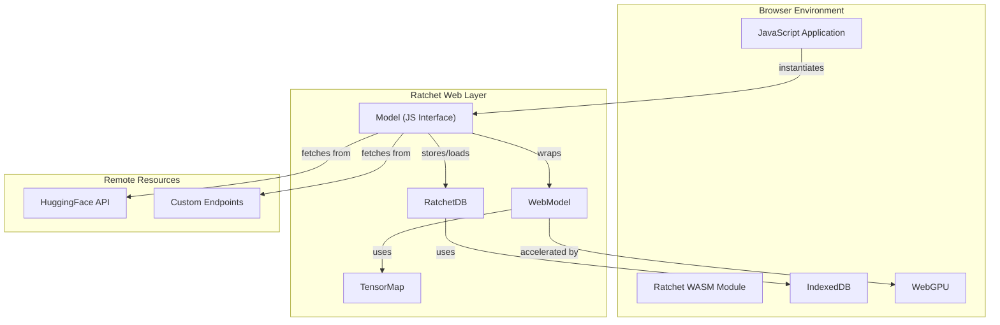
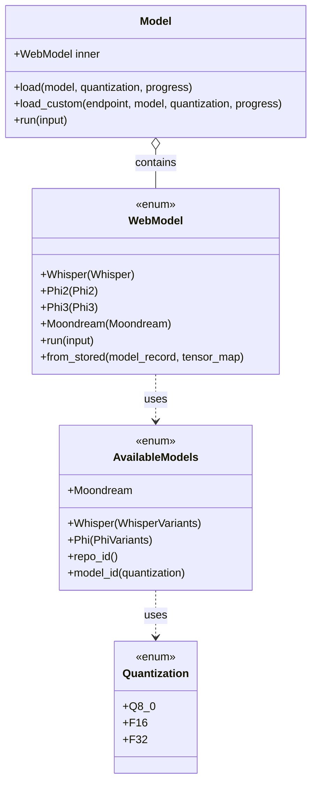
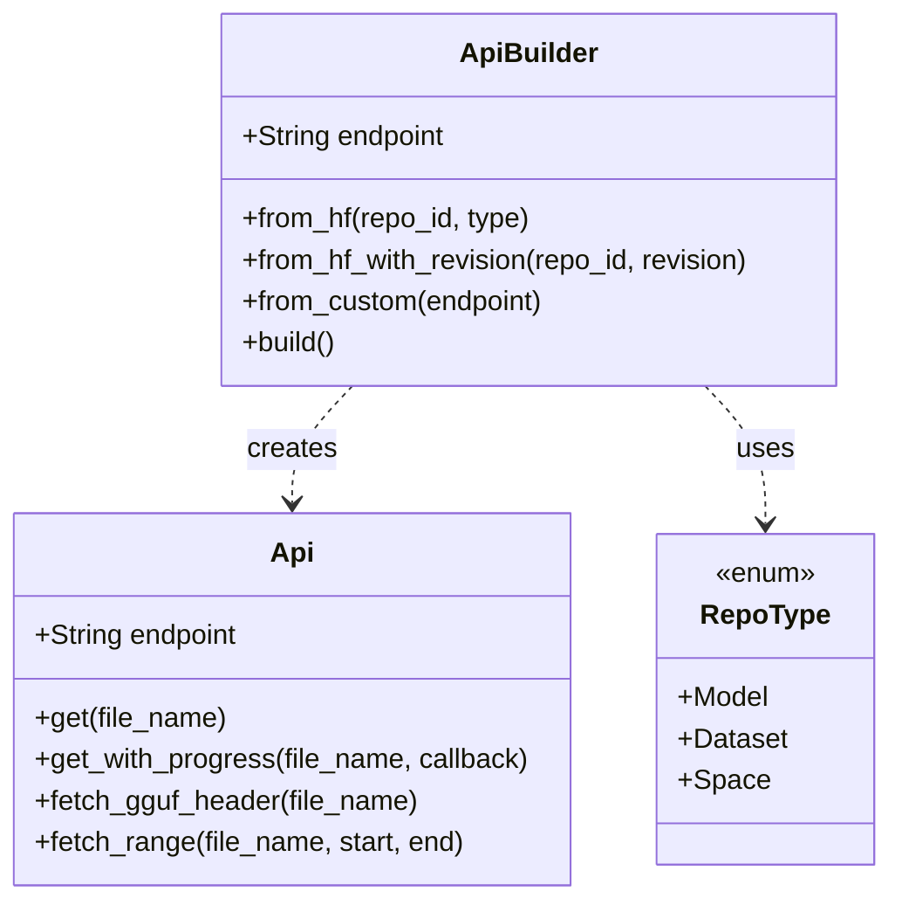
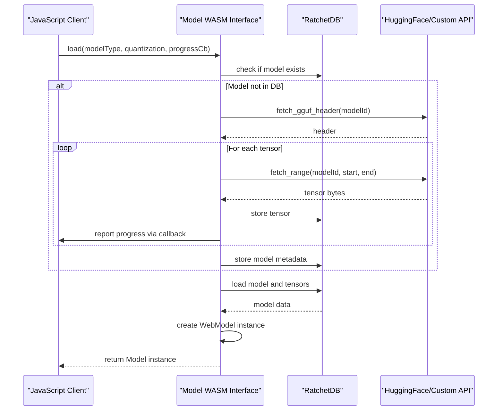
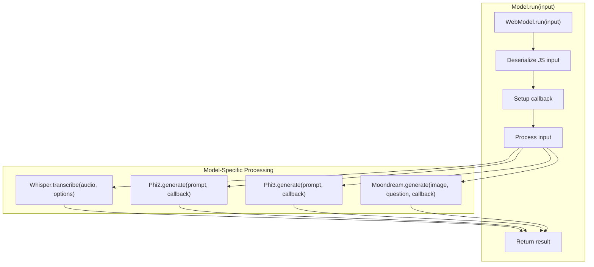
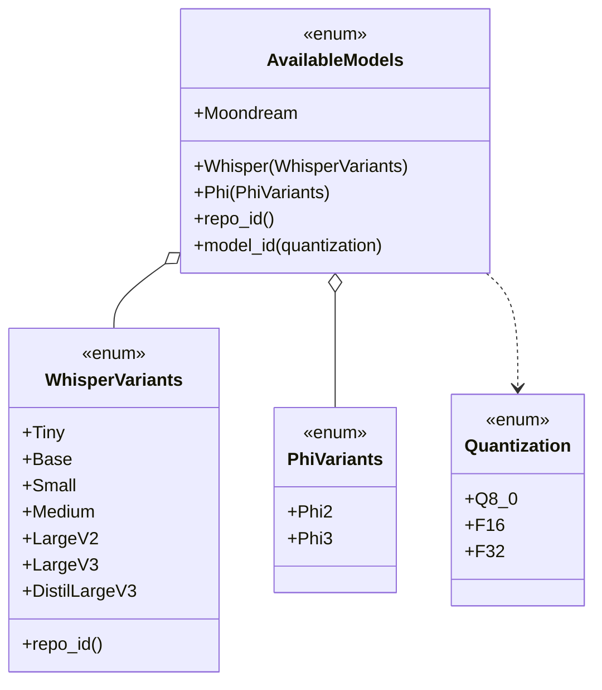

<!-- source: DeepWiki mcp.deepwiki.com · repo huggingface/ratchet · page 5.1 Web Integration · fetched 2026-10-26 -->

# Web Integration

<details>
<summary>Relevant source files</summary>

The following files were used as context for generating this wiki page:

- [.cargo/config.toml](.cargo/config.toml)
- [crates/ratchet-hub/Cargo.toml](crates/ratchet-hub/Cargo.toml)
- [crates/ratchet-hub/src/lib.rs](crates/ratchet-hub/src/lib.rs)
- [crates/ratchet-loader/Cargo.toml](crates/ratchet-loader/Cargo.toml)
- [crates/ratchet-models/src/registry.rs](crates/ratchet-models/src/registry.rs)
- [crates/ratchet-web/src/model.rs](crates/ratchet-web/src/model.rs)

</details>


This page documents how to use Ratchet models in web browsers via WebAssembly (WASM). The web integration system enables loading, storing, and running ML models directly in browsers, eliminating the need for server-side processing.

## Architecture Overview

The Web Integration architecture connects JavaScript applications to Ratchet's ML models through several layers:



Sources: `crates/ratchet-web/src/model.rs`, `crates/ratchet-hub/src/lib.rs`

## Core Components

The web integration consists of several key components that work together:

### Model Interface

The `Model` struct provides the JavaScript-facing API, wrapping an internal `WebModel` enum that handles model-specific implementations:



Sources: `crates/ratchet-web/src/model.rs:154-159`, `crates/ratchet-web/src/model.rs:16-22`, `crates/ratchet-models/src/registry.rs:58-70`, `crates/ratchet-models/src/registry.rs:109-116`

### API Integration

The `Api` class handles fetching model files from HuggingFace or custom endpoints:



Sources: `crates/ratchet-hub/src/lib.rs:37-97`, `crates/ratchet-hub/src/lib.rs:100-254`, `crates/ratchet-hub/src/lib.rs:37-46`

## Model Loading Process

Loading a model involves several steps, from checking local storage to fetching and storing tensor data:



Sources: `crates/ratchet-web/src/model.rs:166-226`, `crates/ratchet-hub/src/lib.rs:184-197`, `crates/ratchet-hub/src/lib.rs:199-253`

The key method that implements this flow is `Model::load()` [crates/ratchet-web/src/model.rs:166-178](), which:

1. Creates a model key based on the specified model and quantization
2. Sets up a connection to the appropriate repository
3. Calls the internal loading function to handle the actual loading process

For custom endpoints, the `Model::load_custom()` method [crates/ratchet-web/src/model.rs:180-193]() provides similar functionality.

## Running Models

Once loaded, models are run using the `Model::run()` method [crates/ratchet-web/src/model.rs:231-233](), which delegates to the appropriate model implementation:



Sources: `crates/ratchet-web/src/model.rs:24-99`

Each model type has specific input requirements:

| Model | Input Structure | Description |
|-------|----------------|-------------|
| Whisper | `WhisperInputs` | Contains audio data, decoding options, and a callback function |
| Phi2/Phi3 | `PhiInputs` | Contains a text prompt and a callback function |
| Moondream | `MoondreamInputs` | Contains an image, a question, and a callback function |

Sources: `crates/ratchet-web/src/model.rs:130-152`

## Browser Storage System

Ratchet uses IndexedDB for persistent storage of models and tensor data to avoid re-downloading large models:

1. `RatchetDB` - Database interface for storing/retrieving models and tensors
2. `ModelRecord` - Stores model metadata and GGUF header information
3. `TensorRecord` - Stores individual tensor data with their names and associations

This storage system is crucial for efficient model loading across browser sessions.

Sources: `crates/ratchet-web/src/model.rs:101-127`, `crates/ratchet-web/src/model.rs:235-287`

## Model Registry

The model registry provides a type-safe way to reference supported models:



Sources: `crates/ratchet-models/src/registry.rs:16-25`, `crates/ratchet-models/src/registry.rs:41-52`, `crates/ratchet-models/src/registry.rs:65-70`, `crates/ratchet-models/src/registry.rs:109-116`

## Usage Examples

### Loading a Whisper Model

```javascript
// Import from Ratchet's WASM module
import { Model, AvailableModels, WhisperVariants, Quantization } from "ratchet";

// Load the Whisper Base model with F16 precision
const model = await Model.load(
  AvailableModels.Whisper(WhisperVariants.Base),
  Quantization.F16,
  (progress) => console.log(`Loading: ${progress.toFixed(2)}%`)
);
```

### Running Whisper Transcription

```javascript
// Prepare audio data and options
const audioData = new Float32Array(/* your audio samples *);
const decodeOptions = { /* decoding options */ };

// Run transcription with streaming results
const result = await model.run({
  audio: audioData,
  decode_options: decodeOptions,
  callback: (segment) => {
    console.log("Transcribed segment:", segment.text);
  }
});
```

### Loading and Running a Phi Model

```javascript
// Load Phi-2 model
const model = await Model.load(
  AvailableModels.Phi(PhiVariants.Phi2),
  Quantization.F16,
  (progress) => console.log(`Loading: ${progress.toFixed(2)}%`)
);

// Generate text
await model.run({
  prompt: "Write a short poem about artificial intelligence:",
  callback: (text) => {
    console.log("Generated text:", text);
  }
});
```

Sources: `crates/ratchet-web/src/model.rs:332-368`, `crates/ratchet-web/src/model.rs:370-407`

## Advanced Configuration

### Using Custom Endpoints

Instead of using the default HuggingFace endpoints, you can specify a custom endpoint:

```javascript
const model = await Model.load_custom(
  "https://your-custom-endpoint.com/models",
  AvailableModels.Whisper(WhisperVariants.Base),
  Quantization.F16,
  progressCallback
);
```

Sources: `crates/ratchet-web/src/model.rs:180-193`

### Handling Large Models

When working with larger models (e.g., Whisper Large), be aware of browser storage limitations:
- IndexedDB generally has higher storage limits than localStorage
- Different browsers have different storage limits
- Use Quantization.Q8_0 for reduced model size when appropriate

---

