# Page: Overview

# Overview

<details>
<summary>Relevant source files</summary>

The following files were used as context for generating this wiki page:

- [.github/workflows/rust.yml](.github/workflows/rust.yml)
- [crates/ratchet-core/Cargo.toml](crates/ratchet-core/Cargo.toml)
- [crates/ratchet-core/src/lib.rs](crates/ratchet-core/src/lib.rs)
- [crates/ratchet-core/tests/attn_tests.rs](crates/ratchet-core/tests/attn_tests.rs)
- [crates/ratchet-models/Cargo.toml](crates/ratchet-models/Cargo.toml)
- [crates/ratchet-models/src/whisper/mod.rs](crates/ratchet-models/src/whisper/mod.rs)
- [crates/ratchet-models/src/whisper/options.rs](crates/ratchet-models/src/whisper/options.rs)
- [crates/ratchet-models/src/whisper/tokenizer.rs](crates/ratchet-models/src/whisper/tokenizer.rs)
- [justfile](justfile)
- [pnpm-workspace.yaml](pnpm-workspace.yaml)

</details>


## Purpose and Scope

Ratchet is a high-performance tensor computation framework written in Rust, designed for efficient machine learning model inference with a focus on web deployment through WebAssembly. The framework provides:

1. A core tensor system supporting both CPU and GPU execution (via WebGPU)
2. Neural network primitives for building machine learning models
3. Implementations of popular models like Whisper (speech recognition) and Phi (language model)
4. Tools for loading models from standardized formats (GGUF)
5. Deployment options including web browsers (WebAssembly) and command-line interfaces

For detailed information about specific systems, see:
- [Core Tensor System](#2) for tensor operations and device abstractions
- [Model Implementations](#3) for specific model architectures and usage
- [Model Loading](#4) for loading models from file formats
- [Deployment](#5) for running models in different environments

## System Architecture

The diagram below illustrates the layered architecture of Ratchet:

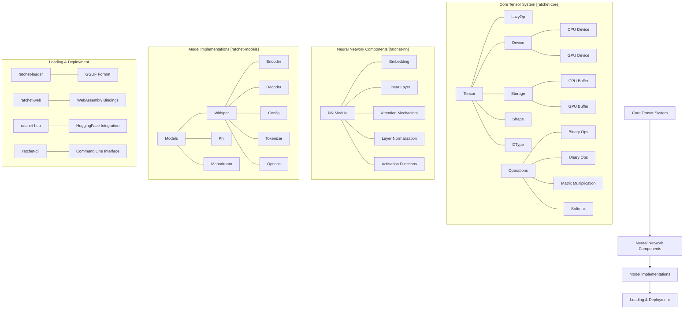

Sources: [crates/ratchet-core/Cargo.toml](), [crates/ratchet-models/Cargo.toml](), [crates/ratchet-core/src/lib.rs]()

## Core Tensor System

The core tensor system provides the foundation for all computations in Ratchet:

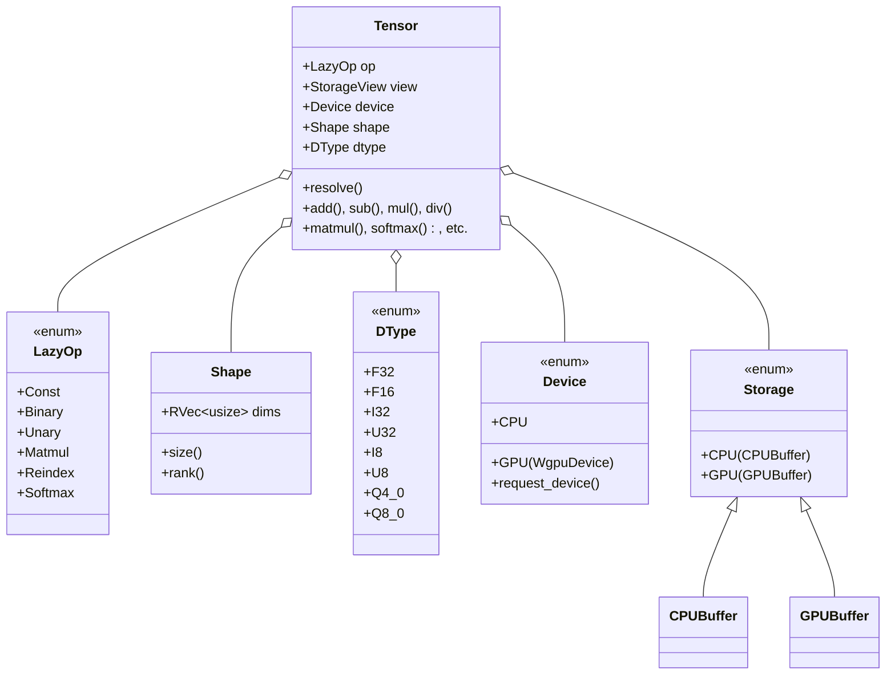

Key features of the tensor system:

1. **Lazy Evaluation**: Operations on tensors create a computation graph via `LazyOp` that is executed only when `resolve()` is called.
2. **Shape and Data Types**: Support for multiple shapes and data types, including F32, F16, I32, and quantized types.
3. **Device Abstraction**: Computations can be performed on CPU or GPU through the `Device` abstraction.
4. **Memory Management**: Efficient buffer allocation and reuse strategies for both CPU and GPU memory.

Example tensor operations:
```rust
// Create a tensor with specific shape
let input = Tensor::randn::<f32>(shape![1, 128, 256], Device::CPU);

// Matrix multiplication
let output = input.matmul(weights, false, false)?;

// Apply softmax
let output = output.softmax(2)?;

// Resolve to execute computation
let result = output.resolve()?;
```

Sources: [crates/ratchet-core/src/lib.rs](), [crates/ratchet-core/tests/attn_tests.rs:50-66]()

## Model Implementations

### Whisper Speech Recognition Model

The Whisper model is structured as follows:

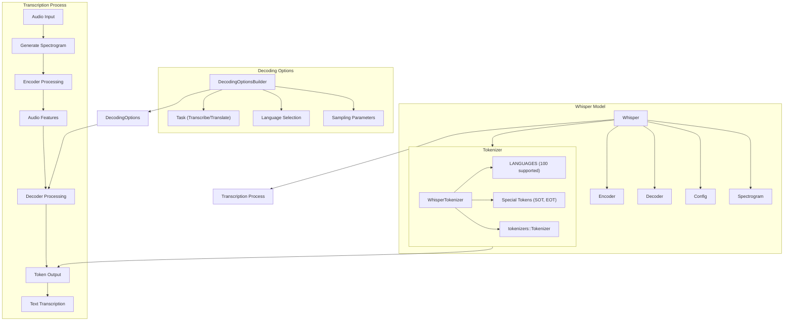

The Whisper implementation includes:

- **Model Structure**: Encoder-decoder architecture for audio transcription
- **Tokenizer**: Handles 100 languages with special tokens for tasks and control
- **Decoding Options**: Configurable parameters for inference (language, temperature, etc.)
- **Spectrogram Generation**: Converts raw audio to mel spectrograms
- **Transcription Process**: End-to-end pipeline from audio to text

Configuring Whisper transcription:
```rust
let options = DecodingOptionsBuilder::new()
    .task(Task::Transcribe)
    .language("en")
    .temperature(0.0)
    .build();
```

Sources: [crates/ratchet-models/src/whisper/mod.rs](), [crates/ratchet-models/src/whisper/options.rs](), [crates/ratchet-models/src/whisper/tokenizer.rs]()

### Phi Language Model

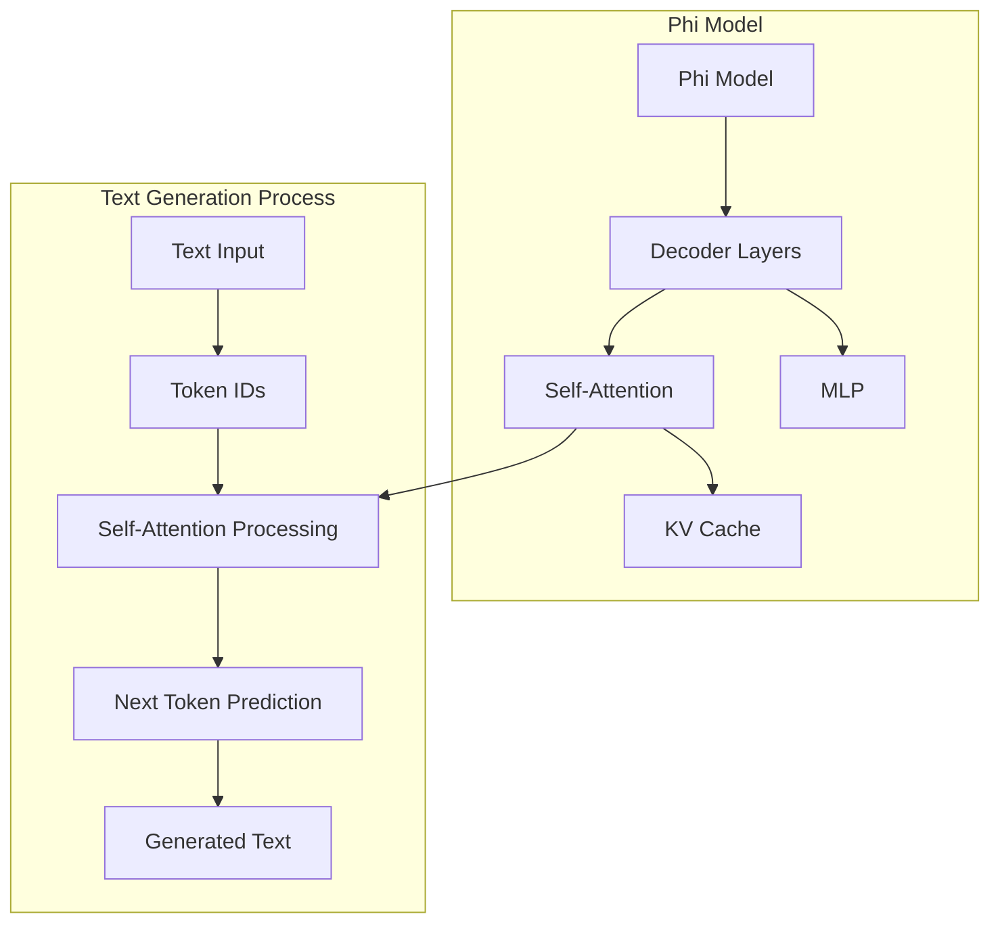

Sources: [crates/ratchet-models/Cargo.toml]()

## Execution Flow

The execution flow in Ratchet involves several stages:

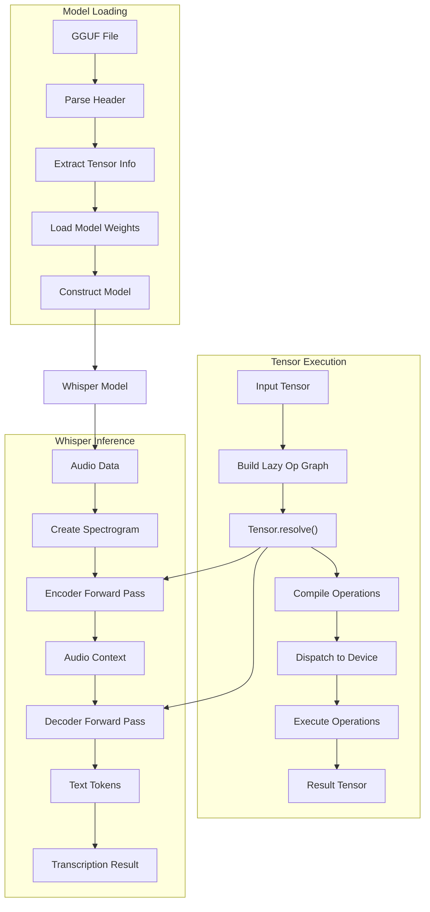

The key aspect of Ratchet's execution flow is lazy evaluation. Operations on tensors build a computation graph that is only executed when `resolve()` is called. This allows for optimization of the computation sequence and efficient memory allocation.

Sources: [crates/ratchet-core/tests/attn_tests.rs]()

## Deployment Options

### Web Deployment via WebAssembly

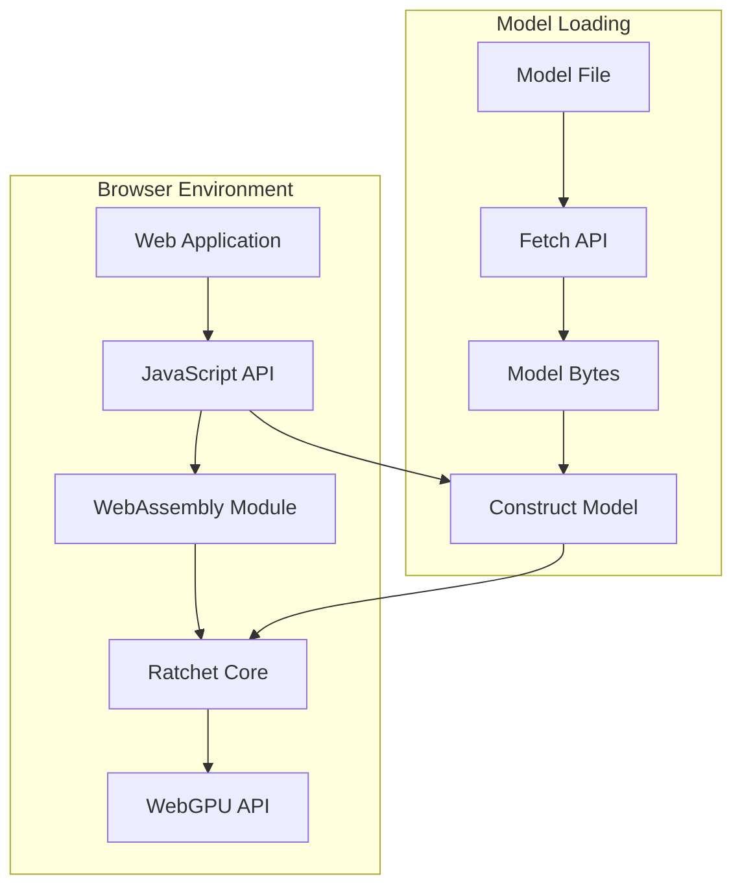

### Command Line Interface

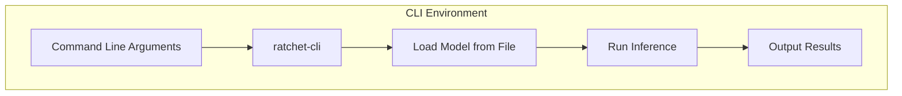

Sources: [.github/workflows/rust.yml](), [justfile]()

## Project Structure

The codebase is organized into several crates, each with a specific responsibility:

| Crate | Description | Key Components |
|-------|-------------|----------------|
| ratchet-core | Core tensor system | Tensor, LazyOp, Device, Storage, Shape, DType |
| ratchet-nn | Neural network components | Embedding, Linear, Attention, LayerNorm |
| ratchet-models | Model implementations | Whisper, Phi, Moondream |
| ratchet-loader | Model loading utilities | GGUF format parsing, tensor loading |
| ratchet-web | WebAssembly bindings | JavaScript API, WASM exports |
| ratchet-hub | HuggingFace integration | Model repository access |
| ratchet-cli | Command-line interface | Argument parsing, model execution |

This organization allows for a clean separation of concerns, with each crate building upon the functionality provided by lower-level crates.

Sources: [crates/ratchet-core/Cargo.toml](), [crates/ratchet-models/Cargo.toml](), [pnpm-workspace.yaml]()

## Environment Configuration

Ratchet supports various runtime environments and configurations, controlled through environment variables and build features:

```
RUST_LOG: "info"
WGPU_DX12_COMPILER: dxc
RUSTFLAGS: --cfg=web_sys_unstable_apis
RUST_BACKTRACE: 1
RATCHET_FORCE_F32: 1
```

These settings enable debugging, configure GPU backends, and set tensor precision.

Sources: [.github/workflows/rust.yml:9-22]()

## Development and Testing

The project includes a comprehensive test suite, including tests for core tensor operations and model-specific functionality:

```bash
# Run tests
cargo nextest run -j 1 --no-fail-fast --features=ci,pyo3

# Build WebAssembly module
just wasm ratchet-web

# Publish WebAssembly package
just wasm-publish-pr ratchet-web
```

Sources: [.github/workflows/rust.yml:51-73](), [justfile:7-16]()

---

# Page: Core Tensor System

# Core Tensor System

<details>
<summary>Relevant source files</summary>

The following files were used as context for generating this wiki page:

- [Cargo.toml](Cargo.toml)
- [crates/ratchet-core/src/dtype/blocks.rs](crates/ratchet-core/src/dtype/blocks.rs)
- [crates/ratchet-core/src/dtype/mod.rs](crates/ratchet-core/src/dtype/mod.rs)
- [crates/ratchet-core/src/gpu/align.rs](crates/ratchet-core/src/gpu/align.rs)
- [crates/ratchet-core/src/gpu/device.rs](crates/ratchet-core/src/gpu/device.rs)
- [crates/ratchet-core/src/gpu/pools/pipeline_pool.rs](crates/ratchet-core/src/gpu/pools/pipeline_pool.rs)
- [crates/ratchet-core/src/op.rs](crates/ratchet-core/src/op.rs)
- [crates/ratchet-core/src/ops/binary.rs](crates/ratchet-core/src/ops/binary.rs)
- [crates/ratchet-core/src/ops/unary.rs](crates/ratchet-core/src/ops/unary.rs)
- [crates/ratchet-core/src/storage/cpu_buffer.rs](crates/ratchet-core/src/storage/cpu_buffer.rs)
- [crates/ratchet-core/src/storage/mod.rs](crates/ratchet-core/src/storage/mod.rs)
- [crates/ratchet-core/src/tensor.rs](crates/ratchet-core/src/tensor.rs)
- [crates/ratchet-loader/src/gguf/dtype.rs](crates/ratchet-loader/src/gguf/dtype.rs)

</details>


The Core Tensor System is the foundation of Ratchet, providing tensor operations and abstractions that power all neural network computations in the library. It implements a lazy computation model with efficient execution on both CPU and GPU backends. This page documents the tensor representation, operations, storage system, and execution model that make up this core subsystem.

For information about specific model implementations built on top of this system, see [Model Implementations](#3). For details about the neural network layers, see [Neural Network Components](#3.1).

## Tensor Representation and Structure

The `Tensor` is the primary abstraction in Ratchet, representing a multi-dimensional array of values with associated metadata.

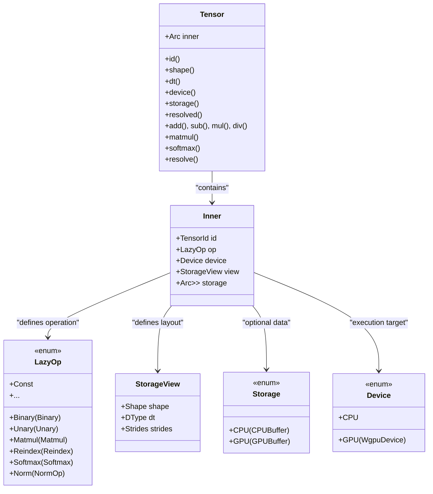

Sources: [crates/ratchet-core/src/tensor.rs:44-51](), [crates/ratchet-core/src/tensor.rs:144-151]()

A `Tensor` contains:

1. **Unique identifier**: Each tensor has a unique ID for tracking in the computation graph
2. **Lazy operation**: Defines how this tensor was or will be computed
3. **Device**: Specifies whether the tensor is on CPU or GPU
4. **StorageView**: Metadata about shape, data type, and memory layout
5. **Storage**: The actual data buffer (may be None if not yet computed)

Tensors in Ratchet are lazy by default - operations create new tensors with updated lazy operations, but actual computation is deferred until explicitly requested.

Sources: [crates/ratchet-core/src/tensor.rs:131-142](), [crates/ratchet-core/src/tensor.rs:186-247]()

## Data Types and Storage

Ratchet supports various data types to handle different precision requirements and memory constraints.

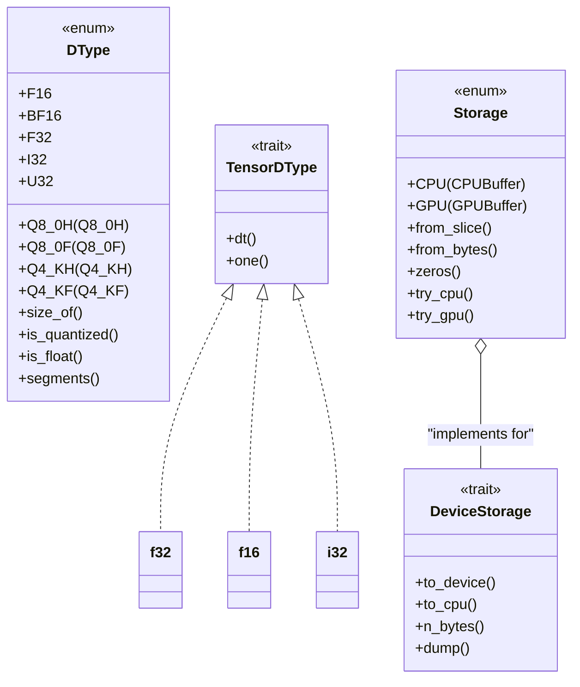

### Supported Data Types

The system supports:
- **Full precision**: 32-bit floating point (`F32`)
- **Half precision**: 16-bit floating point (`F16`, `BF16`)
- **Integer types**: 32-bit signed and unsigned integers (`I32`, `U32`)
- **Quantized types**: 8-bit and 4-bit quantized formats for memory-efficient inference
  - `Q8_0H`/`Q8_0F`: 8-bit quantization with FP16/FP32 scales
  - `Q4_KH`/`Q4_KF`: 4-bit quantization with FP16/FP32 scales

Sources: [crates/ratchet-core/src/dtype/mod.rs:12-23](), [crates/ratchet-core/src/dtype/blocks.rs:52-59]()

### Storage System

Tensor data is managed through a unified storage abstraction that handles both CPU and GPU memory:

- **CPUBuffer**: Manages memory on the CPU with efficient allocation and data access
- **GPUBuffer**: Manages memory on the GPU with WebGPU buffer management
- **DeviceStorage trait**: Provides methods for data transfer between devices

Quantized tensors use special storage formats that separate quantized values from scale factors for efficient processing on GPU.

Sources: [crates/ratchet-core/src/storage/mod.rs:14-18](), [crates/ratchet-core/src/storage/cpu_buffer.rs:64-145](), [crates/ratchet-core/src/dtype/blocks.rs:11-35]()

## Lazy Evaluation and Operation Graph

Ratchet uses a lazy computation model where operations form a directed acyclic graph (DAG) that is only evaluated when explicitly requested.

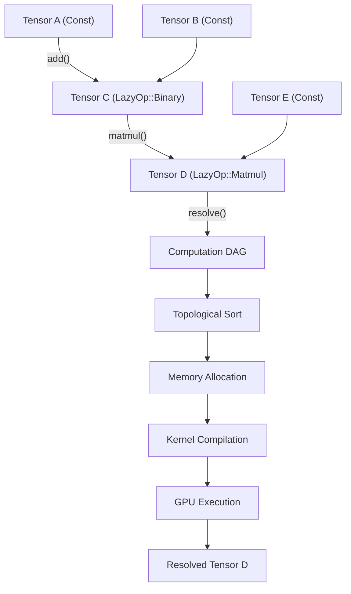

### Lazy Operation Flow

1. **Operation registration**: When operations like `add()` or `matmul()` are called, they create new tensors with updated lazy operations
2. **DAG construction**: The operations form a directed acyclic graph of computations
3. **Resolution**: The `resolve()` method triggers evaluation of the computation graph
4. **Execution ordering**: `execution_order()` determines the correct sequence of operations
5. **Memory allocation**: Storage for intermediate tensors is allocated efficiently
6. **Execution**: Operations are executed on the appropriate device (CPU or GPU)

Sources: [crates/ratchet-core/src/tensor.rs:696-740](), [crates/ratchet-core/src/tensor.rs:772-863]()

## Operation System

Ratchet implements a comprehensive set of tensor operations through a clean abstraction hierarchy.

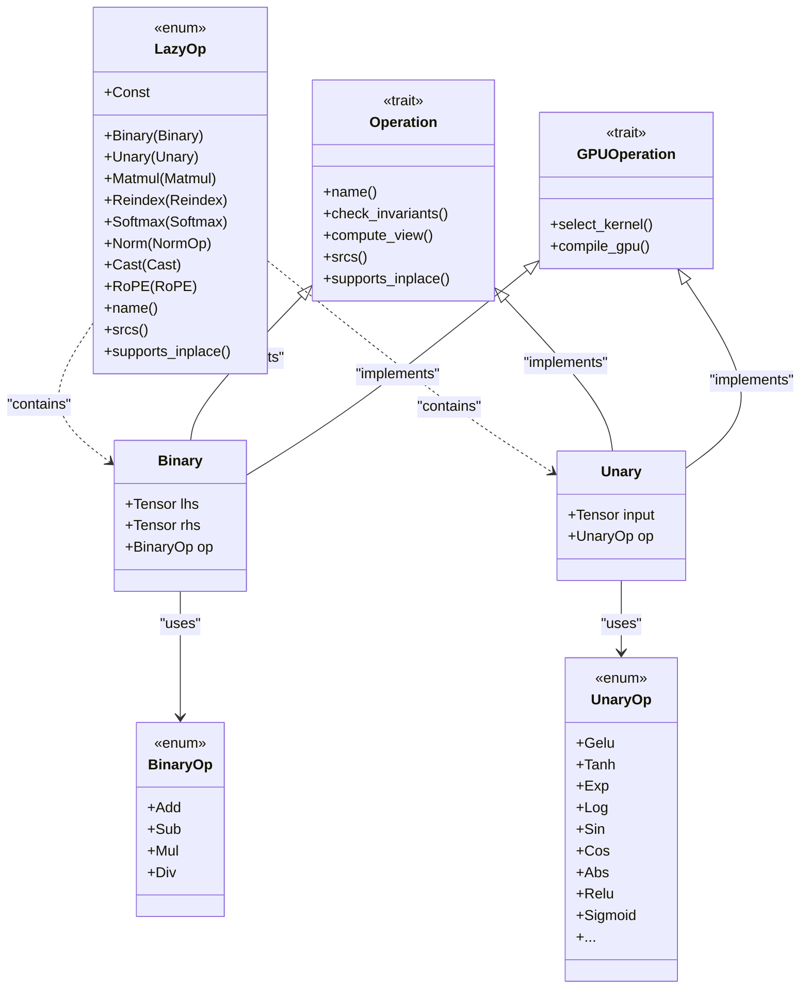

### Operation Abstraction

The operation system is built around these key abstractions:

1. **Operation trait**: A hardware-agnostic interface for tensor operations, providing methods for:
   - Getting the operation name
   - Checking operation invariants
   - Computing the output tensor shape and type
   - Accessing source tensors
   - Determining if in-place execution is supported

2. **GPUOperation trait**: Extends Operation with GPU-specific functionality:
   - Kernel selection based on input types and shapes
   - GPU compilation for shader generation

3. **Operation implementations**:
   - Binary operations: `add`, `sub`, `mul`, `div`
   - Unary operations: `exp`, `log`, `tanh`, `relu`, `sigmoid`, etc.
   - Matrix operations: `matmul`, `gemm`
   - Tensor manipulation: `slice`, `view`, `permute`, `broadcast_to`
   - Neural network operations: `softmax`, `layer_norm`, `rope`

Sources: [crates/ratchet-core/src/op.rs:14-31](), [crates/ratchet-core/src/op.rs:217-262](), [crates/ratchet-core/src/op.rs:273-363]()

## GPU Acceleration

The GPU backend in Ratchet provides high-performance tensor computation through WebGPU.

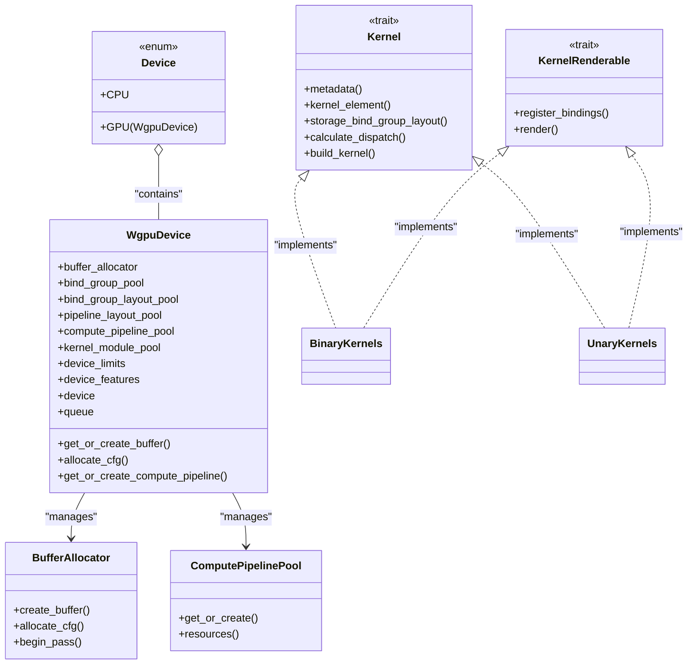

### GPU Device Management

The GPU system is built around the `WgpuDevice` abstraction that:
1. Manages access to the underlying WebGPU device
2. Provides resource pools for efficient reuse of GPU resources
3. Handles buffer allocation and memory management
4. Compiles and caches compute shaders for tensor operations

Sources: [crates/ratchet-core/src/gpu/device.rs:18-30](), [crates/ratchet-core/src/gpu/device.rs:52-121]()

### Kernel System

Operations on GPU use a kernel system that:
1. Selects appropriate kernel implementation based on tensor properties
2. Calculates optimal dispatch parameters (workgroup size and count)
3. Generates WGSL shader code for operations
4. Compiles and caches shader modules
5. Sets up binding groups for tensor data access
6. Executes the compiled pipeline

The system supports vectorized operations (`Vec2`, `Vec4`) for improved performance and has special handling for quantized data types.

Sources: [crates/ratchet-core/src/op.rs:280-362](), [crates/ratchet-core/src/ops/binary.rs:196-239](), [crates/ratchet-core/src/gpu/pools/pipeline_pool.rs:35-62]()

### Memory Management

GPU memory is managed efficiently through:
1. Buffer reuse across operations
2. Lifetime-based buffer allocation to minimize memory usage
3. Alignment handling for different data types and WebGPU requirements
4. Special handling for quantized tensor formats with segmented memory layout

Sources: [crates/ratchet-core/src/gpu/device.rs:267-273](), [crates/ratchet-core/src/gpu/align.rs:1-76]()

## Tensor Creation and Manipulation

The system provides comprehensive methods for creating and manipulating tensors:

| Operation | Description | Source |
|-----------|-------------|--------|
| `from_data()` | Creates a tensor from raw data | [tensor.rs:577-586]() |
| `zeros()` | Creates a tensor filled with zeros | [tensor.rs:560-565]() |
| `randn()` | Creates a tensor with random normal values | [tensor.rs:534-551]() |
| `slice()` | Extracts a slice of a tensor | [tensor.rs:426-448]() |
| `view()` | Creates a tensor with reshaped data | [tensor.rs:454-461]() |
| `permute()` | Reorders tensor dimensions | [tensor.rs:472-479]() |
| `broadcast_to()` | Broadcasts to a larger shape | [tensor.rs:488-495]() |
| `to()` | Transfers a tensor between devices | [tensor.rs:949-955]() |

The API provides an ergonomic interface for building neural network architectures with automatic differentiation not supported at this time.

Sources: [crates/ratchet-core/src/tensor.rs:295-510]()

## Quantization Support

Ratchet includes first-class support for quantized tensors, which are crucial for efficient inference of large language models.

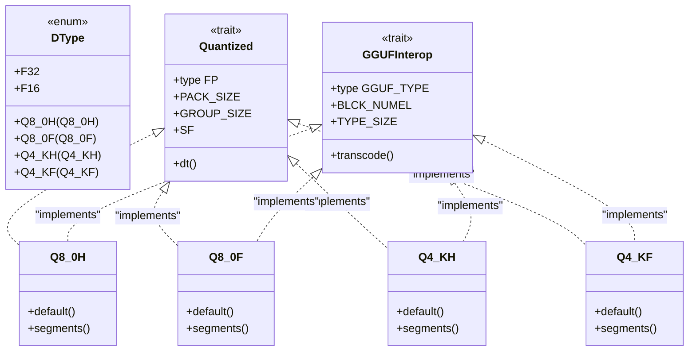

The quantization system provides:
1. Standard quantized formats compatible with GGUF models
2. Specialized memory layouts for efficient GPU computation
3. Seamless loading of quantized weights from model files
4. Automatic dequantization during tensor operations

Quantized tensors are stored in segmented memory layouts with separate regions for quantized values, scale factors, and other parameters to optimize GPU memory access patterns.

Sources: [crates/ratchet-core/src/dtype/blocks.rs:35-166](), [crates/ratchet-core/src/dtype/mod.rs:19-23](), [crates/ratchet-loader/src/gguf/dtype.rs:21-198]()

## Summary

The Core Tensor System provides the foundation for all neural network operations in Ratchet with:

1. A flexible tensor representation with support for various data types
2. A lazy computation model for building operation graphs
3. A unified storage system spanning CPU and GPU memory
4. A rich set of tensor operations with efficient implementations
5. GPU acceleration through WebGPU
6. First-class support for quantized models

This system enables efficient inference of state-of-the-art machine learning models across different devices and platforms while maintaining a clean, composable API.

---

# Page: Tensor Representation

# Tensor Representation

<details>
<summary>Relevant source files</summary>

The following files were used as context for generating this wiki page:

- [crates/ratchet-core/src/dtype/blocks.rs](crates/ratchet-core/src/dtype/blocks.rs)
- [crates/ratchet-core/src/dtype/mod.rs](crates/ratchet-core/src/dtype/mod.rs)
- [crates/ratchet-core/src/gpu/align.rs](crates/ratchet-core/src/gpu/align.rs)
- [crates/ratchet-core/src/op.rs](crates/ratchet-core/src/op.rs)
- [crates/ratchet-core/src/ops/binary.rs](crates/ratchet-core/src/ops/binary.rs)
- [crates/ratchet-core/src/ops/unary.rs](crates/ratchet-core/src/ops/unary.rs)
- [crates/ratchet-core/src/quant.rs](crates/ratchet-core/src/quant.rs)
- [crates/ratchet-core/src/storage/cpu_buffer.rs](crates/ratchet-core/src/storage/cpu_buffer.rs)
- [crates/ratchet-core/src/storage/mod.rs](crates/ratchet-core/src/storage/mod.rs)
- [crates/ratchet-core/src/tensor.rs](crates/ratchet-core/src/tensor.rs)
- [crates/ratchet-loader/src/gguf/dtype.rs](crates/ratchet-loader/src/gguf/dtype.rs)
- [crates/ratchet-loader/src/lib.rs](crates/ratchet-loader/src/lib.rs)
- [crates/ratchet-nn/src/embedding.rs](crates/ratchet-nn/src/embedding.rs)

</details>


This page explains how tensors are represented in Ratchet, including their internal structure, shape and data type management, storage mechanisms, and memory layout. For information about operations that can be performed on tensors, see [Tensor Operations](#2.2).

## Overview

In Ratchet, a `Tensor` is a multi-dimensional array with a lazy evaluation system. Tensors form the foundation of the machine learning library, representing both model parameters and activations. Tensors are created either directly from data or as a result of operations on other tensors, but actual computation is deferred until explicitly requested.

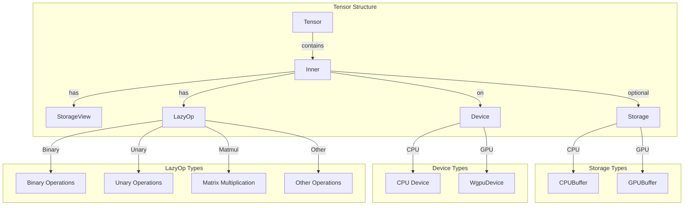

Sources: [crates/ratchet-core/src/tensor.rs:44-127](), [crates/ratchet-core/src/op.rs:12-31]()

## Core Components

A `Tensor` in Ratchet comprises several core components that work together to represent and manage multi-dimensional data efficiently.

### Tensor Structure

The `Tensor` struct contains an `Arc<Inner>` which represents the actual tensor data and metadata:

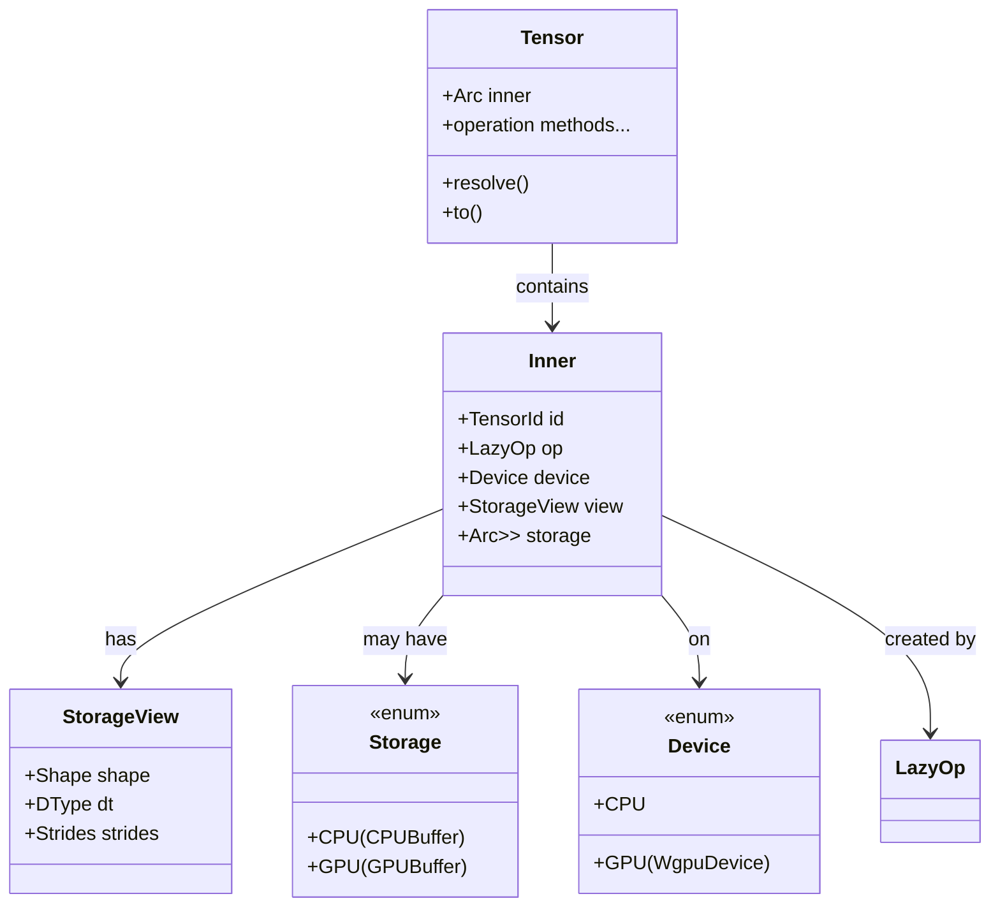

Sources: [crates/ratchet-core/src/tensor.rs:44-47](), [crates/ratchet-core/src/tensor.rs:144-151](), [crates/ratchet-core/src/tensor.rs:131-142](), [crates/ratchet-core/src/storage/mod.rs:14-19]()

The key components are:

1. **Tensor**: The public-facing struct that users interact with, implementing operations like addition, matrix multiplication, etc.

2. **Inner**: Contains the actual tensor data and metadata, including:
   - `id`: A unique identifier for the tensor
   - `op`: The lazy operation that created this tensor
   - `device`: The device (CPU or GPU) where the tensor resides
   - `view`: Metadata about shape, dtype, and memory layout
   - `storage`: Optional actual data storage

3. **StorageView**: Contains metadata about the tensor's shape and memory layout:
   - `shape`: The dimensions of the tensor
   - `dt`: The data type of the tensor elements
   - `strides`: How to navigate through memory to access elements

4. **Storage**: An enum that can be either `CPU(CPUBuffer)` or `GPU(GPUBuffer)`, representing where the tensor's data is stored.

5. **Device**: An enum that can be either `CPU` or `GPU(WgpuDevice)`, representing where operations on the tensor will be executed.

Sources: [crates/ratchet-core/src/tensor.rs:44-183](), [crates/ratchet-core/src/storage/mod.rs:14-19]()

## Data Types

Ratchet supports a variety of data types through the `DType` enum, including both standard floating-point types and quantized types for memory-efficient storage.

```mermaid
classDiagram
    class DType {
        <<enum>>
        +F16
        +BF16
        +F32
        +I32
        +U32
        +Q8_0H(Q8_0H)
        +Q8_0F(Q8_0F)
        +Q4_KH(Q4_KH)
        +Q4_KF(Q4_KF)
        +size_of()
        +is_quantized()
        +segments()
    }
    
    class TensorDType {
        <<trait>>
        +dt() DType
        +one() Self
    }
    
    class Quantized {
        <<trait>>
        +FP: TensorDType
        +PACK_SIZE: usize
        +GROUP_SIZE: usize
        +SF: Self::FP
        +dt() DType
    }
    
    TensorDType <|-- "f32"
    TensorDType <|-- "f16"
    TensorDType <|-- "i32"
    TensorDType <|-- "u32"
    
    Quantized <|-- "Q8_0F"
    Quantized <|-- "Q8_0H"
    Quantized <|-- "Q4_KF"
    Quantized <|-- "Q4_KH"
```

Sources: [crates/ratchet-core/src/dtype/mod.rs:12-23](), [crates/ratchet-core/src/dtype/mod.rs:177-182](), [crates/ratchet-core/src/dtype/blocks.rs:168-219]()

### Basic Data Types

The basic data types supported by Ratchet include:

- **F32**: 32-bit floating point
- **F16**: 16-bit floating point
- **BF16**: 16-bit brain floating point
- **I32**: 32-bit signed integer 
- **U32**: 32-bit unsigned integer

### Quantized Data Types

Ratchet supports quantized data types for memory-efficient storage:

- **Q8_0F/H**: 8-bit quantization with 32-bit (F) or 16-bit (H) scales
- **Q4_KF/H**: 4-bit quantization with 32-bit (F) or 16-bit (H) scales in K format

Quantized types implement the `Quantized` trait, which provides information about:
- `PACK_SIZE`: Number of values packed into each storage element
- `GROUP_SIZE`: Number of values sharing a scale factor
- `SF`: Scale factor for quantization

Sources: [crates/ratchet-core/src/dtype/mod.rs:12-132](), [crates/ratchet-core/src/dtype/blocks.rs:168-219](), [crates/ratchet-core/src/quant.rs:1-164]()

## Storage Mechanisms

Tensors in Ratchet can store their data on either CPU or GPU, using specialized buffer types for each.

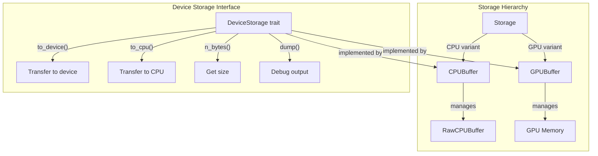

Sources: [crates/ratchet-core/src/storage/mod.rs:14-132](), [crates/ratchet-core/src/storage/cpu_buffer.rs:8-146]()

### Storage Types

1. **Storage**: An enum with two variants:
   - `CPU(CPUBuffer)`: For data stored in CPU memory
   - `GPU(GPUBuffer)`: For data stored in GPU memory

2. **CPUBuffer**: Manages CPU memory through an `Arc<RawCPUBuffer>`.
   - Provides methods for creating buffers from data and accessing the data
   - Handles memory allocation and deallocation

3. **GPUBuffer**: Manages GPU memory through WebGPU buffers.
   - Provides methods for transferring data between CPU and GPU
   - Handles GPU memory allocation

The `DeviceStorage` trait defines common operations for both storage types:
- `to_device()`: Transfer data to a specific device
- `to_cpu()`: Transfer data to CPU
- `n_bytes()`: Get the size of the buffer in bytes
- `dump()`: Generate a debug string representation

Sources: [crates/ratchet-core/src/storage/mod.rs:14-132](), [crates/ratchet-core/src/storage/cpu_buffer.rs:64-194]()

### Memory Alignment

Ratchet enforces strict memory alignment rules for efficient GPU operations:

- **Copy Buffer Alignment**: 4 bytes, required for all buffers
- **Storage Buffer Alignment**: 256 bytes, required for GPU storage buffer offsets

These alignments are particularly important for quantized tensors, where different components of the quantized data (e.g., quantized values, scales) are stored in separate memory segments.

Sources: [crates/ratchet-core/src/gpu/align.rs:1-76]()

## Tensor Creation and Management

Tensors can be created in several ways:

### Creating Tensors

1. **From data**:
   ```rust
   Tensor::from_data(data, shape, device)
   ```

2. **Zeros initialization**:
   ```rust
   Tensor::zeros::<T>(shape, device)
   ```

3. **Random initialization**:
   ```rust
   Tensor::randn::<T>(shape, device)
   ```

4. **Range of values**:
   ```rust
   Tensor::range::<T>(shape, device)
   ```

5. **From quantized data**:
   ```rust
   Tensor::from_quantized(data, dt, shape, device)
   ```

Sources: [crates/ratchet-core/src/tensor.rs:513-586](), [crates/ratchet-core/src/tensor.rs:618-628]()

### Memory Management

Tensors use reference counting (`Arc`) to manage memory. When a tensor is no longer needed, its memory is automatically freed. Key aspects of memory management include:

1. **Reference Counting**: Using `Arc` for shared ownership
2. **Lazy Allocation**: Storage is only allocated when needed
3. **Device Transfer**: Methods to move tensors between CPU and GPU

```rust
// Get a tensor on GPU
let gpu_tensor = cpu_tensor.to(&Device::GPU)?;

// Move back to CPU
let cpu_tensor = gpu_tensor.to(&Device::CPU)?;
```

Sources: [crates/ratchet-core/src/tensor.rs:933-955]()

## Lazy Evaluation

One of the key features of Ratchet is lazy evaluation. Operations on tensors don't immediately compute results; instead, they build an operation graph that is executed when `resolve()` is called.

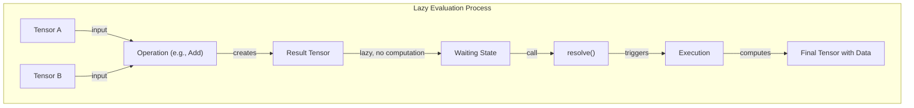

Sources: [crates/ratchet-core/src/tensor.rs:861-874](), [crates/ratchet-core/src/op.rs:14-122]()

### Operation Graph

Operations on tensors create new tensors with `LazyOp` instances that describe the operation:

```rust
// Creates a new tensor with a Binary operation
let c = a.add(b)?;
```

The `LazyOp` enum includes various operation types:
- `Binary`: Binary operations like add, subtract, multiply, divide
- `Unary`: Unary operations like tanh, exp, log
- `Matmul`: Matrix multiplication
- `Reindex`: Operations that change the index pattern (slice, permute, broadcast)
- And many more

Sources: [crates/ratchet-core/src/op.rs:14-31](), [crates/ratchet-core/src/tensor.rs:294-312]()

### Execution Process

When `resolve()` is called, Ratchet:

1. Determines the execution order by analyzing dependencies
2. For each unresolved tensor in the execution order:
   - Allocates storage for the tensor
   - Compiles the operation into a GPU kernel (if on GPU)
   - Executes the operation
3. Returns the resolved tensor with computed data

This lazy evaluation approach allows Ratchet to:
- Optimize the execution graph
- Minimize memory usage
- Batch operations for efficient execution

Sources: [crates/ratchet-core/src/tensor.rs:696-740](), [crates/ratchet-core/src/tensor.rs:772-862]()

## Quantization Support

Ratchet provides robust support for quantized tensors to reduce memory usage and improve performance.

### Quantization Process

The quantization process converts floating-point tensors to quantized formats:

1. **Quantization**: Convert a floating-point tensor to a quantized format
   ```rust
   let quantized = quantize::<Q8_0F>(&tensor);
   ```

2. **Dequantization**: Convert a quantized tensor back to floating-point
   ```rust
   let dequantized = dequantize(quantized);
   ```

Quantized tensors have special memory layouts that optimize storage and computation. For example, the Q8_0 format:

```
| Quantized values (qs) | Scale factors (d) |
```

Each value in the tensor is computed as: `actual_value = quantized_value * scale_factor`

Sources: [crates/ratchet-core/src/quant.rs:19-49](), [crates/ratchet-core/src/quant.rs:101-130](), [crates/ratchet-core/src/dtype/blocks.rs:52-102]()

### Quantized Data Types

The quantized types supported by Ratchet include:

| Type | Description | Precision | Scale Type |
|------|-------------|-----------|------------|
| Q8_0F | 8-bit quantization | 8-bit integers | 32-bit float |
| Q8_0H | 8-bit quantization | 8-bit integers | 16-bit float |
| Q4_KF | 4-bit K-quantization | 4-bit integers | 32-bit float |
| Q4_KH | 4-bit K-quantization | 4-bit integers | 16-bit float |

Each quantized type has parameters that control its behavior:
- `PACK_SIZE`: Number of values packed into each storage element
- `GROUP_SIZE`: Number of values sharing a scale factor
- `SF`: Scale factor for quantization

Sources: [crates/ratchet-core/src/dtype/blocks.rs:168-219](), [crates/ratchet-loader/src/gguf/dtype.rs:16-198]()

## Loading from External Formats

Ratchet supports loading tensors from external formats, particularly GGUF (GPT-Generated Unified Format) used by models like Llama.

### GGUF Support

The `ratchet-loader` crate provides utilities for loading tensors from GGUF files:

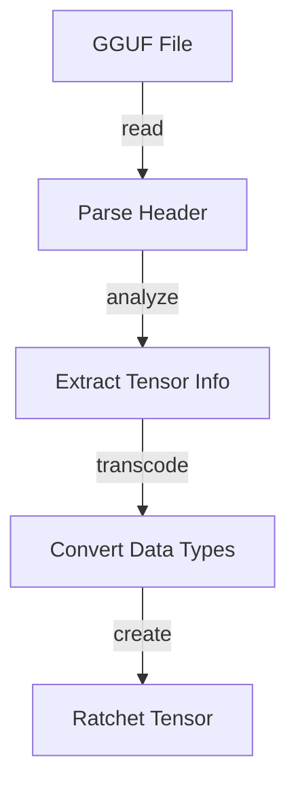

Sources: [crates/ratchet-loader/src/lib.rs:1-142](), [crates/ratchet-loader/src/gguf/dtype.rs:21-240]()

### Data Type Conversion

When loading from GGUF, Ratchet maps GGUF data types to its own internal types:

| GGUF Type | Ratchet Type |
|-----------|--------------|
| F32 | DType::F32 |
| F16 | DType::F16 |
| Q8_0 | DType::Q8_0F/H |
| Q4_K | DType::Q4_KF/H |

This conversion process is handled by the `GGUFInterop` trait, which defines methods for transcoding between formats.

Sources: [crates/ratchet-loader/src/lib.rs:46-55](), [crates/ratchet-loader/src/gguf/dtype.rs:21-240]()

## Summary

Ratchet's tensor representation system provides a flexible and efficient foundation for machine learning operations:

1. **Unified Interface**: The `Tensor` struct provides a consistent interface regardless of the underlying data type or storage location.

2. **Lazy Evaluation**: Operations build a computation graph that is evaluated only when needed, enabling optimizations.

3. **Multiple Data Types**: Support for standard floating-point types and memory-efficient quantized types.

4. **Cross-Device Support**: Tensors can seamlessly move between CPU and GPU, with appropriate storage management.

5. **Quantization Support**: Built-in support for quantized formats, including loading from external model files.

This architecture allows Ratchet to efficiently represent and manipulate tensors for machine learning models, balancing performance with memory efficiency.

---

# Page: Tensor Operations

# Tensor Operations

<details>
<summary>Relevant source files</summary>

The following files were used as context for generating this wiki page:

- [crates/ratchet-core/src/cpu/gemm.rs](crates/ratchet-core/src/cpu/gemm.rs)
- [crates/ratchet-core/src/cpu/mod.rs](crates/ratchet-core/src/cpu/mod.rs)
- [crates/ratchet-core/src/cpu/rope.rs](crates/ratchet-core/src/cpu/rope.rs)
- [crates/ratchet-core/src/gpu/wgsl/kernel.rs](crates/ratchet-core/src/gpu/wgsl/kernel.rs)
- [crates/ratchet-core/src/gpu/wgsl/kernel_builder.rs](crates/ratchet-core/src/gpu/wgsl/kernel_builder.rs)
- [crates/ratchet-core/src/ops/cache.rs](crates/ratchet-core/src/ops/cache.rs)
- [crates/ratchet-core/src/ops/cast.rs](crates/ratchet-core/src/ops/cast.rs)
- [crates/ratchet-core/src/ops/concat.rs](crates/ratchet-core/src/ops/concat.rs)
- [crates/ratchet-core/src/ops/conv.rs](crates/ratchet-core/src/ops/conv.rs)
- [crates/ratchet-core/src/ops/index_write.rs](crates/ratchet-core/src/ops/index_write.rs)
- [crates/ratchet-core/src/ops/matmul/gemm.rs](crates/ratchet-core/src/ops/matmul/gemm.rs)
- [crates/ratchet-core/src/ops/matmul/mod.rs](crates/ratchet-core/src/ops/matmul/mod.rs)
- [crates/ratchet-core/src/ops/matmul/quantized.rs](crates/ratchet-core/src/ops/matmul/quantized.rs)
- [crates/ratchet-core/src/ops/matmul/subgroup_gemv.rs](crates/ratchet-core/src/ops/matmul/subgroup_gemv.rs)
- [crates/ratchet-core/src/ops/matmul/workgroup_gemv.rs](crates/ratchet-core/src/ops/matmul/workgroup_gemv.rs)
- [crates/ratchet-core/src/ops/norm/mod.rs](crates/ratchet-core/src/ops/norm/mod.rs)
- [crates/ratchet-core/src/ops/reindex/broadcast.rs](crates/ratchet-core/src/ops/reindex/broadcast.rs)
- [crates/ratchet-core/src/ops/reindex/mod.rs](crates/ratchet-core/src/ops/reindex/mod.rs)
- [crates/ratchet-core/src/ops/reindex/permute.rs](crates/ratchet-core/src/ops/reindex/permute.rs)
- [crates/ratchet-core/src/ops/reindex/slice.rs](crates/ratchet-core/src/ops/reindex/slice.rs)
- [crates/ratchet-core/src/ops/rope.rs](crates/ratchet-core/src/ops/rope.rs)
- [crates/ratchet-core/src/ops/select.rs](crates/ratchet-core/src/ops/select.rs)
- [crates/ratchet-core/src/ops/softmax.rs](crates/ratchet-core/src/ops/softmax.rs)
- [crates/ratchet-core/src/shape.rs](crates/ratchet-core/src/shape.rs)
- [crates/ratchet-macros/src/lib.rs](crates/ratchet-macros/src/lib.rs)
- [crates/ratchet-macros/src/wgsl_metadata.rs](crates/ratchet-macros/src/wgsl_metadata.rs)

</details>


This page documents the core tensor operations in the Ratchet library. Tensor operations form the computational foundation of the framework, enabling efficient manipulation of multi-dimensional arrays for deep learning. For information about how tensors are represented in memory, see [Tensor Representation](#2.1).

## Overview of Tensor Operations

Ratchet implements a lazy computation model where operations create a computation graph that is only executed when explicitly resolved. This approach enables optimizations like operation fusion and efficient memory management.

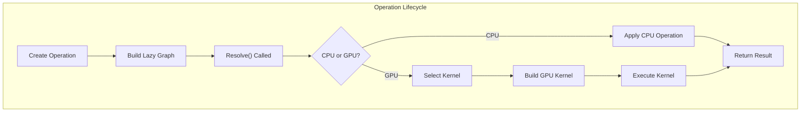

Sources: [crates/ratchet-core/src/cpu/mod.rs:20-38](), [crates/ratchet-core/src/ops/matmul/mod.rs:713-749]()

## Core Operation Types

Ratchet supports several categories of tensor operations:

| Category | Description | Examples |
|----------|-------------|----------|
| Mathematical | Basic math operations | Add, Subtract, Multiply, MatMul |
| Reindexing | Change tensor shape/organization | Permute, Slice, Broadcast |
| Neural Network | Operations for neural networks | Softmax, RoPE, Normalization |
| Memory | Memory manipulation | Concat, IndexSelect, Indexing |
| Type | Type conversions | Cast |

All operations implement the `Operation` trait, which defines methods for shape calculation, identifying source tensors, and operation name.

```mermaid
classDiagram
    class Operation {
        <<interface>>
        +name() String
        +compute_view() StorageView
        +srcs() RVec~Tensor~
        +supports_inplace() bool
    }
    
    class GPUOperation {
        <<interface>>
        +select_kernel() KernelEnum
    }
    
    class CPUOperation {
        <<interface>>
        +apply_cpu(dst: Tensor) Result~Tensor~
    }
    
    class Softmax {
        +input: Tensor
        +dim: usize
    }
    
    class RoPE {
        +input: Tensor
        +dim: usize
        +base: f32
        +offset: usize
    }
    
    class Matmul {
        +lhs: Tensor
        +rhs: Tensor
        +bias: Option~Tensor~
        +trans_lhs: bool
        +trans_rhs: bool
        +trans_dst: bool
    }
    
    class IndexSelect {
        +src: Tensor
        +indices: Tensor
        +dim: usize
    }
    
    Operation <|-- Softmax
    Operation <|-- RoPE
    Operation <|-- Matmul
    Operation <|-- IndexSelect
    GPUOperation <|-- Softmax
    GPUOperation <|-- RoPE
    GPUOperation <|-- Matmul
    GPUOperation <|-- IndexSelect
    CPUOperation <|-- Matmul
```

Sources: [crates/ratchet-core/src/ops/softmax.rs:14-22](), [crates/ratchet-core/src/ops/rope.rs:16-22](), [crates/ratchet-core/src/ops/matmul/mod.rs:381-389](), [crates/ratchet-core/src/ops/select.rs:14-19]()

## Mathematical Operations

### Matrix Multiplication

Matrix multiplication is a fundamental operation for deep learning models. Ratchet implements several specialized kernels with optimizations for different shapes and data types.

```mermaid
flowchart TD
    A["Matmul Operation"] --> B{"Matrix or Vector?"}
    B -->|"Matrix-Matrix"| C["GEMM"]
    B -->|"Matrix-Vector"| D{"Has Subgroup Support?"}
    D -->|"Yes"| E["SubgroupGEMV"]
    D -->|"No"| F["WorkgroupGEMV"]
    
    C --> G{"Input Quantized?"}
    G -->|"Yes"| H["QMatMul"]
    G -->|"No"| I["Standard GEMM"]
    
    subgraph "Matrix Multiplication Variations"
        I
        E
        F
        H
    end
```

The matrix multiplication system adapts to different tensor shapes and hardware capabilities:
- For matrix-matrix multiplication, it uses GEMM (General Matrix Multiplication)
- For matrix-vector multiplication, it uses specialized GEMV implementations
- For quantized inputs, it uses dedicated quantized multiplication kernels

Sources: [crates/ratchet-core/src/ops/matmul/mod.rs:713-749](), [crates/ratchet-core/src/ops/matmul/gemm.rs:14-46]()

### Softmax

The softmax operation normalizes values by applying the exponential function and dividing by the sum. It's commonly used as the final activation in classification models and in attention mechanisms.

The implementation involves:
1. Finding the maximum value for numerical stability
2. Subtracting the maximum and applying the exponential function
3. Dividing by the sum of exponentials

Sources: [crates/ratchet-core/src/ops/softmax.rs:14-306]()

## Reindexing Operations

Reindexing operations change the organization of tensor data without modifying values.

```mermaid
flowchart TD
    A["Reindex"] --> B["Permute"]
    A --> C["Slice"]
    A --> D["Broadcast"]
    
    B["Permute\n(Rearrange dimensions)"] --> E["ReindexKernels::Standard"]
    C["Slice\n(Extract subset)"] --> E
    D["Broadcast\n(Expand dimensions)"] --> E
    
    E --> F["GPU Kernel"]
```

Sources: [crates/ratchet-core/src/ops/reindex/mod.rs:24-29](), [crates/ratchet-core/src/ops/reindex/permute.rs:23-27](), [crates/ratchet-core/src/ops/reindex/slice.rs:22-27](), [crates/ratchet-core/src/ops/reindex/broadcast.rs:17-22]()

### Permute

Permute rearranges the dimensions of a tensor according to a specified order.

```
// Example: Permuting a [batch, height, width, channels] tensor to [batch, channels, height, width]
tensor.permute(&[0, 3, 1, 2])
```

Sources: [crates/ratchet-core/src/ops/reindex/permute.rs:23-39]()

### Slice

Slice extracts a subset of a tensor along specified dimensions.

```
// Example: Extracting a slice from a tensor
tensor.slice(&[0..1, 10..20, 5..25])
```

Sources: [crates/ratchet-core/src/ops/reindex/slice.rs:22-27]()

### Broadcast

Broadcast expands a tensor to a larger shape by repeating data along specified dimensions, following NumPy-style broadcasting rules.

```
// Example: Broadcasting a [1, 10] tensor to [5, 10]
tensor.broadcast(&shape![5, 10])
```

Sources: [crates/ratchet-core/src/ops/reindex/broadcast.rs:17-22]()

## Specialized Neural Network Operations

### Rotary Position Embedding (RoPE)

RoPE is a method for encoding positional information in transformer models by applying a rotation to each token embedding based on its position.

```mermaid
flowchart LR
    A["Input Tensor\n[B, NH, SL, HD]"] --> B["Compute Theta\n(frequency values)"]
    B --> C["Apply Sin/Cos\nrotation"]
    C --> D["Rotated Tensor\n[B, NH, SL, HD]"]
    
    subgraph "RoPE Operation"
        B
        C
    end
```

The implementation:
1. Computes frequency values based on the position and dimension
2. Applies sine and cosine functions to create rotation values
3. Applies the rotation to pairs of values in the embedding

Sources: [crates/ratchet-core/src/ops/rope.rs:16-267](), [crates/ratchet-core/src/cpu/rope.rs:7-143]()

### Normalization Operations

Ratchet supports several normalization techniques:

- **Layer Normalization**: Normalizes across the feature dimension
- **RMS Normalization**: Similar to Layer Norm but without mean subtraction
- **Group Normalization**: Normalizes across groups of channels

```mermaid
flowchart TD
    A["Input Tensor"] --> B{"Norm Type"}
    B -->|"LayerNorm"| C["Compute Mean"]
    C --> D["Compute Variance"]
    D --> F["Normalize"]
    F --> G["Scale and Shift"]
    
    B -->|"RMSNorm"| D
    
    B -->|"GroupNorm"| H["Group Channels"]
    H --> C
    
    G --> I["Output Tensor"]
```

Sources: [crates/ratchet-core/src/ops/norm/mod.rs:17-23]()

## Memory Operations

### Concatenation

The `Concat` operation joins tensors along a specified dimension.

```
// Example: Concatenating tensors along dimension 0
let result = Tensor::cat(rvec![tensor1, tensor2, tensor3], 0)
```

Sources: [crates/ratchet-core/src/ops/concat.rs:14-17]()

### Index Select

The `IndexSelect` operation gathers values from a tensor based on indices along a specified dimension.

```
// Example: Selecting specific indices along dimension 0
let result = tensor.index_select(indices, 0)
```

Sources: [crates/ratchet-core/src/ops/select.rs:14-19]()

### Index Write

The `IndexWrite` operation writes values to specific indices in a tensor.

```
// Example: Writing values at specific indices
let result = tensor.index_write(values, rvec![2, 0])
```

Sources: [crates/ratchet-core/src/ops/index_write.rs:14-19]()

## GPU Implementation

Ratchet implements tensor operations on the GPU using WebGPU via WGSL (WebGPU Shading Language). This architecture enables cross-platform GPU acceleration, including web browsers.

```mermaid
flowchart TD
    A["Tensor Operation"] --> B["GPUOperation::select_kernel()"]
    B --> C["Kernel::build_kernel()"]
    C --> D["KernelRenderable::register_bindings()"]
    C --> E["KernelRenderable::render()"]
    E --> F["WgslKernelBuilder"]
    F --> G["KernelSource"]
    G --> H["GPU Execution"]
```

### Kernel System

The kernel system has several components:

1. **Kernel Metadata**: Contains information like tensor shapes, strides, and operation-specific parameters
2. **Kernel Builder**: Generates the WGSL shader code dynamically
3. **Workload Calculation**: Determines how to distribute work across GPU cores

Sources: [crates/ratchet-core/src/gpu/wgsl/kernel_builder.rs:73-296]()

### WGSL Code Generation

Operations dynamically generate WGSL code based on:
- Input tensor shapes and data types
- Operation-specific parameters
- Hardware capabilities

For example, the softmax operation generates code that:
1. Computes the maximum value for numerical stability
2. Applies the exponential function
3. Computes the sum of exponentials
4. Normalizes each value by dividing by the sum

Sources: [crates/ratchet-core/src/ops/softmax.rs:41-181]()

## CPU Implementation

For devices without GPU support, Ratchet provides CPU implementations of all tensor operations. These implementations serve as fallbacks and are useful for debugging.

The CPU implementation system:
1. Maps the `LazyOp` to the corresponding CPU implementation
2. Executes the operation directly on the CPU
3. Stores the result in the destination tensor

Sources: [crates/ratchet-core/src/cpu/mod.rs:20-38](), [crates/ratchet-core/src/cpu/gemm.rs:59-189]()

## Performance Considerations

Tensor operations include several optimizations for performance:

1. **Lazy Evaluation**: Operations are only executed when results are needed
2. **Kernel Selection**: Different kernel implementations are selected based on tensor shapes and hardware
3. **Inplace Operations**: Some operations can be performed in-place to reduce memory usage
4. **Vectorization**: Operations can use SIMD-style vectorization for both CPU and GPU
5. **Quantization Support**: Operations work with quantized tensors for reduced memory and computation

Sources: [crates/ratchet-core/src/ops/matmul/mod.rs:713-749]()

---

# Page: Memory Management

# Memory Management

<details>
<summary>Relevant source files</summary>

The following files were used as context for generating this wiki page:

- [Cargo.toml](Cargo.toml)
- [crates/ratchet-core/src/compiled_op.rs](crates/ratchet-core/src/compiled_op.rs)
- [crates/ratchet-core/src/executable.rs](crates/ratchet-core/src/executable.rs)
- [crates/ratchet-core/src/gpu/buffer_allocator/allocator.rs](crates/ratchet-core/src/gpu/buffer_allocator/allocator.rs)
- [crates/ratchet-core/src/gpu/buffer_allocator/tensor_usage_record.rs](crates/ratchet-core/src/gpu/buffer_allocator/tensor_usage_record.rs)
- [crates/ratchet-core/src/gpu/device.rs](crates/ratchet-core/src/gpu/device.rs)
- [crates/ratchet-core/src/gpu/pools/buffer_pool.rs](crates/ratchet-core/src/gpu/pools/buffer_pool.rs)
- [crates/ratchet-core/src/gpu/pools/pipeline_pool.rs](crates/ratchet-core/src/gpu/pools/pipeline_pool.rs)
- [crates/ratchet-core/src/storage/cpu_buffer.rs](crates/ratchet-core/src/storage/cpu_buffer.rs)
- [crates/ratchet-core/src/storage/gpu_buffer.rs](crates/ratchet-core/src/storage/gpu_buffer.rs)
- [crates/ratchet-core/src/storage/mod.rs](crates/ratchet-core/src/storage/mod.rs)

</details>


This document explains how memory is managed within the Ratchet tensor library, including buffer allocation, pooling mechanisms, and optimization strategies. It focuses on how both CPU and GPU memory resources are efficiently allocated, tracked, and reused throughout the tensor computation lifecycle. For information about specific tensor operations, see [Tensor Operations](#2.2), and for GPU-specific acceleration details, see [GPU Acceleration](#2.4).

## Memory Architecture Overview

Ratchet implements a sophisticated memory management system that efficiently handles both CPU and GPU memory resources. The system is designed to minimize allocations, maximize memory reuse, and optimize tensor lifetimes during computation.

```mermaid
flowchart TD
    subgraph "Memory Management System"
        BA["BufferAllocator"] --> BP["BufferPool"]
        BA --> TUR["TensorUsageRecords"]
        
        BP --> PGPUB["PooledGPUBuffer"]
        
        subgraph "Storage Types"
            S["Storage"] --> CPUB["CPUBuffer"]
            S --> GPUB["GPUBuffer"]
        end
        
        GPUB --> PGPUB
        
        WD["WgpuDevice"] --> BA
    end
    
    subgraph "Tensor Operations"
        T["Tensor"] --> S
        CO["CompiledOp"] --> PGPUB
        EX["Executable"] --> CO
    end
    
    subgraph "Memory Lifecycle"
        A["Allocation"] --> P["Pooling"]
        P --> R["Reuse"]
        R --> Rc["Reclamation"]
    end
```

Sources: [crates/ratchet-core/src/gpu/buffer_allocator/allocator.rs:20-30](), [crates/ratchet-core/src/storage/mod.rs:14-18](), [crates/ratchet-core/src/gpu/pools/buffer_pool.rs:59-62]()

## Memory Representation

### CPU Memory

CPU memory is managed through two main classes:

1. `RawCPUBuffer`: A low-level buffer representation that directly manages memory allocation and deallocation.
2. `CPUBuffer`: A higher-level wrapper that uses reference counting (`Arc`) to manage the lifecycle of a `RawCPUBuffer`.

```mermaid
classDiagram
    class RawCPUBuffer {
        +*mut u8 ptr
        +Layout layout
        +uninitialized(size, alignment)
        +into_bytes()
        +as_bytes()
        +as_bytes_mut()
        +n_bytes()
    }
    
    class CPUBuffer {
        +Arc<RawCPUBuffer> inner
        +from_slice<T>(data, shape)
        +to_slice<T>(shape)
        +zeros<T>(shape)
        +from_bytes(bytes, alignment)
        +into_bytes()
        +deep_clone()
    }
    
    CPUBuffer o-- RawCPUBuffer : "Contains"
    
    class DeviceStorage {
        <<trait>>
        +to_device(device)
        +to_cpu(device)
        +n_bytes()
        +dump(dt, full)
    }
    
    CPUBuffer ..|> DeviceStorage : "Implements"
```

The `RawCPUBuffer` handles direct memory allocation using Rust's allocator, while `CPUBuffer` provides a safe, reference-counted interface with methods for creating, manipulating, and copying CPU memory.

Sources: [crates/ratchet-core/src/storage/cpu_buffer.rs:8-146]()

### GPU Memory

GPU memory management is more complex, involving several components:

1. `GPUBuffer`: A wrapper around a pooled GPU buffer with methods for creation and manipulation.
2. `PooledGPUBuffer`: A reference-counted buffer that is automatically returned to the pool when no longer needed.
3. `BufferPool`: Manages a collection of GPU buffers that can be reused.

```mermaid
classDiagram
    class GPUBuffer {
        +PooledGPUBuffer inner
        +usize alignment
        +from_slice<T>(data, shape, device)
        +zeros<T>(shape, device)
        +from_bytes(bytes, alignment, device)
        +validate_usages(usages)
        +deep_clone(device)
    }
    
    class PooledGPUBuffer {
        +Arc<DynamicResource> inner
        +usage()
        +size()
        +global_id()
    }
    
    class BufferDescriptor {
        +size: wgpu::BufferAddress
        +usage: wgpu::BufferUsages
        +mapped_at_creation: bool
    }
    
    class BufferPool {
        +get_or_create(desc, device, immediate)
        +begin_pass(pass_index)
        +get(handle)
        +num_resources()
        +total_gpu_size_in_bytes()
    }
    
    GPUBuffer o-- PooledGPUBuffer : "Contains"
    PooledGPUBuffer -- BufferDescriptor : "Described by"
    BufferPool -- PooledGPUBuffer : "Manages"
    
    class DeviceStorage {
        <<trait>>
        +to_device(device)
        +to_cpu(device)
        +n_bytes()
        +dump(dt, full)
    }
    
    GPUBuffer ..|> DeviceStorage : "Implements"
```

GPU buffers are managed through a pooling system that allows for efficient reuse of memory. The `BufferPool` keeps track of all allocated buffers and provides methods to obtain either new or previously allocated but unused buffers.

Sources: [crates/ratchet-core/src/storage/gpu_buffer.rs:13-171](), [crates/ratchet-core/src/gpu/pools/buffer_pool.rs:29-141]()

## Buffer Allocation Strategies

### Direct Allocation

When a tensor operation requires memory, the system first attempts to find an existing buffer from the pool. If no suitable buffer is available, a new one is allocated directly from the GPU:

```mermaid
sequenceDiagram
    participant Tensor
    participant BufferAllocator
    participant BufferPool
    participant WgpuDevice
    
    Tensor->>BufferAllocator: Request memory
    BufferAllocator->>BufferPool: get_or_create(desc, device, immediate)
    
    alt Suitable buffer available
        BufferPool-->>BufferAllocator: Return existing buffer
    else No suitable buffer
        BufferPool->>WgpuDevice: create_buffer(descriptor)
        WgpuDevice-->>BufferPool: Return new buffer
        BufferPool-->>BufferAllocator: Return new buffer
    end
    
    BufferAllocator-->>Tensor: Return buffer
```

The `BufferAllocator` provides methods for both immediate and deferred allocation. Immediate allocation creates the buffer and submits the queue immediately, ensuring the buffer is ready for use. Deferred allocation defers submission until explicitly requested, allowing for batching of allocations.

Sources: [crates/ratchet-core/src/gpu/buffer_allocator/allocator.rs:44-73](), [crates/ratchet-core/src/gpu/pools/buffer_pool.rs:76-115]()

### Greedy Allocation Strategy

For efficient memory usage during tensor graph execution, Ratchet implements a greedy allocation algorithm that analyzes tensor lifetimes to maximize memory reuse:

```mermaid
flowchart TD
    subgraph "Greedy Allocation Algorithm"
        CT["Calculate tensor usage records"]
        SA["Sort allocations by size (largest first)"]
        FA["Find suitable existing buffer or allocate new one"]
        IM["Handle inplace operations"]
    end
    
    CT --> SA
    SA --> FA
    FA --> IM
    
    subgraph "Tensor Lifetime Analysis"
        DP["Determine producer index"]
        DLC["Determine last consumer index"]
        OL["Check for lifetime overlaps"]
    end
    
    CT --> DP
    CT --> DLC
    FA --> OL
```

The greedy allocation algorithm, implemented in `greedy_by_size`, takes the following steps:

1. Calculate tensor usage records, which track when each tensor is produced and last consumed
2. Sort tensors by size (largest first) to optimize allocation of large buffers
3. For each tensor, find an existing buffer or create a new one
4. Handle inplace operations by reusing the buffer of their source

Sources: [crates/ratchet-core/src/gpu/buffer_allocator/allocator.rs:209-271](), [crates/ratchet-core/src/gpu/buffer_allocator/tensor_usage_record.rs:7-39]()

## Memory Pooling and Reuse

### Buffer Pool Mechanism

The `BufferPool` manages a collection of GPU buffers, tracking which ones are in use and which can be reused. It employs a pass-based system where buffers are marked for reclamation at the end of a pass:

```mermaid
stateDiagram-v2
    [*] --> Allocated
    Allocated --> InUse: Assigned to tensor
    InUse --> Available: Last reference dropped
    Available --> InUse: Reused for new tensor
    Available --> [*]: Destroyed (if needed)
    
    note right of Allocated
        Buffer is created with
        device.create_buffer()
    end note
    
    note right of InUse
        Reference count > 0
        Active tensor operations
    end note
    
    note right of Available
        Reference count = 0
        Can be reused
    end note
```

When a buffer is requested, the pool first checks if there's an available buffer that meets the requirements (size and usage flags). If found, that buffer is reused; otherwise, a new buffer is allocated.

Sources: [crates/ratchet-core/src/gpu/pools/buffer_pool.rs:59-141]()

### Reference Counting and Reclamation

Ratchet uses Rust's `Arc` (Atomic Reference Counting) to track when buffers can be reclaimed. The `PooledGPUBuffer` is wrapped in an `Arc`, so when all references to a buffer are dropped, it's automatically marked as available for reuse:

```
Buffer Lifecycle:
1. Buffer is allocated and wrapped in Arc
2. Multiple tensors may hold references to the same buffer
3. As tensor operations complete, references are dropped
4. When reference count reaches zero, buffer becomes available for reuse
5. During the next pass, available buffers can be reassigned
```

The system calls `begin_pass` on the `BufferPool` to mark the start of a new execution pass, which triggers reclamation of unused buffers.

Sources: [crates/ratchet-core/src/gpu/pools/buffer_pool.rs:29-37](), [crates/ratchet-core/src/gpu/buffer_allocator/allocator.rs:37-39]()

## Tensor Lifetime Analysis

### Calculating Tensor Usage Records

A key optimization in Ratchet's memory management is tracking when each tensor is created and when it's last used. This information allows for efficient memory reuse:

```mermaid
flowchart TD
    subgraph "Tensor Usage Record Calculation"
        TO["Topological sort of tensor graph"]
        RT["Reverse traversal (leaf to root)"]
        RI["Record intervals: producer to last_consumer"]
        FNI["Find non-inplace operations"]
    end
    
    TO --> RT
    RT --> RI
    RI --> FNI
    
    subgraph "Usage Record Structure"
        ID["Tensor ID"]
        P["Producer index"]
        LC["Last consumer index"]
        S["Size in bytes"]
    end
```

The system tracks tensor lifetimes by recording:
- When a tensor is produced (created by an operation)
- When a tensor is last consumed (used as an input to another operation)
- The size of the tensor (to optimize allocation)

This information is used to determine which tensors have non-overlapping lifetimes, allowing their buffers to be shared.

Sources: [crates/ratchet-core/src/gpu/buffer_allocator/allocator.rs:168-205](), [crates/ratchet-core/src/gpu/buffer_allocator/tensor_usage_record.rs:7-15]()

### In-Place Operations

Ratchet optimizes memory usage by identifying operations that can be performed in-place (modifying their input buffer directly instead of allocating a new output buffer):

```mermaid
flowchart TD
    subgraph "In-Place Operation Handling"
        DTS["determine_tensor_source(tensor)"]
        CO["Check operation supports inplace"]
        CMC["Check for multiple consumers"]
        TU["Traverse upward to find true source"]
    end
    
    DTS --> CO
    CO --> CMC
    CMC --> TU
    
    subgraph "In-Place Optimizations"
        RA["Reuse allocations"]
        RC["Reduce copies"]
        RM["Reduce memory usage"]
    end
```

The `determine_tensor_source` method traverses the operation graph upward to find the first non-inplace operation or operation with multiple consumers. This allows the system to identify which buffer should be reused for an operation.

Sources: [crates/ratchet-core/src/gpu/buffer_allocator/allocator.rs:141-162](), [crates/ratchet-core/src/compiled_op.rs:26-52]()

## Execution and Buffer Management

### Compiled Operations

When operations are compiled for execution, they are associated with the appropriate buffers and bind groups:

```mermaid
classDiagram
    class CompiledOp {
        +pipeline_handle: ComputePipelineHandle
        +workgroup_count: WorkgroupCount
        +storage_groups: RVec<GpuBindGroup>
        +offset: DynamicOffset
        +kernel_key: KernelKey
        +create_storage_bind_groups()
    }
    
    class Executable {
        +steps: Vec<CompiledOp>
        +gpu_uniform: GpuUniform
        +dispatch(device)
    }
    
    Executable o-- CompiledOp : "Contains"
```

Each `CompiledOp` represents a single kernel invocation and contains references to the storage buffers it uses. The `Executable` contains a sequence of these operations and manages their execution.

Sources: [crates/ratchet-core/src/compiled_op.rs:12-26](), [crates/ratchet-core/src/executable.rs:12-20]()

### Buffer Allocation for Execution

When preparing to execute a tensor graph, Ratchet analyzes the entire computation and allocates memory optimally:

```mermaid
sequenceDiagram
    participant Tensor
    participant BufferAllocator
    participant BufferPool
    participant Executable
    
    Tensor->>BufferAllocator: allocate_cfg(execution_order, device)
    BufferAllocator->>BufferAllocator: calculate_usage_records(execution_order)
    BufferAllocator->>BufferAllocator: greedy_by_size(execution_order, assignments, device)
    
    loop For each tensor
        BufferAllocator->>BufferPool: get_or_create(descriptor, device, immediate)
        BufferPool-->>BufferAllocator: Return buffer
    end
    
    BufferAllocator-->>Tensor: Return buffer assignments
    Tensor->>Executable: Create with optimized buffers
```

The `allocate_cfg` method analyzes the execution order, calculates tensor usage records, and uses the greedy allocation strategy to assign buffers efficiently.

Sources: [crates/ratchet-core/src/gpu/buffer_allocator/allocator.rs:283-339](), [crates/ratchet-core/src/executable.rs:32-59]()

## Memory Management Optimizations

### Size Rounding and Alignment

Ratchet implements several optimizations for buffer allocation:

- Buffers are rounded to minimum sizes to meet WebGPU requirements
- Alignments are maintained for proper data access
- Buffers are padded to meet copy requirements

```
Buffer Size Optimization:
1. Apply minimum size (MIN_STORAGE_BUFFER_SIZE)
2. Round to COPY_BUFFER_ALIGNMENT boundaries
3. Apply appropriate type alignment for the data
```

These optimizations ensure efficient memory usage while maintaining compatibility with WebGPU requirements.

Sources: [crates/ratchet-core/src/gpu/pools/buffer_pool.rs:82-92](), [crates/ratchet-core/src/gpu/device.rs:8]()

### Debug Mode Considerations

The memory management system has special handling for debug mode:

- In debug mode, buffer reuse is disabled to make debugging easier
- Debug builds create separate buffers for each operation
- Debug operations can track and display intermediate tensor values

This allows for easier tracing and debugging of tensor operations, at the cost of higher memory usage.

Sources: [crates/ratchet-core/src/gpu/pools/buffer_pool.rs:50-56](), [crates/ratchet-core/src/executable.rs:61-138]()

## Conclusion

Ratchet's memory management system provides efficient allocation, pooling, and reuse of both CPU and GPU memory for tensor operations. The system uses sophisticated algorithms to track tensor lifetimes and optimize memory usage, including in-place operations and buffer sharing. The greedy allocation strategy and buffer pooling mechanisms minimize memory fragmentation and allocation overhead, enabling efficient execution of complex tensor computations.

The memory management system is a critical component that supports the entire tensor computation framework, working hand-in-hand with the tensor operations ([Tensor Operations](#2.2)) and GPU acceleration ([GPU Acceleration](#2.4)) subsystems to enable high-performance machine learning model inference.

---

# Page: GPU Acceleration

# GPU Acceleration

<details>
<summary>Relevant source files</summary>

The following files were used as context for generating this wiki page:

- [Cargo.toml](Cargo.toml)
- [crates/ratchet-core/src/gpu/device.rs](crates/ratchet-core/src/gpu/device.rs)
- [crates/ratchet-core/src/gpu/pools/pipeline_pool.rs](crates/ratchet-core/src/gpu/pools/pipeline_pool.rs)
- [crates/ratchet-core/src/gpu/wgsl/kernel.rs](crates/ratchet-core/src/gpu/wgsl/kernel.rs)
- [crates/ratchet-core/src/gpu/wgsl/kernel_builder.rs](crates/ratchet-core/src/gpu/wgsl/kernel_builder.rs)
- [crates/ratchet-core/src/ops/matmul/gemm.rs](crates/ratchet-core/src/ops/matmul/gemm.rs)
- [crates/ratchet-core/src/ops/matmul/mod.rs](crates/ratchet-core/src/ops/matmul/mod.rs)
- [crates/ratchet-core/src/ops/matmul/quantized.rs](crates/ratchet-core/src/ops/matmul/quantized.rs)
- [crates/ratchet-core/src/ops/matmul/subgroup_gemv.rs](crates/ratchet-core/src/ops/matmul/subgroup_gemv.rs)
- [crates/ratchet-core/src/ops/matmul/workgroup_gemv.rs](crates/ratchet-core/src/ops/matmul/workgroup_gemv.rs)
- [crates/ratchet-core/src/ops/softmax.rs](crates/ratchet-core/src/ops/softmax.rs)
- [crates/ratchet-macros/src/lib.rs](crates/ratchet-macros/src/lib.rs)
- [crates/ratchet-macros/src/wgsl_metadata.rs](crates/ratchet-macros/src/wgsl_metadata.rs)
- [scripts/understanding_matmul.py](scripts/understanding_matmul.py)

</details>


This document explains how Ratchet leverages GPU acceleration to efficiently execute tensor operations. GPU acceleration is a critical component of Ratchet's performance, enabling it to run complex neural network models with high throughput. The implementation uses WebGPU (via wgpu) as the backend, making it compatible with various GPU platforms and the web via WebAssembly.

For information about memory management strategies used alongside GPU acceleration, see [Memory Management](#2.3).

## 1. WebGPU Backend Architecture

Ratchet's GPU acceleration is built on the WebGPU API, which provides a modern, cross-platform interface to GPU hardware. The WebGPU backend is implemented in the `ratchet-core` crate and consists of several components that work together to provide efficient GPU computation.

```mermaid
flowchart TD
    subgraph "WGPU Backend Architecture"
        WD["WgpuDevice"] --> |manages| BA["BufferAllocator"]
        WD --> |manages| PP["PipelinePool"]
        WD --> |manages| BGL["BindGroupLayoutPool"]
        WD --> |manages| BP["BindGroupPool"]
        WD --> |manages| KMP["KernelModulePool"]
        
        TG["Tensor (GPU)"] --> |uses| WD
        
        OP["Operation"] --> |selects| GPU_OP["GPUOperation"]
        GPU_OP --> |creates| KER["Kernel"]
        KER --> |renders| KS["KernelSource"]
        KS --> |compiled by| KMP
        
        KER --> |requests| WRL["Workload"]
        WRL --> |dispatched to| WD
        
        BA --> |allocates| BUF["GPU Buffers"]
        BUF --> |referenced by| TG
    end
```

### 1.1 Device Management

The `WgpuDevice` class serves as the central coordinator for all GPU operations. It manages the lifecycle of GPU resources and provides methods to create and access these resources efficiently.

```mermaid
classDiagram
    class WgpuDevice {
        +ordinal: u32
        +buffer_allocator: BufferAllocator
        +bind_group_pool: BindGroupPool
        +bind_group_layout_pool: BindGroupLayoutPool
        +pipeline_layout_pool: PipelineLayoutPool
        +compute_pipeline_pool: ComputePipelinePool
        +kernel_module_pool: KernelModulePool
        +device_limits: DeviceLimits
        +device_features: DeviceFeatures
        +device: wgpu::Device
        +queue: wgpu::Queue
        +new() async
        +get_or_create_buffer()
        +get_or_create_bind_group()
        +get_or_create_compute_pipeline()
        +compute_features()
        +compute_limits()
    }
    
    class DeviceFeatures {
        +SHADER_F16: bool
        +SUBGROUP: bool
        +compute_precision()
    }
    
    class DeviceLimits {
        +max_bind_groups: u32
        +max_storage_buffer_binding_size: u32
        +max_compute_invocations_per_workgroup: u32
    }
    
    WgpuDevice o-- DeviceFeatures
    WgpuDevice o-- DeviceLimits
```

The device is initialized with optimal features for GPU computation:

- `SHADER_F16`: Enables half-precision floating-point computation
- `SUBGROUP`: Enables efficient subgroup operations for optimized workgroup communication

The device uses a "request device" pattern, where it attempts to acquire the best available GPU with the requested features:

```rust
// First try with optimal features
let device_request = adapter.request_device(&device_descriptor, None).await;
// If that fails, fall back to adapter limits
if let Err(e) = device_request {
    device_descriptor.required_limits = adapter.limits();
    device_descriptor.required_features = adapter.features();
    adapter.request_device(&device_descriptor, None).await
}
```

Sources: [crates/ratchet-core/src/gpu/device.rs:53-90]()

### 1.2 Resource Pooling and Caching

To minimize GPU resource allocation overhead, Ratchet implements resource pooling for various GPU resources:

- Buffer pools for managing GPU memory
- Bind group pools for efficient descriptor binding
- Pipeline pools for caching compiled shaders
- Kernel module pools for reusing shader modules

```mermaid
flowchart TD
    subgraph "Resource Pooling System"
        REQ["Resource Request"] --> CACHE{"Cache Hit?"}
        CACHE -->|Yes| RET["Return Cached Resource"]
        CACHE -->|No| CREATE["Create New Resource"]
        CREATE --> STORE["Store in Cache"]
        STORE --> RET
    end
```

One example is the compute pipeline pool, which caches compiled pipelines based on a pipeline descriptor:

```rust
pub fn get_or_create(
    &self,
    desc: &ComputePipelineDescriptor,
    device: &WgpuDevice,
) -> ComputePipelineHandle {
    self.inner.get_or_create(desc, |desc| {
        let label = Some(desc.kernel_key.as_str());
        let kernel_resources = device.kernel_module_resources();
        let module = kernel_resources.get(desc.kernel_module).unwrap();
        let pipeline_layouts = device.pipeline_layout_resources();
        let pipeline_layout = pipeline_layouts.get(desc.pipeline_layout).unwrap();
        
        device.create_compute_pipeline(&wgpu::ComputePipelineDescriptor {
            label,
            layout: Some(pipeline_layout),
            module,
            entry_point: Some("main"),
            compilation_options: wgpu::PipelineCompilationOptions {
                zero_initialize_workgroup_memory: false,
                ..Default::default()
            },
            cache: None,
        })
    })
}
```

Sources: [crates/ratchet-core/src/gpu/pools/pipeline_pool.rs:35-62]()

## 2. Kernel System

Ratchet's kernel system provides a flexible way to generate and execute WGSL shaders for various tensor operations.

```mermaid
flowchart TD
    subgraph "Kernel System Flow"
        OP["Operation"] --> |implements| GPU_OP["GPUOperation"]
        GPU_OP --> |selects| KER["Kernel"]
        KER --> |implements| KR["KernelRenderable"]
        
        KR --> |registers| BIND["Bindings"]
        KR --> |renders| WGSL["WGSL Source"]
        
        KER --> |calculates| DISP["Dispatch Size"]
        KER --> |generates| META["Kernel Metadata"]
        
        BIND --> KB["WgslKernelBuilder"]
        WGSL --> KB
        KB --> |builds| KS["KernelSource"]
        
        KS --> |compiled to| SM["Shader Module"]
        SM --> |used by| CP["Compute Pipeline"]
        
        META --> |written to| UB["Uniform Buffer"]
        UB --> |bound to| CP
        
        DISP --> |used for| EXEC["GPU Execution"]
        CP --> EXEC
    end
```

### 2.1 Kernel Interface

The `Kernel` trait defines the interface for GPU kernels:

```rust
pub trait Kernel: KernelRenderable {
    type Metadata: KernelMetadata + 'static;

    fn kernel_name(&self) -> String;
    
    fn storage_bind_group_layout(
        &self,
        inplace: bool,
    ) -> Result<BindGroupLayoutDescriptor, OperationError>;

    fn metadata(
        &self,
        dst: &Tensor,
        kernel_element: &KernelElement,
    ) -> Result<Self::Metadata, OperationError>;

    fn calculate_dispatch(&self, dst: &Tensor) -> Result<Workload, OperationError>;
    
    fn kernel_element(&self, dst: &Tensor) -> KernelElement;
    
    fn build_kernel(
        &self,
        inplace: bool,
        dst: &Tensor,
        workgroup_size: &WorkgroupSize,
    ) -> Result<KernelSource, OperationError>;
}
```

The `KernelRenderable` trait focuses on generating the WGSL source code:

```rust
pub trait KernelRenderable {
    fn register_bindings<P: WgslPrimitive>(
        &self,
        builder: &mut WgslKernelBuilder,
        inplace: bool,
    ) -> Result<(), OperationError>;

    fn render<P: WgslPrimitive>(
        &self,
        inplace: bool,
        dst: &Tensor,
        workgroup_size: &WorkgroupSize,
    ) -> Result<KernelSource, OperationError>;
}
```

Sources: [crates/ratchet-core/src/gpu/wgsl/kernel.rs:113-212]()

### 2.2 WGSL Kernel Generation

Ratchet uses a builder pattern to generate WGSL shaders. The `WgslKernelBuilder` class provides methods to construct a complete WGSL compute shader:

```mermaid
classDiagram
    class WgslKernelBuilder {
        +bindings: RVec~KernelBinding~
        +workgroup_size: WorkgroupSize
        +builtins: RVec~BuiltIn~
        +globals: WgslFragment
        +main: WgslFragment
        +features: DeviceFeatures
        +new()
        +build()
        +write_main()
        +write_global()
        +register_storage()
        +register_uniform()
    }
    
    class BuiltIn {
        <<enum>>
        +LocalInvocationId
        +GlobalInvocationId
        +WorkgroupId
        +SubgroupInvocationId
        +render()
    }
    
    class WgslFragment {
        +String
        +write()
        +write_fragment()
    }
    
    WgslKernelBuilder o-- WgslFragment
    WgslKernelBuilder o-- BuiltIn
```

The builder handles various aspects of WGSL generation:

1. Workgroup size configuration
2. Built-in variable registration
3. Storage and uniform binding registration
4. Global and main function code generation
5. Feature enabling (e.g., half-precision floating point)

```rust
pub fn build(mut self) -> Result<KernelSource, KernelBuildError> {
    self.main.write("}\n");
    let mut source = self.globals;
    for binding in self.bindings.iter() {
        source.write(binding.render().0.as_str());
    }
    source.write(self.main.0.as_str());
    if std::env::var("RATCHET_DUMP_KERNELS").is_ok() {
        log::warn!("\n{}", source.0);
    }
    Ok(source.into())
}
```

Sources: [crates/ratchet-core/src/gpu/wgsl/kernel_builder.rs:90-123]()

### 2.3 Kernel Metadata

Kernel metadata provides configuration data to shaders through uniform buffers. Ratchet supports two types of metadata:

1. **Static Metadata**: Structure known at compile time, uses derive macro `WgslMetadata`
2. **Dynamic Metadata**: Structure determined at runtime

The `WgslMetadata` derive macro automatically generates the WGSL struct definition for static metadata:

```rust
#[derive(Debug, Clone, ShaderType, WgslMetadata)]
pub struct GEMMMeta {
    lhs_shape: IVec3,
    lhs_strides: IVec3,
    rhs_shape: IVec3,
    rhs_strides: IVec3,
    dst_shape: IVec3,
    dst_strides: IVec3,
    dim_lhs_outer: i32,
    dim_rhs_outer: i32,
    dim_inner: i32,
}
```

This generates the corresponding WGSL struct:

```wgsl
struct Meta {
    lhs_shape: vec3<i32>,
    lhs_strides: vec3<i32>,
    rhs_shape: vec3<i32>,
    rhs_strides: vec3<i32>,
    dst_shape: vec3<i32>,
    dst_strides: vec3<i32>,
    dim_lhs_outer: i32,
    dim_rhs_outer: i32,
    dim_inner: i32,
}
```

Sources: [crates/ratchet-macros/src/wgsl_metadata.rs:5-69](), [crates/ratchet-core/src/gpu/wgsl/kernel.rs:90-112]()

## 3. GPU Operations Implementation

Ratchet implements various tensor operations with GPU acceleration. Each operation implements the `GPUOperation` trait, which selects the appropriate kernel implementation based on the operation's parameters.

```mermaid
classDiagram
    class Operation {
        <<trait>>
        +name() String
        +compute_view() StorageView
        +srcs() RVec<&Tensor>
    }
    
    class GPUOperation {
        <<trait>>
        +type KernelEnum
        +select_kernel() KernelEnum
    }
    
    class Matmul {
        +lhs: Tensor
        +rhs: Tensor
        +bias: Option<Tensor>
        +trans_lhs: bool
        +trans_rhs: bool
        +trans_dst: bool
        +compute_spec() MatmulSpec
    }
    
    class Softmax {
        +input: Tensor
        +dim: usize
    }
    
    class MatmulKernels {
        <<enum>>
        +GEMM(GEMM)
        +SubgroupGEMV(SubgroupGEMV)
        +WorkgroupGEMV(WorkgroupGEMV)
        +Quantized(QMatMul)
    }
    
    class SoftmaxKernels {
        <<enum>>
        +Standard(Softmax)
    }
    
    Operation <|-- Matmul
    Operation <|-- Softmax
    GPUOperation <|-- Matmul
    GPUOperation <|-- Softmax
    
    Matmul --> MatmulKernels: selects
    Softmax --> SoftmaxKernels: selects
```

### 3.1 Matrix Multiplication

Matrix multiplication is a core operation in neural networks. Ratchet implements several specialized kernels for matrix multiplication:

1. **GEMM**: General matrix-matrix multiplication
2. **SubgroupGEMV**: Matrix-vector multiplication using GPU subgroups
3. **WorkgroupGEMV**: Matrix-vector multiplication using workgroups
4. **QMatMul**: Quantized matrix multiplication

The appropriate kernel is selected based on the operation parameters:

```rust
impl GPUOperation for Matmul {
    type KernelEnum = MatmulKernels;

    fn select_kernel(&self) -> Self::KernelEnum {
        if !self.bias.as_ref().map_or(true, |b| b.shape().is_vector()) {
            panic!("Bias must be a vector: {:?}", self.bias);
        }

        if self.lhs.dt().is_quantized() && self.trans_lhs {
            panic!("Transposed quantized inputs are not supported");
        }

        let is_gemv = self.rhs.shape().is_vector() && !self.trans_lhs;
        let is_q4 = self.lhs.dt().is_q4();
        let supports_subgroup = self
            .lhs
            .device()
            .try_gpu()
            .unwrap()
            .compute_features()
            .SUBGROUP;

        let spec = self.compute_spec();

        match (is_gemv, is_q4, supports_subgroup) {
            (true, false, true) => {
                MatmulKernels::SubgroupGEMV(SubgroupGEMV::from_matmul(self, spec))
            }
            (true, false, false) => {
                MatmulKernels::WorkgroupGEMV(WorkgroupGEMV::from_matmul(self, spec))
            }
            (false, true, _) => MatmulKernels::Quantized(QMatMul::from_matmul(self, spec)),
            (false, false, _) => MatmulKernels::GEMM(GEMM::from_matmul(self, spec)),
            _ => todo!(),
        }
    }
}
```

Sources: [crates/ratchet-core/src/ops/matmul/mod.rs:713-749]()

#### GEMM Implementation

The GEMM (General Matrix-Matrix Multiplication) kernel implements a tiled matrix multiplication algorithm optimized for GPU execution. It uses workgroup shared memory to improve memory access patterns and reduce global memory bandwidth requirements.

```mermaid
flowchart TD
    subgraph "GEMM Kernel Execution"
        LOAD_A["Load Tile A to Shared Memory"] --> SYNC1["Synchronize Workgroup"]
        LOAD_B["Load Tile B to Shared Memory"] --> SYNC1
        SYNC1 --> COMPUTE["Compute Partial Results"]
        COMPUTE --> SYNC2["Synchronize Workgroup"]
        SYNC2 --> NEXT{"More Tiles?"}
        NEXT -->|Yes| LOAD_A
        NEXT -->|No| WRITE["Write Results"]
    end
```

The implementation uses workgroup shared memory to store tiles of the input matrices:

```wgsl
var<workgroup> mm_Asub: array<array<accessor, TILE_W>, TILE_DIM>;
var<workgroup> mm_Bsub: array<array<accessor, TILE_W>, TILE_DIM>;
```

Sources: [crates/ratchet-core/src/ops/matmul/gemm.rs:474-476]()

#### SubgroupGEMV Implementation

For matrix-vector multiplication, Ratchet uses a specialized kernel that leverages GPU subgroups (also known as warps or waves) for efficient computation. This is more efficient than general GEMM for this specific case.

```rust
impl Kernel for SubgroupGEMV {
    // ...
    
    fn calculate_dispatch(&self, _: &Tensor) -> Result<Workload, OperationError> {
        let tile_size = 32;
        Ok(Workload {
            workgroup_count: wgc![
                ((self.spec.new_dim_lhs_outer() / tile_size) + 1) as _,
                1,
                self.spec.stacks() as _
            ],
            workgroup_size: wgs![tile_size as _, 8, 1],
        })
    }
    
    // ...
}
```

Sources: [crates/ratchet-core/src/ops/matmul/subgroup_gemv.rs:312-368]()

### 3.2 Softmax Implementation

The softmax operation is another critical function in neural networks. Ratchet's GPU implementation uses a two-pass algorithm:

1. First pass: Find the maximum value in each row
2. Second pass: Compute exponentials and sum
3. Third pass: Normalize by the sum

```mermaid
flowchart TD
    subgraph "Softmax Kernel Execution"
        FIND_MAX["Find Max Value"] --> SYNC1["Synchronize Workgroup"]
        SYNC1 --> COMPUTE_EXP["Compute Exponentials"]
        COMPUTE_EXP --> SYNC2["Synchronize Workgroup"]
        SYNC2 --> SUM["Sum Exponentials"]
        SUM --> SYNC3["Synchronize Workgroup"]
        SYNC3 --> NORMALIZE["Normalize"]
    end
```

The implementation uses workgroup shared memory and reduction operations to efficiently compute the maximum and sum:

```rust
kernel_builder.write_main(wgsl! {
    smem[index] = accessor(minFloat);
    for (var i: u32 = index; i < reduce_var; i += BLOCK_SIZE) {
        smem[index] = max(smem[index], X[row_start + i]);
    }
    workgroupBarrier();
});

// Reduction to find maximum
for i in (0..=steps).rev().map(|x| 2u32.pow(x)) {
    let v = i.render();
    kernel_builder.write_main(wgsl! { block_max(index, v); });
}
```

Sources: [crates/ratchet-core/src/ops/softmax.rs:120-132]()

## 4. Performance Optimization Techniques

Ratchet employs various optimization techniques to maximize GPU performance.

### 4.1 Workgroup Size Optimization

The workgroup size is optimized based on the operation type and tensor dimensions. For example, matrix-vector multiplication uses different workgroup sizes depending on the matrix dimensions:

```rust
impl GEMVHeuristic {
    pub fn new(arows: usize, acols: usize) -> Self {
        match (arows, acols) {
            (arows, acols) if arows > acols * 4 => GEMVHeuristic::VeryTall,
            (arows, acols) if arows > acols * 2 => GEMVHeuristic::Tall,
            (arows, acols) if acols > arows * 2 => GEMVHeuristic::Fat,
            _ => GEMVHeuristic::Square,
        }
    }

    pub fn as_workgroup_size(&self) -> (usize, usize) {
        match self {
            GEMVHeuristic::Fat => (4, 256),
            _ => (8, 8),
        }
    }
}
```

Sources: [crates/ratchet-core/src/ops/matmul/mod.rs:22-45]()

### 4.2 Subgroup Operations

For platforms that support it, Ratchet uses GPU subgroups to optimize communication between threads in a workgroup. This is particularly effective for reduction operations, such as those in softmax and matrix-vector multiplication:

```rust
for (var tm = 0; tm < TM; tm++) {
    result[tm] = subgroupAdd(result[tm]);
}
```

Sources: [crates/ratchet-core/src/ops/matmul/subgroup_gemv.rs:295-297]()

### 4.3 Memory Access Patterns

Ratchet optimizes memory access patterns to maximize GPU memory bandwidth utilization. For example, in matrix multiplication, the implementation considers whether to transpose the inputs based on their shapes to improve memory coalescing:

```rust
pub fn select_kernel_element(&self) -> KernelElement {
    if self.trans_lhs || self.trans_rhs || self.trans_dst || self.rhs_shape.is_vector() {
        //We cannot support transposed with vectorized kernels
        //If GEMV we use Scalar
        return KernelElement::Scalar;
    }

    let checks = [
        self.dim_inner(),
        self.dst_shape[1],
        self.lhs_shape.numel(),
        self.rhs_shape.numel(),
        self.dst_shape.numel(),
    ];

    if checks.iter().all(|&x| x % 4 == 0) {
        KernelElement::Vec4
    } else {
        KernelElement::Scalar
    }
}
```

Sources: [crates/ratchet-core/src/ops/matmul/mod.rs:188-208]()

### 4.4 Quantized Computation

For quantized models, Ratchet implements specialized kernels that efficiently handle quantized weights. These kernels dequantize the weights on-the-fly during computation:

```rust
kernel_builder.write_main(wgsl! {
    let matIdx = matOffset + tm * metadata.IVL + bn;
    inter = unpack(mat[matIdx / 4]) * scale[matIdx / 32];

    // Accumulate results
    accumulate
});
```

Sources: [crates/ratchet-core/src/ops/matmul/subgroup_gemv.rs:257-265]()

## 5. Summary

Ratchet's GPU acceleration system provides efficient execution of tensor operations on GPU hardware using the WebGPU API. The system is designed to be:

1. **Flexible**: Supports various operation types with specialized implementations
2. **Efficient**: Uses advanced GPU features like subgroups and shared memory
3. **Portable**: Works across different GPU platforms and in the browser via WebAssembly
4. **Optimized**: Employs various techniques to maximize performance

The GPU acceleration system is a key component that enables Ratchet to efficiently run neural network models across a wide range of devices.

```mermaid
flowchart LR
    subgraph "GPU Acceleration Summary"
        OP["Tensor Operation"] --> GPU_OP["GPU Implementation"]
        GPU_OP --> KER["Specialized Kernel"]
        KER --> WGSL["WGSL Shader"]
        WGSL --> PIPE["GPU Pipeline"]
        PIPE --> EXEC["Efficient Execution"]
    end
```

---

# Page: Model Implementations

# Model Implementations

<details>
<summary>Relevant source files</summary>

The following files were used as context for generating this wiki page:

- [crates/ratchet-cli/src/bin/cli.rs](crates/ratchet-cli/src/bin/cli.rs)
- [crates/ratchet-models/Cargo.toml](crates/ratchet-models/Cargo.toml)
- [crates/ratchet-models/src/phi2/attn.rs](crates/ratchet-models/src/phi2/attn.rs)
- [crates/ratchet-models/src/phi2/model.rs](crates/ratchet-models/src/phi2/model.rs)
- [crates/ratchet-models/src/whisper/decoder.rs](crates/ratchet-models/src/whisper/decoder.rs)
- [crates/ratchet-models/src/whisper/encoder.rs](crates/ratchet-models/src/whisper/encoder.rs)
- [crates/ratchet-models/src/whisper/mha.rs](crates/ratchet-models/src/whisper/mha.rs)
- [crates/ratchet-models/src/whisper/mod.rs](crates/ratchet-models/src/whisper/mod.rs)
- [crates/ratchet-models/src/whisper/model.rs](crates/ratchet-models/src/whisper/model.rs)
- [crates/ratchet-models/src/whisper/options.rs](crates/ratchet-models/src/whisper/options.rs)
- [crates/ratchet-models/src/whisper/residual_block.rs](crates/ratchet-models/src/whisper/residual_block.rs)
- [crates/ratchet-models/src/whisper/tokenizer.rs](crates/ratchet-models/src/whisper/tokenizer.rs)
- [crates/ratchet-nn/src/linear.rs](crates/ratchet-nn/src/linear.rs)

</details>


This page provides an overview of the machine learning models implemented in the Ratchet framework. It covers the architecture, components, and execution flows of different models. For information about the core tensor system that powers these models, see [Core Tensor System](#2).

## Overview of Model Implementations

Ratchet currently implements several state-of-the-art AI models, focusing on efficient execution across different platforms and hardware. The models are built on top of the core tensor system and neural network components, with specialized architectures for different tasks.

```mermaid
graph TD
    subgraph "Model Implementations"
        direction TB
        M["Model Base Abstractions"]
        
        subgraph "Speech Models"
            W["Whisper"]
            W --> WE["WhisperEncoder"]
            W --> WD["WhisperDecoder"]
            W --> WS["SpectrogramGenerator"]
        end
        
        subgraph "Language Models"
            P["Phi"]
            P --> PD["DecoderLayers"]
            P --> PA["PhiSelfAttention"]
            P --> PM["MLP"]
        end
        
        M --> W
        M --> P
    end
    
    subgraph "Supporting Components"
        N["Neural Network Layers"] 
        N --> E["Embedding"]
        N --> L["Linear"]
        N --> A["Attention"]
        N --> LN["LayerNorm"]
        N --> KC["KVCache"]
    end
    
    W --> N
    P --> N
```

Sources:
- [crates/ratchet-models/src/whisper/mod.rs]()
- [crates/ratchet-models/src/phi2/model.rs]()
- [crates/ratchet-models/Cargo.toml]()

## Whisper Speech Recognition Model

The Whisper model is an implementation of OpenAI's speech recognition model, designed for efficient transcription and translation of audio.

### Architecture

The Whisper model consists of three main components:
1. **Spectrogram Generator** - Converts raw audio into mel spectrogram representations
2. **Encoder** - Processes the spectrogram into audio context embeddings
3. **Decoder** - Generates text from the audio context using a transformer decoder

```mermaid
graph TD
    subgraph "Whisper Model Architecture"
        Audio["Audio Input"] --> Spectrogram["SpectrogramGenerator"]
        Spectrogram --> Encoder["WhisperEncoder"]
        Encoder --> AudioContext["Audio Context Embeddings"]
        
        subgraph "Encoder"
            EncoderStem["EncoderStem"] --> ConvLayers["Convolutional Layers"]
            ConvLayers --> EncoderBlocks["ResidualAttentionBlocks"]
            EncoderBlocks --> EncoderNorm["LayerNorm"]
        end
        
        subgraph "Decoder"
            DecoderStem["DecoderStem"] --> DecoderBlocks["ResidualAttentionBlocks"]
            DecoderBlocks --> DecoderNorm["LayerNorm"]
            DecoderNorm --> LogitProj["Token Projection"]
        end
        
        AudioContext --> DecoderInput["Decoder Input"]
        Tokens["Token Input"] --> DecoderInput
        DecoderInput --> Decoder["WhisperDecoder"]
        Decoder --> Transcription["Text Output"]
        
        KVCache["KV Cache"] --> Decoder
    end
```

Sources:
- [crates/ratchet-models/src/whisper/model.rs:25-32]()
- [crates/ratchet-models/src/whisper/encoder.rs:98-124]()
- [crates/ratchet-models/src/whisper/decoder.rs:82-90]()

### Encoder

The Whisper encoder processes mel spectrograms into audio context embeddings using a series of residual attention blocks.

```rust
pub struct WhisperEncoder {
    stem: EncoderStem,
    blocks: Vec<ResidualAttentionBlock>,
    ln_post: LayerNorm,
    activation_dt: DType,
}
```

The encoder stem contains convolutional layers that process the spectrogram:

```rust
pub(crate) struct EncoderStem {
    conv1: ConvBlock,
    conv2: ConvBlock,
    pos_embed: Tensor,
}
```

Sources:
- [crates/ratchet-models/src/whisper/encoder.rs:39-45]()
- [crates/ratchet-models/src/whisper/encoder.rs:98-103]()

### Decoder

The Whisper decoder generates text tokens from the audio context embeddings using cross-attention and self-attention mechanisms:

```rust
pub struct WhisperDecoder {
    stem: DecoderStem,
    blocks: Vec<ResidualAttentionBlock>,
    mask: Tensor,
    ln_post: LayerNorm,
    cache: KVCache,
    device: Device,
}
```

The decoder stem embeds tokens and adds positional encoding:

```rust
pub(crate) struct DecoderStem {
    pub token_embed: Embedding,
    pub pos_embed: Tensor,
}
```

Sources:
- [crates/ratchet-models/src/whisper/decoder.rs:13-16]()
- [crates/ratchet-models/src/whisper/decoder.rs:82-90]()

### Inference Flow

The Whisper model follows this inference flow:

1. Audio input is converted to a mel spectrogram by the `SpectrogramGenerator`
2. The spectrogram is processed by the `WhisperEncoder` to create audio context embeddings
3. The `WhisperDecoder` generates text tokens autoregressively:
   - It uses the audio context via cross-attention
   - It uses previously generated tokens via self-attention
   - The KV cache stores past key/value pairs for efficiency

```mermaid
sequenceDiagram
    participant A as "Audio Input"
    participant S as "SpectrogramGenerator"
    participant E as "WhisperEncoder"
    participant D as "WhisperDecoder"
    participant T as "Transcription"
    
    A->>S: Raw audio samples
    S->>E: Mel spectrogram
    E->>D: Audio context embeddings
    
    loop Token Generation
        D->>D: Self-attention + Cross-attention
        D->>D: Update KV cache
        D->>T: Generate next token
        T->>D: Feed token back
    end
```

Sources:
- [crates/ratchet-models/src/whisper/model.rs:125-170]()
- [crates/ratchet-models/src/whisper/decoder.rs:92-121]()

## Phi2 Language Model

The Phi2 model is an implementation of Microsoft's Phi-2 language model, designed for efficient text generation.

### Architecture

The Phi2 model uses a decoder-only transformer architecture:

```mermaid
graph TD
    subgraph "Phi2 Model Architecture"
        Input["Token Input"] --> Embedding["Token Embedding"]
        Embedding --> DecoderLayers["Decoder Layers"]
        DecoderLayers --> LayerNorm["Final LayerNorm"]
        LayerNorm --> LMHead["Language Model Head"]
        LMHead --> Output["Token Probabilities"]
        
        subgraph "Decoder Layer"
            Input2["Layer Input"] --> Residual["Residual Connection"]
            Input2 --> AttentionNorm["LayerNorm"]
            AttentionNorm --> Attention["PhiSelfAttention"]
            Attention --> MLP["MLP"]
            MLP --> Output2["Layer Output"]
            Residual --> Output2
        end
        
        KVCache["KV Cache"] --> Attention
    end
```

Sources:
- [crates/ratchet-models/src/phi2/model.rs:92-100]()
- [crates/ratchet-models/src/phi2/model.rs:14-19]()

### Key Components

The main components of the Phi2 model are:

#### Phi2 Main Model

```rust
pub struct Phi2 {
    pub embedding: Embedding,
    pub layers: Vec<DecoderLayer>,
    pub ln_post: LayerNorm,
    pub lm_head: Linear,
    pub kv_cache: KVCache,
    pub device: Device,
}
```

#### Decoder Layer

```rust
pub struct DecoderLayer {
    ln: LayerNorm,
    self_attn: PhiSelfAttention,
    mlp: MLP,
}
```

#### Self-Attention

```rust
pub struct PhiSelfAttention {
    q: Linear,
    k: Linear,
    v: Linear,
    o: Linear,
    rope: RotaryEmbedding,
    n_heads: u32,
    softmax_scale: Tensor,
    n_kv_heads: u32,
}
```

Sources:
- [crates/ratchet-models/src/phi2/model.rs:92-100]()
- [crates/ratchet-models/src/phi2/model.rs:14-19]()
- [crates/ratchet-models/src/phi2/attn.rs:11-21]()

### Inference Flow

The Phi2 model follows this inference flow for text generation:

1. Input tokens are embedded via the `Embedding` layer
2. The embedded tokens pass through a series of `DecoderLayer`s:
   - Each layer applies self-attention and MLP operations
   - Residual connections and layer normalization are used
3. The final representation is projected through the `lm_head` to get token probabilities
4. The KV cache stores key/value pairs for efficient autoregressive generation

```mermaid
sequenceDiagram
    participant I as "Input Tokens"
    participant E as "Embedding"
    participant D as "DecoderLayers"
    participant L as "LM Head"
    participant O as "Output Tokens"
    
    I->>E: Token IDs
    E->>D: Embedded tokens
    
    loop For each layer
        D->>D: Self-attention with Rotary Position Embedding
        D->>D: MLP operations
        D->>D: Update KV cache
    end
    
    D->>L: Final representations
    L->>O: Next token probabilities
```

Sources:
- [crates/ratchet-models/src/phi2/model.rs:102-127]()
- [crates/ratchet-models/src/phi2/attn.rs:98-154]()

## Common Components and Patterns

Despite the different purposes of these models, they share several common components and patterns:

### Shared Neural Network Components

```mermaid
graph TD
    subgraph "Shared Components"
        A["Attention Mechanisms"] --> MHA["MultiHeadAttention"]
        A --> PSA["PhiSelfAttention"]
        
        E["Embedding Layers"] --> TE["Token Embedding"]
        E --> RE["Rotary Position Embedding"]
        
        N["Normalization"] --> LN["LayerNorm"]
        
        C["Caching Mechanisms"] --> KV["KVCache"]
        
        P["Projection Layers"] --> L["Linear"]
    end
```

Sources:
- [crates/ratchet-models/src/whisper/mha.rs:6-42]()
- [crates/ratchet-nn/src/linear.rs:9-14]()
- [crates/ratchet-models/src/phi2/attn.rs:11-21]()

### Model Loading

Both models support loading from GGUF model files, with specialized code paths for different platforms:

- Native platform loading using direct file I/O
- WebAssembly loading with web-specific APIs

```mermaid
flowchart TD
    subgraph "Model Loading"
        G["GGUF File"] --> H["Header Parsing"]
        H --> T["Tensor Loading"]
        T --> C["Model Construction"]
        
        subgraph "Web Platform"
            TW["TensorMap"] --> AW["Web API Adapter"]
            AW --> W["WebAssembly Bindings"]
        end
        
        subgraph "Native Platform"
            TN["File Reader"] --> AN["Native API Adapter"]
            AN --> N["Native Execution"]
        end
        
        C --> TW
        C --> TN
    end
```

Sources:
- [crates/ratchet-models/src/whisper/model.rs:34-100]()
- [crates/ratchet-models/src/phi2/model.rs:133-228]()

### Execution Interface

Both models implement a common `Module` trait from the `ratchet-nn` crate, providing a consistent interface for execution:

```rust
impl Module for Whisper {
    type Input = Tensor;
    
    fn schedule(&self, input: Self::Input) -> anyhow::Result<Tensor> {
        // Model-specific implementation
    }
}
```

```rust
impl Module for Phi2 {
    type Input = Tensor;
    
    fn schedule(&self, input: Self::Input) -> anyhow::Result<Tensor> {
        // Model-specific implementation
    }
}
```

Sources:
- [crates/ratchet-models/src/phi2/model.rs:102-127]()
- [crates/ratchet-models/src/whisper/encoder.rs:105-122]()
- [crates/ratchet-models/src/whisper/decoder.rs:92-121]()

## Command Line Interface

The models can be used through a command-line interface provided by the `ratchet-cli` crate:

```mermaid
graph TD
    subgraph "CLI Component"
        C["CLI Entry Point"] --> WC["Whisper Command"]
        C --> PC["Phi2 Command"]
        
        WC --> WL["Whisper Loading"]
        WL --> WT["Whisper Transcription"]
        
        PC --> PL["Phi2 Loading"]
        PL --> PG["Phi2 Generation"]
    end
```

The CLI provides commands for running both Whisper for speech transcription and Phi2 for text generation with various configuration options.

Sources:
- [crates/ratchet-cli/src/bin/cli.rs:79-107]()
- [crates/ratchet-cli/src/bin/cli.rs:109-167]()

## Conclusion

The model implementations in Ratchet provide efficient, cross-platform implementations of popular AI models. They share common architectural patterns and components, while being specialized for their specific tasks. The models leverage the core tensor system and neural network components to achieve high performance across different platforms and hardware.

---

# Page: Whisper Speech Recognition

# Whisper Speech Recognition

<details>
<summary>Relevant source files</summary>

The following files were used as context for generating this wiki page:

- [crates/ratchet-models/src/whisper/decoder.rs](crates/ratchet-models/src/whisper/decoder.rs)
- [crates/ratchet-models/src/whisper/encoder.rs](crates/ratchet-models/src/whisper/encoder.rs)
- [crates/ratchet-models/src/whisper/mha.rs](crates/ratchet-models/src/whisper/mha.rs)
- [crates/ratchet-models/src/whisper/model.rs](crates/ratchet-models/src/whisper/model.rs)
- [crates/ratchet-models/src/whisper/residual_block.rs](crates/ratchet-models/src/whisper/residual_block.rs)
- [crates/ratchet-models/src/whisper/task.rs](crates/ratchet-models/src/whisper/task.rs)
- [crates/ratchet-models/src/whisper/transcribe.rs](crates/ratchet-models/src/whisper/transcribe.rs)
- [crates/ratchet-nn/src/linear.rs](crates/ratchet-nn/src/linear.rs)

</details>


This document details the Ratchet implementation of OpenAI's Whisper model for automatic speech recognition (ASR). It covers the model architecture, transcription process, and key components responsible for converting audio input to text output. For information on other models in the Ratchet framework, see [Model Implementations](#3).

## Architecture Overview

The Whisper implementation follows a standard encoder-decoder transformer architecture optimized for audio transcription.

```mermaid
graph TD
    subgraph "Whisper Model"
        AudioInput["Audio Input"] --> SpecGen["SpectrogramGenerator"]
        SpecGen --> Encoder["WhisperEncoder"]
        Encoder --> AudioCtx["Audio Context Tensor"]
        AudioCtx --> Decoder["WhisperDecoder"]
        TokenInput["Token Input"] --> Decoder
        Decoder --> Logits["Output Logits"]
        Logits --> DecodingTask["DecodingTask"]
        DecodingTask --> Text["Transcribed Text"]
        KVCache["KV Cache"] --- Decoder
    end
```

Sources: 
- [crates/ratchet-models/src/whisper/model.rs:24-32]()
- [crates/ratchet-models/src/whisper/transcribe.rs:9-14]()

### Key Components

1. **SpectrogramGenerator**: Converts raw audio waveforms into mel spectrograms
2. **WhisperEncoder**: Transforms spectrograms into audio context embeddings
3. **WhisperDecoder**: Generates text tokens based on the audio context
4. **KV Cache**: Stores key-value pairs for efficient inference
5. **DecodingTask**: Manages the token generation process

## Encoder Architecture

The encoder processes mel spectrograms through convolutional layers followed by transformer blocks.

```mermaid
graph TD
    MelSpec["Mel Spectrogram"] --> ConvStem["EncoderStem"]
    ConvStem --> Conv1["Conv1 Block"]
    Conv1 --> Conv2["Conv2 Block"]
    Conv2 --> PosEmbed["Position Embedding"]
    PosEmbed --> BlkInput["Transformer Input"]
    
    subgraph "Transformer Blocks"
        BlkInput --> Block1["ResidualAttentionBlock 1"]
        Block1 --> Block2["ResidualAttentionBlock 2"]
        Block2 --> BlockN["..."]
        BlockN --> LastBlock["ResidualAttentionBlock N"]
    end
    
    LastBlock --> LNPost["Layer Normalization"]
    LNPost --> AudioCtx["Audio Context Tensor"]
```

Sources:
- [crates/ratchet-models/src/whisper/encoder.rs:97-122]()
- [crates/ratchet-models/src/whisper/encoder.rs:40-56]()

The `WhisperEncoder` contains:
- **EncoderStem**: Initial convolutional processing with two layers
- **Transformer Blocks**: A series of `ResidualAttentionBlock` instances
- **Layer Normalization**: Final normalization before output

## Decoder Architecture

The decoder generates text tokens based on the audio context from the encoder.

```mermaid
graph TD
    Tokens["Input Tokens"] --> Stem["DecoderStem"]
    Stem --> TokenEmbed["Token Embedding"]
    TokenEmbed --> PosEmbed["Position Embedding"]
    PosEmbed --> EmbedSum(("+"))
    
    subgraph "Transformer Blocks"
        EmbedSum --> Block1["ResidualAttentionBlock 1"]
        AudioCtx["Audio Context"] ---> Block1
        Block1 --> Block2["ResidualAttentionBlock 2"]
        AudioCtx ---> Block2
        Block2 --> BlockN["..."]
        BlockN --> LastBlock["ResidualAttentionBlock N"]
        AudioCtx ---> LastBlock
    end
    
    LastBlock --> LNPost["Layer Normalization"]
    LNPost --> Proj["Token Projection"]
    Proj --> Logits["Output Logits"]
    
    KVCache["KV Cache"] -.- Block1
    KVCache -.- Block2
    KVCache -.- LastBlock
```

Sources:
- [crates/ratchet-models/src/whisper/decoder.rs:82-120]()
- [crates/ratchet-models/src/whisper/decoder.rs:13-78]()

The `WhisperDecoder` includes:
- **DecoderStem**: Combines token embeddings with positional encodings
- **Transformer Blocks**: Residual blocks with both self-attention and cross-attention
- **KV Cache**: Stores key-value pairs for efficient inference
- **Layer Normalization**: Normalizes outputs before projection
- **Token Projection**: Projects to logits over the vocabulary

## Residual Attention Block

Both encoder and decoder use residual attention blocks as their fundamental building blocks.

```mermaid
graph TD
    Input["Input"] --> AttentionLN["Attention LayerNorm"]
    AttentionLN --> SelfAttention["Self Attention"]
    SelfAttention --> Add1(("+"))
    Input --> Add1
    Add1 --> ResidualOut["Residual Output"]
    
    subgraph "Cross Attention (Decoder Only)"
        ResidualOut --> CrossLN["Cross Attention LayerNorm"]
        CrossLN --> CrossAttention["Cross Attention"]
        AudioCtx["Audio Context"] --> CrossAttention
        CrossAttention --> Add2(("+"))
        ResidualOut --> Add2
        Add2 --> CrossOut["Cross Output"]
    end
    
    CrossOut --> MLPLN["MLP LayerNorm"]
    MLPLN --> MLP["MLP"]
    MLP --> Add3(("+"))
    CrossOut --> Add3
    Add3 --> Output["Output"]
```

Sources:
- [crates/ratchet-models/src/whisper/residual_block.rs:10-51]()

This structure includes:
- **Self-Attention**: Standard transformer self-attention
- **Cross-Attention**: Attention between decoder and encoder outputs (decoder only)
- **MLP**: Feed-forward network for further processing
- **Residual Connections**: To help with gradient flow and training stability

## Multi-Head Attention

The attention mechanism is a critical component of both encoder and decoder blocks.

```mermaid
graph TD
    Inputs["Input Tensor"] --> QueryProj["Query Projection"]
    Inputs --> KeyProj["Key Projection"]
    Inputs --> ValueProj["Value Projection"]
    
    QueryProj --> Reshape["Reshape to Heads"]
    KeyProj --> Reshape
    ValueProj --> Reshape
    
    Reshape --> Scale["Scale QK"]
    Scale --> QKMat["QK Matrix Multiplication"]
    QKMat --> Mask["Apply Mask (optional)"]
    Mask --> Softmax["Softmax"]
    Softmax --> VMMat["Value Matrix Multiplication"]
    VMMat --> Reshape2["Reshape from Heads"]
    Reshape2 --> OutProj["Output Projection"]
    OutProj --> Output["Output Tensor"]
```

Sources:
- [crates/ratchet-models/src/whisper/mha.rs:6-128]()

The implementation includes:
- Four linear projections (Q, K, V, and output)
- Support for masking (causal in decoder)
- Scaling by the inverse square root of the attention dimension
- Integration with KV cache for efficient inference

## Transcription Process

The complete transcription process takes raw audio and produces text output.

```mermaid
flowchart TD
    Audio["Audio Input"] --> SpectGen["Generate Mel Spectrogram"]
    SpectGen --> SegmentAudio["Segment Audio"]
    
    subgraph "For Each Segment"
        SegmentAudio --> EncodeSegment["Encode Segment"]
        EncodeSegment --> CreateTask["Create DecodingTask"]
        CreateTask --> GenerateTokens["Generate Tokens Loop"]
        GenerateTokens --> BuildSegments["Build Text Segments"]
    end
    
    BuildSegments --> CombineResults["Combine Results"]
    CombineResults --> FormatOutput["Format Transcription"]
    FormatOutput --> FinalText["Final Transcribed Text"]
```

Sources:
- [crates/ratchet-models/src/whisper/transcribe.rs:9-83]()
- [crates/ratchet-models/src/whisper/task.rs:31-330]()

The process involves:
1. **Spectrogram Generation**: Converting audio to a spectrogram representation
2. **Segmentation**: Processing long audio in manageable chunks
3. **Encoding**: Running the encoder on each segment
4. **Decoding**: Generating tokens with the decoder
5. **Post-Processing**: Converting tokens to text with timing information

## Decoding Task

The `DecodingTask` manages the iterative token generation process.

```mermaid
graph TD
    Init["Initialize Task"] --> PrepareToks["Prepare Initial Tokens"]
    PrepareToks --> LoopStart["Start Token Generation Loop"]
    
    subgraph "Token Generation Loop"
        LoopStart --> InputProc["Process Input Tokens"]
        InputProc --> GetLogits["Get Logits from Decoder"]
        GetLogits --> MutateLogits["Apply Logit Mutations"]
        MutateLogits --> Sample["Sample Next Token"]
        Sample --> CheckEnd{"End Token?"}
        CheckEnd -->|"No"| UpdateTokens["Update Tokens"]
        UpdateTokens --> UpdateCache["Update KV Cache"]
        UpdateCache --> LoopStart
        CheckEnd -->|"Yes"| EndLoop["End Loop"]
    end
    
    EndLoop --> PostProcess["Post-Process Tokens"]
    PostProcess --> FinalTokens["Final Token Sequence"]
```

Sources:
- [crates/ratchet-models/src/whisper/task.rs:82-129]()
- [crates/ratchet-models/src/whisper/task.rs:208-295]()

Key features include:
- **Initial Token Preparation**: Setting up special tokens (SOT, language tokens)
- **Logit Mutation**: Applying rules to modify token probabilities
- **Sampling**: Selecting the next token (currently greedy sampling)
- **Segment Building**: Creating text segments with timing information

## Implementation Details

### Model Loading

Whisper models are loaded from GGUF format files, which contain the model weights and configuration.

```mermaid
graph TD
    GGUF["GGUF File"] --> ReadHeader["Read Header"]
    ReadHeader --> LoadConfig["Load Config"]
    LoadConfig --> CreateSpecGen["Create SpectrogramGenerator"]
    LoadConfig --> LoadEncoder["Load Encoder"]
    LoadConfig --> LoadDecoder["Load Decoder"]
    LoadEncoder --> AssembleModel["Assemble Whisper Model"]
    LoadDecoder --> AssembleModel
    CreateSpecGen --> AssembleModel
```

Sources:
- [crates/ratchet-models/src/whisper/model.rs:34-66]()

The loading process includes:
- Reading model configuration and metadata
- Loading mel filter banks for spectrogram generation
- Constructing encoder and decoder components with weights from the GGUF file

### Linear Layers

Linear projections are fundamental building blocks used throughout the model.

| Component | Linear Layers |
|-----------|---------------|
| Encoder | Query, Key, Value, Output projections in attention; MLP projections |
| Decoder | Token embedding, Query, Key, Value, Output projections; MLP projections |
| Stem | Convolutional weight matrices |

Sources:
- [crates/ratchet-nn/src/linear.rs:9-24]()

## Web Integration

The Whisper model includes special support for running in web browsers via WebAssembly.

```mermaid
graph TD
    WebAudio["Browser Audio API"] --> AudioArray["Audio Float Array"]
    AudioArray --> WebModel["Whisper Model (WASM)"]
    GGUFFile["GGUF Model File"] --> WebModel
    WebModel --> TokenSequence["Token Sequence"]
    TokenSequence --> DecodedText["Decoded Text"]
    DecodedText --> DisplayUI["Display in UI"]
    
    WebModel --> StreamSegment["Stream Segments"]
    StreamSegment --> RealTimeDisplay["Real-time Display"]
```

Sources:
- [crates/ratchet-models/src/whisper/model.rs:69-114]()
- [crates/ratchet-models/src/whisper/transcribe.rs:86-174]()

Key web-specific features:
- Asynchronous execution to prevent UI blocking
- Segment streaming for real-time feedback
- In-browser model loading and execution

## Example Usage

A typical usage pattern for the Whisper model involves:

1. Loading the model from a GGUF file
2. Creating decoding options (language, task, etc.)
3. Calling the transcribe function with audio data
4. Processing the resulting transcription

## Performance Considerations

- **KV Cache**: Significantly improves performance for autoregressive generation
- **Segmented Processing**: Allows for transcribing long audio with bounded memory usage
- **GPU Acceleration**: All tensor operations support GPU execution for better performance

Sources:
- [crates/ratchet-models/src/whisper/decoder.rs:123-143]()

## Limitations

- Processing long audio requires segmentation
- Accuracy varies by language and audio quality
- Model size affects both accuracy and performance

---

# Page: Phi Language Model

# Phi Language Model

<details>
<summary>Relevant source files</summary>

The following files were used as context for generating this wiki page:

- [crates/ratchet-cli/src/bin/cli.rs](crates/ratchet-cli/src/bin/cli.rs)
- [crates/ratchet-models/src/phi2/attn.rs](crates/ratchet-models/src/phi2/attn.rs)
- [crates/ratchet-models/src/phi2/model.rs](crates/ratchet-models/src/phi2/model.rs)

</details>


## Purpose and Scope

This document details the implementation of Microsoft's Phi-2 language model within the Ratchet framework. It covers the model architecture, implementation details, and usage. The Phi-2 model is a decoder-only transformer language model designed for text generation tasks. 

For information about other models in the Ratchet framework, see [Model Implementations](#3).

## Architectural Overview

Phi-2 is implemented as a decoder-only transformer with multiple attention layers. The model follows a standard transformer architecture with several key components.

```mermaid
flowchart TD
    subgraph "Phi2Architecture"
        input["Input Tokens"] --> emb["Embedding Layer"]
        emb --> dec["Decoder Layers"]
        dec --> norm["Final LayerNorm"]
        norm --> lmhead["LM Head"]
        lmhead --> output["Output Logits"]

        subgraph "DecoderLayer"
            x["Input"] --> ln1["LayerNorm"]
            ln1 --> attn["Self-Attention"]
            ln1 --> mlp["MLP"]
            attn --> add1["Add"]
            mlp --> add1
            x --> add1
            add1 --> out["Output"]
        end
    end
```

Sources: [crates/ratchet-models/src/phi2/model.rs:92-128]()

The Phi-2 implementation consists of:

1. **Token Embedding Layer**: Converts input token IDs to embeddings
2. **Decoder Layers**: A stack of transformer decoder layers
3. **Layer Normalization**: Applied after the decoder layers
4. **LM Head**: Linear projection to vocabulary logits for next token prediction

Each decoder layer contains:
- Layer normalization
- Self-attention mechanism with rotary position embeddings
- MLP (feedforward neural network)
- Residual connections

Sources: [crates/ratchet-models/src/phi2/model.rs:14-90]()

## Code Implementation Structure

The Phi-2 implementation in Ratchet is organized as follows:

```mermaid
classDiagram
    class Phi2 {
        +embedding: Embedding
        +layers: Vec<DecoderLayer>
        +ln_post: LayerNorm
        +lm_head: Linear
        +kv_cache: KVCache
        +device: Device
        +schedule()
        +load()
        +reset()
        +cache_mut()
    }
    
    class DecoderLayer {
        +ln: LayerNorm
        +self_attn: PhiSelfAttention
        +mlp: MLP
        +schedule()
        +load()
    }
    
    class PhiSelfAttention {
        +q: Linear
        +k: Linear
        +v: Linear
        +o: Linear
        +rope: RotaryEmbedding
        +n_heads: u32
        +softmax_scale: Tensor
        +n_kv_heads: u32
        +schedule()
        +load()
    }
    
    class KVCache {
        +entries: usize
        +reset()
        +update()
    }
    
    Phi2 *-- DecoderLayer : "Contains"
    DecoderLayer *-- PhiSelfAttention : "Contains"
    Phi2 *-- KVCache : "Uses"
```

Sources: 
- [crates/ratchet-models/src/phi2/model.rs:92-249]()
- [crates/ratchet-models/src/phi2/attn.rs:10-154]()

## Key Components

### Phi2 Main Model

The `Phi2` struct serves as the main container for the entire model:

- `embedding`: Token embedding layer
- `layers`: Vector of decoder layers
- `ln_post`: Final layer normalization
- `lm_head`: Linear projection for token prediction
- `kv_cache`: Key-value cache for efficient generation
- `device`: Computation device (CPU/GPU)

Sources: [crates/ratchet-models/src/phi2/model.rs:92-99]()

### Decoder Layer

Each `DecoderLayer` contains:

- `ln`: Layer normalization
- `self_attn`: Self-attention mechanism
- `mlp`: Multi-layer perceptron (feedforward network)

The `schedule` method of the decoder layer performs the forward pass with residual connections.

Sources: [crates/ratchet-models/src/phi2/model.rs:14-90]()

### Attention Mechanism

The `PhiSelfAttention` struct implements multi-head attention with:

- Query, key, and value projections (`q`, `k`, `v`)
- Output projection (`o`)
- Rotary position embeddings (`rope`)
- Configured number of attention heads

The attention implementation includes handling of KV caching for efficient inference.

Sources: [crates/ratchet-models/src/phi2/attn.rs:10-89]()

## Model Loading and Initialization

The Phi-2 model is loaded from GGUF format files, which contain the model weights and configuration parameters.

```mermaid
flowchart TD
    gguf["GGUF File"] --> header["Parse Header"]
    header --> metadata["Extract Metadata"]
    metadata --> extractWeights["Extract Tensor Weights"]
    extractWeights --> constructModel["Construct Phi2 Model"]
    
    subgraph "Construct Components"
        createEmb["Create Embedding"]
        createLayers["Create Decoder Layers"]
        createNorm["Create LayerNorm"]
        createHead["Create LM Head"]
        createCache["Create KV Cache"]
    end
    
    constructModel --> createEmb
    constructModel --> createLayers
    constructModel --> createNorm
    constructModel --> createHead
    constructModel --> createCache
```

The loading process involves:

1. Reading the GGUF header to get metadata
2. Extracting configuration parameters like number of layers and attention heads
3. Loading each component's weights from the file
4. Constructing the model structure

Key configuration parameters:
- `phi2.block_count`: Number of decoder layers
- `phi2.attention.head_count`: Number of attention heads
- `phi2.attention.head_count_kv`: Number of key-value heads

Sources: 
- [crates/ratchet-models/src/phi2/model.rs:133-174]()
- [crates/ratchet-models/src/phi2/attn.rs:53-89]()

## Inference Process

The text generation process with Phi-2 involves:

```mermaid
sequenceDiagram
    participant Input as "Input Tokens"
    participant Model as "Phi2 Model"
    participant Emb as "Embedding"
    participant Layers as "Decoder Layers"
    participant Cache as "KV Cache"
    participant Head as "LM Head"
    participant Output as "Output Tokens"
    
    Input ->> Model: Token IDs
    Model ->> Emb: Forward
    Emb ->> Layers: Embeddings
    
    loop For each layer
        Layers ->> Cache: Store K,V
    end
    
    Layers ->> Head: Last hidden state
    Head ->> Output: Logits
    Output ->> Input: Next token
    
    Note over Cache: Update cache position
```

The main steps are:

1. Convert input text to token IDs
2. Process tokens through the embedding layer
3. Pass through each decoder layer, which includes:
   - Layer normalization
   - Self-attention with KV caching
   - MLP processing
   - Residual connections
4. Final layer normalization
5. Project to vocabulary logits with LM head
6. Select next token (typically using argmax or sampling)
7. Append predicted token to input sequence
8. Update KV cache position
9. Repeat until end token or maximum length is reached

Sources: 
- [crates/ratchet-models/src/phi2/model.rs:102-128]()
- [crates/ratchet-cli/src/bin/cli.rs:141-158]()

### KV Caching Mechanism

For efficient text generation, Phi-2 uses KV caching to avoid recomputing attention keys and values for previously processed tokens:

- The model initializes a cache with maximum size (1024 tokens by default)
- During generation, new keys and values are stored in the cache
- The cache position is updated after each token generation
- This significantly speeds up the generation process

Sources: [crates/ratchet-models/src/phi2/model.rs:131-244]()

## Usage Examples

### Command Line Interface

Phi-2 can be used from the command line:

```
ratchet phi2 --prompt "def print_prime(n):" --max-tokens 256
```

This will:
1. Load the Phi-2 model from GGUF format
2. Process the provided prompt
3. Generate up to 256 tokens of completion
4. Print the generated text

Sources: [crates/ratchet-cli/src/bin/cli.rs:109-167]()

### Generation Process

The token generation process in the CLI:

1. Tokenize the input prompt
2. Convert tokens to tensor input
3. Process through the model to get logits
4. Find the most probable next token
5. Update the KV cache position
6. Add the new token to the sequence
7. Repeat until completion

Sources: [crates/ratchet-cli/src/bin/cli.rs:141-158]()

## Performance Considerations

- The model uses GPU acceleration when available
- KV caching provides significant speedup for generation
- Memory usage scales with the model size and maximum sequence length
- The CLI reports generation speed in tokens per second

Sources: [crates/ratchet-cli/src/bin/cli.rs:160-165]()

---

# Page: Model Loading

# Model Loading

<details>
<summary>Relevant source files</summary>

The following files were used as context for generating this wiki page:

- [crates/ratchet-core/src/quant.rs](crates/ratchet-core/src/quant.rs)
- [crates/ratchet-loader/src/gguf/gguf.rs](crates/ratchet-loader/src/gguf/gguf.rs)
- [crates/ratchet-loader/src/gguf/mod.rs](crates/ratchet-loader/src/gguf/mod.rs)
- [crates/ratchet-loader/src/gguf/utils.rs](crates/ratchet-loader/src/gguf/utils.rs)
- [crates/ratchet-loader/src/lib.rs](crates/ratchet-loader/src/lib.rs)
- [crates/ratchet-nn/src/embedding.rs](crates/ratchet-nn/src/embedding.rs)

</details>


This page documents Ratchet's model loading system, which primarily focuses on loading pre-trained machine learning models from the GGUF file format into Ratchet's tensor representation. It explains how model weights are read, processed, and converted into usable tensors, with particular attention to handling quantized weights.

For information about how to deploy and use loaded models, see [Deployment](#5).

## GGUF Format Overview

The GGUF (GPT-Generated Unified Format) is a file format designed for storing machine learning models and their weights. Ratchet implements a parser for this format, supporting versions 1-3 of the specification.

```mermaid
flowchart TD
    subgraph "GGUF File Structure"
        FileHeader["File Header"] --> VersionInfo["Version Info\n(V1/V2/V3)"]
        VersionInfo --> MetadataCount["Metadata KV Count"]
        MetadataCount --> MetadataSection["Metadata Section"]
        MetadataSection --> TensorCount["Tensor Count"]
        TensorCount --> TensorInfoSection["Tensor Information\nSection"]
        TensorInfoSection --> TensorDataSection["Tensor Data Section"]
    end

    subgraph "Metadata Section Details"
        MetaKey["Key (UTF-8 string)"] --> MetaType["Value Type"]
        MetaType --> MetaValue["Value\n(Typed data)"]
    end
    
    subgraph "Tensor Information Details"
        TName["Tensor Name"] --> TDimensions["Dimensions"]
        TDimensions --> TDataType["Data Type\n(e.g., F32, F16, Q4_K)"]
        TDataType --> TOffset["Offset in Data Section"]
    end

    MetadataSection --- MetaKey
    TensorInfoSection --- TName
```

Sources: [crates/ratchet-loader/src/gguf/gguf.rs:15-510]()

## Model Loading Process

Loading a model in Ratchet follows a multi-step process, from file reading to tensor creation:

```mermaid
flowchart TD
    Start["Start Loading"] --> OpenFile["Open GGUF File"]
    OpenFile --> ReadHeader["Read Header\n(Magic, Version)"]
    ReadHeader --> ParseMetadata["Parse Metadata\n(Model parameters,\nArchitecture info)"]
    ParseMetadata --> ExtractTensorInfo["Extract Tensor Information\n(Name, Shape, Type, Offset)"]
    ExtractTensorInfo --> AllocateMemory["Allocate Memory\nfor Tensors"]
    AllocateMemory --> ReadTensorData["Read Tensor Data\nfrom File Offsets"]
    ReadTensorData --> ConvertTypes["Convert/Transcode\nData Types"]
    ConvertTypes --> HandleQuantization["Handle Quantized Formats\n(Q4_K, Q8_0, etc.)"]
    HandleQuantization --> CreateTensors["Create Ratchet Tensors"]
    CreateTensors --> ModelReady["Model Ready\nfor Inference"]

    classDef process fill:#f9f9f9,stroke:#333,stroke-width:1px;
    class Start,OpenFile,ReadHeader,ParseMetadata,ExtractTensorInfo,AllocateMemory,ReadTensorData,ConvertTypes,HandleQuantization,CreateTensors,ModelReady process;
```

Sources: [crates/ratchet-loader/src/gguf/gguf.rs:422-509]()

### Header Parsing

The `Header` struct encapsulates the metadata and tensor information from a GGUF file. It provides methods to:

1. Read the file format version (V1, V2, or V3)
2. Parse metadata key-value pairs
3. Extract information about tensors (name, dimensions, data type, and offset)
4. Calculate the tensor data offset within the file

The header parsing process handles version-specific differences in how lengths and offsets are encoded.

Sources: [crates/ratchet-loader/src/gguf/gguf.rs:421-494]()

### Tensor Information Extraction

The `TensorInfo` struct contains details about each tensor in the model:

- `ggml_dtype`: Data type (F32, F16, Q8_0, Q4_K, etc.)
- `shape`: Tensor dimensions
- `offset`: Position in the file's data section

This information is used to locate and load tensor data from the file.

Sources: [crates/ratchet-loader/src/gguf/gguf.rs:54-99]()

## Tensor Loading and Conversion

When loading tensors from a GGUF file, Ratchet performs several operations:

1. **Locating data**: Using the offset and size information to read the raw bytes
2. **Type conversion**: Converting from GGML types to Ratchet's internal tensor representation
3. **Device placement**: Placing the tensor on the appropriate device (CPU or GPU)
4. **Quantization handling**: Special processing for quantized tensor formats

The `tensor` method of the `Header` struct orchestrates this process:

```mermaid
flowchart TD
    TensorRequest["Tensor Name Request"] --> FindInfo["Find TensorInfo\nby Name"]
    FindInfo --> CalculateOffset["Calculate File Offset\nand Size"]
    CalculateOffset --> ReadRawData["Read Raw Binary Data"]
    ReadRawData --> DetermineFormat["Determine\nData Format"]

    DetermineFormat -->|F32| F32Conversion["Convert to F32 Tensor"]
    DetermineFormat -->|F16| F16Conversion["Convert to F16 Tensor"]
    DetermineFormat -->|Q8_0| Q8Conversion["Convert Q8_0 Format"]
    DetermineFormat -->|Q4_K| Q4Conversion["Convert Q4_K Format"]

    Q8Conversion -->|GPU with F16 support| Q8F16["Q8_0H Transcoding"]
    Q8Conversion -->|GPU without F16 support| Q8F32["Q8_0F Transcoding"]
    
    Q4Conversion -->|GPU with F16 support| Q4F16["Q4_KH Transcoding"]
    Q4Conversion -->|GPU without F16 support| Q4F32["Q4_KF Transcoding"]

    F32Conversion --> ReturnTensor["Return Ratchet Tensor"]
    F16Conversion --> ReturnTensor
    Q8F16 --> ReturnTensor
    Q8F32 --> ReturnTensor
    Q4F16 --> ReturnTensor
    Q4F32 --> ReturnTensor
```

Sources: [crates/ratchet-loader/src/gguf/gguf.rs:495-509](), [crates/ratchet-loader/src/gguf/gguf.rs:62-85](), [crates/ratchet-loader/src/gguf/gguf.rs:113-156]()

## Quantization Support

Ratchet supports several quantization formats for efficient model storage and inference. When loading quantized tensors from GGUF files, the system handles the details of:

1. Recognizing the quantization format from the GGML type
2. Understanding the block structure (block size, number of elements per block)
3. Properly transcoding the quantized data to Ratchet's internal representation

### Quantized Format Characteristics

| Format | Description | Use Case | Block Size |
|--------|-------------|----------|------------|
| Q8_0   | 8-bit quantization | Balance of quality and size | Variable |
| Q4_K   | 4-bit k-quantization | Smaller size, more compression | Variable |
| F16    | 16-bit floating point | Good quality, moderate size | 1 |
| F32    | 32-bit floating point | Best quality, largest size | 1 |

The system automatically selects the appropriate implementation based on device capabilities:

- For GPU with F16 support: Uses the more efficient F16-based quantization handlers
- For GPU without F16 support: Falls back to F32-based handlers

Sources: [crates/ratchet-loader/src/lib.rs:29-142](), [crates/ratchet-core/src/quant.rs:1-164](), [crates/ratchet-loader/src/gguf/gguf.rs:127-153]()

## Integration with Model Components

The model loading system works in conjunction with other Ratchet components, particularly the embedding and neural network modules. The loaded tensors are used to initialize model parameters such as embedding weights.

```mermaid
flowchart LR
    subgraph "Model Loading"
        GGUF["GGUF File"] --> Parser["GGUF Parser"]
        Parser --> TensorMap["Tensor Map\n(name → tensor)"]
    end

    subgraph "Model Component Construction"
        TensorMap --> Embeddings["Embedding Layer\n(token → vector)"]
        TensorMap --> AttentionLayers["Attention Layers"]
        TensorMap --> MLPLayers["MLP Layers"]
        TensorMap --> LayerNorm["Layer Normalization"]
    end

    subgraph "Model Assembly"
        Embeddings --> ModelInstance["Model Instance\n(Whisper, Phi, etc.)"]
        AttentionLayers --> ModelInstance
        MLPLayers --> ModelInstance
        LayerNorm --> ModelInstance
    end
```

Sources: [crates/ratchet-nn/src/embedding.rs:1-26](), [crates/ratchet-loader/src/gguf/gguf.rs:495-509]()

## API Reference

### Key Components

- **Header**: Main class for parsing and accessing GGUF files
  - `read`: Parses a GGUF file header
  - `tensor`: Loads a specific tensor by name

- **TensorInfo**: Contains metadata about a tensor in the GGUF file
  - `read`: Reads the tensor data and converts it to a Ratchet tensor
  - `byte_range`: Determines the memory range for a tensor
  - `size_in_bytes`: Calculates the size of the tensor in bytes

- **GgmlDType**: Enum representing GGML data types
  - Provides methods for type size, block size, and conversion

### Core Functions

- **ratchet_from_gguf**: Converts raw GGUF tensor data to a Ratchet tensor
- **from_raw_data**: Transcodes tensor data from one format to another
- **quantize/dequantize**: Functions for handling quantized tensor formats

Sources: [crates/ratchet-loader/src/gguf/gguf.rs:421-510](), [crates/ratchet-loader/src/gguf/gguf.rs:54-99](), [crates/ratchet-loader/src/lib.rs:29-142](), [crates/ratchet-core/src/quant.rs:19-164]()

## Handling Different GGUF Versions

Ratchet supports multiple versions of the GGUF format (V1, V2, V3) with logic to handle version-specific differences in:

- String length encoding (32-bit in V1, 64-bit in V2/V3)
- Array length encoding (32-bit in V1, 64-bit in V2/V3)
- Dimension encoding (32-bit in V1, 64-bit in V2/V3)

The `VersionedMagic` enum represents the supported file format versions and guides the parsing process.

Sources: [crates/ratchet-loader/src/gguf/gguf.rs:32-51](), [crates/ratchet-loader/src/gguf/gguf.rs:179-193](), [crates/ratchet-loader/src/gguf/gguf.rs:382-386](), [crates/ratchet-loader/src/gguf/gguf.rs:425-436](), [crates/ratchet-loader/src/gguf/gguf.rs:451-462]()

---

# Page: Deployment

# Deployment

<details>
<summary>Relevant source files</summary>

The following files were used as context for generating this wiki page:

- [.cargo/config.toml](.cargo/config.toml)
- [.github/workflows/rust.yml](.github/workflows/rust.yml)
- [crates/ratchet-hub/Cargo.toml](crates/ratchet-hub/Cargo.toml)
- [crates/ratchet-hub/src/lib.rs](crates/ratchet-hub/src/lib.rs)
- [crates/ratchet-loader/Cargo.toml](crates/ratchet-loader/Cargo.toml)
- [crates/ratchet-models/src/registry.rs](crates/ratchet-models/src/registry.rs)
- [crates/ratchet-web/src/model.rs](crates/ratchet-web/src/model.rs)
- [justfile](justfile)
- [pnpm-workspace.yaml](pnpm-workspace.yaml)

</details>


This document explains how to deploy and use Ratchet models in different environments. It covers the architecture of the deployment subsystems, the process of loading models, and how to run inference in web browsers via WebAssembly and through the command-line interface. For details on specific model implementations, see [Model Implementations](#3).

## 1. Deployment Architecture

Ratchet provides multiple ways to deploy and run models, with a strong focus on web-first deployment via WebAssembly.

```mermaid
graph TD
    subgraph "Web Deployment"
        Browser["Browser Environment"]
        WASM["WebAssembly Module"]
        IDB["IndexedDB Storage"]
        
        Browser --> WASM
        WASM --> IDB
        
        WebModel["WebModel"]
        RatchetDB["RatchetDB"]
        ModelKey["ModelKey"]
        TensorMap["TensorMap"]
        
        WASM --> WebModel
        WebModel --> RatchetDB
        RatchetDB --> IDB
        WebModel --> TensorMap
        WebModel -.-> ModelKey
    end
    
    subgraph "Model Loading"
        HF["HuggingFace Hub"]
        GGUF["GGUF File"]
        Custom["Custom Endpoint"]
        
        HF --> GGUF
        Custom --> GGUF
        
        Api["ratchet_hub::Api"]
        RatchetLoader["ratchet_loader"]
        
        Api --> HF
        Api --> Custom
        RatchetLoader --> GGUF
    end
    
    subgraph "Model Execution"
        WhisperModel["Whisper Model"]
        Phi2Model["Phi2 Model"]
        Phi3Model["Phi3 Model"]
        MoondreamModel["Moondream Model"]
        
        WebModel --> WhisperModel
        WebModel --> Phi2Model
        WebModel --> Phi3Model
        WebModel --> MoondreamModel
    end
    
    GGUF --> RatchetLoader
    RatchetLoader --> TensorMap
```

Sources: [crates/ratchet-web/src/model.rs:16-128](), [crates/ratchet-hub/src/lib.rs:101-254]()

The deployment system consists of several key components:

1. **Model Loading**: Handles fetching model files from HuggingFace Hub or custom endpoints
2. **Storage Management**: Stores models in IndexedDB for browser environments
3. **WebAssembly Integration**: Enables model execution in web browsers
4. **Model Registry**: Provides a unified interface for accessing different models

## 2. Web Deployment

Ratchet prioritizes web deployment through WebAssembly, allowing models to run directly in the browser without server-side processing.

### 2.1 WebAssembly Interface

The web interface is built around the `Model` class, which provides methods for loading and running different model types.

```mermaid
classDiagram
    class Model {
        +WebModel inner
        +load(AvailableModels, Quantization, callback)
        +load_custom(endpoint, AvailableModels, Quantization, callback)
        +run(input)
    }
    
    class WebModel {
        <<enum>>
        +Whisper(Whisper)
        +Phi2(Phi2)
        +Phi3(Phi3)
        +Moondream(Moondream)
        +run(input)
        +from_stored(ModelRecord, TensorMap)
    }
    
    class RatchetDB {
        +open()
        +get_model(ModelKey)
        +put_model(ModelKey, ModelRecord)
        +get_tensors(ModelKey)
    }
    
    class ModelKey {
        +from_available(AvailableModels, Quantization)
        +repo_id()
        +model_id()
    }
    
    class AvailableModels {
        <<enum>>
        +Whisper(WhisperVariants)
        +Phi(PhiVariants)
        +Moondream
        +repo_id()
        +model_id(Quantization)
    }
    
    Model o-- WebModel
    WebModel --> RatchetDB
    RatchetDB --> "IndexedDB" 
    WebModel ..> ModelKey
    Model ..> AvailableModels
```

Sources: [crates/ratchet-web/src/model.rs:154-226](), [crates/ratchet-models/src/registry.rs:55-107]()

### 2.2 Model Loading Process

When loading a model in the browser environment, Ratchet follows these steps:

1. Check if the model is already available in IndexedDB
2. If not, fetch the model from HuggingFace Hub or a custom endpoint
3. Parse the GGUF header to identify tensor information
4. Fetch tensor data in parallel with progress reporting
5. Store tensors in IndexedDB for future use
6. Construct the appropriate model instance

```mermaid
sequenceDiagram
    participant JS as JavaScript Application
    participant Model as ratchet_web::Model
    participant API as ratchet_hub::Api
    participant DB as RatchetDB
    
    JS->>Model: load(model, quantization, progressCb)
    Model->>DB: get_model(modelKey)
    
    alt Model not in IndexedDB
        Model->>API: fetch_gguf_header(modelId)
        API-->>Model: header
        
        loop For each tensor
            Model->>API: fetch_range(modelId, start, end)
            API-->>Model: tensorBytes
            Model->>JS: progressCb(progress)
            Model->>DB: put_tensor(tensorRecord)
        end
        
        Model->>DB: put_model(modelKey, modelRecord)
    end
    
    Model->>DB: get_model(modelKey)
    DB-->>Model: modelRecord
    Model->>DB: get_tensors(modelKey)
    DB-->>Model: tensorMap
    
    Model->>Model: WebModel::from_stored(modelRecord, tensorMap)
    Model-->>JS: model
```

Sources: [crates/ratchet-web/src/model.rs:166-226](), [crates/ratchet-hub/src/lib.rs:107-182]()

### 2.3 Running Models in the Browser

Once loaded, models can be run directly in the browser. Each model type has specific input requirements and callback mechanisms:

| Model | Input Type | Description |
|-------|------------|-------------|
| Whisper | `WhisperInputs` | Audio data (as f32 array), decode options, and callback function |
| Phi2/Phi3 | `PhiInputs` | Text prompt and callback function for streaming output |
| Moondream | `MoondreamInputs` | Image bytes, text question, and callback function |

Models provide streaming output through JavaScript callback functions, allowing for real-time display of results.

Sources: [crates/ratchet-web/src/model.rs:25-97](), [crates/ratchet-web/src/model.rs:130-152]()

## 3. HuggingFace Hub Integration

Ratchet provides seamless integration with HuggingFace Hub for accessing models and datasets.

### 3.1 Hub API

The `ratchet_hub::Api` class provides methods for fetching files from HuggingFace repositories:

```mermaid
classDiagram
    class ApiBuilder {
        +String endpoint
        +from_hf(repo_id, RepoType)
        +from_hf_with_revision(repo_id, revision)
        +from_custom(endpoint)
        +build()
    }
    
    class Api {
        +String endpoint
        +get(file_name)
        +get_with_progress(file_name, callback)
        +fetch_gguf_header(file_name)
        +fetch_range(file_name, start, end)
    }
    
    class RepoType {
        <<enum>>
        +Model
        +Dataset
        +Space
    }
    
    ApiBuilder --> Api : creates
    ApiBuilder --> RepoType : uses
```

Sources: [crates/ratchet-hub/src/lib.rs:37-254]()

The `Api` class handles:

1. Fetching complete files with optional progress reporting
2. Extracting GGUF headers for model inspection
3. Retrieving specific byte ranges for efficient tensor loading
4. Supporting custom endpoints for private or self-hosted models

## 4. Model Registry

Ratchet uses a registry system to provide a consistent interface for accessing different model variants and quantization levels.

### 4.1 Available Models

```mermaid
classDiagram
    class AvailableModels {
        <<enum>>
        +Whisper(WhisperVariants)
        +Phi(PhiVariants)
        +Moondream
        +repo_id()
        +model_id(Quantization)
    }
    
    class WhisperVariants {
        <<enum>>
        +Tiny
        +Base
        +Small
        +Medium
        +LargeV2
        +LargeV3
        +DistilLargeV3
        +repo_id()
    }
    
    class PhiVariants {
        <<enum>>
        +Phi2
        +Phi3
    }
    
    class Quantization {
        <<enum>>
        +Q8_0
        +F16
        +F32
    }
    
    AvailableModels --> WhisperVariants
    AvailableModels --> PhiVariants
    AvailableModels ..> Quantization
```

Sources: [crates/ratchet-models/src/registry.rs:9-116]()

The registry system allows for:

1. Typesafe selection of models with autocompletion in IDEs
2. Standardized file naming and repository access
3. Support for multiple quantization formats (F16, F32, Q8_0)

## 5. Build and Deployment Workflows

Ratchet includes tools and scripts for building and deploying to different environments.

### 5.1 WebAssembly Build Process

The project uses `wasm-pack` to build WebAssembly targets, with various scripts in the `justfile` to streamline the process:

```
just wasm ratchet-web      # Build ratchet-web for production
just wasm-dbg ratchet-web  # Build ratchet-web for debugging
just wasm-test ratchet-web chrome  # Run wasm tests in Chrome
just wasm-publish-pr ratchet-web   # Publish a new version
```

Sources: [justfile:7-16]()

### 5.2 Continuous Integration

The project's CI pipeline includes:

1. Building and testing on multiple platforms (Windows, Linux, macOS)
2. Running WebAssembly tests in browsers
3. Building and publishing WebAssembly packages

The CI configuration specifies important environment variables like `RUSTFLAGS="--cfg=web_sys_unstable_apis"` that enable WebGPU support.

Sources: [.github/workflows/rust.yml:9-97]()

## 6. Summary

Ratchet's deployment system provides a flexible, web-first approach to running ML models across different environments. The key components work together to enable:

1. Efficient model loading from HuggingFace Hub or custom sources
2. Browser-based execution through WebAssembly
3. Persistent storage using IndexedDB
4. Support for multiple model architectures and quantization formats
5. Streaming output for real-time display of results

This architecture aligns with Ratchet's mission of making ML models accessible across platforms, with a particular focus on browser-based deployment.

---

# Page: Web Integration

# Web Integration

<details>
<summary>Relevant source files</summary>

The following files were used as context for generating this wiki page:

- [.cargo/config.toml](.cargo/config.toml)
- [crates/ratchet-hub/Cargo.toml](crates/ratchet-hub/Cargo.toml)
- [crates/ratchet-hub/src/lib.rs](crates/ratchet-hub/src/lib.rs)
- [crates/ratchet-loader/Cargo.toml](crates/ratchet-loader/Cargo.toml)
- [crates/ratchet-models/src/registry.rs](crates/ratchet-models/src/registry.rs)
- [crates/ratchet-web/src/model.rs](crates/ratchet-web/src/model.rs)

</details>


This page documents how to use Ratchet models in web browsers via WebAssembly (WASM). The web integration system enables loading, storing, and running ML models directly in browsers, eliminating the need for server-side processing.

## Architecture Overview

The Web Integration architecture connects JavaScript applications to Ratchet's ML models through several layers:

```mermaid
flowchart TD
    subgraph "Browser Environment"
        JS["JavaScript Application"]
        WASM["Ratchet WASM Module"]
        IDB["IndexedDB"]
        WEBGPU["WebGPU"]
    end
    
    subgraph "Ratchet Web Layer"
        MOD["Model (JS Interface)"]
        WMOD["WebModel"]
        TMAP["TensorMap"]
        RDB["RatchetDB"]
    end
    
    subgraph "Remote Resources"
        API["HuggingFace API"]
        CUSTOM["Custom Endpoints"]
    end
    
    JS -->|"instantiates"| MOD
    MOD -->|"wraps"| WMOD
    MOD -->|"stores/loads"| RDB
    RDB -->|"uses"| IDB
    WMOD -->|"uses"| TMAP
    WMOD -->|"accelerated by"| WEBGPU
    MOD -->|"fetches from"| API
    MOD -->|"fetches from"| CUSTOM
```

Sources: `crates/ratchet-web/src/model.rs`, `crates/ratchet-hub/src/lib.rs`

## Core Components

The web integration consists of several key components that work together:

### Model Interface

The `Model` struct provides the JavaScript-facing API, wrapping an internal `WebModel` enum that handles model-specific implementations:

```mermaid
classDiagram
    class Model {
        +WebModel inner
        +load(model, quantization, progress)
        +load_custom(endpoint, model, quantization, progress)
        +run(input)
    }
    
    class WebModel {
        <<enum>>
        +Whisper(Whisper)
        +Phi2(Phi2)
        +Phi3(Phi3)
        +Moondream(Moondream)
        +run(input)
        +from_stored(model_record, tensor_map)
    }
    
    class AvailableModels {
        <<enum>>
        +Whisper(WhisperVariants)
        +Phi(PhiVariants)
        +Moondream
        +repo_id()
        +model_id(quantization)
    }
    
    class Quantization {
        <<enum>>
        +Q8_0
        +F16
        +F32
    }
    
    Model o-- WebModel : contains
    WebModel ..> AvailableModels : uses
    AvailableModels ..> Quantization : uses
```

Sources: `crates/ratchet-web/src/model.rs:154-159`, `crates/ratchet-web/src/model.rs:16-22`, `crates/ratchet-models/src/registry.rs:58-70`, `crates/ratchet-models/src/registry.rs:109-116`

### API Integration

The `Api` class handles fetching model files from HuggingFace or custom endpoints:

```mermaid
classDiagram
    class ApiBuilder {
        +String endpoint
        +from_hf(repo_id, type)
        +from_hf_with_revision(repo_id, revision)
        +from_custom(endpoint)
        +build()
    }
    
    class Api {
        +String endpoint
        +get(file_name)
        +get_with_progress(file_name, callback)
        +fetch_gguf_header(file_name)
        +fetch_range(file_name, start, end)
    }
    
    class RepoType {
        <<enum>>
        +Model
        +Dataset
        +Space
    }
    
    ApiBuilder ..> Api : creates
    ApiBuilder ..> RepoType : uses
```

Sources: `crates/ratchet-hub/src/lib.rs:37-97`, `crates/ratchet-hub/src/lib.rs:100-254`, `crates/ratchet-hub/src/lib.rs:37-46`

## Model Loading Process

Loading a model involves several steps, from checking local storage to fetching and storing tensor data:

```mermaid
sequenceDiagram
    participant JS as "JavaScript Client"
    participant MOD as "Model WASM Interface"
    participant DB as "RatchetDB"
    participant API as "HuggingFace/Custom API"
    
    JS->>MOD: load(modelType, quantization, progressCb)
    MOD->>DB: check if model exists
    
    alt Model not in DB
        MOD->>API: fetch_gguf_header(modelId)
        API-->>MOD: header
        
        loop For each tensor
            MOD->>API: fetch_range(modelId, start, end)
            API-->>MOD: tensor bytes
            MOD->>DB: store tensor
            MOD->>JS: report progress via callback
        end
        
        MOD->>DB: store model metadata
    end
    
    MOD->>DB: load model and tensors
    DB-->>MOD: model data
    MOD->>MOD: create WebModel instance
    MOD-->>JS: return Model instance
```

Sources: `crates/ratchet-web/src/model.rs:166-226`, `crates/ratchet-hub/src/lib.rs:184-197`, `crates/ratchet-hub/src/lib.rs:199-253`

The key method that implements this flow is `Model::load()` [crates/ratchet-web/src/model.rs:166-178](), which:

1. Creates a model key based on the specified model and quantization
2. Sets up a connection to the appropriate repository
3. Calls the internal loading function to handle the actual loading process

For custom endpoints, the `Model::load_custom()` method [crates/ratchet-web/src/model.rs:180-193]() provides similar functionality.

## Running Models

Once loaded, models are run using the `Model::run()` method [crates/ratchet-web/src/model.rs:231-233](), which delegates to the appropriate model implementation:

```mermaid
flowchart TD
    subgraph "Model.run(input)"
        RUN["WebModel.run(input)"]
        DESER["Deserialize JS input"]
        SETUP["Setup callback"]
        PROCESS["Process input"]
        RET["Return result"]
    end
    
    subgraph "Model-Specific Processing"
        WHISPER["Whisper.transcribe(audio, options)"]
        PHI2["Phi2.generate(prompt, callback)"]
        PHI3["Phi3.generate(prompt, callback)"]
        MOON["Moondream.generate(image, question, callback)"]
    end
    
    RUN --> DESER
    DESER --> SETUP
    SETUP --> PROCESS
    PROCESS --> WHISPER
    PROCESS --> PHI2
    PROCESS --> PHI3
    PROCESS --> MOON
    WHISPER --> RET
    PHI2 --> RET
    PHI3 --> RET
    MOON --> RET
```

Sources: `crates/ratchet-web/src/model.rs:24-99`

Each model type has specific input requirements:

| Model | Input Structure | Description |
|-------|----------------|-------------|
| Whisper | `WhisperInputs` | Contains audio data, decoding options, and a callback function |
| Phi2/Phi3 | `PhiInputs` | Contains a text prompt and a callback function |
| Moondream | `MoondreamInputs` | Contains an image, a question, and a callback function |

Sources: `crates/ratchet-web/src/model.rs:130-152`

## Browser Storage System

Ratchet uses IndexedDB for persistent storage of models and tensor data to avoid re-downloading large models:

1. `RatchetDB` - Database interface for storing/retrieving models and tensors
2. `ModelRecord` - Stores model metadata and GGUF header information
3. `TensorRecord` - Stores individual tensor data with their names and associations

This storage system is crucial for efficient model loading across browser sessions.

Sources: `crates/ratchet-web/src/model.rs:101-127`, `crates/ratchet-web/src/model.rs:235-287`

## Model Registry

The model registry provides a type-safe way to reference supported models:

```mermaid
classDiagram
    class AvailableModels {
        <<enum>>
        +Whisper(WhisperVariants)
        +Phi(PhiVariants)
        +Moondream
        +repo_id()
        +model_id(quantization)
    }
    
    class WhisperVariants {
        <<enum>>
        +Tiny
        +Base
        +Small
        +Medium
        +LargeV2
        +LargeV3
        +DistilLargeV3
        +repo_id()
    }
    
    class PhiVariants {
        <<enum>>
        +Phi2
        +Phi3
    }
    
    class Quantization {
        <<enum>>
        +Q8_0
        +F16
        +F32
    }
    
    AvailableModels o-- WhisperVariants
    AvailableModels o-- PhiVariants
    AvailableModels ..> Quantization
```

Sources: `crates/ratchet-models/src/registry.rs:16-25`, `crates/ratchet-models/src/registry.rs:41-52`, `crates/ratchet-models/src/registry.rs:65-70`, `crates/ratchet-models/src/registry.rs:109-116`

## Usage Examples

### Loading a Whisper Model

```javascript
// Import from Ratchet's WASM module
import { Model, AvailableModels, WhisperVariants, Quantization } from "ratchet";

// Load the Whisper Base model with F16 precision
const model = await Model.load(
  AvailableModels.Whisper(WhisperVariants.Base),
  Quantization.F16,
  (progress) => console.log(`Loading: ${progress.toFixed(2)}%`)
);
```

### Running Whisper Transcription

```javascript
// Prepare audio data and options
const audioData = new Float32Array(/* your audio samples *);
const decodeOptions = { /* decoding options */ };

// Run transcription with streaming results
const result = await model.run({
  audio: audioData,
  decode_options: decodeOptions,
  callback: (segment) => {
    console.log("Transcribed segment:", segment.text);
  }
});
```

### Loading and Running a Phi Model

```javascript
// Load Phi-2 model
const model = await Model.load(
  AvailableModels.Phi(PhiVariants.Phi2),
  Quantization.F16,
  (progress) => console.log(`Loading: ${progress.toFixed(2)}%`)
);

// Generate text
await model.run({
  prompt: "Write a short poem about artificial intelligence:",
  callback: (text) => {
    console.log("Generated text:", text);
  }
});
```

Sources: `crates/ratchet-web/src/model.rs:332-368`, `crates/ratchet-web/src/model.rs:370-407`

## Advanced Configuration

### Using Custom Endpoints

Instead of using the default HuggingFace endpoints, you can specify a custom endpoint:

```javascript
const model = await Model.load_custom(
  "https://your-custom-endpoint.com/models",
  AvailableModels.Whisper(WhisperVariants.Base),
  Quantization.F16,
  progressCallback
);
```

Sources: `crates/ratchet-web/src/model.rs:180-193`

### Handling Large Models

When working with larger models (e.g., Whisper Large), be aware of browser storage limitations:
- IndexedDB generally has higher storage limits than localStorage
- Different browsers have different storage limits
- Use Quantization.Q8_0 for reduced model size when appropriate

---

# Page: Command Line Interface

# Command Line Interface

<details>
<summary>Relevant source files</summary>

The following files were used as context for generating this wiki page:

- [.github/workflows/rust.yml](.github/workflows/rust.yml)
- [crates/ratchet-cli/src/bin/cli.rs](crates/ratchet-cli/src/bin/cli.rs)
- [crates/ratchet-models/src/phi2/attn.rs](crates/ratchet-models/src/phi2/attn.rs)
- [crates/ratchet-models/src/phi2/model.rs](crates/ratchet-models/src/phi2/model.rs)
- [justfile](justfile)
- [pnpm-workspace.yaml](pnpm-workspace.yaml)

</details>


This document provides a comprehensive guide to the Ratchet command line interface, which allows users to run various machine learning models directly from the terminal without writing code. The CLI currently supports two primary models: Whisper for speech recognition and Phi2 for text generation.

## Overview

The Ratchet CLI provides a simple way to interact with GPU-accelerated machine learning models. It's designed to be easy to use while offering powerful functionality for tasks such as speech transcription and text generation.

```mermaid
flowchart TD
    subgraph "Ratchet CLI Structure"
        A["ratchet"] --> B["whisper\n(Speech Recognition)"]
        A --> C["phi2\n(Text Generation)"]
        
        B --> D["--variant"]
        B --> E["--quantization"] 
        B --> F["--input"]
        
        C --> G["--prompt"]
        C --> H["--max-tokens"]
    end
```

Sources: [crates/ratchet-cli/src/bin/cli.rs:169-236]()

## Installation

The Ratchet CLI is built as part of the Ratchet project. You can build it from source using Rust's cargo build system.

## Command Structure

The CLI uses the [clap](https://crates.io/crates/clap) crate for argument parsing and follows a subcommand structure where each model type has its own subcommand.

```mermaid
classDiagram
    class RatchetCLI {
        +main()
        +handle_whisper()
        +handle_phi2()
        +ffmpeg_preproc()
        +start_logger()
    }
    
    class WhisperCommand {
        +variant: RegistryWhisper
        +quantization: Quantization
        +input: String
    }
    
    class Phi2Command {
        +prompt: String
        +max_tokens: usize
    }
    
    RatchetCLI --> WhisperCommand: "processes"
    RatchetCLI --> Phi2Command: "processes"
```

Sources: [crates/ratchet-cli/src/bin/cli.rs:169-236](), [crates/ratchet-cli/src/bin/cli.rs:79-107](), [crates/ratchet-cli/src/bin/cli.rs:109-167]()

## Whisper Command

The `whisper` command allows you to transcribe audio files using OpenAI's Whisper model.

### Options

| Option | Short | Description | Default | Notes |
|--------|-------|-------------|---------|-------|
| `--variant` | `-v` | Whisper model variant | `"small"` | Options: tiny, base, small, medium, large |
| `--quantization` | `-q` | Model quantization | `"f32"` | Options: f32, f16, q8_0, q4_0, q4_1 |
| `--input` | `-i` | Path to input audio file | *Required* | Most audio formats supported |

### Example

```bash
ratchet whisper --input recording.mp3 --variant medium --quantization q8_0
```

### Workflow

```mermaid
flowchart TD
    A["Input File"] --> B["ffmpeg_preproc()\nConvert to 16kHz Mono"]
    B --> C["Whisper::load()\nLoad Model"]
    C --> D["transcribe()\nProcess Audio"]
    D --> E["Print Transcript"]
    
    subgraph "handle_whisper() function"
        B
        C
        D
        E
    end
```

Sources: [crates/ratchet-cli/src/bin/cli.rs:17-57](), [crates/ratchet-cli/src/bin/cli.rs:79-107]()

## Phi2 Command

The `phi2` command allows you to generate text using Microsoft's Phi2 language model.

### Options

| Option | Short | Description | Default | Notes |
|--------|-------|-------------|---------|-------|
| `--prompt` | `-p` | Input prompt for text generation | *Required* | String to start generation |
| `--max-tokens` | `-m` | Maximum tokens to generate | `256` | Controls output length |

### Example

```bash
ratchet phi2 --prompt "def print_prime(n):" --max-tokens 100
```

### Workflow

```mermaid
flowchart TD
    A["Prompt String"] --> B["Tokenizer.encode()\nTokenize Input"]
    B --> C["Phi2::load()\nLoad Model"]
    C --> D["model.schedule()\nGenerate Next Token"]
    D --> E["Print Token"]
    E --> F{"Finished?"}
    F -->|"No"| D
    F -->|"Yes"| G["Print Stats"]
    
    subgraph "handle_phi2() function"
        B
        C
        D
        E
        F
        G
    end
```

Sources: [crates/ratchet-cli/src/bin/cli.rs:109-167](), [crates/ratchet-models/src/phi2/model.rs:102-128]()

## Implementation Details

### Model Loading

The CLI loads models from GGUF files, which are efficient model storage formats. It uses the Hugging Face Hub API to download models if they aren't already available locally.

For Whisper:
```rust
let model = AvailableModels::Whisper(variant.clone());
let repo = api.model(model.repo_id());
let model_path = repo.get(&model.model_id(quantization.clone())).unwrap();
let mut reader = std::io::BufReader::new(std::fs::File::open(model_path).unwrap());
let device = Device::request_device(DeviceRequest::GPU).unwrap();
let header = gguf::Header::read(&mut reader).unwrap();
Whisper::load(header, variant.clone(), &mut reader, device).unwrap()
```

For Phi2:
```rust
let model_repo = api.model("FL33TW00D-HF/phi2".to_string());
let model_path = model_repo.get("phi2-q8_0.gguf").unwrap();
let mut reader = std::io::BufReader::new(std::fs::File::open(model_path)?);
let device = Device::request_device(DeviceRequest::GPU)?;
let content = Header::read(&mut reader)?;
let mut model = Phi2::load(content, &mut reader, &device)?;
```

Sources: [crates/ratchet-cli/src/bin/cli.rs:84-96](), [crates/ratchet-cli/src/bin/cli.rs:110-117]()

### Audio Processing

For the Whisper command, audio files are processed using FFmpeg to convert them to the required format (16kHz mono PCM):

```mermaid
flowchart LR
    A["Input Audio"] --> B["ffmpeg_preproc()"]
    B --> C["16-bit PCM samples"]
    C --> D["Convert to f32"]
    D --> E["Normalized Audio\nVector<f32>"]
```

The implementation uses FFmpeg as an external dependency to handle audio conversion:

```rust
let output = TermCommand::new("ffmpeg")
    .args([
        "-nostdin",
        "-threads", "0",
        "-i", path.to_str().unwrap(),
        "-f", "s16le",
        "-ac", "1",
        "-acodec", "pcm_s16le",
        "-loglevel", "error",
        "-ar", "16000",
        "-",
    ])
    .output()
    .expect("Failed to execute ffmpeg command");
```

Sources: [crates/ratchet-cli/src/bin/cli.rs:17-57]()

### Text Generation

For the Phi2 command, text generation is performed iteratively, with each step:
1. Converting current tokens to a tensor
2. Running the model on this tensor to get logits
3. Finding the highest probability token
4. Adding this token to the output
5. Repeating until completion or max tokens reached

```rust
while tokens[tokens.len() - 1] != 50256 && loop_cnt < *max_tokens {
    let input = Tensor::from_data(tokens.clone(), shape![1, tokens.len()], device.clone());
    let result = model.schedule(input)?.full()?.resolve()?;
    let logits = result.to(&Device::CPU)?;
    model.cache_mut().update(tokens.len());

    tokens = logits
        .to_ndarray_view::<f32>()
        .map_axis(Axis(2), |row| row.argmax_skipnan().unwrap())
        .iter()
        .map(|&x| x as i32)
        .collect::<Vec<_>>();
    
    // Print and continue
}
```

Sources: [crates/ratchet-cli/src/bin/cli.rs:142-159]()

## Performance Metrics

The CLI outputs performance metrics after completion:

- For Whisper, it reports the processing time for the entire transcription.
- For Phi2, it shows elapsed time and tokens per second:

```rust
let elapsed = start_time.elapsed();
println!("\nElapsed time: {:?}", elapsed);
println!(
    "tok/sec: {}",
    all_tokens.len() as f64 / elapsed.as_secs_f64()
);
```

Sources: [crates/ratchet-cli/src/bin/cli.rs:160-165]()

## GPU Acceleration

Ratchet CLI automatically uses GPU acceleration when available by default, utilizing the `Device::request_device(DeviceRequest::GPU)` call when loading models.

Sources: [crates/ratchet-cli/src/bin/cli.rs:91](), [crates/ratchet-cli/src/bin/cli.rs:115]()