# Page: Overview

# Overview

<details>
<summary>Relevant source files</summary>

The following files were used as context for generating this wiki page:

- [README.md](README.md)
- [demo/package.json](demo/package.json)
- [package.json](package.json)

</details>


## Purpose and Scope

The responses.js system is a lightweight Express.js server that implements a translation layer between OpenAI's Responses API and Chat Completion APIs. This documentation covers the core architecture, API endpoints, tool integration capabilities, and deployment options for the responses.js system.

For detailed setup instructions, see [Getting Started](#2). For API specifications, see [API Reference](#4). For tool integration patterns, see [Tool Integration](#5).

**Sources:** [README.md:1-21](), [package.json:1-10]()

## System Architecture

The responses.js system consists of several interconnected components that work together to provide a complete AI response generation service:

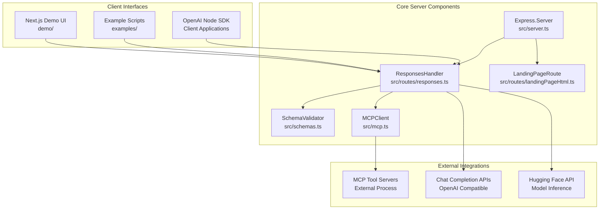

**Sources:** [README.md:145-160](), [package.json:60-64]()

## Core Capabilities

The responses.js system provides several key capabilities that bridge the gap between different AI API standards:

| Capability | Implementation | Code Location |
|------------|----------------|---------------|
| **Responses API Translation** | Converts Responses API calls to Chat Completion format | `src/routes/responses.ts` |
| **Provider Agnostic** | Works with any OpenAI-compatible Chat Completion API | `src/routes/responses.ts` |
| **Streaming Support** | Real-time Server-Sent Events for response streaming | `src/routes/responses.ts` |
| **Structured Output** | JSON schema validation using Zod schemas | `src/schemas.ts` |
| **Function Calling** | Tool and function execution capabilities | `src/routes/responses.ts` |
| **Multi-modal Input** | Text and image input processing | `src/schemas.ts` |
| **MCP Integration** | Model Context Protocol for external tool execution | `src/mcp.ts` |
| **Demo Interface** | Interactive web UI for testing and demonstration | `demo/` |

**Sources:** [README.md:9-20](), [package.json:60-64]()

## Request Processing Flow

The system processes requests through a coordinated flow between multiple components:

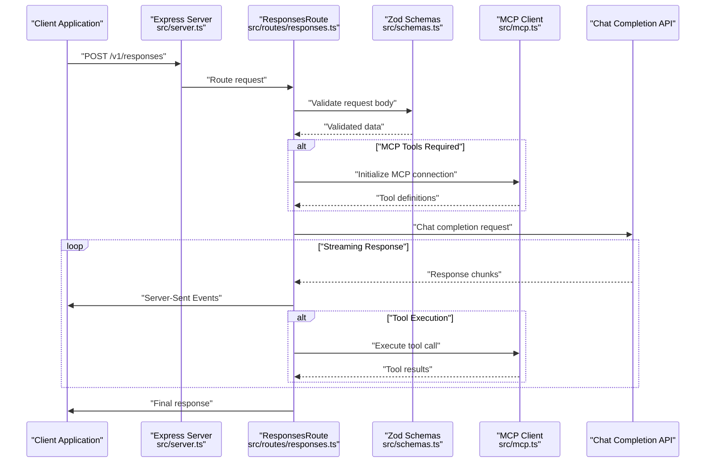

**Sources:** [README.md:9-20](), [package.json:60-64]()

## Technology Stack

The responses.js system is built on a modern Node.js technology stack:

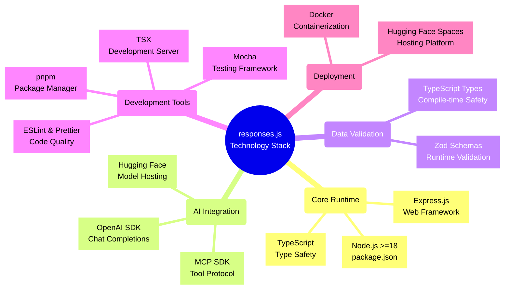

**Sources:** [package.json:21-80](), [README.md:24-28]()

## Project Structure

The codebase is organized into distinct functional areas:

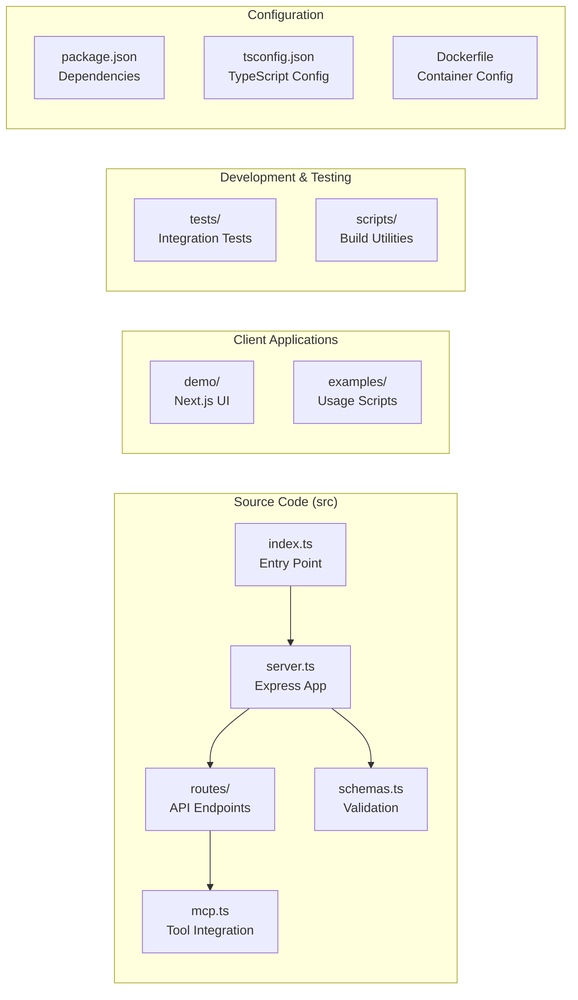

The core server components are located in the `src/` directory, with the main entry point at [src/index.ts]() and the Express application configuration in [src/server.ts](). The primary API logic resides in [src/routes/responses.ts](), which handles the translation between Responses API and Chat Completion formats.

**Sources:** [README.md:145-160](), [package.json:46-49]()

---

# Page: Getting Started

# Getting Started

<details>
<summary>Relevant source files</summary>

The following files were used as context for generating this wiki page:

- [README.md](README.md)
- [demo/.env.example](demo/.env.example)
- [demo/package.json](demo/package.json)
- [examples/_run.js](examples/_run.js)
- [package.json](package.json)

</details>


This page guides you through installing, configuring, and running responses.js for the first time. It covers basic setup, environment configuration, and running your first examples to verify the system is working correctly.

For detailed API documentation, see [API Reference](#4). For advanced tool integration patterns, see [Tool Integration](#5). For production deployment considerations, see [Deployment](#7.3).

## Prerequisites

responses.js requires specific software versions and external service access to function properly.

### System Requirements

| Requirement | Version | Purpose |
|-------------|---------|---------|
| Node.js | ≥18.0 | Runtime environment |
| Package Manager | pnpm (recommended) or npm | Dependency management |
| Hugging Face Token | With inference permissions | LLM API access |

The Node.js version requirement is enforced in [package.json:22-24]().

### External Service Access

responses.js requires access to LLM providers through Chat Completion APIs. The most common setup uses Hugging Face's hosted models, but any OpenAI-compatible API will work.

**Sources:** [package.json:22-24](), [README.md:24-28]()

## Installation

### Repository Setup

Clone the repository and install dependencies:

```bash
git clone https://github.com/huggingface/responses.js.git
cd responses.js
pnpm install
```

The project uses pnpm workspaces as defined in [package.json:3]() with the package manager specification.

### Project Structure Overview

After installation, the key directories are:

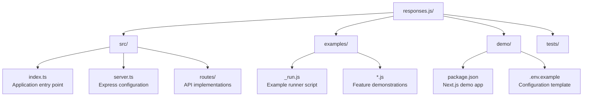

**Sources:** [README.md:147-160](), [examples/_run.js:1-31](), [demo/package.json:1-54]()

## Configuration

### Environment Variables

responses.js requires minimal configuration. The primary requirement is access to an LLM provider API.

#### Basic Configuration

For Hugging Face hosted models (recommended for getting started):

```bash
export HF_TOKEN="your-hugging-face-token-here"
```

Create your token at [Hugging Face Settings](https://huggingface.co/settings/tokens) with inference permissions enabled.

#### Alternative Provider Configuration

For other OpenAI-compatible APIs:

```bash
export API_KEY="your-api-key"
export OPENAI_BASE_URL="https://your-provider-api-url"
```

### Demo Application Configuration

To run the interactive demo UI, create a configuration file:

```bash
cat > demo/.env << EOF
MODEL="CohereLabs/c4ai-command-a-03-2025"
OPENAI_BASE_URL=http://localhost:3000/v1
OPENAI_API_KEY=${HF_TOKEN}
EOF
```

The demo configuration template is available in [demo/.env.example:1-3]().

**Sources:** [README.md:28-29](), [README.md:102-111](), [demo/.env.example:1-3]()

## Running the Server

### Development Mode

Start the development server with automatic reloading:

```bash
pnpm dev
```

This command executes the script defined in [package.json:28]() using `tsx watch src/index.ts`.

### Server Startup Process

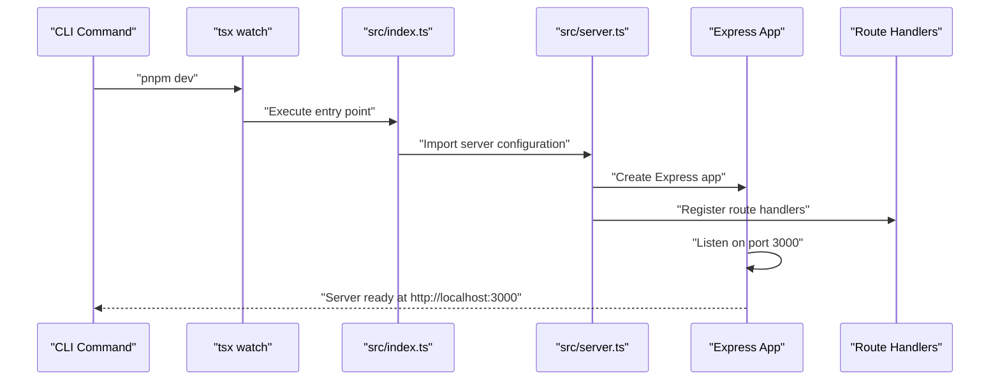

The server will be available at `http://localhost:3000` once startup is complete.

### Production Mode

For production deployment:

```bash
pnpm build
pnpm start
```

This builds the TypeScript code and runs the compiled JavaScript from `dist/index.js` as defined in [package.json:35]().

**Sources:** [package.json:28](), [package.json:35](), [README.md:40-44]()

## Testing the Setup

### Running Example Scripts

Verify your installation by running the provided examples:

```bash
# Basic text generation
pnpm run example text

# Multi-turn conversation
pnpm run example multi_turn

# Streaming responses
pnpm run example streaming

# Structured output
pnpm run example structured_output
```

### Example Execution Flow

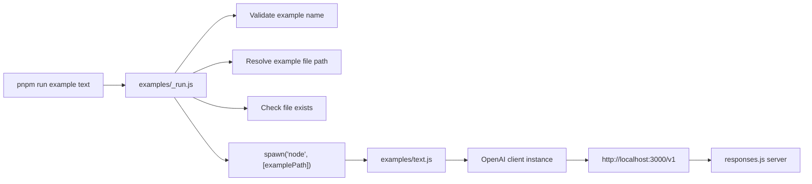

The example runner is implemented in [examples/_run.js:15-29]() and validates the example name before execution.

### Available Examples

| Example | Command | Purpose |
|---------|---------|---------|
| `text` | `pnpm run example text` | Basic text generation |
| `multi_turn` | `pnpm run example multi_turn` | Conversation handling |
| `image` | `pnpm run example image` | Multi-modal input |
| `streaming` | `pnpm run example streaming` | Real-time responses |
| `structured_output` | `pnmp run example structured_output` | JSON schema output |
| `function` | `pnpm run example function` | Tool calling |

**Sources:** [examples/_run.js:15-29](), [README.md:48-70]()

## Basic API Usage

### Making Your First Request

Once the server is running, you can make requests using any OpenAI-compatible client:

```bash
curl -X POST http://localhost:3000/v1/responses \
  -H "Content-Type: application/json" \
  -H "Authorization: Bearer your-token" \
  -d '{
    "model": "CohereLabs/c4ai-command-a-03-2025",
    "messages": [{"role": "user", "content": "Hello, world!"}]
  }'
```

### Request Processing Architecture

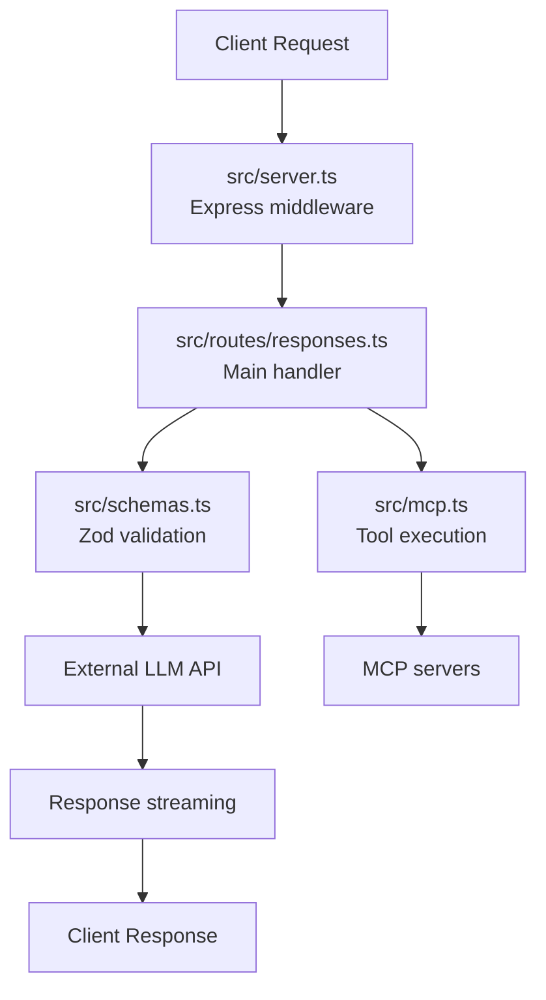

The main response handling logic is implemented in the routes directory, with schema validation ensuring request correctness before processing.

**Sources:** [README.md:151-156]()

## Interactive Demo

### Setting Up the Demo UI

Install and run the Next.js demo application:

```bash
pnpm demo:install
pnpm demo:dev
```

The demo will be available at `http://localhost:3001` and provides an interactive interface for testing all features.

### Demo Dependencies

The demo is a separate Next.js application with its own dependencies defined in [demo/package.json:12-40](), including React components for chat interfaces and OpenAI client integration.

**Sources:** [README.md:114-125](), [demo/package.json:12-40]()

## Next Steps

After completing the basic setup:

1. **Explore Advanced Features**: Try examples with function calling and structured output
2. **Review API Documentation**: See [API Reference](#4) for complete endpoint specifications  
3. **Configure Tool Integration**: See [Tool Integration](#5) for MCP server setup
4. **Production Deployment**: See [Deployment](#7.3) for Docker and hosting options

For troubleshooting common setup issues, check that:
- The server is running on port 3000
- Your API token has proper permissions
- Network connectivity to LLM providers is available

**Sources:** [README.md:22-70](), [README.md:127-144]()

---

# Page: Core Architecture

# Core Architecture

<details>
<summary>Relevant source files</summary>

The following files were used as context for generating this wiki page:

- [src/routes/index.ts](src/routes/index.ts)
- [src/routes/responses.ts](src/routes/responses.ts)
- [src/server.ts](src/server.ts)

</details>


This document provides an in-depth technical overview of responses.js's core architectural components and their interactions. It covers the system design patterns, data flow, and key abstractions that enable the translation layer between OpenAI's Responses API and Chat Completion APIs.

For specific implementation details of response generation, see [Response Handler](#3.1). For data validation and type definitions, see [Schema System](#3.2). For external tool integration, see [MCP Integration](#3.3). For server setup and routing, see [Server Configuration](#3.4).

## System Components Overview

The responses.js architecture is built around four primary components that work together to process requests and generate streaming responses:

### Core Components Diagram

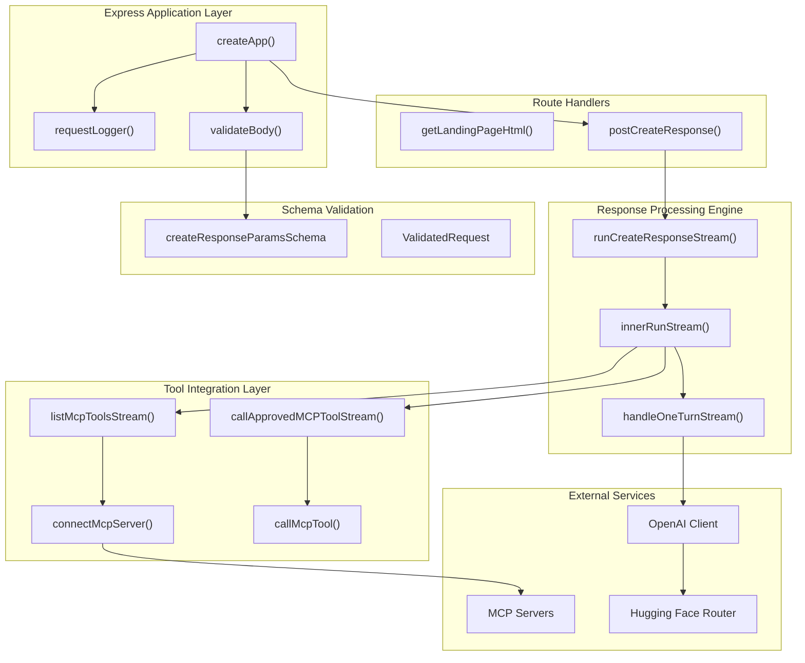

**Sources:** [src/server.ts:1-21](), [src/routes/responses.ts:32-58](), [src/routes/responses.ts:66-144](), [src/routes/responses.ts:146-415]()

## Request Processing Flow

The system processes requests through a multi-stage pipeline that handles validation, tool preparation, LLM interaction, and response streaming:

### Request Lifecycle Diagram

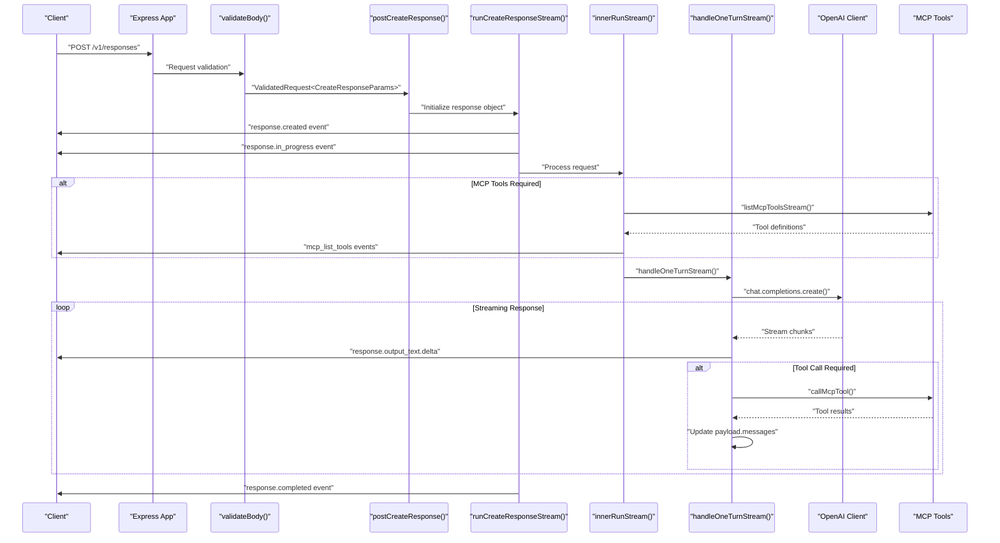

**Sources:** [src/routes/responses.ts:32-58](), [src/routes/responses.ts:66-144](), [src/routes/responses.ts:146-415](), [src/routes/responses.ts:474-769]()

## Streaming Architecture

The system implements a sophisticated streaming architecture using async generators to provide real-time response updates:

### Streaming Data Flow

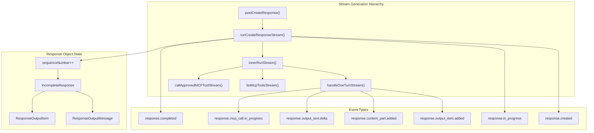

**Sources:** [src/routes/responses.ts:66-144](), [src/routes/responses.ts:474-769](), [src/routes/responses.ts:29-30]()

## Core Data Structures

The system operates on several key data structures that maintain state throughout the request lifecycle:

### Key Type Definitions

| Type | Purpose | Location | Key Fields |
|------|---------|----------|------------|
| `IncompleteResponse` | Core response state container | [src/routes/responses.ts:29]() | `id`, `status`, `output[]`, `usage` |
| `ValidatedRequest<CreateResponseParams>` | Validated input parameters | Middleware validation | `body.model`, `body.messages`, `body.tools` |
| `ResponseStreamEvent` | Streaming event wrapper | OpenAI types | `type`, `sequence_number`, `response` |
| `ChatCompletionCreateParamsStreaming` | LLM API payload | OpenAI types | `model`, `messages`, `tools`, `stream: true` |
| `McpServerParams` | MCP server configuration | Schema definitions | `server_label`, `require_approval`, `allowed_tools` |

### Response State Management

The `IncompleteResponse` object serves as the central state container that gets progressively populated:

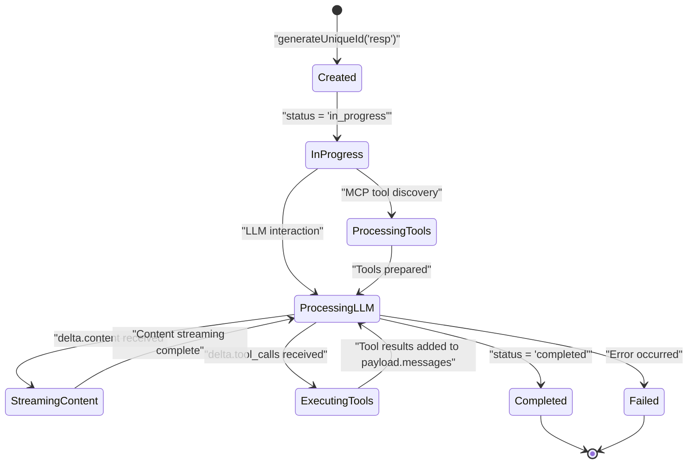

**Sources:** [src/routes/responses.ts:72-96](), [src/routes/responses.ts:137-143](), [src/routes/responses.ts:124-135]()

## Tool Integration Architecture

The system supports both simple function calls and sophisticated MCP (Model Context Protocol) tool integration with approval workflows:

### Tool Processing Pipeline

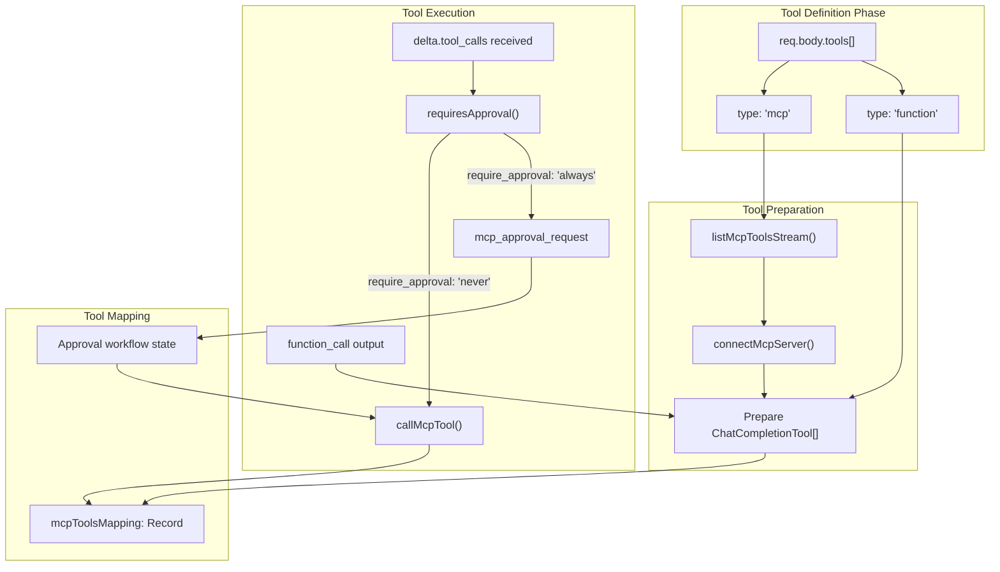

**Sources:** [src/routes/responses.ts:162-227](), [src/routes/responses.ts:417-469](), [src/routes/responses.ts:859-870](), [src/routes/responses.ts:706-756]()

## Error Handling and Recovery

The system implements comprehensive error handling through the streaming pipeline using a custom `StreamingError` class and structured error responses:

### Error Flow Management

| Error Type | Handler Location | Recovery Strategy |
|------------|------------------|-------------------|
| Validation errors | `validateBody()` middleware | Return 400 with validation details |
| Authentication errors | [src/routes/responses.ts:152-159]() | Return 401 unauthorized |
| MCP connection errors | [src/routes/responses.ts:460-468]() | Emit `mcp_list_tools.failed` event |
| LLM API errors | `handleOneTurnStream()` | Propagate to stream error handler |
| Tool execution errors | [src/routes/responses.ts:708-720]() | Set `error` field, emit `mcp_call.failed` |
| Stream processing errors | [src/routes/responses.ts:117-135]() | Emit `response.failed` event |

**Sources:** [src/routes/responses.ts:22-27](), [src/routes/responses.ts:117-135](), [src/routes/responses.ts:460-468]()

The architecture ensures graceful degradation and comprehensive error reporting while maintaining the streaming interface contract with clients.

---

# Page: Response Handler

# Response Handler

<details>
<summary>Relevant source files</summary>

The following files were used as context for generating this wiki page:

- [src/routes/responses.ts](src/routes/responses.ts)

</details>


The Response Handler is the core orchestration system in responses.js that manages the complete lifecycle of AI response generation. It serves as the primary interface between client requests and LLM providers, handling streaming responses, tool execution, approval workflows, and multi-turn conversations. This component bridges OpenAI's Responses API format with Chat Completion APIs while adding support for external tools through the Model Context Protocol (MCP).

For information about data validation and request schemas, see [Schema System](#3.2). For details on MCP server connections and tool execution, see [MCP Integration](#3.3). For API endpoint documentation, see [Endpoints](#4.2).

## Architecture Overview

The Response Handler implements a multi-layered streaming architecture that transforms incoming requests through several processing stages before generating responses.

**Response Handler Core Architecture**
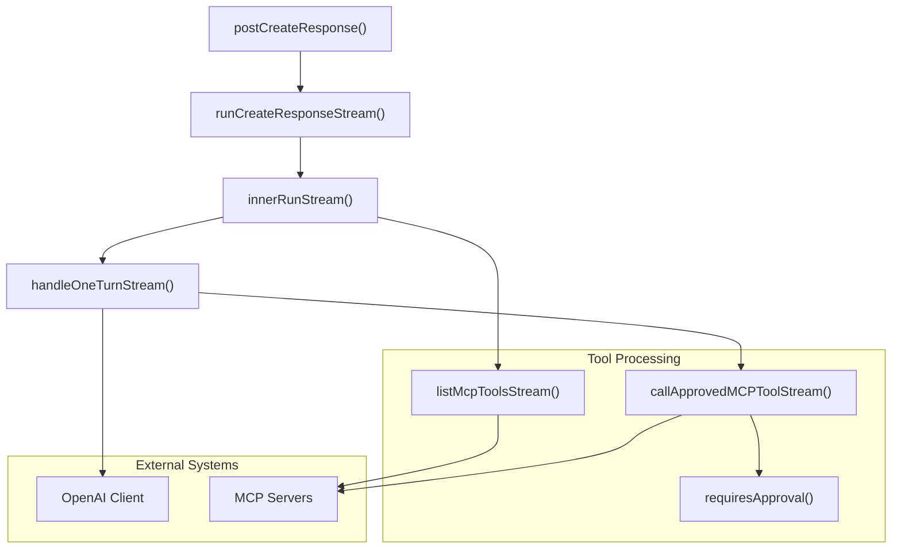

Sources: [src/routes/responses.ts:32-58](), [src/routes/responses.ts:66-144](), [src/routes/responses.ts:146-415]()

## Request Processing Flow

The response handler processes requests through a structured pipeline that handles both streaming and non-streaming scenarios uniformly by treating all requests as streams internally.

**Request Processing Pipeline**
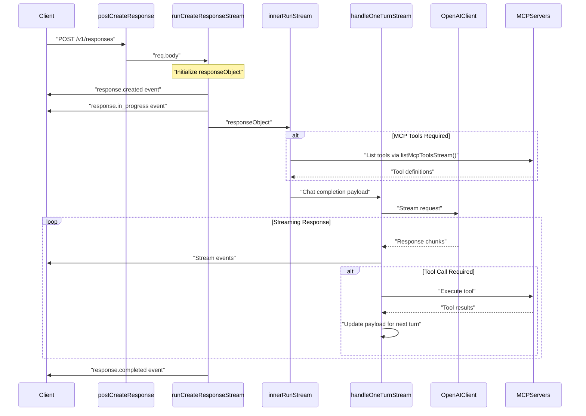

Sources: [src/routes/responses.ts:32-58](), [src/routes/responses.ts:146-415](), [src/routes/responses.ts:474-769]()

## Response Lifecycle Management

The `runCreateResponseStream` function manages the complete response lifecycle using an `IncompleteResponse` object that is progressively populated throughout the process.

### Response Object Structure

The response handler maintains a central response object that tracks the current state:

| Field | Type | Purpose |
|-------|------|---------|
| `id` | string | Unique identifier generated by `generateUniqueId("resp")` |
| `status` | string | Current status: "in_progress", "completed", or "failed" |
| `output` | array | Collection of output items (messages, tool calls, MCP operations) |
| `usage` | object | Token usage statistics updated during LLM calls |
| `error` | object | Error details if the response fails |

### Event Sequence

The response handler emits events in a specific sequence managed by the `sequenceNumber` counter:

**Response Lifecycle Events**
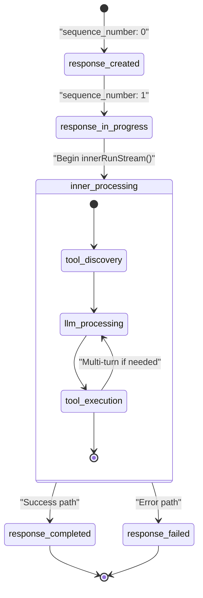

Sources: [src/routes/responses.ts:70-143](), [src/routes/responses.ts:29-30](), [src/routes/responses.ts:72-96]()

## Tool Integration Processing  

The response handler supports two types of tools: standard function calls and MCP (Model Context Protocol) tools. Tool processing occurs in the `innerRunStream` function before LLM calls.

### Tool Discovery and Preparation

**Tool Processing Flow**
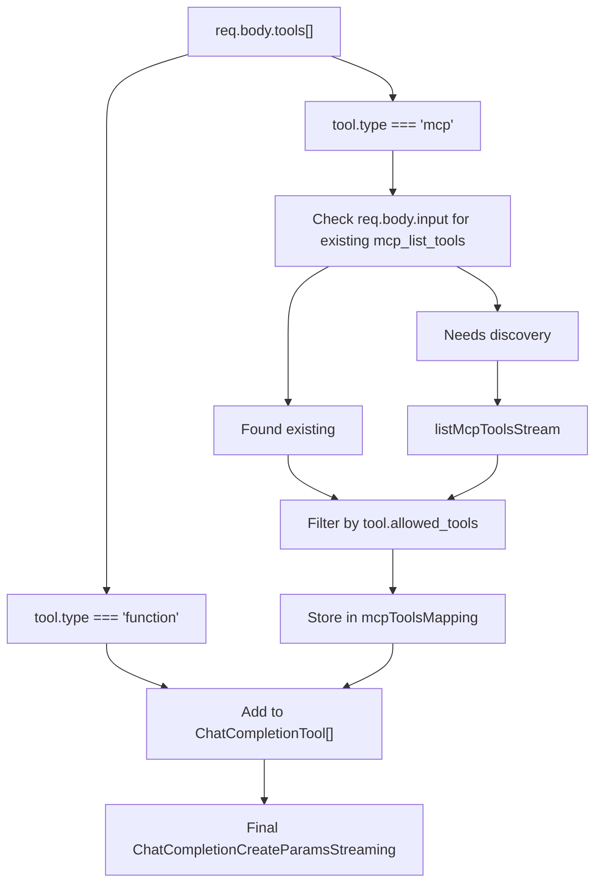

Sources: [src/routes/responses.ts:161-227](), [src/routes/responses.ts:417-469]()

### MCP Tool Discovery

The `listMcpToolsStream` function connects to MCP servers and retrieves available tools:

```typescript
// Key components in listMcpToolsStream
const outputObject: ResponseOutputItem.McpListTools = {
    id: generateUniqueId("mcpl"),
    type: "mcp_list_tools", 
    server_label: tool.server_label,
    tools: []
};
```

The function emits specific events during tool discovery:
- `response.mcp_list_tools.in_progress`
- `response.mcp_list_tools.completed` or `response.mcp_list_tools.failed`
- `response.output_item.added` and `response.output_item.done`

Sources: [src/routes/responses.ts:417-469](), [src/routes/responses.ts:421-426]()

## Streaming Implementation

The streaming system processes LLM responses chunk by chunk in `handleOneTurnStream`, managing different types of content and tool calls.

### Content Streaming

**Content Processing Flow**
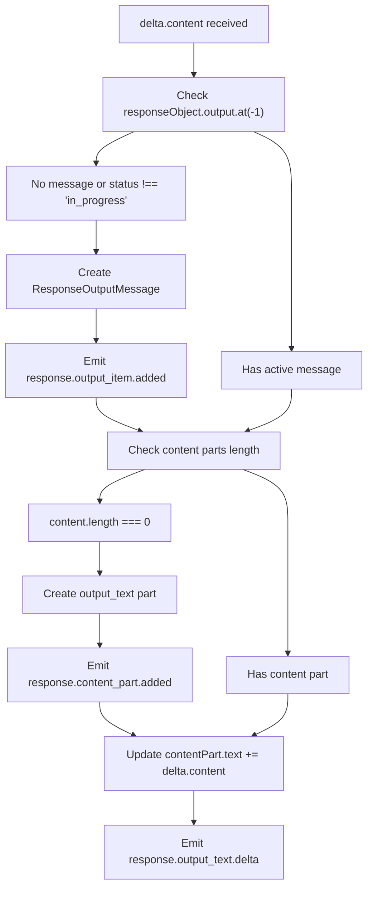

Sources: [src/routes/responses.ts:503-563](), [src/routes/responses.ts:507-524](), [src/routes/responses.ts:527-545]()

### Tool Call Streaming

When the LLM initiates tool calls, the handler determines whether they are standard functions or MCP tools:

```typescript
// Tool call detection in handleOneTurnStream
if (delta.tool_calls && delta.tool_calls.length > 0) {
    const functionName = delta.tool_calls[0].function.name;
    
    if (functionName in mcpToolsMapping) {
        if (requiresApproval(functionName, mcpToolsMapping)) {
            // Create mcp_approval_request
        } else {
            // Create mcp_call
        }
    } else {
        // Create function_call
    }
}
```

Sources: [src/routes/responses.ts:564-643](), [src/routes/responses.ts:577-603](), [src/routes/responses.ts:859-870]()

## Multi-Turn Conversation Handling

The response handler supports multi-turn conversations through an iteration loop in `innerRunStream` that continues calling the LLM until no new messages are added to the payload.

### Iteration Control

The system uses a controlled loop with safety limits:

```typescript
// Multi-turn loop control
let previousMessageCount: number;
let currentMessageCount = payload.messages.length;
const MAX_ITERATIONS = 5; // hard-coded
let iterations = 0;

do {
    previousMessageCount = currentMessageCount;
    
    for await (const event of handleOneTurnStream(apiKey, payload, responseObject, mcpToolsMapping)) {
        yield event;
    }
    
    currentMessageCount = payload.messages.length;
    iterations++;
} while (currentMessageCount > previousMessageCount && iterations < MAX_ITERATIONS);
```

### Message Payload Updates

After MCP tool execution, the handler updates the chat completion payload for subsequent LLM calls:

**Payload Update Flow**
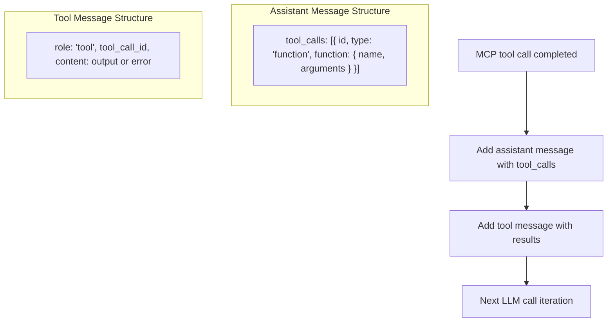

Sources: [src/routes/responses.ts:398-414](), [src/routes/responses.ts:729-755](), [src/routes/responses.ts:834-856]()

## Error Handling and Recovery

The response handler implements comprehensive error handling throughout the streaming process using try-catch blocks and specific error types.

### Streaming Error Management

The system defines a custom `StreamingError` class for stream-specific issues and handles errors at multiple levels:

```typescript
class StreamingError extends Error {
    constructor(message: string) {
        super(message);
        this.name = "StreamingError";
    }
}
```

When errors occur during streaming, the handler:
1. Sets `responseObject.status = "failed"`
2. Populates `responseObject.error` with error details
3. Emits a `response.failed` event
4. Terminates the stream gracefully

### MCP Error Handling

MCP operations include specific error handling for connection and execution failures:

```typescript
// Example from listMcpToolsStream
try {
    const mcp = await connectMcpServer(tool);
    const mcpTools = await mcp.listTools();
    // ... success handling
} catch (error) {
    const errorMessage = `Failed to list tools from MCP server '${tool.server_label}': ${error instanceof Error ? error.message : "Unknown error"}`;
    yield { type: "response.mcp_list_tools.failed", sequence_number: SEQUENCE_NUMBER_PLACEHOLDER };
    throw new Error(errorMessage);
}
```

Sources: [src/routes/responses.ts:22-27](), [src/routes/responses.ts:117-135](), [src/routes/responses.ts:460-468]()

---

# Page: Schema System

# Schema System

<details>
<summary>Relevant source files</summary>

The following files were used as context for generating this wiki page:

- [demo/components/tools-panel.tsx](demo/components/tools-panel.tsx)
- [src/schemas.ts](src/schemas.ts)

</details>


The Schema System provides comprehensive data validation, type safety, and structure definition for all requests and responses in responses.js. It uses Zod schemas to validate incoming API requests, generate TypeScript types, and ensure data integrity throughout the request processing pipeline.

This document covers the validation schemas, data structures, and type definitions. For information about how these schemas are used in request processing, see [Response Handler](#3.1). For details about the actual API endpoints that use these schemas, see [Endpoints](#4.2).

## Schema Architecture Overview

The schema system is built around a single comprehensive schema called `createResponseParamsSchema` that validates the entire request structure for the `/v1/responses` endpoint. This schema supports multi-modal inputs, conversation history, tool integration, and structured output formatting.

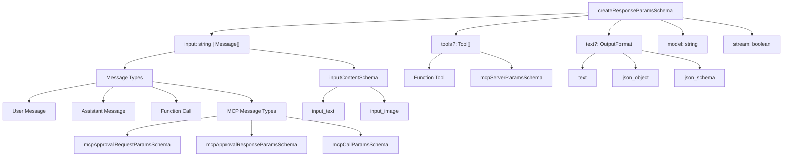

**Schema Validation Flow**
```mermaid
sequenceDiagram
    participant Client as "Client Request"
    participant Validator as "createResponseParamsSchema"
    participant InputSchema as "inputContentSchema"
    participant ToolSchema as "Tool Schemas"
    participant TypeGen as "TypeScript Types"
    
    Client->>Validator: "Raw request body"
    Validator->>InputSchema: "Validate input content"
    Validator->>ToolSchema: "Validate tool configurations"
    
    alt Validation Success
        Validator->>TypeGen: "Generate typed object"
        TypeGen->>Client: "CreateResponseParams"
    else Validation Error
        Validator->>Client: "Zod validation error"
    end
```

Sources: [src/schemas.ts:76-220]()

## Input Content Schema

The `inputContentSchema` defines the structure for multi-modal content that can be included in messages. It supports text and image inputs with extensible design for future content types.

| Content Type | Schema Structure | Purpose |
|--------------|------------------|---------|
| `input_text` | `{ type: "input_text", text: string }` | Plain text content |
| `input_image` | `{ type: "input_image", image_url: string }` | Image content via URL |

```mermaid
graph LR
    inputContentSchema["inputContentSchema"] --> textContent["input_text"]
    inputContentSchema --> imageContent["input_image"]
    
    textContent --> textField["text: string"]
    imageContent --> imageUrl["image_url: string"]
    
    subgraph "Future Extensions (Commented)"
        inputFile["input_file"]
        inputFile --> fileData["file_data"]
        inputFile --> fileId["file_id"] 
        inputFile --> filename["filename"]
    end
```

The schema uses Zod's `z.union()` to create a discriminated union based on the `type` field, enabling type-safe content handling throughout the system.

Sources: [src/schemas.ts:8-27]()

## Message Schema Structure

The input field accepts either a simple string or an array of structured message objects. The message array supports conversation history with different roles and content types.

**Message Role Types**
```mermaid
graph TB
    MessageRoles["Message Roles"] --> user["user"]
    MessageRoles --> assistant["assistant"]
    MessageRoles --> system["system"]
    MessageRoles --> developer["developer"]
    
    user --> userContent["content: string | inputContentSchema[]"]
    assistant --> assistantContent["content: output content types"]
    system --> systemContent["content: inputContentSchema[]"]
    developer --> developerContent["content: inputContentSchema[]"]
    
    assistantContent --> outputText["output_text"]
    assistantContent --> refusal["refusal"]
```

**Message Type Categories**
```mermaid
graph TB
    MessageTypes["Message Types"] --> basicMessage["Basic Message"]
    MessageTypes --> functionCall["Function Call"]
    MessageTypes --> functionOutput["Function Call Output"]
    MessageTypes --> mcpMessage["MCP Messages"]
    MessageTypes --> mcpListTools["MCP List Tools"]
    
    basicMessage --> messageRole["role: user|assistant|system|developer"]
    basicMessage --> messageContent["content: various types"]
    basicMessage --> messageStatus["status?: in_progress|completed|incomplete"]
    
    functionCall --> callId["call_id: string"]
    functionCall --> functionName["name: string"]
    functionCall --> functionArgs["arguments: string"]
    
    mcpMessage --> mcpApproval["mcp_approval_request/response"]
    mcpMessage --> mcpCall["mcp_call"]
```

Sources: [src/schemas.ts:79-148]()

## Tool Integration Schemas  

The schema system supports two main categories of tools: basic function tools and MCP (Model Context Protocol) server integrations.

### Function Tool Schema

Function tools are defined inline with the request and provide basic tool calling capabilities.

```mermaid
graph LR
    FunctionTool["Function Tool"] --> toolType["type: 'function'"]
    FunctionTool --> toolName["name: string"]
    FunctionTool --> toolParams["parameters: Record<string, any>"]
    FunctionTool --> toolDesc["description?: string"]
    FunctionTool --> toolStrict["strict: boolean (default: true)"]
```

### MCP Server Schema

The `mcpServerParamsSchema` defines configuration for external MCP servers that provide advanced tool capabilities with approval workflows.

```mermaid
graph TB
    mcpServerParamsSchema["mcpServerParamsSchema"] --> serverLabel["server_label: string"]
    mcpServerParamsSchema --> serverUrl["server_url: string"]
    mcpServerParamsSchema --> serverType["type: 'mcp'"]
    mcpServerParamsSchema --> allowedTools["allowed_tools?: string[] | {tool_names}"]
    mcpServerParamsSchema --> headers["headers?: Record<string, string>"]
    mcpServerParamsSchema --> requireApproval["require_approval: ApprovalConfig"]
    
    requireApproval --> approvalAlways["'always'"]
    requireApproval --> approvalNever["'never'"]
    requireApproval --> approvalConditional["{ always: {...}, never: {...} }"]
    
    approvalConditional --> alwaysTools["always.tool_names?: string[]"]
    approvalConditional --> neverTools["never.tool_names?: string[]"]
```

**MCP Message Flow Schemas** 
```mermaid
sequenceDiagram
    participant Client as "Client"
    participant Server as "responses.js"
    participant MCP as "MCP Server"
    
    Note over Server,MCP: "mcpApprovalRequestParamsSchema"
    Server->>Client: "mcp_approval_request"
    Note over Server,Client: "{ type, id, server_label, name, arguments }"
    
    Note over Client,Server: "mcpApprovalResponseParamsSchema" 
    Client->>Server: "mcp_approval_response"
    Note over Client,Server: "{ type, id, approval_request_id, approve, reason }"
    
    Note over Server,MCP: "mcpCallParamsSchema"
    Server->>MCP: "mcp_call" 
    Note over Server,MCP: "{ type, id, name, server_label, arguments }"
```

Sources: [src/schemas.ts:29-52](), [src/schemas.ts:54-74](), [src/schemas.ts:202-215]()

## Output Format Configuration

The `text` field in the schema configures structured output formatting using three distinct formats.

| Format Type | Configuration | Purpose |
|-------------|---------------|---------|
| `text` | `{ type: "text" }` | Plain text responses |
| `json_object` | `{ type: "json_object" }` | Valid JSON object output |
| `json_schema` | `{ type: "json_schema", name, schema, strict? }` | Structured data extraction |

```mermaid
graph TB
    OutputFormats["Text Output Formats"] --> textFormat["text"]
    OutputFormats --> jsonObjectFormat["json_object"] 
    OutputFormats --> jsonSchemaFormat["json_schema"]
    
    jsonSchemaFormat --> schemaName["name: string (max 64 chars)"]
    jsonSchemaFormat --> schemaDesc["description?: string"]
    jsonSchemaFormat --> schemaDefinition["schema: Record<string, any>"]
    jsonSchemaFormat --> schemaStrict["strict: boolean (default: false)"]
    
    schemaName --> nameValidation["Regex: /^[a-zA-Z0-9_-]+$/"]
```

The `json_schema` format enables precise data extraction by providing a JSON Schema definition that the LLM must conform to in its response.

Sources: [src/schemas.ts:170-191]()

## Type System Integration

The schema system generates comprehensive TypeScript types that provide compile-time safety throughout the codebase.

**Exported Types**
```mermaid
graph LR
    ZodSchemas["Zod Schemas"] --> TypeInference["z.infer<>"]
    TypeInference --> CreateResponseParams["CreateResponseParams"]
    TypeInference --> McpServerParams["McpServerParams"] 
    TypeInference --> McpApprovalRequestParams["McpApprovalRequestParams"]
    TypeInference --> McpApprovalResponseParams["McpApprovalResponseParams"]
    TypeInference --> McpCallParams["McpCallParams"]
    
    CreateResponseParams --> inputType["input: string | MessageArray"]
    CreateResponseParams --> toolsType["tools?: ToolArray"]
    CreateResponseParams --> configTypes["model, stream, temperature, etc."]
```

**Schema-to-Type Mapping**
```mermaid
graph TB
    createResponseParamsSchema["createResponseParamsSchema"] --> CreateResponseParams["CreateResponseParams"]
    mcpServerParamsSchema["mcpServerParamsSchema"] --> McpServerParams["McpServerParams"]
    mcpApprovalRequestParamsSchema["mcpApprovalRequestParamsSchema"] --> McpApprovalRequestParams["McpApprovalRequestParams"]
    mcpApprovalResponseParamsSchema["mcpApprovalResponseParamsSchema"] --> McpApprovalResponseParams["McpApprovalResponseParams"]
    mcpCallParamsSchema["mcpCallParamsSchema"] --> McpCallParams["McpCallParams"]
    
    subgraph "Runtime Validation + Compile-time Types"
        CreateResponseParams --> ValidationSuccess["Valid request object"]
        CreateResponseParams --> TypeSafety["Full TypeScript support"]
    end
```

These types are used throughout the system to ensure type safety in request processing, tool integration, and response generation.

Sources: [src/schemas.ts:222-226]()

---

# Page: MCP Integration

# MCP Integration

<details>
<summary>Relevant source files</summary>

The following files were used as context for generating this wiki page:

- [src/lib/McpResultFormatter.ts](src/lib/McpResultFormatter.ts)
- [src/mcp.ts](src/mcp.ts)

</details>


This document covers the Model Context Protocol (MCP) integration system in responses.js, which enables external tool execution through MCP-compatible servers. The MCP integration allows responses.js to extend LLM capabilities by connecting to external tools and services while maintaining security through approval workflows.

For information about tool calling and function definitions, see [Function Calling](#5.1). For details about approval mechanisms, see [Approval Workflows](#5.3).

## Overview

The MCP integration system provides a bridge between the responses.js server and external MCP-compatible tool servers. This integration enables the system to execute tools hosted on remote servers, handle various content types, and maintain secure communication channels with proper error handling.

The integration consists of two main components:
- **Connection Management**: Establishing and maintaining connections to MCP servers
- **Tool Execution**: Calling tools on remote servers and formatting their results

## Connection Architecture

### MCP Client Setup

The `connectMcpServer` function establishes connections to MCP servers using a fallback mechanism between HTTP and Server-Sent Events (SSE) transports.

```mermaid
flowchart TD
    ClientRequest["connectMcpServer()"] --> CreateClient["new Client()"]
    CreateClient --> ParseURL["new URL(mcpServer.server_url)"]
    ParseURL --> TryHTTP["StreamableHTTPClientTransport"]
    
    TryHTTP --> HTTPSuccess{HTTP Connection Success?}
    HTTPSuccess -->|Yes| Connected["mcp.connect() - HTTP"]
    HTTPSuccess -->|No| FallbackSSE["SSEClientTransport"]
    
    FallbackSSE --> SSEConnect["mcp.connect() - SSE"]
    
    Connected --> LogSuccess["console.log('Connected to MCP server')"]
    SSEConnect --> LogSuccess
    LogSuccess --> ReturnClient["return Client"]
```

**MCP Connection Establishment**

Sources: [src/mcp.ts:10-33]()

### Transport Layer Handling

The system supports two transport mechanisms with automatic fallback:

| Transport Type | Primary Use Case | Fallback Scenario |
|----------------|------------------|-------------------|
| `StreamableHTTPClientTransport` | Standard HTTP communication | First attempt |
| `SSEClientTransport` | Server-Sent Events | When HTTP fails |

Both transports support custom headers through the `McpServerParams.headers` configuration.

Sources: [src/mcp.ts:13-28]()

## Tool Execution Flow

### Tool Calling Process

The `callMcpTool` function orchestrates the complete tool execution lifecycle:

```mermaid
sequenceDiagram
    participant ResponseHandler as "Response Handler"
    participant MCPSystem as "callMcpTool()"
    participant MCPClient as "MCP Client"
    participant ExternalServer as "External MCP Server"
    participant Formatter as "McpResultFormatter"
    
    ResponseHandler->>MCPSystem: "callMcpTool(mcpServer, toolName, argumentsString)"
    MCPSystem->>MCPClient: "connectMcpServer(mcpServer)"
    MCPClient->>ExternalServer: "connect(transport)"
    ExternalServer-->>MCPClient: "connection established"
    MCPClient-->>MCPSystem: "return client"
    
    MCPSystem->>MCPSystem: "JSON.parse(argumentsString)"
    MCPSystem->>MCPClient: "client.callTool({name, arguments})"
    MCPClient->>ExternalServer: "tool execution request"
    ExternalServer-->>MCPClient: "tool response"
    MCPClient-->>MCPSystem: "toolResponse"
    
    MCPSystem->>Formatter: "McpResultFormatter.format(toolResponse)"
    Formatter-->>MCPSystem: "formattedResult"
    MCPSystem-->>ResponseHandler: "{output: formattedResult}"
```

**MCP Tool Execution Sequence**

Sources: [src/mcp.ts:35-56]()

### Error Handling

The tool execution system implements comprehensive error handling:

```mermaid
flowchart TD
    ToolCall["callMcpTool()"] --> TryBlock["try {"]
    TryBlock --> Connect["connectMcpServer()"]
    Connect --> ParseArgs["JSON.parse(argumentsString)"]
    ParseArgs --> CallTool["client.callTool()"]
    CallTool --> FormatResult["McpResultFormatter.format()"]
    FormatResult --> SuccessReturn["{output: formattedResult}"]
    
    TryBlock --> CatchBlock["catch (error)"]
    CatchBlock --> ErrorCheck{Error Type?}
    ErrorCheck -->|"Error instance"| ErrorMessage["error.message"]
    ErrorCheck -->|"string"| StringError["error"]
    ErrorCheck -->|"other"| JSONStringify["JSON.stringify(error)"]
    
    ErrorMessage --> ErrorReturn["{error: errorMessage}"]
    StringError --> ErrorReturn
    JSONStringify --> ErrorReturn
```

**MCP Error Handling Flow**

Sources: [src/mcp.ts:49-55]()

## Result Formatting System

### Content Type Processing

The `McpResultFormatter` class handles multiple content types returned by MCP tools:

```mermaid
graph TB
    subgraph "McpResultFormatter.format()"
        Input["CompatibilityCallToolResult"] --> ContentCheck{Has Content Array?}
        ContentCheck -->|No| NoContent["[No content]"]
        ContentCheck -->|Yes| ProcessItems["Process content items"]
        
        ProcessItems --> TextType["type: 'text'"]
        ProcessItems --> ImageType["type: 'image'"]
        ProcessItems --> AudioType["type: 'audio'"]
        ProcessItems --> ResourceType["type: 'resource'"]
        
        TextType --> ExtractText["item.text"]
        ImageType --> ImageSummary["[Binary Content: Image...]"]
        AudioType --> AudioSummary["[Binary Content: Audio...]"]
        
        ResourceType --> ResourceCheck{Resource Type?}
        ResourceCheck -->|"TextResourceContents"| ResourceText["textResource.text"]
        ResourceCheck -->|"BlobResourceContents"| ResourceBlob["[Binary Content...]"]
        
        ExtractText --> JoinParts["formattedParts.join()"]
        ImageSummary --> JoinParts
        AudioSummary --> JoinParts
        ResourceText --> JoinParts
        ResourceBlob --> JoinParts
        
        JoinParts --> FinalOutput["Formatted String"]
    end
```

**MCP Result Content Processing**

Sources: [src/lib/McpResultFormatter.ts:26-79]()

### Binary Content Handling

The formatter provides intelligent handling of binary content types:

| Content Type | Processing Method | Output Format |
|--------------|-------------------|---------------|
| Text | Direct extraction | `item.text` |
| Image | Size calculation + summary | `[Binary Content: Image {mimeType}, {size} bytes]` |
| Audio | Size calculation + summary | `[Binary Content: Audio {mimeType}, {size} bytes]` |
| Text Resource | Text extraction | `textResource.text` |
| Blob Resource | Size + metadata summary | `[Binary Content{uri}: {mimeType}, {size} bytes]` |

The `getBase64Size` method calculates approximate byte sizes for base64-encoded binary data by accounting for encoding overhead and padding.

Sources: [src/lib/McpResultFormatter.ts:34-92]()

## Integration with Response System

### Tool Discovery and Execution

The MCP integration connects with the broader response handling system through several key integration points:

```mermaid
flowchart LR
    subgraph "Response Handler"
        ToolPrep["Tool Preparation"]
        MCPList["MCP Tool Discovery"]
        ApprovalFlow["Approval Workflow"]
    end
    
    subgraph "MCP Integration (src/mcp.ts)"
        ConnectMCP["connectMcpServer()"]
        CallTool["callMcpTool()"]
    end
    
    subgraph "External MCP Servers"
        ToolServer1["MCP Tool Server 1"]
        ToolServer2["MCP Tool Server 2"]
    end
    
    MCPList --> ConnectMCP
    ApprovalFlow --> CallTool
    ConnectMCP --> ToolServer1
    ConnectMCP --> ToolServer2
    CallTool --> ToolServer1
    CallTool --> ToolServer2
    
    CallTool --> ToolPrep
```

**MCP System Integration Points**

Sources: [src/mcp.ts:10-56]()

### Client Configuration

The MCP client is configured with responses.js package metadata for proper identification:

- **Client Name**: `@huggingface/responses.js`
- **Version**: Extracted from `package.json`
- **Transport Options**: Configurable headers and connection parameters

This configuration ensures proper server identification and enables authentication mechanisms when required by external MCP servers.

Sources: [src/mcp.ts:1-11]()

---

# Page: Server Configuration

# Server Configuration

<details>
<summary>Relevant source files</summary>

The following files were used as context for generating this wiki page:

- [.github/workflows/lint.yml](.github/workflows/lint.yml)
- [src/middleware/logging.ts](src/middleware/logging.ts)
- [src/routes/index.ts](src/routes/index.ts)
- [src/server.ts](src/server.ts)

</details>


This page documents the Express server setup, middleware configuration, and routing system that forms the foundation of the responses.js API server. It covers the server initialization process, request processing pipeline, and endpoint configuration.

For detailed information about the API endpoints themselves, see [API Reference](#4). For the core response processing logic, see [Response Handler](#3.1).

## Express Server Architecture

The responses.js server is built on Express.js and follows a modular architecture with clear separation between middleware, routing, and business logic. The server configuration is centralized in the `createApp()` function which returns a fully configured Express application.

### Server Factory Function

The main server configuration is handled by the `createApp()` function in [src/server.ts:7-20](), which creates and configures an Express application instance:

```typescript
export const createApp = (): Express => {
	const app: Express = express();

	// Middleware
	app.use(requestLogger());
	app.use(express.json());

	// Routes
	app.get("/", getLandingPageHtml);
	app.post("/v1/responses", validateBody(createResponseParamsSchema), postCreateResponse);

	return app;
};
```

**Server Initialization Flow**

```mermaid
flowchart TD
    createApp["createApp()"] --> expressInstance["express()"]
    expressInstance --> middleware["Middleware Setup"]
    middleware --> routes["Route Configuration"]
    routes --> returnApp["Return Configured App"]
    
    middleware --> requestLogger["requestLogger()"]
    middleware --> jsonParser["express.json()"]
    
    routes --> rootRoute["GET /"]
    routes --> responsesRoute["POST /v1/responses"]
    
    rootRoute --> getLandingPageHtml["getLandingPageHtml"]
    responsesRoute --> validateBody["validateBody()"]
    validateBody --> postCreateResponse["postCreateResponse"]
```

*Sources: [src/server.ts:7-20]()*

## Middleware Configuration

The server uses two primary middleware components that process all incoming requests in sequence.

### Request Logging Middleware

The `requestLogger()` middleware provides comprehensive HTTP request and response logging with timing information. It logs both incoming requests and completed responses with status codes and duration metrics.

| Log Event | Format | Example |
|-----------|--------|---------|
| Incoming Request | `📥 METHOD URL` | `📥 POST /v1/responses` |
| Completed Response | `STATUS_EMOJI STATUS METHOD URL (DURATION)` | `✅ 200 POST /v1/responses (1250ms)` |

The middleware uses different emojis to indicate response status categories:
- ✅ Success (200-299)
- ⚠️ Client Error (400-499) 
- ❌ Server Error (500+)
- ℹ️ Other status codes

**Request Logging Pipeline**

```mermaid
sequenceDiagram
    participant Client
    participant requestLogger
    participant NextMiddleware
    participant Response
    
    Client->>requestLogger: HTTP Request
    requestLogger->>requestLogger: Log incoming request
    requestLogger->>requestLogger: Start timer
    requestLogger->>NextMiddleware: next()
    NextMiddleware->>Response: Process request
    Response->>requestLogger: 'finish' event
    requestLogger->>requestLogger: Calculate duration
    requestLogger->>requestLogger: Log completion
```

*Sources: [src/middleware/logging.ts:37-68](), [src/server.ts:11]()*

### JSON Body Parsing

The server uses Express's built-in JSON parser middleware to handle request body parsing for POST requests. This middleware automatically parses JSON request bodies and makes them available via `req.body`.

*Sources: [src/server.ts:12]()*

## Route Configuration

The server defines two primary routes with specific middleware chains and handlers.

### Root Route (GET )

The root route serves the landing page HTML content through the `getLandingPageHtml` handler.

```
GET / → getLandingPageHtml
```

### Responses API Route (POST /v1/responses)

The main API endpoint includes request validation middleware before processing:

```
POST /v1/responses → validateBody(createResponseParamsSchema) → postCreateResponse
```

**Route Handler Chain**

```mermaid
flowchart LR
    request["POST /v1/responses"] --> validateBody["validateBody()"]
    validateBody --> schema["createResponseParamsSchema"]
    schema --> postCreateResponse["postCreateResponse"]
    
    validateBody --> validationError["Validation Error"]
    validationError --> errorResponse["400 Bad Request"]
    
    postCreateResponse --> successResponse["Response Processing"]
```

*Sources: [src/server.ts:15-17](), [src/routes/index.ts:1-2]()*

## Middleware Stack Analysis

The middleware processing order is critical for proper request handling:

| Order | Middleware | Purpose | Applied To |
|-------|------------|---------|------------|
| 1 | `requestLogger()` | Request/response logging | All routes |
| 2 | `express.json()` | JSON body parsing | All routes |
| 3 | `validateBody()` | Request validation | POST /v1/responses only |

**Complete Request Processing Flow**

```mermaid
flowchart TB
    incomingRequest["Incoming HTTP Request"]
    
    incomingRequest --> requestLogger["requestLogger middleware"]
    requestLogger --> jsonParser["express.json() middleware"]
    
    jsonParser --> routeCheck{Route Match?}
    
    routeCheck --> rootRoute["GET /"]
    routeCheck --> apiRoute["POST /v1/responses"]
    routeCheck --> notFound["404 Not Found"]
    
    rootRoute --> getLandingPageHtml["getLandingPageHtml handler"]
    
    apiRoute --> validateBody["validateBody middleware"]
    validateBody --> validationPass{Valid?}
    validationPass --> postCreateResponse["postCreateResponse handler"]
    validationPass --> validationFail["400 Bad Request"]
    
    getLandingPageHtml --> response["HTTP Response"]
    postCreateResponse --> response
    validationFail --> response
    notFound --> response
    
    response --> logCompletion["Log response completion"]
```

*Sources: [src/server.ts:7-20](), [src/middleware/logging.ts:37-68]()*

## Configuration Dependencies

The server configuration relies on several imported modules and schemas:

- **Route Handlers**: Imported from [src/routes/index.ts:1-2]()
- **Validation Schema**: `createResponseParamsSchema` from [src/schemas.js:2]()
- **Middleware**: Custom logging and validation middleware
- **Express Framework**: Core web server functionality

The modular design allows for easy testing, maintenance, and extension of server functionality while maintaining clear separation of concerns between routing, validation, and business logic.

*Sources: [src/server.ts:1-5]()*

---

# Page: API Reference

# API Reference

<details>
<summary>Relevant source files</summary>

The following files were used as context for generating this wiki page:

- [demo/components/tools-panel.tsx](demo/components/tools-panel.tsx)
- [src/routes/responses.ts](src/routes/responses.ts)
- [src/schemas.ts](src/schemas.ts)

</details>


This document provides complete API documentation for responses.js, including all available endpoints, request/response formats, data types, and integration patterns. The API implements OpenAI's Responses API specification while providing a translation layer to various Chat Completion providers with enhanced capabilities for tool integration and streaming.

For detailed request and response format specifications, see [Request and Response Format](#4.1). For endpoint-specific documentation, see [Endpoints](#4.2). For streaming implementation details, see [Streaming Protocol](#4.3).

## API Overview

The responses.js API provides a single primary endpoint that handles all response generation requests. The system supports both streaming and non-streaming modes, with comprehensive tool integration through function calling and MCP (Model Context Protocol) servers.

### API Request Flow

```mermaid
flowchart TD
    Client[Client Request] --> Validation["postCreateResponse()<br/>src/routes/responses.ts:32"]
    Validation --> RequestCheck{Stream Flag?}
    RequestCheck -->|true| StreamMode["Streaming Mode<br/>runCreateResponseStream()"]
    RequestCheck -->|false| NonStreamMode["Non-streaming Mode<br/>Collect events"]
    
    StreamMode --> EventGeneration["innerRunStream()<br/>src/routes/responses.ts:146"]
    NonStreamMode --> EventGeneration
    
    EventGeneration --> AuthCheck["API Key Validation<br/>Authorization Header"]
    AuthCheck --> ToolPrep["Tool Preparation<br/>MCP + Function Tools"]
    ToolPrep --> LLMCall["handleOneTurnStream()<br/>src/routes/responses.ts:474"]
    
    LLMCall --> ProviderCall["OpenAI Client<br/>chat.completions.create()"]
    ProviderCall --> ResponseProcessing["Response Processing<br/>Stream Events"]
    
    ResponseProcessing --> ToolExecution{Tool Calls?}
    ToolExecution -->|MCP| MCPCall["callMcpTool()<br/>src/mcp.ts"]
    ToolExecution -->|Function| FunctionCall["Function Execution"]
    ToolExecution -->|None| FinalResponse
    
    MCPCall --> ApprovalCheck{Approval Required?}
    ApprovalCheck -->|Yes| ApprovalRequest["mcp_approval_request Event"]
    ApprovalCheck -->|No| ToolResult["Tool Result"]
    ApprovalRequest --> ToolResult
    FunctionCall --> ToolResult
    
    ToolResult --> IterationCheck{More Iterations?}
    IterationCheck -->|Yes| LLMCall
    IterationCheck -->|No| FinalResponse[Final Response]
```

Sources: [src/routes/responses.ts:32-58](), [src/routes/responses.ts:146-415](), [src/routes/responses.ts:474-769]()

## Authentication

API requests require authentication via the `Authorization` header using Bearer token format:

```
Authorization: Bearer <api-key>
```

The API key is extracted and used to authenticate with the underlying LLM provider. The system supports configurable base URLs through the `OPENAI_BASE_URL` environment variable, defaulting to Hugging Face's router endpoint.

Sources: [src/routes/responses.ts:152-159]()

## Core Endpoint

### POST /v1/responses

The primary endpoint for creating responses. Accepts requests in OpenAI Responses API format and returns either streaming events or complete response objects.

**Request Body**: `CreateResponseParams` object containing:
- `input`: String or array of input items (messages, tool calls, etc.)
- `model`: Model identifier for the LLM provider
- `instructions`: Optional system instructions
- `tools`: Optional array of function or MCP tool definitions
- `stream`: Boolean flag for streaming vs non-streaming response
- Additional parameters for temperature, max tokens, tool choice, etc.

**Response**: Either Server-Sent Events stream or JSON response object depending on `stream` parameter.

Sources: [src/routes/responses.ts:32-58](), [src/schemas.ts:76-220]()

## Data Type Architecture

The API uses Zod schemas for comprehensive request validation and type safety. The core data structures follow OpenAI's specification with extensions for MCP integration.

### Schema Hierarchy

```mermaid
flowchart TB
    subgraph "Request Schema"
        CreateResponse["createResponseParamsSchema<br/>src/schemas.ts:76"]
        InputUnion["input: string | array<br/>src/schemas.ts:79-149"]
        Tools["tools: function | mcp<br/>src/schemas.ts:202-215"]
        TextFormat["text.format<br/>src/schemas.ts:170-191"]
    end
    
    subgraph "Input Item Types"
        Message["Message<br/>src/schemas.ts:84-114"]
        FunctionCall["Function Call<br/>src/schemas.ts:115-129"]
        MCPItems["MCP Items<br/>src/schemas.ts:130-146"]
        InputContent["Input Content<br/>src/schemas.ts:8-27"]
    end
    
    subgraph "MCP Schema Types"
        MCPServer["mcpServerParamsSchema<br/>src/schemas.ts:29-52"]
        MCPApproval["mcpApprovalRequestParamsSchema<br/>src/schemas.ts:54-67"]
        MCPCall["mcpCallParamsSchema<br/>src/schemas.ts:68-74"]
    end
    
    subgraph "Response Processing"
        ResponseObject["IncompleteResponse<br/>src/routes/responses.ts:29"]
        StreamEvents["ResponseStreamEvent<br/>OpenAI Types"]
        OutputItems["ResponseOutputItem<br/>Various Types"]
    end
    
    CreateResponse --> InputUnion
    CreateResponse --> Tools
    CreateResponse --> TextFormat
    
    InputUnion --> Message
    InputUnion --> FunctionCall
    InputUnion --> MCPItems
    Message --> InputContent
    
    Tools --> MCPServer
    MCPItems --> MCPApproval
    MCPItems --> MCPCall
    
    CreateResponse --> ResponseObject
    ResponseObject --> StreamEvents
    StreamEvents --> OutputItems
```

Sources: [src/schemas.ts:1-227](), [src/routes/responses.ts:29-30]()

## Request Processing Modes

### Streaming Mode (`stream: true`)

Returns Server-Sent Events with real-time updates during response generation. Events include:
- `response.created`: Initial response object
- `response.in_progress`: Processing started
- `response.output_item.added`: New output items (messages, tool calls)
- `response.content_part.added`: New content parts within messages
- `response.output_text.delta`: Text streaming deltas
- Tool-specific events for MCP and function calls
- `response.completed` or `response.failed`: Final status

### Non-streaming Mode (`stream: false`)

Processes the complete request and returns the final response object once generation is complete. Internally uses the same streaming pipeline but collects all events before returning.

Sources: [src/routes/responses.ts:40-57](), [src/routes/responses.ts:66-144]()

## Tool Integration Architecture

The system supports multiple tool integration patterns through a unified interface:

### Tool Types and Processing

```mermaid
flowchart LR
    subgraph "Tool Definitions"
        FunctionTool["Function Tool<br/>type: 'function'<br/>src/schemas.ts:205-211"]
        MCPTool["MCP Tool<br/>type: 'mcp'<br/>src/schemas.ts:29-52"]
    end
    
    subgraph "Tool Processing Pipeline"
        ToolPrep["Tool Preparation<br/>src/routes/responses.ts:162-227"]
        MCPList["listMcpToolsStream()<br/>src/routes/responses.ts:417-469"]
        ToolMapping["mcpToolsMapping<br/>Record<string, McpServerParams>"]
    end
    
    subgraph "Execution Paths"
        DirectExec["Direct Function Call<br/>handleOneTurnStream()"]
        MCPExec["MCP Tool Execution<br/>callMcpTool()"]
        ApprovalFlow["Approval Workflow<br/>requiresApproval()"]
    end
    
    subgraph "Approval System"
        ApprovalReq["mcp_approval_request<br/>Output Item"]
        ApprovalResp["mcp_approval_response<br/>Input Item"]
        ApprovedCall["callApprovedMCPToolStream()<br/>src/routes/responses.ts:774-857"]
    end
    
    FunctionTool --> ToolPrep
    MCPTool --> ToolPrep
    ToolPrep --> MCPList
    MCPList --> ToolMapping
    
    ToolMapping --> DirectExec
    ToolMapping --> MCPExec
    MCPExec --> ApprovalFlow
    
    ApprovalFlow -->|Required| ApprovalReq
    ApprovalReq --> ApprovalResp
    ApprovalResp --> ApprovedCall
    ApprovalFlow -->|Not Required| DirectExec
```

Sources: [src/routes/responses.ts:162-227](), [src/routes/responses.ts:417-469](), [src/routes/responses.ts:774-857](), [src/routes/responses.ts:859-870]()

## Response Generation Lifecycle

The system implements a sophisticated multi-turn conversation pattern with automatic tool execution:

| Phase | Description | Key Functions |
|-------|-------------|---------------|
| **Initialization** | Create response object, validate request | `runCreateResponseStream()` |
| **Tool Preparation** | List MCP tools, prepare tool mappings | `listMcpToolsStream()`, tool preparation logic |
| **Message Formatting** | Convert input to Chat Completion format | Input processing in `innerRunStream()` |
| **LLM Iteration** | Call LLM, process streaming response | `handleOneTurnStream()` |
| **Tool Execution** | Execute function/MCP tools as needed | `callMcpTool()`, function execution |
| **Approval Handling** | Process approval requests/responses | `callApprovedMCPToolStream()` |
| **Iteration Control** | Continue until no new tool calls | MAX_ITERATIONS limit |
| **Completion** | Finalize response object | Response completion events |

The system supports up to 5 iterations per request to handle complex multi-tool scenarios while preventing infinite loops.

Sources: [src/routes/responses.ts:66-144](), [src/routes/responses.ts:401-414]()

## Error Handling

The API implements comprehensive error handling with specific error types:

- **Authentication Errors**: 401 Unauthorized for missing/invalid API keys
- **Validation Errors**: Schema validation failures from Zod
- **Streaming Errors**: `StreamingError` class for streaming-specific issues
- **MCP Errors**: Tool execution failures with detailed error messages
- **Server Errors**: General server errors with `response.failed` events in streaming mode

All errors in streaming mode are delivered as `response.failed` events with structured error objects containing error codes and descriptive messages.

Sources: [src/routes/responses.ts:22-27](), [src/routes/responses.ts:117-135](), [src/routes/responses.ts:460-468]()

---

# Page: Request and Response Format

# Request and Response Format

<details>
<summary>Relevant source files</summary>

The following files were used as context for generating this wiki page:

- [demo/components/tools-panel.tsx](demo/components/tools-panel.tsx)
- [src/schemas.ts](src/schemas.ts)
- [tests/responses.test.js](tests/responses.test.js)

</details>


This document provides the detailed specification of request parameters, response structures, and data types used by the responses.js API. It covers the schema definitions, validation rules, and format requirements for interacting with the system.

For information about the actual API endpoints and their usage, see [Endpoints](#4.2). For details about real-time streaming mechanics, see [Streaming Protocol](#4.3).

## Request Schema Overview

The primary request format is defined by the `createResponseParamsSchema` in [src/schemas.ts:76-220](). This schema validates all incoming requests to ensure they conform to the expected OpenAI Responses API format while supporting additional features like MCP tool integration.

```mermaid
graph TB
    subgraph "Request Schema Structure"
        createResponseParamsSchema["createResponseParamsSchema"]
        
        createResponseParamsSchema --> input["input: string | Message[]"]
        createResponseParamsSchema --> model["model: string"]
        createResponseParamsScreen --> instructions["instructions: string?"]
        createResponseParamsSchema --> tools["tools: Tool[]?"]
        createResponseParamsSchema --> text["text: TextFormat?"]
        createResponseParamsSchema --> stream["stream: boolean"]
        createResponseParamsSchema --> temperature["temperature: number"]
        createResponseParamsSchema --> max_output_tokens["max_output_tokens: number?"]
        createResponseParamsSchema --> metadata["metadata: Record<string,string>?"]
        createResponseParamsSchema --> tool_choice["tool_choice: ToolChoice?"]
        createResponseParamsSchema --> top_p["top_p: number"]
    end
    
    subgraph "Input Content Types"
        input --> inputContentSchema["inputContentSchema"]
        inputContentSchema --> input_text["input_text"]
        inputContentSchema --> input_image["input_image"]
    end
    
    subgraph "Tool Types"
        tools --> function_tool["function"]
        tools --> mcp_tool["mcp"]
        mcp_tool --> mcpServerParamsSchema["mcpServerParamsSchema"]
    end
    
    subgraph "Text Format Types"
        text --> text_format["text"]
        text --> json_object["json_object"]
        text --> json_schema["json_schema"]
    end
```

**Sources:** [src/schemas.ts:76-220]()

## Input Content Format

The system supports multiple input content types through the `inputContentSchema`, enabling both text-only and multi-modal interactions.

### Text Input

Simple string input is automatically converted to a single message:

| Field | Type | Description |
|-------|------|-------------|
| `input` | `string` | Plain text input converted to user message |

### Multi-Modal Input

Complex input uses an array of message objects with structured content:

```mermaid
graph LR
    subgraph "Message Structure"
        message["Message Object"]
        message --> role["role: 'user' | 'assistant' | 'system' | 'developer'"]
        message --> content["content: ContentArray"]
        message --> type_msg["type: 'message'"]
        message --> status["status?: 'in_progress' | 'completed' | 'incomplete'"]
    end
    
    subgraph "Content Types"
        content --> input_text_content["input_text: {type, text}"]
        content --> input_image_content["input_image: {type, image_url}"]
        content --> output_text_content["output_text: {type, text, annotations?, logprobs?}"]
        content --> refusal_content["refusal: {type, refusal}"]
    end
    
    subgraph "Tool-Related Content"
        content --> function_call_content["function_call"]
        content --> function_call_output_content["function_call_output"]
        content --> mcp_list_tools_content["mcp_list_tools"]
        content --> mcp_approval_request_content["mcp_approval_request"]
        content --> mcp_approval_response_content["mcp_approval_response"]
        content --> mcp_call_content["mcp_call"]
    end
```

**Sources:** [src/schemas.ts:8-27](), [src/schemas.ts:79-149]()

### Input Content Schema Details

The `inputContentSchema` defines two primary content types:

- **Text Content**: `{type: "input_text", text: string}`
- **Image Content**: `{type: "input_image", image_url: string}`

**Sources:** [src/schemas.ts:8-27]()

## Tool Configuration

The system supports two types of tools: function tools and MCP (Model Context Protocol) tools.

### Function Tools

Function tools are defined inline with JSON Schema parameters:

| Field | Type | Required | Description |
|-------|------|----------|-------------|
| `type` | `"function"` | Yes | Tool type identifier |
| `name` | `string` | Yes | Function name |
| `parameters` | `Record<string, any>` | Yes | JSON Schema for parameters |
| `description` | `string` | No | Function description |
| `strict` | `boolean` | No | Strict mode (default: true) |

### MCP Tools

MCP tools connect to external servers via the Model Context Protocol:

```mermaid
graph TB
    subgraph "MCP Tool Configuration"
        mcpServerParamsSchema["mcpServerParamsSchema"]
        mcpServerParamsSchema --> server_label["server_label: string"]
        mcpServerParamsSchema --> server_url["server_url: string"]
        mcpServerParamsSchema --> type_mcp["type: 'mcp'"]
        mcpServerParamsSchema --> allowed_tools["allowed_tools: string[] | {tool_names: string[]} | null"]
        mcpServerParamsSchema --> headers["headers: Record<string,string> | null"]
        mcpServerParamsSchema --> require_approval["require_approval: ApprovalConfig"]
    end
    
    subgraph "Approval Configuration"
        require_approval --> approval_always["'always'"]
        require_approval --> approval_never["'never'"] 
        require_approval --> approval_conditional["Conditional Object"]
        approval_conditional --> always_tools["always: {tool_names?: string[]}"]
        approval_conditional --> never_tools["never: {tool_names?: string[]}"]
    end
```

**Sources:** [src/schemas.ts:29-52]()

## Response Format

Responses follow the OpenAI Responses API format with extensions for MCP integration and enhanced tool calling.

### Non-Streaming Response

For non-streaming requests (`stream: false`), the response contains:

| Field | Type | Description |
|-------|------|-------------|
| `id` | `string` | Response identifier |
| `object` | `"response"` | Object type |
| `created` | `number` | Unix timestamp |
| `model` | `string` | Model used |
| `output` | `OutputItem[]` | Response content array |
| `usage` | `UsageStats` | Token usage information |

### Output Item Types

The `output` array can contain various item types:

```mermaid
graph TB
    subgraph "Output Item Types"
        output["output: OutputItem[]"]
        
        output --> message_item["Message Item"]
        output --> function_call_item["Function Call Item"]
        output --> function_call_output_item["Function Call Output Item"]
        output --> mcp_list_tools_item["MCP List Tools Item"]
        output --> mcp_approval_request_item["MCP Approval Request Item"]
        output --> mcp_approval_response_item["MCP Approval Response Item"]
        output --> mcp_call_item["MCP Call Item"]
    end
    
    subgraph "Message Content"
        message_item --> output_text["output_text: {type, text, annotations?, logprobs?}"]
        message_item --> refusal["refusal: {type, refusal}"]
    end
    
    subgraph "Function Call Details"
        function_call_item --> call_id["call_id: string"]
        function_call_item --> name["name: string"]
        function_call_item --> arguments["arguments: string"]
        function_call_item --> status["status: 'completed' | 'in_progress' | 'incomplete'"]
    end
```

**Sources:** [src/schemas.ts:94-147](), [tests/responses.test.js:103-108]()

## MCP Integration Schema

The MCP (Model Context Protocol) integration introduces several specialized schema types for handling external tool servers.

### MCP Approval Request

```mermaid
graph LR
    subgraph "MCP Approval Flow"
        mcpApprovalRequestParamsSchema["mcpApprovalRequestParamsSchema"]
        mcpApprovalRequestParamsSchema --> request_type["type: 'mcp_approval_request'"]
        mcpApprovalRequestParamsSchema --> request_id["id: string"]
        mcpApprovalRequestParamsSchema --> request_server_label["server_label: string"]
        mcpApprovalRequestParamsSchema --> request_name["name: string"]
        mcpApprovalRequestParamsSchema --> request_arguments["arguments: string"]
        
        mcpApprovalResponseParamsSchema["mcpApprovalResponseParamsSchema"]
        mcpApprovalResponseParamsSchema --> response_type["type: 'mcp_approval_response'"]
        mcpApprovalResponseParamsSchema --> response_id["id: string | null"]
        mcpApprovalResponseParamsSchema --> approval_request_id["approval_request_id: string"]
        mcpApprovalResponseParamsSchema --> approve["approve: boolean"]
        mcpApprovalResponseParamsSchema --> reason["reason: string | null"]
    end
```

### MCP Tool Call

The `mcpCallParamsSchema` defines the structure for executing MCP tools:

| Field | Type | Description |
|-------|------|-------------|
| `type` | `"mcp_call"` | Schema type identifier |
| `id` | `string` | Unique call identifier |
| `name` | `string` | Tool name to execute |
| `server_label` | `string` | MCP server identifier |
| `arguments` | `string` | JSON-encoded tool arguments |

**Sources:** [src/schemas.ts:54-74](), [tests/responses.test.js:465-524]()

## Structured Output Configuration

The `text` field in requests enables structured output through different format types:

### Format Types

```mermaid
graph TB
    subgraph "Text Format Options"
        text_format["text.format"]
        
        text_format --> text_type["type: 'text'"]
        text_format --> json_object_type["type: 'json_object'"]
        text_format --> json_schema_type["type: 'json_schema'"]
    end
    
    subgraph "JSON Schema Configuration"
        json_schema_type --> schema_name["name: string (max 64 chars)"]
        json_schema_type --> schema_description["description?: string"]
        json_schema_type --> schema_schema["schema: Record<string,any>"]
        json_schema_type --> schema_strict["strict: boolean (default: false)"]
    end
```

### Schema Name Validation

The schema name must follow specific validation rules defined in [src/schemas.ts:181-184]():

- Maximum 64 characters
- Only letters, numbers, underscores, and dashes allowed
- Regex pattern: `/^[a-zA-Z0-9_-]+$/`

**Sources:** [src/schemas.ts:170-191](), [tests/responses.test.js:110-130]()

## Validation and Error Handling

The schema system uses Zod for runtime validation with specific constraints:

### Metadata Constraints

The `metadata` field has strict validation rules:

- Maximum 16 key-value pairs
- Keys: maximum 64 characters each
- Values: maximum 512 characters each
- Must be a record of strings

### Parameter Ranges

| Parameter | Range | Default |
|-----------|-------|---------|
| `temperature` | 0.0 - 2.0 | 1.0 |
| `top_p` | 0.0 - 1.0 | 1.0 |
| `max_output_tokens` | ≥ 0 | null |

**Sources:** [src/schemas.ts:153-159](), [src/schemas.ts:169](), [src/schemas.ts:217]()

## Type Exports

The schema file exports TypeScript types for use throughout the codebase:

```typescript
export type CreateResponseParams = z.infer<typeof createResponseParamsSchema>;
export type McpServerParams = z.infer<typeof mcpServerParamsSchema>;
export type McpApprovalRequestParams = z.infer<typeof mcpApprovalRequestParamsSchema>;
export type McpApprovalResponseParams = z.infer<typeof mcpApprovalResponseParamsSchema>;
export type McpCallParams = z.infer<typeof mcpCallParamsSchema>;
```

These types provide compile-time safety and IDE support for request/response handling throughout the system.

**Sources:** [src/schemas.ts:222-226]()

---

# Page: Endpoints

# Endpoints

<details>
<summary>Relevant source files</summary>

The following files were used as context for generating this wiki page:

- [src/routes/landingPageHtml.ts](src/routes/landingPageHtml.ts)
- [src/routes/responses.ts](src/routes/responses.ts)

</details>


This page documents all available API endpoints in responses.js and their implementation details. It covers the HTTP routes, request handlers, and routing configuration that make up the server's API surface.

For detailed information about request and response formats, see [Request and Response Format](#4.1). For streaming protocol specifics, see [Streaming Protocol](#4.3).

## Available Endpoints

The responses.js server exposes two primary endpoints:

| Endpoint | Method | Handler Function | Purpose |
|----------|---------|------------------|---------|
| `/v1/responses` | POST | `postCreateResponse` | Main API endpoint for creating responses |
| `/` | GET | `getLandingPageHtml` | Landing page with documentation and examples |

## Response Creation Endpoint

### POST /v1/responses

The primary API endpoint handles response creation with support for both streaming and non-streaming modes. The endpoint is implemented in the `postCreateResponse` function.

```mermaid
graph TD
    Client["Client Request"] --> Validation["Request Validation<br/>ValidatedRequest<CreateResponseParams>"]
    Validation --> Handler["postCreateResponse<br/>src/routes/responses.ts:32"]
    Handler --> StreamCheck{"req.body.stream?"}
    
    StreamCheck -->|true| StreamResponse["Streaming Response<br/>text/event-stream"]
    StreamCheck -->|false| JSONResponse["JSON Response<br/>application/json"]
    
    StreamResponse --> EventStream["runCreateResponseStream<br/>AsyncGenerator<ResponseStreamEvent>"]
    JSONResponse --> EventStream
    
    EventStream --> InnerLogic["innerRunStream<br/>Core processing logic"]
    InnerLogic --> MCPTools["MCP Tool Processing"]
    InnerLogic --> LLMCall["LLM API Calls"]
    InnerLogic --> ToolExecution["Tool Execution"]
```

**Sources:** [src/routes/responses.ts:32-58]()

The endpoint processes requests through several key phases:

#### Request Processing Flow

1. **Validation**: Request body is validated against `CreateResponseParams` schema
2. **Stream Detection**: Checks `req.body.stream` flag to determine response format
3. **Event Generation**: All requests are processed as streams internally via `runCreateResponseStream`
4. **Response Formatting**: Streams are either sent as Server-Sent Events or collected into JSON

```mermaid
sequenceDiagram
    participant C as "Client"
    participant E as "Express Server"
    participant H as "postCreateResponse"
    participant S as "runCreateResponseStream"
    participant I as "innerRunStream"
    
    C->>E: "POST /v1/responses"
    E->>H: "ValidatedRequest<CreateResponseParams>"
    H->>S: "Generate event stream"
    
    alt "Streaming Mode (stream: true)"
        S->>H: "ResponseStreamEvent"
        H->>C: "data: {event}\n\n"
    else "Non-streaming Mode"
        S->>H: "ResponseStreamEvent"
        H->>H: "Collect until completion"
        H->>C: "JSON response"
    end
    
    S->>I: "Process request logic"
    I->>S: "Yield events"
```

**Sources:** [src/routes/responses.ts:36-57](), [src/routes/responses.ts:66-144]()

#### Core Processing Components

The `innerRunStream` function handles the main request processing logic:

- **Authentication**: Extracts API key from `Authorization` header
- **Tool Preparation**: Processes `function` and `mcp` type tools from request
- **MCP Integration**: Lists tools from MCP servers and handles approval workflows  
- **LLM Communication**: Formats requests for Chat Completion APIs
- **Response Streaming**: Manages real-time event emission

**Sources:** [src/routes/responses.ts:146-415]()

## Landing Page Endpoint  

### GET /

The root endpoint serves an interactive HTML landing page with API documentation and examples.

```mermaid
graph LR
    Request["GET /"] --> Handler["getLandingPageHtml<br/>src/routes/landingPageHtml.ts:3"]
    Handler --> HostDetection["Host Detection<br/>req.get('host')"]
    HostDetection --> ProtocolLogic["Protocol Logic<br/>.hf.space → https"]
    ProtocolLogic --> BaseURL["baseUrl Generation<br/>${protocol}://${host}/v1"]
    BaseURL --> HTMLTemplate["HTML Template<br/>Static content + examples"]
    HTMLTemplate --> Response["text/html response"]
```

**Sources:** [src/routes/landingPageHtml.ts:3-8]()

The landing page includes:

- **Dynamic Base URL**: Automatically detects host and protocol for API endpoint display
- **Interactive Examples**: Tabbed interface with code samples for different use cases
- **Copy Functionality**: JavaScript-powered code and URL copying
- **Responsive Design**: Mobile-optimized layout with CSS media queries

**Sources:** [src/routes/landingPageHtml.ts:4-6](), [src/routes/landingPageHtml.ts:408-448]()

## Request Routing Architecture

The server uses Express.js routing with middleware for request validation and processing:

```mermaid
graph TD
    ExpressServer["Express Server<br/>src/server.ts"] --> ValidationMiddleware["Validation Middleware<br/>ValidatedRequest type"]
    ValidationMiddleware --> RouteHandler["Route Handlers"]
    
    RouteHandler --> ResponsesRoute["POST /v1/responses<br/>postCreateResponse"]
    RouteHandler --> LandingRoute["GET /<br/>getLandingPageHtml"]
    
    ResponsesRoute --> StreamProcessor["Stream Processing<br/>runCreateResponseStream"]
    ResponsesRoute --> EventEmission["Event Emission<br/>Server-Sent Events"]
    
    LandingRoute --> HTMLGeneration["HTML Generation<br/>Template rendering"]
    LandingRoute --> StaticContent["Static Assets<br/>CSS, JavaScript"]
```

**Sources:** [src/routes/responses.ts:1-3](), [src/routes/landingPageHtml.ts:1]()

### Request Validation

The `/v1/responses` endpoint uses typed request validation through the `ValidatedRequest<CreateResponseParams>` interface, ensuring type safety and schema compliance before processing.

**Sources:** [src/routes/responses.ts:2-3](), [src/routes/responses.ts:33]()

### Error Handling

Both endpoints implement error handling appropriate to their function:

- **Responses endpoint**: Returns structured error responses with proper HTTP status codes
- **Landing page**: Serves static content with minimal error scenarios

The response endpoint includes comprehensive error handling for streaming scenarios, with proper cleanup and error event emission.

**Sources:** [src/routes/responses.ts:117-135](), [src/routes/responses.ts:460-468]()

---

# Page: Streaming Protocol

# Streaming Protocol

<details>
<summary>Relevant source files</summary>

The following files were used as context for generating this wiki page:

- [examples/streaming.js](examples/streaming.js)
- [src/routes/responses.ts](src/routes/responses.ts)

</details>


This document describes the real-time streaming protocol used by responses.js to deliver Server-Sent Events (SSE) for response generation. The streaming protocol enables clients to receive incremental updates as responses are generated, including text deltas, tool calls, and status changes.

For information about request and response formats, see [Request and Response Format](#4.1). For details about specific API endpoints, see [Endpoints](#4.2).

## Protocol Overview

The streaming protocol is implemented as Server-Sent Events over HTTP, allowing clients to receive real-time updates during response generation. The system supports both streaming and non-streaming modes, with all requests internally processed as streams for consistency.

### Streaming Architecture

```mermaid
flowchart TD
    Client["Client Application"] --> PostRequest["POST /v1/responses<br/>stream: true"]
    PostRequest --> postCreateResponse["postCreateResponse()<br/>src/routes/responses.ts:32"]
    
    postCreateResponse --> runCreateResponseStream["runCreateResponseStream()<br/>src/routes/responses.ts:66"]
    postCreateResponse --> SSEHeaders["SSE Headers<br/>Content-Type: text/event-stream"]
    
    runCreateResponseStream --> ResponseCreated["response.created event<br/>sequence_number: 0"]
    runCreateResponseStream --> ResponseInProgress["response.in_progress event<br/>sequence_number: 1"]
    runCreateResponseStream --> innerRunStream["innerRunStream()<br/>src/routes/responses.ts:146"]
    
    innerRunStream --> MCPListTools["listMcpToolsStream()<br/>MCP tool discovery"]
    innerRunStream --> handleOneTurnStream["handleOneTurnStream()<br/>src/routes/responses.ts:474"]
    
    handleOneTurnStream --> OpenAIStream["OpenAI Chat Completion<br/>streaming response"]
    handleOneTurnStream --> EventGeneration["Event Generation<br/>delta processing"]
    
    EventGeneration --> TextDeltas["response.output_text.delta"]
    EventGeneration --> ToolCalls["response.mcp_call.in_progress"]
    EventGeneration --> CompletionEvents["response.output_item.done"]
    
    runCreateResponseStream --> ResponseCompleted["response.completed event<br/>final sequence_number"]
    
    ResponseCompleted --> ClientStream["Client receives SSE stream<br/>data: {JSON}\n\n format"]
```

Sources: [src/routes/responses.ts:32-58](), [src/routes/responses.ts:66-144]()

## Event Types and Lifecycle

The streaming protocol defines a comprehensive set of event types that track the complete lifecycle of response generation, from initialization through completion.

### Core Response Events

```mermaid
stateDiagram-v2
    [*] --> response_created: "postCreateResponse invoked"
    response_created --> response_in_progress: "responseObject initialized"
    response_in_progress --> output_processing: "innerRunStream begins"
    
    output_processing --> mcp_list_tools_in_progress: "MCP tools needed"
    mcp_list_tools_in_progress --> mcp_list_tools_completed: "tools listed"
    mcp_list_tools_in_progress --> mcp_list_tools_failed: "MCP error"
    
    output_processing --> llm_processing: "handleOneTurnStream"
    llm_processing --> output_item_added: "new message/tool call"
    output_item_added --> content_part_added: "text content"
    content_part_added --> output_text_delta: "streaming text"
    output_text_delta --> output_text_delta: "more deltas"
    output_text_delta --> output_text_done: "text complete"
    output_text_done --> content_part_done: "content part finished"
    content_part_done --> output_item_done: "item complete"
    
    output_item_added --> mcp_call_in_progress: "MCP tool call"
    mcp_call_in_progress --> mcp_call_completed: "tool success"
    mcp_call_in_progress --> mcp_call_failed: "tool error"
    mcp_call_completed --> output_item_done: "call finished"
    mcp_call_failed --> output_item_done: "call finished"
    
    output_item_done --> response_completed: "no more iterations"
    output_item_done --> llm_processing: "continue iteration"
    
    mcp_list_tools_failed --> response_failed: "critical error"
    response_completed --> [*]: "stream ends"
    response_failed --> [*]: "stream ends with error"
```

Sources: [src/routes/responses.ts:98-143](), [src/routes/responses.ts:474-769]()

### Event Type Specifications

| Event Type | Purpose | Key Fields | Source Location |
|------------|---------|------------|----------------|
| `response.created` | Initial response object created | `response`, `sequence_number` | [src/routes/responses.ts:99-103]() |
| `response.in_progress` | Response generation started | `response`, `sequence_number` | [src/routes/responses.ts:106-110]() |
| `response.completed` | Response generation finished | `response`, `sequence_number` | [src/routes/responses.ts:138-143]() |
| `response.failed` | Response generation failed | `response`, `sequence_number` | [src/routes/responses.ts:129-134]() |
| `response.output_item.added` | New output item created | `output_index`, `item` | [src/routes/responses.ts:518-523]() |
| `response.output_item.done` | Output item completed | `output_index`, `item` | [src/routes/responses.ts:674-679]() |
| `response.content_part.added` | New content part in message | `item_id`, `content_index`, `part` | [src/routes/responses.ts:537-544]() |
| `response.content_part.done` | Content part completed | `item_id`, `content_index`, `part` | [src/routes/responses.ts:660-667]() |
| `response.output_text.delta` | Incremental text content | `item_id`, `delta` | [src/routes/responses.ts:556-563]() |
| `response.output_text.done` | Text content completed | `item_id`, `text` | [src/routes/responses.ts:651-658]() |

Sources: [src/routes/responses.ts:556-563](), [src/routes/responses.ts:651-667](), [src/routes/responses.ts:674-679]()

### Tool Call Events

| Event Type | Purpose | Key Fields | Source Location |
|------------|---------|------------|----------------|
| `response.function_call_arguments.delta` | Function call arguments streaming | `item_id`, `delta` | [src/routes/responses.ts:635-640]() |
| `response.function_call_arguments.done` | Function call arguments complete | `item_id`, `arguments` | [src/routes/responses.ts:681-687]() |
| `response.mcp_call.in_progress` | MCP tool call started | `item_id`, `output_index` | [src/routes/responses.ts:614-620]() |
| `response.mcp_call.completed` | MCP tool call succeeded | `sequence_number` | [src/routes/responses.ts:716-720]() |
| `response.mcp_call.failed` | MCP tool call failed | `sequence_number` | [src/routes/responses.ts:710-714]() |
| `response.mcp_call_arguments.delta` | MCP call arguments streaming | `item_id`, `delta` | [src/routes/responses.ts:631-641]() |
| `response.mcp_call_arguments.done` | MCP call arguments complete | `item_id`, `arguments` | [src/routes/responses.ts:697-703]() |

Sources: [src/routes/responses.ts:614-620](), [src/routes/responses.ts:631-641](), [src/routes/responses.ts:697-720]()

## Stream Consumption Patterns

### Basic Streaming Client

The simplest way to consume the streaming protocol is using the OpenAI SDK with streaming enabled:

```javascript
// From examples/streaming.js
const stream = await openai.responses.create({
    model: "Qwen/Qwen2.5-VL-7B-Instruct:hyperbolic",
    input: [{ role: "user", content: "What's the capital of France?" }],
    stream: true,
});

for await (const event of stream) {
    console.log(event);
}
```

Sources: [examples/streaming.js:4-17]()

### Server-Sent Events Format

When `stream: true` is specified, the server responds with `Content-Type: text/event-stream` and sends events in SSE format:

```
data: {"type":"response.created","response":{...},"sequence_number":0}

data: {"type":"response.in_progress","response":{...},"sequence_number":1}

data: {"type":"response.output_item.added","output_index":0,"item":{...},"sequence_number":2}

data: {"type":"response.output_text.delta","item_id":"msg_abc123","delta":"Hello","sequence_number":3}

```

Sources: [src/routes/responses.ts:41-47]()

### Non-Streaming Mode

For non-streaming requests (`stream: false` or omitted), the same internal streaming logic runs but only the final `response.completed` or `response.failed` event is returned:

```mermaid
sequenceDiagram
    participant Client as "Client Application"
    participant Handler as "postCreateResponse"
    participant Generator as "runCreateResponseStream"
    participant LLM as "handleOneTurnStream"
    
    Client->>Handler: "POST /v1/responses<br/>stream: false"
    Handler->>Generator: "runCreateResponseStream()"
    
    loop "Internal Event Processing"
        Generator->>LLM: "handleOneTurnStream()"
        LLM-->>Generator: "response.output_text.delta"
        LLM-->>Generator: "response.mcp_call.completed"
        Note over Handler: "Events processed but not sent"
    end
    
    Generator-->>Handler: "response.completed"
    Handler->>Client: "JSON response object"
```

Sources: [src/routes/responses.ts:49-57]()

## Implementation Details

### Sequence Number Management

Each event includes a `sequence_number` field that increments monotonically. The top-level `runCreateResponseStream` function manages sequence numbering by overwriting placeholder values:

```typescript
// From src/routes/responses.ts
let sequenceNumber = 0;
for await (const event of innerRunStream(req, res, responseObject)) {
    yield { ...event, sequence_number: sequenceNumber++ };
}
```

Internal event generators use `SEQUENCE_NUMBER_PLACEHOLDER = -1` which gets replaced by the actual sequence number.

Sources: [src/routes/responses.ts:70](), [src/routes/responses.ts:30](), [src/routes/responses.ts:115]()

### Response Object Evolution

The `responseObject` is incrementally built throughout the streaming process:

```mermaid
flowchart LR
    InitialResponse["IncompleteResponse<br/>responseObject initialized"] --> MCPTools["MCP tools discovered<br/>tools array populated"]
    MCPTools --> OutputItems["Output items added<br/>responseObject.output[]"]
    OutputItems --> UsageTracking["Token usage updated<br/>responseObject.usage"]
    UsageTracking --> FinalResponse["Complete Response<br/>status: 'completed'"]
    
    InitialResponse --> ErrorState["Error occurred<br/>status: 'failed'"]
    ErrorState --> FailedResponse["Failed Response<br/>error object set"]
```

Sources: [src/routes/responses.ts:72-96](), [src/routes/responses.ts:124-128](), [src/routes/responses.ts:138]()

### Multi-Turn Conversation Handling

The system supports automatic multi-turn conversations when MCP tools are called. After a tool execution, the conversation continues with updated messages:

```typescript
// From src/routes/responses.ts:729-755
payload.messages.push(
    {
        role: "assistant",
        tool_calls: [{ 
            id: lastOutputItem.id,
            type: "function",
            function: { name: lastOutputItem.name, arguments: lastOutputItem.arguments }
        }],
    },
    {
        role: "tool",
        tool_call_id: lastOutputItem.id,
        content: lastOutputItem.output || `Error: ${lastOutputItem.error}`
    }
);
```

The system continues iterating until no new messages are added or `MAX_ITERATIONS = 5` is reached.

Sources: [src/routes/responses.ts:401-414](), [src/routes/responses.ts:729-755]()

### Error Handling in Streams

Stream errors are caught at the top level and converted to `response.failed` events:

```typescript
// From src/routes/responses.ts:117-135
try {
    for await (const event of innerRunStream(req, res, responseObject)) {
        yield { ...event, sequence_number: sequenceNumber++ };
    }
} catch (error) {
    responseObject.status = "failed";
    responseObject.error = { code: "server_error", message };
    yield { type: "response.failed", response: responseObject, sequence_number: sequenceNumber++ };
}
```

Sources: [src/routes/responses.ts:117-135]()

---

# Page: Tool Integration

# Tool Integration

<details>
<summary>Relevant source files</summary>

The following files were used as context for generating this wiki page:

- [src/mcp.ts](src/mcp.ts)
- [src/routes/responses.ts](src/routes/responses.ts)

</details>


This document provides a comprehensive guide to integrating and using external tools with responses.js. Tool integration enables LLMs to extend their capabilities by executing functions, accessing external systems, and performing actions beyond text generation. The system supports two primary tool types: basic function calls and MCP (Model Context Protocol) servers with sophisticated approval workflows.

For specific implementation details of function calling, see [Function Calling](#5.1). For MCP server integration, see [MCP Tools](#5.2). For approval mechanism configuration, see [Approval Workflows](#5.3).

## Tool Types Overview

The responses.js system supports two distinct tool integration approaches, each serving different use cases and complexity requirements.

```mermaid
graph TB
    subgraph "Tool Types"
        FunctionTools["Function Tools<br/>type: 'function'"]
        MCPTools["MCP Tools<br/>type: 'mcp'"]
    end
    
    subgraph "Function Tool Properties"
        FuncName["name: string"]
        FuncParams["parameters: FunctionParameters"]
        FuncDesc["description?: string"]
        FuncStrict["strict?: boolean"]
    end
    
    subgraph "MCP Tool Properties"
        MCPLabel["server_label: string"]
        MCPUrl["server_url: string"]
        MCPHeaders["headers?: Record<string, string>"]
        MCPAllowed["allowed_tools?: string[] | object"]
        MCPApproval["require_approval?: ApprovalConfig"]
    end
    
    FunctionTools --> FuncName
    FunctionTools --> FuncParams
    FunctionTools --> FuncDesc
    FunctionTools --> FuncStrict
    
    MCPTools --> MCPLabel
    MCPTools --> MCPUrl
    MCPTools --> MCPHeaders
    MCPTools --> MCPAllowed
    MCPTools --> MCPApproval
    
    subgraph "Processing Flow"
        ToolDiscovery["Tool Discovery"]
        ToolPreparation["Tool Preparation"]
        LLMIntegration["LLM Integration"]
        ToolExecution["Tool Execution"]
    end
    
    FunctionTools --> ToolDiscovery
    MCPTools --> ToolDiscovery
    ToolDiscovery --> ToolPreparation
    ToolPreparation --> LLMIntegration
    LLMIntegration --> ToolExecution
```

Sources: [src/routes/responses.ts:164-227](), [src/schemas.ts]()

## Tool Processing Architecture

The tool integration system operates through a multi-stage pipeline that handles tool discovery, preparation, execution, and result streaming. The architecture seamlessly integrates with the response generation process.

**Tool Processing Pipeline**

```mermaid
flowchart TD
    RequestReceived["postCreateResponse<br/>Request Received"]
    ValidateTools["Tool Validation<br/>Schema Check"]
    
    subgraph "Tool Discovery Phase"
        ProcessTools["Process req.body.tools"]
        FunctionToolPath["Function Tool<br/>Direct Integration"]
        MCPToolPath["MCP Tool<br/>Server Discovery"]
        ListMCPTools["listMcpToolsStream<br/>connectMcpServer"]
    end
    
    subgraph "Tool Preparation Phase"
        BuildToolsArray["Build ChatCompletionTool[]"]
        MapMCPTools["mcpToolsMapping<br/>Record<string, McpServerParams>"]
        FilterAllowedTools["Filter allowed_tools"]
    end
    
    subgraph "LLM Integration Phase"
        PreparePayload["ChatCompletionCreateParamsStreaming"]
        SendToLLM["client.chat.completions.create"]
        ProcessResponse["handleOneTurnStream"]
    end
    
    subgraph "Tool Execution Phase"
        DetectToolCall["delta.tool_calls"]
        CheckApproval["requiresApproval"]
        ExecuteTool["callMcpTool / Function Execution"]
        StreamResults["Tool Result Events"]
    end
    
    RequestReceived --> ValidateTools
    ValidateTools --> ProcessTools
    ProcessTools --> FunctionToolPath
    ProcessTools --> MCPToolPath
    
    FunctionToolPath --> BuildToolsArray
    MCPToolPath --> ListMCPTools
    ListMCPTools --> MapMCPTools
    MapMCPTools --> FilterAllowedTools
    FilterAllowedTools --> BuildToolsArray
    
    BuildToolsArray --> PreparePayload
    PreparePayload --> SendToLLM
    SendToLLM --> ProcessResponse
    
    ProcessResponse --> DetectToolCall
    DetectToolCall --> CheckApproval
    CheckApproval --> ExecuteTool
    ExecuteTool --> StreamResults
```

Sources: [src/routes/responses.ts:32-58](), [src/routes/responses.ts:146-415](), [src/routes/responses.ts:164-227]()

## Tool Discovery and Preparation

Tool discovery involves processing the `tools` array from the request and preparing them for LLM integration. The system handles both immediate function tools and dynamic MCP tool discovery.

**MCP Tool Discovery Process**

```mermaid
sequenceDiagram
    participant Handler as "innerRunStream"
    participant MCPClient as "connectMcpServer"
    participant MCPServer as "External MCP Server"
    participant LLM as "Chat Completion API"
    
    Handler->>Handler: "Process req.body.tools"
    Handler->>MCPClient: "connectMcpServer(tool)"
    MCPClient->>MCPServer: "StreamableHTTPClientTransport"
    alt HTTP Transport Fails
        MCPClient->>MCPServer: "SSEClientTransport"
    end
    MCPServer-->>MCPClient: "Connection Established"
    MCPClient-->>Handler: "Client Instance"
    
    Handler->>MCPServer: "mcp.listTools()"
    MCPServer-->>Handler: "Available Tools"
    Handler->>Handler: "Filter allowed_tools"
    Handler->>Handler: "Build ChatCompletionTool[]"
    Handler->>LLM: "Send tools with payload"
```

The tool preparation process transforms both function and MCP tools into a unified format for the LLM:

| Tool Type | Source | Transformation | Storage |
|-----------|--------|---------------|---------|
| Function | `req.body.tools` | Direct mapping to `ChatCompletionTool` | `tools` array |
| MCP | External server | `listTools()` → `ChatCompletionTool` | `mcpToolsMapping` record |

Sources: [src/routes/responses.ts:164-227](), [src/mcp.ts:10-33]()

## Tool Execution Flow

Tool execution occurs during LLM response streaming when the model generates tool calls. The system handles different execution paths based on tool type and approval requirements.

**Tool Call Processing**

```mermaid
graph TB
    subgraph "Tool Call Detection"
        DetectCall["delta.tool_calls[0].function?.name"]
        CheckType["Check Tool Type"]
        FunctionType["Function Tool"]
        MCPType["MCP Tool"]
    end
    
    subgraph "MCP Tool Processing"
        CheckApproval["requiresApproval()"]
        ApprovalRequired["Create mcp_approval_request"]
        DirectExecution["Create mcp_call"]
        WaitApproval["Wait for approval_response"]
        ExecuteApproved["callApprovedMCPToolStream"]
    end
    
    subgraph "Tool Execution"
        CallMCP["callMcpTool"]
        ConnectServer["connectMcpServer"]
        ExecuteTool["client.callTool"]
        FormatResult["McpResultFormatter.format"]
    end
    
    subgraph "Response Integration"
        UpdatePayload["Update payload.messages"]
        ContinueLLM["Next LLM Iteration"]
        StreamEvents["Tool Result Events"]
    end
    
    DetectCall --> CheckType
    CheckType --> FunctionType
    CheckType --> MCPType
    
    MCPType --> CheckApproval
    CheckApproval -->|True| ApprovalRequired
    CheckApproval -->|False| DirectExecution
    ApprovalRequired --> WaitApproval
    WaitApproval --> ExecuteApproved
    DirectExecution --> CallMCP
    ExecuteApproved --> CallMCP
    
    CallMCP --> ConnectServer
    ConnectServer --> ExecuteTool
    ExecuteTool --> FormatResult
    FormatResult --> UpdatePayload
    UpdatePayload --> ContinueLLM
    UpdatePayload --> StreamEvents
    
    FunctionType --> StreamEvents
```

Sources: [src/routes/responses.ts:564-768](), [src/routes/responses.ts:696-728](), [src/mcp.ts:35-56]()

## Integration with Response Generation

Tools are deeply integrated into the response streaming architecture, with specific event types for different tool operations and states.

**Tool-Related Stream Events**

| Event Type | Purpose | Data Fields |
|------------|---------|-------------|
| `response.mcp_list_tools.in_progress` | MCP tool discovery started | `sequence_number` |
| `response.mcp_list_tools.completed` | MCP tool discovery finished | `sequence_number` |
| `response.mcp_call.in_progress` | MCP tool execution started | `item_id`, `output_index` |
| `response.mcp_call.completed` | MCP tool execution finished | `sequence_number` |
| `response.function_call_arguments.delta` | Function call args streaming | `item_id`, `delta` |
| `response.mcp_call_arguments.delta` | MCP call args streaming | `item_id`, `delta` |

**Tool Result Integration**

The system maintains conversation continuity by updating the LLM payload with tool results:

```mermaid
graph LR
    subgraph "Tool Execution Result"
        ToolCall["Tool Call<br/>{id, name, arguments}"]
        ToolResult["Tool Result<br/>{output, error}"]
    end
    
    subgraph "Payload Update"
        AssistantMessage["Assistant Message<br/>role: 'assistant'<br/>tool_calls: [...]"]
        ToolMessage["Tool Message<br/>role: 'tool'<br/>tool_call_id: id<br/>content: result"]
    end
    
    subgraph "LLM Continuation"
        UpdatedPayload["payload.messages.push()"]
        NextIteration["Next handleOneTurnStream"]
        ContinuedResponse["Continued LLM Response"]
    end
    
    ToolCall --> AssistantMessage
    ToolResult --> ToolMessage
    AssistantMessage --> UpdatedPayload
    ToolMessage --> UpdatedPayload
    UpdatedPayload --> NextIteration
    NextIteration --> ContinuedResponse
```

The system implements iterative processing with a maximum of 5 iterations to handle tool chains while preventing infinite loops:

```mermaid
graph TB
    StartIteration["Start Iteration<br/>iterations = 0"]
    CheckMessages["previousMessageCount vs<br/>currentMessageCount"]
    HandleTurn["handleOneTurnStream"]
    UpdateCount["currentMessageCount =<br/>payload.messages.length"]
    CheckLimit["iterations < MAX_ITERATIONS<br/>(5)"]
    ContinueLoop["Continue Loop"]
    ExitLoop["Exit Loop"]
    
    StartIteration --> HandleTurn
    HandleTurn --> UpdateCount
    UpdateCount --> CheckMessages
    CheckMessages -->|New Messages| CheckLimit
    CheckMessages -->|No New Messages| ExitLoop
    CheckLimit -->|True| ContinueLoop
    CheckLimit -->|False| ExitLoop
    ContinueLoop --> HandleTurn
```

Sources: [src/routes/responses.ts:401-414](), [src/routes/responses.ts:729-755](), [src/routes/responses.ts:834-856]()

---

# Page: Function Calling

# Function Calling

<details>
<summary>Relevant source files</summary>

The following files were used as context for generating this wiki page:

- [examples/function.js](examples/function.js)
- [examples/function_streaming.js](examples/function_streaming.js)

</details>


This document covers basic function calling in responses.js, which allows Language Models to invoke predefined functions during response generation. Function calling extends LLM capabilities by enabling them to perform specific actions or retrieve external data based on user input.

For more advanced tool integration using external MCP servers, see [MCP Tools](#5.2). For implementing security controls around tool execution, see [Approval Workflows](#5.3).

## Function Definition Structure

Functions in responses.js follow the OpenAI function calling specification. Each function tool consists of a type identifier, name, description, and parameter schema defined using JSON Schema format.

| Property | Type | Required | Description |
|----------|------|----------|-------------|
| `type` | string | Yes | Must be "function" |
| `name` | string | Yes | Function identifier used by the LLM |
| `description` | string | Yes | Natural language description of function purpose |
| `parameters` | object | Yes | JSON Schema defining function parameters |
| `strict` | boolean | No | Enables strict parameter validation |

The parameter schema supports standard JSON Schema properties including `type`, `properties`, `required`, `enum`, and `additionalProperties`.

Sources: [examples/function.js:5-22](), [examples/function_streaming.js:5-21]()

## Function Call Processing Flow

```mermaid
sequenceDiagram
    participant Client as "Client Application"
    participant ResponseHandler as "Response Handler<br/>(src/routes/responses.ts)"
    participant LLM as "LLM Provider"
    participant FunctionExecutor as "Function Executor"
    
    Client->>ResponseHandler: "POST /v1/responses with tools"
    ResponseHandler->>ResponseHandler: "Validate function definitions"
    ResponseHandler->>LLM: "Chat completion with function schemas"
    
    alt "LLM decides to call function"
        LLM->>ResponseHandler: "Function call request"
        ResponseHandler->>FunctionExecutor: "Execute function with parameters"
        FunctionExecutor->>ResponseHandler: "Function result"
        ResponseHandler->>LLM: "Continue with function result"
    end
    
    LLM->>ResponseHandler: "Final response"
    ResponseHandler->>Client: "Response with tool calls"
```

Sources: [examples/function.js:24-29](), [examples/function_streaming.js:23-28]()

## Request Configuration

Function calling requests use the standard `openai.responses.create()` method with additional parameters:

```mermaid
graph TD
    Request["`Request Object`"] --> Model["`model: string`"]
    Request --> Tools["`tools: FunctionTool[]`"]
    Request --> Input["`input: string | Message[]`"]
    Request --> ToolChoice["`tool_choice: 'auto' | 'none' | specific`"]
    Request --> Stream["`stream?: boolean`"]
    
    Tools --> FunctionDef["`Function Definition`"]
    FunctionDef --> Type["`type: 'function'`"]
    FunctionDef --> Name["`name: string`"]
    FunctionDef --> Description["`description: string`"]
    FunctionDef --> Parameters["`parameters: JSONSchema`"]
    FunctionDef --> Strict["`strict?: boolean`"]
    
    Parameters --> Properties["`properties: object`"]
    Parameters --> Required["`required: string[]`"]
    Parameters --> AdditionalProps["`additionalProperties: boolean`"]
```

Sources: [examples/function.js:24-29](), [examples/function_streaming.js:23-28]()

## Non-Streaming Function Calls

Basic function calling returns a complete response object after all processing is finished. The LLM analyzes the available functions and calls them as needed to fulfill the user's request.

The example demonstrates a weather function that accepts location and temperature unit parameters. The `tool_choice: "auto"` setting allows the LLM to decide whether to use the function based on the input context.

Sources: [examples/function.js:1-32]()

## Streaming Function Calls

Streaming function calls provide real-time updates during response generation, including function call events and results. The stream yields various event types as the LLM processes the request and executes functions.

The streaming approach is particularly useful for long-running functions or when providing immediate feedback to users about function execution progress.

```mermaid
graph LR
    StreamStart["`Stream Start`"] --> LLMProcessing["`LLM Processing`"]
    LLMProcessing --> FunctionCall["`Function Call Event`"]
    FunctionCall --> FunctionExecution["`Function Execution`"]
    FunctionExecution --> FunctionResult["`Function Result Event`"]
    FunctionResult --> ContinueProcessing["`Continue LLM Processing`"]
    ContinueProcessing --> StreamEnd["`Stream Complete`"]
    
    FunctionCall --> StreamingEvent1["`tool_call_start`"]
    FunctionResult --> StreamingEvent2["`tool_call_result`"]
    StreamEnd --> StreamingEvent3["`response.completed`"]
```

Sources: [examples/function_streaming.js:1-33]()

## Parameter Validation

The `strict: true` parameter enables enhanced parameter validation, ensuring function calls conform exactly to the defined schema. This prevents the LLM from passing invalid or unexpected parameters to functions.

When strict mode is enabled, the system validates:
- Required parameters are present
- Parameter types match schema definitions  
- No additional properties are included (if `additionalProperties: false`)
- Enum values are from allowed sets

Sources: [examples/function_streaming.js:19]()

## Integration with Response Handler

Function calling integrates with the core response generation system through the Response Handler. The handler manages function discovery, parameter validation, execution coordination, and result integration back into the LLM conversation flow.

```mermaid
graph TD
    ClientRequest["`Client Request`"] --> SchemaValidation["`Schema Validation<br/>(src/schemas.ts)`"]
    SchemaValidation --> ResponseHandler["`Response Handler<br/>(src/routes/responses.ts)`"]
    
    ResponseHandler --> FunctionPrep["`Function Preparation`"]
    FunctionPrep --> LLMRequest["`LLM Request with Tools`"]
    
    LLMRequest --> FunctionCallDetection["`Function Call Detection`"]
    FunctionCallDetection --> FunctionExecution["`Function Execution`"]
    FunctionExecution --> ResultIntegration["`Result Integration`"]
    
    ResultIntegration --> StreamProcessor["`Stream Processor`"]
    StreamProcessor --> ClientResponse["`Client Response`"]
    
    ResponseHandler --> ToolChoice["`tool_choice processing`"]
    ResponseHandler --> ValidationEngine["`Parameter Validation`"]
```

Sources: [examples/function.js:5-32](), [examples/function_streaming.js:5-33]()

---

# Page: MCP Tools

# MCP Tools

<details>
<summary>Relevant source files</summary>

The following files were used as context for generating this wiki page:

- [examples/mcp_ask_approval.js](examples/mcp_ask_approval.js)
- [examples/mcp_auto_approval.js](examples/mcp_auto_approval.js)
- [examples/mcp_tools_in_input.js](examples/mcp_tools_in_input.js)

</details>


This document covers working with external MCP (Model Context Protocol) servers for advanced tool execution and integration. MCP Tools provide a way to connect responses.js to external tool servers that can execute complex operations beyond basic function calling. For information about basic function calling, see [Function Calling](#5.1). For detailed information about approval mechanisms, see [Approval Workflows](#5.3).

## Overview

MCP Tools enable responses.js to integrate with external MCP servers that provide specialized tool capabilities. Unlike basic function calling which executes tools locally within the responses.js process, MCP Tools communicate with external servers over HTTP to execute tools in remote environments.

The MCP integration supports automatic tool discovery, approval workflows for security, and efficient tool listing optimization. This allows for powerful integrations with external services while maintaining control over tool execution.

## MCP Tool Configuration

MCP Tools are configured in the `tools` array of a request using the `mcp` type. The configuration specifies the external server details and execution policies.

### Configuration Structure

```mermaid
graph TB
    subgraph "MCP Tool Configuration"
        MCPTool["mcp tool object"]
        Type["type: 'mcp'"]
        ServerLabel["server_label: string"]
        ServerURL["server_url: string"]
        AllowedTools["allowed_tools: string[]"]
        RequireApproval["require_approval: 'always' | 'never'"]
    end
    
    MCPTool --> Type
    MCPTool --> ServerLabel
    MCPTool --> ServerURL
    MCPTool --> AllowedTools
    MCPTool --> RequireApproval
    
    subgraph "Example Values"
        ExType["'mcp'"]
        ExLabel["'gitmcp'"]
        ExURL["'https://gitmcp.io/openai/tiktoken'"]
        ExTools["['search_docs', 'fetch_docs']"]
        ExApproval["'always' | 'never'"]
    end
    
    Type -.-> ExType
    ServerLabel -.-> ExLabel
    ServerURL -.-> ExURL
    AllowedTools -.-> ExTools
    RequireApproval -.-> ExApproval
```

Sources: [examples/mcp_ask_approval.js:8-16](), [examples/mcp_auto_approval.js:8-16](), [examples/mcp_tools_in_input.js:133-141]()

### Configuration Parameters

| Parameter | Type | Description |
|-----------|------|-------------|
| `type` | `"mcp"` | Identifies this as an MCP tool configuration |
| `server_label` | `string` | Human-readable identifier for the MCP server |
| `server_url` | `string` | URL of the external MCP server |
| `allowed_tools` | `string[]` | Array of tool names that are permitted for execution |
| `require_approval` | `"always" \| "never"` | Approval policy for tool execution |

Sources: [examples/mcp_ask_approval.js:8-16](), [examples/mcp_auto_approval.js:8-16]()

## Approval Workflow Integration

MCP Tools integrate with the approval workflow system to provide security controls over external tool execution. The `require_approval` parameter controls when approval is required.

### Approval Modes

```mermaid
flowchart TD
    ToolCall["MCP Tool Call Request"]
    
    ToolCall --> ApprovalCheck{"require_approval mode?"}
    
    ApprovalCheck -->|"always"| RequestApproval["Send mcp_approval_request"]
    ApprovalCheck -->|"never"| ExecuteTool["Execute Tool Directly"]
    
    RequestApproval --> WaitApproval["Wait for mcp_approval_response"]
    WaitApproval --> ApprovalResult{"Approved?"}
    
    ApprovalResult -->|"Yes"| ExecuteTool
    ApprovalResult -->|"No"| RejectTool["Reject Tool Execution"]
    
    ExecuteTool --> MCPServer["External MCP Server"]
    MCPServer --> ToolResult["Return Tool Results"]
    
    RejectTool --> ErrorResponse["Return Approval Denied"]
```

Sources: [examples/mcp_ask_approval.js:14](), [examples/mcp_auto_approval.js:14]()

When `require_approval` is set to `"always"`, the system will emit approval request events that clients must respond to before tool execution proceeds. When set to `"never"`, tools execute automatically without approval.

## Tool Discovery and Listing

MCP Tools support automatic tool discovery from external servers. The system can either discover tools dynamically or use pre-provided tool definitions for optimization.

### Dynamic Tool Discovery

```mermaid
sequenceDiagram
    participant ResponseHandler as "Response Handler"
    participant MCPSystem as "MCP System (src/mcp.ts)"
    participant ExternalServer as "External MCP Server"
    participant LLM as "LLM Provider"
    
    ResponseHandler->>MCPSystem: "Request tool list for server"
    MCPSystem->>ExternalServer: "GET /mcp/list-tools"
    ExternalServer-->>MCPSystem: "Tool definitions array"
    MCPSystem-->>ResponseHandler: "Processed tool list"
    
    ResponseHandler->>LLM: "Send tools to LLM"
    LLM-->>ResponseHandler: "Tool call decision"
    
    alt Tool execution needed
        ResponseHandler->>MCPSystem: "Execute tool with params"
        MCPSystem->>ExternalServer: "POST /mcp/execute-tool"
        ExternalServer-->>MCPSystem: "Tool execution results"
        MCPSystem-->>ResponseHandler: "Processed results"
    end
```

Sources: [examples/mcp_ask_approval.js](), [examples/mcp_auto_approval.js]()

### Pre-provided Tool Definitions

For optimization, tool definitions can be included directly in the request input to avoid repeated tool discovery calls. This is particularly useful for repeated interactions with the same MCP server.

```mermaid
graph LR
    subgraph "Optimized Tool Flow"
        InputTools["mcp_list_tools in input"]
        SkipDiscovery["Skip discovery call"]
        UseProvided["Use provided tools"]
    end
    
    subgraph "Standard Tool Flow"
        NormalFlow["Standard request"]
        DiscoveryCall["Call MCP server for tools"]
        ProcessTools["Process discovered tools"]
    end
    
    InputTools --> SkipDiscovery
    SkipDiscovery --> UseProvided
    
    NormalFlow --> DiscoveryCall
    DiscoveryCall --> ProcessTools
    
    UseProvided --> ToolExecution["Tool Execution"]
    ProcessTools --> ToolExecution
```

Sources: [examples/mcp_tools_in_input.js:17-26](), [examples/mcp_tools_in_input.js:1-8]()

The optimized approach uses an `mcp_list_tools` input item containing pre-fetched tool definitions, allowing the system to log "Using MCP list tools from input for server 'gitmcp'" instead of making discovery calls.

## Integration Architecture

The MCP integration involves several key components working together to provide seamless external tool execution.

### Component Interaction

```mermaid
graph TB
    subgraph "responses.js Core"
        ResponsesHandler["src/routes/responses.ts<br/>Response Handler"]
        MCPIntegration["src/mcp.ts<br/>MCP Integration"]
        SchemaValidation["src/schemas.ts<br/>Schema Validation"]
    end
    
    subgraph "External Systems"
        MCPServer1["External MCP Server 1<br/>gitmcp.io"]
        MCPServer2["External MCP Server 2<br/>other-mcp.com"]
        MCPServerN["External MCP Server N<br/>custom-server.net"]
    end
    
    subgraph "Client Interaction"
        ClientRequest["Client Request<br/>with MCP tools config"]
        ApprovalEvents["mcp_approval_request<br/>mcp_approval_response"]
        StreamingEvents["Streaming Response<br/>with tool results"]
    end
    
    ClientRequest --> SchemaValidation
    SchemaValidation --> ResponsesHandler
    ResponsesHandler --> MCPIntegration
    
    MCPIntegration <--> MCPServer1
    MCPIntegration <--> MCPServer2
    MCPIntegration <--> MCPServerN
    
    ResponsesHandler --> ApprovalEvents
    ApprovalEvents --> ResponsesHandler
    ResponsesHandler --> StreamingEvents
```

Sources: [examples/mcp_ask_approval.js](), [examples/mcp_auto_approval.js](), [examples/mcp_tools_in_input.js]()

### Tool Execution Flow

The MCP tool execution follows a specific flow that integrates with the overall response generation process:

1. **Configuration Validation**: MCP tool configurations are validated against the request schema
2. **Tool Discovery**: External servers are queried for available tools (unless pre-provided)
3. **LLM Integration**: Discovered tools are provided to the LLM for decision making
4. **Approval Processing**: Tool execution requests go through the approval workflow if required
5. **External Execution**: Approved tools are executed on external MCP servers
6. **Result Integration**: Tool results are integrated back into the response stream

Sources: [src/mcp.ts](), [src/routes/responses.ts](), [src/schemas.ts]()

## Usage Examples

### Basic MCP Tool Usage

The simplest MCP tool configuration connects to an external server with automatic approval:

```javascript
// From examples/mcp_auto_approval.js
{
  type: "mcp",
  server_label: "gitmcp",
  server_url: "https://gitmcp.io/openai/tiktoken",
  allowed_tools: ["search_tiktoken_documentation", "fetch_tiktoken_documentation"],
  require_approval: "never"
}
```

Sources: [examples/mcp_auto_approval.js:8-16]()

### MCP Tool with Approval Required

For security-sensitive operations, approval can be required for every tool execution:

```javascript
// From examples/mcp_ask_approval.js
{
  type: "mcp",
  server_label: "gitmcp", 
  server_url: "https://gitmcp.io/openai/tiktoken",
  allowed_tools: ["search_tiktoken_documentation", "fetch_tiktoken_documentation"],
  require_approval: "always"
}
```

Sources: [examples/mcp_ask_approval.js:8-16]()

### Optimized Tool Usage with Pre-provided Definitions

For repeated interactions, tool definitions can be included in the input to avoid discovery overhead:

The input includes an `mcp_list_tools` item with the complete tool definitions, followed by the regular user message. This optimization allows the system to skip the external tool discovery call and use the provided definitions directly.

Sources: [examples/mcp_tools_in_input.js:16-26](), [examples/mcp_tools_in_input.js:127-141]()

---

# Page: Approval Workflows

# Approval Workflows

<details>
<summary>Relevant source files</summary>

The following files were used as context for generating this wiki page:

- [examples/mcp_approved.js](examples/mcp_approved.js)
- [examples/mcp_approved_no_request.js](examples/mcp_approved_no_request.js)
- [examples/mcp_auto_approval_streaming.js](examples/mcp_auto_approval_streaming.js)

</details>


Approval workflows provide security controls for external tool execution in responses.js, specifically for MCP (Model Context Protocol) server interactions. This system allows applications to review and approve tool calls before they are executed, preventing unauthorized actions or providing audit trails for sensitive operations.

For information about basic MCP tool configuration and usage, see [MCP Tools](#5.2). For general function calling concepts, see [Function Calling](#5.1).

## Purpose and Security Model

Approval workflows address the security concern of allowing LLMs to execute external tools autonomously. When an MCP server provides tools that could modify external systems, read sensitive data, or incur costs, the approval system ensures human oversight before execution.

The approval mechanism operates through a request-response pattern where the responses.js server pauses tool execution to request approval from the client application, which can then choose to approve or deny the action.

**Sources:** [examples/mcp_approved.js:1-54](), [examples/mcp_auto_approval_streaming.js:1-23]()

## Approval Modes

MCP tools support different approval requirements through the `require_approval` configuration parameter:

| Mode | Behavior | Use Case |
|------|----------|----------|
| `"never"` | Auto-approve all tool calls | Safe, read-only tools or trusted environments |
| `"always"` | Request approval for every tool call | Sensitive operations requiring human oversight |

The approval mode is configured per MCP server in the `tools` array of the request:

```javascript
{
  type: "mcp",
  server_label: "gitmcp",
  server_url: "https://gitmcp.io/openai/tiktoken",
  allowed_tools: ["search_tiktoken_documentation"],
  require_approval: "always"  // or "never"
}
```

**Sources:** [examples/mcp_auto_approval_streaming.js:14](), [examples/mcp_approved.js:32]()

## Approval Request-Response Cycle

When `require_approval: "always"` is configured, the following workflow occurs:

### Approval Request Flow Diagram

```mermaid
sequenceDiagram
    participant LLM as "LLM Provider"
    participant ResponseHandler as "Response Handler"
    participant MCPServer as "MCP Server"
    participant Client as "Client Application"
    
    LLM->>ResponseHandler: "Tool call required"
    ResponseHandler->>MCPServer: "Connect and list tools"
    MCPServer-->>ResponseHandler: "Available tools"
    ResponseHandler->>Client: "mcp_approval_request"
    
    Note over Client: "Client reviews request<br/>and makes decision"
    
    Client->>ResponseHandler: "mcp_approval_response"
    
    alt Approved
        ResponseHandler->>MCPServer: "Execute tool"
        MCPServer-->>ResponseHandler: "Tool results"
        ResponseHandler->>LLM: "Continue with results"
    else Denied
        ResponseHandler->>LLM: "Tool execution denied"
    end
```

### Message Types and Structure

The approval system uses two specific message types in the request `input` array:

#### MCP Approval Request
```typescript
{
  type: "mcp_approval_request",
  id: "mcp_approval_request_123",
  server_label: "gitmcp",
  name: "fetch_tiktoken_documentation", 
  arguments: "{}"
}
```

#### MCP Approval Response  
```typescript
{
  type: "mcp_approval_response",
  id: "mcp_approval_response_123",
  approval_request_id: "mcp_approval_request_123",
  approve: true
}
```

The `approval_request_id` in the response must match the `id` of the corresponding request.

**Sources:** [examples/mcp_approved.js:26-37](), [examples/mcp_approved_no_request.js:20-24]()

## Implementation Architecture

### Approval Workflow Components

```mermaid
flowchart TD
    subgraph "Response Handler System"
        ToolExecution["Tool Execution Logic<br/>src/routes/responses.ts"]
        ApprovalQueue["Approval Request Queue"]
        ResponseValidator["Response Validator<br/>src/schemas.ts"]
    end
    
    subgraph "MCP Integration"
        MCPConnector["MCP Connector<br/>src/mcp.ts"]
        ToolListing["Tool Discovery"]
        ToolInvocation["Tool Invocation"]
    end
    
    subgraph "Client Interface"
        ApprovalRequest["mcp_approval_request"]
        ApprovalResponse["mcp_approval_response"]
        StreamingEvents["Server-Sent Events"]
    end
    
    ToolExecution --> ApprovalQueue
    ApprovalQueue --> ApprovalRequest
    ApprovalResponse --> ResponseValidator
    ResponseValidator --> ToolExecution
    
    ToolExecution --> MCPConnector
    MCPConnector --> ToolListing
    ToolListing --> ToolInvocation
    
    ApprovalRequest --> StreamingEvents
    StreamingEvents --> ApprovalResponse
```

The approval workflow integrates with the core response handling system through request validation and MCP server communication.

**Sources:** [src/routes/responses.ts](), [src/mcp.ts](), [src/schemas.ts]()

## Error Handling

### Common Approval Errors

| Error Condition | Error Code | Description |
|----------------|------------|-------------|
| Missing approval request | `server_error` | Approval response sent without corresponding request |
| Invalid approval request ID | `server_error` | Response references non-existent request ID |
| Malformed approval response | `validation_error` | Response doesn't match required schema |

### Error Example

When an approval response is sent without a prior approval request:

```javascript
{
  code: 'server_error',
  message: "MCP approval response for approval request 'mcp_approval_request_123' not found"
}
```

This error occurs when the client sends an `mcp_approval_response` message that references an `approval_request_id` that doesn't exist in the server's approval queue.

**Sources:** [examples/mcp_approved_no_request.js:38-41]()

## Usage Patterns

### Auto-Approval for Safe Operations

For read-only tools or trusted environments, disable approval requirements:

```javascript
tools: [{
  type: "mcp",
  server_label: "gitmcp", 
  server_url: "https://gitmcp.io/openai/tiktoken",
  allowed_tools: ["search_tiktoken_documentation"],
  require_approval: "never"
}]
```

### Manual Approval for Sensitive Operations

For tools that modify external systems or access sensitive data:

```javascript
tools: [{
  type: "mcp",
  server_label: "file_server",
  server_url: "https://file-operations.example.com", 
  allowed_tools: ["write_file", "delete_file"],
  require_approval: "always"
}]
```

### Streaming with Approvals

Approval workflows work seamlessly with streaming responses. The server will emit approval request events that the client can handle in real-time:

```javascript
for await (const event of stream) {
  if (event.type === 'mcp_approval_request') {
    // Handle approval request
    // Send approval response in subsequent request
  }
}
```

**Sources:** [examples/mcp_auto_approval_streaming.js:5-22](), [examples/mcp_approved.js:17-47]()

---

# Page: Examples and Usage Patterns

# Examples and Usage Patterns

<details>
<summary>Relevant source files</summary>

The following files were used as context for generating this wiki page:

- [examples/_run.js](examples/_run.js)
- [examples/streaming.js](examples/streaming.js)

</details>


This document provides practical examples and common usage patterns for responses.js, demonstrating how to integrate and utilize the system's key features. The examples cover basic API usage, streaming responses, tool integration, and advanced scenarios for production deployment.

For specific implementation details of the API endpoints, see [API Reference](#4). For detailed tool integration patterns, see [Tool Integration](#5). For basic setup and configuration, see [Getting Started](#2).

## Overview

The responses.js system supports multiple usage patterns depending on your integration needs. All examples use the OpenAI Node.js SDK configured to point to your responses.js server instance.

### Example Categories

| Category | Purpose | Key Features |
|----------|---------|--------------|
| Basic Usage | Simple text generation and streaming | OpenAI SDK, streaming responses |
| Structured Output | Schema-based data extraction | Zod validation, type safety |
| Tool Integration | External tool execution and MCP | Function calling, approval workflows |
| Production Patterns | Multi-turn conversations, error handling | State management, resilience |

## Common Usage Patterns

### Client Configuration Pattern

All examples follow a consistent client configuration pattern using the OpenAI SDK:

**Title: OpenAI SDK Configuration for responses.js**
```mermaid
flowchart TD
    Client["OpenAI Client"] --> BaseURL["baseURL: 'http://localhost:3000/v1'"]
    Client --> APIKey["apiKey: process.env.HF_TOKEN"]
    
    BaseURL --> ResponsesEndpoint["/v1/responses"]
    APIKey --> HuggingFaceAuth["Hugging Face Authentication"]
    
    ResponsesEndpoint --> ServerRouter["src/server.ts Express Router"]
    HuggingFaceAuth --> ResponseHandler["src/routes/responses.ts Handler"]
    
    ServerRouter --> ResponseHandler
    ResponseHandler --> LLMProvider["LLM Provider Integration"]
```

Sources: [examples/streaming.js:1-3]()

### Request Processing Flow

**Title: Example Request Processing Through System Components**
```mermaid
sequenceDiagram
    participant ExampleScript as "examples/streaming.js"
    participant OpenAISDK as "OpenAI SDK"
    participant ExpressServer as "src/server.ts"
    participant ResponseHandler as "src/routes/responses.ts"
    participant SchemaValidator as "src/schemas.ts"
    participant LLMProvider as "External LLM API"
    
    ExampleScript->>OpenAISDK: "openai.responses.create()"
    OpenAISDK->>ExpressServer: "POST /v1/responses"
    ExpressServer->>ResponseHandler: "Route to handler"
    ResponseHandler->>SchemaValidator: "Validate request schema"
    SchemaValidator-->>ResponseHandler: "Validated data"
    ResponseHandler->>LLMProvider: "Chat completion request"
    
    loop "Streaming Response"
        LLMProvider-->>ResponseHandler: "Response chunks"
        ResponseHandler-->>OpenAISDK: "Server-sent events"
        OpenAISDK-->>ExampleScript: "Async iterator events"
    end
```

Sources: [examples/streaming.js:4-17]()

## Basic Streaming Example

The fundamental usage pattern demonstrates real-time streaming responses:

```javascript
// Configuration pointing to responses.js server
const openai = new OpenAI({ 
  baseURL: "http://localhost:3000/v1", 
  apiKey: process.env.HF_TOKEN 
});

// Create streaming response
const stream = await openai.responses.create({
  model: "Qwen/Qwen2.5-VL-7B-Instruct:hyperbolic",
  input: [{ role: "user", content: "What's the capital of France?" }],
  stream: true,
});

// Process streaming events
for await (const event of stream) {
  console.log(event);
}
```

Sources: [examples/streaming.js:1-17]()

### Event Types in Streaming

**Title: Streaming Event Flow and Types**
```mermaid
stateDiagram-v2
    [*] --> response_created: "Stream initiated"
    response_created --> message_start: "Response begins"
    message_start --> content_block_start: "Content generation"
    content_block_start --> content_block_delta: "Streaming chunks"
    content_block_delta --> content_block_delta: "Multiple deltas"
    content_block_delta --> content_block_stop: "Content complete"
    content_block_stop --> message_stop: "Message finished"
    message_stop --> response_done: "Stream complete"
    response_done --> [*]
    
    content_block_start --> tool_use_start: "Tool call required"
    tool_use_start --> tool_use_delta: "Tool parameters"
    tool_use_delta --> tool_use_stop: "Tool call ready"
    tool_use_stop --> content_block_start: "Continue generation"
```

Sources: [examples/streaming.js:15-17]()

## Example Execution Framework

The codebase includes a utility for running examples systematically:

### Example Runner Pattern

**Title: Example Execution System Architecture**
```mermaid
flowchart TD
    CLI["Command Line Interface"] --> RunnerScript["examples/_run.js"]
    RunnerScript --> ArgumentParser["Process.argv parsing"]
    ArgumentParser --> PathResolver["path.resolve(__dirname, exampleName.js)"]
    PathResolver --> FileSystem["fs.existsSync() validation"]
    FileSystem --> NodeSpawn["spawnSync('node', [examplePath])"]
    
    NodeSpawn --> ExampleScript["Individual Example Script"]
    ExampleScript --> OpenAIClient["OpenAI SDK Integration"]
    OpenAIClient --> ResponsesAPI["responses.js Server"]
    
    NodeSpawn --> StdioInherit["stdio: 'inherit'"]
    StdioInherit --> ConsoleOutput["Real-time Output"]
```

Sources: [examples/_run.js:15-30]()

The runner script provides a consistent execution environment:

- **Path Resolution**: [examples/_run.js:21]() resolves example scripts dynamically
- **Validation**: [examples/_run.js:22-25]() ensures script exists before execution
- **Process Management**: [examples/_run.js:29]() spawns child process with inherited stdio
- **Exit Handling**: [examples/_run.js:30]() propagates exit codes appropriately

## Integration Patterns

### Model Configuration Patterns

Examples demonstrate various model provider integrations:

| Pattern | Model Format | Provider | Use Case |
|---------|-------------|----------|----------|
| Hyperbolic | `"Qwen/Qwen2.5-VL-7B-Instruct:hyperbolic"` | Hyperbolic AI | Multi-modal processing |
| OpenAI Format | `"gpt-4o"` | OpenAI Compatible | Standard text generation |
| Hugging Face | `"microsoft/DialoGPT-medium"` | HF Inference | Open-source models |

Sources: [examples/streaming.js:5]()

### Environment Configuration

All examples rely on consistent environment setup:

- **Authentication**: `process.env.HF_TOKEN` for Hugging Face API access
- **Base URL**: Configurable server endpoint (default: `http://localhost:3000/v1`)
- **Model Selection**: Provider-specific model naming conventions

Sources: [examples/streaming.js:2]()

## Development Workflow Integration

### Testing Examples

The example system integrates with the development workflow:

1. **Local Development**: Examples run against local server instance
2. **CI Integration**: Examples serve as integration tests
3. **Documentation**: Examples provide executable documentation
4. **Debugging**: Real-time output helps troubleshoot issues

Sources: [examples/_run.js:1-31]()

### Error Handling Patterns

Examples demonstrate robust error handling:

- **File Validation**: [examples/_run.js:22-25]() checks example existence
- **Process Exit Codes**: [examples/_run.js:30]() propagates failure states
- **Console Feedback**: [examples/_run.js:17,23,27]() provides user guidance

For detailed information about specific example categories, see:
- [Basic Examples](#6.1) for simple use cases and streaming patterns
- [Structured Output](#6.2) for schema-based data extraction examples  
- [Advanced Integration](#6.3) for complex production scenarios

Sources: [examples/streaming.js:1-18](), [examples/_run.js:1-31]()

---

# Page: Basic Examples

# Basic Examples

<details>
<summary>Relevant source files</summary>

The following files were used as context for generating this wiki page:

- [.editorconfig](.editorconfig)
- [.gitignore](.gitignore)
- [LICENSE](LICENSE)
- [examples/image.js](examples/image.js)
- [examples/multi_turn.js](examples/multi_turn.js)
- [examples/streaming.js](examples/streaming.js)

</details>


This page demonstrates simple use cases for responses.js, including text generation, streaming responses, multi-modal input, and multi-turn conversations. These examples show the fundamental patterns for integrating with the responses.js server using the OpenAI Node SDK.

For structured data extraction and schema validation, see [Structured Output](#6.2). For complex scenarios involving tool chaining and production patterns, see [Advanced Integration](#6.3). For complete API specifications, see [Request and Response Format](#4.1).

## Client Setup Pattern

All basic examples follow the same client initialization pattern using the OpenAI Node SDK configured to connect to the responses.js server:

```javascript
import OpenAI from "openai";

const openai = new OpenAI({ 
  baseURL: "http://localhost:3000/v1", 
  apiKey: process.env.HF_TOKEN 
});
```

The client connects to the local responses.js server running on port 3000, which acts as a translation layer between the OpenAI Responses API format and various Chat Completion APIs.

**Client Connection Flow**

```mermaid
sequenceDiagram
    participant Client as "OpenAI Client"
    participant Server as "responses.js Server<br/>localhost:3000"
    participant Handler as "ResponsesHandler<br/>src/routes/responses.ts"
    participant LLM as "LLM Provider"
    
    Client->>Server: "POST /v1/responses"
    Server->>Handler: "Route to responses.create()"
    Handler->>Handler: "Validate request schema"
    Handler->>LLM: "Chat completion request"
    LLM-->>Handler: "Response data"
    Handler-->>Server: "Formatted response"
    Server-->>Client: "OpenAI compatible response"
```

Sources: [examples/streaming.js:2](), [examples/image.js:3](), [examples/multi_turn.js:3]()

## Text Generation

The simplest use case involves sending a text prompt and receiving a generated response. This pattern uses the `openai.responses.create()` method with a basic input structure.

```javascript
const response = await openai.responses.create({
  model: "meta-llama/Llama-4-Scout-17B-16E-Instruct:groq",
  input: [
    {
      role: "user",
      content: "What's the capital of France?"
    }
  ]
});

console.log(response.output_text);
```

The response object contains the generated text in the `output_text` field. The `model` parameter specifies which LLM provider and model to use for generation.

Sources: [examples/image.js:5-20](), [examples/multi_turn.js:5-17]()

## Streaming Responses

For real-time response generation, enable streaming by setting `stream: true`. This returns an async iterator that yields events as the response is generated:

The streaming example demonstrates real-time response processing using server-sent events. When `stream: true` is enabled, the response becomes an async iterator yielding events as they occur.

```javascript
const stream = await openai.responses.create({
  model: "Qwen/Qwen2.5-VL-7B-Instruct:hyperbolic",
  input: [
    {
      role: "user",
      content: "What's the capital of France?"
    }
  ],
  stream: true
});

for await (const event of stream) {
  console.log(event);
}
```

Each event in the stream contains incremental response data, allowing for real-time display of generated content. For detailed information about streaming event types, see [Streaming Protocol](#4.3).

Sources: [examples/streaming.js:4-17]()

## Multi-modal Input

The responses.js server supports multi-modal input combining text and images. Content can include multiple types within a single message:

```javascript
const response = await openai.responses.create({
  model: "meta-llama/Llama-4-Scout-17B-16E-Instruct:groq",
  input: [
    {
      role: "user",
      content: [
        { type: "input_text", text: "what is in this image?" },
        {
          type: "input_image",
          image_url: "https://upload.wikimedia.org/wikipedia/commons/thumb/d/dd/Gfp-wisconsin-madison-the-nature-boardwalk.jpg/2560px-Gfp-wisconsin-madison-the-nature-boardwalk.jpg"
        }
      ]
    }
  ]
});
```

The `content` array supports both `input_text` and `input_image` types, enabling vision-language model capabilities for image analysis and description.

**Multi-modal Content Structure**

```mermaid
graph TD
    Input["input array"] --> Message["Message Object"]
    Message --> Role["role: 'user'"]
    Message --> Content["content array"]
    
    Content --> TextContent["input_text"]
    Content --> ImageContent["input_image"]
    
    TextContent --> TextData["text: string"]
    ImageContent --> ImageURL["image_url: string"]
    
    subgraph "Content Types"
        TextData
        ImageURL
    end
```

Sources: [examples/image.js:8-19]()

## Multi-turn Conversations

Multi-turn conversations involve multiple messages with different roles to establish context and maintain conversation flow:

```javascript
const response = await openai.responses.create({
  model: "Qwen/Qwen2.5-VL-7B-Instruct",
  input: [
    {
      role: "developer",
      content: "Talk like a pirate."
    },
    {
      role: "user", 
      content: "Are semicolons optional in JavaScript?"
    }
  ]
});
```

The conversation includes a `developer` role message to set system behavior, followed by a `user` role message with the actual query. This pattern enables context-aware responses and personality customization.

**Conversation Flow Pattern**

```mermaid
flowchart LR
    DevMsg["Developer Message<br/>role: 'developer'<br/>Sets behavior context"]
    UserMsg["User Message<br/>role: 'user'<br/>Actual query"]
    Response["Generated Response<br/>output_text field"]
    
    DevMsg --> UserMsg
    UserMsg --> Response
    
    subgraph "Message Roles"
        DevRole["developer: System instructions"]
        UserRole["user: User queries"]
    end
```

Sources: [examples/multi_turn.js:8-16]()

## Request Processing Overview

All basic examples follow the same core processing pattern through the responses.js system:

**Basic Request Flow**

```mermaid
graph TB
    subgraph "Client Layer"
        OpenAIClient["OpenAI Client<br/>openai.responses.create()"]
    end
    
    subgraph "responses.js Server"
        ExpressServer["Express Server<br/>src/server.ts"]
        ResponsesRoute["Responses Route<br/>src/routes/responses.ts"]
        SchemaValidation["Schema Validation<br/>src/schemas.ts"]
    end
    
    subgraph "Processing"
        ModelRequest["LLM Provider Request"]
        StreamProcessor["Stream Processing"]
        ResponseFormatter["Response Formatting"]
    end
    
    OpenAIClient --> ExpressServer
    ExpressServer --> ResponsesRoute
    ResponsesRoute --> SchemaValidation
    SchemaValidation --> ModelRequest
    ModelRequest --> StreamProcessor
    StreamProcessor --> ResponseFormatter
    ResponseFormatter --> OpenAIClient
    
    subgraph "Response Formats"
        TextOutput["output_text: string"]
        StreamEvents["Async Iterator Events"]
    end
    
    ResponseFormatter --> TextOutput
    ResponseFormatter --> StreamEvents
```

Sources: [examples/streaming.js:1-18](), [examples/image.js:1-24](), [examples/multi_turn.js:1-21]()

---

# Page: Structured Output

# Structured Output

<details>
<summary>Relevant source files</summary>

The following files were used as context for generating this wiki page:

- [examples/structured_output.js](examples/structured_output.js)
- [examples/structured_output_streaming.js](examples/structured_output_streaming.js)

</details>


This document covers how to use Zod schemas to enforce structured JSON output from LLM responses in responses.js. Structured output ensures that responses conform to predefined data structures, enabling reliable parsing and integration with downstream systems.

For information about basic text generation and streaming, see [Basic Examples](#6.1). For advanced tool integration patterns, see [Advanced Integration](#6.3).

## Overview

Structured output in responses.js leverages Zod schemas to constrain LLM responses to specific JSON formats. This capability is essential for applications that need predictable data structures for further processing, such as extracting calendar events, parsing user intents, or generating configuration files.

The system supports both streaming and non-streaming modes, allowing developers to choose the appropriate method based on their application requirements.

## Schema Definition Flow

```mermaid
flowchart TD
    UserCode["User Code"] --> ZodSchema["z.object()"]
    ZodSchema --> CalendarEvent["CalendarEvent Schema"]
    CalendarEvent --> zodTextFormat["zodTextFormat()"]
    zodTextFormat --> TextFormat["text.format Parameter"]
    
    TextFormat --> ResponsesParse["openai.responses.parse()"]
    TextFormat --> ResponsesStream["openai.responses.stream()"]
    
    ResponsesParse --> ParsedOutput["response.output_parsed"]
    ResponsesStream --> StreamEvents["Stream Events"]
    StreamEvents --> FinalResponse["stream.finalResponse()"]
    FinalResponse --> ParsedOutput
    
    subgraph "Schema Definition"
        ZodSchema
        CalendarEvent
    end
    
    subgraph "OpenAI Integration"
        zodTextFormat
        TextFormat
    end
    
    subgraph "responses.js Processing"
        ResponsesParse
        ResponsesStream
        ParsedOutput
    end
```

**Sources:** [examples/structured_output.js:5-11](), [examples/structured_output_streaming.js:5-9]()

## Zod Schema Definition

Structured output begins with defining a Zod schema that describes the expected response format. The schema serves as both a type definition and runtime validator.

```typescript
const CalendarEvent = z.object({
    name: z.string(),
    date: z.string(), 
    participants: z.array(z.string()),
});
```

The schema defines the structure that the LLM response must conform to, including field names, types, and validation rules. Zod provides extensive validation capabilities including string patterns, number ranges, optional fields, and nested objects.

**Sources:** [examples/structured_output.js:7-11](), [examples/structured_output_streaming.js:5-9]()

## Non-Streaming Structured Output

For applications that can wait for the complete response, the `parse()` method provides structured output with full validation:

```javascript
const response = await openai.responses.parse({
    model: "meta-llama/Meta-Llama-3-70B-Instruct:novita",
    instructions: "Extract the event information.",
    input: "Alice and Bob are going to a science fair on Friday.",
    text: {
        format: zodTextFormat(CalendarEvent, "calendar_event"),
    },
});
```

The `zodTextFormat()` helper converts the Zod schema into the format expected by the OpenAI SDK. The second parameter provides a name for the schema that appears in the LLM's context.

The parsed result is available in `response.output_parsed`, containing the validated data structure.

**Sources:** [examples/structured_output.js:13-22]()

## Streaming Structured Output

For real-time applications, structured output can be combined with streaming to provide progressive updates while maintaining format validation:

```javascript
const stream = openai.responses.stream({
    model: "Qwen/Qwen2.5-VL-72B-Instruct:nebius", 
    instructions: "Extract the event information.",
    input: "Alice and Bob are going to a science fair on Friday.",
    text: {
        format: zodTextFormat(CalendarEvent, "calendar_event"),
    },
});

for await (const event of stream) {
    console.log(event);
}

const result = await stream.finalResponse();
```

Stream events provide incremental updates during generation, while `finalResponse()` returns the complete validated structure in `output_parsed`.

**Sources:** [examples/structured_output_streaming.js:12-26]()

## Processing Pipeline

```mermaid
sequenceDiagram
    participant Client as "Client Code"
    participant OpenAI as "OpenAI SDK"
    participant ResponsesJS as "responses.js"
    participant LLM as "LLM Provider"
    participant Validator as "Zod Validator"
    
    Client->>OpenAI: responses.parse() with zodTextFormat()
    OpenAI->>ResponsesJS: POST /v1/responses with text.format
    ResponsesJS->>LLM: Chat completion with schema constraints
    
    LLM->>ResponsesJS: Generated JSON response
    ResponsesJS->>Validator: Validate against Zod schema
    
    alt Validation Success
        Validator->>ResponsesJS: Validated data
        ResponsesJS->>OpenAI: Success response with output_parsed
        OpenAI->>Client: Parsed structured data
    else Validation Failure
        Validator->>ResponsesJS: Validation errors
        ResponsesJS->>OpenAI: Error response
        OpenAI->>Client: Parsing error
    end
```

**Sources:** [examples/structured_output.js:13-22](), [examples/structured_output_streaming.js:12-26]()

## Integration with responses.js API

Structured output integrates seamlessly with the responses.js API endpoints and schema system. The `text.format` parameter in requests triggers structured output processing within the response handler.

| Component | Role | File Reference |
|-----------|------|----------------|
| `zodTextFormat()` | Schema conversion helper | OpenAI SDK |
| `text.format` | Request parameter for output format | API Request Schema |
| `output_parsed` | Validated response data | API Response Schema |
| Response Handler | Processes structured output requests | [src/routes/responses.ts]() |

The system validates both the request format and the LLM's response against the provided schema, ensuring type safety throughout the processing pipeline.

**Sources:** [examples/structured_output.js:17-18](), [examples/structured_output_streaming.js:16-18]()

## Common Use Cases

Structured output is particularly valuable for:

- **Data extraction**: Converting unstructured text into database-ready formats
- **API responses**: Ensuring consistent response formats for client applications  
- **Configuration generation**: Creating valid configuration files from natural language descriptions
- **Form processing**: Extracting structured information from user inputs
- **Event parsing**: Converting natural language into calendar or scheduling data

The examples demonstrate event extraction, but the same patterns apply to any scenario requiring predictable JSON output from LLM responses.

**Sources:** [examples/structured_output.js:14-15](), [examples/structured_output_streaming.js:14-15]()

---

# Page: Advanced Integration

# Advanced Integration

<details>
<summary>Relevant source files</summary>

The following files were used as context for generating this wiki page:

- [.editorconfig](.editorconfig)
- [.gitignore](.gitignore)
- [LICENSE](LICENSE)
- [examples/multi_turn.js](examples/multi_turn.js)
- [tests/responses.test.js](tests/responses.test.js)

</details>


This document covers complex integration scenarios and production patterns for responses.js, including multi-turn conversations, tool chaining, MCP server integration with approval workflows, and advanced streaming patterns. For basic usage examples, see [Basic Examples](#6.1). For structured data extraction patterns, see [Structured Output](#6.2).

## Multi-Turn Conversation Patterns

Multi-turn conversations enable context-aware interactions by maintaining conversation history across multiple exchanges. The system supports various message roles including `developer`, `user`, and `assistant` messages.

### Conversation Context Management

```mermaid
flowchart TD
    UserInput["User Input"] --> ConversationBuilder["Conversation Builder"]
    ConversationBuilder --> DeveloperContext["Developer Context<br/>(System Instructions)"]
    ConversationBuilder --> UserMessage["User Message"]
    ConversationBuilder --> AssistantHistory["Assistant History<br/>(Previous Responses)"]
    
    DeveloperContext --> ResponseHandler["Response Handler<br/>(src/routes/responses.ts)"]
    UserMessage --> ResponseHandler
    AssistantHistory --> ResponseHandler
    
    ResponseHandler --> LLMProvider["LLM Provider"]
    LLMProvider --> ContextualResponse["Contextual Response"]
    ContextualResponse --> ConversationState["Updated Conversation State"]
```

**Sources:** [tests/responses.test.js:58-74](), [examples/multi_turn.js:5-17]()

### Role-Based Message Structure

The conversation input structure supports multiple message types:

| Role | Purpose | Usage Pattern |
|------|---------|----------------|
| `developer` | System-level instructions | Sets behavior, personality, constraints |
| `user` | User queries and input | Primary interaction content |
| `assistant` | Previous AI responses | Maintains conversation continuity |

**Sources:** [tests/responses.test.js:61-70](), [examples/multi_turn.js:8-15]()

## Tool Chaining and Function Execution

Advanced tool integration enables chaining multiple function calls and handling complex tool execution workflows with proper error handling and result processing.

### Function Call Execution Flow

```mermaid
sequenceDiagram
    participant Client as "Client Application"
    participant ResponseHandler as "Response Handler<br/>(src/routes/responses.ts)"
    participant LLMProvider as "LLM Provider"
    participant ToolExecutor as "Tool Executor"
    participant StreamProcessor as "Stream Processor"
    
    Client->>ResponseHandler: "POST /v1/responses with tools"
    ResponseHandler->>LLMProvider: "Chat completion with tool definitions"
    LLMProvider-->>ResponseHandler: "Function call request"
    
    ResponseHandler->>ToolExecutor: "Execute function with arguments"
    ToolExecutor-->>ResponseHandler: "Function result"
    
    alt Streaming Enabled
        ResponseHandler->>StreamProcessor: "Process function call events"
        StreamProcessor->>Client: "response.function_call_arguments.delta"
        StreamProcessor->>Client: "response.function_call_arguments.done"
        StreamProcessor->>Client: "response.output_item.done"
    else Non-Streaming
        ResponseHandler->>Client: "Complete function call result"
    end
    
    ResponseHandler->>Client: "response.completed"
```

**Sources:** [tests/responses.test.js:76-108](), [tests/responses.test.js:241-342]()

### Function Call Streaming Events

Function call streaming provides real-time feedback during tool execution:

| Event Type | Purpose | Data Structure |
|------------|---------|----------------|
| `response.function_call_arguments.delta` | Incremental argument building | `{ delta: string, item_id: string }` |
| `response.function_call_arguments.done` | Complete arguments | `{ arguments: string, item_id: string }` |
| `response.output_item.done` | Function execution complete | `{ item: { type: "function_call", status: "completed" } }` |

**Sources:** [tests/responses.test.js:311-325](), [tests/responses.test.js:317-321]()

## MCP Integration with Approval Workflows

Model Context Protocol (MCP) integration enables secure external tool execution with configurable approval mechanisms and server communication patterns.

### MCP Approval Workflow Architecture

```mermaid
flowchart TD
    UserRequest["User Request"] --> MCPHandler["MCP Handler<br/>(src/mcp.ts)"]
    MCPHandler --> ToolDiscovery["Tool Discovery<br/>(mcp_list_tools)"]
    ToolDiscovery --> ApprovalCheck{"Approval Required?"}
    
    ApprovalCheck -->|"require_approval: always"| ApprovalRequest["Approval Request<br/>(mcp_approval_request)"]
    ApprovalCheck -->|"require_approval: never"| DirectExecution["Direct Tool Execution"]
    
    ApprovalRequest --> ClientApproval["Client Approval Response<br/>(mcp_approval_response)"]
    ClientApproval --> ApprovalValidation["Approval Validation"]
    ApprovalValidation -->|"approve: true"| ToolExecution["MCP Tool Execution<br/>(mcp_call)"]
    ApprovalValidation -->|"approve: false"| RejectionResponse["Rejection Response"]
    
    DirectExecution --> ToolExecution
    ToolExecution --> MCPServer["External MCP Server"]
    MCPServer --> ToolResult["Tool Result"]
    ToolResult --> ResponseFormatter["Response Formatter"]
```

**Sources:** [tests/responses.test.js:465-524](), [tests/responses.test.js:558-601](), [tests/responses.test.js:603-649]()

### MCP Configuration Patterns

MCP servers support flexible configuration for different security and automation requirements:

```javascript
// Always require approval
{
  type: "mcp",
  server_label: "gitmcp",
  server_url: "https://gitmcp.io/openai/tiktoken",
  allowed_tools: ["search_tiktoken_documentation", "fetch_tiktoken_documentation"],
  require_approval: "always"
}

// Auto-approve all tool calls
{
  type: "mcp",
  server_label: "gitmcp", 
  server_url: "https://gitmcp.io/openai/tiktoken",
  allowed_tools: ["search_tiktoken_documentation", "fetch_tiktoken_documentation"],
  require_approval: "never"
}
```

**Sources:** [tests/responses.test.js:488-496](), [tests/responses.test.js:607-615]()

### MCP Tool Discovery and Execution

```mermaid
stateDiagram-v2
    [*] --> ToolListRequest
    ToolListRequest --> ToolListResponse: "mcp_list_tools"
    ToolListResponse --> ApprovalRequired: "Check require_approval setting"
    
    ApprovalRequired --> ApprovalRequest: "require_approval: always"
    ApprovalRequired --> ToolCall: "require_approval: never"
    
    ApprovalRequest --> ApprovalResponse: "Client provides approval"
    ApprovalResponse --> ApprovalValidation: "Validate approval request ID"  
    ApprovalValidation --> ToolCall: "approve: true"
    ApprovalValidation --> ErrorResponse: "Invalid approval or approve: false"
    
    ToolCall --> MCPServerCall: "Execute on external server"
    MCPServerCall --> ToolResult: "Return execution result"
    ToolResult --> [*]
    ErrorResponse --> [*]
```

**Sources:** [tests/responses.test.js:503-513](), [tests/responses.test.js:589-601](), [tests/responses.test.js:526-556]()

## Production Streaming Patterns

Advanced streaming implementations handle complex scenarios including structured output streaming, function call streaming, and error recovery patterns.

### Structured Output Streaming

Structured output with streaming combines real-time response generation with schema validation:

```mermaid
flowchart LR
    StreamInit["Stream Initialization<br/>(openai.responses.stream)"] --> SchemaValidation["Schema Validation<br/>(zodTextFormat)"]
    SchemaValidation --> StreamProcessor["Stream Processor"]
    
    StreamProcessor --> CreatedEvent["response.created"]
    StreamProcessor --> InProgressEvent["response.in_progress"] 
    StreamProcessor --> OutputItemAdded["response.output_item.added"]
    StreamProcessor --> ContentPartAdded["response.content_part.added"]
    
    ContentPartAdded --> DeltaEvents["Multiple<br/>response.output_text.delta"]
    DeltaEvents --> TextDone["response.output_text.done"]
    TextDone --> ContentPartDone["response.content_part.done"]
    ContentPartDone --> OutputItemDone["response.output_item.done"]
    OutputItemDone --> ResponseCompleted["response.completed"]
    
    ResponseCompleted --> FinalResponse["finalResponse()<br/>with parsed output"]
```

**Sources:** [tests/responses.test.js:344-463](), [tests/responses.test.js:454-462]()

### Event Sequence Validation

Production implementations should validate event sequences and sequence numbers:

| Event Sequence Position | Event Type | Validation Requirements |
|------------------------|------------|------------------------|
| Initial | `response.created` | Contains response object |
| Early | `response.in_progress` | Contains response object |
| Stream Start | `response.output_item.added` | Item type validation |
| Content Start | `response.content_part.added` | Part type validation |
| Stream Body | `response.output_text.delta` | Delta content validation |
| Stream End | `response.output_text.done` | Complete text validation |
| Completion | `response.completed` | Usage statistics validation |

**Sources:** [tests/responses.test.js:147-153](), [tests/responses.test.js:156-189](), [tests/responses.test.js:192-239]()

## Error Handling and Edge Cases

Production integrations must handle various error conditions and edge cases that can occur during complex workflows.

### MCP Approval Error Handling

```mermaid
flowchart TD
    ApprovalResponse["MCP Approval Response"] --> ValidationCheck["Approval Request ID Validation"]
    ValidationCheck -->|"Valid ID"| ApprovalProcessing["Process Approval"]
    ValidationCheck -->|"Invalid ID"| ErrorGeneration["Generate Error Response"]
    
    ErrorGeneration --> ErrorResponse["Error Response<br/>{<br/>  error: {<br/>    code: 'server_error',<br/>    message: 'MCP approval request not found'<br/>  }<br/>}"]
    
    ApprovalProcessing --> ApprovalCheck{"approve: true?"}
    ApprovalCheck -->|"true"| ToolExecution["Execute MCP Tool"]
    ApprovalCheck -->|"false"| RejectionHandling["Handle Rejection"]
    
    ToolExecution --> SuccessResponse["Success Response"]
    RejectionHandling --> RejectionResponse["Rejection Response"]
```

**Sources:** [tests/responses.test.js:526-556]()

### Input Validation and Error Recovery

The system handles various input validation scenarios:

- Missing or invalid approval request IDs
- Malformed tool arguments 
- Server connectivity issues
- Schema validation failures for structured output

**Sources:** [tests/responses.test.js:552-555](), [tests/responses.test.js:536-540]()

### Pre-provided Tool Context

Advanced scenarios can include pre-provided tool contexts to optimize performance:

```javascript
// Pre-provided MCP tool list in input
{
  input: [
    {
      id: "mcp_list_tools_...",
      type: "mcp_list_tools", 
      server_label: "gitmcp",
      tools: [/* tool definitions */]
    },
    {
      type: "message",
      role: "user", 
      content: "User query"
    }
  ]
}
```

This pattern skips the initial tool discovery phase and proceeds directly to tool execution or approval workflows.

**Sources:** [tests/responses.test.js:651-719](), [tests/responses.test.js:656-686]()

---

# Page: Development Guide

# Development Guide

<details>
<summary>Relevant source files</summary>

The following files were used as context for generating this wiki page:

- [demo/package.json](demo/package.json)
- [package.json](package.json)
- [pnpm-lock.yaml](pnpm-lock.yaml)

</details>


This document provides guidance for developers who want to contribute to or extend the responses.js codebase. It covers the development environment setup, build system, code quality standards, testing procedures, and deployment processes.

For information about using the responses.js API, see [Getting Started](#2). For details about the core system architecture, see [Core Architecture](#3). For testing the system, see [Testing](#7.1).

## Development Environment Setup

The responses.js project requires Node.js 18+ and uses `pnpm` as the package manager. The development environment is configured with TypeScript, ESLint, and Prettier for code quality.

### Prerequisites and Installation

The project specifies Node.js version 18+ in the `engines` field and uses `pnpm@10.10.0` as the package manager. After cloning the repository, install dependencies with:

```bash
pnpm install
```

The main development dependencies include TypeScript (`typescript@5.8.3`), ESLint (`eslint@9.30.1`), Prettier (`prettier@3.6.2`), and the build tool `tsup@8.5.0`.

**Sources:** [package.json:21-23](), [package.json:66-79]()

## Build System and Toolchain

The project uses a modern TypeScript build system with multiple output formats and comprehensive tooling for development and production builds.

### Build Configuration

The build system uses `tsup` to generate CommonJS, ESM, and TypeScript declaration files. The build process is configured in the `build` script:

```bash
tsup src/*.ts --format cjs,esm --clean && tsc --emitDeclarationOnly --declaration
```

This produces multiple output formats in the `/dist` directory:
- `index.js` (CommonJS)
- `index.mjs` (ESM) 
- `index.d.ts` (TypeScript declarations)

### Development Build Toolchain

```mermaid
graph TD
    A["Source Files<br/>src/*.ts"] --> B["tsup"]
    B --> C["dist/index.js<br/>(CommonJS)"]
    B --> D["dist/index.mjs<br/>(ESM)"]
    A --> E["tsc --emitDeclarationOnly"]
    E --> F["dist/index.d.ts<br/>(TypeScript declarations)"]
    
    G["tsx watch"] --> A
    H["eslint --fix"] --> A
    I["prettier --write"] --> A
    
    J["package.json exports"] --> C
    J --> D  
    J --> F
```

The development server uses `tsx watch src/index.ts` for hot reloading during development, while the production build generates optimized bundles for distribution.

**Sources:** [package.json:26](), [package.json:28](), [package.json:14-19]()

## Code Quality and Standards  

The project maintains high code quality through automated linting, formatting, and type checking with TypeScript-first development practices.

### Linting and Formatting Configuration

ESLint is configured with TypeScript support using `@typescript-eslint/parser` and `@typescript-eslint/eslint-plugin`. The configuration includes:

- TypeScript-specific rules for type safety
- Prettier integration via `eslint-plugin-prettier`
- Automatic fixing with `eslint --quiet --fix --ext .cjs,.ts .`

Prettier handles code formatting with the `format` and `format:check` scripts for consistent code style across the project.

### Development Quality Tools

```mermaid
graph LR
    A["Source Code"] --> B["TypeScript Compiler<br/>tsc --check"]
    A --> C["ESLint<br/>--ext .cjs,.ts"]
    A --> D["Prettier<br/>--write ."]
    
    B --> E["Type Safety"]
    C --> F["Code Quality"]
    D --> G["Code Style"]
    
    H["Pre-commit Hooks"] --> B
    H --> C
    H --> D
```

The `check` script runs TypeScript compilation without emitting files to validate type correctness, while `lint:check` and `format:check` provide CI-friendly validation without modifications.

**Sources:** [package.json:27](), [package.json:29-32](), [package.json:69-78]()

## Development Workflow

The development workflow is streamlined with npm scripts that handle common development tasks and provide clear commands for different environments.

### Core Development Scripts

The project provides several key scripts for development workflow:

| Script | Command | Purpose |
|--------|---------|---------|
| `dev` | `tsx watch src/index.ts` | Development server with hot reload |
| `build` | `tsup + tsc` | Production build |
| `start` | `node dist/index.js` | Production server |
| `test` | `mocha --timeout 20000` | Run test suite |
| `lint` | `eslint --fix` | Fix linting issues |
| `format` | `prettier --write` | Format code |

### Development Process Flow

```mermaid
flowchart TD
    A["Clone Repository"] --> B["pnpm install"]
    B --> C["pnpm run dev"]
    C --> D["Code Changes"]
    D --> E["pnpm run check"]
    E --> F{"Type Check<br/>Passes?"}
    F -->|No| D
    F -->|Yes| G["pnpm run lint"]
    G --> H["pnpm run format"] 
    H --> I["pnpm run test"]
    I --> J{"Tests Pass?"}
    J -->|No| D
    J -->|Yes| K["pnpm run build"]
    K --> L["Commit Changes"]
```

The demo application has its own development workflow with separate scripts prefixed with `demo:` for building, running, and maintaining the Next.js frontend.

**Sources:** [package.json:25-44]()

## Project Structure for Developers

The codebase follows a clear modular structure that separates concerns and makes it easy for developers to locate and modify specific functionality.

### Core Development Structure

```mermaid
graph TD
    A["responses.js/"] --> B["src/"]
    A --> C["demo/"]
    A --> D["tests/"]
    A --> E["examples/"]
    
    B --> F["server.ts<br/>Express server setup"]
    B --> G["routes/responses.ts<br/>Main API handler"]
    B --> H["routes/landingPageHtml.ts<br/>Landing page"]
    B --> I["schemas.ts<br/>Zod validation schemas"]
    B --> J["mcp.ts<br/>MCP protocol integration"]
    B --> K["index.ts<br/>Main entry point"]
    
    C --> L["Next.js Demo App"]
    D --> M["Mocha Test Suite"]
    E --> N["Usage Examples"]
    
    O["package.json<br/>Build config"] --> A
    P["tsconfig.json<br/>TypeScript config"] --> A
    Q["Dockerfile<br/>Container config"] --> A
```

### Key Development Files

The main development entry points and their purposes:

- `src/index.ts` - Main application entry point
- `src/server.ts` - Express server configuration and middleware
- `src/routes/responses.ts` - Core responses API implementation  
- `src/schemas.ts` - Request/response validation schemas
- `src/mcp.ts` - Model Context Protocol integration
- `tests/**/*.test.js` - Mocha test suite
- `demo/` - Next.js demonstration application
- `examples/` - Usage example scripts

**Sources:** [package.json:24](), [package.json:46-49]()

## Testing and Quality Assurance

The project uses Mocha for testing with a focus on API integration tests and proper timeout configuration for async operations.

### Test Configuration

Tests are run using Mocha with a 20-second timeout to accommodate network requests and async operations:

```bash
mocha --timeout 20000 "tests/**/*.test.js"
```

The test suite is located in the `tests/` directory and focuses on integration testing of the API endpoints and core functionality.

### CI/CD Integration

The project includes automated quality checks that run on every commit:

```mermaid
graph LR
    A["Git Push"] --> B["GitHub Actions"]
    B --> C["pnpm run lint:check"]
    B --> D["pnpm run format:check"] 
    B --> E["pnpm run check"]
    B --> F["pnpm run test"]
    B --> G["pnpm run build"]
    
    H["All Checks Pass"] --> I["Deploy Ready"]
    C --> H
    D --> H
    E --> H
    F --> H
    G --> H
```

**Sources:** [package.json:44]()

## Deployment Process

The deployment process supports both Docker containerization and Hugging Face Spaces deployment with automated build and deployment scripts.

### Docker Deployment

The project includes a `Dockerfile` for containerized deployment. The Docker build process uses the production build output and runs the server using `node dist/index.js`.

### Hugging Face Spaces Deployment

A dedicated deployment script `deploy:spaces` uses `./push_to_space.sh` to deploy to Hugging Face Spaces, providing a hosted environment for the responses.js service.

### Deployment Workflow

```mermaid
graph TD
    A["Production Build<br/>pnpm run build"] --> B["Docker Build"]
    A --> C["Hugging Face Spaces<br/>./push_to_space.sh"]
    
    B --> D["Container Registry"]
    C --> E["Hosted Service"]
    
    F["CI/CD Pipeline"] --> A
    G["Manual Deploy"] --> A
    
    H["dist/ artifacts"] --> B
    H --> C
```

The deployment process ensures that the built artifacts from the `dist/` directory are properly packaged and deployed to the target environment.

**Sources:** [package.json:43](), [package.json:35]()

---

# Page: Testing

# Testing

<details>
<summary>Relevant source files</summary>

The following files were used as context for generating this wiki page:

- [tests/responses.test.js](tests/responses.test.js)

</details>


This document describes the comprehensive test suite for responses.js, including test structure, coverage areas, and how to run and extend the tests. The test suite validates all major system functionality including basic text generation, streaming responses, function calling, structured output, and MCP tool integration.

For information about the core API functionality being tested, see [API Reference](#4). For details about MCP tool integration being validated, see [MCP Integration](#3.3).

## Test Suite Overview

The responses.js test suite is implemented using Mocha and provides comprehensive coverage of the system's capabilities. All tests use the OpenAI client library to interact with the responses.js server, ensuring compatibility with the OpenAI API interface.

### Test Architecture

```mermaid
flowchart TD
    TestRunner["Mocha Test Runner"] --> ServerCheck["Server Availability Check"]
    ServerCheck --> ClientSetup["OpenAI Client Setup"]
    ClientSetup --> TestCategories["Test Categories"]
    
    TestCategories --> BasicTests["Basic Response Tests"]
    TestCategories --> StreamingTests["Streaming Tests"]
    TestCategories --> FunctionTests["Function Calling Tests"]
    TestCategories --> StructuredTests["Structured Output Tests"]
    TestCategories --> MCPTests["MCP Integration Tests"]
    
    BasicTests --> TextOutput["Text Input/Output"]
    BasicTests --> MultiModal["Multi-modal Input"]
    BasicTests --> MultiTurn["Multi-turn Conversations"]
    
    StreamingTests --> TextStreaming["Text Response Streaming"]
    StreamingTests --> FunctionStreaming["Function Call Streaming"]
    StreamingTests --> StructuredStreaming["Structured Output Streaming"]
    
    FunctionTests --> FunctionCalling["Basic Function Calls"]
    
    StructuredTests --> ZodValidation["Zod Schema Validation"]
    
    MCPTests --> ApprovedCalls["MCP Approved Tool Calls"]
    MCPTests --> ApprovalRequests["MCP Approval Requests"]
    MCPTests --> AutoApproval["MCP Auto Approval"]
    MCPTests --> ErrorHandling["MCP Error Handling"]
```

Sources: [tests/responses.test.js:6-25]()

### Test Environment Setup

The test suite requires a running responses.js server and performs several setup steps:

```mermaid
sequenceDiagram
    participant TestSuite as "Test Suite"
    participant Server as "responses.js Server"
    participant OpenAIClient as "OpenAI Client"
    
    TestSuite->>Server: GET /
    Server-->>TestSuite: 200 OK
    TestSuite->>OpenAIClient: Initialize with baseURL
    Note over OpenAIClient: baseURL: http://localhost:3000/v1
    Note over OpenAIClient: apiKey: process.env.HF_TOKEN
    TestSuite->>TestSuite: Run test cases
```

Sources: [tests/responses.test.js:10-25]()

## Core Functionality Tests

### Basic Response Generation

The test suite validates fundamental response generation capabilities across different input types and conversation patterns.

| Test Case | Purpose | Key Validations |
|-----------|---------|----------------|
| `text input, text output` | Basic text generation | Response contains string content |
| `text+image input, text output` | Multi-modal processing | Handles image URLs with text queries |
| `multi-turn conversation, text output` | Conversation continuity | Processes developer and user roles |

Sources: [tests/responses.test.js:27-74]()

### Function Calling Tests

Function calling tests validate the system's ability to execute external functions and return structured results:

```mermaid
flowchart LR
    FunctionTest["Function Calling Test"] --> ToolDefinition["Tool Definition"]
    ToolDefinition --> WeatherTool["get_current_weather"]
    WeatherTool --> Parameters["Parameters Schema"]
    Parameters --> Location["location: string"]
    Parameters --> Unit["unit: enum[celsius, fahrenheit]"]
    
    FunctionTest --> Request["Request Processing"]
    Request --> ModelCall["meta-llama/Llama-3.3-70B-Instruct:cerebras"]
    Request --> ToolChoice["tool_choice: auto"]
    
    Request --> ResponseValidation["Response Validation"]
    ResponseValidation --> OutputArray["output: Array"]
    ResponseValidation --> FunctionCallType["type: function_call"]
    ResponseValidation --> CompletedStatus["status: completed"]
    ResponseValidation --> ToolName["name: get_current_weather"]
```

Sources: [tests/responses.test.js:76-108]()

### Structured Output Validation

Structured output tests use Zod schemas to validate JSON parsing and type safety:

```javascript
const CalendarEvent = z.object({
  name: z.string(),
  date: z.string(),
  participants: z.array(z.string()),
});
```

The test validates both the raw output and parsed object structure, ensuring type safety through `zodTextFormat` integration.

Sources: [tests/responses.test.js:110-130]()

## Streaming Response Tests

### Text Streaming Event Sequence

Streaming tests validate the exact sequence and structure of server-sent events:

```mermaid
sequenceDiagram
    participant Client as "Test Client"
    participant Server as "responses.js Server"
    participant LLM as "LLM Provider"
    
    Client->>Server: Create streaming request
    Server->>Client: response.created (seq: 0)
    Server->>Client: response.in_progress (seq: 1)
    Server->>Client: response.output_item.added (seq: 2)
    Server->>Client: response.content_part.added (seq: 3)
    
    loop Response Generation
        Server->>LLM: Get response chunk
        LLM-->>Server: Text delta
        Server->>Client: response.output_text.delta (seq: n)
    end
    
    Server->>Client: response.output_text.done (seq: n+1)
    Server->>Client: response.content_part.done (seq: n+2)
    Server->>Client: response.output_item.done (seq: n+3)
    Server->>Client: response.completed (seq: n+4)
```

Sources: [tests/responses.test.js:132-239]()

### Function Streaming Validation

Function streaming tests validate the specific event sequence for function calls:

```javascript
const expectedSequence = [
  "response.created",
  "response.in_progress", 
  "response.output_item.added",
  "response.function_call_arguments.delta",
  "response.function_call_arguments.done",
  "response.output_item.done",
  "response.completed"
];
```

Sources: [tests/responses.test.js:241-342]()

### Structured Output Streaming

Structured output streaming combines streaming capabilities with schema validation, testing both the event flow and final parsed result through the `finalResponse()` method.

Sources: [tests/responses.test.js:344-463]()

## MCP Integration Tests

### MCP Tool Lifecycle Testing

MCP tests validate the complete tool integration workflow including discovery, approval, and execution:

```mermaid
flowchart TD
    MCPRequest["MCP Tool Request"] --> ToolDiscovery["mcp_list_tools"]
    ToolDiscovery --> ApprovalCheck{"Approval Required?"}
    
    ApprovalCheck -->|Always| ApprovalRequest["mcp_approval_request"]
    ApprovalCheck -->|Never| DirectExecution["mcp_call"]
    
    ApprovalRequest --> ApprovalResponse["mcp_approval_response"]
    ApprovalResponse --> ApprovedExecution["mcp_call"]
    
    ApprovedExecution --> ToolOutput["Tool Results"]
    DirectExecution --> ToolOutput
    
    ToolOutput --> ResponseCompletion["Response Completed"]
```

Sources: [tests/responses.test.js:465-649]()

### MCP Test Scenarios

| Test Case | Approval Setting | Expected Behavior |
|-----------|------------------|-------------------|
| `MCP approved tool call` | `always` | Requires explicit approval before execution |
| `MCP approval request` | `always` | Generates approval request without execution |
| `MCP auto approval` | `never` | Executes tools without approval |
| `MCP approval error handling` | `always` | Validates error responses for invalid approvals |
| `MCP tools provided in input` | `always` | Uses pre-provided tool definitions |

### MCP Server Configuration

MCP tests use a standardized server configuration:

```javascript
{
  type: "mcp",
  server_label: "gitmcp", 
  server_url: "https://gitmcp.io/openai/tiktoken",
  allowed_tools: ["search_tiktoken_documentation", "fetch_tiktoken_documentation"],
  require_approval: "always" // or "never"
}
```

Sources: [tests/responses.test.js:488-496]()

## Running Tests

### Prerequisites

1. Start the responses.js server: `pnpm dev`
2. Set environment variable: `HF_TOKEN=your_hugging_face_token`
3. Ensure server is accessible at `http://localhost:3000`

### Test Execution

The test suite performs server availability checks before running:

```javascript
before(async function () {
  try {
    const response = await fetch("http://localhost:3000/");
    if (response.status !== 200) {
      throw new Error(`Server returned status ${response.status}`);
    }
  } catch (error) {
    console.error("❌ Server is not running. Please start the server with 'pnpm dev' before running the tests.");
    throw error;
  }
});
```

Sources: [tests/responses.test.js:10-19]()

### Test Coverage Areas

The test suite provides comprehensive coverage across all major system components:

```mermaid
mindmap
  root(("Test Coverage"))
    (API Compatibility)
      [OpenAI Client SDK]
      [Request/Response Formats]
      [Error Handling]
    (Response Generation)
      [Text Output]
      [Multi-modal Input]
      [Conversation History]
    (Streaming Protocol)
      [Event Sequences]
      [Sequence Numbers]
      [Event Validation]
    (Function Integration)
      [Tool Definition]
      [Parameter Validation]
      [Execution Results]
    (Structured Output)
      [Zod Schema Validation]
      [Type Safety]
      [Parsing Accuracy]
    (MCP Protocol)
      [Tool Discovery]
      [Approval Workflows]
      [Server Communication]
      [Error Scenarios]
```

Sources: [tests/responses.test.js:1-721]()

---

# Page: Development Workflow

# Development Workflow

<details>
<summary>Relevant source files</summary>

The following files were used as context for generating this wiki page:

- [.github/workflows/lint.yml](.github/workflows/lint.yml)
- [eslint.config.js](eslint.config.js)
- [src/middleware/logging.ts](src/middleware/logging.ts)

</details>


This document covers the development workflow for responses.js, including code quality standards, linting configuration, continuous integration pipeline, and contribution guidelines. It provides technical details about the development toolchain and processes used to maintain code consistency and quality.

For information about testing procedures and test suite organization, see [Testing](#7.1). For deployment processes and production considerations, see [Deployment](#7.3).

## Code Quality Standards

The responses.js project enforces strict code quality standards through TypeScript configuration, ESLint rules, and automated formatting. The codebase follows modern TypeScript best practices with explicit type definitions and consistent coding patterns.

### TypeScript Configuration

The project uses TypeScript with strict type checking enabled. All functions must have explicit return type annotations, and the use of `any` types is prohibited. The configuration emphasizes type safety and maintainability:

| Rule | Enforcement | Purpose |
|------|-------------|---------|
| `explicit-module-boundary-types` | Error | Requires explicit return types for all exported functions |
| `no-explicit-any` | Error | Prevents use of `any` type |
| `no-unused-vars` | Error | Removes unused variable declarations |
| `consistent-type-imports` | Error | Enforces consistent import syntax for types |
| `consistent-type-definitions` | Interface preferred | Standardizes on interface declarations |

### Code Style Enforcement

The project integrates Prettier with ESLint for consistent code formatting. The configuration excludes built artifacts and demo applications from linting while maintaining strict standards for core source code.

**Development Workflow Process**
```mermaid
flowchart TD
    Developer["Developer"] --> LocalDev["Local Development"]
    LocalDev --> CodeWrite["Write Code"]
    CodeWrite --> LintLocal["pnpm run lint"]
    LintLocal --> FormatCheck["pnpm run format:check"]
    
    FormatCheck --> TestLocal["pnpm run test"]
    TestLocal --> BuildLocal["pnpm run build"]
    BuildLocal --> CommitCode["git commit"]
    
    CommitCode --> PushCode["git push"]
    PushCode --> CI["GitHub Actions CI"]
    
    CI --> LintCI["ESLint Check"]
    CI --> FormatCI["Prettier Check"]
    CI --> BuildCI["TypeScript Build"]
    
    LintCI --> Success{All Checks Pass?}
    FormatCI --> Success
    BuildCI --> Success
    
    Success -->|Yes| MergeReady["Ready for Merge"]
    Success -->|No| FixIssues["Fix Issues"]
    FixIssues --> LocalDev
```

Sources: [eslint.config.js:1-67](), [.github/workflows/lint.yml:1-51]()

## Linting and Formatting Configuration

### ESLint Configuration Structure

The ESLint configuration uses the modern flat config format with separate rule sets for different file types. The configuration extends recommended JavaScript rules and adds TypeScript-specific linting.

**ESLint Configuration Architecture**
```mermaid
graph TB
    subgraph "eslint.config.js Configuration"
        JSRecommended["js.configs.recommended"]
        IgnorePatterns["Ignore Patterns<br/>dist/**, demo/**"]
        MainConfig["Main TypeScript Config"]
        TestConfig["Test File Config"]
        PrettierConfig["eslint-config-prettier"]
    end
    
    subgraph "Plugins and Parsers"
        TSParser["@typescript-eslint/parser"]
        TSPlugin["@typescript-eslint/eslint-plugin"]
        PrettierPlugin["eslint-plugin-prettier"]
    end
    
    subgraph "Rule Categories"
        TypeSafety["Type Safety Rules<br/>no-explicit-any<br/>no-unused-vars"]
        CodeStyle["Code Style Rules<br/>consistent-type-imports<br/>consistent-type-definitions"]
        TestRules["Test Environment Rules<br/>Global test functions"]
    end
    
    MainConfig --> TSParser
    MainConfig --> TSPlugin
    MainConfig --> PrettierPlugin
    
    TSPlugin --> TypeSafety
    TSPlugin --> CodeStyle
    TestConfig --> TestRules
    
    JSRecommended --> MainConfig
    MainConfig --> PrettierConfig
```

### File-Specific Configurations

The linting system applies different rule sets based on file patterns:

- **Source files** (`**/*.{js,ts}`): Full TypeScript and style rules
- **Test files** (`**/*.test.{js,ts}`): Additional test framework globals
- **Ignored paths**: `dist/**` and `demo/**` directories excluded

The parser configuration supports ES2020 features with module syntax and provides global definitions for Node.js and browser environments.

Sources: [eslint.config.js:8-66]()

## CI/CD Pipeline

### GitHub Actions Workflow

The continuous integration pipeline runs on every pull request and push to the main branch. The workflow executes linting, formatting checks, and builds to ensure code quality before integration.

**CI/CD Pipeline Flow**
```mermaid
sequenceDiagram
    participant Dev as "Developer"
    participant GH as "GitHub"
    participant Runner as "ubuntu-latest"
    participant Cache as "pnpm Cache"
    participant Node as "Node.js 18"
    
    Dev->>GH: git push / PR
    GH->>Runner: Trigger workflow
    Runner->>Node: Setup Node.js
    Runner->>Runner: Setup pnpm 10.10.0
    
    Runner->>Cache: Check pnpm store cache
    Cache-->>Runner: Cache hit/miss
    
    Runner->>Runner: pnpm install
    Runner->>Runner: pnpm run lint
    Runner->>Runner: pnpm run format:check
    Runner->>Runner: pnpm run build
    
    alt All Steps Pass
        Runner->>GH: ✅ Success
        GH->>Dev: CI Passed
    else Any Step Fails
        Runner->>GH: ❌ Failure
        GH->>Dev: CI Failed
    end
```

### Pipeline Steps

The CI pipeline executes the following sequence:

1. **Environment Setup**: Node.js 18 with pnpm 10.10.0
2. **Dependency Caching**: Optimized pnpm store caching based on lockfile hash
3. **Dependency Installation**: `pnpm install` with lockfile validation
4. **Code Quality Checks**: `pnpm run lint` for ESLint validation
5. **Format Verification**: `pnpm run format:check` for Prettier compliance
6. **Build Verification**: `pnpm run build` for TypeScript compilation

The pipeline uses sophisticated caching strategies to minimize build times, with cache keys based on the pnpm lockfile hash.

Sources: [.github/workflows/lint.yml:1-51]()

## Development Environment Setup

### Required Tools

The development environment requires specific tool versions for consistency:

| Tool | Version | Purpose |
|------|---------|---------|
| Node.js | 18 | Runtime environment |
| pnpm | 10.10.0 | Package management |
| TypeScript | Latest | Type checking and compilation |
| ESLint | Latest | Code linting |
| Prettier | Latest | Code formatting |

### Local Development Commands

Common development commands available through package.json scripts:

```bash
pnpm install          # Install dependencies
pnpm run lint         # Run ESLint checks
pnpm run format:check # Verify Prettier formatting
pnpm run format       # Apply Prettier formatting
pnpm run build        # Compile TypeScript
pnpm run test         # Run test suite
pnpm run dev          # Start development server
```

**Development Environment Dependencies**
```mermaid
graph LR
    subgraph "Development Stack"
        NodeJS["Node.js 18"]
        PNPM["pnpm 10.10.0"]
        TS["TypeScript"]
    end
    
    subgraph "Quality Tools"
        ESLint["ESLint<br/>@typescript-eslint"]
        Prettier["Prettier<br/>eslint-plugin-prettier"]
        TSConfig["tsconfig.json"]
    end
    
    subgraph "CI Environment"
        GHActions["GitHub Actions"]
        UbuntuRunner["ubuntu-latest"]
        CacheSystem["pnpm Cache"]
    end
    
    NodeJS --> PNPM
    PNPM --> TS
    TS --> ESLint
    ESLint --> Prettier
    
    GHActions --> UbuntuRunner
    UbuntuRunner --> NodeJS
    UbuntuRunner --> CacheSystem
```

Sources: [.github/workflows/lint.yml:18-26](), [eslint.config.js:14-26]()

## Contribution Workflow

### Code Review Process

All contributions must pass the automated CI pipeline before review. The workflow enforces:

- ESLint compliance with zero warnings
- Prettier formatting consistency
- Successful TypeScript compilation
- All existing tests passing

### Pull Request Requirements

Contributors must ensure their changes meet quality standards:

1. **Linting**: No ESLint errors or warnings
2. **Formatting**: Code formatted with Prettier
3. **Type Safety**: Explicit type annotations for all exports
4. **Build Success**: TypeScript compilation without errors
5. **Test Coverage**: Relevant tests updated or added

The CI system provides immediate feedback on these requirements, preventing integration of non-compliant code.

### Development Best Practices

The codebase follows established patterns visible in the middleware implementation:

- **Interface Definitions**: Well-defined TypeScript interfaces like `LogContext`
- **Function Documentation**: JSDoc comments explaining purpose and usage
- **Error Handling**: Comprehensive error management with appropriate status codes
- **Logging**: Structured logging with contextual information using `formatLogMessage`

Sources: [src/middleware/logging.ts:8-14](), [src/middleware/logging.ts:16-32](), [src/middleware/logging.ts:37-68]()

---

# Page: Deployment

# Deployment

<details>
<summary>Relevant source files</summary>

The following files were used as context for generating this wiki page:

- [.dockerignore](.dockerignore)
- [Dockerfile](Dockerfile)
- [push_to_space.sh](push_to_space.sh)

</details>


This document covers the deployment strategies and containerization options for responses.js, including Docker containerization and Hugging Face Spaces deployment. It explains the build pipeline, production configurations, and deployment workflows.

For information about the server configuration and Express setup, see [Server Configuration](#3.4). For development workflows and CI/CD processes, see [Development Workflow](#7.2).

## Docker Containerization

The responses.js application uses a multi-stage Docker build process optimized for production deployment. The containerization strategy separates the build environment from the runtime environment to minimize the final image size and improve security.

### Build Pipeline Architecture

```mermaid
flowchart TD
    subgraph "Build Stage"
        BuildImage["node:18-alpine AS builder"]
        PnpmInstall["pnpm install --frozen-lockfile"]
        TypeScriptBuild["pnpm run build"]
        BuildArtifacts["dist/ directory"]
    end
    
    subgraph "Production Stage"
        RuntimeImage["node:18-alpine AS runner"]
        CopyArtifacts["Copy dist/, package.json, node_modules"]
        ExposePort["EXPOSE 3000"]
        StartCommand["CMD node dist/index.js"]
    end
    
    subgraph "Source Files"
        PackageJson["package.json"]
        PnpmLock["pnpm-lock.yaml"]
        TSConfig["tsconfig.json"]
        SrcDir["src/ directory"]
    end
    
    PackageJson --> PnpmInstall
    PnpmLock --> PnpmInstall
    TSConfig --> TypeScriptBuild  
    SrcDir --> TypeScriptBuild
    
    PnpmInstall --> TypeScriptBuild
    TypeScriptBuild --> BuildArtifacts
    BuildArtifacts --> CopyArtifacts
    CopyArtifacts --> StartCommand
    
    StartCommand --> ExposePort
```

**Docker Build Process**

Sources: [Dockerfile:1-41]()

The build stage [Dockerfile:1-20]() installs dependencies and compiles TypeScript:
- Uses `node:18-alpine` as the base image for minimal footprint
- Enables `pnpm@10.10.0` via corepack for package management
- Runs as non-root `node` user for security
- Installs dependencies with `--frozen-lockfile` for reproducible builds
- Compiles TypeScript sources from `src/` to `dist/`

The production stage [Dockerfile:21-41]() creates the minimal runtime image:
- Copies only essential files: compiled `dist/`, `package.json`, and `node_modules`
- Exposes port `3000` for the Express server
- Starts the application with `node dist/index.js`

### Docker Ignore Configuration

The build context excludes development files through `.dockerignore`:

| Excluded Pattern | Purpose |
|-----------------|---------|
| `node_modules` | Rebuilt during Docker build |
| `dist` | Generated during build stage |
| `demo` | Client-side demo application |
| `examples` | Development examples |
| `*.md` | Documentation files |

Sources: [.dockerignore:1-10]()

## Hugging Face Spaces Deployment

The application supports automated deployment to Hugging Face Spaces through the `push_to_space.sh` script, which configures the Space metadata and uploads the necessary files.

### Deployment Workflow

```mermaid
sequenceDiagram
    participant Dev as "Developer"
    participant Script as "push_to_space.sh"
    participant README as "README.md"
    participant HF as "Hugging Face CLI"
    participant Space as "HF Space: responses.js"
    
    Dev->>Script: Execute deployment script
    Script->>README: Backup original README.md
    Script->>README: Prepend Space metadata header
    Script->>HF: huggingface-cli upload
    
    Note over HF,Space: Uploads: package.json, pnpm-lock.yaml,<br/>tsconfig.json, README.md, Dockerfile, src/**
    
    HF->>Space: Deploy with Docker SDK
    Space->>Space: Build Docker image
    Space->>Space: Start on port 3000
    Script->>README: Restore original README.md
    Script-->>Dev: Deployment complete
```

**Space Configuration**

Sources: [push_to_space.sh:1-28]()

The deployment script [push_to_space.sh:4-17]() prepends metadata to `README.md`:
- `sdk: docker` - Specifies Docker-based deployment
- `app_port: 3000` - Configures the application port
- `title: Responses.js` - Sets the Space display name
- `license: mit` - Specifies the MIT license

The upload command [push_to_space.sh:24]() includes essential files:
- Build configuration: `package.json`, `pnpm-lock.yaml`, `tsconfig.json`
- Docker setup: `Dockerfile`
- Source code: `src/**` directory
- Documentation: modified `README.md` with Space metadata

## Production Runtime Environment

The containerized application runs with the following production characteristics:

### Runtime Architecture

```mermaid
graph TB
    subgraph "Container Runtime"
        NodeProcess["node dist/index.js"]
        ExpressServer["Express Server"]
        Port3000["Port 3000"]
    end
    
    subgraph "Application Components"
        ServerTs["src/server.ts"]
        ResponsesRoute["src/routes/responses.ts"]
        MCPIntegration["src/mcp.ts"]
        Schemas["src/schemas.ts"]
    end
    
    subgraph "External Dependencies"
        LLMProviders["LLM Providers"]
        MCPServers["MCP Tool Servers"]
        HuggingFaceAPI["Hugging Face API"]
    end
    
    NodeProcess --> ExpressServer
    ExpressServer --> Port3000
    
    ServerTs --> ExpressServer
    ResponsesRoute --> ExpressServer
    MCPIntegration --> ExpressServer
    Schemas --> ExpressServer
    
    ExpressServer --> LLMProviders
    ExpressServer --> MCPServers  
    ExpressServer --> HuggingFaceAPI
```

**Security Configuration**

Sources: [Dockerfile:25-40]()

The production container implements security best practices:
- Runs as non-root `node` user [Dockerfile:25]()
- Uses minimal Alpine Linux base image
- Exposes only necessary port `3000` [Dockerfile:38]()
- Contains only runtime dependencies and compiled artifacts

**Resource Requirements**

The containerized application requires:
- Node.js 18 runtime environment
- Compiled JavaScript in `dist/` directory
- Production `node_modules` dependencies
- Network access for LLM provider APIs and MCP servers

## Environment Configuration

Production deployments require specific environment variables for proper operation:

| Variable Category | Purpose | Examples |
|------------------|---------|----------|
| LLM Provider APIs | Authentication tokens | `OPENAI_API_KEY`, `ANTHROPIC_API_KEY` |
| Hugging Face Integration | API access | `HF_TOKEN` |
| MCP Configuration | Tool server connections | MCP server URLs |
| Server Configuration | Port and host settings | `PORT=3000` |

The application defaults to port `3000` but can be configured through environment variables for different deployment scenarios.

Sources: [Dockerfile:38](), [push_to_space.sh:13]()

---

# Page: Demo Application

# Demo Application

<details>
<summary>Relevant source files</summary>

The following files were used as context for generating this wiki page:

- [demo/.env.example](demo/.env.example)
- [demo/package.json](demo/package.json)
- [package.json](package.json)

</details>


This document covers the Next.js-based demo application that provides an interactive user interface for testing and demonstrating the responses.js system. The demo application serves as a reference implementation showing how to integrate with the responses.js API and provides a visual interface for exploring features like streaming responses, tool calling, and multi-modal input.

For information about the core API endpoints that the demo application consumes, see [API Reference](#4). For examples of programmatic usage patterns, see [Examples and Usage Patterns](#6).

## Purpose and Architecture

The demo application is a standalone Next.js web application located in the `demo/` directory that acts as a client to the responses.js server. It demonstrates real-time streaming, tool integration, approval workflows, and multi-modal capabilities through an interactive web interface.

### Demo Application Architecture

```mermaid
graph TB
    subgraph "Demo Application (Next.js)"
        UI[Next.js Frontend]
        Store[Zustand State Management]
        OpenAIClient[OpenAI Client Integration]
        Components[React Components]
    end
    
    subgraph "responses.js Server"
        Server[Express Server]
        ResponsesAPI["/v1/responses endpoint"]
        MCPIntegration[MCP Tool Integration]
    end
    
    subgraph "UI Components"
        ChatInterface[Chat Interface]
        FileUpload[File Upload Component]
        StreamingDisplay[Streaming Response Display]
        ToolApproval[Tool Approval Dialog]
        ConfigPanel[Configuration Panel]
    end
    
    UI --> Store
    UI --> Components
    Components --> ChatInterface
    Components --> FileUpload
    Components --> StreamingDisplay
    Components --> ToolApproval
    Components --> ConfigPanel
    
    OpenAIClient --> ResponsesAPI
    Store --> OpenAIClient
    
    ResponsesAPI --> MCPIntegration
    Server --> ResponsesAPI
```

Sources: [demo/package.json:1-53](), [package.json:37-42]()

### Integration Flow

```mermaid
sequenceDiagram
    participant User as User Interface
    participant Demo as Demo App Frontend
    participant OpenAI as OpenAI Client
    participant Server as responses.js Server
    participant MCP as MCP Tools
    
    User->>Demo: Input message/file
    Demo->>Demo: Update Zustand store
    Demo->>OpenAI: Create chat completion
    OpenAI->>Server: POST /v1/responses
    
    alt Streaming Response
        Server-->>OpenAI: SSE stream events
        OpenAI-->>Demo: Parsed stream chunks
        Demo-->>User: Real-time UI updates
    end
    
    alt Tool Approval Required
        Server->>OpenAI: mcp_approval_request
        OpenAI->>Demo: Approval dialog trigger
        Demo->>User: Show approval dialog
        User->>Demo: Approve/deny
        Demo->>OpenAI: Send approval response
        OpenAI->>Server: mcp_approval_response
        Server->>MCP: Execute approved tool
    end
    
    Server->>OpenAI: Final response
    OpenAI->>Demo: Complete response
    Demo->>User: Update chat interface
```

Sources: [demo/.env.example:1-3](), [demo/package.json:28]()

## Configuration and Setup

The demo application connects to the responses.js server through environment configuration. Key configuration parameters are defined in the `.env.example` file.

### Environment Configuration

| Variable | Purpose | Example Value |
|----------|---------|---------------|
| `MODEL` | Default model to use for responses | `"CohereLabs/c4ai-command-a-03-2025"` |
| `OPENAI_BASE_URL` | Base URL for responses.js server | `http://localhost:3000/v1` |
| `OPENAI_API_KEY` | Authentication token (Hugging Face token) | `<your-hf-token>` |

The demo application uses the OpenAI Node.js SDK to communicate with the responses.js server, treating it as an OpenAI-compatible endpoint. This demonstrates the API compatibility layer that responses.js provides.

Sources: [demo/.env.example:1-3]()

### Development Commands

The main package.json provides several npm scripts for managing the demo application:

| Command | Purpose |
|---------|---------|
| `demo:install` | Install demo dependencies |
| `demo:dev` | Start development server |
| `demo:build` | Build production version |
| `demo:start` | Start production server |
| `demo:lint` | Run linting checks |
| `demo:format` | Format code |

Sources: [package.json:37-42]()

## Technology Stack

The demo application leverages modern React ecosystem tools and libraries to provide a rich interactive experience.

### Core Dependencies

```mermaid
graph LR
    subgraph "Frontend Framework"
        NextJS[Next.js 15.2.3]
        React[React 18]
        TypeScript[TypeScript 5.6.2]
    end
    
    subgraph "UI Components"
        RadixUI[@radix-ui components]
        TailwindCSS[Tailwind CSS]
        LucideReact[Lucide React Icons]
        ReactMarkdown[React Markdown]
    end
    
    subgraph "State Management"
        Zustand[Zustand 5.0.2]
        OpenAISDK[OpenAI SDK 4.87.3]
    end
    
    subgraph "Specialized Features"
        ReactDropzone[File Upload]
        SyntaxHighlighter[Code Highlighting]
        PartialJSON[Streaming JSON Parser]
        XYFlow[Flow Diagrams]
    end
    
    NextJS --> React
    NextJS --> TypeScript
    React --> RadixUI
    React --> TailwindCSS
    React --> LucideReact
    React --> ReactMarkdown
    
    Zustand --> OpenAISDK
    React --> ReactDropzone
    React --> SyntaxHighlighter
    React --> PartialJSON
    React --> XYFlow
```

Sources: [demo/package.json:12-41]()

### Key Dependencies Analysis

| Category | Dependencies | Purpose |
|----------|-------------|---------|
| **UI Framework** | `next`, `react`, `react-dom` | Core Next.js application framework |
| **UI Components** | `@radix-ui/*`, `lucide-react`, `vaul` | Accessible, unstyled UI primitives |
| **Styling** | `tailwindcss`, `class-variance-authority`, `clsx` | Utility-first CSS framework |
| **AI Integration** | `openai`, `partial-json` | OpenAI SDK and streaming JSON parsing |
| **State Management** | `zustand` | Lightweight state management |
| **Content Rendering** | `react-markdown`, `react-syntax-highlighter`, `katex` | Rich content display |
| **File Handling** | `react-dropzone` | Drag-and-drop file upload |
| **Visualization** | `@xyflow/react`, `recharts` | Interactive diagrams and charts |

Sources: [demo/package.json:12-41]()

## User Interface Components

The demo application provides a comprehensive interface for testing all responses.js features through interactive React components.

### Component Architecture

```mermaid
graph TD
    subgraph "Main Application"
        AppRoot[App Root Component]
        Layout[Next.js Layout]
        Pages[Page Components]
    end
    
    subgraph "Chat Interface"
        ChatContainer[Chat Container]
        MessageList[Message List]
        MessageInput[Message Input]
        StreamingIndicator[Streaming Indicator]
    end
    
    subgraph "File Upload"
        DropZone[React Dropzone]
        FilePreview[File Preview]
        ImageDisplay[Image Display]
    end
    
    subgraph "Tool Integration"
        ToolDialog[Tool Approval Dialog]
        ToolResults[Tool Results Display]
        ApprovalButtons[Approval Action Buttons]
    end
    
    subgraph "Configuration"
        ModelSelector[Model Selector]
        SettingsPanel[Settings Panel]
        ParameterControls[Parameter Controls]
    end
    
    AppRoot --> Layout
    Layout --> Pages
    Pages --> ChatContainer
    Pages --> DropZone
    Pages --> ToolDialog
    Pages --> ModelSelector
    
    ChatContainer --> MessageList
    ChatContainer --> MessageInput
    ChatContainer --> StreamingIndicator
    
    DropZone --> FilePreview
    FilePreview --> ImageDisplay
    
    ToolDialog --> ToolResults
    ToolDialog --> ApprovalButtons
    
    ModelSelector --> SettingsPanel
    SettingsPanel --> ParameterControls
```

Sources: [demo/package.json:14-20](), [demo/package.json:32-33]()

### Feature Demonstrations

The demo application showcases the following responses.js capabilities:

| Feature | UI Component | Purpose |
|---------|-------------|---------|
| **Text Generation** | Chat interface with markdown rendering | Basic text response generation |
| **Streaming Responses** | Real-time message updates | Server-sent events streaming |
| **Multi-modal Input** | File upload with image preview | Image + text input processing |
| **Tool Calling** | Approval dialogs and result display | MCP tool integration |
| **Structured Output** | JSON schema validation display | Zod schema-based output |
| **Multi-turn Conversations** | Message history management | Conversation state handling |

The interface uses `react-markdown` for rendering AI responses, `react-syntax-highlighter` for code blocks, and `katex` for mathematical expressions, providing a rich content display experience.

Sources: [demo/package.json:24](), [demo/package.json:25](), [demo/package.json:33-34]()

## Integration Patterns

The demo application demonstrates several integration patterns that developers can use when building applications with responses.js.

### OpenAI SDK Integration

The demo uses the standard OpenAI Node.js SDK to communicate with responses.js, demonstrating the compatibility layer. This allows developers to use familiar OpenAI patterns while leveraging responses.js features.

```typescript
// Example integration pattern shown in demo
const client = new OpenAI({
  baseURL: process.env.OPENAI_BASE_URL, // Points to responses.js server
  apiKey: process.env.OPENAI_API_KEY,   // Hugging Face token
});
```

### State Management with Zustand

The application uses Zustand for managing conversation state, streaming updates, and tool approval workflows. This demonstrates how to handle complex stateful interactions with the responses.js streaming API.

### Streaming Response Handling

The demo shows how to process server-sent events from responses.js, including handling different event types like `response.created`, streaming chunks, tool approval requests, and completion events.

Sources: [demo/package.json:28](), [demo/package.json:40](), [demo/package.json:29]()