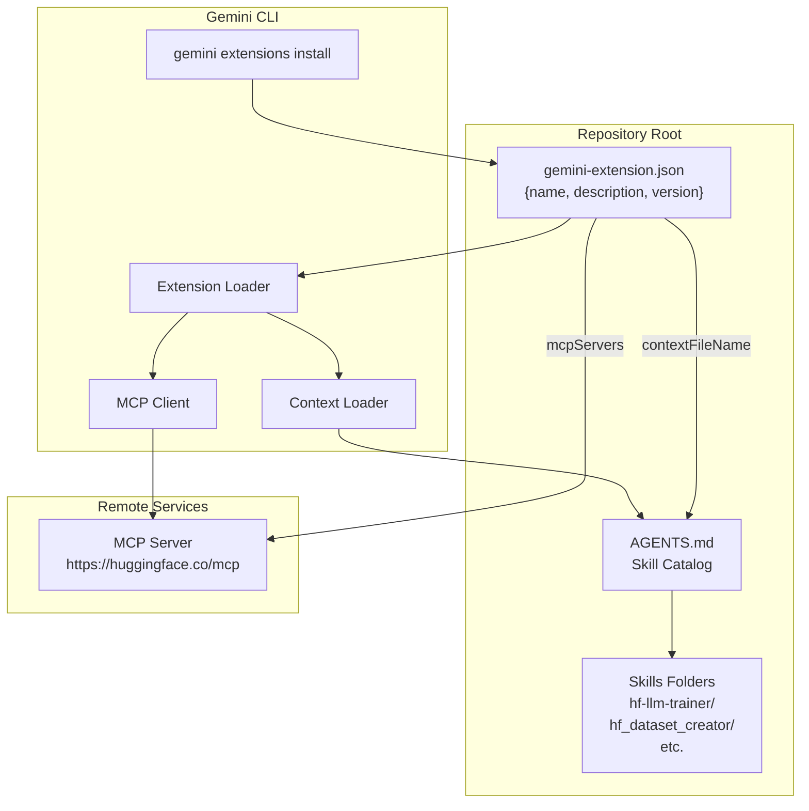
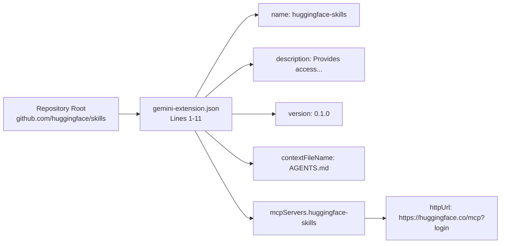
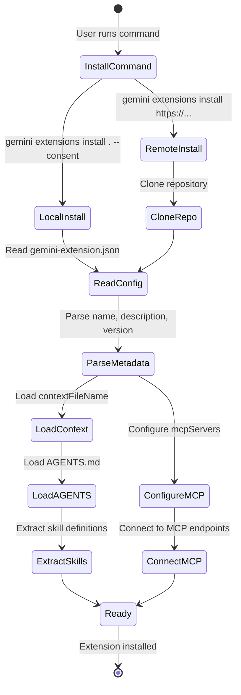
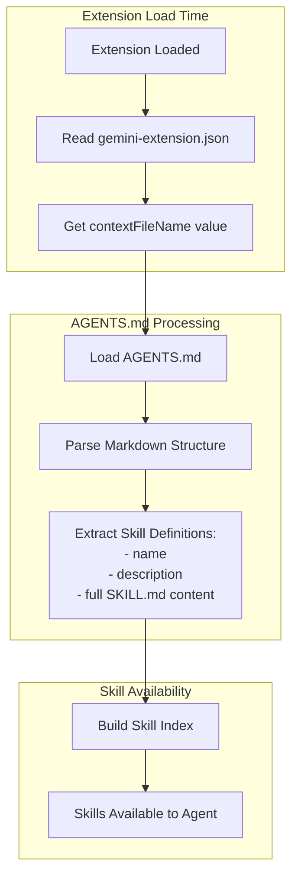
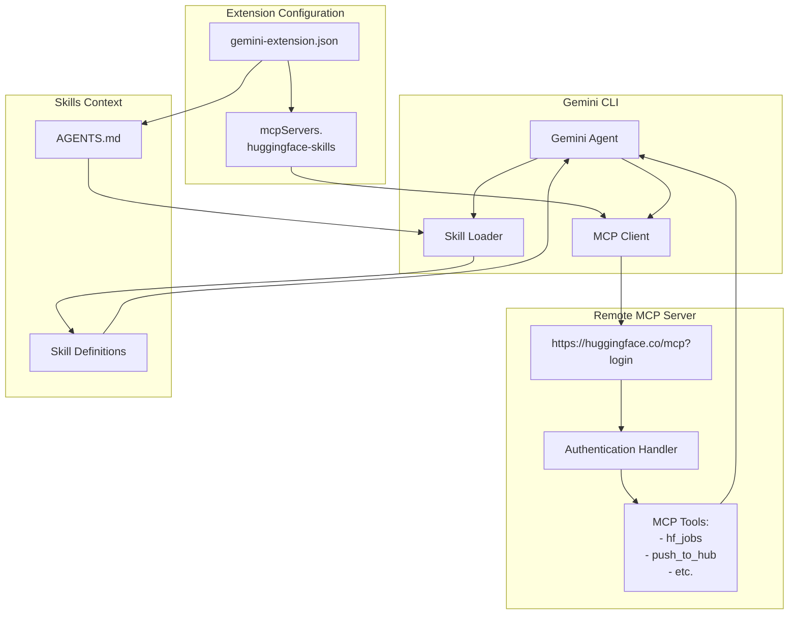
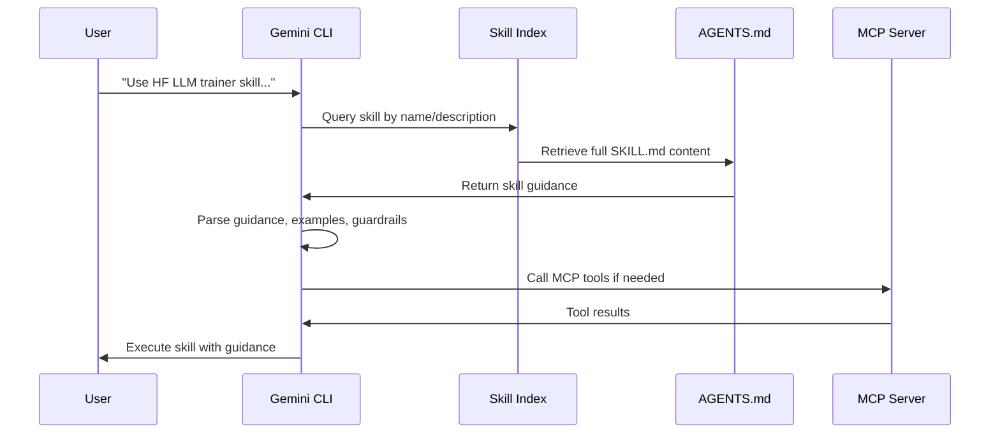

<!-- source: DeepWiki mcp.deepwiki.com · repo huggingface/skills · page 3.3 Gemini CLI Integration · fetched 2026-10-30 -->

# Gemini CLI Integration

<details>
<summary>Relevant source files</summary>

The following files were used as context for generating this wiki page:

- [.gitignore](.gitignore)
- [LICENSE](LICENSE)
- [README.md](README.md)
- [assets/banner.png](assets/banner.png)
- [gemini-extension.json](gemini-extension.json)

</details>


## Purpose and Scope

This document describes how to install and use Hugging Face Skills with Google DeepMind's Gemini CLI through the extensions system. For Claude Code integration, see [Claude Code Integration](#3.1). For OpenAI Codex integration, see [OpenAI Codex Integration](#3.2).

## Extension System Overview

Gemini CLI uses an "extensions" mechanism to integrate external skill repositories, in contrast to Claude Code's "plugin marketplace" or Codex's direct `AGENTS.md` consumption. The extension system is configured through a `gemini-extension.json` file at the repository root.

The extension defines:
- Extension metadata (name, description, version)
- Context file location for skill definitions
- Optional MCP (Model Context Protocol) server endpoints

**Extension Architecture**



Sources: [README.md:46-62](), [gemini-extension.json:1-11]()

## Configuration File Structure

The `gemini-extension.json` file defines the extension configuration with the following schema:

| Field | Type | Purpose | Value in Codebase |
|-------|------|---------|-------------------|
| `name` | string | Unique extension identifier | `"huggingface-skills"` |
| `description` | string | Human-readable purpose | `"Provides access to the Hugging Face Skills."` |
| `version` | string | Semantic version | `"0.1.0"` |
| `contextFileName` | string | Path to skill catalog file | `"AGENTS.md"` |
| `mcpServers` | object | MCP server configurations (optional) | Server definitions |

**Configuration File Location and Content**



Sources: [gemini-extension.json:1-11]()

### Context File Name

The `contextFileName` field points to `AGENTS.md`, which is the machine-readable catalog generated from all `SKILL.md` files. This allows Gemini CLI to discover available skills without manually loading individual skill folders. For details on how `AGENTS.md` is generated, see [AGENTS.md Catalog System](#2.2).

Sources: [gemini-extension.json:5](), [README.md:38-44]()

### MCP Server Configuration

The `mcpServers` object defines Model Context Protocol endpoints that provide additional tool capabilities:

```json
"mcpServers": {
    "huggingface-skills": {
        "httpUrl": "https://huggingface.co/mcp?login"
    }
}
```

The MCP server at `https://huggingface.co/mcp` provides tools for interacting with Hugging Face Hub (model uploads, dataset management, etc.). The `?login` query parameter indicates authentication is required.

Sources: [gemini-extension.json:6-10]()

## Installation Methods

Gemini CLI supports two installation methods: local filesystem and remote GitHub URL.

**Installation Flow Diagram**



Sources: [README.md:46-62]()

### Local Installation

For local development or when working with a cloned repository:

```bash
gemini extensions install . --consent
```

This command:
1. Reads `gemini-extension.json` from the current directory
2. Loads `AGENTS.md` as specified in `contextFileName`
3. Configures MCP servers from the `mcpServers` object
4. Makes all skills available to Gemini CLI

The `--consent` flag grants permission for the extension to access defined MCP servers.

Sources: [README.md:50-54]()

### Remote Installation

For installing directly from the GitHub repository:

```bash
gemini extensions install https://github.com/huggingface/skills.git --consent
```

This command:
1. Clones the repository to a temporary location
2. Reads `gemini-extension.json` from the repository root
3. Follows the same loading process as local installation
4. Keeps extension synchronized with the remote repository

Sources: [README.md:56-60]()

## Context Loading Mechanism

When Gemini CLI loads the extension, it processes the context file to make skills available to the agent.

**Context Loading Process**



Sources: [gemini-extension.json:5](), [README.md:38-44]()

The `AGENTS.md` file contains the complete content of each skill's `SKILL.md`, including:
- YAML frontmatter with `name` and `description`
- Full guidance text
- Examples
- Guardrails
- Script references

When a user mentions a skill by name or when the agent determines a skill is needed, Gemini CLI has immediate access to the complete skill definition without needing to read individual files.

Sources: [README.md:6-10]()

## MCP Server Integration

The extension can define MCP (Model Context Protocol) servers that provide additional tools beyond the skill definitions in `AGENTS.md`.

**MCP Integration Architecture**



Sources: [gemini-extension.json:6-10]()

### Hugging Face MCP Server

The configured MCP server at `https://huggingface.co/mcp` provides programmatic access to Hugging Face Hub functionality. The `?login` parameter indicates that the server requires authentication via Hugging Face credentials.

MCP tools complement skill guidance by providing:
- Direct API access to Hub operations
- Structured function calls with typed parameters
- Real-time status updates for long-running operations

Skills reference these MCP tools in their guidance sections. For example, the model-trainer skill references the `hf_jobs` MCP tool for submitting training jobs. See [Model Trainer Skill](#4.1) for details.

Sources: [gemini-extension.json:8]()

## Usage Pattern

Once installed, users interact with skills through natural language in Gemini CLI:

```bash
gemini "Use the HF LLM trainer skill to estimate GPU memory for a 7B model"
```

**Runtime Execution Flow**



Sources: [README.md:77-86]()

## Comparison with Other Agent Integrations

| Aspect | Gemini CLI | Claude Code | OpenAI Codex |
|--------|------------|-------------|--------------|
| Configuration File | `gemini-extension.json` | `.claude-plugin/marketplace.json` | None (direct `AGENTS.md` read) |
| Installation Command | `gemini extensions install` | `/plugin marketplace add` | Automatic |
| Skill Discovery | `contextFileName` → `AGENTS.md` | Direct skill folder references | `AGENTS.md` in repository root |
| MCP Support | Yes (via `mcpServers`) | No | No |
| Consent Mechanism | `--consent` flag | Per-plugin approval | Implicit |

Sources: [README.md:12-62]()

### Gemini-Specific Features

The Gemini extension system provides unique capabilities:

1. **MCP Server Integration**: Native support for Model Context Protocol servers, enabling structured tool calls beyond skill guidance
2. **Context File Abstraction**: The `contextFileName` field allows different files to serve as the skill catalog (though `AGENTS.md` is the current standard)
3. **Remote Installation**: Direct installation from GitHub URLs without manual cloning
4. **Explicit Consent**: The `--consent` flag provides transparent permission model for external server access

Sources: [gemini-extension.json:1-11](), [README.md:46-62]()

## Verification

After installation, users can verify the extension is loaded:

```bash
gemini extensions list
```

This should display:
- Extension name: `huggingface-skills`
- Version: `0.1.0`
- Status: Active
- Context file: `AGENTS.md` (loaded)
- MCP servers: `huggingface-skills` (connected)

For more information on the Gemini CLI extensions system, see the [Gemini CLI extensions documentation](https://geminicli.com/docs/extensions).

Sources: [README.md:62]()

---

