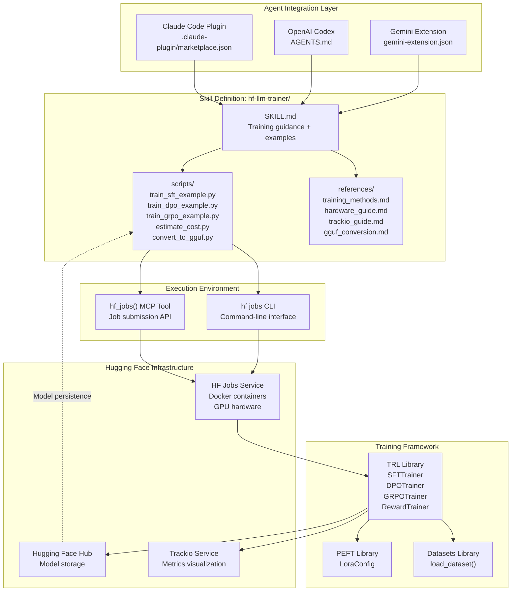
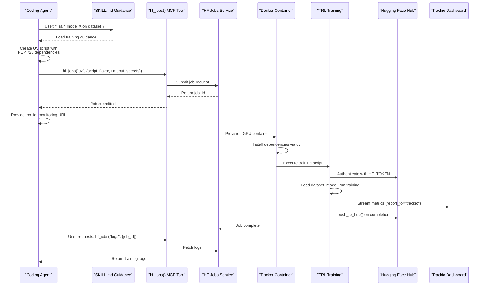

<!-- source: DeepWiki mcp.deepwiki.com · repo huggingface/skills · page 4.1 Model Trainer Skill · fetched 2026-10-30 -->

# Model Trainer Skill

<details>
<summary>Relevant source files</summary>

The following files were used as context for generating this wiki page:

- [.claude-plugin/marketplace.json](.claude-plugin/marketplace.json)
- [.gitignore](.gitignore)
- [LICENSE](LICENSE)
- [README.md](README.md)
- [assets/banner.png](assets/banner.png)
- [hf-llm-trainer/skills/model-trainer/SKILL.md](hf-llm-trainer/skills/model-trainer/SKILL.md)

</details>


## Purpose and Scope

The Model Trainer Skill provides AI coding agents with the ability to fine-tune language models on Hugging Face Jobs infrastructure using TRL (Transformer Reinforcement Learning). This skill handles cloud-based GPU training without requiring local infrastructure, supporting multiple training methods including Supervised Fine-Tuning (SFT), Direct Preference Optimization (DPO), Group Relative Policy Optimization (GRPO), and reward modeling.

This document covers the overall architecture, job submission workflow, and integration points of the model trainer skill. For detailed information on specific topics, see:
- Training method details and selection criteria: [Training Methods](#4.1.1)
- GPU selection and cost estimation: [Hardware Selection & Cost Management](#4.1.2)
- Dataset format validation: [Dataset Validation & Preparation](#4.1.3)
- Model saving and GGUF conversion: [Model Persistence & GGUF Conversion](#4.1.4)

For information about other skills in the repository, see [Available Skills](#4). For the skill definition format, see [SKILL.md Format](#2.1).

**Sources:** [hf-llm-trainer/skills/model-trainer/SKILL.md:1-10](), [README.md:70-75]()

## Architecture Overview

The Model Trainer Skill operates as a self-contained skill module within the Hugging Face Skills framework. It packages training guidance, executable scripts, and resource documentation in a standardized folder structure compatible with multiple coding agent platforms.



**Diagram: Model Trainer Skill Architecture**

The skill consists of three primary layers:

1. **Skill Definition Layer** - Contains the SKILL.md guidance document, example scripts, and reference documentation
2. **Execution Layer** - Provides job submission interfaces via MCP tool or CLI
3. **Infrastructure Layer** - Hugging Face Jobs service executes training using TRL on cloud GPUs

**Sources:** [hf-llm-trainer/skills/model-trainer/SKILL.md:1-10](), [.claude-plugin/marketplace.json:11-15](), [README.md:12-62]()

## SKILL.md Structure

The skill's primary definition is contained in `SKILL.md` with YAML frontmatter followed by structured markdown guidance.

| Section | Purpose | Content |
|---------|---------|---------|
| YAML Frontmatter | Agent-readable metadata | `name`, `description`, `license` fields |
| Overview | Training method summary | SFT, DPO, GRPO, reward modeling descriptions |
| When to Use | Invocation criteria | Cloud GPU training, GGUF conversion, Hub persistence |
| Key Directives | Critical instructions | Use `hf_jobs()`, include Trackio, validate datasets |
| Prerequisites | Setup requirements | Authentication, dataset format, timeout configuration |
| Quick Start | Three approaches | UV scripts, TRL scripts, CLI commands |
| Hardware Selection | GPU recommendations | Flavor selection table by model size |
| Critical Sections | Must-read guidance | Hub saving, timeout management, cost estimation |
| Resources | Reference materials | Links to scripts/ and references/ directories |

**Sources:** [hf-llm-trainer/skills/model-trainer/SKILL.md:1-706]()

## Job Submission Workflow

Training jobs follow a standardized submission workflow from agent intent to cloud execution.



**Diagram: Training Job Submission Sequence**

The workflow consists of three phases:

1. **Submission Phase** - Agent creates training script, calls `hf_jobs()` with parameters
2. **Execution Phase** - Jobs service provisions container, executes training asynchronously
3. **Monitoring Phase** - Agent queries logs on user request, training streams to Trackio

**Sources:** [hf-llm-trainer/skills/model-trainer/SKILL.md:39-117](), [hf-llm-trainer/skills/model-trainer/SKILL.md:80-117]()

## Core Components

### SKILL.md Guidance Document

The primary skill definition at [hf-llm-trainer/skills/model-trainer/SKILL.md]() provides structured guidance organized into functional sections:

**Critical Directives Section** [lines 39-50]():
- Mandates use of `hf_jobs()` MCP tool for job submission
- Requires Trackio integration in all training scripts
- Specifies inline script passing (not file paths)
- Enforces immediate job submission on training requests

**Prerequisites Checklist** [lines 58-79]():
- Account requirements: Pro/Team/Enterprise plan for Jobs access
- Authentication: `hf_whoami()` verification, `HF_TOKEN` with write permissions
- Dataset requirements: Hub-accessible datasets in correct format
- Critical settings: Timeout > training time, `push_to_hub=True` enabled

**Job Configuration** [lines 187-190]():
```python
{
    "script": "<Python code or URL>",
    "flavor": "a10g-large",
    "timeout": "2h",
    "secrets": {"HF_TOKEN": "$HF_TOKEN"}
}
```

**Sources:** [hf-llm-trainer/skills/model-trainer/SKILL.md:1-706]()

### Example Scripts

The `scripts/` directory contains production-ready training templates demonstrating best practices.

| Script | Purpose | Key Features |
|--------|---------|--------------|
| `train_sft_example.py` | Supervised fine-tuning template | LoRA, Trackio, checkpointing, Hub push |
| `train_dpo_example.py` | Preference optimization template | DPO-specific dataset format, chosen/rejected pairs |
| `train_grpo_example.py` | Online RL training template | GRPO configuration, reward computation |
| `estimate_cost.py` | Cost estimation utility | Hardware selection, time/cost calculation |
| `convert_to_gguf.py` | GGUF conversion script | Local deployment format generation |

These scripts are referenced in SKILL.md [lines 433-443]() and serve as copy-paste templates for agents creating custom training jobs.

**Sources:** [hf-llm-trainer/skills/model-trainer/SKILL.md:433-443](), [hf-llm-trainer/skills/model-trainer/SKILL.md:677-682]()

### Reference Documentation

The `references/` directory provides detailed technical documentation for specific topics:

| Document | Content |
|----------|---------|
| `training_methods.md` | Detailed comparison of SFT, DPO, GRPO, KTO, PPO, reward modeling |
| `hardware_guide.md` | GPU specifications, memory requirements, multi-GPU configuration |
| `trackio_guide.md` | Monitoring setup, run grouping, metric visualization |
| `gguf_conversion.md` | Quantization options, conversion workflow, deployment targets |
| `hub_saving.md` | Authentication troubleshooting, repository configuration |
| `troubleshooting.md` | Common errors, OOM fixes, timeout management |

Referenced in SKILL.md [lines 666-675]() with explicit guidance to agents on when to consult each document.

**Sources:** [hf-llm-trainer/skills/model-trainer/SKILL.md:666-675]()

## Execution Approaches

The skill supports three primary execution approaches with different use cases.

### Approach 1: UV Scripts with PEP 723

Recommended approach using inline dependency declarations. The agent constructs a Python script with PEP 723 header and passes it directly to `hf_jobs()`.

**Script Structure** [lines 150-191]():
```python
# /// script
# dependencies = ["trl>=0.12.0", "peft>=0.7.0", "trackio"]
# ///

from trl import SFTTrainer, SFTConfig
from peft import LoraConfig
import trackio

# Training code...
```

**Job Submission** [lines 150-191]():
```python
hf_jobs("uv", {
    "script": "<inline Python code>",
    "flavor": "a10g-large",
    "timeout": "2h",
    "secrets": {"HF_TOKEN": "$HF_TOKEN"}
})
```

**Key Characteristics:**
- Self-contained scripts with inline dependencies
- No file system persistence required
- Full control over training configuration
- Primary method for Claude Code integration

**Sources:** [hf-llm-trainer/skills/model-trainer/SKILL.md:145-194]()

### Approach 2: TRL Maintained Scripts

Uses official TRL example scripts from GitHub, suitable for standard training without customization.

**Script URLs** [lines 236-258]():
- SFT: `https://github.com/huggingface/trl/blob/main/trl/scripts/sft.py`
- DPO: `https://github.com/huggingface/trl/blob/main/trl/scripts/dpo.py`
- GRPO: `https://github.com/huggingface/trl/blob/main/trl/scripts/grpo.py`

**Job Submission with Arguments** [lines 240-254]():
```python
hf_jobs("uv", {
    "script": "https://github.com/huggingface/trl/blob/main/trl/scripts/sft.py",
    "script_args": [
        "--model_name_or_path", "Qwen/Qwen2.5-0.5B",
        "--dataset_name", "trl-lib/Capybara",
        "--output_dir", "my-model",
        "--push_to_hub",
        "--hub_model_id", "username/my-model"
    ],
    "flavor": "a10g-large"
})
```

**Sources:** [hf-llm-trainer/skills/model-trainer/SKILL.md:236-259]()

### Approach 3: HF Jobs CLI

Command-line interface for direct terminal usage when MCP tool is unavailable.

**CLI Syntax Rules** [lines 278-299]():
```bash
# Correct syntax - flags BEFORE script URL
hf jobs uv run --flavor a10g-large --timeout 2h --secrets HF_TOKEN "https://example.com/train.py"

# Common mistakes to avoid:
# - "run uv" instead of "uv run"
# - Flags AFTER script URL (ignored)
# - "--secret" instead of "--secrets" (plural)
```

**Status Monitoring** [lines 309-315]():
```bash
hf jobs ps                    # List all jobs
hf jobs logs <job-id>         # View logs
hf jobs inspect <job-id>      # Job details
hf jobs cancel <job-id>       # Cancel job
```

**Sources:** [hf-llm-trainer/skills/model-trainer/SKILL.md:276-335]()

## Integration Points

### Hugging Face Jobs Service

The Jobs service provides managed GPU infrastructure with Docker container isolation.

**Job Configuration Parameters:**
- `flavor`: GPU type (e.g., `"t4-small"`, `"a10g-large"`, `"a100-large"`)
- `timeout`: Maximum runtime (e.g., `"2h"`, `"90m"`, integer seconds)
- `secrets`: Environment variables (e.g., `{"HF_TOKEN": "$HF_TOKEN"}`)
- `env`: Additional environment variables

**Container Lifecycle:**
1. Jobs service provisions Docker container with specified GPU
2. UV installs dependencies from PEP 723 header
3. Script executes with access to secrets and environment
4. Container destroyed on completion (ephemeral environment)

**Critical Consideration** [lines 358-388](): Training environment is ephemeral - all files deleted on job completion. Models MUST be pushed to Hub or all training is lost.

**Sources:** [hf-llm-trainer/skills/model-trainer/SKILL.md:337-355](), [hf-llm-trainer/skills/model-trainer/SKILL.md:358-388]()

### TRL Training Framework

TRL (Transformer Reinforcement Learning) provides trainer classes for different training methods.

**Trainer Classes:**
- `SFTTrainer` with `SFTConfig` - Supervised fine-tuning
- `DPOTrainer` with `DPOConfig` - Direct preference optimization
- `GRPOTrainer` with `GRPOConfig` - Group relative policy optimization
- `RewardTrainer` with `RewardConfig` - Reward model training

**Configuration Pattern** [lines 166-182]():
```python
trainer = SFTTrainer(
    model="Qwen/Qwen2.5-0.5B",
    train_dataset=dataset_split["train"],
    eval_dataset=dataset_split["test"],
    peft_config=LoraConfig(r=16, lora_alpha=32),
    args=SFTConfig(
        output_dir="my-model",
        push_to_hub=True,
        hub_model_id="username/my-model",
        num_train_epochs=3,
        eval_strategy="steps",
        report_to="trackio"
    )
)
```

**Sources:** [hf-llm-trainer/skills/model-trainer/SKILL.md:13-26](), [hf-llm-trainer/skills/model-trainer/SKILL.md:150-186]()

### Trackio Monitoring

Trackio provides real-time training metrics visualization integrated via TRL's `report_to` parameter.

**Configuration** [lines 454-467]():
- **Space ID**: `{username}/trackio` (default)
- **Run naming**: Descriptive task/model/purpose identifier
- **Project grouping**: `project="project_name"` for related runs
- **Report target**: `report_to="trackio"` in trainer config

**Integration Pattern** [lines 175-180]():
```python
args=SFTConfig(
    report_to="trackio",
    project="meaningful_project_name",
    run_name="meaningful_run_name",
    # ... other config
)
```

**Sources:** [hf-llm-trainer/skills/model-trainer/SKILL.md:444-467]()

## Critical Configuration Requirements

### Authentication and Hub Access

**Token Requirements** [lines 62-69]():
- `HF_TOKEN` environment variable with write permissions
- Passed via `secrets={"HF_TOKEN": "$HF_TOKEN"}` in job config
- Verified before training: `hf_whoami()` check recommended
- Required for: Hub authentication, model push, private datasets

**Account Requirements** [lines 63-64]():
- Hugging Face Pro, Team, or Enterprise plan
- Free tier does NOT have Jobs access

**Sources:** [hf-llm-trainer/skills/model-trainer/SKILL.md:58-79]()

### Timeout Configuration

**Default Limitation** [lines 392-393](): Default 30-minute timeout is TOO SHORT for most training. Minimum recommended: 1-2 hours.

**Timeout Guidelines** [lines 403-411]():

| Scenario | Recommended Timeout | Notes |
|----------|---------------------|-------|
| Quick demo (50-100 examples) | 10-30 min | Setup verification |
| Development training | 1-2 hours | Small datasets |
| Production (3-7B model) | 4-6 hours | Full datasets |
| Large model with LoRA | 3-6 hours | Dataset dependent |

**Buffer Calculation** [line 411](): Always add 20-30% buffer for loading, checkpoint saving, Hub push, and network delays.

**Consequences** [line 414](): On timeout, job killed immediately, all unsaved progress lost, must restart from beginning.

**Sources:** [hf-llm-trainer/skills/model-trainer/SKILL.md:390-414]()

### Model Persistence

**Critical Requirement** [lines 358-361](): Jobs environment is temporary. All files deleted when job ends. If model isn't pushed to Hub, ALL TRAINING IS LOST.

**Required Configuration** [lines 364-371]():
```python
# In trainer config
SFTConfig(
    push_to_hub=True,
    hub_model_id="username/model-name",  # MUST specify
    hub_strategy="every_save",  # Optional: push checkpoints
)

# In job submission
{"secrets": {"HF_TOKEN": "$HF_TOKEN"}}  # Enables authentication
```

**Verification Checklist** [lines 381-387]():
- [ ] `push_to_hub=True` set in config
- [ ] `hub_model_id` includes username/repo-name
- [ ] `secrets` parameter includes HF_TOKEN
- [ ] User has write access to target repo

**Sources:** [hf-llm-trainer/skills/model-trainer/SKILL.md:358-388]()

## Agent Interaction Guidelines

### Asynchronous Job Execution

**Important Behavior** [lines 82-83](): Training jobs run asynchronously and can take hours. Jobs run in background - submission returns immediately.

**Required Actions on Training Request** [lines 86-90]():
1. Create training script with Trackio included
2. Submit immediately using `hf_jobs()` with inline script content
3. Report submission with job ID, monitoring URL, estimated time
4. Wait for user to request status checks - don't poll automatically

**Ground Rules** [lines 92-96]():
- Jobs run in background - training continues independently
- Initial logs delayed - can take 30-60 seconds to appear
- User checks status - wait for explicit status update requests
- Avoid polling - provide monitoring links instead of repeated checks

**Response Template** [lines 106-117]():
```
✅ Job submitted successfully!

Job ID: abc123xyz
Monitor: https://huggingface.co/jobs/username/abc123xyz

Expected time: ~2 hours
Estimated cost: ~$10

The job is running in the background. Ask me to check status/logs when ready!
```

**Sources:** [hf-llm-trainer/skills/model-trainer/SKILL.md:80-117]()

### Script Content Handling

**Critical Rule** [line 43](): Do NOT save to local files unless user explicitly requests it. Pass script content as string to `hf_jobs()`.

**Why Local Paths Fail** [lines 200-204](): Jobs run in isolated Docker containers without access to local filesystem. Scripts must be inline code, publicly accessible URLs, or private repo URLs.

**Common Mistakes** [lines 207-212]():
```python
# ❌ These will all fail
hf_jobs("uv", {"script": "train.py"})
hf_jobs("uv", {"script": "./scripts/train.py"})
hf_jobs("uv", {"script": "/path/to/train.py"})
```

**Correct Approaches** [lines 215-227]():
```python
# ✅ Inline code (recommended)
hf_jobs("uv", {"script": "# /// script\n# dependencies = [...]\n# ///\n\n<code>"})

# ✅ From Hugging Face Hub
hf_jobs("uv", {"script": "https://huggingface.co/user/repo/resolve/main/train.py"})

# ✅ From GitHub
hf_jobs("uv", {"script": "https://raw.githubusercontent.com/user/repo/main/train.py"})
```

**Sources:** [hf-llm-trainer/skills/model-trainer/SKILL.md:197-234]()

## Hardware and Cost Management

### GPU Flavor Selection

**Hardware Table** [lines 339-346]():

| Model Size | Recommended Hardware | Cost (approx/hr) | Use Case |
|------------|---------------------|------------------|----------|
| <1B params | `t4-small` | ~$0.75 | Demos, quick tests only (no eval) |
| 1-3B params | `t4-medium`, `l4x1` | ~$1.50-2.50 | Development |
| 3-7B params | `a10g-small`, `a10g-large` | ~$3.50-5.00 | Production training |
| 7-13B params | `a10g-large`, `a100-large` | ~$5-10 | Large models (use LoRA) |
| 13B+ params | `a100-large`, `a10g-largex2` | ~$10-20 | Very large (use LoRA) |

**Available Flavors** [line 347]: cpu-basic/upgrade/performance/xl, t4-small/medium, l4x1/x4, a10g-small/large/largex2/largex4, a100-large, h100/h100x8

**Guidelines** [lines 349-352]():
- Use LoRA/PEFT for models >7B to reduce memory
- Multi-GPU automatically handled by TRL/Accelerate
- Start with smaller hardware for testing

**Sources:** [hf-llm-trainer/skills/model-trainer/SKILL.md:337-354]()

### Cost Estimation Tool

The `estimate_cost.py` script provides time and cost estimates before job submission.

**Usage** [lines 418-426]():
```bash
python scripts/estimate_cost.py \
  --model meta-llama/Llama-2-7b-hf \
  --dataset trl-lib/Capybara \
  --hardware a10g-large \
  --dataset-size 16000 \
  --epochs 3
```

**Output Includes:**
- Estimated training time
- Total cost projection
- Recommended timeout with buffer
- Optimization suggestions

**When to Offer** [line 430](): User planning job, asks about cost/time, choosing hardware, job will run >1 hour or cost >$5.

**Sources:** [hf-llm-trainer/skills/model-trainer/SKILL.md:416-430]()

## Dataset Validation

The skill emphasizes pre-training dataset validation to prevent format-related failures.

**Validation Statistics** [lines 489-492]():
- 50%+ of training failures due to dataset format issues
- DPO especially strict: requires exact column names (`prompt`, `chosen`, `rejected`)
- Failed GPU jobs waste $1-10 and 30-60 minutes
- Validation on CPU costs ~$0.01, takes <1 minute

**Validation Tool** [lines 507-514]():
```python
hf_jobs("uv", {
    "script": "https://huggingface.co/datasets/mcp-tools/skills/raw/main/dataset_inspector.py",
    "script_args": ["--dataset", "username/dataset-name", "--split", "train"]
})
```

**Output Markers** [lines 517-522]():
- **`✓ READY`** - Dataset compatible, use directly
- **`✗ NEEDS MAPPING`** - Compatible but needs preprocessing (code provided)
- **`✗ INCOMPATIBLE`** - Cannot be used for this method

**When to Validate** [lines 496-504]():
- ALWAYS for: Unknown datasets, DPO training (critical), non-TRL-compatible datasets
- Skip for: Known TRL datasets (`trl-lib/ultrachat_200k`, `trl-lib/Capybara`, etc.)

For complete dataset preparation guidance, see [Dataset Validation & Preparation](#4.1.3).

**Sources:** [hf-llm-trainer/skills/model-trainer/SKILL.md:484-562]()

## Configuration Examples

### Sequence Length Configuration

TRL config classes use `max_length` parameter to control tokenized sequence length.

**Correct Usage** [lines 128-133]():
```python
# ✅ CORRECT
SFTConfig(max_length=512)   # Truncate sequences to 512 tokens
DPOConfig(max_length=2048)  # Longer context (2048 tokens)

# ❌ WRONG
SFTConfig(max_seq_length=512)  # TypeError! Parameter doesn't exist
```

**Default Behavior** [line 136]: `max_length=1024` (truncates from right)

**When to Override** [lines 138-141]():
- Longer context: Set higher (e.g., `max_length=2048`)
- Memory constraints: Set lower (e.g., `max_length=512`)
- Vision models: Set `max_length=None` (prevents cutting image tokens)

**Sources:** [hf-llm-trainer/skills/model-trainer/SKILL.md:123-143]()

### Memory Optimization

**Demo Configuration Tip** [line 121]: For quick demos on smaller GPUs (t4-small), omit `eval_dataset` and `eval_strategy` to save ~40% memory.

**OOM Troubleshooting Steps** [lines 609-612]():
1. Reduce batch size: `per_device_train_batch_size=1`, increase `gradient_accumulation_steps=8`
2. Enable gradient checkpointing: `gradient_checkpointing=True`
3. Upgrade hardware: t4-small → l4x1, a10g-small → a10g-large

**Effective Batch Size** [line 610]: `per_device_train_batch_size` × `gradient_accumulation_steps`. Keep close to 128 for best performance.

**Sources:** [hf-llm-trainer/skills/model-trainer/SKILL.md:121-122](), [hf-llm-trainer/skills/model-trainer/SKILL.md:607-613]()

## Troubleshooting Quick Reference

**Common Issues** [lines 655-662]():

| Issue | Fix |
|-------|-----|
| Job times out | Increase timeout, reduce epochs/dataset, use smaller model/LoRA |
| Model not saved to Hub | Check `push_to_hub=True`, `hub_model_id`, `secrets=HF_TOKEN` |
| Out of Memory (OOM) | Reduce batch size, increase gradient accumulation, enable LoRA, use larger GPU |
| Dataset format error | Validate with dataset inspector (see [Dataset Validation](#4.1.3)) |
| Import/module errors | Add PEP 723 header with dependencies, verify format |
| Authentication errors | Check `hf_whoami()`, token permissions, secrets parameter |

For detailed troubleshooting procedures, see the complete guide at `references/troubleshooting.md`.

**Sources:** [hf-llm-trainer/skills/model-trainer/SKILL.md:653-663]()

## Related Documentation

### Internal References

Scripts in `scripts/` directory:
- [scripts/train_sft_example.py]() - Production SFT template
- [scripts/train_dpo_example.py]() - Production DPO template
- [scripts/train_grpo_example.py]() - Production GRPO template
- [scripts/estimate_cost.py]() - Cost estimation utility
- [scripts/convert_to_gguf.py]() - GGUF conversion script

Reference documentation in `references/` directory:
- [references/training_methods.md]() - Training method comparison and selection
- [references/hardware_guide.md]() - Hardware specifications
- [references/trackio_guide.md]() - Monitoring setup
- [references/gguf_conversion.md]() - GGUF conversion guide
- [references/hub_saving.md]() - Hub authentication troubleshooting
- [references/troubleshooting.md]() - Common issues and solutions

**Sources:** [hf-llm-trainer/skills/model-trainer/SKILL.md:666-682]()

### External Resources

**TRL Documentation** [lines 686-694]():
- [TRL Documentation](https://huggingface.co/docs/trl) - Official TRL library docs
- [TRL Jobs Training Guide](https://huggingface.co/docs/trl/en/jobs_training) - Jobs-specific guide
- [TRL Example Scripts](https://github.com/huggingface/trl/tree/main/examples/scripts) - Official examples
- [HF Jobs Documentation](https://huggingface.co/docs/huggingface_hub/guides/jobs) - Jobs API reference

**UV Scripts**:
- [UV Scripts Guide](https://docs.astral.sh/uv/guides/scripts) - PEP 723 format
- [UV Scripts Organization](https://huggingface.co/uv-scripts) - Ready-to-use script collections

**Sources:** [hf-llm-trainer/skills/model-trainer/SKILL.md:686-694]()

## Key Takeaways

From SKILL.md [lines 695-706]():

1. **Submit scripts inline** - Pass Python code directly to `hf_jobs()`; no file saving unless requested
2. **Jobs are asynchronous** - Don't wait/poll; let user check when ready
3. **Always set timeout** - Default 30 min insufficient; minimum 1-2 hours recommended
4. **Always enable Hub push** - Environment ephemeral; without push, all results lost
5. **Include Trackio** - Use example scripts as templates for real-time monitoring
6. **Offer cost estimation** - When parameters known, use `scripts/estimate_cost.py`
7. **Use UV scripts (Approach 1)** - Default to `hf_jobs("uv", {...})` with inline scripts
8. **Use hf_doc_fetch/hf_doc_search** - For latest TRL documentation
9. **Validate dataset format** - Before training with dataset inspector
10. **Choose appropriate hardware** - For model size; use LoRA for models >7B

**Sources:** [hf-llm-trainer/skills/model-trainer/SKILL.md:695-706]()

---

