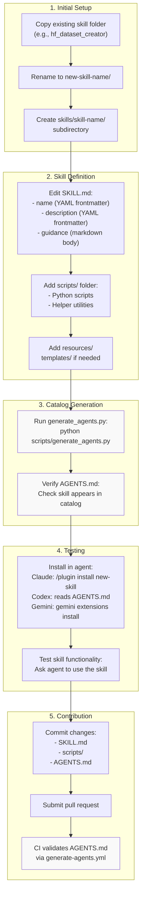
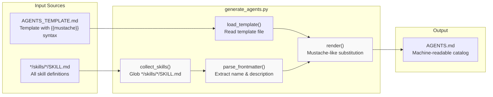
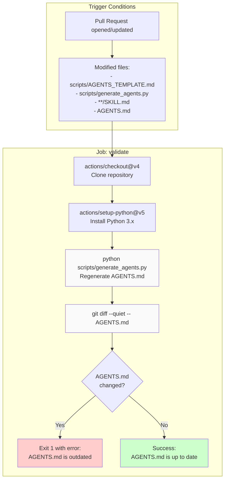
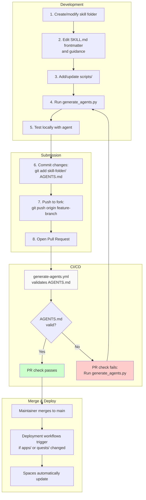

<!-- source: DeepWiki mcp.deepwiki.com · repo huggingface/skills · page 6 Development Guide · fetched 2026-10-30 -->

# Development Guide

<details>
<summary>Relevant source files</summary>

The following files were used as context for generating this wiki page:

- [.github/workflows/generate-agents.yml](.github/workflows/generate-agents.yml)
- [.gitignore](.gitignore)
- [AGENTS.md](AGENTS.md)
- [LICENSE](LICENSE)
- [README.md](README.md)
- [assets/banner.png](assets/banner.png)
- [pyproject.toml](pyproject.toml)
- [scripts/AGENTS_TEMPLATE.md](scripts/AGENTS_TEMPLATE.md)
- [scripts/generate_agents.py](scripts/generate_agents.py)

</details>


This document provides guidance for contributors who want to create custom skills, understand the project dependencies, and work with the CI/CD workflows. For information about the SKILL.md format specification itself, see [SKILL.md Format](#2.1). For information about using existing skills with coding agents, see [Agent Integration](#3).

## Development Environment Setup

### Prerequisites

The repository requires Python 3.13 or higher as specified in [pyproject.toml:6](). The core development workflow does not require installing Python dependencies unless you are testing the Gradio-based leaderboard applications.

### Repository Structure

The repository follows a consistent folder structure where each skill is self-contained:

```
huggingface/skills/
├── hf-llm-trainer/
│   └── skills/model-trainer/
│       ├── SKILL.md
│       └── scripts/
├── hf_dataset_creator/
│   └── skills/hugging-face-dataset-creator/
│       ├── SKILL.md
│       └── scripts/
├── hf_model_evaluation/
│   └── skills/hugging-face-evaluation-manager/
│       ├── SKILL.md
│       └── scripts/
├── hf-paper-publisher/
│   └── skills/hugging-face-paper-publisher/
│       ├── SKILL.md
│       └── scripts/
├── scripts/
│   ├── generate_agents.py
│   └── AGENTS_TEMPLATE.md
├── AGENTS.md (generated)
└── .github/workflows/
```

Each skill folder contains a nested `skills/` directory with the actual skill definition. This allows the parent folder to contain additional resources, documentation, or related code.

**Sources:** [README.md:1-107](), [.gitignore:1-208]()

## Creating Custom Skills

### Skill Creation Workflow

The following diagram illustrates the complete workflow for creating a new skill:

#### Skill Development Lifecycle



**Sources:** [README.md:88-103](), [scripts/generate_agents.py:1-81]()

### SKILL.md Requirements

Every skill must have a `SKILL.md` file with YAML frontmatter containing `name` and `description` fields:

```markdown
---
name: my-skill-name
description: Brief description of what the skill does and when to use it
---

# Skill Title

## Overview
Detailed guidance for the coding agent...

## Examples
Example usage patterns...

## Guardrails
Important constraints and warnings...
```

The `name` field must be unique across all skills and becomes the skill identifier in [AGENTS.md:6-9](). The `description` field appears in the `<available_skills>` section that agents use for skill discovery [AGENTS.md:13-19]().

**Sources:** [README.md:91-99](), [AGENTS.md:1-24]()

### Script and Resource Organization

Place all executable scripts in a `scripts/` subdirectory within the skill folder. For example, the dataset creator skill organizes its scripts as:

```
hf_dataset_creator/skills/hugging-face-dataset-creator/
├── SKILL.md
└── scripts/
    ├── dataset_manager.py
    ├── quick_setup.py
    └── add_rows.py
```

When referencing scripts from `SKILL.md`, use paths relative to the repository root. The [AGENTS.md:21]() file explicitly notes: "Paths referenced within SKILL folders are relative to that SKILL."

**Sources:** [AGENTS.md:21](), [README.md:72-75]()

### Regenerating AGENTS.md

After modifying any `SKILL.md` file, you must regenerate [AGENTS.md]() using the generation script:

```bash
python scripts/generate_agents.py
```

This script performs the following operations:

#### AGENTS.md Generation Process



The [scripts/generate_agents.py:33-50]() function `collect_skills()` uses the glob pattern `*/skills/*/SKILL.md` to discover all skill files. It parses the frontmatter using a lightweight regex-based parser [scripts/generate_agents.py:19-30]() that extracts `name` and `description` fields without requiring external YAML libraries.

The [scripts/generate_agents.py:52-68]() function `render()` implements a minimal Mustache-like template engine that supports only the `{{#skills}}...{{/skills}}` loop syntax needed for [scripts/AGENTS_TEMPLATE.md:1-23]().

**Sources:** [scripts/generate_agents.py:1-81](), [scripts/AGENTS_TEMPLATE.md:1-23]()

## Project Dependencies

### pyproject.toml Configuration

The repository uses a minimal `pyproject.toml` configuration:

| Field | Value | Purpose |
|-------|-------|---------|
| `name` | `"aa-on-hub"` | Internal project name |
| `version` | `"0.1.0"` | Version identifier |
| `requires-python` | `">=3.13"` | Minimum Python version |

**Sources:** [pyproject.toml:1-14]()

### Core Dependencies

The project declares the following runtime dependencies in [pyproject.toml:7-13]():

| Package | Version Constraint | Usage |
|---------|-------------------|-------|
| `gradio` | `>=5.50.0` | Web applications for leaderboards |
| `huggingface-hub` | `>=1.1.4` | Hub API interactions |
| `python-dotenv` | `>=1.2.1` | Environment variable management |
| `pyyaml` | `>=6.0.3` | YAML parsing for configurations |
| `requests` | `>=2.32.5` | HTTP requests |

These dependencies are primarily used by the leaderboard applications in `apps/` rather than the core skill system. The skill generation script [scripts/generate_agents.py]() has no external dependencies and uses only Python standard library modules.

**Sources:** [pyproject.toml:7-13]()

### Development Setup

For contributors testing leaderboard applications locally, install dependencies using:

```bash
pip install -e .
```

The `.gitignore` file excludes common Python artifacts including:
- Virtual environments: `.venv`, `venv/`, `env/`
- Byte-compiled files: `__pycache__/`, `*.pyc`
- Distribution files: `dist/`, `build/`, `*.egg-info/`
- Tool caches: `.ruff_cache/`, `.mypy_cache/`

**Sources:** [.gitignore:1-208](), [pyproject.toml:1-14]()

## CI/CD Workflows

### GitHub Actions Overview

The repository uses GitHub Actions for continuous integration and deployment. The workflows are defined in `.github/workflows/`:

| Workflow File | Trigger | Purpose |
|--------------|---------|---------|
| `generate-agents.yml` | PR with SKILL.md changes | Validates AGENTS.md is up-to-date |
| `push-hackers-leaderboard.yml` | Push to `apps/hackers-leaderboard/**` | Deploys Hackers Leaderboard to HF Spaces |
| `push-evals-leaderboard.yml` | Push to `apps/evals-leaderboard/**` | Deploys Evals Leaderboard to HF Spaces |
| `push-quests.yml` | Push to `quests/**` | Deploys quest documentation to HF Spaces |

**Sources:** [.github/workflows/generate-agents.yml:1-32]()

### AGENTS.md Validation Workflow

The `generate-agents.yml` workflow enforces that [AGENTS.md]() stays synchronized with skill definitions:

#### generate-agents.yml Workflow



The workflow runs on `ubuntu-latest` and performs the following steps defined in [.github/workflows/generate-agents.yml:13-31]():

1. **Checkout:** Uses `actions/checkout@v4` to clone the repository
2. **Python Setup:** Uses `actions/setup-python@v5` to install Python 3.x
3. **Regenerate:** Runs `python scripts/generate_agents.py` to rebuild [AGENTS.md]()
4. **Validate:** Uses `git diff --quiet -- AGENTS.md` to detect changes
5. **Fail or Pass:** If the diff is non-empty, the workflow fails with an error message instructing the contributor to run the generation script and commit the changes

This validation-only approach (rather than auto-committing) ensures developers are aware when skill definitions change and review the generated catalog updates.

**Sources:** [.github/workflows/generate-agents.yml:1-32]()

### Path-Based Deployment Triggers

The deployment workflows use GitHub Actions path filters to trigger only when relevant files change. For example, the Hackers Leaderboard workflow triggers on:

```yaml
on:
  push:
    branches:
      - main
    paths:
      - 'apps/hackers-leaderboard/**'
```

This pattern minimizes unnecessary deployments by deploying only the applications whose source code has changed. The quest documentation workflow similarly triggers only on changes to `quests/**` markdown files.

**Sources:** [.github/workflows/generate-agents.yml:3-9]()

### Deployment to Hugging Face Spaces

The deployment workflows use the `hf` CLI to upload application code to Hugging Face Spaces. Each workflow:

1. Authenticates using `HF_TOKEN` secret
2. Uploads the application directory to the corresponding Space
3. The Space automatically rebuilds and redeploys the Gradio application

For detailed information about the data collection and leaderboard systems, see [Hackers Leaderboard](#5.2) and [Evals Leaderboard](#5.3).

**Sources:** [README.md:1-107]()

### Contributing Workflow Summary

The complete contribution workflow with CI/CD integration:



**Sources:** [.github/workflows/generate-agents.yml:1-32](), [README.md:88-106]()

---

