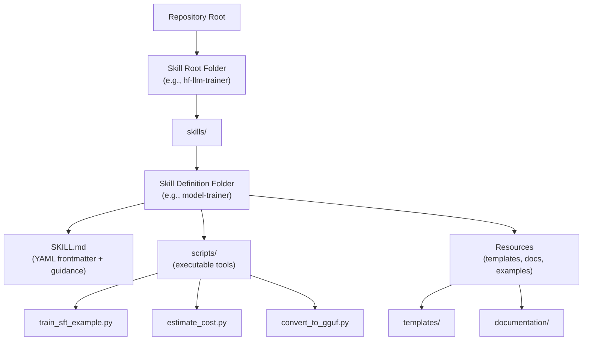
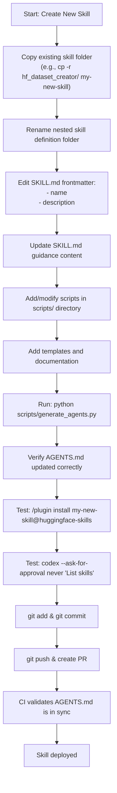
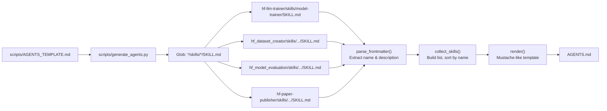
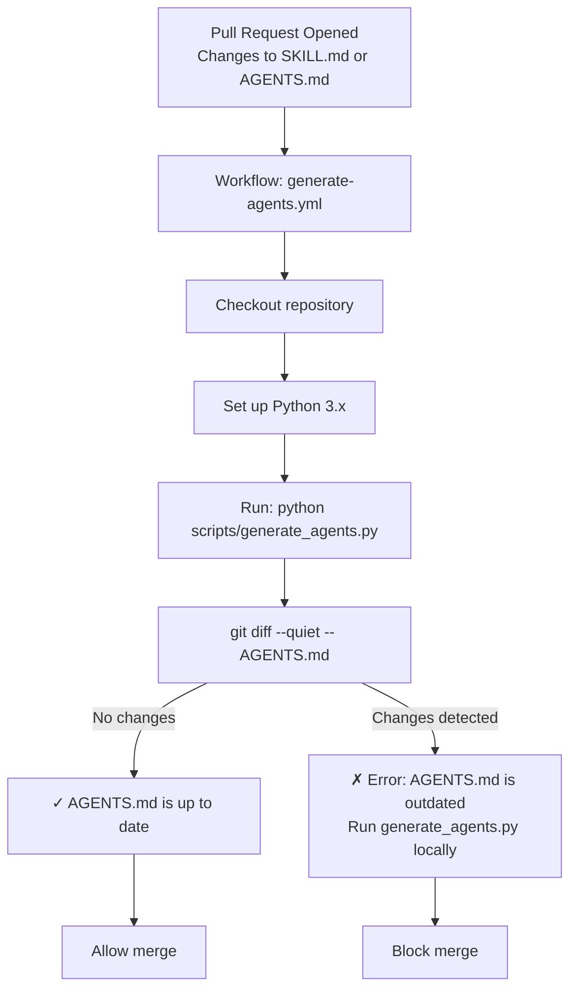
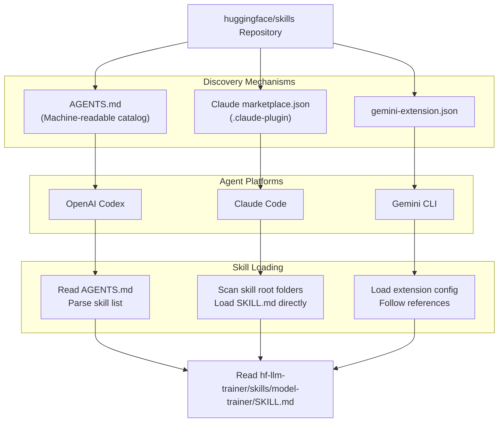

<!-- source: DeepWiki mcp.deepwiki.com · repo huggingface/skills · page 6.1 Creating Custom Skills · fetched 2026-10-30 -->

# Creating Custom Skills

<details>
<summary>Relevant source files</summary>

The following files were used as context for generating this wiki page:

- [.github/workflows/generate-agents.yml](.github/workflows/generate-agents.yml)
- [.gitignore](.gitignore)
- [AGENTS.md](AGENTS.md)
- [LICENSE](LICENSE)
- [README.md](README.md)
- [assets/banner.png](assets/banner.png)
- [scripts/AGENTS_TEMPLATE.md](scripts/AGENTS_TEMPLATE.md)
- [scripts/generate_agents.py](scripts/generate_agents.py)

</details>


This document provides a step-by-step guide for developers who want to create new skills for the Hugging Face Skills repository. It covers the skill folder structure, SKILL.md format requirements, the AGENTS.md generation process, and integration testing with different coding agents.

For information about the SKILL.md format specification, see [SKILL.md Format](#2.1). For details on how skills integrate with different agents, see [Agent Integration](#3).

---

## Skill Folder Structure

Each skill follows a standardized directory structure that packages instructions, scripts, and resources together. The folder must be located in the repository root and contain a nested `skills/` subdirectory with the actual skill definition.

**Directory Structure Pattern**



**Sources:** [README.md:88-103](), Diagram 4 from high-level architecture

---

## Folder Path Discovery Logic

The [scripts/generate_agents.py:35-49]() script discovers skills by scanning for `SKILL.md` files using the glob pattern `*/skills/*/SKILL.md`. This means:

- Skill root folders must be at repository root level
- Each skill root must contain a `skills/` subdirectory
- Each skill definition must be in its own subdirectory under `skills/`
- Each skill definition directory must contain a `SKILL.md` file

| Component | Example | Required |
|-----------|---------|----------|
| Skill Root Folder | `hf_dataset_creator/` | Yes |
| Skills Subdirectory | `hf_dataset_creator/skills/` | Yes |
| Skill Definition Folder | `hf_dataset_creator/skills/hugging-face-dataset-creator/` | Yes |
| SKILL.md File | `hf_dataset_creator/skills/hugging-face-dataset-creator/SKILL.md` | Yes |
| scripts/ Directory | `hf_dataset_creator/skills/hugging-face-dataset-creator/scripts/` | Optional |

**Sources:** [scripts/generate_agents.py:35-49]()

---

## Step-by-Step Creation Process

**Process Flow Diagram**



**Sources:** [README.md:88-103](), [.github/workflows/generate-agents.yml:1-32]()

---

## SKILL.md Frontmatter Requirements

The SKILL.md file begins with YAML frontmatter that defines the skill's metadata. This frontmatter is parsed by [scripts/generate_agents.py:19-30]() to extract the `name` and `description` fields.

**Frontmatter Structure**

```markdown
---
name: my-skill-name
description: Describe what the skill does and when to use it
---

# Skill Title
Guidance + examples + guardrails
```

**Parsing Logic**

The [scripts/generate_agents.py:19-30]() function uses a minimal YAML parser that:
1. Searches for content between `---` delimiters
2. Splits each line on the first `:` character
3. Extracts `key: value` pairs
4. Requires both `name` and `description` fields to be present

| Field | Type | Required | Purpose |
|-------|------|----------|---------|
| `name` | string | Yes | Used as skill identifier in AGENTS.md and agent marketplaces |
| `description` | string | Yes | Displayed to agents for skill discovery and selection |

**Sources:** [scripts/generate_agents.py:19-30](), [README.md:91-99]()

---

## AGENTS.md Generation Process

The AGENTS.md catalog is automatically generated from all SKILL.md files in the repository. This ensures consistency between skill definitions and the machine-readable catalog used by agents like Codex.

**Generation Flow Diagram**



**Template Variables**

The [scripts/AGENTS_TEMPLATE.md:1-23]() template uses Mustache-like syntax with these variables:

- `{{#skills}}...{{/skills}}`: Loop over all discovered skills
- `{{name}}`: Skill name from frontmatter
- `{{description}}`: Skill description from frontmatter
- `{{path}}`: Relative path to skill directory (e.g., `hf-llm-trainer/skills/model-trainer`)

**Regeneration Command**

```bash
python scripts/generate_agents.py
```

This command:
1. Loads the template from [scripts/AGENTS_TEMPLATE.md:1-23]()
2. Discovers all skills matching `*/skills/*/SKILL.md`
3. Parses frontmatter from each SKILL.md
4. Sorts skills alphabetically by name
5. Renders the template with skill data
6. Writes output to `AGENTS.md`

**Sources:** [scripts/generate_agents.py:1-81](), [scripts/AGENTS_TEMPLATE.md:1-23]()

---

## Script and Resource Organization

Skills can include executable scripts and supporting resources. These follow a conventional structure to ensure agents can locate and execute them correctly.

**Common Patterns**

| Directory | Purpose | Examples |
|-----------|---------|----------|
| `scripts/` | Executable Python scripts, UV scripts (PEP 723), shell scripts | `train_sft_example.py`, `dataset_manager.py`, `evaluation_manager.py` |
| `templates/` | Reusable templates for data structures | `chat`, `classification`, `qa`, `completion` |
| `resources/` | Documentation, configuration files, examples | `README.md`, `config.yaml` |
| `docs/` | Extended documentation | `hardware_guide.md`, `troubleshooting.md` |

**Path Referencing Convention**

When referencing files within SKILL.md guidance, use paths relative to the skill definition folder. Agents resolve these paths by prepending the skill root path.

Example from AGENTS.md:
```
hf_dataset_creator `scripts/example.py` → hf_dataset_creator/skills/hugging-face-dataset-creator/scripts/example.py
```

**Sources:** [AGENTS.md:21-22](), Diagram 4 from high-level architecture

---

## CI/CD Validation Workflow

The repository includes a GitHub Actions workflow that validates AGENTS.md remains synchronized with SKILL.md files on every pull request.

**Validation Process**



**Triggering Paths**

The workflow is triggered by changes to:
- [.github/workflows/generate-agents.yml:5-9]()
  - `scripts/AGENTS_TEMPLATE.md`
  - `scripts/generate_agents.py`
  - `**/SKILL.md` (any SKILL.md file)
  - `AGENTS.md`

**Failure Resolution**

If the CI check fails:
1. Run `python scripts/generate_agents.py` locally
2. Review the changes to `AGENTS.md`
3. Commit the updated `AGENTS.md`
4. Push the commit to the PR branch

**Sources:** [.github/workflows/generate-agents.yml:1-32]()

---

## Testing with Different Agents

After creating a skill, test it with multiple agent platforms to ensure compatibility.

**Agent Integration Testing Matrix**

| Agent | Installation Command | Verification Command | Skill Path Format |
|-------|---------------------|---------------------|-------------------|
| Claude Code | `/plugin marketplace add huggingface/skills`<br/>`/plugin install <skill-root>@huggingface-skills` | Check plugin list | Uses skill root folder name |
| Codex | N/A (automatic via AGENTS.md) | `codex --ask-for-approval never "Summarize the current instructions."` | Reads from AGENTS.md |
| Gemini CLI | `gemini extensions install . --consent` | Check extension list | Uses gemini-extension.json |

**Claude Code Testing**

```bash
# Register marketplace
/plugin marketplace add huggingface/skills

# Install your skill (use skill ROOT folder name)
/plugin install my-new-skill@huggingface-skills

# Verify by mentioning the skill
"Use the <skill-name> skill to..."
```

**Codex Testing**

```bash
# Codex automatically loads AGENTS.md
# Verify skills are loaded
codex --ask-for-approval never "List all available skills"

# Test skill invocation
codex --ask-for-approval never "Use the <skill-name> skill to..."
```

**Sources:** [README.md:14-62]()

---

## Skill Discovery by Agents

Different agents discover and load skills using different mechanisms, but all rely on the skill folder structure.

**Multi-Agent Discovery Diagram**



**Discovery Details**

- **Codex**: Reads [AGENTS.md:1-24]() to discover all available skills, then loads SKILL.md files on demand
- **Claude Code**: Uses `.claude-plugin/marketplace.json` to register the skill marketplace, then loads SKILL.md files directly from skill folders
- **Gemini CLI**: Uses `gemini-extension.json` to reference the repository, then follows SKILL.md paths

**Sources:** [AGENTS.md:1-24](), [README.md:14-62](), Diagram 2 from high-level architecture

---

## Example: Creating a Document Analysis Skill

This example demonstrates creating a new skill for document analysis using the standard process.

**Step 1: Copy and Rename**

```bash
# Copy an existing skill as template
cp -r hf_dataset_creator/ hf-document-analyzer/

# Rename the nested skill definition folder
mv hf-document-analyzer/skills/hugging-face-dataset-creator/ \
   hf-document-analyzer/skills/document-analyzer/
```

**Step 2: Update SKILL.md Frontmatter**

Edit `hf-document-analyzer/skills/document-analyzer/SKILL.md`:

```markdown
---
name: document-analyzer
description: Analyze documents using Hugging Face models for classification, NER, and summarization. Supports PDF, DOCX, and plain text formats.
---

# Document Analyzer

This skill provides tools for analyzing documents using Hugging Face models...
```

**Step 3: Add Scripts**

Create `hf-document-analyzer/skills/document-analyzer/scripts/analyze_document.py`:

```python
#!/usr/bin/env python3
"""Analyze documents using Hugging Face models."""
# Implementation here...
```

**Step 4: Generate AGENTS.md**

```bash
python scripts/generate_agents.py
```

Expected output in [AGENTS.md:1-24]():
```markdown
document-analyzer: `Analyze documents using Hugging Face models for classification, NER, and summarization...`
```

**Step 5: Test with Claude**

```bash
/plugin install hf-document-analyzer@huggingface-skills
```

Then in conversation:
```
"Use the document-analyzer skill to analyze this PDF and extract key entities."
```

**Sources:** [README.md:88-103](), [scripts/generate_agents.py:1-81]()

---

## Common Issues and Solutions

| Issue | Cause | Solution |
|-------|-------|----------|
| Skill not discovered by generate_agents.py | SKILL.md not in `*/skills/*/SKILL.md` pattern | Ensure nested `skills/` directory exists |
| CI check fails: "AGENTS.md is outdated" | SKILL.md changed but AGENTS.md not regenerated | Run `python scripts/generate_agents.py` and commit |
| Claude can't find skill | Using skill definition folder name instead of root | Use skill root folder name (e.g., `hf-llm-trainer` not `model-trainer`) |
| Description not appearing | Missing or malformed YAML frontmatter | Ensure `---` delimiters and `key: value` format |
| Script paths not resolving | Incorrect relative path in SKILL.md | Use paths relative to skill definition folder |

**Sources:** [scripts/generate_agents.py:33-49](), [.github/workflows/generate-agents.yml:26-31]()

---

## Contributing Guidelines

When contributing a new skill to the repository:

1. **Naming Convention**: Use descriptive, lowercase folder names with hyphens (e.g., `hf-document-analyzer`)
2. **Skill Name**: Use kebab-case in frontmatter (e.g., `document-analyzer`)
3. **Description**: Write clear, concise descriptions that help agents determine when to use the skill
4. **Documentation**: Include examples and guardrails in SKILL.md guidance section
5. **Scripts**: Make scripts executable and include usage instructions
6. **Testing**: Test with at least Claude Code and Codex before submitting PR
7. **AGENTS.md**: Always regenerate before committing

**Pull Request Checklist**

- [ ] Skill folder follows `<root>/skills/<definition>/` structure
- [ ] SKILL.md has valid YAML frontmatter with `name` and `description`
- [ ] SKILL.md includes guidance, examples, and guardrails
- [ ] Scripts are in `scripts/` directory with proper permissions
- [ ] `python scripts/generate_agents.py` executed
- [ ] AGENTS.md committed with changes
- [ ] Tested with at least one agent platform
- [ ] CI check passes

**Sources:** [README.md:88-103](), [.github/workflows/generate-agents.yml:1-32]()

---

