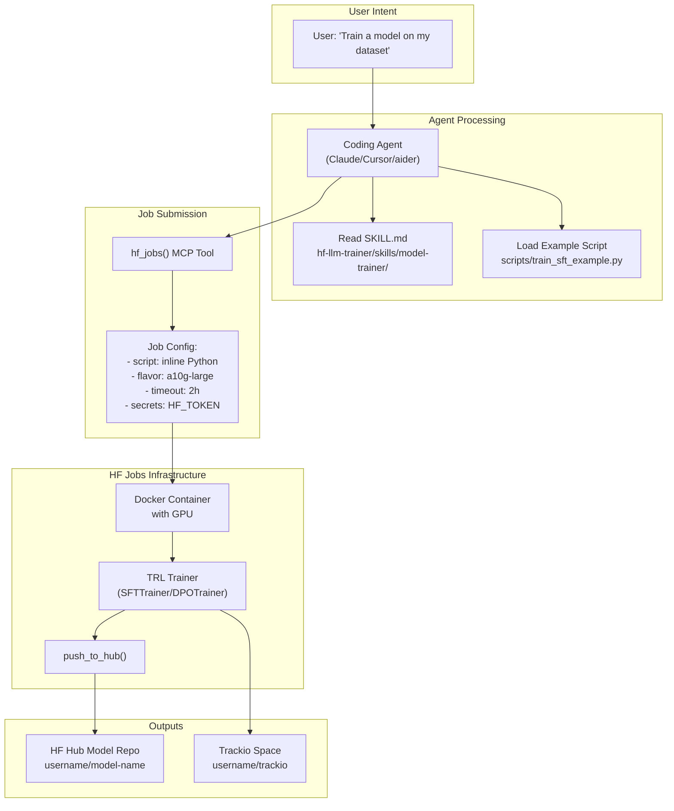
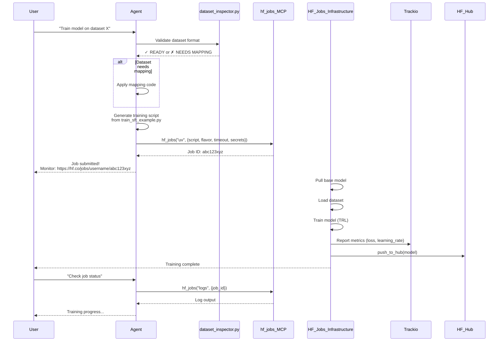
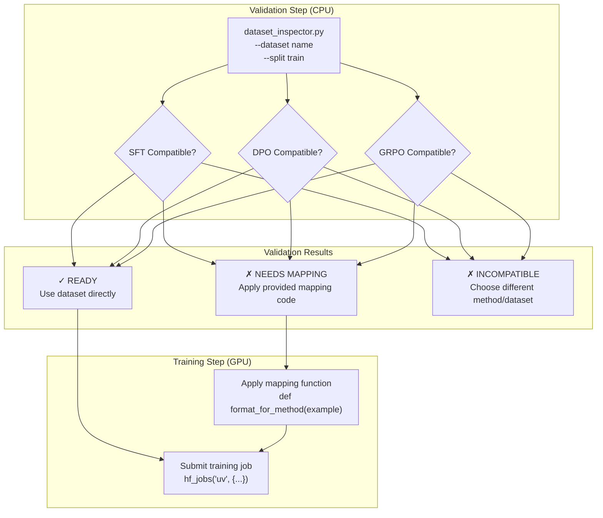
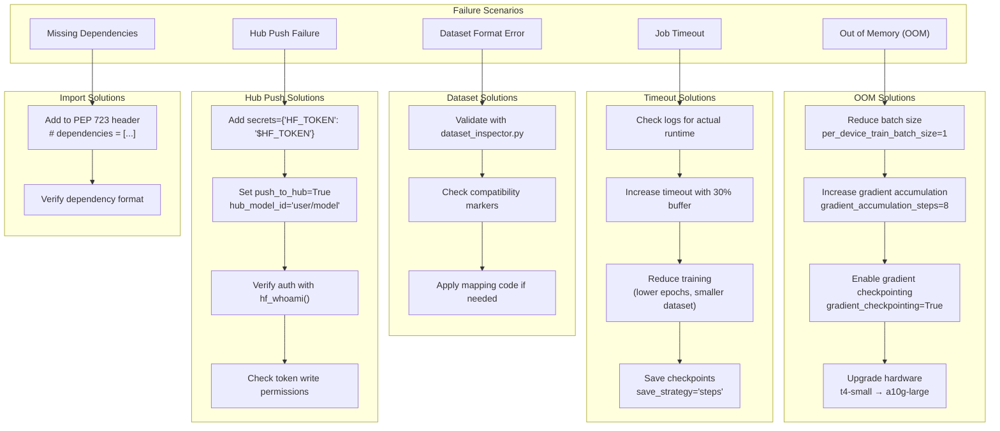

<!-- source: DeepWiki mcp.deepwiki.com · repo huggingface/skills · extra page Week 3: Model Fine-Tuning Quest · fetched 2026-10-30 -->

# Week 3: Model Fine-Tuning Quest

<details>
<summary>Relevant source files</summary>

The following files were used as context for generating this wiki page:

- [apps/quests/02_evaluate-hub-model.md](apps/quests/02_evaluate-hub-model.md)
- [apps/quests/03_publish-hub-dataset.md](apps/quests/03_publish-hub-dataset.md)
- [apps/quests/04_sft-finetune-hub.md](apps/quests/04_sft-finetune-hub.md)
- [apps/quests/README.md](apps/quests/README.md)
- [hf-llm-trainer/skills/model-trainer/SKILL.md](hf-llm-trainer/skills/model-trainer/SKILL.md)

</details>


## Purpose and Scope

This document describes Week 3 of the Humanity's Last Hackathon, which challenges participants to fine-tune language models on Hugging Face Jobs infrastructure and publish the results to the Hub. The quest leverages the `model-trainer` skill to train models using TRL (Transformer Reinforcement Learning) methods including SFT, DPO, and GRPO.

For information about the overall hackathon structure and XP system, see [Hackathon Ecosystem](#5). For Week 1 (model evaluation), see [Week 1: Model Evaluation Quest](#5.1.1). For Week 2 (dataset creation), see [Week 2: Dataset Publishing Quest](#5.1.2). For detailed skill capabilities, see [Model Trainer Skill](#4.1).

Sources: [apps/quests/04_sft-finetune-hub.md:1-34](), [apps/quests/README.md:20-42]()

---

## Quest Overview

### Objective

Participants train language models on custom datasets using Hugging Face Jobs infrastructure, then publish the trained models to the Hub with complete documentation. This quest advances open source AI by creating ready-to-use fine-tuned models and sharing reproducible training methodologies.

**Key activities:**
- Select a base model and training dataset
- Configure training parameters (method, hardware, hyperparameters)
- Submit training jobs to HF Jobs infrastructure
- Monitor training progress with Trackio
- Publish trained models with model cards

**Timeline:** Week 3 launches December 16, 2024 (Monday)

Sources: [apps/quests/04_sft-finetune-hub.md:1-8](), [apps/quests/README.md:33-42]()

### Why This Matters

Fine-tuning adapts foundation models to specific tasks and domains. By publishing fine-tuned models with training methodologies, participants:

1. Provide ready-to-use solutions for common tasks
2. Share reproducible training recipes the community can learn from
3. Demonstrate best practices for model training
4. Expand the ecosystem of specialized open source models

Sources: [apps/quests/04_sft-finetune-hub.md:5-8]()

---

## XP Tiers

The XP tier structure for Week 3 is pending announcement. The quest follows the standard three-tier system used in other weeks:

| Tier | Expected Range | Description |
|------|---------------|-------------|
| 🐢 Contributor | 50-75 XP | Complete basic training task |
| 🐕 Standard | 100-125 XP | Demonstrate additional features or complexity |
| 🦁 Advanced | 200-225 XP | Ship impressive results with full documentation |

**Tier details will be updated when announced.**

Sources: [apps/quests/04_sft-finetune-hub.md:22-24](), [apps/quests/README.md:101-112]()

---

## The Model Trainer Skill

### Skill Capabilities

The `model-trainer` skill (located in `hf-llm-trainer/skills/model-trainer/`) provides access to TRL training methods on Hugging Face Jobs infrastructure:

**Training Methods:**
- **SFT** (Supervised Fine-Tuning) - Standard instruction tuning from labeled examples
- **DPO** (Direct Preference Optimization) - Alignment from preference pairs (chosen/rejected)
- **GRPO** (Group Relative Policy Optimization) - Online reinforcement learning
- **Reward Modeling** - Train reward models for RLHF pipelines

**Infrastructure:**
- Cloud GPU training on HF Jobs (no local GPU required)
- Multiple GPU flavors: `t4-small`, `l4x1`, `a10g-large`, `a100-large`, etc.
- Automatic model persistence to Hugging Face Hub
- Ephemeral execution environment (files deleted after job completion)

**Monitoring & Tools:**
- Trackio integration for real-time metrics visualization
- Job status tracking via `hf_jobs()` MCP tool or CLI
- Cost estimation before job submission
- GGUF conversion for local deployment (Ollama, LM Studio, llama.cpp)

Sources: [hf-llm-trainer/skills/model-trainer/SKILL.md:1-27](), [apps/quests/04_sft-finetune-hub.md:9-20]()

### Skill Invocation Pattern



**Skill Execution Flow**

This diagram shows how the `model-trainer` skill bridges user intent to trained models. The agent reads `SKILL.md` to understand capabilities, uses example scripts as templates, and submits jobs via the `hf_jobs()` MCP tool with inline Python code. Jobs execute in ephemeral Docker containers and must push results to the Hub.

Sources: [hf-llm-trainer/skills/model-trainer/SKILL.md:40-51](), [hf-llm-trainer/skills/model-trainer/SKILL.md:145-190]()

---

## Training Workflow

### Prerequisites Checklist

Before submitting training jobs, verify:

**Account & Authentication:**
- [ ] Hugging Face account with Pro, Team, or Enterprise plan (Jobs require paid plan)
- [ ] Authenticated via `hf_whoami()` or `huggingface-cli login`
- [ ] HF_TOKEN with write permissions available
- [ ] Token will be passed as `secrets={"HF_TOKEN": "$HF_TOKEN"}` in job config

**Dataset Requirements:**
- [ ] Dataset exists on Hub or loadable via `datasets.load_dataset()`
- [ ] Format matches training method (SFT: messages/text; DPO: chosen/rejected; GRPO: prompt-only)
- [ ] Dataset validated before GPU training to prevent format failures
- [ ] Size appropriate for hardware (demo: 50-100 examples; production: 1K-10K+)

**Critical Configuration:**
- [ ] Timeout exceeds expected training time (default 30min is insufficient; minimum 1-2 hours)
- [ ] Hub push enabled (`push_to_hub=True`, `hub_model_id="username/model-name"`)
- [ ] Secrets parameter includes HF_TOKEN for authentication

**⚠️ CRITICAL:** The Jobs environment is ephemeral. All files are deleted when the job ends. Without Hub push, all training results are permanently lost.

Sources: [hf-llm-trainer/skills/model-trainer/SKILL.md:58-79](), [hf-llm-trainer/skills/model-trainer/SKILL.md:357-388]()

### Training Job Submission



**Training Job Lifecycle**

This sequence diagram illustrates the complete training workflow from dataset validation through model persistence. The agent validates datasets before GPU training (preventing costly format failures), generates training scripts from templates, and submits jobs asynchronously. Jobs run independently and report metrics to Trackio while saving models to the Hub.

Sources: [hf-llm-trainer/skills/model-trainer/SKILL.md:80-117](), [hf-llm-trainer/skills/model-trainer/SKILL.md:485-548]()

### Job Submission via MCP Tool

The primary method for submitting training jobs is the `hf_jobs()` MCP tool with inline Python scripts:

```python
hf_jobs("uv", {
    "script": """
# /// script
# dependencies = ["trl>=0.12.0", "peft>=0.7.0", "trackio"]
# ///

from datasets import load_dataset
from peft import LoraConfig
from trl import SFTTrainer, SFTConfig
import trackio

dataset = load_dataset("trl-lib/Capybara", split="train")
dataset_split = dataset.train_test_split(test_size=0.1, seed=42)

trainer = SFTTrainer(
    model="Qwen/Qwen2.5-0.5B",
    train_dataset=dataset_split["train"],
    eval_dataset=dataset_split["test"],
    peft_config=LoraConfig(r=16, lora_alpha=32),
    args=SFTConfig(
        output_dir="my-model",
        push_to_hub=True,
        hub_model_id="username/my-model",
        num_train_epochs=3,
        eval_strategy="steps",
        eval_steps=50,
        report_to="trackio",
        project="my_project",
        run_name="qwen-capybara-sft",
    )
)

trainer.train()
trainer.push_to_hub()
""",
    "flavor": "a10g-large",
    "timeout": "2h",
    "secrets": {"HF_TOKEN": "$HF_TOKEN"}
})
```

**Key components:**
- **PEP 723 header:** Declares dependencies inline (`# /// script` block)
- **Script parameter:** Accepts inline Python code (preferred) or public URLs
- **Flavor:** GPU hardware selection (see Hardware Selection table below)
- **Timeout:** Must exceed expected training time (add 30% buffer)
- **Secrets:** Makes HF_TOKEN available for Hub push

**⚠️ Important:** Local file paths do NOT work. Scripts must be inline code or public URLs because jobs run in isolated Docker containers.

Sources: [hf-llm-trainer/skills/model-trainer/SKILL.md:145-235]()

### Alternative: TRL Maintained Scripts

For standard training without custom code, use TRL's official scripts:

```python
hf_jobs("uv", {
    "script": "https://github.com/huggingface/trl/blob/main/trl/scripts/sft.py",
    "script_args": [
        "--model_name_or_path", "Qwen/Qwen2.5-0.5B",
        "--dataset_name", "trl-lib/Capybara",
        "--output_dir", "my-model",
        "--push_to_hub",
        "--hub_model_id", "username/my-model"
    ],
    "flavor": "a10g-large",
    "timeout": "2h",
    "secrets": {"HF_TOKEN": "$HF_TOKEN"}
})
```

**When to use:** Standard TRL training, quick experiments, no custom code needed

**Available scripts:** [https://github.com/huggingface/trl/tree/main/examples/scripts]()

Sources: [hf-llm-trainer/skills/model-trainer/SKILL.md:236-259]()

---

## Hardware Selection

Training jobs require appropriate GPU hardware based on model size:

| Model Size | Recommended Hardware | Cost (approx/hr) | Use Case |
|------------|---------------------|------------------|----------|
| <1B params | `t4-small` | ~$0.75 | Demos, quick tests (without eval) |
| 1-3B params | `t4-medium`, `l4x1` | ~$1.50-2.50 | Development |
| 3-7B params | `a10g-small`, `a10g-large` | ~$3.50-5.00 | Production training |
| 7-13B params | `a10g-large`, `a100-large` | ~$5-10 | Large models (use LoRA) |
| 13B+ params | `a100-large`, `a10g-largex2` | ~$10-20 | Very large (use LoRA) |

**Available GPU flavors:**
- CPU: `cpu-basic`, `cpu-upgrade`, `cpu-performance`, `cpu-xl`
- T4: `t4-small`, `t4-medium`
- L4: `l4x1`, `l4x4`
- A10G: `a10g-small`, `a10g-large`, `a10g-largex2`, `a10g-largex4`
- A100: `a100-large`
- H100: `h100`, `h100x8`

**Guidelines:**
- Use LoRA/PEFT for models >7B to reduce memory requirements
- Multi-GPU training is automatically handled by TRL/Accelerate
- Start with smaller hardware for testing, scale up for production
- For quick demos on `t4-small`, omit `eval_dataset` to save ~40% memory

Sources: [hf-llm-trainer/skills/model-trainer/SKILL.md:337-354]()

### Cost Estimation

Before submitting expensive jobs, estimate training time and cost using `scripts/estimate_cost.py`:

```bash
python hf-llm-trainer/scripts/estimate_cost.py \
  --model meta-llama/Llama-2-7b-hf \
  --dataset trl-lib/Capybara \
  --hardware a10g-large \
  --dataset-size 16000 \
  --epochs 3
```

**Output includes:**
- Estimated training time
- Estimated cost
- Recommended timeout (with buffer)
- Optimization suggestions

**When to offer:** User planning a job, asks about cost/time, choosing hardware, job will run >1 hour or cost >$5

Sources: [hf-llm-trainer/skills/model-trainer/SKILL.md:415-429]()

---

## Dataset Validation

### Why Validate

Dataset format mismatches cause 50%+ of training failures. Validation on CPU costs ~$0.01 and takes <1 minute, preventing costly GPU failures that waste $1-10 and 30-60 minutes.

**Always validate for:**
- Unknown or custom datasets
- DPO training (90% of datasets need mapping to `prompt`/`chosen`/`rejected` format)
- Any dataset not explicitly TRL-compatible

**Skip validation for known TRL datasets:** `trl-lib/ultrachat_200k`, `trl-lib/Capybara`, `HuggingFaceH4/ultrachat_200k`

Sources: [hf-llm-trainer/skills/model-trainer/SKILL.md:485-503]()

### Validation Workflow



**Dataset Validation Flow**

This diagram shows the validation workflow before GPU training. The `dataset_inspector.py` script checks format compatibility for each training method and provides mapping code when needed. This prevents expensive GPU failures by catching format issues early on cheap CPU instances.

Sources: [hf-llm-trainer/skills/model-trainer/SKILL.md:505-550]()

### Using the Dataset Inspector

Submit validation jobs via `hf_jobs()`:

```python
hf_jobs("uv", {
    "script": "https://huggingface.co/datasets/mcp-tools/skills/raw/main/dataset_inspector.py",
    "script_args": ["--dataset", "username/dataset-name", "--split", "train"]
})
```

**Reading results:**

The output shows compatibility markers:
- **`✓ READY`** - Dataset is compatible, use directly
- **`✗ NEEDS MAPPING`** - Compatible but needs preprocessing (mapping code provided)
- **`✗ INCOMPATIBLE`** - Cannot be used for this method

When mapping is needed, the output includes a "MAPPING CODE" section with copy-paste ready Python:

```python
def format_for_dpo(example):
    return {
        'prompt': example['instruction'],
        'chosen': example['chosen_response'],
        'rejected': example['rejected_response'],
    }
dataset = dataset.map(format_for_dpo, remove_columns=dataset.column_names)
```

Sources: [hf-llm-trailer/skills/model-trainer/SKILL.md:505-550]()

---

## Training Configuration

### Required Configuration for Hub Persistence

The Jobs environment is ephemeral - all files are deleted when jobs end. Models MUST be pushed to Hub:

**In training script/config:**
```python
SFTConfig(
    push_to_hub=True,
    hub_model_id="username/model-name",  # MUST specify
    hub_strategy="every_save",  # Optional: push checkpoints
)
```

**In job submission:**
```python
{
    "secrets": {"HF_TOKEN": "$HF_TOKEN"}  # Enables authentication
}
```

**Verification checklist before submission:**
- [ ] `push_to_hub=True` set in config
- [ ] `hub_model_id` includes username/repo-name
- [ ] `secrets` parameter includes HF_TOKEN
- [ ] User has write access to target repo

Sources: [hf-llm-trainer/skills/model-trainer/SKILL.md:357-388]()

### Timeout Configuration

Default timeout is 30 minutes - **insufficient for real training**. Always set explicit timeouts:

```python
{
    "timeout": "2h"   # Formats: "90m", "2h", "1.5h", or integer seconds
}
```

**Timeout guidelines:**

| Scenario | Recommended | Notes |
|----------|-------------|-------|
| Quick demo (50-100 examples) | 10-30 min | Verify setup |
| Development training | 1-2 hours | Small datasets |
| Production (3-7B model) | 4-6 hours | Full datasets |
| Large model with LoRA | 3-6 hours | Depends on dataset |

**Always add 20-30% buffer** for model/dataset loading, checkpoint saving, Hub push operations, and network delays.

**On timeout:** Job killed immediately, all unsaved progress lost, must restart from beginning.

Sources: [hf-llm-trainer/skills/model-trainer/SKILL.md:390-413]()

### Sequence Length Configuration

TRL config classes use `max_length` (not `max_seq_length`) to control tokenized sequence length:

```python
# ✅ CORRECT - If you need to set sequence length
SFTConfig(max_length=512)   # Truncate sequences to 512 tokens
DPOConfig(max_length=2048)  # Longer context (2048 tokens)

# ❌ WRONG - This parameter doesn't exist
SFTConfig(max_seq_length=512)  # TypeError!
```

**Default behavior:** `max_length=1024` (truncates from right). Works well for most training.

**When to override:**
- **Longer context:** Set higher (e.g., `max_length=2048`)
- **Memory constraints:** Set lower (e.g., `max_length=512`)
- **Vision models:** Set `max_length=None` (prevents cutting image tokens)

**Usually you don't need to set this parameter** - the default is sensible.

Sources: [hf-llm-trainer/skills/model-trainer/SKILL.md:123-144]()

---

## Monitoring and Tracking

### Trackio Integration

Trackio provides real-time metrics visualization during training. All example scripts include Trackio by default.

**Required configuration:**

```python
# Add to PEP 723 dependencies
# dependencies = ["trl>=0.12.0", "peft>=0.7.0", "trackio"]

# Configure trainer
args=SFTConfig(
    report_to="trackio",
    project="my_project",        # Groups related runs
    run_name="descriptive_name",  # Identifies this specific run
    # ... other config
)
```

**Default Trackio configuration:**
- **Space ID:** `{username}/trackio` (creates space if it doesn't exist)
- **Run naming:** Use descriptive names (e.g., "qwen-capybara-sft-v1")
- **Project name:** Groups runs by purpose/experiment
- **Config:** Minimal - only hyperparameters and model/dataset info

**Metrics tracked:**
- Training/eval loss
- Learning rate
- Gradient norms
- Throughput (samples/second)
- GPU memory usage

**Accessing dashboard:**
After job submission, metrics appear at: `https://huggingface.co/spaces/{username}/trackio`

Sources: [hf-llm-trainer/skills/model-trainer/SKILL.md:444-467](), [hf-llm-trainer/skills/model-trainer/SKILL.md:452-466]()

### Checking Job Status

```python
# List all jobs
hf_jobs("ps")

# Inspect specific job
hf_jobs("inspect", {"job_id": "your-job-id"})

# View logs
hf_jobs("logs", {"job_id": "your-job-id"})
```

**Via CLI:**
```bash
hf jobs ps                        # List all jobs
hf jobs logs <job-id>             # View logs
hf jobs inspect <job-id>          # Job details
hf jobs cancel <job-id>           # Cancel a job
```

**Important:** Jobs run asynchronously. Initial logs can take 30-60 seconds to appear. Wait for user to request status checks rather than polling automatically.

Sources: [hf-llm-trainer/skills/model-trainer/SKILL.md:469-482](), [hf-llm-trainer/skills/model-trainer/SKILL.md:308-315]()

---

## Training Methods

### SFT (Supervised Fine-Tuning)

Standard instruction tuning from labeled examples. The model learns to follow instructions by training on input-output pairs.

**Dataset format requirements:**
- Messages format: List of dicts with `role` and `content` keys
- Text format: Plain text strings
- Prompt-completion format: Separate `prompt` and `completion` fields

**Example script:** [hf-llm-trainer/scripts/train_sft_example.py]()

```python
from trl import SFTTrainer, SFTConfig

trainer = SFTTrainer(
    model="Qwen/Qwen2.5-0.5B",
    train_dataset=dataset,
    args=SFTConfig(
        output_dir="my-model",
        push_to_hub=True,
        hub_model_id="username/my-sft-model",
    )
)
```

Sources: [hf-llm-trainer/skills/model-trainer/SKILL.md:12-14](), [hf-llm-trainer/skills/model-trainer/SKILL.md:433-442]()

### DPO (Direct Preference Optimization)

Alignment from preference pairs (chosen/rejected responses). The model learns to prefer certain outputs over others.

**Dataset format requirements:**
- **CRITICAL:** Must have `prompt`, `chosen`, `rejected` columns (exact names)
- Most datasets need mapping to these column names
- Both `chosen` and `rejected` must be strings or message lists

**Example script:** [hf-llm-trainer/scripts/train_dpo_example.py]()

```python
from trl import DPOTrainer, DPOConfig

# Apply mapping if needed (from dataset inspector output)
def format_for_dpo(example):
    return {
        'prompt': example['instruction'],
        'chosen': example['chosen_response'],
        'rejected': example['rejected_response'],
    }
dataset = dataset.map(format_for_dpo, remove_columns=dataset.column_names)

trainer = DPOTrainer(
    model="Qwen/Qwen2.5-0.5B",
    train_dataset=dataset,
    args=DPOConfig(
        output_dir="my-model",
        push_to_hub=True,
        hub_model_id="username/my-dpo-model",
    )
)
```

**⚠️ VALIDATE:** DPO has the highest failure rate due to column name mismatches. Always validate with `dataset_inspector.py` before GPU training.

Sources: [hf-llm-trainer/skills/model-trainer/SKILL.md:15](), [hf-llm-trainer/skills/model-trainer/SKILL.md:552-561]()

### GRPO (Group Relative Policy Optimization)

Online reinforcement learning training. The model learns through online interaction with a reward signal.

**Dataset format requirements:**
- Prompt-only format (no completions needed)
- Must have `prompt` or `query` column

**Example script:** [hf-llm-trainer/scripts/train_grpo_example.py]()

```python
from trl import GRPOTrainer, GRPOConfig

trainer = GRPOTrainer(
    model="Qwen/Qwen2.5-0.5B",
    train_dataset=dataset,
    args=GRPOConfig(
        output_dir="my-model",
        push_to_hub=True,
        hub_model_id="username/my-grpo-model",
    )
)
```

Sources: [hf-llm-trainer/skills/model-trainer/SKILL.md:16](), [hf-llm-trainer/skills/model-trainer/SKILL.md:433-442]()

---

## Troubleshooting

### Common Failure Modes



**Troubleshooting Decision Tree**

This diagram maps common training failures to their solutions in priority order. Try solutions sequentially (e.g., for OOM: reduce batch size first, then enable checkpointing, finally upgrade hardware).

Sources: [hf-llm-trainer/skills/model-trainer/SKILL.md:606-662]()

### Out of Memory (OOM)

**Fix (try in order):**

1. **Reduce batch size:** 
   ```python
   per_device_train_batch_size=1
   gradient_accumulation_steps=8  # Effective batch size = 1 x 8 = 8
   ```
   Keep effective batch size close to 128 for best performance.

2. **Enable gradient checkpointing:**
   ```python
   gradient_checkpointing=True
   ```

3. **Upgrade hardware:**
   - `t4-small` → `l4x1`
   - `a10g-small` → `a10g-large`

4. **Use LoRA for large models:**
   ```python
   peft_config=LoraConfig(r=16, lora_alpha=32)
   ```

Sources: [hf-llm-trainer/skills/model-trainer/SKILL.md:607-613]()

### Dataset Format Errors

**Fix:**

1. Validate first with dataset inspector:
   ```bash
   hf_jobs("uv", {
       "script": "https://huggingface.co/datasets/mcp-tools/skills/raw/main/dataset_inspector.py",
       "script_args": ["--dataset", "name", "--split", "train"]
   })
   ```

2. Check output for compatibility markers:
   - `✓ READY` - use directly
   - `✗ NEEDS MAPPING` - apply mapping code
   - `✗ INCOMPATIBLE` - choose different method/dataset

3. Apply mapping code from inspector output if needed

Sources: [hf-llm-trainer/skills/model-trainer/SKILL.md:615-623]()

### Job Timeouts

**Fix:**

1. Check logs for actual runtime:
   ```python
   hf_jobs("logs", {"job_id": "..."})
   ```

2. Increase timeout with buffer:
   ```python
   "timeout": "3h"  # Add 30% to estimated time
   ```

3. Or reduce training:
   - Lower `num_train_epochs`
   - Use smaller dataset
   - Enable `max_steps` limit

4. Save checkpoints:
   ```python
   save_strategy="steps"
   save_steps=500
   hub_strategy="every_save"
   ```

**Note:** Default 30min is insufficient for real training. Minimum 1-2 hours recommended.

Sources: [hf-llm-trainer/skills/model-trainer/SKILL.md:625-633]()

### Hub Push Failures

**Fix:**

1. Add to job config:
   ```python
   secrets={"HF_TOKEN": "$HF_TOKEN"}
   ```

2. Add to training config:
   ```python
   push_to_hub=True
   hub_model_id="username/model-name"
   ```

3. Verify authentication:
   ```python
   hf_whoami()
   ```

4. Check token has write permissions and repo exists (or set `hub_private_repo=True`)

Sources: [hf-llm-trainer/skills/model-trainer/SKILL.md:635-641]()

### Missing Dependencies

**Fix:**

Add to PEP 723 header at top of script:
```python
# /// script
# dependencies = ["trl>=0.12.0", "peft>=0.7.0", "trackio", "missing-package"]
# ///
```

Sources: [hf-llm-trainer/skills/model-trainer/SKILL.md:643-651]()

---

## Resources

### Example Scripts

Production-ready templates with all best practices:

- [hf-llm-trainer/scripts/train_sft_example.py]() - Complete SFT training with Trackio, LoRA, checkpoints
- [hf-llm-trainer/scripts/train_dpo_example.py]() - DPO training for preference learning  
- [hf-llm-trainer/scripts/train_grpo_example.py]() - GRPO training for online RL
- [hf-llm-trainer/scripts/estimate_cost.py]() - Estimate time and cost before submission
- [hf-llm-trainer/scripts/convert_to_gguf.py]() - Convert trained models to GGUF format

Sources: [hf-llm-trainer/skills/model-trainer/SKILL.md:676-681](), [apps/quests/04_sft-finetune-hub.md:26-34]()

### Reference Documentation

Detailed guides within the skill:

- Training methods overview (SFT, DPO, GRPO, KTO, PPO, Reward Modeling)
- Training patterns and examples
- GGUF conversion guide
- Trackio monitoring setup
- Hardware specifications and selection
- Hub authentication troubleshooting
- Common issues and solutions

Sources: [hf-llm-trainer/skills/model-trainer/SKILL.md:667-675]()

### External Resources

- [TRL Documentation](https://huggingface.co/docs/trl) - Complete TRL library docs
- [TRL Jobs Training Guide](https://huggingface.co/docs/trl/en/jobs_training) - Official Jobs guide
- [HF Jobs Documentation](https://huggingface.co/docs/huggingface_hub/guides/jobs) - Jobs API reference
- [TRL Example Scripts](https://github.com/huggingface/trl/tree/main/examples/scripts) - Official training scripts
- [UV Scripts Guide](https://docs.astral.sh/uv/guides/scripts) - PEP 723 format documentation

Sources: [hf-llm-trainer/skills/model-trainer/SKILL.md:686-692]()

---

## Key Takeaways

1. **Jobs are asynchronous** - Submit and let user check status when ready; don't wait/poll
2. **Always set timeout** - Default 30min is insufficient; minimum 1-2 hours for real training
3. **Always enable Hub push** - Environment is ephemeral; without push, all results are lost
4. **Validate datasets first** - Prevents 50%+ of failures; costs ~$0.01 on CPU vs $1-10 on failed GPU jobs
5. **Include Trackio** - Use example scripts as templates for real-time monitoring
6. **Submit scripts inline** - The `script` parameter accepts Python code directly via `hf_jobs()` MCP tool
7. **Choose appropriate hardware** - Match GPU to model size; use LoRA for models >7B
8. **DPO requires strict format** - Always validate; 90% of datasets need mapping to `prompt`/`chosen`/`rejected`
9. **Offer cost estimation** - Use `estimate_cost.py` when planning expensive jobs
10. **Pass secrets parameter** - Must include `secrets={"HF_TOKEN": "$HF_TOKEN"}` for Hub push

Sources: [hf-llm-trainer/skills/model-trainer/SKILL.md:694-706]()

---

