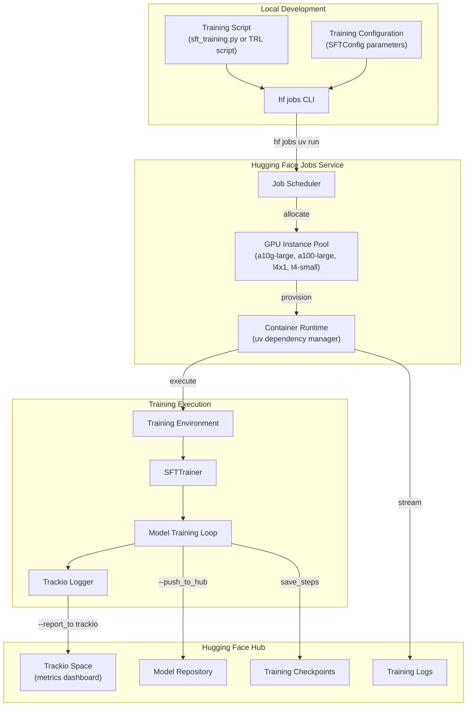
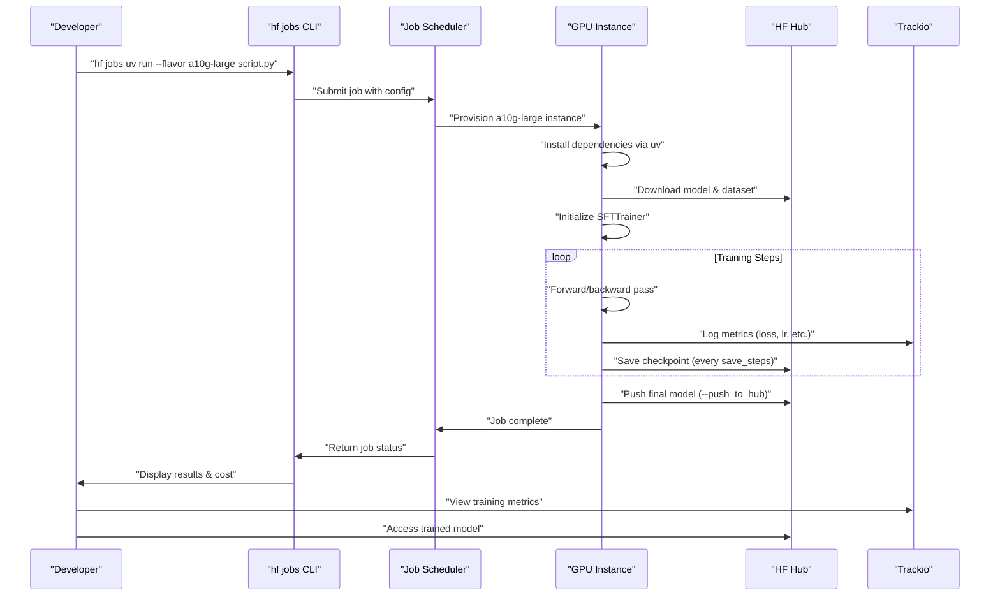
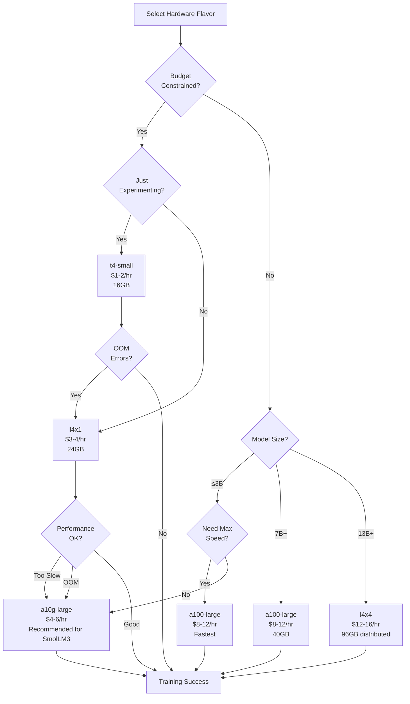

<!-- source: DeepWiki mcp.deepwiki.com · repo huggingface/smol-course · page 2.3 Training with Hugging Face Jobs · fetched 2026-10-26 -->

# Training with Hugging Face Jobs

<details>
<summary>Relevant source files</summary>

The following files were used as context for generating this wiki page:

- [units/en/unit0/1.mdx](units/en/unit0/1.mdx)
- [units/en/unit1/1.md](units/en/unit1/1.md)
- [units/en/unit1/2.md](units/en/unit1/2.md)
- [units/en/unit1/3.md](units/en/unit1/3.md)
- [units/en/unit1/3a.md](units/en/unit1/3a.md)
- [units/en/unit1/4.md](units/en/unit1/4.md)
- [units/en/unit1/5.md](units/en/unit1/5.md)
- [units/en/unit1/6.md](units/en/unit1/6.md)

</details>


## Purpose and Scope

This document covers **Hugging Face Jobs**, a fully managed cloud infrastructure for training models without local GPU setup or environment configuration. Jobs provides scalable compute resources for supervised fine-tuning and other training workflows, with integrated monitoring and Hub connectivity.

For local training workflows and SFT fundamentals, see [Supervised Fine-Tuning](#2.2). For general instruction tuning concepts, see [Instruction Tuning](#2).

---

## What is Hugging Face Jobs?

Hugging Face Jobs is a managed cloud training service that eliminates infrastructure management overhead. It provides:

- **On-demand GPU access**: A100, L4, A10G, and T4 instances without hardware procurement
- **Zero configuration**: Pre-configured environments with CUDA, Docker, and ML frameworks
- **Pay-per-use billing**: Charges only for active compute time
- **Hub integration**: Automatic model and artifact uploads to Hugging Face Hub
- **CLI-based workflow**: Simple `hf jobs` command interface

Jobs is particularly valuable for SFT training on SmolLM3, which requires substantial GPU memory (16GB+) and extended training times (30-90 minutes for typical 1000-step runs).

Sources: [units/en/unit1/5.md:1-12](), [units/en/unit1/3.md:88-94]()

---

## Jobs Infrastructure Architecture



**Jobs Workflow Overview**: The CLI submits training scripts to the scheduler, which provisions GPU instances and executes training in isolated containers. Training outputs (models, checkpoints, logs) flow automatically to Hub repositories. The `uv` dependency manager handles package installation from inline script metadata.

Sources: [units/en/unit1/5.md:1-84](), [units/en/unit1/3.md:507-511]()

---

## Requirements

**Subscription Plans**:
- Pro plan ($9/month)
- Team plan ($20/user/month)
- Enterprise plan (custom pricing)

Free tier accounts cannot access Jobs. Subscribe at https://huggingface.co/pricing.

**Authentication**:
```bash
hf auth login
# Enter your token when prompted
```

The `HF_TOKEN` secret must be passed to Jobs for Hub write operations (`--push_to_hub`).

Sources: [units/en/unit1/5.md:13-17]()

---

## Running SFT with TRL Scripts

Jobs integrates with TRL's maintained training scripts via the `uv` execution model. TRL scripts include inline dependency declarations that Jobs automatically installs.

### Using TRL's Maintained SFT Script

The simplest approach uses TRL's canonical SFT script from GitHub:

```bash
hf jobs uv run \
    --flavor a10g-large \
    --timeout 2h \
    --secrets HF_TOKEN \
    "https://raw.githubusercontent.com/huggingface/trl/main/trl/scripts/sft.py" \
    --model_name_or_path HuggingFaceTB/SmolLM3-3B-Base \
    --dataset_name HuggingFaceTB/smoltalk2_everyday_convs_think \
    --learning_rate 5e-5 \
    --per_device_train_batch_size 4 \
    --max_steps 1000 \
    --output_dir smollm3-sft-jobs \
    --push_to_hub \
    --hub_model_id your-username/smollm3-sft \
    --report_to trackio
```

**Command Structure**:
- `hf jobs uv run`: Invokes Jobs with `uv` runtime
- `--flavor`: Hardware specification (see Hardware Selection)
- `--timeout`: Maximum execution time (prevents runaway costs)
- `--secrets`: Environment variables for authentication
- Script URL or path: Training script to execute
- Remaining arguments: Passed to the training script

Sources: [units/en/unit1/5.md:106-124](), [units/en/unit1/3.md:488-503]()

### Custom Training Scripts with Inline Dependencies

For custom workflows, declare dependencies in PEP 723 inline script metadata:

```python
# sft_training.py
# /// script
# dependencies = [
#     "trl[sft]>=0.7.0",
#     "transformers>=4.36.0", 
#     "datasets>=2.14.0",
#     "accelerate>=0.24.0",
#     "peft>=0.7.0"
# ]
# ///

from trl import SFTTrainer, SFTConfig
from transformers import AutoModelForCausalLM, AutoTokenizer
from datasets import load_dataset

# Training code...
```

Execute with:
```bash
hf jobs uv run \
    --flavor a10g-large \
    --timeout 2h \
    --secrets HF_TOKEN \
    sft_training.py
```

Sources: [units/en/unit1/5.md:25-84]()

---

## Hardware Selection

Jobs offers multiple GPU flavors with different memory, compute, and cost profiles:

| Flavor | GPU | Memory | Best For | Approx. Cost/hr |
|--------|-----|--------|----------|-----------------|
| `t4-small` | T4 | 16GB | Budget experimentation | $1-2 |
| `l4x1` | L4 | 24GB | Cost-performance balance | $3-4 |
| `a10g-large` | A10G | 24GB | SmolLM3-3B (recommended) | $4-6 |
| `a100-large` | A100 | 40GB | Fastest training, 7B+ models | $8-12 |
| `l4x4` | 4xL4 | 96GB total | Multi-GPU distributed training | $12-16 |

**Selection Guidelines**:

For **SmolLM3-3B** (3 billion parameters):
- **Recommended**: `a10g-large` - sufficient memory, fast training
- **Budget**: `l4x1` - slower but economical
- **Speed**: `a100-large` - maximum throughput with larger batch sizes

For **larger models (7B+)**:
- Minimum: `a100-large`
- Distributed: `l4x4` for multi-GPU parallelism

**Cost Estimation**:
- SmolLM3-3B, 1000 steps: 30-90 minutes depending on flavor
- Total cost: $2-12 per training run

Sources: [units/en/unit1/5.md:86-105](), [units/en/unit1/5.md:199-213]()

---

## Jobs Execution Flow



**Key Phases**:
1. **Submission**: CLI packages script and config, sends to scheduler
2. **Provisioning**: Scheduler allocates GPU, builds container with dependencies
3. **Training**: Model and dataset downloaded, SFTTrainer executes training loop
4. **Monitoring**: Metrics stream to Trackio, checkpoints save to Hub
5. **Completion**: Final model pushed, resources deallocated

Sources: [units/en/unit1/5.md:1-159]()

---

## Monitoring Training Jobs

### CLI Monitoring Commands

```bash
# List all jobs
hf jobs ps -a

# Inspect specific job
hf jobs inspect <job_id>

# Stream logs in real-time
hf jobs logs <job_id> --follow

# Cancel running job
hf jobs cancel <job_id>
```

Job status checks and log streaming work from the CLI. For visual monitoring, use the Hub interface or Trackio.

**Hub Interface**:
Navigate to https://huggingface.co/settings/jobs to view:
- Active jobs
- Job history
- Resource usage
- Cost breakdown

Sources: [units/en/unit1/5.md:141-159]()

### Trackio Integration

Trackio provides real-time metrics dashboards for training runs. Enable with `--report_to trackio`:

```bash
hf jobs uv run \
    --flavor a10g-large \
    --secrets HF_TOKEN \
    "https://raw.githubusercontent.com/huggingface/trl/main/trl/scripts/sft.py" \
    --model_name_or_path HuggingFaceTB/SmolLM3-3B-Base \
    --dataset_name HuggingFaceTB/smoltalk2_everyday_convs_think \
    --max_steps 1000 \
    --report_to trackio \
    --push_to_hub
```

**Tracked Metrics**:
- `train/loss`: Cross-entropy loss per step
- `train/learning_rate`: Current learning rate (with scheduler)
- `train/grad_norm`: Gradient L2 norm (pre-clipping)
- `train/num_tokens`: Total tokens processed
- `train/mean_token_accuracy`: Top-1 prediction accuracy
- `train/entropy`: Output distribution entropy
- `epoch`: Current epoch number

Trackio serves a web dashboard at the configured Trackio Space, displaying these metrics in real-time during training.

Sources: [units/en/unit1/5.md:191-198](), [units/en/unit1/3.md:259-327]()

---

## Advanced Configuration

### Environment Variables and Secrets

Pass secrets and environment variables to Jobs:

```bash
hf jobs uv run \
    --flavor a10g-large \
    --timeout 3h \
    --secrets HF_TOKEN=your_token \
    --secrets WANDB_API_KEY=your_wandb_key \
    --env WANDB_PROJECT=smollm3-sft \
    --env CUDA_VISIBLE_DEVICES=0 \
    my_sft_training.py
```

**`--secrets`**: Encrypted environment variables for credentials
**`--env`**: Standard environment variables for configuration

Common secrets:
- `HF_TOKEN`: Required for `--push_to_hub`
- `WANDB_API_KEY`: For Weights & Biases logging
- `TRACKIO_SPACE_ID`: Custom Trackio dashboard location

Sources: [units/en/unit1/5.md:125-139]()

### LoRA/PEFT on Jobs

Enable LoRA training by passing PEFT configuration to the TRL script:

```bash
hf jobs uv run \
    --flavor a10g-large \
    --timeout 2h \
    --secrets HF_TOKEN \
    "https://raw.githubusercontent.com/huggingface/trl/main/trl/scripts/sft.py" \
    --model_name_or_path HuggingFaceTB/SmolLM3-3B-Base \
    --dataset_name HuggingFaceTB/smoltalk2_everyday_convs_think \
    --output_dir smollm3-lora-sft-jobs \
    --per_device_train_batch_size 4 \
    --learning_rate 5e-5 \
    --max_steps 1000 \
    --push_to_hub \
    --hub_model_id your-username/smollm3-lora-sft \
    --use_peft \
    --lora_r 8 \
    --lora_alpha 16 \
    --lora_dropout 0.05 \
    --lora_target_modules all-linear
```

**LoRA Parameters**:
- `--use_peft`: Enable PEFT integration
- `--lora_r`: Rank of low-rank decomposition (4-16 typical)
- `--lora_alpha`: Scaling factor (usually 2x `lora_r`)
- `--lora_dropout`: Dropout rate for LoRA layers
- `--lora_target_modules`: Which layers to adapt (`all-linear` for attention+MLP)

LoRA adapters are much smaller than full models (typically <100MB vs 6GB), making them efficient for storage and switching between tasks.

Sources: [units/en/unit1/5.md:160-190](), [units/en/unit1/3a.md:116-147]()

---

## Hardware Flavor Decision Tree



**Decision Factors**:
1. **Budget**: Start with cheapest viable option, scale up if needed
2. **Model size**: Larger models require more memory
3. **Speed requirements**: Production vs. experimentation
4. **Batch size**: Larger batches need more memory but train faster

Sources: [units/en/unit1/5.md:86-105]()

---

## Cost Optimization Strategies

### Reducing Compute Costs

**1. Use Gradient Accumulation**:
Instead of large batch sizes (high memory), accumulate gradients over multiple small batches:

```bash
# Memory-efficient configuration
--per_device_train_batch_size 2 \
--gradient_accumulation_steps 8
# Effective batch size = 2 × 8 = 16
```

This allows training on cheaper GPUs (e.g., `l4x1` instead of `a100-large`).

**2. Start with Short Runs**:
Validate configuration with short training runs (500 steps) before committing to full training:

```bash
--max_steps 500  # Quick validation
```

**3. Set Appropriate Timeouts**:
Prevent runaway costs with conservative timeout values:

```bash
--timeout 2h  # Auto-terminate if stuck
```

**4. Use LoRA Instead of Full Fine-Tuning**:
LoRA reduces memory requirements and training time:
- Memory: ~40% reduction
- Training time: ~20-30% faster
- Storage: Adapters are 10-100x smaller than full models

Sources: [units/en/unit1/5.md:208-213]()

---

## Troubleshooting Common Issues

### Out of Memory (OOM) Errors

**Symptoms**:
- Job terminates with "CUDA out of memory" error
- Training hangs after a few steps

**Solutions**:
1. Reduce `--per_device_train_batch_size` (e.g., 4→2)
2. Decrease `--max_length` (e.g., 2048→1024)
3. Enable gradient checkpointing: `--gradient_checkpointing`
4. Use LoRA: `--use_peft --lora_r 8`
5. Upgrade to larger flavor (e.g., `a10g-large`→`a100-large`)

Sources: [units/en/unit1/5.md:215-219]()

### Timeout Issues

**Symptoms**:
- Job terminates before training completes
- "Job timeout exceeded" message

**Solutions**:
1. Increase `--timeout` parameter (e.g., `2h`→`4h`)
2. Reduce training duration: `--max_steps` (e.g., 5000→1000)
3. Use faster hardware: `a100-large` instead of `l4x1`
4. Optimize data loading: Ensure datasets are pre-processed and cached

Sources: [units/en/unit1/5.md:220-224]()

### Authentication Errors

**Symptoms**:
- "Unauthorized" or "Permission denied" errors
- Model push failures

**Solutions**:
1. Verify `HF_TOKEN` is set: `--secrets HF_TOKEN`
2. Check token permissions at https://huggingface.co/settings/tokens
3. Ensure account has required subscription (Pro/Team/Enterprise)
4. Confirm write access to target repository

Sources: [units/en/unit1/5.md:225-230]()

---

## Training Script Reference

### TRL SFT Script Parameters

The canonical TRL SFT script ([trl/scripts/sft.py]()) accepts the following key parameters:

**Model & Data**:
- `--model_name_or_path`: Base model identifier (e.g., `HuggingFaceTB/SmolLM3-3B-Base`)
- `--dataset_name`: Dataset identifier or path
- `--dataset_text_field`: Column name for text data (default: `text`)

**Training Configuration**:
- `--output_dir`: Local directory for checkpoints
- `--per_device_train_batch_size`: Batch size per GPU (default: 4)
- `--gradient_accumulation_steps`: Accumulation steps (default: 1)
- `--learning_rate`: Learning rate (default: 5e-5)
- `--max_steps`: Total training steps (default: -1, uses epochs)
- `--num_train_epochs`: Number of epochs if `max_steps=-1`
- `--warmup_steps`: Learning rate warmup steps (default: 0)

**Saving & Logging**:
- `--save_steps`: Checkpoint save frequency (default: 500)
- `--logging_steps`: Metric logging frequency (default: 10)
- `--report_to`: Logging backend (`trackio`, `wandb`, `tensorboard`)
- `--push_to_hub`: Enable Hub uploads (flag)
- `--hub_model_id`: Target Hub repository

**PEFT Configuration**:
- `--use_peft`: Enable LoRA (flag)
- `--lora_r`: LoRA rank (default: 8)
- `--lora_alpha`: LoRA alpha (default: 16)
- `--lora_dropout`: LoRA dropout (default: 0.05)
- `--lora_target_modules`: Target modules (`all-linear`, `q_proj,v_proj`, etc.)

For complete parameter list, refer to the script source at https://github.com/huggingface/trl/blob/main/trl/scripts/sft.py.

Sources: [units/en/unit1/5.md:106-124](), [units/en/unit1/5.md:160-190]()

---

## Comparison: Jobs vs. Local Training

| Aspect | Hugging Face Jobs | Local Training |
|--------|------------------|----------------|
| **Setup Time** | Immediate (no setup) | Hours (CUDA, drivers, deps) |
| **Hardware Access** | A100, A10G, L4 on-demand | Limited to owned hardware |
| **Memory** | 16-40GB+ per instance | Constrained by local GPU |
| **Scaling** | Multi-GPU via flavor selection | Manual distributed setup |
| **Cost Model** | Pay-per-use ($/hour) | Fixed hardware cost |
| **Hub Integration** | Native (`--push_to_hub`) | Manual upload required |
| **Monitoring** | Built-in logs + Trackio | Manual setup (wandb/tensorboard) |
| **Reproducibility** | Environment versioned | Manual dependency management |
| **Best For** | Production, experimentation, >7B models | Local development, <3B models |

**When to Use Jobs**:
- No local GPU or insufficient memory (<16GB)
- Need access to A100/H100 hardware
- Training 7B+ models
- Production training pipelines
- Cost-predictable experimentation

**When to Train Locally**:
- Have capable GPU (16GB+ VRAM)
- Iterating rapidly on small models (<3B)
- Need offline training
- Have unlimited local compute time

Sources: [units/en/unit1/5.md:1-12](), [units/en/unit1/3.md:88-94]()

---

## Complete Example: SmolLM3 SFT on Jobs

This example demonstrates a complete training workflow from script creation to model deployment:

**Step 1: Authenticate**
```bash
hf auth login
# Enter your token
```

**Step 2: Launch Training**
```bash
hf jobs uv run \
    --flavor a10g-large \
    --timeout 2h \
    --secrets HF_TOKEN \
    "https://raw.githubusercontent.com/huggingface/trl/main/trl/scripts/sft.py" \
    --model_name_or_path HuggingFaceTB/SmolLM3-3B-Base \
    --dataset_name HuggingFaceTB/smoltalk2_everyday_convs_think \
    --learning_rate 5e-5 \
    --per_device_train_batch_size 4 \
    --gradient_accumulation_steps 4 \
    --max_steps 1000 \
    --warmup_steps 100 \
    --logging_steps 50 \
    --save_steps 200 \
    --output_dir smollm3-sft-output \
    --push_to_hub \
    --hub_model_id your-username/smollm3-custom-sft \
    --report_to trackio \
    --gradient_checkpointing
```

**Step 3: Monitor Training**
```bash
# Check job status
hf jobs ps -a

# Stream logs
hf jobs logs <job_id> --follow
```

**Step 4: Access Results**
After completion:
- Model available at: `https://huggingface.co/your-username/smollm3-custom-sft`
- Metrics dashboard at your Trackio Space
- Training logs in Hub job interface

**Expected Output**:
- Training time: ~45 minutes on `a10g-large`
- Cost: ~$4
- Final model size: ~6GB (full model) or ~50MB (LoRA adapters)

Sources: [units/en/unit1/5.md:106-124](), [units/en/unit1/3.md:444-505]()

---

## Resources and Further Reading

**Official Documentation**:
- [Hugging Face Jobs Guide](https://huggingface.co/docs/huggingface_hub/guides/jobs) - Complete Jobs documentation
- [Jobs CLI Reference](https://huggingface.co/docs/huggingface_hub/guides/cli#hf-jobs) - CLI command reference
- [TRL Jobs Training](https://huggingface.co/docs/trl/main/en/jobs_training) - TRL-specific Jobs workflows

**Related Course Pages**:
- [Supervised Fine-Tuning](#2.2) - SFT fundamentals and local training
- [LoRA and PEFT](#3.1) - Parameter-efficient fine-tuning techniques
- [Hands-On Exercises](#2.4) - Practical training examples

**Pricing and Plans**:
- [Hugging Face Pricing](https://huggingface.co/pricing) - Subscription plans and GPU costs
- [Jobs Pricing Calculator](https://huggingface.co/pricing) - Estimate training costs

**Community Support**:
- [Discord Server](https://discord.gg/UrrTSsSyjb) - Real-time assistance
- [Forum Discussions](https://discuss.huggingface.co) - Community troubleshooting

Sources: [units/en/unit1/5.md:231-237]()

---

