# Page: Course Overview

# Course Overview

<details>
<summary>Relevant source files</summary>

The following files were used as context for generating this wiki page:

- [.gitignore](.gitignore)
- [LICENSE](LICENSE)
- [README.md](README.md)
- [banner.png](banner.png)
- [requirements.txt](requirements.txt)
- [units/en/_toctree.yml](units/en/_toctree.yml)

</details>


This document provides an overview of the smol-course, a practical training program for aligning language models to specific use cases. The course covers the complete pipeline from instruction tuning through preference alignment and multimodal model adaptation, using the SmolLM3 and SmolVLM2 model families. For detailed installation instructions, see [Installation and Setup](#1.1). For specific training methodologies, see [Instruction Tuning](#2), [Preference Alignment](#4), and [Vision-Language Models](#5).

**Sources:** [README.md:1-69]()

## Course Objectives

The smol-course teaches practical alignment techniques for language models that run on consumer hardware. The curriculum emphasizes hands-on learning with minimal GPU requirements and no paid cloud services. Key learning outcomes include:

- **Instruction Tuning**: Adapting pre-trained models to follow instructions using supervised fine-tuning with `SFTTrainer`
- **Parameter Efficiency**: Implementing LoRA and quantization to train models on limited hardware
- **Preference Alignment**: Aligning models to human preferences using DPO and ORPO algorithms
- **Multimodal Adaptation**: Fine-tuning vision-language models for image understanding tasks
- **Model Evaluation**: Benchmarking models using `lighteval` framework with standard and custom metrics
- **Production Deployment**: Training on Hugging Face Jobs infrastructure and publishing to Hub

The course uses SmolLM3-3B for text-only tasks and SmolVLM2-2.2B for multimodal applications. Skills learned with these models transfer to larger models and other small LLM/VLM architectures.

**Sources:** [README.md:5-56]()

## Model Architecture

### Course Unit to Codebase Mapping

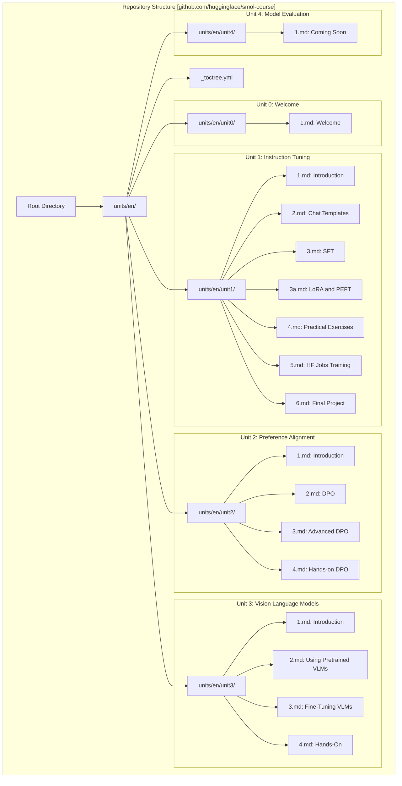

**Sources:** [units/en/_toctree.yml:1-48]()

### Base Models

The course utilizes two pre-trained model families from the Hugging Face Hub:

| Model | Parameters | Architecture | Use Cases |
|-------|-----------|--------------|-----------|
| SmolLM3-3B-Base | 3 billion | Decoder-only transformer | Text instruction tuning, preference alignment |
| SmolVLM2-2.2B-Base | 2.2 billion | Vision encoder + language decoder | Multimodal tasks, image understanding, chart/diagram analysis |

Both models are optimized for efficiency and can be fine-tuned on consumer GPUs with 16GB+ VRAM when using parameter-efficient techniques. The base models are pre-trained on large text corpora (SmolLM3) or multimodal data (SmolVLM2) and require task-specific fine-tuning for instruction following.

**Sources:** [README.md:5-6]()

## Course Structure

The curriculum consists of seven units organized into three phases: core training modules (Units 1-3), evaluation methodology (Unit 4), and advanced techniques (Units 5-6). Unit 7 provides a capstone experience.

### Current Curriculum Status

| Unit | Topic | Status | Key Techniques |
|------|-------|--------|----------------|
| 0 | Welcome | ✅ Released | Course orientation |
| 1 | Instruction Tuning | ✅ Released | `SFTTrainer`, chat templates, LoRA, quantization |
| 2 | Preference Alignment | ✅ Released | `DPOTrainer`, ORPO, preference datasets |
| 3 | Vision Language Models | ✅ Released | `AutoProcessor`, multimodal templates, VLM fine-tuning |
| 4 | Model Evaluation | ✅ Released | `lighteval`, benchmarks, custom metrics |
| 5 | Reinforcement Learning | 🚧 October 2025 | Policy optimization, reward models |
| 6 | Synthetic Data | 🚧 November 2025 | Data generation, distillation |
| 7 | Award Ceremony | 🚧 December 2025 | Project showcase |

Each unit includes markdown documentation, interactive Jupyter notebooks, and hands-on exercises. Units 1-4 progress from basic instruction tuning to advanced evaluation methodologies. Future units will cover reinforcement learning from human feedback and synthetic data generation.

**Sources:** [README.md:31-43](), [units/en/_toctree.yml:1-48]()

### Learning Progression

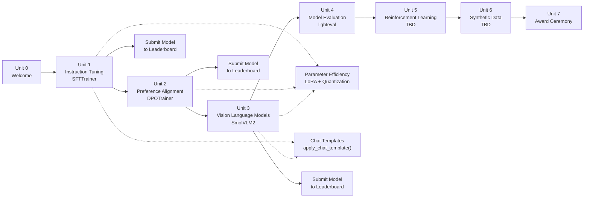

**Sources:** [README.md:31-43](), [units/en/_toctree.yml:1-48]()

## Technical Stack

### Core Dependencies

The course uses a curated set of libraries from the Hugging Face ecosystem and PyTorch. All dependencies are managed via `requirements.txt` with pinned versions for reproducibility.

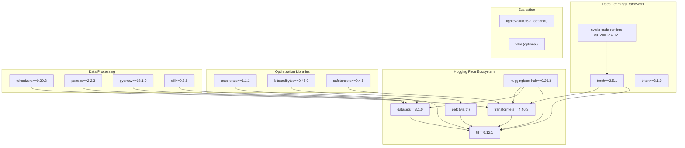

**Sources:** [requirements.txt:1-65]()

### Library Versions and Roles

| Library | Version | Role |
|---------|---------|------|
| `torch` | 2.5.1 | Deep learning framework, model computation |
| `transformers` | 4.46.3 | Model loading, tokenization, inference APIs |
| `trl` | 0.12.1 | Training orchestration (`SFTTrainer`, `DPOTrainer`) |
| `datasets` | 3.1.0 | Dataset loading, preprocessing, streaming |
| `accelerate` | 1.1.1 | Distributed training, device management |
| `bitsandbytes` | 0.45.0 | 4-bit/8-bit quantization for memory efficiency |
| `huggingface-hub` | 0.26.3 | Model/dataset download, Hub uploads |
| `safetensors` | 0.4.5 | Fast, secure model serialization format |

The `trl` library serves as the primary training interface, integrating models from `transformers`, efficiency techniques from `peft`, and data from `datasets`. The `accelerate` library enables multi-GPU training and mixed precision, while `bitsandbytes` provides quantization for memory-constrained environments.

**Sources:** [requirements.txt:3-65]()

### CUDA Dependencies

For GPU acceleration on Linux x86_64 systems, the course includes NVIDIA CUDA 12.4 libraries:

- `nvidia-cuda-runtime-cu12==12.4.127`: CUDA runtime
- `nvidia-cublas-cu12==12.4.5.8`: Linear algebra operations
- `nvidia-cudnn-cu12==9.1.0.70`: Neural network primitives
- `nvidia-nccl-cu12==2.21.5`: Multi-GPU communication

These dependencies are automatically installed on compatible systems and enable GPU training without manual CUDA installation.

**Sources:** [requirements.txt:27-38]()

## Learning Methodology

### Community-Driven Approach

The course operates as a peer-reviewed, open learning platform. Students actively contribute to the course content through pull requests, creating a continuously improving curriculum.

**Participation Model:**
1. Follow the `smol-course` organization on Hugging Face Hub
2. Read unit documentation and complete exercises locally
3. Train models and submit results to the community leaderboard
4. Open pull requests with trained models, evaluation results, and training commands
5. Receive community feedback and climb the leaderboard rankings

This approach encourages collaborative learning where students learn from each other's implementations and training strategies. The leaderboard serves as both a motivational tool and a repository of successful training configurations.

**Sources:** [README.md:7-17](), [README.md:19-23]()

### Repository Access

The course materials are hosted at `https://github.com/huggingface/smol-course`. The repository structure includes:

- `units/en/`: Course content organized by unit
- `requirements.txt`: Python dependencies
- `README.md`: Course overview and quick start
- `v1/`: Legacy course materials (Jupyter notebooks)

Future releases will migrate to Hugging Face Learn platform while maintaining GitHub as the primary development repository.

**Sources:** [README.md:27-29](), [README.md:65-68]()

## Hardware Requirements

### Local Training

The course is designed for consumer hardware with minimal GPU requirements. Successful local training requires:

| Component | Minimum | Recommended |
|-----------|---------|-------------|
| GPU VRAM | 16GB | 24GB+ |
| System RAM | 16GB | 32GB+ |
| Storage | 50GB | 100GB+ (for datasets) |
| OS | Linux, Windows, macOS | Linux (best CUDA support) |

With 16GB VRAM, students can train SmolLM3-3B using 4-bit quantization and LoRA (rank 8-16). Larger batch sizes and higher LoRA ranks require more VRAM. The course provides memory optimization techniques (gradient checkpointing, gradient accumulation) to work within hardware constraints.

**Sources:** [README.md:48-56]()

### Cloud Training Alternative

For students without local GPU access, Hugging Face Jobs provides cloud training infrastructure:

- **a10g-large**: NVIDIA A10G (24GB VRAM)
- **a100-large**: NVIDIA A100 (40GB/80GB VRAM)

Unit 1, section 5 covers cloud training workflows using the `hf jobs` CLI. This enables identical training code to run locally or on cloud infrastructure without modification.

**Sources:** [units/en/_toctree.yml:19]()

## Prerequisites

Students should have foundational knowledge before starting the course:

### Required Background

- **Machine Learning Fundamentals**: Understanding of supervised learning, loss functions, gradient descent
- **Natural Language Processing**: Familiarity with tokenization, embeddings, transformer architectures
- **Python Programming**: Proficiency with Python 3.8+, package management (pip, conda, uv)
- **PyTorch Basics**: Tensor operations, model loading, basic training loops
- **Transformers Library**: Experience with `AutoModel`, `AutoTokenizer`, `pipeline` APIs

### Optional But Helpful

- Experience with Jupyter notebooks for interactive development
- Git/GitHub for version control and collaboration
- Linux command line for cloud training workflows
- Understanding of model evaluation metrics (perplexity, accuracy)

Students without extensive PyTorch experience can still succeed by following the provided code examples and gradually building understanding through hands-on exercises.

**Sources:** [README.md:58-63]()

## Why Small Language Models

The course focuses on small models (2-3B parameters) rather than large models (70B+) for practical and pedagogical reasons:

### Advantages of Small Models

| Benefit | Description |
|---------|-------------|
| **Efficiency** | Train and deploy on consumer hardware without cloud costs |
| **Customization** | Faster iteration cycles for domain-specific adaptation |
| **Control** | Easier to understand and debug model behavior |
| **Cost** | Lower training and inference costs for production deployment |
| **Privacy** | Can run entirely on-premises without external API calls |
| **Sustainability** | Reduced energy consumption and carbon footprint |
| **Research Accessibility** | Enables academic research without institutional compute clusters |

### Performance Trade-offs

Small models sacrifice some general capability for efficiency. They excel at focused tasks where domain-specific fine-tuning provides the necessary knowledge. The course teaches how to maximize small model performance through:

- High-quality instruction data curation
- Effective preference alignment
- Task-specific evaluation metrics
- Multi-stage training pipelines

Skills learned with SmolLM3-3B and SmolVLM2-2.2B transfer directly to larger models, making this course a practical starting point for language model alignment regardless of target model size.

**Sources:** [README.md:46-56]()

---

# Page: Installation and Setup

# Installation and Setup

<details>
<summary>Relevant source files</summary>

The following files were used as context for generating this wiki page:

- [.gitignore](.gitignore)
- [.python-version](.python-version)
- [LICENSE](LICENSE)
- [README.md](README.md)
- [banner.png](banner.png)
- [pyproject.toml](pyproject.toml)
- [requirements.txt](requirements.txt)
- [uv.lock](uv.lock)

</details>


This page provides instructions for installing dependencies and configuring the development environment for the smol-course. It covers Python environment setup, core library installation, hardware requirements, and verification procedures. For information about using the TRL CLI tools after installation, see [TRL CLI Tools](#7.2). For details on cloud-based training infrastructure, see [Training with Hugging Face Jobs](#2.3).

## Prerequisites

The course requires Python 3.11 or higher. This version constraint is defined in [pyproject.toml:6](). The codebase uses the Python 3.11 runtime as specified in [.python-version:1]().

Basic familiarity with the following is assumed:
- Python programming and PyTorch fundamentals
- Natural language processing concepts
- Command-line interface usage
- Git for version control

Hardware recommendations depend on the training approach:
- **Local training**: 16GB+ VRAM GPU (NVIDIA recommended for CUDA support)
- **Notebook exploration**: 8GB+ VRAM or CPU-only for inference
- **Cloud training**: Hugging Face Jobs with `a10g-large` or `a100-large` instances

## Core Dependencies

The smol-course technical stack consists of five primary library categories defined in [pyproject.toml:7-15]():

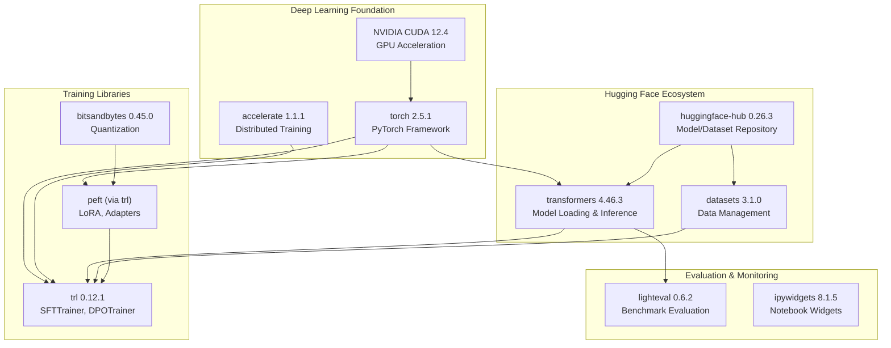

**Dependency Hierarchy**

Sources: [pyproject.toml:7-15](), [requirements.txt:3-65]()

### Primary Libraries

| Library | Version | Purpose | Configuration File |
|---------|---------|---------|-------------------|
| `transformers` | 4.46.3 | Model architectures, tokenizers, pipelines | [pyproject.toml:12]() |
| `trl` | 0.12.1 | `SFTTrainer`, `DPOTrainer`, `ORPOTrainer` classes | [pyproject.toml:13]() |
| `datasets` | 3.1.0 | Dataset loading, preprocessing, streaming | [pyproject.toml:8]() |
| `bitsandbytes` | 0.45.0 | 4-bit/8-bit quantization via `BitsAndBytesConfig` | [pyproject.toml:14]() |
| `torch` | 2.5.1 | Core tensor operations, autograd, CUDA interface | [requirements.txt:56]() |

Sources: [pyproject.toml:7-15](), [requirements.txt:3-65]()

### CUDA Dependencies

NVIDIA CUDA libraries are automatically included for Linux x86_64 systems as specified in [requirements.txt:27-38](). The following CUDA 12.4 components are required:

- `nvidia-cuda-runtime-cu12` (12.4.127): Runtime library
- `nvidia-cublas-cu12` (12.4.5.8): Basic Linear Algebra Subprograms
- `nvidia-cudnn-cu12` (9.1.0.70): Deep Neural Network library
- `nvidia-nccl-cu12` (2.21.5): Multi-GPU communication

Sources: [requirements.txt:27-38]()

## Installation Methods

### Using uv (Recommended)

The course uses `uv` as the package manager, with dependencies locked in [uv.lock:1-6](). Install all dependencies:

```bash
# Install uv package manager
curl -LsSf https://astral.sh/uv/install.sh | sh

# Install project dependencies
uv sync
```

This creates a virtual environment and installs all packages from [uv.lock:1]().

Sources: [uv.lock:1-6]()

### Using pip

For standard pip-based installation:

```bash
# Create virtual environment
python3.11 -m venv venv
source venv/bin/activate  # On Windows: venv\Scripts\activate

# Install dependencies
pip install -r requirements.txt
```

Sources: [requirements.txt:1-65](), [.python-version:1]()

### Using pyproject.toml

For development installations:

```bash
pip install -e .
```

This installs the package in editable mode with dependencies from [pyproject.toml:7-15]().

Sources: [pyproject.toml:1-16]()

## Installation Workflow

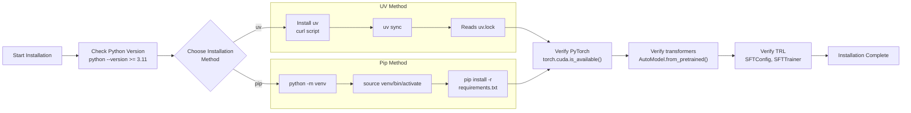

Sources: [pyproject.toml:6](), [requirements.txt:1-2](), [uv.lock:1-6]()

## Verification Steps

### Test PyTorch and CUDA

Verify PyTorch installation and GPU availability:

```python
import torch
print(f"PyTorch version: {torch.__version__}")
print(f"CUDA available: {torch.cuda.is_available()}")
print(f"CUDA version: {torch.version.cuda}")
print(f"GPU count: {torch.cuda.device_count()}")
```

Expected output shows `torch==2.5.1` with CUDA 12.4 support.

Sources: [requirements.txt:56](), [requirements.txt:27-38]()

### Test Transformers Library

Verify `transformers` can load models:

```python
from transformers import AutoTokenizer, AutoModelForCausalLM

tokenizer = AutoTokenizer.from_pretrained("HuggingFaceTB/SmolLM2-135M")
model = AutoModelForCausalLM.from_pretrained("HuggingFaceTB/SmolLM2-135M")
print(f"Transformers version: {transformers.__version__}")
```

This verifies the `transformers==4.46.3` installation and Hugging Face Hub connectivity.

Sources: [requirements.txt:58](), [requirements.txt:16]()

### Test TRL Trainers

Verify `trl` trainer classes are available:

```python
from trl import SFTConfig, SFTTrainer, DPOConfig, DPOTrainer

print(f"TRL version: {trl.__version__}")
print(f"SFTConfig available: {SFTConfig is not None}")
print(f"SFTTrainer available: {SFTTrainer is not None}")
```

This confirms `trl==0.12.1` with core trainer implementations.

Sources: [requirements.txt:60](), [pyproject.toml:13]()

### Test Quantization

Verify `bitsandbytes` for quantization:

```python
import bitsandbytes as bnb
from transformers import BitsAndBytesConfig

bnb_config = BitsAndBytesConfig(
    load_in_4bit=True,
    bnb_4bit_compute_dtype=torch.bfloat16
)
print(f"bitsandbytes version: {bnb.__version__}")
```

This tests `bitsandbytes==0.45.0` functionality.

Sources: [requirements.txt:14](), [pyproject.toml:14]()

## Library Architecture and Relationships

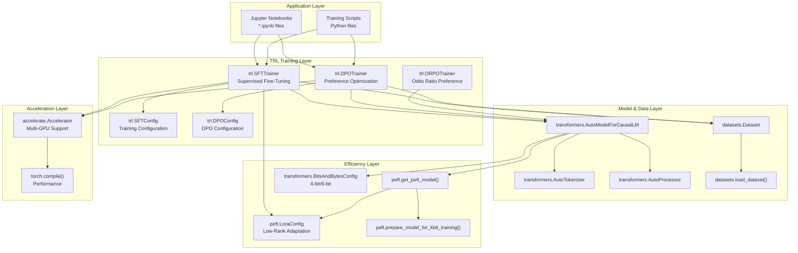

**Class and Function Mapping**

Sources: [requirements.txt:56-60](), [pyproject.toml:7-15]()

## Hardware and CUDA Configuration

### GPU Requirements by Task

| Task | Minimum VRAM | Recommended GPU | Quantization |
|------|--------------|-----------------|--------------|
| SmolLM3-3B Inference | 6GB | GTX 1660 Ti | None |
| SmolLM3-3B SFT (LoRA) | 12GB | RTX 3060 | 4-bit |
| SmolLM3-3B SFT (Full) | 24GB | RTX 3090 | None |
| SmolVLM2-2.2B SFT (LoRA) | 16GB | RTX 4060 Ti | 4-bit |
| Multi-GPU Training | 2x16GB | 2x RTX 4080 | 8-bit |

Sources: [README.md:58-64]()

### CUDA Device Detection

The installation includes CUDA libraries only for Linux x86_64 systems with conditional installation specified in [requirements.txt:27]():

```python
# Check CUDA availability after installation
import torch
if torch.cuda.is_available():
    print(f"CUDA devices: {torch.cuda.device_count()}")
    for i in range(torch.cuda.device_count()):
        print(f"  Device {i}: {torch.cuda.get_device_name(i)}")
        print(f"  Memory: {torch.cuda.get_device_properties(i).total_memory / 1e9:.2f} GB")
else:
    print("CUDA not available, using CPU")
```

Sources: [requirements.txt:27-38]()

## Environment Variables

### Hugging Face Hub Authentication

For model downloads and Hub uploads:

```bash
# Set authentication token
export HF_TOKEN="your_token_here"

# Or use huggingface-cli
huggingface-cli login
```

The `huggingface-hub==0.26.3` library handles authentication via token storage.

Sources: [requirements.txt:16](), [pyproject.toml:9]()

### CUDA Configuration

```bash
# Set visible GPUs
export CUDA_VISIBLE_DEVICES=0,1

# Enable TF32 precision (Ampere+ GPUs)
export TORCH_ALLOW_TF32=1

# Set CUDA memory allocation strategy
export PYTORCH_CUDA_ALLOC_CONF=max_split_size_mb:512
```

Sources: [requirements.txt:27-38]()

## Package Manager Details

### UV Lock File Structure

The [uv.lock:1-6]() file specifies:

```
version = 1
requires-python = ">=3.11"
resolution-markers = [
    "python_full_version < '3.12'",
    "python_full_version >= '3.12'",
]
```

This ensures consistent installations across environments with Python 3.11+ support.

Sources: [uv.lock:1-6]()

### Dependency Resolution

The dependency tree resolves to specific versions:

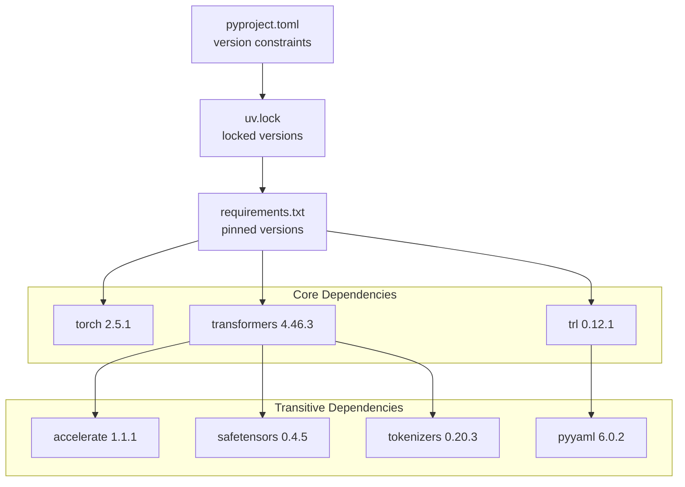

Sources: [pyproject.toml:7-15](), [uv.lock:1-6](), [requirements.txt:1-65]()

## Common Installation Issues

### CUDA Version Mismatch

If `torch.cuda.is_available()` returns `False`:

1. Verify NVIDIA driver version: `nvidia-smi`
2. Check CUDA toolkit installation: `nvcc --version`
3. Reinstall PyTorch with correct CUDA version:
   ```bash
   pip install torch==2.5.1 --index-url https://download.pytorch.org/whl/cu124
   ```

Sources: [requirements.txt:56](), [requirements.txt:27-38]()

### bitsandbytes Compilation Errors

The `bitsandbytes==0.45.0` package requires CUDA for quantization. On non-CUDA systems, use CPU-only mode:

```python
# Skip quantization on CPU systems
from transformers import AutoModelForCausalLM
model = AutoModelForCausalLM.from_pretrained("model_name", device_map="cpu")
```

Sources: [requirements.txt:14](), [pyproject.toml:14]()

### Hugging Face Hub Connection Failures

If dataset/model downloads fail:

1. Check internet connectivity
2. Verify `huggingface-hub==0.26.3` is installed
3. Test Hub access:
   ```python
   from huggingface_hub import HfApi
   api = HfApi()
   print(api.whoami())  # Should not raise error after login
   ```

Sources: [requirements.txt:16](), [pyproject.toml:9]()

## Next Steps

After completing installation:

1. **Instruction Tuning**: Proceed to [Instruction Tuning](#2) to learn supervised fine-tuning
2. **TRL CLI**: Explore [TRL CLI Tools](#7.2) for command-line training workflows
3. **Cloud Training**: Set up [Training with Hugging Face Jobs](#2.3) for scalable training

Sources: [README.md:32-43]()

---

# Page: Instruction Tuning

# Instruction Tuning

<details>
<summary>Relevant source files</summary>

The following files were used as context for generating this wiki page:

- [units/en/unit0/1.mdx](units/en/unit0/1.mdx)
- [units/en/unit1/1.md](units/en/unit1/1.md)
- [units/en/unit1/2.md](units/en/unit1/2.md)
- [units/en/unit1/3.md](units/en/unit1/3.md)
- [units/en/unit1/3a.md](units/en/unit1/3a.md)
- [units/en/unit1/4.md](units/en/unit1/4.md)
- [units/en/unit1/5.md](units/en/unit1/5.md)
- [units/en/unit1/6.md](units/en/unit1/6.md)

</details>


## Purpose and Scope

This document introduces **instruction tuning**, the process of adapting pre-trained language models to follow human instructions and engage in structured conversations. Instruction tuning transforms base models like `SmolLM3-3B-Base` into instruction-following assistants like `SmolLM3-3B` through supervised fine-tuning on curated datasets.

This page covers the foundational concepts and overall architecture. For detailed implementation:
- Chat template formatting and conversation structure: see [Chat Templates](#2.1)
- Supervised fine-tuning process and training: see [Supervised Fine-Tuning (SFT)](#2.2)
- Cloud-based training infrastructure: see [Training with Hugging Face Jobs](#2.3)
- Parameter-efficient methods (LoRA, quantization): see [LoRA and Adapters](#3.1) and [Quantization Techniques](#3.2)

## Base Models vs Instruction-Tuned Models

The fundamental transformation in instruction tuning converts a text completion model into an instruction-following assistant.

### Model Comparison

| Aspect | Base Model (`SmolLM3-3B-Base`) | Instruct Model (`SmolLM3-3B`) |
|--------|-------------------------------|-------------------------------|
| Training Objective | Next token prediction | Instruction following + preference alignment |
| Input Format | Raw text strings | Structured chat messages with roles |
| Output Behavior | Continues text | Responds to instructions |
| Chat Template | None (raw text) | ChatML format with special tokens |
| Reasoning Mode | N/A | Dual-mode (`/think`, `/no_think`) |
| Training Data | 11T tokens general text | SmolTalk2 + preference datasets |
| Use Case | Completion, embeddings | Conversational AI, task completion |

### Behavioral Differences

```python
# Base model behavior - text continuation
# Input: "The capital of France is"
# Output: " Paris, which is located on the Seine River and has a population..."

# Instruct model behavior - instruction following
# Input: [{"role": "user", "content": "What is the capital of France?"}]
# Output: [{"role": "assistant", "content": "The capital of France is Paris."}]
```

Sources: [units/en/unit1/1.md:10-19](), [units/en/unit1/3.md:6-28]()

## The SmolLM3 Model Family

### Model Variants

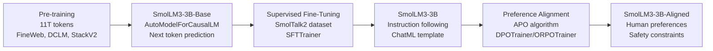

**Diagram: SmolLM3 Training Pipeline from Pre-training to Alignment**

Sources: [units/en/unit1/1.md:26-35](), [units/en/unit1/3.md:19-28]()

### Key Capabilities

- **Context Length**: 8K tokens (base), extended variants up to 128K tokens
- **Multilingual**: Trained on diverse language data
- **Dual-Mode Reasoning**: `/think` mode shows reasoning, `/no_think` provides direct answers
- **Tool Use**: Supports function calling and MCP server integration
- **Model Size**: 3B parameters, optimized for single GPU training

Sources: [units/en/unit1/1.md:26-35]()

## Instruction Tuning Pipeline Architecture

### End-to-End Workflow

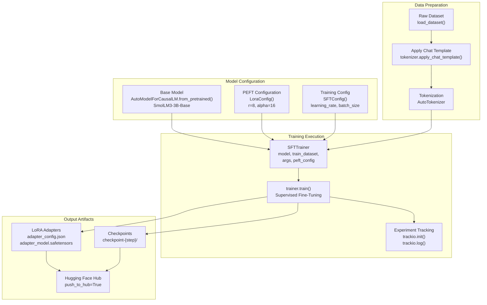

**Diagram: Complete SFT Pipeline with TRL Components**

Sources: [units/en/unit1/3.md:406-433](), [units/en/unit1/3a.md:116-146]()

### Code Entity Mapping

| Component | Primary Class/Function | File References |
|-----------|----------------------|-----------------|
| Dataset Loading | `load_dataset()` | [units/en/unit1/4.md:732-741]() |
| Chat Formatting | `tokenizer.apply_chat_template()` | [units/en/unit1/2.md:173-181](), [units/en/unit1/4.md:196-215]() |
| Model Loading | `AutoModelForCausalLM.from_pretrained()` | [units/en/unit1/4.md:95-99]() |
| Tokenizer | `AutoTokenizer.from_pretrained()` | [units/en/unit1/4.md:91-92]() |
| PEFT Config | `LoraConfig()` | [units/en/unit1/3a.md:54-64](), [units/en/unit1/3a.md:124-131]() |
| Training Config | `SFTConfig()` | [units/en/unit1/3.md:467-474]() |
| Trainer | `SFTTrainer()` | [units/en/unit1/3.md:476-482]() |
| Tracking | `trackio.init()`, `trackio.log()` | [units/en/unit1/3.md:270-281]() |

## Core Component: Chat Templates

Chat templates structure conversations using the ChatML format with special tokens `<|im_start|>` and `<|im_end|>` to delineate message boundaries.

### Message Role Structure

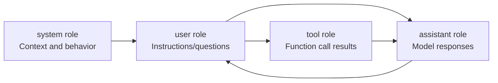

**Diagram: Chat Message Role Flow**

### Template Application Modes

| Parameter | Purpose | Use Case | Code Example |
|-----------|---------|----------|--------------|
| `add_generation_prompt=True` | Add assistant prompt token | Inference time | [units/en/unit1/2.md:280-285]() |
| `add_generation_prompt=False` | Complete conversation | Training data | [units/en/unit1/2.md:270-274]() |
| `continue_final_message=True` | Continue last message | Structured output | [units/en/unit1/2.md:327-343]() |
| `tokenize=False` | Return string | Debug/inspect | [units/en/unit1/2.md:174-178]() |
| `tokenize=True` | Return tensors | Direct model input | Implied in pipeline usage |

### Dual-Mode Reasoning

SmolLM3 supports two reasoning modes controlled through system message metadata:

```python
# /no_think mode - direct answers
{"role": "assistant", "content": "The answer is 42"}

# /think mode - show reasoning process  
{"role": "assistant", "content": "\n\nThe answer is 42"}
```

Sources: [units/en/unit1/2.md:130-154](), [units/en/unit1/4.md:483-522]()

For comprehensive chat template documentation, see [Chat Templates](#2.1).

## Core Component: Supervised Fine-Tuning

### SFT Training Objective

SFT minimizes the token-level cross-entropy loss:

$$
\mathcal{L}_{\text{SFT}}(\theta) = - \sum_{t=1}^{T} \log p_\theta(y_t \mid y_{<t})
$$

where $y_t$ is the target token at timestep $t$. The model learns to predict the next token given previous context, with padding tokens masked during loss computation.

Sources: [units/en/unit1/3.md:394-404]()

### SFTTrainer Configuration

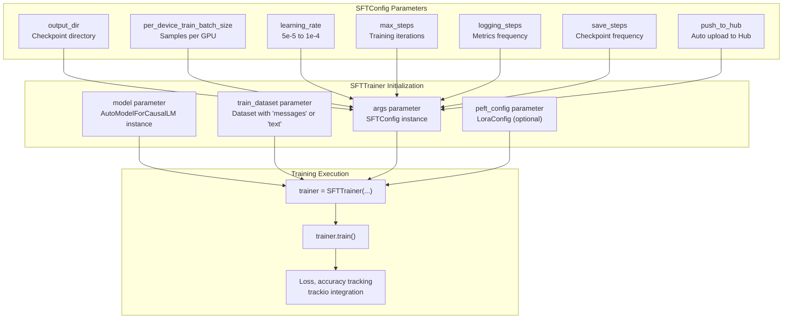

**Diagram: SFTTrainer Initialization and Configuration Flow**

### Hyperparameter Ranges

| Parameter | Conservative | Balanced | Aggressive | Impact |
|-----------|-------------|----------|------------|--------|
| `learning_rate` | 5e-5 | 1e-4 | 2e-4 | Convergence speed vs stability |
| `per_device_train_batch_size` | 2 | 4 | 8 | Memory usage |
| `gradient_accumulation_steps` | 8 | 4 | 2 | Effective batch size |
| `max_seq_length` | 512 | 1024-2048 | 4096 | Context window vs memory |
| `warmup_steps` | 100 | 200-300 | 500 | Training stability |

Sources: [units/en/unit1/3.md:99-177]()

### Dataset Format Requirements

SFTTrainer accepts multiple dataset formats:

**Conversational Format (Recommended)**:
```python
{
    "messages": [
        {"role": "system", "content": "You are helpful."},
        {"role": "user", "content": "Question?"},
        {"role": "assistant", "content": "Answer."}
    ]
}
```

**Prompt-Completion Format**:
```python
{
    "prompt": [{"role": "user", "content": "Question?"}],
    "completion": [{"role": "assistant", "content": "Answer."}]
}
```

**Text Format**:
```python
{"text": "<|im_start|>user\nQuestion?<|im_end|><|im_start|>assistant\nAnswer.<|im_end|>"}
```

Sources: [units/en/unit1/3.md:328-365]()

For detailed SFT implementation and best practices, see [Supervised Fine-Tuning (SFT)](#2.2).

## Training Infrastructure

### TRL Library Architecture

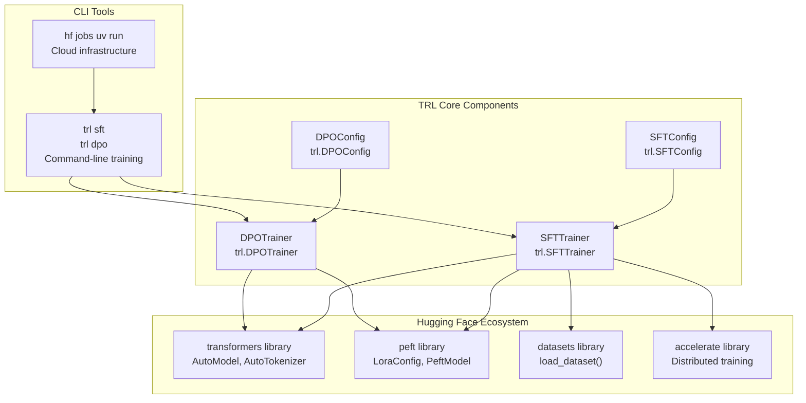

**Diagram: TRL Library Integration with Hugging Face Ecosystem**

### Training Execution Approaches

| Approach | Code Entry Point | Use Case | Reference |
|----------|-----------------|----------|-----------|
| Python API | `SFTTrainer(model, dataset, args)` | Custom workflows, experimentation | [units/en/unit1/3.md:449-483]() |
| TRL CLI | `trl sft --model_name ... --dataset_name ...` | Standardized training, reproducibility | [units/en/unit1/3.md:486-504]() |
| HF Jobs | `hf jobs uv run --flavor a10g-large ...` | Cloud training, scalability | [units/en/unit1/5.md:109-124]() |
| UV Script | Inline dependencies in `# /// script` block | Portable training scripts | [units/en/unit1/5.md:29-72]() |

Sources: [units/en/unit1/3.md:406-443](), [units/en/unit1/5.md:1-11]()

### Experiment Tracking with Trackio

Trackio provides lightweight experiment tracking with Hugging Face integration:

```python
# Initialization
import trackio
trackio.init(project="smollm3-sft")

# Automatic tracking via SFTConfig
config = SFTConfig(
    output_dir="./output",
    report_to="trackio"  # Enable trackio integration
)

# Logged metrics
# - global_step: Optimizer steps
# - epoch: Dataset iteration
# - num_tokens: Total tokens processed
# - loss: Cross-entropy loss
# - entropy: Token distribution entropy
# - mean_token_accuracy: Top-1 prediction accuracy
# - learning_rate: Current LR
# - grad_norm: Gradient L2 norm
```

Sources: [units/en/unit1/3.md:259-327]()

For cloud-based training infrastructure, see [Training with Hugging Face Jobs](#2.3).

## Parameter-Efficient Fine-Tuning Integration

### LoRA Configuration

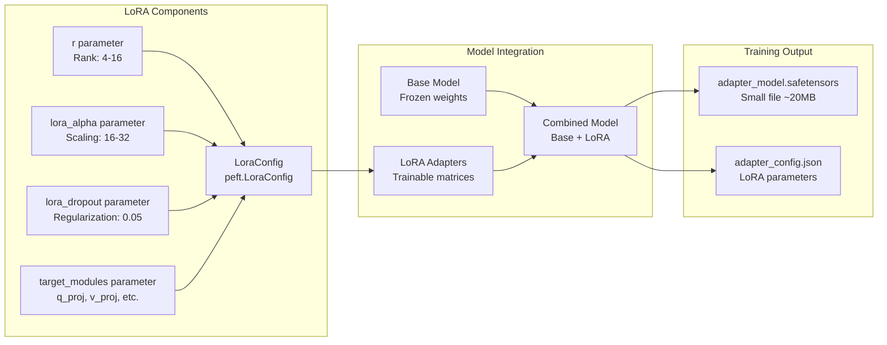

**Diagram: LoRA Configuration and Integration Flow**

### LoRA Parameter Guidelines

| Parameter | Typical Values | Impact | Trade-off |
|-----------|---------------|--------|-----------|
| `r` (rank) | 4, 8, 16 | Model capacity | Higher = more parameters, better fit |
| `lora_alpha` | 16, 32 | Adapter influence | Higher = stronger adaptation |
| `lora_dropout` | 0.05, 0.1 | Regularization | Higher = less overfitting |
| `target_modules` | `["q_proj", "v_proj"]` or `"all-linear"` | Coverage | More = more parameters |
| `bias` | `"none"`, `"all"` | Bias adaptation | `"all"` increases parameters |

### Memory Comparison

| Configuration | Parameters | VRAM Usage | Training Speed |
|--------------|------------|------------|----------------|
| Full Fine-Tuning (3B) | 3B trainable | ~40GB | Baseline |
| LoRA r=8 | ~30M trainable | ~16GB | 1.5x faster |
| LoRA r=16 | ~60M trainable | ~18GB | 1.4x faster |
| LoRA + 4-bit Quantization | ~30M trainable | ~8GB | 1.2x faster |

Sources: [units/en/unit1/3a.md:11-71](), [units/en/unit1/3a.md:116-146]()

For detailed PEFT methods, see [LoRA and Adapters](#3.1) and [Quantization Techniques](#3.2).

## Training Datasets

### SmolTalk2 Dataset Structure

The primary SFT dataset for SmolLM3 is `HuggingFaceTB/smoltalk2`:

```python
from datasets import load_dataset

# Load SFT subset
dataset = load_dataset("HuggingFaceTB/smoltalk2", "SFT")

# Structure:
# - 25 different splits (subsets)
# - Total: 3,383,242 rows
# - Each row contains "messages" field with conversation

# Example splits:
# - smoltalk_everyday_convs_reasoning_Qwen3_32B_think
# - OpenThoughts3_1.2M_think  
# - aya_dataset_Qwen3_32B_think
# - table_gpt_Qwen3_32B_think
```

Sources: [units/en/unit1/4.md:732-763]()

### Dataset Preprocessing

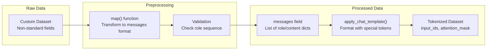

**Diagram: Dataset Preprocessing Pipeline**

Example preprocessing function:

```python
# From units/en/unit1/3.md:349-365
def preprocess_function(example):
    return {
        "prompt": [{"role": "user", "content": example["Question"]}],
        "completion": [
            {"role": "assistant", 
             "content": f"{example['Response']}"}
        ],
    }

dataset = dataset.map(preprocess_function, remove_columns=["Question", "Response", "Complex_CoT"])
```

Sources: [units/en/unit1/3.md:349-383]()

## Loss Monitoring and Convergence Patterns

### Healthy Training Pattern

| Phase | Training Loss | Validation Loss | Interpretation |
|-------|--------------|-----------------|----------------|
| Initial (0-100 steps) | 2.5-4.0 | 2.5-4.0 | Model adapting to data distribution |
| Stabilization (100-500 steps) | 1.5-2.5 | 1.5-2.5 | Gradual improvement |
| Convergence (500+ steps) | 0.5-1.5 | 0.6-1.6 | Stable performance |

### Warning Signs

**Overfitting Pattern**: Training loss ↓, validation loss ↑  
**Underfitting Pattern**: Both losses remain high  
**Memorization**: Training loss < 0.3, poor generalization

Sources: [units/en/unit1/3.md:204-257]()

## Complete Training Example

### Python API Workflow

```python
# From units/en/unit1/3.md:449-483
from transformers import AutoModelForCausalLM, AutoTokenizer
from trl import SFTTrainer, SFTConfig
from datasets import load_dataset
from peft import LoraConfig
import trackio

# 1. Initialize tracking
trackio.init(project="smollm3-sft", name="my-first-sft-run")

# 2. Load model and tokenizer
model = AutoModelForCausalLM.from_pretrained("HuggingFaceTB/SmolLM3-3B-Base")
tokenizer = AutoTokenizer.from_pretrained("HuggingFaceTB/SmolLM3-3B-Base")

# 3. Load dataset
dataset = load_dataset("HuggingFaceTB/smoltalk2_everyday_convs_think")

# 4. Configure LoRA
peft_config = LoraConfig(
    r=8,
    lora_alpha=16,
    lora_dropout=0.05,
    bias="none",
    task_type="CAUSAL_LM"
)

# 5. Configure training
config = SFTConfig(
    output_dir="./smollm3-finetuned",
    per_device_train_batch_size=4,
    learning_rate=5e-5,
    max_steps=1000,
    report_to="trackio",
    push_to_hub=True,
    hub_model_id="username/smollm3-custom"
)

# 6. Create trainer
trainer = SFTTrainer(
    model=model,
    train_dataset=dataset["train"],
    args=config,
    peft_config=peft_config
)

# 7. Train
trainer.train()

# 8. Push to Hub (automatic with push_to_hub=True)
```

Sources: [units/en/unit1/3.md:449-483](), [units/en/unit1/3a.md:116-146]()

### CLI Workflow

```bash
# From units/en/unit1/3.md:486-504
trl sft \
    --model_name_or_path HuggingFaceTB/SmolLM3-3B-Base \
    --dataset_name HuggingFaceTB/smoltalk2_everyday_convs_think \
    --output_dir ./smollm3-sft-model \
    --per_device_train_batch_size 4 \
    --learning_rate 5e-5 \
    --max_steps 1000 \
    --logging_steps 50 \
    --save_steps 200 \
    --report_to trackio \
    --push_to_hub \
    --hub_model_id username/smollm3-custom \
    --use_peft \
    --lora_r 8 \
    --lora_alpha 16
```

Sources: [units/en/unit1/3.md:486-504](), [units/en/unit1/5.md:163-185]()

## Key Design Decisions

### Why SFT Over Prompting

SFT is appropriate when:
- Prompting existing models fails to achieve desired behavior
- Consistent output formats are required
- Domain-specific knowledge needs integration
- High-quality training data (1,000+ examples) is available
- Computational resources for training are accessible

Sources: [units/en/unit1/3.md:46-58]()

### Why SmolLM3 for Learning

- **Single GPU Training**: Fits on consumer hardware (16GB+ VRAM)
- **Complete Documentation**: Full training recipes and datasets available
- **State-of-the-art Performance**: Competitive with larger models
- **Dual-Mode Reasoning**: Supports both direct and reasoning responses
- **Production Ready**: Used in real-world applications

Sources: [units/en/unit1/1.md:26-35]()

### TRL vs Alternative Frameworks

| Framework | Strengths | Use Case |
|-----------|-----------|----------|
| TRL | LLM-specific, SFT/DPO/PPO support | Instruction tuning, alignment |
| Transformers Trainer | General-purpose, widely used | Basic fine-tuning |
| DeepSpeed | Large-scale distributed training | Multi-node training |
| Accelerate | Low-level distributed primitives | Custom training loops |

Sources: [units/en/unit1/3.md:406-442]()

## Next Steps

This overview introduced instruction tuning fundamentals. For implementation details:

1. **Start with Chat Templates** ([#2.1](#2.1)): Learn message formatting and template application
2. **Proceed to SFT Training** ([#2.2](#2.2)): Implement supervised fine-tuning with TRL
3. **Scale with HF Jobs** ([#2.3](#2.3)): Deploy training to cloud infrastructure
4. **Optimize with PEFT** ([#3.1](#3.1)): Reduce training costs with LoRA
5. **Evaluate Models** ([#6](#6)): Assess performance with lighteval

For hands-on practice, see the exercises in [units/en/unit1/4.md:1-763]().

---

# Page: Chat Templates

# Chat Templates

<details>
<summary>Relevant source files</summary>

The following files were used as context for generating this wiki page:

- [notebooks/1/4.ipynb](notebooks/1/4.ipynb)
- [units/en/unit1/1.md](units/en/unit1/1.md)
- [units/en/unit1/2.md](units/en/unit1/2.md)
- [units/en/unit1/6.md](units/en/unit1/6.md)
- [v1/3_parameter_efficient_finetuning/notebooks/finetune_sft_peft.ipynb](v1/3_parameter_efficient_finetuning/notebooks/finetune_sft_peft.ipynb)
- [v1/es/3_parameter_efficient_finetuning/notebooks/finetune_sft_peft.ipynb](v1/es/3_parameter_efficient_finetuning/notebooks/finetune_sft_peft.ipynb)
- [v1/ja/3_parameter_efficient_finetuning/notebooks/finetune_sft_peft.ipynb](v1/ja/3_parameter_efficient_finetuning/notebooks/finetune_sft_peft.ipynb)
- [v1/ko/3_parameter_efficient_finetuning/notebooks/finetune_sft_peft.ipynb](v1/ko/3_parameter_efficient_finetuning/notebooks/finetune_sft_peft.ipynb)
- [v1/pt-br/3_parameter_efficient_finetuning/notebooks/finetune_sft_peft.ipynb](v1/pt-br/3_parameter_efficient_finetuning/notebooks/finetune_sft_peft.ipynb)
- [v1/vi/3_parameter_efficient_finetuning/notebooks/finetune_sft_peft.ipynb](v1/vi/3_parameter_efficient_finetuning/notebooks/finetune_sft_peft.ipynb)

</details>


## Purpose and Scope

Chat templates provide the standardized formatting system that enables language models to understand structured conversations. This page covers the ChatML template format used by SmolLM3, the message structure for different conversation roles, and the programmatic interfaces for applying templates during training and inference.

For information about the supervised fine-tuning process that uses these templates, see [Supervised Fine-Tuning](#2.2). For training infrastructure that automates template application, see [Hugging Face Jobs](#2.3).

Sources: [units/en/unit1/2.md:1-8]()

## What Are Chat Templates?

Chat templates convert unstructured conversations into a token sequence that language models can process. Without templates, a model trained on raw text cannot distinguish between a user question and an assistant response, or understand when one message ends and another begins.

A base model like `SmolLM3-3B-Base` predicts the next token in a sequence. An instruct model like `SmolLM3-3B` uses chat templates to understand conversation structure and generate appropriate responses within that structure.

Sources: [units/en/unit1/2.md:3-24]()

## ChatML Format Structure

SmolLM3 implements the ChatML (Chat Markup Language) format using special boundary tokens:

```xml
<|im_start|>system
You are a helpful assistant.<|im_end|>
<|im_start|>user
What is machine learning?<|im_end|>
<|im_start|>assistant
Machine learning is a branch of AI...<|im_end|>
```

### Special Tokens

| Token | Purpose |
|-------|---------|
| `<|im_start|>` | Marks the beginning of a message |
| `<|im_end|>` | Marks the end of a message |
| `<|thinking|>` | Begins reasoning section (thinking mode only) |
| `</|thinking|>` | Ends reasoning section (thinking mode only) |

The template format ensures that:
- Each message has a clearly defined role
- Message boundaries are unambiguous
- The model knows when to start generating responses
- Tool calls and reasoning can be properly structured

Sources: [units/en/unit1/2.md:108-155](), [notebooks/1/4.ipynb:719-886]()

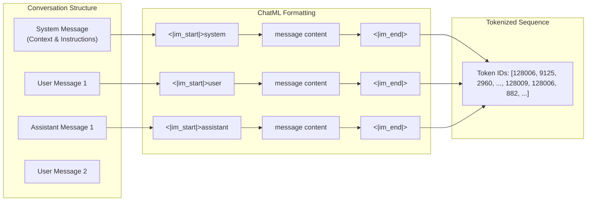

**Diagram: Message Structure to Token Sequence Conversion**

Sources: [units/en/unit1/2.md:108-128]()

## Message Roles and Structure

Each message in a conversation follows a dictionary structure with two required keys:

```python
{
    "role": "user",  # or "system", "assistant", "tool"
    "content": "What is the capital of France?"
}
```

### Role Types

**System Messages**

Set persistent instructions and context that influence all subsequent interactions. The system message appears first in the conversation.

```python
{
    "role": "system",
    "content": "You are a helpful programming tutor. Always provide code examples."
}
```

**User Messages**

Contain questions, requests, or statements from the human user.

```python
{
    "role": "user",
    "content": "How do I define a function in Python?"
}
```

**Assistant Messages**

Contain responses generated by the model. During training, these are the target outputs the model learns to produce.

```python
{
    "role": "assistant",
    "content": "In Python, you define a function using the def keyword..."
}
```

**Tool Messages**

Contain results from function calls or external tool invocations (advanced use case).

```python
{
    "role": "tool",
    "content": '{"temperature": 72, "conditions": "sunny"}'
}
```

Sources: [units/en/unit1/2.md:193-230]()

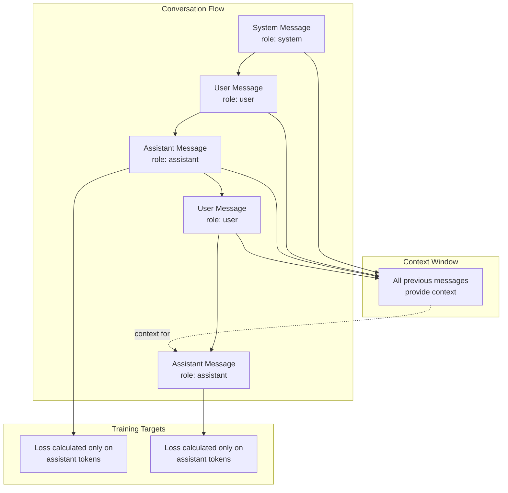

**Diagram: Message Roles in Multi-Turn Conversations**

Sources: [units/en/unit1/2.md:236-248]()

## Applying Chat Templates in Code

### Basic Template Application

The `AutoTokenizer.apply_chat_template()` method converts message dictionaries into formatted text or token IDs:

```python
from transformers import AutoTokenizer

tokenizer = AutoTokenizer.from_pretrained("HuggingFaceTB/SmolLM3-3B")

messages = [
    {"role": "system", "content": "You are a helpful assistant."},
    {"role": "user", "content": "What is machine learning?"}
]

# Return formatted string
formatted_text = tokenizer.apply_chat_template(
    messages,
    tokenize=False,
    add_generation_prompt=True
)

# Return token IDs for training
token_ids = tokenizer.apply_chat_template(
    messages,
    tokenize=True,
    add_generation_prompt=False
)
```

### Key Parameters

| Parameter | Type | Purpose |
|-----------|------|---------|
| `messages` | List[Dict] | Conversation messages to format |
| `tokenize` | bool | Return token IDs (True) or text (False) |
| `add_generation_prompt` | bool | Add `<|im_start|>assistant` to prompt model response |
| `continue_final_message` | bool | Continue last message instead of starting new one |

Sources: [units/en/unit1/2.md:156-192](), [notebooks/1/4.ipynb:890-920]()

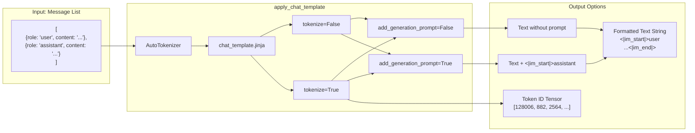

**Diagram: apply_chat_template Parameter Flow**

Sources: [units/en/unit1/2.md:156-192]()

## Reasoning Modes

SmolLM3 supports dual-mode reasoning through special formatting. The mode is controlled by the `/think` or `/no_think` directive in the system message.

### Standard Mode (/no_think)

Direct responses without visible reasoning:

```python
messages = [
    {"role": "system", "content": "/no_think"},
    {"role": "user", "content": "What is 15 × 24?"},
    {"role": "assistant", "content": "15 × 24 = 360"}
]
```

### Thinking Mode (/think)

Responses include visible reasoning process:

```python
messages = [
    {"role": "system", "content": "/think"},
    {"role": "user", "content": "What is 15 × 24?"},
    {"role": "assistant", "content": """<|thinking|>
I need to multiply 15 by 24. Let me break this down:
15 × 24 = 15 × (20 + 4) = (15 × 20) + (15 × 4) = 300 + 60 = 360
</|thinking|>

15 × 24 = 360"""}
]
```

The model learns when to show reasoning based on task complexity during training. The `<|thinking|>` tags are part of the assistant's content and are included in the training loss calculation.

Sources: [units/en/unit1/2.md:129-155](), [units/en/unit1/2.md:420-471](), [notebooks/1/4.ipynb:851-886]()

## Generation Control Parameters

### add_generation_prompt

Controls whether the template adds the `<|im_start|>assistant` token to signal where the model should begin generating:

```python
# For inference - prompts model to generate response
formatted = tokenizer.apply_chat_template(
    messages,
    tokenize=False,
    add_generation_prompt=True  # Adds <|im_start|>assistant
)

# For training - complete conversations without generation prompt
formatted = tokenizer.apply_chat_template(
    messages,
    tokenize=False,
    add_generation_prompt=False  # No additional tokens
)
```

**When to use:**
- `True`: Inference, evaluation, testing model responses
- `False`: Training data preparation, logging complete conversations

Sources: [units/en/unit1/2.md:251-320]()

### continue_final_message

Makes the model continue the last message instead of starting a new one. Useful for structured output generation:

```python
# Prefill JSON structure
messages = [
    {"role": "user", "content": "Format the answer as JSON"},
    {"role": "assistant", "content": '{"name": "'}
]

formatted = tokenizer.apply_chat_template(
    messages,
    tokenize=False,
    continue_final_message=True  # Model continues from '{"name": "'
)
```

**Constraints:**
- Cannot use `add_generation_prompt=True` and `continue_final_message=True` together
- Final message must have `"role": "assistant"`
- Removes `<|im_end|>` token from the final message

**Use cases:**
- Structured output (JSON, XML)
- Code completion
- Guided reasoning formats

Sources: [units/en/unit1/2.md:322-418]()

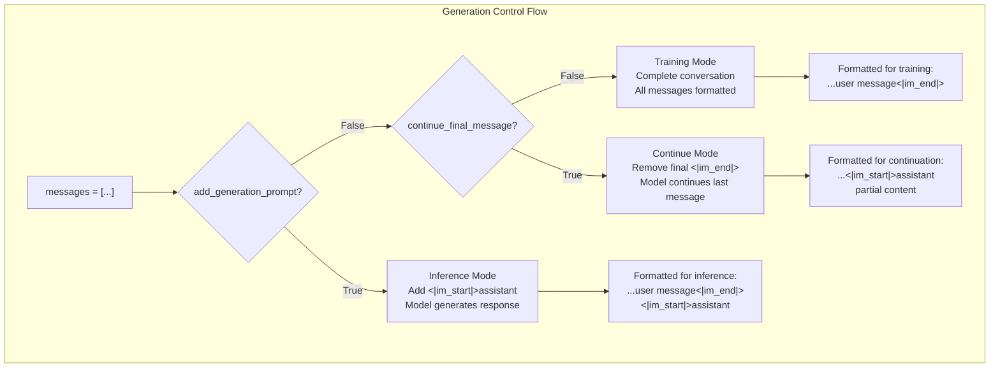

**Diagram: Generation Control Decision Tree**

Sources: [units/en/unit1/2.md:251-418]()

## Pipeline Integration

The `transformers.pipeline` abstraction handles chat templates automatically, eliminating manual template management:

```python
from transformers import pipeline

pipe = pipeline(
    "text-generation",
    "HuggingFaceTB/SmolLM3-3B",
    device_map="auto"
)

messages = [
    {"role": "system", "content": "You are a helpful assistant."},
    {"role": "user", "content": "What is machine learning?"}
]

# Pipeline automatically:
# 1. Applies chat template based on model's tokenizer config
# 2. Handles tokenization
# 3. Generates response
# 4. Returns structured output
response = pipe(messages, max_new_tokens=128)
print(response[0]['generated_text'][-1])  # Last message (assistant's response)
```

### Pipeline with Generation Config

```python
generation_config = {
    "max_new_tokens": 200,
    "temperature": 0.8,
    "do_sample": True,
    "top_p": 0.9,
    "repetition_penalty": 1.1
}

response = pipe(messages, **generation_config)
```

The pipeline retrieves the chat template from `tokenizer_config.json` in the model's Hugging Face Hub repository. This ensures consistent formatting across different usage contexts.

Sources: [units/en/unit1/2.md:25-93](), [notebooks/1/4.ipynb:94-113]()

```mermaid
graph LR
    subgraph "User Code"
        Messages["messages = [<br/>{role: 'user', content: '...'},<br/>...]"]
        PipeCall["pipe(messages, **config)"]
    end
    
    subgraph "Pipeline Internal Flow"
        LoadConfig["Load tokenizer_config.json<br/>from Hub repo"]
        GetTemplate["Extract chat_template.jinja"]
        ApplyTemplate["tokenizer.apply_chat_template<br/>(add_generation_prompt=True)"]
        Tokenize["tokenizer.encode()"]
        Generate["model.generate()"]
        Decode["tokenizer.decode()"]
        ParseOutput["Parse generated text<br/>into message format"]
    end
    
    subgraph "Output"
        Response["[<br/>{role: 'user', content: '...'},<br/>{role: 'assistant', content: '...'}<br/>]"]
    end
    
    Messages --> PipeCall
    PipeCall --> LoadConfig
    LoadConfig --> GetTemplate
    GetTemplate --> ApplyTemplate
    ApplyTemplate --> Tokenize
    Tokenize --> Generate
    Generate --> Decode
    Decode --> ParseOutput
    ParseOutput --> Response
```

**Diagram: Pipeline Automatic Chat Template Processing**

Sources: [units/en/unit1/2.md:25-93]()

## Training Dataset Preparation

During supervised fine-tuning, chat templates convert conversation datasets into training sequences. The `SFTTrainer` from TRL handles this automatically:

```python
from trl import SFTTrainer, SFTConfig

# Dataset format: list of message dictionaries
dataset = [
    {
        "messages": [
            {"role": "system", "content": "You are a helpful assistant."},
            {"role": "user", "content": "What is Python?"},
            {"role": "assistant", "content": "Python is a programming language..."}
        ]
    },
    # ... more examples
]

trainer = SFTTrainer(
    model=model,
    args=SFTConfig(output_dir="./output"),
    train_dataset=dataset,
    # SFTTrainer automatically applies chat template during training
    # and calculates loss only on assistant tokens
)
```

The trainer:
1. Applies `tokenizer.apply_chat_template()` with `tokenize=True`
2. Creates attention masks that ignore padding
3. Creates labels where only assistant tokens contribute to loss (user and system tokens are masked with -100)
4. Handles batching and sequence packing for efficiency

Sources: [v1/3_parameter_efficient_finetuning/notebooks/finetune_sft_peft.ipynb:105-127](), [v1/ja/3_parameter_efficient_finetuning/notebooks/finetune_sft_peft.ipynb:105-127]()

## Template Configuration Files

Chat templates are stored in `tokenizer_config.json` as Jinja2 templates. For SmolLM3, the key configuration elements are:

```json
{
  "chat_template": "...",
  "bos_token": "<|im_start|>",
  "eos_token": "<|im_end|>",
  "pad_token": "<|im_end|>"
}
```

Custom templates can be specified during tokenizer initialization:

```python
tokenizer.chat_template = "..."
```

The Jinja2 template has access to:
- `messages`: List of conversation messages
- `add_generation_prompt`: Boolean flag
- `bos_token`, `eos_token`: Special tokens from tokenizer config

Sources: [units/en/unit1/2.md:108-128](), [notebooks/1/4.ipynb:719-886]()

## Common Patterns and Best Practices

### System Message Guidelines

- **Specificity**: Provide clear, detailed instructions rather than vague directives
- **Context**: Include relevant background information for domain-specific tasks
- **Examples**: When possible, show the desired format in the system message
- **Boundaries**: Set explicit constraints on behavior (e.g., "Always respond in JSON format")

### Multi-Turn Conversation Handling

```python
conversation = []

# Initial user message
conversation.append({"role": "user", "content": "Hello"})

# Generate response
response = pipe(conversation, max_new_tokens=50)
conversation = response[0]['generated_text']

# Continue conversation
conversation.append({"role": "user", "content": "Follow-up question"})
response = pipe(conversation, max_new_tokens=50)
```

### Template Compatibility

Different models use different chat templates. Always use the tokenizer associated with the specific model:

```python
# Correct: Template matches model
tokenizer = AutoTokenizer.from_pretrained("HuggingFaceTB/SmolLM3-3B")
model = AutoModelForCausalLM.from_pretrained("HuggingFaceTB/SmolLM3-3B")

# Incorrect: Mismatched template
tokenizer = AutoTokenizer.from_pretrained("meta-llama/Llama-2-7b-chat-hf")
model = AutoModelForCausalLM.from_pretrained("HuggingFaceTB/SmolLM3-3B")
```

Sources: [units/en/unit1/2.md:209-248](), [notebooks/1/4.ipynb:890-920]()

---

# Page: Supervised Fine-Tuning (SFT)

# Supervised Fine-Tuning (SFT)

<details>
<summary>Relevant source files</summary>

The following files were used as context for generating this wiki page:

- [notebooks/1/4.ipynb](notebooks/1/4.ipynb)
- [units/en/unit0/1.mdx](units/en/unit0/1.mdx)
- [units/en/unit1/3.md](units/en/unit1/3.md)
- [units/en/unit1/3a.md](units/en/unit1/3a.md)
- [units/en/unit1/4.md](units/en/unit1/4.md)
- [units/en/unit1/5.md](units/en/unit1/5.md)
- [v1/3_parameter_efficient_finetuning/notebooks/finetune_sft_peft.ipynb](v1/3_parameter_efficient_finetuning/notebooks/finetune_sft_peft.ipynb)
- [v1/es/3_parameter_efficient_finetuning/notebooks/finetune_sft_peft.ipynb](v1/es/3_parameter_efficient_finetuning/notebooks/finetune_sft_peft.ipynb)
- [v1/ja/3_parameter_efficient_finetuning/notebooks/finetune_sft_peft.ipynb](v1/ja/3_parameter_efficient_finetuning/notebooks/finetune_sft_peft.ipynb)
- [v1/ko/3_parameter_efficient_finetuning/notebooks/finetune_sft_peft.ipynb](v1/ko/3_parameter_efficient_finetuning/notebooks/finetune_sft_peft.ipynb)
- [v1/pt-br/3_parameter_efficient_finetuning/notebooks/finetune_sft_peft.ipynb](v1/pt-br/3_parameter_efficient_finetuning/notebooks/finetune_sft_peft.ipynb)
- [v1/vi/3_parameter_efficient_finetuning/notebooks/finetune_sft_peft.ipynb](v1/vi/3_parameter_efficient_finetuning/notebooks/finetune_sft_peft.ipynb)

</details>


Supervised Fine-Tuning (SFT) is the process of continuing to train a pre-trained language model on task-specific datasets with labeled input-output pairs. This page details the technical implementation using TRL's `SFTTrainer`, dataset formatting requirements, training configuration via `SFTConfig`, and the complete training workflow.

For information about chat template systems used during SFT, see [Chat Templates](#2.1). For cloud-based training infrastructure, see [Training with Hugging Face Jobs](#2.3). For parameter-efficient methods that reduce memory requirements, see [LoRA and Adapters](#3.1).

## What is Supervised Fine-Tuning

SFT adapts pre-trained models to follow instructions by training on curated examples that demonstrate desired input-output behaviors. Unlike pre-training which teaches general language understanding, SFT reshapes how existing knowledge is applied to specific tasks, response formats, and behavioral patterns.

**Key Mechanism**: During SFT, the model's parameters are updated through gradient descent on task-specific examples. The process minimizes cross-entropy loss between predicted tokens and target responses, gradually shifting probability distributions to favor demonstrated response patterns.

**Behavioral Changes**:
- **Pattern Recognition**: Model learns to identify instruction cues and respond appropriately
- **Format Adaptation**: Output distributions favor desired response structures
- **Knowledge Application**: Existing knowledge is presented in task-specific contexts rather than learned from scratch

Sources: [units/en/unit1/3.md:6-44]()

## Core Architecture: SFTTrainer and TRL

The `SFTTrainer` class from the TRL (Transformers Reinforcement Learning) library provides the primary interface for supervised fine-tuning. It extends the Hugging Face `Trainer` with specialized features for instruction tuning.

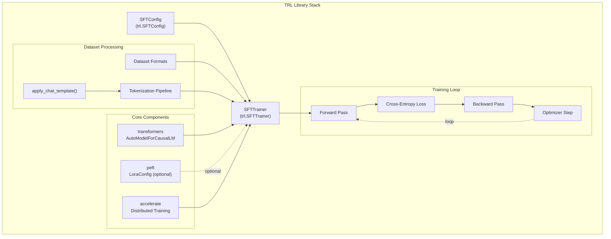

**Key Classes**:

| Class | Module | Purpose |
|-------|--------|---------|
| `SFTTrainer` | `trl.SFTTrainer` | Main training orchestration |
| `SFTConfig` | `trl.SFTConfig` | Training hyperparameters |
| `AutoModelForCausalLM` | `transformers` | Model loading |
| `AutoTokenizer` | `transformers` | Tokenization |
| `LoraConfig` | `peft` | Parameter-efficient training config |

Sources: [units/en/unit1/3.md:406-433](), [units/en/unit1/3a.md:49-71]()

## Dataset Formats and Requirements

`SFTTrainer` supports multiple dataset formats for both language modeling and prompt-completion tasks. The trainer automatically applies chat templates to conversational datasets.

### Supported Format Types

```mermaid
graph LR
    subgraph "Input Formats"
        LM["Language Modeling<br/>{text: str}"]
        ConvLM["Conversational LM<br/>{messages: List[Dict]}"]
        PC["Prompt-Completion<br/>{prompt: str, completion: str}"]
        ConvPC["Conversational PC<br/>{prompt: List[Dict], completion: List[Dict]}"]
    end
    
    subgraph "Processing Pipeline"
        ChatTemplate["tokenizer.apply_chat_template()"]
        Tokenize["tokenizer()"]
        PackSeq["Sequence Packing (optional)"]
    end
    
    subgraph "Trainer Input"
        TokenIDs["Token IDs + Attention Masks"]
        Labels["Labels (shifted token IDs)"]
    end
    
    LM --> Tokenize
    ConvLM --> ChatTemplate
    ChatTemplate --> Tokenize
    PC --> Tokenize
    ConvPC --> ChatTemplate
    
    Tokenize --> PackSeq
    PackSeq --> TokenIDs
    PackSeq --> Labels
```

### Format Specifications

**Standard Language Modeling**:
```python
{"text": "The sky is blue."}
```

**Conversational Language Modeling**:
```python
{
    "messages": [
        {"role": "user", "content": "What color is the sky?"},
        {"role": "assistant", "content": "It is blue."}
    ]
}
```

**Standard Prompt-Completion**:
```python
{
    "prompt": "The sky is",
    "completion": " blue."
}
```

**Conversational Prompt-Completion**:
```python
{
    "prompt": [{"role": "user", "content": "What color is the sky?"}],
    "completion": [{"role": "assistant", "content": "It is blue."}]
}
```

### Dataset Preprocessing Example

When your dataset doesn't match expected formats, preprocess it before training:

```python
from datasets import load_dataset

dataset = load_dataset("FreedomIntelligence/medical-o1-reasoning-SFT", "en")

def preprocess_function(example):
    return {
        "prompt": [{"role": "user", "content": example["Question"]}],
        "completion": [
            {"role": "assistant", "content": f"{example['Response']}"}
        ],
    }

dataset = dataset.map(preprocess_function, remove_columns=["Question", "Response", "Complex_CoT"])
```

Sources: [units/en/unit1/3.md:328-383](), [units/en/unit1/4.md:732-765]()

## Training Configuration: SFTConfig

The `SFTConfig` class defines all training hyperparameters. It extends Hugging Face's `TrainingArguments` with SFT-specific options.

### Core Configuration Parameters

```mermaid
graph TB
    subgraph "SFTConfig Parameters"
        Output["output_dir<br/>Model checkpoint directory"]
        
        subgraph "Training Duration"
            Epochs["num_train_epochs<br/>Training epochs"]
            Steps["max_steps<br/>Maximum training steps"]
        end
        
        subgraph "Batch Configuration"
            BSZ["per_device_train_batch_size<br/>Batch size per device"]
            GradAcc["gradient_accumulation_steps<br/>Gradient accumulation"]
            EffBatch["Effective Batch Size = BSZ × GradAcc × num_devices"]
        end
        
        subgraph "Optimization"
            LR["learning_rate<br/>5e-5 to 1e-4"]
            Optim["optim<br/>adamw_torch_fused"]
            Sched["lr_scheduler_type<br/>constant/cosine"]
            Warmup["warmup_ratio<br/>0.03-0.1"]
        end
        
        subgraph "Memory Optimization"
            GradCheck["gradient_checkpointing<br/>Trade compute for memory"]
            Pack["packing<br/>Efficient sequence packing"]
            Precision["bf16/fp16<br/>Mixed precision"]
        end
        
        subgraph "Logging & Saving"
            LogSteps["logging_steps"]
            SaveStrat["save_strategy"]
            ReportTo["report_to<br/>trackio/wandb/none"]
        end
    end
    
    BSZ --> EffBatch
    GradAcc --> EffBatch
    
    LR --> Optim
    Warmup --> Sched
    
    GradCheck --> Memory["Memory Footprint"]
    Pack --> Memory
    Precision --> Memory
```

### Recommended Configuration

**For SmolLM3-3B (Conservative)**:
```python
from trl import SFTConfig

config = SFTConfig(
    output_dir="./smollm3-sft",
    # Duration
    num_train_epochs=1,
    max_steps=1000,
    # Batch configuration
    per_device_train_batch_size=4,
    gradient_accumulation_steps=4,  # Effective batch = 16
    # Optimization
    learning_rate=5e-5,
    optim="adamw_torch_fused",
    lr_scheduler_type="constant",
    warmup_ratio=0.03,
    max_grad_norm=0.3,
    # Memory optimization
    gradient_checkpointing=True,
    packing=True,
    bf16=True,
    # Logging
    logging_steps=50,
    save_strategy="epoch",
    report_to="trackio",
    # Hub integration
    push_to_hub=True,
    hub_model_id="username/model-name"
)
```

**Parameter Guidelines**:

| Parameter | Range | Impact |
|-----------|-------|--------|
| `learning_rate` | 5e-5 to 2e-4 | Higher = faster learning, potential instability |
| `per_device_train_batch_size` | 2 to 16 | Constrained by GPU memory |
| `gradient_accumulation_steps` | 2 to 8 | Simulates larger batch sizes |
| `max_seq_length` | 512 to 4096 | Longer = more context, more memory |
| `warmup_ratio` | 0.03 to 0.1 | Portion of steps for learning rate warmup |

Sources: [units/en/unit1/3.md:98-177](), [units/en/unit1/3.md:463-474]()

## Loss Computation and Training Mechanics

SFT uses token-level cross-entropy loss, training the model to predict the next token given previous context.

### Loss Function

The SFT loss is defined as:

$$
\mathcal{L}_{\text{SFT}}(\theta) = - \sum_{t=1}^{T} \log p_\theta(y_t \mid y_{<t})
$$

where:
- $y_t$ is the target token at timestep $t$
- $p_\theta(y_t \mid y_{<t})$ is the model's predicted probability for $y_t$
- Padding tokens are masked out during computation

### Training Flow

```mermaid
graph TB
    subgraph "Input Processing"
        Dataset["Dataset<br/>(messages or text)"]
        ChatApply["apply_chat_template()<br/>if conversational"]
        Tokenizer["tokenizer()")
        InputIDs["input_ids<br/>attention_mask<br/>labels"]
    end
    
    subgraph "Forward Pass"
        Model["model.forward()"]
        Logits["logits<br/>(batch, seq_len, vocab_size)"]
        ShiftLogits["Shift logits left by 1"]
        ShiftLabels["Shift labels left by 1"]
    end
    
    subgraph "Loss Computation"
        CrossEntropy["torch.nn.functional.cross_entropy"]
        MaskPadding["Mask padding tokens"]
        FinalLoss["Loss (scalar)"]
    end
    
    subgraph "Backward Pass"
        Backward["loss.backward()"]
        GradAccum["Accumulate gradients"]
        ClipGrad["gradient clipping (max_grad_norm)"]
        OptStep["optimizer.step()"]
        LRSchedule["scheduler.step()"]
    end
    
    subgraph "Logging"
        Metrics["loss, learning_rate, grad_norm<br/>num_tokens, token_accuracy"]
        Trackio["trackio.log()"]
    end
    
    Dataset --> ChatApply
    ChatApply --> Tokenizer
    Tokenizer --> InputIDs
    
    InputIDs --> Model
    Model --> Logits
    Logits --> ShiftLogits
    InputIDs --> ShiftLabels
    
    ShiftLogits --> CrossEntropy
    ShiftLabels --> CrossEntropy
    CrossEntropy --> MaskPadding
    MaskPadding --> FinalLoss
    
    FinalLoss --> Backward
    Backward --> GradAccum
    GradAccum --> ClipGrad
    ClipGrad --> OptStep
    OptStep --> LRSchedule
    
    FinalLoss --> Metrics
    Metrics --> Trackio
```

### Tokenization and Label Creation

During preprocessing:
1. **Chat Template Application**: For conversational data, `tokenizer.apply_chat_template()` converts messages to formatted text
2. **Tokenization**: Text is converted to token IDs
3. **Label Creation**: For prompt-completion format, prompt tokens are masked (set to -100) so loss is only computed on completion tokens
4. **Padding Masking**: Padding tokens (-100 in labels) are excluded from loss computation

Sources: [units/en/unit1/3.md:385-405]()

## Complete Training Workflow

### Basic Python API Usage

```python
from transformers import AutoModelForCausalLM, AutoTokenizer
from trl import SFTTrainer, SFTConfig
from datasets import load_dataset

# Load model and tokenizer
model = AutoModelForCausalLM.from_pretrained("HuggingFaceTB/SmolLM3-3B-Base")
tokenizer = AutoTokenizer.from_pretrained("HuggingFaceTB/SmolLM3-3B-Base")

# Load dataset
dataset = load_dataset("HuggingFaceTB/smoltalk2_everyday_convs_think")

# Configure training
config = SFTConfig(
    output_dir="./smollm3-sft",
    per_device_train_batch_size=4,
    learning_rate=5e-5,
    max_steps=1000,
    logging_steps=50,
    save_steps=200,
    report_to="trackio",
    push_to_hub=True,
    hub_model_id="username/smollm3-sft"
)

# Create trainer
trainer = SFTTrainer(
    model=model,
    train_dataset=dataset["train"],
    args=config,
)

# Train
trainer.train()
```

### TRL CLI Usage

```bash
trl sft \
    --model_name_or_path HuggingFaceTB/SmolLM3-3B-Base \
    --dataset_name HuggingFaceTB/smoltalk2_everyday_convs_think \
    --output_dir ./smollm3-sft \
    --per_device_train_batch_size 4 \
    --learning_rate 5e-5 \
    --max_steps 1000 \
    --logging_steps 50 \
    --save_steps 200 \
    --report_to trackio \
    --push_to_hub \
    --hub_model_id username/smollm3-sft
```

### With LoRA/PEFT Integration

```python
from peft import LoraConfig

# Define LoRA configuration
peft_config = LoraConfig(
    r=8,
    lora_alpha=16,
    lora_dropout=0.05,
    bias="none",
    task_type="CAUSAL_LM",
    target_modules="all-linear"
)

# Create trainer with PEFT
trainer = SFTTrainer(
    model=model,
    train_dataset=dataset["train"],
    args=config,
    peft_config=peft_config  # Add LoRA configuration
)

trainer.train()
```

Sources: [units/en/unit1/3.md:444-506](), [units/en/unit1/3a.md:116-146]()

## Monitoring and Metrics

### Logged Metrics

During training, `SFTTrainer` records the following metrics at each logging step:

| Metric | Description |
|--------|-------------|
| `global_step` | Total optimizer steps taken |
| `epoch` | Current epoch number |
| `loss` | Average cross-entropy loss over non-masked tokens |
| `learning_rate` | Current learning rate (may vary with scheduler) |
| `grad_norm` | L2 norm of gradients before clipping |
| `num_tokens` | Total tokens processed |
| `mean_token_accuracy` | Proportion of tokens where top-1 prediction matches ground truth |
| `entropy` | Average entropy of predicted token distribution |

### Experiment Tracking with Trackio

Trackio provides lightweight experiment tracking with Hugging Face infrastructure:

```python
import os

# Set environment variables
os.environ["TRACKIO_PROJECT_NAME"] = "smollm3-sft"
os.environ["TRACKIO_SPACE_ID"] = "username/space_id"

# SFTTrainer automatically logs to Trackio when report_to="trackio"
config = SFTConfig(
    output_dir="./output",
    report_to="trackio",
    # ... other parameters
)

trainer = SFTTrainer(
    model=model,
    train_dataset=dataset["train"],
    args=config,
)
```

### Loss Patterns and Interpretation

**Healthy Training Pattern**:
```
Training Loss:   2.5 -> 1.8 -> 1.2 -> 0.9 -> 0.7 (smooth decrease)
Validation Loss: 2.6 -> 1.9 -> 1.3 -> 1.0 -> 0.8 (tracks training)
Gap: Small and stable
```

**Overfitting Pattern** (validation loss increases while training loss decreases):
- Reduce training steps or epochs
- Increase dataset size/diversity
- Add regularization (dropout, weight decay)
- Use early stopping

**Underfitting Pattern** (both losses plateau at high values):
- Increase learning rate
- Train for more steps
- Check data quality
- Consider larger model

**Memorization Pattern** (extremely low training loss, poor generalization):
- Model may be memorizing training examples
- Check validation performance on new examples
- Reduce model capacity or increase regularization

Sources: [units/en/unit1/3.md:179-327]()

## Integration with Chat Templates

During training, chat templates are automatically applied to conversational datasets. The trainer handles:

1. **Template Application**: Converts message lists to formatted strings using `tokenizer.apply_chat_template()`
2. **Special Token Handling**: Inserts `<|im_start|>`, `<|im_end|>` and other format-specific tokens
3. **Generation Prompt**: Adds `add_generation_prompt=True` for training on assistant responses
4. **Tokenization**: Converts formatted text to token IDs

Example transformation:
```python
# Input messages
messages = [
    {"role": "user", "content": "What is quantum computing?"}
]

# After apply_chat_template (automatic in SFTTrainer)
formatted = """<|im_start|>system
You are a helpful AI assistant.
<|im_start|>user
What is quantum computing?<|im_end|>
<|im_start|>assistant
"""
```

The model is then trained to predict the assistant's response following this formatted prompt.

Sources: [units/en/unit1/3.md:385-405]()

## Dataset Packing

When `packing=True` in `SFTConfig`, the trainer concatenates multiple examples into a single sequence up to `max_seq_length`. This improves GPU utilization by reducing padding.

**Without Packing**:
```
Sequence 1: [tokens...] [PAD] [PAD] [PAD]
Sequence 2: [tokens...] [PAD] [PAD] [PAD] [PAD]
Sequence 3: [tokens...] [PAD]
```

**With Packing**:
```
Packed Seq: [seq1_tokens...] [EOS] [seq2_tokens...] [EOS] [seq3_tokens...] [EOS]
```

Packing requires careful attention mask handling to prevent cross-contamination between examples.

Sources: [units/en/unit1/3.md:273-288](), [v1/3_parameter_efficient_finetuning/notebooks/finetune_sft_peft.ipynb:274-288]()

## Key Takeaways

1. **SFTTrainer**: Primary interface from TRL for supervised fine-tuning, built on Hugging Face Trainer
2. **Dataset Formats**: Supports conversational and standard formats with automatic chat template application
3. **SFTConfig**: Comprehensive configuration for hyperparameters, memory optimization, and logging
4. **Loss Function**: Token-level cross-entropy with padding masking
5. **Monitoring**: Built-in metrics (loss, accuracy, grad_norm) with Trackio integration
6. **PEFT Integration**: Native support for LoRA and other parameter-efficient methods
7. **CLI and Python API**: Flexible interfaces for both experimentation and production

For cloud-based training workflows, see [Training with Hugging Face Jobs](#2.3). For parameter-efficient training techniques, see [LoRA and Adapters](#3.1).

---

# Page: Training with Hugging Face Jobs

# Training with Hugging Face Jobs

<details>
<summary>Relevant source files</summary>

The following files were used as context for generating this wiki page:

- [units/en/unit0/1.mdx](units/en/unit0/1.mdx)
- [units/en/unit1/1.md](units/en/unit1/1.md)
- [units/en/unit1/2.md](units/en/unit1/2.md)
- [units/en/unit1/3.md](units/en/unit1/3.md)
- [units/en/unit1/3a.md](units/en/unit1/3a.md)
- [units/en/unit1/4.md](units/en/unit1/4.md)
- [units/en/unit1/5.md](units/en/unit1/5.md)
- [units/en/unit1/6.md](units/en/unit1/6.md)

</details>


## Purpose and Scope

This document covers **Hugging Face Jobs**, a fully managed cloud infrastructure for training models without local GPU setup or environment configuration. Jobs provides scalable compute resources for supervised fine-tuning and other training workflows, with integrated monitoring and Hub connectivity.

For local training workflows and SFT fundamentals, see [Supervised Fine-Tuning](#2.2). For general instruction tuning concepts, see [Instruction Tuning](#2).

---

## What is Hugging Face Jobs?

Hugging Face Jobs is a managed cloud training service that eliminates infrastructure management overhead. It provides:

- **On-demand GPU access**: A100, L4, A10G, and T4 instances without hardware procurement
- **Zero configuration**: Pre-configured environments with CUDA, Docker, and ML frameworks
- **Pay-per-use billing**: Charges only for active compute time
- **Hub integration**: Automatic model and artifact uploads to Hugging Face Hub
- **CLI-based workflow**: Simple `hf jobs` command interface

Jobs is particularly valuable for SFT training on SmolLM3, which requires substantial GPU memory (16GB+) and extended training times (30-90 minutes for typical 1000-step runs).

Sources: [units/en/unit1/5.md:1-12](), [units/en/unit1/3.md:88-94]()

---

## Jobs Infrastructure Architecture

```mermaid
graph TB
    subgraph "Local Development"
        CLI["hf jobs CLI"]
        Script["Training Script<br/>(sft_training.py or TRL script)"]
        Config["Training Configuration<br/>(SFTConfig parameters)"]
    end
    
    subgraph "Hugging Face Jobs Service"
        Scheduler["Job Scheduler"]
        GPUPool["GPU Instance Pool<br/>(a10g-large, a100-large, l4x1, t4-small)"]
        Runtime["Container Runtime<br/>(uv dependency manager)"]
    end
    
    subgraph "Training Execution"
        Env["Training Environment"]
        SFTTrainer["SFTTrainer"]
        Model["Model Training Loop"]
        Trackio["Trackio Logger"]
    end
    
    subgraph "Hugging Face Hub"
        ModelRepo["Model Repository"]
        Checkpoints["Training Checkpoints"]
        Logs["Training Logs"]
        TrackioSpace["Trackio Space<br/>(metrics dashboard)"]
    end
    
    CLI -->|"hf jobs uv run"| Scheduler
    Script --> CLI
    Config --> CLI
    
    Scheduler -->|allocate| GPUPool
    GPUPool -->|provision| Runtime
    Runtime -->|execute| Env
    
    Env --> SFTTrainer
    SFTTrainer --> Model
    Model --> Trackio
    
    Model -->|"--push_to_hub"| ModelRepo
    Model -->|save_steps| Checkpoints
    Trackio -->|"--report_to trackio"| TrackioSpace
    Runtime -->|stream| Logs
```

**Jobs Workflow Overview**: The CLI submits training scripts to the scheduler, which provisions GPU instances and executes training in isolated containers. Training outputs (models, checkpoints, logs) flow automatically to Hub repositories. The `uv` dependency manager handles package installation from inline script metadata.

Sources: [units/en/unit1/5.md:1-84](), [units/en/unit1/3.md:507-511]()

---

## Requirements

**Subscription Plans**:
- Pro plan ($9/month)
- Team plan ($20/user/month)
- Enterprise plan (custom pricing)

Free tier accounts cannot access Jobs. Subscribe at https://huggingface.co/pricing.

**Authentication**:
```bash
hf auth login
# Enter your token when prompted
```

The `HF_TOKEN` secret must be passed to Jobs for Hub write operations (`--push_to_hub`).

Sources: [units/en/unit1/5.md:13-17]()

---

## Running SFT with TRL Scripts

Jobs integrates with TRL's maintained training scripts via the `uv` execution model. TRL scripts include inline dependency declarations that Jobs automatically installs.

### Using TRL's Maintained SFT Script

The simplest approach uses TRL's canonical SFT script from GitHub:

```bash
hf jobs uv run \
    --flavor a10g-large \
    --timeout 2h \
    --secrets HF_TOKEN \
    "https://raw.githubusercontent.com/huggingface/trl/main/trl/scripts/sft.py" \
    --model_name_or_path HuggingFaceTB/SmolLM3-3B-Base \
    --dataset_name HuggingFaceTB/smoltalk2_everyday_convs_think \
    --learning_rate 5e-5 \
    --per_device_train_batch_size 4 \
    --max_steps 1000 \
    --output_dir smollm3-sft-jobs \
    --push_to_hub \
    --hub_model_id your-username/smollm3-sft \
    --report_to trackio
```

**Command Structure**:
- `hf jobs uv run`: Invokes Jobs with `uv` runtime
- `--flavor`: Hardware specification (see Hardware Selection)
- `--timeout`: Maximum execution time (prevents runaway costs)
- `--secrets`: Environment variables for authentication
- Script URL or path: Training script to execute
- Remaining arguments: Passed to the training script

Sources: [units/en/unit1/5.md:106-124](), [units/en/unit1/3.md:488-503]()

### Custom Training Scripts with Inline Dependencies

For custom workflows, declare dependencies in PEP 723 inline script metadata:

```python
# sft_training.py
# /// script
# dependencies = [
#     "trl[sft]>=0.7.0",
#     "transformers>=4.36.0", 
#     "datasets>=2.14.0",
#     "accelerate>=0.24.0",
#     "peft>=0.7.0"
# ]
# ///

from trl import SFTTrainer, SFTConfig
from transformers import AutoModelForCausalLM, AutoTokenizer
from datasets import load_dataset

# Training code...
```

Execute with:
```bash
hf jobs uv run \
    --flavor a10g-large \
    --timeout 2h \
    --secrets HF_TOKEN \
    sft_training.py
```

Sources: [units/en/unit1/5.md:25-84]()

---

## Hardware Selection

Jobs offers multiple GPU flavors with different memory, compute, and cost profiles:

| Flavor | GPU | Memory | Best For | Approx. Cost/hr |
|--------|-----|--------|----------|-----------------|
| `t4-small` | T4 | 16GB | Budget experimentation | $1-2 |
| `l4x1` | L4 | 24GB | Cost-performance balance | $3-4 |
| `a10g-large` | A10G | 24GB | SmolLM3-3B (recommended) | $4-6 |
| `a100-large` | A100 | 40GB | Fastest training, 7B+ models | $8-12 |
| `l4x4` | 4xL4 | 96GB total | Multi-GPU distributed training | $12-16 |

**Selection Guidelines**:

For **SmolLM3-3B** (3 billion parameters):
- **Recommended**: `a10g-large` - sufficient memory, fast training
- **Budget**: `l4x1` - slower but economical
- **Speed**: `a100-large` - maximum throughput with larger batch sizes

For **larger models (7B+)**:
- Minimum: `a100-large`
- Distributed: `l4x4` for multi-GPU parallelism

**Cost Estimation**:
- SmolLM3-3B, 1000 steps: 30-90 minutes depending on flavor
- Total cost: $2-12 per training run

Sources: [units/en/unit1/5.md:86-105](), [units/en/unit1/5.md:199-213]()

---

## Jobs Execution Flow

```mermaid
sequenceDiagram
    participant Dev as "Developer"
    participant CLI as "hf jobs CLI"
    participant Sched as "Job Scheduler"
    participant GPU as "GPU Instance"
    participant Hub as "HF Hub"
    participant Track as "Trackio"

    Dev->>CLI: "hf jobs uv run --flavor a10g-large script.py"
    CLI->>Sched: "Submit job with config"
    Sched->>GPU: "Provision a10g-large instance"
    
    GPU->>GPU: "Install dependencies via uv"
    GPU->>Hub: "Download model & dataset"
    GPU->>GPU: "Initialize SFTTrainer"
    
    loop Training Steps
        GPU->>GPU: "Forward/backward pass"
        GPU->>Track: "Log metrics (loss, lr, etc.)"
        GPU->>Hub: "Save checkpoint (every save_steps)"
    end
    
    GPU->>Hub: "Push final model (--push_to_hub)"
    GPU->>Sched: "Job complete"
    Sched->>CLI: "Return job status"
    CLI->>Dev: "Display results & cost"
    
    Dev->>Track: "View training metrics"
    Dev->>Hub: "Access trained model"
```

**Key Phases**:
1. **Submission**: CLI packages script and config, sends to scheduler
2. **Provisioning**: Scheduler allocates GPU, builds container with dependencies
3. **Training**: Model and dataset downloaded, SFTTrainer executes training loop
4. **Monitoring**: Metrics stream to Trackio, checkpoints save to Hub
5. **Completion**: Final model pushed, resources deallocated

Sources: [units/en/unit1/5.md:1-159]()

---

## Monitoring Training Jobs

### CLI Monitoring Commands

```bash
# List all jobs
hf jobs ps -a

# Inspect specific job
hf jobs inspect <job_id>

# Stream logs in real-time
hf jobs logs <job_id> --follow

# Cancel running job
hf jobs cancel <job_id>
```

Job status checks and log streaming work from the CLI. For visual monitoring, use the Hub interface or Trackio.

**Hub Interface**:
Navigate to https://huggingface.co/settings/jobs to view:
- Active jobs
- Job history
- Resource usage
- Cost breakdown

Sources: [units/en/unit1/5.md:141-159]()

### Trackio Integration

Trackio provides real-time metrics dashboards for training runs. Enable with `--report_to trackio`:

```bash
hf jobs uv run \
    --flavor a10g-large \
    --secrets HF_TOKEN \
    "https://raw.githubusercontent.com/huggingface/trl/main/trl/scripts/sft.py" \
    --model_name_or_path HuggingFaceTB/SmolLM3-3B-Base \
    --dataset_name HuggingFaceTB/smoltalk2_everyday_convs_think \
    --max_steps 1000 \
    --report_to trackio \
    --push_to_hub
```

**Tracked Metrics**:
- `train/loss`: Cross-entropy loss per step
- `train/learning_rate`: Current learning rate (with scheduler)
- `train/grad_norm`: Gradient L2 norm (pre-clipping)
- `train/num_tokens`: Total tokens processed
- `train/mean_token_accuracy`: Top-1 prediction accuracy
- `train/entropy`: Output distribution entropy
- `epoch`: Current epoch number

Trackio serves a web dashboard at the configured Trackio Space, displaying these metrics in real-time during training.

Sources: [units/en/unit1/5.md:191-198](), [units/en/unit1/3.md:259-327]()

---

## Advanced Configuration

### Environment Variables and Secrets

Pass secrets and environment variables to Jobs:

```bash
hf jobs uv run \
    --flavor a10g-large \
    --timeout 3h \
    --secrets HF_TOKEN=your_token \
    --secrets WANDB_API_KEY=your_wandb_key \
    --env WANDB_PROJECT=smollm3-sft \
    --env CUDA_VISIBLE_DEVICES=0 \
    my_sft_training.py
```

**`--secrets`**: Encrypted environment variables for credentials
**`--env`**: Standard environment variables for configuration

Common secrets:
- `HF_TOKEN`: Required for `--push_to_hub`
- `WANDB_API_KEY`: For Weights & Biases logging
- `TRACKIO_SPACE_ID`: Custom Trackio dashboard location

Sources: [units/en/unit1/5.md:125-139]()

### LoRA/PEFT on Jobs

Enable LoRA training by passing PEFT configuration to the TRL script:

```bash
hf jobs uv run \
    --flavor a10g-large \
    --timeout 2h \
    --secrets HF_TOKEN \
    "https://raw.githubusercontent.com/huggingface/trl/main/trl/scripts/sft.py" \
    --model_name_or_path HuggingFaceTB/SmolLM3-3B-Base \
    --dataset_name HuggingFaceTB/smoltalk2_everyday_convs_think \
    --output_dir smollm3-lora-sft-jobs \
    --per_device_train_batch_size 4 \
    --learning_rate 5e-5 \
    --max_steps 1000 \
    --push_to_hub \
    --hub_model_id your-username/smollm3-lora-sft \
    --use_peft \
    --lora_r 8 \
    --lora_alpha 16 \
    --lora_dropout 0.05 \
    --lora_target_modules all-linear
```

**LoRA Parameters**:
- `--use_peft`: Enable PEFT integration
- `--lora_r`: Rank of low-rank decomposition (4-16 typical)
- `--lora_alpha`: Scaling factor (usually 2x `lora_r`)
- `--lora_dropout`: Dropout rate for LoRA layers
- `--lora_target_modules`: Which layers to adapt (`all-linear` for attention+MLP)

LoRA adapters are much smaller than full models (typically <100MB vs 6GB), making them efficient for storage and switching between tasks.

Sources: [units/en/unit1/5.md:160-190](), [units/en/unit1/3a.md:116-147]()

---

## Hardware Flavor Decision Tree

```mermaid
graph TD
    Start["Select Hardware Flavor"]
    
    Start --> Budget{"Budget\nConstrained?"}
    
    Budget -->|Yes| ExperimentCheck{"Just\nExperimenting?"}
    Budget -->|No| ModelSize{"Model Size?"}
    
    ExperimentCheck -->|Yes| T4["t4-small<br/>$1-2/hr<br/>16GB"]
    ExperimentCheck -->|No| L4Single["l4x1<br/>$3-4/hr<br/>24GB"]
    
    ModelSize -->|"≤3B"| Speed{"Need Max\nSpeed?"}
    ModelSize -->|"7B+"| A100["a100-large<br/>$8-12/hr<br/>40GB"]
    ModelSize -->|"13B+"| L4Multi["l4x4<br/>$12-16/hr<br/>96GB distributed"]
    
    Speed -->|Yes| A100Fast["a100-large<br/>$8-12/hr<br/>Fastest"]
    Speed -->|No| A10G["a10g-large<br/>$4-6/hr<br/>Recommended for SmolLM3"]
    
    T4 --> ValidateT4{"OOM\nErrors?"}
    L4Single --> ValidateL4{"Performance\nOK?"}
    A10G --> Success["Training Success"]
    A100Fast --> Success
    A100 --> Success
    L4Multi --> Success
    
    ValidateT4 -->|Yes| L4Single
    ValidateT4 -->|No| Success
    
    ValidateL4 -->|Too Slow| A10G
    ValidateL4 -->|OOM| A10G
    ValidateL4 -->|Good| Success
```

**Decision Factors**:
1. **Budget**: Start with cheapest viable option, scale up if needed
2. **Model size**: Larger models require more memory
3. **Speed requirements**: Production vs. experimentation
4. **Batch size**: Larger batches need more memory but train faster

Sources: [units/en/unit1/5.md:86-105]()

---

## Cost Optimization Strategies

### Reducing Compute Costs

**1. Use Gradient Accumulation**:
Instead of large batch sizes (high memory), accumulate gradients over multiple small batches:

```bash
# Memory-efficient configuration
--per_device_train_batch_size 2 \
--gradient_accumulation_steps 8
# Effective batch size = 2 × 8 = 16
```

This allows training on cheaper GPUs (e.g., `l4x1` instead of `a100-large`).

**2. Start with Short Runs**:
Validate configuration with short training runs (500 steps) before committing to full training:

```bash
--max_steps 500  # Quick validation
```

**3. Set Appropriate Timeouts**:
Prevent runaway costs with conservative timeout values:

```bash
--timeout 2h  # Auto-terminate if stuck
```

**4. Use LoRA Instead of Full Fine-Tuning**:
LoRA reduces memory requirements and training time:
- Memory: ~40% reduction
- Training time: ~20-30% faster
- Storage: Adapters are 10-100x smaller than full models

Sources: [units/en/unit1/5.md:208-213]()

---

## Troubleshooting Common Issues

### Out of Memory (OOM) Errors

**Symptoms**:
- Job terminates with "CUDA out of memory" error
- Training hangs after a few steps

**Solutions**:
1. Reduce `--per_device_train_batch_size` (e.g., 4→2)
2. Decrease `--max_length` (e.g., 2048→1024)
3. Enable gradient checkpointing: `--gradient_checkpointing`
4. Use LoRA: `--use_peft --lora_r 8`
5. Upgrade to larger flavor (e.g., `a10g-large`→`a100-large`)

Sources: [units/en/unit1/5.md:215-219]()

### Timeout Issues

**Symptoms**:
- Job terminates before training completes
- "Job timeout exceeded" message

**Solutions**:
1. Increase `--timeout` parameter (e.g., `2h`→`4h`)
2. Reduce training duration: `--max_steps` (e.g., 5000→1000)
3. Use faster hardware: `a100-large` instead of `l4x1`
4. Optimize data loading: Ensure datasets are pre-processed and cached

Sources: [units/en/unit1/5.md:220-224]()

### Authentication Errors

**Symptoms**:
- "Unauthorized" or "Permission denied" errors
- Model push failures

**Solutions**:
1. Verify `HF_TOKEN` is set: `--secrets HF_TOKEN`
2. Check token permissions at https://huggingface.co/settings/tokens
3. Ensure account has required subscription (Pro/Team/Enterprise)
4. Confirm write access to target repository

Sources: [units/en/unit1/5.md:225-230]()

---

## Training Script Reference

### TRL SFT Script Parameters

The canonical TRL SFT script ([trl/scripts/sft.py]()) accepts the following key parameters:

**Model & Data**:
- `--model_name_or_path`: Base model identifier (e.g., `HuggingFaceTB/SmolLM3-3B-Base`)
- `--dataset_name`: Dataset identifier or path
- `--dataset_text_field`: Column name for text data (default: `text`)

**Training Configuration**:
- `--output_dir`: Local directory for checkpoints
- `--per_device_train_batch_size`: Batch size per GPU (default: 4)
- `--gradient_accumulation_steps`: Accumulation steps (default: 1)
- `--learning_rate`: Learning rate (default: 5e-5)
- `--max_steps`: Total training steps (default: -1, uses epochs)
- `--num_train_epochs`: Number of epochs if `max_steps=-1`
- `--warmup_steps`: Learning rate warmup steps (default: 0)

**Saving & Logging**:
- `--save_steps`: Checkpoint save frequency (default: 500)
- `--logging_steps`: Metric logging frequency (default: 10)
- `--report_to`: Logging backend (`trackio`, `wandb`, `tensorboard`)
- `--push_to_hub`: Enable Hub uploads (flag)
- `--hub_model_id`: Target Hub repository

**PEFT Configuration**:
- `--use_peft`: Enable LoRA (flag)
- `--lora_r`: LoRA rank (default: 8)
- `--lora_alpha`: LoRA alpha (default: 16)
- `--lora_dropout`: LoRA dropout (default: 0.05)
- `--lora_target_modules`: Target modules (`all-linear`, `q_proj,v_proj`, etc.)

For complete parameter list, refer to the script source at https://github.com/huggingface/trl/blob/main/trl/scripts/sft.py.

Sources: [units/en/unit1/5.md:106-124](), [units/en/unit1/5.md:160-190]()

---

## Comparison: Jobs vs. Local Training

| Aspect | Hugging Face Jobs | Local Training |
|--------|------------------|----------------|
| **Setup Time** | Immediate (no setup) | Hours (CUDA, drivers, deps) |
| **Hardware Access** | A100, A10G, L4 on-demand | Limited to owned hardware |
| **Memory** | 16-40GB+ per instance | Constrained by local GPU |
| **Scaling** | Multi-GPU via flavor selection | Manual distributed setup |
| **Cost Model** | Pay-per-use ($/hour) | Fixed hardware cost |
| **Hub Integration** | Native (`--push_to_hub`) | Manual upload required |
| **Monitoring** | Built-in logs + Trackio | Manual setup (wandb/tensorboard) |
| **Reproducibility** | Environment versioned | Manual dependency management |
| **Best For** | Production, experimentation, >7B models | Local development, <3B models |

**When to Use Jobs**:
- No local GPU or insufficient memory (<16GB)
- Need access to A100/H100 hardware
- Training 7B+ models
- Production training pipelines
- Cost-predictable experimentation

**When to Train Locally**:
- Have capable GPU (16GB+ VRAM)
- Iterating rapidly on small models (<3B)
- Need offline training
- Have unlimited local compute time

Sources: [units/en/unit1/5.md:1-12](), [units/en/unit1/3.md:88-94]()

---

## Complete Example: SmolLM3 SFT on Jobs

This example demonstrates a complete training workflow from script creation to model deployment:

**Step 1: Authenticate**
```bash
hf auth login
# Enter your token
```

**Step 2: Launch Training**
```bash
hf jobs uv run \
    --flavor a10g-large \
    --timeout 2h \
    --secrets HF_TOKEN \
    "https://raw.githubusercontent.com/huggingface/trl/main/trl/scripts/sft.py" \
    --model_name_or_path HuggingFaceTB/SmolLM3-3B-Base \
    --dataset_name HuggingFaceTB/smoltalk2_everyday_convs_think \
    --learning_rate 5e-5 \
    --per_device_train_batch_size 4 \
    --gradient_accumulation_steps 4 \
    --max_steps 1000 \
    --warmup_steps 100 \
    --logging_steps 50 \
    --save_steps 200 \
    --output_dir smollm3-sft-output \
    --push_to_hub \
    --hub_model_id your-username/smollm3-custom-sft \
    --report_to trackio \
    --gradient_checkpointing
```

**Step 3: Monitor Training**
```bash
# Check job status
hf jobs ps -a

# Stream logs
hf jobs logs <job_id> --follow
```

**Step 4: Access Results**
After completion:
- Model available at: `https://huggingface.co/your-username/smollm3-custom-sft`
- Metrics dashboard at your Trackio Space
- Training logs in Hub job interface

**Expected Output**:
- Training time: ~45 minutes on `a10g-large`
- Cost: ~$4
- Final model size: ~6GB (full model) or ~50MB (LoRA adapters)

Sources: [units/en/unit1/5.md:106-124](), [units/en/unit1/3.md:444-505]()

---

## Resources and Further Reading

**Official Documentation**:
- [Hugging Face Jobs Guide](https://huggingface.co/docs/huggingface_hub/guides/jobs) - Complete Jobs documentation
- [Jobs CLI Reference](https://huggingface.co/docs/huggingface_hub/guides/cli#hf-jobs) - CLI command reference
- [TRL Jobs Training](https://huggingface.co/docs/trl/main/en/jobs_training) - TRL-specific Jobs workflows

**Related Course Pages**:
- [Supervised Fine-Tuning](#2.2) - SFT fundamentals and local training
- [LoRA and PEFT](#3.1) - Parameter-efficient fine-tuning techniques
- [Hands-On Exercises](#2.4) - Practical training examples

**Pricing and Plans**:
- [Hugging Face Pricing](https://huggingface.co/pricing) - Subscription plans and GPU costs
- [Jobs Pricing Calculator](https://huggingface.co/pricing) - Estimate training costs

**Community Support**:
- [Discord Server](https://discord.gg/UrrTSsSyjb) - Real-time assistance
- [Forum Discussions](https://discuss.huggingface.co) - Community troubleshooting

Sources: [units/en/unit1/5.md:231-237]()

---

# Page: Parameter-Efficient Fine-Tuning

# Parameter-Efficient Fine-Tuning

<details>
<summary>Relevant source files</summary>

The following files were used as context for generating this wiki page:

- [units/en/unit0/1.mdx](units/en/unit0/1.mdx)
- [units/en/unit1/3.md](units/en/unit1/3.md)
- [units/en/unit1/3a.md](units/en/unit1/3a.md)
- [units/en/unit1/4.md](units/en/unit1/4.md)
- [units/en/unit1/5.md](units/en/unit1/5.md)
- [units/es/unit1/0.md](units/es/unit1/0.md)
- [units/es/unit2/0.md](units/es/unit2/0.md)
- [units/es/unit2/2.md](units/es/unit2/2.md)
- [units/es/unit3/0.md](units/es/unit3/0.md)
- [units/es/unit3/2.md](units/es/unit3/2.md)
- [units/es/unit4/0.md](units/es/unit4/0.md)
- [units/ja/unit1/1.md](units/ja/unit1/1.md)
- [units/ja/unit2/1.md](units/ja/unit2/1.md)
- [units/ja/unit2/3.md](units/ja/unit2/3.md)
- [units/ja/unit3/1.md](units/ja/unit3/1.md)
- [v1/3_parameter_efficient_finetuning/lora_adapters.md](v1/3_parameter_efficient_finetuning/lora_adapters.md)
- [v1/es/3_parameter_efficient_finetuning/lora_adapters.md](v1/es/3_parameter_efficient_finetuning/lora_adapters.md)
- [v1/ja/3_parameter_efficient_finetuning/lora_adapters.md](v1/ja/3_parameter_efficient_finetuning/lora_adapters.md)
- [v1/ko/3_parameter_efficient_finetuning/lora_adapters.md](v1/ko/3_parameter_efficient_finetuning/lora_adapters.md)
- [v1/pt-br/3_parameter_efficient_finetuning/lora_adapters.md](v1/pt-br/3_parameter_efficient_finetuning/lora_adapters.md)
- [v1/vi/3_parameter_efficient_finetuning/lora_adapters.md](v1/vi/3_parameter_efficient_finetuning/lora_adapters.md)

</details>


Parameter-Efficient Fine-Tuning (PEFT) methods enable fine-tuning large language models with significantly reduced computational resources by updating only a small subset of model parameters while keeping most of the model frozen. This approach addresses the increasing challenges of traditional fine-tuning as language models grow larger.

PEFT is a cross-cutting technique applied throughout the smol-course: it's used in instruction tuning ([Instruction Tuning](#2)), preference alignment ([Preference Alignment](#4)), and vision-language model fine-tuning ([Vision-Language Models](#5)). This page provides an overview of PEFT concepts and methods that are referenced throughout the course modules.

For information about basic instruction fine-tuning techniques, see [Instruction Tuning](#2). For preference-based alignment methods, see [Preference Alignment](#4).

## Introduction to PEFT

As language models grow larger, traditional fine-tuning becomes increasingly challenging. A full fine-tuning of even a 1.7B parameter model requires substantial GPU memory, makes storing separate model copies expensive, and risks catastrophic forgetting of the model's original capabilities.

PEFT methods address these challenges by modifying only a small subset of model parameters (often less than 1% of the original model size), offering several advantages:

- Fine-tuning on consumer hardware with limited GPU memory (e.g., 16GB VRAM GPUs)
- Storing multiple task-specific adaptations efficiently (adapters are typically a few MB)
- Better generalization in low-data scenarios
- Faster training and iteration cycles
- Reduced risk of catastrophic forgetting

### When to Use PEFT

PEFT is particularly useful when:

- You have limited compute or memory budget
- You need to quickly adapt a base model to multiple tasks/domains
- You want fast iteration and small artifacts (adapter weights are usually a few MB)
- You're training on consumer hardware like RTX 4080 or A10G GPUs

For example, when applied to GPT-3 175B, LoRA reduced trainable parameters by 10,000x and GPU memory requirements by 3x compared to full fine-tuning.

Sources: [units/en/unit1/3a.md:1-15]()

## PEFT Methods Overview

The smol-course covers three primary PEFT approaches:

1. **LoRA (Low-Rank Adaptation)**: Injects trainable low-rank matrices into the model's attention layers, typically reducing trainable parameters by about 90% while maintaining comparable performance to full fine-tuning. This is the most widely used PEFT method.

2. **Quantization Techniques**: Uses 4-bit or 8-bit quantization (via `bitsandbytes`) to reduce memory footprint, often combined with LoRA (QLoRA) for maximum efficiency.

3. **Memory Optimization Strategies**: Techniques like gradient checkpointing, gradient accumulation, and mixed precision training (bf16) that enable training on resource-constrained hardware.

4. **Prompt Tuning**: Adds trainable tokens to the input rather than modifying model weights (less commonly used for smaller models like SmolLM).

### PEFT in the Training Pipeline

**PEFT Training Workflow with TRL and Hugging Face Ecosystem**

```mermaid
graph TB
    subgraph "Model Loading"
        BaseModel["AutoModelForCausalLM.from_pretrained()"]
        Tokenizer["AutoTokenizer.from_pretrained()"]
    end
    
    subgraph "PEFT Configuration"
        LoraConfig["LoraConfig<br/>r=8, lora_alpha=16<br/>target_modules='all-linear'"]
        BitsAndBytesConfig["BitsAndBytesConfig<br/>load_in_4bit=True<br/>bnb_4bit_compute_dtype=bf16"]
        LoraConfig --> PeftModel["get_peft_model()"]
        BitsAndBytesConfig --> BaseModel
    end
    
    subgraph "Training with TRL"
        SFTConfig["SFTConfig<br/>gradient_checkpointing=True<br/>gradient_accumulation_steps=4<br/>per_device_train_batch_size=2"]
        Dataset["load_dataset()"]
        SFTTrainer["SFTTrainer<br/>peft_config=lora_config"]
        SFTConfig --> SFTTrainer
        Dataset --> SFTTrainer
        PeftModel --> SFTTrainer
        Tokenizer --> SFTTrainer
    end
    
    subgraph "Training Output"
        Adapters["LoRA Adapter Weights<br/>(adapter_model.safetensors)"]
        SFTTrainer --> Adapters
    end
    
    subgraph "Deployment Options"
        Adapters --> LoadAdapter["Load with PeftModel.from_pretrained()"]
        Adapters --> MergeAdapter["Merge with merge_and_unload()"]
        LoadAdapter --> Inference1["Inference with Adapter"]
        MergeAdapter --> Inference2["Inference with Merged Model"]
    end
    
    BaseModel --> PeftModel
    Tokenizer --> SFTTrainer
```

This diagram shows the complete PEFT workflow using the Hugging Face ecosystem, from model loading through configuration, training with TRL's `SFTTrainer`, and deployment options.

Sources: [units/en/unit1/3a.md:49-71](), [units/en/unit1/3a.md:116-146]()

## LoRA (Low-Rank Adaptation)

LoRA has become the most widely adopted PEFT method due to its effectiveness and implementation simplicity. Instead of training all model parameters during fine-tuning, LoRA freezes the pre-trained model weights and injects trainable rank decomposition matrices into the model's layers.

### How LoRA Works

LoRA (Low-Rank Adaptation) freezes the pre-trained model weights and injects trainable rank decomposition matrices into the model's layers. Instead of training all model parameters during fine-tuning, LoRA decomposes the weight updates into smaller matrices through low-rank decomposition.

**LoRA Architecture**

```mermaid
graph TD
    Input["Input x"] --> FrozenLayer["Frozen Pre-trained Layer<br/>W (frozen weights)"]
    FrozenLayer --> OriginalOutput["h = Wx"]
    
    Input --> LoRAPath["LoRA Adaptation Path"]
    LoRAPath --> MatrixA["Matrix A (d × r)<br/>Trainable"]
    MatrixA --> MatrixB["Matrix B (r × d)<br/>Trainable"]
    MatrixB --> LoRAOutput["∆h = BAx"]
    
    OriginalOutput --> Sum["+"]
    LoRAOutput --> Sum
    Sum --> FinalOutput["Output: h + ∆h"]
    
    Note1["Rank r << d<br/>Typical r = 4-16"] -.-> MatrixA
    Note2["lora_alpha scales ∆h<br/>Typically 2×r"] -.-> Sum
```

**Key LoRA Parameters:**
- `r` (rank): Dimensionality of the low-rank matrices (typically 4-16)
- `lora_alpha`: Scaling factor for the LoRA contribution (typically 2×r)
- `lora_dropout`: Dropout rate applied to LoRA layers for regularization
- `target_modules`: Which model layers to apply LoRA to (e.g., `"all-linear"` or specific attention layers)
- `bias`: Whether to train bias parameters (`"none"`, `"all"`, or `"lora_only"`)

During inference, these adapter weights can be merged with the base model using `merge_and_unload()`, resulting in no additional latency overhead.

Sources: [units/en/unit1/3a.md:11-17](), [v1/3_parameter_efficient_finetuning/lora_adapters.md:6-9]()

### Implementing LoRA

The smol-course provides a streamlined implementation of LoRA using the PEFT library integrated with TRL's `SFTTrainer`. Here's the complete workflow:

#### 1. Configure LoRA Parameters

The `LoraConfig` class from the `peft` library defines the LoRA adapter configuration:

```python
from peft import LoraConfig

# Configure LoRA adapter
peft_config = LoraConfig(
    r=8,                         # Rank dimension (start with 4-8)
    lora_alpha=16,               # Scaling factor (typically 2×r)
    lora_dropout=0.05,           # Dropout for regularization
    bias="none",                 # Bias training strategy
    task_type="CAUSAL_LM",       # Task type for causal LM
    target_modules="all-linear"  # Apply to all linear layers
)
```

See [units/en/unit1/3a.md:120-131]() for the configuration structure.

#### 2. Set Up Training with TRL SFTTrainer

The `SFTTrainer` natively integrates with PEFT, allowing you to pass the `peft_config` directly:

```python
from trl import SFTTrainer, SFTConfig
from transformers import AutoModelForCausalLM, AutoTokenizer
from datasets import load_dataset

# Load model and tokenizer
model = AutoModelForCausalLM.from_pretrained("HuggingFaceTB/SmolLM2-360M")
tokenizer = AutoTokenizer.from_pretrained("HuggingFaceTB/SmolLM2-360M")

# Load dataset
dataset = load_dataset("HuggingFaceTB/smoltalk2_everyday_convs_think")

# Configure training
sft_config = SFTConfig(
    output_dir="./lora-adapter",
    num_train_epochs=1,
    per_device_train_batch_size=2,
    gradient_accumulation_steps=4,
    learning_rate=5e-5,
    max_seq_length=512,
    packing=True,
    logging_steps=10,
)

# Create trainer with PEFT config
trainer = SFTTrainer(
    model=model,
    args=sft_config,
    train_dataset=dataset["train"],
    peft_config=peft_config,  # Pass LoRA configuration
    tokenizer=tokenizer,
)

# Train
trainer.train()
```

See [units/en/unit1/3a.md:116-146]() for the complete training setup.

#### 3. Training Output

After training, the adapter weights are saved to disk:
- `adapter_config.json`: Configuration of the LoRA adapter
- `adapter_model.safetensors`: Trained adapter weights (typically 1-50 MB)

These small adapter files can be loaded on top of the base model or merged for deployment.

Sources: [units/en/unit1/3a.md:116-146]()

### Working with LoRA Adapters

After training, you can work with LoRA adapters in two primary ways:

#### Loading LoRA Adapters

Adapters can be loaded onto a pretrained model with `PeftModel.from_pretrained()`, which is useful for trying out different adapters whose weights aren't merged:

```python
from transformers import AutoModelForCausalLM
from peft import PeftModel

# Load the base model
base_model = AutoModelForCausalLM.from_pretrained("HuggingFaceTB/SmolLM2-360M")

# Load LoRA adapter on top of base model
peft_model_id = "your-username/smollm2-lora-adapter"
model = PeftModel.from_pretrained(base_model, peft_model_id)
```

You can use `set_adapter()` to switch between different adapters, or `unload()` to return to the base model. This makes it easy to switch between different task-specific weights.

See [units/en/unit1/3a.md:19-32]() for adapter loading details.

#### Merging LoRA Adapters with Base Model

For easier deployment, you can merge the adapter weights back into the base model. This creates a single model with the combined weights, eliminating the need to load adapters separately during inference:

```python
import torch
from transformers import AutoModelForCausalLM, AutoTokenizer
from peft import PeftModel

# 1. Load the base model
base_model = AutoModelForCausalLM.from_pretrained(
    "base_model_name",
    dtype=torch.bfloat16,
    device_map="auto"
)

# 2. Load the PEFT model with adapter
peft_model = PeftModel.from_pretrained(
    base_model,
    "path/to/adapter",
    dtype=torch.bfloat16
)

# 3. Merge adapter weights with base model
try:
    merged_model = peft_model.merge_and_unload()
except RuntimeError as e:
    print(f"Merging failed: {e}")
    # Implement fallback strategy or memory optimization

# 4. Save the merged model
merged_model.save_pretrained("path/to/save/merged_model")

# Also save the tokenizer
tokenizer = AutoTokenizer.from_pretrained("base_model_name")
tokenizer.save_pretrained("path/to/save/merged_model")
```

**Important considerations for merging:**
- Ensure sufficient GPU/CPU memory is available (you need to load both base model and adapter simultaneously)
- Use `device_map="auto"` for automatic memory management
- Maintain consistent precision (e.g., `bfloat16`) throughout the process
- Validate the merged model by comparing outputs with the adapter-based version

See [units/en/unit1/3a.md:73-114]() for the complete merging implementation.

Sources: [units/en/unit1/3a.md:19-32](), [units/en/unit1/3a.md:73-114]()

## OLoRA: Enhanced LoRA Initialization

OLoRA (Orthogonal LoRA) is an enhancement to standard LoRA that utilizes QR decomposition to initialize the LoRA adapters. OLoRA translates the base weights of the model by a factor of their QR decompositions—that is, it mutates the weights before performing any training on them.

This approach significantly improves:
- **Stability**: More stable training dynamics
- **Convergence Speed**: Faster convergence to optimal parameters
- **Performance**: Superior final performance compared to standard LoRA

OLoRA can be enabled in the PEFT library's `LoraConfig` by setting the initialization method appropriately.

Sources: [units/en/unit1/3a.md:45-47](), [v1/3_parameter_efficient_finetuning/lora_adapters.md:40-42]()

## Quantization Techniques

Quantization reduces the memory footprint of models by representing weights in lower precision formats (4-bit or 8-bit instead of 16-bit or 32-bit). The smol-course uses the `bitsandbytes` library for quantization, which can be combined with LoRA to create QLoRA (Quantized LoRA).

### BitsAndBytesConfig

The `BitsAndBytesConfig` class configures 4-bit or 8-bit quantization:

```python
from transformers import BitsAndBytesConfig
import torch

# Configure 4-bit quantization
bnb_config = BitsAndBytesConfig(
    load_in_4bit=True,                      # Enable 4-bit quantization
    bnb_4bit_compute_dtype=torch.bfloat16,  # Compute dtype for 4-bit base models
    bnb_4bit_use_double_quant=True,         # Nested quantization for better memory savings
    bnb_4bit_quant_type="nf4"               # Quantization type (nf4 or fp4)
)

# Load model with quantization
model = AutoModelForCausalLM.from_pretrained(
    "HuggingFaceTB/SmolLM2-1.7B",
    quantization_config=bnb_config,
    device_map="auto"
)
```

### QLoRA: Combining Quantization with LoRA

QLoRA combines 4-bit quantization with LoRA adapters, enabling efficient fine-tuning of large models on limited hardware. The quantized base model remains frozen in 4-bit precision, while LoRA adapters are trained in higher precision (bfloat16).

**Memory Savings:**
- 4-bit quantization: ~4x memory reduction compared to float16
- 8-bit quantization: ~2x memory reduction
- Combined with LoRA: Enables training 7B+ models on consumer GPUs

See the subsection "LoRA/PEFT on Jobs" in [units/en/unit1/5.md:162-190]() for an example of using quantization with LoRA in training scripts.

Sources: [units/en/unit1/3a.md:1-3]() (mentions quantization)

## Memory Optimization Strategies

Beyond LoRA and quantization, several memory optimization techniques enable training on resource-constrained hardware:

### Gradient Checkpointing

Gradient checkpointing trades compute for memory by not storing all intermediate activations during the forward pass. Instead, activations are recomputed during the backward pass when needed.

Enable in `SFTConfig`:
```python
args = SFTConfig(
    gradient_checkpointing=True,
    gradient_checkpointing_kwargs={"use_reentrant": False},
    # ... other config
)
```

**Tradeoff:** ~30% slower training but significantly reduced memory usage.

### Gradient Accumulation

Gradient accumulation simulates larger batch sizes by accumulating gradients over multiple forward/backward passes before updating model weights:

```python
args = SFTConfig(
    per_device_train_batch_size=2,        # Small batch per device
    gradient_accumulation_steps=8,         # Accumulate over 8 steps
    # Effective batch size = 2 × 8 = 16
)
```

This allows training with larger effective batch sizes on limited memory.

### Mixed Precision Training (BF16)

Using bfloat16 instead of float32 reduces memory usage and speeds up training on modern GPUs:

```python
args = SFTConfig(
    bf16=True,  # Enable bfloat16 if supported
    # ... other config
)
```

### Batch Size Optimization

Start with small batch sizes and use gradient accumulation to achieve larger effective batch sizes:

```python
# Limited GPU Memory (16GB)
per_device_train_batch_size = 2
gradient_accumulation_steps = 8  # Effective batch size: 16

# Balanced GPU Memory (24GB)
per_device_train_batch_size = 4
gradient_accumulation_steps = 4  # Effective batch size: 16

# More GPU Memory (40GB+)
per_device_train_batch_size = 8
gradient_accumulation_steps = 2  # Effective batch size: 16
```

See [units/en/unit1/3.md:99-178]() for detailed guidance on hyperparameter configuration for resource-constrained training.

Sources: [units/en/unit1/3.md:99-178]()

## PEFT Methods Comparison

When deciding which PEFT method to use, consider the following comparison:

| Method | Trainable Parameters | Memory Usage | Training Speed | Best For |
|--------|---------------------|--------------|----------------|----------|
| LoRA | Low (~0.1-1%) | Low | Fast | General fine-tuning, best balance |
| QLoRA (4-bit) | Low (~0.1-1%) | Very Low | Moderate | Large models on limited hardware |
| Quantization Only | 100% | Low | Fast | Inference optimization |
| Gradient Checkpointing | 100% | Medium | Slow (~30% overhead) | Full fine-tuning with memory constraints |
| Full Fine-tuning | 100% | High | Fast | When resources allow and maximum performance needed |

**Recommended Combinations:**
- **Consumer GPU (16GB)**: LoRA + 4-bit Quantization + Gradient Checkpointing
- **Professional GPU (24-40GB)**: LoRA or LoRA + 8-bit Quantization
- **High-end GPU (80GB)**: LoRA or Full Fine-tuning

LoRA offers the best balance between parameter efficiency and performance for most use cases in the smol-course.

Sources: [units/en/unit1/3a.md:1-15]()

## PEFT Integration with TRL

PEFT methods integrate seamlessly with TRL (Transformers Reinforcement Learning) library for efficient training across different alignment techniques:

### SFT with PEFT

The `SFTTrainer` natively supports PEFT configurations:

```python
from peft import LoraConfig
from trl import SFTTrainer, SFTConfig

# Configure LoRA
lora_config = LoraConfig(
    r=8,
    lora_alpha=16,
    lora_dropout=0.05,
    bias="none",
    task_type="CAUSAL_LM",
    target_modules="all-linear"
)

# Create trainer with PEFT
trainer = SFTTrainer(
    model=model,
    args=SFTConfig(output_dir="./lora-model"),
    train_dataset=dataset["train"],
    peft_config=lora_config,  # Pass LoRA config
    tokenizer=tokenizer,
)

trainer.train()
```

### DPO with PEFT

PEFT can also be applied to preference alignment methods like DPO:

```python
from trl import DPOTrainer, DPOConfig

# Configure DPO with LoRA
dpo_config = DPOConfig(
    output_dir="./dpo-lora-model",
    beta=0.1,  # DPO temperature parameter
    # ... other DPO parameters
)

trainer = DPOTrainer(
    model=model,
    args=dpo_config,
    train_dataset=preference_dataset,
    peft_config=lora_config,  # Apply LoRA to DPO
    tokenizer=tokenizer,
)

trainer.train()
```

### Using TRL CLI with PEFT

The TRL CLI supports PEFT through command-line flags:

```bash
# SFT with LoRA via CLI
trl sft \
    --model_name_or_path HuggingFaceTB/SmolLM2-1.7B \
    --dataset_name HuggingFaceTB/smoltalk2 \
    --output_dir ./lora-output \
    --use_peft \
    --lora_r 8 \
    --lora_alpha 16 \
    --lora_dropout 0.05 \
    --lora_target_modules all-linear
```

See [units/en/unit1/5.md:162-190]() for complete examples of using PEFT with Hugging Face Jobs.

Sources: [units/en/unit1/3a.md:49-71](), [units/en/unit1/5.md:162-190]()

## Practical Considerations and Best Practices

When implementing PEFT methods in the smol-course, consider these practical guidelines:

### LoRA Configuration

**Start with conservative values:**
- `r=4-8` for initial experiments, increase to 16-32 only if needed
- `lora_alpha=16` (typically 2×r) as the scaling factor
- `lora_dropout=0.05` for regularization
- `target_modules="all-linear"` to apply LoRA to all linear layers

**Example starting configuration:**
```python
peft_config = LoraConfig(
    r=8,
    lora_alpha=16,
    lora_dropout=0.05,
    bias="none",
    task_type="CAUSAL_LM",
    target_modules="all-linear"
)
```

### Memory Management

**For 16GB GPU (e.g., RTX 4080):**
- Use 4-bit quantization with LoRA
- Enable gradient checkpointing
- Set `per_device_train_batch_size=2` with `gradient_accumulation_steps=8`

**For 24GB GPU (e.g., A10G):**
- Use LoRA without quantization or 8-bit quantization
- Optionally enable gradient checkpointing
- Set `per_device_train_batch_size=4` with `gradient_accumulation_steps=4`

**For 40GB+ GPU (e.g., A100):**
- Use LoRA without quantization
- Can train without gradient checkpointing
- Set `per_device_train_batch_size=8` with `gradient_accumulation_steps=2`

See configuration examples in [units/en/unit1/3.md:128-178]().

### Training Monitoring

**Watch for these patterns:**
- Training loss should decrease steadily
- Validation loss should track training loss (small gap indicates good generalization)
- If validation loss increases while training loss decreases, you're overfitting

**Using Trackio for monitoring:**
The smol-course integrates with Trackio for experiment tracking. Set environment variables:
```bash
export TRACKIO_PROJECT_NAME="my-lora-training"
export TRACKIO_SPACE_ID="username/space_id"
```

Then `SFTTrainer` automatically logs metrics. See [units/en/unit1/3.md:260-314]() for Trackio integration details.

### Deployment Considerations

**When to load adapters separately:**
- Serving multiple task-specific models from the same base
- Rapid switching between different model variants
- Saving storage space (adapters are typically 1-50 MB)

**When to merge adapters:**
- Simplified deployment with a single model file
- No need for adapter management in production
- When inference latency is critical (merged models have no adapter overhead)

See adapter merging details in [units/en/unit1/3a.md:73-114]().

### Common Pitfalls

1. **Using too high rank**: Start small (r=4-8), increase only if validation metrics improve
2. **Not using gradient accumulation**: Leads to unstable training with small batch sizes
3. **Forgetting to save tokenizer**: Save both model and tokenizer for complete deployments
4. **Not validating merged models**: Always test that merged models produce expected outputs

Sources: [units/en/unit1/3a.md:1-15](), [units/en/unit1/3.md:128-178](), [units/en/unit1/3.md:260-314]()

## Resources

- [PEFT Documentation](https://huggingface.co/docs/peft)
- [LoRA Paper](https://arxiv.org/abs/2106.09685)
- [QLoRA Paper](https://arxiv.org/abs/2305.14314)
- [Prompt Tuning Paper](https://arxiv.org/abs/2104.08691)
- Course Notebooks:
  - LoRA Fine-tuning: [3_parameter_efficient_finetuning/notebooks/finetune_sft_peft.ipynb]()
  - Load LoRA Adapters: [3_parameter_efficient_finetuning/notebooks/load_lora_adapter.ipynb]()

Sources: [3_parameter_efficient_finetuning/README.md:32-40]()

---

# Page: LoRA and Adapters

# LoRA and Adapters

<details>
<summary>Relevant source files</summary>

The following files were used as context for generating this wiki page:

- [units/en/unit0/1.mdx](units/en/unit0/1.mdx)
- [units/en/unit1/3.md](units/en/unit1/3.md)
- [units/en/unit1/3a.md](units/en/unit1/3a.md)
- [units/en/unit1/4.md](units/en/unit1/4.md)
- [units/en/unit1/5.md](units/en/unit1/5.md)
- [units/es/unit3/1.md](units/es/unit3/1.md)
- [units/ja/unit3/2.md](units/ja/unit3/2.md)
- [units/ko/unit3/2.md](units/ko/unit3/2.md)
- [units/pt-br/unit3/2.md](units/pt-br/unit3/2.md)
- [units/vi/unit3/2.md](units/vi/unit3/2.md)
- [v1/3_parameter_efficient_finetuning/lora_adapters.md](v1/3_parameter_efficient_finetuning/lora_adapters.md)
- [v1/es/3_parameter_efficient_finetuning/lora_adapters.md](v1/es/3_parameter_efficient_finetuning/lora_adapters.md)
- [v1/ja/3_parameter_efficient_finetuning/lora_adapters.md](v1/ja/3_parameter_efficient_finetuning/lora_adapters.md)
- [v1/ko/3_parameter_efficient_finetuning/lora_adapters.md](v1/ko/3_parameter_efficient_finetuning/lora_adapters.md)
- [v1/pt-br/3_parameter_efficient_finetuning/lora_adapters.md](v1/pt-br/3_parameter_efficient_finetuning/lora_adapters.md)
- [v1/vi/3_parameter_efficient_finetuning/lora_adapters.md](v1/vi/3_parameter_efficient_finetuning/lora_adapters.md)

</details>


LoRA (Low-Rank Adaptation) is a parameter-efficient fine-tuning technique that has become the most widely adopted PEFT method. This page explains how LoRA works, how to implement it in your projects, and best practices for using adapters effectively. By using LoRA, you can fine-tune large language models with only a small fraction of trainable parameters, making fine-tuning possible on consumer hardware.

For information about Prompt Tuning, which is another PEFT method that adds trainable tokens to the input, see [Prompt Tuning](#4.2).

## Understanding LoRA

LoRA is a parameter-efficient fine-tuning technique that freezes the pre-trained model weights and injects trainable rank decomposition matrices into the model's layers. Instead of training all model parameters during fine-tuning, LoRA decomposes the weight updates into smaller matrices through low-rank decomposition, significantly reducing the number of trainable parameters.

When applied to large models like GPT-3 175B, LoRA reduced trainable parameters by 10,000x and GPU memory requirements by 3x compared to full fine-tuning, while maintaining comparable performance.

### How LoRA Works in Transformer Models

```mermaid
graph TD
    A["Base LLM"] --> B["Frozen Pre-trained Weights (W)"]
    C["LoRA Module"] --> D["Low-rank Matrix A (d x r)"]
    C --> E["Low-rank Matrix B (r x k)"]
    D --> F["Matrix Multiplication"]
    E --> F
    F --> G["Scaled Output (ΔW = BA * α/r)"]
    B --> H["Original Forward Pass (W·x)"]
    G --> I["Combined Output (W·x + ΔW·x)"]
    H --> I
    
    subgraph "Key Parameters"
        P1["r: rank dimension (typically 4-32)"]
        P2["α: scaling factor (lora_alpha)"]
        P3["dropout: regularization (lora_dropout)"]
    end
    
    subgraph "Code Implementation"
        I1["LoraConfig: Configuration object"]
        I2["PeftModel: Model with adapters"]
        I3["merge_and_unload(): Combine weights"]
    end
```

Sources: [3_parameter_efficient_finetuning/lora_adapters.md:7-9]()

LoRA works by:
1. **Freezing base model weights**: The original pre-trained model remains unchanged
2. **Adding low-rank matrices**: Pairs of matrices (A, B) are added to transformer layers, typically focusing on attention weights
3. **Low-rank decomposition**: Using matrices with small rank r (typically 4-32), greatly reducing parameter count
4. **Scale factor**: Using a scaling parameter α (lora_alpha) to control update magnitude

## Working with LoRA Adapters

LoRA adapters provide a flexible way to adapt models for different tasks while keeping the base model intact. They can be loaded, switched, and even merged back into the base model.

### Loading and Managing Adapters

```python
from transformers import AutoModelForCausalLM
from peft import PeftModel

base_model = AutoModelForCausalLM.from_pretrained("<base_model_name>")
peft_model_id = "<peft_adapter_id>"
model = PeftModel.from_pretrained(base_model, peft_model_id)
```

Once loaded, adapters can be managed using:
- `model.set_adapter()`: Switch between different adapters
- `model.unload()`: Remove all LoRA modules to return to the base model

### Adapter Usage Workflow

```mermaid
flowchart LR
    A["Base Model"] --> B["Load Base Model \nAutoModelForCausalLM.from_pretrained()"]
    B --> C["Add LoRA Adapter\nPeftModel.from_pretrained()"]
    C --> D{"Multiple Tasks?"}
    D -- "Yes" --> E["Switch Between Adapters\nmodel.set_adapter()"]
    D -- "No" --> F["Use Default Adapter"]
    E --> G["Inference"]
    F --> G
    G --> H{"Deployment?"}
    H -- "With adapters" --> I["Keep Separate Adapters"]
    H -- "Merged model" --> J["Merge Adapter into Base\nmodel.merge_and_unload()"]
    I --> K["Multiple Task Serving\n(with adapter switching)"]
    J --> L["Optimized Single Model\n(no runtime overhead)"]
```

Sources: [3_parameter_efficient_finetuning/lora_adapters.md:12-14](), [3_parameter_efficient_finetuning/notebooks/load_lora_adapter.ipynb:214-216]()

## Training with LoRA

Training a model with LoRA requires configuring the LoRA parameters and using a trainer that supports parameter-efficient fine-tuning.

### LoRA Configuration

The most important parameters to configure for LoRA are:

```python
from peft import LoraConfig

peft_config = LoraConfig(
    r=8,                     # Rank dimension - lower means fewer parameters
    lora_alpha=16,           # Scaling factor - typically 2x the rank
    lora_dropout=0.05,       # Dropout probability for regularization
    bias="none",             # Whether to train biases
    target_modules="all-linear",  # Which modules to apply LoRA to
    task_type="CAUSAL_LM",   # Task type for the model architecture
)
```

### Integration with SFTTrainer

The SFTTrainer from the `trl` library directly supports LoRA through the integration with PEFT:

```python
from trl import SFTTrainer

trainer = SFTTrainer(
    model=model,
    args=training_args,
    train_dataset=dataset["train"],
    peft_config=peft_config,  # LoRA configuration
    tokenizer=tokenizer,
)

# Start training
trainer.train()

# Save the model with LoRA adapter
trainer.save_model()
```

Sources: [3_parameter_efficient_finetuning/notebooks/finetune_sft_peft.ipynb:188-205](), [3_parameter_efficient_finetuning/notebooks/finetune_sft_peft.ipynb:272-287]()

## Merging LoRA Adapters

After training with LoRA, you might want to merge the adapter weights back into the base model for easier deployment. This creates a single model with combined weights, eliminating the need to load adapters separately during inference.

### When to Merge

Merging adapters is beneficial when:
1. **Deployment simplification**: Single file instead of base model + adapters
2. **Inference speed**: No additional computation for adapter weights
3. **Framework compatibility**: Better compatibility with serving frameworks

### Merging Process

```python
import torch
from peft import AutoPeftModelForCausalLM

# Load LoRA model
model = AutoPeftModelForCausalLM.from_pretrained(
    "path/to/adapter",
    torch_dtype=torch.float16,
    low_cpu_mem_usage=True,
)

# Merge adapter with base model
merged_model = model.merge_and_unload()

# Save the merged model
merged_model.save_pretrained(
    "path/to/save/merged_model", 
    safe_serialization=True,
    max_shard_size="2GB"
)

# Don't forget to save the tokenizer
tokenizer.save_pretrained("path/to/save/merged_model")
```

Sources: [3_parameter_efficient_finetuning/lora_adapters.md:77-104](), [3_parameter_efficient_finetuning/notebooks/finetune_sft_peft.ipynb:371-385]()

## Comparison with Other Fine-tuning Methods

LoRA is one of several approaches to fine-tuning language models, each with different tradeoffs:

| Method | Parameters | Memory Usage | Task Switching | Use Case |
|--------|------------|---------|----------------|----------|
| LoRA | Low (~1%) | Low | Requires Loading | General purpose fine-tuning |
| Prompt Tuning | Very Low (<0.1%) | Minimal | Easy | Simple adaptations, multi-task |
| Full Fine-tuning | High (100%) | High | New Model Copy | When maximum performance is needed |

Sources: [3_parameter_efficient_finetuning/prompt_tuning.md:46-51]()

## Advanced LoRA Techniques

### OLoRA

OLoRA is an improved version of LoRA that utilizes QR decomposition to initialize the adapters. It translates the base weights of the model by a factor of their QR decompositions before training, which:

- Significantly improves training stability
- Accelerates convergence speed
- Achieves superior performance

Sources: [3_parameter_efficient_finetuning/lora_adapters.md:41-42]()

### Integration with TRL

LoRA works well with the Transformers Reinforcement Learning (TRL) library, making it particularly useful for RLHF:

```python
from peft import LoraConfig
from transformers import AutoModelForCausalLM

# Configure LoRA
lora_config = LoraConfig(
    r=16,
    lora_alpha=32,
    lora_dropout=0.05,
    bias="none",
    task_type="CAUSAL_LM"
)

# Load model with LoRA config
model = AutoModelForCausalLM.from_pretrained(
    "your-model-name",
    load_in_8bit=True,  # Optional quantization
    device_map="auto",  # Automatic device placement
    peft_config=lora_config
)
```

Sources: [3_parameter_efficient_finetuning/lora_adapters.md:49-68]()

## Implementation Best Practices

### Parameter Selection

- **Rank (r)**: Start with small values (4-8) and increase if needed for complex tasks
- **Alpha (lora_alpha)**: Typically set to 2x the rank value
- **Target modules**: Focus on attention layers for best efficiency/performance tradeoff
- **Dropout**: Use small values (0.05-0.1) to prevent overfitting

### Memory Management

- Use `device_map="auto"` for automatic memory management with large models
- Consider quantization (load_in_8bit=True) for additional memory savings
- Use gradient checkpointing during training for larger batch sizes

### Validation Strategy

- Always compare with a base model to ensure improvements
- Validate on diverse examples to ensure robust performance
- Save checkpoints during training to select the best model
- Test merged models thoroughly before deployment

Sources: [3_parameter_efficient_finetuning/lora_adapters.md:37-38]()

## Conclusion

LoRA provides an efficient way to fine-tune large language models with limited computational resources. By adding small rank decomposition matrices to attention weights while keeping the base model frozen, LoRA typically reduces trainable parameters by about 90%, making it possible to fine-tune large models on consumer hardware while maintaining comparable performance to full fine-tuning.

The ability to create, switch between, and merge adapters makes LoRA a versatile tool for adapting models to specific tasks or domains. Whether you're working with small models or large ones, LoRA offers a practical approach to parameter-efficient fine-tuning.

---

# Page: Quantization Techniques

# Quantization Techniques

<details>
<summary>Relevant source files</summary>

The following files were used as context for generating this wiki page:

- [units/en/unit0/1.mdx](units/en/unit0/1.mdx)
- [units/en/unit1/3.md](units/en/unit1/3.md)
- [units/en/unit1/3a.md](units/en/unit1/3a.md)
- [units/en/unit1/4.md](units/en/unit1/4.md)
- [units/en/unit1/5.md](units/en/unit1/5.md)
- [units/en/unit2/1.md](units/en/unit2/1.md)
- [units/en/unit2/2.md](units/en/unit2/2.md)
- [units/en/unit2/3.md](units/en/unit2/3.md)
- [units/en/unit2/4.md](units/en/unit2/4.md)
- [units/en/unit3/1.md](units/en/unit3/1.md)
- [units/en/unit3/2.md](units/en/unit3/2.md)
- [units/en/unit3/3.md](units/en/unit3/3.md)
- [units/en/unit3/4.md](units/en/unit3/4.md)

</details>


## Purpose and Scope

This document explains quantization techniques for parameter-efficient fine-tuning of language models, focusing on 4-bit and 8-bit quantization using the `bitsandbytes` library. It covers the `BitsAndBytesConfig` class, memory savings calculations, and QLoRA (quantization combined with LoRA). For information about LoRA adapters and low-rank adaptation, see [3.1](#3.1). For broader memory optimization strategies including gradient checkpointing and batch size optimization, see [3.3](#3.3).

---

## Understanding Quantization

### What is Quantization

Quantization reduces the numerical precision of model weights and activations from higher precision formats (float32, float16) to lower precision formats (int8, int4). This process decreases memory consumption and accelerates computation while attempting to preserve model quality.

During quantization, continuous floating-point values are mapped to a discrete set of values. For example, instead of representing a weight with 32 bits (float32), we can represent it with 8 bits (int8) or even 4 bits (int4). The `bitsandbytes` library provides optimized CUDA kernels for these quantization operations.

### Memory Savings Analysis

The memory reduction from quantization is directly proportional to the bit-width reduction:

| Precision | Bytes per Parameter | Memory for 3B Model | Memory for 7B Model |
|-----------|---------------------|---------------------|---------------------|
| float32 | 4 bytes | ~12 GB | ~28 GB |
| float16/bfloat16 | 2 bytes | ~6 GB | ~14 GB |
| int8 | 1 byte | ~3 GB | ~7 GB |
| int4 | 0.5 bytes | ~1.5 GB | ~3.5 GB |

**Diagram: Memory Reduction Through Quantization**

```mermaid
graph TD
    BaseModel["Base Model<br/>float32: 12GB<br/>(SmolLM3-3B)"]
    BF16["bfloat16<br/>6GB<br/>50% reduction"]
    INT8["int8<br/>3GB<br/>75% reduction"]
    INT4["int4<br/>1.5GB<br/>87.5% reduction"]
    
    BaseModel --> BF16
    BF16 --> INT8
    INT8 --> INT4
    
    BF16 -.-> Note1["dtype=torch.bfloat16"]
    INT8 -.-> Note2["load_in_8bit=True"]
    INT4 -.-> Note3["load_in_4bit=True"]
```

Sources: [units/en/unit3/3.md:10-15](), [units/en/unit1/3a.md:1-10]()

### Why Use Quantization

Quantization enables training and inference on consumer hardware:

- **Accessibility**: Train 3B-7B models on GPUs with 8-16GB VRAM
- **Cost Efficiency**: Reduce cloud compute costs by using smaller GPU instances
- **Inference Speed**: Lower precision arithmetic executes faster on modern GPUs
- **Deployment**: Smaller models fit on edge devices and mobile platforms

Quantization is particularly critical for VLMs where image features increase memory demands beyond text-only models.

Sources: [units/en/unit3/3.md:6-16](), [units/en/unit3/1.md:34-38]()

---

## Quantization Methods with bitsandbytes

The `bitsandbytes` library provides two primary quantization approaches: 8-bit and 4-bit. Both methods maintain acceptable model quality while significantly reducing memory requirements.

### 8-Bit Quantization

8-bit quantization (int8) provides a balanced trade-off between memory savings and model quality. The `bitsandbytes` library implements LLM.int8(), which uses mixed-precision decomposition to preserve outlier features.

**Key characteristics**:
- 75% memory reduction compared to float32
- Minimal quality degradation (typically <1% performance drop)
- Suitable for models where quality is critical
- Faster than 4-bit for certain operations

### 4-Bit Quantization

4-bit quantization (int4) achieves maximum memory reduction at the cost of slightly lower quality. The `bitsandbytes` library supports multiple 4-bit quantization schemes:

- **NF4 (NormalFloat4)**: Optimized for normally distributed weights, default for most use cases
- **FP4**: Standard 4-bit floating-point representation

**Key characteristics**:
- 87.5% memory reduction compared to float32
- 50% reduction compared to 8-bit
- Small quality degradation (typically 1-3% performance drop)
- Enables training of larger models on limited hardware

### Comparison Table

| Feature | 8-bit (int8) | 4-bit (int4) |
|---------|--------------|--------------|
| Memory vs float32 | 4x reduction | 8x reduction |
| Quality Loss | <1% | 1-3% |
| Speed vs float16 | ~1.5x faster | ~2x faster |
| Recommended For | Quality-critical tasks | Maximum memory savings |
| Training Stability | More stable | Requires careful tuning |

Sources: [units/en/unit1/3a.md:1-15](), [units/en/unit3/3.md:10-15]()

---

## BitsAndBytesConfig

The `BitsAndBytesConfig` class from `transformers` provides a unified interface for configuring quantization parameters when loading models.

**Diagram: BitsAndBytesConfig in Model Loading Pipeline**

```mermaid
graph LR
    Config["BitsAndBytesConfig<br/>load_in_4bit=True<br/>bnb_4bit_compute_dtype"]
    Loader["AutoModelForCausalLM<br/>.from_pretrained()"]
    QuantizedModel["Quantized Model<br/>4-bit weights<br/>bfloat16 compute"]
    GPU["GPU Memory<br/>~1.5GB for 3B model"]
    
    Config --> Loader
    Loader --> QuantizedModel
    QuantizedModel --> GPU
```

Sources: [units/en/unit3/4.md:51-52](), [units/en/unit3/2.md:117-122]()

### Configuration Parameters

The `BitsAndBytesConfig` class accepts several key parameters:

| Parameter | Type | Description | Common Values |
|-----------|------|-------------|---------------|
| `load_in_8bit` | bool | Enable 8-bit quantization | `True`, `False` |
| `load_in_4bit` | bool | Enable 4-bit quantization | `True`, `False` |
| `bnb_4bit_compute_dtype` | torch.dtype | Computation precision | `torch.bfloat16`, `torch.float16` |
| `bnb_4bit_quant_type` | str | Quantization algorithm | `"nf4"`, `"fp4"` |
| `bnb_4bit_use_double_quant` | bool | Enable nested quantization | `True`, `False` |

### Implementation Examples

**4-bit Quantization Configuration:**

```python
from transformers import BitsAndBytesConfig
import torch

# Basic 4-bit quantization
quant_config = BitsAndBytesConfig(
    load_in_4bit=True,
    bnb_4bit_compute_dtype=torch.bfloat16,
    bnb_4bit_quant_type="nf4",
    bnb_4bit_use_double_quant=True
)
```

**Loading a Quantized Model:**

The configuration is passed to `from_pretrained()` to automatically quantize weights during loading:

```python
from transformers import AutoModelForCausalLM

model = AutoModelForCausalLM.from_pretrained(
    "HuggingFaceTB/SmolLM3-3B-Base",
    quantization_config=quant_config,
    device_map="auto"
)
```

Sources: [units/en/unit3/4.md:51-52](), [units/en/unit3/2.md:116-123]()

**8-bit Quantization Configuration:**

```python
# 8-bit quantization for better quality
quant_config_8bit = BitsAndBytesConfig(
    load_in_8bit=True
)

model = AutoModelForCausalLM.from_pretrained(
    "HuggingFaceTB/SmolLM3-3B-Base",
    quantization_config=quant_config_8bit,
    device_map="auto"
)
```

The `device_map="auto"` parameter enables automatic distribution of quantized layers across available devices.

Sources: [units/en/unit1/4.md:94-99](), [units/en/unit3/4.md:88-94]()

---

## QLoRA: Quantization + LoRA

QLoRA (Quantized Low-Rank Adaptation) combines quantization with LoRA to enable parameter-efficient fine-tuning of quantized models. This approach allows training large models on consumer GPUs by freezing quantized weights and training small LoRA adapters in higher precision.

### How QLoRA Works

**Diagram: QLoRA Training Architecture**

```mermaid
graph TB
    subgraph "Base Model (Frozen)"
        QuantWeights["Quantized Weights<br/>4-bit/8-bit<br/>Frozen"]
    end
    
    subgraph "LoRA Adapters (Trainable)"
        LoRAA["LoRA Matrix A<br/>bfloat16<br/>Trainable"]
        LoRAB["LoRA Matrix B<br/>bfloat16<br/>Trainable"]
    end
    
    Input["Input<br/>bfloat16"] --> QuantWeights
    Input --> LoRAA
    LoRAA --> LoRAB
    
    QuantWeights --> Dequant["Dequantize<br/>to bfloat16"]
    Dequant --> Add["Add"]
    LoRAB --> Add
    Add --> Output["Output<br/>bfloat16"]
    
    Note1["quantization_config"] -.-> QuantWeights
    Note2["peft_config"] -.-> LoRAA
```

Sources: [units/en/unit1/3a.md:49-71](), [units/en/unit3/4.md:206-303]()

### Key Components

1. **Quantized Base Model**: Frozen 4-bit or 8-bit weights reduce memory
2. **LoRA Adapters**: Small trainable matrices in bfloat16/float16
3. **Mixed Precision Compute**: Computations performed in higher precision
4. **Gradient Flow**: Only adapter parameters receive gradients

### Memory Savings Calculation

For a 3B parameter model:

| Component | Memory (4-bit QLoRA) | Memory (Full Fine-tune) |
|-----------|----------------------|-------------------------|
| Base Weights | ~1.5 GB (4-bit) | ~12 GB (float32) |
| LoRA Adapters | ~50 MB (r=8) | - |
| Optimizer States | ~100 MB | ~24 GB |
| Gradients | ~50 MB | ~12 GB |
| **Total** | **~1.7 GB** | **~48 GB** |

QLoRA reduces memory requirements by ~28x compared to full fine-tuning.

Sources: [units/en/unit1/3a.md:1-15]()

### Implementation Example

**Configuring QLoRA Training:**

```python
from transformers import AutoModelForCausalLM, BitsAndBytesConfig
from peft import LoraConfig, get_peft_model
import torch

# 1. Configure 4-bit quantization
quant_config = BitsAndBytesConfig(
    load_in_4bit=True,
    bnb_4bit_compute_dtype=torch.bfloat16,
    bnb_4bit_quant_type="nf4",
    bnb_4bit_use_double_quant=True
)

# 2. Load quantized base model
model = AutoModelForCausalLM.from_pretrained(
    "HuggingFaceTB/SmolLM3-3B-Base",
    quantization_config=quant_config,
    device_map="auto"
)

# 3. Configure LoRA
peft_config = LoraConfig(
    r=8,
    lora_alpha=16,
    lora_dropout=0.05,
    target_modules=["q_proj", "v_proj"],
    task_type="CAUSAL_LM",
)

# 4. Apply PEFT to quantized model
peft_model = get_peft_model(model, peft_config)
peft_model.print_trainable_parameters()
```

Sources: [units/en/unit3/4.md:275-301](), [units/en/unit1/3a.md:53-71]()

**Using QLoRA with SFTTrainer:**

The `SFTTrainer` from TRL integrates seamlessly with quantized models:

```python
from trl import SFTTrainer, SFTConfig

training_args = SFTConfig(
    output_dir="./qlora-smollm3",
    per_device_train_batch_size=4,
    gradient_accumulation_steps=4,
    learning_rate=2e-4,
    num_train_epochs=3,
    bf16=True,
    gradient_checkpointing=True,
)

trainer = SFTTrainer(
    model=model,  # Quantized model with LoRA
    args=training_args,
    train_dataset=dataset,
    peft_config=peft_config,
)

trainer.train()
```

Sources: [units/en/unit1/3a.md:116-142](), [units/en/unit3/4.md:313-343]()

---

## Practical Usage Patterns

### Loading Pre-Quantized Models

Some models on Hugging Face Hub are pre-quantized and can be loaded directly without `BitsAndBytesConfig`:

```python
# Load a pre-quantized model
model = AutoModelForCausalLM.from_pretrained(
    "TheBloke/SmolLM3-3B-GPTQ",  # Example GPTQ quantized model
    device_map="auto"
)
```

However, for most use cases, quantizing during loading provides more flexibility.

### Training vs Inference Quantization

**Inference-Only Quantization:**

```python
# Quantize for inference (no gradients needed)
quant_config = BitsAndBytesConfig(
    load_in_4bit=True,
    bnb_4bit_compute_dtype=torch.bfloat16
)

model = AutoModelForCausalLM.from_pretrained(
    model_name,
    quantization_config=quant_config,
    device_map="auto"
)

# Use for inference
with torch.no_grad():
    outputs = model.generate(...)
```

**Training with QLoRA:**

Requires LoRA adapters to enable gradient flow through frozen quantized weights. See the QLoRA section above for complete training setup.

Sources: [units/en/unit3/2.md:116-149](), [units/en/unit3/4.md:206-303]()

### VLM-Specific Quantization

Vision-Language Models benefit significantly from quantization due to their larger size:

```python
from transformers import AutoProcessor, AutoModelForImageTextToText

# Quantized VLM loading
quant_config = BitsAndBytesConfig(load_in_4bit=True)

model = AutoModelForImageTextToText.from_pretrained(
    "HuggingFaceTB/SmolVLM2-2.2B-Instruct",
    quantization_config=quant_config,
    device_map="auto"
)

processor = AutoProcessor.from_pretrained(
    "HuggingFaceTB/SmolVLM2-2.2B-Instruct"
)
```

Sources: [units/en/unit3/2.md:112-123](), [units/en/unit3/4.md:82-94]()

---

## Trade-offs and Best Practices

### Choosing Quantization Level

**Use 8-bit quantization when:**
- Model quality is critical (evaluation benchmarks, production deployment)
- You have 12-16GB GPU memory available
- Training stability is a priority
- Minimal quality degradation is required

**Use 4-bit quantization when:**
- GPU memory is severely limited (8GB or less)
- Training larger models (7B+) on consumer hardware
- Experimentation and rapid iteration are priorities
- Slight quality loss (1-3%) is acceptable

### Quality vs Memory Trade-off Table

| Model Size | Full Precision | 8-bit QLoRA | 4-bit QLoRA |
|------------|----------------|-------------|-------------|
| Memory (3B) | ~48 GB | ~4 GB | ~1.7 GB |
| Memory (7B) | ~112 GB | ~9 GB | ~4 GB |
| Quality Loss | 0% | <1% | 1-3% |
| Training Speed | Baseline | 1.3x | 1.5x |

Sources: [units/en/unit1/3a.md:1-15](), [units/en/unit3/3.md:6-28]()

### Best Practices

1. **Start with 8-bit**: Test with 8-bit quantization first to establish a quality baseline
2. **Use NF4 for 4-bit**: The `"nf4"` quantization type generally outperforms `"fp4"`
3. **Enable Double Quantization**: Set `bnb_4bit_use_double_quant=True` for additional memory savings with minimal quality impact
4. **Match Compute Dtype**: Use `torch.bfloat16` for compute when available (A100, H100 GPUs)
5. **Combine with Gradient Checkpointing**: Enable `gradient_checkpointing=True` for additional memory savings during training
6. **Monitor Training Loss**: Quantization can affect training dynamics; monitor loss curves carefully

**Diagram: Decision Flow for Quantization Selection**

```mermaid
graph TD
    Start["Need to Fine-Tune Model"]
    CheckGPU{"GPU Memory<br/>Available?"}
    Check16GB{">16GB VRAM?"}
    CheckQuality{"Quality<br/>Critical?"}
    
    Start --> CheckGPU
    CheckGPU -->|"<8GB"| Use4bit["Use 4-bit QLoRA<br/>load_in_4bit=True<br/>r=8, alpha=16"]
    CheckGPU -->|"8-16GB"| Check16GB
    Check16GB -->|"Yes"| CheckQuality
    Check16GB -->|"No"| Use4bit
    
    CheckQuality -->|"Yes"| Use8bit["Use 8-bit QLoRA<br/>load_in_8bit=True<br/>r=16, alpha=32"]
    CheckQuality -->|"No"| Use4bit
    CheckGPU -->|">16GB"| FullFT["Consider Full<br/>Fine-Tuning or<br/>8-bit for speed"]
```

Sources: [units/en/unit3/3.md:19-28](), [units/en/unit1/3a.md:5-10]()

### Common Issues and Solutions

**Issue: Model quality degradation after quantization**
- Solution: Use 8-bit instead of 4-bit, or increase LoRA rank (r=16 instead of r=8)

**Issue: Out of memory during training**
- Solution: Enable gradient checkpointing, reduce batch size, increase gradient accumulation steps

**Issue: Slow training speed**
- Solution: Ensure `bnb_4bit_compute_dtype=torch.bfloat16` is set, use larger batch sizes with gradient accumulation

Sources: [units/en/unit3/3.md:119-131](), [units/en/unit1/3a.md:40-43]()

---

## Integration with TRL Training

The `SFTTrainer` and `DPOTrainer` from TRL support quantization through the `peft_config` parameter. This enables seamless QLoRA training:

```python
from trl import SFTTrainer, SFTConfig
from peft import LoraConfig

# LoRA configuration for quantized model
peft_config = LoraConfig(
    r=8,
    lora_alpha=16,
    lora_dropout=0.05,
    bias="none",
    task_type="CAUSAL_LM",
)

# Training configuration
training_args = SFTConfig(
    output_dir="./qlora-output",
    per_device_train_batch_size=4,
    gradient_accumulation_steps=4,
    learning_rate=2e-4,
    max_steps=1000,
    bf16=True,
    gradient_checkpointing=True,
)

# Trainer automatically handles quantized models
trainer = SFTTrainer(
    model=quantized_model,  # Model loaded with BitsAndBytesConfig
    args=training_args,
    train_dataset=dataset,
    peft_config=peft_config,
)
```

Sources: [units/en/unit1/3a.md:116-142](), [units/en/unit3/4.md:313-343]()

---

## Resources and Further Reading

- [bitsandbytes Documentation](https://github.com/TimDettmers/bitsandbytes) - Official library documentation
- [QLoRA Paper](https://huggingface.co/papers/2305.14314) - Original research paper introducing QLoRA
- [PEFT Documentation](https://huggingface.co/docs/peft) - Parameter-Efficient Fine-Tuning guide including quantization
- [LLM.int8() Paper](https://huggingface.co/papers/2208.07339) - Research on 8-bit quantization methods
- [Transformers Quantization Guide](https://huggingface.co/docs/transformers/quantization) - Official quantization documentation

Sources: [units/en/unit1/3a.md:148-153](), [units/en/unit3/1.md:71-86]()

---

# Page: Memory Optimization Strategies

# Memory Optimization Strategies

<details>
<summary>Relevant source files</summary>

The following files were used as context for generating this wiki page:

- [units/en/unit0/1.mdx](units/en/unit0/1.mdx)
- [units/en/unit1/3.md](units/en/unit1/3.md)
- [units/en/unit1/3a.md](units/en/unit1/3a.md)
- [units/en/unit1/4.md](units/en/unit1/4.md)
- [units/en/unit1/5.md](units/en/unit1/5.md)
- [units/en/unit2/1.md](units/en/unit2/1.md)
- [units/en/unit2/2.md](units/en/unit2/2.md)
- [units/en/unit2/3.md](units/en/unit2/3.md)
- [units/en/unit2/4.md](units/en/unit2/4.md)
- [units/en/unit3/1.md](units/en/unit3/1.md)
- [units/en/unit3/2.md](units/en/unit3/2.md)
- [units/en/unit3/3.md](units/en/unit3/3.md)
- [units/en/unit3/4.md](units/en/unit3/4.md)

</details>


## Purpose and Scope

This page documents memory optimization techniques for fine-tuning large language models in resource-constrained environments. These strategies complement parameter-efficient methods like [LoRA](#3.1) and [quantization](#3.2), enabling training on consumer-grade GPUs (16GB+ VRAM) and efficient use of cloud resources.

The techniques covered apply to both text-only models (SmolLM3) and vision-language models (SmolVLM2). For parameter reduction strategies, see [LoRA and Adapters](#3.1). For precision reduction, see [Quantization Techniques](#3.2).

## Memory Challenges in Fine-Tuning

Fine-tuning large language models requires significant GPU memory for:
- **Model parameters**: Weights of the base model
- **Optimizer states**: Adam/AdamW stores first and second moment estimates (2-3x model size)
- **Gradients**: Same size as trainable parameters
- **Activations**: Intermediate computations during forward pass (grows with batch size and sequence length)

For a 3B parameter model in bfloat16:
- Model weights: ~6GB
- Optimizer states (AdamW): ~12GB
- Gradients: ~6GB
- Activations: Varies by batch size/sequence length

Without optimization, training SmolLM3-3B can require 40GB+ VRAM, exceeding consumer GPU capacity.

Sources: [units/en/unit1/3.md:87-96](), [units/en/unit3/3.md:6-27]()

## Memory Optimization Architecture

```mermaid
graph TB
    subgraph "Training Loop"
        Forward["Forward Pass<br/>(compute activations)"]
        Backward["Backward Pass<br/>(compute gradients)"]
        Update["Optimizer Update<br/>(update weights)"]
    end
    
    subgraph "Memory Optimizations"
        GradCheck["Gradient Checkpointing<br/>SFTConfig(gradient_checkpointing=True)"]
        GradAccum["Gradient Accumulation<br/>SFTConfig(gradient_accumulation_steps=N)"]
        MixedPrec["Mixed Precision<br/>SFTConfig(bf16=True)"]
        BatchOpt["Batch Size<br/>SFTConfig(per_device_train_batch_size=N)"]
        SeqLen["Sequence Length<br/>SFTConfig(max_seq_length=N)"]
    end
    
    Forward --> Backward
    Backward --> Update
    Update --> Forward
    
    GradCheck -.reduces.-> Forward
    GradAccum -.reduces.-> Update
    MixedPrec -.reduces.-> Forward
    MixedPrec -.reduces.-> Backward
    BatchOpt -.reduces.-> Forward
    SeqLen -.reduces.-> Forward
```

Sources: [units/en/unit1/3.md:99-177](), [units/en/unit3/3.md:20-27]()

## Gradient Checkpointing

### Overview

Gradient checkpointing trades computation time for memory by selectively discarding intermediate activations during the forward pass and recomputing them during the backward pass. This technique can reduce activation memory by 3-5x with minimal (~20%) training slowdown.

### Implementation with SFTConfig

Enable gradient checkpointing via `SFTConfig`:

```python
from trl import SFTConfig

config = SFTConfig(
    gradient_checkpointing=True,
    gradient_checkpointing_kwargs={"use_reentrant": False},
    output_dir="./output"
)
```

The `use_reentrant=False` flag uses a more memory-efficient implementation that works better with most models.

### Memory Impact

For SmolLM3-3B with batch size 4, sequence length 2048:
- Without checkpointing: ~18GB activation memory
- With checkpointing: ~4GB activation memory
- Training time increase: ~15-20%

Sources: [units/en/unit3/3.md:20-27](), [units/en/unit3/4.md:308-330]()

## Gradient Accumulation

### Overview

Gradient accumulation simulates larger batch sizes by accumulating gradients over multiple forward-backward passes before performing an optimizer step. This enables effective large batch training on memory-constrained hardware.

**Effective Batch Size** = `per_device_train_batch_size` × `gradient_accumulation_steps` × `num_gpus`

### Configuration

```python
from trl import SFTConfig

# Simulate batch size of 16 with only 2 samples per step
config = SFTConfig(
    per_device_train_batch_size=2,
    gradient_accumulation_steps=8,  # Effective batch size = 16
    gradient_checkpointing=True,
    output_dir="./output"
)
```

### Memory vs Computation Trade-off

```mermaid
graph LR
    subgraph "Scenario A: No Accumulation"
        A_Batch["per_device_train_batch_size=16<br/>gradient_accumulation_steps=1"]
        A_Memory["Memory: HIGH<br/>~25GB VRAM"]
        A_Speed["Speed: FAST<br/>100 steps/min"]
    end
    
    subgraph "Scenario B: With Accumulation"
        B_Batch["per_device_train_batch_size=2<br/>gradient_accumulation_steps=8"]
        B_Memory["Memory: LOW<br/>~8GB VRAM"]
        B_Speed["Speed: MEDIUM<br/>80 steps/min"]
    end
    
    A_Batch --> A_Memory
    A_Batch --> A_Speed
    B_Batch --> B_Memory
    B_Batch --> B_Speed
```

### Recommended Configurations

| GPU Memory | per_device_train_batch_size | gradient_accumulation_steps | Effective Batch Size |
|------------|----------------------------|----------------------------|---------------------|
| 8-12GB     | 1                          | 16                         | 16                  |
| 12-16GB    | 2                          | 8                          | 16                  |
| 16-24GB    | 4                          | 4                          | 16                  |
| 24GB+      | 8                          | 2                          | 16                  |

Sources: [units/en/unit1/3.md:143-161](), [units/en/unit1/4.md:143-161]()

## Mixed Precision Training

### Overview

Mixed precision training uses lower-precision formats (bfloat16 or float16) for most operations while keeping critical computations in float32. This reduces memory usage by ~50% and accelerates training on modern GPUs (Ampere/Ada architectures) without significant accuracy loss.

### Precision Format Comparison

| Format   | Memory per Parameter | Numeric Range | Recommended Use |
|----------|---------------------|---------------|-----------------|
| float32  | 4 bytes            | High          | Baseline (no optimization) |
| float16  | 2 bytes            | Limited       | Older GPUs (V100) |
| bfloat16 | 2 bytes            | Same as fp32  | Modern GPUs (A100, RTX 40xx) |

### Implementation

```python
from trl import SFTConfig

# bfloat16 (recommended for modern GPUs)
config = SFTConfig(
    bf16=True,
    output_dir="./output"
)

# float16 (for older GPUs)
config = SFTConfig(
    fp16=True,
    output_dir="./output"
)
```

For VLM training, mixed precision is typically combined with other techniques:

[units/en/unit3/4.md:308-330]() shows VLM training with `bf16=True`.

### Hardware Compatibility

- **bfloat16**: Requires Ampere (A100, RTX 30xx) or newer
- **float16**: Supported on Volta (V100) and newer
- **Automatic detection**: `SFTConfig` will raise an error if the selected precision is unsupported

Sources: [units/en/unit3/3.md:10-15](), [units/en/unit3/4.md:308-330]()

## Batch Size Optimization

### Overview

Batch size directly impacts memory usage and training dynamics. Smaller batches reduce memory consumption but increase gradient noise; larger batches provide more stable gradients but require more memory.

### Finding Optimal Batch Size

```mermaid
flowchart TD
    Start["Start with<br/>per_device_train_batch_size=1"]
    Run["Run training for 10 steps"]
    OOM{"Out of Memory<br/>Error?"}
    Double["Double batch_size"]
    Record["Record max batch_size"]
    SetGradAccum["Set gradient_accumulation_steps<br/>to reach target effective batch"]
    
    Start --> Run
    Run --> OOM
    OOM -->|No| Double
    Double --> Run
    OOM -->|Yes| Record
    Record --> SetGradAccum
```

### Configuration Examples

From [units/en/unit1/3.md:143-161]():

**Limited GPU Memory (8-12GB)**:
```python
SFTConfig(
    per_device_train_batch_size=2,
    gradient_accumulation_steps=8,
    gradient_checkpointing=True,
    bf16=True
)
```

**Balanced GPU Memory (16-24GB)**:
```python
SFTConfig(
    per_device_train_batch_size=4,
    gradient_accumulation_steps=4,
    gradient_checkpointing=True,
    bf16=True
)
```

**High GPU Memory (24GB+)**:
```python
SFTConfig(
    per_device_train_batch_size=8,
    gradient_accumulation_steps=2,
    gradient_checkpointing=True,
    bf16=True
)
```

Sources: [units/en/unit1/3.md:143-161](), [units/en/unit1/4.md:143-161]()

## Sequence Length Management

### Overview

Sequence length (also called `max_seq_length` or `max_length`) determines the maximum number of tokens processed in a single training example. Memory usage grows linearly with sequence length due to attention computation scaling as O(n²).

### Configuration

```python
from trl import SFTConfig

config = SFTConfig(
    max_seq_length=2048,  # Standard for most tasks
    output_dir="./output"
)
```

### Recommended Sequence Lengths

From [units/en/unit1/4.md:164-177]():

| Use Case | max_seq_length | Memory Impact |
|----------|----------------|---------------|
| Short conversations | 512 | Minimal |
| Standard chat | 1024 | Moderate |
| Long conversations | 2048 | Standard |
| Extended context | 4096 | High |

### VLM-Specific Considerations

For vision-language models, **always set `max_length=None`** in `SFTConfig` to prevent truncation of image tokens:

```python
from trl import SFTConfig

# VLM training
config = SFTConfig(
    max_length=None,  # Critical for VLMs
    gradient_checkpointing=True,
    bf16=True,
    output_dir="./output"
)
```

Failure to set `max_length=None` will cause image tokens to be truncated, breaking the model's ability to process visual inputs.

Sources: [units/en/unit1/4.md:164-177](), [units/en/unit3/3.md:68-70]()

## Combining Strategies

### Memory Optimization Stack

Memory optimization is most effective when strategies are combined systematically:

```mermaid
graph TB
    subgraph "Layer 1: Precision"
        Prec["Mixed Precision<br/>bf16=True"]
        PrecSave["Memory: 50% reduction"]
    end
    
    subgraph "Layer 2: Activations"
        GradCheck["Gradient Checkpointing<br/>gradient_checkpointing=True"]
        GradCheckSave["Memory: 70% reduction"]
    end
    
    subgraph "Layer 3: Batch Management"
        Batch["Batch Size + Accumulation<br/>batch_size=2, accum=8"]
        BatchSave["Memory: Configurable"]
    end
    
    subgraph "Layer 4: PEFT"
        PEFT["LoRA/QLoRA<br/>see page 3.1, 3.2"]
        PEFTSave["Memory: 90% reduction<br/>in trainable params"]
    end
    
    Prec --> PrecSave
    PrecSave --> GradCheck
    GradCheck --> GradCheckSave
    GradCheckSave --> Batch
    Batch --> BatchSave
    BatchSave --> PEFT
    PEFT --> PEFTSave
```

### Complete Configuration Example

For SmolLM3-3B on a 16GB GPU:

```python
from trl import SFTConfig, SFTTrainer
from peft import LoraConfig

# Memory optimization configuration
training_args = SFTConfig(
    # Precision
    bf16=True,
    
    # Gradient management
    gradient_checkpointing=True,
    gradient_checkpointing_kwargs={"use_reentrant": False},
    
    # Batch configuration
    per_device_train_batch_size=2,
    gradient_accumulation_steps=8,  # Effective batch size = 16
    
    # Sequence length
    max_seq_length=2048,
    
    # Other settings
    output_dir="./smollm3-memory-optimized",
    learning_rate=5e-5,
    max_steps=1000,
    logging_steps=50,
    save_steps=200
)

# PEFT configuration
peft_config = LoraConfig(
    r=8,
    lora_alpha=16,
    lora_dropout=0.05,
    bias="none",
    task_type="CAUSAL_LM"
)

trainer = SFTTrainer(
    model=model,
    args=training_args,
    train_dataset=dataset,
    peft_config=peft_config
)
```

This configuration enables training SmolLM3-3B on a consumer GPU that would otherwise require 40GB+ VRAM.

Sources: [units/en/unit1/3.md:117-141](), [units/en/unit1/3a.md:117-141]()

## VLM-Specific Optimizations

Vision-language models require additional memory considerations due to image processing:

### VLM Memory Configuration

From [units/en/unit3/4.md:308-330]():

```python
from trl import SFTConfig, SFTTrainer
from peft import LoraConfig

# VLM-optimized configuration
training_args = SFTConfig(
    output_dir="smol-course-smolvlm2-2.2b-instruct",
    
    # VLM-specific: prevent image token truncation
    max_length=None,
    
    # Memory optimizations
    bf16=True,
    gradient_checkpointing=True,
    per_device_train_batch_size=4,
    gradient_accumulation_steps=4,
    
    # Training parameters
    num_train_epochs=1,
    learning_rate=1e-4,
    logging_steps=25,
    save_steps=25,
    optim="adamw_torch_fused"
)

# LoRA for VLMs
peft_config = LoraConfig(
    lora_alpha=16,
    lora_dropout=0.05,
    r=8,
    target_modules=["q_proj", "v_proj"],
    task_type="CAUSAL_LM"
)
```

### VLM Memory Breakdown

For SmolVLM2-2.2B processing chart images:
- Base model: ~4.4GB (bfloat16)
- Image encoder: ~1GB
- Activations (batch_size=4): ~6-8GB
- Optimizer states (with LoRA): ~200MB
- Total: ~12-14GB (fits on 16GB GPU)

Sources: [units/en/unit3/4.md:273-330](), [units/en/unit3/3.md:47-76]()

## Training on Hugging Face Jobs

### Jobs Configuration with Memory Optimization

Hugging Face Jobs automatically applies sensible memory defaults, but you can override them:

```bash
hf jobs uv run \
    --flavor a10g-large \
    --timeout 2h \
    --secrets HF_TOKEN \
    "https://raw.githubusercontent.com/huggingface/trl/main/trl/scripts/sft.py" \
    --model_name_or_path HuggingFaceTB/SmolLM3-3B-Base \
    --dataset_name HuggingFaceTB/smoltalk2_everyday_convs_think \
    --output_dir smollm3-sft-optimized \
    --per_device_train_batch_size 4 \
    --gradient_accumulation_steps 4 \
    --learning_rate 5e-5 \
    --max_steps 1000 \
    --bf16 True \
    --gradient_checkpointing True \
    --push_to_hub \
    --hub_model_id your-username/smollm3-sft
```

### Hardware Selection by Memory Requirements

| Hardware Flavor | VRAM | Recommended For |
|----------------|------|-----------------|
| `t4-small` | 16GB | SmolLM3-3B with full memory optimization |
| `l4x1` | 24GB | SmolLM3-3B or SmolVLM2-2.2B with standard optimization |
| `a10g-large` | 24GB | SmolLM3-3B with larger batches, SmolVLM2-2.2B |
| `a100-large` | 40GB | 7B+ models or minimal optimization overhead |

Sources: [units/en/unit1/5.md:86-105](), [units/en/unit1/5.md:109-124]()

## Monitoring Memory Usage

### Tracking Memory During Training

Memory usage can be monitored through Trackio logging or by inspecting job logs:

```bash
# Monitor job with memory tracking
hf jobs logs <job_id> --follow
```

Key metrics to watch:
- **Peak memory usage**: Should stay below 90% of GPU capacity
- **Out of memory (OOM) errors**: Indicates need for further optimization
- **Training throughput**: Steps per second (should be stable)

### Memory Debugging

If OOM errors occur:
1. Reduce `per_device_train_batch_size` by half
2. Increase `gradient_accumulation_steps` to maintain effective batch size
3. Enable `gradient_checkpointing` if not already enabled
4. Reduce `max_seq_length` if appropriate for your task
5. Consider quantization (see [Quantization Techniques](#3.2))

Sources: [units/en/unit1/5.md:215-230](), [units/en/unit1/3.md:179-257]()

## Best Practices Summary

### Optimization Priority Order

1. **Enable mixed precision** (`bf16=True`): 50% memory reduction, minimal setup
2. **Enable gradient checkpointing**: 70% activation memory reduction, 15-20% slower
3. **Tune batch size and accumulation**: Balance memory and throughput
4. **Add PEFT (LoRA)**: 90% reduction in trainable parameters (see [LoRA and Adapters](#3.1))
5. **Apply quantization**: Further memory reduction at precision cost (see [Quantization Techniques](#3.2))

### Configuration Template

```python
from trl import SFTConfig

# Start with this conservative configuration
conservative_config = SFTConfig(
    # Memory optimizations
    bf16=True,
    gradient_checkpointing=True,
    per_device_train_batch_size=1,
    gradient_accumulation_steps=16,
    max_seq_length=2048,
    
    # Training
    learning_rate=5e-5,
    max_steps=1000,
    output_dir="./output"
)

# Then incrementally increase batch_size and decrease accumulation
# until you reach optimal memory utilization
```

### Common Mistakes to Avoid

- Setting `max_length` on VLMs (prevents image processing)
- Using `fp16` on modern GPUs (use `bf16` instead)
- Disabling gradient checkpointing for small memory gains
- Setting batch size too large without monitoring
- Forgetting to enable PEFT for large models

Sources: [units/en/unit1/3.md:99-177](), [units/en/unit3/3.md:1-76]()

## Resources

- [TRL SFTConfig Documentation](https://huggingface.co/docs/trl/sft_trainer#trl.SFTConfig)
- [TRL SFTTrainer Documentation](https://huggingface.co/docs/trl/sft_trainer)
- [PEFT Documentation](https://huggingface.co/docs/peft)
- [Hugging Face Jobs Guide](https://huggingface.co/docs/huggingface_hub/guides/jobs)

---

# Page: Preference Alignment

# Preference Alignment

<details>
<summary>Relevant source files</summary>

The following files were used as context for generating this wiki page:

- [units/en/unit2/1.md](units/en/unit2/1.md)
- [units/en/unit2/2.md](units/en/unit2/2.md)
- [units/en/unit2/3.md](units/en/unit2/3.md)
- [units/en/unit2/4.md](units/en/unit2/4.md)
- [units/en/unit3/1.md](units/en/unit3/1.md)
- [units/en/unit3/2.md](units/en/unit3/2.md)
- [units/en/unit3/3.md](units/en/unit3/3.md)
- [units/en/unit3/4.md](units/en/unit3/4.md)
- [units/es/unit1/0.md](units/es/unit1/0.md)
- [units/es/unit2/0.md](units/es/unit2/0.md)
- [units/es/unit2/2.md](units/es/unit2/2.md)
- [units/es/unit3/0.md](units/es/unit3/0.md)
- [units/es/unit3/2.md](units/es/unit3/2.md)
- [units/es/unit4/0.md](units/es/unit4/0.md)
- [units/ja/unit1/1.md](units/ja/unit1/1.md)
- [units/ja/unit2/1.md](units/ja/unit2/1.md)
- [units/ja/unit2/3.md](units/ja/unit2/3.md)
- [units/ja/unit3/1.md](units/ja/unit3/1.md)

</details>


## Purpose and Scope

Preference alignment is the process of training language models to generate responses that match human preferences and values. While supervised fine-tuning (SFT) teaches models to follow instructions, preference alignment refines the model to produce outputs that are more helpful, harmless, and honest according to human judgment. This page covers the foundational concepts of preference alignment, human preference data formats, and the relationship between instruction tuning and preference optimization.

For detailed implementation of specific algorithms, see [Direct Preference Optimization (DPO)](#4.1) and [ORPO and Advanced Techniques](#4.2). For the prerequisite instruction tuning concepts, see [Instruction Tuning](#2).

Sources: [units/en/unit2/1.md:1-41]()

## What is Preference Alignment

Preference alignment addresses the gap between instruction-following capability and human-aligned behavior. A model trained only with supervised fine-tuning can follow instructions accurately but may generate responses that are unhelpful, biased, or misaligned with human values. Preference alignment takes a model that has already undergone instruction tuning and further optimizes it using human preference data.

The key distinction is:
- **Instruction Tuning**: Teaches the model *how* to follow instructions and format responses correctly
- **Preference Alignment**: Teaches the model *which* responses humans prefer when multiple valid options exist

Preference alignment improves several dimensions of model behavior:
- Reduces harmful, biased, or inappropriate outputs
- Increases usefulness and relevance of responses  
- Improves truthfulness and reduces hallucinations
- Better reflects human values and ethical considerations
- Enhances overall response quality and coherence

Sources: [units/en/unit2/1.md:10-18]()

## Training Pipeline Position

```mermaid
graph LR
    BaseModel["Base Model<br/>(SmolLM3-3B-Base)"]
    SFT["Stage 1: Instruction Tuning<br/>SFTTrainer<br/>SmolTalk2 Dataset"]
    PrefAlign["Stage 2: Preference Alignment<br/>DPOTrainer / ORPOTrainer<br/>Preference Dataset"]
    AlignedModel["Aligned Model<br/>(Production-Ready)"]
    
    BaseModel --> SFT
    SFT --> PrefAlign
    PrefAlign --> AlignedModel
    
    SFT -.requires.-> SFTData["Instruction Dataset<br/>system/user/assistant"]
    PrefAlign -.requires.-> PrefData["Preference Dataset<br/>chosen/rejected pairs"]
```

**Training Pipeline: Preference Alignment in Context**

Preference alignment occurs as the second stage in the model training pipeline, building directly on instruction-tuned models. The base model first undergoes supervised fine-tuning using instruction datasets with conversational formats (system/user/assistant messages). The resulting instruction-tuned model then enters preference alignment training, which uses preference datasets containing pairs of chosen and rejected responses. This two-stage approach creates production-ready models that both follow instructions correctly and align with human preferences.

Sources: [units/en/unit2/1.md:23-27](), [units/en/unit2/2.md:23-30]()

## Preference Data Format

### Dataset Structure

Preference alignment requires datasets where each example contains a prompt and two responses - one preferred by humans (`chosen`) and one less preferred (`rejected`). This binary preference signal allows the model to learn which types of responses humans value more highly.

```mermaid
graph TB
    subgraph "Preference Dataset Example"
        Prompt["prompt<br/>User query or instruction"]
        Chosen["chosen<br/>Preferred response"]
        Rejected["rejected<br/>Non-preferred response"]
    end
    
    subgraph "Common Datasets"
        HHRLHF["Anthropic/hh-rlhf<br/>Helpfulness & Harmlessness"]
        Ultrafeedback["trl-lib/ultrafeedback_binarized<br/>Multi-aspect preferences"]
    end
    
    Prompt --> Chosen
    Prompt --> Rejected
    
    HHRLHF -.example.-> Prompt
    Ultrafeedback -.example.-> Prompt
```

**Preference Dataset Structure**

The table below shows the required fields in a preference dataset:

| Field | Description | Example |
|-------|-------------|---------|
| `prompt` | The input prompt or question | "Explain quantum computing in simple terms" |
| `chosen` | The preferred response | "Quantum computing uses quantum mechanics principles to process information in fundamentally different ways..." |
| `rejected` | The less preferred response | "Quantum computing is very complex and hard to understand..." |

Optional fields can enhance training:
- `system`: System prompt providing instructions for model behavior
- Multi-turn conversations with preference annotations
- Metadata: preference strength, annotator agreement, rejection reason

Sources: [units/en/unit2/2.md:46-68]()

### Conversational vs Standard Format

The TRL library supports two dataset formats for preference alignment:

**Conversational Format**: Uses the chat template structure with messages containing `role` and `content` fields. The trainer automatically applies the chat template to format the data:

```json
{
  "prompt": [
    {"role": "system", "content": "You are a helpful assistant."},
    {"role": "user", "content": "What is machine learning?"}
  ],
  "chosen": [
    {"role": "assistant", "content": "Machine learning is a subset of AI..."}
  ],
  "rejected": [
    {"role": "assistant", "content": "It's just computers learning stuff."}
  ]
}
```

**Standard Format**: Uses plain text strings for prompt, chosen, and rejected fields. The trainer can work with either explicit prompts (recommended) or implicit prompts extracted from the chosen/rejected text.

Sources: [units/en/unit2/2.md:108-114]()

## Preference Optimization Methods

### Overview of Approaches

Two main approaches dominate preference alignment in the smol-course:

```mermaid
graph TB
    SFTModel["Instruction-Tuned Model<br/>(SFTTrainer output)"]
    
    subgraph "DPO Approach"
        DPORef["Reference Model<br/>π_ref = copy of SFT model"]
        DPOTrain["DPO Training<br/>DPOTrainer<br/>DPOConfig"]
        DPOOut["DPO-Aligned Model"]
    end
    
    subgraph "ORPO Approach"
        ORPOTrain["ORPO Training<br/>ORPOTrainer<br/>ORPOConfig<br/>Unified SFT+Preference"]
        ORPOOut["ORPO-Aligned Model"]
    end
    
    SFTModel --> DPORef
    SFTModel --> DPOTrain
    DPORef -.frozen reference.-> DPOTrain
    DPOTrain --> DPOOut
    
    SFTModel --> ORPOTrain
    ORPOTrain --> ORPOOut
```

**Comparison of DPO and ORPO Approaches**

**DPO (Direct Preference Optimization)** is a two-stage approach:
1. First stage: Supervised fine-tuning produces an instruction-tuned model
2. Second stage: The SFT model is copied as a frozen reference model (`π_ref`), while another copy is trained using preference data via `DPOTrainer`

The reference model provides stability by anchoring the training process and preventing the model from deviating too far from the instruction-tuned baseline.

**ORPO (Odds Ratio Preference Optimization)** is a single-stage approach:
- Combines instruction tuning and preference alignment in one unified training process
- No separate reference model required
- Uses `ORPOTrainer` with modified loss function that incorporates both SFT and preference objectives

Sources: [units/en/unit2/1.md:19-28](), [units/en/unit2/2.md:6-16](), [units/es/unit2/2.md:13-20]()

### Method Comparison

| Aspect | DPO | ORPO |
|--------|-----|------|
| **Training Stages** | Two (SFT → DPO) | One (unified) |
| **Reference Model** | Required (frozen copy) | Not required |
| **Memory Usage** | Higher (needs reference model) | Lower (single model) |
| **Computational Cost** | 2x forward passes per batch | 1x forward pass per batch |
| **Implementation** | `DPOTrainer` + `DPOConfig` | `ORPOTrainer` + `ORPOConfig` |
| **Key Hyperparameters** | `beta`, `learning_rate` | `orpo_alpha`, `orpo_beta`, `learning_rate` |
| **Use Case** | Standard preference alignment | Resource-constrained or rapid iteration |

Sources: [units/en/unit2/2.md:1-152](), [units/es/unit2/2.md:1-90]()

## Implementation with TRL

### Core Components

```mermaid
graph TB
    subgraph "TRL Library Components"
        DPOTrainer["DPOTrainer<br/>trl.DPOTrainer"]
        DPOConfig["DPOConfig<br/>trl.DPOConfig"]
        ORPOTrainer["ORPOTrainer<br/>trl.ORPOTrainer"]
        ORPOConfig["ORPOConfig<br/>trl.ORPOConfig"]
    end
    
    subgraph "Configuration Parameters"
        Beta["beta<br/>Preference strength<br/>0.1 to 0.5"]
        LR["learning_rate<br/>Lower than SFT<br/>5e-7 to 5e-6"]
        MaxLen["max_prompt_length<br/>max_length<br/>Sequence limits"]
        ORPOAlpha["orpo_alpha<br/>Preference weight<br/>~1.0"]
        ORPOBeta["orpo_beta<br/>Temperature<br/>~0.1"]
    end
    
    subgraph "Training Inputs"
        Model["AutoModelForCausalLM<br/>HuggingFaceTB/SmolLM3-3B"]
        Tokenizer["AutoTokenizer<br/>processing_class"]
        Dataset["load_dataset<br/>Anthropic/hh-rlhf"]
    end
    
    DPOConfig --> Beta
    DPOConfig --> LR
    DPOConfig --> MaxLen
    
    ORPOConfig --> ORPOAlpha
    ORPOConfig --> ORPOBeta
    ORPOConfig --> LR
    
    Model --> DPOTrainer
    Model --> ORPOTrainer
    Tokenizer --> DPOTrainer
    Tokenizer --> ORPOTrainer
    Dataset --> DPOTrainer
    Dataset --> ORPOTrainer
    
    DPOConfig --> DPOTrainer
    ORPOConfig --> ORPOTrainer
```

**TRL Implementation Components**

The Transformers Reinforcement Learning (TRL) library provides the core infrastructure for preference alignment. Both DPO and ORPO implementations follow a similar pattern:

1. **Trainer Classes**: `DPOTrainer` and `ORPOTrainer` handle the training loop, loss computation, and model updates
2. **Configuration Classes**: `DPOConfig` and `ORPOConfig` define hyperparameters and training settings
3. **Model Input**: Standard `AutoModelForCausalLM` models from the transformers library
4. **Data Processing**: The `processing_class` parameter (typically a tokenizer) handles data formatting
5. **Dataset**: Preference datasets loaded via `datasets.load_dataset()`

Sources: [units/en/unit2/2.md:72-106](), [units/en/unit2/3.md:1-335]()

### DPO Training Example

The basic DPO training workflow using TRL:

```python
from trl import DPOTrainer, DPOConfig
from transformers import AutoModelForCausalLM, AutoTokenizer
from datasets import load_dataset

# Load model and tokenizer
model = AutoModelForCausalLM.from_pretrained("HuggingFaceTB/SmolLM3-3B")
tokenizer = AutoTokenizer.from_pretrained("HuggingFaceTB/SmolLM3-3B")

# Configure DPO training
training_args = DPOConfig(
    beta=0.1,                    # Temperature parameter
    learning_rate=5e-7,          # Lower LR for stability
    max_prompt_length=512,       # Maximum prompt length
    max_length=1024,             # Maximum total length
    per_device_train_batch_size=4,
    gradient_accumulation_steps=4,
    num_train_epochs=1,
)

# Initialize trainer
trainer = DPOTrainer(
    model=model,
    args=training_args,
    train_dataset=preference_dataset,
    processing_class=tokenizer,
)

# Train the model
trainer.train()
```

Sources: [units/en/unit2/2.md:76-106](), [units/en/unit2/3.md:149-227]()

### Training with Hugging Face Jobs

For production workflows, preference alignment training can be executed on Hugging Face Jobs infrastructure:

```bash
# DPO training via HF Jobs
hf jobs uv run \
    --flavor a100-large \
    --secrets HF_TOKEN \
    "https://raw.githubusercontent.com/huggingface/trl/main/trl/scripts/dpo.py" \
    --model_name_or_path HuggingFaceTB/SmolLM3-3B \
    --dataset_name Anthropic/hh-rlhf \
    --learning_rate 5e-7 \
    --beta 0.1 \
    --max_steps 1000 \
    --push_to_hub \
    --hub_model_id your-username/smollm3-dpo-aligned \
    --report_to trackio
```

The TRL library maintains production-ready scripts at:
- DPO script: `https://raw.githubusercontent.com/huggingface/trl/main/trl/scripts/dpo.py`
- ORPO script: `https://raw.githubusercontent.com/huggingface/trl/main/trl/scripts/orpo.py`

These scripts can be invoked directly via `hf jobs uv run` with command-line arguments for configuration.

Sources: [units/en/unit2/3.md:142-275](), [units/en/unit2/4.md:26-39]()

## Key Hyperparameters

### Beta Parameter (DPO)

The `beta` parameter in DPO controls the strength of preference optimization. It appears in the DPO loss function as a temperature term that scales the log-probability ratios between chosen and rejected responses.

| Beta Range | Behavior | Use Case |
|------------|----------|----------|
| 0.1 - 0.2 | Conservative, stays close to reference model | Safe default, minimal divergence |
| 0.3 - 0.4 | Moderate preference alignment | Balanced approach |
| 0.5+ | Aggressive preference alignment | Risk of overfitting to preference data |

**Guidance**: Start with `beta=0.1`. Increase if the model shows insufficient preference alignment. Decrease if the model loses general capabilities or becomes repetitive.

Sources: [units/en/unit2/2.md:116-121]()

### Learning Rate

Preference alignment requires lower learning rates than supervised fine-tuning to maintain stability and prevent catastrophic forgetting.

**Recommended Range**: 5e-7 to 5e-6 (compared to 1e-5 to 5e-5 for SFT)

**Rationale**: 
- The model has already learned instruction-following during SFT
- Preference alignment makes subtle adjustments to output distribution
- High learning rates can cause the model to forget instruction-following capability
- Lower learning rates maintain better balance between preference learning and capability retention

**Adjustment Strategy**:
- Start with 5e-7 for conservative training
- Increase to 1e-6 or 2e-6 if training is too slow
- Reduce further if you observe training instability or loss oscillations

Sources: [units/en/unit2/2.md:116-121]()

### Dataset Size and Quality

Unlike supervised fine-tuning which benefits from massive datasets, preference alignment works effectively with smaller, high-quality preference datasets.

**Minimum Requirements**:
- Domain-specific tasks: ~1,000 high-quality preference pairs
- General alignment: ~10,000 preference pairs
- Robust alignment across diverse scenarios: 50,000+ pairs

**Quality Considerations**:
- Clear preference distinction between chosen and rejected responses
- Diverse coverage of target behaviors and edge cases
- Consistent annotation guidelines
- Representative of production use cases
- Balanced representation of different preference types

**Quality vs Quantity**: A small dataset of 1,000 carefully curated preference pairs with clear distinctions often outperforms a large dataset of 10,000+ pairs with ambiguous or inconsistent preferences. Focus on annotation quality, clear guidelines, and representative examples rather than maximizing dataset size.

Sources: [units/en/unit2/2.md:116-121](), [units/en/unit2/2.md:123-131]()

## Best Practices

### Data Quality First

High-quality preference data is the foundation of successful preference alignment:

1. **Clear Annotation Guidelines**: Establish explicit criteria for what makes one response preferable to another
2. **Diverse Examples**: Include preference pairs covering different aspects of desired behavior (helpfulness, harmlessness, honesty)
3. **Consistent Labeling**: Ensure annotators apply criteria consistently across examples
4. **Representative Coverage**: Preference data should reflect real-world use cases and edge cases
5. **Quality Filtering**: Consider filtering large datasets to retain only high-quality examples with clear preference signals

Sources: [units/en/unit2/2.md:123-131]()

### Monitor Training Stability

Preference alignment training requires careful monitoring to ensure stable convergence:

**Loss Convergence**:
- DPO/ORPO loss should decrease smoothly without oscillations
- Erratic loss patterns indicate learning rate too high or dataset issues
- Plateauing loss may indicate beta parameter too low

**Output Quality Checks**:
- Regularly generate outputs on held-out prompts during training
- Compare outputs with reference model to verify improvement
- Check for signs of catastrophic forgetting (loss of instruction-following ability)

**Gradient Monitoring**:
- Use gradient clipping to prevent training instability (typical value: `max_grad_norm=1.0`)
- Watch for exploding gradients, especially with higher learning rates
- Monitor gradient norms across training to identify instability early

Sources: [units/en/unit2/2.md:133-145]()

### Evaluation Strategy

Comprehensive evaluation is critical for preference alignment:

**Automatic Benchmarks**:
- TruthfulQA: Tests truthfulness and honesty of responses
- GSM8K: Mathematical reasoning and helpfulness
- MMLU: Broad knowledge retention across domains
- HellaSwag: Common sense reasoning
- Arc: Science question answering

**Human Evaluation**:
- Side-by-side comparison with reference model
- Multi-dimensional scoring (helpfulness, harmlessness, honesty)
- Edge case testing for alignment quality

**Production Testing**:
- A/B testing with real users when possible
- Monitor for regression in general capabilities
- Track user satisfaction metrics

Sources: [units/en/unit2/4.md:44-68](), [units/en/unit2/2.md:136-145]()

### Common Pitfalls

**Overfitting to Preferences**:
- **Symptom**: Model becomes repetitive or loses general capabilities
- **Solution**: Lower beta parameter, reduce training duration, increase dataset diversity

**Insufficient Alignment**:
- **Symptom**: Little improvement over reference model in preference alignment
- **Solution**: Increase beta parameter, improve dataset quality, extend training duration

**Distribution Shift**:
- **Symptom**: Model performs well on training domain but poorly generalizes
- **Solution**: Ensure preference dataset covers target use cases comprehensively, include diverse examples

**Catastrophic Forgetting**:
- **Symptom**: Model loses instruction-following capability from SFT stage
- **Solution**: Lower learning rate, reduce beta parameter, shorten training duration

Sources: [units/en/unit2/2.md:140-145]()

## Integration with Training Pipeline

### Complete Workflow

```mermaid
graph TB
    subgraph "Data Preparation"
        BaseData["Base Dataset<br/>SmolTalk2"]
        PrefData["Preference Dataset<br/>Anthropic/hh-rlhf"]
    end
    
    subgraph "Stage 1: Instruction Tuning"
        SFTTrainer["SFTTrainer<br/>trl.SFTTrainer"]
        SFTConfig["SFTConfig<br/>learning_rate=5e-5<br/>batch_size=4"]
        SFTModel["Instruction-Tuned Model<br/>your-model-sft"]
    end
    
    subgraph "Stage 2: Preference Alignment"
        DPOTrainer["DPOTrainer<br/>trl.DPOTrainer"]
        DPOConfig["DPOConfig<br/>beta=0.1<br/>learning_rate=5e-7"]
        AlignedModel["Preference-Aligned Model<br/>your-model-dpo"]
    end
    
    subgraph "Evaluation"
        LightEval["lighteval + vllm<br/>TruthfulQA, GSM8K, MMLU"]
        Results["Evaluation Results<br/>Push to Hub"]
    end
    
    subgraph "Deployment"
        HubPush["Push to Hub<br/>--push_to_hub<br/>--hub_model_id"]
        Leaderboard["Course Leaderboard<br/>submissions.json"]
    end
    
    BaseData --> SFTTrainer
    SFTConfig --> SFTTrainer
    SFTTrainer --> SFTModel
    
    SFTModel --> DPOTrainer
    PrefData --> DPOTrainer
    DPOConfig --> DPOTrainer
    DPOTrainer --> AlignedModel
    
    AlignedModel --> LightEval
    LightEval --> Results
    
    AlignedModel --> HubPush
    Results --> Leaderboard
```

**Complete Preference Alignment Workflow**

The full training workflow integrates multiple stages:

1. **Data Preparation**: Separate datasets for instruction tuning (SmolTalk2) and preference alignment (Anthropic/hh-rlhf)
2. **Stage 1 - Instruction Tuning**: Use `SFTTrainer` with `SFTConfig` to create instruction-following capability
3. **Stage 2 - Preference Alignment**: Use `DPOTrainer` with `DPOConfig` (lower learning rate, beta parameter) to align with preferences
4. **Evaluation**: Assess aligned model using `lighteval` with standard benchmarks
5. **Deployment**: Push trained model and evaluation results to Hugging Face Hub, submit to course leaderboard

Key configuration differences between stages:
- SFT uses higher learning rates (5e-5) with standard loss
- DPO uses lower learning rates (5e-7) with preference-based loss and beta parameter
- Different datasets and objectives but same underlying model architecture

Sources: [units/en/unit2/1.md:32-40](), [units/en/unit2/4.md:1-120]()

### Submission and Leaderboard

The smol-course uses a leaderboard-based submission system for preference alignment projects:

**Submission Steps**:
1. Train model using DPO or ORPO with `--push_to_hub` flag
2. Evaluate model using `hf jobs` with `lighteval`:
```bash
hf jobs uv run \
    --flavor a10g-large \
    --with "lighteval[vllm]" \
    --secrets HF_TOKEN \
    lighteval vllm "model_name=<your-model>" \
    "lighteval|truthfulqa:mc2|0|0,lighteval|hellaswag|0|0,lighteval|arc:challenge|0|0" \
    --push-to-hub --results-org <your-username>
```
3. Update `submissions.json` in the leaderboard space:
```json
{
  "username": "<your-username>",
  "model_name": "<your-model-name>",
  "chapter": "3",
  "method": "DPO",
  "submission_date": "<date>",
  "results-dataset": "<results-dataset>",
  "base_model": "HuggingFaceTB/SmolLM3-3B",
  "preference_dataset": "Anthropic/hh-rlhf"
}
```
4. Open pull request with training and evaluation commands

Sources: [units/en/unit2/4.md:1-120]()

## Next Steps

- For detailed DPO implementation including loss function derivation and reference model mechanics, see [Direct Preference Optimization (DPO)](#4.1)
- For unified single-stage training with ORPO, see [ORPO and Advanced Techniques](#4.2)
- For hands-on exercises and notebooks, refer to the course materials at [units/en/unit2/3.md]() and [units/en/unit2/4.md]()
- For evaluation methodologies specific to preference alignment, see [Model Evaluation](#6)

Sources: [units/en/unit2/1.md:32-41](), [units/en/unit2/2.md:146-152]()

---

# Page: Direct Preference Optimization (DPO)

# Direct Preference Optimization (DPO)

<details>
<summary>Relevant source files</summary>

The following files were used as context for generating this wiki page:

- [units/en/unit2/1.md](units/en/unit2/1.md)
- [units/en/unit2/2.md](units/en/unit2/2.md)
- [units/en/unit2/3.md](units/en/unit2/3.md)
- [units/en/unit2/4.md](units/en/unit2/4.md)
- [units/en/unit3/1.md](units/en/unit3/1.md)
- [units/en/unit3/2.md](units/en/unit3/2.md)
- [units/en/unit3/3.md](units/en/unit3/3.md)
- [units/en/unit3/4.md](units/en/unit3/4.md)
- [units/es/unit1/0.md](units/es/unit1/0.md)
- [units/es/unit2/0.md](units/es/unit2/0.md)
- [units/es/unit2/2.md](units/es/unit2/2.md)
- [units/es/unit3/0.md](units/es/unit3/0.md)
- [units/es/unit3/2.md](units/es/unit3/2.md)
- [units/es/unit4/0.md](units/es/unit4/0.md)
- [units/ja/unit1/1.md](units/ja/unit1/1.md)
- [units/ja/unit2/1.md](units/ja/unit2/1.md)
- [units/ja/unit2/3.md](units/ja/unit2/3.md)
- [units/ja/unit3/1.md](units/ja/unit3/1.md)

</details>


Direct Preference Optimization (DPO) is a technique for aligning language models with human preferences, which simplifies the traditional Reinforcement Learning from Human Feedback (RLHF) approach. Unlike RLHF, which requires a separate reward model and complex reinforcement learning algorithms, DPO directly optimizes models using preference data in a more stable and efficient manner. This page covers DPO's implementation within the SmolLM course framework.

For information about Odds Ratio Preference Optimization (ORPO), which combines instruction tuning and preference alignment into a single stage, see [ORPO](#3.2).

## DPO Overview

DPO transforms preference alignment into a classification problem on human preference data. By comparing preferred and rejected responses to the same prompts, the model learns to generate outputs that better match human preferences. DPO requires a model that has already undergone supervised fine-tuning (SFT) as a prerequisite.

### Key Advantages of DPO

- **Simplified Training**: Eliminates the need for a separate reward model
- **Improved Stability**: More stable training than traditional RLHF
- **Efficiency**: Requires fewer computational resources
- **Effectiveness**: Achieves comparable or better results than traditional methods

```mermaid
graph TD
    subgraph "DPO vs Traditional RLHF"
        subgraph "RLHF Pipeline"
            A1["Base LLM"] --> B1["SFT Model"]
            B1 --> C1["Human Preference Data"]
            C1 --> D1["Reward Model"]
            D1 --> E1["RL Optimization (PPO)"]
            E1 --> F1["Aligned Model"]
        end
        
        subgraph "DPO Pipeline"
            A2["Base LLM"] --> B2["SFT Model"]
            B2 --> C2["Human Preference Data"]
            C2 --> D2["DPOTrainer"]
            D2 --> E2["Aligned Model"]
        end
    end
```

Sources: [2_preference_alignment/dpo.md:1-18](), [2_preference_alignment/README.md:15-17]()

## DPO Training Process

The DPO process in the SmolLM course involves:

1. **Starting with an SFT Model**: Unlike ORPO, DPO requires a model that has already been fine-tuned on instruction data
2. **Preference Data Preparation**: Datasets containing pairs of responses to prompts (chosen/rejected)
3. **Direct Optimization**: Training the model to increase probability of preferred responses while decreasing probability of rejected ones

### Preference Dataset Structure

DPO uses datasets with the following structure:

| Column | Description |
|--------|-------------|
| Prompt | The input prompt or question |
| Chosen | The preferred/positive response |
| Rejected | The non-preferred/negative response |

```mermaid
flowchart LR
    subgraph "DPOTrainer Training Process"
        A["PreferenceDataset"] --> B["DPOTrainer.forward"]
        B --> C{"Policy_Loss(chosen) vs\nPolicy_Loss(rejected)"}
        C --> D["Model Weight Updates"]
        D --> E["Aligned Model"]
        
        subgraph "Key Components"
            F["DPOConfig"]
            G["beta parameter"]
            H["max_prompt_length"]
            I["max_length"]
        end
        
        F --> B
        G --> C
        H --> B
        I --> B
    end
```

Sources: [2_preference_alignment/dpo.md:19-31](), [2_preference_alignment/notebooks/dpo_finetuning_example.ipynb:75-87]()

## Implementation with TRL

The SmolLM course implements DPO using the Transformers Reinforcement Learning (TRL) library, which provides specialized trainer classes for preference alignment.

### Key Components

```mermaid
classDiagram
    class DPOConfig {
        +learning_rate: float
        +per_device_train_batch_size: int
        +gradient_accumulation_steps: int
        +beta: float
        +max_prompt_length: int
        +max_length: int
        +configure()
    }
    
    class DPOTrainer {
        +model: AutoModelForCausalLM
        +args: DPOConfig
        +train_dataset: Dataset
        +processing_class: AutoTokenizer
        +train()
        +save_model()
        +push_to_hub()
    }
    
    DPOConfig <-- DPOTrainer: uses
```

### Implementation Steps

1. **Configuration**: Set up DPO training parameters using `DPOConfig`
2. **Trainer Initialization**: Create a `DPOTrainer` instance with model, dataset, and tokenizer
3. **Training**: Run the training process and save the resulting model

Sources: [2_preference_alignment/notebooks/dpo_finetuning_example.ipynb:242-276](), [2_preference_alignment/notebooks/dpo_finetuning_example.ipynb:285-301](), [2_preference_alignment/dpo.md:32-56]()

## Implementation Example

Below is a pseudocode example based on the DPO implementation in the SmolLM course:

```python
# 1. Import necessary libraries
from trl import DPOTrainer, DPOConfig
from transformers import AutoModelForCausalLM, AutoTokenizer

# 2. Load SFT model (prerequisite)
model = AutoModelForCausalLM.from_pretrained("SmolLM2-135M-Instruct")
tokenizer = AutoTokenizer.from_pretrained("SmolLM2-135M-Instruct")

# 3. Load preference dataset
dataset = load_dataset("trl-lib/ultrafeedback_binarized")

# 4. Configure DPO training
training_args = DPOConfig(
    learning_rate=5e-5,
    per_device_train_batch_size=4,
    gradient_accumulation_steps=4,
    beta=0.1,               # Controls preference strength
    max_prompt_length=1024,
    max_length=1536,
    # Other parameters...
)

# 5. Initialize trainer
trainer = DPOTrainer(
    model=model,
    args=training_args,
    train_dataset=dataset,
    processing_class=tokenizer,
)

# 6. Train and save model
trainer.train()
trainer.save_model("./SmolLM2-FT-DPO")
```

Sources: [2_preference_alignment/notebooks/dpo_finetuning_example.ipynb:117-139](), [2_preference_alignment/notebooks/dpo_finetuning_example.ipynb:242-276](), [2_preference_alignment/notebooks/dpo_finetuning_example.ipynb:285-301](), [2_preference_alignment/notebooks/dpo_finetuning_example.ipynb:310-318]()

## Key Parameters and Best Practices

### Important Configuration Parameters

| Parameter | Purpose | Typical Value |
|-----------|---------|--------------|
| `beta` | Controls the strength of preference optimization | 0.1 |
| `learning_rate` | Training learning rate | 5e-5 |
| `max_prompt_length` | Maximum prompt token length | 1024 |
| `max_length` | Maximum combined length of prompt + response | 1536 |
| `gradient_accumulation_steps` | Accumulate gradients before updating | 4 |

### Best Practices

1. **Dataset Quality**: Ensure high-quality, diverse preference pairs with clear distinctions
2. **Hyperparameter Tuning**: 
   - Lower `beta` values (e.g., 0.1) create more conservative preference alignment
   - Adjust `learning_rate` and `gradient_accumulation_steps` for training stability
3. **Model Prerequisites**: Always start with an SFT model, not a base model
4. **Evaluation**: Regularly test on diverse prompts to ensure the model learns intended preferences

Sources: [2_preference_alignment/dpo.md:60-66](), [2_preference_alignment/notebooks/dpo_finetuning_example.ipynb:242-276]()

## Comparison with ORPO

While DPO is effective, it requires a two-stage process:
1. Supervised Fine-Tuning (SFT) to adapt the model to a domain
2. Preference alignment using DPO

In contrast, ORPO combines both steps into a single process, eliminating the need for a separate SFT stage. For projects with limited computational resources or when starting with a base model without SFT, consider using [ORPO](#3.2) instead.

```mermaid
graph TD
    subgraph "Alignment Approaches Comparison"
        subgraph "Two-Stage (DPO)"
            A1["Base LLM"] --> B1["SFT Training"]
            B1 --> C1["DPO Training"]
            C1 --> D1["Aligned Model"]
        end
        
        subgraph "Single-Stage (ORPO)"
            A2["Base LLM"] --> B2["ORPO Training"]
            B2 --> C2["Aligned Model"]
        end
    end
```

Sources: [2_preference_alignment/orpo.md:1-11](), [2_preference_alignment/README.md:17-22]()

## Related Resources

- **TRL Library Documentation**: The official documentation for the Transformers Reinforcement Learning library
- **DPO Paper**: [Direct Preference Optimization](https://arxiv.org/abs/2305.18290) (Rafailov et al., 2023)
- **Practical Examples**: See the notebook [dpo_finetuning_example.ipynb](2_preference_alignment/notebooks/dpo_finetuning_example.ipynb) for a complete implementation

Sources: [2_preference_alignment/README.md:33-37]()

---

# Page: ORPO and Advanced Techniques

# Odds Ratio Preference Optimization (ORPO)

<details>
<summary>Relevant source files</summary>

The following files were used as context for generating this wiki page:

- [units/en/unit2/1.md](units/en/unit2/1.md)
- [units/en/unit2/2.md](units/en/unit2/2.md)
- [units/en/unit2/3.md](units/en/unit2/3.md)
- [units/en/unit2/4.md](units/en/unit2/4.md)
- [units/en/unit3/1.md](units/en/unit3/1.md)
- [units/en/unit3/2.md](units/en/unit3/2.md)
- [units/en/unit3/3.md](units/en/unit3/3.md)
- [units/en/unit3/4.md](units/en/unit3/4.md)
- [units/es/unit1/0.md](units/es/unit1/0.md)
- [units/es/unit2/0.md](units/es/unit2/0.md)
- [units/es/unit2/2.md](units/es/unit2/2.md)
- [units/es/unit3/0.md](units/es/unit3/0.md)
- [units/es/unit3/2.md](units/es/unit3/2.md)
- [units/es/unit4/0.md](units/es/unit4/0.md)
- [units/ja/unit1/1.md](units/ja/unit1/1.md)
- [units/ja/unit2/1.md](units/ja/unit2/1.md)
- [units/ja/unit2/3.md](units/ja/unit2/3.md)
- [units/ja/unit3/1.md](units/ja/unit3/1.md)

</details>


ORPO is a novel fine-tuning technique that combines instruction tuning and preference alignment into a single unified process. This page covers how ORPO works, its implementation with the TRL library, and how it differs from other alignment methods like Direct Preference Optimization (DPO). If you're looking for information about DPO, see [Direct Preference Optimization (DPO)](#3.1).

## Understanding ORPO

Odds Ratio Preference Optimization (ORPO) offers a streamlined approach to aligning language models with human preferences. Unlike traditional methods that require multiple training stages, ORPO integrates instruction tuning and preference alignment into a single process.

A key advantage of ORPO is that it works with base models that haven't undergone Supervised Fine-Tuning (SFT), making it suitable for directly aligning base models. This contrasts with DPO, which requires a model that has already been through SFT.

```mermaid
flowchart LR
    subgraph "Traditional Approach"
        A1["Base Model"] --> B1["Supervised Fine-Tuning (SFT)"]
        B1 --> C1["Preference Alignment (DPO)"]
        C1 --> D1["Aligned Model"]
    end
    
    subgraph "ORPO Approach"
        A2["Base Model"] --> B2["ORPO Training"]
        B2 --> C2["Aligned Model"]
    end
```

Sources: 
- [2_preference_alignment/orpo.md:1-7]()
- [2_preference_alignment/README.md:20-22]()

## How ORPO Works

ORPO creates a training objective that combines two main components:

1. **SFT Loss**: The standard negative log-likelihood loss used in language modeling, which helps the model learn to generate appropriate responses.

2. **Odds Ratio Loss**: A novel component that penalizes undesirable responses while rewarding preferred ones at the token level.

The training process leverages preference data similar to what's used for DPO, where each training example contains an input prompt along with two responses: one preferred and one rejected.

```mermaid
flowchart TD
    A["Input Prompt"] --> B["ORPO Training Process"]
    B --> C["Preferred Response"]
    B --> D["Rejected Response"]
    
    subgraph "ORPO Loss Function"
        E["SFT Loss"] --> G["Combined Loss"]
        F["Odds Ratio Loss"] --> G
    end
    
    B --> E
    B --> F
    G --> H["Model Parameter Updates"]
```

Unlike other alignment methods, ORPO doesn't require a separate reference model, making it:
- Reference model-free
- Computationally more efficient
- Memory efficient with fewer FLOPs

Sources:
- [2_preference_alignment/orpo.md:12-22]()
- [2_preference_alignment/README.md:20-22]()

## Implementation with TRL

ORPO can be implemented using the Transformers Reinforcement Learning (TRL) library through the `ORPOTrainer` class.

### Key Components and Parameters

```mermaid
classDiagram
    class ORPOConfig {
        +learning_rate: float
        +per_device_train_batch_size: int
        +gradient_accumulation_steps: int
        +max_length: int
        +max_prompt_length: int
        +beta: float
        +lr_scheduler_type: string
        +num_train_epochs: int
        +evaluation_strategy: string
    }
    
    class ORPOTrainer {
        +model: CausalLM
        +args: ORPOConfig
        +train_dataset: Dataset
        +eval_dataset: Dataset
        +processing_class: Tokenizer
        +train()
        +save_model()
        +push_to_hub()
    }
    
    ORPOConfig -- ORPOTrainer : configures
```

Important parameters in `ORPOConfig`:

| Parameter | Purpose | Typical Value |
|-----------|---------|---------------|
| `learning_rate` | Controls update magnitude | 8e-6 (small to prevent catastrophic forgetting) |
| `beta` | Controls weight of odds ratio loss | 0.1 |
| `max_length` | Maximum combined length of prompt + response | 1024 |
| `max_prompt_length` | Maximum length for input prompts | 512 |
| `gradient_accumulation_steps` | Helps with training stability | 4 |
| `lr_scheduler_type` | Learning rate schedule | "linear" |

Sources:
- [2_preference_alignment/notebooks/orpo_finetuning_example.ipynb:322-357]()
- [2_preference_alignment/orpo.md:44-76]()

### Training Workflow

A typical ORPO training workflow involves:

1. Preparing a preference dataset with paired responses (preferred/rejected)
2. Setting up the model and tokenizer
3. Configuring the ORPO training parameters
4. Initializing the `ORPOTrainer`
5. Running the training process
6. Saving and evaluating the model

```mermaid
flowchart TD
    A["Load Base Model"] --> B["Setup Chat Format"]
    C["Load Preference Dataset"] --> D["Initialize ORPOTrainer"]
    A --> D
    B --> D
    D --> E["Train Model"]
    E --> F["Save Model"]
    F --> G["Push to Hub (Optional)"]
    
    subgraph "Dataset Structure"
        H["Prompts"] --- I["Chosen Responses"]
        H --- J["Rejected Responses"]
    end
    
    C --- H
```

Sources:
- [2_preference_alignment/notebooks/orpo_finetuning_example.ipynb:366-388]()
- [2_preference_alignment/orpo.md:39-69]()

## Code Example and Implementation

Below is a simplified implementation using the TRL library:

```python
# Load model and dataset
model = AutoModelForCausalLM.from_pretrained("HuggingFaceTB/SmolLM2-135M")
tokenizer = AutoTokenizer.from_pretrained("HuggingFaceTB/SmolLM2-135M")
model, tokenizer = setup_chat_format(model, tokenizer)
dataset = load_dataset("trl-lib/ultrafeedback_binarized")

# Configure ORPO training
orpo_args = ORPOConfig(
    learning_rate=8e-6,
    lr_scheduler_type="linear",
    max_length=1024,
    max_prompt_length=512,
    beta=0.1,
    per_device_train_batch_size=2,
    gradient_accumulation_steps=4,
    num_train_epochs=1
)

# Initialize trainer
trainer = ORPOTrainer(
    model=model,
    args=orpo_args,
    train_dataset=dataset["train"],
    eval_dataset=dataset["test"],
    processing_class=tokenizer,
)

# Train and save
trainer.train()
trainer.save_model("./model_output")
```

This example showcases how to set up ORPO training with the TRL library. The process loads a base model (`SmolLM2-135M`), configures the ORPO training parameters, and trains the model on a preference dataset.

Sources:
- [2_preference_alignment/notebooks/orpo_finetuning_example.ipynb:256-388]()

## Model Compatibility and Dataset Requirements

ORPO has specific requirements and considerations for successful implementation:

### Model Compatibility

- Works with base models that haven't been through SFT
- Unlike DPO, which requires models that have already gone through SFT
- Suitable for directly aligning models from their base form

```mermaid
flowchart LR
    A["Base LLM"] --> B["DPO"]
    A --> C["ORPO"]
    D["SFT Model"] --> B
    
    B -.->|"✓ Compatible"| D
    B -.->|"✗ Not Compatible"| A
    C -.->|"✓ Compatible"| A
    C -.->|"✓ Compatible"| D
    
    style B fill:white
    style C fill:white
```

### Dataset Requirements

For optimal results, the preference dataset should:

- Follow clear annotation guidelines
- Provide a balanced representation of preferred and rejected responses
- Cover diverse scenarios and instruction types
- Be structured with prompts, chosen responses, and rejected responses

Examples of suitable datasets include:
- `trl-lib/ultrafeedback_binarized`
- `argilla/ultrafeedback-binarized-preferences`
- `mlabonne/orpo-dpo-mix-40k`

Sources:
- [2_preference_alignment/notebooks/orpo_finetuning_example.ipynb:7-19]()
- [2_preference_alignment/orpo.md:39-41]()

## Performance and Advantages

ORPO offers several advantages over traditional alignment methods:

### Efficiency Benefits

- **Computational Efficiency**: Eliminates the need for a reference model
- **Memory Efficiency**: Reduces the number of forward passes per batch
- **Training Stability**: More stable across different model sizes and datasets
- **Hyperparameter Efficiency**: Requires fewer hyperparameters to tune

### Performance Results

ORPO has demonstrated competitive or superior performance compared to traditional methods on benchmarks like:
- MT-Bench across different task categories
- AlpacaEval 2.0, where it shows better alignment with human preferences

It can match the performance of larger models while being more computationally efficient.

Sources:
- [2_preference_alignment/orpo.md:25-36]()

## Practical Training Tips

When implementing ORPO, consider these practical tips:

1. **Learning Rate**: Use a small learning rate (around 8e-6) to prevent catastrophic forgetting
2. **Beta Parameter**: The beta parameter (typically 0.1) controls the strength of the odds ratio loss
3. **Gradient Accumulation**: Helps with training stability, especially with limited GPU memory
4. **Evaluation Strategy**: Regular evaluation helps monitor training progress
5. **Data Quality**: High-quality preference data is crucial for good results

For a complete worked example, refer to the [ORPO fine-tuning notebook](2_preference_alignment/notebooks/orpo_finetuning_example.ipynb).

Sources:
- [2_preference_alignment/notebooks/orpo_finetuning_example.ipynb:322-357]()
- [2_preference_alignment/orpo.md:71-75]()

## Conclusion

ORPO represents a significant advancement in language model alignment techniques by combining instruction tuning and preference alignment into a single, efficient process. It offers computational advantages, works with base models, and has demonstrated strong performance across various benchmarks.

Its integration into the TRL library makes it accessible for practitioners looking to align language models with human preferences efficiently.

---

# Page: Vision-Language Models

# Vision-Language Models

<details>
<summary>Relevant source files</summary>

The following files were used as context for generating this wiki page:

- [notebooks/4/4.ipynb](notebooks/4/4.ipynb)
- [units/en/unit2/1.md](units/en/unit2/1.md)
- [units/en/unit2/2.md](units/en/unit2/2.md)
- [units/en/unit2/3.md](units/en/unit2/3.md)
- [units/en/unit2/4.md](units/en/unit2/4.md)
- [units/en/unit3/1.md](units/en/unit3/1.md)
- [units/en/unit3/2.md](units/en/unit3/2.md)
- [units/en/unit3/3.md](units/en/unit3/3.md)
- [units/en/unit3/4.md](units/en/unit3/4.md)

</details>


## Purpose and Scope

This page documents Vision-Language Models (VLMs) as covered in Unit 3 of the smol-course. VLMs extend language models to process both images and text simultaneously, enabling multimodal tasks like visual question answering, image captioning, and chart interpretation. This document covers the architecture of VLMs, how to use pretrained models (specifically `SmolVLM2-2.2B`), and how to fine-tune them using supervised fine-tuning (SFT) and preference optimization (DPO).

For instruction tuning of text-only models, see [Instruction Tuning](#2). For preference alignment concepts, see [Preference Alignment](#4). For parameter-efficient fine-tuning techniques, see [Parameter-Efficient Fine-Tuning](#3).

**Sources:** [units/en/unit3/1.md:1-12]()

## VLM Architecture Overview

Vision-Language Models combine image processing and text generation capabilities through a unified architecture. The model processes images through a vision encoder, aligns visual features with text embeddings via projection layers, and generates text responses using a language decoder.

```mermaid
graph LR
    subgraph "Input Processing"
        ImageInput["Image Input<br/>(PIL.Image)"]
        TextInput["Text Input<br/>(str)"]
    end
    
    subgraph "AutoProcessor"
        ImagePreproc["Image Preprocessing"]
        Tokenizer["Text Tokenization"]
    end
    
    subgraph "AutoModelForImageTextToText"
        VisionEncoder["Vision Encoder<br/>(CLIP/SigLIP)"]
        EmbeddingProj["Embedding Projector<br/>(MLP/Linear)"]
        MultimodalFusion["Multimodal Fusion<br/>(Cross-attention)"]
        TextDecoder["Text Decoder<br/>(LLM)"]
    end
    
    subgraph "Output"
        GeneratedText["Generated Text<br/>(tokens)"]
    end
    
    ImageInput --> ImagePreproc
    TextInput --> Tokenizer
    
    ImagePreproc --> VisionEncoder
    Tokenizer --> TextDecoder
    
    VisionEncoder --> EmbeddingProj
    EmbeddingProj --> MultimodalFusion
    MultimodalFusion --> TextDecoder
    
    TextDecoder --> GeneratedText
```

**Architecture Components:**

| Component | Purpose | Implementation |
|-----------|---------|----------------|
| **Vision Encoder** | Extract visual features from images | CLIP, SigLIP (pretrained, often frozen) |
| **Embedding Projector** | Align image features with text embeddings | Small MLP or linear layer |
| **Multimodal Fusion** | Integrate visual and textual representations | Cross-attention mechanisms |
| **Text Decoder** | Generate text from fused representations | Pretrained LLM (e.g., SmolLM3) |

**Sources:** [units/en/unit3/2.md:6-17](), [units/en/unit3/1.md:13-20]()

## Model Components

### Vision Encoder

The vision encoder converts images into numerical feature representations. Common encoders include CLIP and SigLIP, which are typically pretrained and frozen during fine-tuning to preserve learned visual features.

### Embedding Projector

This component aligns visual features with the text embedding space. It's usually a small trainable network (MLP or linear layer) that maps image encoder outputs to dimensions compatible with the language model.

### Multimodal Projector

The multimodal projector goes beyond simple alignment, enabling rich cross-modal interaction through fusion mechanisms. This allows the model to reason about relationships between visual and textual information.

### Text Decoder

The text decoder generates output text based on fused multimodal representations. It leverages a pretrained language model (like SmolLM3) that has already learned language generation capabilities.

**Sources:** [units/en/unit3/2.md:6-17]()

## Using Pretrained VLMs

### Pipeline Interface

The `pipeline` abstraction provides the simplest way to use VLMs for inference:

```mermaid
graph TD
    Pipeline["pipeline('image-text-to-text')"]
    Messages["messages: list[dict]<br/>role, content"]
    ImageContent["content: [{'type': 'image'}, {'type': 'text'}]"]
    
    Pipeline --> Messages
    Messages --> ImageContent
    ImageContent --> AutoProcessor
    AutoProcessor --> AutoModelForImageTextToText
    AutoModelForImageTextToText --> GeneratedOutput["generated_text"]
```

The pipeline handles multimodal message formatting automatically. Each message contains a role (`user`, `assistant`, `system`) and content that can mix images and text.

**Example usage:** [units/en/unit3/2.md:64-94]()

**Sources:** [units/en/unit3/2.md:63-103]()

### Direct Transformers Usage

For full control over the inference process, use `AutoModelForImageTextToText` and `AutoProcessor` directly:

```mermaid
graph LR
    subgraph "Components"
        AutoProc["AutoProcessor.from_pretrained()"]
        AutoModel["AutoModelForImageTextToText.from_pretrained()"]
        QuantConfig["BitsAndBytesConfig<br/>(optional)"]
    end
    
    subgraph "Input Preparation"
        LoadImage["load_image()"]
        Messages["messages list"]
        ApplyTemplate["processor.apply_chat_template()"]
        ProcessInputs["processor(text, images)"]
    end
    
    subgraph "Generation"
        ModelGenerate["model.generate()"]
        BatchDecode["processor.batch_decode()"]
    end
    
    QuantConfig --> AutoModel
    AutoProc --> ApplyTemplate
    LoadImage --> ProcessInputs
    ApplyTemplate --> ProcessInputs
    ProcessInputs --> ModelGenerate
    ModelGenerate --> BatchDecode
```

**Key Classes and Methods:**

| Class/Method | Purpose | File Reference |
|--------------|---------|----------------|
| `AutoProcessor` | Handles text tokenization and image preprocessing | [units/en/unit3/2.md:122]() |
| `AutoModelForImageTextToText` | VLM model class | [units/en/unit3/2.md:121]() |
| `BitsAndBytesConfig` | Quantization configuration | [units/en/unit3/2.md:119]() |
| `load_image()` | Load image from URL or path | [units/en/unit3/2.md:132]() |
| `apply_chat_template()` | Format messages into model prompt | [units/en/unit3/2.md:147]() |
| `model.generate()` | Generate text output | [units/en/unit3/2.md:152]() |

**Sources:** [units/en/unit3/2.md:105-177](), [units/en/unit3/4.md:82-94]()

## Chat Templates for VLMs

VLMs use structured message formats to handle multimodal conversations. The chat template system extends text-only templates to include image inputs.

### Message Structure

```mermaid
graph TD
    MessageList["messages: list[dict]"]
    
    SystemMsg["System Message<br/>role: 'system'<br/>content: [{'type': 'text'}]"]
    UserMsg["User Message<br/>role: 'user'<br/>content: [{'type': 'image'}, {'type': 'text'}]"]
    AssistantMsg["Assistant Message<br/>role: 'assistant'<br/>content: [{'type': 'text'}]"]
    
    MessageList --> SystemMsg
    MessageList --> UserMsg
    MessageList --> AssistantMsg
    
    UserMsg --> ImageData["Actual image passed to<br/>processor(images=[...])"]
    
    ApplyChatTemplate["processor.apply_chat_template(<br/>messages, add_generation_prompt=True)"]
    
    SystemMsg --> ApplyChatTemplate
    UserMsg --> ApplyChatTemplate
    AssistantMsg --> ApplyChatTemplate
```

### Example Message Format

Messages combine text and images in a unified structure:

```json
[
  {
    "role": "system",
    "content": [{"type": "text", "text": "You are a VLM specialized in charts."}]
  },
  {
    "role": "user",
    "content": [
      {"type": "image"},
      {"type": "text", "text": "What is the highest value in this chart?"}
    ]
  },
  {
    "role": "assistant",
    "content": [{"type": "text", "text": "42"}]
  }
]
```

The `{"type": "image"}` placeholder indicates where the image should be inserted. The actual image data is passed to the processor via the `images` argument.

**Sources:** [units/en/unit3/2.md:31-62](), [units/en/unit3/4.md:140-170]()

## Fine-Tuning VLMs with SFT

### SFT Process

Supervised Fine-Tuning adapts a pretrained VLM to specific tasks using labeled image-text pairs. The process uses `SFTTrainer` from the TRL library with VLM-specific dataset formatting.

```mermaid
graph TB
    subgraph "Dataset Preparation"
        RawDataset["Raw Dataset<br/>(e.g., ChartQA)"]
        FormatFunc["format_data()<br/>→ images + messages columns"]
        FormattedData["Formatted Dataset<br/>images: list[Image]<br/>messages: list[dict]"]
    end
    
    subgraph "Model Configuration"
        BaseModel["AutoModelForImageTextToText<br/>(SmolVLM2-2.2B-Instruct)"]
        PEFTConfig["LoraConfig<br/>(r, alpha, target_modules)"]
        PEFTModel["get_peft_model()"]
    end
    
    subgraph "Training Setup"
        SFTCfg["SFTConfig<br/>(max_length=None,<br/>gradient_checkpointing,<br/>bf16)"]
        SFTTrain["SFTTrainer<br/>(model, args,<br/>train_dataset,<br/>peft_config)"]
    end
    
    subgraph "Training"
        TrainLoop["trainer.train()"]
        SaveModel["trainer.save_model()"]
        PushHub["push_to_hub=True"]
    end
    
    RawDataset --> FormatFunc
    FormatFunc --> FormattedData
    
    BaseModel --> PEFTConfig
    PEFTConfig --> PEFTModel
    
    FormattedData --> SFTTrain
    PEFTModel --> SFTTrain
    SFTCfg --> SFTTrain
    
    SFTTrain --> TrainLoop
    TrainLoop --> SaveModel
    SaveModel --> PushHub
```

### Dataset Format Requirements

VLM training datasets must include:

| Column | Type | Description | Example |
|--------|------|-------------|---------|
| `images` | `list[PIL.Image]` | List of images (usually one per sample) | `[<PIL.Image>]` |
| `messages` | `list[dict]` | Chat-formatted messages with system/user/assistant roles | See message structure above |

**Critical Configuration:** Set `max_length=None` in `SFTConfig` to prevent truncation of image tokens during training.

**Implementation:** [units/en/unit3/4.md:238-266](), [units/en/unit3/3.md:47-73]()

**Sources:** [units/en/unit3/4.md:206-273](), [units/en/unit3/3.md:29-90]()

### SFT Training Configuration

```mermaid
graph LR
    subgraph "SFTConfig Parameters"
        CoreParams["Core Training<br/>num_train_epochs<br/>per_device_train_batch_size<br/>gradient_accumulation_steps<br/>learning_rate"]
        
        MemoryOpt["Memory Optimization<br/>gradient_checkpointing=True<br/>bf16=True<br/>max_length=None"]
        
        Logging["Logging & Checkpointing<br/>logging_steps<br/>save_strategy<br/>save_steps<br/>report_to='trackio'"]
        
        HubIntegration["Hub Integration<br/>push_to_hub=True<br/>output_dir"]
    end
    
    SFTConfig --> CoreParams
    SFTConfig --> MemoryOpt
    SFTConfig --> Logging
    SFTConfig --> HubIntegration
    
    SFTConfig --> SFTTrainerInit["SFTTrainer<br/>initialization"]
```

**Key parameters:** [units/en/unit3/4.md:317-331]()

**Sources:** [units/en/unit3/4.md:303-343]()

## Preference Optimization for VLMs

### DPO for VLMs

Direct Preference Optimization can be applied to VLMs using preference-labeled multimodal datasets. The process follows the same principles as text-only DPO but with image-text pairs.

```mermaid
graph TB
    subgraph "DPO Dataset Format"
        PromptWithImage["prompt<br/>(text + image)"]
        ChosenResponse["chosen<br/>(preferred response)"]
        RejectedResponse["rejected<br/>(non-preferred response)"]
    end
    
    subgraph "Model Setup"
        BaseVLM["AutoModelForImageTextToText<br/>(Instruction-tuned VLM)"]
        RefModel["Reference Model<br/>(π_ref, frozen copy)"]
    end
    
    subgraph "Training Configuration"
        DPOCfg["DPOConfig<br/>(beta, learning_rate,<br/>max_prompt_length,<br/>max_length)"]
        DPOTrain["DPOTrainer<br/>(model, ref_model,<br/>train_dataset,<br/>processing_class)"]
    end
    
    subgraph "Training Process"
        ComputeLoss["DPO Loss<br/>(preference-based)"]
        OptimizeModel["Optimize model weights<br/>to prefer chosen responses"]
    end
    
    PromptWithImage --> DPOTrain
    ChosenResponse --> DPOTrain
    RejectedResponse --> DPOTrain
    
    BaseVLM --> DPOTrain
    RefModel --> DPOTrain
    DPOCfg --> DPOTrain
    
    DPOTrain --> ComputeLoss
    ComputeLoss --> OptimizeModel
```

### DPO vs SFT for VLMs

| Aspect | SFT | DPO |
|--------|-----|-----|
| **Input Data** | Labeled image-text pairs | Image-text + preference-ranked outputs |
| **Loss Function** | Standard supervised (cross-entropy) | Preference-based (binary cross-entropy) |
| **Goal** | Task-specific adaptation | Human-aligned output preferences |
| **Use Case** | Domain specialization (e.g., chart QA) | Subjective or multi-choice tasks |
| **Base Model** | Pretrained or instruction-tuned | Must be instruction-tuned |

**Sources:** [units/en/unit3/3.md:89-133](), [units/en/unit2/2.md:1-145]()

## Efficiency Techniques

### Parameter-Efficient Fine-Tuning (PEFT)

LoRA (Low-Rank Adaptation) reduces trainable parameters by injecting trainable low-rank matrices into model layers:

```mermaid
graph LR
    subgraph "LoraConfig"
        LoRAParams["r: rank<br/>lora_alpha: scaling<br/>lora_dropout: regularization<br/>target_modules: [q_proj, v_proj]<br/>task_type: CAUSAL_LM"]
    end
    
    subgraph "Model Adaptation"
        BaseModel["Base VLM<br/>(billions of parameters)"]
        GetPEFT["get_peft_model()"]
        PEFTModel["PEFT Model<br/>(millions of trainable params)"]
    end
    
    subgraph "Training Impact"
        ReducedMemory["Reduced Memory<br/>(~4-8x less)"]
        FasterTraining["Faster Training"]
        MaintainPerformance["Maintain Performance"]
    end
    
    LoRAParams --> GetPEFT
    BaseModel --> GetPEFT
    GetPEFT --> PEFTModel
    
    PEFTModel --> ReducedMemory
    PEFTModel --> FasterTraining
    PEFTModel --> MaintainPerformance
```

**LoRA Configuration:** [units/en/unit3/4.md:284-294]()

| Parameter | Purpose | Typical Value |
|-----------|---------|---------------|
| `r` | Rank of adaptation matrices | 8-32 |
| `lora_alpha` | Scaling factor | 16-32 |
| `lora_dropout` | Regularization | 0.05-0.1 |
| `target_modules` | Which layers to adapt | `["q_proj", "v_proj"]` |

**Sources:** [units/en/unit3/4.md:275-301](), [units/en/unit3/3.md:17-20]()

### Quantization

Quantization reduces model precision to lower memory requirements:

```mermaid
graph TD
    QuantOptions["Quantization Options"]
    
    BFloat16["bfloat16<br/>(16-bit)<br/>~2x memory reduction"]
    Int8["8-bit<br/>(bitsandbytes)<br/>~4x memory reduction"]
    Int4["4-bit<br/>(bitsandbytes)<br/>~8x memory reduction"]
    
    QuantOptions --> BFloat16
    QuantOptions --> Int8
    QuantOptions --> Int4
    
    BFloat16 --> Usage1["Standard training<br/>bf16=True in config"]
    Int8 --> Usage2["BitsAndBytesConfig<br/>(load_in_8bit=True)"]
    Int4 --> Usage3["BitsAndBytesConfig<br/>(load_in_4bit=True)"]
```

**Configuration:** [units/en/unit3/2.md:119]()

**Sources:** [units/en/unit3/3.md:10-15](), [units/en/unit3/2.md:108-123]()

### Memory Optimization Strategies

| Technique | Implementation | Memory Impact |
|-----------|----------------|---------------|
| **Gradient Checkpointing** | `gradient_checkpointing=True` | Recompute activations, save 30-50% memory |
| **Gradient Accumulation** | `gradient_accumulation_steps=N` | Effective batch size without memory increase |
| **Mixed Precision** | `bf16=True` | 50% memory reduction |
| **Batch Size Tuning** | Start large, reduce on OOM | Balance throughput and memory |

**Sources:** [units/en/unit3/3.md:21-27]()

## Training Infrastructure

### TRL Library Components

The TRL (Transformers Reinforcement Learning) library provides trainers and configurations for VLM fine-tuning:

```mermaid
graph TB
    subgraph "TRL Core Components"
        SFTTrainer["SFTTrainer<br/>(supervised fine-tuning)"]
        DPOTrainer["DPOTrainer<br/>(preference optimization)"]
        
        SFTConfig["SFTConfig<br/>(training arguments)"]
        DPOConfig["DPOConfig<br/>(DPO-specific args)"]
    end
    
    subgraph "Integration Libraries"
        Transformers["transformers<br/>(models, processors)"]
        PEFT["peft<br/>(LoRA, adapters)"]
        Datasets["datasets<br/>(data loading)"]
        Accelerate["accelerate<br/>(distributed training)"]
    end
    
    subgraph "Training Execution"
        PythonAPI["Python API<br/>(full control)"]
        TRLCLI["TRL CLI<br/>(trl sft, trl dpo)"]
        HFJobs["Hugging Face Jobs<br/>(cloud training)"]
    end
    
    SFTConfig --> SFTTrainer
    DPOConfig --> DPOTrainer
    
    Transformers --> SFTTrainer
    Transformers --> DPOTrainer
    PEFT --> SFTTrainer
    PEFT --> DPOTrainer
    Datasets --> SFTTrainer
    Datasets --> DPOTrainer
    Accelerate --> SFTTrainer
    Accelerate --> DPOTrainer
    
    SFTTrainer --> PythonAPI
    DPOTrainer --> PythonAPI
    SFTTrainer --> TRLCLI
    DPOTrainer --> TRLCLI
    SFTTrainer --> HFJobs
    DPOTrainer --> HFJobs
```

**Sources:** [units/en/unit3/4.md:1-20](), [units/en/unit3/3.md:136-160]()

### TRL CLI Workflow

The TRL CLI provides a production-ready interface for VLM training:

```bash
trl sft \
    --model_name_or_path HuggingFaceTB/SmolVLM2-2.2B-Instruct \
    --dataset_name trl-lib/llava-instruct-mix \
    --output_dir ./smolvln-instruct-sft-cli \
    --per_device_train_batch_size 1 \
    --gradient_accumulation_steps 16 \
    --learning_rate 2e-4 \
    --num_train_epochs 3 \
    --max_length -1 \
    --bf16 True \
    --push_to_hub \
    --hub_model_id your-username/smolvlm2-sft
```

**Key CLI Arguments:**

| Argument | Purpose | Example Value |
|----------|---------|---------------|
| `--model_name_or_path` | Base model to fine-tune | `HuggingFaceTB/SmolVLM2-2.2B-Instruct` |
| `--dataset_name` | Training dataset | `trl-lib/llava-instruct-mix` |
| `--max_length` | Max sequence length (-1 for VLMs) | `-1` |
| `--bf16` | Mixed precision training | `True` |
| `--push_to_hub` | Upload to Hub after training | flag |

**Implementation:** [units/en/unit3/4.md:363-402]()

**Sources:** [units/en/unit3/4.md:363-402]()

### Hugging Face Jobs

Hugging Face Jobs provides managed cloud infrastructure for VLM training:

```mermaid
graph LR
    subgraph "Local Machine"
        HFJobsCLI["hf jobs uv run"]
        TrainingScript["Training script<br/>(sft.py/dpo.py)"]
    end
    
    subgraph "HF Jobs Cloud"
        GPUFlavors["GPU Flavors<br/>a10g-large (24GB)<br/>a100-large (40GB)"]
        UVEnvironment["uv environment<br/>(dependency management)"]
        Secrets["Secrets<br/>(HF_TOKEN)"]
    end
    
    subgraph "Monitoring & Output"
        Trackio["trackio<br/>(metric logging)"]
        ModelHub["Hugging Face Hub<br/>(model storage)"]
        ResultsDataset["Results Dataset<br/>(evaluation metrics)"]
    end
    
    HFJobsCLI --> TrainingScript
    TrainingScript --> GPUFlavors
    GPUFlavors --> UVEnvironment
    Secrets --> UVEnvironment
    
    UVEnvironment --> Trackio
    UVEnvironment --> ModelHub
    UVEnvironment --> ResultsDataset
```

**Example HF Jobs command:** [units/en/unit3/4.md:415-433]()

```bash
hf jobs uv run \
    --flavor a10g-large \
    --timeout 2h \
    --secrets HF_TOKEN \
    --with num2words==0.5.14 \
    "https://raw.githubusercontent.com/huggingface/trl/main/trl/scripts/sft.py" \
    --model_name_or_path HuggingFaceTB/SmolVLM2-2.2B-Instruct \
    --dataset_name trl-lib/llava-instruct-mix \
    --push_to_hub \
    --report_to trackio
```

**Sources:** [units/en/unit3/4.md:404-443]()

## Dataset Formats

### SFT Dataset Format

SFT datasets for VLMs require specific column structure:

```mermaid
graph TD
    Dataset["VLM Training Dataset"]
    
    ImagesCol["images: list[PIL.Image]<br/>One or more images per sample"]
    MessagesCol["messages: list[dict]<br/>Chat-formatted conversations"]
    
    Dataset --> ImagesCol
    Dataset --> MessagesCol
    
    MessagesCol --> SystemMsg["System message<br/>(optional instructions)"]
    MessagesCol --> UserMsg["User message<br/>(query + image placeholder)"]
    MessagesCol --> AssistantMsg["Assistant message<br/>(expected response)"]
```

**Example dataset:** `HuggingFaceM4/ChartQA`, `trl-lib/llava-instruct-mix`

**Format function:** [units/en/unit3/4.md:238-266]()

**Sources:** [units/en/unit3/4.md:97-136](), [units/en/unit3/3.md:47-50]()

### DPO Dataset Format

DPO datasets include preference-ranked responses:

| Column | Type | Description |
|--------|------|-------------|
| `prompt` | Text + image reference | The input query with image |
| `chosen` | Text | Preferred response |
| `rejected` | Text | Non-preferred response |
| `images` | List of images | Actual image data |

The format follows the same preference structure as text-only DPO but includes visual inputs.

**Sources:** [units/en/unit3/3.md:89-115]()

## Evaluation

### Standard VLM Benchmarks

```mermaid
graph TB
    Benchmarks["VLM Evaluation Benchmarks"]
    
    General["General-Purpose Benchmarks"]
    Domain["Domain-Specific Benchmarks"]
    
    Benchmarks --> General
    Benchmarks --> Domain
    
    General --> MMMU["MMMU / MMMU-Pro<br/>(multi-discipline reasoning)"]
    General --> MMBench["MMBench<br/>(OCR, localization)"]
    General --> MMTBench["MMT-Bench<br/>(expert-level tasks)"]
    
    Domain --> MathVista["MathVista<br/>(mathematical reasoning)"]
    Domain --> AI2D["AI2D<br/>(diagram understanding)"]
    Domain --> ScienceQA["ScienceQA<br/>(science QA)"]
    Domain --> OCRBench["OCRBench<br/>(document understanding)"]
```

**Benchmark Descriptions:**

| Benchmark | Focus Area | Examples |
|-----------|------------|----------|
| **MMMU** | Multi-discipline reasoning | Arts, science, engineering tasks |
| **MMBench** | Visual understanding | OCR, localization, reasoning (3000+ questions) |
| **MathVista** | Mathematical reasoning | Math problems with visual context |
| **AI2D** | Diagram interpretation | Scientific diagram understanding |
| **OCRBench** | Text recognition | Document OCR capabilities |

**Sources:** [units/en/unit3/1.md:40-58]()

### Evaluation with LightEval

VLMs can be evaluated using the LightEval framework integrated with Hugging Face Jobs:

```bash
hf jobs uv run \
    --flavor a10g-large \
    --with "lighteval[vllm]" \
    --secrets HF_TOKEN \
    lighteval vllm "model_name=your-username/your-vlm-model" \
    "custom_benchmark_tasks" \
    --push-to-hub --results-org your-username
```

**Sources:** [units/en/unit2/4.md:44-61]()

### Custom Domain Evaluation

For domain-specific tasks (e.g., ChartQA), create custom evaluation datasets and metrics:

1. Curate task-specific examples with ground truth labels
2. Define evaluation metrics (accuracy, exact match, F1)
3. Run inference on test set using trained model
4. Compare outputs with baseline models

**Example domain:** Chart interpretation with `HuggingFaceM4/ChartQA` dataset

**Sources:** [units/en/unit3/4.md:97-202](), [units/en/unit3/1.md:40-58]()

## Practical Training Workflow

### Complete SFT Pipeline

```mermaid
graph TB
    Start["Start: Pretrained VLM<br/>(SmolVLM2-2.2B-Base/Instruct)"]
    
    subgraph "Data Preparation"
        LoadData["Load dataset<br/>(load_dataset)"]
        FormatData["Format for VLM<br/>(images + messages columns)"]
        SplitData["Train/eval split"]
    end
    
    subgraph "Model Configuration"
        LoadModel["Load model<br/>(AutoModelForImageTextToText)"]
        LoadProc["Load processor<br/>(AutoProcessor)"]
        ConfigPEFT["Configure LoRA<br/>(LoraConfig)"]
        ApplyPEFT["Apply PEFT<br/>(get_peft_model)"]
    end
    
    subgraph "Training Setup"
        ConfigSFT["Configure training<br/>(SFTConfig)"]
        InitTrainer["Initialize trainer<br/>(SFTTrainer)"]
    end
    
    subgraph "Training Execution"
        Train["trainer.train()"]
        Save["trainer.save_model()"]
        PushHub["Push to Hub<br/>(push_to_hub=True)"]
    end
    
    subgraph "Evaluation"
        EvalBenchmarks["Run benchmarks<br/>(lighteval)"]
        CustomEval["Custom evaluation<br/>(domain-specific)"]
    end
    
    Start --> LoadData
    LoadData --> FormatData
    FormatData --> SplitData
    
    Start --> LoadModel
    LoadModel --> LoadProc
    LoadModel --> ConfigPEFT
    ConfigPEFT --> ApplyPEFT
    
    SplitData --> ConfigSFT
    ApplyPEFT --> ConfigSFT
    LoadProc --> ConfigSFT
    ConfigSFT --> InitTrainer
    
    InitTrainer --> Train
    Train --> Save
    Save --> PushHub
    
    PushHub --> EvalBenchmarks
    PushHub --> CustomEval
```

**Sources:** [units/en/unit3/4.md:1-449](), [units/en/unit3/3.md:1-168]()

## Common Use Cases

### Chart Question Answering

Fine-tuning VLMs on chart interpretation tasks using datasets like `HuggingFaceM4/ChartQA`:

**Task:** Answer questions about chart images (e.g., "What is the highest value?")

**Dataset format:** [units/en/unit3/4.md:110-136]()

**Training approach:** SFT with small dataset subset for domain specialization

**Sources:** [units/en/unit3/4.md:97-202]()

### Visual Question Answering (VQA)

General-purpose VQA across diverse image types:

**Task:** Answer arbitrary questions about image content

**Dataset examples:** `trl-lib/llava-instruct-mix`

**Training approach:** SFT on large diverse dataset, optionally followed by DPO for preference alignment

**Sources:** [units/en/unit3/2.md:20-26]()

### Document Understanding

OCR and document analysis tasks:

**Task:** Extract information from documents, diagrams, or forms

**Evaluation:** OCRBench, AI2D

**Training approach:** Specialized SFT with document-focused datasets

**Sources:** [units/en/unit3/1.md:51-56]()

## Key Considerations

### When to Fine-Tune

Fine-tune VLMs when:
- Base model struggles with specific domain (e.g., medical images, charts)
- Need domain-specific vocabulary or visual patterns
- Have labeled task-specific dataset available

**Trade-offs:**
- Requires high-quality labeled data
- Computationally intensive (use LoRA + quantization)
- Risk of overfitting on narrow datasets

**Sources:** [units/en/unit3/3.md:36-44]()

### Training Best Practices

| Practice | Implementation | Benefit |
|----------|----------------|---------|
| **Start small** | Test on dataset subset | Verify pipeline before full training |
| **Use LoRA** | `LoraConfig(r=8, alpha=16)` | 4-8x memory reduction |
| **Enable quantization** | `BitsAndBytesConfig(load_in_4bit=True)` | Further memory savings |
| **Gradient checkpointing** | `gradient_checkpointing=True` | 30-50% memory reduction |
| **Monitor checkpoints** | `save_steps=N` | Balance storage and recovery |
| **Validate frequently** | Use eval_dataset | Detect overfitting early |

**Sources:** [units/en/unit3/3.md:125-133]()

### Hardware Requirements

| Training Type | Minimum GPU | Recommended GPU | Batch Size Strategy |
|---------------|-------------|-----------------|---------------------|
| **Local inference** | 8GB VRAM | 16GB VRAM | batch_size=1 |
| **LoRA fine-tuning** | 16GB VRAM | 24GB VRAM | batch_size=1-4, gradient_accumulation |
| **Full fine-tuning** | 40GB VRAM | 80GB VRAM | Use HF Jobs with A100 |
| **Production training** | N/A | HF Jobs (managed) | Scale with cloud GPUs |

**Sources:** [units/en/unit3/4.md:27-31](), [units/en/unit3/4.md:404-443]()

---

# Page: VLM Architecture and Usage

# VLM Architecture and Usage

<details>
<summary>Relevant source files</summary>

The following files were used as context for generating this wiki page:

- [notebooks/4/4.ipynb](notebooks/4/4.ipynb)
- [units/en/unit2/1.md](units/en/unit2/1.md)
- [units/en/unit2/2.md](units/en/unit2/2.md)
- [units/en/unit2/3.md](units/en/unit2/3.md)
- [units/en/unit2/4.md](units/en/unit2/4.md)
- [units/en/unit3/1.md](units/en/unit3/1.md)
- [units/en/unit3/2.md](units/en/unit3/2.md)
- [units/en/unit3/3.md](units/en/unit3/3.md)
- [units/en/unit3/4.md](units/en/unit3/4.md)

</details>


## Purpose and Scope

This document details the architecture of Vision-Language Models (VLMs) and their practical usage. It covers the core components that enable multimodal processing (image encoder, embedding projector, fusion module, text decoder), the role of `AutoProcessor` in handling multimodal inputs, and the two primary approaches for using VLMs: the simplified `pipeline` interface and direct `transformers` usage for full control. For information about fine-tuning VLMs, see [Fine-Tuning VLMs](#5.2). For general VLM concepts and evaluation, see [Vision-Language Models](#5).

**Sources:** [units/en/unit3/2.md:1-18]()

---

## VLM Architecture Components

A VLM combines image-processing and text-generation components to achieve unified multimodal understanding. The architecture consists of four main components that work together to process visual and textual inputs.

### Architecture Component Diagram

```mermaid
graph TB
    subgraph Input["Input Layer"]
        ImageInput["Image Input<br/>(PIL Image / URL)"]
        TextInput["Text Input<br/>(User Query)"]
    end
    
    subgraph VisionPath["Vision Processing Path"]
        ImageEncoder["Image Encoder<br/>(CLIP / SigLIP)<br/>Extracts visual features"]
        VisualFeatures["Visual Feature Vectors<br/>(Numerical representations)"]
    end
    
    subgraph AlignmentLayer["Alignment & Fusion Layer"]
        EmbedProj["Embedding Projector<br/>(MLP / Linear Layer)<br/>Aligns image features"]
        MultimodalFusion["Multimodal Projector<br/>(Fusion Module)<br/>Cross-modal interaction"]
        AlignedEmbeds["Aligned Multimodal<br/>Embeddings"]
    end
    
    subgraph TextPath["Text Processing & Generation"]
        TextTokenizer["Text Tokenizer<br/>(Part of AutoProcessor)"]
        TextEmbeds["Text Embeddings"]
        TextDecoder["Text Decoder<br/>(Causal LM)<br/>Generates output"]
    end
    
    subgraph Output["Output Layer"]
        GeneratedText["Generated Text<br/>(Response)"]
    end
    
    ImageInput --> ImageEncoder
    ImageEncoder --> VisualFeatures
    VisualFeatures --> EmbedProj
    EmbedProj --> MultimodalFusion
    
    TextInput --> TextTokenizer
    TextTokenizer --> TextEmbeds
    TextEmbeds --> MultimodalFusion
    
    MultimodalFusion --> AlignedEmbeds
    AlignedEmbeds --> TextDecoder
    TextDecoder --> GeneratedText
```

### Component Descriptions

| Component | Purpose | Implementation Details |
|-----------|---------|----------------------|
| **Image Encoder** | Converts images into compact numerical feature vectors | Pretrained vision models (CLIP, SigLIP) that extract spatial and semantic visual information |
| **Embedding Projector** | Aligns image features with text embedding space | Small MLP or linear layer fine-tuned for the specific multimodal task |
| **Multimodal Fusion Module** | Enables rich cross-modal interaction between visual and textual representations | Goes beyond simple alignment to create deep connections between modalities |
| **Text Decoder** | Generates text from fused multimodal representations | Causal language model that produces token-by-token output |

Most VLMs leverage pretrained image encoders and text decoders, then fine-tune on paired image-text datasets for efficient training and generalization.

**Sources:** [units/en/unit3/2.md:5-17](), [units/en/unit3/1.md:15-17]()

---

## AutoProcessor: The Multimodal Interface

Unlike standard LLMs that only require a tokenizer, VLMs use `AutoProcessor` to handle both text tokenization and image preprocessing. This unified interface streamlines multimodal input preparation.

### AutoProcessor Data Flow

```mermaid
graph LR
    subgraph Inputs["Raw Inputs"]
        RawText["Text String<br/>(Query / Prompt)"]
        RawImage["Image Data<br/>(PIL / URL / Path)"]
    end
    
    subgraph ProcessorClass["AutoProcessor"]
        Tokenizer["Tokenizer Component<br/>Converts text to token IDs"]
        ImageProc["Image Processor<br/>Resizes, normalizes, tensorizes"]
        ChatTemplate["apply_chat_template()<br/>Formats conversation"]
    end
    
    subgraph ModelInputs["Model-Ready Tensors"]
        InputIDs["input_ids<br/>(Text tokens)"]
        PixelValues["pixel_values<br/>(Image tensors)"]
        AttentionMask["attention_mask<br/>(Token attention)"]
    end
    
    RawText --> Tokenizer
    RawText --> ChatTemplate
    RawImage --> ImageProc
    
    Tokenizer --> InputIDs
    ImageProc --> PixelValues
    Tokenizer --> AttentionMask
    
    InputIDs --> ModelInput["Model Forward Pass"]
    PixelValues --> ModelInput
    AttentionMask --> ModelInput
```

The `AutoProcessor` class is initialized alongside the model and provides methods for:
- `apply_chat_template()`: Formats conversational inputs according to the model's chat template
- `__call__()`: Processes both text and images into model-ready tensors
- `batch_decode()`: Converts generated token IDs back to text

**Sources:** [units/en/unit3/2.md:109-123](), [units/en/unit3/4.md:82-94]()

---

## Using VLMs via Pipeline

The simplest approach for using VLMs is through the `pipeline` abstraction, which handles all preprocessing, inference, and postprocessing automatically.

### Pipeline Architecture

```mermaid
graph TB
    subgraph UserInterface["User Interface"]
        PipelineCall["pipeline()<br/>function call"]
        TaskType["task='image-text-to-text'"]
        ModelID["model='HuggingFaceTB/<br/>SmolVLM2-2.2B-Instruct'"]
    end
    
    subgraph PipelineInternal["Pipeline Internal Components"]
        AutoLoad["Auto-loads:<br/>- AutoProcessor<br/>- AutoModelForImageTextToText"]
        InputPrep["Input Preparation<br/>(handles messages format)"]
        Inference["Model Inference<br/>(generate tokens)"]
        OutputPost["Output Postprocessing<br/>(decode & format)"]
    end
    
    subgraph UserMessages["Input Messages Format"]
        MsgList["List of message dicts"]
        UserMsg["role: 'user'<br/>content: [image, text]"]
        AssistMsg["role: 'assistant'<br/>content: [text]"]
    end
    
    subgraph Results["Output Structure"]
        GenText["generated_text field"]
        FullConv["Full conversation history"]
        AssistResp["Latest assistant response"]
    end
    
    PipelineCall --> TaskType
    PipelineCall --> ModelID
    TaskType --> AutoLoad
    ModelID --> AutoLoad
    
    AutoLoad --> InputPrep
    MsgList --> InputPrep
    UserMsg --> MsgList
    AssistMsg --> MsgList
    
    InputPrep --> Inference
    Inference --> OutputPost
    OutputPost --> GenText
    GenText --> FullConv
    FullConv --> AssistResp
```

### Basic Pipeline Usage

The pipeline handles all complexity internally:

```python
from transformers import pipeline

pipe = pipeline("image-text-to-text", "HuggingFaceTB/SmolVLM2-2.2B-Instruct", device_map="auto")

messages = [
    {
        "role": "user",
        "content": [
            {"type": "image", "image": "path/to/image.jpg"},
            {"type": "text", "text": "Describe this image."}
        ]
    }
]

response = pipe(messages, max_new_tokens=128, temperature=0.7)
print(response[0]['generated_text'][-1]['content'])
```

The pipeline automatically:
1. Loads the `AutoProcessor` and `AutoModelForImageTextToText`
2. Applies the chat template
3. Preprocesses text and images
4. Runs inference
5. Decodes and formats the output

**Sources:** [units/en/unit3/2.md:63-103]()

---

## Using VLMs via Transformers (Full Control)

For advanced use cases requiring fine-grained control, use `transformers` classes directly. This approach provides access to all model components and inference parameters.

### Transformers Code Entity Flow

```mermaid
graph TB
    subgraph Loading["Model Loading"]
        AutoProc["AutoProcessor.from_pretrained()<br/>Loads tokenizer + image processor"]
        AutoModel["AutoModelForImageTextToText<br/>.from_pretrained()"]
        QuantConfig["BitsAndBytesConfig<br/>(Optional quantization)"]
    end
    
    subgraph Preprocessing["Input Preprocessing"]
        LoadImage["load_image()<br/>from transformers.image_utils"]
        ApplyTemplate["processor.apply_chat_template()<br/>messages → prompt string"]
        ProcessInputs["processor(text=..., images=...)<br/>→ input tensors"]
    end
    
    subgraph Generation["Generation"]
        ModelGen["model.generate(**inputs)<br/>Produces token IDs"]
        GenParams["max_new_tokens<br/>temperature<br/>top_p, etc."]
    end
    
    subgraph Decoding["Output Decoding"]
        BatchDecode["processor.batch_decode()<br/>token IDs → text"]
        SkipSpecial["skip_special_tokens=True"]
        ExtractResp["Extract assistant response<br/>via string split"]
    end
    
    QuantConfig --> AutoModel
    AutoModel --> ModelInstance["model instance"]
    AutoProc --> ProcInstance["processor instance"]
    
    LoadImage --> ImageData["Image object"]
    ImageData --> ApplyTemplate
    ProcInstance --> ApplyTemplate
    ApplyTemplate --> ProcessInputs
    ProcInstance --> ProcessInputs
    
    ProcessInputs --> InputTensors["input_ids<br/>pixel_values<br/>attention_mask"]
    InputTensors --> ModelGen
    GenParams --> ModelGen
    ModelInstance --> ModelGen
    
    ModelGen --> GenIDs["generated_ids tensor"]
    GenIDs --> BatchDecode
    ProcInstance --> BatchDecode
    SkipSpecial --> BatchDecode
    BatchDecode --> GenText["generated text string"]
    GenText --> ExtractResp
```

### Key Classes and Methods

| Class/Method | Purpose | Location |
|--------------|---------|----------|
| `AutoProcessor` | Unified text and image processing | [units/en/unit3/4.md:93]() |
| `AutoModelForImageTextToText` | VLM model class for generation | [units/en/unit3/4.md:88-91]() |
| `BitsAndBytesConfig` | Quantization configuration | [units/en/unit3/2.md:119]() |
| `load_image()` | Load images from URLs or paths | [units/en/unit3/2.md:132]() |
| `apply_chat_template()` | Format messages into prompt | [units/en/unit3/4.md:156-158]() |
| `generate()` | Generate tokens from inputs | [units/en/unit3/2.md:152]() |
| `batch_decode()` | Convert token IDs to text | [units/en/unit3/2.md:153-156]() |

### Example Implementation Pattern

The typical workflow follows this structure, as shown in [units/en/unit3/2.md:111-162]():

1. **Load model with quantization:** Initialize `AutoModelForImageTextToText` with `BitsAndBytesConfig` for 4-bit quantization
2. **Load processor:** Initialize `AutoProcessor` to handle both text and images
3. **Prepare messages:** Structure input as list of message dictionaries
4. **Apply template:** Use `processor.apply_chat_template()` to format conversation
5. **Process inputs:** Call `processor(text=..., images=...)` to create tensors
6. **Generate:** Call `model.generate(**inputs)` with generation parameters
7. **Decode:** Use `processor.batch_decode()` to convert tokens to text
8. **Extract response:** Parse assistant's response from generated text

**Sources:** [units/en/unit3/2.md:104-173](), [units/en/unit3/4.md:55-94]()

---

## Multimodal Chat Templates

VLMs support chat-like interactions using structured message formats. Each message contains a role and content, where content can include both text and images.

### Chat Message Structure

```mermaid
graph TB
    subgraph MessageList["messages: List[Dict]"]
        Msg1["Message 1"]
        Msg2["Message 2"]
        Msg3["Message 3"]
    end
    
    subgraph SystemMessage["System Message (Optional)"]
        SysRole["role: 'system'"]
        SysContent["content: [<br/>{type: 'text', text: '...'}<br/>]"]
    end
    
    subgraph UserMessage["User Message"]
        UserRole["role: 'user'"]
        UserContent["content: [<br/>{type: 'image', image: ...},<br/>{type: 'text', text: '...'}<br/>]"]
    end
    
    subgraph AssistantMessage["Assistant Message"]
        AsstRole["role: 'assistant'"]
        AsstContent["content: [<br/>{type: 'text', text: '...'}<br/>]"]
    end
    
    Msg1 --> SystemMessage
    Msg2 --> UserMessage
    Msg3 --> AssistantMessage
    
    SystemMessage --> Template["apply_chat_template()"]
    UserMessage --> Template
    AssistantMessage --> Template
    
    Template --> FormattedPrompt["Formatted Prompt String<br/>e.g., '<|im_start|>User:...'"]
```

### Message Format Specification

Each message dictionary contains:
- `role`: One of `"system"`, `"user"`, or `"assistant"`
- `content`: List of content items, each with:
  - `type`: Either `"text"` or `"image"`
  - `text`: Text string (for text type)
  - `image`: Image data, can be PIL Image, URL, or file path (for image type)

Example from [units/en/unit3/4.md:148-153]():

```python
messages = [
    {"role": "user", "content": [
        {"type": "image", "image": image},
        {"type": "text", "text": example["query"]},
    ]}
]
```

### Chat Template Application

The `apply_chat_template()` method converts structured messages into the model's expected format. For SmolVLM2, this produces prompts like:

```
<|im_start|>User:<image>How many values are below 40?<end_of_utterance>
Assistant:
```

The `add_generation_prompt=True` parameter appends the assistant prefix to prompt the model to generate a response.

**Sources:** [units/en/unit3/2.md:31-61](), [units/en/unit3/4.md:140-170]()

---

## Quantization for Memory Efficiency

VLMs are often larger than text-only LLMs. Quantization reduces memory usage by lowering numerical precision while maintaining performance.

### BitsAndBytesConfig Usage

```mermaid
graph LR
    subgraph Config["BitsAndBytesConfig"]
        Load4bit["load_in_4bit=True"]
        Compute["bnb_4bit_compute_dtype"]
        Quant["bnb_4bit_quant_type"]
    end
    
    subgraph Model["Model Loading"]
        FromPretrained["AutoModelForImageTextToText<br/>.from_pretrained()"]
        QuantArg["quantization_config=<br/>quant_config"]
    end
    
    subgraph Memory["Memory Impact"]
        FullPrecision["Full Precision:<br/>~8.8GB (bfloat16)"]
        FourBit["4-bit Quantized:<br/>~2.2GB (75% reduction)"]
    end
    
    Load4bit --> Config
    Compute --> Config
    Quant --> Config
    
    Config --> QuantArg
    QuantArg --> FromPretrained
    
    FromPretrained --> FourBit
```

### Quantization Configuration

The `BitsAndBytesConfig` class configures quantization parameters:

```python
quant_config = BitsAndBytesConfig(
    load_in_4bit=True,
    bnb_4bit_compute_dtype=torch.bfloat16,
    bnb_4bit_quant_type="nf4"
)

model = AutoModelForImageTextToText.from_pretrained(
    model_name, 
    quantization_config=quant_config
)
```

| Parameter | Purpose | Typical Value |
|-----------|---------|---------------|
| `load_in_4bit` | Enable 4-bit quantization | `True` |
| `load_in_8bit` | Enable 8-bit quantization | `True` (alternative) |
| `bnb_4bit_compute_dtype` | Computation data type | `torch.bfloat16` |
| `bnb_4bit_quant_type` | Quantization algorithm | `"nf4"` (NormalFloat4) |

For SmolVLM2-2.2B-Instruct, 4-bit quantization reduces memory from ~8.8GB to ~2.2GB, enabling deployment on consumer GPUs with 8GB VRAM.

**Sources:** [units/en/unit3/2.md:118-122](), [units/en/unit3/4.md:51](), [units/en/unit3/3.md:10-15]()

---

## Complete Usage Example

### Inference Workflow

```mermaid
graph TB
    subgraph Setup["1. Setup Phase"]
        InstallDeps["Install dependencies:<br/>transformers, torch"]
        LoadModel["Load model + processor"]
        ConfigDevice["Configure device<br/>(CUDA/MPS/CPU)"]
    end
    
    subgraph Prepare["2. Preparation Phase"]
        LoadImg["load_image()<br/>Load image from URL/path"]
        CreateMsgs["Create messages list<br/>with image + text"]
        ApplyTmpl["apply_chat_template()<br/>Format conversation"]
    end
    
    subgraph Process["3. Processing Phase"]
        ProcCall["processor(text, images)<br/>Create input tensors"]
        ToDevice["Move tensors to device"]
    end
    
    subgraph Inference["4. Inference Phase"]
        Generate["model.generate()<br/>with max_new_tokens"]
        NoGrad["torch.no_grad() context"]
    end
    
    subgraph Output["5. Output Phase"]
        TrimIDs["Trim input tokens<br/>from generated IDs"]
        Decode["batch_decode()<br/>Convert to text"]
        Extract["Extract assistant response"]
    end
    
    Setup --> Prepare
    Prepare --> Process
    Process --> Inference
    Inference --> Output
```

This workflow is demonstrated in [units/en/unit3/4.md:55-202](), showing the complete process from model loading through response generation.

### Input/Output Data Types

| Stage | Input Type | Output Type |
|-------|-----------|-------------|
| Image Loading | `str` (URL/path) | `PIL.Image.Image` |
| Chat Template | `List[Dict]` (messages) | `str` (formatted prompt) |
| Processor | `str` (prompt) + `List[Image]` | `BatchEncoding` (tensors) |
| Model Generate | `BatchEncoding` | `torch.Tensor` (token IDs) |
| Batch Decode | `torch.Tensor` | `List[str]` (text) |

**Sources:** [units/en/unit3/4.md:55-202](), [units/en/unit3/2.md:125-162]()

---

## Key Files and Entry Points

| File Path | Primary Classes/Functions | Purpose |
|-----------|---------------------------|---------|
| N/A (transformers library) | `AutoProcessor` | Unified text and image processing |
| N/A (transformers library) | `AutoModelForImageTextToText` | VLM model loading and inference |
| N/A (transformers library) | `pipeline("image-text-to-text")` | Simplified VLM interface |
| N/A (transformers library) | `BitsAndBytesConfig` | Quantization configuration |
| N/A (transformers library) | `load_image()` | Image loading utility |
| [units/en/unit3/4.md]() | Hands-on examples | Practical VLM usage patterns |
| [units/en/unit3/2.md]() | Architecture documentation | VLM component descriptions |

**Sources:** All referenced files throughout this document

---

# Page: Fine-Tuning VLMs

# VLM Fine-tuning

<details>
<summary>Relevant source files</summary>

The following files were used as context for generating this wiki page:

- [notebooks/4/4.ipynb](notebooks/4/4.ipynb)
- [units/en/unit2/1.md](units/en/unit2/1.md)
- [units/en/unit2/2.md](units/en/unit2/2.md)
- [units/en/unit2/3.md](units/en/unit2/3.md)
- [units/en/unit2/4.md](units/en/unit2/4.md)
- [units/en/unit3/1.md](units/en/unit3/1.md)
- [units/en/unit3/2.md](units/en/unit3/2.md)
- [units/en/unit3/3.md](units/en/unit3/3.md)
- [units/en/unit3/4.md](units/en/unit3/4.md)

</details>


This document covers techniques and methods for fine-tuning Vision-Language Models (VLMs) within the SmolLM course framework. It focuses on adapting pre-trained VLMs like SmolVLM to perform specific tasks through supervised fine-tuning and preference optimization techniques. For basic usage of VLMs without fine-tuning, see [VLM Usage](#6.1).

## Introduction

Fine-tuning a Vision-Language Model involves adapting a pre-trained model to perform specific tasks or to operate effectively on particular datasets. This process is essential for specializing VLMs for domain-specific applications like medical image analysis, chart interpretation, or detailed scene understanding where the base model's capabilities may be insufficient.

Vision-Language Models face unique challenges during fine-tuning due to their multimodal nature. Unlike text-only models, VLMs must process and align both visual and textual information effectively, requiring careful data preparation and optimization techniques.

```mermaid
flowchart TD
    A["Pre-trained VLM"] --> B["Preparation Phase"]
    B --> C["Fine-tuning"]
    C --> D["Evaluation"]
    D --> E["Deployment"]
    
    subgraph "Preparation Phase"
        B1["Data Collection"] --> B2["Data Preprocessing"]
        B2 --> B3["Resource Planning"]
    end
    
    subgraph "Fine-tuning"
        C1["Supervised Fine-Tuning (SFT)"]
        C2["Preference Optimization (DPO)"]
    end
    
    subgraph "Evaluation"
        D1["Task Performance"]
        D2["Resource Usage"]
    end
```

Sources: 
- 5_vision_language_models/README.md
- 5_vision_language_models/vlm_finetuning.md

## Efficient Fine-Tuning Techniques

Given that VLMs like SmolVLM are significantly larger than standard text models, applying efficient fine-tuning techniques becomes crucial to make the process accessible with limited computational resources.

### Quantization

Quantization reduces the precision of model weights and activations, resulting in lower memory usage and faster computations while maintaining most of the model's performance.

```mermaid
flowchart LR
    A["Original Model (float32)"] --> B["Quantized Model"]
    B --> C1["bfloat16 (50% reduction)"]
    B --> C2["int8 (75% reduction)"]
    B --> C3["int4 (87.5% reduction)"]
    
    subgraph "Benefits"
        D1["Lower Memory Usage"]
        D2["Faster Computation"]
        D3["Lower Power Consumption"]
    end
    
    subgraph "Trade-offs"
        E1["Slight Accuracy Loss"]
        E2["Hardware Compatibility"]
    end
```

For example, switching from `float32` to `bfloat16` halves memory requirements while maintaining similar performance. More aggressive quantization (8-bit and 4-bit) can further reduce memory needs at the cost of some accuracy.

Example configuration in code:

```python
quantization_config = BitsAndBytesConfig(
    load_in_4bit=True,
    bnb_4bit_use_double_quant=True,
    bnb_4bit_quant_type="nf4",
    bnb_4bit_compute_dtype=torch.bfloat16
)
```

Sources:
- 5_vision_language_models/vlm_finetuning.md
- 5_vision_language_models/notebooks/vlm_sft_sample.ipynb

### PEFT & LoRA

Parameter-Efficient Fine-Tuning (PEFT) techniques like Low-Rank Adaptation (LoRA) drastically reduce the number of trainable parameters by focusing on learning compact rank-decomposition matrices while keeping original model weights frozen.

```mermaid
flowchart TD
    A["Full Model Parameters"] --> B["Traditional Fine-tuning"]
    A --> C["PEFT Approach"]
    
    B --> D["All Parameters Updated"]
    C --> E["LoRA Adapters"]
    
    subgraph "LoRA Architecture"
        F["Original Weight Matrix W"] --> G["W + BA"]
        H["Low-rank Matrices"] --> G
        H1["B (down projection)"] --> H
        H2["A (up projection)"] --> H
    end
    
    E --> I["Only ~0.1-3% Parameters Trained"]
    D --> J["100% Parameters Trained"]
    
    I --> K["Memory Efficient"]
    J --> L["Memory Intensive"]
```

LoRA replaces full weight updates with low-rank decomposition matrices, reducing billions of trainable parameters to just millions while maintaining performance. This approach is particularly valuable for VLMs, which typically have larger parameter counts than text-only models.

Sources:
- 5_vision_language_models/vlm_finetuning.md

### Batch Size Optimization

Effective batch size management is crucial for successful VLM fine-tuning within memory constraints:

1. **Gradient Accumulation**: Increase `gradient_accumulation_steps` to effectively maintain a larger batch size by accumulating gradients over multiple smaller batches before updating weights.

2. **Gradient Checkpointing**: Enable this feature to reduce memory usage by recomputing intermediate states during the backward pass, trading computation time for reduced memory requirements.

Example training configuration:

```python
training_args = TrainingArguments(
    output_dir="./fine_tuned_model",
    per_device_train_batch_size=4,   # Small batch size per device
    num_train_epochs=3,              
    learning_rate=5e-5,              
    bf16=True,                       # Mixed precision training
    gradient_checkpointing=True,     # Memory optimization
    gradient_accumulation_steps=16,  # Accumulate over 16 steps
    logging_steps=50                 
)
```

Sources:
- 5_vision_language_models/vlm_finetuning.md

## Supervised Fine-Tuning (SFT)

Supervised Fine-Tuning adapts a pre-trained VLM to specific tasks using labeled datasets containing paired inputs (images and corresponding text).

### Overview

SFT for VLMs involves training the model to generate appropriate text responses given both image and text inputs. This process is essential when a VLM needs to specialize in domains with unique visual features or terminology.

Key characteristics of SFT for VLMs:
- Requires high-quality, labeled datasets
- Computationally intensive for large VLMs
- May risk overfitting if fine-tuned too narrowly

```mermaid
flowchart TD
    A["Pre-trained VLM"] --> B["SFTTrainer Configuration"]
    B --> C["Training Loop"]
    C --> D["Fine-tuned VLM"]
    
    subgraph "Dataset Preparation"
        E["Images"] --> G["Format as Chat Template"]
        F["Text Pairs"] --> G
        G --> H["Formatted Training Data"]
    end
    
    H --> B
    
    subgraph "Training Process Components"
        I["SmolVLM-Instruct Model"]
        J["SFTTrainer"]
        K["AutoProcessor"]
    end
    
    I --> B
    J --> B
    K --> B
```

Sources:
- 5_vision_language_models/vlm_finetuning.md

### Implementation

The SFT implementation for VLMs involves several key components:

1. **Data Preparation**: Structure dataset into chatbot-like format with system messages, user queries with images, and corresponding answers.

2. **Model Setup**: Load a pre-trained VLM like `HuggingFaceTB/SmolVLM-Instruct` and an associated processor for preparing inputs.

3. **Training Configuration**: Set up appropriate training parameters leveraging memory optimizations.

4. **Training Process**: Use the `SFTTrainer` from the TRL library to simplify the training workflow.

Example implementation:

```python
# Load model with quantization
model = AutoModelForVision2Seq.from_pretrained(
    "HuggingFaceTB/SmolVLM-Instruct",
    quantization_config=quantization_config,
    torch_dtype=torch.bfloat16,
)
processor = AutoProcessor.from_pretrained("HuggingFaceTB/SmolVLM-Instruct")

# Prepare dataset in chat format
# [...dataset formatting code...]

# Configure and run training
trainer = SFTTrainer(
    model=model,
    train_dataset=formatted_dataset,
    args=training_args,
    peft_config=peft_config,  # Optional LoRA configuration
    formatting_func=format_chat,
)
trainer.train()
```

Sources:
- 5_vision_language_models/vlm_finetuning.md
- 5_vision_language_models/notebooks/vlm_sft_sample.ipynb

## Preference Optimization

Preference Optimization, particularly Direct Preference Optimization (DPO), trains a VLM to align with human preferences by learning to prioritize outputs that humans subjectively prefer.

### Overview

Unlike SFT, which follows strict instructional data, DPO helps models learn more nuanced responses based on human judgment. This approach is particularly valuable for tasks involving creative or subjective responses where multiple answers may be acceptable but with varying quality.

```mermaid
flowchart TD
    A["Pre-trained or SFT-tuned VLM"] --> B["Preference Dataset"]
    B --> C["DPO Training"]
    C --> D["Preference-aligned VLM"]
    
    subgraph "Preference Dataset Structure"
        E["Image + Query"] --> F["Chosen Response"]
        E --> G["Rejected Response"]
        F --> H["Preference Pair"]
        G --> H
    end
    
    H --> B
    
    subgraph "DPO Components"
        I["Reference Model"]
        J["Policy Model"]
        K["DPO Loss Function"]
    end
    
    I --> C
    J --> C
    K --> C
```

Sources:
- 5_vision_language_models/vlm_finetuning.md

### Implementation

Implementing DPO for VLMs involves:

1. **Dataset Preparation**: Create pairs of responses for each input (image + question), with one preferred response and one rejected response.

2. **Model Setup**: Integrate a pre-trained VLM with Hugging Face's TRL library, which supports the DPO algorithm.

3. **Training Pipeline**: Configure DPO-specific parameters and train with appropriate memory optimizations.

Example preference pair:

- **Question**: How many families?
  - **Rejected**: The image does not provide any information about families.
  - **Chosen**: The image shows a Union Organization table setup with 18,000 families.

The DPO training process requires a reference model (usually the pre-DPO model) and trains a policy model to favor preferred outputs.

Sources:
- 5_vision_language_models/vlm_finetuning.md

## Technical Implementation Workflow

The following diagram illustrates the complete workflow for fine-tuning VLMs within the SmolLM course framework, connecting abstract concepts to their code implementations:

```mermaid
flowchart TD
    A["HuggingFaceTB/SmolVLM-Instruct"] --> B["Model Preparation"]
    B --> C["Training Pipeline"]
    C --> D["Model Evaluation"]
    D --> E["Model Deployment"]
    
    subgraph "Model Preparation"
        F["AutoModelForVision2Seq.from_pretrained()"] --> G["Quantization"]
        G --> H["BitsAndBytesConfig"]
        F --> I["PEFT Configuration"]
        I --> J["LoraConfig"]
        K["AutoProcessor.from_pretrained()"] --> L["Input Processing"]
    end
    
    subgraph "Training Methods"
        M["SFTTrainer (Supervised)"]
        N["DPOTrainer (Preference)"]
    end
    
    subgraph "Dataset Handling"
        O["HuggingFaceM4/ChartQA"] --> P["Dataset Format Conversion"]
        P --> Q["apply_chat_template()"]
    end
    
    L --> C
    H --> C
    J --> C
    M --> C
    N --> C
    Q --> C
```

Sources:
- 5_vision_language_models/vlm_finetuning.md
- 5_vision_language_models/notebooks/vlm_sft_sample.ipynb

## Best Practices and Optimization Tips

When fine-tuning VLMs, consider these best practices to maximize performance and efficiency:

| Technique | Implementation | Benefit |
|-----------|---------------|---------|
| Quantization | Use `load_in_4bit=True` in `BitsAndBytesConfig` | Reduces memory usage by up to 75% |
| LoRA | Apply `peft_config=LoraConfig(...)` | Reduces trainable parameters from billions to millions |
| Gradient Accumulation | Set `gradient_accumulation_steps=16` | Enables larger effective batch sizes |
| Gradient Checkpointing | Enable `gradient_checkpointing=True` | Reduces memory usage at the cost of computation time |
| Mixed Precision | Set `bf16=True` or `fp16=True` | Improves training speed and reduces memory usage |
| Dataset Size | Start with small subset for testing | Identifies issues before full training |

### Monitoring and Debugging

When fine-tuning VLMs, monitor these key metrics:

1. Loss values (should decrease steadily)
2. GPU memory usage
3. Perplexity (for language generation quality)
4. Task-specific metrics relevant to your application

If you encounter out-of-memory errors, try:
- Reducing batch size
- Increasing gradient accumulation steps
- Applying stronger quantization
- Switching to LoRA if not already using it

Sources:
- 5_vision_language_models/vlm_finetuning.md
- 5_vision_language_models/notebooks/vlm_sft_sample.ipynb

## Conclusion

Fine-tuning Vision-Language Models requires balancing between model performance and computational efficiency. Through techniques like quantization, PEFT, and optimized training configurations, it's possible to adapt powerful models like SmolVLM for specialized tasks even with limited computational resources.

The choice between Supervised Fine-Tuning and Preference Optimization depends on your specific needs. SFT works well for concrete tasks with clear correct answers, while DPO excels at tasks involving subjective judgment or multiple valid response styles.

For hands-on practice with these techniques, the course provides structured notebooks to implement and experiment with VLM fine-tuning approaches.

Sources:
- 5_vision_language_models/README.md
- 5_vision_language_models/vlm_finetuning.md

---

# Page: Model Evaluation

# Model Evaluation

<details>
<summary>Relevant source files</summary>

The following files were used as context for generating this wiki page:

- [units/en/unit1/1.md](units/en/unit1/1.md)
- [units/en/unit1/2.md](units/en/unit1/2.md)
- [units/en/unit1/6.md](units/en/unit1/6.md)
- [units/es/unit1/0.md](units/es/unit1/0.md)
- [units/es/unit2/0.md](units/es/unit2/0.md)
- [units/es/unit2/2.md](units/es/unit2/2.md)
- [units/es/unit3/0.md](units/es/unit3/0.md)
- [units/es/unit3/2.md](units/es/unit3/2.md)
- [units/es/unit4/0.md](units/es/unit4/0.md)
- [units/ja/unit1/1.md](units/ja/unit1/1.md)
- [units/ja/unit2/1.md](units/ja/unit2/1.md)
- [units/ja/unit2/3.md](units/ja/unit2/3.md)
- [units/ja/unit3/1.md](units/ja/unit3/1.md)

</details>


Model evaluation is a critical step in developing and deploying language models, helping us understand how well our models perform across different capabilities and identify areas for improvement. This document covers standard benchmarks and domain-specific evaluation approaches to comprehensively assess small language models, with a focus on using the LightEval library to evaluate model performance in a structured and reproducible way.

For information about parameter-efficient fine-tuning methods, see [Parameter-Efficient Fine-Tuning](#4).

## Overview of Evaluation Approaches

A thorough evaluation strategy examines multiple aspects of model performance:

1. **Task-specific capabilities**: Assessing performance on tasks like question answering, summarization, and reasoning
2. **Output quality**: Measuring coherence, factual accuracy, and relevance
3. **Safety evaluation**: Identifying potentially harmful outputs or biases
4. **Domain expertise**: Verifying specialized knowledge in specific fields

The SmolLM course covers two main evaluation approaches:

1. **Automatic benchmarks**: Standardized evaluation suites like MMLU and TruthfulQA
2. **Custom domain evaluation**: Tailored evaluation pipelines for specific use cases

```mermaid
flowchart TD
    A["Language Model"] --> B["Evaluation Approach"]
    B --> C["Automatic Benchmarks"]
    B --> D["Custom Domain Evaluation"]
    
    C --> E["Standardized Metrics"]
    C --> F["Comparative Rankings"]
    
    D --> G["Domain-Specific Metrics"]
    D --> H["Task-Specific Datasets"]
    
    E --> I["Objective Assessment"]
    F --> I
    G --> J["Targeted Assessment"]
    H --> J
    
    I --> K["Model Improvement Decisions"]
    J --> K
```

Sources: 
- [4_evaluation/README.md]()
- [4_evaluation/automatic_benchmarks.md]()
- [4_evaluation/custom_evaluation.md]()

## LightEval Framework

LightEval is a powerful evaluation library developed by Hugging Face that integrates seamlessly with the Hugging Face ecosystem. It provides a structured way to evaluate language models on both standard benchmarks and custom tasks.

```mermaid
flowchart LR
    A["Language Model"] --> B["LightEval Pipeline"]
    
    B --> C["Tasks"]
    B --> D["Metrics"]
    B --> E["Evaluation Tracker"]
    
    C --> F["Automatic Benchmarks"]
    C --> G["Custom Tasks"]
    
    D --> H["Standard Metrics"]
    D --> I["Custom Metrics"]
    
    E --> J["Results Storage"]
    J --> K["Analysis & Visualization"]
    
    subgraph "Core Components"
        B
        C
        D
        E
    end
```

LightEval tasks are defined using a specific string format:
```
{suite}|{task}|{num_few_shot}|{auto_reduce}
```

Where:
- **suite**: The benchmark suite (e.g., 'mmlu', 'truthfulqa')
- **task**: Specific task within the suite (e.g., 'abstract_algebra')
- **num_few_shot**: Number of examples to include in prompt (0 for zero-shot)
- **auto_reduce**: Whether to automatically reduce few-shot examples if prompt is too long (0 or 1)

Sources:
- [4_evaluation/README.md]()
- [4_evaluation/automatic_benchmarks.md:57-67]()

## Automatic Benchmarks

Automatic benchmarks serve as standardized tools for evaluating language models across different tasks and capabilities. These benchmarks typically consist of curated datasets with predefined tasks and evaluation metrics.

### Common Benchmarks

| Benchmark | Description | Focus Area |
|-----------|-------------|------------|
| MMLU (Massive Multitask Language Understanding) | Tests knowledge across 57 subjects | General knowledge |
| TruthfulQA | Evaluates tendency to reproduce misconceptions | Factual accuracy |
| BBH (Big Bench Hard) | Tests complex reasoning | Logical thinking and planning |
| GSM8K | Focuses on mathematical problem-solving | Quantitative reasoning |
| HELM | Provides a holistic evaluation framework | Comprehensive assessment |
| WinoGrande | Tests common sense through pronoun disambiguation | Language understanding |

### Example Benchmark Evaluation

Here's how to set up a basic evaluation pipeline with LightEval:

```python
from lighteval.tasks import Task, Pipeline
from transformers import AutoModelForCausalLM
from lighteval.logging.evaluation_tracker import EvaluationTracker

# Define domain-specific tasks
domain_tasks = [
    "mmlu|anatomy|0|0",
    "mmlu|high_school_biology|0|0", 
    "mmlu|high_school_chemistry|0|0",
    "mmlu|professional_medicine|0|0"
]

# Configure pipeline parameters
pipeline_params = {
    "max_samples": 40,
    "batch_size": 1,
    "num_workers": 4
}

# Create evaluation tracker
evaluation_tracker = EvaluationTracker(
    output_path="./results",
    save_generations=True
)

# Load model and create pipeline
model = AutoModelForCausalLM.from_pretrained("your-model-name")
pipeline = Pipeline(
    tasks=domain_tasks,
    pipeline_parameters=pipeline_params,
    evaluation_tracker=evaluation_tracker,
    model=model
)

# Run evaluation
pipeline.evaluate()

# Get and display results
results = pipeline.get_results()
pipeline.show_results()
```

Results are displayed in a tabular format showing performance metrics for each task.

Sources:
- [4_evaluation/automatic_benchmarks.md]()
- [vi/4_evaluation/notebooks/lighteval_evaluate_and_analyse_your_LLM.ipynb:70-115]()

## Custom Domain Evaluation

While standard benchmarks are useful, many applications require specialized evaluation approaches tailored to specific domains or use cases. Custom domain evaluation involves creating evaluation pipelines that accurately assess your model's performance in your target domain.

```mermaid
flowchart TD
    A["Define Evaluation Goals"] --> B["Design Custom Tasks"]
    B --> C["Create Domain-Specific Datasets"]
    C --> D["Implement Custom Metrics"]
    D --> E["Build Evaluation Pipeline"]
    E --> F["Run Evaluation"]
    F --> G["Analyze Results"]
    G -- "Identify Issues" --> A
    
    subgraph "Dataset Creation"
        H["Expert Annotation"] --> C
        I["Real-World Data"] --> C
        J["Synthetic Generation"] --> C
    end
    
    subgraph "Metric Types"
        K["Task Accuracy"] --> D
        L["Output Quality"] --> D
        M["Domain-Specific Measures"] --> D
    end
```

### Creating Custom Tasks

To create a custom evaluation task with LightEval, you need to define:

1. A prompt function that converts dataset samples into a format the model can process
2. Custom metrics to evaluate model outputs
3. A task configuration that connects everything

Here's an example from the evaluation project:

```python
def prompt_fn(line, task_name: str = None):
    """Converts a dataset line to a Doc object for evaluation."""
    instruction = "Choose the correct answer for the following exam question:"
    return Doc(
        task_name=task_name,
        query=f"{instruction} {line['question']}",
        choices=[
            f" {line['answer_a']}",
            f" {line['answer_b']}",
            f" {line['answer_c']}",
            f" {line['answer_d']}",
        ],
        gold_index=["answer_a", "answer_b", "answer_c", "answer_d"].index(
            line["correct_answer"]
        ),
        instruction=instruction,
    )
```

Sources:
- [4_evaluation/custom_evaluation.md]()
- [4_evaluation/project/evaluation_task.py:16-32]()

### Custom Metrics

Domain-specific tasks often require specialized metrics. LightEval provides a framework for creating custom metrics:

```python
def sample_level_fn(formatted_doc: Doc, **kwargs) -> bool:
    response = np.argmin(kwargs["choices_logprob"])
    return response == formatted_doc.gold_index

custom_metric = SampleLevelMetric(
    metric_name="exam_question_accuracy",
    higher_is_better=True,
    category=MetricCategory.MULTICHOICE,
    use_case=MetricUseCase.NONE,
    sample_level_fn=sample_level_fn,
    corpus_level_fn=np.mean,
)
```

Sources:
- [4_evaluation/custom_evaluation.md:38-94]()
- [4_evaluation/project/evaluation_task.py:42-54]()

### Task Configuration

The final step is to configure the task with all components:

```python
task = LightevalTaskConfig(
    name="example",
    prompt_function=prompt_fn,
    suite=["community"],
    hf_repo="burtenshaw/exam_questions",
    hf_subset="default",
    hf_avail_splits=["train"],
    evaluation_splits=["train"],
    few_shots_split=None,
    few_shots_select=None,
    metric=[custom_metric],
)

# Add the task to TASKS_TABLE
TASKS_TABLE = [task]
```

Sources:
- [4_evaluation/project/evaluation_task.py:61-75]()

## Complete Evaluation Workflow

A comprehensive evaluation approach often combines automatic benchmarks with custom domain evaluation. The diagram below illustrates a complete workflow:

```mermaid
flowchart TD
    A["Language Model"] --> B["Evaluation Strategy"]
    B --> C["Automatic Benchmarks"]
    B --> D["Custom Domain Evaluation"]
    
    C --> E["Standard Benchmarks<br>(MMLU, TruthfulQA, etc.)"]
    E --> F["Standard Metrics<br>(Accuracy, F1, etc.)"]
    
    D --> G["Dataset Creation"]
    D --> H["Custom Tasks"]
    D --> I["Custom Metrics"]
    
    G --> J["Expert Annotation<br>(Argilla)"]
    G --> K["Synthetic Generation<br>(distilabel)"]
    
    H --> L["Task Configuration"]
    I --> L
    
    J --> M["Standardized Dataset<br>(Hugging Face Hub)"]
    K --> J
    
    M --> N["LightEval Pipeline"]
    F --> N
    L --> N
    
    N --> O["Evaluation Results"]
    O --> P["Model Improvements"]
    P --> A
```

### Domain Evaluation Project Example

The course includes a complete example of domain-specific evaluation that follows these steps:

1. **Generate a dataset**: Create exam questions from domain documents using an LLM
   ```bash
   python generate_dataset.py --input_dir path/to/your/documents --model_id your_model_id
   ```

2. **Annotate the dataset**: Use Argilla to manually validate and improve the generated questions
   ```bash
   python annotate_dataset.py --dataset_path path/to/distiset
   ```

3. **Create a standardized dataset**: Process the annotated data and push to Hugging Face Hub
   ```bash
   python create_dataset.py --dataset_path argilla_dataset_name --dataset_repo_id your_hf_repo_id
   ```

4. **Evaluate models**: Use LightEval with your custom task to evaluate model performance
   ```bash
   lighteval accelerate --model_args "pretrained=your_model" --tasks "community|example|0|0" --custom_tasks path/to/evaluation_task.py
   ```

Sources:
- [4_evaluation/project/README.md]()
- [4_evaluation/project/generate_dataset.py]()
- [4_evaluation/project/annotate_dataset.py]()
- [4_evaluation/project/create_dataset.py]()
- [4_evaluation/project/evaluation_task.py]()

## Best Practices for Model Evaluation

1. **Combine multiple evaluation approaches**:
   - Use standard benchmarks for baseline comparison
   - Create custom evaluations for your specific domain
   - Consider both automated metrics and human evaluation

2. **Document your evaluation methodology** thoroughly, including:
   - Tasks and metrics used
   - Dataset characteristics
   - Limitations and assumptions

3. **Version control your evaluation datasets and code** to ensure reproducibility

4. **Regularly update your evaluation suite** as you discover new edge cases or requirements

5. **Focus on metrics that matter for your use case** rather than chasing benchmark leaderboards

Sources:
- [4_evaluation/custom_evaluation.md:116-122]()
- [4_evaluation/automatic_benchmarks.md:36-56]()

## Resources

The SmolLM course provides several resources for model evaluation:

- **[LightEval Documentation](https://github.com/huggingface/lighteval)**: Official documentation for the LightEval library
- **[Evaluation Guidebook](https://github.com/huggingface/evaluation-guidebook)**: Comprehensive guide to LLM evaluation
- **[Argilla Documentation](https://docs.argilla.io)**: Learn about the Argilla annotation platform
- **Custom Task Guide**: https://github.com/huggingface/lighteval/wiki/Adding-a-Custom-Task
- **Custom Metric Guide**: https://github.com/huggingface/lighteval/wiki/Adding-a-New-Metric
- **Existing Metrics List**: https://github.com/huggingface/lighteval/wiki/Metric-List

Sources:
- [4_evaluation/README.md:32-39]()
- [4_evaluation/custom_evaluation.md:124-129]()

---

# Page: Automatic Benchmarks

# Automatic Benchmarks

<details>
<summary>Relevant source files</summary>

The following files were used as context for generating this wiki page:

- [units/en/unit1/1.md](units/en/unit1/1.md)
- [units/en/unit1/2.md](units/en/unit1/2.md)
- [units/en/unit1/6.md](units/en/unit1/6.md)
- [units/es/unit1/0.md](units/es/unit1/0.md)
- [units/es/unit2/0.md](units/es/unit2/0.md)
- [units/es/unit2/2.md](units/es/unit2/2.md)
- [units/es/unit3/0.md](units/es/unit3/0.md)
- [units/es/unit3/2.md](units/es/unit3/2.md)
- [units/es/unit4/0.md](units/es/unit4/0.md)
- [units/ja/unit1/1.md](units/ja/unit1/1.md)
- [units/ja/unit2/1.md](units/ja/unit2/1.md)
- [units/ja/unit2/3.md](units/ja/unit2/3.md)
- [units/ja/unit3/1.md](units/ja/unit3/1.md)

</details>


Automatic benchmarks provide standardized methods for evaluating language model capabilities across different tasks. This document explains how to use LightEval, the benchmarking tool integrated with the SmolLM course, to evaluate small language models on standard benchmark suites. For evaluation approaches tailored to specific domains, see [Custom Domain Evaluation](#5.2).

## Understanding Benchmarks and Their Limitations

### Types of Benchmarks in LightEval

```mermaid
graph TD
    LightEvalBenchmarks["LightEval Benchmarks"] --> GeneralKnowledge["General Knowledge"]
    LightEvalBenchmarks --> ReasoningAbilities["Reasoning Abilities"]
    LightEvalBenchmarks --> LanguageUnderstanding["Language Understanding"]
    
    GeneralKnowledge --> MMLU["MMLU (57 subjects)"]
    GeneralKnowledge --> TruthfulQA["TruthfulQA"]
    
    ReasoningAbilities --> BBH["BBH (Big Bench Hard)"]
    ReasoningAbilities --> GSM8K["GSM8K (Math)"]
    
    LanguageUnderstanding --> HELM["HELM"]
    LanguageUnderstanding --> WinoGrande["WinoGrande"]
    
    MMLU --> Science["Science, Humanities, etc."]
    TruthfulQA --> Factual["Factual Accuracy"]
    BBH --> Logical["Logical Thinking"]
    GSM8K --> ProblemSolving["Problem Solving"]
    HELM --> Holistic["Holistic Assessment"]
    WinoGrande --> CommonSense["Common Sense"]
```

Sources: [4_evaluation/automatic_benchmarks.md:14-18]()

While benchmarks provide consistent measurements for comparison, they have several limitations:

- Academic benchmark performance doesn't always translate to real-world effectiveness
- Standard benchmarks may not capture domain-specific expertise
- They often emphasize general knowledge over specialized capabilities
- Edge cases and real-world scenarios are frequently underrepresented

For example, MMLU tests knowledge across 57 subjects but may not reflect the depth needed for specific domains. TruthfulQA evaluates a model's factual accuracy but can't capture all forms of misinformation. BBH and GSM8K focus on reasoning tasks but might not represent the nuanced reasoning required in real applications.

Sources: [4_evaluation/automatic_benchmarks.md:11-19]()

## LightEval Architecture and Implementation

### LightEval Pipeline Architecture

```mermaid
graph TD
    subgraph "LightEval Pipeline"
        Pipeline["Pipeline"] --> Tasks["Tasks"]
        Pipeline --> Model["Model"]
        Pipeline --> EvaluationTracker["EvaluationTracker"]
        Pipeline --> PipelineParameters["PipelineParameters"]
        
        Tasks --> TaskSpecifications["Task Specifications"]
        TaskSpecifications --> SuiteName["Suite Name"]
        TaskSpecifications --> TaskName["Task Name"]
        TaskSpecifications --> FewshotSettings["Few-shot Settings"]
        
        Model --> AutoModelForCausalLM["AutoModelForCausalLM"]
        
        EvaluationTracker --> OutputDirectory["Output Directory"]
        EvaluationTracker --> SaveOptions["Save Options"]
        
        PipelineParameters --> BatchSize["Batch Size"]
        PipelineParameters --> MaxSamples["Max Samples"]
        PipelineParameters --> WorkerCount["Worker Count"]
    end
    
    subgraph "Evaluation Process"
        Pipeline --> Evaluate["evaluate()"]
        Evaluate --> RunInference["Run Inference"]
        RunInference --> ComputeMetrics["Compute Metrics"]
        ComputeMetrics --> LogResults["Log Results"]
    end
    
    subgraph "Results Processing"
        LogResults --> GetResults["get_results()"]
        GetResults --> ShowResults["show_results()"]
        GetResults --> CustomAnalysis["Custom Analysis"]
    end
```

Sources: [4_evaluation/automatic_benchmarks.md:59-115](), [vi/4_evaluation/notebooks/lighteval_evaluate_and_analyse_your_LLM.ipynb:164-201]()

### Task Format

LightEval tasks are defined using a specific string format:
```
{suite}|{task}|{num_few_shot}|{auto_reduce}
```

- **suite**: The benchmark suite (e.g., 'mmlu', 'truthfulqa')
- **task**: Specific task within the suite (e.g., 'abstract_algebra')
- **num_few_shot**: Number of examples to include in prompt (0 for zero-shot)
- **auto_reduce**: Whether to automatically reduce few-shot examples if prompt is too long (0 or 1)

Example: `"mmlu|abstract_algebra|0|0"` evaluates on MMLU's abstract algebra task with zero-shot inference.

Sources: [4_evaluation/automatic_benchmarks.md:60-69]()

### Evaluation Process Flow

```mermaid
sequenceDiagram
    participant Model as "Model"
    participant Tasks as "Tasks"
    participant Pipeline as "Pipeline"
    participant Tracker as "EvaluationTracker"
    participant Results as "Results"
    
    Model ->> Pipeline: Load Model
    Tasks ->> Pipeline: Configure Tasks
    Pipeline ->> Pipeline: Set Parameters
    Pipeline ->> Tracker: Initialize Tracker
    Pipeline ->> Model: Run Inference
    Model ->> Pipeline: Return Predictions
    Pipeline ->> Pipeline: Compute Metrics
    Pipeline ->> Tracker: Log Results
    Tracker ->> Results: Store Results
    Results ->> Pipeline: Return Results
```

Sources: [4_evaluation/automatic_benchmarks.md:71-115](), [vi/4_evaluation/notebooks/lighteval_evaluate_and_analyse_your_LLM.ipynb:698-711]()

## Implementing Benchmark Evaluation

### Example Implementation

Here's a complete example showing how to evaluate a model on medical domain benchmarks:

```python
from lighteval.tasks import Pipeline
from lighteval.logging.evaluation_tracker import EvaluationTracker
from transformers import AutoModelForCausalLM

# Define medical domain tasks
medical_tasks = [
    "mmlu|anatomy|5|0",
    "mmlu|clinical_knowledge|5|0",
    "mmlu|professional_medicine|5|0",
    "mmlu|college_biology|5|0"
]

# Configure evaluation parameters
pipeline_params = {
    "max_samples": 50,     # Number of samples per task
    "batch_size": 4,       # Batch size for inference
    "num_workers": 2,      # Number of worker processes
    "use_chat_template": True  # Use model's chat template
}

# Set up evaluation tracker
tracker = EvaluationTracker(
    output_dir="./medical_eval_results",
    save_details=True,
    save_generations=True
)

# Load model and create pipeline
model = AutoModelForCausalLM.from_pretrained("HuggingFaceTB/SmolLM2-340M-Instruct")
pipeline = Pipeline(
    tasks=medical_tasks,
    pipeline_parameters=pipeline_params,
    evaluation_tracker=tracker,
    model=model
)

# Run evaluation
pipeline.evaluate()

# Get and analyze results
results = pipeline.get_results()
pipeline.show_results()
```

Sources: [4_evaluation/automatic_benchmarks.md:76-115](), [vi/4_evaluation/notebooks/lighteval_evaluate_and_analyse_your_LLM.ipynb:698-710]()

### Environment Setup

Before running evaluations, you need to set up your environment correctly:

```python
import os
from lighteval.pipeline import EnvConfig, ParallelismManager, Pipeline, PipelineParameters
from lighteval.logging.evaluation_tracker import EvaluationTracker
from transformers import AutoModelForCausalLM

# Configure environment
env_config = EnvConfig(
    token=os.getenv("HF_TOKEN"),  # Hugging Face API token
    cache_dir="~/cache"           # Cache directory for models and datasets
)

# Initialize evaluation tracker
tracker = EvaluationTracker(
    output_dir="./eval_results",
    save_details=True,
    push_to_hub=False,       # Whether to push results to Hub
    push_to_tensorboard=False  # Whether to log to TensorBoard
)

# Create pipeline parameters
pipeline_params = PipelineParameters(
    launcher_type=ParallelismManager.ACCELERATE,  # Use Accelerate for distributed evaluation
    env_config=env_config,
    job_id=1,
    override_batch_size=4,
    num_fewshot_seeds=1,
    max_samples=20,
    use_chat_template=False
)
```

Sources: [vi/4_evaluation/notebooks/lighteval_evaluate_and_analyse_your_LLM.ipynb:181-200]()

## Analyzing Benchmark Results

LightEval provides results in a tabular format for easy analysis:

| Task | Version | Metric | Value | Stderr |
|------|---------|--------|-------|--------|
| all  |         | acc    | 0.3333 | 0.1169 |
| leaderboard:mmlu:_average | | acc | 0.3400 | 0.1121 |
| leaderboard:mmlu:anatomy | 0 | acc | 0.4500 | 0.1141 |
| leaderboard:mmlu:high_school_biology | 0 | acc | 0.1500 | 0.0819 |

You can parse these results programmatically for further analysis:

```python
import pandas as pd

# Convert results to DataFrame
results_df = pd.DataFrame(
    [(task, metric, value, stderr) for task, metrics in results.items() 
     for metric, (value, stderr) in metrics.items()],
    columns=["Task", "Metric", "Value", "Stderr"]
)

# Find best and worst performing tasks
best_task = results_df[results_df["Metric"] == "acc"].sort_values("Value", ascending=False).iloc[0]
worst_task = results_df[results_df["Metric"] == "acc"].sort_values("Value").iloc[0]
```

Sources: [4_evaluation/automatic_benchmarks.md:118-125]()

## Creating Custom Evaluation Tasks

For domain-specific evaluation, you can create custom tasks using the LightEval framework:

```python
from lighteval.tasks.lighteval_task import LightevalTaskConfig
from lighteval.tasks.requests import Doc
from lighteval.metrics.utils.metric_utils import SampleLevelMetric, MetricCategory, MetricUseCase

# Define prompt function
def prompt_fn(line, task_name: str = None):
    instruction = "Choose the correct answer for the following exam question:"
    return Doc(
        task_name=task_name,
        query=f"{instruction} {line['question']}",
        choices=[f" {line['answer_a']}", f" {line['answer_b']}", 
                 f" {line['answer_c']}", f" {line['answer_d']}"],
        gold_index=["answer_a", "answer_b", "answer_c", "answer_d"].index(line["correct_answer"]),
        instruction=instruction,
    )

# Define metric function
def sample_level_fn(formatted_doc: Doc, **kwargs) -> bool:
    response = np.argmin(kwargs["choices_logprob"])
    return response == formatted_doc.gold_index

# Create metric
custom_metric = SampleLevelMetric(
    metric_name="exam_question_accuracy",
    higher_is_better=True,
    category=MetricCategory.MULTICHOICE,
    use_case=MetricUseCase.NONE,
    sample_level_fn=sample_level_fn,
    corpus_level_fn=np.mean,
)

# Configure task
task = LightevalTaskConfig(
    name="example",
    prompt_function=prompt_fn,
    suite=["community"],
    hf_repo="burtenshaw/exam_questions",
    hf_subset="default",
    hf_avail_splits=["train"],
    evaluation_splits=["train"],
    few_shots_split=None,
    few_shots_select=None,
    metric=[custom_metric],
)

# Add task to task table
TASKS_TABLE = [task]
```

Sources: [4_evaluation/project/evaluation_task.py:16-72]()

## Building a Comprehensive Evaluation Strategy

For a thorough evaluation approach, combine automatic benchmarks with custom evaluations:

1. **Start with standard benchmarks** to establish baseline performance and enable comparison with other models
2. **Identify domain-specific requirements** based on your actual use cases
3. **Create custom evaluation datasets** that reflect real-world usage scenarios
4. **Implement multi-layered evaluation** combining automated metrics, human evaluation, and domain expert review

Remember that benchmark performance alone is insufficient for assessing real-world model capabilities. The most effective evaluation strategy combines standardized benchmarks with domain-specific tests tailored to your specific use cases.

Sources: [4_evaluation/automatic_benchmarks.md:37-55]()

## Next Steps

Once you've evaluated your model using automatic benchmarks, proceed to [Custom Domain Evaluation](#5.2) to create tailored evaluation pipelines for your specific domain requirements. For a complete domain-specific evaluation example, refer to the evaluation project in the course materials.

Sources: [4_evaluation/automatic_benchmarks.md:129-132](), [4_evaluation/project/README.md:1-129]()

---

# Page: Custom Domain Evaluation

# Custom Domain Evaluation

<details>
<summary>Relevant source files</summary>

The following files were used as context for generating this wiki page:

- [units/en/unit2/1.md](units/en/unit2/1.md)
- [units/en/unit2/2.md](units/en/unit2/2.md)
- [units/en/unit2/3.md](units/en/unit2/3.md)
- [units/en/unit2/4.md](units/en/unit2/4.md)
- [units/en/unit3/1.md](units/en/unit3/1.md)
- [units/en/unit3/2.md](units/en/unit3/2.md)
- [units/en/unit3/3.md](units/en/unit3/3.md)
- [units/en/unit3/4.md](units/en/unit3/4.md)
- [units/es/unit1/0.md](units/es/unit1/0.md)
- [units/es/unit2/0.md](units/es/unit2/0.md)
- [units/es/unit2/2.md](units/es/unit2/2.md)
- [units/es/unit3/0.md](units/es/unit3/0.md)
- [units/es/unit3/2.md](units/es/unit3/2.md)
- [units/es/unit4/0.md](units/es/unit4/0.md)
- [units/ja/unit1/1.md](units/ja/unit1/1.md)
- [units/ja/unit2/1.md](units/ja/unit2/1.md)
- [units/ja/unit2/3.md](units/ja/unit2/3.md)
- [units/ja/unit3/1.md](units/ja/unit3/1.md)

</details>


This page covers the process of creating and implementing custom evaluation pipelines for language models that target specific domains or use cases. While standard benchmarks (covered in [Automatic Benchmarks](#5.1)) provide valuable baseline metrics, domain-specific evaluation is essential for assessing a model's performance on the particular tasks and knowledge areas relevant to your application.

## Overview of Domain Evaluation

Domain evaluation allows you to test your language models on specialized knowledge and capabilities that matter for your specific use case. This can include industry-specific terminology, reasoning patterns unique to your field, or particular response formats required in your application.

```mermaid
flowchart TD
    A["Standard Benchmarks"] -->|"General capabilities"| E["Model Performance Assessment"]
    B["Domain Evaluation"] -->|"Specialized capabilities"| E
    
    B --> C["Custom Metrics"]
    B --> D["Domain-specific Datasets"]
    
    subgraph "Domain Evaluation Components"
        C
        D
        F["Custom Evaluation Tasks"]
    end
    
    G["Language Model"] --> E
```

Sources: [4_evaluation/custom_evaluation.md](), [4_evaluation/README.md]()

## When To Use Custom Domain Evaluation

Custom domain evaluation is particularly valuable when:

1. Your application requires specialized knowledge not covered by standard benchmarks
2. You need to evaluate specific reasoning patterns or response formats
3. You want to compare models based on metrics that matter for your particular use case
4. You're fine-tuning models for a specialized domain and need targeted feedback

## Custom Evaluation Pipeline

The process of creating a custom domain evaluation typically involves several steps, from dataset creation to evaluation:

```mermaid
flowchart LR
    A["Domain Documents"] -->|"Generate Questions"| B["Synthetic Questions"]
    B -->|"Expert Validation"| C["Annotated Dataset"]
    C -->|"Standardization"| D["Evaluation Dataset"]
    D -->|"Define Tasks"| E["Custom Evaluation Task"]
    E -->|"Run Evaluation"| F["Evaluation Results"]
    
    subgraph "Dataset Creation"
        A
        B
        C
    end
    
    subgraph "Evaluation Setup"
        D
        E
    end
    
    G["Domain Expert"] -.->|"Review & Validate"| C
    H["LightEval Custom Metrics"] -.->|"Define performance criteria"| E
    I["Model Under Test"] -.->|"Evaluate"| F
```

Sources: [4_evaluation/project/README.md](), [4_evaluation/custom_evaluation.md]()

## Dataset Creation for Domain Evaluation

Creating high-quality evaluation datasets is crucial for meaningful domain evaluation. There are three main approaches:

1. **Expert Annotation**: Work with domain experts to create and validate evaluation examples
2. **Synthetic Generation**: Use LLMs to generate initial examples, then have experts validate them
3. **Real-World Data**: Collect and anonymize real usage data from your domain

The project example included in the course demonstrates the synthetic generation approach followed by expert validation:

```mermaid
flowchart TD
    A["Domain Documents"] -->|"distilabel Pipeline"| B["LLM Generator"]
    B -->|"Generate questions\nand answers"| C["Synthetic Questions"]
    C -->|"Argilla Dataset"| D["Annotation Interface"]
    D -->|"Expert Review"| E["Validated Dataset"]
    E -->|"Format Conversion"| F["HuggingFace Dataset"]
    
    subgraph "Generation Phase"
        A
        B
        C
    end
    
    subgraph "Validation Phase"
        D
        E
    end
    
    subgraph "Publication Phase"
        F
    end
    
    G["generate_dataset.py"] -.->|"Implements"| B
    H["annotate_dataset.py"] -.->|"Implements"| D
    I["create_dataset.py"] -.->|"Implements"| F
```

Sources: [4_evaluation/project/generate_dataset.py](), [4_evaluation/project/annotate_dataset.py](), [4_evaluation/project/create_dataset.py]()

### Dataset Generation with distilabel

The example project uses distilabel to generate exam-style questions from domain documents. This process is implemented in `generate_dataset.py`:

1. Domain documents are loaded from a specified directory
2. A system prompt instructs the model to generate questions, correct answers, and distractors
3. The output is structured as a collection of exam questions
4. Results are saved as a distilabel dataset (Distiset)

The key components include:

| Component | Purpose |
|-----------|---------|
| `distilabel.pipeline.Pipeline` | Orchestrates the generation process |
| `distilabel.steps.tasks.TextGeneration` | Handles the text generation task |
| `distilabel.llms.InferenceEndpointsLLM` | Connects to HF Inference API |
| `ExamQuestions` model | Defines the expected output structure |

Sources: [4_evaluation/project/generate_dataset.py:11-39](), [4_evaluation/project/generate_dataset.py:103-113]()

### Dataset Annotation with Argilla

Once synthetic questions are generated, they need validation by domain experts. This is implemented in `annotate_dataset.py` using Argilla:

1. An Argilla dataset is created with fields for questions and multiple-choice answers
2. The distilabel dataset is loaded and questions are extracted
3. Answer options are randomized to prevent bias
4. Correct answers are provided as suggestions in the Argilla UI
5. Experts can validate or correct the answers through the annotation interface

Sources: [4_evaluation/project/annotate_dataset.py:57-89](), [4_evaluation/project/annotate_dataset.py:96-124]()

### Dataset Publication

After annotation, the validated data is processed and published as a standardized Hugging Face dataset in `create_dataset.py`:

1. The Argilla client loads the annotated dataset
2. Records are processed to extract the questions, options, and expert-validated answers
3. The data is converted to a Hugging Face dataset format
4. The dataset is pushed to the Hugging Face Hub for use in evaluation

Sources: [4_evaluation/project/create_dataset.py:42-63](), [4_evaluation/project/create_dataset.py:68-72]()

## Custom Evaluation Tasks and Metrics

Custom evaluation requires defining both the tasks (what to evaluate) and metrics (how to measure performance). LightEval provides a flexible framework for implementing both.

### Defining Custom Evaluation Tasks

Custom tasks in LightEval are defined through the `LightevalTaskConfig` class, as shown in `evaluation_task.py`:

```mermaid
classDiagram
    class LightevalTaskConfig {
        name: str
        prompt_function: function
        suite: list
        hf_repo: str
        hf_subset: str
        hf_avail_splits: list
        evaluation_splits: list
        few_shots_split: Optional[str]
        few_shots_select: Optional[function]
        metric: list
    }
    
    class PromptFunction {
        <<function>>
        input: dataset_row
        output: Doc
    }
    
    class CustomMetric {
        metric_name: str
        higher_is_better: bool
        category: MetricCategory
        use_case: MetricUseCase
        sample_level_fn: function
        corpus_level_fn: function
    }
    
    LightevalTaskConfig --> PromptFunction: uses
    LightevalTaskConfig --> CustomMetric: evaluates with
```

The key components include:

1. **Task Configuration**: Defines metadata like task name, dataset location, and metrics
2. **Prompt Function**: Converts dataset rows to formatted prompts for the model
3. **Custom Metrics**: Define how to evaluate model responses

Sources: [4_evaluation/project/evaluation_task.py:15-32](), [4_evaluation/project/evaluation_task.py:61-72]()

### Implementing Custom Metrics

LightEval supports two types of custom metrics:

1. **SampleLevelMetric**: Returns a single value for each example
2. **SampleLevelMetricGrouping**: Returns multiple values for each example

The example in `evaluation_task.py` uses a SampleLevelMetric to evaluate multiple-choice accuracy:

```python
def sample_level_fn(formatted_doc: Doc, **kwargs) -> bool:
    response = np.argmin(kwargs["choices_logprob"])
    return response == formatted_doc.gold_index

custom_metric = SampleLevelMetric(
    metric_name="exam_question_accuracy",
    higher_is_better=True,
    category=MetricCategory.MULTICHOICE,
    use_case=MetricUseCase.NONE,
    sample_level_fn=sample_level_fn,
    corpus_level_fn=np.mean,
)
```

Sources: [4_evaluation/project/evaluation_task.py:42-54](), [4_evaluation/custom_evaluation.md:39-95]()

## Running the Evaluation

Once tasks and metrics are defined, you can run the evaluation using LightEval's command-line interface:

```bash
lighteval accelerate \
    --model_args "pretrained=HuggingFaceH4/zephyr-7b-beta" \
    --tasks "community|exam_questions|0|0" \
    --custom_tasks domain-eval/evaluation_task.py \
    --output_dir "./evals"
```

This evaluates the specified model on your custom task, applying your custom metrics and producing standardized evaluation results.

Sources: [4_evaluation/project/evaluation_task.py:82-86]()

## Complete Domain Evaluation Example

The following diagram illustrates the complete workflow for domain evaluation, from document preparation to evaluation results:

```mermaid
flowchart TD
    A["Domain Documents"] -->|"generate_dataset.py"| B["Synthetic Questions"]
    B -->|"annotate_dataset.py"| C["Argilla Annotation Dataset"]
    C -->|"Expert Review"| D["Validated Questions"]
    D -->|"create_dataset.py"| E["Hugging Face Dataset"]
    E -->|"evaluation_task.py"| F["Custom Evaluation Task"]
    
    G["Language Model"] --> H["LightEval Pipeline"]
    F --> H
    H -->|"Run Evaluation"| I["Evaluation Results"]
    
    subgraph "Data Preparation"
        A
        B
        C
        D
        E
    end
    
    subgraph "Evaluation Configuration"
        F
    end
    
    subgraph "Evaluation Execution"
        G
        H
        I
    end
    
    J["Domain Expert"] -.->|"Reviews"| C
    K["Custom Metric"] -.->|"Defines scoring"| F
```

Sources: [4_evaluation/project/README.md](), [4_evaluation/custom_evaluation.md]()

## Best Practices for Domain Evaluation

When creating custom domain evaluations, follow these best practices:

1. **Clear Objectives**: Document what specific capabilities you're testing
2. **Diverse Test Cases**: Include both standard examples and edge cases
3. **Version Control**: Maintain version control of your evaluation datasets and code
4. **Documentation**: Document your methodology, metrics, and any limitations
5. **Regular Updates**: Evolve your evaluation as you discover new requirements or edge cases

## Technical Components Integration

```mermaid
graph TD
    A["LightEval"] -->|"Evaluation Framework"| B["Custom Evaluation Tasks"]
    C["Distilabel"] -->|"Dataset Generation"| D["Synthetic Evaluation Data"]
    E["Argilla"] -->|"Data Annotation"| F["Expert-Validated Dataset"]
    
    D -->|"Annotation Input"| E
    F -->|"Dataset Creation"| G["HuggingFace Dataset"]
    G -->|"Evaluation Data Source"| A
    B -->|"Task Definition"| H["Evaluation Pipeline"]
    
    I["Custom Metrics"] -->|"Scoring Logic"| B
    J["Domain Documents"] -->|"Knowledge Source"| C
    
    subgraph "Technical Stack"
        A
        C
        E
    end
    
    subgraph "Domain-Specific Components"
        B
        D
        F
        G
        I
        J
    end
    
    K["Language Model"] -->|"Model Under Test"| H
    H -->|"Results"| L["Evaluation Results"]
```

Sources: [4_evaluation/custom_evaluation.md](), [4_evaluation/project/README.md]()

## Conclusion

Custom domain evaluation is essential for truly understanding how well your language models perform on specific tasks relevant to your application. By combining standardized tools like LightEval with domain-specific datasets and metrics, you can create comprehensive evaluation pipelines that provide meaningful insights about model performance in your particular context.

The example project demonstrated in this module provides a template that you can adapt to your own domain, allowing you to create powerful, targeted evaluations that go beyond generic benchmarks.

---

# Page: TRL Library and Training Infrastructure

# TRL Library and Training Infrastructure

<details>
<summary>Relevant source files</summary>

The following files were used as context for generating this wiki page:

- [units/en/unit0/1.mdx](units/en/unit0/1.mdx)
- [units/en/unit1/3.md](units/en/unit1/3.md)
- [units/en/unit1/3a.md](units/en/unit1/3a.md)
- [units/en/unit1/4.md](units/en/unit1/4.md)
- [units/en/unit1/5.md](units/en/unit1/5.md)
- [units/en/unit2/1.md](units/en/unit2/1.md)
- [units/en/unit2/2.md](units/en/unit2/2.md)
- [units/en/unit2/3.md](units/en/unit2/3.md)
- [units/en/unit2/4.md](units/en/unit2/4.md)
- [units/en/unit3/1.md](units/en/unit3/1.md)
- [units/en/unit3/2.md](units/en/unit3/2.md)
- [units/en/unit3/3.md](units/en/unit3/3.md)
- [units/en/unit3/4.md](units/en/unit3/4.md)

</details>


## Purpose and Scope

This page provides a technical overview of the **TRL (Transformers Reinforcement Learning)** library and how it serves as the primary training infrastructure throughout the smol-course. TRL provides high-level trainer classes, configuration systems, and CLI tools that orchestrate the fine-tuning workflows for both text-only models (SmolLM3) and vision-language models (SmolVLM2).

For specific trainer implementations and their configuration options, see [SFTTrainer and DPOTrainer](#7.1). For command-line workflows, see [TRL CLI Tools](#7.2). For experiment tracking integration, see [Experiment Tracking with Trackio](#7.3).

Sources: [units/en/unit1/3.md:406-443](), [units/en/unit0/1.mdx:121-123]()

## TRL Overview

TRL is a specialized library for training language models using instruction tuning and alignment techniques. It provides production-ready implementations of supervised fine-tuning (SFT), direct preference optimization (DPO), odds ratio preference optimization (ORPO), and proximal policy optimization (PPO).

**Key Characteristics:**
- **Production Ready**: Used by major organizations and research labs for model alignment
- **Comprehensive**: Single library supporting multiple training paradigms (SFT, DPO, ORPO, PPO)
- **Efficient**: Optimized for memory usage through integration with `peft` and `bitsandbytes`
- **Flexible**: Compatible with any model from the `transformers` library
- **Integrated**: Seamless connections to Hugging Face Hub, Trackio, and Weights & Biases

The library abstracts away low-level training details while providing full control over hyperparameters and training behavior through configuration classes like `SFTConfig` and `DPOConfig`.

Sources: [units/en/unit1/3.md:406-442](), [units/en/unit0/1.mdx:27-28]()

## TRL Architecture and Ecosystem Integration

```mermaid
graph TB
    subgraph "TRL Core Components"
        SFTTrainer["SFTTrainer<br/>(trl.SFTTrainer)"]
        DPOTrainer["DPOTrainer<br/>(trl.DPOTrainer)"]
        SFTConfig["SFTConfig<br/>(trl.SFTConfig)"]
        DPOConfig["DPOConfig<br/>(trl.DPOConfig)"]
        CLI["TRL CLI<br/>(trl sft/dpo)"]
    end
    
    subgraph "Foundation Libraries"
        Transformers["transformers<br/>Model Loading"]
        Datasets["datasets<br/>Data Processing"]
        Accelerate["accelerate<br/>Distributed Training"]
        PEFT["peft<br/>LoraConfig"]
    end
    
    subgraph "Optimization Libraries"
        BitsAndBytes["bitsandbytes<br/>BitsAndBytesConfig"]
        Torch["torch<br/>Deep Learning"]
    end
    
    subgraph "Infrastructure"
        HFHub["Hugging Face Hub<br/>Model Storage"]
        Trackio["trackio<br/>Experiment Tracking"]
        HFJobs["hf jobs<br/>Cloud Training"]
    end
    
    SFTTrainer --> Transformers
    SFTTrainer --> Datasets
    SFTTrainer --> PEFT
    SFTTrainer --> Accelerate
    
    DPOTrainer --> Transformers
    DPOTrainer --> Datasets
    DPOTrainer --> PEFT
    
    SFTConfig --> SFTTrainer
    DPOConfig --> DPOTrainer
    
    CLI --> SFTTrainer
    CLI --> DPOTrainer
    
    PEFT --> BitsAndBytes
    Transformers --> Torch
    
    SFTTrainer --> Trackio
    DPOTrainer --> Trackio
    
    CLI --> HFJobs
    SFTTrainer --> HFHub
    DPOTrainer --> HFHub
```

**TRL Architecture: Library Dependencies and Component Relationships**

TRL serves as the integration layer that combines multiple Hugging Face libraries into cohesive training workflows. The `SFTTrainer` and `DPOTrainer` classes orchestrate model loading (via `transformers`), data handling (via `datasets`), parameter-efficient adaptation (via `peft`), and distributed execution (via `accelerate`).

The configuration classes (`SFTConfig`, `DPOConfig`) extend the base `TrainingArguments` from `transformers` with algorithm-specific parameters like `beta` for DPO or `packing` for SFT. The TRL CLI provides a command-line interface to these trainers, enabling production workflows without writing Python code.

Sources: [units/en/unit1/3.md:425-433](), [units/en/unit1/3a.md:49-71](), [units/en/unit2/2.md:72-106]()

## Core Training Components

### SFTTrainer

The `SFTTrainer` class handles supervised fine-tuning for both language models and vision-language models. It accepts datasets in standard or conversational formats and automatically applies chat templates when provided with conversational data.

**Primary Code Entities:**
- Class: `trl.SFTTrainer`
- Configuration: `trl.SFTConfig`
- Methods: `SFTTrainer.train()`, `SFTTrainer.save_model()`

**Dataset Requirements:**
- Text-only: `text` column or `(prompt, completion)` pairs
- Conversational: `messages` column with role/content structure
- Vision: Additional `images` column containing image data

The trainer tokenizes inputs using the model's tokenizer and computes token-level cross-entropy loss, masking padding tokens during loss calculation. For conversational datasets, it applies the model's chat template via `tokenizer.apply_chat_template()`.

Sources: [units/en/unit1/3.md:328-347](), [units/en/unit1/3.md:406-433](), [units/en/unit3/4.md:303-343]()

### DPOTrainer

The `DPOTrainer` class implements direct preference optimization, which aligns models with human preferences without requiring a separate reward model. It operates on preference datasets containing `prompt`, `chosen`, and `rejected` fields.

**Primary Code Entities:**
- Class: `trl.DPOTrainer`
- Configuration: `trl.DPOConfig`
- Key Parameters: `beta` (preference optimization strength), `max_prompt_length`, `max_length`

The trainer computes the DPO loss function that increases the likelihood of chosen responses while decreasing the likelihood of rejected responses, using a reference model (`π_ref`) to prevent distribution shift:

$$L_{DPO} = -\mathbb{E} \left[\log \sigma\left(\beta \log \frac{\pi_\theta(y_w|x)}{\pi_{ref}(y_w|x)} - \beta \log \frac{\pi_\theta(y_l|x)}{\pi_{ref}(y_l|x)}\right)\right]$$

Sources: [units/en/unit2/2.md:72-106](), [units/en/unit2/2.md:32-45](), [units/en/unit2/3.md:40-139]()

### Configuration Classes

Both `SFTConfig` and `DPOConfig` extend the `transformers.TrainingArguments` base class with algorithm-specific parameters:

| Parameter | SFTConfig | DPOConfig | Description |
|-----------|-----------|-----------|-------------|
| `output_dir` | ✓ | ✓ | Directory for checkpoints and logs |
| `per_device_train_batch_size` | ✓ | ✓ | Batch size per device |
| `learning_rate` | ✓ | ✓ | Optimizer learning rate |
| `max_steps` | ✓ | ✓ | Total training steps |
| `packing` | ✓ | ✗ | Concatenate sequences for efficiency |
| `max_length` | ✓ | ✓ | Maximum sequence length (set to `None` for VLMs) |
| `beta` | ✗ | ✓ | DPO preference optimization strength (0.1-0.5) |
| `max_prompt_length` | ✗ | ✓ | Maximum prompt length for DPO |
| `push_to_hub` | ✓ | ✓ | Automatically upload to Hugging Face Hub |
| `hub_model_id` | ✓ | ✓ | Repository ID for Hub upload |
| `report_to` | ✓ | ✓ | Logging backend (e.g., "trackio", "wandb") |

Sources: [units/en/unit1/3.md:452-483](), [units/en/unit2/3.md:118-128](), [units/en/unit3/4.md:314-343]()

## TRL Training Workflow

```mermaid
graph LR
    subgraph "Input Stage"
        Model["AutoModelForCausalLM<br/>.from_pretrained()"]
        Tokenizer["AutoTokenizer<br/>.from_pretrained()"]
        Dataset["load_dataset()"]
    end
    
    subgraph "Configuration Stage"
        Config["SFTConfig() or<br/>DPOConfig()"]
        PEFTConfig["LoraConfig()<br/>(optional)"]
    end
    
    subgraph "Trainer Initialization"
        Trainer["SFTTrainer() or<br/>DPOTrainer()"]
    end
    
    subgraph "Training Execution"
        Train["trainer.train()"]
        Logs["trackio.log()<br/>(automatic)"]
    end
    
    subgraph "Output Stage"
        Save["trainer.save_model()"]
        Hub["push_to_hub<br/>(automatic)"]
    end
    
    Model --> Trainer
    Tokenizer --> Trainer
    Dataset --> Trainer
    Config --> Trainer
    PEFTConfig --> Trainer
    
    Trainer --> Train
    Train --> Logs
    Train --> Save
    Save --> Hub
```

**TRL Training Pipeline: From Model Loading to Hub Upload**

The standard TRL workflow follows five stages: (1) Load pre-trained model and tokenizer from `transformers`, (2) Configure training hyperparameters via `SFTConfig`/`DPOConfig` and optionally enable PEFT via `LoraConfig`, (3) Initialize trainer with model, dataset, and configs, (4) Execute `trainer.train()` which handles tokenization, batching, gradient computation, and logging, (5) Save final model locally and optionally push to Hugging Face Hub.

The `report_to="trackio"` parameter in the config automatically integrates experiment tracking without additional code. The `push_to_hub=True` parameter triggers automatic model upload after training completes.

Sources: [units/en/unit1/3.md:452-505](), [units/en/unit1/4.md:453-483](), [units/en/unit2/3.md:148-227]()

## Integration with PEFT

TRL provides native integration with the `peft` library for parameter-efficient fine-tuning. The trainer accepts a `peft_config` parameter that configures LoRA or other PEFT methods:

```python
from peft import LoraConfig
from trl import SFTTrainer

peft_config = LoraConfig(
    r=8,                        # Rank of low-rank matrices
    lora_alpha=16,              # Scaling parameter
    lora_dropout=0.05,          # Dropout for regularization
    bias="none",                # Bias handling
    task_type="CAUSAL_LM",      # Task type
    target_modules=["q_proj", "v_proj"]  # Layers to adapt
)

trainer = SFTTrainer(
    model=model,
    train_dataset=dataset,
    peft_config=peft_config  # Pass LoRA config to trainer
)
```

When `peft_config` is provided, TRL automatically:
1. Wraps the base model with PEFT adapters using `get_peft_model()`
2. Freezes base model parameters and enables only adapter parameters
3. Saves adapter weights separately from the base model
4. Supports adapter merging via `merge_and_unload()` after training

This reduces trainable parameters by ~90% while maintaining performance, enabling fine-tuning of larger models on consumer hardware.

Sources: [units/en/unit1/3a.md:49-71](), [units/en/unit1/3a.md:116-147](), [units/en/unit3/4.md:275-301]()

## TRL CLI Tools

The TRL library provides command-line interfaces for production workflows without requiring Python scripts:

**SFT Command:**
```bash
trl sft \
    --model_name_or_path HuggingFaceTB/SmolLM3-3B-Base \
    --dataset_name HuggingFaceTB/smoltalk2_everyday_convs_think \
    --output_dir ./smollm3-sft-model \
    --per_device_train_batch_size 4 \
    --learning_rate 5e-5 \
    --max_steps 1000 \
    --push_to_hub \
    --hub_model_id username/smollm3-custom \
    --report_to trackio
```

**DPO Command:**
```bash
trl dpo \
    --model_name_or_path HuggingFaceTB/SmolLM3-3B \
    --dataset_name Anthropic/hh-rlhf \
    --beta 0.1 \
    --learning_rate 5e-7 \
    --max_steps 1000 \
    --push_to_hub \
    --hub_model_id username/smollm3-dpo \
    --report_to trackio
```

The CLI commands map directly to the Python API parameters, accepting the same configuration flags as `SFTConfig` and `DPOConfig`. This enables standardized training workflows across different environments and reproducible experiments via command history.

Sources: [units/en/unit1/3.md:486-505](), [units/en/unit1/5.md:109-124](), [units/en/unit2/3.md:254-274]()

## Integration with Hugging Face Jobs

TRL scripts can be executed on Hugging Face Jobs infrastructure using the `hf jobs uv run` command. This provides cloud-based training without local GPU requirements:

```bash
hf jobs uv run \
    --flavor a100-large \
    --timeout 2h \
    --secrets HF_TOKEN \
    "https://raw.githubusercontent.com/huggingface/trl/main/trl/scripts/sft.py" \
    --model_name_or_path HuggingFaceTB/SmolLM3-3B-Base \
    --dataset_name HuggingFaceTB/smoltalk2_everyday_convs_think \
    --learning_rate 5e-5 \
    --max_steps 1000 \
    --push_to_hub \
    --report_to trackio
```

The `--flavor` parameter selects GPU hardware (e.g., `a100-large`, `a10g-large`, `l4x1`), while `--secrets HF_TOKEN` provides authentication for Hub uploads. TRL maintains production-ready scripts at fixed URLs:

- SFT: `https://raw.githubusercontent.com/huggingface/trl/main/trl/scripts/sft.py`
- DPO: `https://raw.githubusercontent.com/huggingface/trl/main/trl/scripts/dpo.py`

These scripts accept the same parameters as the CLI tools and Python API, ensuring workflow consistency across local and cloud environments.

Sources: [units/en/unit1/5.md:109-124](), [units/en/unit1/5.md:163-190](), [units/en/unit3/4.md:404-443]()

## Experiment Tracking with Trackio

TRL integrates with Trackio for experiment tracking by setting `report_to="trackio"` in the training configuration. This automatically logs metrics during training:

**Automatically Logged Metrics:**
- `train/loss`: Cross-entropy loss over non-masked tokens
- `train/epoch`: Current epoch number
- `train/num_tokens`: Total tokens processed
- `train/mean_token_accuracy`: Token-level prediction accuracy
- `train/learning_rate`: Current learning rate (if using scheduler)
- `train/grad_norm`: L2 norm of gradients before clipping
- `train/entropy`: Entropy of predicted token distribution

Trackio can be configured via environment variables before training:

```bash
export TRACKIO_PROJECT_NAME="smollm3-sft"
export TRACKIO_SPACE_ID="username/experiment-tracker"
```

Or programmatically in Python:

```python
import os
os.environ["TRACKIO_PROJECT_NAME"] = "smollm3-sft"
os.environ["TRACKIO_SPACE_ID"] = "username/experiment-tracker"

trainer = SFTTrainer(
    model=model,
    args=SFTConfig(report_to="trackio", ...),
    train_dataset=dataset
)
```

When training completes, metrics are pushed to the specified Hugging Face Space, providing a web-based dashboard for monitoring training progress and comparing experiments.

Sources: [units/en/unit1/3.md:259-327](), [units/en/unit1/4.md:453-483]()

## Dataset Format Handling

TRL trainers automatically handle multiple dataset formats through preprocessing pipelines:

**SFT Dataset Formats:**

| Format | Structure | Example | Trainer Behavior |
|--------|-----------|---------|------------------|
| Language Modeling | `{"text": "..."}` | `{"text": "The sky is blue."}` | Direct tokenization |
| Conversational | `{"messages": [...]}` | `{"messages": [{"role": "user", "content": "Hi"}]}` | Applies `tokenizer.apply_chat_template()` |
| Prompt-Completion | `{"prompt": "...", "completion": "..."}` | `{"prompt": "Translate:", "completion": "Hello"}` | Concatenates and tokenizes |
| Vision (VLM) | `{"images": [...], "messages": [...]}` | `{"images": [img], "messages": [...]}` | Processes via `AutoProcessor` |

**DPO Dataset Formats:**

| Format | Structure | Trainer Behavior |
|--------|-----------|------------------|
| Explicit Prompt | `{"prompt": "...", "chosen": "...", "rejected": "..."}` | Uses prompt field directly |
| Implicit Prompt | `{"chosen": "...", "rejected": "..."}` | Extracts common prefix as prompt |
| Conversational | Prompt/chosen/rejected as message lists | Applies chat template to all fields |

The trainer's `remove_unused_columns=False` parameter preserves original dataset columns during preprocessing, enabling inspection of raw data alongside processed inputs.

Sources: [units/en/unit1/3.md:328-383](), [units/en/unit2/2.md:47-68](), [units/en/unit2/2.md:109-114]()

## Memory Optimization Strategies

TRL provides several mechanisms for memory-efficient training, configurable through trainer parameters:

**Quantization Integration:**
TRL trainers accept models loaded with `BitsAndBytesConfig` for 4-bit or 8-bit quantization:

```python
from transformers import BitsAndBytesConfig

quant_config = BitsAndBytesConfig(
    load_in_4bit=True,
    bnb_4bit_compute_dtype=torch.bfloat16
)

model = AutoModelForCausalLM.from_pretrained(
    "HuggingFaceTB/SmolLM3-3B-Base",
    quantization_config=quant_config
)

trainer = SFTTrainer(model=model, ...)  # Quantization preserved
```

**Gradient Checkpointing:**
Enabled via `SFTConfig(gradient_checkpointing=True)`, which trades computation for memory by recomputing activations during backward pass instead of storing them.

**Gradient Accumulation:**
The `gradient_accumulation_steps` parameter accumulates gradients over multiple micro-batches before updating parameters, achieving larger effective batch sizes:

```python
# Effective batch size = 2 × 8 = 16
SFTConfig(
    per_device_train_batch_size=2,
    gradient_accumulation_steps=8
)
```

**Mixed Precision:**
The `bf16=True` parameter enables bfloat16 mixed precision training, reducing memory usage by 50% on compatible GPUs while maintaining numerical stability.

Sources: [units/en/unit1/3a.md:1-15](), [units/en/unit3/3.md:6-27](), [units/en/unit3/4.md:118-124]()

## Production Workflow Pattern

```mermaid
graph TB
    subgraph "Development Phase"
        LocalTest["Local Testing<br/>Small dataset subset"]
        Notebook["Jupyter Notebook<br/>SFTTrainer API"]
    end
    
    subgraph "Validation Phase"
        CLI["TRL CLI<br/>trl sft/dpo"]
        Config["YAML/Command Args<br/>Hyperparameters"]
    end
    
    subgraph "Production Phase"
        Jobs["hf jobs uv run<br/>Cloud Training"]
        Script["TRL Scripts<br/>sft.py/dpo.py"]
    end
    
    subgraph "Deployment Phase"
        Hub["Hugging Face Hub<br/>Model Repository"]
        Eval["lighteval<br/>Benchmark Evaluation"]
    end
    
    LocalTest --> CLI
    Notebook --> CLI
    CLI --> Config
    Config --> Jobs
    Jobs --> Script
    Script --> Hub
    Hub --> Eval
```

**TRL Production Workflow: From Development to Deployment**

The recommended workflow progresses through four phases: (1) Development uses Jupyter notebooks with `SFTTrainer` API for rapid iteration on small dataset subsets, (2) Validation switches to TRL CLI commands with explicit hyperparameter configuration for reproducibility, (3) Production deploys to Hugging Face Jobs using maintained TRL scripts for scalable cloud training, (4) Deployment pushes trained models to Hub and evaluates via `lighteval` benchmarks.

This progression maintains code consistency (same TRL API) while transitioning from interactive experimentation to automated production pipelines. The `--push_to_hub` flag automates model upload, and `--report_to trackio` provides monitoring throughout.

Sources: [units/en/unit1/3.md:444-505](), [units/en/unit1/5.md:1-237](), [units/en/unit2/4.md:11-40]()

## Vision-Language Model Support

TRL's `SFTTrainer` supports vision-language models (VLMs) through the same API used for text-only models, with dataset format adjustments:

**VLM Dataset Structure:**
```python
{
    "images": [PIL.Image],  # List of images
    "messages": [           # Chat-formatted conversation
        {
            "role": "system",
            "content": [{"type": "text", "text": "..."}]
        },
        {
            "role": "user",
            "content": [
                {"type": "image", "image": "<image_data>"},
                {"type": "text", "text": "..."}
            ]
        },
        {
            "role": "assistant",
            "content": [{"type": "text", "text": "..."}]
        }
    ]
}
```

**Critical Configuration for VLMs:**
Set `max_length=None` in `SFTConfig` to prevent truncation of image tokens during training:

```python
SFTConfig(
    max_length=None,  # Required for VLMs
    ...
)
```

The trainer automatically uses the model's `AutoProcessor` (instead of tokenizer) to handle both image preprocessing and text tokenization when the model architecture includes vision components.

Sources: [units/en/unit3/3.md:29-74](), [units/en/unit3/4.md:228-273](), [units/en/unit3/4.md:314-343]()

---

# Page: SFTTrainer and DPOTrainer

# SFTTrainer and DPOTrainer

<details>
<summary>Relevant source files</summary>

The following files were used as context for generating this wiki page:

- [units/en/unit0/1.mdx](units/en/unit0/1.mdx)
- [units/en/unit1/3.md](units/en/unit1/3.md)
- [units/en/unit1/3a.md](units/en/unit1/3a.md)
- [units/en/unit1/4.md](units/en/unit1/4.md)
- [units/en/unit1/5.md](units/en/unit1/5.md)
- [units/en/unit2/1.md](units/en/unit2/1.md)
- [units/en/unit2/2.md](units/en/unit2/2.md)
- [units/en/unit2/3.md](units/en/unit2/3.md)
- [units/en/unit2/4.md](units/en/unit2/4.md)
- [units/en/unit3/1.md](units/en/unit3/1.md)
- [units/en/unit3/2.md](units/en/unit3/2.md)
- [units/en/unit3/3.md](units/en/unit3/3.md)
- [units/en/unit3/4.md](units/en/unit3/4.md)

</details>


## Purpose and Scope

This document covers the `SFTTrainer` and `DPOTrainer` classes from the TRL (Transformers Reinforcement Learning) library, which are the primary training orchestrators for supervised fine-tuning and preference alignment respectively. These trainers provide high-level APIs for training language models and vision-language models with built-in support for PEFT methods, quantization, distributed training, and experiment tracking.

For information about LoRA and other PEFT techniques, see [LoRA and Adapters](#3.1). For information about quantization strategies, see [Quantization Techniques](#3.2). For CLI-based workflows using these trainers, see [TRL CLI Tools](#7.2). For cloud-based training infrastructure, see [Training with Hugging Face Jobs](#2.3).

Sources: [units/en/unit1/3.md:406-442](), [units/en/unit2/2.md:1-150]()

## TRL Training Architecture

The following diagram shows how `SFTTrainer` and `DPOTrainer` fit into the TRL training pipeline and their relationship with the Hugging Face ecosystem:

```mermaid
graph TB
    subgraph "Hugging Face Ecosystem"
        Hub["Hugging Face Hub<br/>Models & Datasets"]
        Transformers["transformers<br/>AutoModelForCausalLM<br/>AutoTokenizer<br/>AutoProcessor"]
        Datasets["datasets<br/>load_dataset"]
        Accelerate["accelerate<br/>Distributed Training"]
        PEFT["peft<br/>LoraConfig<br/>get_peft_model"]
    end
    
    subgraph "TRL Training Layer"
        SFTTrainer["SFTTrainer<br/>Supervised Fine-Tuning"]
        DPOTrainer["DPOTrainer<br/>Direct Preference Optimization"]
        SFTConfig["SFTConfig<br/>Training Parameters"]
        DPOConfig["DPOConfig<br/>DPO Parameters + beta"]
    end
    
    subgraph "Training Infrastructure"
        TrackioIntegration["Trackio<br/>Experiment Tracking"]
        HubIntegration["Hub Integration<br/>push_to_hub<br/>hub_model_id"]
        BitsAndBytes["bitsandbytes<br/>Quantization"]
    end
    
    Hub --> Transformers
    Hub --> Datasets
    Transformers --> SFTTrainer
    Transformers --> DPOTrainer
    Datasets --> SFTTrainer
    Datasets --> DPOTrainer
    PEFT --> SFTTrainer
    PEFT --> DPOTrainer
    Accelerate --> SFTTrainer
    Accelerate --> DPOTrainer
    BitsAndBytes --> Transformers
    
    SFTConfig --> SFTTrainer
    DPOConfig --> DPOTrainer
    
    SFTTrainer --> TrackioIntegration
    DPOTrainer --> TrackioIntegration
    SFTTrainer --> HubIntegration
    DPOTrainer --> HubIntegration
```

Sources: [units/en/unit1/3.md:406-433](), [units/en/unit2/2.md:72-106]()

## SFTTrainer

### Purpose and Use Cases

`SFTTrainer` is the primary class for supervised fine-tuning of language models and vision-language models. It extends the base `Trainer` from `transformers` with specialized functionality for instruction tuning, including automatic chat template application, proper loss masking for prompt-completion pairs, and integrated PEFT support.

**Primary Use Cases:**
- Instruction tuning base models to follow user instructions
- Domain adaptation with conversational datasets
- Vision-language model fine-tuning with image-text pairs
- Multi-modal instruction following

Sources: [units/en/unit1/3.md:1-43](), [units/en/unit3/3.md:29-70]()

### SFTTrainer Configuration

The `SFTConfig` class controls all training parameters. Key parameters include:

| Parameter | Type | Description | Typical Values |
|-----------|------|-------------|----------------|
| `output_dir` | str | Directory for checkpoints and final model | `"./output"` |
| `per_device_train_batch_size` | int | Batch size per GPU/device | 2-8 for 3B models |
| `gradient_accumulation_steps` | int | Steps to accumulate before optimizer update | 4-16 |
| `learning_rate` | float | Optimizer learning rate | 5e-5 to 1e-4 |
| `max_steps` | int | Total training steps | 1000-5000 |
| `max_length` | int or None | Maximum sequence length (use `None` for VLMs) | 2048, 4096, or `None` |
| `logging_steps` | int | Frequency of logging | 50-100 |
| `save_steps` | int | Frequency of checkpoint saves | 200-500 |
| `push_to_hub` | bool | Auto-upload to Hugging Face Hub | `True`/`False` |
| `hub_model_id` | str | Model repository name | `"username/model-name"` |
| `report_to` | str | Experiment tracker | `"trackio"`, `"wandb"`, `"tensorboard"` |
| `bf16` | bool | Use bfloat16 mixed precision | `True` |
| `gradient_checkpointing` | bool | Enable gradient checkpointing for memory efficiency | `True` |
| `packing` | bool | Pack multiple examples per sequence | `True`/`False` |

Sources: [units/en/unit1/3.md:99-178](), [units/en/unit1/4.md:134-140](), [units/en/unit3/4.md:314-343]()

### Dataset Format Requirements

`SFTTrainer` supports multiple dataset formats:

#### Language Modeling Formats

**Standard Language Modeling:**
```python
{"text": "The sky is blue."}
```

**Conversational Language Modeling:**
```python
{"messages": [
    {"role": "user", "content": "What color is the sky?"},
    {"role": "assistant", "content": "It is blue."}
]}
```

#### Prompt-Completion Formats

**Standard Prompt-Completion:**
```python
{"prompt": "The sky is", "completion": " blue."}
```

**Conversational Prompt-Completion:**
```python
{
    "prompt": [{"role": "user", "content": "What color is the sky?"}],
    "completion": [{"role": "assistant", "content": "It is blue."}]
}
```

#### Vision-Language Model Format

For VLMs, datasets must include an `images` column:
```python
{
    "images": [<PIL.Image>],
    "messages": [
        {"role": "system", "content": [{"type": "text", "text": "You are a helpful assistant."}]},
        {"role": "user", "content": [
            {"type": "image", "image": <PIL.Image>},
            {"type": "text", "text": "Describe this image."}
        ]},
        {"role": "assistant", "content": [{"type": "text", "text": "This is..."}]}
    ]
}
```

Sources: [units/en/unit1/3.md:328-383](), [units/en/unit3/4.md:232-274]()

### SFTTrainer Instantiation Pattern

```mermaid
graph LR
    Model["AutoModelForCausalLM.from_pretrained"]
    Tokenizer["AutoTokenizer.from_pretrained"]
    Dataset["load_dataset"]
    PEFTConfig["LoraConfig<br/>Optional"]
    SFTConfig["SFTConfig"]
    
    Model --> SFTTrainer
    Tokenizer --> SFTTrainer
    Dataset --> SFTTrainer
    PEFTConfig --> SFTTrainer
    SFTConfig --> SFTTrainer
    
    SFTTrainer --> Train["trainer.train()"]
    Train --> SaveModel["trainer.save_model()"]
    Train --> PushHub["push_to_hub<br/>if configured"]
```

**Code Pattern:**
```python
from trl import SFTTrainer, SFTConfig
from transformers import AutoModelForCausalLM, AutoTokenizer
from datasets import load_dataset
from peft import LoraConfig

# Load components
model = AutoModelForCausalLM.from_pretrained("HuggingFaceTB/SmolLM3-3B-Base")
tokenizer = AutoTokenizer.from_pretrained("HuggingFaceTB/SmolLM3-3B-Base")
dataset = load_dataset("HuggingFaceTB/smoltalk2_everyday_convs_think")

# Optional: Configure PEFT
peft_config = LoraConfig(
    r=8,
    lora_alpha=16,
    lora_dropout=0.05,
    bias="none",
    task_type="CAUSAL_LM"
)

# Configure training
config = SFTConfig(
    output_dir="./output",
    per_device_train_batch_size=4,
    learning_rate=5e-5,
    max_steps=1000,
    packing=True,
    push_to_hub=True,
    hub_model_id="username/model-name"
)

# Create trainer
trainer = SFTTrainer(
    model=model,
    args=config,
    train_dataset=dataset["train"],
    peft_config=peft_config  # Optional
)

# Train
trainer.train()
```

Sources: [units/en/unit1/3.md:445-483](), [units/en/unit1/3a.md:116-146]()

### Loss Computation in SFTTrainer

`SFTTrainer` computes token-level cross-entropy loss with proper masking:

$$\mathcal{L}_{\text{SFT}}(\theta) = - \sum_{t=1}^{T} \log p_\theta(y_t \mid y_{<t})$$

Where $y_t$ is the target token at timestep $t$. The trainer automatically:
1. Applies chat templates to convert messages to token sequences
2. Masks padding tokens during loss computation
3. For prompt-completion pairs, masks the prompt tokens so loss is only computed on completion tokens

**Preprocessing Flow:**
```mermaid
graph TB
    Messages["messages column<br/>or text column"]
    ApplyChatTemplate["apply_chat_template"]
    Tokenize["Tokenize with processor/tokenizer"]
    Mask["Create attention mask<br/>Mask prompt tokens if prompt-completion"]
    
    Messages --> ApplyChatTemplate
    ApplyChatTemplate --> Tokenize
    Tokenize --> Mask
    Mask --> LossComputation["Cross-Entropy Loss<br/>Only on unmasked tokens"]
```

Sources: [units/en/unit1/3.md:386-404]()

## DPOTrainer

### Purpose and Use Cases

`DPOTrainer` implements Direct Preference Optimization, a simpler alternative to RLHF that directly optimizes models using preference data without requiring a separate reward model. It trains models to prefer "chosen" responses over "rejected" responses.

**Primary Use Cases:**
- Aligning models with human preferences
- Improving response quality and safety
- Reducing harmful or biased outputs
- Teaching models subjective preferences (e.g., tone, style)

Sources: [units/en/unit2/1.md:1-41](), [units/en/unit2/2.md:1-45]()

### DPO Algorithm Overview

DPO uses a binary cross-entropy loss that directly optimizes the policy (language model) using preference pairs:

$$L_{DPO} = -\mathbb{E}_{(\pi,r)\sim D} \left[\log \sigma\left(\beta \log \frac{\pi_\theta(y_w|x)}{\pi_{ref}(y_w|x)} - \beta \log \frac{\pi_\theta(y_l|x)}{\pi_{ref}(y_l|x)}\right)\right]$$

**Key Components:**
- $\pi_\theta$: Model being trained
- $\pi_{ref}$: Reference model (typically the SFT model, kept frozen)
- $y_w$: Preferred (winning) response
- $y_l$: Rejected (losing) response
- $\beta$: Temperature parameter controlling optimization strength
- $\sigma$: Sigmoid function

```mermaid
graph TB
    Prompt["Prompt x"]
    Chosen["Chosen Response y_w"]
    Rejected["Rejected Response y_l"]
    
    PolicyModel["Policy Model π_θ<br/>Being Trained"]
    RefModel["Reference Model π_ref<br/>Frozen SFT Model"]
    
    Prompt --> PolicyModel
    Prompt --> RefModel
    
    PolicyModel --> ProbChosen["log π_θ(y_w|x)"]
    PolicyModel --> ProbReject["log π_θ(y_l|x)"]
    RefModel --> RefProbChosen["log π_ref(y_w|x)"]
    RefModel --> RefProbReject["log π_ref(y_l|x)"]
    
    ProbChosen --> Ratio1["β × log ratio<br/>chosen"]
    ProbReject --> Ratio2["β × log ratio<br/>rejected"]
    RefProbChosen --> Ratio1
    RefProbReject --> Ratio2
    
    Ratio1 --> Loss["DPO Loss<br/>-log σ(ratio1 - ratio2)"]
    Ratio2 --> Loss
    
    Loss --> BackProp["Update π_θ<br/>Freeze π_ref"]
```

Sources: [units/en/unit2/2.md:19-45]()

### DPOTrainer Configuration

The `DPOConfig` class extends training configuration with DPO-specific parameters:

| Parameter | Type | Description | Typical Values |
|-----------|------|-------------|----------------|
| `beta` | float | Preference optimization strength | 0.1-0.5 |
| `max_prompt_length` | int | Maximum tokens for prompt | 512 |
| `max_length` | int | Maximum total sequence length | 1024 |
| `learning_rate` | float | Lower than SFT for stability | 5e-7 to 5e-6 |
| `per_device_train_batch_size` | int | Batch size per device | 2-4 |
| `gradient_accumulation_steps` | int | Accumulation steps | 8-16 |
| `max_steps` | int | Training steps | 1000-5000 |
| `remove_unused_columns` | bool | Remove extra dataset columns | `False` |

**Beta Parameter Guidance:**
- **Lower values (0.1)**: More conservative, stays closer to reference model
- **Higher values (0.5)**: Stronger preference alignment, risk of overfitting
- **Recommended starting point**: 0.1

Sources: [units/en/unit2/2.md:116-120](), [units/en/unit2/3.md:178-209]()

### DPO Dataset Format Requirements

DPO requires preference datasets with three fields:

| Field | Type | Description |
|-------|------|-------------|
| `prompt` | str or list[dict] | Input prompt or conversation history |
| `chosen` | str or list[dict] | Preferred response |
| `rejected` | str or list[dict] | Non-preferred response |

**Explicit Prompt Format (Recommended):**
```python
{
    "prompt": "Explain quantum computing in simple terms",
    "chosen": "Quantum computing uses quantum mechanics principles to process information...",
    "rejected": "Quantum computing is very complex and hard to understand..."
}
```

**Conversational Format:**
```python
{
    "prompt": [{"role": "user", "content": "What is quantum computing?"}],
    "chosen": [{"role": "assistant", "content": "Quantum computing uses..."}],
    "rejected": [{"role": "assistant", "content": "It's complex..."}]
}
```

**Implicit Format** (trainer auto-extracts prompt):
```python
{
    "chosen": "Human: What is quantum computing?\n\nAssistant: Quantum computing uses...",
    "rejected": "Human: What is quantum computing?\n\nAssistant: It's complex..."
}
```

Sources: [units/en/unit2/2.md:46-68](), [units/en/unit2/2.md:110-114]()

### DPOTrainer Instantiation Pattern

```mermaid
graph LR
    SFTModel["Load SFT Model<br/>AutoModelForCausalLM"]
    Tokenizer["AutoTokenizer"]
    PrefDataset["Preference Dataset<br/>prompt/chosen/rejected"]
    DPOConfig["DPOConfig<br/>beta + training params"]
    
    SFTModel --> DPOTrainer
    Tokenizer --> DPOTrainer
    PrefDataset --> DPOTrainer
    DPOConfig --> DPOTrainer
    
    DPOTrainer --> CreateRefModel["Internally creates<br/>frozen reference model"]
    DPOTrainer --> Train["trainer.train()"]
    Train --> AlignedModel["Preference-Aligned Model"]
```

**Code Pattern:**
```python
from trl import DPOTrainer, DPOConfig
from transformers import AutoModelForCausalLM, AutoTokenizer
from datasets import load_dataset

# Load SFT model (serves as both policy and reference)
model = AutoModelForCausalLM.from_pretrained("HuggingFaceTB/SmolLM3-3B")
tokenizer = AutoTokenizer.from_pretrained("HuggingFaceTB/SmolLM3-3B")
tokenizer.pad_token = tokenizer.eos_token

# Load preference dataset
dataset = load_dataset("Anthropic/hh-rlhf", split="train")

# Configure DPO
training_args = DPOConfig(
    beta=0.1,
    learning_rate=5e-7,
    per_device_train_batch_size=2,
    gradient_accumulation_steps=8,
    max_steps=1000,
    max_prompt_length=512,
    max_length=1024,
    output_dir="./dpo_output",
    push_to_hub=True,
    hub_model_id="username/model-dpo"
)

# Create trainer (automatically creates frozen reference model)
trainer = DPOTrainer(
    model=model,
    args=training_args,
    train_dataset=dataset,
    processing_class=tokenizer
)

# Train
trainer.train()
```

Sources: [units/en/unit2/2.md:72-106](), [units/en/unit2/3.md:149-227]()

## Shared Training Infrastructure

### PEFT Integration

Both `SFTTrainer` and `DPOTrainer` support PEFT methods through the `peft_config` parameter:

```python
from peft import LoraConfig

peft_config = LoraConfig(
    r=8,                    # Rank of low-rank matrices
    lora_alpha=16,          # Scaling factor
    lora_dropout=0.05,      # Dropout probability
    bias="none",            # Bias training strategy
    task_type="CAUSAL_LM",  # Task type
    target_modules=["q_proj", "v_proj"]  # Modules to adapt
)

trainer = SFTTrainer(
    model=model,
    args=config,
    train_dataset=dataset,
    peft_config=peft_config  # Enable LoRA
)
```

When `peft_config` is provided:
1. The trainer wraps the base model with PEFT adapters
2. Only adapter weights are trained (base model frozen)
3. Final checkpoint contains only adapters (small file size)
4. Can be merged later with `merge_and_unload()`

Sources: [units/en/unit1/3a.md:49-71](), [units/en/unit1/3a.md:116-146]()

### Experiment Tracking with Trackio

Both trainers integrate with Trackio through the `report_to` parameter:

**Environment Configuration:**
```python
import os
os.environ["TRACKIO_PROJECT_NAME"] = "my-project"
os.environ["TRACKIO_SPACE_ID"] = "username/space_id"
```

**Trainer Configuration:**
```python
config = SFTConfig(
    # ... other parameters
    report_to="trackio"
)
```

**Logged Metrics:**
- `global_step`: Total optimizer steps
- `epoch`: Current epoch
- `num_tokens`: Total tokens processed
- `loss`: Average cross-entropy loss
- `entropy`: Token distribution entropy
- `mean_token_accuracy`: Proportion of correct predictions
- `learning_rate`: Current learning rate
- `grad_norm`: Gradient L2 norm

Sources: [units/en/unit1/3.md:259-327]()

### Hub Integration

Both trainers support automatic model upload to Hugging Face Hub:

```python
config = SFTConfig(
    push_to_hub=True,
    hub_model_id="username/model-name",
    hub_strategy="every_save",  # or "end"
    hub_token=None  # Uses HF_TOKEN environment variable if None
)
```

**Upload Behavior:**
- `push_to_hub=True`: Enables automatic upload
- `hub_strategy="every_save"`: Uploads at each `save_steps`
- `hub_strategy="end"`: Uploads only at training completion
- Uploads include: model weights, tokenizer, config, training args

Sources: [units/en/unit1/5.md:1-70]()

## Training Workflow Comparison

### SFT Training Pipeline

```mermaid
graph TB
    BaseModel["Base Model<br/>SmolLM3-3B-Base"]
    InstructData["Instruction Dataset<br/>SmolTalk2"]
    
    BaseModel --> SFTTrainer
    InstructData --> SFTTrainer
    
    SFTTrainer --> ApplyTemplate["Apply Chat Template<br/>Format messages"]
    ApplyTemplate --> ComputeLoss["Compute SFT Loss<br/>Cross-entropy on completions"]
    ComputeLoss --> UpdateWeights["Update Model Weights"]
    UpdateWeights --> InstructModel["Instruction-Tuned Model"]
    
    InstructModel --> Eval1["Evaluation<br/>MMLU, GSM8K, Arc"]
    InstructModel --> Deploy["Deploy or<br/>Use as DPO base"]
```

Sources: [units/en/unit1/3.md:59-258]()

### DPO Training Pipeline

```mermaid
graph TB
    SFTModel["SFT Model<br/>Instruction-Tuned"]
    PrefData["Preference Dataset<br/>prompt/chosen/rejected"]
    
    SFTModel --> CreateRef["Create Reference Model<br/>Frozen copy of SFT model"]
    SFTModel --> DPOTrainer
    CreateRef --> DPOTrainer
    PrefData --> DPOTrainer
    
    DPOTrainer --> ForwardBoth["Forward Pass<br/>Policy + Reference"]
    ForwardBoth --> ComputeRatios["Compute Log Ratios<br/>chosen vs rejected"]
    ComputeRatios --> DPOLoss["DPO Loss<br/>-log σ(β × delta)"]
    DPOLoss --> UpdatePolicy["Update Policy Model<br/>Reference stays frozen"]
    UpdatePolicy --> AlignedModel["Preference-Aligned Model"]
    
    AlignedModel --> Eval2["Evaluation<br/>TruthfulQA, Safety"]
```

Sources: [units/en/unit2/2.md:19-45]()

## VLM-Specific Considerations

Both trainers support Vision-Language Models with special handling:

### Critical Configuration for VLMs

```python
# For SFTTrainer with VLMs
config = SFTConfig(
    max_length=None,  # CRITICAL: Prevents image token truncation
    # ... other parameters
)
```

**Why `max_length=None`?**
- VLMs include image tokens in the sequence
- Image tokens are variable length depending on image size
- Setting a fixed `max_length` may truncate image information
- `None` allows the processor to handle dynamic lengths

### VLM Dataset Format

```python
{
    "images": [<PIL.Image>],  # Required for VLMs
    "messages": [
        {
            "role": "user",
            "content": [
                {"type": "image", "image": <PIL.Image>},
                {"type": "text", "text": "Query"}
            ]
        },
        {
            "role": "assistant",
            "content": [{"type": "text", "text": "Answer"}]
        }
    ]
}
```

### VLM Processor vs Tokenizer

VLMs use `AutoProcessor` instead of `AutoTokenizer`:

```python
from transformers import AutoProcessor, AutoModelForImageTextToText

# For VLMs
model = AutoModelForImageTextToText.from_pretrained("HuggingFaceTB/SmolVLM2-2.2B-Instruct")
processor = AutoProcessor.from_pretrained("HuggingFaceTB/SmolVLM2-2.2B-Instruct")

trainer = SFTTrainer(
    model=model,
    processing_class=processor,  # Use processor, not tokenizer
    # ...
)
```

Sources: [units/en/unit3/3.md:1-67](), [units/en/unit3/4.md:232-274]()

## Configuration Reference Tables

### Memory Optimization Parameters

| Parameter | SFTConfig | DPOConfig | Effect |
|-----------|-----------|-----------|--------|
| `gradient_checkpointing` | ✓ | ✓ | Reduces memory by recomputing activations |
| `bf16` | ✓ | ✓ | Half precision training |
| `gradient_accumulation_steps` | ✓ | ✓ | Effective batch size without memory increase |
| `per_device_train_batch_size` | ✓ | ✓ | Actual batch per device |
| `max_length` | ✓ | ✓ | Sequence length limit |
| `packing` | ✓ | - | Pack multiple examples per sequence |

### Training Control Parameters

| Parameter | SFTConfig | DPOConfig | Description |
|-----------|-----------|-----------|-------------|
| `num_train_epochs` | ✓ | ✓ | Number of epochs to train |
| `max_steps` | ✓ | ✓ | Maximum training steps (overrides epochs) |
| `learning_rate` | ✓ | ✓ | Optimizer learning rate |
| `warmup_steps` | ✓ | ✓ | Learning rate warmup steps |
| `lr_scheduler_type` | ✓ | ✓ | Learning rate schedule |
| `weight_decay` | ✓ | ✓ | L2 regularization strength |

### DPO-Specific Parameters

| Parameter | Description | Typical Range |
|-----------|-------------|---------------|
| `beta` | Preference optimization strength | 0.1-0.5 |
| `max_prompt_length` | Maximum prompt tokens | 256-512 |
| `max_length` | Total sequence length | 1024-2048 |

Sources: [units/en/unit1/3.md:99-178](), [units/en/unit2/2.md:116-120](), [units/en/unit2/3.md:178-209]()

## CLI Usage Patterns

Both trainers can be invoked via TRL CLI for production workflows:

### SFT via CLI

```bash
trl sft \
    --model_name_or_path HuggingFaceTB/SmolLM3-3B-Base \
    --dataset_name HuggingFaceTB/smoltalk2_everyday_convs_think \
    --output_dir ./output \
    --per_device_train_batch_size 4 \
    --learning_rate 5e-5 \
    --max_steps 1000 \
    --push_to_hub \
    --hub_model_id username/model-name
```

### DPO via CLI

```bash
trl dpo \
    --model_name_or_path HuggingFaceTB/SmolLM3-3B \
    --dataset_name Anthropic/hh-rlhf \
    --learning_rate 5e-7 \
    --beta 0.1 \
    --max_steps 1000 \
    --push_to_hub \
    --hub_model_id username/model-dpo
```

### Hugging Face Jobs Integration

```bash
hf jobs uv run \
    --flavor a100-large \
    --secrets HF_TOKEN \
    "https://raw.githubusercontent.com/huggingface/trl/main/trl/scripts/sft.py" \
    --model_name_or_path HuggingFaceTB/SmolLM3-3B-Base \
    --dataset_name HuggingFaceTB/smoltalk2_everyday_convs_think \
    --push_to_hub
```

Sources: [units/en/unit1/3.md:486-505](), [units/en/unit1/5.md:108-125](), [units/en/unit2/3.md:254-274]()

---

# Page: TRL CLI Tools

# TRL CLI Tools

<details>
<summary>Relevant source files</summary>

The following files were used as context for generating this wiki page:

- [units/en/unit0/1.mdx](units/en/unit0/1.mdx)
- [units/en/unit1/3.md](units/en/unit1/3.md)
- [units/en/unit1/3a.md](units/en/unit1/3a.md)
- [units/en/unit1/4.md](units/en/unit1/4.md)
- [units/en/unit1/5.md](units/en/unit1/5.md)
- [units/en/unit2/1.md](units/en/unit2/1.md)
- [units/en/unit2/2.md](units/en/unit2/2.md)
- [units/en/unit2/3.md](units/en/unit2/3.md)
- [units/en/unit2/4.md](units/en/unit2/4.md)
- [units/en/unit3/1.md](units/en/unit3/1.md)
- [units/en/unit3/2.md](units/en/unit3/2.md)
- [units/en/unit3/3.md](units/en/unit3/3.md)
- [units/en/unit3/4.md](units/en/unit3/4.md)

</details>


This document describes the command-line interface (CLI) tools provided by the TRL (Transformers Reinforcement Learning) library for training language models. The TRL CLI provides production-ready commands for supervised fine-tuning (SFT) and direct preference optimization (DPO) workflows. For detailed information about the underlying Python trainers, see [SFTTrainer and DPOTrainer](#7.1). For experiment tracking integration, see [Experiment Tracking with Trackio](#7.3).

## Overview

The TRL CLI provides standardized commands for model training that eliminate boilerplate code and enable reproducible workflows. Instead of writing custom training scripts, users can invoke pre-built training pipelines through simple command-line invocations with configurable parameters.

The CLI serves two primary use cases:
1. **Local training**: Direct execution on local or remote GPU resources
2. **Cloud training**: Integration with Hugging Face Jobs for managed infrastructure

### CLI Architecture

```mermaid
graph TB
    subgraph "CLI Layer"
        TRLSFT["trl sft"]
        TRLDPO["trl dpo"]
        HFJOBS["hf jobs uv run"]
    end
    
    subgraph "TRL Scripts"
        SFTSCRIPT["trl/scripts/sft.py"]
        DPOSCRIPT["trl/scripts/dpo.py"]
    end
    
    subgraph "Configuration"
        CLIFLAGS["CLI Flags<br/>--model_name_or_path<br/>--dataset_name<br/>--learning_rate"]
        YAMLCONFIG["YAML Config<br/>config.yaml"]
    end
    
    subgraph "Python API"
        SFTCONFIG["SFTConfig"]
        DPOCONFIG["DPOConfig"]
        SFTTRAINER["SFTTrainer"]
        DPOTRAINER["DPOTrainer"]
    end
    
    subgraph "Output"
        MODEL["Trained Model"]
        LOGS["Training Logs"]
        HUB["Hugging Face Hub"]
    end
    
    TRLSFT --> SFTSCRIPT
    TRLDPO --> DPOSCRIPT
    HFJOBS --> SFTSCRIPT
    HFJOBS --> DPOSCRIPT
    
    CLIFLAGS --> SFTSCRIPT
    CLIFLAGS --> DPOSCRIPT
    YAMLCONFIG --> SFTSCRIPT
    YAMLCONFIG --> DPOSCRIPT
    
    SFTSCRIPT --> SFTCONFIG
    SFTSCRIPT --> SFTTRAINER
    DPOSCRIPT --> DPOCONFIG
    DPOSCRIPT --> DPOTRAINER
    
    SFTTRAINER --> MODEL
    DPOTRAINER --> MODEL
    SFTTRAINER --> LOGS
    DPOTRAINER --> LOGS
    MODEL --> HUB
```

**TRL CLI to Python Trainer Mapping Diagram**

Sources: [units/en/unit1/3.md:489-502](), [units/en/unit1/5.md:109-124](), [units/en/unit2/3.md:254-274]()

## Available Commands

### trl sft

The `trl sft` command executes supervised fine-tuning using the `SFTTrainer` class. It accepts model specifications, dataset configurations, and training hyperparameters as command-line flags.

**Basic Usage:**

```bash
trl sft \
    --model_name_or_path HuggingFaceTB/SmolLM3-3B-Base \
    --dataset_name HuggingFaceTB/smoltalk2_everyday_convs_think \
    --output_dir ./smollm3-sft-model \
    --per_device_train_batch_size 4 \
    --learning_rate 5e-5 \
    --max_steps 1000 \
    --push_to_hub \
    --hub_model_id your-username/smollm3-custom
```

Sources: [units/en/unit1/3.md:489-502]()

### trl dpo

The `trl dpo` command executes direct preference optimization using the `DPOTrainer` class. It requires preference datasets with `prompt`, `chosen`, and `rejected` fields.

**Basic Usage:**

```bash
trl dpo \
    --model_name_or_path HuggingFaceTB/SmolLM3-3B \
    --dataset_name Anthropic/hh-rlhf \
    --learning_rate 5e-7 \
    --beta 0.1 \
    --max_steps 1000 \
    --push_to_hub \
    --hub_model_id your-username/smollm3-dpo-aligned
```

Sources: [units/en/unit2/4.md:26-38]()

## Configuration Methods

### Command-Line Flags

The CLI accepts all parameters as command-line flags with `--` prefix. Flag names correspond to the parameters of `SFTConfig` and `DPOConfig` classes.

**Common Flags:**

| Flag | Type | Description | Example |
|------|------|-------------|---------|
| `--model_name_or_path` | string | Base model identifier | `HuggingFaceTB/SmolLM3-3B-Base` |
| `--dataset_name` | string | Dataset identifier | `HuggingFaceTB/smoltalk2` |
| `--output_dir` | string | Local output directory | `./output` |
| `--per_device_train_batch_size` | int | Batch size per device | `4` |
| `--gradient_accumulation_steps` | int | Gradient accumulation steps | `4` |
| `--learning_rate` | float | Optimizer learning rate | `5e-5` |
| `--max_steps` | int | Maximum training steps | `1000` |
| `--push_to_hub` | bool | Upload to Hub after training | `--push_to_hub` |
| `--hub_model_id` | string | Hub repository name | `username/model-name` |
| `--report_to` | string | Logging backend | `trackio` |

Sources: [units/en/unit1/3.md:489-502](), [units/en/unit1/5.md:109-124]()

### YAML Configuration Files

Training configurations can be defined in YAML files and passed to the CLI. This approach improves reproducibility and version control for complex training runs.

**Example YAML Configuration:**

```yaml
model_name_or_path: HuggingFaceTB/SmolLM3-3B-Base
dataset_name: HuggingFaceTB/smoltalk2_everyday_convs_think
output_dir: ./smollm3-sft-output
per_device_train_batch_size: 4
gradient_accumulation_steps: 4
learning_rate: 5e-5
max_steps: 1000
logging_steps: 50
save_steps: 200
bf16: true
gradient_checkpointing: true
push_to_hub: true
hub_model_id: your-username/smollm3-sft
report_to: trackio
```

**Usage with YAML:**

```bash
trl sft --config config.yaml
```

Sources: [units/en/unit1/3.md:416]()

## Integration with Hugging Face Jobs

The TRL CLI integrates seamlessly with Hugging Face Jobs for cloud-based training. The maintained scripts at `trl/scripts/sft.py` and `trl/scripts/dpo.py` can be executed directly via `hf jobs uv run`.

### Workflow Diagram

```mermaid
graph LR
    subgraph "Local Development"
        USER["Developer"]
        CMDLINE["CLI Command"]
    end
    
    subgraph "Hugging Face Jobs"
        JOBSUBMIT["hf jobs uv run"]
        GPUALLOC["GPU Allocation<br/>a10g-large / a100-large"]
        ENVSETUP["Environment Setup<br/>uv dependencies"]
    end
    
    subgraph "TRL Execution"
        SCRIPT["TRL Script<br/>sft.py / dpo.py"]
        CONFIGPARSE["Parse Flags<br/>SFTConfig / DPOConfig"]
        TRAINER["Initialize Trainer<br/>SFTTrainer / DPOTrainer"]
        TRAIN["Execute Training Loop"]
    end
    
    subgraph "Output Storage"
        CHECKPOINT["Checkpoints<br/>output_dir"]
        HUBREPO["Hub Repository<br/>hub_model_id"]
        METRICS["Training Metrics<br/>Trackio"]
    end
    
    USER --> CMDLINE
    CMDLINE --> JOBSUBMIT
    JOBSUBMIT --> GPUALLOC
    GPUALLOC --> ENVSETUP
    ENVSETUP --> SCRIPT
    SCRIPT --> CONFIGPARSE
    CONFIGPARSE --> TRAINER
    TRAINER --> TRAIN
    TRAIN --> CHECKPOINT
    CHECKPOINT --> HUBREPO
    TRAIN --> METRICS
```

**HF Jobs Training Workflow Diagram**

Sources: [units/en/unit1/5.md:1-236]()

### Using TRL Scripts with HF Jobs

**SFT Training:**

```bash
hf jobs uv run \
    --flavor a10g-large \
    --timeout 2h \
    --secrets HF_TOKEN \
    "https://raw.githubusercontent.com/huggingface/trl/main/trl/scripts/sft.py" \
    --model_name_or_path HuggingFaceTB/SmolLM3-3B-Base \
    --dataset_name HuggingFaceTB/smoltalk2_everyday_convs_think \
    --learning_rate 5e-5 \
    --per_device_train_batch_size 4 \
    --max_steps 1000 \
    --output_dir smollm3-sft-jobs \
    --push_to_hub \
    --hub_model_id your-username/smollm3-sft \
    --report_to trackio
```

Sources: [units/en/unit1/5.md:109-124]()

**DPO Training:**

```bash
hf jobs uv run \
    --flavor a100-large \
    --timeout 3h \
    --secrets HF_TOKEN \
    "https://raw.githubusercontent.com/huggingface/trl/main/trl/scripts/dpo.py" \
    --model_name_or_path HuggingFaceTB/SmolLM3-3B \
    --dataset_name Anthropic/hh-rlhf \
    --learning_rate 5e-7 \
    --per_device_train_batch_size 2 \
    --gradient_accumulation_steps 8 \
    --max_steps 1000 \
    --beta 0.1 \
    --max_prompt_length 512 \
    --max_length 1024 \
    --output_dir smollm3-dpo-aligned \
    --push_to_hub \
    --hub_model_id your-username/smollm3-dpo-aligned \
    --report_to trackio
```

Sources: [units/en/unit2/3.md:254-274]()

### HF Jobs Hardware Flavors

| Flavor | GPU Memory | Use Case | Approximate Cost |
|--------|-----------|----------|------------------|
| `t4-small` | 16GB | Experimentation | ~$2-3/hour |
| `l4x1` | 24GB | Small models, budget training | ~$3-4/hour |
| `a10g-large` | 24GB | SmolLM3-3B recommended | ~$4-6/hour |
| `a100-large` | 40GB | Fastest training, large models | ~$8-12/hour |
| `l4x4` | 96GB (4x24GB) | Multi-GPU distributed training | Higher |

Sources: [units/en/unit1/5.md:86-106]()

## PEFT and LoRA Integration

The TRL CLI supports parameter-efficient fine-tuning through command-line flags that configure LoRA adapters.

### LoRA Configuration Flags

```bash
trl sft \
    --model_name_or_path HuggingFaceTB/SmolLM3-3B-Base \
    --dataset_name HuggingFaceTB/smoltalk2_everyday_convs_think \
    --output_dir smollm3-lora-sft \
    --per_device_train_batch_size 4 \
    --learning_rate 5e-5 \
    --max_steps 1000 \
    --use_peft \
    --lora_r 8 \
    --lora_alpha 16 \
    --lora_dropout 0.05 \
    --lora_target_modules all-linear \
    --push_to_hub \
    --hub_model_id your-username/smollm3-lora-sft
```

**PEFT-Specific Flags:**

| Flag | Type | Description | Typical Value |
|------|------|-------------|---------------|
| `--use_peft` | bool | Enable PEFT/LoRA | `--use_peft` |
| `--lora_r` | int | LoRA rank | `8` |
| `--lora_alpha` | int | LoRA alpha scaling | `16` |
| `--lora_dropout` | float | Dropout probability | `0.05` |
| `--lora_target_modules` | string | Target layers | `all-linear` |

Sources: [units/en/unit1/5.md:165-185](), [units/en/unit1/3a.md:117-141]()

## VLM Training with CLI

Vision Language Models can be trained using the same CLI interface with appropriate dataset formatting. The key difference is that VLM datasets include an `images` column containing image data.

**VLM SFT Example:**

```bash
trl sft \
    --model_name_or_path HuggingFaceTB/SmolVLM2-2.2B-Instruct \
    --dataset_name trl-lib/llava-instruct-mix \
    --output_dir ./smolvln-instruct-sft-cli \
    --per_device_train_batch_size 1 \
    --gradient_accumulation_steps 16 \
    --learning_rate 2e-4 \
    --num_train_epochs 3 \
    --max_length -1 \
    --logging_steps 5 \
    --save_steps 100 \
    --warmup_steps 50 \
    --bf16 True \
    --push_to_hub \
    --hub_model_id your-username/smolvlm2-sft-cli
```

**Important VLM Flags:**

- `--max_length -1`: Disables truncation to preserve image tokens
- `--bf16 True`: Mixed precision for memory efficiency

Sources: [units/en/unit3/4.md:386-402]()

## Configuration Object Mapping

The following diagram shows how CLI flags map to Python configuration objects and trainer initialization:

```mermaid
graph TB
    subgraph "CLI Flags"
        MODELFLAG["--model_name_or_path"]
        DATASETFLAG["--dataset_name"]
        LRFLAG["--learning_rate"]
        BATCHFLAG["--per_device_train_batch_size"]
        STEPSFLAG["--max_steps"]
        LORAFLAG["--use_peft<br/>--lora_r<br/>--lora_alpha"]
        HUBFLAG["--push_to_hub<br/>--hub_model_id"]
    end
    
    subgraph "Parsing Layer"
        ARGPARSE["argparse.ArgumentParser"]
        VALIDATION["Flag Validation"]
    end
    
    subgraph "Configuration Objects"
        SFTCONFIG["SFTConfig(...)"]
        LORACONFIG["LoraConfig(...)"]
    end
    
    subgraph "Trainer Initialization"
        MODELLOAD["AutoModelForCausalLM.from_pretrained"]
        DATASETLOAD["load_dataset"]
        TRAINERINIT["SFTTrainer(model, args, dataset, peft_config)"]
    end
    
    subgraph "Training Execution"
        TRAINLOOP["trainer.train()"]
        SAVECHECKPOINT["trainer.save_model()"]
        PUSHTOHUB["trainer.push_to_hub()"]
    end
    
    MODELFLAG --> ARGPARSE
    DATASETFLAG --> ARGPARSE
    LRFLAG --> ARGPARSE
    BATCHFLAG --> ARGPARSE
    STEPSFLAG --> ARGPARSE
    LORAFLAG --> ARGPARSE
    HUBFLAG --> ARGPARSE
    
    ARGPARSE --> VALIDATION
    VALIDATION --> SFTCONFIG
    VALIDATION --> LORACONFIG
    
    SFTCONFIG --> TRAINERINIT
    LORACONFIG --> TRAINERINIT
    MODELFLAG --> MODELLOAD
    DATASETFLAG --> DATASETLOAD
    MODELLOAD --> TRAINERINIT
    DATASETLOAD --> TRAINERINIT
    
    TRAINERINIT --> TRAINLOOP
    TRAINLOOP --> SAVECHECKPOINT
    SAVECHECKPOINT --> PUSHTOHUB
```

**CLI Flag to Trainer Configuration Mapping**

Sources: [units/en/unit1/3.md:489-502](), [units/en/unit1/5.md:165-185]()

## Common Workflows

### Local SFT Training

```bash
# Minimal configuration
trl sft \
    --model_name_or_path HuggingFaceTB/SmolLM3-3B-Base \
    --dataset_name HuggingFaceTB/smoltalk2_everyday_convs_think \
    --output_dir ./output \
    --max_steps 1000
```

### Production SFT with HF Jobs

```bash
hf jobs uv run \
    --flavor a10g-large \
    --timeout 2h \
    --secrets HF_TOKEN \
    "https://raw.githubusercontent.com/huggingface/trl/main/trl/scripts/sft.py" \
    --model_name_or_path HuggingFaceTB/SmolLM3-3B-Base \
    --dataset_name HuggingFaceTB/smoltalk2_everyday_convs_think \
    --output_dir smollm3-sft \
    --per_device_train_batch_size 4 \
    --gradient_accumulation_steps 4 \
    --learning_rate 5e-5 \
    --max_steps 1000 \
    --bf16 true \
    --gradient_checkpointing true \
    --push_to_hub \
    --hub_model_id your-username/smollm3-sft \
    --report_to trackio
```

### Memory-Efficient Training with LoRA

```bash
trl sft \
    --model_name_or_path HuggingFaceTB/SmolLM3-3B-Base \
    --dataset_name HuggingFaceTB/smoltalk2_everyday_convs_think \
    --output_dir ./lora-output \
    --use_peft \
    --lora_r 8 \
    --lora_alpha 16 \
    --per_device_train_batch_size 2 \
    --gradient_accumulation_steps 8 \
    --max_steps 1000
```

### DPO Preference Alignment

```bash
trl dpo \
    --model_name_or_path HuggingFaceTB/SmolLM3-3B \
    --dataset_name Anthropic/hh-rlhf \
    --beta 0.1 \
    --learning_rate 5e-7 \
    --max_prompt_length 512 \
    --max_length 1024 \
    --output_dir ./dpo-output \
    --max_steps 1000
```

Sources: [units/en/unit1/3.md:489-502](), [units/en/unit1/5.md:109-124](), [units/en/unit2/3.md:254-274]()

## Monitoring Training Jobs

### HF Jobs Monitoring Commands

```bash
# List all jobs
hf jobs ps -a

# Inspect specific job
hf jobs inspect <job_id>

# Stream logs in real-time
hf jobs logs <job_id> --follow

# Cancel running job
hf jobs cancel <job_id>
```

Sources: [units/en/unit1/5.md:143-159]()

### Trackio Integration

The `--report_to trackio` flag enables automatic logging to Trackio. Training metrics are pushed to a Hugging Face Space for real-time monitoring.

**Environment Variables:**

```bash
export TRACKIO_PROJECT_NAME="my-project"
export TRACKIO_SPACE_ID="username/space_id"
```

Sources: [units/en/unit1/3.md:283-298]()

## Troubleshooting

### Out of Memory Errors

**Symptoms:** CUDA out of memory errors during training.

**Solutions:**
- Reduce `--per_device_train_batch_size`
- Increase `--gradient_accumulation_steps`
- Reduce `--max_length`
- Enable `--gradient_checkpointing`
- Enable `--use_peft` with LoRA
- Use 4-bit or 8-bit quantization

### Authentication Errors

**Symptoms:** Permission denied when pushing to Hub.

**Solutions:**
- Verify `HF_TOKEN` is set correctly: `hf auth login`
- Ensure token has write permissions
- Check Hub repository exists and is accessible
- For HF Jobs, pass token via `--secrets HF_TOKEN`

### Timeout Issues

**Symptoms:** Training job terminated before completion.

**Solutions:**
- Increase `--timeout` parameter for HF Jobs
- Reduce `--max_steps` or `--num_train_epochs`
- Use more powerful hardware flavor
- Optimize data loading and preprocessing

### Dataset Format Errors

**Symptoms:** KeyError or column mismatch errors.

**Solutions:**
- Verify dataset has required columns (`text` or `messages` for SFT, `prompt`/`chosen`/`rejected` for DPO)
- Check dataset configuration with `--dataset_config` if multiple splits exist
- Inspect dataset structure: `from datasets import load_dataset; dataset = load_dataset("dataset_name"); print(dataset)`

Sources: [units/en/unit1/5.md:215-230]()

## Script Location and Customization

The maintained TRL scripts are located at:
- SFT: `https://github.com/huggingface/trl/blob/main/trl/scripts/sft.py`
- DPO: `https://github.com/huggingface/trl/blob/main/trl/scripts/dpo.py`

For custom training logic, copy and modify these scripts. The scripts use inline dependency specifications compatible with `uv` for HF Jobs execution.

Sources: [units/en/unit1/5.md:162-190](), [units/en/unit2/3.md:254-274]()

## Summary

The TRL CLI provides production-ready training commands that abstract boilerplate code while maintaining full configurability. Key features include:

- Standardized commands (`trl sft`, `trl dpo`) mapping to Python trainers
- Configuration via command-line flags or YAML files
- Seamless HF Jobs integration for cloud training
- Built-in PEFT/LoRA support for memory-efficient training
- Automatic Hub integration for model sharing
- Trackio integration for experiment tracking
- VLM support with minimal configuration changes

The CLI enables reproducible training workflows across local and cloud environments without requiring custom Python scripts.

---

# Page: Experiment Tracking with Trackio

# Experiment Tracking with Trackio

<details>
<summary>Relevant source files</summary>

The following files were used as context for generating this wiki page:

- [units/en/unit0/1.mdx](units/en/unit0/1.mdx)
- [units/en/unit1/3.md](units/en/unit1/3.md)
- [units/en/unit1/3a.md](units/en/unit1/3a.md)
- [units/en/unit1/4.md](units/en/unit1/4.md)
- [units/en/unit1/5.md](units/en/unit1/5.md)
- [units/en/unit2/1.md](units/en/unit2/1.md)
- [units/en/unit2/2.md](units/en/unit2/2.md)
- [units/en/unit2/3.md](units/en/unit2/3.md)
- [units/en/unit2/4.md](units/en/unit2/4.md)
- [units/en/unit3/1.md](units/en/unit3/1.md)
- [units/en/unit3/2.md](units/en/unit3/2.md)
- [units/en/unit3/3.md](units/en/unit3/3.md)
- [units/en/unit3/4.md](units/en/unit3/4.md)

</details>


## Purpose and Scope

This document covers Trackio integration for logging metrics during model training, real-time monitoring of training runs, and debugging training issues using logged metrics. Trackio is the recommended experiment tracking solution for the smol-course training workflows.

For general TRL training infrastructure, see [TRL Library and Training Infrastructure](#7). For trainer configuration details, see [SFTTrainer and DPOTrainer](#7.1). For command-line training workflows, see [TRL CLI Tools](#7.2).

## What is Trackio

Trackio is a lightweight, free experiment tracking library built on Hugging Face infrastructure. It provides comprehensive training metrics logging with minimal setup and zero cost. The library is designed as a drop-in replacement for Weights & Biases (wandb), maintaining API compatibility while offering Hugging Face-native integration.

**Key Features:**
- **API Compatibility**: Drop-in replacement for `wandb.init()`, `wandb.log()`, and `wandb.finish()`
- **Local-First Design**: Dashboard runs locally by default with optional Hugging Face Spaces hosting
- **Zero Cost**: Free hosting on Hugging Face Spaces infrastructure
- **Lightweight**: Fewer than 3,000 lines of Python code, easily extensible
- **Native Integration**: Seamless integration with TRL trainers and Hugging Face ecosystem

**Sources:** [units/en/unit1/3.md:259-282]()

## Trackio Architecture

### System Integration

```mermaid
graph TB
    subgraph "Training Process"
        SFTTrainer["SFTTrainer"]
        DPOTrainer["DPOTrainer"]
        TrainingArgs["SFTConfig / DPOConfig<br/>report_to='trackio'"]
    end
    
    subgraph "Trackio Core"
        TrackioInit["trackio.init()<br/>project=PROJECT_NAME"]
        TrackioLog["trackio.log()<br/>metrics dict"]
        TrackioFinish["trackio.finish()"]
        EnvVars["Environment Variables<br/>TRACKIO_PROJECT_NAME<br/>TRACKIO_SPACE_ID"]
    end
    
    subgraph "Storage & Dashboard"
        LocalStorage["Local Metrics Storage"]
        HFSpaces["Hugging Face Spaces<br/>Dashboard Application"]
        MetricsData["Metrics Dataset<br/>global_step, loss, accuracy"]
    end
    
    SFTTrainer --> TrainingArgs
    DPOTrainer --> TrainingArgs
    TrainingArgs --> TrackioInit
    EnvVars --> TrackioInit
    
    TrackioInit --> TrackioLog
    TrackioLog --> MetricsData
    TrackioLog --> TrackioFinish
    
    MetricsData --> LocalStorage
    MetricsData --> HFSpaces
    
    LocalStorage --> HFSpaces
```

**Trackio Architecture Overview**

The architecture shows how Trackio integrates with TRL trainers through configuration parameters, processes metrics via the core API, and serves results through local or hosted dashboards.

**Sources:** [units/en/unit1/3.md:259-313](), [units/en/unit1/4.md:456-475]()

### Data Flow

```mermaid
graph LR
    subgraph "Training Loop"
        ForwardPass["Forward Pass<br/>Batch Processing"]
        LossCompute["Loss Computation<br/>cross_entropy_loss"]
        BackwardPass["Backward Pass<br/>Gradient Update"]
        MetricsCalc["Metrics Calculation<br/>accuracy, grad_norm"]
    end
    
    subgraph "Trackio Logging"
        LogCall["trackio.log()<br/>step_metrics"]
        MetricBuffer["Metric Buffer<br/>in-memory cache"]
        Persistence["Persist to Storage<br/>append to dataset"]
    end
    
    subgraph "Dashboard"
        DataFetch["Fetch Metrics<br/>from dataset"]
        Visualization["Plot Metrics<br/>loss curves, accuracy"]
        RealTimeUpdate["Real-time Updates<br/>auto-refresh"]
    end
    
    ForwardPass --> LossCompute
    LossCompute --> BackwardPass
    BackwardPass --> MetricsCalc
    MetricsCalc --> LogCall
    
    LogCall --> MetricBuffer
    MetricBuffer --> Persistence
    
    Persistence --> DataFetch
    DataFetch --> Visualization
    Visualization --> RealTimeUpdate
```

**Trackio Data Flow**

This diagram illustrates how metrics flow from the training loop through Trackio's logging system to the visualization dashboard.

**Sources:** [units/en/unit1/3.md:316-327]()

## Integration with TRL Trainers

### Python API Integration

Trackio integrates with TRL trainers through the `report_to` parameter in training configuration classes. The integration requires minimal code changes and can be configured via environment variables or inline code.

#### Configuration via Environment Variables

```python
import os

# Set Trackio configuration
os.environ["TRACKIO_PROJECT_NAME"] = "my-project"
os.environ["TRACKIO_SPACE_ID"] = "username/space_id"
```

**Sources:** [units/en/unit1/3.md:283-297]()

#### SFTTrainer Integration

The `SFTTrainer` automatically handles Trackio initialization and metric logging when configured:

```python
from trl import SFTTrainer, SFTConfig

config = SFTConfig(
    output_dir="./smollm3-finetuned",
    per_device_train_batch_size=4,
    learning_rate=5e-5,
    max_steps=1000,
    report_to="trackio",  # Enable Trackio logging
)

trainer = SFTTrainer(
    model=model,
    train_dataset=dataset["train"],
    args=config,
)

trainer.train()
```

**Sources:** [units/en/unit1/3.md:298-309](), [units/en/unit1/4.md:468-475]()

#### DPOTrainer Integration

The `DPOTrainer` follows the same integration pattern:

```python
from trl import DPOTrainer, DPOConfig

training_args = DPOConfig(
    beta=0.1,
    learning_rate=5e-7,
    per_device_train_batch_size=2,
    max_steps=1000,
    output_dir="./smollm3-dpo-aligned",
    report_to="trackio",  # Enable Trackio logging
)

trainer = DPOTrainer(
    model=model,
    args=training_args,
    train_dataset=train_dataset,
    processing_class=tokenizer,
)

trainer.train()
```

**Sources:** [units/en/unit2/3.md:179-209]()

#### Manual Logging API

For custom training loops, Trackio provides a simple API:

```python
import trackio

# Initialize tracking
trackio.init(project="smollm3-sft")

# Log metrics during training
trackio.log({"train_loss": 0.5, "learning_rate": 5e-5})

# Finish tracking
trackio.finish()
```

**Sources:** [units/en/unit1/3.md:267-281]()

### CLI Integration

Trackio can be enabled via the `--report_to` flag when using TRL CLI tools or Hugging Face Jobs:

#### TRL CLI

```bash
trl sft \
    --model_name_or_path HuggingFaceTB/SmolLM3-3B-Base \
    --dataset_name HuggingFaceTB/smoltalk2_everyday_convs_think \
    --output_dir ./smollm3-sft-model \
    --per_device_train_batch_size 4 \
    --learning_rate 5e-5 \
    --max_steps 1000 \
    --report_to trackio \
    --push_to_hub
```

**Sources:** [units/en/unit1/3.md:488-502]()

#### Hugging Face Jobs

```bash
hf jobs uv run \
    --flavor a10g-large \
    --timeout 2h \
    --secrets HF_TOKEN \
    "https://raw.githubusercontent.com/huggingface/trl/main/trl/scripts/sft.py" \
    --model_name_or_path HuggingFaceTB/SmolLM3-3B-Base \
    --dataset_name HuggingFaceTB/smoltalk2_everyday_convs_think \
    --output_dir smollm3-sft-jobs \
    --push_to_hub \
    --report_to trackio
```

**Sources:** [units/en/unit1/5.md:109-124]()

#### DPO Training with Jobs

```bash
hf jobs uv run \
    --flavor a100-large \
    --timeout 3h \
    --secrets HF_TOKEN \
    "https://raw.githubusercontent.com/huggingface/trl/main/trl/scripts/dpo.py" \
    --model_name_or_path HuggingFaceTB/SmolLM3-3B \
    --dataset_name Anthropic/hh-rlhf \
    --learning_rate 5e-7 \
    --beta 0.1 \
    --max_steps 1000 \
    --output_dir smollm3-dpo-aligned \
    --report_to trackio
```

**Sources:** [units/en/unit2/3.md:254-274]()

## Logged Metrics

Trackio automatically logs comprehensive training metrics at each logging step. The metrics provide insights into model performance, optimization dynamics, and resource utilization.

### Metric Definitions

| Metric | Description | Use Case |
|--------|-------------|----------|
| `global_step` | Total number of optimizer steps taken | Track training progress |
| `epoch` | Current epoch number based on dataset iteration | Monitor dataset coverage |
| `num_tokens` | Total number of tokens processed | Measure training scale |
| `loss` | Average cross-entropy loss over non-masked tokens | Primary training signal |
| `entropy` | Average entropy of predicted token distribution | Monitor output diversity |
| `mean_token_accuracy` | Proportion of correct top-1 predictions | Track prediction accuracy |
| `learning_rate` | Current learning rate (may vary with scheduler) | Debug optimizer behavior |
| `grad_norm` | L2 norm of gradients before clipping | Detect gradient issues |

**Sources:** [units/en/unit1/3.md:316-327]()

### Metric Collection Flow

```mermaid
graph TD
    subgraph "Training Step"
        BatchProcess["Process Batch<br/>forward + backward"]
        ComputeLoss["Compute Loss<br/>cross_entropy"]
        ComputeAcc["Compute Accuracy<br/>top-1 predictions"]
        ComputeGrad["Compute Grad Norm<br/>before clipping"]
    end
    
    subgraph "Metric Aggregation"
        StepMetrics["Step Metrics Dict<br/>{loss, accuracy, grad_norm}"]
        CheckLoggingStep["Check if<br/>step % logging_steps == 0"]
        AggregateMetrics["Aggregate Metrics<br/>mean over interval"]
    end
    
    subgraph "Logging"
        CallTrackioLog["trackio.log()<br/>aggregated_metrics"]
        AppendDataset["Append to Dataset<br/>metrics_history"]
        UpdateDashboard["Trigger Dashboard Update"]
    end
    
    BatchProcess --> ComputeLoss
    BatchProcess --> ComputeAcc
    BatchProcess --> ComputeGrad
    
    ComputeLoss --> StepMetrics
    ComputeAcc --> StepMetrics
    ComputeGrad --> StepMetrics
    
    StepMetrics --> CheckLoggingStep
    CheckLoggingStep -->|Yes| AggregateMetrics
    CheckLoggingStep -->|No| BatchProcess
    
    AggregateMetrics --> CallTrackioLog
    CallTrackioLog --> AppendDataset
    AppendDataset --> UpdateDashboard
```

**Metric Collection and Logging Flow**

This diagram shows how metrics are collected during training steps, aggregated at logging intervals, and persisted through Trackio's logging API.

**Sources:** [units/en/unit1/3.md:316-327]()

## Dashboard and Monitoring

### Accessing the Dashboard

Trackio serves a web application that visualizes training metrics in real-time. The dashboard can run locally or be hosted on Hugging Face Spaces.

**Local Dashboard:**
- Automatically launches when training starts with `report_to="trackio"`
- Accessible via localhost URL printed in training logs
- Updates in real-time as new metrics are logged

**Hugging Face Spaces Dashboard:**
- Set `TRACKIO_SPACE_ID` environment variable to enable Spaces hosting
- Dashboard persists after training completes
- Shareable URL for collaboration and reporting

**Sources:** [units/en/unit1/3.md:259-282]()

### Dashboard Features

The Trackio dashboard provides interactive visualizations of training metrics:

```
┌─────────────────────────────────────────────────────┐
│ Trackio Dashboard: smollm3-sft                     │
├─────────────────────────────────────────────────────┤
│                                                     │
│  Train Loss ──────────────────────────────────     │
│    2.5 │                                            │
│        │ ╲                                          │
│    2.0 │  ╲╲                                        │
│        │    ╲                                       │
│    1.5 │     ╲___                                   │
│        │         ╲___                               │
│    1.0 │             ╲╲__                           │
│        │                 ╲____                      │
│    0.5 │                      ╲______               │
│        └────────────────────────────────────        │
│          0    200   400   600   800   1000          │
│                    Global Step                      │
│                                                     │
│  Learning Rate ────────────────────────────────     │
│  Mean Token Accuracy ──────────────────────────     │
│  Gradient Norm ────────────────────────────────     │
│                                                     │
└─────────────────────────────────────────────────────┘
```

**Sources:** [units/en/unit1/3.md:311-313]()

### Monitoring Training Progress

```mermaid
graph TB
    subgraph "Training Job"
        StartTraining["Start Training<br/>trainer.train()"]
        LogStep["Logging Step<br/>every N steps"]
        TrainingComplete["Training Complete<br/>trainer.finish()"]
    end
    
    subgraph "Trackio Backend"
        MetricsDB["Metrics Database<br/>append-only log"]
        DashboardServer["Dashboard Server<br/>local or Spaces"]
    end
    
    subgraph "Monitoring Interface"
        Browser["Web Browser<br/>http://localhost:port"]
        LiveMetrics["Live Metrics View<br/>auto-refresh"]
        HistoricalView["Historical View<br/>full training history"]
    end
    
    StartTraining --> LogStep
    LogStep --> MetricsDB
    LogStep --> LogStep
    LogStep --> TrainingComplete
    
    MetricsDB --> DashboardServer
    
    DashboardServer --> Browser
    Browser --> LiveMetrics
    LiveMetrics --> HistoricalView
    
    TrainingComplete --> DashboardServer
```

**Real-time Monitoring Workflow**

This diagram illustrates how training progress is monitored through Trackio's dashboard, from metric collection to visualization.

**Sources:** [units/en/unit1/3.md:311-313]()

## Debugging Training Issues

### Common Training Problems and Diagnostic Metrics

Trackio's logged metrics enable systematic debugging of training issues. The following table maps common problems to diagnostic metrics:

| Issue | Primary Metric | Diagnostic Pattern | Action |
|-------|---------------|-------------------|---------|
| **Overfitting** | `loss` (train vs validation gap) | Training loss decreases, validation loss increases | Reduce epochs, add regularization |
| **Underfitting** | `loss` (both train and validation high) | Both losses plateau at high values | Increase model capacity, train longer |
| **Gradient Explosion** | `grad_norm` | Sudden spikes or NaN values | Reduce learning rate, enable gradient clipping |
| **Vanishing Gradients** | `grad_norm` | Extremely small values (<1e-6) | Increase learning rate, check architecture |
| **Learning Rate Issues** | `loss` + `learning_rate` | Oscillating loss or no decrease | Adjust learning rate, use scheduler |
| **Low Diversity** | `entropy` | Consistently low entropy values | Increase temperature, check data diversity |
| **Poor Predictions** | `mean_token_accuracy` | Low accuracy despite low loss | Check data quality, adjust task formulation |

**Sources:** [units/en/unit1/3.md:316-327](), [units/en/unit1/3.md:204-257]()

### Loss Pattern Analysis

```mermaid
graph TD
    subgraph "Healthy Training"
        H1["Loss starts high<br/>~2-4 for LLMs"]
        H2["Smooth decrease<br/>no oscillations"]
        H3["Convergence<br/>loss stabilizes"]
        H4["Small train-val gap<br/>good generalization"]
    end
    
    subgraph "Overfitting"
        O1["Training loss decreases"]
        O2["Validation loss increases<br/>after initial decrease"]
        O3["Growing gap<br/>train-val divergence"]
    end
    
    subgraph "Underfitting"
        U1["High initial loss"]
        U2["Slow decrease<br/>or plateau"]
        U3["Both losses remain high"]
    end
    
    subgraph "Instability"
        I1["Loss spikes<br/>sudden increases"]
        I2["Oscillations<br/>no clear trend"]
        I3["NaN or Inf values"]
    end
    
    H1 --> H2
    H2 --> H3
    H3 --> H4
    
    O1 --> O2
    O2 --> O3
    
    U1 --> U2
    U2 --> U3
    
    I1 --> I2
    I2 --> I3
```

**Training Loss Pattern Diagnostics**

This diagram categorizes common loss patterns observed in Trackio dashboards and their implications for training health.

**Sources:** [units/en/unit1/3.md:204-257]()

### Debugging Workflow

```mermaid
graph LR
    ObserveMetrics["Observe Metrics<br/>in Dashboard"]
    IdentifyAnomaly["Identify Anomaly<br/>loss spike, NaN, plateau"]
    CheckMetrics["Check Related Metrics<br/>grad_norm, learning_rate"]
    
    subgraph "Diagnosis"
        GradNorm{{"grad_norm<br/>abnormal?"}}
        LR{{"learning_rate<br/>too high/low?"}}
        Entropy{{"entropy<br/>collapsing?"}}
    end
    
    subgraph "Actions"
        AdjustLR["Adjust Learning Rate"]
        EnableClipping["Enable Gradient Clipping"]
        CheckData["Check Data Quality"]
        ReduceSteps["Reduce Training Steps"]
    end
    
    ObserveMetrics --> IdentifyAnomaly
    IdentifyAnomaly --> CheckMetrics
    CheckMetrics --> GradNorm
    CheckMetrics --> LR
    CheckMetrics --> Entropy
    
    GradNorm -->|Yes| EnableClipping
    LR -->|Yes| AdjustLR
    Entropy -->|Yes| CheckData
    
    GradNorm -->|No| LR
    LR -->|No| Entropy
    Entropy -->|No| ReduceSteps
```

**Systematic Debugging Process with Trackio Metrics**

This workflow demonstrates how to use Trackio's logged metrics to diagnose and resolve training issues systematically.

**Sources:** [units/en/unit1/3.md:204-257]()

## Comparison with Alternative Tools

### Trackio vs Weights & Biases

| Feature | Trackio | Weights & Biases |
|---------|---------|------------------|
| **Cost** | Free (Hugging Face infrastructure) | Free tier limited, paid for teams |
| **API Compatibility** | Drop-in wandb replacement | Native wandb API |
| **Hosting** | Local or Hugging Face Spaces | Cloud-hosted |
| **Code Size** | <3,000 lines Python | Large ecosystem |
| **HF Integration** | Native (built for HF ecosystem) | Third-party integration |
| **Setup Complexity** | Minimal (environment variables) | Account + API key required |
| **Dashboard** | Simple, focused on core metrics | Rich features, team collaboration |
| **Data Storage** | Local or HF Spaces | Centralized cloud |

**Sources:** [units/en/unit1/3.md:259-282]()

### When to Use Trackio

**Use Trackio when:**
- Training on Hugging Face infrastructure (Jobs, Spaces)
- Need free, unlimited experiment tracking
- Want minimal setup and dependencies
- Prefer local-first workflow with optional sharing
- Working with TRL trainers (SFTTrainer, DPOTrainer)

**Consider alternatives when:**
- Need advanced team collaboration features
- Require extensive hyperparameter sweeps
- Want artifact versioning and model registry
- Need integration with non-HF ML tools

**Sources:** [units/en/unit1/3.md:259-282]()

### Integration Pattern Comparison

```mermaid
graph TB
    subgraph "Trackio Integration"
        T1["Set report_to='trackio'"]
        T2["Optional: Set env vars<br/>TRACKIO_PROJECT_NAME"]
        T3["trainer.train()<br/>auto-logging"]
        T4["Access local dashboard<br/>or Spaces URL"]
    end
    
    subgraph "Weights & Biases Integration"
        W1["Install wandb package"]
        W2["wandb login<br/>API key required"]
        W3["Set report_to='wandb'"]
        W4["trainer.train()<br/>auto-logging"]
        W5["Access wandb.ai<br/>cloud dashboard"]
    end
    
    T1 --> T2
    T2 --> T3
    T3 --> T4
    
    W1 --> W2
    W2 --> W3
    W3 --> W4
    W4 --> W5
```

**Integration Complexity Comparison**

This diagram compares the setup steps required for Trackio versus Weights & Biases, highlighting Trackio's simpler integration path.

**Sources:** [units/en/unit1/3.md:259-282]()

## Resources and Further Reading

- [Trackio Documentation](https://huggingface.co/docs/trackio) - Official Trackio documentation
- [TRL SFTTrainer](https://huggingface.co/docs/trl/sft_trainer) - SFTTrainer configuration and usage
- [TRL DPOTrainer](https://huggingface.co/docs/trl/dpo_trainer) - DPOTrainer configuration and usage
- [Hugging Face Jobs](https://huggingface.co/docs/huggingface_hub/guides/jobs) - Cloud training infrastructure
- [Training with Hugging Face Jobs](#2.3) - Course guide to HF Jobs

**Sources:** [units/en/unit1/3.md:536-541]()

---

# Page: Community and Contribution

# Community and Contribution

<details>
<summary>Relevant source files</summary>

The following files were used as context for generating this wiki page:

- [.gitignore](.gitignore)
- [LICENSE](LICENSE)
- [README.md](README.md)
- [banner.png](banner.png)
- [requirements.txt](requirements.txt)
- [units/en/unit1/1.md](units/en/unit1/1.md)
- [units/en/unit1/2.md](units/en/unit1/2.md)
- [units/en/unit1/6.md](units/en/unit1/6.md)

</details>


This document describes the community-driven learning infrastructure and contribution workflows for the smol-course. The course operates as an open, peer-reviewed educational platform where students learn by training models, submitting their work, and engaging with community feedback through pull requests and leaderboard rankings.

For a detailed step-by-step guide on submitting models to the leaderboard, see [Submitting to the Leaderboard](#8.1).

## Community Infrastructure

The smol-course is built around three primary community resources that facilitate learning, collaboration, and evaluation:

```mermaid
graph TB
    subgraph "Community Resources"
        HubOrg["Hugging Face Hub Organization<br/>huggingface.co/smol-course"]
        Discord["Discord Server<br/>discord.gg/UrrTSsSyjb"]
        Leaderboard["Leaderboard Space<br/>spaces/smol-course/leaderboard"]
    end
    
    subgraph "Student Interaction Points"
        Follow["Follow Organization<br/>Access Models & Datasets"]
        Chat["Ask Questions<br/>Get Help"]
        Submit["Submit Models<br/>Open Pull Requests"]
    end
    
    subgraph "Resources Available"
        Models["Base Models<br/>SmolLM3-3B, SmolVLM2-2.2B"]
        Datasets["Training Datasets<br/>SmolTalk2, Preference Data"]
        Results["Evaluation Results<br/>Performance Metrics"]
    end
    
    HubOrg --> Follow
    Discord --> Chat
    Leaderboard --> Submit
    
    Follow --> Models
    Follow --> Datasets
    Submit --> Results
    
    Chat -.provides support for.-> Follow
    Chat -.provides support for.-> Submit
```

**Sources:** [README.md:11-23](), [units/en/unit1/2.md:794-795]()

### Hugging Face Hub Organization

The `smol-course` organization on Hugging Face Hub serves as the central repository for all course materials, models, and datasets. Students must follow the organization to access base models and training datasets. The organization hosts:

- Base models: `HuggingFaceTB/SmolLM3-3B-Base`, `HuggingFaceTB/SmolVLM3-2.2B-Base`
- Instruction-tuned models: `HuggingFaceTB/SmolLM3-3B`, `HuggingFaceTB/SmolVLM2-2.2B`
- Training datasets: `HuggingFaceTB/smoltalk2`
- Student-submitted models and evaluation results

**Sources:** [README.md:11](), [units/en/unit1/1.md:10-12]()

### Discord Community

The Discord server provides real-time support and community interaction. The server is accessible at `discord.gg/UrrTSsSyjb` and facilitates peer-to-peer learning, troubleshooting, and collaboration.

**Sources:** [README.md:20-22](), [units/en/unit1/2.md:794-795]()

### Leaderboard Space

The leaderboard is hosted as a Hugging Face Space at `spaces/smol-course/leaderboard`. It tracks student submissions and rankings based on model evaluation results across multiple units.

**Sources:** [units/en/unit1/6.md:49-89]()

## Community-Driven Learning Model

The course implements a peer-reviewed learning model where students actively contribute to course improvement through pull requests. This model emphasizes hands-on learning, reproducibility, and community engagement.

```mermaid
graph LR
    subgraph "Learning Cycle"
        Read["Read Course Materials<br/>Units 1-7"]
        Train["Train Model<br/>Apply Techniques"]
        Push["Push to Hub<br/>--push_to_hub"]
        Evaluate["Run Evaluation<br/>hf jobs + lighteval"]
        Submit["Submit to Leaderboard<br/>Open PR"]
        Review["Community Review<br/>Merge PR"]
        Climb["Climb Leaderboard<br/>Iterate"]
    end
    
    Read --> Train
    Train --> Push
    Push --> Evaluate
    Evaluate --> Submit
    Submit --> Review
    Review --> Climb
    Climb -.improve and retry.-> Train
```

**Sources:** [README.md:7-17]()

### Open and Peer Reviewed

The course operates on an open pull request model where students submit their work for community review. This approach builds a community-driven course that continuously improves through student contributions.

**Key principles:**
- All submissions are public and reproducible
- Students must share evaluation commands in PR text
- Community members review and validate results before merging
- The process encourages transparency and learning from others' approaches

**Sources:** [README.md:9-16](), [units/en/unit1/6.md:77-86]()

### Course Participation Steps

As outlined in [README.md:10-15](), participation follows these steps:

1. Follow the `smol-course` organization on Hugging Face Hub
2. Read the material, make changes, do exercises, add examples
3. Submit a model to the leaderboard
4. Climb the leaderboard through iterative improvement

**Sources:** [README.md:10-15]()

## Sharing Trained Models

Students share their trained models through the Hugging Face Hub, making them publicly accessible and reproducible. The TRL library provides built-in support for automatic model pushing during training.

### Automatic Model Pushing

The `--push_to_hub` flag automatically uploads trained models to the Hub at regular intervals and upon training completion:

```bash
hf jobs uv run \
    --flavor a100-large \
    --secrets HF_TOKEN \
    "trl/scripts/sft.py" \
    --model_name_or_path HuggingFaceTB/SmolLM3-3B-Base \
    --dataset_name HuggingFaceTB/smoltalk2 \
    --output_dir ./output \
    --push_to_hub
```

The trained model becomes available at `<username>/<model-name>` on the Hub, where `<username>` is the authenticated user's Hugging Face username.

**Sources:** [units/en/unit1/6.md:19-30]()

### Model Repository Structure

Each submitted model repository should contain:
- Model weights and configuration files
- Training hyperparameters
- Evaluation results dataset reference
- Reproducible training commands (shared in PR)

**Sources:** [units/en/unit1/6.md:30-44]()

## Submission Workflow

The submission process combines model training, evaluation, and community review through a structured pull request workflow. This workflow is detailed further in [Submitting to the Leaderboard](#8.1).

```mermaid
graph TB
    subgraph "Model Training"
        TrainLocal["Local Training<br/>or Cloud Training"]
        PushHub["Auto Push to Hub<br/>--push_to_hub flag"]
    end
    
    subgraph "Evaluation"
        EvalCmd["hf jobs uv run<br/>lighteval vllm"]
        ResultsDS["Results Dataset<br/><username>/results"]
    end
    
    subgraph "Leaderboard Submission"
        EditJSON["Edit submissions.json<br/>spaces/smol-course/leaderboard"]
        AddEntry["Add Submission Entry<br/>username, model_name, chapter"]
        ShareCmd["Share Evaluation Command<br/>in PR text"]
        OpenPR["Open Pull Request"]
    end
    
    subgraph "Review Process"
        Validate["Community Validation<br/>Reproduce Results"]
        Merge["Merge PR"]
        Display["Display on Leaderboard"]
    end
    
    TrainLocal --> PushHub
    PushHub --> EvalCmd
    EvalCmd --> ResultsDS
    
    ResultsDS --> EditJSON
    EditJSON --> AddEntry
    AddEntry --> ShareCmd
    ShareCmd --> OpenPR
    
    OpenPR --> Validate
    Validate --> Merge
    Merge --> Display
```

**Sources:** [units/en/unit1/6.md:1-89]()

### submissions.json Structure

The leaderboard tracks submissions through a `submissions.json` file in the leaderboard space repository. Each submission entry follows this structure:

| Field | Type | Description |
|-------|------|-------------|
| `username` | string | Hugging Face username |
| `model_name` | string | Model repository name |
| `chapter` | string | Course unit number (e.g., "1") |
| `submission_date` | string | Date of submission |
| `results-dataset` | string | Dataset containing evaluation results |

Example entry structure from [units/en/unit1/6.md:60-74]():

```json
{
    "submissions": [
        {
            "username": "<your-username>",
            "model_name": "<your-model-name>",
            "chapter": "1",
            "submission_date": "<your-submission-date>",
            "results-dataset": "<your-results-dataset>"
        }
    ]
}
```

**Sources:** [units/en/unit1/6.md:53-75]()

### Evaluation Commands

Students must share their evaluation commands in the PR text for reproducibility. The evaluation command uses `hf jobs` with `lighteval` and `vllm`:

```bash
hf jobs uv run \
    --flavor a10g-large \
    --with "lighteval[vllm]" \
    --secrets HF_TOKEN \
    lighteval vllm "model_name=<your-username>/<your-model-name>" \
    "lighteval|gsm8k|0|0" \
    --push-to-hub \
    --results-org <your-username>
```

This command evaluates the model and pushes results to a dataset repository at `<your-username>/results`.

**Sources:** [units/en/unit1/6.md:36-44](), [units/en/unit1/6.md:77-83]()

## Pull Request Workflow

The pull request workflow ensures all submissions are reviewed and validated before being added to the leaderboard. This process maintains quality and encourages learning through code review.

```mermaid
graph TB
    subgraph "PR Creation"
        Fork["Fork Leaderboard Space<br/>or Edit Directly"]
        Edit["Edit submissions.json<br/>Add Entry"]
        WritePR["Write PR Description<br/>Include Training Commands"]
        Submit["Submit Pull Request"]
    end
    
    subgraph "PR Review"
        AutoCheck["Automated Checks<br/>JSON Validation"]
        ManualReview["Manual Review<br/>Verify Commands"]
        Reproduce["Reproduce Results<br/>Run Evaluation"]
        Feedback["Provide Feedback<br/>Request Changes if Needed"]
    end
    
    subgraph "PR Merge"
        Approve["Approve PR"]
        Merge["Merge to Main"]
        UpdateBoard["Leaderboard Updates<br/>Display New Entry"]
    end
    
    Fork --> Edit
    Edit --> WritePR
    WritePR --> Submit
    
    Submit --> AutoCheck
    AutoCheck --> ManualReview
    ManualReview --> Reproduce
    Reproduce --> Feedback
    
    Feedback -.if changes needed.-> Edit
    Feedback --> Approve
    Approve --> Merge
    Merge --> UpdateBoard
```

**Sources:** [units/en/unit1/6.md:49-89]()

### PR Requirements

Each pull request must include:

1. **Modified submissions.json**: Entry with model information and results dataset reference
2. **Evaluation command**: Complete `hf jobs` command in PR text for reproducibility
3. **Model repository**: Public model repository on Hub with training artifacts

**Sources:** [units/en/unit1/6.md:52-86]()

### Review Process

The review process validates:
- JSON syntax correctness
- Model repository accessibility
- Results dataset availability
- Command reproducibility
- Evaluation metric validity

Once validated and merged, the model appears on the public leaderboard at `spaces/smol-course/leaderboard`.

**Sources:** [units/en/unit1/6.md:87-89]()

## Community Support Resources

Multiple support channels are available for students throughout their learning journey:

| Resource | Purpose | Access |
|----------|---------|--------|
| Discord Server | Real-time help, troubleshooting, community interaction | `discord.gg/UrrTSsSyjb` |
| Hugging Face Forum | Long-form discussions, technical questions | `discuss.huggingface.co` |
| GitHub Issues | Bug reports, feature requests for course materials | Repository issues |
| Course Documentation | Written guides, examples, references | Course units and pages |

**Sources:** [README.md:20-22](), [units/en/unit1/2.md:792-795]()

### Discord Community

The Discord server provides channels for:
- General questions and help requests
- Unit-specific discussions
- Sharing results and approaches
- Troubleshooting training issues
- Community announcements

**Sources:** [README.md:20-22]()

### Hugging Face Forum

For detailed technical discussions and questions that benefit from longer-form responses, the Hugging Face Forum at `discuss.huggingface.co` offers:
- Searchable question archive
- Expert community responses
- Integration with Hugging Face ecosystem

**Sources:** [units/en/unit1/2.md:792]()

## Course Contribution Model

Beyond model submissions, students can contribute to course improvement through:

- **Documentation improvements**: Fixing errors, adding clarifications, providing examples
- **Exercise additions**: Contributing new training exercises or datasets
- **Code examples**: Sharing implementation variations or optimizations
- **Community support**: Helping other students in Discord or forums

The open-source nature of the course encourages these contributions through standard GitHub workflows.

**Sources:** [README.md:12]()

## Technical Integration Points

The community infrastructure integrates with the technical training stack at multiple levels:

```mermaid
graph TB
    subgraph "Training Infrastructure"
        TRLCLI["TRL CLI<br/>trl sft / trl dpo"]
        HFJobs["Hugging Face Jobs<br/>hf jobs uv run"]
        PushFlag["--push_to_hub<br/>Auto Upload"]
    end
    
    subgraph "Evaluation Infrastructure"
        LightEval["lighteval<br/>Benchmark Runner"]
        VLLM["vllm<br/>Fast Inference"]
        ResultsDS["Results Dataset<br/>Auto Created"]
    end
    
    subgraph "Community Infrastructure"
        HubRepo["Hub Model Repo<br/><username>/<model>"]
        SubJSON["submissions.json<br/>Leaderboard Data"]
        PRSpace["Pull Request<br/>Leaderboard Space"]
    end
    
    TRLCLI --> HFJobs
    HFJobs --> PushFlag
    PushFlag --> HubRepo
    
    HubRepo --> LightEval
    LightEval --> VLLM
    VLLM --> ResultsDS
    
    ResultsDS --> SubJSON
    HubRepo --> SubJSON
    SubJSON --> PRSpace
```

**Sources:** [units/en/unit1/6.md:19-44](), [requirements.txt:1-65]()

### Training to Hub Pipeline

The `--push_to_hub` flag in TRL trainers automatically handles model uploads during training. This flag is supported by both `SFTTrainer` and `DPOTrainer` through their configuration classes (`SFTConfig`, `DPOConfig`).

**Sources:** [units/en/unit1/6.md:19-28]()

### Evaluation Pipeline

The evaluation pipeline uses Hugging Face Jobs with `lighteval` and `vllm` for scalable model evaluation. The `--push-to-hub` and `--results-org` flags automatically create results datasets that link to leaderboard submissions.

**Sources:** [units/en/unit1/6.md:36-44]()

### Leaderboard Integration

The leaderboard space reads `submissions.json` to display rankings and automatically fetches evaluation metrics from the referenced results datasets. This creates a fully automated pipeline from training to public ranking.

**Sources:** [units/en/unit1/6.md:53-75]()

## Reproducibility Requirements

Reproducibility is a core principle of the community-driven model. Each submission must provide sufficient information for others to reproduce results:

**Required elements:**
1. **Training command**: Complete command with all hyperparameters
2. **Model repository**: Publicly accessible model on Hub
3. **Evaluation command**: Full evaluation command with dataset and metrics
4. **Results dataset**: Published evaluation results on Hub

Example training command to include in PR text:

```bash
hf jobs uv run \
    --flavor a100-large \
    --secrets HF_TOKEN \
    "trl/scripts/sft.py" \
    --model_name_or_path HuggingFaceTB/SmolLM3-3B-Base \
    --dataset_name HuggingFaceTB/smoltalk2 \
    --learning_rate 2e-5 \
    --num_train_epochs 3 \
    --per_device_train_batch_size 8 \
    --gradient_accumulation_steps 4 \
    --output_dir ./smollm3-sft \
    --push_to_hub
```

**Sources:** [units/en/unit1/6.md:77-83]()

## Future Developments

The course roadmap includes additional units that will expand the community infrastructure:

| Unit | Topic | Target Release | Community Element |
|------|-------|----------------|-------------------|
| 5 | Reinforcement Learning | October 2025 | RL policy leaderboard |
| 6 | Synthetic Data | November 2025 | Dataset contribution workflow |
| 7 | Award Ceremony | December 2025 | Project showcase and recognition |

**Sources:** [README.md:35-43]()

## References and Resources

### Official Documentation
- [Hugging Face Hub Documentation](https://huggingface.co/docs/hub) - Hub features and model sharing
- [TRL Library Documentation](https://huggingface.co/docs/trl) - Training workflows and CLI tools
- [lighteval Documentation](https://github.com/huggingface/lighteval) - Evaluation framework

### Community Links
- Discord Server: `discord.gg/UrrTSsSyjb`
- Course Organization: `huggingface.co/smol-course`
- Leaderboard Space: `huggingface.co/spaces/smol-course/leaderboard`
- Hugging Face Forum: `discuss.huggingface.co`

**Sources:** [README.md:20-22](), [units/en/unit1/2.md:776-795]()

---

# Page: Submitting to the Leaderboard

# Submitting to the Leaderboard

<details>
<summary>Relevant source files</summary>

The following files were used as context for generating this wiki page:

- [.gitignore](.gitignore)
- [LICENSE](LICENSE)
- [README.md](README.md)
- [banner.png](banner.png)
- [requirements.txt](requirements.txt)
- [units/en/unit1/1.md](units/en/unit1/1.md)
- [units/en/unit1/2.md](units/en/unit1/2.md)
- [units/en/unit1/6.md](units/en/unit1/6.md)

</details>


This page provides a technical guide for submitting trained models to the smol-course leaderboard. The leaderboard is a community-driven system that tracks and ranks student model submissions, providing visibility to successful training experiments and fostering peer learning.

For information about training models, see [Instruction Tuning](#2), [Preference Alignment](#4), or [Vision-Language Models](#5). For details on model evaluation frameworks, see [Model Evaluation](#6).

## Purpose and Submission Requirements

The smol-course leaderboard serves as both a learning milestone and a community contribution mechanism. Each submission must include:

- A trained model pushed to Hugging Face Hub
- Evaluation results from standardized benchmarks
- Reproducible training commands
- Metadata in the leaderboard's `submissions.json` file

The submission process integrates three core Hugging Face ecosystem components: `trl` for training, `lighteval` for evaluation, and Hugging Face Spaces for leaderboard hosting.

Sources: [README.md:3-44](), [units/en/unit1/6.md:1-95]()

## Submission Workflow Overview

```mermaid
graph TB
    subgraph "Training Phase"
        TrainModel["Train Model with TRL"]
        PushHub["Push to Hub with --push_to_hub"]
    end
    
    subgraph "Evaluation Phase"
        RunEval["hf jobs uv run lighteval"]
        ResultsDataset["Results Dataset Created"]
    end
    
    subgraph "Submission Phase"
        EditJSON["Edit submissions.json"]
        OpenPR["Open Pull Request on Leaderboard Space"]
        AddCommand["Include Training/Eval Commands in PR"]
    end
    
    subgraph "Review Phase"
        Validation["Maintainer Validates Results"]
        Reproduce["Reproduce Evaluation"]
        MergePR["Merge PR"]
        UpdateLeaderboard["Leaderboard Auto-Updates"]
    end
    
    TrainModel --> PushHub
    PushHub --> RunEval
    RunEval --> ResultsDataset
    ResultsDataset --> EditJSON
    EditJSON --> OpenPR
    OpenPR --> AddCommand
    AddCommand --> Validation
    Validation --> Reproduce
    Reproduce --> MergePR
    MergePR --> UpdateLeaderboard
```

**Workflow Diagram: End-to-End Leaderboard Submission Process**

The workflow consists of four sequential phases. The Training Phase uses `trl` trainers (SFTTrainer, DPOTrainer, ORPOTrainer) with the `--push_to_hub` flag to automatically upload models. The Evaluation Phase executes `lighteval` via `hf jobs` to generate benchmark scores. The Submission Phase requires manual editing of the `submissions.json` file in the leaderboard Space repository. The Review Phase involves maintainer validation before the leaderboard automatically pulls and displays results.

Sources: [units/en/unit1/6.md:1-90](), [README.md:10-16]()

## Model Training and Hub Upload

### Using the --push_to_hub Flag

All TRL trainers support automatic model uploading through the `--push_to_hub` configuration parameter. This parameter triggers model checkpointing to the Hugging Face Hub at the end of training.

**Command Structure:**

```bash
hf jobs uv run \
    --flavor a100-large \
    --secrets HF_TOKEN \
    "trl/scripts/sft.py" \
    --model_name_or_path HuggingFaceTB/SmolLM3-3B \
    --dataset_name HuggingFaceTB/smoltalk2 \
    --output_dir ./output \
    --push_to_hub \
    --hub_model_id your-username/your-model-name
```

The `--push_to_hub` flag interacts with the `transformers.Trainer` checkpointing system. When enabled, the final model (or best checkpoint based on evaluation metrics) is uploaded to `your-username/your-model-name` on the Hub.

### Required Hub Credentials

The `HF_TOKEN` secret must have write permissions. This token is passed via `--secrets HF_TOKEN` to `hf jobs` and accessed within the training script through environment variables. Without this token, the push operation fails silently or raises authentication errors.

### Model Repository Structure

After successful upload, your repository contains:

| File/Directory | Description |
|----------------|-------------|
| `config.json` | Model architecture configuration |
| `model.safetensors` or `pytorch_model.bin` | Model weights |
| `tokenizer.json`, `tokenizer_config.json` | Tokenizer files |
| `adapter_config.json` | LoRA/PEFT adapter configuration (if applicable) |
| `training_args.bin` | Training hyperparameters |
| `README.md` | Auto-generated model card |

If using LoRA adapters without merging, ensure `adapter_config.json` and `adapter_model.safetensors` are present.

Sources: [units/en/unit1/6.md:17-30]()

## Running Evaluation Jobs

### Lighteval Integration

The evaluation step uses `lighteval` with `vllm` backend for efficient inference. The command structure follows the `hf jobs` pattern:

```bash
hf jobs uv run \
    --flavor a10g-large \
    --with "lighteval[vllm]" \
    --secrets HF_TOKEN \
    lighteval vllm \
    "model_name=<your-username>/<your-model-name>" \
    "lighteval|gsm8k|0|0" \
    --push-to-hub \
    --results-org <your-username>
```

**Parameter Breakdown:**

```mermaid
graph LR
    subgraph "hf jobs Parameters"
        Flavor["--flavor a10g-large<br/>GPU: A10G 24GB"]
        With["--with lighteval[vllm]<br/>Install Dependencies"]
        Secrets["--secrets HF_TOKEN<br/>Authentication"]
    end
    
    subgraph "lighteval Parameters"
        Backend["vllm<br/>Inference Backend"]
        ModelName["model_name=user/model<br/>Target Model"]
        Task["lighteval|gsm8k|0|0<br/>Benchmark Task"]
        PushHub["--push-to-hub<br/>Upload Results"]
        ResultsOrg["--results-org user<br/>Destination Org"]
    end
    
    Flavor --> Backend
    With --> Backend
    Secrets --> Backend
    Backend --> ModelName
    ModelName --> Task
    Task --> PushHub
    PushHub --> ResultsOrg
```

**Evaluation Parameter Flow**

Sources: [units/en/unit1/6.md:32-47]()

### Task Specification Format

The task string `"lighteval|gsm8k|0|0"` follows the `lighteval` task definition syntax:

- `lighteval`: Task suite identifier
- `gsm8k`: Specific benchmark (GSM8K, MMLU, TruthfulQA, etc.)
- `0`: Task variant/subset (0 for default)
- `0`: Few-shot examples count

Multiple tasks can be evaluated in a single run by passing multiple task strings.

### Results Dataset Structure

The `--push-to-hub --results-org <your-username>` parameters create a dataset repository at `<your-username>/lighteval-results-<timestamp>`. This dataset contains:

- `results.json`: Raw evaluation metrics
- `samples.jsonl`: Per-sample predictions and scores
- `config.json`: Evaluation configuration metadata

The leaderboard system queries this dataset to extract metrics for display.

Sources: [units/en/unit1/6.md:32-47]()

## Preparing the Leaderboard Submission

### Locating the Leaderboard Space

The leaderboard is hosted as a Hugging Face Space at `https://huggingface.co/spaces/smol-course/leaderboard`. The submission file is located at:

```
spaces/smol-course/leaderboard/submissions.json
```

Access the file editor directly via:
```
https://huggingface.co/spaces/smol-course/leaderboard/edit/main/submissions.json
```

### submissions.json Schema

The `submissions.json` file maintains a structured list of all model submissions:

```json
{
    "submissions": [
        {
            "username": "<your-username>",
            "model_name": "<your-model-name>",
            "chapter": "1",
            "submission_date": "2025-01-15",
            "results-dataset": "<your-username>/lighteval-results-20250115"
        }
    ]
}
```

**Field Specifications:**

| Field | Type | Description | Example |
|-------|------|-------------|---------|
| `username` | string | Hugging Face username | `"john-doe"` |
| `model_name` | string | Model repository name (without username prefix) | `"smollm3-finetuned-gsm8k"` |
| `chapter` | string | Course unit number | `"1"`, `"2"`, `"3"`, `"4"` |
| `submission_date` | string | ISO 8601 date (YYYY-MM-DD) | `"2025-01-15"` |
| `results-dataset` | string | Full dataset identifier for evaluation results | `"john-doe/lighteval-results-20250115"` |

The leaderboard backend fetches `results.json` from the `results-dataset` repository and parses benchmark scores.

Sources: [units/en/unit1/6.md:49-75]()

### Adding Your Submission Entry

```mermaid
graph TD
    subgraph "Edit Process"
        Navigate["Navigate to Leaderboard Space"]
        OpenFile["Open submissions.json Editor"]
        AddEntry["Add New Entry to submissions Array"]
        ValidateJSON["Validate JSON Syntax"]
    end
    
    subgraph "Entry Fields"
        Username["username: Your HF Username"]
        ModelName["model_name: Model Repo Name"]
        Chapter["chapter: Course Unit Number"]
        Date["submission_date: YYYY-MM-DD"]
        Dataset["results-dataset: Eval Results Repo"]
    end
    
    Navigate --> OpenFile
    OpenFile --> AddEntry
    AddEntry --> Username
    Username --> ModelName
    ModelName --> Chapter
    Chapter --> Date
    Date --> Dataset
    Dataset --> ValidateJSON
```

**Leaderboard Submission File Editing Flow**

Ensure the JSON syntax is valid before committing. Common errors include missing commas between entries, trailing commas after the last entry, or mismatched quotes.

Sources: [units/en/unit1/6.md:56-75]()

## Opening the Pull Request

### PR Requirements

The pull request must include two components:

1. **File Change**: Modified `submissions.json` with your new entry
2. **PR Description**: Training and evaluation commands used

**PR Description Template:**

```markdown
## Model Submission: <your-model-name>

### Training Command
```bash
hf jobs uv run \
    --flavor a100-large \
    --secrets HF_TOKEN \
    "trl/scripts/sft.py" \
    --model_name_or_path HuggingFaceTB/SmolLM3-3B \
    --dataset_name HuggingFaceTB/smoltalk2 \
    --output_dir ./output \
    --push_to_hub \
    --hub_model_id <your-username>/<your-model-name> \
    --num_train_epochs 3 \
    --per_device_train_batch_size 4
```

### Evaluation Command
```bash
hf jobs uv run \
    --flavor a10g-large \
    --with "lighteval[vllm]" \
    --secrets HF_TOKEN \
    lighteval vllm \
    "model_name=<your-username>/<your-model-name>" \
    "lighteval|gsm8k|0|0" \
    --push-to-hub \
    --results-org <your-username>
```

### Results
- Model Repository: `<your-username>/<your-model-name>`
- Results Dataset: `<your-username>/lighteval-results-<timestamp>`
- Chapter: 1 (Instruction Tuning)
```

This information enables maintainers to reproduce your training and evaluation process for verification.

Sources: [units/en/unit1/6.md:77-86]()

### PR Review Process

```mermaid
graph TB
    subgraph "Submission"
        SubmitPR["Submit PR with<br/>submissions.json + Commands"]
    end
    
    subgraph "Automated Checks"
        JSONValid["Validate JSON Syntax"]
        SchemaCheck["Verify Schema Fields"]
        DatasetExists["Check Results Dataset Exists"]
    end
    
    subgraph "Manual Review"
        ReviewCommands["Review Training Commands"]
        CheckResults["Verify Evaluation Metrics"]
        ReproduceEval["Optionally Reproduce Evaluation"]
    end
    
    subgraph "Merge and Update"
        ApprovePR["Approve PR"]
        MergePR["Merge to Main"]
        LeaderboardUpdate["Leaderboard Auto-Fetches Results"]
        DisplayMetrics["Display on Leaderboard UI"]
    end
    
    SubmitPR --> JSONValid
    JSONValid --> SchemaCheck
    SchemaCheck --> DatasetExists
    DatasetExists --> ReviewCommands
    ReviewCommands --> CheckResults
    CheckResults --> ReproduceEval
    ReproduceEval --> ApprovePR
    ApprovePR --> MergePR
    MergePR --> LeaderboardUpdate
    LeaderboardUpdate --> DisplayMetrics
```

**Pull Request Review and Merge Workflow**

Maintainers verify that:
- The `results-dataset` field points to a valid, accessible dataset
- Evaluation metrics are reasonable and consistent with the benchmark
- Training commands are reproducible
- JSON syntax is valid

After merge, the leaderboard Space automatically pulls updated `submissions.json` and fetches metrics from each `results-dataset`.

Sources: [units/en/unit1/6.md:87-90](), [README.md:10-16]()

## Leaderboard Infrastructure

### Component Architecture

```mermaid
graph TB
    subgraph "Hugging Face Hub"
        ModelRepo["Model Repository<br/>username/model-name"]
        ResultsDataset["Results Dataset<br/>username/lighteval-results-*"]
    end
    
    subgraph "Leaderboard Space"
        SubmissionsJSON["submissions.json<br/>Master Registry"]
        SpaceBackend["Space Backend<br/>Python/Gradio"]
        LeaderboardUI["Leaderboard UI<br/>Gradio Interface"]
    end
    
    subgraph "Data Flow"
        FetchResults["Fetch results.json<br/>from Results Dataset"]
        ParseMetrics["Parse Benchmark Scores"]
        RankModels["Rank Models by Metrics"]
    end
    
    ModelRepo -.referenced by.-> SubmissionsJSON
    ResultsDataset -.referenced by.-> SubmissionsJSON
    SubmissionsJSON --> SpaceBackend
    SpaceBackend --> FetchResults
    ResultsDataset --> FetchResults
    FetchResults --> ParseMetrics
    ParseMetrics --> RankModels
    RankModels --> LeaderboardUI
```

**Leaderboard System Architecture**

The leaderboard Space reads `submissions.json` on startup and periodically refreshes to detect new submissions. For each entry, it fetches the `results-dataset` and extracts metrics from `results.json`. Models are ranked by aggregate scores across benchmarks.

Sources: [units/en/unit1/6.md:49-90]()

### Metrics Aggregation

The leaderboard displays both per-benchmark scores and aggregate metrics. Common benchmarks include:

| Benchmark | Metric | Description |
|-----------|--------|-------------|
| GSM8K | Accuracy | Grade school math problems |
| MMLU | Accuracy | Massive multitask language understanding |
| TruthfulQA | MC1/MC2 | Truthfulness in question answering |
| HellaSwag | Accuracy | Commonsense reasoning |
| Arc (Challenge/Easy) | Accuracy | Science question answering |

Aggregate scores typically use weighted averages or median ranks across benchmarks.

Sources: [units/en/unit1/6.md:32-47]()

## Troubleshooting Common Issues

### Model Upload Failures

**Issue**: Model not appearing on Hub after training
**Solutions**:
- Verify `HF_TOKEN` has write permissions
- Check `--push_to_hub` flag is set in training command
- Confirm `--hub_model_id` specifies correct repository path
- Review training logs for authentication errors

**Issue**: LoRA adapters uploaded but base model missing
**Solutions**:
- Use `--merge_adapters` flag before pushing
- Or ensure adapter files (`adapter_config.json`, `adapter_model.safetensors`) are complete

### Evaluation Job Errors

**Issue**: `lighteval` job fails with OOM errors
**Solutions**:
- Switch to smaller GPU flavor (e.g., `a10g-large` instead of `a100-large`)
- Reduce batch size in evaluation configuration
- Use `vllm` backend which optimizes memory usage

**Issue**: Results dataset not created
**Solutions**:
- Verify `--push-to-hub` flag is set in `lighteval` command
- Check `--results-org` matches your username
- Ensure `HF_TOKEN` is passed via `--secrets`

### PR Validation Failures

**Issue**: JSON syntax error in `submissions.json`
**Solutions**:
- Validate JSON using online validators (jsonlint.com)
- Check for missing/trailing commas
- Ensure all string values use double quotes
- Verify date format is YYYY-MM-DD

**Issue**: Results dataset not accessible
**Solutions**:
- Ensure dataset repository is public (not private)
- Verify repository name matches exactly in `results-dataset` field
- Check dataset contains `results.json` file

### Leaderboard Display Issues

**Issue**: Metrics not showing after PR merge
**Solutions**:
- Wait for leaderboard refresh cycle (typically 5-15 minutes)
- Verify `results.json` format matches expected schema
- Check Space logs for parsing errors

**Issue**: Model ranked incorrectly
**Solutions**:
- Review raw metrics in `results-dataset` for accuracy
- Ensure benchmark task names match expected format
- Contact maintainers if aggregation logic appears incorrect

Sources: [units/en/unit1/6.md:1-95]()

## Best Practices

### Reproducibility Guidelines

1. **Document All Hyperparameters**: Include complete training configuration in PR description
2. **Use Versioned Dependencies**: Specify exact package versions (e.g., `transformers==4.46.3`)
3. **Set Random Seeds**: Include `--seed` parameter for deterministic training
4. **Log Training Metrics**: Enable `trackio` or `wandb` logging for training curve visibility

### Model Naming Conventions

Use descriptive model names that indicate:
- Base model: `smollm3-3b-instruct-gsm8k`
- Training method: `smollm3-dpo-helpfulness`
- Dataset: `smolvlm2-chartqa-finetuned`

Avoid generic names like `my-model` or `test-1`.

### Evaluation Coverage

For comprehensive leaderboard ranking, evaluate on multiple benchmarks:

```bash
lighteval vllm \
    "model_name=username/model" \
    "lighteval|gsm8k|0|0" \
    "lighteval|mmlu|0|5" \
    "lighteval|truthfulqa|0|0" \
    "lighteval|hellaswag|0|0" \
    --push-to-hub \
    --results-org username
```

This provides a more robust assessment of model capabilities across different task types.

Sources: [units/en/unit1/6.md:1-95](), [requirements.txt:1-66]()

## Next Steps

After successful leaderboard submission:

1. **Community Engagement**: Share your model card with detailed methodology
2. **Iterate**: Use evaluation insights to refine training approach
3. **Advanced Techniques**: Explore preference alignment ([Preference Alignment](#4)) or multimodal fine-tuning ([Vision-Language Models](#5))
4. **Testing**: Complete the unit quiz to validate your understanding

The leaderboard provides visibility to your work and enables comparison with peer submissions, fostering collaborative learning within the smol-course community.

Sources: [units/en/unit1/6.md:92-95](), [README.md:10-16]()