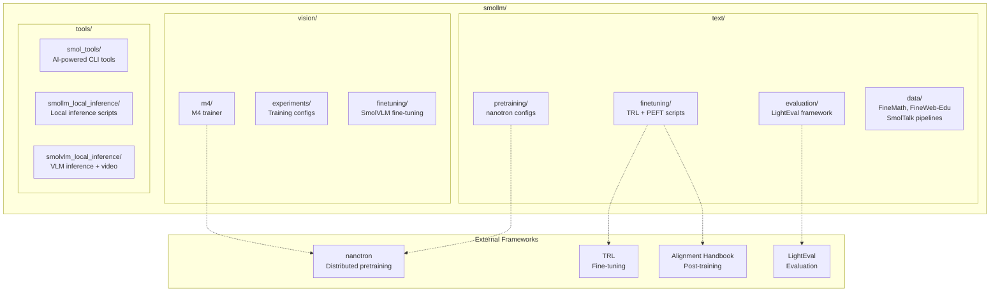
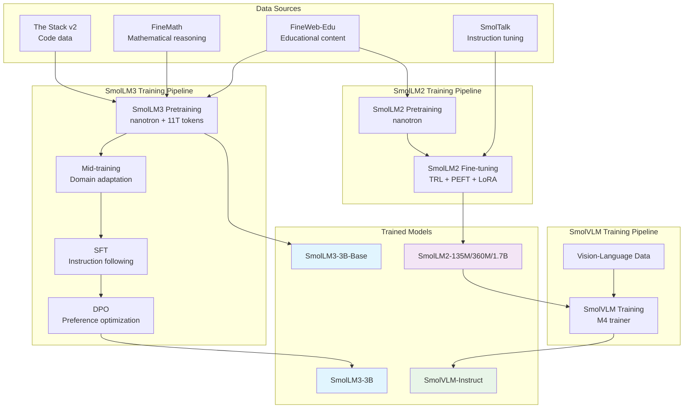
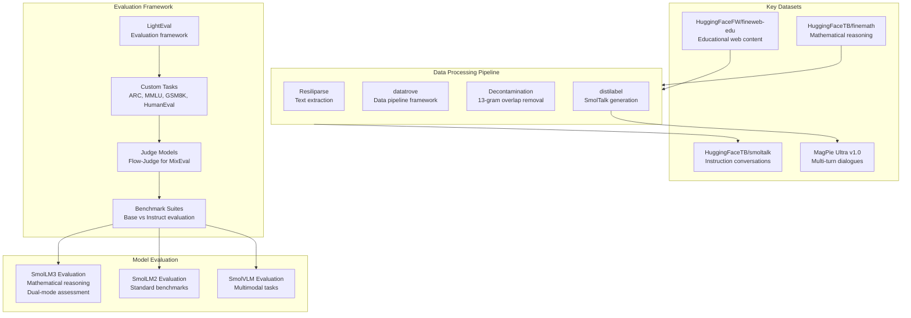
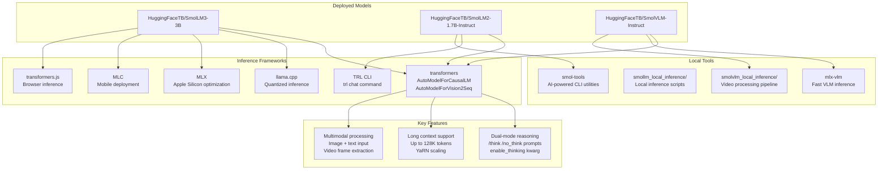

<!-- source: DeepWiki mcp.deepwiki.com · repo huggingface/smollm · page 1 Overview · fetched 2026-10-26 -->

# Overview

Relevant source files

The following files were used as context for generating this wiki page:

- [README.md](README.md)
- [text/README.md](text/README.md)
- [text/finetuning/README.md](text/finetuning/README.md)
- [vision/README.md](vision/README.md)

This document provides a comprehensive overview of the SmolLM repository, a collection of efficient and lightweight AI models from Hugging Face. The repository contains the complete ecosystem for training, evaluating, and deploying small language models including SmolLM3 (3B parameters), SmolLM2 family (135M, 360M, 1.7B parameters), and SmolVLM (vision-language model).

For specific training procedures, see [SmolLM3 Pretraining](#2.2), [SmolLM3 Post-training](#2.3), and [SmolLM2 Fine-tuning](#3.2). For data curation details, see [Data and Datasets](#5). For deployment instructions, see [Tools and Deployment](#6).

## Model Family

The SmolLM ecosystem consists of three main model families designed for different use cases:

| Model Family | Parameters | Primary Use Case | Key Features |
|--------------|------------|------------------|--------------|
| SmolLM3 | 3B | High-performance assistant | Dual-mode reasoning, 128K context, multilingual |
| SmolLM2 | 135M, 360M, 1.7B | On-device applications | Lightweight, efficient inference |
| SmolVLM | 2B (1.7B language + vision) | Multimodal understanding | Image+text processing, video analysis |

**SmolLM3** represents the latest generation with advanced capabilities including dual-mode reasoning through `/think` and `/no_think` system prompts, support for 6 languages (English, French, Spanish, German, Italian, Portuguese), and extended context length up to 128K tokens using NoPE (No Position Embedding) and YaRN scaling.

**SmolLM2** provides a family of compact models optimized for on-device deployment, with the 1.7B variant serving as the language backbone for SmolVLM.

**SmolVLM** combines SmolLM2-1.7B with vision processing capabilities to handle arbitrary sequences of image and text inputs for multimodal tasks.

Sources: [README.md:1-118](), [text/README.md:15-40](), [vision/README.md:4-6]()

## Repository Structure

The repository follows a modular structure with three main directories: `text/` contains all SmolLM3 and SmolLM2 related components, `vision/` houses SmolVLM training and evaluation code, and `tools/` provides inference and deployment utilities.

Sources: [README.md:30-39](), [text/README.md:130-142](), [vision/README.md:8-9]()

## Model Architecture and Training Pipeline

The training pipeline utilizes different frameworks for different stages: `nanotron` for distributed pretraining, `Alignment Handbook` for SmolLM3 post-training, `TRL` with `PEFT` for SmolLM2 fine-tuning, and `M4` for SmolVLM vision-language training.

Sources: [text/README.md:130-134](), [text/finetuning/README.md:3-10](), [vision/README.md:92-104]()

## Data Processing and Evaluation Framework

The evaluation system is built around `LightEval` framework with custom task definitions for domain-specific benchmarks. SmolLM3 evaluation includes specialized assessment of dual-mode reasoning capabilities through both `/think` and `/no_think` modes.

Sources: [text/README.md:136-142](), [text/finetuning/README.md:1-11]()

## Inference and Deployment Ecosystem

The deployment ecosystem supports multiple inference frameworks. SmolLM3 supports dual-mode reasoning through system prompts or the `enable_thinking` parameter in `apply_chat_template()`. SmolVLM includes specialized video processing capabilities with frame extraction pipelines.

Sources: [README.md:44-93](), [text/README.md:46-129](), [vision/README.md:22-91]()

## Code Integration Points

The repository integrates with several external frameworks through specific configuration files and scripts:

**Training Integration:**
- `nanotron` configs in [text/pretraining/](text/pretraining) for distributed pretraining
- `Alignment Handbook` recipes for SmolLM3 post-training stages
- `TRL` and `PEFT` integration in [text/finetuning/train.py](text/finetuning/train.py)
- `M4` trainer configuration in [vision/m4/](vision/m4)

**Model Loading:**
- `AutoModelForCausalLM` for text models [README.md:52-54]()
- `AutoModelForVision2Seq` for SmolVLM [vision/README.md:40-44]()
- `AutoTokenizer` and `AutoProcessor` for input processing

**Evaluation Framework:**
- `LightEval` framework integration in [text/evaluation/](text/evaluation)
- Custom task definitions for domain-specific benchmarks
- Judge model integration for preference evaluation

**Local Deployment:**
- CLI tools in [tools/smol_tools/](tools/smol_tools) using `llama.cpp` backend
- Inference scripts supporting multiple frameworks in [tools/smollm_local_inference/](tools/smollm_local_inference)
- Video processing pipeline in [tools/smolvlm_local_inference/SmolVLM_video_inference.py](tools/smolvlm_local_inference/SmolVLM_video_inference.py)

Sources: [text/README.md:130-142](), [text/finetuning/README.md:36-55](), [vision/README.md:78-91]()

---

