# Page: Overview

# Overview

<details>
<summary>Relevant source files</summary>

The following files were used as context for generating this wiki page:

- [README.md](README.md)
- [text/README.md](text/README.md)
- [text/finetuning/README.md](text/finetuning/README.md)
- [vision/README.md](vision/README.md)

</details>


This document provides a comprehensive overview of the SmolLM repository, a collection of efficient and lightweight AI models from Hugging Face. The repository contains the complete ecosystem for training, evaluating, and deploying small language models including SmolLM3 (3B parameters), SmolLM2 family (135M, 360M, 1.7B parameters), and SmolVLM (vision-language model).

For specific training procedures, see [SmolLM3 Pretraining](#2.2), [SmolLM3 Post-training](#2.3), and [SmolLM2 Fine-tuning](#3.2). For data curation details, see [Data and Datasets](#5). For deployment instructions, see [Tools and Deployment](#6).

## Model Family

The SmolLM ecosystem consists of three main model families designed for different use cases:

| Model Family | Parameters | Primary Use Case | Key Features |
|--------------|------------|------------------|--------------|
| SmolLM3 | 3B | High-performance assistant | Dual-mode reasoning, 128K context, multilingual |
| SmolLM2 | 135M, 360M, 1.7B | On-device applications | Lightweight, efficient inference |
| SmolVLM | 2B (1.7B language + vision) | Multimodal understanding | Image+text processing, video analysis |

**SmolLM3** represents the latest generation with advanced capabilities including dual-mode reasoning through `/think` and `/no_think` system prompts, support for 6 languages (English, French, Spanish, German, Italian, Portuguese), and extended context length up to 128K tokens using NoPE (No Position Embedding) and YaRN scaling.

**SmolLM2** provides a family of compact models optimized for on-device deployment, with the 1.7B variant serving as the language backbone for SmolVLM.

**SmolVLM** combines SmolLM2-1.7B with vision processing capabilities to handle arbitrary sequences of image and text inputs for multimodal tasks.

Sources: [README.md:1-118](), [text/README.md:15-40](), [vision/README.md:4-6]()

## Repository Structure

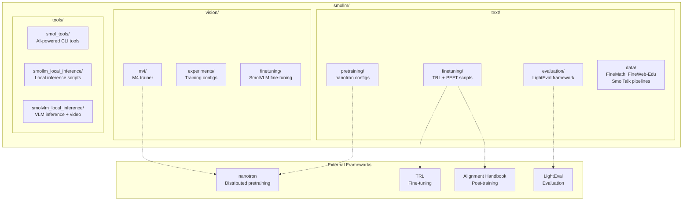

The repository follows a modular structure with three main directories: `text/` contains all SmolLM3 and SmolLM2 related components, `vision/` houses SmolVLM training and evaluation code, and `tools/` provides inference and deployment utilities.

Sources: [README.md:30-39](), [text/README.md:130-142](), [vision/README.md:8-9]()

## Model Architecture and Training Pipeline

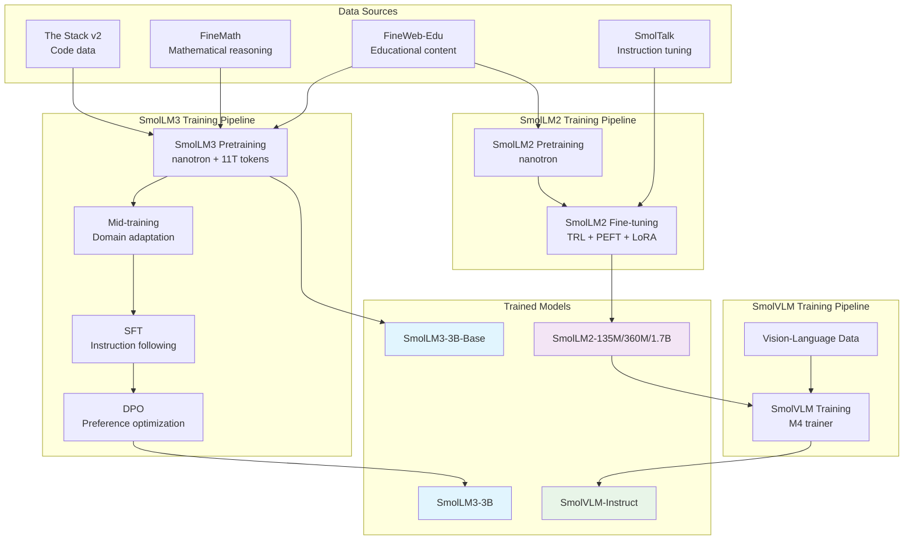

The training pipeline utilizes different frameworks for different stages: `nanotron` for distributed pretraining, `Alignment Handbook` for SmolLM3 post-training, `TRL` with `PEFT` for SmolLM2 fine-tuning, and `M4` for SmolVLM vision-language training.

Sources: [text/README.md:130-134](), [text/finetuning/README.md:3-10](), [vision/README.md:92-104]()

## Data Processing and Evaluation Framework

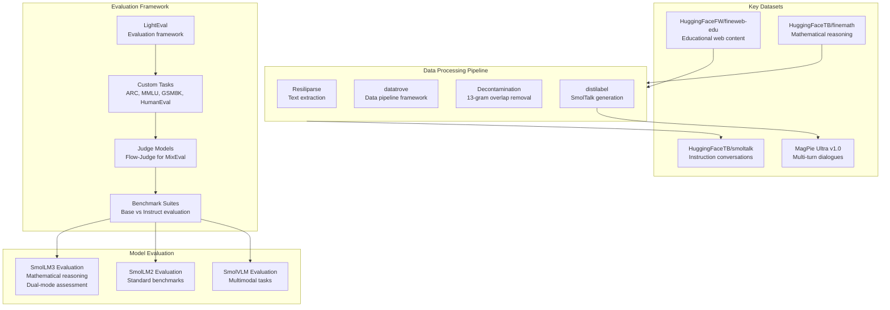

The evaluation system is built around `LightEval` framework with custom task definitions for domain-specific benchmarks. SmolLM3 evaluation includes specialized assessment of dual-mode reasoning capabilities through both `/think` and `/no_think` modes.

Sources: [text/README.md:136-142](), [text/finetuning/README.md:1-11]()

## Inference and Deployment Ecosystem

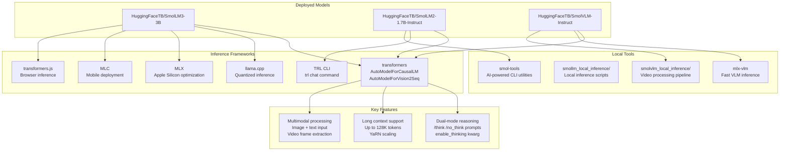

The deployment ecosystem supports multiple inference frameworks. SmolLM3 supports dual-mode reasoning through system prompts or the `enable_thinking` parameter in `apply_chat_template()`. SmolVLM includes specialized video processing capabilities with frame extraction pipelines.

Sources: [README.md:44-93](), [text/README.md:46-129](), [vision/README.md:22-91]()

## Code Integration Points

The repository integrates with several external frameworks through specific configuration files and scripts:

**Training Integration:**
- `nanotron` configs in [text/pretraining/](text/pretraining) for distributed pretraining
- `Alignment Handbook` recipes for SmolLM3 post-training stages
- `TRL` and `PEFT` integration in [text/finetuning/train.py](text/finetuning/train.py)
- `M4` trainer configuration in [vision/m4/](vision/m4)

**Model Loading:**
- `AutoModelForCausalLM` for text models [README.md:52-54]()
- `AutoModelForVision2Seq` for SmolVLM [vision/README.md:40-44]()
- `AutoTokenizer` and `AutoProcessor` for input processing

**Evaluation Framework:**
- `LightEval` framework integration in [text/evaluation/](text/evaluation)
- Custom task definitions for domain-specific benchmarks
- Judge model integration for preference evaluation

**Local Deployment:**
- CLI tools in [tools/smol_tools/](tools/smol_tools) using `llama.cpp` backend
- Inference scripts supporting multiple frameworks in [tools/smollm_local_inference/](tools/smollm_local_inference)
- Video processing pipeline in [tools/smolvlm_local_inference/SmolVLM_video_inference.py](tools/smolvlm_local_inference/SmolVLM_video_inference.py)

Sources: [text/README.md:130-142](), [text/finetuning/README.md:36-55](), [vision/README.md:78-91]()

---

# Page: Repository Structure

# Repository Structure

<details>
<summary>Relevant source files</summary>

The following files were used as context for generating this wiki page:

- [.gitignore](.gitignore)
- [LICENSE](LICENSE)
- [README.md](README.md)
- [text/README.md](text/README.md)
- [text/finetuning/README.md](text/finetuning/README.md)
- [vision/README.md](vision/README.md)

</details>


## Purpose and Scope

This document outlines the organization and structure of the SmolLM repository, covering directory layouts, development environment setup, and the relationships between different components. It serves as a navigation guide for understanding how the codebase is organized across the three main model families: SmolLM3, SmolLM2, and SmolVLM.

For detailed information about specific models and their capabilities, see [SmolLM3](#2), [SmolLM2](#3), and [SmolVLM](#4). For deployment and inference tools, see [Tools and Deployment](#6).

## Repository Overview

The SmolLM repository follows a clear hierarchical structure organized by model family and functionality. The codebase is divided into three main directories, each serving distinct purposes in the ecosystem.

### High-Level Directory Structure

```mermaid
graph TB
    subgraph "smollm_repo[\"SmolLM Repository\"]"
        text_dir["text/"]
        vision_dir["vision/"]  
        tools_dir["tools/"]
        root_files["Root Files"]
    end
    
    subgraph "text_structure[\"Text Models Structure\"]"
        smollm3["SmolLM3 Components"]
        smollm2["SmolLM2 Components"]
        pretraining["pretraining/"]
        finetuning["finetuning/"]
        evaluation["evaluation/"]
        data_curation["data/"]
    end
    
    subgraph "vision_structure[\"Vision Models Structure\"]"
        smolvlm["SmolVLM Components"]
        m4_trainer["m4/"]
        experiments["experiments/"]
        vlm_finetuning["finetuning/"]
    end
    
    subgraph "tools_structure[\"Tools Structure\"]"
        smol_tools["smol_tools/"]
        smollm_inference["smollm_local_inference/"]
        smolvlm_inference["smolvlm_local_inference/"]
    end
    
    text_dir --> text_structure
    vision_dir --> vision_structure
    tools_dir --> tools_structure
    
    root_files --> readme["README.md"]
    root_files --> license["LICENSE"]
    root_files --> gitignore[".gitignore"]
```

Sources: [README.md:30-39](), [text/README.md:1-142](), [vision/README.md:1-105]()

## Main Directory Breakdown

### Text Models Directory (`text/`)

The `text/` directory contains all components related to language-only models, including SmolLM3 and SmolLM2. This directory serves as the primary workspace for text model development, training, and evaluation.

| Component | Purpose | Key Files/Subdirectories |
|-----------|---------|--------------------------|
| **Pretraining** | Distributed training with nanotron | `pretraining/README.md`, training configs |
| **Finetuning** | TRL and PEFT-based fine-tuning | `finetuning/README.md`, `train.py` |
| **Evaluation** | LightEval framework and benchmarks | `evaluation/README.md` |
| **Data** | Dataset curation and processing | `data/README.md`, processing pipelines |

### Vision Models Directory (`vision/`)

The `vision/` directory houses SmolVLM-related code and training infrastructure, including the multimodal training framework and vision-language model components.

```mermaid
graph TD
    vision_root["vision/"]
    
    subgraph "core_components[\"Core Components\"]"
        smolvlm_model["SmolVLM Model"]
        m4_framework["m4/ - Training Framework"]
        experiments_dir["experiments/ - Research Code"]
    end
    
    subgraph "training_pipeline[\"Training Pipeline\"]"
        m4_trainer["M4Trainer"]
        multimodal_data["Multimodal Data Processing"]
        distributed_training["Distributed Training"]
    end
    
    subgraph "inference_tools[\"Inference Tools\"]"
        transformers_inference["transformers Integration"]
        mlx_vlm["mlx-vlm Support"]
        video_inference["Video Processing"]
    end
    
    vision_root --> core_components
    m4_framework --> training_pipeline
    smolvlm_model --> inference_tools
```

Sources: [vision/README.md:92-104](), [vision/README.md:16-91]()

### Tools Directory (`tools/`)

The `tools/` directory provides utilities for local inference, deployment, and lightweight AI-powered applications across all model families.

| Tool | Purpose | Target Models |
|------|---------|---------------|
| `smol_tools/` | Lightweight AI applications with llama.cpp | SmolLM2, SmolLM3 |
| `smollm_local_inference/` | Local inference frameworks | SmolLM2, SmolLM3 |
| `smolvlm_local_inference/` | Vision model local inference | SmolVLM |

## Development Environment Structure

### Configuration Files

The repository includes standard Python project configuration files in the root directory:

- **`.gitignore`**: Comprehensive exclusion patterns for Python, ML artifacts, and IDE files
- **`LICENSE`**: Apache License 2.0 for open-source distribution
- **`README.md`**: Main entry point with quick start examples

### Environment Setup Requirements

Different components have specific dependency requirements:

```mermaid
graph LR
    subgraph "training_env[\"Training Environment\"]"
        pytorch["PyTorch"]
        nanotron["nanotron"]
        alignment_hb["alignment-handbook"]
        trl["TRL"]
        peft["PEFT"]
    end
    
    subgraph "inference_env[\"Inference Environment\"]"
        transformers["transformers"]
        mlx["MLX"]
        llama_cpp["llama.cpp"]
        mlc["MLC"]
        transformers_js["transformers.js"]
    end
    
    subgraph "vision_env[\"Vision Environment\"]"
        m4_deps["M4 Dependencies"]
        flash_attn["flash-attention-2"]
        vision_libs["PIL, cv2"]
    end
    
    training_env --> smollm_training["SmolLM Training"]
    inference_env --> local_deployment["Local Deployment"]
    vision_env --> smolvlm_training["SmolVLM Training"]
```

Sources: [text/finetuning/README.md:15-28](), [vision/README.md:22-44](), [text/README.md:114-128]()

## Code Entity Mapping

### Framework Integration Points

The repository integrates with several external frameworks through specific entry points:

```mermaid
graph TB
    subgraph "external_frameworks[\"External Frameworks\"]"
        nanotron_lib["nanotron Library"]
        trl_lib["TRL Library"] 
        alignment_lib["alignment-handbook"]
        m4_lib["M4 Framework"]
    end
    
    subgraph "integration_points[\"Integration Points\"]"
        pretraining_configs["pretraining/*.yaml"]
        sft_trainer["SFTTrainer"]
        auto_model["AutoModelForCausalLM"]
        auto_processor["AutoProcessor"]
        m4_trainer["M4Trainer"]
    end
    
    subgraph "model_classes[\"Model Classes\"]"
        smollm3_base["SmolLM3-3B-Base"]
        smollm2_instruct["SmolLM2-*-Instruct"]
        smolvlm_instruct["SmolVLM-Instruct"]
    end
    
    nanotron_lib --> pretraining_configs
    trl_lib --> sft_trainer
    alignment_lib --> auto_model
    m4_lib --> m4_trainer
    
    pretraining_configs --> smollm3_base
    sft_trainer --> smollm2_instruct
    m4_trainer --> smolvlm_instruct
```

Sources: [text/README.md:130-131](), [text/finetuning/README.md:4-6](), [text/finetuning/README.md:36-37](), [vision/README.md:92-94]()

### Model Identifier Conventions

The codebase uses consistent model naming conventions that map directly to Hugging Face Hub identifiers:

| Code Entity | Hub Identifier | Usage Context |
|-------------|---------------|---------------|
| `SmolLM3-3B-Base` | `HuggingFaceTB/SmolLM3-3B-Base` | Base pretraining model |
| `SmolLM3-3B` | `HuggingFaceTB/SmolLM3-3B` | Instruct-tuned model |
| `SmolLM2-1.7B-Instruct` | `HuggingFaceTB/SmolLM2-1.7B-Instruct` | Production instruct model |
| `SmolVLM-Instruct` | `HuggingFaceTB/SmolVLM-Instruct` | Vision-language model |

## Getting Started

### Initial Setup

1. **Clone Repository**:
   ```bash
   git clone https://github.com/huggingface/smollm
   cd smollm
   ```

2. **Environment Configuration**:
   ```bash
   wandb login
   huggingface-cli login  
   accelerate config
   ```

3. **Install Dependencies** (component-specific):
   - Text models: `pip install -r text/requirements.txt`
   - Vision models: `pip install -r vision/requirements.txt`
   - Tools: `pip install -r tools/requirements.txt`

### Navigation Guide

- **For training SmolLM3**: Start with [text/pretraining/README.md]()
- **For fine-tuning SmolLM2**: Reference [text/finetuning/README.md]()
- **For SmolVLM training**: Explore [vision/m4/]() and [vision/experiments/]()
- **For local inference**: Check [tools/README.md]() and subdirectories
- **For data processing**: Review [text/data/README.md]()

Sources: [text/finetuning/README.md:22-33](), [README.md:41-118](), [text/README.md:41-142]()

---

# Page: System Architecture

# System Architecture

<details>
<summary>Relevant source files</summary>

The following files were used as context for generating this wiki page:

- [README.md](README.md)
- [text/README.md](text/README.md)
- [text/finetuning/README.md](text/finetuning/README.md)
- [vision/README.md](vision/README.md)

</details>


## Purpose and Scope

This document provides a comprehensive overview of the Smol Models architecture, detailing how the different components interact to form a cohesive system. It covers the repository structure, model architectures, training infrastructure, and inference options. For specific details about individual model implementations, see [SmolLM2](#2) and [SmolVLM](#3). For local inference tools, see [Local Inference](#5.1).

## Repository Structure

The Smol Models repository follows a clear organizational structure that separates the different model families and shared utilities:

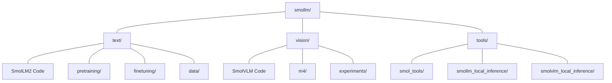

Sources: [README.md:22-32]()

The main directories serve the following purposes:

- `text/`: Contains SmolLM2 language model code and resources
- `vision/`: Contains SmolVLM multimodal model code and resources  
- `tools/`: Contains shared utilities and local inference implementations

## Model Families Overview

Smol Models consists of three primary model families with distinct capabilities but shared infrastructure:

### SmolLM Family Evolution
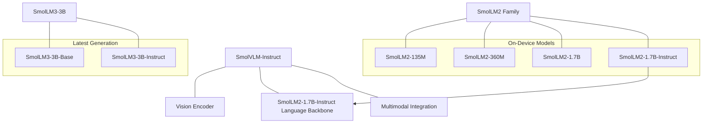

Sources: [README.md:5-21](), [text/README.md:15-30](), [vision/README.md:4-5]()

**SmolLM3** is the latest 3B parameter model featuring dual-mode reasoning, multilingual support (6 languages), and long context capabilities up to 128k tokens. **SmolLM2** provides a family of smaller models (135M, 360M, 1.7B) optimized for on-device usage. **SmolVLM** extends SmolLM2-1.7B-Instruct with vision-language capabilities.

### SmolLM3 Architecture

SmolLM3 introduces architectural innovations including Grouped Query Attention (GQA) and No Position Encoding (NoPE), trained on 11T tokens:

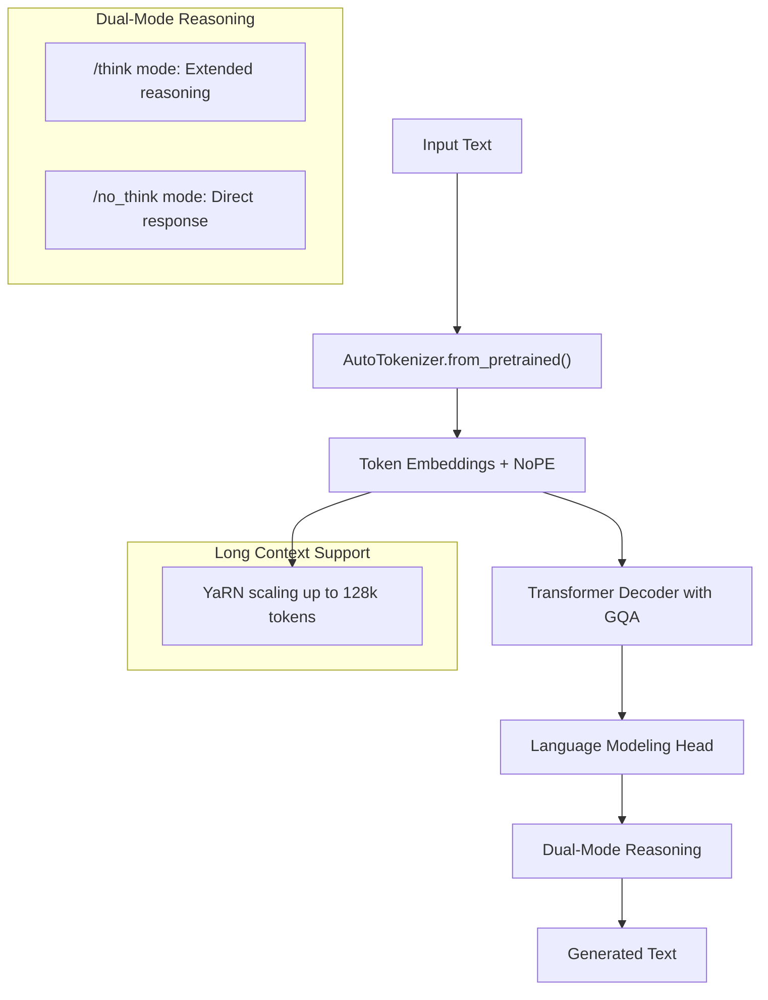

Sources: [README.md:16-21](), [text/README.md:25-30](), [text/README.md:82-98]()

### SmolLM2 Architecture

SmolLM2 provides the foundational architecture used across the on-device model family:

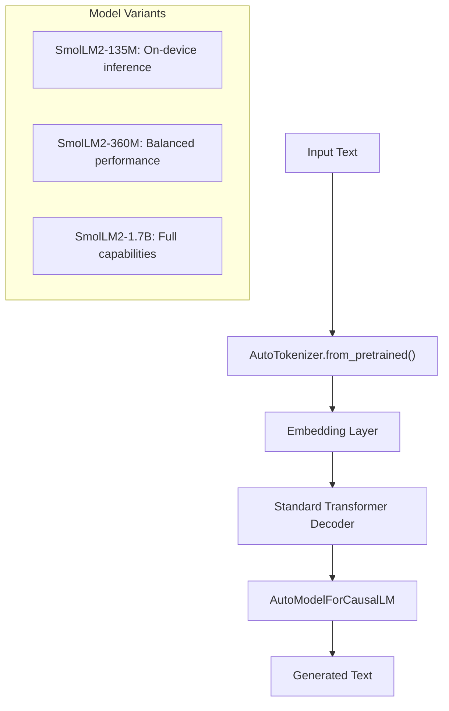

Sources: [text/README.md:32-40](), [text/README.md:51-80]()

### SmolVLM Architecture

SmolVLM extends SmolLM2 with vision capabilities, using SmolLM2-1.7B-Instruct as its language backbone. The architecture integrates visual and textual inputs through a multimodal fusion mechanism:

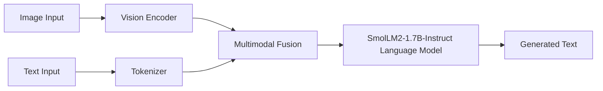

Sources: [vision/README.md:4-5](), [vision/README.md:16-18]()

## Training Infrastructure

The training infrastructure uses different frameworks for different model generations and training stages:

### SmolLM3 Training Pipeline
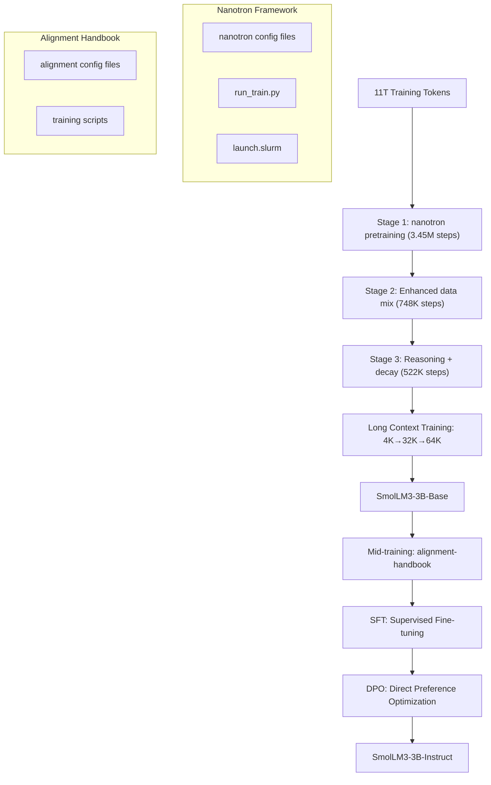

Sources: [README.md:16-21](), [text/README.md:130-134](), [text/finetuning/README.md:3-6]()

### SmolLM2 Training Pipeline
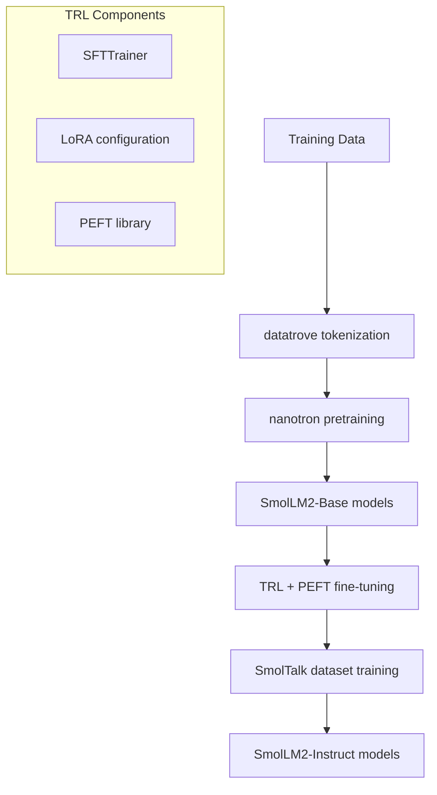

Sources: [text/README.md:130-138](), [text/finetuning/README.md:8-20](), [text/finetuning/README.md:36-55]()

### SmolVLM Training Pipeline
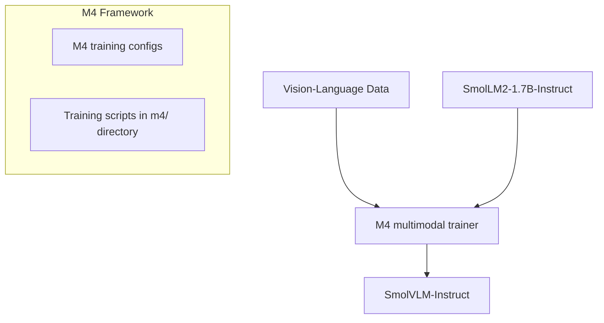

Sources: [vision/README.md:92-104]()

### Training Framework Components

#### Nanotron Framework
Used for distributed pretraining of SmolLM3 and SmolLM2:
- `run_train.py`: Main training script
- Configuration files in `text/pretraining/` directory
- Support for both single-node (`torchrun`) and multi-node (SLURM) training
- Checkpoint management and continual pretraining capabilities

#### Alignment Handbook  
Used for SmolLM3 post-training stages:
- Mid-training for domain adaptation
- Supervised fine-tuning (SFT) for instruction following
- Direct Preference Optimization (DPO) for preference alignment
- Configuration recipes available at external alignment-handbook repository

#### TRL + PEFT Framework
Used for SmolLM2 fine-tuning:
- `SFTTrainer` class for supervised fine-tuning
- `LoRA` configuration for parameter-efficient training
- `train.py` script in `text/finetuning/` directory
- Integration with `accelerate` for distributed training

Sources: [text/README.md:130-138](), [text/finetuning/README.md:3-20](), [text/finetuning/README.md:36-55]()

## Inference Architecture

The Smol Models support multiple inference pathways across all model families:

### Model Loading and Inference APIs
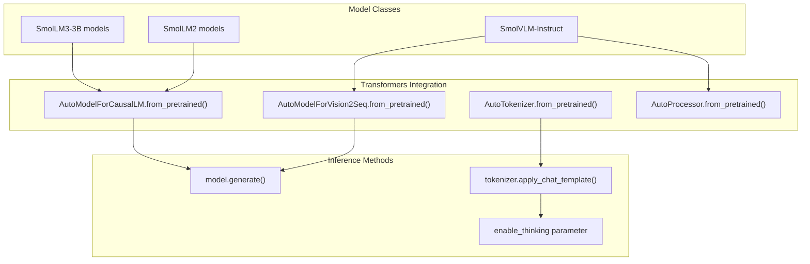

Sources: [README.md:44-75](), [text/README.md:51-112](), [vision/README.md:26-77]()

### Local Inference Backends
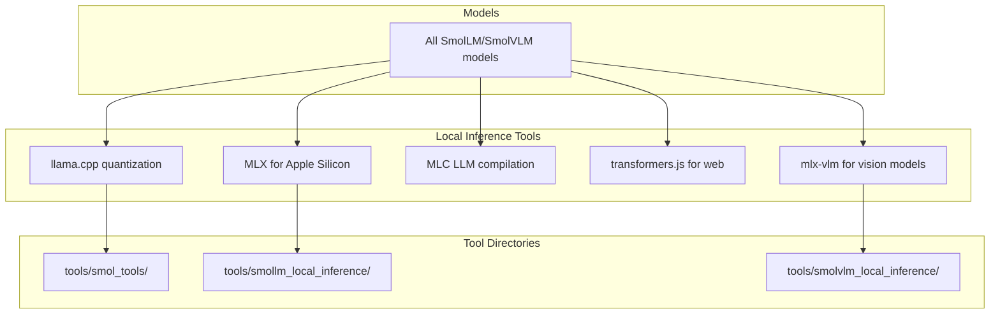

Sources: [text/README.md:124-128](), [vision/README.md:78-84](), [README.md:106]()

### Command Line Interfaces
Key CLI tools for interaction:
- `trl chat --model_name_or_path HuggingFaceTB/SmolLM2-1.7B-Instruct`: TRL chat interface
- `python -m mlx_vlm.chat_ui --model mlx-community/SmolVLM-Instruct-8bit`: MLX VLM chat UI
- Scripts in `tools/smol_tools/` for lightweight AI-powered utilities

Sources: [text/README.md:115-119](), [vision/README.md:81-84]()

Implementation details for local inference are provided in the `tools/smollm_local_inference` and `tools/smolvlm_local_inference` directories, which contain scripts for running inference with various backends.

## Data Pipeline Architecture

The data processing pipeline supports both SmolLM3 and SmolLM2 training with specialized datasets:

### Dataset Processing Flow
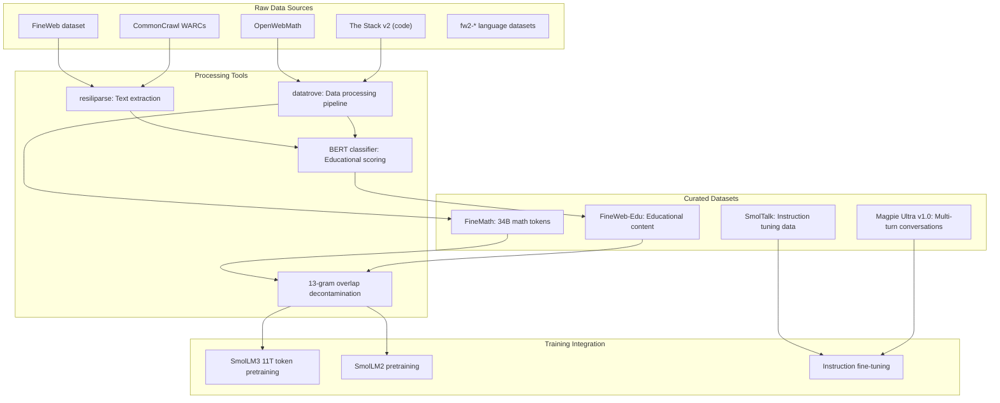

Sources: [README.md:113-117](), [text/README.md:141-142]()

### Dataset Specifications

| Dataset | Purpose | Size | Processing Pipeline |
|---------|---------|------|-------------------|
| `FineMath` | Mathematical reasoning | 34B tokens | 3-phase curation with LLM annotation |
| `FineWeb-Edu` | Educational content | Variable | BERT-based educational scoring |
| `SmolTalk` | Instruction tuning | Variable | Multi-turn conversation generation |
| `Magpie Ultra v1.0` | Advanced conversations | Variable | Distilabel pipeline processing |

Sources: [README.md:113-117](), [text/README.md:141-142]()

The specialized datasets include:
- **FineMath**: Mathematics pretraining dataset
- **FineWeb-Edu**: Educational content pretraining dataset
- **SmolTalk**: Instruction-tuning dataset

## Integration Between Components

The following table summarizes the key integration points between major system components:

| Component 1 | Component 2 | Integration Type | Description |
|-------------|-------------|------------------|-------------|
| SmolLM2-1.7B-Instruct | SmolVLM | Model Backbone | SmolVLM uses SmolLM2-1.7B-Instruct as its language foundation |
| datatrove | nanotron | Data Pipeline | datatrove prepares tokenized data for nanotron training |
| Pretrained Models | TRL+PEFT | Fine-tuning | Base models are adapted for instruction following using TRL+PEFT |
| HuggingFace Hub | Inference Backends | Deployment | Models are hosted on the Hub and pulled by various inference tools |

This architecture allows for a modular approach to training and deployment, where components can be developed and improved independently while maintaining compatibility with the overall system.

Sources: [README.md:9-22](), [text/pretraining/README.md:1-11](), [vision/README.md:4-5]()

---

# Page: SmolLM3

# SmolLM3

<details>
<summary>Relevant source files</summary>

The following files were used as context for generating this wiki page:

- [README.md](README.md)
- [text/README.md](text/README.md)
- [text/finetuning/README.md](text/finetuning/README.md)
- [vision/README.md](vision/README.md)

</details>


SmolLM3 is a 3 billion parameter language model representing the latest generation in the SmolLM family. This document covers SmolLM3's architecture, training methodology, capabilities, and usage patterns. SmolLM3 introduces dual-mode reasoning, extended multilingual support, and long context capabilities while maintaining the compact, efficient design philosophy of the SmolLM series.

For information about the broader SmolLM family including SmolLM2 models, see [SmolLM2](#3). For vision-language capabilities, see [SmolVLM](#4).

## Overview and Capabilities

SmolLM3 achieves state-of-the-art performance at the 3B scale, outperforming Llama 3.2 3B and Qwen2.5 3B while remaining competitive with larger 4B alternatives. The model is fully open, with complete training details, public data mixture, and training configurations provided.

### Key Features

| Feature | Description |
|---------|-------------|
| **Model Size** | 3B parameters trained on 11T tokens |
| **Dual-Mode Reasoning** | Supports both thinking (`/think`) and direct response (`/no_think`) modes |
| **Multilingual Support** | 6 languages: English, French, Spanish, German, Italian, Portuguese |
| **Long Context** | Up to 128K tokens using NoPE (No Position Embedding) and YaRN |
| **Architecture** | Grouped Query Attention (GQA), advanced positional encoding |
| **Variants** | Base model (`SmolLM3-3B-Base`) and instruct model (`SmolLM3-3B`) |

The model demonstrates strong performance across mathematical reasoning, instruction following, and multilingual tasks while maintaining efficiency for deployment scenarios.

Sources: [README.md:5-31](), [text/README.md:15-31]()

## Model Variants and Architecture

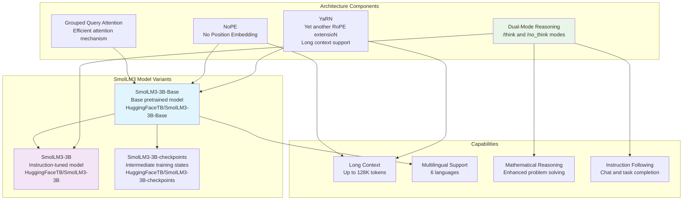

The SmolLM3 architecture incorporates several key innovations. The base model uses Grouped Query Attention for efficient processing and NoPE with YaRN for extended context handling. The instruct variant adds dual-mode reasoning capabilities, allowing users to toggle between extended thinking processes and direct responses.

For detailed architectural specifications and model capabilities, see [SmolLM3 Models](#2.1).

Sources: [README.md:11-21](), [text/README.md:20-30]()

## Training Pipeline

SmolLM3 follows a comprehensive multi-stage training pipeline combining large-scale pretraining with sophisticated post-training alignment techniques.

```mermaid
graph TD
    subgraph "Data Sources"
        FineWebEdu["FineWeb-Edu<br/>Educational content"]
        FineMath["FineMath<br/>Mathematical datasets"]
        Multilingual["Multilingual Data<br/>6 language support"]
        CodeData["Code Datasets<br/>Programming content"]
    end
    
    subgraph "Pretraining Pipeline"
        Stage1["Stage 1: 3.45M steps<br/>Initial pretraining<br/>Base data mixture"]
        Stage2["Stage 2: 748K steps<br/>Enhanced multilingual<br/>data mixture"]
        Stage3["Stage 3: 522K steps<br/>Reasoning focus<br/>Learning rate decay"]
        LongContext["Long Context Training<br/>4K→32K→64K tokens<br/>Progressive scaling"]
    end
    
    subgraph "Post-training Pipeline"
        MidTraining["Mid-training<br/>Domain adaptation<br/>Alignment Handbook"]
        SFT["Supervised Fine-tuning<br/>Instruction following<br/>SmolTalk dataset"]
        DPO["Direct Preference Optimization<br/>Human preference alignment<br/>Final model refinement"]
    end
    
    subgraph "Training Infrastructure"
        Nanotron["nanotron<br/>Distributed pretraining<br/>Framework"]
        AlignmentHB["Alignment Handbook<br/>Post-training<br/>Framework"]
    end
    
    subgraph "Outputs"
        BaseModel["SmolLM3-3B-Base<br/>Pretrained model"]
        InstructModel["SmolLM3-3B<br/>Instruction model"]
    end
    
    %% Data flow to pretraining
    FineWebEdu --> Stage1
    FineMath --> Stage1
    CodeData --> Stage1
    Multilingual --> Stage2
    
    %% Pretraining progression
    Stage1 --> Stage2
    Stage2 --> Stage3
    Stage1 -.-> LongContext
    Stage3 --> BaseModel
    LongContext --> BaseModel
    
    %% Post-training progression
    BaseModel --> MidTraining
    MidTraining --> SFT
    SFT --> DPO
    DPO --> InstructModel
    
    %% Infrastructure relationships
    Nanotron --> Stage1
    Nanotron --> Stage2
    Nanotron --> Stage3
    Nanotron --> LongContext
    AlignmentHB --> MidTraining
    AlignmentHB --> SFT
    AlignmentHB --> DPO
    
    style BaseModel fill:#e1f5fe
    style InstructModel fill:#f3e5f5
    style DPO fill:#c8e6c9
```

The training process consists of three main phases:

1. **Pretraining**: Multi-stage approach with 11T tokens using `nanotron` framework, progressing through increasingly sophisticated data mixtures and culminating in long context training
2. **Post-training**: Alignment process using the Alignment Handbook, including mid-training for domain adaptation, supervised fine-tuning on instruction data, and DPO for preference alignment  
3. **Quality Assurance**: Comprehensive evaluation at each stage to ensure model performance and safety

For detailed pretraining procedures and configurations, see [SmolLM3 Pretraining](#2.2). For post-training alignment details, see [SmolLM3 Post-training](#2.3).

Sources: [text/README.md:130-132](), [text/finetuning/README.md:3-7]()

## Usage and Inference

SmolLM3 supports multiple inference modes and deployment options, with particular emphasis on its dual-mode reasoning capability.

### Dual-Mode Reasoning

SmolLM3's signature feature is dual-mode reasoning, controlled through system prompts or the `enable_thinking` parameter:

| Mode | System Prompt | Behavior |
|------|---------------|----------|
| **Think Mode** | `/think` | Extended reasoning with visible thought process |
| **No-Think Mode** | `/no_think` | Direct response without reasoning trace |
| **Default** | None | Think mode enabled by default |

```mermaid
graph LR
    subgraph "Input Processing"
        UserPrompt["User Prompt<br/>Text input"]
        SystemPrompt["System Prompt<br/>/think or /no_think"]
        ChatTemplate["apply_chat_template()<br/>Format conversation"]
    end
    
    subgraph "Reasoning Modes"
        ThinkMode["Think Mode<br/>Extended reasoning<br/>Visible thought process"]
        NoThinkMode["No-Think Mode<br/>Direct response<br/>Concise output"]
    end
    
    subgraph "Generation Process"
        Tokenizer["AutoTokenizer<br/>Text to tokens"]
        Model["SmolLM3 Model<br/>AutoModelForCausalLM"]
        Generate["model.generate()<br/>Token generation"]
    end
    
    subgraph "Output Processing"
        Decode["tokenizer.decode()<br/>Tokens to text"]
        Response["Final Response<br/>With or without<br/>reasoning trace"]
    end
    
    %% Input flow
    UserPrompt --> ChatTemplate
    SystemPrompt --> ChatTemplate
    ChatTemplate --> Tokenizer
    
    %% Mode selection
    SystemPrompt --> ThinkMode
    SystemPrompt --> NoThinkMode
    
    %% Processing flow
    Tokenizer --> Model
    Model --> Generate
    ThinkMode -.-> Generate
    NoThinkMode -.-> Generate
    Generate --> Decode
    Decode --> Response
    
    style ThinkMode fill:#e8f5e8
    style NoThinkMode fill:#fff3e0
```

### Basic Usage Example

The standard inference pattern follows the transformers library conventions with SmolLM3-specific chat template handling:

```python
# Basic setup from transformers library
tokenizer = AutoTokenizer.from_pretrained("HuggingFaceTB/SmolLM3-3B")
model = AutoModelForCausalLM.from_pretrained("HuggingFaceTB/SmolLM3-3B")

# Message formatting with dual-mode control
messages = [
    {"role": "system", "content": "/no_think"},  # or "/think"
    {"role": "user", "content": prompt}
]

# Alternative: using enable_thinking parameter
text = tokenizer.apply_chat_template(
    messages, 
    enable_thinking=False,  # Controls reasoning mode
    add_generation_prompt=True
)
```

### Deployment Options

SmolLM3 supports multiple deployment frameworks for different use cases:

| Framework | Use Case | Benefits |
|-----------|----------|----------|
| `transformers` | Standard inference | Full feature support, dual-mode reasoning |
| `vllm` | High-throughput serving | Optimized batch processing |
| `trl` | Interactive chat | Terminal-based conversations |
| `llama.cpp` | Local deployment | Quantized models, CPU optimization |
| `MLX` | Apple Silicon | Hardware-accelerated inference |
| `transformers.js` | Web deployment | Browser-based inference |

For comprehensive local inference setup across all frameworks, see [Local Inference Tools](#6.1).

Sources: [README.md:44-75](), [text/README.md:46-124]()

## Evaluation Framework

SmolLM3 evaluation employs a comprehensive assessment system designed to measure performance across multiple dimensions including mathematical reasoning, instruction following, and multilingual capabilities.

```mermaid
graph TB
    subgraph "Evaluation Infrastructure"
        LightEval["LightEval Framework<br/>Core evaluation system"]
        CustomTasks["Custom Task Definitions<br/>SmolLM3-specific tasks"]
        JudgeModels["Judge Models<br/>Flow-Judge for MixEval"]
    end
    
    subgraph "Benchmark Categories"
        MathReasoning["Mathematical Reasoning<br/>GSM8K, MATH, FineMath"]
        InstructionFollowing["Instruction Following<br/>MixEval, AlpacaEval"]
        GeneralKnowledge["General Knowledge<br/>MMLU, ARC, HellaSwag"]
        Multilingual["Multilingual Tasks<br/>6 language evaluation"]
        LongContext["Long Context Tasks<br/>128K token evaluation"]
    end
    
    subgraph "Model Variants Tested"
        BaseEval["SmolLM3-3B-Base<br/>Pretrained model eval"]
        InstructEval["SmolLM3-3B<br/>Instruction model eval"]
        ThinkModeEval["Think Mode Evaluation<br/>Reasoning trace analysis"]
        NoThinkModeEval["No-Think Mode Evaluation<br/>Direct response assessment"]
    end
    
    subgraph "Comparison Baselines"
        Llama32["Llama 3.2 3B<br/>Baseline comparison"]
        Qwen25["Qwen2.5 3B<br/>Performance benchmark"]
        Larger4B["4B Models<br/>Gemma3, Qwen3"]
    end
    
    %% Infrastructure relationships
    LightEval --> MathReasoning
    LightEval --> InstructionFollowing
    LightEval --> GeneralKnowledge
    LightEval --> Multilingual
    LightEval --> LongContext
    
    CustomTasks --> MathReasoning
    CustomTasks --> InstructionFollowing
    JudgeModels --> InstructionFollowing
    
    %% Model evaluation relationships
    BaseEval --> MathReasoning
    BaseEval --> GeneralKnowledge
    InstructEval --> InstructionFollowing
    ThinkModeEval --> MathReasoning
    NoThinkModeEval --> InstructionFollowing
    
    %% Comparison relationships
    InstructEval -.-> Llama32
    InstructEval -.-> Qwen25
    InstructEval -.-> Larger4B
    
    style ThinkModeEval fill:#e8f5e8
    style InstructEval fill:#f3e5f5
```

The evaluation system demonstrates SmolLM3's competitive performance, particularly in mathematical reasoning where the dual-mode thinking capability provides significant advantages. The model achieves state-of-the-art results at the 3B scale while maintaining efficiency.

Key evaluation highlights include superior performance on GSM8K mathematical reasoning tasks, strong instruction-following capabilities in MixEval assessments, and robust multilingual performance across the supported languages.

For detailed evaluation procedures, benchmark results, and performance analysis, see [SmolLM3 Evaluation](#2.4).

Sources: [text/README.md:137-138](), [README.md:8-22]()

## Integration with SmolLM Ecosystem

SmolLM3 serves as the flagship model in the broader SmolLM ecosystem, providing the most advanced capabilities while maintaining integration with shared tooling and datasets.

```mermaid
graph TB
    subgraph "SmolLM3 Position in Ecosystem"
        SmolLM3["SmolLM3-3B<br/>Flagship model<br/>Advanced reasoning"]
    end
    
    subgraph "Shared Data Pipeline"
        FineWebEdu["FineWeb-Edu<br/>Educational classification"]
        FineMath["FineMath<br/>Mathematical content"]
        SmolTalk["SmolTalk<br/>Instruction tuning"]
    end
    
    subgraph "Shared Infrastructure"
        Nanotron["nanotron<br/>Distributed pretraining"]
        AlignmentHB["Alignment Handbook<br/>Post-training alignment"]
        LightEval["LightEval<br/>Evaluation framework"]
    end
    
    subgraph "Deployment Ecosystem"
        LocalInference["Local Inference Tools<br/>llama.cpp, MLX, MLC"]
        SmolTools["smol-tools<br/>AI-powered utilities"]
        WebInference["transformers.js<br/>Browser deployment"]
    end
    
    subgraph "Related Models"
        SmolLM2["SmolLM2 Family<br/>On-device models<br/>135M/360M/1.7B"]
        SmolVLM["SmolVLM<br/>Vision-language<br/>Uses SmolLM2-1.7B"]
    end
    
    %% Data relationships
    FineWebEdu --> SmolLM3
    FineMath --> SmolLM3
    SmolTalk --> SmolLM3
    
    %% Infrastructure relationships
    Nanotron --> SmolLM3
    AlignmentHB --> SmolLM3
    LightEval --> SmolLM3
    
    %% Deployment relationships
    SmolLM3 --> LocalInference
    SmolLM3 --> SmolTools
    SmolLM3 --> WebInference
    
    %% Ecosystem relationships
    SmolLM3 -.-> SmolLM2
    SmolLM3 -.-> SmolVLM
    
    style SmolLM3 fill:#e1f5fe
    style SmolLM2 fill:#f3e5f5
    style SmolVLM fill:#e8f5e8
```

SmolLM3 leverages the same data curation pipelines, training infrastructure, and evaluation frameworks as other models in the SmolLM family, ensuring consistency and reproducibility across the ecosystem. The model's advanced capabilities make it suitable for applications requiring sophisticated reasoning while maintaining the efficiency principles of the SmolLM family.

The shared tooling approach enables users to seamlessly transition between different SmolLM models based on their computational requirements and performance needs, with SmolLM3 serving as the high-capability option for demanding applications.

Sources: [README.md:95-118](), [text/README.md:42-44]()

---

# Page: SmolLM3 Models

# SmolLM3 Models

<details>
<summary>Relevant source files</summary>

The following files were used as context for generating this wiki page:

- [README.md](README.md)
- [text/README.md](text/README.md)
- [text/finetuning/README.md](text/finetuning/README.md)
- [vision/README.md](vision/README.md)

</details>


This document covers the SmolLM3 model variants, their architectural innovations, and core capabilities including dual-mode reasoning and long context support. For information about SmolLM3 training processes, see [SmolLM3 Pretraining](#2.2) and [SmolLM3 Post-training](#2.3). For evaluation details, see [SmolLM3 Evaluation](#2.4).

## Model Variants

SmolLM3 is available in two primary variants, both with 3 billion parameters:

| Model | Purpose | HuggingFace ID | Description |
|-------|---------|----------------|-------------|
| SmolLM3-3B-Base | Pretraining base | `HuggingFaceTB/SmolLM3-3B-Base` | Base model for continued pretraining or fine-tuning |
| SmolLM3-3B | Instruction-following | `HuggingFaceTB/SmolLM3-3B` | Post-trained instruct model with dual-mode reasoning |

Additional resources include intermediate checkpoints available at `HuggingFaceTB/SmolLM3-3B-checkpoints` for research and analysis purposes.

**SmolLM3 Model Architecture Overview**

```mermaid
graph TB
    subgraph "SmolLM3-3B Architecture"
        Tokenizer["AutoTokenizer"]
        BaseModel["SmolLM3-3B-Base<br/>3B parameters<br/>11T training tokens"]
        InstructModel["SmolLM3-3B<br/>Post-trained variant"]
        
        subgraph "Core Innovations"
            GQA["Grouped Query Attention<br/>(GQA)"]
            NoPE["No Positional Embeddings<br/>(NoPE)"]
            YaRN["YaRN Context Extension<br/>128k tokens"]
        end
        
        subgraph "Dual-Mode System"
            ThinkMode["/think mode<br/>Extended reasoning"]
            NoThinkMode["/no_think mode<br/>Direct responses"]
            EnableThinking["enable_thinking kwarg"]
        end
    end
    
    Tokenizer --> BaseModel
    BaseModel --> InstructModel
    GQA --> BaseModel
    NoPE --> BaseModel
    YaRN --> BaseModel
    
    InstructModel --> ThinkMode
    InstructModel --> NoThinkMode
    EnableThinking --> InstructModel
```

Sources: [README.md:5-31](), [text/README.md:15-30]()

## Architecture Innovations

SmolLM3 incorporates several key architectural improvements that enable its strong performance at the 3B parameter scale:

### Grouped Query Attention (GQA)
SmolLM3 uses Grouped Query Attention to improve inference efficiency while maintaining model quality. This architectural choice reduces memory requirements during generation compared to standard multi-head attention.

### No Positional Embeddings (NoPE)
The model eliminates traditional positional embeddings, relying on the attention mechanism's inherent ability to capture positional information. This innovation contributes to the model's long context capabilities.

### YaRN Context Extension
SmolLM3 supports context lengths up to 128,000 tokens through YaRN (Yet another RoPE extensioN), enabling processing of very long documents and conversations.

**Architecture Components**

```mermaid
graph LR
    subgraph "Input Processing"
        InputText["input_text"]
        ChatTemplate["apply_chat_template()"]
        Tokenization["tokenizer()"]
    end
    
    subgraph "Model Components"
        Embeddings["Token Embeddings<br/>(No positional embeddings)"]
        AttentionLayers["GQA Attention Layers<br/>Grouped Query Attention"]
        FFNLayers["Feed-Forward Networks"]
        OutputHead["Language Model Head"]
    end
    
    subgraph "Context Extension"
        YaRNMechanism["YaRN Extension<br/>Up to 128k tokens"]
    end
    
    InputText --> ChatTemplate
    ChatTemplate --> Tokenization
    Tokenization --> Embeddings
    Embeddings --> AttentionLayers
    AttentionLayers --> FFNLayers
    FFNLayers --> OutputHead
    YaRNMechanism --> AttentionLayers
```

Sources: [README.md:20](), [text/README.md:30]()

## Dual-Mode Reasoning

SmolLM3's most distinctive feature is its dual-mode reasoning system, allowing users to choose between extended thinking and direct response modes.

### System Prompt Control
The reasoning mode is controlled through system prompts:

| Mode | System Prompt | Behavior |
|------|---------------|----------|
| Think Mode | `/think` | Generates reasoning trace before final answer |
| No-Think Mode | `/no_think` | Provides direct responses without reasoning |
| Default | None | Enables extended thinking by default |

### Programmatic Control
The `apply_chat_template()` method supports an `enable_thinking` parameter for programmatic control, overriding system prompt settings when specified.

**Dual-Mode Implementation Flow**

```mermaid
graph TD
    subgraph "Input Processing"
        UserQuery["User Query"]
        SystemPrompt["System Prompt<br/>/think or /no_think"]
        EnableThinkingKwarg["enable_thinking kwarg"]
    end
    
    subgraph "Mode Selection Logic"
        ModeDetection["Mode Detection<br/>apply_chat_template()"]
        KwargOverride["Kwarg Override Check"]
        FinalMode["Final Reasoning Mode"]
    end
    
    subgraph "Generation Modes"
        ThinkingGeneration["Thinking Generation<br/>Shows reasoning trace"]
        DirectGeneration["Direct Generation<br/>Immediate response"]
    end
    
    subgraph "Output Processing"
        GeneratedIds["generated_ids"]
        DecodedOutput["Decoded Output<br/>tokenizer.decode()"]
    end
    
    UserQuery --> ModeDetection
    SystemPrompt --> ModeDetection
    EnableThinkingKwarg --> KwargOverride
    ModeDetection --> KwargOverride
    KwargOverride --> FinalMode
    
    FinalMode --> ThinkingGeneration
    FinalMode --> DirectGeneration
    
    ThinkingGeneration --> GeneratedIds
    DirectGeneration --> GeneratedIds
    GeneratedIds --> DecodedOutput
```

Sources: [text/README.md:82-112](), [README.md:58-74]()

## Model Specifications

### Technical Specifications
- **Parameters**: 3 billion
- **Training Tokens**: 11 trillion tokens
- **Context Length**: Up to 128,000 tokens (with YaRN)
- **Languages**: 6 languages (English, French, Spanish, German, Italian, Portuguese)
- **Architecture**: Transformer with GQA and NoPE innovations

### Performance Characteristics
- Competitive with 4B parameter models (Qwen3, Gemma3)
- Outperforms Llama 3.2 3B and Qwen2.5 3B
- State-of-the-art performance at the 3B parameter scale
- Suitable for on-device deployment scenarios

### Integration Points
SmolLM3 integrates with standard HuggingFace ecosystem components:

- `AutoModelForCausalLM` for model loading
- `AutoTokenizer` for text processing  
- `transformers.generate()` method with `max_new_tokens=32768` support
- Compatible with TRL, vLLM, and quantization frameworks

Sources: [README.md:8-21](), [text/README.md:16-30](), [text/README.md:42-80]()

---

# Page: SmolLM3 Pretraining

# SmolLM3 Pretraining

<details>
<summary>Relevant source files</summary>

The following files were used as context for generating this wiki page:

- [text/pretraining/README.md](text/pretraining/README.md)
- [text/pretraining/launch.slurm](text/pretraining/launch.slurm)
- [text/pretraining/smollm3/long_context_32k_to_64.yaml](text/pretraining/smollm3/long_context_32k_to_64.yaml)
- [text/pretraining/smollm3/long_context_4k_to_32k.yaml](text/pretraining/smollm3/long_context_4k_to_32k.yaml)
- [text/pretraining/smollm3/stage1_8T.yaml](text/pretraining/smollm3/stage1_8T.yaml)
- [text/pretraining/smollm3/stage2_8T_9T.yaml](text/pretraining/smollm3/stage2_8T_9T.yaml)
- [text/pretraining/smollm3/stage3_9T_11T.yaml](text/pretraining/smollm3/stage3_9T_11T.yaml)

</details>


This page documents the pretraining infrastructure, architecture, and process for SmolLM3, the latest 3B parameter model in the SmolLM family. It covers the distributed training setup using nanotron, architectural innovations, multi-stage training progression, and long context extensions. For post-training processes including supervised fine-tuning and preference optimization, see [SmolLM3 Post-training](#2.3). For evaluation frameworks and metrics, see [SmolLM3 Evaluation](#2.4).

## Architecture Innovations

SmolLM3 builds on the Llama architecture with several key modifications optimized for efficiency and long context performance. All architectural changes were validated through ablations using a 3B model trained on 100B tokens from FineWeb-Edu.

### Grouped Query Attention (GQA)

SmolLM3 replaces multi-head attention with grouped query attention using 4 groups. This modification matches the performance of multi-head attention while significantly reducing KV cache size during inference.

**Configuration:**
- `num_attention_heads: 16` - Total attention heads
- `num_key_value_heads: 4` - Key-value heads for GQA groups

### NoPE (No Position Embeddings)

The model implements NoPE from "RoPE to NoRoPE and Back Again: A New Hybrid Attention Strategy", selectively removing rotary position embeddings from every 4th layer. This improves long context performance without affecting short context capabilities.

**Configuration:**
- `no_rope_layer: 4` - Remove RoPE from every 4th layer

### Training Stability Improvements

Following OLMo 2, weight decay is removed from embedding layers to improve training stability, allowing embedding norms to stabilize naturally during training.

**Configuration:**
- `weight_decay_exclude_named_params: [".*token_embedding.*"]`

### Intra-Document Masking

During training, attention masking ensures tokens from different documents in the same training sequence don't attend to each other, similar to Llama 3. This enables faster and more stable long context training.

**Configuration:**
- `_use_doc_masking: true`

Sources: [text/pretraining/README.md:4-14](), [text/pretraining/smollm3/stage1_8T.yaml:169-201]()

## Training Infrastructure

SmolLM3 pretraining uses a distributed infrastructure built on nanotron for training, datatrove for data processing, and lighteval for evaluation.

```mermaid
graph TD
    subgraph "Training Framework"
        nanotron["nanotron<br/>Distributed Training"]
        run_train["run_train.py<br/>Main Training Script"]
        configs["YAML Configs<br/>stage1_8T.yaml<br/>stage2_8T_9T.yaml<br/>stage3_9T_11T.yaml"]
    end
    
    subgraph "Data Pipeline"
        datatrove["datatrove<br/>Data Processing"]
        tokenized["Tokenized Datasets<br/>S3 Storage"]
        datasets["Raw Datasets<br/>FineWeb-Edu, DCLM<br/>FineMath, Stack-v2"]
    end
    
    subgraph "Evaluation System"
        lighteval["lighteval<br/>Model Evaluation"]
        eval_configs["smollm3_eval.yaml<br/>Evaluation Config"]
        wandb["wandb<br/>Metrics Logging"]
    end
    
    subgraph "Hardware Infrastructure"
        h100["384 H100 GPUs<br/>48 nodes × 8 GPUs"]
        slurm["SLURM Scheduler<br/>launch.slurm"]
    end
    
    datasets --> datatrove
    datatrove --> tokenized
    tokenized --> nanotron
    configs --> nanotron
    nanotron --> run_train
    run_train --> h100
    slurm --> h100
    nanotron --> lighteval
    eval_configs --> lighteval
    lighteval --> wandb
```

### Framework Components

**nanotron**: Distributed training framework handling model parallelism, data parallelism, and gradient synchronization.

**datatrove**: Data processing pipeline for tokenization, chunking, and S3 storage management.

**lighteval**: Evaluation framework running periodic assessments during training with configurable intervals.

Sources: [text/pretraining/README.md:16-22](), [text/pretraining/launch.slurm:1-59]()

## Training Configuration

The core training configuration uses a global batch size of 2.36M tokens with specific optimizer and scheduler settings optimized for stability and convergence.

### Hyperparameters

| Parameter | Value | Description |
|-----------|--------|-------------|
| Global Batch Size | 2.36M tokens | Total tokens per training step |
| Sequence Length | 4,096 tokens | Context window during training |
| Learning Rate | 2e-4 | Peak learning rate |
| Optimizer | AdamW | β₁=0.9, β₂=0.95 |
| Weight Decay | 0.1 | Applied to all params except embeddings |
| Gradient Clipping | 1.0 | Prevents gradient explosion |
| Warmup Steps | 2,000 | Linear warmup period |

### Learning Rate Schedule

SmolLM3 uses a WSD (Warmup-Stable-Decay) scheduler:
- **Warmup**: Linear increase over 2,000 steps
- **Stable**: Constant learning rate through most training
- **Decay**: Linear decay to 0 in final 10% of training steps

**Configuration:**
```yaml
learning_rate_scheduler:
  learning_rate: 0.0002
  lr_warmup_steps: 2000
  lr_decay_starting_step: 4198001
  lr_decay_steps: 522000
  lr_decay_style: linear
```

Sources: [text/pretraining/README.md:16](), [text/pretraining/smollm3/stage1_8T.yaml:202-219]()

## Multi-Stage Training Process

SmolLM3 training follows a carefully orchestrated multi-stage process, progressively refining the data mixture and introducing specialized content for enhanced reasoning capabilities.

```mermaid
graph TD
    subgraph "Stage 1: Foundation (8T tokens)"
        stage1_config["stage1_8T.yaml<br/>3.45M steps"]
        stage1_data["Base Data Mix<br/>FineWeb-Edu: 33.3%<br/>DCLM: 37%<br/>Math: 4.2%<br/>Code: 15.8%<br/>Multilingual: 9.7%"]
        stage1_steps["Steps: 1 → 3,450,000"]
    end
    
    subgraph "Stage 2: Enhanced Mix (9T tokens)"
        stage2_config["stage2_8T_9T.yaml<br/>748K steps"] 
        stage2_data["Enhanced Data Mix<br/>+ Stack-Edu Real<br/>+ FineMath 4+<br/>+ MegaMath datasets<br/>Downsampled SE"]
        stage2_steps["Steps: 3,450,001 → 4,198,000"]
    end
    
    subgraph "Stage 3: Reasoning + Decay (11T tokens)"
        stage3_config["stage3_9T_11T.yaml<br/>522K steps"]
        stage3_data["Reasoning Data Mix<br/>+ OpenMathInstruct-2<br/>+ Natural Reasoning<br/>+ Problem Solving<br/>+ Learning Rate Decay"]
        stage3_steps["Steps: 4,198,001 → 4,720,000"]
    end
    
    subgraph "Long Context Extension"
        lc_4k_32k["4K→32K Context<br/>long_context_4k_to_32k.yaml<br/>20K steps"]
        lc_32k_64k["32K→64K Context<br/>long_context_32k_to_64.yaml<br/>22K steps"]
    end
    
    stage1_config --> stage1_data
    stage1_data --> stage1_steps
    stage1_steps --> stage2_config
    stage2_config --> stage2_data  
    stage2_data --> stage2_steps
    stage2_steps --> stage3_config
    stage3_config --> stage3_data
    stage3_data --> stage3_steps
    
    stage1_steps -.-> lc_4k_32k
    lc_4k_32k --> lc_32k_64k
```

### Stage 1: Foundation Training

The initial stage establishes core language understanding across multiple domains and languages.

**Data Composition:**
- **FineWeb-Edu** (33.3%): Educational web content
- **DCLM** (37%): High-quality web text from DataComp-LM
- **Mathematical Content** (4.2%): InfiWebMath + FineMath datasets
- **Code** (15.8%): The Stack v2 across 15+ programming languages
- **Multilingual** (9.7%): 13 languages from FineWeb2-HQ

**Training Steps:** 3,450,000 steps (8T tokens total)

### Stage 2: Enhanced Data Mix

The second stage introduces higher-quality code data and expanded mathematical content while reducing lower-quality sources.

**Key Changes:**
- Replace Stack-v2 with Stack-Edu-Real for major programming languages
- Add FineMath 4+ and InfiWebMath 4+ datasets
- Introduce MegaMath collections (Web-Pro, QA-Qwen, Text-Code-Block)
- Downsample StackExchange content

**Training Steps:** 748,000 additional steps (1T tokens)

### Stage 3: Reasoning and Decay

The final pretraining stage emphasizes reasoning capabilities while initiating learning rate decay.

**Reasoning Data Added:**
- **OpenMathInstruct-2**: Mathematical instruction-following
- **OpenMathReasoning-4K**: Mathematical reasoning chains  
- **Natural Reasoning**: General reasoning tasks
- **Problem Solving**: Multi-step problem decomposition
- **Dolmino Math Synthesis**: Synthetic mathematical content

**Learning Rate Decay:** Begins at step 4,198,001 with linear decay over 522,000 steps

Sources: [text/pretraining/smollm3/stage1_8T.yaml:10-150](), [text/pretraining/smollm3/stage2_8T_9T.yaml:149-301](), [text/pretraining/smollm3/stage3_9T_11T.yaml:302-484]()

## Long Context Training

SmolLM3 extends context length through a progressive scaling approach, moving from the base 4K context to 64K tokens while maintaining performance across all context ranges.

### Progressive Context Scaling

```mermaid
graph LR
    base_4k["Base Model<br/>4K Context<br/>rope_theta: 50,000"]
    lc_32k["Extended Model<br/>32K Context<br/>rope_theta: 2,000,000"]
    lc_64k["Final Model<br/>64K Context<br/>rope_theta: 5,000,000"]
    
    base_4k --> lc_32k
    lc_32k --> lc_64k
    
    subgraph "4K→32K Training"
        ring_attn_32k["llama3_ring_attention<br/>context_parallel_size: 4"]
        batch_32k["Batch Size: 1<br/>Sequence Length: 32,768"]
        steps_32k["20,000 steps<br/>Learning Rate: 2e-5"]
    end
    
    subgraph "32K→64K Training"  
        ring_attn_64k["llama3_ring_attention<br/>context_parallel_size: 4"]
        batch_64k["Batch Size: 1<br/>Sequence Length: 65,536"] 
        steps_64k["22,000 steps<br/>Learning Rate: 2e-5"]
    end
```

### Context Extension Configuration

**4K→32K Extension:**
- **Attention Implementation:** `llama3_ring_attention` for memory efficiency
- **Context Parallelism:** 4-way parallel context processing
- **RoPE Theta:** Increased to 2,000,000 for extended positions
- **Sequence Length:** 32,768 tokens
- **Training Steps:** 20,000 steps

**32K→64K Extension:**
- **RoPE Theta:** Further increased to 5,000,000
- **Sequence Length:** 65,536 tokens  
- **Training Steps:** 22,000 steps
- **Gradient Accumulation:** 3 steps per replica

### Memory Optimization

Long context training uses several memory optimization techniques:

- **Ring Attention:** Distributes attention computation across devices
- **Gradient Checkpointing:** `recompute_layer: true` for 64K training
- **Context Parallelism:** Splits sequence dimension across multiple GPUs
- **Mixed Precision:** bfloat16 throughout training

Sources: [text/pretraining/smollm3/long_context_4k_to_32k.yaml:1-326](), [text/pretraining/smollm3/long_context_32k_to_64.yaml:1-329]()

## Distributed Training Setup

SmolLM3 training uses a sophisticated distributed setup across 384 H100 GPUs, leveraging multiple parallelism strategies for optimal throughput and memory efficiency.

### Parallelism Configuration

```mermaid
graph TD
    subgraph "48 Nodes × 8 GPUs = 384 Total"
        node1["Node 1<br/>8× H100"]
        node2["Node 2<br/>8× H100"] 
        node_dots["..."]
        node48["Node 48<br/>8× H100"]
    end
    
    subgraph "Parallelism Strategy"
        dp["Data Parallel: 192<br/>Split batch across GPUs"]
        tp["Tensor Parallel: 2<br/>Split model layers"]
        pp["Pipeline Parallel: 1<br/>No pipeline stages"]
        cp["Context Parallel: 1<br/>(4 for long context)"]
    end
    
    subgraph "Communication"
        tp_comm["TP Communication<br/>REDUCE_SCATTER mode<br/>Async communication"]
        nccl["NCCL Backend<br/>GPU-GPU communication"]
        s3_upload["S3 Checkpoint Upload<br/>s5cmd with 5 concurrency"]
    end
    
    node1 --> dp
    node2 --> dp
    node48 --> dp
    dp --> tp_comm
    tp --> tp_comm
    tp_comm --> nccl
    nccl --> s3_upload
```

### Hardware Configuration

**Total Resources:**
- **Nodes:** 48 compute nodes
- **GPUs per Node:** 8 H100 GPUs
- **Total GPUs:** 384 H100s
- **Training Duration:** 24 days continuous

**Parallelism Settings:**
```yaml
parallelism:
  dp: 192              # Data parallel replicas
  tp: 2                # Tensor parallel groups  
  pp: 1                # Pipeline parallel stages
  context_parallel_size: 1  # Context parallel (4 for long context)
```

### Memory and Communication Optimization

**Tensor Parallelism:**
- `tp_mode: REDUCE_SCATTER` - Efficient gradient reduction
- `tp_linear_async_communication: true` - Overlapped communication
- `tp_recompute_allgather: true` - Memory-efficient activation recomputation

**Gradient Accumulation:**
- `batch_accumulation_per_replica: 1` - No gradient accumulation for base training
- `micro_batch_size: 3` - Micro-batch size per GPU

**Checkpoint Management:**
- `checkpoint_interval: 2000` - Save every 2000 steps  
- Automatic S3 upload with `s5cmd` tool
- `remove_after_upload: true` - Local cleanup after upload

Sources: [text/pretraining/smollm3/stage1_8T.yaml:223-241](), [text/pretraining/launch.slurm:1-59]()

## Dataset Integration

The training pipeline integrates dozens of datasets through a sophisticated weighting and tokenization system managed by datatrove and stored in S3.

```mermaid
graph TD
    subgraph "Raw Datasets"
        fineweb_edu["FineWeb-Edu<br/>Educational Content"]
        dclm["DCLM Baseline<br/>High-quality Web"]
        stack_v2["The Stack v2<br/>15+ Languages"]
        finemath["FineMath<br/>Mathematical Content"]  
        fw2_langs["FineWeb2-HQ<br/>13 Languages"]
    end
    
    subgraph "Processing Pipeline"
        tokenization["Tokenization<br/>meta-llama/Llama-3.2-1B"]
        chunking["Chunking Strategy<br/>global-chunks vs individual-chunks"]
        s3_storage["S3 Storage<br/>llama_tokenized-*"]
    end
    
    subgraph "Training Integration"
        dataset_weights["Dataset Weights<br/>Stage-specific mixing"]
        dataloader["nanotron DataLoader<br/>Multi-source sampling"]
        doc_masking["Document Masking<br/>Intra-document attention"]
    end
    
    fineweb_edu --> tokenization
    dclm --> tokenization
    stack_v2 --> tokenization
    finemath --> tokenization
    fw2_langs --> tokenization
    
    tokenization --> chunking
    chunking --> s3_storage
    s3_storage --> dataset_weights
    dataset_weights --> dataloader
    dataloader --> doc_masking
```

### Dataset Weighting Strategy

Training stages use carefully tuned dataset weights to balance different content types:

**Stage 1 Weights (Major Components):**
- FineWeb-Edu: 33.3%
- DCLM: 37.0%  
- Mathematical (InfiWebMath + FineMath): 4.2%
- Code (Python, Java, JavaScript, etc.): 15.8%

**Stage 3 Reasoning Weights:**
- Base content: Reduced proportions
- OpenMathInstruct-2: 0.5%
- Natural Reasoning: 0.1%
- Problem Solving: 0.3%

### Storage and Access Patterns

**Tokenization Strategy:**
- **Tokenizer:** `meta-llama/Llama-3.2-1B` (128,256 vocab size)
- **Chunking:** Global chunks for large datasets, individual chunks for smaller ones
- **Storage:** S3 buckets with organized paths by dataset and chunking strategy

**S3 Path Structure:**
```
s3://smollm3/datasets/
├── llama_tokenized-global-chunks/
│   ├── fineweb-edu/fineweb-edu/
│   └── dclm/dclm/
├── llama_tokenized-individual-chunks/
│   ├── stack-edu-Python/
│   ├── finemath/
│   └── fw2-*/
```

Sources: [text/pretraining/smollm3/stage1_8T.yaml:57-146](), [text/pretraining/smollm3/stage3_9T_11T.yaml:361-417]()

## Training Monitoring and Evaluation

SmolLM3 training incorporates comprehensive monitoring through wandb integration and periodic evaluation using lighteval framework.

### Evaluation Configuration

```yaml
lighteval:
  eval_interval: 4000          # Evaluate every 4000 steps
  batch_size: 8               # Evaluation batch size
  parallelism:
    dp: 4                     # Evaluation parallelism
    tp: 2                     
  upload_to_wandb: true       # Upload results to wandb
  wandb_project: "smollm3-3B-evals"
```

### Monitoring Infrastructure

**Metrics Logging:**
- Training loss and learning rate tracking
- Gradient norms and parameter statistics  
- Throughput metrics (tokens/second, steps/second)
- Memory utilization and communication overhead

**Evaluation Tasks:**
- Periodic evaluation on downstream tasks
- Custom evaluation configurations per training stage
- Automatic upload of results to wandb for analysis

**Checkpoint Management:**
- Regular checkpoints every 2000 steps
- Automatic S3 upload with cleanup
- Resume capabilities from any checkpoint

Sources: [text/pretraining/smollm3/stage1_8T.yaml:257-283](), [text/pretraining/README.md:18]()

---

# Page: SmolLM3 Post-training

# SmolLM3 Post-training

<details>
<summary>Relevant source files</summary>

The following files were used as context for generating this wiki page:

- [README.md](README.md)
- [text/README.md](text/README.md)
- [text/finetuning/README.md](text/finetuning/README.md)
- [text/pretraining/smollm3/long_context_32k_to_64.yaml](text/pretraining/smollm3/long_context_32k_to_64.yaml)
- [text/pretraining/smollm3/long_context_4k_to_32k.yaml](text/pretraining/smollm3/long_context_4k_to_32k.yaml)
- [text/pretraining/smollm3/stage1_8T.yaml](text/pretraining/smollm3/stage1_8T.yaml)
- [text/pretraining/smollm3/stage2_8T_9T.yaml](text/pretraining/smollm3/stage2_8T_9T.yaml)
- [text/pretraining/smollm3/stage3_9T_11T.yaml](text/pretraining/smollm3/stage3_9T_11T.yaml)
- [vision/README.md](vision/README.md)

</details>


SmolLM3 post-training encompasses the alignment and instruction-tuning processes that transform the pretrained base model into the final SmolLM3-3B instruction-following model. This includes mid-training domain adaptation, supervised fine-tuning (SFT) for instruction following, and direct preference optimization (DPO) for alignment with human preferences. The post-training pipeline also implements SmolLM3's dual-mode reasoning capability, allowing the model to operate in both thinking and no-thinking modes.

For information about the base model architecture and pretraining, see [SmolLM3 Pretraining](#2.2). For evaluation of the post-trained models, see [SmolLM3 Evaluation](#2.4).

## Post-training Pipeline Architecture

The SmolLM3 post-training process follows a three-stage pipeline implemented using the Alignment Handbook framework. The pipeline takes the final pretrained checkpoint and progressively refines it through specialized training phases.

```mermaid
graph TD
    subgraph "Input"
        PretrainedBase["SmolLM3-3B-Base<br/>11T tokens trained"]
    end
    
    subgraph "Alignment Handbook Framework"
        MidTraining["Mid-training<br/>Domain adaptation<br/>Reasoning datasets"]
        SFT["Supervised Fine-tuning<br/>SmolTalk dataset<br/>Instruction following"]
        DPO["Direct Preference Optimization<br/>Human preference alignment<br/>Dual-mode reasoning"]
    end
    
    subgraph "Output Models"
        InstructModel["SmolLM3-3B<br/>Instruction model<br/>Think/no-think modes"]
    end
    
    subgraph "Supporting Components"
        SmolTalk["SmolTalk Dataset<br/>Instruction tuning data"]
        AlignmentHB["alignment-handbook<br/>Training framework"]
        ConfigFiles["Configuration Files<br/>Mid-training, SFT, DPO configs"]
    end
    
    PretrainedBase --> MidTraining
    MidTraining --> SFT
    SFT --> DPO
    DPO --> InstructModel
    
    SmolTalk --> SFT
    AlignmentHB --> MidTraining
    AlignmentHB --> SFT
    AlignmentHB --> DPO
    ConfigFiles --> AlignmentHB
```

**Post-training Pipeline Flow**

Sources: [text/finetuning/README.md:3-6](), [text/README.md:28]()

## Mid-training Phase

Mid-training serves as a bridge between pretraining and instruction tuning, focusing on domain adaptation and reasoning capability enhancement. This phase continues training on curated datasets that improve mathematical reasoning, code understanding, and general problem-solving abilities.

The mid-training stage uses reasoning-focused datasets that were introduced in the final pretraining stages, including mathematical reasoning datasets and synthetic thinking traces. This phase prepares the model for the structured instruction-following training that follows in SFT.

```mermaid
graph LR
    subgraph "Mid-training Datasets"
        MathReasoning["Mathematical Reasoning<br/>OpenMathInstruct-2<br/>OpenMathReasoning"]
        CodeReasoning["Code Reasoning<br/>OpenCodeReasoning"]
        NaturalReasoning["Natural Reasoning<br/>Problem solving datasets"]
        SynthThinking["Synthetic Thinking<br/>Chain-of-thought data"]
    end
    
    subgraph "Training Process"
        AlignmentConfig["alignment-handbook<br/>Mid-training config"]
        DomainAdaptation["Domain Adaptation<br/>Reasoning enhancement"]
    end
    
    subgraph "Output"
        MidTrainedModel["Mid-trained Checkpoint<br/>Enhanced reasoning"]
    end
    
    MathReasoning --> DomainAdaptation
    CodeReasoning --> DomainAdaptation
    NaturalReasoning --> DomainAdaptation
    SynthThinking --> DomainAdaptation
    
    AlignmentConfig --> DomainAdaptation
    DomainAdaptation --> MidTrainedModel
```

**Mid-training Domain Adaptation Process**

Sources: [text/pretraining/smollm3/stage3_9T_11T.yaml:353-358](), [text/finetuning/README.md:4-6]()

## Supervised Fine-tuning (SFT)

The SFT phase transforms the mid-trained model into an instruction-following assistant using the SmolTalk dataset. This stage implements the chat template format and trains the model to respond appropriately to user instructions while maintaining its reasoning capabilities.

During SFT, the model learns to follow the ChatML conversation format and develops its dual-mode reasoning capability. The training process uses the SmolTalk dataset, which contains high-quality instruction-response pairs designed for small language models.

| Component | Description | Implementation |
|-----------|-------------|----------------|
| Dataset | SmolTalk instruction tuning dataset | Curated conversation pairs |
| Format | ChatML conversation template | User/assistant message structure |
| Training Framework | Alignment Handbook SFT | Supervised learning on responses |
| Output Format | Instruction-following responses | Think/no-think mode support |

Sources: [text/finetuning/README.md:4-6](), [text/README.md:28](), [README.md:115]()

## Direct Preference Optimization (DPO)

DPO represents the final alignment stage, where the model learns to prefer responses that align with human preferences. This phase refines the model's behavior to produce more helpful, harmless, and honest responses while preserving its reasoning capabilities.

The DPO process uses preference data to optimize the model's response quality without requiring explicit reward modeling. This approach directly optimizes for human-preferred outputs while maintaining the model's instruction-following capabilities developed during SFT.

```mermaid
graph TB
    subgraph "DPO Training Process"
        SFTModel["SFT Checkpoint<br/>Instruction following"]
        PreferenceData["Preference Data<br/>Chosen vs rejected responses"]
        DPOLoss["DPO Loss Function<br/>Preference optimization"]
        AlignedModel["Aligned Model<br/>Human preference optimized"]
    end
    
    subgraph "Dual-mode Implementation"
        ThinkMode["Think Mode<br/>/think system prompt<br/>Reasoning traces visible"]
        NoThinkMode["No-think Mode<br/>/no_think system prompt<br/>Direct responses"]
    end
    
    SFTModel --> DPOLoss
    PreferenceData --> DPOLoss
    DPOLoss --> AlignedModel
    
    AlignedModel --> ThinkMode
    AlignedModel --> NoThinkMode
```

**DPO Alignment and Dual-mode Reasoning**

Sources: [text/finetuning/README.md:4-6](), [text/README.md:82-96]()

## Dual-mode Reasoning Implementation

SmolLM3's dual-mode reasoning capability allows users to control whether the model shows its reasoning process. This feature is implemented through system prompt flags that modify the model's response generation behavior.

The dual-mode system supports two operational modes:

**Think Mode** (`/think`): The model generates visible reasoning traces before providing its final answer, similar to chain-of-thought prompting but integrated into the model's native behavior.

**No-think Mode** (`/no_think`): The model provides direct responses without showing intermediate reasoning steps, optimizing for conciseness and speed.

```python
# Think mode example
messages_think = [
    {"role": "user", "content": prompt}
]
# Default behavior shows reasoning traces

# No-think mode example  
messages_no_think = [
    {"role": "system", "content": "/no_think"},
    {"role": "user", "content": prompt}
]
# Suppresses reasoning traces

# Alternative kwarg approach
text = tokenizer.apply_chat_template(
    messages,
    tokenize=False,
    add_generation_prompt=True,
    enable_thinking=False
)
```

Sources: [text/README.md:82-112]()

## Configuration and Infrastructure

The post-training pipeline relies on the Alignment Handbook framework for orchestrating the three-stage training process. Configuration files specify the hyperparameters, datasets, and training schedules for each phase.

| Stage | Configuration | Key Parameters | Framework |
|-------|--------------|----------------|-----------|
| Mid-training | Mid-training config | Domain adaptation settings | alignment-handbook |
| SFT | SFT config | Instruction tuning parameters | alignment-handbook |
| DPO | DPO config | Preference optimization settings | alignment-handbook |

The post-training infrastructure integrates with the SmolTalk dataset pipeline and maintains compatibility with the pretraining checkpoint format. All configuration files are available in the Alignment Handbook repository under the SmolLM3 recipes directory.

```mermaid
graph TD
    subgraph "Configuration Management"
        AlignmentRepo["alignment-handbook<br/>recipes/smollm3/"]
        MidConfig["mid-training.yaml<br/>Domain adaptation config"]
        SFTConfig["sft.yaml<br/>Instruction tuning config"]  
        DPOConfig["dpo.yaml<br/>Preference optimization config"]
    end
    
    subgraph "Data Pipeline Integration"
        SmolTalkData["SmolTalk Dataset<br/>Instruction pairs"]
        PreferenceData["Preference Dataset<br/>Human preferences"]
    end
    
    subgraph "Checkpoint Management"
        PretrainedCkpt["Pretrained Checkpoint<br/>11T tokens"]
        MidTrainedCkpt["Mid-trained Checkpoint"]
        SFTCkpt["SFT Checkpoint"]
        FinalModel["SmolLM3-3B<br/>Final instruction model"]
    end
    
    AlignmentRepo --> MidConfig
    AlignmentRepo --> SFTConfig
    AlignmentRepo --> DPOConfig
    
    SmolTalkData --> SFTConfig
    PreferenceData --> DPOConfig
    
    PretrainedCkpt --> MidTrainedCkpt
    MidTrainedCkpt --> SFTCkpt
    SFTCkpt --> FinalModel
```

**Post-training Configuration and Checkpoint Flow**

Sources: [text/finetuning/README.md:3-6]()

---

# Page: SmolLM3 Evaluation

# SmolLM3 Evaluation

<details>
<summary>Relevant source files</summary>

The following files were used as context for generating this wiki page:

- [text/evaluation/smollm3/README.md](text/evaluation/smollm3/README.md)
- [text/evaluation/smollm3/requirements.txt](text/evaluation/smollm3/requirements.txt)
- [text/evaluation/smollm3/smollm3_base.txt](text/evaluation/smollm3/smollm3_base.txt)
- [text/evaluation/smollm3/smollm3_instruct.txt](text/evaluation/smollm3/smollm3_instruct.txt)
- [text/evaluation/smollm3/tasks.py](text/evaluation/smollm3/tasks.py)

</details>


This document covers the comprehensive evaluation framework for SmolLM3 models using the LightEval library. The evaluation system supports both base and instruct model variants, covering mathematical reasoning, knowledge benchmarks, instruction following, and multilingual capabilities. The framework includes custom task definitions optimized for SmolLM3's dual-mode reasoning architecture and specialized metrics for mathematical problems.

For information about SmolLM3 model architecture and capabilities, see [SmolLM3 Models](#2.1). For details about the post-training process that creates instruct variants, see [SmolLM3 Post-training](#2.3).

## Evaluation Framework Architecture

The SmolLM3 evaluation system is built on LightEval with custom task definitions and specialized metrics. The framework supports both base and instruct model evaluation with distinct task suites optimized for each model type.

```mermaid
graph TB
    subgraph "Evaluation Input"
        BaseModel["SmolLM3-3B-Base"]
        InstructModel["SmolLM3-3B"]
        MidTrainedModel["SmolLM3-3B-checkpoints<br/>(it-mid-training)"]
    end
    
    subgraph "LightEval Framework"
        CustomTasks["tasks.py<br/>Custom task definitions"]
        TaskConfigs["Task configuration files<br/>smollm3_base.txt<br/>smollm3_instruct.txt"]
        VLLMBackend["VLLM Backend<br/>Distributed inference"]
    end
    
    subgraph "Task Categories"
        KnowledgeTasks["Knowledge Benchmarks<br/>MMLU, MMLU Pro, ARC"]
        ReasoningTasks["Reasoning Tasks<br/>HellaSwag, CommonsenseQA"]
        MathTasks["Mathematical Reasoning<br/>GSM8K, MATH, GSM Plus"]
        InstructTasks["Instruction Following<br/>MixEval, IFEval"]
        CodeTasks["Code Generation<br/>LCB"]
        MultilingualTasks["Multilingual Tasks<br/>FLORES, Belebele"]
    end
    
    subgraph "Evaluation Metrics"
        AccuracyMetrics["Accuracy Metrics<br/>loglikelihood_acc_metric"]
        JudgeMetrics["LLM Judge Metrics<br/>JudgeLLMMixEval"]
        MathMetrics["Math Metrics<br/>latex_gold_metric<br/>math_pass_at_1_1n"]
        ExtractionMetrics["Text Extraction<br/>ExprExtractionConfig<br/>LatexExtractionConfig"]
    end
    
    subgraph "Judge Models"
        FlowJudge["flowaicom/Flow-Judge-v0.1<br/>MixEval scoring"]
    end
    
    %% Model routing
    BaseModel --> TaskConfigs
    InstructModel --> TaskConfigs
    MidTrainedModel --> TaskConfigs
    
    %% Framework connections
    TaskConfigs --> CustomTasks
    CustomTasks --> VLLMBackend
    
    %% Task routing
    CustomTasks --> KnowledgeTasks
    CustomTasks --> ReasoningTasks  
    CustomTasks --> MathTasks
    CustomTasks --> InstructTasks
    CustomTasks --> CodeTasks
    CustomTasks --> MultilingualTasks
    
    %% Metrics connections
    KnowledgeTasks --> AccuracyMetrics
    ReasoningTasks --> AccuracyMetrics
    MathTasks --> MathMetrics
    MathTasks --> ExtractionMetrics
    InstructTasks --> JudgeMetrics
    
    %% Judge integration
    JudgeMetrics --> FlowJudge
    
    style CustomTasks fill:#e1f5fe
    style VLLMBackend fill:#f3e5f5
    style FlowJudge fill:#e8f5e8
```

**Sources:** [text/evaluation/smollm3/tasks.py:1-726](), [text/evaluation/smollm3/README.md:1-62]()

## Task Configuration System

The evaluation framework uses a modular task configuration system with separate task suites for different model types and comprehensive formulation support.

### LightevalTaskConfig Structure

The core evaluation tasks are defined using `LightevalTaskConfig` objects that specify dataset sources, prompt functions, metrics, and evaluation parameters:

```mermaid
graph TB
    subgraph "Task Definition Components"
        TaskConfig["LightevalTaskConfig"]
        PromptFunction["prompt_function<br/>Template generation"]
        Metrics["metric<br/>Evaluation metrics"]
        HFRepo["hf_repo<br/>Dataset source"]
        Splits["evaluation_splits<br/>Data splits"]
    end
    
    subgraph "Prompt Functions"
        MCQPrompt["get_mcq_prompt_function<br/>Multiple choice questions"]
        BoolQPrompt["get_boolq_prompt_function<br/>Boolean questions"]  
        HellaPrompt["get_hellaswag_prompt_function<br/>Continuation tasks"]
        ContinuationPrompt["get_continuation_prompt_function<br/>Text completion"]
        CustomPrompt["Custom prompt functions<br/>bbh_prompt, gsm_plus_prompt"]
    end
    
    subgraph "Formulations"
        MCFFormulation["MCFFormulation<br/>Multiple choice format"]
        CFFormulation["CFFormulation<br/>Continuation format"]
        HybridFormulation["HybridFormulation<br/>Combined format"]
    end
    
    subgraph "Metric Categories"  
        QAMetrics["qa_metrics<br/>loglikelihood_acc_metric"]
        MathMetrics["latex_gold_metric<br/>Mathematical extraction"]
        JudgeMetrics["JudgeLLMMixEval<br/>LLM-as-judge scoring"]
    end
    
    %% Task config connections
    TaskConfig --> PromptFunction
    TaskConfig --> Metrics
    TaskConfig --> HFRepo
    TaskConfig --> Splits
    
    %% Prompt function types
    PromptFunction --> MCQPrompt
    PromptFunction --> BoolQPrompt
    PromptFunction --> HellaPrompt
    PromptFunction --> ContinuationPrompt
    PromptFunction --> CustomPrompt
    
    %% Formulation support
    MCQPrompt --> MCFFormulation
    MCQPrompt --> CFFormulation
    MCQPrompt --> HybridFormulation
    
    %% Metrics assignment
    Metrics --> QAMetrics
    Metrics --> MathMetrics
    Metrics --> JudgeMetrics
    
    style TaskConfig fill:#e1f5fe
    style PromptFunction fill:#f3e5f5
    style Metrics fill:#e8f5e8
```

**Sources:** [text/evaluation/smollm3/tasks.py:54-67](), [text/evaluation/smollm3/tasks.py:77-81]()

### Task Suite Organization

The evaluation framework organizes tasks into distinct suites optimized for different model capabilities:

| Task Suite | Model Type | Primary Focus | Example Tasks |
|------------|------------|---------------|---------------|
| Base Model Suite | SmolLM3-3B-Base | Knowledge & Reasoning | MMLU, ARC, HellaSwag, GSM8K |
| Instruct Suite | SmolLM3-3B | Instruction Following | MixEval, IFEval, GSM Plus |  
| Multilingual Suite | Both | Language Capabilities | FLORES, Belebele, Global MMLU |
| Mathematical Suite | Both | Math Reasoning | MATH, GSM8K, AIME |

**Sources:** [text/evaluation/smollm3/smollm3_base.txt:1-57](), [text/evaluation/smollm3/smollm3_instruct.txt:1-13]()

## Mathematical Reasoning Evaluation

SmolLM3's mathematical reasoning capabilities are evaluated using specialized extraction metrics and chain-of-thought prompting.

### Mathematical Extraction Pipeline

The mathematical evaluation system uses sophisticated text extraction to parse answers from model outputs:

```mermaid
graph TB
    subgraph "Mathematical Task Flow"
        MathPrompt["Math Chain-of-Thought Prompt<br/>math_cot, gsm_plus_prompt"]
        ModelOutput["Model Generated Response<br/>Step-by-step reasoning"]
        Extraction["Answer Extraction Pipeline"]
        Validation["Answer Validation"]
    end
    
    subgraph "Extraction Configurations"
        LatexConfig["LatexExtractionConfig<br/>boxed_match_priority=0<br/>\\boxed{} patterns"]
        ExprConfig["ExprExtractionConfig<br/>Mathematical expressions"]
    end
    
    subgraph "Extraction Process"
        BoxedMatch["Boxed Answer Extraction<br/>\\boxed{ANSWER} format"]
        RegexMatch["Regex Pattern Matching<br/>Fallback extraction"]
        FirstMatch["First Match Fallback<br/>fallback_mode"]
    end
    
    subgraph "Validation Metrics"
        LatexGoldMetric["latex_gold_metric<br/>multilingual_extractive_match_metric"]
        MathPassMetric["math_pass_at_1_1n<br/>Pass@1 evaluation"]
    end
    
    %% Task flow
    MathPrompt --> ModelOutput
    ModelOutput --> Extraction
    Extraction --> Validation
    
    %% Extraction configuration
    Extraction --> LatexConfig
    Extraction --> ExprConfig
    
    %% Extraction process
    LatexConfig --> BoxedMatch
    ExprConfig --> RegexMatch
    BoxedMatch --> FirstMatch
    RegexMatch --> FirstMatch
    
    %% Validation
    FirstMatch --> LatexGoldMetric
    FirstMatch --> MathPassMetric
    
    style MathPrompt fill:#e1f5fe
    style Extraction fill:#f3e5f5
    style LatexGoldMetric fill:#e8f5e8
```

The mathematical evaluation uses a multi-stage extraction approach defined in `latex_gold_metric`:

```
pred_extraction_target=(
    ExprExtractionConfig(),
    LatexExtractionConfig(boxed_match_priority=0),
)
```

**Sources:** [text/evaluation/smollm3/tasks.py:447-458](), [text/evaluation/smollm3/tasks.py:669-690]()

### Mathematical Task Configurations

The framework includes comprehensive mathematical reasoning tasks with specialized prompting:

| Task | Dataset | Prompt Template | Extraction Method | Metric |
|------|---------|-----------------|-------------------|---------|
| GSM8K | openai/gsm8k | `gsm8k` prompt | Expression parsing | `expr_gold_metric` |
| MATH | DigitalLearningGmbH/MATH-lighteval | `math_cot` prompt | LaTeX boxed extraction | `latex_gold_metric` |
| GSM Plus | qintongli/GSM-Plus | Custom template | Math verification | `math_pass_at_1_1n` |

**Sources:** [text/evaluation/smollm3/tasks.py:428-444](), [text/evaluation/smollm3/tasks.py:460-487](), [text/evaluation/smollm3/tasks.py:693-712]()

## LLM-as-Judge Evaluation

For instruction following tasks, the evaluation framework uses Flow-Judge for automated scoring with specialized handling of SmolLM3's reasoning capabilities.

### MixEval Judge Integration

The `JudgeLLMMixEval` class provides specialized judge evaluation for MixEval tasks:

```mermaid
graph TB
    subgraph "Judge Evaluation Pipeline"
        ModelResponse["Model Response<br/>With reasoning tags"]
        ReasoningRemoval["remove_reasoning_tags<br/>REASONING_TAG_PAIRS"]
        TokenTruncation["Left Truncation<br/>MAX_INPUT_TOKENS=2048"]
        JudgeInput["Processed Input<br/>Clean response text"]
    end
    
    subgraph "Flow-Judge Configuration"
        FlowJudgeModel["flowaicom/Flow-Judge-v0.1<br/>Judge model"]
        MultichoiceTemplate["flow_judge_for_multichoice_template"]
        FreeformTemplate["flow_judge_for_freeform_template"]
        JudgeParams["max_tokens=1024<br/>Context limit management"]
    end
    
    subgraph "Judge Processing"
        BatchEvaluation["judge.evaluate_answer_batch<br/>Batch processing"]
        ScoreExtraction["process_judge_response<br/>Score parsing"]
        MetricsAggregation["Corpus-level aggregation<br/>np.mean, mean_dv_5"]
    end
    
    subgraph "MixEval Tasks"
        MixEvalEasy["mixeval_easy:freeform<br/>mixeval_easy:multichoice"]
        MixEvalHard["mixeval_hard:freeform<br/>mixeval_hard:multichoice"]
    end
    
    %% Pipeline flow
    ModelResponse --> ReasoningRemoval
    ReasoningRemoval --> TokenTruncation
    TokenTruncation --> JudgeInput
    
    %% Judge configuration
    JudgeInput --> FlowJudgeModel
    FlowJudgeModel --> MultichoiceTemplate
    FlowJudgeModel --> FreeformTemplate
    FlowJudgeModel --> JudgeParams
    
    %% Processing
    FlowJudgeModel --> BatchEvaluation
    BatchEvaluation --> ScoreExtraction
    ScoreExtraction --> MetricsAggregation
    
    %% Task integration
    MetricsAggregation --> MixEvalEasy
    MetricsAggregation --> MixEvalHard
    
    style ReasoningRemoval fill:#e1f5fe
    style FlowJudgeModel fill:#f3e5f5
    style BatchEvaluation fill:#e8f5e8
```

**Sources:** [text/evaluation/smollm3/tasks.py:513-552](), [text/evaluation/smollm3/tasks.py:554-589]()

### Reasoning Tag Handling

The evaluation framework includes specialized handling for SmolLM3's dual-mode reasoning:

```
REASONING_TAG_PAIRS = [
    (""),
]
```

The `remove_reasoning_tags` function strips reasoning blocks before judge evaluation to ensure fair scoring based only on the final answer.

**Sources:** [text/evaluation/smollm3/tasks.py:492-494](), [text/evaluation/smollm3/tasks.py:528]()

## Multilingual Evaluation Support

The framework extends LightEval's multilingual capabilities with comprehensive language support across major benchmark suites.

### Multilingual Task Integration

The evaluation framework integrates multilingual tasks from LightEval's multilingual module:

```python
from lighteval.tasks.multilingual.tasks import TASKS_TABLE as ML_TASKS_TABLE
TASKS_TABLE.extend(ML_TASKS_TABLE)
```

### Language Coverage

| Language Family | Languages | Benchmarks |
|-----------------|-----------|------------|
| Romance | French, Spanish, Italian, Portuguese | FLORES, Belebele, Global MMLU |
| Germanic | German, English | FLORES, HellaSwag variants |
| Sino-Tibetan | Chinese (Simplified) | FLORES, Belebele |
| Slavic | Russian | FLORES, HellaSwag variants |
| Semitic | Arabic | FLORES, Belebele, Global MMLU |

**Sources:** [text/evaluation/smollm3/tasks.py:56](), [text/evaluation/smollm3/tasks.py:71-72](), [text/evaluation/smollm3/smollm3_base.txt:13-56]()

## Model-Specific Evaluation Commands

The evaluation framework provides optimized commands for different SmolLM3 model variants with appropriate generation parameters and system prompts.

### Base Model Evaluation

For SmolLM3-3B-Base models, the evaluation uses deterministic generation settings:

```bash
MODEL_ARGS="model_name=HuggingFaceTB/SmolLM3-3B-Base,dtype=bfloat16,max_model_length=32768,max_num_batched_tokens=32768,generation_parameters={temperature:0},tensor_parallel_size=2,gpu_memory_utilization=0.7"
```

**Sources:** [text/evaluation/smollm3/README.md:26]()

### Instruct Model Evaluation

For SmolLM3-3B instruct models, the evaluation supports dual-mode reasoning control:

```bash
SYSTEM_PROMPT="/no_think"  # or "/think" to enable extended reasoning
MODEL_ARGS="model_name=HuggingFaceTB/SmolLM3-3B,dtype=bfloat16,tensor_parallel_size=2,max_model_length=32768,gpu_memory_utilization=0.8,generation_parameters={max_new_tokens:32768,temperature:0.6,top_p:0.95}"
```

The system prompt controls whether the model uses its extended reasoning capabilities during evaluation.

**Sources:** [text/evaluation/smollm3/README.md:51-53]()

## Performance Optimization

The evaluation framework is optimized for efficient distributed evaluation on multi-GPU systems.

### Hardware Configuration

The evaluation setup is optimized for H100 GPUs with tensor parallelism:

| Parameter | Value | Purpose |
|-----------|--------|---------|
| `tensor_parallel_size` | 2 | Multi-GPU distribution |
| `gpu_memory_utilization` | 0.7-0.8 | Memory management |
| `max_model_length` | 32768 | Long context support |
| `max_num_batched_tokens` | 32768 | Batch processing |

### Metric Optimization

The framework removes computationally expensive PMI normalization metrics to improve evaluation speed:

```python
# Remove pmi_norm from all tasks to save on double inference
for task in TASKS_TABLE:
    task.metric = [
        metric
        for metric in task.metric
        if metric.category != MetricCategory.MULTICHOICE_PMI
    ]
```

**Sources:** [text/evaluation/smollm3/README.md:21](), [text/evaluation/smollm3/tasks.py:716-721]()

---

# Page: SmolLM2

# SmolLM2

<details>
<summary>Relevant source files</summary>

The following files were used as context for generating this wiki page:

- [README.md](README.md)
- [text/README.md](text/README.md)
- [text/finetuning/README.md](text/finetuning/README.md)
- [vision/README.md](vision/README.md)

</details>


SmolLM2 is a family of compact language models designed for on-device usage and efficiency-focused applications. This page covers the SmolLM2 model family, including the 135M, 360M, and 1.7B parameter variants, their training methodologies, and integration patterns within the broader SmolLM ecosystem.

For information about the latest SmolLM3 model, see [SmolLM3](#2). For details about SmolVLM which uses SmolLM2 as its backbone, see [SmolVLM](#4). For specific implementation details, see [SmolLM2 Models](#3.1), [SmolLM2 Fine-tuning](#3.2), and [SmolLM2 Evaluation](#3.3).

## SmolLM2 Model Family Overview

The SmolLM2 family consists of three model sizes optimized for different deployment scenarios. Each model is available in both base and instruct variants, with the instruct versions fine-tuned for conversational and instruction-following tasks.

### Model Variants

| Model | Parameters | Primary Use Case | Hub Location |
|-------|------------|------------------|--------------|
| SmolLM2-135M | 135M | Ultra-lightweight on-device | `HuggingFaceTB/SmolLM2-135M` |
| SmolLM2-360M | 360M | Lightweight on-device | `HuggingFaceTB/SmolLM2-360M` |
| SmolLM2-1.7B | 1.7B | Capable on-device, SmolVLM backbone | `HuggingFaceTB/SmolLM2-1.7B` |

```mermaid
graph TB
    subgraph "SmolLM2 Family"
        SmolLM2_135M["SmolLM2-135M<br/>Ultra-lightweight"]
        SmolLM2_360M["SmolLM2-360M<br/>Lightweight"]  
        SmolLM2_1_7B["SmolLM2-1.7B<br/>Most capable"]
    end
    
    subgraph "Model Variants"
        Base135["SmolLM2-135M-Base"]
        Instruct135["SmolLM2-135M-Instruct"]
        Base360["SmolLM2-360M-Base"] 
        Instruct360["SmolLM2-360M-Instruct"]
        Base1_7B["SmolLM2-1.7B-Base"]
        Instruct1_7B["SmolLM2-1.7B-Instruct"]
    end
    
    subgraph "Downstream Applications"
        SmolVLM["SmolVLM-Instruct<br/>Vision-Language Model"]
        OnDevice["On-device Applications"]
        SmolTools["smol-tools<br/>AI-powered utilities"]
    end
    
    SmolLM2_135M --> Base135
    SmolLM2_135M --> Instruct135
    SmolLM2_360M --> Base360
    SmolLM2_360M --> Instruct360
    SmolLM2_1_7B --> Base1_7B
    SmolLM2_1_7B --> Instruct1_7B
    
    Instruct1_7B --> SmolVLM
    Instruct135 --> OnDevice
    Instruct360 --> OnDevice
    Instruct1_7B --> OnDevice
    Instruct1_7B --> SmolTools
```

**Sources:** [README.md:32-39](), [text/README.md:32-43](), [vision/README.md:5]()

## Training Pipeline Architecture

SmolLM2 models follow a multi-stage training approach involving pretraining, supervised fine-tuning, and preference optimization. The training infrastructure leverages different frameworks depending on the stage and model size.

### Training Stages

```mermaid
graph TD
    subgraph "Data Sources"
        SmolTalk["SmolTalk Dataset<br/>Instruction tuning"]
        SmolSmolTalk["Smol-smoltalk<br/>Smaller models"]
        UltraFeedback["UltraFeedback<br/>Preference data"]
        BaseData["Base Training Data<br/>Pretraining corpus"]
    end
    
    subgraph "Training Stages"
        Pretraining["Pretraining<br/>nanotron framework"]
        SFT["Supervised Fine-tuning<br/>TRL + PEFT"]
        DPO["Direct Preference Optimization<br/>Alignment Handbook"]
    end
    
    subgraph "Model Outputs"
        BaseModels["Base Models<br/>135M, 360M, 1.7B"]
        InstructModels["Instruct Models<br/>SmolLM2-*-Instruct"]
        AlignedModels["Aligned Models<br/>DPO optimized"]
    end
    
    subgraph "Training Infrastructure"
        Nanotron["nanotron<br/>Distributed pretraining"]
        TRL["TRL SFTTrainer<br/>Supervised fine-tuning"]
        PEFT["PEFT LoRA<br/>Parameter-efficient training"]
        AlignmentHandbook["Alignment Handbook<br/>Post-training alignment"]
    end
    
    BaseData --> Pretraining
    SmolTalk --> SFT
    SmolSmolTalk --> SFT
    UltraFeedback --> DPO
    
    Pretraining --> BaseModels
    SFT --> InstructModels
    DPO --> AlignedModels
    
    BaseModels --> SFT
    InstructModels --> DPO
    
    Nanotron --> Pretraining
    TRL --> SFT
    PEFT --> SFT
    AlignmentHandbook --> DPO
```

**Sources:** [text/finetuning/README.md:8-10](), [text/finetuning/README.md:36-38](), [text/README.md:131-134]()

### Fine-tuning Implementation

The SmolLM2 fine-tuning process uses parameter-efficient techniques to reduce computational requirements while maintaining performance. The training script demonstrates integration with multiple frameworks:

- **SFTTrainer**: From TRL library for supervised fine-tuning [text/finetuning/README.md:36]()
- **PEFT LoRA**: Low-Rank Adaptation for efficient parameter updates [text/finetuning/README.md:36]()
- **Accelerate**: Distributed training coordination [text/finetuning/README.md:42]()

The training command structure shows the configuration approach:

```bash
accelerate launch train.py \
    --model_id "HuggingFaceTB/SmolLM2-1.7B" \
    --dataset_name "bigcode/the-stack-smol" \
    --max_seq_length 2048 \
    --learning_rate 3e-4
```

**Sources:** [text/finetuning/README.md:42-54]()

## Code Integration Patterns

SmolLM2 models integrate with the broader ecosystem through standardized interfaces and deployment patterns. The implementation supports multiple inference frameworks and optimization techniques.

```mermaid
graph TB
    subgraph "Model Loading"
        AutoTokenizer["AutoTokenizer.from_pretrained"]
        AutoModelForCausalLM["AutoModelForCausalLM.from_pretrained"]
    end
    
    subgraph "Core Models"
        SmolLM2_1_7B_Instruct["HuggingFaceTB/SmolLM2-1.7B-Instruct"]
        SmolLM2_360M["HuggingFaceTB/SmolLM2-360M"]
        SmolLM2_135M["HuggingFaceTB/SmolLM2-135M"]
    end
    
    subgraph "Inference Frameworks"
        Transformers["transformers<br/>Direct inference"]
        TRL_Chat["trl chat<br/>Terminal interface"]
        LlamaCpp["llama.cpp<br/>Quantized inference"]
        MLX["MLX<br/>Apple Silicon"]
        TransformersJS["transformers.js<br/>Browser/Node.js"]
    end
    
    subgraph "Applications"
        SmolVLMBackbone["SmolVLM Language Backbone"]
        SmolToolsAI["smol-tools AI utilities"]
        OnDeviceApps["On-device applications"]
    end
    
    AutoTokenizer --> SmolLM2_1_7B_Instruct
    AutoModelForCausalLM --> SmolLM2_1_7B_Instruct
    
    SmolLM2_1_7B_Instruct --> Transformers
    SmolLM2_1_7B_Instruct --> TRL_Chat
    SmolLM2_360M --> LlamaCpp
    SmolLM2_135M --> TransformersJS
    
    SmolLM2_1_7B_Instruct --> SmolVLMBackbone
    SmolLM2_1_7B_Instruct --> SmolToolsAI
    SmolLM2_360M --> OnDeviceApps
    SmolLM2_135M --> OnDeviceApps
```

**Sources:** [text/README.md:52-61](), [text/README.md:116-119](), [text/README.md:124-128]()

## Usage Patterns

### Transformers Integration

SmolLM2 models follow the standard Transformers API pattern for loading and inference. The implementation supports both CPU and GPU deployment:

```python
model_name = "HuggingFaceTB/SmolLM2-1.7B-Instruct"
tokenizer = AutoTokenizer.from_pretrained(model_name)
model = AutoModelForCausalLM.from_pretrained(model_name).to(device)
```

**Sources:** [text/README.md:54-60]()

### Chat Interface

The TRL library provides a command-line chat interface for interactive usage:

```bash
trl chat --model_name_or_path HuggingFaceTB/SmolLM2-1.7B-Instruct --device cpu
```

**Sources:** [text/README.md:118]()

### Local Inference Options

SmolLM2 supports multiple local inference frameworks optimized for different deployment scenarios:

- **llama.cpp**: Quantized inference with CPU optimization
- **MLX**: Apple Silicon optimization  
- **MLC**: Mobile and edge deployment
- **transformers.js**: Browser and Node.js deployment

**Sources:** [text/README.md:124](), [README.md:42]()

## Ecosystem Integration

### SmolVLM Backbone

SmolLM2-1.7B-Instruct serves as the language backbone for SmolVLM, providing the text generation capabilities in the multimodal architecture. This integration demonstrates the modular design approach where language understanding is decoupled from vision processing.

**Sources:** [vision/README.md:5]()

### Training Infrastructure Dependencies  

The SmolLM2 training process integrates with several key infrastructure components:

- **nanotron**: Distributed pretraining framework [text/README.md:131]()
- **Alignment Handbook**: Post-training alignment recipes [text/finetuning/README.md:10]()
- **TRL**: Transformer Reinforcement Learning library [text/finetuning/README.md:36]()
- **PEFT**: Parameter Efficient Fine-Tuning [text/finetuning/README.md:36]()

**Sources:** [text/README.md:131-134](), [text/finetuning/README.md:8-10]()

### Hub Collections

SmolLM2 models are organized in Hugging Face Hub collections for easy discovery and access:

- **SmolLM2 Collection**: `HuggingFaceTB/smollm2-6723884218bcda64b34d7db9` [text/README.md:43]()
- **Research Paper**: Available at `huggingface.co/papers/2502.02737` [text/README.md:38]()

**Sources:** [text/README.md:37-43](), [README.md:110]()

---

# Page: SmolLM2 Models

# SmolLM2 Models

<details>
<summary>Relevant source files</summary>

The following files were used as context for generating this wiki page:

- [README.md](README.md)
- [text/README.md](text/README.md)
- [text/evaluation/smollm2/README.md](text/evaluation/smollm2/README.md)
- [text/evaluation/smollm2/math_utils.py](text/evaluation/smollm2/math_utils.py)
- [text/evaluation/smollm2/requirements.txt](text/evaluation/smollm2/requirements.txt)
- [text/evaluation/smollm2/smollm2_base.txt](text/evaluation/smollm2/smollm2_base.txt)
- [text/evaluation/smollm2/smollm2_instruct.txt](text/evaluation/smollm2/smollm2_instruct.txt)
- [text/evaluation/smollm2/tasks.py](text/evaluation/smollm2/tasks.py)
- [text/finetuning/README.md](text/finetuning/README.md)
- [vision/README.md](vision/README.md)

</details>


This document covers the SmolLM2 family of compact language models, including their architecture, variants, capabilities, and usage patterns. SmolLM2 models are designed for on-device deployment and serve as building blocks for multimodal applications. For information about SmolLM3, the latest and most capable model in the SmolLM family, see [SmolLM3](#2). For SmolVLM, which uses SmolLM2 as its language backbone, see [SmolVLM Architecture](#4.1).

## Model Family Overview

SmolLM2 is a family of three compact transformer-based language models designed for efficiency and on-device deployment. The models range from 135M to 1.7B parameters, each optimized for different computational constraints and use cases.

```mermaid
graph TB
    subgraph SmolLM2_Family["SmolLM2 Model Family"]
        SmolLM2_135M["SmolLM2-135M<br/>135M parameters<br/>Ultra-lightweight"]
        SmolLM2_360M["SmolLM2-360M<br/>360M parameters<br/>Balanced efficiency"]
        SmolLM2_1_7B["SmolLM2-1.7B<br/>1.7B parameters<br/>Most capable"]
    end
    
    subgraph Variants["Model Variants"]
        Base135["SmolLM2-135M-Base"]
        Instruct135["SmolLM2-135M-Instruct"]
        Base360["SmolLM2-360M-Base"]
        Instruct360["SmolLM2-360M-Instruct"]
        Base1_7B["SmolLM2-1.7B-Base"]
        Instruct1_7B["SmolLM2-1.7B-Instruct"]
    end
    
    subgraph Applications["Applications"]
        OnDevice["On-device Applications<br/>Mobile, Edge Computing"]
        SmolVLM_Backbone["SmolVLM Language Backbone<br/>Multimodal Vision-Language"]
        SmolTools["smol-tools<br/>Lightweight AI Tools"]
    end
    
    SmolLM2_135M --> Base135
    SmolLM2_135M --> Instruct135
    SmolLM2_360M --> Base360
    SmolLM2_360M --> Instruct360
    SmolLM2_1_7B --> Base1_7B
    SmolLM2_1_7B --> Instruct1_7B
    
    Instruct135 --> OnDevice
    Instruct360 --> OnDevice
    Instruct1_7B --> OnDevice
    Instruct1_7B --> SmolVLM_Backbone
    Base1_7B --> SmolTools
```

**Sources:** [README.md:32-33](), [text/README.md:32-33](), [vision/README.md:5]()

## Model Specifications

| Model | Parameters | Use Case | Key Features |
|-------|-----------|----------|--------------|
| SmolLM2-135M | 135M | Ultra-lightweight applications | Minimal memory footprint, fastest inference |
| SmolLM2-360M | 360M | Balanced efficiency | Moderate capability with good efficiency |
| SmolLM2-1.7B | 1.7B | Most capable on-device model | Best performance in family, SmolVLM backbone |

Each model is available in two variants:
- **Base models**: Pre-trained language models suitable for further fine-tuning
- **Instruct models**: Instruction-tuned models optimized for conversational and task-following capabilities

**Sources:** [text/README.md:32-33](), [text/README.md:37]()

## Training and Data Pipeline

SmolLM2 models undergo a two-stage training process involving pretraining on curated datasets followed by instruction tuning.

```mermaid
graph TD
    subgraph Data_Sources["Data Sources"]
        FineWebEdu["FineWeb-Edu<br/>Educational content"]
        FineMath["FineMath<br/>Mathematical content"]
        SmolTalk["SmolTalk<br/>Instruction data"]
        SmolSmolTalk["Smol-SmolTalk<br/>Smaller model instructions"]
    end
    
    subgraph Pretraining["Pretraining Pipeline"]
        Nanotron["nanotron<br/>Distributed training framework"]
        BaseModels["SmolLM2 Base Models<br/>135M/360M/1.7B"]
    end
    
    subgraph Posttraining["Post-training Pipeline"]
        TRL["TRL + PEFT<br/>Fine-tuning framework"]
        AlignmentHB["Alignment Handbook<br/>SFT + DPO"]
        InstructModels["SmolLM2 Instruct Models<br/>135M/360M/1.7B"]
    end
    
    subgraph Training_Data["Training Data Distribution"]
        SmolTalk1_7B["SmolTalk → 1.7B model"]
        SmolSmolTalk_Small["Smol-SmolTalk → 135M/360M models"]
    end
    
    FineWebEdu --> Nanotron
    FineMath --> Nanotron
    Nanotron --> BaseModels
    
    BaseModels --> TRL
    BaseModels --> AlignmentHB
    SmolTalk --> SmolTalk1_7B
    SmolSmolTalk --> SmolSmolTalk_Small
    SmolTalk1_7B --> TRL
    SmolSmolTalk_Small --> TRL
    
    TRL --> InstructModels
    AlignmentHB --> InstructModels
```

**Sources:** [text/finetuning/README.md:8-10](), [text/README.md:130-131](), [text/finetuning/README.md:36-38]()

## Usage and Integration

SmolLM2 models support multiple deployment scenarios through various frameworks and integration patterns.

### Transformers Integration

The primary interface for SmolLM2 models uses the `transformers` library with `AutoModelForCausalLM` and `AutoTokenizer` classes:

```python
from transformers import AutoModelForCausalLM, AutoTokenizer

model_name = "HuggingFaceTB/SmolLM2-1.7B-Instruct"
tokenizer = AutoTokenizer.from_pretrained(model_name)
model = AutoModelForCausalLM.from_pretrained(model_name)
```

**Sources:** [text/README.md:52-60]()

### Local Inference Frameworks

SmolLM2 models are compatible with multiple local inference frameworks:

```mermaid
graph LR
    subgraph SmolLM2_Models["SmolLM2 Models"]
        SM2_135M["SmolLM2-135M"]
        SM2_360M["SmolLM2-360M"] 
        SM2_1_7B["SmolLM2-1.7B"]
    end
    
    subgraph Inference_Frameworks["Local Inference Frameworks"]
        LlamaCpp["llama.cpp<br/>C++ inference engine"]
        MLX["MLX<br/>Apple Silicon optimization"]
        MLC["MLC<br/>Mobile deployment"]
        TransformersJS["transformers.js<br/>Browser/Node.js deployment"]
    end
    
    subgraph Applications_Layer["Applications"]
        TRL_Chat["trl chat<br/>Command-line interface"]
        SmolTools_Apps["smol-tools<br/>Lightweight AI tools"]
        Custom_Apps["Custom Applications<br/>Mobile, Edge, Web"]
    end
    
    SM2_135M --> LlamaCpp
    SM2_360M --> LlamaCpp
    SM2_1_7B --> LlamaCpp
    
    SM2_135M --> MLX
    SM2_360M --> MLX
    SM2_1_7B --> MLX
    
    SM2_135M --> MLC
    SM2_360M --> MLC
    SM2_1_7B --> MLC
    
    SM2_135M --> TransformersJS
    SM2_360M --> TransformersJS
    SM2_1_7B --> TransformersJS
    
    LlamaCpp --> SmolTools_Apps
    MLX --> Custom_Apps
    MLC --> Custom_Apps
    TransformersJS --> Custom_Apps
    SM2_1_7B --> TRL_Chat
```

**Sources:** [text/README.md:124](), [text/README.md:115-118](), [text/README.md:126-128]()

## Evaluation Framework

SmolLM2 models are evaluated using the LightEval framework with custom task definitions and benchmark suites.

```mermaid
graph TB
    subgraph Models_Under_Test["Models Under Test"]
        Base_Models["SmolLM2 Base Models<br/>135M/360M/1.7B"]
        Instruct_Models["SmolLM2 Instruct Models<br/>135M/360M/1.7B"]
    end
    
    subgraph Evaluation_Framework["LightEval Framework"]
        LightEval["lighteval accelerate<br/>Evaluation orchestrator"]
        CustomTasks["tasks.py<br/>Custom task definitions"]
        TaskConfigs["Task Configuration Files<br/>smollm2_base.txt<br/>smollm2_instruct.txt"]
    end
    
    subgraph Benchmark_Suites["Benchmark Tasks"]
        BaseEval["Base Model Tasks<br/>hellaswag, arc, piqa<br/>mmlu_pro, commonsense_qa<br/>trivia_qa, winogrande<br/>openbook_qa, gsm8k"]
        InstructEval["Instruct Model Tasks<br/>ifeval, hellaswag<br/>arc, piqa, mmlu_pro<br/>bbh, gsm8k"]
        MathEval["Math Tasks<br/>gsm8k, math<br/>quasi_exact_match_math"]
    end
    
    subgraph Task_Components["Task Components"]
        PromptFunctions["Prompt Functions<br/>prompt_hellaswag<br/>prompt_commonsense_qa<br/>mmlu_pro_mc_prompt<br/>prompt_math"]
        Metrics["Evaluation Metrics<br/>loglikelihood_acc_norm_nospace<br/>exact_match<br/>quasi_exact_match_gsm8k"]
        MathUtils["math_utils.py<br/>parse_math_answer<br/>extract_answer"]
    end
    
    Base_Models --> LightEval
    Instruct_Models --> LightEval
    
    LightEval --> CustomTasks
    CustomTasks --> TaskConfigs
    TaskConfigs --> BaseEval
    TaskConfigs --> InstructEval
    
    CustomTasks --> PromptFunctions
    PromptFunctions --> Metrics
    Metrics --> MathEval
    MathUtils --> MathEval
```

**Sources:** [text/evaluation/smollm2/README.md:1-3](), [text/evaluation/smollm2/tasks.py:86-219](), [text/evaluation/smollm2/smollm2_base.txt:1-9](), [text/evaluation/smollm2/smollm2_instruct.txt:1-7]()

## Model Architecture and Training Configuration

SmolLM2 models use standard transformer architecture with specific configurations optimized for efficiency. The training process uses `nanotron` for distributed pretraining and `TRL` with `PEFT` for fine-tuning.

### Fine-tuning Configuration

The fine-tuning process uses LoRA (Low-Rank Adaptation) through the PEFT library for parameter-efficient training:

```python
# Example training command structure
accelerate launch train.py \
    --model_id "HuggingFaceTB/SmolLM2-1.7B" \
    --max_seq_length 2048 \
    --micro_batch_size 1 \
    --gradient_accumulation_steps 8 \
    --learning_rate 3e-4
```

**Sources:** [text/finetuning/README.md:42-54](), [text/finetuning/README.md:36]()

## SmolVLM Integration

SmolLM2-1.7B serves as the language backbone for SmolVLM, the multimodal vision-language model in the SmolLM ecosystem:

```mermaid
graph TD
    subgraph SmolVLM_Architecture["SmolVLM Architecture"]
        VisionEncoder["Vision Encoder<br/>Image/Video processing"]
        SmolLM2_Backbone["SmolLM2-1.7B-Instruct<br/>Language backbone"]
        Projection["Multimodal Projection<br/>Vision-text alignment"]
    end
    
    subgraph Input_Modalities["Input Modalities"]
        Images["Images<br/>Single/Multiple"]
        Text["Text<br/>Instructions/Questions"]
        Video["Video<br/>Frame sequences"]
    end
    
    subgraph Output_Capabilities["Output Capabilities"]
        VQA["Visual Question Answering"]
        ImageCaption["Image Captioning"]
        VisualStory["Visual Storytelling"]
        PureText["Pure Language Modeling"]
    end
    
    Images --> VisionEncoder
    Video --> VisionEncoder
    Text --> SmolLM2_Backbone
    
    VisionEncoder --> Projection
    Projection --> SmolLM2_Backbone
    
    SmolLM2_Backbone --> VQA
    SmolLM2_Backbone --> ImageCaption
    SmolLM2_Backbone --> VisualStory
    SmolLM2_Backbone --> PureText
```

**Sources:** [vision/README.md:5](), [vision/README.md:16-18]()

## Performance Characteristics

SmolLM2 models are optimized for different performance profiles within the on-device deployment spectrum:

| Characteristic | SmolLM2-135M | SmolLM2-360M | SmolLM2-1.7B |
|----------------|--------------|--------------|--------------|
| Memory Footprint | Minimal | Moderate | Higher |
| Inference Speed | Fastest | Balanced | Slower |
| Model Capability | Basic | Good | Best in family |
| Use Case | Ultra-constrained | General on-device | High-capability on-device |

The evaluation pipeline validates performance across multiple domains including common sense reasoning, mathematical problem solving, and instruction following capabilities.

**Sources:** [text/evaluation/smollm2/smollm2_base.txt:1-9](), [text/evaluation/smollm2/smollm2_instruct.txt:1-7]()

---

# Page: SmolLM2 Fine-tuning

# SmolLM2 Fine-tuning

<details>
<summary>Relevant source files</summary>

The following files were used as context for generating this wiki page:

- [text/finetuning/train.py](text/finetuning/train.py)

</details>


This document covers the fine-tuning implementation for SmolLM2 models using TRL and PEFT libraries. The primary implementation is in the `text/finetuning/train.py` script, which provides supervised fine-tuning with LoRA adapters.

## Overview

The SmolLM2 fine-tuning system uses `SFTTrainer` from TRL combined with `LoraConfig` from PEFT to efficiently adapt pretrained models for specific tasks. The system supports quantization through `BitsAndBytesConfig` and provides configurable hyperparameters for different use cases.

### Fine-tuning Architecture

```mermaid
flowchart TB
    ModelId["model_id (HuggingFaceTB/SmolLM2-1.7B)"]
    Dataset["dataset_name (bigcode/the-stack-smol)"]
    
    subgraph "PEFT Configuration"
        LoraConfig["LoraConfig"]
        LoraParams["r=16, lora_alpha=32<br/>target_modules=[q_proj, v_proj]"]
        LoraConfig --> LoraParams
    end
    
    subgraph "Model Loading"
        AutoModel["AutoModelForCausalLM.from_pretrained()"]
        AutoTokenizer["AutoTokenizer.from_pretrained()"]
    end
    
    subgraph "Training"
        SFTTrainer["SFTTrainer"]
        SFTConfig["SFTConfig"]
        SFTTrainer --> SFTConfig
    end
    
    ModelId --> AutoModel
    ModelId --> AutoTokenizer
    Dataset --> SFTTrainer
    AutoModel --> SFTTrainer
    AutoTokenizer --> SFTTrainer
    LoraConfig --> SFTTrainer
```

Sources: [text/finetuning/train.py:1-133]()

## Core Implementation Components

### TRL SFTTrainer Configuration

The `SFTTrainer` class handles supervised fine-tuning with the following key components:

- **Model**: Loaded via `AutoModelForCausalLM.from_pretrained()`
- **Processing**: Uses `AutoTokenizer` as processing class
- **Configuration**: `SFTConfig` with training hyperparameters
- **PEFT Integration**: `peft_config` parameter accepts `LoraConfig`

### LoRA Configuration Details

```mermaid
flowchart LR
    subgraph "LoraConfig Parameters"
        r16["r=16 (rank)"]
        alpha32["lora_alpha=32"]
        dropout["lora_dropout=0.05"]
        targets["target_modules=[q_proj, v_proj]"]
        bias["bias=none"]
        task["task_type=CAUSAL_LM"]
    end
    
    subgraph "Targeted Modules"
        qproj["q_proj (query projection)"]
        vproj["v_proj (value projection)"]
    end
    
    targets --> qproj
    targets --> vproj
```

### BitsAndBytesConfig for Quantization

When `use_bnb=True`, the system applies 4-bit quantization:
- `load_in_4bit=True`
- `bnb_4bit_quant_type="nf4"`
- `bnb_4bit_compute_dtype=torch.bfloat16`

Sources: [text/finetuning/train.py:56-70]()

## Dataset Loading and Processing

### Dataset Configuration

The training script uses `load_dataset()` with configurable parameters:

| Parameter | Default Value | Purpose |
|-----------|---------------|---------|
| `dataset_name` | `bigcode/the-stack-smol` | Source dataset identifier |
| `subset` | `data/python` | Dataset subset/split |
| `split` | `train` | Dataset split |
| `dataset_text_field` | `content` | Text field name |
| `streaming` | `False` | Enable dataset streaming |

### Data Loading Implementation

```mermaid
flowchart TB
    subgraph "Dataset Loading Process"
        loadDataset["load_dataset()"]
        datasetName["args.dataset_name"]
        dataDir["args.subset"]
        split["args.split"]
        token["HF_TOKEN"]
        numProc["args.num_proc"]
    end
    
    subgraph "SFTTrainer Integration"
        trainDataset["train_dataset"]
        datasetTextField["dataset_text_field"]
        datasetNumProc["dataset_num_proc"]
    end
    
    datasetName --> loadDataset
    dataDir --> loadDataset
    split --> loadDataset
    token --> loadDataset
    numProc --> loadDataset
    loadDataset --> trainDataset
    
    datasetTextField --> SFTConfig
    datasetNumProc --> SFTConfig
```

Sources: [text/finetuning/train.py:81-88]()

## Training Configuration

### SFTConfig Parameters

The `SFTConfig` class configures training behavior with these key parameters:

| Parameter | Default Value | Purpose |
|-----------|---------------|---------|
| `max_seq_length` | `2048` | Maximum sequence length |
| `per_device_train_batch_size` | `1` | Micro batch size |
| `gradient_accumulation_steps` | `4` | Gradient accumulation |
| `learning_rate` | `2e-4` | Learning rate |
| `max_steps` | `1000` | Maximum training steps |
| `warmup_steps` | `100` | Learning rate warmup |
| `weight_decay` | `0.01` | Weight decay regularization |
| `lr_scheduler_type` | `cosine` | Learning rate scheduler |
| `optim` | `paged_adamw_8bit` | Optimizer type |

### Training Execution Flow

```mermaid
flowchart TB
    subgraph "Initialization"
        parseArgs["get_args()"]
        setSeed["set_seed(args.seed)"]
        makeDir["os.makedirs(args.output_dir)"]
    end
    
    subgraph "Model Setup"
        loraConfig["LoraConfig(r=16, lora_alpha=32)"]
        bnbConfig["BitsAndBytesConfig (if use_bnb)"]
        loadModel["AutoModelForCausalLM.from_pretrained()"]
        loadTokenizer["AutoTokenizer.from_pretrained()"]
    end
    
    subgraph "Training"
        sftTrainer["SFTTrainer(model, tokenizer, data, config, peft_config)"]
        trainerTrain["trainer.train()"]
    end
    
    parseArgs --> setSeed
    setSeed --> makeDir
    makeDir --> loraConfig
    loraConfig --> loadModel
    loadModel --> sftTrainer
    sftTrainer --> trainerTrain
```

Sources: [text/finetuning/train.py:24-51](), [text/finetuning/train.py:95-118]()

## Command Line Interface

### Script Arguments

The `train.py` script accepts the following command line arguments:

#### Model Configuration
- `--model_id`: Base model identifier (default: `HuggingFaceTB/SmolLM2-1.7B`)
- `--tokenizer_id`: Tokenizer identifier (defaults to model_id)
- `--use_bnb`: Enable BitsAndBytesConfig quantization
- `--attention_dropout`: Attention dropout rate (default: `0.1`)

#### Dataset Configuration  
- `--dataset_name`: Dataset name (default: `bigcode/the-stack-smol`)
- `--subset`: Dataset subset (default: `data/python`)
- `--split`: Dataset split (default: `train`)
- `--dataset_text_field`: Text field name (default: `content`)
- `--streaming`: Enable dataset streaming

#### Training Hyperparameters
- `--max_seq_length`: Maximum sequence length (default: `2048`)
- `--max_steps`: Maximum training steps (default: `1000`) 
- `--micro_batch_size`: Per-device batch size (default: `1`)
- `--gradient_accumulation_steps`: Gradient accumulation (default: `4`)
- `--learning_rate`: Learning rate (default: `2e-4`)
- `--weight_decay`: Weight decay (default: `0.01`)

#### Output Configuration
- `--output_dir`: Output directory (default: `finetune_smollm2_python`)
- `--push_to_hub`: Push to Hugging Face Hub (default: `True`)
- `--repo_id`: Repository ID for Hub upload (default: `SmolLM2-1.7B-finetune`)

Sources: [text/finetuning/train.py:24-51]()

## Fine-tuning Examples and Resources

SmolLM2 offers resources and examples to help with fine-tuning your own models.

### Example Fine-tuning Script

The repository contains example scripts in the `finetuning` folder that demonstrate how to fine-tune SmolLM2 using TRL and PEFT. These examples provide a foundation for customizing models to specific use cases.

### Additional Resources

- **SmolCourse**: Recommended resource for in-depth guidance on fine-tuning small language models and SmolLM2
- **Alignment Handbook**: Referenced for post-training alignment techniques

Sources: [text/README.md:68-69]()

## Hardware Requirements

Fine-tuning SmolLM2 models with QLoRA significantly reduces the hardware requirements compared to full fine-tuning, making it accessible on consumer hardware.

| Model Size | Full Fine-tuning | QLoRA Fine-tuning | Minimum GPU Memory |
|------------|-----------------|-------------------|-------------------|
| 135M       | Low requirements | Very low requirements | 4GB |
| 360M       | Moderate requirements | Low requirements | 8GB |
| 1.7B       | High requirements | Moderate requirements | 16GB |

Sources: [text/README.md:68-69]()

## Integration with Inference

After fine-tuning, models can be deployed using various inference frameworks as detailed in [SmolLM2 Inference](#2.4).

```mermaid
flowchart TD
    A["Fine-tuned SmolLM2 Model"] --> B["Export Model"]
    B --> C["Save to Hugging Face Hub"]
    
    B --> D["Local Deployment"]
    
    subgraph "Inference Methods"
        E["Transformers"]
        F["llama.cpp"]
        G["MLX"]
        H["MLC"]
        I["transformers.js"]
    end
    
    D --> E
    D --> F
    D --> G
    D --> H
    D --> I
```

Sources: [text/README.md:25-60]()

## Summary

Fine-tuning is a critical step in the SmolLM2 development pipeline, enabling the transformation of base models into specialized variants like SmolLM2-1.7B-Instruct. By leveraging efficient techniques like QLoRA and specialized datasets like SmolTalk, SmolLM2 models can be adapted for various tasks while maintaining their lightweight nature, making them suitable for on-device applications.

---

# Page: SmolLM2 Evaluation

# SmolLM2 Evaluation

<details>
<summary>Relevant source files</summary>

The following files were used as context for generating this wiki page:

- [text/evaluation/smollm2/README.md](text/evaluation/smollm2/README.md)
- [text/evaluation/smollm2/math_utils.py](text/evaluation/smollm2/math_utils.py)
- [text/evaluation/smollm2/requirements.txt](text/evaluation/smollm2/requirements.txt)
- [text/evaluation/smollm2/smollm2_base.txt](text/evaluation/smollm2/smollm2_base.txt)
- [text/evaluation/smollm2/smollm2_instruct.txt](text/evaluation/smollm2/smollm2_instruct.txt)
- [text/evaluation/smollm2/tasks.py](text/evaluation/smollm2/tasks.py)

</details>


This document covers the evaluation framework for SmolLM2 models, including base and instruction-tuned variants. The system provides standardized benchmarking capabilities using the LightEval framework with custom task definitions, specialized prompt functions, and mathematical answer parsing utilities.

For SmolLM3 evaluation capabilities, see [SmolLM3 Evaluation](#2.4). For general model architecture details, see [SmolLM2 Models](#3.1).

## Architecture Overview

The SmolLM2 evaluation system is built on the LightEval framework and provides comprehensive benchmarking across multiple domains including reasoning, mathematics, and general knowledge tasks.

### Evaluation System Architecture

```mermaid
graph TB
    subgraph "LightEval Framework"
        LightEval["lighteval[accelerate,extended_tasks,vllm]"]
        Accelerate["Accelerate Backend"]
        VLLM["vLLM Inference Engine"]
    end
    
    subgraph "Task Definitions"
        TasksPy["tasks.py"]
        TASKS_TABLE["TASKS_TABLE"]
        BBH_TASKS["BBH_TASKS"]
        MATH_TASKS["MATH_TASKS"]
        CustomMMLU["CustomMMLUEvaluationTask"]
    end
    
    subgraph "Prompt Functions"
        PromptHellaswag["prompt_hellaswag"]
        PromptCommonsense["prompt_commonsense_qa"]
        PromptMath["prompt_math"]
        PromptBBH["bbh_prompt"]
        MMLUPrompts["mmlu_pro_mc_prompt, mmlu_cloze_prompt"]
    end
    
    subgraph "Math Processing"
        MathUtils["math_utils.py"]
        ParseMathAnswer["parse_math_answer"]
        ExtractAnswer["extract_answer"]
        StripString["strip_string"]
    end
    
    subgraph "Configuration Files"
        BaseConfig["smollm2_base.txt"]
        InstructConfig["smollm2_instruct.txt"]
    end
    
    subgraph "Models Under Test"
        SmolLM2Base["SmolLM2 Base Models<br/>(135M, 360M, 1.7B)"]
        SmolLM2Instruct["SmolLM2 Instruct Models"]
    end
    
    LightEval --> Accelerate
    LightEval --> VLLM
    
    TasksPy --> TASKS_TABLE
    TasksPy --> BBH_TASKS
    TasksPy --> MATH_TASKS
    TasksPy --> CustomMMLU
    
    TASKS_TABLE --> PromptHellaswag
    TASKS_TABLE --> PromptCommonsense
    TASKS_TABLE --> PromptMath
    TASKS_TABLE --> MMLUPrompts
    BBH_TASKS --> PromptBBH
    
    PromptMath --> MathUtils
    MathUtils --> ParseMathAnswer
    ParseMathAnswer --> ExtractAnswer
    ParseMathAnswer --> StripString
    
    BaseConfig --> SmolLM2Base
    InstructConfig --> SmolLM2Instruct
    
    SmolLM2Base --> VLLM
    SmolLM2Instruct --> VLLM
```

Sources: [text/evaluation/smollm2/tasks.py:1-344](), [text/evaluation/smollm2/math_utils.py:1-435](), [text/evaluation/smollm2/requirements.txt:1-3]()

## Task Configuration System

The evaluation system defines tasks through the `LightevalTaskConfig` class, organizing them into distinct categories with specific prompt functions and metrics.

### Task Categories and Definitions

```mermaid
graph TD
    subgraph "Core Reasoning Tasks"
        ARC["arc:easy, arc:challenge<br/>LightevalTaskConfig<br/>prompt.arc"]
        HellaSwag["hellaswag<br/>prompt_hellaswag<br/>preprocess text"]
        PIQA["piqa<br/>prompt.piqa_harness"]
        Winogrande["winogrande<br/>prompt.winogrande"]
        CommonsenseQA["commonsense_qa<br/>prompt_commonsense_qa"]
    end
    
    subgraph "Mathematical Tasks"
        GSM8K["gsm8k<br/>prompt.gsm8k<br/>quasi_exact_match_gsm8k"]
        MathTask["math<br/>prompt_math<br/>quasi_exact_match_math"]
        MathUtils["parse_math_answer<br/>extract_answer"]
    end
    
    subgraph "Knowledge Tasks"
        MMLU["mmlu<br/>mmlu_cloze_prompt"]
        MMLUPro["mmlu_pro<br/>mmlu_pro_mc_prompt"]
        MMLUSTEM["mmlu_stem<br/>mmlu_cloze_prompt"]
        TriviaQA["trivia_qa<br/>prompt.triviaqa"]
        OpenBookQA["openbook_qa<br/>prompt.openbookqa"]
    end
    
    subgraph "Reasoning Benchmarks"
        BBHNodes["BBH Tasks (25 subsets)<br/>bbh_prompt<br/>boolean_expressions, causal_judgement..."]
    end
    
    subgraph "Metrics"
        LogLikelihood["loglikelihood_acc_norm_nospace"]
        QuasiExact["quasi_exact_match_*"]
        ExactMatch["exact_match"]
    end
    
    ARC --> LogLikelihood
    HellaSwag --> LogLikelihood
    PIQA --> LogLikelihood
    Winogrande --> LogLikelihood
    CommonsenseQA --> LogLikelihood
    
    GSM8K --> QuasiExact
    MathTask --> QuasiExact
    MathTask --> MathUtils
    GSM8K --> MathUtils
    
    MMLU --> LogLikelihood
    MMLUPro --> LogLikelihood
    MMLUSTEM --> LogLikelihood
    TriviaQA --> QuasiExact
    OpenBookQA --> LogLikelihood
    
    BBHNodes --> ExactMatch
```

Sources: [text/evaluation/smollm2/tasks.py:86-219](), [text/evaluation/smollm2/tasks.py:221-268](), [text/evaluation/smollm2/tasks.py:283-302]()

### Prompt Function Implementations

The system implements specialized prompt functions for different task types:

| Task Type | Function | Key Features |
|-----------|----------|--------------|
| HellaSwag | `prompt_hellaswag` | Text preprocessing, bracket removal, context formatting |
| CommonSense QA | `prompt_commonsense_qa` | Choice formatting with labels |
| MMLU Pro | `mmlu_pro_mc_prompt` | Multiple choice with topic context |
| MMLU Cloze | `mmlu_cloze_prompt` | Question-answer format without explicit choices |
| BBH | `bbh_prompt` | Simple question-answer structure |
| Math | `prompt_math` | Step-by-step reasoning with boxed answers |

Sources: [text/evaluation/smollm2/tasks.py:11-84]()

## Mathematical Answer Parsing

The evaluation system includes sophisticated mathematical answer parsing capabilities adapted from the Qwen2.5-Math evaluation suite.

### Mathematical Processing Pipeline

```mermaid
graph TD
    subgraph "Input Processing"
        RawAnswer["Raw Model Output"]
        ExtractAnswer["extract_answer<br/>Boxed pattern, 'answer is' pattern"]
        StripString["strip_string<br/>Normalization pipeline"]
    end
    
    subgraph "String Normalization"
        FixFracs["_fix_fracs<br/>\\frac normalization"]
        FixSlash["_fix_a_slash_b<br/>a/b → \\frac{a}{b}"]
        FixSqrt["_fix_sqrt<br/>\\sqrt pattern fixing"]
        ConvertWord["convert_word_number<br/>word2number conversion"]
    end
    
    subgraph "Unit and Format Cleaning"
        RemoveUnits["Remove unit_texts<br/>204 unit patterns"]
        RemoveDollar["Remove $ symbols"]
        RemovePercent["Remove % symbols"]
        MatrixNorm["Matrix notation normalization"]
    end
    
    subgraph "Final Processing"
        InfinityNorm["Infinity normalization"]
        DecimalClean["Decimal cleaning<br/>Remove trailing zeros"]
        ParseMathAnswer["parse_math_answer<br/>Final extraction"]
    end
    
    subgraph "Task-Specific Logic"
        MathDataset["math dataset<br/>Direct extraction"]
        GSM8KDataset["gsm8k dataset<br/>Split on ####"]
    end
    
    RawAnswer --> ExtractAnswer
    ExtractAnswer --> StripString
    
    StripString --> FixFracs
    StripString --> FixSlash
    StripString --> FixSqrt
    StripString --> ConvertWord
    
    StripString --> RemoveUnits
    StripString --> RemoveDollar
    StripString --> RemovePercent
    StripString --> MatrixNorm
    
    StripString --> InfinityNorm
    StripString --> DecimalClean
    
    StripString --> ParseMathAnswer
    
    ParseMathAnswer --> MathDataset
    ParseMathAnswer --> GSM8KDataset
```

Sources: [text/evaluation/smollm2/math_utils.py:350-435](), [text/evaluation/smollm2/math_utils.py:209-347](), [text/evaluation/smollm2/math_utils.py:8-68]()

The `quasi_exact_match_math` metric uses this parsing pipeline to normalize both predictions and gold answers before comparison:

```python
quasi_exact_match_math = SampleLevelMetric(
    metric_name="qem",
    sample_level_fn=ExactMatches(
        strip_strings=True,
        normalize_pred=lambda text: parse_math_answer(text, "math"),
        normalize_gold=lambda text: parse_math_answer(text, "math")
    ).compute,
    category=MetricCategory.GENERATIVE,
    use_case=MetricUseCase.MATH,
    corpus_level_fn=np.mean,
    higher_is_better=True,
)
```

Sources: [text/evaluation/smollm2/tasks.py:270-281]()

## Evaluation Configurations

The system provides pre-configured task lists for different model types through text configuration files.

### Base Model Configuration

The `smollm2_base.txt` configuration focuses on core reasoning and knowledge tasks:

| Task | Few Shots | Batch Size |
|------|-----------|------------|
| hellaswag | 0 | 1 |
| arc | 0 | 1 |
| piqa | 0 | 1 |
| mmlu_pro | 0 | 1 |
| commonsense_qa | 0 | 1 |
| trivia_qa | 0 | 1 |
| winogrande | 0 | 1 |
| openbook_qa | 0 | 1 |
| gsm8k | 5 | 1 |

Sources: [text/evaluation/smollm2/smollm2_base.txt:1-9]()

### Instruction-Tuned Model Configuration

The `smollm2_instruct.txt` configuration includes additional reasoning benchmarks:

| Task | Few Shots | Batch Size | Notes |
|------|-----------|------------|-------|
| ifeval | 0 | 0 | Extended task for instruction following |
| hellaswag | 0 | 1 | |
| arc | 0 | 1 | |
| piqa | 0 | 1 | |
| mmlu_pro | 0 | 1 | |
| bbh | 3 | 1 | Big Bench Hard reasoning tasks |
| gsm8k | 5 | 1 | Mathematical reasoning |

Sources: [text/evaluation/smollm2/smollm2_instruct.txt:1-7]()

## Running Evaluations

The evaluation system supports multiple execution modes through LightEval's command-line interface.

### Command Structure and Model Arguments

```bash
lighteval accelerate \
  --model_args "pretrained=MODEL_NAME,revision=main,dtype=bfloat16,vllm,gpu_memory_utilisation=0.8,max_model_length=2048" \
  --custom_tasks "tasks.py" --tasks "CONFIG_FILE.txt" --output_dir "./evals" --save_details
```

Key parameters:
- `vllm`: Uses vLLM inference engine for optimized generation
- `gpu_memory_utilisation=0.8`: Memory management for multi-GPU setups
- `max_model_length=2048`: Context length limit for SmolLM2 models
- `--use_chat_template`: Required flag for instruction-tuned models

Sources: [text/evaluation/smollm2/README.md:24-36]()

### FineMath Ablation Studies

The system supports specialized evaluations for FineMath dataset ablations with custom task selections:

```bash
lighteval accelerate \
  --model_args "pretrained=HuggingFaceTB/finemath-ablation-4plus-160B,revision=main,dtype=bfloat16,vllm,gpu_memory_utilisation=0.7,max_model_length=4096" \
  --custom_tasks "tasks.py" --tasks "custom|math|4|1,custom|gsm8k|5|1,custom|arc:challenge|0|1,custom|mmlu_pro|0|1,custom|hellaswag|0|1" --output_dir "./evals" --save_details
```

Sources: [text/evaluation/smollm2/README.md:39-47]()

---

# Page: SmolVLM

# SmolVLM

<details>
<summary>Relevant source files</summary>

The following files were used as context for generating this wiki page:

- [README.md](README.md)
- [text/README.md](text/README.md)
- [text/finetuning/README.md](text/finetuning/README.md)
- [vision/README.md](vision/README.md)

</details>


SmolVLM is a compact open multimodal model that combines vision and language capabilities. It uses SmolLM2-1.7B as its language backbone and can process arbitrary sequences of images and text to produce text outputs. This document covers SmolVLM's architecture, training infrastructure, inference capabilities, and integration with the broader SmolLM ecosystem.

For SmolLM language models, see [SmolLM3](#2) and [SmolLM2](#3). For training data and datasets, see [Data and Datasets](#5). For deployment tools, see [Tools and Deployment](#6).

## Architecture Overview

SmolVLM builds upon the SmolLM2-1.7B model as its language backbone, extending it with vision processing capabilities to handle multimodal inputs. The model accepts arbitrary sequences of images and text and generates text outputs, making it suitable for tasks like visual question answering, image captioning, and visual storytelling.

### SmolVLM System Architecture

```mermaid
graph TB
    subgraph "SmolVLM Architecture"
        VisionEncoder["Vision Encoder<br/>Image processing"]
        LanguageBackbone["SmolLM2-1.7B-Instruct<br/>Language backbone"]
        MultimodalFusion["Multimodal Fusion<br/>Vision-text integration"]
    end
    
    subgraph "Input Processing"
        AutoProcessor["AutoProcessor<br/>transformers.AutoProcessor"]
        ImageInputs["Image Inputs<br/>PIL.Image, URLs"]
        TextInputs["Text Inputs<br/>Chat messages"]
    end
    
    subgraph "Model Classes"
        AutoModelForVision2Seq["AutoModelForVision2Seq<br/>transformers.AutoModelForVision2Seq"]
        ProcessorClass["Processor<br/>apply_chat_template()"]
    end
    
    subgraph "Inference Frameworks"
        TransformersInf["Transformers<br/>torch.bfloat16, flash_attention_2"]
        MLXInf["mlx-vlm<br/>mlx-community/SmolVLM-Instruct-8bit"]
        VideoInf["Video Pipeline<br/>SmolVLM_video_inference.py"]
    end
    
    ImageInputs --> AutoProcessor
    TextInputs --> AutoProcessor
    AutoProcessor --> ProcessorClass
    ProcessorClass --> AutoModelForVision2Seq
    
    AutoModelForVision2Seq --> VisionEncoder
    VisionEncoder --> MultimodalFusion
    LanguageBackbone --> MultimodalFusion
    
    MultimodalFusion --> TransformersInf
    MultimodalFusion --> MLXInf
    MultimodalFusion --> VideoInf
    
    style AutoProcessor fill:#e1f5fe
    style AutoModelForVision2Seq fill:#e8f5e8
    style LanguageBackbone fill:#f3e5f5
```

Sources: [vision/README.md:26-44](), [vision/README.md:78-84](), [README.md:78-93]()

The model uses `HuggingFaceTB/SmolVLM-Instruct` as its primary checkpoint and integrates with the transformers library through the `AutoModelForVision2Seq` class. The `AutoProcessor` handles both text and image preprocessing, applying chat templates and preparing inputs for the multimodal model.

### Capabilities and Use Cases

| Capability | Description | Implementation |
|------------|-------------|----------------|
| Visual QA | Answer questions about images | `AutoModelForVision2Seq.generate()` |
| Image Description | Describe visual content | Chat template with image tokens |
| Multi-image Processing | Handle multiple images in conversation | Sequence of image tokens |
| Visual Storytelling | Create stories from images | Extended text generation |
| Video Analysis | Process video frames | Frame sampling pipeline |
| Pure Language Model | Function without visual inputs | Text-only chat templates |

Sources: [vision/README.md:5-6](), [vision/README.md:16-18]()

## Training Infrastructure

SmolVLM training uses the M4 framework, an internal HuggingFace codebase developed for multimodal model training. The training pipeline builds on top of the pre-trained SmolLM2-1.7B-Instruct model and adds vision capabilities through multimodal training.

### M4 Training Pipeline

```mermaid
graph TD
    subgraph "Training Data"
        VisionLanguageData["Vision-Language Datasets<br/>Multimodal training data"]
        SmolLM2Base["SmolLM2-1.7B-Instruct<br/>Pre-trained language backbone"]
    end
    
    subgraph "M4 Training Framework"
        M4Trainer["M4 Trainer<br/>vision/m4/"]
        M4Config["M4 Configuration<br/>Training parameters"]
        M4Experiments["M4 Experiments<br/>vision/experiments/"]
    end
    
    subgraph "Training Components"
        DistributedTraining["Distributed Training<br/>Multi-GPU support"]
        MixedPrecision["Mixed Precision<br/>Memory optimization"]
        MultimodalLoss["Multimodal Loss<br/>Vision-text alignment"]
    end
    
    subgraph "Output"
        SmolVLMCheckpoint["SmolVLM-Instruct<br/>HuggingFaceTB/SmolVLM-Instruct"]
    end
    
    VisionLanguageData --> M4Trainer
    SmolLM2Base --> M4Trainer
    M4Config --> M4Trainer
    M4Experiments --> M4Trainer
    
    M4Trainer --> DistributedTraining
    M4Trainer --> MixedPrecision
    M4Trainer --> MultimodalLoss
    
    DistributedTraining --> SmolVLMCheckpoint
    MixedPrecision --> SmolVLMCheckpoint
    MultimodalLoss --> SmolVLMCheckpoint
    
    style M4Trainer fill:#e1f5fe
    style SmolLM2Base fill:#f3e5f5
    style SmolVLMCheckpoint fill:#e8f5e8
```

Sources: [vision/README.md:92-104]()

The M4 training framework was developed internally at HuggingFace since 2022, with contributions from multiple developers. The training codebase is located in [vision/m4]() and [vision/experiments]() directories and provides the infrastructure for distributed multimodal training.

### Training Code Structure

| Component | Location | Purpose |
|-----------|----------|---------|
| M4 Framework | `vision/m4/` | Core training infrastructure |
| Experiments | `vision/experiments/` | Training configurations and scripts |
| Fine-tuning Tutorial | `vision/finetuning/Smol_VLM_FT.ipynb` | Custom fine-tuning guide |

Sources: [vision/README.md:20](), [vision/README.md:92-94]()

## Inference Implementation

SmolVLM supports multiple inference frameworks, each optimized for different use cases and hardware configurations. The model can process images and text through standardized APIs across these frameworks.

### Transformers Inference Pipeline

```mermaid
graph LR
    subgraph "Input Processing"
        ImageLoad["load_image()<br/>transformers.image_utils"]
        ChatTemplate["apply_chat_template()<br/>processor.apply_chat_template()"]
        ProcessorInput["processor()<br/>text + images"]
    end
    
    subgraph "Model Execution"
        ModelLoad["AutoModelForVision2Seq<br/>torch.bfloat16"]
        FlashAttention["flash_attention_2<br/>CUDA optimization"]
        GenerateMethod["model.generate()<br/>max_new_tokens=500"]
    end
    
    subgraph "Output Processing"
        BatchDecode["batch_decode()<br/>processor.batch_decode()"]
        SkipTokens["skip_special_tokens=True<br/>Clean output"]
    end
    
    ImageLoad --> ChatTemplate
    ChatTemplate --> ProcessorInput
    ProcessorInput --> ModelLoad
    ModelLoad --> FlashAttention
    FlashAttention --> GenerateMethod
    GenerateMethod --> BatchDecode
    BatchDecode --> SkipTokens
    
    style ModelLoad fill:#e1f5fe
    style GenerateMethod fill:#e8f5e8
```

Sources: [vision/README.md:26-77]()

The transformers implementation uses `AutoProcessor.from_pretrained("HuggingFaceTB/SmolVLM-Instruct")` for input processing and `AutoModelForVision2Seq.from_pretrained()` for model loading. The pipeline supports flash attention 2 for CUDA devices and falls back to eager attention for CPU inference.

### Alternative Inference Frameworks

| Framework | Installation | Model Path | Use Case |
|-----------|-------------|------------|----------|
| MLX-VLM | `pip install -U mlx-vlm` | `mlx-community/SmolVLM-Instruct-8bit` | Fast local inference on Apple Silicon |
| Video Pipeline | Custom implementation | `tools/smolvlm_local_inference/SmolVLM_video_inference.py` | Video analysis with frame sampling |

Sources: [vision/README.md:78-84](), [vision/README.md:86-91]()

### Video Analysis Capabilities

SmolVLM's video processing pipeline extracts up to 50 evenly sampled frames from input videos while avoiding internal frame resizing. This approach achieved competitive results on the CinePile benchmark with a score of 27.14%, positioning between InterVL2 (2B) and Video LlaVa (7B) models.

```mermaid
graph TB
    subgraph "Video Processing Pipeline"
        VideoInput["Video Input<br/>Various formats"]
        FrameSampling["Frame Sampling<br/>Up to 50 frames"]
        FrameProcessing["Frame Processing<br/>Avoid internal resizing"]
    end
    
    subgraph "SmolVLM Processing"
        MultiImageInput["Multi-image Input<br/>Sequential frames"]
        ContextualAnalysis["Contextual Analysis<br/>Long context capability"]
        TextGeneration["Text Generation<br/>Video description"]
    end
    
    subgraph "Performance"
        CinePileBenchmark["CinePile Benchmark<br/>27.14% score"]
        CompetitivePosition["Between InterVL2 (2B)<br/>and Video LlaVa (7B)"]
    end
    
    VideoInput --> FrameSampling
    FrameSampling --> FrameProcessing
    FrameProcessing --> MultiImageInput
    MultiImageInput --> ContextualAnalysis
    ContextualAnalysis --> TextGeneration
    TextGeneration --> CinePileBenchmark
    CinePileBenchmark --> CompetitivePosition
    
    style FrameSampling fill:#e1f5fe
    style ContextualAnalysis fill:#e8f5e8
```

Sources: [vision/README.md:86-91]()

## Code Organization

The SmolVLM codebase is organized into distinct modules handling different aspects of the vision-language system, from training infrastructure to inference utilities.

### Repository Structure

```mermaid
graph TB
    subgraph "SmolVLM Codebase Structure"
        VisionRoot["vision/<br/>SmolVLM root directory"]
        
        TrainingCode["m4/<br/>M4 training framework"]
        ExperimentCode["experiments/<br/>Training experiments"]
        FineTuneCode["finetuning/<br/>Smol_VLM_FT.ipynb"]
        
        InferenceTools["tools/smolvlm_local_inference/<br/>Local inference utilities"]
        VideoInference["SmolVLM_video_inference.py<br/>Video processing pipeline"]
        
        Documentation["README.md<br/>Usage and examples"]
    end
    
    subgraph "Integration Points"
        TransformersIntegration["AutoProcessor<br/>AutoModelForVision2Seq"]
        SmolLM2Integration["SmolLM2-1.7B-Instruct<br/>Language backbone"]
        HubIntegration["HuggingFaceTB/SmolVLM-Instruct<br/>Model checkpoint"]
    end
    
    VisionRoot --> TrainingCode
    VisionRoot --> ExperimentCode
    VisionRoot --> FineTuneCode
    VisionRoot --> Documentation
    
    InferenceTools --> VideoInference
    
    TrainingCode --> SmolLM2Integration
    FineTuneCode --> TransformersIntegration
    Documentation --> HubIntegration
    
    style VisionRoot fill:#e1f5fe
    style TransformersIntegration fill:#e8f5e8
    style SmolLM2Integration fill:#f3e5f5
```

Sources: [README.md:30-39](), [vision/README.md:92-105]()

### Key Components

| Component | Path | Description |
|-----------|------|-------------|
| Core Documentation | `vision/README.md` | Usage examples and API reference |
| M4 Training Framework | `vision/m4/` | Distributed multimodal training |
| Training Experiments | `vision/experiments/` | Experimental training configurations |
| Fine-tuning Notebook | `vision/finetuning/Smol_VLM_FT.ipynb` | Custom fine-tuning tutorial |
| Video Inference | `tools/smolvlm_local_inference/SmolVLM_video_inference.py` | Video processing pipeline |
| Local Inference Tools | `tools/smolvlm_local_inference/` | Local deployment utilities |

Sources: [vision/README.md:10-15](), [vision/README.md:20](), [vision/README.md:90]()

The SmolVLM system integrates with the broader SmolLM ecosystem through its use of SmolLM2-1.7B as the language backbone and shares inference tools with other SmolLM models through the `tools/` directory structure.

---

# Page: SmolVLM Architecture

# SmolVLM Architecture

<details>
<summary>Relevant source files</summary>

The following files were used as context for generating this wiki page:

- [README.md](README.md)
- [text/README.md](text/README.md)
- [text/finetuning/README.md](text/finetuning/README.md)
- [vision/README.md](vision/README.md)

</details>


This document describes the architecture of SmolVLM, a compact vision-language model that combines visual and textual understanding capabilities. SmolVLM uses SmolLM2-1.7B as its language backbone and is designed for efficient multimodal processing suitable for on-device deployment.

For information about SmolVLM training processes, see [SmolVLM Training](#4.2). For inference setup and deployment, see [SmolVLM Inference](#4.3). For the underlying language model architecture, see [SmolLM2 Models](#3.1).

## Overview

SmolVLM is a multimodal transformer model that accepts arbitrary sequences of images and text as input to produce text outputs. The architecture combines a vision encoder for processing visual content with SmolLM2-1.7B-Instruct as the language backbone, connected through a projection layer that maps visual features into the language model's embedding space.

**SmolVLM High-Level Architecture**
```mermaid
graph TB
    subgraph "Input Processing"
        Images["Images<br/>(Multiple supported)"]
        TextInput["Text Input<br/>(Interleaved with images)"]
        Processor["AutoProcessor<br/>(HuggingFace)"]
    end
    
    subgraph "Vision Components"
        VisionEncoder["Vision Encoder<br/>(Feature extraction)"]
        VisionProjection["Vision Projection Layer<br/>(Feature mapping)"]
    end
    
    subgraph "Language Backbone"
        SmolLM2["SmolLM2-1.7B-Instruct<br/>(Text generation)"]
        TextEmbedding["Text Embedding Layer"]
    end
    
    subgraph "Integration"
        MultimodalFusion["Multimodal Feature Fusion<br/>(Vision + Text tokens)"]
        AttentionLayers["Transformer Attention Layers<br/>(Cross-modal reasoning)"]
    end
    
    subgraph "Output"
        TextOutput["Generated Text<br/>(Descriptions, QA, Stories)"]
    end
    
    Images --> Processor
    TextInput --> Processor
    Processor --> VisionEncoder
    Processor --> TextEmbedding
    
    VisionEncoder --> VisionProjection
    VisionProjection --> MultimodalFusion
    TextEmbedding --> MultimodalFusion
    
    MultimodalFusion --> SmolLM2
    SmolLM2 --> AttentionLayers
    AttentionLayers --> TextOutput
```

Sources: [README.md:24-28](), [vision/README.md:5-6](), [vision/README.md:39-44]()

## Language Backbone

SmolVLM uses SmolLM2-1.7B-Instruct as its core language processing component. This model serves as the generative foundation, handling text understanding, reasoning, and output generation. The language backbone maintains the full capabilities of SmolLM2, including conversation handling and instruction following.

**Language Backbone Integration**
```mermaid
graph LR
    subgraph "SmolLM2-1.7B-Instruct"
        TokenEmbedding["Token Embedding<br/>(vocab_size → hidden_dim)"]
        TransformerLayers["Transformer Layers<br/>(Self-attention + FFN)"]
        LMHead["Language Model Head<br/>(hidden_dim → vocab_size)"]
    end
    
    subgraph "Multimodal Extensions"
        VisionTokens["Vision Tokens<br/>(From projection layer)"]
        TextTokens["Text Tokens<br/>(From tokenizer)"]
        CombinedSequence["Combined Token Sequence<br/>(Vision + Text interleaved)"]
    end
    
    VisionTokens --> CombinedSequence
    TextTokens --> CombinedSequence
    CombinedSequence --> TokenEmbedding
    TokenEmbedding --> TransformerLayers
    TransformerLayers --> LMHead
    LMHead --> TextOutput["Generated Text"]
```

The language backbone processes both textual and visual tokens through the same transformer architecture, enabling cross-modal attention and reasoning. The model uses the same chat template and conversation structure as SmolLM2-1.7B-Instruct.

Sources: [vision/README.md:5](), [text/README.md:33](), [vision/README.md:59]()

## Vision Processing Pipeline

The vision processing pipeline extracts meaningful features from input images and transforms them into tokens compatible with the language model. This pipeline supports multiple images within a single conversation and can handle various image formats.

**Vision Processing Components**
```mermaid
graph TB
    subgraph "Image Input"
        SingleImage["Single Image"]
        MultipleImages["Multiple Images<br/>(List format)"]
    end
    
    subgraph "AutoProcessor"
        ImagePreprocessing["Image Preprocessing<br/>(Resize, normalize)"]
        Tokenization["Text Tokenization<br/>(Chat template)"]
        BatchCreation["Batch Creation<br/>(Tensors)"]
    end
    
    subgraph "Vision Encoder"
        FeatureExtraction["Feature Extraction<br/>(CNN/ViT backbone)"]
        SpatialFeatures["Spatial Features<br/>(Height × Width × Channels)"]
        GlobalPooling["Global Pooling<br/>(Optional)"]
    end
    
    subgraph "Feature Projection"
        LinearProjection["Linear Projection<br/>(Vision → Language dim)"]
        VisionTokens["Vision Tokens<br/>(Sequence format)"]
    end
    
    SingleImage --> ImagePreprocessing
    MultipleImages --> ImagePreprocessing
    ImagePreprocessing --> FeatureExtraction
    Tokenization --> BatchCreation
    
    FeatureExtraction --> SpatialFeatures
    SpatialFeatures --> GlobalPooling
    GlobalPooling --> LinearProjection
    LinearProjection --> VisionTokens
    
    VisionTokens --> BatchCreation
```

The vision pipeline supports flexible input formats, including single images, multiple images, and interleaved image-text sequences. The processor handles the coordination between vision and text processing components.

Sources: [vision/README.md:39-44](), [vision/README.md:46-62](), [vision/README.md:59-60]()

## Multimodal Integration

SmolVLM integrates visual and textual information through a unified token sequence approach. Vision tokens are projected into the same embedding space as text tokens, allowing the language model to process both modalities through its standard attention mechanism.

**Multimodal Data Flow**
```mermaid
graph TD
    subgraph "Input Sources"
        ChatMessages["Chat Messages<br/>(role, content structure)"]
        ImageList["Image List<br/>(PIL.Image objects)"]
    end
    
    subgraph "AutoProcessor Processing"
        ChatTemplate["apply_chat_template()<br/>(Message formatting)"]
        ImageProcessing["Image Processing<br/>(Tensor conversion)"]
        InputTensors["Combined Input Tensors<br/>(text + images)"]
    end
    
    subgraph "AutoModelForVision2Seq"
        EmbedTokens["embed_tokens()<br/>(Text embedding)"]
        VisionModel["Vision Model<br/>(Image encoding)"]
        ProjectionLayer["Projection Layer<br/>(Vision → Text space)"]
        
        CombinedEmbedding["Combined Embeddings<br/>(Vision + Text tokens)"]
        TransformerForward["Transformer Forward<br/>(Cross-modal attention)"]
        GenerateMethod["generate()<br/>(Text generation)"]
    end
    
    ChatMessages --> ChatTemplate
    ImageList --> ImageProcessing
    ChatTemplate --> InputTensors
    ImageProcessing --> InputTensors
    
    InputTensors --> EmbedTokens
    InputTensors --> VisionModel
    
    EmbedTokens --> CombinedEmbedding
    VisionModel --> ProjectionLayer
    ProjectionLayer --> CombinedEmbedding
    
    CombinedEmbedding --> TransformerForward
    TransformerForward --> GenerateMethod
    GenerateMethod --> TextOutput["Generated Text"]
```

The integration relies on the `AutoModelForVision2Seq` architecture from HuggingFace Transformers, which provides the framework for combining vision and language components within a single model.

Sources: [vision/README.md:39-44](), [vision/README.md:47-56](), [vision/README.md:59-64]()

## Key Interfaces and Classes

SmolVLM uses standard HuggingFace interfaces for consistency and ease of integration. The primary classes provide high-level APIs for processing multimodal inputs and generating text outputs.

| Class | Purpose | Key Methods |
|-------|---------|-------------|
| `AutoProcessor` | Input preprocessing and tokenization | `apply_chat_template()`, `__call__()` |
| `AutoModelForVision2Seq` | Main model interface | `generate()`, `forward()` |
| `Chat Messages` | Conversation structure | `role`, `content` with type specifications |

**Key Interface Usage Pattern**
```mermaid
graph LR
    subgraph "User Code"
        Messages["messages = [<br/>{role: 'user',<br/>content: [{type: 'image'},<br/>{type: 'text', text: '...'}]}]"]
        ProcessorCall["processor(text=prompt,<br/>images=images,<br/>return_tensors='pt')"]
        ModelCall["model.generate(**inputs,<br/>max_new_tokens=500)"]
    end
    
    subgraph "HuggingFace Classes"
        AutoProcessor["AutoProcessor<br/>.from_pretrained()"]
        AutoModelForVision2Seq["AutoModelForVision2Seq<br/>.from_pretrained()"]
    end
    
    Messages --> AutoProcessor
    AutoProcessor --> ProcessorCall
    ProcessorCall --> AutoModelForVision2Seq
    AutoModelForVision2Seq --> ModelCall
```

The model supports standard transformer generation parameters including `max_new_tokens`, `temperature`, and `top_p`. It can be used with different attention implementations including `flash_attention_2` for improved performance on supported hardware.

Sources: [vision/README.md:39-44](), [vision/README.md:59-64](), [vision/README.md:42-43]()

## Performance Characteristics

SmolVLM is designed for efficient multimodal processing with several architectural choices optimized for resource-constrained environments. The model balances capability with computational requirements suitable for on-device deployment.

**Architecture Efficiency Features**

| Component | Optimization | Benefit |
|-----------|--------------|---------|
| Language Backbone | SmolLM2-1.7B (compact) | Reduced memory footprint |
| Attention | Flash Attention 2 support | Faster inference on GPU |
| Precision | BFloat16 support | Memory efficiency |
| Context | Long context capability | Multi-image conversations |

The model supports video processing through frame sampling, extracting up to 50 evenly distributed frames for analysis. This approach provides a practical balance between temporal coverage and computational efficiency.

**Video Processing Pipeline**
```mermaid
graph LR
    VideoInput["Video Input<br/>(Various formats)"]
    FrameExtraction["Frame Extraction<br/>(Up to 50 frames)"]
    EvenSampling["Even Sampling<br/>(Temporal distribution)"]
    ImageProcessing["Standard Image Processing<br/>(Per frame)"]
    MultiImageInference["Multi-Image Inference<br/>(Combined analysis)"]
    
    VideoInput --> FrameExtraction
    FrameExtraction --> EvenSampling
    EvenSampling --> ImageProcessing
    ImageProcessing --> MultiImageInference
```

This video processing approach achieved competitive results on the CinePile benchmark with a score of 27.14%, positioning SmolVLM between InterVL2 (2B) and Video LlaVa (7B) models.

Sources: [vision/README.md:5](), [vision/README.md:42-44](), [vision/README.md:88-91](), [tools/smolvlm_local_inference/SmolVLM_video_inference.py]()

---

# Page: SmolVLM Training

# SmolVLM Training

<details>
<summary>Relevant source files</summary>

The following files were used as context for generating this wiki page:

- [vision/m4/training/trainer.py](vision/m4/training/trainer.py)

</details>


This document covers the training infrastructure for SmolVLM models using the M4 training framework. The training system handles multimodal vision-language model training with distributed computing, mixed precision, and advanced optimization techniques.

For information about SmolVLM model architecture and capabilities, see [SmolVLM Architecture](#4.1). For inference and deployment, see [SmolVLM Inference](#4.3).

## Overview

The SmolVLM training system is built around the `Trainer` class which orchestrates distributed training of vision-language models. The system supports various training modes including full fine-tuning and LoRA-based parameter-efficient fine-tuning, with comprehensive logging, monitoring, and checkpointing capabilities.

**Training Infrastructure Architecture**

```mermaid
graph TB
    subgraph "Core Training"
        Trainer["Trainer<br/>Main orchestrator"]
        VLModel["vl_model<br/>Vision-Language Model"]
        Tokenizer["tokenizer<br/>Text tokenization"]
    end
    
    subgraph "Data Pipeline"
        TrainLoader["train_loader<br/>Training data"]
        ValLoader["val_loader<br/>Validation data"]
        DatasetNames["DatasetNames<br/>Dataset enumeration"]
    end
    
    subgraph "Configuration"
        Parameters["Parameters<br/>Main config"]
        Hparams["Hparams<br/>Hyperparameters"]
        OptimizerParams["OptimizerParams<br/>Optimizer settings"]
        DataParams["DataParams<br/>Data configuration"]
        ResumeParams["ResumeParams<br/>Resume state"]
    end
    
    subgraph "Distributed Training"
        Accelerator["accelerator<br/>HF Accelerate"]
        DeepSpeed["DeepSpeed Engine<br/>Zero optimization"]
        GradAccumulation["Gradient Accumulation<br/>grad_acc_size steps"]
    end
    
    subgraph "Monitoring"
        WandB["wandb<br/>Experiment tracking"]
        TensorBoard["TensorBoard<br/>Local logging"]
        ActivationTracker["ActivationTracker<br/>Debug analysis"]
    end
    
    Trainer --> VLModel
    Trainer --> TrainLoader
    Trainer --> ValLoader
    Trainer --> Accelerator
    Trainer --> Parameters
    
    Parameters --> Hparams
    Parameters --> OptimizerParams
    Parameters --> DataParams
    Parameters --> ResumeParams
    
    Accelerator --> DeepSpeed
    Accelerator --> GradAccumulation
    
    Trainer --> WandB
    Trainer --> TensorBoard
    Trainer --> ActivationTracker
    
    TrainLoader --> DatasetNames
    ValLoader --> DatasetNames
```

Sources: [vision/m4/training/trainer.py:108-241]()

## Training Configuration

The training system uses a hierarchical configuration structure with multiple parameter classes that control different aspects of the training process.

| Configuration Class | Purpose | Key Parameters |
|-------------------|---------|----------------|
| `Hparams` | Core hyperparameters | `batch_size_per_gpu`, `global_batch_size`, `grad_acc_size` |
| `OptimizerParams` | Optimizer settings | `vl_optim`, `vl_lr_scheduler`, `z_loss` |
| `DataParams` | Data configuration | Dataset-specific parameters |
| `ResumeParams` | Resume state | `resume_opt_step`, `train_logs`, `gbs_running` |

The system automatically derives batch size relationships and validates configuration consistency during initialization:

```mermaid
graph TD
    GlobalBatchSize["global_batch_size<br/>Total effective batch size"]
    BatchSizePerGPU["batch_size_per_gpu<br/>Per-device batch size"]
    GradAccSize["grad_acc_size<br/>Accumulation steps"]
    NumProcesses["num_processes<br/>Number of GPUs/processes"]
    
    GlobalBatchSize --> Calculation["global_batch_size = batch_size_per_gpu × grad_acc_size × num_processes"]
    BatchSizePerGPU --> Calculation
    GradAccSize --> Calculation
    NumProcesses --> Calculation
    
    Calculation --> Validation["Configuration Validation<br/>- Integer constraints<br/>- Ramp-up compatibility<br/>- DeepSpeed compatibility"]
```

Sources: [vision/m4/training/trainer.py:242-348]()

## Training Loop Architecture

The main training loop handles batch processing, gradient accumulation, logging, validation, and checkpointing in a coordinated manner.

**Training Loop Flow**

```mermaid
graph TD
    Start["Start Training Loop"]
    SetEpoch["Set Epoch<br/>train_loader.set_epoch()"]
    LoadBatch["Load Batch<br/>dataset_idx, dataset_name, batch"]
    
    CheckFinish1["Check Training Complete<br/>_check_if_training_is_over()"]
    SaveModel1["Save Model<br/>_save() if needed"]
    
    ActivateHooks["Activate Hooks<br/>activation_tracker"]
    ProcessBatch["Process Batch<br/>_do_batch()"]
    
    subgraph "Batch Processing"
        ForwardPass["Forward Pass<br/>vl_model()"]
        BackwardPass["Backward Pass<br/>accelerator.backward()"]
        OptimizerStep["Optimizer Step<br/>vl_optim.step()"]
        SchedulerStep["Scheduler Step<br/>vl_scheduler.step()"]
    end
    
    UpdateLogs["Update Logs<br/>_update_logs()"]
    LogTraining["Log Training<br/>_log_training()"]
    UpdateDataset["Update Dataset State<br/>_update_datasets_states()"]
    
    BatchSizeRampUp["Global Batch Size Ramp Up<br/>Update grad_acc_size if needed"]
    
    CheckFinish2["Check Training Complete"]
    SaveModel2["Save Model if needed"]
    
    Validation["Validation Loop<br/>_do_validation()"]
    LogValidation["Log Validation<br/>_log_validation()"]
    
    NextBatch["Next Batch"]
    EndEpoch["End Epoch<br/>curr_epoch += 1"]
    
    Start --> SetEpoch
    SetEpoch --> LoadBatch
    LoadBatch --> CheckFinish1
    CheckFinish1 --> SaveModel1
    SaveModel1 --> ActivateHooks
    ActivateHooks --> ProcessBatch
    
    ProcessBatch --> ForwardPass
    ForwardPass --> BackwardPass
    BackwardPass --> OptimizerStep
    OptimizerStep --> SchedulerStep
    
    SchedulerStep --> UpdateLogs
    UpdateLogs --> LogTraining
    LogTraining --> UpdateDataset
    UpdateDataset --> BatchSizeRampUp
    BatchSizeRampUp --> CheckFinish2
    CheckFinish2 --> SaveModel2
    SaveModel2 --> Validation
    Validation --> LogValidation
    LogValidation --> NextBatch
    NextBatch --> LoadBatch
    
    LoadBatch --> EndEpoch
    EndEpoch --> SetEpoch
```

Sources: [vision/m4/training/trainer.py:1612-1969]()

## Batch Processing Pipeline

The `_do_batch` method handles the core forward and backward passes with vision-language data processing optimizations.

**Batch Processing Details**

```mermaid
graph TD
    InputBatch["Input Batch<br/>pixel_values, input_ids, labels"]
    
    subgraph "Data Optimization"
        EffectiveImages["Calculate effective_max_num_images<br/>from batch['num_images']"]
        EffectiveTokens["Calculate effective_max_num_tokens<br/>from attention_mask"]
        TruncateData["Truncate tensors to effective sizes<br/>Reduce memory usage"]
    end
    
    subgraph "Forward Pass"
        ModelCall["vl_model(<br/>input_ids=batch['input_ids'],<br/>attention_mask=batch['attention_mask'],<br/>pixel_values=batch['pixel_values'],<br/>labels=batch['labels']<br/>)"]
        LossCalculation["per_token_loss = vl_output.loss"]
        ZLoss["z_loss calculation<br/>if optim_param.z_loss > 0"]
    end
    
    subgraph "Backward Pass"
        CombinedLoss["combined_loss = per_token_loss + z_loss"]
        BackwardCall["accelerator.backward(combined_loss)<br/>or deepspeed_engine.backward()"]
        GradClip["accelerator.clip_grad_norm_()<br/>if sync_gradients"]
        OptimizerStep["vl_optim.step()"]
        SchedulerStep["vl_scheduler.step()"]
        ZeroGrad["vl_optim.zero_grad(set_to_none=True)"]
    end
    
    subgraph "Metrics"
        TFLOPs["Calculate tflops_per_batch_per_gpu<br/>vl_model.get_model_tflops_per_batch_per_gpu()"]
        BatchMetrics["Collect batch metrics<br/>num_images, num_tokens, etc."]
    end
    
    InputBatch --> EffectiveImages
    EffectiveImages --> EffectiveTokens
    EffectiveTokens --> TruncateData
    TruncateData --> ModelCall
    
    ModelCall --> LossCalculation
    LossCalculation --> ZLoss
    ZLoss --> CombinedLoss
    
    CombinedLoss --> BackwardCall
    BackwardCall --> GradClip
    GradClip --> OptimizerStep
    OptimizerStep --> SchedulerStep
    SchedulerStep --> ZeroGrad
    
    ZeroGrad --> TFLOPs
    TFLOPs --> BatchMetrics
```

Sources: [vision/m4/training/trainer.py:609-730]()

## Distributed Training Support

The training system leverages HuggingFace Accelerate and DeepSpeed for efficient distributed training across multiple GPUs and nodes.

| Component | Purpose | Implementation |
|-----------|---------|----------------|
| `accelerator` | Distributed coordination | HuggingFace Accelerate library |
| `DeepSpeed` | Memory optimization | Zero-stage optimization |
| `gradient_accumulation_steps` | Effective batch size | Configurable accumulation |
| `mixed_precision` | Memory/speed optimization | bf16 support with validation |

**Mixed Precision Validation**

The system validates mixed precision compatibility:
- BF16 requires CUDA >= 11.0
- BF16 requires NCCL >= 2.10.3

Sources: [vision/m4/training/trainer.py:360-369]()

## Global Batch Size Ramp-Up

The training supports dynamic global batch size scaling during training to improve convergence and GPU utilization.

```mermaid
graph TD
    RampConfig["Ramp-up Configuration<br/>start, finish, increment, samples"]
    
    InitialBatch["Initial global_batch_size<br/>= ramp_up.start"]
    SampleCounter["Track global_seen_samples<br/>across all processes"]
    
    CheckGoal["global_seen_samples >= next_goal_samples"]
    UpdateBatch["global_batch_size += increment"]
    UpdateGradAcc["grad_acc_size = global_batch_size /<br/>(batch_size_per_gpu × num_processes)"]
    UpdateGoal["next_goal_samples += samples"]
    
    UpdateAccelerator["accelerator.gradient_accumulation_steps<br/>= grad_acc_size"]
    UpdateDeepSpeed["deepspeed_engine.set_train_batch_size()<br/>if DeepSpeed enabled"]
    
    InitialBatch --> SampleCounter
    SampleCounter --> CheckGoal
    CheckGoal --> UpdateBatch
    UpdateBatch --> UpdateGradAcc
    UpdateGradAcc --> UpdateGoal
    UpdateGoal --> UpdateAccelerator
    UpdateAccelerator --> UpdateDeepSpeed
    UpdateDeepSpeed --> SampleCounter
```

Sources: [vision/m4/training/trainer.py:826-842]()

## Logging and Monitoring

The system provides comprehensive logging through multiple channels with configurable verbosity levels.

**Logging Architecture**

```mermaid
graph TB
    subgraph "Training Metrics"
        PerTokenLoss["per_token_loss<br/>Primary training metric"]
        ZLoss["z_loss<br/>Auxiliary loss term"]
        TFLOPs["tflops<br/>Computational throughput"]
        WattPerSec["watt/s<br/>Energy efficiency"]
        ImageTokenRatio["image_to_text_ratio<br/>Modality balance"]
    end
    
    subgraph "System Metrics"
        MemUsage["Memory Usage<br/>CPU/GPU monitoring"]
        EnergyDelta["total_energy_delta<br/>GPU energy consumption"]
        TimingMetrics["fwd_bwd_time<br/>Performance timing"]
    end
    
    subgraph "Logging Outputs"
        PrintLogs["Console Output<br/>Real-time monitoring"]
        JSONLogs["JSONL Files<br/>Structured logging"]
        WandbLogs["Weights & Biases<br/>Experiment tracking"]
        TensorBoardLogs["TensorBoard<br/>Local visualization"]
    end
    
    subgraph "Activation Tracking"
        ActivationTracker["ActivationTracker<br/>Debug analysis"]
        ActivationStats["Activation Statistics<br/>Layer-wise monitoring"]
    end
    
    PerTokenLoss --> PrintLogs
    PerTokenLoss --> JSONLogs
    PerTokenLoss --> WandbLogs
    
    TFLOPs --> PrintLogs
    TFLOPs --> JSONLogs
    TFLOPs --> WandbLogs
    
    MemUsage --> PrintLogs
    MemUsage --> JSONLogs
    
    ActivationTracker --> ActivationStats
    ActivationStats --> JSONLogs
    
    WandbLogs --> WandbAPI["wandb.log()"]
    TensorBoardLogs --> TBWriter["TensorBoardTracker"]
```

The logging system uses `LoggingTypes` enum to control output destinations and supports per-dataset logging granularity.

Sources: [vision/m4/training/trainer.py:1108-1186]()

## Checkpointing and Resume

The system provides robust checkpointing with support for resuming training from any saved step.

**Checkpoint Structure**

```mermaid
graph TD
    CheckpointDir["opt_step-{curr_opt_step}/<br/>Checkpoint directory"]
    
    subgraph "Model State"
        UnwrappedModel["unwrapped_model/<br/>Model weights and config"]
        UnwrappedAdapter["unwrapped_adapter/<br/>LoRA adapter weights (if used)"]
        Tokenizer["tokenizer/<br/>Tokenizer configuration"]
    end
    
    subgraph "Training State"
        AcceleratorState["accelerator_state/<br/>Optimizer, scheduler states"]
        ResumableStates["resumable_states/<br/>Data loader states"]
        ResumeInfos["resume_run_infos.json<br/>Training metadata"]
    end
    
    subgraph "Metadata"
        TrainLogs["train_logs<br/>Accumulated metrics"]
        WandbRunId["wandb_run_id<br/>Experiment tracking"]
        GBSRunning["gbs_running<br/>Batch size ramp state"]
        StepInfo["resume_opt_step, resume_epoch<br/>Training progress"]
    end
    
    CheckpointDir --> UnwrappedModel
    CheckpointDir --> UnwrappedAdapter
    CheckpointDir --> Tokenizer
    CheckpointDir --> AcceleratorState
    CheckpointDir --> ResumableStates
    CheckpointDir --> ResumeInfos
    
    ResumeInfos --> TrainLogs
    ResumeInfos --> WandbRunId
    ResumeInfos --> GBSRunning
    ResumeInfos --> StepInfo
```

**DeepSpeed Compatibility**: For DeepSpeed Zero-3, only model configuration is saved rather than full weights due to memory constraints.

Sources: [vision/m4/training/trainer.py:1248-1327]()

## Validation Pipeline

The validation loop evaluates model performance on held-out data with comprehensive metrics collection.

The validation process mirrors training batch processing but disables gradient computation and parameter updates. Metrics are collected per dataset and aggregated across all processes for consistent evaluation.

Key validation metrics:
- `val_per_token_loss`: Average loss across validation batches
- `val_num_images`: Total images processed  
- `val_num_tokens`: Total tokens processed
- `val_image_to_text_ratio`: Modality balance in validation data

Sources: [vision/m4/training/trainer.py:1452-1610]()

## Training Termination Conditions

The system monitors multiple conditions for graceful training termination:

| Condition | Detection Method | Handler |
|-----------|-----------------|---------|
| Maximum steps reached | `curr_opt_step >= max_num_updates` | Normal completion |
| Kill switch activated | File existence check | `_check_kill_switch()` |
| Memory explosion | RAM usage threshold | `_check_jz_time_and_memory()` |
| SIGTERM signal | Signal handler | `SigtermListener` |
| Time limit exceeded | Job time tracking | JZ cluster integration |

Sources: [vision/m4/training/trainer.py:1360-1414]()

---

# Page: SmolVLM Inference

# SmolVLM Inference

<details>
<summary>Relevant source files</summary>

The following files were used as context for generating this wiki page:

- [README.md](README.md)
- [text/README.md](text/README.md)
- [text/finetuning/README.md](text/finetuning/README.md)
- [tools/smolvlm_local_inference/README.md](tools/smolvlm_local_inference/README.md)
- [vision/README.md](vision/README.md)
- [vision/finetuning/Smol_VLM_FT.ipynb](vision/finetuning/Smol_VLM_FT.ipynb)

</details>


This document covers running SmolVLM for inference across different frameworks and deployment scenarios. SmolVLM is a compact vision-language model that processes image and text inputs to generate text outputs, supporting both local and cloud-based inference patterns.

For information about SmolVLM architecture and capabilities, see [SmolVLM Architecture](#4.1). For training SmolVLM, see [SmolVLM Training](#4.2).

## Inference Architecture Overview

SmolVLM inference follows a multimodal processing pipeline that handles both visual and textual inputs through specialized components before generating text outputs.

```mermaid
graph TD
    Input["User Input<br/>(images + text)"] --> Processor["AutoProcessor<br/>from_pretrained()"]
    Processor --> ImageProc["Image Processing<br/>Vision preprocessing"]
    Processor --> TextProc["Text Processing<br/>Chat template application"]
    
    ImageProc --> Model["AutoModelForVision2Seq<br/>SmolVLM-Instruct"]
    TextProc --> Model
    
    Model --> VisionBackbone["Vision Model<br/>Image feature extraction"]
    Model --> TextBackbone["SmolLM2-1.7B-Instruct<br/>Language processing"]
    
    VisionBackbone --> CrossAttn["Cross-modal Attention<br/>Vision-text fusion"]
    TextBackbone --> CrossAttn
    
    CrossAttn --> Generation["Text Generation<br/>model.generate()"]
    Generation --> Output["Generated Text Response"]
```

Sources: [vision/README.md:22-77](), [tools/smolvlm_local_inference/README.md:9-64]()

## Core Inference Components

### Model and Processor Loading

SmolVLM inference relies on two primary components: `AutoProcessor` for input preprocessing and `AutoModelForVision2Seq` for the actual model:

```python
processor = AutoProcessor.from_pretrained("HuggingFaceTB/SmolVLM-Instruct")
model = AutoModelForVision2Seq.from_pretrained("HuggingFaceTB/SmolVLM-Instruct")
```

The processor handles both image preprocessing and chat template application, while the model performs the actual vision-language processing using SmolLM2-1.7B as the language backbone.

### Input Format and Processing

SmolVLM accepts structured message formats that can interleave images and text arbitrarily:

| Component | Type | Role |
|-----------|------|------|
| `messages` | List[Dict] | Chat conversation structure |
| `content` | List[Dict] | Mixed image/text content per message |
| `type: "image"` | Dict | Image placeholder in content |
| `type: "text"` | Dict | Text content with `text` field |

Sources: [vision/README.md:46-60](), [tools/smolvlm_local_inference/README.md:33-47]()

## Inference Framework Support

SmolVLM supports multiple inference frameworks for different deployment scenarios and performance requirements.

```mermaid
graph TB
    SmolVLM["SmolVLM Model"] --> Transformers["🤗 Transformers<br/>AutoModelForVision2Seq"]
    SmolVLM --> MLX["MLX-VLM<br/>Apple Silicon optimization"]
    SmolVLM --> Custom["Custom Frameworks<br/>Direct model integration"]
    
    Transformers --> TorchCUDA["torch.cuda<br/>GPU inference"]
    Transformers --> TorchCPU["torch.cpu<br/>CPU inference"] 
    Transformers --> FlashAttn["flash_attention_2<br/>Memory optimization"]
    
    MLX --> MLXCommunity["mlx-community/SmolVLM-Instruct-8bit<br/>Quantized model"]
    MLX --> MLXChat["mlx_vlm.chat_ui<br/>Interactive interface"]
    
    Custom --> VideoProcess["Video Processing Pipeline<br/>Frame extraction + inference"]
    Custom --> BatchProcess["Batch Processing<br/>Multiple image handling"]
```

Sources: [vision/README.md:78-84](), [tools/smolvlm_local_inference/README.md:65-71]()

### Transformers Framework

The primary inference method uses Hugging Face Transformers with `AutoModelForVision2Seq`. Key configuration options include:

- `torch_dtype=torch.bfloat16` for memory efficiency
- `_attn_implementation="flash_attention_2"` for GPU optimization  
- `device_map="auto"` for automatic device placement

### MLX-VLM Framework

For Apple Silicon devices, MLX-VLM provides optimized inference:

```bash
pip install -U mlx-vlm
python -m mlx_vlm.chat_ui --model mlx-community/SmolVLM-Instruct-8bit
```

This framework uses quantized 8-bit models for reduced memory usage while maintaining inference quality.

Sources: [vision/README.md:78-84](), [tools/smolvlm_local_inference/README.md:65-71]()

## Video Processing Pipeline

SmolVLM extends to video understanding through frame extraction and sequential processing, achieving competitive performance on video benchmarks.

### Video Inference Architecture

```mermaid
graph LR
    Video["Input Video File"] --> Extractor["Frame Extraction<br/>SmolVLM_video_inference.py"]
    Extractor --> Sampler["Even Sampling<br/>Up to 50 frames"]
    Sampler --> Frames["Frame Sequence<br/>List of PIL Images"]
    
    Frames --> Processor["AutoProcessor<br/>Batch processing"]
    TextPrompt["Text Query"] --> Processor
    
    Processor --> Model["SmolVLM Model<br/>Sequential frame analysis"]
    Model --> Response["Video Understanding Response"]
    
    subgraph "Frame Processing Details"
        Sampler --> NoResize["No Internal Resizing<br/>Preserve frame quality"]
        NoResize --> LongContext["Long Context Support<br/>Handle 50+ frames"]
    end
```

The video processing implementation extracts up to 50 evenly sampled frames while avoiding internal frame resizing, leveraging SmolVLM's long context capabilities for video understanding tasks.

### Performance Characteristics

| Benchmark | SmolVLM Score | Comparison Models |
|-----------|---------------|-------------------|
| CinePile | 27.14% | Between InterVL2 (2B) and Video LlaVa (7B) |

Sources: [vision/README.md:86-91](), [tools/smolvlm_local_inference/README.md:73-78]()

## Local Deployment Patterns

### Memory and Compute Requirements

SmolVLM's compact architecture enables efficient local deployment across different hardware configurations:

| Configuration | Memory Usage | Performance Notes |
|---------------|--------------|-------------------|
| CPU + bfloat16 | ~4.5GB RAM | Slower inference, broad compatibility |
| GPU + bfloat16 | ~4.5GB VRAM | Fast inference, requires CUDA |
| MLX 8-bit | ~2.7GB RAM | Apple Silicon optimized |

### Device Detection and Configuration

The inference code automatically detects available hardware and configures accordingly:

```python
DEVICE = "cuda" if torch.cuda.is_available() else "cpu"
_attn_implementation = "flash_attention_2" if DEVICE == "cuda" else "eager"
```

This pattern ensures optimal performance across different deployment environments while maintaining compatibility.

Sources: [vision/README.md:32-44](), [tools/smolvlm_local_inference/README.md:19-31]()

## Integration Patterns

### Fine-tuning Integration

SmolVLM supports fine-tuning for domain-specific applications using QLoRA and PEFT integration. The model uses `Idefics3ForConditionalGeneration` as its base class, enabling compatibility with existing vision-language fine-tuning pipelines.

Key integration points include:
- `LoraConfig` with target modules for efficient parameter updates
- `BitsAndBytesConfig` for quantization during fine-tuning
- `prepare_model_for_kbit_training` for QLoRA compatibility

### Processor Configuration

The `AutoProcessor` handles model-specific preprocessing requirements:

- Image preprocessing and normalization
- Chat template application with `apply_chat_template`
- Token management for mixed image-text inputs
- Batch processing for multiple images per conversation

Sources: [vision/finetuning/Smol_VLM_FT.ipynb:288-341](), [vision/finetuning/Smol_VLM_FT.ipynb:440-478]()

---

# Page: Data and Datasets

# Data and Datasets

<details>
<summary>Relevant source files</summary>

The following files were used as context for generating this wiki page:

- [text/data/README.md](text/data/README.md)
- [text/data/finemath/README.md](text/data/finemath/README.md)
- [text/data/fineweb-edu/run_edu_bert.py](text/data/fineweb-edu/run_edu_bert.py)
- [text/data/fineweb-edu/run_edu_bert.slurm](text/data/fineweb-edu/run_edu_bert.slurm)
- [text/data/fineweb-edu/train_edu_bert.py](text/data/fineweb-edu/train_edu_bert.py)
- [text/data/fineweb-edu/train_edu_bert.slurm](text/data/fineweb-edu/train_edu_bert.slurm)

</details>


This document covers the comprehensive data curation, processing pipelines, and datasets used for training SmolLM models. It includes the extraction, classification, and quality assessment workflows that produce high-quality training data from raw web sources.

For specific dataset curation details, see [Data Curation Pipeline](#5.1), [FineMath Dataset](#5.2), [FineWeb-Edu Dataset](#5.3), and [SmolTalk Dataset](#5.4). For information about how these datasets are used in training, see [SmolLM3 Pretraining](#2.2) and [SmolLM2 Fine-tuning](#3.2).

## Data Processing Architecture

The SmolLM data pipeline transforms raw web content into high-quality training datasets through a multi-stage process involving extraction, classification, decontamination, and quality assessment.

### Overall Data Flow

```mermaid
graph TD
    subgraph "Raw Sources"
        CC[CommonCrawl_WARCs]
        FW[FineWeb_Dataset]  
        OWM[OpenWebMath]
        Stack[The_Stack_v2]
        Wiki[Wikipedia]
    end
    
    subgraph "Extraction Layer"
        Resiliparse[Resiliparse_Extractor]
        Trafilatura[Trafilatura_Extractor]
        Datatrove[datatrove_Pipeline]
    end
    
    subgraph "Classification Layer" 
        LLM_Annotator[Llama_3_1_70B_Instruct]
        FineMath_Classifier[finemath_classifier]
        FineWeb_Classifier[fineweb_edu_classifier]
        E5_Small[multilingual_e5_small]
        Snowflake_Arctic[snowflake_arctic_embed_m]
    end
    
    subgraph "Processing Layer"
        OpenWebMath_Pipeline[OpenWebMath_pipeline]
        MinHash_LSH[MinHash_LSH_Dedup]
        Contamination_Filter[13_gram_overlap_filter]
        Language_Filter[FineWeb_language_classification]
    end
    
    subgraph "Output Datasets"
        FineMath[FineMath_34B_tokens]
        FineWeb_Edu[FineWeb_Edu_Dataset]
        SmolTalk[SmolTalk_Dataset]
        MagpieUltra[Magpie_Ultra_v1_0]
    end
    
    CC --> Resiliparse
    FW --> Resiliparse  
    FW --> Trafilatura
    OWM --> OpenWebMath_Pipeline
    Stack --> Datatrove
    Wiki --> Datatrove
    
    Resiliparse --> LLM_Annotator
    LLM_Annotator --> FineMath_Classifier
    LLM_Annotator --> E5_Small
    
    Trafilatura --> Snowflake_Arctic
    Snowflake_Arctic --> FineWeb_Classifier
    
    FineMath_Classifier --> MinHash_LSH
    MinHash_LSH --> Contamination_Filter
    Contamination_Filter --> Language_Filter
    Language_Filter --> FineMath
    
    FineWeb_Classifier --> FineWeb_Edu
    
    Datatrove --> SmolTalk
    SmolTalk --> MagpieUltra
```

Sources: [text/data/finemath/README.md:12-48](), [text/data/fineweb-edu/train_edu_bert.py:63-76]()

### Code Entity Mapping

```mermaid
graph LR
    subgraph "Python Scripts"
        train_edu_bert_py[train_edu_bert.py]
        run_edu_bert_py[run_edu_bert.py]
        train_edu_bert_slurm[train_edu_bert.slurm]
        run_edu_bert_slurm[run_edu_bert.slurm]
    end
    
    subgraph "Model Classes"
        AutoModelForSequenceClassification[AutoModelForSequenceClassification]
        AutoTokenizer[AutoTokenizer]
        DataCollatorWithPadding[DataCollatorWithPadding]
        Trainer[Trainer]
    end
    
    subgraph "Dataset Functions"
        load_dataset[load_dataset]
        compute_scores[compute_scores]
        preprocess[preprocess]
        compute_metrics[compute_metrics]
    end
    
    subgraph "Model Identifiers"
        snowflake_arctic[Snowflake/snowflake-arctic-embed-m]
        fineweb_edu_annotations[HuggingFaceFW/fineweb-edu-llama3-annotations]
        fineweb_edu_scorer[HuggingFaceTB/fineweb-edu-scorer]
        finemath_classifier[HuggingFaceTB/finemath-classifier]
    end
    
    train_edu_bert_py --> AutoModelForSequenceClassification
    train_edu_bert_py --> Trainer
    run_edu_bert_py --> compute_scores
    
    AutoModelForSequenceClassification --> snowflake_arctic
    load_dataset --> fineweb_edu_annotations
    Trainer --> fineweb_edu_scorer
    
    compute_scores --> finemath_classifier
```

Sources: [text/data/fineweb-edu/train_edu_bert.py:1-147](), [text/data/fineweb-edu/run_edu_bert.py:1-76]()

## Data Extraction and Sources

### Text Extraction Methods

The pipeline employs different extraction methods optimized for specific content types:

| Extractor | Use Case | Advantages | Source Files |
|-----------|----------|------------|--------------|
| `Resiliparse` | Mathematical content, forums | Preserves QA discussions, reasoning steps | CommonCrawl WARCs |
| `Trafilatura` | General web content | Standard FineWeb extraction | FineWeb pages |
| `datatrove` | Code and structured content | Handles technical documentation | The Stack v2, Wikipedia |

The FineMath pipeline specifically uses `Resiliparse` because it better preserves forum discussions and QA answers that contain crucial reasoning steps and solutions, unlike `Trafilatura` which is used in the standard FineWeb pipeline.

Sources: [text/data/finemath/README.md:13-14]()

### Content Recovery Strategies

The FineMath Phase 2 process implements several strategies to recover filtered mathematical content:

1. **LaTeX Character Recovery**: FineWeb's C4 filter removes pages containing '{' characters, filtering out LaTeX notation
2. **Domain-based Expansion**: Identifies promising domains where ≥10% of pages score ≥2 on mathematical content
3. **Cross-dataset URL Integration**: Incorporates URLs from OpenWebMath and InfiMM-WebMath datasets  
4. **Rejection Log Mining**: Recovers URLs filtered by FineWeb's '{' rule from rejection logs

Sources: [text/data/finemath/README.md:24-30]()

## Quality Assessment and Classification

### Multi-Stage Classification Pipeline

The quality assessment employs a hierarchical approach with increasingly refined scoring:

#### Phase 1: Initial Classification
- **Annotator**: `Llama-3.1-70B-Instruct` 
- **Scale**: 3-point scoring system
- **Classifier**: `multilingual-e5-small`-based model
- **Performance**: Below OpenWebMath baseline, requiring refinement

#### Phase 3: Refined Classification  
- **Annotator**: `Llama-3.1-70B-Instruct`
- **Scale**: 5-point scoring system  
- **Classifier**: `HuggingFaceTB/finemath-classifier`
- **Threshold**: Score ≥3 for inclusion in FineMath-3+

Sources: [text/data/finemath/README.md:16-37]()

### FineWeb-Edu Classification Architecture

```mermaid
graph TD
    subgraph "Training Process"
        base_model[Snowflake/snowflake-arctic-embed-m]
        annotations[HuggingFaceFW/fineweb-edu-llama3-annotations]
        training_args[TrainingArguments]
        trainer[Trainer]
    end
    
    subgraph "Model Configuration"
        num_labels[num_labels=1]
        classifier_dropout[classifier_dropout=0.0]
        hidden_dropout[hidden_dropout_prob=0.0]
        max_length[model_max_length=512]
    end
    
    subgraph "Training Parameters"
        learning_rate[learning_rate=3e-4]
        batch_size[per_device_train_batch_size=256]
        epochs[num_train_epochs=20]
        eval_strategy[eval_strategy=steps]
    end
    
    subgraph "Output Model"
        fineweb_edu_scorer[HuggingFaceTB/fineweb-edu-scorer]
    end
    
    base_model --> trainer
    annotations --> trainer
    training_args --> trainer
    
    num_labels --> base_model
    classifier_dropout --> base_model
    hidden_dropout --> base_model
    
    learning_rate --> training_args
    batch_size --> training_args
    epochs --> training_args
    eval_strategy --> training_args
    
    trainer --> fineweb_edu_scorer
```

Sources: [text/data/fineweb-edu/train_edu_bert.py:63-109]()

### Scoring and Inference Pipeline

The `run_edu_bert.py` script implements distributed scoring across dataset shards:

#### Key Functions:
- **`compute_scores(batch)`**: Processes text batches through the classifier [text/data/fineweb-edu/run_edu_bert.py:26-39]()
- **Score Clipping**: `int(round(max(0, min(score, 5))))` ensures valid 0-5 range [text/data/fineweb-edu/run_edu_bert.py:38]()
- **Batch Processing**: 512 samples per batch for efficient GPU utilization [text/data/fineweb-edu/run_edu_bert.py:41]()

Sources: [text/data/fineweb-edu/run_edu_bert.py:26-41]()

## Decontamination and Quality Control

### 13-gram Overlap Filtering

Following Qwen2.5-Math's approach, the pipeline removes samples with 13-gram overlaps against benchmark test sets:

| Benchmark | Purpose |
|-----------|---------|
| GSM8k | Mathematical reasoning |
| MATH | Advanced mathematics |
| MMLU | Multitask language understanding |
| ARC | Science reasoning |

Decontamination logs are maintained at `HuggingFaceTB/finemath_contamination_report`.

Sources: [text/data/finemath/README.md:43-44]()

### Deduplication Methods

- **Algorithm**: MinHash-LSH with single-band configuration
- **Application**: Applied after quality filtering (score ≥3)
- **Result**: Produces FineMath-3+ with 34B tokens

Sources: [text/data/finemath/README.md:37]()

## Dataset Outputs

### Final Dataset Specifications

| Dataset | Size | Content Type | Quality Threshold |
|---------|------|-------------|-------------------|
| FineMath | 34B tokens | Mathematical reasoning | Score ≥3 |
| FineWeb-Edu | Variable | Educational content | BERT-classified |
| SmolTalk | Variable | Instruction tuning | Curated conversations |
| MagpieUltra v1.0 | Variable | Multi-turn dialogues | Generated conversations |

### Integration with Training Pipelines

The curated datasets feed into different stages of model training:

- **FineMath**: Used in SmolLM3 pretraining for mathematical capabilities
- **FineWeb-Edu**: Provides educational content for general pretraining  
- **SmolTalk**: Powers instruction tuning and fine-tuning phases
- **MagpieUltra**: Supports conversational capabilities development

Sources: [text/data/finemath/README.md:37](), [text/data/README.md:1-6]()

---

# Page: Data Curation Pipeline

# Data Curation Pipeline

<details>
<summary>Relevant source files</summary>

The following files were used as context for generating this wiki page:

- [text/data/README.md](text/data/README.md)
- [text/data/decontamination/README.md](text/data/decontamination/README.md)
- [text/data/finemath/README.md](text/data/finemath/README.md)
- [text/data/fineweb-edu/README.md](text/data/fineweb-edu/README.md)
- [text/data/fineweb-edu/run_edu_bert.py](text/data/fineweb-edu/run_edu_bert.py)
- [text/data/fineweb-edu/run_edu_bert.slurm](text/data/fineweb-edu/run_edu_bert.slurm)
- [text/data/fineweb-edu/train_edu_bert.py](text/data/fineweb-edu/train_edu_bert.py)
- [text/data/fineweb-edu/train_edu_bert.slurm](text/data/fineweb-edu/train_edu_bert.slurm)
- [text/data/smoltalk/README.md](text/data/smoltalk/README.md)
- [text/data/smoltalk/magpie_ultra_v1/README.md](text/data/smoltalk/magpie_ultra_v1/README.md)
- [text/data/smoltalk/magpie_ultra_v1/pipeline.py](text/data/smoltalk/magpie_ultra_v1/pipeline.py)

</details>


This document covers the comprehensive data processing infrastructure used to create high-quality training datasets for SmolLM models. The pipeline encompasses text extraction, quality assessment, classification, decontamination, and synthetic data generation workflows that produce curated datasets including FineMath, FineWeb-Edu, and SmolTalk.

For specific details about individual datasets, see [FineMath Dataset](#5.2), [FineWeb-Edu Dataset](#5.3), and [SmolTalk Dataset](#5.4).

## Overview

The data curation pipeline consists of multiple interconnected processing stages that transform raw web content and synthetic generation into high-quality training data. The system employs a combination of rule-based filtering, machine learning classifiers, and large language model annotations to ensure dataset quality.

```mermaid
graph TD
    subgraph "Raw Data Sources"
        CC["CommonCrawl WARCs"]
        FW["FineWeb Dataset"]
        OWM["OpenWebMath"]
        Stack["The Stack v2"]
    end
    
    subgraph "Text Extraction"
        Resiliparse["Resiliparse Extractor"]
        Trafilatura["Trafilatura Extractor"]
        OWMPipeline["OpenWebMath Pipeline"]
    end
    
    subgraph "Quality Assessment"
        LlamaAnnotator["Llama-3.1-70B-Instruct Annotator"]
        ClassifierTraining["Classifier Training"]
        BERTScorer["BERT-based Scorer"]
    end
    
    subgraph "Processing Steps"
        Decontamination["13-gram Decontamination"]
        Deduplication["MinHash-LSH Deduplication"]
        LanguageFilter["Language Classification"]
    end
    
    subgraph "Synthetic Generation"
        MagpieGenerator["MagpieGenerator"]
        MultiTurnConv["Multi-turn Conversations"]
        TagAssignment["Tag Assignment"]
    end
    
    subgraph "Output Datasets"
        FineMath["FineMath Dataset (34B tokens)"]
        FineWebEdu["FineWeb-Edu Dataset"]
        SmolTalk["SmolTalk Dataset"]
    end
    
    CC --> Resiliparse
    FW --> Trafilatura
    OWM --> OWMPipeline
    
    Resiliparse --> LlamaAnnotator
    OWMPipeline --> LlamaAnnotator
    LlamaAnnotator --> ClassifierTraining
    ClassifierTraining --> FineMath
    
    Trafilatura --> BERTScorer
    BERTScorer --> FineWebEdu
    
    MagpieGenerator --> MultiTurnConv
    MultiTurnConv --> TagAssignment
    TagAssignment --> SmolTalk
    
    FineMath --> Decontamination
    FineWebEdu --> Decontamination
    SmolTalk --> Decontamination
    
    Decontamination --> Deduplication
    Deduplication --> LanguageFilter
```

Sources: [text/data/finemath/README.md:1-48](), [text/data/fineweb-edu/README.md:1-27](), [text/data/smoltalk/magpie_ultra_v1/README.md:1-11]()

## Text Extraction and Preprocessing

The pipeline employs different text extraction strategies optimized for specific content types. The choice of extractor significantly impacts the quality of mathematical and educational content preservation.

### Extraction Methods

| Method | Use Case | Strengths | Implementation |
|--------|----------|-----------|----------------|
| `Resiliparse` | Mathematical content | Preserves forum discussions and QA answers | Used in FineMath pipeline |
| `Trafilatura` | General web content | Standard web text extraction | Used in FineWeb baseline |
| `OpenWebMath Pipeline` | Mathematical notation | Handles LaTeX across HTML markup formats | Used in FineMath Phase 2 |

The `Resiliparse` extractor is specifically chosen for mathematical content because it better preserves crucial reasoning steps and solutions found in forum discussions, unlike `Trafilatura` which may lose important contextual information.

```mermaid
graph LR
    subgraph "CommonCrawl_Processing"
        WARC["WARC Files"]
        URLFilter["URL Filtering"]
        ContentExtraction["Content Extraction"]
    end
    
    subgraph "Resiliparse_Flow"
        ResiliparseExtractor["Resiliparse.extract()"]
        ForumContent["Forum Discussions"]
        QAAnswers["QA Answer Preservation"]
    end
    
    subgraph "OpenWebMath_Flow"
        LaTeXNormalization["LaTeX Normalization"]
        HTMLMarkupHandling["HTML Markup Processing"]
        MathNotationStandardization["Notation Standardization"]
    end
    
    WARC --> URLFilter
    URLFilter --> ContentExtraction
    ContentExtraction --> ResiliparseExtractor
    ResiliparseExtractor --> ForumContent
    ResiliparseExtractor --> QAAnswers
    
    ContentExtraction --> LaTeXNormalization
    LaTeXNormalization --> HTMLMarkupHandling
    HTMLMarkupHandling --> MathNotationStandardization
```

Sources: [text/data/finemath/README.md:13-15](), [text/data/finemath/README.md:30-31]()

## Classification and Quality Assessment

The pipeline uses a two-tier approach combining large language model annotations with efficient neural classifiers for scalable quality assessment.

### LLM-based Annotation

The initial quality assessment employs `Llama-3.1-70B-Instruct` to generate annotations on structured rating scales. For mathematical content, the system uses both 3-point and 5-point scales depending on the refinement phase.

**FineMath Rating Scales:**
- Phase 1: 3-point scale (general math, logical reasoning, step-by-step solutions)
- Phase 3: 5-point scale (detailed quality assessment with full prompt available)

### Classifier Training Pipeline

```mermaid
graph TD
    subgraph "Training_Data_Generation"
        LLamaAnnotator["Llama-3.1-70B-Instruct"]
        AnnotationSample["Sample Annotation"]
        RatingScale["Rating Scale Application"]
    end
    
    subgraph "Classifier_Training"
        BaseModel["multilingual-e5-small / snowflake-arctic-embed-m"]
        FineTuning["Fine-tuning Process"]
        ModelEvaluation["Evaluation Metrics"]
    end
    
    subgraph "Inference_Pipeline"
        BatchProcessing["Batch Processing"]
        ScoreGeneration["Score Generation"]
        ThresholdFiltering["Threshold Filtering"]
    end
    
    LLamaAnnotator --> AnnotationSample
    AnnotationSample --> RatingScale
    RatingScale --> BaseModel
    BaseModel --> FineTuning
    FineTuning --> ModelEvaluation
    ModelEvaluation --> BatchProcessing
    BatchProcessing --> ScoreGeneration
    ScoreGeneration --> ThresholdFiltering
```

The `train_edu_bert.py` implements the training pipeline with the following key components:
- `AutoModelForSequenceClassification` with single output for regression
- `DataCollatorWithPadding` for efficient batching
- Stratified train-test split with 90-10 ratio
- Frozen embedding layers to prevent overfitting

Sources: [text/data/finemath/README.md:16-22](), [text/data/finemath/README.md:35-37](), [text/data/fineweb-edu/train_edu_bert.py:63-89]()

## Decontamination and Deduplication

The pipeline implements comprehensive decontamination to prevent test set leakage and deduplication to reduce redundancy in training data.

### Decontamination Process

Following the Qwen2.5-Math approach, the system removes samples with 13-gram overlaps against standard evaluation benchmarks:
- GSM8k (mathematical reasoning)
- MATH (competition mathematics)
- MMLU (general knowledge)
- ARC (reading comprehension)

### Deduplication Strategy

The system uses `MinHash-LSH` (Locality-Sensitive Hashing) for efficient near-duplicate detection. This approach provides:
- Scalable similarity detection across billions of tokens
- Configurable similarity thresholds
- Single-band implementation for computational efficiency

```mermaid
graph LR
    subgraph "Decontamination_Pipeline"
        InputDataset["Input Dataset"]
        NGramExtraction["13-gram Extraction"]
        TestSetComparison["Test Set Overlap Detection"]
        ContaminatedRemoval["Contaminated Sample Removal"]
    end
    
    subgraph "Deduplication_Pipeline"
        MinHashComputation["MinHash Computation"]
        LSHBucketing["LSH Bucketing"]
        SimilarityThreshold["Similarity Threshold"]
        DuplicateRemoval["Duplicate Removal"]
    end
    
    InputDataset --> NGramExtraction
    NGramExtraction --> TestSetComparison
    TestSetComparison --> ContaminatedRemoval
    ContaminatedRemoval --> MinHashComputation
    MinHashComputation --> LSHBucketing
    LSHBucketing --> SimilarityThreshold
    SimilarityThreshold --> DuplicateRemoval
```

Sources: [text/data/finemath/README.md:43-44](), [text/data/finemath/README.md:37]()

## Synthetic Data Generation

The pipeline includes sophisticated synthetic data generation using the MagPie methodology for creating high-quality instruction-following datasets.

### MagPie Ultra Pipeline

The `pipeline.py` implements a comprehensive synthetic data generation system using the `distilabel` framework. Key components include:

**Core Generation:**
- `MagpieGenerator` with `Meta-Llama-3.1-405B-Instruct-FP8`
- Multi-turn conversation generation (3 turns)
- Category-specific system prompts with probability distribution

**Quality Assessment:**
- `AssignTags` for difficulty, quality, and classification
- `RewardModelScore` using `ArmoRM-Llama3-8B-v0.1`
- `ChatGeneration` safety filtering with `Llama-Guard-3-8B`

**Content Enhancement:**
- `EmbeddingGeneration` with `gte-large-en-v1.5`
- `FaissNearestNeighbour` for similarity analysis
- Structured output with JSON schema validation

```mermaid
graph TD
    subgraph "Generation_Stage"
        SystemPrompts["CATEGORIES_SYSTEM_PROMPTS"]
        MagpieGen["MagpieGenerator"]
        MultiTurnConv["n_turns=3"]
        LogitsProcessor["de_md_logits_processor_for_llama3_1"]
    end
    
    subgraph "Assessment_Stage"
        GetInstruction["GetInstruction"]
        AssignDifficulty["AssignTags(mission='difficulty')"]
        AssignQuality["AssignTags(mission='quality')"]
        AssignClassification["AssignTags(mission='classification')"]
    end
    
    subgraph "Enhancement_Stage"
        EmbeddingGen["EmbeddingGeneration"]
        RewardScore["RewardModelScore"]
        SafetyGuard["ChatGeneration(Llama-Guard-3-8B)"]
        NearestNeighbour["FaissNearestNeighbour"]
    end
    
    subgraph "Output_Processing"
        CombineOutputs["CombineOutputs"]
        FinalDataset["magpie-ultra-v1.0"]
    end
    
    SystemPrompts --> MagpieGen
    MagpieGen --> MultiTurnConv
    MultiTurnConv --> LogitsProcessor
    LogitsProcessor --> GetInstruction
    
    GetInstruction --> AssignDifficulty
    GetInstruction --> AssignQuality
    GetInstruction --> AssignClassification
    GetInstruction --> EmbeddingGen
    GetInstruction --> RewardScore
    GetInstruction --> SafetyGuard
    
    AssignDifficulty --> CombineOutputs
    AssignQuality --> CombineOutputs
    AssignClassification --> CombineOutputs
    EmbeddingGen --> CombineOutputs
    RewardScore --> CombineOutputs
    SafetyGuard --> CombineOutputs
    
    CombineOutputs --> NearestNeighbour
    NearestNeighbour --> FinalDataset
```

### Content Categories

The system generates diverse instruction types with weighted probability distribution:

| Category | Weight | System Prompt | Purpose |
|----------|---------|---------------|---------|
| `reasoning` | 0.125 | `REASONING_PROMPT` | Logical thinking and problem-solving |
| `coding` | 0.125 | `CODING_DEBUGGING_PROMPT` | Programming assistance |
| `math` | 0.125 | `MATH_SYSTEM_PROMPT` | Mathematical problem solving |
| `data-analysis` | 0.125 | `DATA_ANALYSIS_PROMPT` | Statistical analysis and interpretation |
| `editing` | 0.10 | `EDITING_PROMPT` | Writing improvement and refinement |
| `role-playing` | 0.10 | `ROLE_PLAYING_PROMPT` | Character-based interactions |
| `creative-writing` | 0.10 | `CREATIVE_WRITING_PROMPT` | Story and content creation |

Sources: [text/data/smoltalk/magpie_ultra_v1/pipeline.py:215-227](), [text/data/smoltalk/magpie_ultra_v1/pipeline.py:464-602]()

## Infrastructure and Scalability

The data curation pipeline is designed for large-scale processing with distributed computing support and efficient resource utilization.

### Distributed Processing

**SLURM Integration:**
- Job arrays for parallel processing (`--array=0-127%128`)
- Resource allocation with GPU and CPU specifications
- Automatic job requeuing and error handling

**Batch Processing Configuration:**
- `input_batch_size` ranging from 20 to 5000 depending on task complexity
- GPU memory optimization with `bfloat16` precision
- Tensor parallelism for large model inference

### Resource Requirements

| Component | GPU Requirements | Memory | Batch Size |
|-----------|------------------|---------|------------|
| `MagpieGenerator` | 8 GPUs | 8192 max_model_len | 250 |
| `train_edu_bert.py` | 1 GPU | 20GB per CPU | 256 (train), 128 (eval) |
| `RewardModelScore` | 1 GPU (3 replicas) | Auto device map | 20 |
| `EmbeddingGeneration` | 1 GPU | CUDA | 50 |

Sources: [text/data/fineweb-edu/train_edu_bert.slurm:1-24](), [text/data/fineweb-edu/run_edu_bert.slurm:1-30](), [text/data/smoltalk/magpie_ultra_v1/pipeline.py:606-640]()

---

# Page: FineMath Dataset

# FineMath Dataset

<details>
<summary>Relevant source files</summary>

The following files were used as context for generating this wiki page:

- [text/data/README.md](text/data/README.md)
- [text/data/finemath/README.md](text/data/finemath/README.md)
- [text/data/fineweb-edu/run_edu_bert.py](text/data/fineweb-edu/run_edu_bert.py)
- [text/data/fineweb-edu/run_edu_bert.slurm](text/data/fineweb-edu/run_edu_bert.slurm)
- [text/data/fineweb-edu/train_edu_bert.py](text/data/fineweb-edu/train_edu_bert.py)
- [text/data/fineweb-edu/train_edu_bert.slurm](text/data/fineweb-edu/train_edu_bert.slurm)

</details>


This document covers the FineMath dataset curation pipeline, a comprehensive system for extracting and classifying high-quality mathematical content from CommonCrawl data. The pipeline uses LLM-based annotation and multi-phase refinement to create a specialized mathematical reasoning dataset.

For information about the broader data curation infrastructure, see [Data Curation Pipeline](#5.1). For details about instruction tuning datasets, see [SmolTalk Dataset](#5.4).

## Overview

FineMath is a curated mathematical content dataset containing 34B tokens, designed to train language models with strong mathematical reasoning capabilities. The dataset was created through a sophisticated 3-phase pipeline that extracts, classifies, and refines mathematical content from CommonCrawl WARCs.

The final dataset, [HuggingFaceTB/finemath](https://huggingface.co/datasets/HuggingFaceTB/finemath), focuses on content with clear step-by-step mathematical solutions and logical reasoning, moving beyond simple mathematical text to emphasize problem-solving approaches.

**FineMath Pipeline Overview**
```mermaid
graph TD
    subgraph "Phase 1: Initial Extraction"
        FineWebURLs["FineWeb URLs"]
        CommonCrawl["CommonCrawl WARCs"]
        Resiliparse["Resiliparse Text Extraction"]
        LlamaAnnotation["Llama-3.1-70B-Instruct<br/>3-point annotation"]
        E5Classifier["multilingual-e5-small<br/>classifier training"]
    end
    
    subgraph "Phase 2: Expansion"
        PromisingDomains["Promising Domain<br/>Identification"]
        OpenWebMathURLs["OpenWebMath URLs"]
        InfiMMURLs["InfiMM-WebMath URLs"]
        RecoveredURLs["FineWeb Rejected URLs<br/>('{' character filter)"]
        OpenWebMathPipeline["OpenWebMath Pipeline<br/>LaTeX standardization"]
    end
    
    subgraph "Phase 3: Refinement"
        LlamaRefinement["Llama-3.1-70B-Instruct<br/>5-point scoring"]
        FineMathClassifier["HuggingFaceTB/finemath-classifier<br/>final scoring"]
        MinHashDedup["MinHash-LSH<br/>deduplication"]
        Decontamination["13-gram overlap<br/>decontamination"]
    end
    
    subgraph "Final Dataset"
        FineMath3Plus["FineMath-3+<br/>34B tokens"]
    end
    
    FineWebURLs --> Resiliparse
    CommonCrawl --> Resiliparse
    Resiliparse --> LlamaAnnotation
    LlamaAnnotation --> E5Classifier
    
    E5Classifier --> PromisingDomains
    PromisingDomains --> OpenWebMathPipeline
    OpenWebMathURLs --> OpenWebMathPipeline
    InfiMMURLs --> OpenWebMathPipeline
    RecoveredURLs --> OpenWebMathPipeline
    
    OpenWebMathPipeline --> LlamaRefinement
    LlamaRefinement --> FineMathClassifier
    FineMathClassifier --> MinHashDedup
    MinHashDedup --> Decontamination
    Decontamination --> FineMath3Plus
```

Sources: [text/data/finemath/README.md:1-48]()

## Three-Phase Curation Process

### Phase 1: Initial Content Extraction and Classification

The first phase establishes the foundation by extracting mathematical content from CommonCrawl and creating an initial quality classifier.

**Text Extraction Strategy**: Unlike FineWeb which uses Trafilatura, FineMath employs `Resiliparse` for text extraction as it better preserves forum discussions and QA answers that contain crucial reasoning steps and solutions.

**LLM-based Annotation**: The pipeline uses `Llama-3.1-70B-Instruct` to generate initial annotations on a 3-point scale:
1. Contains general mathematical content
2. Shows logical reasoning in mathematical context  
3. Contains clear step-by-step solutions at appropriate level

**Initial Classifier Training**: A `multilingual-e5-small`-based classifier is fine-tuned on these LLM annotations to score the initial corpus. However, this first version performed below the OpenWebMath baseline, necessitating the refinement phases.

Sources: [text/data/finemath/README.md:12-22]()

### Phase 2: Recalling More Candidate Pages

Phase 2 addresses coverage gaps identified in the initial extraction, particularly around LaTeX notation handling.

**Domain-based Expansion**: The pipeline identifies promising website domains by selecting those where at least 10% of pages received a classifier score ≥ 2, ensuring focused expansion on mathematically rich sources.

**URL Recovery and Expansion**:
- Adds URLs from `OpenWebMath` and `InfiMM-WebMath` datasets
- Recovers URLs of pages filtered by FineWeb's '{' character rule from rejection logs
- Addresses the issue where FineWeb's C4 filter removes pages containing '{' characters, inadvertently filtering out LaTeX notation

**Enhanced Extraction Pipeline**: All content is re-extracted using the [OpenWebMath pipeline](https://github.com/keirp/OpenWebMath), which properly handles mathematical notation across various HTML markup formats and standardizes them to LaTeX.

Sources: [text/data/finemath/README.md:24-31]()

### Phase 3: Refined Quality Assessment  

The final phase implements more sophisticated quality evaluation and produces the final dataset.

**Enhanced LLM Scoring**: `Llama-3.1-70B-Instruct` scores newly extracted pages on a 5-point scale using a refined prompt for more granular quality assessment.

**Final Classifier**: The `HuggingFaceTB/finemath-classifier` is fine-tuned on the 5-point annotations and applied to score the entire expanded corpus.

**Quality Filtering and Deduplication**:
- Retains only pages with scores of 3 or higher
- Applies simple single-band MinHash-LSH deduplication
- Results in FineMath-3+ with 34B tokens

**Cross-Dataset Application**: The same classifier is applied to InfiMM-WebMath's text content, focusing more on reasoning rather than advanced mathematics.

Sources: [text/data/finemath/README.md:32-41]()

## Data Processing Pipeline Components

**FineMath Processing Architecture**
```mermaid
graph TB
    subgraph "Input Sources"
        CommonCrawlWARCs["CommonCrawl WARCs"]
        FineWebDataset["FineWeb Dataset URLs"]
        OpenWebMathDataset["OpenWebMath Dataset"]
        InfiMMWebMathDataset["InfiMM-WebMath Dataset"]
        FineWebRejected["FineWeb Rejected URLs<br/>('{' character filter)"]
    end
    
    subgraph "Extraction Tools"
        Resiliparse["Resiliparse<br/>text extraction"]
        OpenWebMathPipeline["OpenWebMath Pipeline<br/>LaTeX standardization"]
    end
    
    subgraph "Annotation Models"
        Llama31_70B["Llama-3.1-70B-Instruct<br/>annotation generation"]
        E5Small["multilingual-e5-small<br/>phase 1 classifier"]
        FineMathClassifier["HuggingFaceTB/finemath-classifier<br/>final classifier"]
    end
    
    subgraph "Processing Steps"
        QualityFiltering["Quality Filtering<br/>score >= 3"]
        MinHashLSH["MinHash-LSH<br/>deduplication"]
        LanguageFilter["FineWeb Language<br/>Classification Pipeline"]
        ContaminationRemoval["13-gram Overlap<br/>Decontamination"]
    end
    
    subgraph "Output"
        FineMath["HuggingFaceTB/finemath<br/>34B tokens"]
        ContaminationReport["HuggingFaceTB/finemath_contamination_report"]
    end
    
    CommonCrawlWARCs --> Resiliparse
    FineWebDataset --> Resiliparse
    FineWebRejected --> OpenWebMathPipeline
    OpenWebMathDataset --> OpenWebMathPipeline
    InfiMMWebMathDataset --> OpenWebMathPipeline
    
    Resiliparse --> Llama31_70B
    OpenWebMathPipeline --> Llama31_70B
    Llama31_70B --> E5Small
    Llama31_70B --> FineMathClassifier
    
    E5Small --> QualityFiltering
    FineMathClassifier --> QualityFiltering
    QualityFiltering --> MinHashLSH
    MinHashLSH --> LanguageFilter
    LanguageFilter --> ContaminationRemoval
    
    ContaminationRemoval --> FineMath
    ContaminationRemoval --> ContaminationReport
```

Sources: [text/data/finemath/README.md:13-14](), [text/data/finemath/README.md:24-31](), [text/data/finemath/README.md:35-37]()

## Quality Assessment and Classification

### LLM-based Annotation Process

The quality assessment relies on `Llama-3.1-70B-Instruct` for generating training data for the mathematical content classifiers.

**Phase 1 Annotation Scale**:
1. Contains general mathematical content
2. Shows logical reasoning in mathematical context
3. Contains clear step-by-step solutions at appropriate level

**Phase 3 Refined Scale**: A more granular 5-point scale is used in the final phase, with the full prompt available in the codebase assets.

### Classifier Architecture and Training

**Base Model**: The final classifier uses the same training approach as the FineWeb-Edu pipeline, leveraging transformer-based models for content scoring.

**Training Process**: The `HuggingFaceTB/finemath-classifier` is fine-tuned on the 5-point LLM annotations to enable automated scoring of the entire mathematical content corpus.

**Cross-Dataset Application**: The trained classifier is applied not only to the FineMath corpus but also to InfiMM-WebMath text content, demonstrating its generalization capabilities across different mathematical content sources.

Sources: [text/data/finemath/README.md:16-19](), [text/data/finemath/README.md:35-39](), [text/data/finemath/README.md:46-48]()

## Decontamination and Quality Assurance

### Contamination Removal Process

The FineMath dataset implements rigorous decontamination following established best practices.

**13-gram Overlap Detection**: Following Qwen2.5-Math's approach, the pipeline removes samples with 13-gram overlaps against test sets from:
- GSM8k
- MATH 
- MMLU
- ARC

**Transparency and Reporting**: Detailed decontamination logs are made available at `HuggingFaceTB/finemath_contamination_report`, ensuring reproducibility and transparency in the cleaning process.

### Language Filtering

The dataset applies `FineWeb's language classification pipeline` to remove non-English content, ensuring consistency with the target training objectives for English mathematical reasoning.

**Final Dataset Characteristics**:
- **Size**: 34B tokens  
- **Quality Threshold**: Score ≥ 3 on the 5-point scale
- **Deduplication**: Single-band MinHash-LSH
- **Language**: English-only content
- **Domain Focus**: Mathematical reasoning and step-by-step solutions

Sources: [text/data/finemath/README.md:43-44](), [text/data/finemath/README.md:37](), [text/data/finemath/README.md:41]()

## Integration with Training Pipelines

The FineMath dataset integrates into the broader SmolLM training ecosystem as a key component for mathematical reasoning capabilities.

**Training Integration Points**:
- **SmolLM3 Pretraining**: FineMath content is incorporated into the multi-stage pretraining pipeline
- **Domain-Specific Training**: Used for mid-training phases focused on mathematical reasoning
- **Cross-Model Application**: Benefits both base model pretraining and instruction-tuned variants

**Dataset Relationships**:
- **Complementary to FineWeb-Edu**: While FineWeb-Edu focuses on general educational content, FineMath specifically targets mathematical reasoning
- **OpenWebMath Integration**: Leverages OpenWebMath's processing pipeline while adding refined quality assessment
- **SmolTalk Synergy**: Mathematical reasoning content complements the instruction-following capabilities developed through SmolTalk

The classifier training approach mirrors the FineWeb-Edu methodology, enabling consistent quality assessment across the different content domains in the SmolLM training data ecosystem.

Sources: [text/data/finemath/README.md:39](), [text/data/finemath/README.md:46-48]()

---

# Page: FineWeb-Edu Dataset

# FineWeb-Edu Dataset

<details>
<summary>Relevant source files</summary>

The following files were used as context for generating this wiki page:

- [text/data/README.md](text/data/README.md)
- [text/data/decontamination/README.md](text/data/decontamination/README.md)
- [text/data/finemath/README.md](text/data/finemath/README.md)
- [text/data/fineweb-edu/README.md](text/data/fineweb-edu/README.md)
- [text/data/fineweb-edu/run_edu_bert.py](text/data/fineweb-edu/run_edu_bert.py)
- [text/data/fineweb-edu/run_edu_bert.slurm](text/data/fineweb-edu/run_edu_bert.slurm)
- [text/data/fineweb-edu/train_edu_bert.py](text/data/fineweb-edu/train_edu_bert.py)
- [text/data/fineweb-edu/train_edu_bert.slurm](text/data/fineweb-edu/train_edu_bert.slurm)
- [text/data/smoltalk/README.md](text/data/smoltalk/README.md)
- [text/data/smoltalk/magpie_ultra_v1/README.md](text/data/smoltalk/magpie_ultra_v1/README.md)
- [text/data/smoltalk/magpie_ultra_v1/pipeline.py](text/data/smoltalk/magpie_ultra_v1/pipeline.py)

</details>


This document covers the FineWeb-Edu dataset curation pipeline, which creates educational content scoring models and applies them to annotate web content from FineWeb. The pipeline trains a BERT-based classifier to identify and score educational value in web content, producing the FineWeb-Edu dataset used for training SmolLM models.

For mathematical content curation, see [FineMath Dataset](#5.2). For instruction tuning datasets, see [SmolTalk Dataset](#5.4).

## Overview

The FineWeb-Edu pipeline consists of two main stages: training an educational content classifier and using it to score and filter content from the FineWeb dataset. The classifier is trained on human-annotated educational content scores and deployed to create large-scale educational datasets for language model training.

### Pipeline Architecture

```mermaid
graph TD
    subgraph "Training Data"
        LlamaAnnotations["HuggingFaceFW/fineweb-edu-llama3-annotations<br/>Human-annotated educational scores"]
        BaseModel["Snowflake/snowflake-arctic-embed-m<br/>BERT-like embedding model"]
    end
    
    subgraph "Classifier Training"
        TrainScript["train_edu_bert.py<br/>Training pipeline"]
        TrainingArgs["TrainingArguments<br/>Learning rate: 3e-4<br/>Epochs: 20<br/>Batch size: 256"]
    end
    
    subgraph "Trained Classifier"
        EduClassifier["HuggingFaceFW/fineweb-edu-classifier<br/>Educational scoring model"]
        ScoringModel["AutoModelForSequenceClassification<br/>Regression output (0-5 scale)"]
    end
    
    subgraph "Dataset Annotation"
        FineWebInput["HuggingFaceFW/fineweb<br/>Raw web content"]
        RunScript["run_edu_bert.py<br/>Batch inference pipeline"]
        ScoreComputation["compute_scores function<br/>Tokenization + inference"]
    end
    
    subgraph "Output Dataset"
        FineWebEdu["HuggingFaceFW/fineweb-edu<br/>Educational content with scores"]
        ScoreFields["score: float (0-5)<br/>int_score: int (0-5)"]
    end
    
    LlamaAnnotations --> TrainScript
    BaseModel --> TrainScript
    TrainScript --> TrainingArgs
    TrainingArgs --> EduClassifier
    EduClassifier --> ScoringModel
    
    FineWebInput --> RunScript
    ScoringModel --> RunScript
    RunScript --> ScoreComputation
    ScoreComputation --> FineWebEdu
    FineWebEdu --> ScoreFields
```

*Sources: text/data/fineweb-edu/README.md, text/data/fineweb-edu/train_edu_bert.py, text/data/fineweb-edu/run_edu_bert.py*

## Classifier Training

The educational classifier is trained using a regression approach on human-annotated data. The training pipeline fine-tunes a pre-trained BERT model to predict educational value scores on a 0-5 scale.

### Training Configuration

| Parameter | Value | Location |
|-----------|-------|----------|
| Base Model | `Snowflake/snowflake-arctic-embed-m` | [train_edu_bert.slurm:19]() |
| Training Dataset | `HuggingFaceFW/fineweb-edu-llama3-annotations` | [train_edu_bert.slurm:20]() |
| Target Column | `score` | [train_edu_bert.slurm:21]() |
| Learning Rate | `3e-4` | [train_edu_bert.py:98]() |
| Epochs | `20` | [train_edu_bert.py:99]() |
| Train Batch Size | `256` | [train_edu_bert.py:101]() |
| Eval Batch Size | `128` | [train_edu_bert.py:102]() |

### Model Architecture

The classifier uses an `AutoModelForSequenceClassification` with specific modifications for regression:

```mermaid
graph TD
    subgraph "Input Processing"
        TextInput["Text Input<br/>Web content"]
        Tokenizer["AutoTokenizer<br/>Max length: 512 tokens"]
        TokenizedInput["Tokenized Input<br/>input_ids, attention_mask"]
    end
    
    subgraph "BERT Architecture"
        Embeddings["BERT Embeddings<br/>Frozen layers"]
        Encoder["BERT Encoder<br/>Frozen layers"]
        Pooler["Pooler Layer<br/>Trainable"]
    end
    
    subgraph "Classification Head"
        Classifier["Classification Layer<br/>num_labels=1<br/>Regression output"]
        Output["Educational Score<br/>Float (0-5 range)"]
    end
    
    subgraph "Training Configuration"
        Dropout["classifier_dropout=0.0<br/>hidden_dropout_prob=0.0"]
        FreezeConfig["Freeze embeddings & encoder<br/>Train only classifier"]
    end
    
    TextInput --> Tokenizer
    Tokenizer --> TokenizedInput
    TokenizedInput --> Embeddings
    Embeddings --> Encoder
    Encoder --> Pooler
    Pooler --> Classifier
    Classifier --> Output
    
    Dropout --> Classifier
    FreezeConfig --> Embeddings
    FreezeConfig --> Encoder
```

*Sources: text/data/fineweb-edu/train_edu_bert.py:63-75, text/data/fineweb-edu/train_edu_bert.py:85-88*

### Training Metrics

The training process uses multiple evaluation metrics to assess classifier performance:

- **Precision/Recall/F1**: Macro-averaged across discretized score bins
- **Accuracy**: Exact match on rounded integer scores
- **Best Model Selection**: Based on macro F1 score

The `compute_metrics` function [train_edu_bert.py:16-44]() rounds predictions and labels to integers (0-5 range) for evaluation, then generates classification reports and confusion matrices.

*Sources: text/data/fineweb-edu/train_edu_bert.py:16-44, text/data/fineweb-edu/train_edu_bert.py:104-106*

## Dataset Annotation

Once trained, the classifier is applied to score content from the FineWeb dataset. The annotation process runs distributed inference across dataset shards.

### Inference Pipeline

```mermaid
graph TD
    subgraph "Input Dataset"
        FineWeb["HuggingFaceFW/fineweb<br/>Source dataset"]
        DatasetConfig["Dataset config<br/>e.g., CC-MAIN-2019-04"]
        ShardFilter["Shard filtering<br/>i % num_shards == shard"]
    end
    
    subgraph "Model Loading"
        ModelLoad["AutoModelForSequenceClassification<br/>from_pretrained"]
        TokenizerLoad["AutoTokenizer<br/>from_pretrained"]
        DeviceSetup["torch.device<br/>CUDA if available"]
    end
    
    subgraph "Batch Processing"
        BatchTokenize["tokenizer()<br/>padding='longest'<br/>truncation=True"]
        ModelInference["model(**inputs)<br/>torch.no_grad()"]
        LogitsProcess["outputs.logits.squeeze(-1)<br/>.float().cpu().numpy()"]
    end
    
    subgraph "Score Processing"
        ScoreClip["max(0, min(score, 5))<br/>Clip to valid range"]
        IntScore["int(round(score))<br/>Discretized version"]
        BatchResults["batch['score'] = logits<br/>batch['int_score'] = rounded"]
    end
    
    subgraph "Output"
        HubPush["dataset.push_to_hub()<br/>Private repository<br/>Max shard: 4096MB"]
    end
    
    FineWeb --> DatasetConfig
    DatasetConfig --> ShardFilter
    
    ModelLoad --> DeviceSetup
    TokenizerLoad --> DeviceSetup
    
    ShardFilter --> BatchTokenize
    BatchTokenize --> ModelInference
    ModelInference --> LogitsProcess
    
    LogitsProcess --> ScoreClip
    ScoreClip --> IntScore
    IntScore --> BatchResults
    
    BatchResults --> HubPush
```

*Sources: text/data/fineweb-edu/run_edu_bert.py:26-52*

### Distributed Processing

The annotation pipeline supports distributed processing through SLURM array jobs. The configuration splits work across multiple shards:

- **Array Jobs**: `--array=0-127%128` for 128 parallel workers
- **Shard Assignment**: Each worker processes `shard_id % num_shards == worker_id`
- **Batch Size**: 512 samples per batch for efficient GPU utilization
- **Resource Allocation**: 12 CPUs, 20GB memory per CPU, 1 GPU per worker

*Sources: text/data/fineweb-edu/run_edu_bert.slurm:14-29, text/data/fineweb-edu/run_edu_bert.py:22-24*

## Output Schema

The annotated FineWeb-Edu dataset extends the original FineWeb schema with educational scoring fields:

| Field | Type | Description | Range |
|-------|------|-------------|-------|
| `text` | string | Original web content | - |
| `score` | float | Raw educational score | 0.0 - 5.0 |
| `int_score` | int | Rounded educational score | 0 - 5 |

The scoring system rates content on educational value:
- **0-1**: Low educational value
- **2-3**: Moderate educational content  
- **4-5**: High educational value

*Sources: text/data/fineweb-edu/run_edu_bert.py:37-38*

## Integration with Training Pipeline

The FineWeb-Edu dataset serves as a key component in the SmolLM training data pipeline. The educational scores enable filtering and weighting of training content based on educational value.

### Usage in Model Training

```mermaid
graph LR
    subgraph "FineWeb-Edu Processing"
        FineWebEdu["FineWeb-Edu Dataset<br/>Scored educational content"]
        ScoreFilter["Score-based filtering<br/>Threshold selection"]
        WeightedSampling["Weighted sampling<br/>Based on educational scores"]
    end
    
    subgraph "Training Data Preparation"
        DataMixing["Data mixing pipeline<br/>Combine with other sources"]
        TokenCounting["Token counting<br/>Training budget allocation"]
        Decontamination["Decontamination<br/>Test set overlap removal"]
    end
    
    subgraph "Model Training"
        SmolLMTraining["SmolLM Training<br/>Pretraining pipeline"]
        DataLoading["DataLoader<br/>Efficient batch loading"]
    end
    
    FineWebEdu --> ScoreFilter
    ScoreFilter --> WeightedSampling
    WeightedSampling --> DataMixing
    DataMixing --> TokenCounting
    TokenCounting --> Decontamination
    Decontamination --> DataLoading
    DataLoading --> SmolLMTraining
```

*Sources: text/data/fineweb-edu/README.md*

---

# Page: SmolTalk Dataset

# SmolTalk Dataset

<details>
<summary>Relevant source files</summary>

The following files were used as context for generating this wiki page:

- [text/data/decontamination/README.md](text/data/decontamination/README.md)
- [text/data/fineweb-edu/README.md](text/data/fineweb-edu/README.md)
- [text/data/smoltalk/README.md](text/data/smoltalk/README.md)
- [text/data/smoltalk/magpie_ultra_v1/README.md](text/data/smoltalk/magpie_ultra_v1/README.md)
- [text/data/smoltalk/magpie_ultra_v1/pipeline.py](text/data/smoltalk/magpie_ultra_v1/pipeline.py)

</details>


This document covers the SmolTalk dataset, a supervised fine-tuning (SFT) dataset used for building SmolLM2 instruct models. SmolTalk was created using synthetic data generation pipelines built with the distilabel framework. The dataset consists of high-quality multi-turn conversations generated using Llama-3.1-405B-Instruct and includes comprehensive quality assessment and classification metadata.

For information about other datasets in the SmolLM ecosystem, see [FineMath Dataset](#5.2) and [FineWeb-Edu Dataset](#5.3). For details on how SmolTalk is used in model training, see [SmolLM2 Fine-tuning](#3.2).

## Dataset Overview

SmolTalk is a comprehensive instruction-tuning dataset that powers the conversational capabilities of SmolLM2 models. The dataset was generated using the MagPie (Machine-Generated Preference-Aligned Instruction Enhancement) approach, which creates synthetic multi-turn conversations across diverse task categories.

The dataset generation process involves several key components:
- **Conversation Generation**: Multi-turn dialogues created using system-specific prompts
- **Quality Assessment**: Automated scoring for conversation quality and difficulty
- **Content Classification**: Categorical tagging based on task types
- **Safety Filtering**: Content moderation using Llama Guard 3
- **Deduplication**: Nearest neighbor detection to avoid redundancy

**Sources**: [text/data/smoltalk/README.md:1-12](), [text/data/smoltalk/magpie_ultra_v1/README.md:1-11]()

## MagPie Ultra Pipeline Architecture

The MagPie Ultra v1.0 pipeline represents the core data generation system for SmolTalk. The pipeline orchestrates multiple components in a distributed processing workflow.

### Pipeline Components Overview

```mermaid
graph TB
    subgraph "Generation"
        MagpieGenerator["MagpieGenerator<br/>meta-llama/Meta-Llama-3.1-405B-Instruct-FP8"]
        GetInstruction["GetInstruction<br/>Extract first message"]
    end
    
    subgraph "Assessment Tasks"
        AssignDifficulty["AssignTags(mission='difficulty')<br/>meta-llama/Meta-Llama-3.1-8B-Instruct"]
        AssignQuality["AssignTags(mission='quality')<br/>meta-llama/Meta-Llama-3.1-8B-Instruct"]
        AssignClassification["AssignTags(mission='classification')<br/>meta-llama/Meta-Llama-3.1-8B-Instruct"]
    end
    
    subgraph "Scoring and Embedding"
        EmbeddingGeneration["EmbeddingGeneration<br/>Alibaba-NLP/gte-large-en-v1.5"]
        RewardModelScore["RewardModelScore<br/>RLHFlow/ArmoRM-Llama3-8B-v0.1"]
        ChatGeneration["ChatGeneration<br/>meta-llama/Llama-Guard-3-8B"]
    end
    
    subgraph "Post-processing"
        CombineOutputs["CombineOutputs"]
        FaissNearestNeighbour["FaissNearestNeighbour<br/>k=5, METRIC_INNER_PRODUCT"]
    end
    
    MagpieGenerator --> GetInstruction
    GetInstruction --> AssignDifficulty
    GetInstruction --> AssignQuality  
    GetInstruction --> AssignClassification
    GetInstruction --> EmbeddingGeneration
    GetInstruction --> RewardModelScore
    GetInstruction --> ChatGeneration
    
    AssignDifficulty --> CombineOutputs
    AssignQuality --> CombineOutputs
    AssignClassification --> CombineOutputs
    EmbeddingGeneration --> CombineOutputs
    RewardModelScore --> CombineOutputs
    ChatGeneration --> CombineOutputs
    
    CombineOutputs --> FaissNearestNeighbour
```

**Sources**: [text/data/smoltalk/magpie_ultra_v1/pipeline.py:464-641]()

### System Prompt Categories

The MagPie pipeline generates conversations across 11 distinct task categories, each with specialized system prompts designed to elicit high-quality responses in specific domains.

| Category | Weight | Purpose |
|----------|---------|---------|
| `information-seeking` | 0.05 | Factual information and explanations |
| `reasoning` | 0.125 | Logical thinking and problem-solving |
| `planning` | 0.05 | Strategy and organization assistance |
| `editing` | 0.10 | Text improvement and refinement |
| `coding` | 0.125 | Programming and debugging help |
| `math` | 0.125 | Mathematical concepts and calculations |
| `role-playing` | 0.10 | Character adoption and scenario engagement |
| `data-analysis` | 0.125 | Statistical interpretation and insights |
| `creative-writing` | 0.10 | Story and content creation |
| `advice-seeking` | 0.05 | Personal and professional guidance |
| `brainstorming` | 0.05 | Idea generation and exploration |

The system prompts are defined in the `CATEGORIES_SYSTEM_PROMPTS` dictionary, with each category receiving a specific probability weight for balanced dataset generation.

**Sources**: [text/data/smoltalk/magpie_ultra_v1/pipeline.py:215-227]()

## Data Generation Workflow

### Conversation Generation Process

The conversation generation begins with the `MagpieGenerator` component, which uses a 405B parameter Llama model to create multi-turn dialogues.

```mermaid
graph LR
    subgraph "MagpieGenerator Configuration"
        LlamaModel["meta-llama/Meta-Llama-3.1-405B-Instruct-FP8"]
        SystemPrompts["CATEGORIES_SYSTEM_PROMPTS<br/>11 categories with weights"]
        GenerationParams["generation_kwargs<br/>temperature: 0.8<br/>max_new_tokens: 1024<br/>n_turns: 3"]
    end
    
    subgraph "Processing"
        LogitsProcessor["de_md_logits_processor_for_llama3_1<br/>Suppress markdown tokens"]
        BatchProcessing["batch_size: 250<br/>tensor_parallel_size: 8"]
    end
    
    subgraph "Output"
        Conversations["Multi-turn conversations<br/>Up to 3 turns each"]
    end
    
    LlamaModel --> LogitsProcessor
    SystemPrompts --> LogitsProcessor
    GenerationParams --> LogitsProcessor
    LogitsProcessor --> BatchProcessing
    BatchProcessing --> Conversations
```

The generator includes a custom logits processor that suppresses markdown formatting tokens to ensure cleaner conversational output. The `de_md_logits_processor_for_llama3_1` function prevents the model from generating markdown headers and bold text.

**Sources**: [text/data/smoltalk/magpie_ultra_v1/pipeline.py:465-497](), [text/data/smoltalk/magpie_ultra_v1/pipeline.py:449-461]()

### Quality Assessment Pipeline

Each generated conversation undergoes comprehensive quality assessment through three parallel `AssignTags` tasks, each configured with different mission parameters.

```mermaid
graph TD
    subgraph "Input Processing"
        GetInstructionStep["GetInstruction<br/>Extract conversation[0]['content']<br/>input_batch_size: 5000"]
    end
    
    subgraph "Assessment Tasks"
        DifficultyTask["AssignTags<br/>mission: 'difficulty'<br/>INPUT_DIFFICULTY_RATING_TEMPLATE<br/>OUTPUT_DIFFICULTY_JSON_SCHEMA"]
        QualityTask["AssignTags<br/>mission: 'quality'<br/>INPUT_QUALITY_RATING_TEMPLATE<br/>OUTPUT_QUALITY_JSON_SCHEMA"]
        ClassificationTask["AssignTags<br/>mission: 'classification'<br/>INPUT_CLASSIFICATION_TEMPLATE<br/>OUTPUT_CLASSIFICATION_JSON_SCHEMA"]
    end
    
    subgraph "Output Fields"
        DifficultyOutput["intent<br/>knowledge<br/>difficulty"]
        QualityOutput["explanation<br/>quality"]  
        ClassificationOutput["primary_tag<br/>other_tags"]
    end
    
    GetInstructionStep --> DifficultyTask
    GetInstructionStep --> QualityTask
    GetInstructionStep --> ClassificationTask
    
    DifficultyTask --> DifficultyOutput
    QualityTask --> QualityOutput
    ClassificationTask --> ClassificationOutput
```

The `AssignTags` class implements a flexible task framework that can handle different assessment types based on the `mission` parameter. Each mission uses specialized prompts and JSON schemas for structured output.

**Sources**: [text/data/smoltalk/magpie_ultra_v1/pipeline.py:400-447](), [text/data/smoltalk/magpie_ultra_v1/pipeline.py:499-547]()

## Content Scoring and Safety

### Reward Model Scoring

The pipeline incorporates `RewardModelScore` using the ArmoRM model for automated quality assessment of generated conversations.

```mermaid
graph LR
    subgraph "Scoring Configuration"
        RewardModel["RLHFlow/ArmoRM-Llama3-8B-v0.1<br/>device_map: auto<br/>trust_remote_code: True"]
        BatchConfig["input_batch_size: 20<br/>resources: gpus: 1, replicas: 3"]
    end
    
    subgraph "Input"
        Conversations["conversation<br/>Multi-turn dialogues"]
    end
    
    subgraph "Output"
        Scores["reward_model_score<br/>Quality assessment scores"]
    end
    
    Conversations --> RewardModel
    RewardModel --> BatchConfig
    BatchConfig --> Scores
```

### Safety Filtering

Content safety is ensured through `ChatGeneration` using Llama Guard 3, which classifies conversations as safe or unsafe according to predefined safety categories.

```mermaid
graph LR
    subgraph "Safety Check"
        LlamaGuard["meta-llama/Llama-Guard-3-8B<br/>structured_output: regex<br/>schema: safe|unsafe pattern"]
        SafetyOutput["guard<br/>Safety classification"]
    end
    
    subgraph "Processing"
        ConversationInput["conversation<br/>mapped to messages"]
        BatchProcessing["input_batch_size: 1000<br/>max_new_tokens: 128"]
    end
    
    ConversationInput --> LlamaGuard
    BatchProcessing --> LlamaGuard
    LlamaGuard --> SafetyOutput
```

**Sources**: [text/data/smoltalk/magpie_ultra_v1/pipeline.py:560-583]()

## Deduplication and Similarity Detection

The pipeline implements sophisticated deduplication using `FaissNearestNeighbour` with sentence embeddings to identify similar conversations.

### Embedding Generation

```mermaid
graph TB
    subgraph "Embedding Process"
        SentenceTransformer["SentenceTransformerEmbeddings<br/>model: Alibaba-NLP/gte-large-en-v1.5<br/>device: cuda"]
        InputMapping["input_mappings: text -> instruction<br/>input_batch_size: 50"]
    end
    
    subgraph "Similarity Detection" 
        FaissIndex["FaissNearestNeighbour<br/>metric_type: METRIC_INNER_PRODUCT<br/>k: 5"]
        NearestNeighbors["Top 5 similar conversations<br/>Inner product similarity"]
    end
    
    SentenceTransformer --> InputMapping
    InputMapping --> FaissIndex
    FaissIndex --> NearestNeighbors
```

The system uses the GTE-Large-EN model for generating high-quality embeddings, followed by FAISS indexing with inner product similarity for efficient nearest neighbor search.

**Sources**: [text/data/smoltalk/magpie_ultra_v1/pipeline.py:549-587]()

## Pipeline Execution and Output

### Distributed Processing Configuration

The pipeline supports distributed execution with specific resource allocation for each component:

```mermaid
graph TB
    subgraph "Resource Allocation"
        GenerationResources["generate_instructions<br/>num_rows: 1,000,000<br/>gpus: 8"]
        AssessmentResources["assign_*<br/>gpus: 1 each<br/>max_new_tokens: 512"]
        EmbeddingResources["embeddings<br/>gpus: 1"]
        RewardResources["reward_model_score<br/>gpus: 1, replicas: 3"]
    end
    
    subgraph "Output"
        DatasetOutput["argilla/magpie-ultra-v1.0<br/>Pushed to Hugging Face Hub"]
    end
    
    GenerationResources --> DatasetOutput
    AssessmentResources --> DatasetOutput
    EmbeddingResources --> DatasetOutput
    RewardResources --> DatasetOutput
```

The pipeline generates up to 1 million conversations with comprehensive metadata, including quality scores, difficulty ratings, task classifications, and safety assessments.

**Sources**: [text/data/smoltalk/magpie_ultra_v1/pipeline.py:605-641]()

## Integration with SmolLM Models

SmolTalk serves as the primary instruction-tuning dataset for SmolLM2 models, providing high-quality conversational examples that enhance the models' ability to follow instructions and engage in multi-turn dialogues. The dataset's comprehensive metadata enables selective training on high-quality samples and balanced representation across task categories.

The synthetic nature of SmolTalk, combined with its rigorous quality assessment pipeline, ensures that SmolLM2 models receive consistent, high-quality training data that improves their conversational abilities while maintaining safety and helpfulness standards.

**Sources**: [text/data/smoltalk/README.md:1-12]()

---

# Page: Tools and Deployment

# Tools and Deployment

<details>
<summary>Relevant source files</summary>

The following files were used as context for generating this wiki page:

- [tools/README.md](tools/README.md)

</details>


This document covers the tools and infrastructure for deploying and running SmolLM models locally across different platforms. It includes local inference tools, deployment strategies, and utility scripts for working with SmolLM3, SmolLM2, and SmolVLM models on various hardware configurations and frameworks.

For training infrastructure and pipelines, see [SmolLM3 Pretraining](#2.2) and [SmolLM2 Fine-tuning](#3.2). For model evaluation frameworks, see [SmolLM3 Evaluation](#2.4).

## Deployment Ecosystem Overview

The SmolLM repository provides multiple deployment paths optimized for different use cases, from edge devices to local development environments. The deployment ecosystem supports CPU-only inference, GPU acceleration, and specialized hardware optimizations.

### Deployment Architecture

```mermaid
graph TB
    subgraph "SmolLM Models"
        SmolLM3["SmolLM3-3B"]
        SmolLM2_135M["SmolLM2-135M"]
        SmolLM2_360M["SmolLM2-360M"] 
        SmolLM2_1_7B["SmolLM2-1.7B"]
        SmolVLM["SmolVLM"]
    end
    
    subgraph "Local Inference Frameworks"
        LlamaCpp["llama.cpp"]
        MLX["MLX"]
        MLC["MLC"]
        TransformersJS["Transformers.js"]
        HFTransformers["HuggingFace Transformers"]
    end
    
    subgraph "Platform Targets"
        MacOS["macOS (Apple Silicon)"]
        Linux["Linux (x86_64)"]
        Windows["Windows"]
        WebBrowser["Web Browser"]
        MobileDevice["Mobile Devices"]
    end
    
    subgraph "Deployment Tools"
        SmolTools["smol-tools"]
        LocalInferenceTools["Local Inference Tools"]
        ConversionScripts["Model Conversion Scripts"]
    end
    
    SmolLM3 --> LlamaCpp
    SmolLM3 --> MLX
    SmolLM3 --> HFTransformers
    
    SmolLM2_135M --> LlamaCpp
    SmolLM2_135M --> TransformersJS
    SmolLM2_135M --> SmolTools
    
    SmolLM2_360M --> LlamaCpp
    SmolLM2_360M --> MLX
    SmolLM2_360M --> MLC
    
    SmolLM2_1_7B --> LlamaCpp
    SmolLM2_1_7B --> MLX
    SmolLM2_1_7B --> MLC
    
    SmolVLM --> MLX
    SmolVLM --> HFTransformers
    
    LlamaCpp --> MacOS
    LlamaCpp --> Linux
    LlamaCpp --> Windows
    
    MLX --> MacOS
    MLC --> MacOS
    MLC --> Linux
    MLC --> MobileDevice
    
    TransformersJS --> WebBrowser
    HFTransformers --> Linux
    HFTransformers --> MacOS
    HFTransformers --> Windows
    
    LocalInferenceTools --> LlamaCpp
    LocalInferenceTools --> MLX
    LocalInferenceTools --> MLC
    LocalInferenceTools --> TransformersJS
    
    SmolTools --> SmolLM2_135M
    ConversionScripts --> LlamaCpp
    ConversionScripts --> MLX
```

Sources: [tools/README.md:1-3]()

## Local Inference Tools

The repository provides a comprehensive set of tools for running SmolLM models locally without requiring cloud infrastructure. These tools are optimized for different hardware configurations and use cases.

### Inference Framework Integration

```mermaid
graph TB
    subgraph "Model Formats"
        HFCheckpoint["HuggingFace Checkpoint"]
        GGUFFormat["GGUF Format"]
        MLXFormat["MLX Format"]
        MLCFormat["MLC Format"]
        OnnxFormat["ONNX Format"]
    end
    
    subgraph "Conversion Pipeline"
        HFToGGUF["convert_hf_to_gguf.py"]
        HFToMLX["mlx_lm.convert"]
        HFToMLC["mlc_llm.convert_weight"]
        HFToOnnx["optimum.exporters.onnx"]
    end
    
    subgraph "Inference Engines"
        LlamaCppMain["llama-cpp-python"]
        MLXGenerate["mlx_lm.generate"]
        MLCChat["mlc_llm.MLCEngine"]
        TransformersJSPipeline["transformers.js Pipeline"]
        HFPipeline["transformers.pipeline"]
    end
    
    subgraph "Hardware Optimization"
        CPUOptimized["CPU Optimized (AVX2/AVX512)"]
        MetalAccelerated["Metal Accelerated (Apple)"]
        CUDAAccelerated["CUDA Accelerated (NVIDIA)"]
        WebGLAccelerated["WebGL Accelerated"]
    end
    
    HFCheckpoint --> HFToGGUF
    HFCheckpoint --> HFToMLX
    HFCheckpoint --> HFToMLC
    HFCheckpoint --> HFToOnnx
    
    HFToGGUF --> GGUFFormat
    HFToMLX --> MLXFormat
    HFToMLC --> MLCFormat
    HFToOnnx --> OnnxFormat
    
    GGUFFormat --> LlamaCppMain
    MLXFormat --> MLXGenerate
    MLCFormat --> MLCChat
    HFCheckpoint --> HFPipeline
    OnnxFormat --> TransformersJSPipeline
    
    LlamaCppMain --> CPUOptimized
    LlamaCppMain --> CUDAAccelerated
    MLXGenerate --> MetalAccelerated
    MLCChat --> MetalAccelerated
    MLCChat --> CUDAAccelerated
    TransformersJSPipeline --> WebGLAccelerated
```

Sources: [tools/README.md:1-3]()

### Framework-Specific Features

| Framework | Model Support | Hardware | Key Features |
|-----------|---------------|----------|--------------|
| `llama.cpp` | SmolLM2, SmolLM3 | CPU, CUDA, Metal | Quantization (Q4_0, Q8_0), fast CPU inference |
| `MLX` | SmolLM2, SmolLM3, SmolVLM | Apple Silicon | Native Metal acceleration, memory efficiency |
| `MLC` | SmolLM2 | Mobile, GPU | Cross-platform, mobile deployment |
| `Transformers.js` | SmolLM2-135M | Browser | WebGL acceleration, no server required |
| `HuggingFace Transformers` | All models | CPU, CUDA | Full Python ecosystem, research-friendly |

## Model Deployment Strategies

The deployment approach varies based on model size, target hardware, and performance requirements. Smaller models like SmolLM2-135M are optimized for edge deployment, while larger models like SmolLM3-3B require more computational resources.

### Resource Requirements Matrix

```mermaid
graph TB
    subgraph "Model Variants"
        SmolLM2_135M_Node["SmolLM2-135M<br/>~270MB RAM"]
        SmolLM2_360M_Node["SmolLM2-360M<br/>~720MB RAM"] 
        SmolLM2_1_7B_Node["SmolLM2-1.7B<br/>~3.4GB RAM"]
        SmolLM3_3B_Node["SmolLM3-3B<br/>~6GB RAM"]
        SmolVLM_Node["SmolVLM<br/>~4GB RAM"]
    end
    
    subgraph "Deployment Targets"
        EdgeDevice["Edge Devices<br/>(4GB RAM)"]
        Laptop["Laptop<br/>(8GB+ RAM)"]
        Workstation["Workstation<br/>(16GB+ RAM)"]
        WebBrowser_Node["Web Browser<br/>(2GB+ available)"]
    end
    
    subgraph "Optimization Techniques"
        Quantization["Model Quantization<br/>(4-bit, 8-bit)"]
        MemoryMapping["Memory Mapping<br/>(mmap)"]
        StreamingInference["Streaming Inference<br/>(chunked processing)"]
    end
    
    SmolLM2_135M_Node --> EdgeDevice
    SmolLM2_135M_Node --> WebBrowser_Node
    SmolLM2_360M_Node --> EdgeDevice
    SmolLM2_360M_Node --> Laptop
    SmolLM2_1_7B_Node --> Laptop
    SmolLM2_1_7B_Node --> Workstation
    SmolLM3_3B_Node --> Workstation
    SmolVLM_Node --> Laptop
    SmolVLM_Node --> Workstation
    
    Quantization --> SmolLM2_360M_Node
    Quantization --> SmolLM2_1_7B_Node
    Quantization --> SmolLM3_3B_Node
    
    MemoryMapping --> SmolLM2_1_7B_Node
    MemoryMapping --> SmolLM3_3B_Node
    MemoryMapping --> SmolVLM_Node
    
    StreamingInference --> SmolVLM_Node
    StreamingInference --> SmolLM3_3B_Node
```

Sources: [tools/README.md:1-3]()

## Platform-Specific Optimizations

### macOS (Apple Silicon)

The MLX framework provides native Metal acceleration for Apple Silicon Macs, offering optimal performance for SmolLM models on M1/M2/M3 processors.

```bash
# MLX installation and usage
pip install mlx-lm
mlx_lm.generate --model HuggingFaceTB/SmolLM2-1.7B-Instruct
```

### Linux/Windows (x86_64)

For x86_64 systems, `llama.cpp` provides highly optimized CPU inference with optional CUDA acceleration for NVIDIA GPUs.

```bash
# llama.cpp compilation with CUDA support
cmake -B build -DLLAMA_CUDA=ON
cmake --build build --config Release
```

### Web Browser Deployment

`Transformers.js` enables running SmolLM2-135M directly in web browsers without server infrastructure.

```javascript
// Browser-based inference
import { pipeline } from '@xenova/transformers';
const generator = await pipeline('text-generation', 'HuggingFaceTB/SmolLM2-135M');
```

### Mobile Deployment

MLC-LLM provides cross-platform mobile deployment for iOS and Android devices, particularly optimized for SmolLM2 models.

Sources: [tools/README.md:1-3]()

## Utility Scripts and Tools

The repository includes utility scripts for model conversion, benchmarking, and deployment automation. These tools streamline the deployment process across different inference frameworks.

### Model Conversion Pipeline

```mermaid
graph LR
    subgraph "Source Models"
        HFHub["HuggingFace Hub<br/>Original Models"]
        LocalCheckpoint["Local Checkpoint<br/>Custom Fine-tuned"]
    end
    
    subgraph "Conversion Scripts"
        ConvertGGUF["convert_to_gguf.py"]
        ConvertMLX["convert_to_mlx.py"] 
        ConvertMLC["convert_to_mlc.py"]
        ConvertONNX["convert_to_onnx.py"]
    end
    
    subgraph "Optimized Formats"
        GGUFOutput["GGUF<br/>(llama.cpp)"]
        MLXOutput["MLX<br/>(Apple Silicon)"]
        MLCOutput["MLC<br/>(Mobile)"]
        ONNXOutput["ONNX<br/>(Web/ONNX Runtime)"]
    end
    
    HFHub --> ConvertGGUF
    HFHub --> ConvertMLX
    HFHub --> ConvertMLC
    HFHub --> ConvertONNX
    
    LocalCheckpoint --> ConvertGGUF
    LocalCheckpoint --> ConvertMLX
    LocalCheckpoint --> ConvertMLC
    LocalCheckpoint --> ConvertONNX
    
    ConvertGGUF --> GGUFOutput
    ConvertMLX --> MLXOutput
    ConvertMLC --> MLCOutput
    ConvertONNX --> ONNXOutput
```

### Benchmarking and Performance Tools

The deployment tools include performance benchmarking utilities to measure inference speed, memory usage, and accuracy across different frameworks.

| Tool | Purpose | Metrics |
|------|---------|---------|
| `benchmark_inference.py` | Framework comparison | Tokens/second, latency |
| `memory_profiler.py` | Memory usage analysis | RAM usage, peak memory |
| `accuracy_validator.py` | Cross-framework validation | Output consistency |
| `deployment_tester.py` | Platform compatibility | Framework availability |

Sources: [tools/README.md:1-3]()

---

# Page: Local Inference Tools

# Local Inference Tools

<details>
<summary>Relevant source files</summary>

The following files were used as context for generating this wiki page:

- [README.md](README.md)
- [text/README.md](text/README.md)
- [text/finetuning/README.md](text/finetuning/README.md)
- [tools/README.md](tools/README.md)
- [vision/README.md](vision/README.md)

</details>


This document provides a comprehensive guide to the local inference tools available in the SmolLM repository. It covers inference methods for SmolLM3, SmolLM2 (language models), and SmolVLM (vision language models) using various frameworks including `llama.cpp`, `MLX`, `MLC`, and `transformers.js`.

The local inference tools are organized in the `tools/` directory, with specialized implementations in [tools/smollm_local_inference/]() and [tools/smolvlm_local_inference/]().

For model architecture details, see [SmolLM3 Models](#2.1), [SmolLM2 Models](#3.1), and [SmolVLM Architecture](#4.1).

## Overview of Local Inference Methods

The Smol Models repository provides several tools and methods for running inference locally with SmolLM2 and SmolVLM models. These methods vary in terms of performance, hardware requirements, and ease of use.

### Local Inference Tool Architecture

```mermaid
flowchart TD
    SmolLM3["SmolLM3-3B<br/>HuggingFaceTB/SmolLM3-3B"] --> transformers["transformers<br/>AutoModelForCausalLM"]
    SmolLM2_1.7B["SmolLM2-1.7B<br/>HuggingFaceTB/SmolLM2-1.7B-Instruct"] --> transformers
    SmolLM2_360M["SmolLM2-360M<br/>HuggingFaceTB/SmolLM2-360M-Instruct"] --> transformers
    SmolLM2_135M["SmolLM2-135M<br/>HuggingFaceTB/SmolLM2-135M-Instruct"] --> transformers
    
    SmolLM3 --> llama_cpp["llama.cpp<br/>tools/smollm_local_inference/"]
    SmolLM2_1.7B --> llama_cpp
    SmolLM2_360M --> llama_cpp
    SmolLM2_135M --> llama_cpp
    
    SmolLM3 --> mlx["MLX<br/>Apple Silicon"]
    SmolLM2_1.7B --> mlx
    
    SmolLM3 --> mlc["MLC<br/>Cross-platform"]
    SmolLM2_1.7B --> mlc
    
    SmolLM3 --> transformers_js["transformers.js<br/>Browser/Node.js"]
    SmolLM2_1.7B --> transformers_js
    
    SmolVLM["SmolVLM-Instruct<br/>HuggingFaceTB/SmolVLM-Instruct"] --> transformers_vlm["transformers<br/>AutoModelForVision2Seq"]
    SmolVLM --> mlx_vlm["mlx-vlm<br/>tools/smolvlm_local_inference/"]
    
    transformers --> platforms_cpu_gpu["CPU/GPU<br/>Windows, Linux, macOS"]
    llama_cpp --> platforms_cpu_gpu
    mlc --> platforms_cpu_gpu
    transformers_js --> platforms_browser["Browser/Node.js<br/>Cross-platform"]
    mlx --> platforms_apple["Apple Silicon<br/>M1/M2/M3/M4"]
    mlx_vlm --> platforms_apple
    transformers_vlm --> platforms_cpu_gpu
```

Sources: [README.md:30-39](), [text/README.md:123-124](), [tools/README.md:1-2]()

## SmolLM3 and SmolLM2 Local Inference

The SmolLM family includes SmolLM3 (3B parameters) and SmolLM2 (135M, 360M, 1.7B parameters). SmolLM3 features dual-mode reasoning with `/think` and `/no_think` modes, while SmolLM2 models are optimized for on-device usage.

### Using Hugging Face Transformers

The `transformers` library provides the primary interface for loading and running SmolLM models via `AutoModelForCausalLM` and `AutoTokenizer`:

#### SmolLM3 with Dual-Mode Reasoning
SmolLM3 supports dual-mode reasoning through system prompt flags or the `enable_thinking` parameter in `apply_chat_template()`:

```python
# Dual-mode reasoning via system prompt
messages_think = [
    {"role": "system", "content": "/think"},  # or "/no_think"
    {"role": "user", "content": "Explain gravity"}
]

# Or via enable_thinking kwarg
text = tokenizer.apply_chat_template(
    messages, 
    tokenize=False, 
    add_generation_prompt=True,
    enable_thinking=False
)
```

#### SmolLM2 Standard Usage
SmolLM2 models use the standard chat template approach without dual-mode reasoning:

```python
checkpoint = "HuggingFaceTB/SmolLM2-1.7B-Instruct"
messages = [{"role": "user", "content": "Write about open-source AI"}]
input_text = tokenizer.apply_chat_template(messages, tokenize=False)
```

### SmolLM Inference Pipeline Components

```mermaid
flowchart LR
    user_input["User Input Text"] --> AutoTokenizer["AutoTokenizer<br/>from_pretrained()"]
    AutoTokenizer --> apply_chat_template["apply_chat_template()<br/>enable_thinking kwarg"]
    apply_chat_template --> encode["tokenizer(text, return_tensors='pt')"]
    encode --> input_ids["input_ids tensor"]
    input_ids --> AutoModelForCausalLM["AutoModelForCausalLM<br/>from_pretrained()"]
    AutoModelForCausalLM --> generate["model.generate()<br/>max_new_tokens param"]
    generate --> output_ids["generated_ids tensor"]
    output_ids --> decode["tokenizer.decode()<br/>skip_special_tokens=True"]
    decode --> generated_text["Generated Response"]
```

Sources: [README.md:44-75](), [text/README.md:46-112]()

### Specialized Inference Frameworks

The repository provides optimized inference implementations in [tools/smollm_local_inference/]():

#### llama.cpp Integration
Optimized CPU inference using quantized models:
- Supports GGUF format quantized models
- Efficient memory usage for on-device deployment
- Cross-platform compatibility (Windows, Linux, macOS)

#### MLX Framework (Apple Silicon)
Native Apple Silicon optimization:
- Utilizes Metal Performance Shaders
- Memory-efficient inference on M1/M2/M3/M4 processors
- Integrated with mlx-community model repositories

#### MLC (Machine Learning Compilation)
Cross-platform optimized inference:
- GPU acceleration support
- Mobile and edge device deployment
- TVM-based compilation optimizations

#### transformers.js
Browser and Node.js deployment:
- Client-side inference without server dependencies
- WebAssembly and WebGL acceleration
- Suitable for web applications and edge computing

## SmolVLM Local Inference

SmolVLM is a compact multimodal model that can process both images and text. It can answer questions about images, describe visual content, create stories based on multiple images, or function as a pure language model without visual inputs.

### Using Hugging Face Transformers

SmolVLM can be used for inference on multimodal (image + text) tasks using the Hugging Face Transformers library:

```python
import torch
from PIL import Image
from transformers import AutoProcessor, AutoModelForVision2Seq
from transformers.image_utils import load_image

DEVICE = "cuda" if torch.cuda.is_available() else "cpu"

# Load images
image1 = load_image("https://cdn.britannica.com/61/93061-050-99147DCE/Statue-of-Liberty-Island-New-York-Bay.jpg")
image2 = load_image("https://huggingface.co/spaces/merve/chameleon-7b/resolve/main/bee.jpg")

# Initialize processor and model
processor = AutoProcessor.from_pretrained("HuggingFaceTB/SmolVLM-Instruct")
model = AutoModelForVision2Seq.from_pretrained(
    "HuggingFaceTB/SmolVLM-Instruct",
    torch_dtype=torch.bfloat16,
    _attn_implementation="flash_attention_2" if DEVICE == "cuda" else "eager",
).to(DEVICE)

# Create input messages
messages = [
    {
        "role": "user",
        "content": [
            {"type": "image"},
            {"type": "image"},
            {"type": "text", "text": "Can you describe the two images?"}
        ]
    },
]

# Prepare inputs
prompt = processor.apply_chat_template(messages, add_generation_prompt=True)
inputs = processor(text=prompt, images=[image1, image2], return_tensors="pt")
inputs = inputs.to(DEVICE)

# Generate outputs
generated_ids = model.generate(**inputs, max_new_tokens=500)
generated_texts = processor.batch_decode(
    generated_ids,
    skip_special_tokens=True,
)

print(generated_texts[0])
```

### SmolVLM Inference Pipeline Components

```mermaid
flowchart LR
    user_text["User Text Input"] --> AutoProcessor["AutoProcessor<br/>from_pretrained()"]
    user_images["User Images<br/>PIL.Image objects"] --> AutoProcessor
    AutoProcessor --> apply_chat_template_vlm["processor.apply_chat_template()<br/>messages with image/text types"]
    apply_chat_template_vlm --> process_inputs["processor(text, images)<br/>return_tensors='pt'"]
    process_inputs --> inputs_tensor["inputs tensor<br/>.to(DEVICE)"]
    inputs_tensor --> AutoModelForVision2Seq["AutoModelForVision2Seq<br/>torch_dtype=torch.bfloat16"]
    AutoModelForVision2Seq --> generate_vlm["model.generate()<br/>max_new_tokens param"]
    generate_vlm --> generated_ids_vlm["generated_ids tensor"]
    generated_ids_vlm --> batch_decode["processor.batch_decode()<br/>skip_special_tokens=True"]
    batch_decode --> generated_texts["Generated Text Response"]
```

Sources: [vision/README.md:25-76]()

### mlx-vlm Framework (Apple Silicon)

The `mlx-vlm` package provides optimized SmolVLM inference on Apple Silicon:

#### Installation and Chat UI
```bash
pip install -U mlx-vlm
python -m mlx_vlm.chat_ui --model mlx-community/SmolVLM-Instruct-8bit
```

#### Key Features
- **Quantized Models**: Uses 8-bit quantization for memory efficiency
- **Interactive Chat UI**: Built-in interface for multimodal conversations
- **Apple Silicon Optimization**: Leverages Metal Performance Shaders
- **Model Repository**: Integration with `mlx-community` Hub collections

The chat UI supports image upload and provides real-time inference with SmolVLM for visual question answering tasks.

Sources: [vision/README.md:78-84]()

## Video Inference with SmolVLM

SmolVLM supports video analysis through frame extraction and processing. The implementation is available in [tools/smolvlm_local_inference/SmolVLM_video_inference.py]().

### Video Processing Pipeline Implementation

```mermaid
flowchart LR
    input_video["Input Video File"] --> frame_extraction["Frame Extraction<br/>up to 50 evenly sampled"]
    frame_extraction --> avoid_resize["Avoid Internal Resizing<br/>preserve original dimensions"]
    avoid_resize --> frame_list["List of PIL.Image frames"]
    frame_list --> SmolVLM_processor["SmolVLM AutoProcessor<br/>batch image processing"]
    SmolVLM_processor --> vision_model["AutoModelForVision2Seq<br/>SmolVLM-Instruct"]
    vision_model --> video_analysis["Video Analysis Output<br/>text description"]
    video_analysis --> benchmark_score["CinePile Benchmark<br/>27.14% score"]
```

### Video Analysis Performance
The frame extraction approach achieves competitive results:
- **CinePile Benchmark**: 27.14% score
- **Performance Position**: Between InterVL2 (2B) and Video LlaVa (7B)
- **Frame Limit**: Up to 50 evenly sampled frames per video
- **Memory Efficiency**: Avoids internal frame resizing to preserve quality

Sources: [vision/README.md:86-92]()

## Performance Considerations and Hardware Requirements

When choosing an inference method, consider your specific hardware, platform, and performance requirements:

| Inference Method | Supported Models | Platforms | Hardware Requirements | Notes |
|------------------|------------------|-----------|----------------------|-------|
| Hugging Face Transformers | SmolLM2, SmolVLM | Windows, macOS, Linux | CPU or GPU; 8GB RAM recommended | Most versatile option; supports both model families |
| llama.cpp | SmolLM2 | Windows, macOS, Linux | CPU; 4GB RAM | Highly optimized for CPU inference |
| MLX | SmolLM2 | macOS | Apple Silicon (M1/M2/M3) | Optimized for Apple hardware |
| MLC | SmolLM2 | Windows, macOS, Linux | CPU or GPU; 4GB RAM | Cross-platform optimization |
| mlx-vlm | SmolVLM | macOS | Apple Silicon (M1/M2/M3) | Fast inference; optimized for Apple hardware |

For optimal performance:
- SmolLM2-135M: CPU inference is practical on most systems
- SmolLM2-360M: CPU inference works, but GPU recommended for faster generation 
- SmolLM2-1.7B-Instruct: GPU with at least 4GB VRAM recommended
- SmolVLM-Instruct: GPU with at least 4GB VRAM recommended, or Apple Silicon for mlx-vlm

Sources: [README.md](), [vision/README.md](), [tools/smolvlm_local_inference/README.md]()

---

# Page: Model Deployment

# Model Deployment

<details>
<summary>Relevant source files</summary>

The following files were used as context for generating this wiki page:

- [README.md](README.md)
- [text/README.md](text/README.md)
- [text/finetuning/README.md](text/finetuning/README.md)
- [tools/README.md](tools/README.md)
- [vision/README.md](vision/README.md)

</details>


This page covers deployment strategies, tools, and platform-specific optimizations for SmolLM models in production and development environments. It focuses on the architectural patterns and deployment ecosystem surrounding SmolLM3, SmolLM2, and SmolVLM models.

For technical details on running models locally with specific inference frameworks, see [Local Inference Tools](#6.1). For training and fine-tuning deployment, see [SmolLM3 Post-training](#2.3) and [SmolLM2 Fine-tuning](#3.2).

## Deployment Architecture Overview

The SmolLM ecosystem supports multiple deployment strategies ranging from cloud-based inference to on-device applications. The architecture is designed around modularity and efficiency, with different deployment paths optimized for specific use cases.

```mermaid
graph TB
    subgraph "Models"
        SmolLM3["SmolLM3-3B"]
        SmolLM2_17B["SmolLM2-1.7B"]
        SmolLM2_360M["SmolLM2-360M"]
        SmolLM2_135M["SmolLM2-135M"]
        SmolVLM["SmolVLM-Instruct"]
    end
    
    subgraph "Deployment Tools"
        transformers["transformers"]
        TRL["trl chat"]
        smol_tools["smol_tools/"]
        smollm_local_inference["smollm_local_inference/"]
        smolvlm_local_inference["smolvlm_local_inference/"]
    end
    
    subgraph "Runtime Platforms"
        GPU_Cloud["GPU Cloud<br/>transformers + CUDA"]
        CPU_Local["CPU Local<br/>llama.cpp"]
        Mobile["Mobile/Edge<br/>MLX, MLC"]
        Web["Web Browser<br/>transformers.js"]
        Video_Processing["Video Processing<br/>SmolVLM_video_inference.py"]
    end
    
    subgraph "Application Layer"
        AI_Tools["Lightweight AI Tools"]
        Chat_Interface["Interactive Chat"]
        Batch_Processing["Batch Processing"]
        Multimodal_Apps["Multimodal Applications"]
    end
    
    %% Model to Tools
    SmolLM3 --> transformers
    SmolLM3 --> TRL
    SmolLM3 --> smollm_local_inference
    SmolLM2_17B --> transformers
    SmolLM2_17B --> smol_tools
    SmolLM2_17B --> smollm_local_inference
    SmolLM2_360M --> smol_tools
    SmolLM2_135M --> smol_tools
    SmolVLM --> smolvlm_local_inference
    SmolVLM --> transformers
    
    %% Tools to Platforms
    transformers --> GPU_Cloud
    TRL --> GPU_Cloud
    TRL --> CPU_Local
    smollm_local_inference --> CPU_Local
    smollm_local_inference --> Mobile
    smollm_local_inference --> Web
    smolvlm_local_inference --> GPU_Cloud
    smolvlm_local_inference --> CPU_Local
    smolvlm_local_inference --> Video_Processing
    smol_tools --> CPU_Local
    smol_tools --> Mobile
    
    %% Platforms to Applications
    GPU_Cloud --> Chat_Interface
    GPU_Cloud --> Batch_Processing
    GPU_Cloud --> Multimodal_Apps
    CPU_Local --> AI_Tools
    CPU_Local --> Chat_Interface
    Mobile --> AI_Tools
    Web --> AI_Tools
    Video_Processing --> Multimodal_Apps
```

Sources: [README.md:30-39](), [text/README.md:41-129](), [vision/README.md:16-91]()

## smol-tools Ecosystem

The `smol-tools` collection provides lightweight AI-powered utilities designed for local deployment without requiring expensive GPU resources. This ecosystem is specifically tailored for the smaller SmolLM2 models that can run efficiently on consumer hardware.

```mermaid
graph LR
    subgraph "smol_tools Directory Structure"
        smol_tools_dir["tools/smol_tools/"]
        README_smol["README.md"]
    end
    
    subgraph "Target Models"
        SmolLM2_135M["SmolLM2-135M<br/>On-device optimized"]
        SmolLM2_360M["SmolLM2-360M<br/>Balance performance/size"]
        SmolLM2_17B["SmolLM2-1.7B<br/>Most capable"]
    end
    
    subgraph "Runtime Infrastructure"
        llama_cpp["LLaMA.cpp<br/>CPU inference"]
        Local_Hardware["Local Hardware<br/>Consumer CPUs"]
    end
    
    subgraph "Application Types"
        Text_Processing["Text Processing Tools"]
        Code_Assistance["Code Assistance"]
        Content_Generation["Content Generation"]
        Task_Automation["Task Automation"]
    end
    
    smol_tools_dir --> SmolLM2_135M
    smol_tools_dir --> SmolLM2_360M
    smol_tools_dir --> SmolLM2_17B
    
    SmolLM2_135M --> llama_cpp
    SmolLM2_360M --> llama_cpp
    SmolLM2_17B --> llama_cpp
    
    llama_cpp --> Local_Hardware
    Local_Hardware --> Text_Processing
    Local_Hardware --> Code_Assistance  
    Local_Hardware --> Content_Generation
    Local_Hardware --> Task_Automation
```

Sources: [README.md:36](), [text/README.md:126-128]()

## Platform-Specific Deployment Options

Different SmolLM models are optimized for specific deployment scenarios based on computational constraints and performance requirements.

| Model | Primary Use Case | Deployment Platforms | Key Optimizations |
|-------|------------------|---------------------|-------------------|
| SmolLM3-3B | High-performance chat, reasoning | GPU cloud, high-end local | Dual-mode reasoning, long context |
| SmolLM2-1.7B | General-purpose assistant | GPU/CPU local, edge devices | Balance of capability and efficiency |
| SmolLM2-360M | Lightweight applications | Mobile, embedded, web | Minimal memory footprint |
| SmolLM2-135M | Ultra-lightweight tasks | IoT, constrained environments | Maximum efficiency |
| SmolVLM | Multimodal applications | GPU local/cloud, video processing | Vision-language integration |

Sources: [text/README.md:32-43](), [README.md:15-30]()

### Transformers Integration

The primary deployment method uses the `transformers` library for direct model loading and inference. This provides the most straightforward deployment path with full feature support.

Key deployment patterns from [text/README.md:51-112]():

- **Standard Inference**: Using `AutoModelForCausalLM` and `AutoTokenizer`
- **Dual-Mode Reasoning**: SmolLM3 supports `/think` and `/no_think` system prompts
- **Chat Template Integration**: Leveraging `apply_chat_template` for conversation formatting
- **Device Optimization**: Automatic GPU/CPU selection based on availability

### TRL Chat Interface

The TRL (Transformers Reinforcement Learning) library provides a command-line chat interface for interactive deployment scenarios.

Deployment command from [text/README.md:117-118]():
```bash
trl chat --model_name_or_path HuggingFaceTB/SmolLM2-1.7B-Instruct --device cpu
```

Sources: [text/README.md:114-121]()

### MLX-VLM Integration

For SmolVLM deployment on Apple Silicon, the `mlx-vlm` framework provides optimized inference capabilities.

Deployment pattern from [vision/README.md:78-84]():
```bash
pip install -U mlx-vlm
python -m mlx_vlm.chat_ui --model mlx-community/SmolVLM-Instruct-8bit
```

## Deployment Strategies by Use Case

### On-Device Applications

Small SmolLM2 models (135M, 360M) are specifically designed for on-device deployment where computational resources are limited.

**Recommended Architecture:**
- Model: SmolLM2-135M or SmolLM2-360M
- Runtime: `llama.cpp` for CPU optimization
- Tools: `smol_tools` ecosystem
- Target: Consumer hardware without GPU requirements

### Cloud-Based Services

Larger models (SmolLM3-3B, SmolLM2-1.7B) provide enhanced capabilities suitable for cloud deployment scenarios.

**Recommended Architecture:**
- Model: SmolLM3-3B or SmolLM2-1.7B-Instruct  
- Runtime: `transformers` with CUDA support
- Interface: TRL chat or custom API endpoints
- Target: GPU-accelerated cloud instances

### Multimodal Applications

SmolVLM enables vision-language applications with specialized deployment considerations.

**Video Processing Pipeline:**
The video inference capability uses a frame sampling approach implemented in `SmolVLM_video_inference.py`:
- Extracts up to 50 evenly sampled frames
- Avoids internal frame resizing for better performance
- Achieves competitive results on CinePile benchmark (27.14%)

Sources: [vision/README.md:86-90]()

### Web Browser Deployment

The `transformers.js` integration enables client-side model deployment for web applications.

**Architecture Characteristics:**
- Model: Quantized SmolLM2 variants
- Runtime: WebAssembly/WebGPU through transformers.js
- Benefits: No server dependency, privacy preservation
- Limitations: Model size constraints, browser compatibility

Sources: [text/README.md:124]()

## Integration Patterns

### Repository Structure for Deployment

The SmolLM repository organizes deployment tools in a modular structure:

```mermaid
graph TD
    subgraph "Repository Structure"
        root["smollm/"]
        text_dir["text/"]
        vision_dir["vision/"] 
        tools_dir["tools/"]
        
        subgraph "Deployment Tools"
            smol_tools["smol_tools/"]
            smollm_local["smollm_local_inference/"]
            smolvlm_local["smolvlm_local_inference/"]
            video_inference["SmolVLM_video_inference.py"]
        end
        
        subgraph "Model Specific"
            text_readme["text/README.md"]
            vision_readme["vision/README.md"]
            finetuning["finetuning/"]
        end
    end
    
    root --> text_dir
    root --> vision_dir
    root --> tools_dir
    
    tools_dir --> smol_tools
    tools_dir --> smollm_local
    tools_dir --> smolvlm_local
    
    smolvlm_local --> video_inference
    text_dir --> text_readme
    vision_dir --> vision_readme
    text_dir --> finetuning
```

Sources: [README.md:30-39](), [tools/README.md:1-3]()

### Cross-Platform Compatibility

The deployment ecosystem supports multiple platforms through standardized interfaces:

| Framework | Platform Support | Model Compatibility | Use Case |
|-----------|------------------|-------------------|-----------|
| `transformers` | Linux, Windows, macOS | All SmolLM variants | Development, prototyping |
| `llama.cpp` | Cross-platform | SmolLM2, SmolLM3 | Production deployment |
| `MLX` | Apple Silicon | All variants | macOS optimization |
| `MLC` | Mobile platforms | Quantized variants | Mobile applications |
| `transformers.js` | Web browsers | Quantized SmolLM2 | Client-side inference |

The modular design enables developers to choose appropriate deployment strategies based on their specific requirements while maintaining consistent model behavior across platforms.

Sources: [text/README.md:124](), [vision/README.md:78-84]()