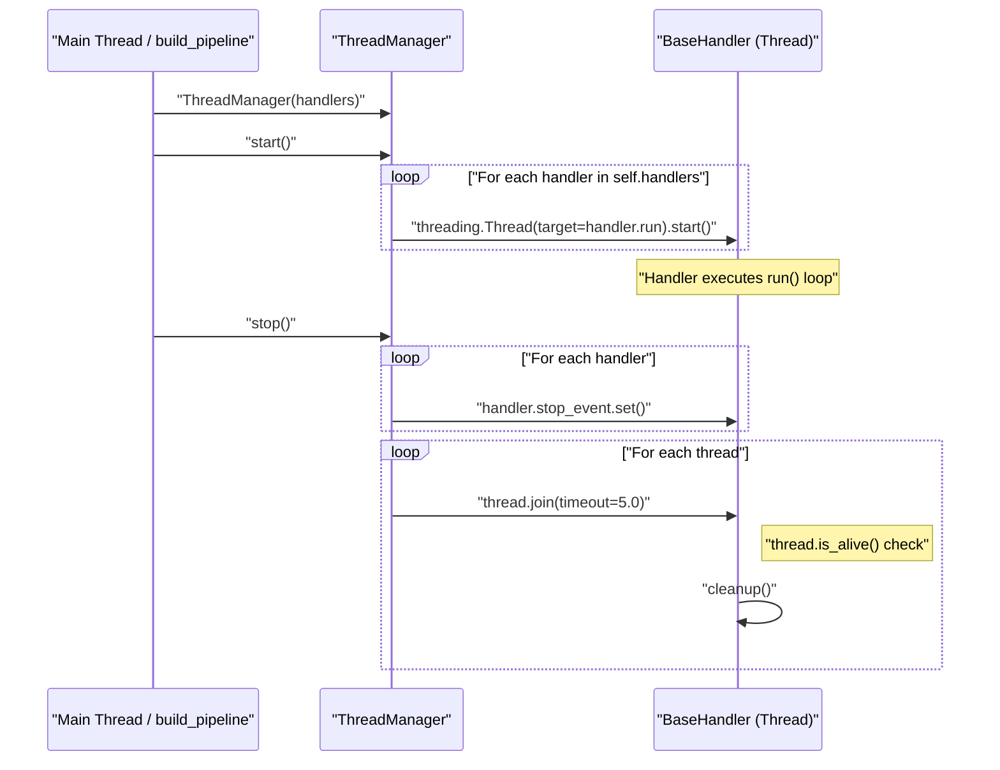
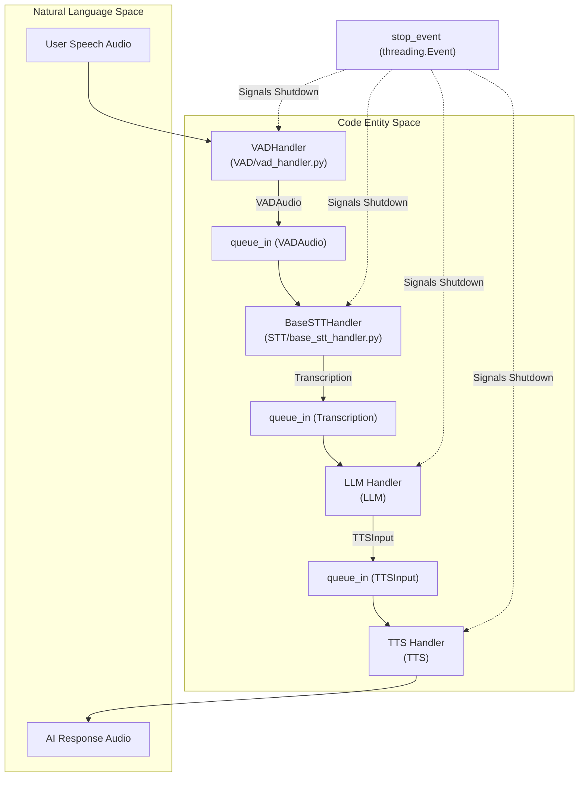
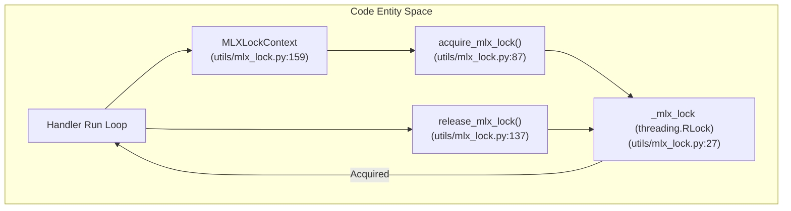
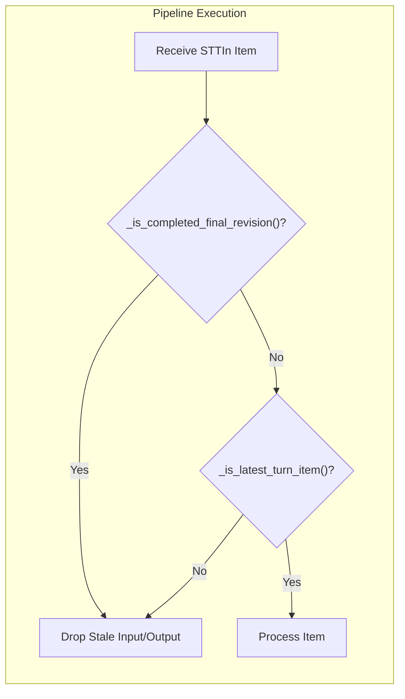

<!-- source: DeepWiki mcp.deepwiki.com · repo huggingface/speech-to-speech · page 2.2 Threading and Concurrency · fetched 2026-10-26 -->

# Threading and Concurrency

Relevant source files

The following files were used as context for generating this wiki page:

- [src/speech_to_speech/STT/base_stt_handler.py](src/speech_to_speech/STT/base_stt_handler.py)
- [src/speech_to_speech/arguments_classes/faster_whisper_stt_arguments.py](src/speech_to_speech/arguments_classes/faster_whisper_stt_arguments.py)
- [src/speech_to_speech/arguments_classes/mlx_audio_whisper_arguments.py](src/speech_to_speech/arguments_classes/mlx_audio_whisper_arguments.py)
- [src/speech_to_speech/arguments_classes/parakeet_tdt_arguments.py](src/speech_to_speech/arguments_classes/parakeet_tdt_arguments.py)
- [src/speech_to_speech/pipeline/cancel_scope.py](src/speech_to_speech/pipeline/cancel_scope.py)
- [src/speech_to_speech/utils/mlx_lock.py](src/speech_to_speech/utils/mlx_lock.py)
- [src/speech_to_speech/utils/thread_manager.py](src/speech_to_speech/utils/thread_manager.py)
- [tests/openai_realtime/test_llm_proxy.py](tests/openai_realtime/test_llm_proxy.py)
- [tests/test_faster_whisper_language_reporting.py](tests/test_faster_whisper_language_reporting.py)
- [tests/test_stt_stale_filter.py](tests/test_stt_stale_filter.py)

This document details the multi-threaded architecture of the speech-to-speech pipeline. The system utilizes a thread-per-handler model coordinated by a central `ThreadManager`, shared synchronization primitives, the `CancelScope` mechanism for handling barge-in interruptions, a global reentrant lock for MLX model access, and speculative turn stale-filtering logic.

## ThreadManager and Lifecycle

The `ThreadManager` class is the central orchestrator for thread lifecycle management. It is instantiated during the pipeline construction process and manages the execution of all pipeline stages.

### Thread Lifecycle Flow

The `ThreadManager` ensures that threads are not daemonic [src/speech_to_speech/utils/thread_manager.py:21](), meaning the main process will wait for them to finish their `cleanup()` routines before exiting. The `stop()` method specifically signals all handlers via their `stop_event` before attempting to join the threads [src/speech_to_speech/utils/thread_manager.py:29-39]().

Sources: [src/speech_to_speech/utils/thread_manager.py:9-39]()

## Multi-Threaded Architecture and Coordination

The system operates as a cascaded pipeline where each stage (VAD, STT, LLM, TTS) is implemented as a handler. Each handler runs a continuous loop in its own thread, monitoring its input queue for work.

### Pipeline Thread Coordination

Each handler receives a handler context during construction containing the shared `stop_event`, `cancel_scope`, and input/output queues [src/speech_to_speech/utils/thread_manager.py:14-23](). This ensures that all stages within a pipeline unit are synchronized and respond uniformly to pipeline termination and cancellation signals.

Sources: [src/speech_to_speech/utils/thread_manager.py:9-39](), [src/speech_to_speech/STT/base_stt_handler.py:16-67]()

## Interruption and Barge-in Handling

A critical challenge in speech-to-speech systems is "barge-in," where the user speaks while the AI is still generating audio. The system uses the `CancelScope` mechanism to coordinate this across the multi-threaded pipeline.

### The CancelScope Mechanism

The `CancelScope` [src/speech_to_speech/pipeline/cancel_scope.py:1]() provides a unified cancellation signal using a generation counter and discard flag.

| Feature | Implementation | Purpose |
| :--- | :--- | :--- |
| **Generation Counter** | `self._gen` [src/speech_to_speech/pipeline/cancel_scope.py:14]() | Incremented on every `cancel()` call to mark previous work as stale. |
| **Stale Detection** | `is_stale(gen)` [src/speech_to_speech/pipeline/cancel_scope.py:52-54]() | Pipeline threads capture the current `generation` at start and check this periodically. |
| **Discard Guard** | `discarding` [src/speech_to_speech/pipeline/cancel_scope.py:57-59]() | Signals the final output loop to silently drop any remaining audio from a cancelled turn. |

The `cancel()` method increments the generation using a bitwise AND mask to prevent integer overflow [src/speech_to_speech/pipeline/cancel_scope.py:31-33](). It also sets the `_discarding` flag to `True`, which can be cleared once a response is acknowledged as done or a new explicit response is created [src/speech_to_speech/pipeline/cancel_scope.py:35-51]().

Sources: [src/speech_to_speech/pipeline/cancel_scope.py:1-64]()

## MLX Lock Contention and Cross-Handler Serialization

On Apple Silicon platforms, pipeline models (STT, LLM, and TTS) share unified Metal hardware resources. Although individual runtimes may support parallel execution, unrestricted concurrent multi-way load can cause Metal MMU GPU restarts or decoder errors [src/speech_to_speech/utils/mlx_lock.py:4-15]().

### MLXLockContext Architecture

The module provides a global reentrant lock (`_mlx_lock`) along with helper functions and the `MLXLockContext` context manager [src/speech_to_speech/utils/mlx_lock.py:25-179](). Handlers acquire this lock before invoking inference routines on Apple Silicon to ensure thread safety across different model families [src/speech_to_speech/utils/mlx_lock.py:1-15](). State tracking logs lock hold durations and identifies lock owners when contention occurs [src/speech_to_speech/utils/mlx_lock.py:36-85]().

Sources: [src/speech_to_speech/utils/mlx_lock.py:1-179]()

## Stale Generation Detection and Speculative Turn Filtering

Pipeline stages, particularly STT handlers inheriting from `BaseSTTHandler`, implement rigorous stale-turn input and output filtering to discard obsolete frames or transcripts [src/speech_to_speech/STT/base_stt_handler.py:16-76]().

### Stale Filtering Flow

Key validation rules in `BaseSTTHandler` include:
1. **Completed Final Revision Check**: Inputs or partial transcriptions belonging to a turn revision that has already reached final completion are immediately dropped [src/speech_to_speech/STT/base_stt_handler.py:33-36, 69-71]().
2. **Progressive vs Final Ordering**: Progressive inputs are filtered out if a final transcription for the same revision is already queued or processed [src/speech_to_speech/STT/base_stt_handler.py:37-39]().
3. **Turn Stability Windows**: When evaluating latest turn items, handlers respect pending reopen candidates and stability settle windows (`final_revision_settle_s`) to prevent race conditions during rapid turn mutations [src/speech_to_speech/STT/base_stt_handler.py:82-107]().
4. **Queue Flushing**: Stale items remaining in `queue_in` are bulk-dropped during input gating checks [src/speech_to_speech/STT/base_stt_handler.py:109-133]().

Sources: [src/speech_to_speech/STT/base_stt_handler.py:16-175](), [tests/test_stt_stale_filter.py:1-208]()

---

