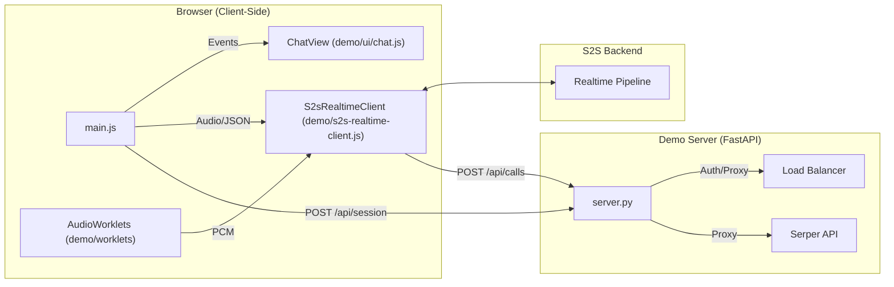

<!-- source: DeepWiki mcp.deepwiki.com · repo huggingface/speech-to-speech · page 5.5 Browser Demo Application · fetched 2026-10-26 -->

# Browser Demo Application

Relevant source files

The following files were used as context for generating this wiki page:

- [demo/.gitignore](demo/.gitignore)
- [demo/.npmrc](demo/.npmrc)
- [demo/CONTEXT.md](demo/CONTEXT.md)
- [demo/DESIGN.md](demo/DESIGN.md)
- [demo/README.md](demo/README.md)
- [demo/auth.py](demo/auth.py)
- [demo/docs/adr/0001-docker-space-with-search-proxy.md](demo/docs/adr/0001-docker-space-with-search-proxy.md)
- [demo/index.html](demo/index.html)
- [demo/limiter.py](demo/limiter.py)
- [demo/main.js](demo/main.js)
- [demo/package-lock.json](demo/package-lock.json)
- [demo/package.json](demo/package.json)
- [demo/s2s-realtime-client.js](demo/s2s-realtime-client.js)
- [demo/server.py](demo/server.py)
- [demo/style.css](demo/style.css)
- [demo/tests/agents-adapter.test.mjs](demo/tests/agents-adapter.test.mjs)
- [demo/ui/account.js](demo/ui/account.js)
- [demo/ui/chat.js](demo/ui/chat.js)
- [demo/worklets/mic-capture.js](demo/worklets/mic-capture.js)
- [tests/test_demo_agents_adapter.py](tests/test_demo_agents_adapter.py)
- [tests/test_demo_server.py](tests/test_demo_server.py)
- [tests/test_demo_user_audio.py](tests/test_demo_user_audio.py)

The Browser Demo Application is a voice-chat interface located in the `demo/` directory. It provides a web-based frontend for interacting with the speech-to-speech pipeline using either **WebSocket** or **WebRTC** transports. The application is designed to run as a standalone service (often within a Hugging Face Space) and includes features for user authentication, usage metering, and client-side tool execution.

## System Architecture

The demo application follows a client-server architecture where the `server.py` acts as a proxy and static file host, while the JavaScript client (`main.js`) manages the real-time audio loop.

### Data Flow Overview

The following diagram illustrates the data flow between the browser, the demo server, and the speech-to-speech backend.

**Diagram: Browser Demo Communication Flow**

Sources: `demo/server.py:25-42`(), `demo/main.js:6-14`(), `demo/s2s-realtime-client.js:1-18`()

## Server-Side Implementation

The backend of the demo is a FastAPI application defined in `demo/server.py`.

### Proxying and Authentication
The server handles several critical proxying tasks to keep secrets (like API keys and Load Balancer URLs) away from the browser:
*   **Session Proxy (`/api/session`)**: Proxies the handshake to the load balancer to obtain a compute URL `[demo/server.py:220-249]()`.
*   **WebRTC Handshake Proxy (`/api/calls`)**: Forwards SDP offers to the backend's `/v1/realtime/calls` endpoint `[demo/server.py:186-218]()`.
*   **Web Search Proxy (`/api/search`)**: Executes Google searches via Serper.dev using a server-side `SERPER_API_KEY` `[demo/server.py:161-184]()`.

### Usage Metering and Auth
Authentication is managed via Hugging Face OAuth in `demo/auth.py`.
*   **Identity Resolution**: `resolve_identity` identifies users by hashed HF `sub` (for signed-in users) or a combination of IP and cookie (for anonymous users) `[demo/auth.py:228-261]()`.
*   **Limiter**: `limiter.py` tracks per-day usage. `limiter.init()` stands up a SQLite database to manage budgets based on HF tiers (anon, free, pro) `[demo/server.py:144-151]()`. The `_whoami_cache` in `demo/auth.py` is used to cache user profiles from the Hugging Face Hub to avoid repeated API calls for tier and organization resolution `[demo/auth.py:93]()`. This cache is shared across `/api/me` and `/api/session` requests `[tests/test_demo_server.py:147-156]()`.

Sources: `demo/server.py:1-42`(), `demo/auth.py:4-14`(), `demo/auth.py:62-75`(), `demo/auth.py:93`(), `tests/test_demo_server.py:147-156`()

## Client-Side Architecture

The client is a modular JavaScript application centered around `main.js`.

### Transport Abstraction
The application uses `S2sRealtimeClient` (`demo/s2s-realtime-client.js`) as an adapter around the official Agents SDK `RealtimeSession`. This adapter drives the SDK's stock WebSocket or WebRTC transports, abstracting away demo-specific concerns like queue handling, audio visualization, and UI events `[demo/s2s-realtime-client.js:1-7]()`.

| Feature | WebSocket (`OpenAIRealtimeWebSocket`) | WebRTC (`OpenAIRealtimeWebRTC`) |
| :--- | :--- | :--- |
| **Audio Format** | PCM16 24kHz (In/Out) | Opus (RTP Media Track) |
| **Data Flow** | `input_audio_buffer.append` | Native MediaStream |
| **Barge-in** | Client-side buffer clearing `[tests/test_demo_user_audio.py:143]()` | Server-side flushing |
| **Latency** | Standard TCP | Low-latency UDP/RTP |
| **Noise Gate** | Implemented in `mic-capture.js` `[demo/main.js:46-56]()` | Browser's `noiseSuppression` `[demo/README.md:148-150]()` |
| **User Recording Replay** | Available `[demo/README.md:138-140]()` | Not available `[demo/README.md:138-140]()` |

Sources: `demo/s2s-realtime-client.js:1-7`(), `demo/main.js:46-56`(), `demo/README.md:138-150`(), `tests/test_demo_user_audio.py:143`()

### Audio Processing and Worklets
Audio is handled via the Web Audio API using dedicated worklets:
*   **Mic Capture**: `mic-capture.js` captures and resamples audio to 24kHz. It includes a client-side noise gate with a tunable threshold in dBFS `[demo/main.js:46-56]()`. The worklet is versioned (`audio-24k-v1`) to ensure compatibility with the backend's expected sample rate `[demo/s2s-realtime-client.js:52-61]()`, and the client checks for sample rate mismatches `[tests/test_demo_agents_adapter.py:172-185]()`.
*   **Playback**: `audio-playback.js` handles 24kHz output for the WebSocket transport `[demo/s2s-realtime-client.js:109]()`.
*   **Visualizer**: `OrbVisualiser` uses an `AnalyserNode` with `VIS_FFT_SIZE` to animate the central orb based on audio frequency data `[demo/s2s-realtime-client.js:48]()`.

Sources: `demo/s2s-realtime-client.js:48`(), `demo/s2s-realtime-client.js:52-61`(), `demo/s2s-realtime-client.js:109`(), `demo/main.js:46-56`(), `tests/test_demo_agents_adapter.py:172-185`()

### User Audio Recording
The `SentAudioRecorder` class (`demo/ws/user-audio-recorder.js`) buffers microphone input and uses `speech_started` and `speech_stopped` events from the backend to extract and store user utterances as WAV files. This allows for replaying user audio in the chat history `[demo/s2s-realtime-client.js:128]()`. The recorder correctly handles speech boundaries and accumulates audio for reopened turns `[tests/test_demo_user_audio.py:23-60]()`, `[tests/test_demo_user_audio.py:64-89]()`.

Sources: `demo/s2s-realtime-client.js:128`(), `tests/test_demo_user_audio.py:23-60`(), `tests/test_demo_user_audio.py:64-89`()

### Chat View
The `ChatView` class (`demo/ui/chat.js`) manages the conversation UI, including ephemeral bubbles and persistent history. It handles:
*   **Message Rendering**: Displays user and assistant transcripts, and tool calls `[demo/ui/chat.js:133-150]()`.
*   **Bubble Management**: Ephemeral bubbles are automatically dismissed after a timeout, with a mechanism to reschedule the dismissal if the bubble is updated `[demo/ui/chat.js:73-82]()`, `[tests/test_demo_user_audio.py:176-185]()`. Assistant activity also dismisses pending user voice bubbles `[tests/test_demo_user_audio.py:190-200]()`.
*   **User Audio Playback**: Integrates with `SentAudioRecorder` to allow replaying user utterances `[demo/ui/chat.js:52]()`.

Sources: `demo/ui/chat.js:73-82`(), `demo/ui/chat.js:133-150`(), `demo/ui/chat.js:52`(), `tests/test_demo_user_audio.py:176-185`(), `tests/test_demo_user_audio.py:190-200`()

## Tool Integrations

The demo implements client-side tool execution, where the LLM requests a tool and the browser performs the action.

### Tool Definition and Execution
Tools are defined in `TOOL_DEFS` `[demo/main.js:67-90]()`.
*   **`web_search`**: Calls the `/api/search` proxy and returns snippets to the model `[demo/main.js:68-80]()`.
*   **`camera_snapshot`**: Captures a frame from the webcam. It uses a `SNAPSHOT_LADDER` to progressively downscale and compress the image to fit within WebRTC data channel limits (~60KB) `[demo/main.js:92-109]()`.
The `S2sRealtimeClient` delegates tool execution to the `RealtimeSession` from the Agents SDK `[tests/test_demo_agents_adapter.py:207-219]()`.

### Tool Call Batching
The `ToolCallBatcher` class ensures that tool results are delivered in the correct order (`output_index`) and handles the requesting of follow-up responses after a tool execution finishes `[demo/tool-call-batcher.js:11-26]()`.

Sources: `demo/main.js:67-109`(), `demo/tool-call-batcher.js:11-39`(), `tests/test_demo_agents_adapter.py:207-219`()

## Startup and Greeting
When a session starts, the client can send a `startupGreeting`.
*   **Mechanism**: A hidden user prompt is sent immediately after `session.update` `[demo/s2s-realtime-client.js:177-179]()`.
*   **Configuration**: The prompt is defined by the `STARTUP_GREETING` environment variable on the server `[demo/server.py:118]()`.
*   **Implementation**: `_sendStartupGreeting()` ensures the greeting is sent exactly once per session `[demo/s2s-realtime-client.js:700-702]()`.

Sources: `demo/server.py:118`(), `demo/s2s-realtime-client.js:177-179`(), `demo/s2s-realtime-client.js:700-702`()

## Deployment and Modes

### Deployment Modes
1.  **Direct Mode**: `SPEECH_TO_SPEECH_URL` is set. The browser connects directly to the backend. Auth and metering are disabled `[demo/server.py:77-79]()`.
2.  **Load Balancer Mode**: `LOAD_BALANCER_URL` is set. The server proxies session requests and enforces usage limits `[demo/server.py:61-66]()`.

### Docker Deployment
The demo includes a `Dockerfile` for deployment.
*   **Service Port**: The application listens on port `7860` `[demo/README.md:7]()`.
*   **Environment Variables**: Key variables include `SPEECH_TO_SPEECH_URL`, `SERPER_API_KEY`, and `RTC_ICE_SERVERS` `[demo/README.md:46-50]()`.
*   **Docker Networking**: Special considerations are needed for WebSocket and WebRTC when running the demo in Docker and the backend on the host, as they require different hostnames for connection `[demo/README.md:66-83]()`.

Sources: `demo/server.py:61-81`(), `demo/README.md:42-57`(), `demo/README.md:66-83`()

---

