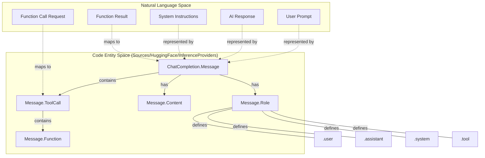
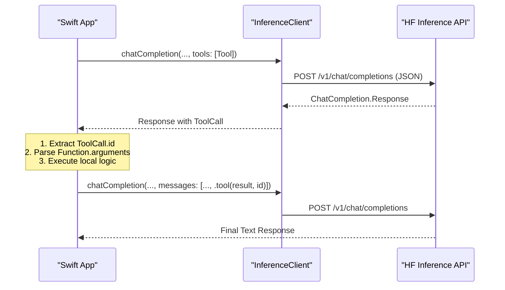

<!-- source: DeepWiki mcp.deepwiki.com · repo huggingface/swift-huggingface · page 8.4 Chat Completion Types (Message, Response, ToolCall) · fetched 2026-10-26 -->

# Chat Completion Types (Message, Response, ToolCall)

<details>
<summary>Relevant source files</summary>

The following files were used as context for generating this wiki page:

- [Sources/HuggingFace/InferenceProviders/ChatCompletion.swift](Sources/HuggingFace/InferenceProviders/ChatCompletion.swift)
- [Sources/HuggingFace/InferenceProviders/FeatureExtraction.swift](Sources/HuggingFace/InferenceProviders/FeatureExtraction.swift)
- [Sources/HuggingFace/InferenceProviders/Message.swift](Sources/HuggingFace/InferenceProviders/Message.swift)
- [Tests/HuggingFaceTests/HubTests/GitOperationsTests.swift](Tests/HuggingFaceTests/HubTests/GitOperationsTests.swift)
- [Tests/HuggingFaceTests/InferenceProvidersTests/MessageCodableTests.swift](Tests/HuggingFaceTests/InferenceProvidersTests/MessageCodableTests.swift)
- [Tests/HuggingFaceTests/InferenceProvidersTests/ProviderTests.swift](Tests/HuggingFaceTests/InferenceProvidersTests/ProviderTests.swift)
- [Tests/HuggingFaceTests/OAuthTests/TokenStorageTests.swift](Tests/HuggingFaceTests/OAuthTests/TokenStorageTests.swift)
- [Tests/HuggingFaceTests/SharedTests/MultipartBuilderTests.swift](Tests/HuggingFaceTests/SharedTests/MultipartBuilderTests.swift)

</details>


This page documents the data structures used for chat completion requests and responses in the swift-huggingface SDK. These types enable type-safe interaction with chat-based language models, including support for multi-turn conversations, vision inputs, tool/function calling, and streaming responses.

For information about using these types with the `InferenceClient`, see [Chat Completion](#4.1).

## Overview

The chat completion API centers around three primary type namespaces under `ChatCompletion`:

- **`ChatCompletion.Message`**: Represents individual messages in a conversation (system prompts, user queries, assistant responses, tool results) [Sources/HuggingFace/InferenceProviders/ChatCompletion.swift:6-11]().
- **`ChatCompletion.Response`**: Contains the model's response with choices, usage statistics, and metadata.
- **`ChatCompletion.ToolCall`**: Represents function/tool invocations requested by the model [Sources/HuggingFace/InferenceProviders/ChatCompletion.swift:58-60]().

### Chat Completion Entity Mapping

The following diagram maps natural language chat concepts to the specific code entities defined in the SDK.



**Sources:** [Sources/HuggingFace/InferenceProviders/ChatCompletion.swift:6-113](), [Sources/HuggingFace/InferenceProviders/Message.swift:8-109]()

## ChatCompletion.Message

The `Message` type represents a single message in a conversation. Messages flow in both directions: from the client to the model (system prompts, user queries, tool results) and from the model back to the client (assistant responses).

### Structure

| Property | Type | Description |
|----------|------|-------------|
| `role` | `Role` | The role of the message author (system, user, assistant, tool) [Sources/HuggingFace/InferenceProviders/Message.swift:97]() |
| `content` | `Content?` | The message content (text, or mixed). Can be nil for assistant messages containing only tool calls [Sources/HuggingFace/InferenceProviders/Message.swift:100]() |
| `name` | `String?` | Optional name identifying the message author [Sources/HuggingFace/InferenceProviders/Message.swift:103]() |
| `toolCallId` | `String?` | Required for `tool` role messages, matching the `ToolCall` id [Sources/HuggingFace/InferenceProviders/Message.swift:109]() |
| `toolCalls` | `[ToolCall]?` | Present in assistant messages when the model invokes tools [Sources/HuggingFace/InferenceProviders/Message.swift:106]() |

**Sources:** [Sources/HuggingFace/InferenceProviders/Message.swift:96-110]()

### Message.Role Enum

The `Role` enum defines the participant type in the conversation [Sources/HuggingFace/InferenceProviders/Message.swift:10-22]().

| Case | Description |
|------|-------------|
| `.system` | Provides instructions or high-level context to the model. |
| `.user` | Represents input from the human user. |
| `.assistant` | Represents responses generated by the AI model. |
| `.tool` | Contains the results of a tool/function execution. |

**Sources:** [Sources/HuggingFace/InferenceProviders/Message.swift:10-22]()

### Message.Content Types

The `Content` enum supports multi-modal inputs, which is essential for Vision-Language Models (VLM).

| Variant | Use Case | Implementation |
|---------|----------|----------------|
| `.text(String)` | Plain text messages | Wraps a simple `String` [Sources/HuggingFace/InferenceProviders/Message.swift:27]() |
| `.mixed([Item])` | Multi-modal inputs | Array of `Item` (text or image) [Sources/HuggingFace/InferenceProviders/Message.swift:30]() |

#### Content Items (Vision Support)
The `Item` enum allows mixing text and images within a single message [Sources/HuggingFace/InferenceProviders/Message.swift:33-51](). Images include a `detail` parameter (`.auto`, `.low`, `.high`) to control processing resolution [Sources/HuggingFace/InferenceProviders/Message.swift:41-50]().

**Sources:** [Sources/HuggingFace/InferenceProviders/Message.swift:25-52](), [Tests/HuggingFaceTests/InferenceProvidersTests/MessageCodableTests.swift:24-35]()

### Static Factory Methods

The `ChatCompletion.Message` type provides ergonomic static methods to simplify message creation:

| Method | Role |
|--------|------|
| `.system(_:)` | Creates a message with `role: .system` [Sources/HuggingFace/InferenceProviders/ChatCompletion.swift:189-191]() |
| `.user(_:)` | Creates a message with `role: .user` [Sources/HuggingFace/InferenceProviders/ChatCompletion.swift:193-195]() |
| `.assistant(_:)` | Creates a message with `role: .assistant` [Sources/HuggingFace/InferenceProviders/ChatCompletion.swift:197-199]() |

**Sources:** [Sources/HuggingFace/InferenceProviders/ChatCompletion.swift:189-199]()

### ExpressibleByStringLiteral Conformance

`Message` conforms to `ExpressibleByStringLiteral`, allowing developers to pass raw strings where a `Message` is expected. This automatically creates a message with the `.user` role [Sources/HuggingFace/InferenceProviders/ChatCompletion.swift:185-187]().

```swift
let msg: ChatCompletion.Message = "Hello!" 
// Internally calls ChatCompletion.Message(role: .user, content: .text("Hello!"))
```

**Sources:** [Sources/HuggingFace/InferenceProviders/ChatCompletion.swift:185-187]()

## Tool Calling Types

Tool calling allows models to interact with external APIs or local functions by generating structured JSON arguments.

### Data Flow for Tool Calls



**Sources:** [Sources/HuggingFace/InferenceProviders/ChatCompletion.swift:58-97](), [Sources/HuggingFace/InferenceProviders/Message.swift:55-94]()

### ToolCall and Function Structures

A `ToolCall` consists of an `id`, a `type` (currently only `"function"`), and a `Function` object [Sources/HuggingFace/InferenceProviders/Message.swift:55-75]().
The `Function` object contains the `name` of the function to be called and the `arguments` as a JSON-encoded string [Sources/HuggingFace/InferenceProviders/Message.swift:78-94]().

| Entity | Property | Description |
|--------|----------|-------------|
| **ToolCall** | `id` | Unique identifier for the request [Sources/HuggingFace/InferenceProviders/Message.swift:57]() |
| **ToolCall** | `function` | The specific function details [Sources/HuggingFace/InferenceProviders/Message.swift:63]() |
| **Function** | `name` | The name defined in the request's tool list [Sources/HuggingFace/InferenceProviders/Message.swift:80]() |
| **Function** | `arguments` | JSON string of arguments to be parsed [Sources/HuggingFace/InferenceProviders/Message.swift:83]() |

**Sources:** [Sources/HuggingFace/InferenceProviders/Message.swift:55-94]()

## Serialization and Codable Implementation

The SDK uses custom `Codable` logic to handle the complex polymorphic nature of chat messages, especially for `Content` which can be a simple string or a complex array.

### Content Coding Logic
The `Message.Content` type implements a manual `init(from:)` to attempt decoding a `String` first (for simple text) and then falling back to an array of `Item` (for mixed content) [Sources/HuggingFace/InferenceProviders/Message.swift:186-199]().

### Image Detail Handling
When decoding image items, the SDK defaults the `detail` level to `.auto` if it is omitted in the JSON payload [Tests/HuggingFaceTests/InferenceProvidersTests/MessageCodableTests.swift:37-61]().

**Sources:** [Sources/HuggingFace/InferenceProviders/Message.swift:185-211](), [Tests/HuggingFaceTests/InferenceProvidersTests/MessageCodableTests.swift:9-61]()

---

