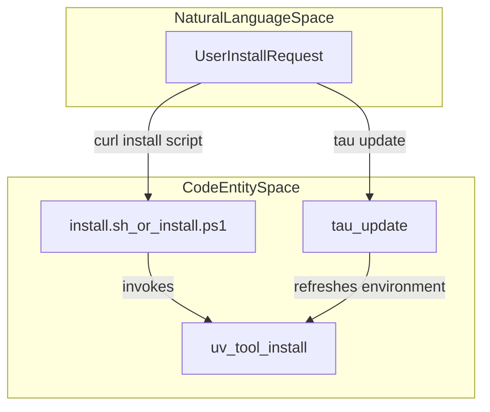
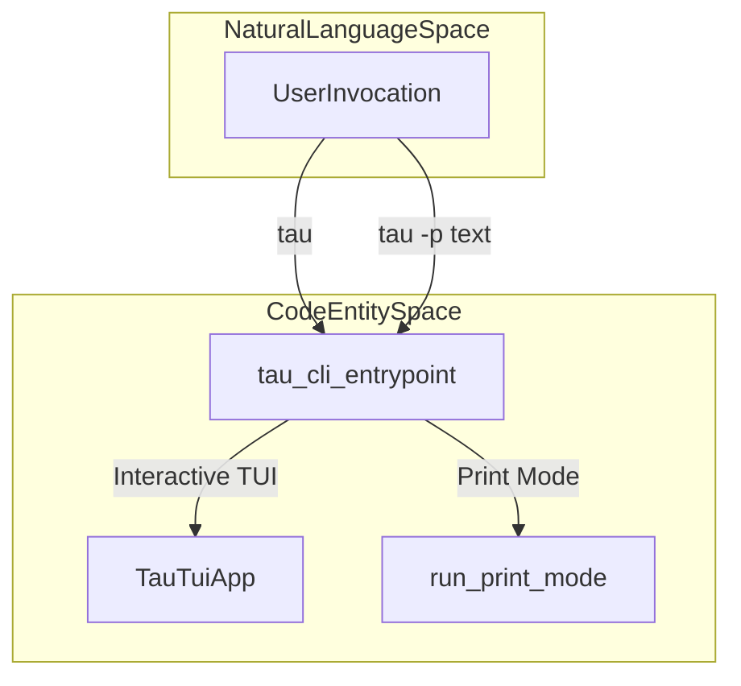

<!-- source: DeepWiki mcp.deepwiki.com · repo huggingface/tau · page 1.1 Getting Started · fetched 2026-10-26 -->

# Getting Started

<details>
<summary>Relevant source files</summary>

The following files were used as context for generating this wiki page:

- [.gitignore](.gitignore)
- [CONTRIBUTING.md](CONTRIBUTING.md)
- [README.md](README.md)
- [dev-notes/install-scripts.md](dev-notes/install-scripts.md)
- [dev-notes/prompt-caching.md](dev-notes/prompt-caching.md)
- [dev-notes/release-process.md](dev-notes/release-process.md)
- [docs/assets/tau-header.svg](docs/assets/tau-header.svg)
- [website/content/quickstart.md](website/content/quickstart.md)
- [website/static/install.ps1](website/static/install.ps1)
- [website/static/install.sh](website/static/install.sh)
- [website/static/landing.js](website/static/landing.js)

</details>


This page covers the initial setup, installation, and first-run procedures for Tau. It describes how to install the package via PyPI and bootstrap scripts, set up a local development environment, run the operational modes (TUI and print mode), connect to model providers using `/login`, and links to the official quickstart guide.

---

## Installation via PyPI and Install Scripts

Tau is distributed on PyPI as `tau-ai` and exposes a global `tau` console command [README.md:61](). It requires Python 3.12 or newer [README.md:62](). The recommended installation utilizes [`uv`](https://docs.astral.sh/uv) to manage isolated tool environments [README.md:62-63]().

### Standard Installation and Bootstrap Scripts
For users without an existing `uv` environment, automated bootstrap installers are available for POSIX and Windows systems [README.md:65-75](), [website/content/quickstart.md:16-26](). These scripts locate or install `uv`, create an isolated tool environment for `tau-ai`, verify execution, and check `PATH` availability without requiring administrator or `sudo` privileges [README.md:77](), [website/static/install.sh:1-72](), [website/static/install.ps1:1-68]().

- **macOS / Linux:**
  ```bash
  curl -LsSf https://twotimespi.dev/install.sh | sh
  ```
- **Windows (PowerShell):**
  ```powershell
  irm https://twotimespi.dev/install.ps1 | iex
  ```

Alternatively, if a Python package manager is already present, Tau can be installed directly [README.md:82-90]():
```bash
uv tool install tau-ai
# or
pipx install tau-ai
# or
python -m pip install tau-ai
```

To update an existing installation, Tau provides an update command that inspects its environment receipt and fetches the latest stable release [README.md:104-107](), [website/content/quickstart.md:46-58]():
```bash
tau update
```

**Installation and Upgrade Data Flow**

Sources: [README.md:59-109](), [website/content/quickstart.md:10-59](), [website/static/install.sh:1-72](), [website/static/install.ps1:1-68](), [dev-notes/install-scripts.md:1-20]()

---

## Local Development Setup

For developers modifying Tau source code or running test suites, dependencies and environment synchronization are handled via `uv` [CONTRIBUTING.md:32-34]().

1. **Clone the repository:**
   ```bash
   git clone https://github.com/huggingface/tau.git
   cd tau
   ```
2. **Sync development dependencies:**
   ```bash
   uv sync --dev
   ```
   This creates a `.venv` virtual environment and installs testing and linting tools such as `pytest`, `ruff`, and `mypy` [README.md:115]().
3. **Run the test suite:**
   ```bash
   uv run pytest
   ```
4. **Install as an editable tool:**
   ```bash
   uv tool install --editable --force .
   ```
   *Note: Re-run the editable install command after pulling source updates to ensure package metadata, dependency state, and executable entry points are synchronized [README.md:126-129]().*

Sources: [README.md:110-129](), [CONTRIBUTING.md:32-56]()

---

## Operational Modes

Tau supports interactive terminal usage as well as headless script execution [README.md:176]().

### 1. Interactive Terminal User Interface (TUI)
Executing `tau` without positional prompt flags launches the Textual-based interactive TUI inside the target project directory [README.md:137](), [website/content/quickstart.md:94-101]().
* **Launch:** `tau`

### 2. Print Mode
Print mode (`-p`) bypasses the TUI widget hierarchy, evaluating a single-shot prompt against the model and streaming output directly to standard output [README.md:146-150](), [website/content/quickstart.md:139-148]().
* **Launch:** `tau -p "summarize the architecture"` [README.md:149]()
* **Targeting Workspaces:** `tau --cwd /path/to/project -p "find the CLI entry point"` [README.md:150]()

**Operational Mode Dispatch**

Sources: [README.md:131-151](), [website/content/quickstart.md:94-148]()

---

## Connecting a Provider with `/login`

Tau requires an authenticated Large Language Model provider to function [README.md:153](). It ships with built-in configurations for OpenAI, Anthropic, OpenAI Codex subscription auth, OpenRouter, Hugging Face, and custom OpenAI-compatible endpoints [README.md:166-168]().

### The `/login` Slash Command
Within the interactive TUI, model credentials and active provider bindings are managed via the `/login` command [README.md:153-162]():
- Typing `/login` opens an interactive selection menu [website/content/quickstart.md:83]().
- Typing `/login openai` or `/login openai-codex` initiates direct credential configuration and secure storage [README.md:161-162](), [website/content/quickstart.md:84-85]().

### Provider Catalogs and Overlays
Built-in provider and model definitions are declared declaratively in `src/tau_coding/data/catalog.toml` [README.md:170](). Users can define custom endpoints or local models without modifying source code by placing a `~/.tau/catalog.toml` overlay file with matching schema [README.md:170-172](), [CONTRIBUTING.md:97-100]().

Sources: [README.md:153-173](), [CONTRIBUTING.md:89-100](), [website/content/quickstart.md:71-90]()

---

## Pointer to the Quickstart Guide

For a complete interactive walkthrough, beginner troubleshooting, and keybinding references, consult the official [Quickstart Guide](https://twotimespi.dev/quickstart) [README.md:12](), [website/content/quickstart.md:1-155]().

Sources: [README.md:10-14](), [website/content/quickstart.md:1-155]()

---

