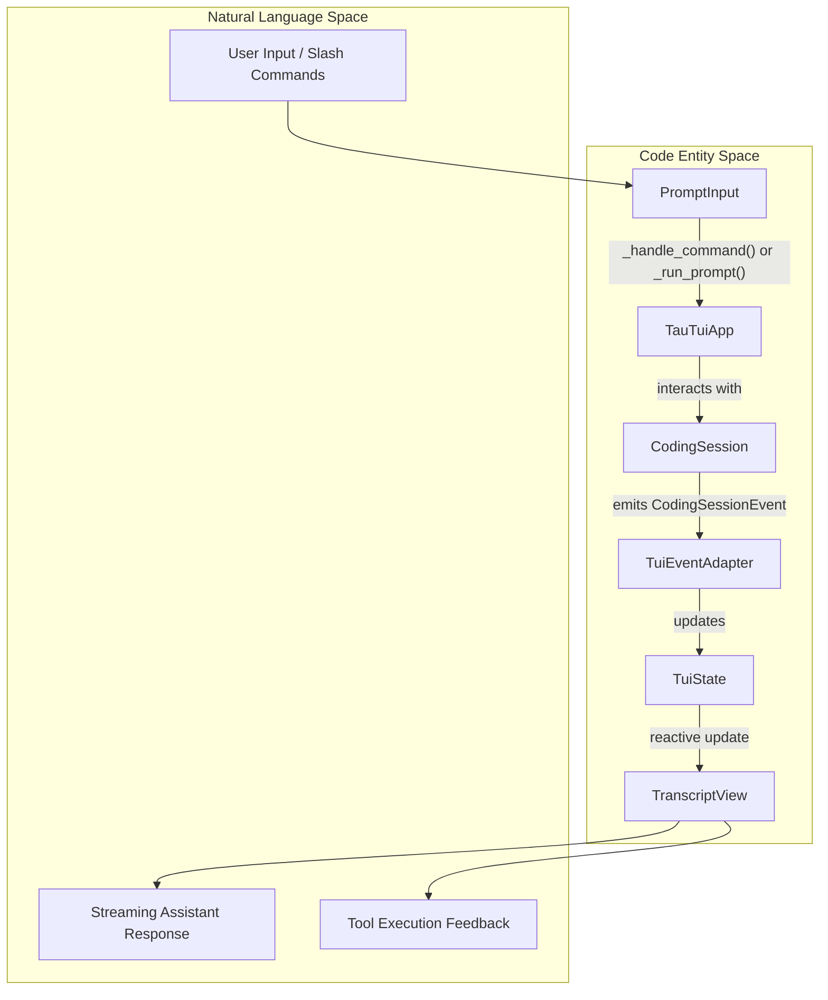
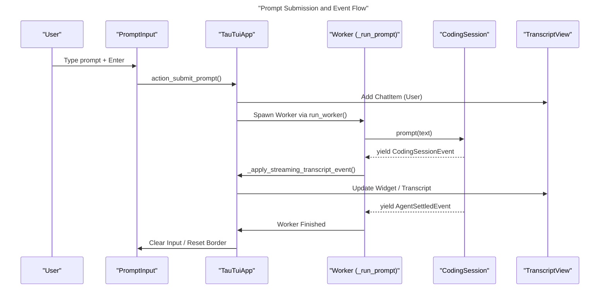

<!-- source: DeepWiki mcp.deepwiki.com · repo huggingface/tau · page 9 Terminal User Interface (TUI) · fetched 2026-10-26 -->

# Terminal User Interface (TUI)

Relevant source files

The following files were used as context for generating this wiki page:

- [src/tau_coding/tui/__init__.py](src/tau_coding/tui/__init__.py)
- [src/tau_coding/tui/app.py](src/tau_coding/tui/app.py)
- [src/tau_coding/tui/widgets.py](src/tau_coding/tui/widgets.py)
- [tests/test_tui_app.py](tests/test_tui_app.py)

The Tau Terminal User Interface (TUI) is a high-level frontend built with the [Textual](https://textual.textualize.io) framework. It provides an interactive, event-driven environment for interacting with the coding agent, featuring real-time streaming, session management, and rich rendering of code and tool outputs.

The TUI is decoupled from the core agent logic (`tau_agent`) and the application orchestrator (`CodingSession`). It consumes events and updates a local display state, ensuring that the core "brain" of the system remains portable and independent of terminal-specific concerns.

### Architecture Overview

The TUI follows a unidirectional data flow pattern where the `CodingSession` emits events that are translated into UI state changes via the `TuiEventAdapter`.

#### Diagram: TUI Architecture and Data Flow

Sources: [src/tau_coding/tui/app.py:75-165](), [src/tau_coding/tui/adapter.py:27-150](), [src/tau_coding/tui/state.py:81-220]()

---

### Component Hierarchy

The TUI is organized into a main application class, a state management layer, and a set of specialized widgets and modal screens.

| Component | Role | Code Location |
| :--- | :--- | :--- |
| `TauTuiApp` | The main `textual.app.App`. Manages the event loop, background workers, and global keybindings. | [src/tau_coding/tui/app.py:26]() |
| `TuiState` | A non-widget class holding the transcript items, assistant buffer, and session activity. | [src/tau_coding/tui/state.py:81]() |
| `TuiEventAdapter` | A bridge that translates `CodingSessionEvent` types into `TuiState` updates. | [src/tau_coding/tui/adapter.py:5]() |
| `TranscriptView` | The primary scrollable area that renders `ChatItem` objects into visual widgets. | [src/tau_coding/tui/widgets.py:191]() |
| `PromptInput` | A customized `TextArea` supporting multiline input and autocomplete. | [src/tau_coding/tui/app.py:125]() |
| `SessionSidebar` | Displays metadata: current model, working directory, tools, and context files. | [src/tau_coding/tui/widgets.py:157]() |

Sources: [src/tau_coding/tui/app.py:26](), [src/tau_coding/tui/state.py:81](), [src/tau_coding/tui/adapter.py:5](), [src/tau_coding/tui/widgets.py:191](), [src/tau_coding/tui/app.py:125](), [src/tau_coding/tui/widgets.py:157]()

---

### TauTuiApp: Application Logic and Event Flow

The `TauTuiApp` class manages the lifecycle of a TUI session. It uses Textual's worker subsystem to run `CodingSession.prompt()` in the background via the `_run_prompt()` worker [src/tau_coding/tui/app.py:1262-1322](). This prevents the UI from freezing during long-running LLM generation tasks. It handles prompt steering (interrupting the agent to provide guidance) and follow-up queues (`alt+enter`) [src/tau_coding/tui/app.py:1347-1388](), as well as modal picker screens for models, sessions, and authentication [src/tau_coding/tui/app.py:115-147]().

For details, see [TauTuiApp: Application Logic and Event Flow](#9.1).

Sources: [src/tau_coding/tui/app.py:115-147](), [src/tau_coding/tui/app.py:1262-1322](), [src/tau_coding/tui/app.py:1347-1388]()

---

### TUI Widgets and Transcript Rendering

The transcript is rendered using a hierarchy of widgets that transform raw agent messages into formatted Rich content. `TranscriptMessageWidget` handles static messages, while `StreamingTranscriptMessageWidget` manages live text deltas during generation [src/tau_coding/tui/widgets.py:169](). The TUI includes specialized rendering for tool results, code blocks, diffs, and Follow Mode [src/tau_coding/tui/widgets.py:191]().

For details, see [TUI Widgets and Transcript Rendering](#9.2).

Sources: [src/tau_coding/tui/widgets.py:169](), [src/tau_coding/tui/widgets.py:191]()

---

### TUI State, Adapter, and Configuration

The TUI maintains its own display state in `TuiState`, which stores a list of `ChatItem` objects [src/tau_coding/tui/state.py:81-84](). The `TuiEventAdapter` translates session events into state mutations [src/tau_coding/tui/adapter.py:35-150](). User preferences such as keybindings, color themes, and general TuiSettings are persisted in `tui.json` [src/tau_coding/tui/config.py:15-83]().

For details, see [TUI State, Adapter, and Configuration](#9.3).

Sources: [src/tau_coding/tui/adapter.py:35-150](), [src/tau_coding/tui/state.py:81-84](), [src/tau_coding/tui/config.py:15-83]()

---

### Interaction Flow: User Prompt to Display

#### Diagram: Prompt Submission and Event Flow

Sources: [src/tau_coding/tui/app.py:1262-1322](), [src/tau_coding/tui/app.py:1347-1388](), [src/tau_coding/tui/adapter.py:49-55]()

---

