# Page: Overview

# Overview

<details>
<summary>Relevant source files</summary>

The following files were used as context for generating this wiki page:

- [Cargo.lock](Cargo.lock)
- [Cargo.toml](Cargo.toml)
- [README.md](README.md)
- [docs/openapi.json](docs/openapi.json)
- [docs/source/en/cli_arguments.md](docs/source/en/cli_arguments.md)
- [docs/source/en/custom_container.md](docs/source/en/custom_container.md)
- [docs/source/en/private_models.md](docs/source/en/private_models.md)
- [docs/source/en/quick_tour.md](docs/source/en/quick_tour.md)
- [docs/source/en/supported_models.md](docs/source/en/supported_models.md)
- [router/src/lib.rs](router/src/lib.rs)
- [router/src/main.rs](router/src/main.rs)

</details>


Text Embeddings Inference (TEI) is a Rust-based toolkit for deploying and serving open-source text embedding, sequence classification, and re-ranking models. TEI provides production-ready inference with optimizations for NVIDIA GPUs (via CUDA), Apple Silicon (via Metal), and CPUs (via Intel MKL or ONNX Runtime).

The system supports popular embedding models including FlagEmbedding, Ember, GTE, E5, Qwen3, Mistral, and ModernBERT architectures. TEI is designed for high throughput and low latency, featuring token-based dynamic batching, Flash Attention optimizations, and comprehensive observability.

**Key Capabilities:**
- Multiple API interfaces: HTTP REST (via `axum`), gRPC (via `tonic`), OpenAI-compatible endpoints. [router/src/lib.rs:5-15]()
- Three backend implementations: Candle (Rust ML), ORT (ONNX Runtime), Python (PyTorch via gRPC). [Cargo.toml:3-11]()
- Hardware-optimized builds for CUDA compute capabilities 75-120, Intel CPUs, and Apple Metal. [docs/source/en/supported_models.md:70-80]()
- Production features: Prometheus metrics, OpenTelemetry tracing, distributed deployment support. [README.md:51-62]()

For deployment instructions, see [Getting Started](#2). For detailed API documentation, see [API Reference](#6).

Sources: [README.md:1-61](), [router/src/lib.rs:1-40](), [Cargo.toml:1-28]()

## System Architecture

TEI is organized into four main layers: client interfaces, router layer, core processing, and backend implementations. The architecture is designed for high performance with async I/O, multi-threaded tokenization, and hardware-accelerated inference.

**Overall System Architecture**

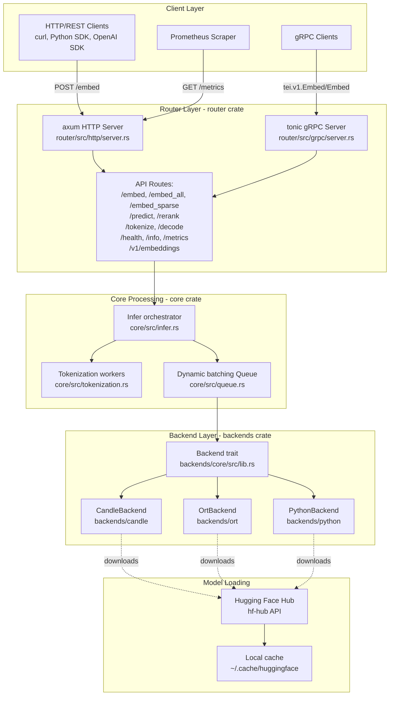

**Key Architecture Characteristics:**
- **Async Router**: Built on `tokio` async runtime for non-blocking I/O. [Cargo.toml:38-38]()
- **Multi-threaded Tokenization**: CPU-bound tokenization runs in OS thread pool. [router/src/lib.rs:47-47]()
- **Dynamic Batching**: Token budget tracking in `Queue` maximizes GPU utilization. [router/src/main.rs:73-74]()
- **Backend Abstraction**: `Backend` trait enables swapping between Candle/ORT/Python implementations. [Cargo.toml:3-11]()
- **Safetensors Loading**: All backends use `.safetensors` format for fast weight loading. [README.md:60-60]()

Sources: [router/src/lib.rs:44-378](), [Cargo.toml:1-23](), [README.md:47-61]()

## Core Components and Data Flow

The TEI core components implement the request processing pipeline, from tokenization through batching to inference.

**Core Component Structure**

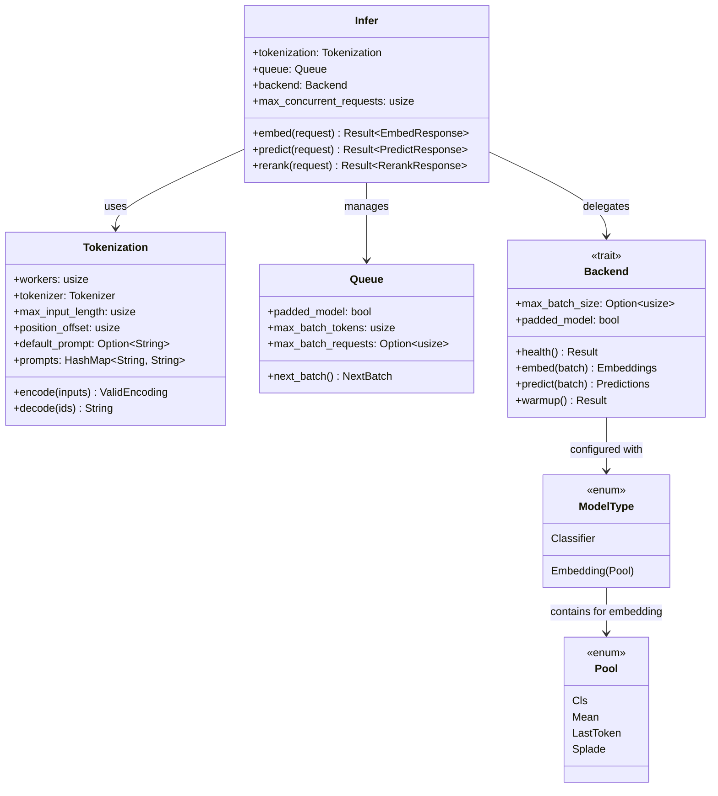

**Component Responsibilities:**

| Component | Key Functions | Purpose |
|-----------|---------------|---------|
| `Infer` | `embed()`, `predict()`, `rerank()` | Request orchestration, admission control via semaphore. [router/src/lib.rs:31-31]() |
| `Tokenization` | `encode()`, `decode()` | Multi-threaded tokenization with prompt injection. [router/src/lib.rs:33-33]() |
| `Queue` | `next_batch()` | Dynamic batching with token budget tracking. [router/src/lib.rs:32-32]() |
| `Backend` | `embed()`, `predict()`, `warmup()` | Abstract inference interface. [router/src/lib.rs:29-29]() |

**Request Admission Control:**
- Semaphore-based limiting via `max_concurrent_requests` in `Infer`. [router/src/main.rs:59-60]()
- Returns HTTP 429 when limit exceeded to prevent queue buildup. [docs/openapi.json:173-186]()
- Per-request tracking with `tokio::sync::Semaphore`. [Cargo.toml:38-38]()

Sources: [router/src/lib.rs:244-306](), [README.md:47-61]()

## Request Processing Pipeline

Requests flow through multiple stages with detailed timing instrumentation at each step. The pipeline is designed to maximize throughput while maintaining low latency.

**Request Processing Sequence**

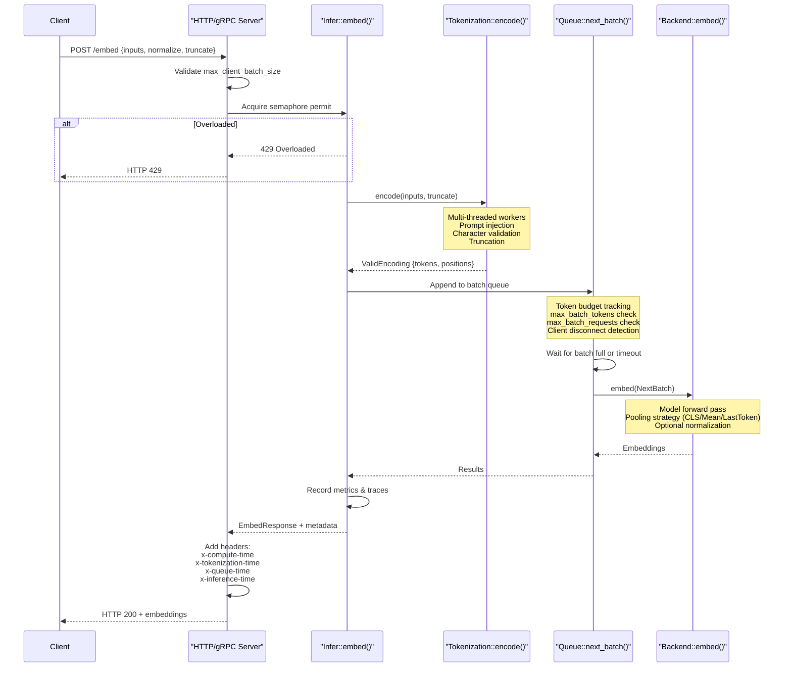

**Pipeline Stages and Timing:**

1. **Validation**: Request size, batch size checks in router handlers. [router/src/main.rs:81-82]()
2. **Tokenization**: Parallel tokenization in OS thread pool. [router/src/main.rs:35-36]()
3. **Queue Wait**: Dynamic batching until `max_batch_tokens` reached. [router/src/main.rs:73-74]()
4. **Backend Inference**: GPU/CPU forward pass with hardware acceleration. [README.md:57-59]()
5. **Response Assembly**: Metadata headers, Prometheus recording, OpenTelemetry spans. [router/src/lib.rs:66-67]()

Sources: [router/src/lib.rs:44-70](), [README.md:123-128]()

## Deployment Architecture

TEI provides multiple deployment options with pre-built Docker images optimized for different hardware platforms. The build matrix generates specialized images for maximum performance.

**Multi-Platform Deployment Options**

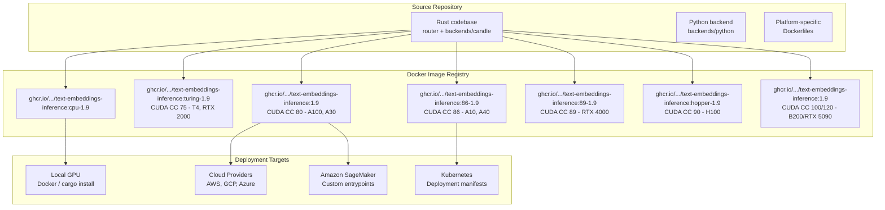

**Docker Image Selection Guide:**

| Hardware | CUDA Compute Capability | Docker Image Tag | Flash Attention |
|----------|------------------------|------------------|-----------------|
| Intel/AMD CPU | N/A | `cpu-1.9` | No |
| NVIDIA T4, RTX 2000 | 75 (Turing) | `turing-1.9` | v1 |
| NVIDIA A100, A30 | 80 (Ampere) | `1.9` (default) | v2 |
| NVIDIA RTX 4000 | 89 (Ada) | `89-1.9` | v2 |
| NVIDIA H100 | 90 (Hopper) | `hopper-1.9` | v2 |
| NVIDIA B200, RTX 5090 | 100/120 (Blackwell) | `1.9` | v2 |

Sources: [docs/source/en/supported_models.md:70-95](), [docs/source/en/custom_container.md:30-36](), [Cargo.toml:1-23]()

## Supported Model Types

TEI categorizes models into three types based on their architecture and determines available API endpoints accordingly.

**Model Type Detection and API Routing**

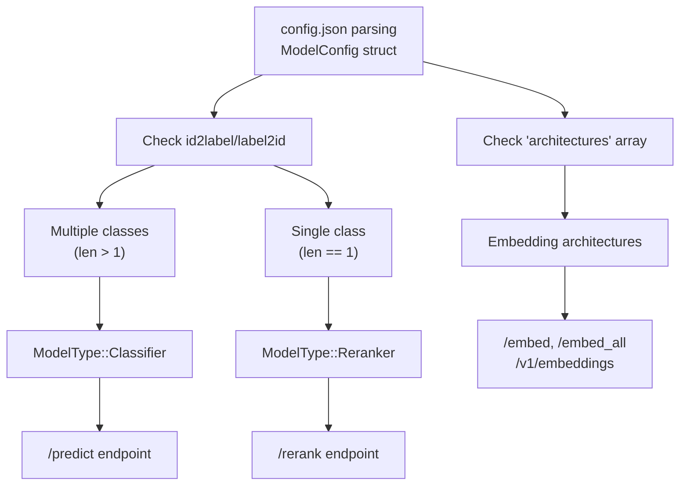

**Supported Embedding Models:**

| Model Family | Position Encoding | Examples |
|--------------|------------------|----------|
| Qwen3 | RoPE | `Qwen/Qwen3-Embedding-8B` |
| Qwen2 | RoPE | `Alibaba-NLP/gte-Qwen2-7B-instruct` |
| XLM-RoBERTa | Absolute | `multilingual-e5-large-instruct` |
| JinaBERT | ALiBi | `jina-embeddings-v2-base-en` |
| ModernBERT | Absolute | `ModernBERT-large` |

**Pooling Strategy Selection:**

For embedding models, TEI supports four pooling strategies (configured via `--pooling` or auto-detected): [docs/source/en/cli_arguments.md:65-69]()

- **CLS**: Select the CLS token.
- **Mean**: Average all token embeddings.
- **LastToken**: Select the last token.
- **Splade**: Sparse Lexical and Expansion.

Sources: [router/src/lib.rs:118-141](), [docs/source/en/supported_models.md:21-67]()

## Performance Optimizations

TEI implements multiple optimization techniques to maximize throughput and minimize latency.

**Token-Based Dynamic Batching:**
The `Queue` component groups requests based on token counts:
- **Token Budget Tracking**: Tracks total tokens via `max_batch_tokens` (default: 16384). [router/src/main.rs:73-74]()
- **Client Disconnect Detection**: Prevents wasted computation on abandoned requests. [router/src/main.rs:59-60]()

**Hardware-Specific Optimizations:**
- **Flash Attention**: Optimized kernels for CUDA devices. [README.md:57-58]()
- **cuBLASLt**: Fused matrix operations for NVIDIA GPUs. [README.md:59-59]()
- **Candle**: Rust-native ML framework for low-overhead execution. [README.md:58-58]()

Sources: [README.md:51-62](), [router/src/main.rs:62-82]()

## Observability and Monitoring

TEI provides comprehensive observability through Prometheus metrics and OpenTelemetry tracing. [README.md:62-62]()

**Monitoring Features:**
- **Prometheus Metrics**: Exported on a configurable port (default: 9000). [router/src/lib.rs:68-68]()
- **OpenTelemetry**: Distributed tracing via `--otlp-endpoint`. [router/src/lib.rs:66-66]()
- **Timing Headers**: All HTTP responses include `x-compute-time`, `x-tokenization-time`, etc. [docs/source/en/quick_tour.md:103-103]()

Sources: [router/src/lib.rs:64-68](), [docs/openapi.json:1-15]()

## Configuration and Deployment

TEI is configured via command-line arguments or environment variables. [router/src/main.rs:13-15]()

**Essential Parameters:**
- `--model-id`: HF Hub ID or local path. [router/src/main.rs:25-25]()
- `--dtype`: Force model precision (`float16`, `float32`). [router/src/main.rs:40-40]()
- `--max-batch-tokens`: Critical control for hardware usage. [router/src/main.rs:74-74]()
- `--hf-token`: For private or gated models. [router/src/main.rs:144-144]()

For details, see [System Architecture](#1.1), [Features and Capabilities](#1.2), and [Model Types and Endpoint Routing](#1.3).

Sources: [router/src/main.rs:13-158](), [docs/source/en/cli_arguments.md:1-150]()

---

# Page: System Architecture

# System Architecture

<details>
<summary>Relevant source files</summary>

The following files were used as context for generating this wiki page:

- [Cargo.lock](Cargo.lock)
- [Cargo.toml](Cargo.toml)
- [README.md](README.md)
- [backends/Cargo.toml](backends/Cargo.toml)
- [backends/candle/Cargo.toml](backends/candle/Cargo.toml)
- [backends/core/src/lib.rs](backends/core/src/lib.rs)
- [backends/python/src/lib.rs](backends/python/src/lib.rs)
- [backends/src/dtype.rs](backends/src/dtype.rs)
- [core/Cargo.toml](core/Cargo.toml)
- [docs/openapi.json](docs/openapi.json)
- [docs/source/en/cli_arguments.md](docs/source/en/cli_arguments.md)
- [router/Cargo.toml](router/Cargo.toml)
- [router/src/lib.rs](router/src/lib.rs)
- [router/src/main.rs](router/src/main.rs)

</details>


## Purpose and Scope

This document describes the high-level architecture of Text Embeddings Inference (TEI), focusing on how the major system components interact to serve embedding, classification, and reranking requests. It covers the three-layer design (Router, Core Processing, and Backend), the communication patterns between layers, and the key data structures that flow through the system.

For information about specific backend implementations (Candle, ORT, Python), see [Backend Architecture and Selection](#4.1). For hardware-specific optimizations, see [CUDA Compute Capability System](#5.1) and [Intel Platform Optimization](#5.2). For detailed API endpoint documentation, see [HTTP API Endpoints](#6.1).

## Architectural Overview

TEI is organized into three distinct layers that separate concerns and enable flexible deployment:

### Layered System Diagram
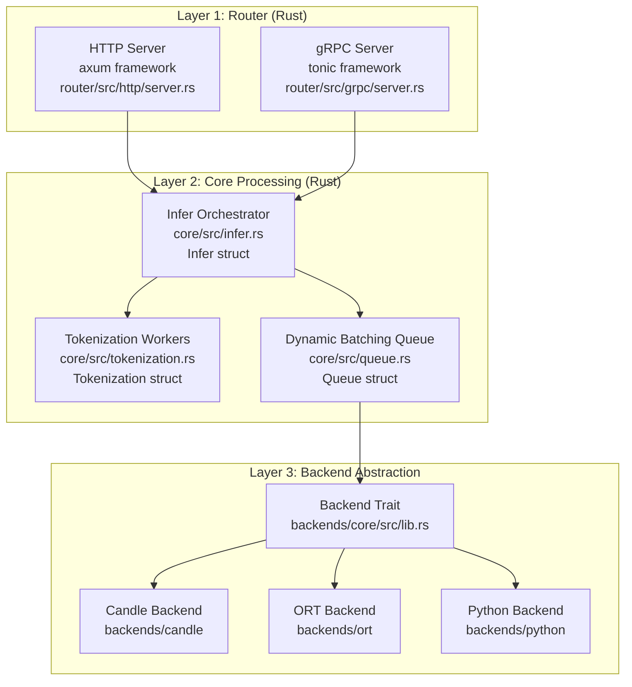

**Sources**: [router/src/lib.rs:1-37]() [], [core/src/infer.rs:1-56]() [], [Cargo.toml:1-21]() [], [backends/core/src/lib.rs:37-48]() []

### Layer Responsibilities

| Layer | Components | Responsibilities |
|-------|------------|------------------|
| **Router** | `axum` HTTP server, `tonic` gRPC server | Protocol handling, request validation, response formatting, OpenAPI/Swagger, CORS, authentication. |
| **Core Processing** | `Infer`, `Tokenization`, `Queue` | Request orchestration, multi-threaded tokenization, dynamic batching, concurrency control. |
| **Backend** | `Backend` trait implementations | Model inference, hardware-specific optimizations, model loading. |

**Sources**: [router/Cargo.toml:45-59]() [], [core/src/infer.rs:11-56]() [], [backends/core/src/lib.rs:37-48]() []

## Component Initialization and Startup Flow

The system initialization follows a specific sequence to ensure all dependencies are properly configured:

### Initialization Sequence
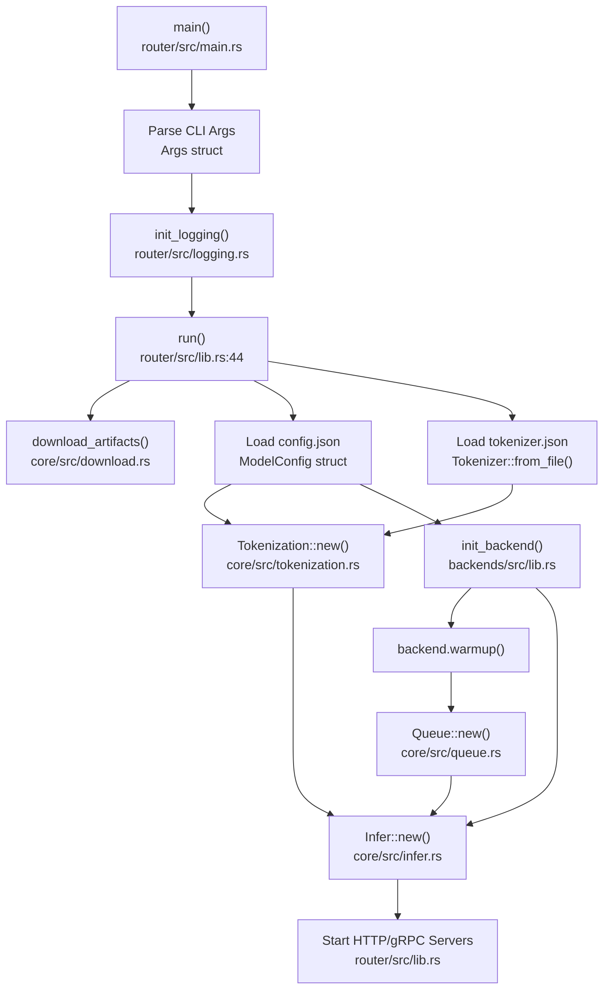

**Sources**: [router/src/main.rs:15-157]() [], [router/src/lib.rs:44-106]() [], [router/src/lib.rs:109-112]() [], [router/src/lib.rs:144-147]() []

### Key Initialization Steps

1. **Configuration Loading** ([router/src/lib.rs:109-112]()): Parses `config.json` to determine model type, architecture, and positional encoding scheme.
2. **Backend Selection** ([router/src/lib.rs:314-343]()): Initializes the specific backend implementation (Candle, ORT, or Python) based on feature flags and hardware availability.
3. **Tokenization Workers** ([router/src/lib.rs:353-359]()): Initializes the `Tokenization` struct which manages a pool of worker threads.
4. **Queue Initialization** ([router/src/lib.rs:360-363]()): Creates the `Queue` for dynamic batching.
5. **Backend Tasks** ([core/src/infer.rs:36-44]()): Spawns the `batching_task` and `backend_task` tokio tasks for asynchronous processing.

**Sources**: [router/src/lib.rs:109-363]() [], [core/src/infer.rs:24-56]() []

## Request Processing Pipeline

### End-to-End Request Flow

The following diagram shows how a request flows through the system, mapping to specific code functions:

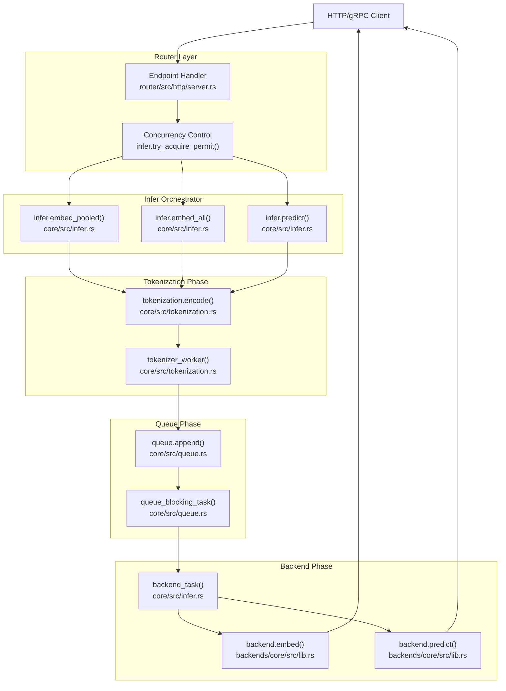

**Sources**: [router/src/lib.rs:31-33]() [], [core/src/infer.rs:118-430]() [], [backends/core/src/lib.rs:37-48]() []

### Request Processing Steps

1. **Request Reception**: HTTP or gRPC handlers validate the request body and extract parameters.
2. **Admission Control**: A semaphore limits concurrent requests to `max_concurrent_requests` ([router/src/main.rs:56-60]()).
3. **Tokenization** ([core/src/tokenization.rs]()): 
   - Requests are sent to a pool of worker threads.
   - Workers apply prompt injection, character validation, and truncation.
4. **Queue Submission** ([core/src/queue.rs]()): Tokenized inputs are appended to the dynamic batching queue.
5. **Dynamic Batching** ([core/src/queue.rs]()): 
   - A blocking task assembles batches based on the token budget (`max_batch_tokens`).
   - It tracks `cumulative_seq_lengths` for optimized inference.
6. **Backend Inference** ([core/src/infer.rs:449-472]()): 
   - The `backend_task` receives batches and calls the backend-specific `embed` or `predict` methods.
7. **Response Assembly**: Results are sent back via oneshot channels and formatted for the client.

**Sources**: [router/src/main.rs:56-74]() [], [core/src/infer.rs:449-472]() []

## Core Component Details

### Infer Orchestrator

The `Infer` struct ([core/src/infer.rs:11-56]()) coordinates the entire inference pipeline, managing communication between tokenization, batching, and backend execution.

**Key Methods**:
- `embed_pooled()`: Returns a single pooled embedding per input.
- `embed_all()`: Returns all token embeddings for a sequence.
- `predict()`: Returns classification or reranking scores.

**Sources**: [core/src/infer.rs:11-56]() []

### Tokenization System

Multi-threaded tokenization runs in dedicated OS threads to avoid blocking the async runtime. It handles complex logic such as prompt templates and truncation ([core/src/tokenization.rs]()).

**Configuration**:
- Worker count: Defaults to the number of CPU cores ([router/src/main.rs:32-36]()).
- Truncation: Controlled by the `auto_truncate` flag ([router/src/main.rs:84-91]()).

**Sources**: [router/src/main.rs:32-91]() []

### Dynamic Batching Queue

The `Queue` manages batch assembly with token budget tracking. It ensures that the total number of tokens in a batch does not exceed `max_batch_tokens` ([router/src/main.rs:62-74]()).

**Batching Logic**:
- Pop entries from the queue.
- Filter out dropped requests (client disconnects).
- Stop assembly when the token or request budget is reached.
- Construct the `Batch` struct ([backends/core/src/lib.rs:9-17]()) for the backend.

**Sources**: [router/src/main.rs:62-78]() [], [backends/core/src/lib.rs:9-17]() []

## Data Structures and Communication

### Key Data Types

| Type | Location | Purpose |
|------|----------|---------|
| `Batch` | [backends/core/src/lib.rs:9-17]() | Assembled batch ready for backend inference. |
| `Embedding` | [backends/core/src/lib.rs:29-32]() | Enum representing either a pooled embedding or all token embeddings. |
| `ModelType` | [backends/core/src/lib.rs:51-54]() | Identifies if the model is a Classifier or Embedding model. |
| `Pool` | [backends/core/src/lib.rs:59-70]() | Supported pooling strategies (Cls, Mean, Splade, LastToken). |

**Sources**: [backends/core/src/lib.rs:9-70]() []

### Communication Patterns

- **Tokenization**: Uses `async-channel` ([core/Cargo.toml:9]()) to distribute work to OS threads.
- **Batching**: Uses `tokio::sync::mpsc` channels to pass requests from `Infer` to the `Queue`.
- **Backend**: Uses a dedicated `backend_task` ([core/src/infer.rs:449]()) to execute inference and return results via `oneshot` channels.

**Sources**: [core/Cargo.toml:9-17]() [], [core/src/infer.rs:449-472]() []

## Concurrency and Performance

### Semaphore-Based Admission Control

The system uses a semaphore to limit concurrent requests, preventing the server from being overwhelmed. This is configured via `max_concurrent_requests` ([router/src/main.rs:56-60]()).

### Thread Model

- **Tokio Runtime**: Handles HTTP/gRPC servers and orchestration tasks.
- **OS Threads**: Used for tokenization workers and the blocking queue task to prevent blocking the async executor.
- **Backend Prefetch**: The `backend_task` uses a channel with a buffer of 1 to allow the queue to prepare the next batch while the backend is busy ([core/src/infer.rs:34]()).

**Sources**: [router/src/main.rs:56-60]() [], [core/src/infer.rs:34-44]() []

## Error Handling and Observability

### Error Types

The system uses `BackendError` ([backends/core/src/lib.rs:84-95]()) to categorize failures:
- `Inference`: Errors occurring during model execution.
- `Unhealthy`: Backend health check failures.
- `WeightsNotFound`: Issues during model loading.

**Sources**: [backends/core/src/lib.rs:84-95]() []

### Metrics and Tracing

TEI integrates with Prometheus and OpenTelemetry for monitoring.
- **Prometheus**: Tracks request counts, durations, and batching statistics.
- **OpenTelemetry**: Provides distributed tracing for request lifecycles.

**Sources**: [router/Cargo.toml:27-31]() []

---

# Page: Features and Capabilities

# Features and Capabilities

<details>
<summary>Relevant source files</summary>

The following files were used as context for generating this wiki page:

- [README.md](README.md)
- [docs/source/en/cli_arguments.md](docs/source/en/cli_arguments.md)
- [docs/source/en/custom_container.md](docs/source/en/custom_container.md)
- [docs/source/en/index.md](docs/source/en/index.md)
- [docs/source/en/local_cpu.md](docs/source/en/local_cpu.md)
- [docs/source/en/local_gpu.md](docs/source/en/local_gpu.md)
- [docs/source/en/local_metal.md](docs/source/en/local_metal.md)
- [docs/source/en/private_models.md](docs/source/en/private_models.md)
- [docs/source/en/quick_tour.md](docs/source/en/quick_tour.md)
- [docs/source/en/supported_models.md](docs/source/en/supported_models.md)
- [router/src/lib.rs](router/src/lib.rs)
- [router/src/main.rs](router/src/main.rs)

</details>


This document provides a comprehensive overview of the features and capabilities available in Text Embeddings Inference (TEI). It covers performance optimizations, model support, hardware platform compatibility, API features, and deployment options.

## Overview

TEI is a toolkit for deploying and serving open-source text embeddings and sequence classification models. It enables high-performance extraction for popular models like FlagEmbedding, GTE, and E5 by leveraging Rust-based backends and hardware-specific optimizations.

**Sources**: [README.md:49-51](), [docs/source/en/index.md:19-22]()

## Performance Optimization Features

### Dynamic Batching with Token Budget Management

TEI implements a sophisticated dynamic batching system that groups requests based on token count rather than request count. This ensures maximum hardware utilization by filling the available compute capacity regardless of varying sequence lengths.

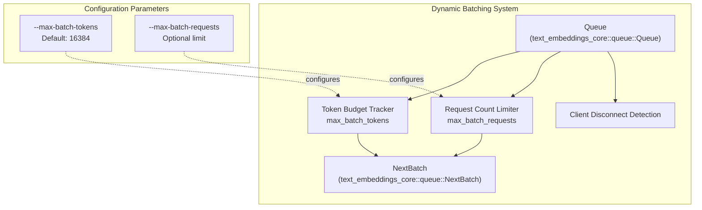

**Key Configuration Parameters**:
- `max_batch_tokens`: Total token capacity per batch (default: 16384). This is the critical control for hardware usage [router/src/main.rs:73-74]().
- `max_batch_requests`: Optional limit on the number of individual requests per batch [router/src/main.rs:76-78]().
- `max_client_batch_size`: Maximum number of inputs a client can send in one HTTP/gRPC request (default: 32) [router/src/main.rs:81-82]().

**Sources**: [router/src/main.rs:59-82](), [README.md:56](), [router/src/lib.rs:31-33]()

### Flash Attention Optimization

TEI integrates Flash Attention for memory-efficient attention computation. It supports both Flash Attention v1 and v2, with selection depending on the GPU's compute capability.

| Architecture | Compute Capability | Support Status |
|--------------|--------------------|----------------|
| Turing | 7.5 | Supported via `candle-cuda-turing` [docs/source/en/local_gpu.md:44-48]() |
| Ampere/Hopper/Blackwell | 8.0+ | Native support via `candle-cuda` [docs/source/en/local_gpu.md:50-54]() |

Flash Attention is automatically utilized in the `candle` backend for supported models to reduce memory bandwidth requirements and increase speed.

**Sources**: [README.md:57-59](), [docs/source/en/local_gpu.md:44-54](), [docs/source/en/custom_container.md:30-36]()

### cuBLASLt and Fused Kernels

The system leverages `cuBLASLt` for optimized matrix operations on NVIDIA hardware. This reduces kernel launch overhead and improves performance for transformer layers.

**Sources**: [README.md:59](), [docs/source/en/index.md:29]()

### Multi-threaded Tokenization

To prevent tokenization from becoming a bottleneck, TEI uses a pool of worker threads. This allows the system to process incoming text into token IDs in parallel while the GPU/CPU performs inference on previous batches.

- **Configuration**: `--tokenization-workers` (defaults to the number of CPU cores) [router/src/main.rs:35-36]().

**Sources**: [router/src/lib.rs:47](), [router/src/main.rs:32-36]()

## Model Support and Flexibility

### Supported Model Architectures

TEI supports a wide variety of transformer architectures, classified by their position embedding methods:

| Position Type | Supported Architectures |
|---------------|-------------------------|
| **Absolute** | BERT, CamemBERT, XLM-RoBERTa, MPNet, ModernBERT |
| **Alibi** | JinaBERT |
| **RoPE** | Mistral, Alibaba GTE, Qwen2, Qwen3, Gemma3 |

**Sources**: [README.md:68-71](), [docs/source/en/supported_models.md:23-24]()

### Model Type and Endpoint Mapping

The system automatically infers the model type from `config.json` and `modules.json` to route requests to the appropriate endpoints.

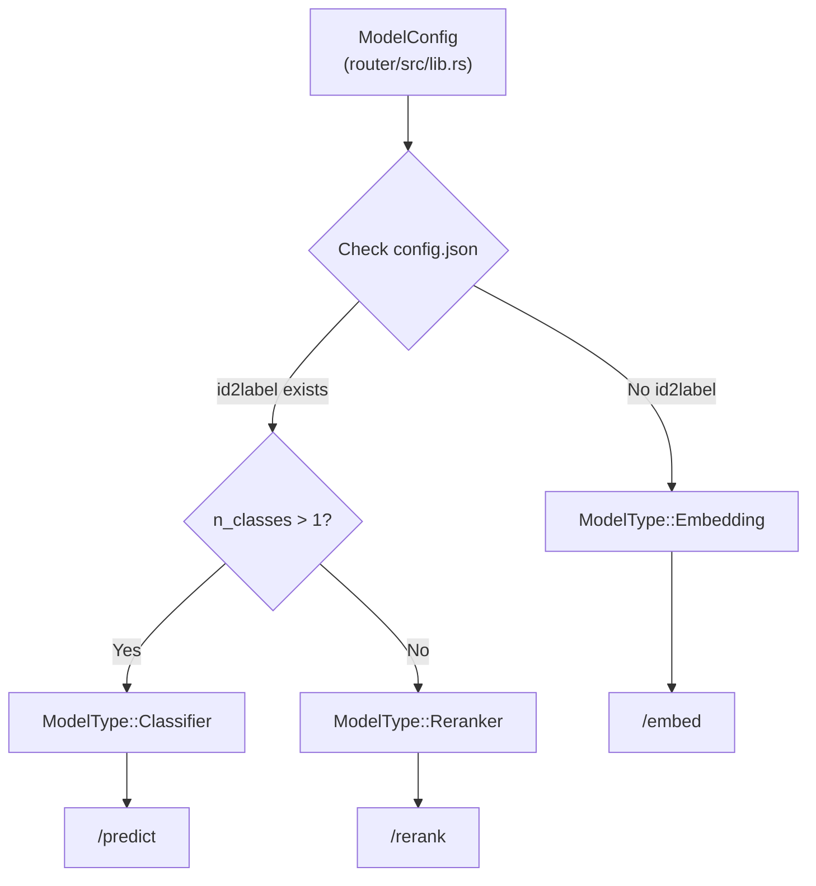

**Sources**: [router/src/lib.rs:118-141](), [docs/source/en/quick_tour.md:107-154]()

### Matryoshka Representation Learning (MRL) Support

TEI supports models trained with MRL, allowing users to request truncated embedding dimensions at inference time. This is handled via the `dimensions` parameter in the API.

**Sources**: [router/src/main.rs:120-132]() (Dense module context)

### Pooling Strategies

Users can override the default pooling method or let TEI parse it from the model's `1_Pooling/config.json`. Supported methods include:
- `cls`: Uses the `[CLS]` token.
- `mean`: Averages all token embeddings.
- `last-token`: Uses the final token.
- `splade`: Sparse Lexical and Expansion (for `ForMaskedLM` models).

**Sources**: [router/src/main.rs:47-54](), [docs/source/en/cli_arguments.md:65-69]()

## Hardware Platform Support

TEI provides optimized Docker images and local installation paths for diverse hardware:

| Platform | Optimization | Image Suffix |
|----------|--------------|--------------|
| **NVIDIA GPU** | CUDA, Flash Attention, cuBLASLt | `cuda-1.9` |
| **Intel CPU** | MKL (Math Kernel Library) | `cpu-1.9` |
| **ARM64 CPU** | Optimized for Graviton/Apple Silicon | `cpu-arm64-1.9` |
| **Apple Metal** | Native Metal support for M-series chips | Local install via `-F metal` |

**Sources**: [docs/source/en/supported_models.md:82-85](), [docs/source/en/local_metal.md:52](), [docs/source/en/local_cpu.md:36]()

## Operational Capabilities

### Production-Ready Observability

- **Distributed Tracing**: Integration with OpenTelemetry (OTLP) for request tracking [router/src/main.rs:171-179]().
- **Prometheus Metrics**: Exports detailed metrics (latencies, batch sizes, token counts) on a configurable port [router/src/main.rs:181-183]().

### Security and Access

- **Private Models**: Support for gated or private models using `HF_TOKEN` [docs/source/en/private_models.md:27-31]().
- **Air-Gapped Deployment**: Ability to serve models from a local path without internet access [docs/source/en/quick_tour.md:175-196]().
- **API Key**: Optional Bearer token authentication via `--api-key` [router/src/main.rs:157-161]().

### Deployment Flexibility

- **No Graph Compilation**: Fast boot times as no model compilation is required [README.md:53]().
- **Safetensors**: Fast weight loading using the `safetensors` format [README.md:60]().
- **OpenAI Compatibility**: Provides a `/v1/embeddings` endpoint compatible with the OpenAI SDK [docs/source/en/quick_tour.md:80-91]().

**Sources**: [README.md:53-63](), [router/src/main.rs:139-144](), [docs/source/en/quick_tour.md:80-91]()

---

# Page: Model Types and Endpoint Routing

# Model Types and Endpoint Routing

<details>
<summary>Relevant source files</summary>

The following files were used as context for generating this wiki page:

- [README.md](README.md)
- [backends/python/server/text_embeddings_server/models/__init__.py](backends/python/server/text_embeddings_server/models/__init__.py)
- [core/src/infer.rs](core/src/infer.rs)
- [core/src/queue.rs](core/src/queue.rs)
- [core/src/tokenization.rs](core/src/tokenization.rs)
- [docs/source/en/cli_arguments.md](docs/source/en/cli_arguments.md)
- [proto/tei.proto](proto/tei.proto)
- [router/src/grpc/server.rs](router/src/grpc/server.rs)
- [router/src/http/server.rs](router/src/http/server.rs)
- [router/src/http/types.rs](router/src/http/types.rs)
- [router/src/lib.rs](router/src/lib.rs)
- [router/src/main.rs](router/src/main.rs)
- [router/tests/test_http_embed.rs](router/tests/test_http_embed.rs)

</details>


This document explains how Text Embeddings Inference (TEI) determines model types, configures pooling strategies, and routes requests to appropriate endpoints based on model capabilities. For information about the complete API specification and request/response formats, see [HTTP API Endpoints](#6.1). For backend selection and initialization logic, see [Backend Architecture and Selection](#4.1).

## Overview

TEI supports three distinct model types, each with its own set of available endpoints:

- **Classifier Models**: Multi-class sequence classification models.
- **Reranker Models**: Single-class cross-encoder models for relevance scoring.
- **Embedding Models**: Vector representation models with various pooling strategies (Dense or Sparse).

Model type determination occurs at startup by analyzing the model's `config.json` and `modules.json` (if available) or `1_Pooling/config.json`. The system then validates all API requests to ensure they are compatible with the loaded model type, returning HTTP 424 (Failed Dependency) errors for incompatible operations.

---

## Model Type Detection Process

TEI determines the model type by parsing the model's configuration files during initialization. The primary detection logic resides in the `get_backend_model_type` function in [router/src/lib.rs:380-440]().

### Detection Logic Flow

The model type detection follows this priority order:

1.  **Architecture Inspection**: It iterates through the `architectures` array in `config.json` [router/src/lib.rs:385-414]().
2.  **Edge Case Handling**: Specifically skips architectures like `NewForTokenClassification` often found in GTE models that lack proper label mappings [router/src/lib.rs:388-393]().
3.  **SPLADE Detection**: If the `--pooling splade` argument is provided and the architecture ends with `MaskedLM`, it returns an Embedding type with Splade pooling [router/src/lib.rs:395-398]().
4.  **Classification Detection**: If an architecture ends with `Classification`, it is identified as a Classifier/Reranker. In this case, any `--pooling` CLI argument is ignored [router/src/lib.rs:400-405]().
5.  **Pooling Configuration**: For embedding models, it determines the strategy by checking the `--pooling` argument, then searching for `1_Pooling/config.json`, and finally defaulting to `CLS` for BERT models [router/src/lib.rs:416-437]().

### Data Flow Diagram: Config to ModelType

The following diagram bridges the configuration files to the internal `ModelType` enum used by the `Infer` struct.

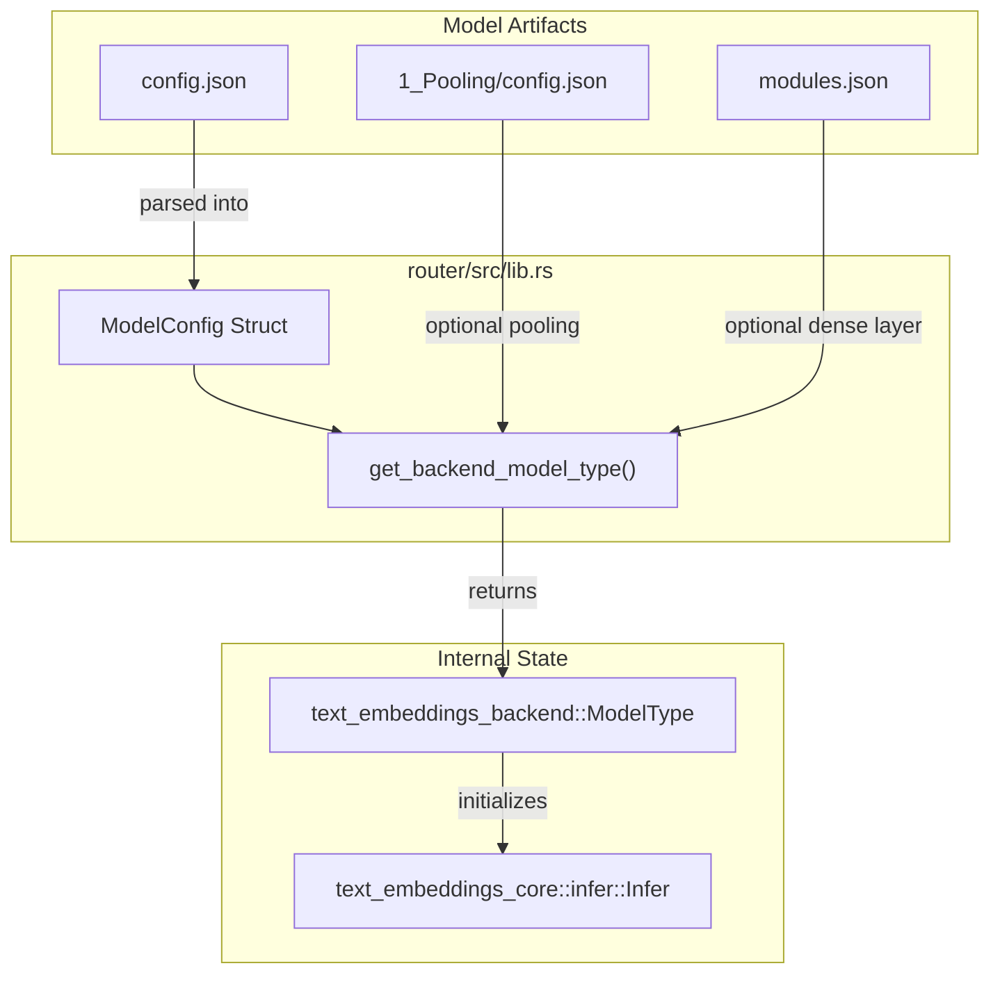
Sources: [router/src/lib.rs:104-142](), [router/src/lib.rs:380-440](), [core/src/infer.rs:11-21]()

---

## Model Type Categories

### Classifier Models
Classification models perform multi-class sequence classification. They are identified by architectures ending with `Classification` and having `n_classes > 1` in their `id2label` mapping [router/src/lib.rs:119-135]().

- **Type Structure**: `ModelType::Classifier(ClassifierModel)` [router/src/lib.rs:119-131]().
- **Compatible Endpoints**: `/predict` [router/src/http/server.rs:104-109]().

### Reranker Models
Reranker models are specialized classifiers with a single class, used for cross-encoder relevance scoring between query-document pairs. They have `n_classes == 1` [router/src/lib.rs:133-134]().

- **Type Structure**: `ModelType::Reranker(ClassifierModel)` [router/src/lib.rs:133]().
- **Compatible Endpoints**: `/rerank` [router/src/http/server.rs:307-312]() and `/predict`.

### Embedding Models
Embedding models generate dense or sparse vector representations. The pooling strategy determines how token embeddings are aggregated [router/src/lib.rs:136-141]().

- **Type Structure**: `ModelType::Embedding(EmbeddingModel)` [router/src/lib.rs:136]().
- **Compatible Endpoints**: `/embed`, `/embed_all`, `/similarity`, `/v1/embeddings`, and `/embed_sparse` (Splade only).

Sources: [router/src/lib.rs:118-141](), [router/src/http/server.rs:139-143]()

---

## Pooling Strategies

Embedding models use pooling to aggregate token-level embeddings. TEI prioritizes pooling determination from the CLI argument, then the configuration file [router/src/lib.rs:416-437]().

| Pooling Type | Description | Use Case |
| :--- | :--- | :--- |
| **CLS** | Uses the `[CLS]` token (first token). | BERT-style models. |
| **Mean** | Averages all token embeddings. | Most sentence-transformers models. |
| **LastToken** | Uses the last actual token. | Decoder models (Mistral, Qwen). |
| **Splade** | Sparse Max-pooling over log activations. | Sparse retrieval (ForMaskedLM models). |

**Conversion Logic**: The `TryFrom<PoolConfig>` implementation in the backend crate prioritizes modes in the order: CLS > Mean > LastToken [router/src/lib.rs:454-477]().

---

## Endpoint Routing Matrix

The system routes requests based on model type compatibility. Each endpoint validates the model type before processing.

### Routing Logic Diagram: Endpoint to Infer Function

This diagram maps HTTP/gRPC routes to the specific functions within the `Infer` and `Tokenization` classes.

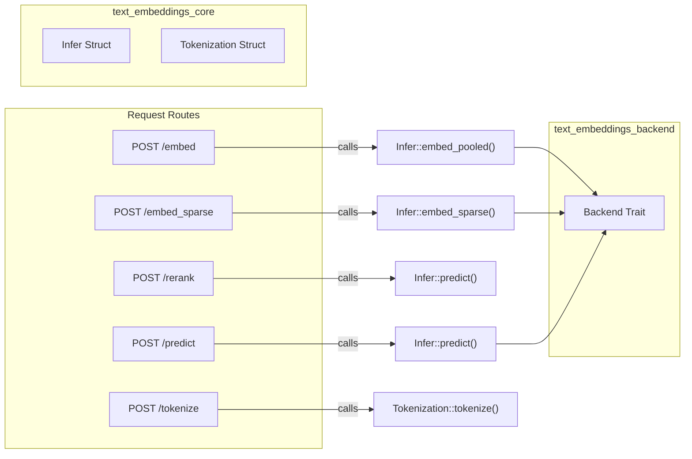
Sources: [router/src/http/server.rs:104-109](), [router/src/http/server.rs:307-312](), [router/src/http/server.rs:442-447](), [core/src/infer.rs:118-221](), [core/src/tokenization.rs:104-109]()

### Model Type Validation

When a request hits an endpoint, TEI performs a validation check. If the model type is incompatible, it returns an HTTP 424 status [router/src/http/server.rs:490-504]().

- **Embedding Validation**: `/embed` checks if `info.model_type` is `Embedding` [router/src/http/server.rs:490-504]().
- **Reranker Validation**: `/rerank` checks if `info.model_type` is `Reranker` [router/src/http/server.rs:332-346]().
- **SPLADE Validation**: `/embed_sparse` checks `infer.is_splade()` [core/src/infer.rs:179-187]().

Sources: [router/src/http/server.rs:332-346](), [router/src/http/server.rs:490-504](), [core/src/infer.rs:128-136](), [core/src/infer.rs:179-187]()

---

## Configuration Reference

### config.json
Primary model configuration. The `architectures` field is the primary driver for `ModelType` inference [router/src/lib.rs:109-115]().

### 1_Pooling/config.json
Sentence Transformers specific pooling config. It defines `pooling_mode_cls_token`, `pooling_mode_mean_tokens`, etc [router/src/lib.rs:420-426]().

### modules.json
Used to detect if a `Dense` layer (linear projection) should be applied to the embeddings after pooling [router/src/lib.rs:199-215]().

Sources: [router/src/lib.rs:109-115](), [router/src/lib.rs:199-215](), [router/src/lib.rs:420-426]()

---

# Page: Getting Started

# Getting Started

<details>
<summary>Relevant source files</summary>

The following files were used as context for generating this wiki page:

- [Dockerfile](Dockerfile)
- [Dockerfile-cuda](Dockerfile-cuda)
- [Dockerfile-cuda-all](Dockerfile-cuda-all)
- [cuda-all-entrypoint.sh](cuda-all-entrypoint.sh)
- [cuda-entrypoint.sh](cuda-entrypoint.sh)
- [docs/source/en/custom_container.md](docs/source/en/custom_container.md)
- [docs/source/en/private_models.md](docs/source/en/private_models.md)
- [docs/source/en/quick_tour.md](docs/source/en/quick_tour.md)
- [docs/source/en/supported_models.md](docs/source/en/supported_models.md)

</details>


This page provides a comprehensive guide for deploying and running Text Embeddings Inference (TEI). It covers prerequisites, deployment methods, and basic usage patterns to help you get a model serving embeddings as quickly as possible.

For advanced deployment strategies including cloud platforms and production tuning, see [Deployment and Operations](#7). For API reference documentation, see [API Reference](#6). For information about model types and endpoint routing, see [Model Types and Endpoint Routing](#1.3).

---

## Prerequisites

### Hardware Requirements

TEI supports multiple hardware platforms with varying levels of optimization:

| Hardware Type | Minimum Requirement | Notes |
|---------------|-------------------|-------|
| **CPU** | x86-64 or ARM64 | Intel MKL or Accelerate framework used |
| **NVIDIA GPU** | CUDA Compute Capability ≥ 7.5 | Excludes V100, Titan V, GTX 1000 series |
| **Apple Silicon** | M1/M2/M3 | Metal backend support (no GPU acceleration in Docker) |

**Supported NVIDIA Architectures:**
- Turing (T4, RTX 2000 series) - `runtime_compute_cap=75`
- Ampere (A100, A30, A10, A40) - `runtime_compute_cap=80` or `86`
- Ada Lovelace (RTX 4000 series) - `runtime_compute_cap=89`
- Hopper (H100) - `runtime_compute_cap=90`
- Blackwell (B200, RTX 5000 series) - `runtime_compute_cap=100` or `120`

**Sources:** [docs/source/en/supported_models.md:68-75](), [docs/source/en/custom_container.md:30-36]()

### Software Requirements

**For Docker Deployment:**
- Docker Engine (installation guide: https://docs.docker.com/get-docker)
- For GPU usage: [NVIDIA Container Toolkit](https://docs.nvidia.com/datacenter/cloud-native/container-toolkit/install-guide.html)
- NVIDIA drivers compatible with CUDA 12.2 or higher.

**For Local Installation (cargo):**
- Rust toolchain (https://rustup.rs)
- For CPU (x86): Intel MKL (2024.0.0 recommended) or ONNX Runtime.
- For GPU: CUDA Toolkit 12.2+ and compatible drivers.

**Sources:** [docs/source/en/quick_tour.md:24-27](), [Dockerfile:35-37]()

---

## Deployment Method Overview

TEI can be deployed using two primary methods:

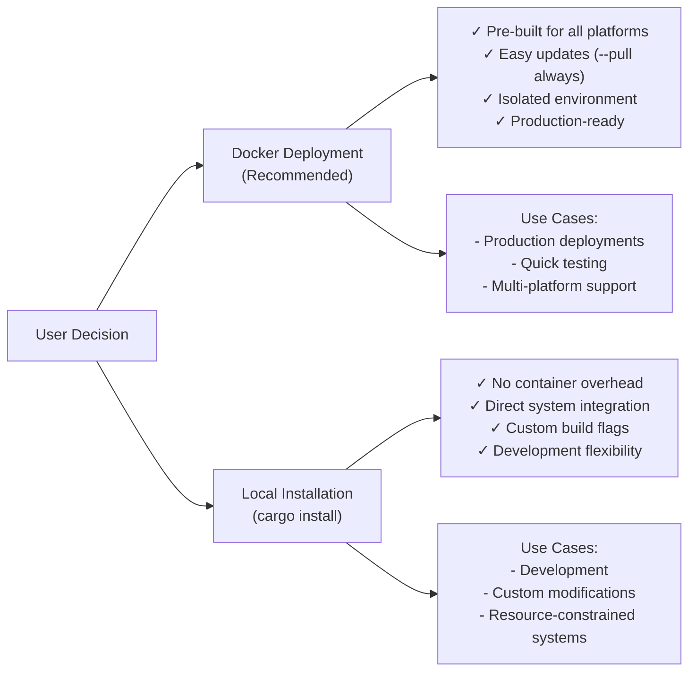

**Deployment Method Selection:**

| Consideration | Docker (See [Docker Deployment](#2.1)) | Local (See [Local Installation](#2.2)) |
|---------------|---------|-------|
| **Ease of Setup** | ⭐⭐⭐⭐⭐ Single command | ⭐⭐ Requires Rust toolchain |
| **Platform Support** | All architectures pre-built | Must compile for your platform |
| **Update Process** | `--pull always` flag | Recompile required |
| **Customization** | Limited to runtime flags | Full source access |
| **Production Use** | ✅ Recommended | ⚠️ Requires expertise |

**Sources:** [docs/source/en/quick_tour.md:21-27](), [docs/source/en/custom_container.md:17-24]()

---

## Quick Start with Docker

This section demonstrates the fastest path to serving embeddings. For comprehensive Docker deployment documentation, see [Docker Deployment](#2.1).

### Step 1: Select Docker Image for Your Hardware

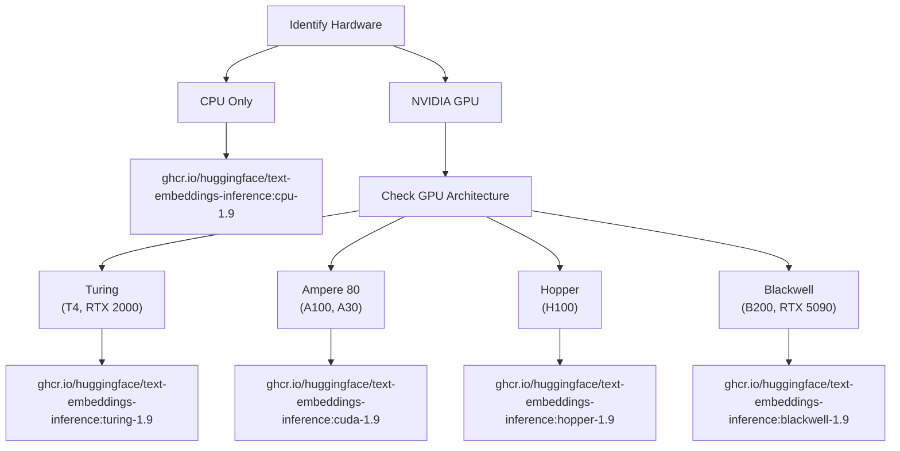

**Sources:** [docs/source/en/supported_models.md:82-95]()

### Step 2: Run Docker Container

**Basic GPU Deployment:**
```bash
model=Qwen/Qwen3-Embedding-0.6B
volume=$PWD/data

docker run --gpus all -p 8080:80 -v $volume:/data --pull always \
  ghcr.io/huggingface/text-embeddings-inference:cuda-1.9 --model-id $model
```

**CPU Deployment:**
```bash
model=BAAI/bge-base-en-v1.5
volume=$PWD/data

docker run -p 8080:80 -v $volume:/data --pull always \
  ghcr.io/huggingface/text-embeddings-inference:cpu-1.9 --model-id $model
```

**Key Docker Run Parameters:**
- `--gpus all`: Enables GPU access (omit for CPU).
- `-p 8080:80`: Maps container port 80 to host port 8080.
- `-v $volume:/data`: Persistent cache for model weights.
- `--pull always`: Ensures latest image version.
- `--model-id`: Hugging Face model ID or local path.

**Sources:** [docs/source/en/quick_tour.md:33-44]()

### Step 3: Verify Deployment

**Check Health Endpoint:**
```bash
curl http://127.0.0.1:8080/health
```

**Check Model Information:**
```bash
curl http://127.0.0.1:8080/info
```

**Sources:** [docs/source/en/quick_tour.md:55-59]()

---

## Making Your First API Request

For comprehensive API documentation, see [HTTP API Endpoints](#6.1). For client library examples, see [Client Libraries and Examples](#6.4).

### Using cURL

**Embedding a Single Text:**
```bash
curl 127.0.0.1:8080/embed \
    -X POST \
    -d '{"inputs":"What is Deep Learning?"}' \
    -H 'Content-Type: application/json'
```

**Embedding Multiple Texts (Batching):**
```bash
curl 127.0.0.1:8080/embed \
    -X POST \
    -d '{"inputs":["Today is a nice day", "I like you"]}' \
    -H 'Content-Type: application/json'
```

**Sources:** [docs/source/en/quick_tour.md:52-59](), [docs/source/en/quick_tour.md:157-164]()

### Using Python (huggingface_hub)

```python
from huggingface_hub import InferenceClient

client = InferenceClient()

embedding = client.feature_extraction(
    "What is deep learning?",
    model="http://localhost:8080/embed"
)
print(len(embedding[0]))
```

**Sources:** [docs/source/en/quick_tour.md:65-77]()

### Using Python (OpenAI SDK)

TEI exposes an OpenAI-compatible endpoint at `/v1/embeddings`:

```python
from openai import OpenAI

client = OpenAI(base_url="http://localhost:8080/v1", api_key="-")

response = client.embeddings.create(
    model="text-embeddings-inference",
    input="What is Deep Learning?",
)

print(response.data[0].embedding)
```

**Sources:** [docs/source/en/quick_tour.md:80-94]()

### Request Flow Diagram

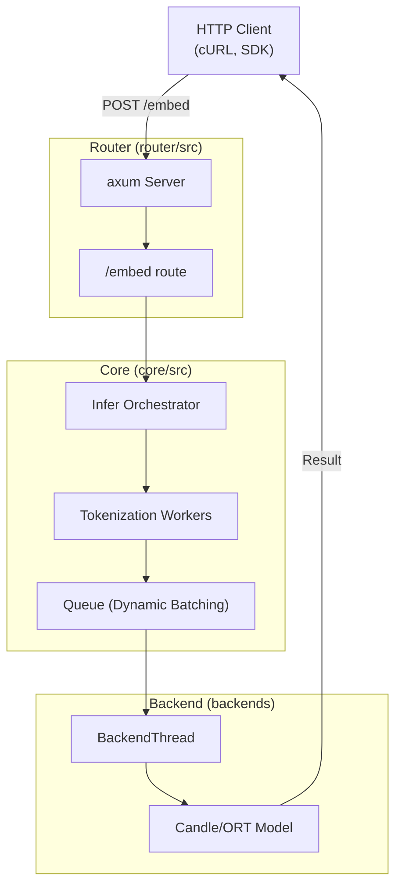

**Sources:** [Dockerfile-cuda:104-106](), [docs/source/en/quick_tour.md:52-59]()

---

## Configuration Essentials

This section covers the most commonly used configuration options. For a complete reference of all command-line arguments and environment variables, see [Configuration Options](#2.4).

### Common Configuration Examples

**Serving Private/Gated Models:**
If a model is gated (e.g., `google/embeddinggemma-300m`), provide your `HF_TOKEN`:

```bash
docker run --gpus all -e HF_TOKEN=$token -p 8080:80 -v $volume:/data \
  ghcr.io/huggingface/text-embeddings-inference:cuda-1.9 --model-id $model
```

**Air-Gapped Deployment:**
Download weights via `git clone` and mount them locally:

```bash
# Mount local directory to /data and point model-id to the path
docker run --gpus all -p 8080:80 -v $volume:/data \
  ghcr.io/huggingface/text-embeddings-inference:cuda-1.9 --model-id /data/gte-base-en-v1.5
```

**Sources:** [docs/source/en/private_models.md:34-41](), [docs/source/en/quick_tour.md:175-196]()

---

## Special Model Types

### Re-ranking Models
Used to score similarity between a query and a list of texts. Use the `/rerank` endpoint.

```bash
curl 127.0.0.1:8080/rerank \
    -X POST \
    -d '{"query":"What is Deep Learning?", "texts": ["Deep Learning is...", "Other text"], "raw_scores": false}' \
    -H 'Content-Type: application/json'
```

### Sequence Classification
Used for tasks like sentiment analysis. Use the `/predict` endpoint.

```bash
curl 127.0.0.1:8080/predict \
    -X POST \
    -d '{"inputs":"I like you."}' \
    -H 'Content-Type: application/json'
```

**Sources:** [docs/source/en/quick_tour.md:107-153]()

---

## Next Steps

Now that you have TEI running, explore these topics:

- **[Docker Deployment](#2.1)** — Detailed selection of hardware-specific images and volume mounting.
- **[Local Installation](#2.2)** — Building from source for specific platforms like Apple Metal.
- **[Basic Usage](#2.3)** — Advanced API parameters and batching patterns.
- **[Configuration Options](#2.4)** — Full list of environment variables and CLI arguments.

**Sources:** [docs/source/en/supported_models.md:17-20]()

---

# Page: Docker Deployment

# Docker Deployment

<details>
<summary>Relevant source files</summary>

The following files were used as context for generating this wiki page:

- [.github/workflows/build.yaml](.github/workflows/build.yaml)
- [.github/workflows/matrix.json](.github/workflows/matrix.json)
- [Dockerfile](Dockerfile)
- [Dockerfile-cuda](Dockerfile-cuda)
- [Dockerfile-cuda-all](Dockerfile-cuda-all)
- [backends/candle/src/compute_cap.rs](backends/candle/src/compute_cap.rs)
- [backends/candle/src/flash_attn.rs](backends/candle/src/flash_attn.rs)
- [cuda-all-entrypoint.sh](cuda-all-entrypoint.sh)
- [cuda-entrypoint.sh](cuda-entrypoint.sh)
- [docs/source/en/custom_container.md](docs/source/en/custom_container.md)
- [docs/source/en/private_models.md](docs/source/en/private_models.md)
- [docs/source/en/quick_tour.md](docs/source/en/quick_tour.md)
- [docs/source/en/supported_models.md](docs/source/en/supported_models.md)

</details>


This page documents the Docker-based deployment options for Text Embeddings Inference (TEI), detailing the available Docker images, their configuration, and usage patterns for different hardware platforms.

## Overview of Docker Images

Text Embeddings Inference provides several Docker images optimized for different hardware configurations, including CPU-only (x86 and ARM64), NVIDIA GPUs with different architectures, and specialized accelerators like Intel Gaudi (HPU).

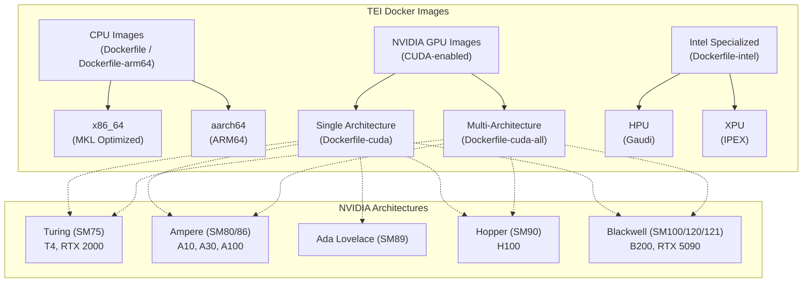

Sources: [.github/workflows/matrix.json:1-128](), [docs/source/en/supported_models.md:82-105]()

## Building Process and Container Structure

The TEI Docker images follow a multi-stage build process using `cargo-chef` to optimize layer caching.

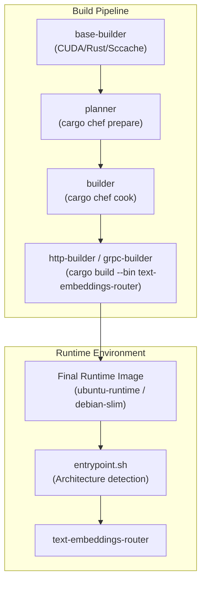

Sources: [Dockerfile-cuda:1-168](), [Dockerfile-cuda-all:1-138](), [Dockerfile:1-115]()

## CPU-based Deployment

The standard CPU image is optimized for x86_64 and includes Intel MKL (Math Kernel Library) and a "fakeintel" shim to ensure optimal performance on various CPU targets.

### Features and Optimizations
- **Intel MKL**: Integrated for optimized linear algebra [Dockerfile:29-37]().
- **Instruction Sets**: Defaults to `AVX512_E4` for compatible processors [Dockerfile:78]().
- **Parallelism**: Defaults to 8 Rayon threads [Dockerfile:79]().

### Usage
```bash
model=BAAI/bge-small-en-v1.5
docker run -p 8080:80 -v $PWD/data:/data ghcr.io/huggingface/text-embeddings-inference:cpu-1.9 --model-id $model
```

Sources: [Dockerfile:74-115](), [docs/source/en/supported_models.md:84-85]()

## GPU-based Deployment

TEI provides specialized images for NVIDIA GPUs. Note that CUDA compute capabilities < 7.5 (e.g., V100, Titan V) are **not supported** [docs/source/en/supported_models.md:74]().

### Single Architecture GPU Images
These images are built for a specific `CUDA_COMPUTE_CAP` to minimize binary size and ensure compatibility with specific kernels like Flash Attention.

| Architecture | Tag Prefix | Compute Cap |
| :--- | :--- | :--- |
| Turing | `turing-` | 75 |
| Ampere | (Default) | 80 |
| Ada Lovelace | `89-` | 89 |
| Hopper | `hopper-` | 90 |
| Blackwell | `100-` / `120-` | 100 / 120 |

Sources: [.github/workflows/matrix.json:2-65](), [docs/source/en/custom_container.md:30-36]()

### Multi-Architecture GPU Images (`cuda-all`)
The `cuda-all` image contains multiple binaries and an entrypoint script that detects the host GPU's compute capability at runtime to execute the most efficient version.

**Runtime Detection Logic:**
1. The script calls `nvidia-smi` to query `compute_cap` [cuda-all-entrypoint.sh:29]().
2. It maps the capability to a specific binary (e.g., `75` -> `text-embeddings-router-75`) [cuda-all-entrypoint.sh:31-41]().
3. It handles CUDA 12.9 compatibility layers if the host driver is older [cuda-all-entrypoint.sh:12-27]().

Sources: [Dockerfile-cuda-all:128-136](), [cuda-all-entrypoint.sh:1-45]()

## Volume Mounting and Data Persistence

It is highly recommended to mount a local volume to `/data` to avoid re-downloading model weights on every container start.

- **Default Cache**: `HUGGINGFACE_HUB_CACHE` is set to `/data` in all official images [Dockerfile-cuda:142](), [Dockerfile:76]().
- **Private Models**: To serve gated or private models, pass the `HF_TOKEN` environment variable [docs/source/en/private_models.md:33-41]().

### Air-Gapped Deployment
For environments without internet access:
1. Download the model locally using `git lfs clone` [docs/source/en/quick_tour.md:189]().
2. Mount the local directory to `/data`.
3. Set `--model-id /data/<model_folder>` [docs/source/en/quick_tour.md:195]().

## Prerequisites

- **NVIDIA Driver**: Version compatible with CUDA 12.2 or higher [docs/source/en/quick_tour.md:27]().
- **NVIDIA Container Toolkit**: Must be installed on the host to expose GPUs to Docker [docs/source/en/quick_tour.md:27]().
- **Docker**: Version with Buildx support is recommended for custom builds [Dockerfile-cuda:65]().

## Container Runtime to Code Mapping

This diagram maps the Docker entrypoint and runtime environment to the internal Rust components.

```mermaid
graph LD
    subgraph "Docker Runtime"
        EP["entrypoint.sh
        (cuda-entrypoint.sh)"]
        ENV["Environment Variables
        (PORT, HF_TOKEN, etc.)"]
    end

    subgraph "text-embeddings-router (Crate)"
        MAIN["main()
        (router/src/main.rs)"]
        ARGS["Args Struct
        (router/src/lib.rs)"]
        BACKEND["Backend Selection
        (backends/src/lib.rs)"]
    end

    EP -->|Executes| MAIN
    ENV -->|Parsed by clap| ARGS
    ARGS -->|Configures| BACKEND
    
    subgraph "Hardware Access"
        BACKEND -->|Compute Cap Check| CC["get_runtime_compute_cap()
        backends/candle/src/compute_cap.rs"]
        BACKEND -->|Flash Attention| FA["flash_attn_varlen()
        backends/candle/src/flash_attn.rs"]
    end
```

Sources: [Dockerfile-cuda:166-167](), [backends/candle/src/compute_cap.rs:14-24](), [backends/candle/src/flash_attn.rs:23-36](), [cuda-entrypoint.sh:1-12]()

---

# Page: Local Installation

# Local Installation

<details>
<summary>Relevant source files</summary>

The following files were used as context for generating this wiki page:

- [backends/Cargo.toml](backends/Cargo.toml)
- [backends/candle/Cargo.toml](backends/candle/Cargo.toml)
- [backends/src/dtype.rs](backends/src/dtype.rs)
- [core/Cargo.toml](core/Cargo.toml)
- [docs/source/en/index.md](docs/source/en/index.md)
- [docs/source/en/local_cpu.md](docs/source/en/local_cpu.md)
- [docs/source/en/local_gpu.md](docs/source/en/local_gpu.md)
- [docs/source/en/local_metal.md](docs/source/en/local_metal.md)
- [flake.lock](flake.lock)
- [flake.nix](flake.nix)
- [router/Cargo.toml](router/Cargo.toml)

</details>


This document provides instructions for building and installing Text Embeddings Inference (TEI) locally from source using `cargo install`. Local installation is recommended when you need custom build configurations, want to develop against TEI, or prefer not to use Docker containers. For Docker-based deployment, see page 2.1.

## Installation Overview

TEI is built using Rust and supports multiple hardware backends through Cargo feature flags. The installation process involves installing the Rust toolchain, system dependencies, selecting hardware-specific feature flags, and building the `text-embeddings-router` binary.

**Local Installation Decision Tree**

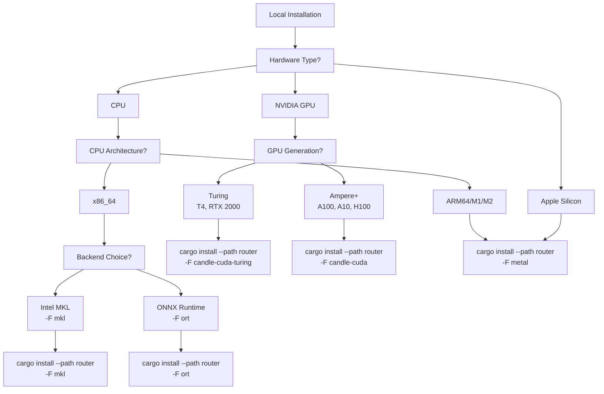

Sources: [docs/source/en/local_cpu.md:17-43](), [docs/source/en/local_gpu.md:17-54](), [docs/source/en/local_metal.md:17-53]()

## Prerequisites

### Required Tools

**Rust Toolchain**
Install Rust using rustup:
```bash
curl --proto '=https' --tlsv1.2 -sSf https://sh.rustup.rs | sh
```
Sources: [docs/source/en/local_cpu.md:23-27](), [docs/source/en/local_gpu.md:34-38](), [docs/source/en/local_metal.md:43-47]()

**System Dependencies**
On Linux machines, you may need OpenSSL libraries and `gcc`:
```bash
sudo apt-get install libssl-dev gcc -y
```
Sources: [docs/source/en/local_cpu.md:57-61]()

**GPU-Specific Prerequisites**
For NVIDIA GPU support, NVIDIA drivers must be compatible with CUDA version 12.2 or higher. Add the binaries to your path:
```bash
export PATH=$PATH:/usr/local/cuda/bin
```
Sources: [docs/source/en/local_gpu.md:24-30]()

**Nix Environment**
Alternatively, a `flake.nix` is provided which includes `rustup`, `protobuf`, and `apple-sdk_15` for Darwin systems.
Sources: [flake.nix:22-31]()

## Understanding Feature Flags

TEI uses Cargo feature flags to enable different backends and optimizations. These are defined primarily in the `router` crate but propagate down to the `backends` and `candle` crates.

**Feature Flag Mapping to Code Entities**

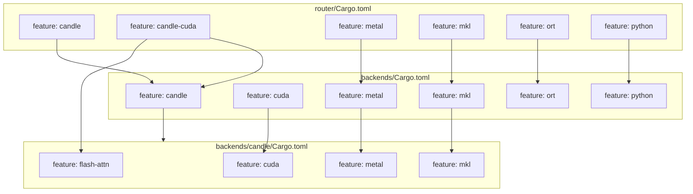

Sources: [router/Cargo.toml:81-95](), [backends/Cargo.toml:21-32](), [backends/candle/Cargo.toml:41-48]()

### Key Feature Flag Categories

| Category | Feature Flags | Purpose |
|----------|--------------|---------|
| **API Protocol** | `http` (default), `grpc` | Enable HTTP (Axum) or gRPC (Tonic) endpoints. |
| **Backend Selection** | `candle` (default), `python`, `ort` | Choose ML inference backend. |
| **CPU Optimization** | `mkl`, `accelerate` | Intel MKL or Apple Accelerate for CPU BLAS. |
| **GPU Support** | `candle-cuda`, `candle-cuda-turing`, `candle-cuda-volta` | CUDA support for different architectures. |
| **Apple Silicon** | `metal` | Metal Performance Shaders for M1-M4. |
| **Linking Strategy** | `static-linking`, `dynamic-linking` (default) | Link style for `cudarc` and `intel-mkl-src`. |

Sources: [router/Cargo.toml:81-96](), [backends/candle/Cargo.toml:41-48]()

## Installation Steps by Platform

### NVIDIA GPU

The installation command depends on your GPU architecture to ensure the correct CUDA kernels are compiled.

*   **Turing GPUs (T4, RTX 2000 series):**
    ```shell
    cargo install --path router -F candle-cuda-turing
    ```
*   **Ampere, Ada Lovelace, Hopper, and Blackwell:**
    ```shell
    cargo install --path router -F candle-cuda
    ```

The `candle-cuda` feature enables `flash-attn` (v2), while `candle-cuda-turing` enables `flash-attn-v1`.
Sources: [docs/source/en/local_gpu.md:44-54](), [router/Cargo.toml:91-92]()

### CPU (x86_64)

For x86 machines, Intel MKL is recommended for optimal performance:
```shell
cargo install --path router -F mkl
```
This activates `intel-mkl-src` and enables `candle/_mkl`.
Sources: [docs/source/en/local_cpu.md:35-37](), [router/Cargo.toml:86](), [backends/candle/Cargo.toml:44]()

### Apple Silicon (Metal)

On macOS, you can use Homebrew for a prebuilt binary or build from source with Metal support:

*   **Homebrew:**
    ```shell
    brew install text-embeddings-inference
    ```
*   **Source:**
    ```shell
    cargo install --path router -F metal
    ```
Sources: [docs/source/en/local_metal.md:23-27](), [docs/source/en/local_metal.md:51-53]()

## Data Type (`DType`) Support

The `DType` enum determines the precision used for inference. Default values vary by the enabled feature flags.

| Feature | Default DType | Supported DTypes |
|---------|---------------|------------------|
| `python` | `Bfloat16` | `Float16`, `Float32`, `Bfloat16` |
| `accelerate` | `Float32` | `Float32` (`Float16` disabled) |
| `mkl` | `Float32` | `Float32`, `Float16` (if candle) |
| `ort` | `Float32` | `Float32` |
| `candle` (Default) | `Float16` | `Float16`, `Float32` |

Sources: [backends/src/dtype.rs:8-58]()

## Launching the Router

Once installed, use the `text-embeddings-router` binary to serve a model.

```shell
model=Qwen/Qwen3-Embedding-0.6B

# Run with float16 on port 8080
text-embeddings-router --model-id $model --dtype float16 --port 8080
```

The router binary is defined in `router/Cargo.toml` as the primary executable.
Sources: [docs/source/en/local_gpu.md:61-64](), [router/Cargo.toml:13-15]()

---

# Page: Basic Usage

# Basic Usage

<details>
<summary>Relevant source files</summary>

The following files were used as context for generating this wiki page:

- [Cargo.lock](Cargo.lock)
- [Cargo.toml](Cargo.toml)
- [docs/openapi.json](docs/openapi.json)
- [docs/source/en/custom_container.md](docs/source/en/custom_container.md)
- [docs/source/en/examples.md](docs/source/en/examples.md)
- [docs/source/en/private_models.md](docs/source/en/private_models.md)
- [docs/source/en/quick_tour.md](docs/source/en/quick_tour.md)
- [docs/source/en/supported_models.md](docs/source/en/supported_models.md)

</details>


This page demonstrates how to interact with a running Text Embeddings Inference server to generate embeddings, perform reranking, and execute sequence classification tasks. It assumes you have already deployed TEI using Docker or local installation.

For information about advanced configuration of the server itself, see **Configuration Options**. For detailed API specifications and all available parameters, see **HTTP API Endpoints**.

---

## Quick Start: Your First Embedding Request

Once your TEI server is running (by default on `http://localhost:8080`), you can immediately start generating embeddings using cURL:

```bash
curl 127.0.0.1:8080/embed \
    -X POST \
    -d '{"inputs":"What is Deep Learning?"}' \
    -H 'Content-Type: application/json'
```

This sends a POST request to the `/embed` endpoint with a single text input. The server will return a JSON response containing the embedding vector.

**Sources:** [docs/source/en/quick_tour.md:52-59](), [docs/openapi.json:89-115]()

---

## HTTP API Endpoints Overview

TEI exposes multiple HTTP endpoints depending on the model type. The server automatically determines which endpoints are available based on the loaded model's architecture.

### Endpoint-to-Code Mapping
The following diagram maps the external API surface to the internal router logic.

**API Route Mapping**
```mermaid
graph TB
    subgraph "Client Space"
        cURL["cURL / HTTP Client"]
        PythonSDK["Python SDK (huggingface_hub)"]
        OpenAISDK["OpenAI SDK (openai package)"]
    end
    
    subgraph "Router Entity Space (router/src/lib.rs)"
        EmbedRoute["/embed -> embed()"]
        EmbedAllRoute["/embed_all -> embed_all()"]
        PredictRoute["/predict -> predict()"]
        RerankRoute["/rerank -> rerank()"]
        OpenAIRoute["/v1/embeddings -> v1_embeddings()"]
        InfoRoute["/info -> get_info()"]
    end
    
    subgraph "Backend Entity Space (backends/core/src/lib.rs)"
        ModelType["ModelType Enum"]
        EmbeddingType["ModelType::Embedding"]
        ClassifierType["ModelType::Classifier"]
        RerankerType["ModelType::Reranker"]
    end
    
    cURL --> EmbedRoute
    PythonSDK --> EmbedRoute
    OpenAISDK --> OpenAIRoute
    
    EmbedRoute -. "checks" .-> EmbeddingType
    PredictRoute -. "checks" .-> ClassifierType
    RerankRoute -. "checks" .-> RerankerType
    
    EmbeddingType -. "424 Error if Mismatch" .-> PredictRoute
```

**Endpoint Availability by Model Type:**

| Endpoint | Embedding Models | Classifier Models | Reranker Models |
|----------|------------------|-------------------|-----------------|
| `/embed` | ✓ | ✗ (424 error) | ✗ (424 error) |
| `/embed_all` | ✓ | ✗ (424 error) | ✗ (424 error) |
| `/v1/embeddings` | ✓ | ✗ (424 error) | ✗ (424 error) |
| `/rerank` | ✗ (424 error) | ✗ (424 error) | ✓ |
| `/predict` | ✗ (424 error) | ✓ | ✓ |
| `/info` | ✓ | ✓ | ✓ |

**Sources:** [docs/openapi.json:15-644](), [docs/source/en/quick_tour.md:107-154]()

---

## Understanding Response Formats

### Embedding Response

A successful `/embed` request returns a JSON object containing the embedding vectors. The response also includes performance metadata in HTTP headers for detailed timing breakdowns.

| Header | Description |
|--------|-------------|
| `x-compute-type` | Hardware type (e.g., `gpu`, `cpu`) |
| `x-compute-time` | Total elapsed time in seconds |
| `x-compute-tokens` | Input token count |
| `x-inference-time` | Backend inference time |

**Sources:** [docs/source/en/quick_tour.md:52-60](), [docs/openapi.json:107-115]()

---

## Request Parameters

### Common Parameters for `/embed`

The `/embed` endpoint accepts the following parameters in the JSON request body:

| Parameter | Type | Required | Description |
|-----------|------|----------|-------------|
| `inputs` | `string` or `string[]` | Yes | Text(s) to embed |
| `truncate` | `boolean` | No | Truncate inputs exceeding max length |
| `normalize` | `boolean` | No | Apply L2 normalization to embeddings |

Example with parameters:

```bash
curl 127.0.0.1:8080/embed \
    -X POST \
    -d '{
      "inputs": "What is Deep Learning?",
      "normalize": true,
      "truncate": true
    }' \
    -H 'Content-Type: application/json'
```

**Sources:** [docs/openapi.json:96-105](), [docs/source/en/quick_tour.md:155-164]()

---

## Using Python Client Libraries

### huggingface_hub InferenceClient

The recommended Python client is `InferenceClient` from the `huggingface_hub` library.

```python
from huggingface_hub import InferenceClient

client = InferenceClient()

# Generate embedding for a single text
embedding = client.feature_extraction(
    "What is deep learning?",
    model="http://localhost:8080/embed"
)
```

**Sources:** [docs/source/en/quick_tour.md:65-77]()

### OpenAI-Compatible API

TEI provides an OpenAI-compatible endpoint at `/v1/embeddings`.

```python
from openai import OpenAI

client = OpenAI(base_url="http://localhost:8080/v1", api_key="-")

response = client.embeddings.create(
    model="text-embeddings-inference",
    input="What is Deep Learning?",
)

print(response.data[0].embedding)
```

**Sources:** [docs/source/en/quick_tour.md:79-94]()

---

## Working with Different Model Types

### Reranker Models
Rerankers score query-document pairs. Use the `/rerank` endpoint.

```bash
curl 127.0.0.1:8080/rerank \
    -X POST \
    -d '{"query":"What is Deep Learning?", "texts": ["Deep Learning is...", "Deep learning is not..."]}' \
    -H 'Content-Type: application/json'
```

**Sources:** [docs/source/en/quick_tour.md:129-133]()

### Sequence Classification Models
For tasks like sentiment analysis, use the `/predict` endpoint.

```bash
curl 127.0.0.1:8080/predict \
    -X POST \
    -d '{"inputs":"I like you."}' \
    -H 'Content-Type: application/json'
```

**Sources:** [docs/source/en/quick_tour.md:149-153]()

---

## Request Flow Visualization

This diagram bridges the Natural Language request to the internal Code entities.

**Internal Data Flow**
```mermaid
graph LR
    Request["JSON Request"] --> Router["Router (router/src/lib.rs)"]
    Router --> Tokenizer["Tokenization (router/src/lib.rs)"]
    Tokenizer --> Queue["Batching Queue (router/src/lib.rs)"]
    Queue --> Backend["Backend::run() (backends/core/src/lib.rs)"]
    Backend --> Inference["Model Inference (backends/candle/src/lib.rs)"]
    Inference --> Response["JSON Response"]
```

**Sources:** [docs/source/en/quick_tour.md:48-50](), [Cargo.toml:1-11]()

---

## Error Handling

TEI uses specific HTTP status codes to indicate failure types.

| Status Code | Description | Example Cause |
|-------------|-------------|---------------|
| 400 | Batch is empty | `{"inputs": []}` |
| 413 | Batch size error | Exceeding `max_client_batch_size` |
| 422 | Tokenization error | Input text cannot be processed |
| 424 | Backend Error | Inference failed or model type mismatch |
| 429 | Model overloaded | Too many concurrent requests |

**Sources:** [docs/openapi.json:44-85](), [docs/openapi.json:117-187]()

---

# Page: Configuration Options

# Configuration Options

<details>
<summary>Relevant source files</summary>

The following files were used as context for generating this wiki page:

- [README.md](README.md)
- [docs/source/en/cli_arguments.md](docs/source/en/cli_arguments.md)
- [docs/source/en/custom_container.md](docs/source/en/custom_container.md)
- [docs/source/en/private_models.md](docs/source/en/private_models.md)
- [docs/source/en/quick_tour.md](docs/source/en/quick_tour.md)
- [docs/source/en/supported_models.md](docs/source/en/supported_models.md)
- [router/src/lib.rs](router/src/lib.rs)
- [router/src/main.rs](router/src/main.rs)

</details>


This page details the configuration options available when running the Text Embeddings Inference (TEI) server. TEI provides numerous configuration parameters that allow for fine-tuning performance, security, and behavior characteristics of the inference service via command-line arguments and environment variables.

## System Configuration Overview

TEI configuration is defined in the `Args` struct within the router component. This struct uses `clap` for command-line parsing and supports mapping environment variables to arguments.

```mermaid
flowchart LR
    subgraph "Configuration Categories"
        A["Model Configuration"] --> B["Args Struct"]
        C["Performance Tuning"] --> B
        D["Security Settings"] --> B
        E["Networking Options"] --> B
        F["Observability"] --> B
        B["text-embeddings-router"]
    end
```

Sources: [router/src/main.rs:13-15](), [router/src/lib.rs:44-70]()

## Model Configuration Options

These options control which model is loaded and how its architecture is interpreted.

| Option | Environment Variable | Description | Default |
|--------|----------------------|-------------|---------|
| `--model-id` | `MODEL_ID` | Hugging Face model ID or local path to model directory. | *Required* |
| `--revision` | `REVISION` | Specific commit ID or branch name for Hub models. | `None` (main) |
| `--dtype` | `DTYPE` | Force a specific data type (e.g., `float16`, `float32`). | Auto-detected |
| `--pooling` | `POOLING` | Override pooling strategy (e.g., `cls`, `mean`, `splade`, `last-token`). | From config |
| `--dense-path` | `DENSE_PATH` | Path to a specific `Dense` module (Linear layer + activation). | `None` |
| `--hf-token` | `HF_TOKEN` | Hugging Face Hub token for private/gated models. | Read from cache |

### Model Selection and Pooling Logic

The server attempts to resolve the pooling strategy by checking the command-line argument first, then the model's `1_Pooling/config.json`, and finally falling back to architecture-specific defaults.

```mermaid
flowchart TD
    A["run()"] --> B{"Is model_id a local path?"}
    B -->|Yes| C["Use local model folder"]
    B -->|No| D["Download from Hugging Face Hub"]
    D --> E["download_artifacts()"]
    
    C & E --> F["Load config.json"]
    F --> G["get_backend_model_type()"]
    G --> H{"--pooling provided?"}
    H -->|Yes| I["Use specified pooling"]
    H -->|No| J{"1_Pooling/config.json exists?"}
    J -->|Yes| K["Use pooling from config"]
    J -->|No| L["Default to CLS or Mean based on architecture"]
    
    I & K & L --> O["Initialize backend with ModelType"]
```

Sources: [router/src/lib.rs:72-106](), [router/src/lib.rs:115-141](), [router/src/main.rs:47-54]()

## Performance Tuning Options

These settings are critical for optimizing hardware utilization and managing memory.

| Option | Environment Variable | Description | Default |
|--------|----------------------|-------------|---------|
| `--max-concurrent-requests` | `MAX_CONCURRENT_REQUESTS` | Limit of concurrent requests to prevent wait times. | `512` |
| `--max-batch-tokens` | `MAX_BATCH_TOKENS` | Maximum total tokens across all sequences in a batch. | `16384` |
| `--max-batch-requests` | `MAX_BATCH_REQUESTS` | Limit on the number of individual requests in a single batch. | `None` |
| `--max-client-batch-size` | `MAX_CLIENT_BATCH_SIZE` | Max inputs allowed in a single client POST request. | `32` |
| `--tokenization-workers` | `TOKENIZATION_WORKERS` | Number of parallel workers for tokenization tasks. | CPU Cores |
| `--auto-truncate` | `AUTO_TRUNCATE` | Truncate inputs exceeding model max length. | `true` |

### Dynamic Batching Constraints

The `max_batch_tokens` parameter is the primary lever for performance. It defines the "token budget" for the dynamic batching system managed by the `Queue`.

```mermaid
flowchart TD
    subgraph "Queue Logic"
    A["Request 1 (100 tokens)"] --> B["Queue"]
    C["Request 2 (500 tokens)"] --> B
    D["Request 3 (1000 tokens)"] --> B
    B --> E{"Sum <= max_batch_tokens?"}
    E -->|Yes| F["NextBatch Construction"]
    E -->|No| G["Hold in Queue"]
    end
```

Sources: [router/src/main.rs:62-78](), [router/src/main.rs:80-91](), [router/src/lib.rs:265-276]()

## Networking and Security Options

These options define how the service is exposed and secured.

| Option | Environment Variable | Description | Default |
|--------|----------------------|-------------|---------|
| `--hostname` | `HOSTNAME` | IP address to listen on. | `0.0.0.0` |
| `--port` | `PORT` | Port to listen on. | `3000` |
| `--uds-path` | `UDS_PATH` | Unix socket path for internal gRPC communication. | `/tmp/...` |
| `--api-key` | `API_KEY` | Optional API key required in request headers. | `None` |
| `--payload-limit` | `PAYLOAD_LIMIT` | Maximum size of the HTTP request body in bytes. | `2,000,000` |
| `--cors-allow-origin` | `CORS_ALLOW_ORIGIN` | Allowed origins for CORS. | `None` |

Sources: [router/src/main.rs:146-168](), [router/src/main.rs:175-181]()

## Observability Options

TEI provides native support for Prometheus metrics and OpenTelemetry (OTLP) tracing.

| Option | Environment Variable | Description | Default |
|--------|----------------------|-------------|---------|
| `--prometheus-port` | `PROMETHEUS_PORT` | Port for the `/metrics` endpoint. | `9464` |
| `--otlp-endpoint` | `OTLP_ENDPOINT` | OTLP collector endpoint for distributed tracing. | `None` |
| `--otlp-service-name` | `OTLP_SERVICE_NAME` | Service name reported to the OTLP collector. | `text-embeddings-inference.router` |

Sources: [router/src/main.rs:183-194]()

## Configuration Mapping to Code Entities

The `run` function in `router/src/lib.rs` consumes the `Args` and initializes the core system components.

```mermaid
classDiagram
    class "Args (main.rs)" {
        model_id: String
        max_batch_tokens: usize
        max_concurrent_requests: usize
        auto_truncate: bool
    }
    
    class "Infer (core)" {
        tokenizer: Tokenization
        queue: Queue
        backend: Backend
    }

    class "Tokenization (core)" {
        workers: usize
        model_max_length: usize
    }

    class "Queue (core)" {
        max_batch_tokens: usize
        max_concurrent_requests: usize
    }

    "Args (main.rs)" ..> "run()": passed to
    "run()" --> "Tokenization (core)": initializes
    "run()" --> "Queue (core)": initializes
    "run()" --> "Infer (core)": composes
```

Sources: [router/src/lib.rs:44-70](), [router/src/lib.rs:219-277]()

## Prompt Configuration

TEI allows prepending static text to every input, which is useful for models like E5 or BGE that require "query: " or "passage: " prefixes.

- `--default-prompt`: A raw string prepended to all inputs.
- `--default-prompt-name`: A key used to look up a prompt in the model's `tokenizer_config.json` or `sentence_bert_config.json`.

These two options are mutually exclusive (`conflicts_with`).

Sources: [router/src/main.rs:93-118](), [router/src/lib.rs:206-218]()

## Environment Variable Specifics

In addition to arguments, TEI respects these environment-only variables:

- `HF_HUB_USER_AGENT_ORIGIN`: Appended to the user agent when downloading models from the Hub.
- `HF_HUB_CACHE`: Sets the directory where model weights are stored.
- `HF_TOKEN`: Primary variable for Hub authentication.

Sources: [router/src/lib.rs:78-90](), [router/src/main.rs:139-144]()

## Common Configuration Scenarios

### Local Air-Gapped Deployment
To run without internet access, point `model-id` to a local directory and ensure all artifacts (including `tokenizer.json` and `config.json`) are present.

```bash
text-embeddings-router --model-id /path/to/local/model --port 8080
```

### High-Throughput GPU Serving
For high-end GPUs (e.g., A100/H100), increase the token budget and concurrent request limit.

```bash
text-embeddings-router \
  --model-id BAAI/bge-large-en-v1.5 \
  --max-batch-tokens 32768 \
  --max-concurrent-requests 1024 \
  --dtype float16
```

Sources: [README.md:182-196](), [docs/source/en/cli_arguments.md:71-88]()

---

# Page: Router Component

# Router Component

<details>
<summary>Relevant source files</summary>

The following files were used as context for generating this wiki page:

- [README.md](README.md)
- [core/src/infer.rs](core/src/infer.rs)
- [core/src/queue.rs](core/src/queue.rs)
- [core/src/tokenization.rs](core/src/tokenization.rs)
- [docs/source/en/cli_arguments.md](docs/source/en/cli_arguments.md)
- [proto/tei.proto](proto/tei.proto)
- [router/src/grpc/server.rs](router/src/grpc/server.rs)
- [router/src/http/server.rs](router/src/http/server.rs)
- [router/src/http/types.rs](router/src/http/types.rs)
- [router/src/lib.rs](router/src/lib.rs)
- [router/src/main.rs](router/src/main.rs)
- [router/tests/test_http_embed.rs](router/tests/test_http_embed.rs)

</details>


## Purpose and Scope

The Router Component is the entry point and orchestration layer for Text Embeddings Inference (TEI). It handles incoming HTTP and gRPC requests, coordinates tokenization, manages dynamic batching, and dispatches work to backend model implementations. The router is responsible for concurrency control, request validation, observability instrumentation, and response assembly.

This page covers the router's architecture, initialization, and orchestration responsibilities. For detailed information about specific subsystems, see:
- API endpoint specifications: [HTTP and gRPC Endpoints](#3.1)
- Request processing details: [Request Processing Pipeline](#3.2)
- Tokenization implementation: [Tokenization System](#3.3)
- Batching logic: [Dynamic Batching Queue](#3.4)
- Metrics and tracing: [Observability and Monitoring](#3.5)

For backend model inference, see [Backend System](#4).

## Architecture Overview

The router component sits between external clients and the backend inference system. It is implemented primarily in Rust and consists of two main server implementations (HTTP and gRPC), an orchestration layer (`Infer`), and supporting systems for tokenization and batching.

```mermaid
graph TB
    subgraph "External Layer"
        HTTPClients["HTTP Clients<br/>(REST, OpenAI SDK)"]
        GRPCClients["gRPC Clients"]
    end
    
    subgraph "Router Layer - router/src/"
        subgraph "Server Implementations"
            HTTPServer["HTTP Server<br/>http/server.rs<br/>axum framework"]
            GRPCServer["gRPC Server<br/>grpc/server.rs<br/>tonic framework"]
        end
        
        subgraph "Orchestration - core/src/infer.rs"
            InferStruct["Infer struct<br/>Coordinates all operations"]
            Semaphore["Request Semaphore<br/>limit_concurrent_requests<br/>Arc&lt;Semaphore&gt;"]
        end
        
        subgraph "Processing Subsystems"
            TokenizationWorkers["Tokenization Workers<br/>core/src/tokenization.rs<br/>OS thread pool"]
            BatchingQueue["Dynamic Batching Queue<br/>core/src/queue.rs<br/>Token budget tracking"]
        end
        
        Init["Initialization Entry Point<br/>router/src/lib.rs::run()"]
    end
    
    subgraph "Backend Layer"
        BackendTrait["Backend Trait<br/>text_embeddings_backend"]
    end
    
    HTTPClients --> HTTPServer
    GRPCClients --> GRPCServer
    
    HTTPServer --> InferStruct
    GRPCServer --> InferStruct
    
    InferStruct --> Semaphore
    InferStruct --> TokenizationWorkers
    InferStruct --> BatchingQueue
    
    BatchingQueue --> BackendTrait
    
    Init -.creates.-> HTTPServer
    Init -.creates.-> GRPCServer
    Init -.creates.-> InferStruct
```

**Sources**: [router/src/lib.rs:1-412](), [router/src/http/server.rs:1-100](), [router/src/grpc/server.rs:1-50](), [core/src/infer.rs:1-100]()

## Core Components

### Entry Point and Initialization

The router's entry point is the `run` function in [router/src/lib.rs:44-412](). This function handles:

1. **Model discovery and download** - resolves model path (local or Hub), downloads artifacts if needed via `download_artifacts` [router/src/lib.rs:101-101]().
2. **Configuration parsing** - loads `config.json`, determines model type (embedding/classifier/reranker) [router/src/lib.rs:109-141]().
3. **Tokenizer initialization** - loads `tokenizer.json`, applies model-specific post-processing for architectures like Qwen2 [router/src/lib.rs:144-177]().
4. **Backend creation** - initializes the appropriate backend (Candle/ORT/Python) [router/src/lib.rs:260-264]().
5. **Subsystem setup** - creates `Tokenization` workers [router/src/lib.rs:271-278](), the `Queue` [router/src/lib.rs:280-285](), and the `Infer` orchestrator [router/src/lib.rs:292-297]().
6. **Server launch** - starts HTTP or gRPC server based on feature flags [router/src/lib.rs:348-412]().

```mermaid
graph TB
    MainArgs["main.rs<br/>Args::parse()"]
    
    RunFunc["lib.rs::run()"]
    
    subgraph "Initialization Steps"
        Step1["Download Model<br/>download_artifacts()"]
        Step2["Parse config.json<br/>ModelConfig"]
        Step3["Determine Model Type<br/>get_backend_model_type()"]
        Step4["Load Tokenizer<br/>Tokenizer::from_file()"]
        Step5["Create Backend<br/>Backend::new()"]
        Step6["Setup Tokenization<br/>Tokenization::new()"]
        Step7["Create Queue<br/>Queue::new()"]
        Step8["Create Infer<br/>Infer::new()"]
        Step9["Start Server<br/>http::server::run()<br/>or grpc::server::run()"]
    end
    
    MainArgs --> RunFunc
    RunFunc --> Step1
    Step1 --> Step2
    Step2 --> Step3
    Step3 --> Step4
    Step4 --> Step5
    Step5 --> Step6
    Step6 --> Step7
    Step7 --> Step8
    Step8 --> Step9
```

**Key Configuration Parameters** (from [router/src/main.rs:15-188]()):

| Parameter | Environment Variable | Default | Description |
|-----------|---------------------|---------|-------------|
| `model_id` | `MODEL_ID` | N/A | Model identifier or local path |
| `max_concurrent_requests` | `MAX_CONCURRENT_REQUESTS` | `512` | Semaphore limit for request admission |
| `max_batch_tokens` | `MAX_BATCH_TOKENS` | `16384` | Token budget for dynamic batching |
| `max_batch_requests` | `MAX_BATCH_REQUESTS` | None | Optional limit on requests per batch |
| `tokenization_workers` | `TOKENIZATION_WORKERS` | CPU count | Number of OS threads for tokenization |
| `auto_truncate` | `AUTO_TRUNCATE` | `true` | Automatically truncate oversized inputs |
| `port` | `PORT` | `3000` | Server listening port |

**Sources**: [router/src/lib.rs:44-412](), [router/src/main.rs:15-188]()

### Infer Orchestrator

The `Infer` struct in [core/src/infer.rs:13-56]() is the central orchestration component. It coordinates tokenization, batching, and backend inference while managing concurrency.

```mermaid
graph TB
    InferStruct["Infer Struct"]
    
    subgraph "Fields in Infer"
        Tokenization["tokenization: Tokenization<br/>Multi-threaded tokenizer pool"]
        Queue["queue: Queue<br/>Dynamic batching queue"]
        NotifyBatching["notify_batching_task<br/>Arc&lt;Notify&gt;<br/>Wake batching task"]
        Semaphore["limit_concurrent_requests<br/>Arc&lt;Semaphore&gt;<br/>Request admission control"]
        Backend["backend: Backend<br/>Model inference backend"]
    end
    
    InferStruct --> Tokenization
    InferStruct --> Queue
    InferStruct --> NotifyBatching
    InferStruct --> Semaphore
    InferStruct --> Backend
    
    subgraph "Background Tasks"
        BatchingTask["batching_task()<br/>Polls queue, sends batches"]
        BackendTask["backend_task()<br/>Receives batches, calls backend"]
    end
    
    InferStruct -.spawns.-> BatchingTask
    InferStruct -.spawns.-> BackendTask
    
    Queue --> BatchingTask
    BatchingTask --> BackendTask
    BackendTask --> Backend
```

**Core Methods** in `Infer`:

| Method | Purpose | Key Code Location |
|--------|---------|-------------------|
| `try_acquire_permit()` | Attempt to get request semaphore permit (non-blocking) | [core/src/infer.rs:94-105]() |
| `acquire_permit()` | Get request semaphore permit (blocking) | [core/src/infer.rs:107-115]() |
| `tokenize()` | Tokenize input without inference | [core/src/infer.rs:59-74]() |
| `decode()` | Decode token IDs to text | [core/src/infer.rs:76-91]() |
| `embed_pooled()` | Get pooled embeddings | [core/src/infer.rs:224-321]() |
| `embed_all()` | Get all token embeddings | [core/src/infer.rs:118-166]() |
| `embed_sparse()` | Get sparse embeddings (SPLADE) | [core/src/infer.rs:169-221]() |
| `predict()` | Classification/scoring | [core/src/infer.rs:391-498]() |

**Sources**: [core/src/infer.rs:11-523]()

### HTTP Server

The HTTP server is implemented using the `axum` framework in [router/src/http/server.rs](). It provides REST endpoints with JSON request/response formats and OpenAPI documentation.

**Endpoint Groups**:

| Endpoint Pattern | Handler Function | Model Type Support |
|------------------|------------------|-------------------|
| `POST /embed` | `embed()` | Embedding models only |
| `POST /embed_sparse` | `embed_sparse()` | SPLADE pooling only |
| `POST /embed_all` | `embed_all()` | Embedding models only |
| `POST /predict` | `predict()` | Classifier/Reranker |
| `POST /rerank` | `rerank()` | Reranker only |
| `POST /v1/embeddings` | `openai_embed()` | Embedding models (OpenAI compat) |
| `POST /tokenize` | `tokenize()` | All model types |
| `POST /decode` | `decode()` | All model types |
| `GET /health` | `health()` | All model types |
| `GET /info` | `get_model_info()` | All model types |

**Sources**: [router/src/http/server.rs:46-109]()

### gRPC Server

The gRPC server uses the `tonic` framework and is defined in [router/src/grpc/server.rs](). It offers the same functionality as HTTP with protobuf messages and streaming support.

**Service Structure** (from [proto/tei.proto:1-37]()):

```mermaid
graph TB
    subgraph "gRPC Services - proto/tei.proto"
        InfoService["Info Service<br/>Info()"]
        EmbedService["Embed Service<br/>Embed(), EmbedStream()<br/>EmbedSparse(), EmbedAll()"]
        PredictService["Predict Service<br/>Predict(), PredictPair()<br/>PredictStream()"]
        RerankService["Rerank Service<br/>Rerank(), RerankStream()"]
        TokenizeService["Tokenize Service<br/>Tokenize(), Decode()"]
    end
    
    subgraph "Implementation - grpc/server.rs"
        TextEmbeddingsService["TextEmbeddingsService<br/>implements all traits"]
    end
    
    InfoService -.implemented by.-> TextEmbeddingsService
    EmbedService -.implemented by.-> TextEmbeddingsService
    PredictService -.implemented by.-> TextEmbeddingsService
    RerankService -.implemented by.-> TextEmbeddingsService
    TokenizeService -.implemented by.-> TextEmbeddingsService
```

**Streaming Support**:

The gRPC server provides optimized streaming endpoints that process multiple requests concurrently while maintaining response ordering. The `TextEmbeddingsService` ([router/src/grpc/server.rs:46-50]()) manages these requests, using a configurable `max_parallel_stream_requests` limit [router/src/grpc/server.rs:54-57]().

**Sources**: [proto/tei.proto:1-37](), [router/src/grpc/server.rs:45-63]()

## Request Flow Through Router

The following diagram shows how a request flows through the router components from initial receipt to final response:

```mermaid
graph TB
    Request["Incoming Request<br/>HTTP or gRPC"]
    
    subgraph "Admission Control"
        TryAcquire["Infer.try_acquire_permit()<br/>or acquire_permit()"]
        SemaphoreCheck{{"Semaphore available?"}}
        Reject["Return 429 Overloaded"]
    end
    
    subgraph "Tokenization Phase"
        SendToTokenizer["tokenization.encode()"]
        TokenizerWorker["Tokenization Worker<br/>OS thread pool<br/>tokenizer_worker()"]
        PromptInjection["Apply prompt if configured"]
        Truncation["Truncate if enabled<br/>TruncationParams"]
    end
    
    subgraph "Queueing Phase"
        CreateEntry["Create Entry<br/>ValidEncoding + Metadata"]
        AppendQueue["queue.append(entry)"]
        NotifyBatching["notify_batching_task.notify_one()"]
        WaitResponse["Await on oneshot::Receiver"]
    end
    
    subgraph "Batching Task - batching_task()"
        AwaitNotify["Await notify"]
        NextBatch["queue.next_batch()"]
        SendToBackend["Send to embed_sender"]
    end
    
    subgraph "Backend Task - backend_task()"
        ReceiveBatch["Receive NextBatch"]
        BackendEmbed["backend.embed(batch)"]
        DistributeResults["Send results to<br/>response_tx channels"]
    end
    
    subgraph "Response Assembly"
        ReceiveResult["Receive from response_rx"]
        RecordMetadata["Record metrics & spans"]
        BuildResponse["Build HTTP/gRPC response"]
    end
    
    Request --> TryAcquire
    TryAcquire --> SemaphoreCheck
    SemaphoreCheck -->|No permit| Reject
    SemaphoreCheck -->|Got permit| SendToTokenizer
    
    SendToTokenizer --> TokenizerWorker
    TokenizerWorker --> PromptInjection
    PromptInjection --> Truncation
    
    Truncation --> CreateEntry
    CreateEntry --> AppendQueue
    AppendQueue --> NotifyBatching
    NotifyBatching --> WaitResponse
    
    NotifyBatching -.wakes.-> AwaitNotify
    AwaitNotify --> NextBatch
    NextBatch --> SendToBackend
    
    SendToBackend --> ReceiveBatch
    ReceiveBatch --> BackendEmbed
    BackendEmbed --> DistributeResults
    
    DistributeResults -.sends.-> WaitResponse
    WaitResponse --> ReceiveResult
    ReceiveResult --> RecordMetadata
    RecordMetadata --> BuildResponse
```

**Timing Breakdown** in `ResponseMetadata`:

| Timing Field | Description | Recorded Where |
|--------------|-------------|----------------|
| `tokenization_time` | Duration in tokenization workers | [core/src/tokenization.rs:68-101]() |
| `queue_time` | Time waiting in queue + batching | [core/src/queue.rs:27](), [core/src/infer.rs:207-210]() |
| `inference_time` | Actual backend inference duration | Returned by backend |

**Sources**: [core/src/infer.rs:125-166](), [core/src/queue.rs:69-95](), [core/src/tokenization.rs:171-200]()

## Code Entity Mapping

### Key Structs and Their Roles

| Concept | Code Entity | Location | Primary Responsibility |
|---------|-------------|----------|----------------------|
| Router entry point | `run()` function | [router/src/lib.rs:44]() | Initialize all components and start server |
| Request orchestration | `Infer` struct | [core/src/infer.rs:13]() | Coordinates tokenization → batching → backend |
| Tokenization system | `Tokenization` struct | [core/src/tokenization.rs:14]() | Manages OS thread pool of tokenizers |
| Dynamic batching | `Queue` struct | [core/src/queue.rs:36]() | Token-budget-aware batch assembly |
| Concurrency control | `limit_concurrent_requests` | [core/src/infer.rs:19]() | `Arc<Semaphore>` for request admission |

### Configuration Flow

```mermaid
graph LR
    subgraph "CLI Arguments"
        ArgsStruct["Args struct<br/>main.rs:15-188"]
    end
    
    subgraph "Runtime Config"
        ModelConfig["ModelConfig<br/>lib.rs:111"]
    end
    
    subgraph "Component Config"
        TokenizationConfig["Tokenization::new()<br/>workers, max_input_length"]
        QueueConfig["Queue::new()<br/>max_batch_tokens, max_batch_requests"]
        InferConfig["Infer::new()<br/>max_concurrent_requests"]
    end
    
    ArgsStruct --> TokenizationConfig
    ArgsStruct --> QueueConfig
    ArgsStruct --> InferConfig
    
    ModelConfig -.parsed from config.json.-> ArgsStruct
```

**Sources**: [router/src/main.rs:15-188](), [router/src/lib.rs:109-113](), [core/src/tokenization.rs:30-65]()

### Feature Flags and Server Selection

The router is compiled with exactly one of two mutually exclusive feature flags:

```mermaid
graph TB
    CargoFeatures["Cargo Feature Flags"]
    
    HTTPFeature["--features http"]
    GRPCFeature["--features grpc"]
    
    CompileCheck["Compile-time check<br/>lib.rs:348-356"]
    
    HTTPImpl["HTTP Server<br/>http::server::run()"]
    GRPCImpl["gRPC Server<br/>grpc::server::run()"]
    
    CargoFeatures --> HTTPFeature
    CargoFeatures --> GRPCFeature
    
    HTTPFeature --> CompileCheck
    GRPCFeature --> CompileCheck
    
    CompileCheck -->|"#[cfg(feature = 'http')]"| HTTPImpl
    CompileCheck -->|"#[cfg(feature = 'grpc')]"| GRPCImpl
```

The compile-time enforcement is at [router/src/lib.rs:348-356]().

**Sources**: [router/src/lib.rs:348-356]()

## Observability Integration

### Metrics (Prometheus)

Metrics are collected via the `metrics` crate:

| Metric Name | Type | Labels | Location |
|-------------|------|--------|----------|
| `te_request_count` | Counter | `method` | [router/src/http/server.rs:177]() |
| `te_request_failure` | Counter | `err` | [core/src/infer.rs:69, 100, 129]() |
| `te_queue_size` | Gauge | - | [core/src/queue.rs:115]() |
| `te_embed_duration` | Histogram | - | [core/src/infer.rs:157]() |

**Sources**: [core/src/infer.rs:156-163](), [core/src/queue.rs:115-116]()

---

# Page: HTTP and gRPC Endpoints

# HTTP and gRPC Endpoints

<details>
<summary>Relevant source files</summary>

The following files were used as context for generating this wiki page:

- [Cargo.lock](Cargo.lock)
- [Cargo.toml](Cargo.toml)
- [core/src/infer.rs](core/src/infer.rs)
- [core/src/queue.rs](core/src/queue.rs)
- [core/src/tokenization.rs](core/src/tokenization.rs)
- [docs/openapi.json](docs/openapi.json)
- [proto/tei.proto](proto/tei.proto)
- [router/src/grpc/server.rs](router/src/grpc/server.rs)
- [router/src/http/server.rs](router/src/http/server.rs)
- [router/src/http/types.rs](router/src/http/types.rs)
- [router/tests/test_http_embed.rs](router/tests/test_http_embed.rs)
- [router/tests/test_http_predict.rs](router/tests/test_http_predict.rs)
- [router/tests/test_http_rerank.rs](router/tests/test_http_rerank.rs)

</details>


This page provides a comprehensive reference for all HTTP and gRPC endpoints exposed by Text Embeddings Inference. It documents request/response schemas, parameter options, error codes, and endpoint-specific behaviors.

For information about the request processing pipeline and batching mechanisms, see [Request Processing Pipeline](#3.2). For details on tokenization and truncation handling, see [Tokenization System](#3.3). For observability features including metrics and tracing, see [Observability and Monitoring](#3.5).

## Overview

TEI exposes two primary API interfaces:

- **HTTP REST API**: JSON-based endpoints served via [axum](https://docs.rs/axum), documented with OpenAPI/Swagger at `/docs`.
- **gRPC API**: Protocol Buffer-based services via [tonic](https://docs.rs/tonic), with health checking and reflection support.

Both interfaces provide equivalent functionality for embeddings, classification, and reranking, with gRPC additionally supporting streaming requests.

**Sources**: [router/src/http/server.rs:1-100](), [router/src/grpc/server.rs:1-50](), [proto/tei.proto:1-38]()

## HTTP REST API

### Endpoint Architecture

The HTTP server is implemented in the `router` crate using the `axum` web framework. All endpoints are registered in the main server initialization and exposed through a unified router.

Title: HTTP Endpoint Routing Architecture
```mermaid
graph TB
    subgraph "HTTP_Server_(axum)"
        Router["Router<br/>(axum::Router)"]
        
        subgraph "Embedding_Endpoints"
            Embed["/embed<br/>POST"]
            EmbedAll["/embed_all<br/>POST"]
            EmbedSparse["/embed_sparse<br/>POST"]
            Similarity["/similarity<br/>POST"]
            OpenAI["/v1/embeddings<br/>POST_(OpenAI)"]
        end
        
        subgraph "Classification_Endpoints"
            Predict["/predict<br/>POST"]
            Rerank["/rerank<br/>POST"]
        end
        
        subgraph "Utility_Endpoints"
            Tokenize["/tokenize<br/>POST"]
            Decode["/decode<br/>POST"]
            Info["/info<br/>GET"]
            Health["/health<br/>GET"]
        end
        
        Router --> Embed
        Router --> EmbedAll
        Router --> EmbedSparse
        Router --> Similarity
        Router --> OpenAI
        Router --> Predict
        Router --> Rerank
        Router --> Tokenize
        Router --> Decode
        Router --> Info
        Router --> Health
    end
    
    Infer["Infer<br/>(text_embeddings_core::infer::Infer)"]
    InfoExt["Info<br/>(Extension&lt;Info&gt;)"]
    
    Embed --> Infer
    EmbedAll --> Infer
    EmbedSparse --> Infer
    Similarity --> Infer
    OpenAI --> Infer
    Predict --> Infer
    Rerank --> Infer
    Tokenize --> Infer
    Decode --> Infer
    
    Info --> InfoExt
    Health --> Infer
```

**Sources**: [router/src/http/server.rs:46-1184](), [Cargo.toml:10-11]()

### Embedding Endpoints

#### POST /embed

Returns pooled embeddings for input text(s). This is the primary endpoint for dense vector retrieval.

**Handler**: `predict` (for classifiers) or `embed` (for embeddings) function at [router/src/http/server.rs:586-709]().

**Request Schema** (`EmbedRequest`):

| Field | Type | Default | Description |
|-------|------|---------|-------------|
| `inputs` | `Input` | *required* | Single text, token IDs, or batch of texts/IDs |
| `truncate` | `Option<bool>` | `auto_truncate` | Whether to truncate inputs exceeding max length |
| `truncation_direction` | `TruncationDirection` | `Right` | Truncate from left or right |
| `prompt_name` | `Option<String>` | `None` | Prompt key from sentence-transformers config |
| `normalize` | `bool` | `true` | Apply L2 normalization to embeddings |
| `dimensions` | `Option<usize>` | `None` | Truncate embedding to specified dimensions (MRL) |

**Response Schema** (`EmbedResponse`):
```json
{
  "embeddings": [[0.1, 0.2, ..., 0.768]]
}
```

**Status Codes**:
- `200`: Success
- `400`: Empty batch
- `413`: Batch size exceeds limit
- `422`: Tokenization error
- `424`: Model type incompatible (not an embedding model)
- `429`: Server overloaded (concurrent request limit reached)

**Sources**: [router/src/http/server.rs:586-709](), [router/src/http/types.rs:411-451](), [docs/openapi.json:89-188]()

#### POST /embed_all

Returns token-level embeddings without pooling. Useful for tasks requiring per-token representations.

**Handler**: `embed_all` function at [router/src/http/server.rs:726-839]().

**Request Schema** (`EmbedAllRequest`):

| Field | Type | Default | Description |
|-------|------|---------|-------------|
| `inputs` | `Input` | *required* | Single text, token IDs, or batch |
| `truncate` | `Option<bool>` | `auto_truncate` | Truncation toggle |
| `truncation_direction` | `TruncationDirection` | `Right` | Truncation direction |
| `prompt_name` | `Option<String>` | `None` | Prompt injection key |

**Response Schema** (`EmbedAllResponse`):
Returns a 3D array: `[batch_size][sequence_length][hidden_size]`.

**Sources**: [router/src/http/server.rs:726-839](), [router/src/http/types.rs:467-480](), [docs/openapi.json:190-290]()

#### POST /embed_sparse

Returns sparse embeddings for SPLADE-based models. Only available when using a model with SPLADE pooling.

**Handler**: `embed_sparse` function at [router/src/http/server.rs:856-971]().

**Response Schema** (`EmbedSparseResponse`):
```json
{
  "embeddings": [
    [
      {"index": 42, "value": 0.8},
      {"index": 156, "value": 0.3}
    ]
  ]
}
```

**Sources**: [router/src/http/server.rs:856-971](), [router/src/http/types.rs:453-465](), [docs/openapi.json:292-391]()

#### POST /similarity

Computes cosine similarity between a source sentence and multiple target sentences using `simsimd` for acceleration.

**Handler**: `similarity` function at [router/src/http/server.rs:500-560]().

**Sources**: [router/src/http/server.rs:554-557](), [docs/openapi.json:666-765]()

#### POST /v1/embeddings (OpenAI Compatible)

OpenAI-compatible embedding endpoint for drop-in replacement.

**Handler**: `openai_embed` function at [router/src/http/server.rs:989-1122]().
Supports `base64` encoding for efficient transport of large vectors [router/src/http/server.rs:1091-1095]().

**Sources**: [router/src/http/server.rs:989-1122](), [router/src/http/types.rs:317-365]()

### Classification Endpoints

#### POST /predict

Returns classification predictions with scores and labels. Available for classifier and reranker models.

**Handler**: `predict` function at [router/src/http/server.rs:104-280]().

**Input Format**: Supports flexible `PredictInput` (Single, Pair, or Batch) [router/src/http/types.rs:35-138]().

**Label Mapping**: Labels are resolved using the `id2label` map from the model configuration [router/src/http/server.rs:139-143]().

**Sources**: [router/src/http/server.rs:104-280](), [router/src/http/types.rs:34-241]()

#### POST /rerank

Reranks documents against a query using a reranker model (cross-encoder).

**Handler**: `rerank` function at [router/src/http/server.rs:307-474]().
Processes query-document pairs concurrently using `join_all` [router/src/http/server.rs:410-413]().

**Sources**: [router/src/http/server.rs:307-474](), [router/src/http/types.rs:243-274]()

### Utility Endpoints

#### POST /tokenize

Tokenizes input text and returns token IDs with metadata.

**Handler**: `tokenize` function at [router/src/http/server.rs:1140-1184]().
Uses `text_embeddings_core::tokenization::SimpleToken` for character-offset mapping [router/src/http/server.rs:1172-1181]().

**Sources**: [router/src/http/server.rs:1140-1184](), [core/src/tokenization.rs:499-530]()

#### POST /decode

Converts token IDs back to text using the model's tokenizer.

**Handler**: `decode` function at [router/src/http/server.rs:1124-1138]().

**Sources**: [router/src/http/server.rs:1124-1138](), [core/src/tokenization.rs:138-167]()

---

## gRPC API

### Service Architecture

The gRPC API is defined in `proto/tei.proto` and implemented in the `router` crate using `tonic`.

Title: gRPC Service Hierarchy
```mermaid
graph TB
    subgraph "gRPC_Services_(tonic)"
        InfoService["Info Service<br/>tei.v1.Info"]
        EmbedService["Embed Service<br/>tei.v1.Embed"]
        PredictService["Predict Service<br/>tei.v1.Predict"]
        RerankService["Rerank Service<br/>tei.v1.Rerank"]
        TokenizeService["Tokenize Service<br/>tei.v1.Tokenize"]
    end
    
    subgraph "RPC_Methods"
        EmbedRPC["Embed(EmbedRequest)<br/>→ EmbedResponse"]
        EmbedStreamRPC["EmbedStream(stream)<br/>→ stream"]
        PredictRPC["Predict(PredictRequest)<br/>→ PredictResponse"]
        RerankStreamRPC["RerankStream(stream)<br/>→ RerankResponse"]
        TokenizeRPC["Tokenize(EncodeRequest)<br/>→ EncodeResponse"]
    end
    
    EmbedService --> EmbedRPC
    EmbedService --> EmbedStreamRPC
    PredictService --> PredictRPC
    RerankService --> RerankStreamRPC
    TokenizeService --> TokenizeRPC
```

**Sources**: [proto/tei.proto:1-204](), [router/src/grpc/server.rs:1-50]()

### Service Definitions

#### Info Service
Returns server and model metadata such as `max_batch_tokens` and `model_type` [proto/tei.proto:47-61]().

#### Embed Service
Handles all embedding-related operations including unary and streaming variants for pooled, sparse, and all-token embeddings [proto/tei.proto:11-18]().

#### Predict Service
Handles classification tasks. `PredictPair` is specifically for sequence pairs [proto/tei.proto:20-25]().

#### Rerank Service
Ranks documents. `RerankStream` accumulates requests and returns a single sorted response [router/src/grpc/server.rs:1069-1138]().

#### Tokenize Service
Utility service for `Tokenize` and `Decode` [proto/tei.proto:32-37]().

### Streaming Request Handling

gRPC streaming uses a three-channel system to maintain request order while allowing concurrent processing.

Title: gRPC Streaming Data Flow
```mermaid
graph TB
    Client["gRPC Client"]
    
    subgraph "TextEmbeddingsService"
        RequestStream["request_stream<br/>(Streaming&lt;Req&gt;)"]
        InternalChan["internal_channel<br/>(bounded)"]
        OrderChan["intermediate_channel<br/>(unbounded)"]
    end
    
    subgraph "Processing_Tasks"
        Worker["internal_receiver<br/>Loop"]
        Task["tokio::spawn<br/>(Process Request)"]
    end
    
    Client --> RequestStream
    RequestStream -->|Push Work| InternalChan
    RequestStream -->|Push oneshot| OrderChan
    
    InternalChan --> Worker
    Worker -->|acquire_permit| Task
    Task -->|Complete| Result["oneshot::Sender"]
    Result --> OrderChan
    OrderChan -->|Yield Ordered| Client
```

**Implementation Details**:
- **Concurrency**: Limited by `GRPC_MAX_PARALLEL_STREAM_REQUESTS` [router/src/grpc/server.rs:49-62]().
- **Ordering**: Maintained by yielding results from the `intermediate_channel` in the sequence they were received [router/src/grpc/server.rs:427-453]().

**Sources**: [router/src/grpc/server.rs:49-470](), [proto/tei.proto:63-70]()

---

## Error Handling

### Error Response Schema

All errors return a standard structure. In HTTP, this is `ErrorResponse` [router/src/lib.rs:28-36]().

```json
{
  "error": "Model is overloaded",
  "error_type": "overloaded"
}
```

### Status Code Mapping

| Error Type | HTTP Code | gRPC Code | Cause |
|------------|-----------|-----------|-------|
| `empty` | 400 | `INVALID_ARGUMENT` | No inputs provided [core/src/tokenization.rs:76]() |
| `validation` | 413 | `INVALID_ARGUMENT` | Batch too large [router/src/http/server.rs:205]() |
| `tokenizer` | 422 | `INTERNAL` | Encoding failure [core/src/tokenization.rs:397]() |
| `backend` | 424 | `FAILED_PRECONDITION` | Model mismatch or inference error [core/src/infer.rs:334]() |
| `overloaded` | 429 | `RESOURCE_EXHAUSTED` | Max concurrency reached [core/src/infer.rs:94]() |
| `unhealthy` | 503 | `UNAVAILABLE` | Health check failed [router/src/http/server.rs:70]() |

**Sources**: [router/src/lib.rs:154-255](), [core/src/infer.rs:94-105](), [docs/openapi.json:44-186]()

---

## Request Parameters

### Common Parameters

- **`truncate`**: `Option<bool>`. If `true`, inputs exceeding `max_input_length` are truncated [core/src/tokenization.rs:378]().
- **`truncation_direction`**: `Right` (default) or `Left`. Controls which end of the text is kept [router/src/http/types.rs:205]().
- **`prompt_name`**: `Option<String>`. Injects a specific prompt from the model configuration [core/src/tokenization.rs:264]().
- **`normalize`**: `bool`. (Embed only) Applies L2 normalization to vectors [core/src/infer.rs:288]().
- **`dimensions`**: `Option<usize>`. (Embed only) Truncates embedding for MRL models [core/src/infer.rs:273]().

### Input Formats

- **`Input`**: Supports single string, token IDs, or batches [router/src/http/types.rs:302-306]().
- **`PredictInput`**: Specialized for classification, supporting text pairs [router/src/http/types.rs:40-138]().

**Sources**: [router/src/http/types.rs:196-446](), [core/src/tokenization.rs:264-410](), [core/src/infer.rs:224-480]()

---

# Page: Request Processing Pipeline

# Request Processing Pipeline

<details>
<summary>Relevant source files</summary>

The following files were used as context for generating this wiki page:

- [README.md](README.md)
- [core/src/infer.rs](core/src/infer.rs)
- [core/src/queue.rs](core/src/queue.rs)
- [core/src/tokenization.rs](core/src/tokenization.rs)
- [docs/source/en/cli_arguments.md](docs/source/en/cli_arguments.md)
- [proto/tei.proto](proto/tei.proto)
- [router/src/grpc/server.rs](router/src/grpc/server.rs)
- [router/src/http/server.rs](router/src/http/server.rs)
- [router/src/http/types.rs](router/src/http/types.rs)
- [router/src/lib.rs](router/src/lib.rs)
- [router/src/main.rs](router/src/main.rs)
- [router/tests/test_http_embed.rs](router/tests/test_http_embed.rs)

</details>


## Purpose and Scope

This document describes the complete lifecycle of a request through the Text Embeddings Inference (TEI) system, from initial admission to final response. It covers the five main phases: concurrency control, tokenization, batching, backend inference, and response assembly. Each request passes through these phases in sequence, with multiple requests being processed concurrently.

For detailed information about individual components:
- **API endpoints and request formats**: See [HTTP and gRPC Endpoints](#3.1)
- **Tokenization internals**: See [Tokenization System](#3.3)
- **Batching algorithm details**: See [Dynamic Batching Queue](#3.4)
- **Metrics and tracing**: See [Observability and Monitoring](#3.5)
- **Backend implementations**: See [Backend System](#4)

## Request Flow Architecture

```mermaid
graph TB
    Client["Client Request<br/>(HTTP/gRPC)"]
    
    subgraph "Phase 1: Admission Control"
        Semaphore["Semaphore Check<br/>limit_concurrent_requests"]
        Admit["Acquire Permit<br/>OwnedSemaphorePermit"]
        Reject["Return 429<br/>Overloaded"]
    end
    
    subgraph "Phase 2: Tokenization"
        TokenWorker["Tokenization Worker Pool<br/>async_channel::Sender"]
        PromptInject["Prompt Injection<br/>prepare_pre_prompt()"]
        CharValid["Character Validation<br/>max_input_length * 250"]
        Encode["Tokenizer.encode()<br/>ValidEncoding"]
    end
    
    subgraph "Phase 3: Batching"
        QueueAppend["Queue.append()<br/>Entry + Metadata"]
        NotifyBatch["notify_batching_task<br/>Arc<Notify>"]
        BatchTask["batching_task()<br/>NextBatch creation"]
        TokenBudget["Token Budget Check<br/>max_batch_tokens"]
    end
    
    subgraph "Phase 4: Backend Inference"
        BackendTask["backend_task()<br/>Backend.embed/predict"]
        ModelForward["Model Forward Pass<br/>Batch processing"]
        PostProcess["Post-processing<br/>Pooling/Normalization"]
    end
    
    subgraph "Phase 5: Response Assembly"
        Metadata["ResponseMetadata<br/>timing breakdowns"]
        Headers["HTTP Headers<br/>x-compute-time, etc."]
        Metrics["Prometheus Metrics<br/>histograms/counters"]
        Tracing["OpenTelemetry Spans<br/>record timing"]
    end
    
    Response["Response to Client<br/>embeddings/predictions"]
    
    Client --> Semaphore
    Semaphore -->|Available| Admit
    Semaphore -->|Full| Reject
    Reject --> Response
    
    Admit --> TokenWorker
    TokenWorker --> PromptInject
    PromptInject --> CharValid
    CharValid --> Encode
    
    Encode --> QueueAppend
    QueueAppend --> NotifyBatch
    NotifyBatch --> BatchTask
    BatchTask --> TokenBudget
    TokenBudget --> BackendTask
    
    BackendTask --> ModelForward
    ModelForward --> PostProcess
    
    PostProcess --> Metadata
    Metadata --> Headers
    Metadata --> Metrics
    Metadata --> Tracing
    
    Headers --> Response
```

**Sources**: [router/src/lib.rs:44-70](), [core/src/infer.rs:13-56](), [core/src/tokenization.rs:14-18](), [core/src/queue.rs:36-39]()

## Phase 1: Request Admission and Concurrency Control

### Semaphore-Based Admission

The system uses a semaphore to limit the number of concurrent requests, preventing resource exhaustion and maintaining predictable latency. The semaphore is initialized in `Infer::new` with `max_concurrent_requests` permits.

```mermaid
sequenceDiagram
    participant Client
    participant Handler as HTTP/gRPC Handler
    participant Infer as Infer struct
    participant Semaphore as limit_concurrent_requests
    
    Client->>Handler: POST /embed
    Handler->>Infer: try_acquire_permit()
    Infer->>Semaphore: try_acquire_owned()
    
    alt Permit Available
        Semaphore-->>Infer: OwnedSemaphorePermit
        Infer-->>Handler: Ok(permit)
        Note over Handler: Continue with<br/>request processing
    else No Permits Available
        Semaphore-->>Infer: TryAcquireError
        Infer-->>Handler: Err(Overloaded)
        Handler-->>Client: 429 Too Many Requests
    else Timeout/Failure
        Note over Infer: Record te_request_failure
    end
```

The semaphore check occurs in two modes within the `Infer` struct:

| Mode | Function | Behavior | Use Case |
|------|----------|----------|----------|
| **Try Acquire** | `try_acquire_permit()` | Returns immediately with error if no permits | Single requests, fast-fail [core/src/infer.rs:94-105]() |
| **Await Acquire** | `acquire_permit()` | Waits asynchronously for permit | Batch requests, parallel processing [core/src/infer.rs:108-115]() |

**Key Code Locations**:
- Semaphore initialization: [core/src/infer.rs:47]()
- HTTP Try acquire: [router/src/http/server.rs:181]()
- HTTP Await acquire (batch): [router/src/http/server.rs:242]()
- gRPC permit acquisition: [router/src/grpc/server.rs:79]()

### Request Rejection Metrics

When a request is rejected due to overload, `try_acquire_permit` increments the `te_request_failure` counter with `err="overloaded"` label and returns a `TextEmbeddingsError`.

**Sources**: [core/src/infer.rs:94-105](), [router/src/http/server.rs:181-183](), [router/src/lib.rs:51-54]()

## Phase 2: Tokenization

### Multi-Threaded Tokenization Worker Pool

Tokenization is CPU-bound and runs in dedicated OS threads to prevent blocking the async runtime. The `Tokenization` struct spawns `workers` threads that receive `TokenizerRequest` via an `async_channel`.

```mermaid
graph LR
    subgraph "Async Runtime"
        InferTask["Infer.tokenize()<br/>async function"]
        Channel["async_channel<br/>Sender/Receiver"]
    end
    
    subgraph "Worker Thread 1"
        Worker1["tokenizer_worker()<br/>blocking loop"]
        Tokenizer1["Tokenizer clone 1"]
    end
    
    subgraph "Worker Thread N"
        WorkerN["tokenizer_worker()<br/>blocking loop"]
        TokenizerN["Tokenizer clone N"]
    end
    
    InferTask -->|1. Send request| Channel
    Channel -->|2. Distribute| Worker1
    Channel -->|2. Distribute| WorkerN
    
    Worker1 --> Tokenizer1
    WorkerN --> TokenizerN
    
    Tokenizer1 -.->|3. Return via oneshot| InferTask
    Worker1 -.->|4. send response| InferTask
```

**Key Components**:
- Worker pool initialization: [core/src/tokenization.rs:30-65]()
- Worker loop: [core/src/tokenization.rs:171-180]()
- Request channel: [core/src/tokenization.rs:41]()
- Response channel: [core/src/tokenization.rs:83]()

### Tokenization Steps

Each tokenization request proceeds through the following steps inside `tokenizer_worker`:

```mermaid
graph TB
    Start["EncodingInput<br/>(Single/Dual)"]
    
    PrepPrompt["prepare_pre_prompt()<br/>Apply prompt injection"]
    CharCheck["Character Length Check<br/>max_input_length * 250"]
    
    Decision1{Input Type?}
    
    Single["Single String<br/>Prepend prompt"]
    Dual["Dual Strings<br/>No prompt allowed"]
    
    Encode["tokenizer.encode()<br/>with truncation params"]
    
    LengthCheck{Tokens ><br/>max_input_length?}
    
    Error["Return<br/>ValidationError"]
    Success["Return ValidEncoding<br/>input_ids, token_type_ids,<br/>position_ids"]
    
    Start --> PrepPrompt
    PrepPrompt --> CharCheck
    CharCheck --> Decision1
    
    Decision1 -->|Single| Single
    Decision1 -->|Dual| Dual
    
    Single --> Encode
    Dual --> Encode
    
    Encode --> LengthCheck
    LengthCheck -->|Yes & !truncate| Error
    LengthCheck -->|No or truncate| Success
```

**Character Multiplier**: The system applies a conservative character limit of `max_input_length * 250` characters (defined as `MAX_CHAR_MULTIPLIER`) before tokenization [core/src/tokenization.rs:10]().

**Prompt Injection**: If a `prompt_name` or `default_prompt` is specified, the text is prepended to the input before tokenization in `prepare_pre_prompt`.

**Sources**: [core/src/tokenization.rs:171-252](), [core/src/tokenization.rs:10](), [router/src/lib.rs:55-57]()

## Phase 3: Dynamic Batching Queue

### Queue Append and Notification

After tokenization completes, the request is added to the batching queue as an `Entry` containing the `ValidEncoding` and `Metadata`:

```mermaid
sequenceDiagram
    participant Infer
    participant Queue as Queue (MPSC)
    participant BatchTask as batching_task
    participant Notify as Arc<Notify>
    
    Note over Infer: Tokenization complete
    Infer->>Queue: queue.append(Entry)
    Queue->>Queue: queue_sender.try_send()
    Queue->>Notify: notify_batching_task.notify_one()
    Notify->>BatchTask: Wake up
    
    loop While requests available
        BatchTask->>Queue: queue.next_batch().await
        Queue->>BatchTask: Option<NextBatch>
    end
```

**Entry Structure**:
- `encoding`: `ValidEncoding` with `input_ids`, `token_type_ids`, `position_ids` [core/src/queue.rs:14]()
- `metadata`: `Metadata` containing:
  - `response_tx`: oneshot channel for result [core/src/queue.rs:23]()
  - `tokenization`: Duration of tokenization phase [core/src/queue.rs:25]()
  - `queue_time`: Instant when queued [core/src/queue.rs:27]()
  - `prompt_tokens`: Number of tokens for metrics [core/src/queue.rs:29]()
  - `pooling`: Whether pooled embedding requested [core/src/queue.rs:31]()

**Sources**: [core/src/infer.rs:524-544](), [core/src/queue.rs:11-32](), [core/src/infer.rs:31-41]()

### Batch Formation Algorithm

The `queue_blocking_task` runs in a dedicated thread and constructs batches according to these constraints:

| Constraint | Configuration | Enforcement |
|------------|---------------|-------------|
| **Token Budget** | `max_batch_tokens` | Total tokens across all requests [core/src/queue.rs:157]() |
| **Request Limit** | `max_batch_requests` | Maximum individual requests [core/src/queue.rs:179]() |
| **Client Disconnect** | N/A | Drop entries with closed response channels [core/src/queue.rs:142]() |

**Cumulative Sequence Lengths**: The `cu_seq_lengths` vector stores the cumulative token count at each request boundary [core/src/queue.rs:131-132](). This enables the backend to locate each request's tokens in the flattened batch.

**Padded vs. Unpadded Models**: For padded models, the token budget calculation uses `max_length * (metadata.len() + 1)` to account for padding [core/src/queue.rs:150-152]().

**Sources**: [core/src/queue.rs:99-211](), [core/src/queue.rs:42-63]()

## Phase 4: Backend Inference

### Backend Task and Model Execution

The `backend_task` receives batches via an MPSC channel (bounded to 1 for prefetching) and executes them on the `Backend`:

```mermaid
sequenceDiagram
    participant BatchTask as batching_task
    participant Channel as mpsc::channel(1)
    participant BackendTask as backend_task
    participant Backend as Backend trait
    participant Clients as Client oneshot channels
    
    BatchTask->>Channel: send(NextBatch)
    BackendTask->>Channel: recv().await
    
    BackendTask->>Backend: embed(Batch) or predict(Batch)
    Backend-->>BackendTask: Result<(HashMap, Duration)>
    
    loop For each metadata
        BackendTask->>Clients: response_tx.send(result)
    end
```

**Key Design Decision**: The `backend_task` handles the actual model execution, which is a blocking operation. It iterates through the batch results and sends them back to individual request owners via `response_tx` [core/src/infer.rs:546-625]().

**Sources**: [core/src/infer.rs:546-625](), [core/src/infer.rs:34-44]()

### Inference Result Processing

The `Infer` struct handles post-processing before returning to the handler:

1. **Classification (Predict)**:
   - If `raw_scores=false`, results are typically normalized (softmax/sigmoid) by the backend or logic in [router/src/http/server.rs:146-162]().

2. **Embeddings (Embed)**:
   - **MRL Truncation**: If `dimensions` is specified, embeddings are truncated [core/src/infer.rs:273-286]().
   - **Normalization**: If `normalize=true`, L2 normalization is applied [core/src/infer.rs:288-303]().

**Sources**: [core/src/infer.rs:224-321](), [router/src/http/server.rs:139-171]()

## Phase 5: Response Assembly and Metadata

### ResponseMetadata Construction

The `ResponseMetadata` struct captures detailed timing breakdowns for each phase:

| Metric | Source |
|------|--------|
| **tokenization_time** | From `InferMetadata` [core/src/infer.rs:354]() |
| **queue_time** | `queue_time.elapsed() - inference_duration` [core/src/infer.rs:559]() |
| **inference_time** | Returned by backend [core/src/infer.rs:560]() |
| **total_time** | `start_time.elapsed()` [router/src/grpc/server.rs:37]() |

**Sources**: [router/src/lib.rs:588-614](), [router/src/grpc/server.rs:32-43](), [core/src/infer.rs:556-563]()

### Multi-Channel Observability

Response metadata is exported through parallel channels:

1. **HTTP Headers**: Injected into the response `HeaderMap` including `x-compute-time`, `x-compute-tokens`, etc. [router/src/lib.rs:639-696]().
2. **Prometheus Metrics**: Histograms like `te_embed_duration` and `te_embed_queue_duration` [core/src/infer.rs:157-163]().
3. **OpenTelemetry Spans**: Recorded via `record_span` on the tracing span [router/src/lib.rs:616-624]().

**Sources**: [router/src/lib.rs:588-696](), [core/src/infer.rs:154-165](), [router/src/grpc/server.rs:109-110]()

## Batch Request Processing

For client-side batch requests (e.g., multiple strings in one HTTP call), the system processes inputs concurrently:

```mermaid
graph TB
    BatchReq["Client: Batch Request<br/>inputs: [input1, input2, ..., inputN]"]
    
    Validate["Validate batch_size <=<br/>max_client_batch_size"]
    
    CreateFutures["Create N futures<br/>One per input"]
    
    Future1["Future 1:<br/>acquire_permit().await<br/>embed_pooled(input1)"]
    FutureN["Future N:<br/>acquire_permit().await<br/>embed_pooled(inputN)"]
    
    JoinAll["join_all(futures).await"]
    
    Aggregate["Aggregate results"]
    
    BatchReq --> Validate
    Validate --> CreateFutures
    CreateFutures --> Future1
    CreateFutures --> FutureN
    
    Future1 --> JoinAll
    FutureN --> JoinAll
    
    JoinAll --> Aggregate
```

**Implementation Details**:
- **Concurrency**: Uses `futures::future::join_all` to wait for all individual input processing tasks [router/src/http/server.rs:247]().
- **Permits**: Each input in the batch acquires its own semaphore permit via `acquire_permit()` [router/src/http/server.rs:242]().
- **Validation**: Rejects batches exceeding `max_client_batch_size` [router/src/http/server.rs:229-231]().

**Sources**: [router/src/http/server.rs:221-276](), [router/src/main.rs:81-82](), [core/src/infer.rs:108-115]()

---

# Page: Tokenization System

# Tokenization System

<details>
<summary>Relevant source files</summary>

The following files were used as context for generating this wiki page:

- [README.md](README.md)
- [core/src/infer.rs](core/src/infer.rs)
- [core/src/queue.rs](core/src/queue.rs)
- [core/src/tokenization.rs](core/src/tokenization.rs)
- [docs/source/en/cli_arguments.md](docs/source/en/cli_arguments.md)
- [proto/tei.proto](proto/tei.proto)
- [router/src/grpc/server.rs](router/src/grpc/server.rs)
- [router/src/http/server.rs](router/src/http/server.rs)
- [router/src/http/types.rs](router/src/http/types.rs)
- [router/src/lib.rs](router/src/lib.rs)
- [router/src/main.rs](router/src/main.rs)
- [router/tests/test_http_embed.rs](router/tests/test_http_embed.rs)

</details>


## Purpose and Scope

The Tokenization System is a multi-threaded subsystem within the Router Component that converts text inputs into token sequences required for model inference. This document covers the tokenization worker pool architecture, prompt injection mechanisms, character and token validation, and truncation handling.

The system is designed to handle CPU-bound tokenization tasks in a way that does not block the asynchronous Tokio runtime, ensuring high throughput and low latency for the overall inference pipeline.

---

## Architecture Overview

The tokenization system uses a worker pool of OS threads to perform tokenization operations. Communication between the async handlers and the OS thread workers occurs through bounded async channels.

### System Components and Code Entities

```mermaid
graph TB
    subgraph "Async Runtime (Tokio)"
        HTTPHandler["HTTP Handler<br/>router/src/http/server.rs"]
        GRPCHandler["gRPC Handler<br/>router/src/grpc/server.rs"]
        InferStruct["Infer Struct<br/>core/src/infer.rs"]
        TokenizationStruct["Tokenization Struct<br/>core/src/tokenization.rs"]
    end
    
    subgraph "Async Channel"
        Sender["async_channel::Sender&lt;TokenizerRequest&gt;"]
        Receiver["async_channel::Receiver&lt;TokenizerRequest&gt;"]
    end
    
    subgraph "OS Thread Pool"
        Worker1["Worker Thread 1<br/>tokenizer_worker()"]
        Worker2["Worker Thread 2<br/>tokenizer_worker()"]
        WorkerN["Worker Thread N<br/>tokenizer_worker()"]
    end
    
    HTTPHandler --> InferStruct
    GRPCHandler --> InferStruct
    InferStruct --> TokenizationStruct
    TokenizationStruct --> Sender
    Sender --> Receiver
    Receiver --> Worker1
    Receiver --> Worker2
    Receiver --> WorkerN
    
    Worker1 -.oneshot response.-> TokenizationStruct
    Worker2 -.oneshot response.-> TokenizationStruct
    WorkerN -.oneshot response.-> TokenizationStruct
```

**Sources:** [core/src/tokenization.rs:14-17](), [core/src/tokenization.rs:30-63](), [core/src/infer.rs:11-21]()

---

## Tokenization Struct

The `Tokenization` struct manages the worker pool and provides async methods for encoding, tokenizing, and decoding operations.

### Structure Definition

| Field | Type | Purpose |
|-------|------|---------|
| `sender` | `async_channel::Sender<TokenizerRequest>` | Channel to communicate with background tokenization workers |

**Sources:** [core/src/tokenization.rs:14-17]()

### Initialization

The `Tokenization::new()` method initializes the worker pool by spawning a background thread which then spawns the individual worker threads. This avoids blocking the main thread during the `tokenizer.clone()` operation, which can be slow.

```mermaid
graph LR
    New["Tokenization::new()"] --> CreateChannel["Create async_channel<br/>bounded(workers * 4)"]
    CreateChannel --> SpawnManager["Spawn Manager Thread<br/>std::thread::spawn()"]
    SpawnManager --> SpawnWorkers["Spawn N OS threads<br/>tokenizer_worker()"]
    SpawnWorkers --> Worker1["Worker 1"]
    SpawnWorkers --> Worker2["Worker 2"]
    SpawnWorkers --> WorkerN["Worker N"]
```

**Parameters:**
- `workers: usize` - Number of worker threads to spawn. [core/src/tokenization.rs:31]()
- `tokenizer: Tokenizer` - Fast tokenizer instance. [core/src/tokenization.rs:32]()
- `max_input_length: usize` - Maximum token length allowed. [core/src/tokenization.rs:33]()
- `position_offset: usize` - Offset for position IDs (used for RoBERTa/CamemBERT). [core/src/tokenization.rs:34]()
- `default_prompt: Option<String>` - Default prompt prefix. [core/src/tokenization.rs:35]()
- `prompts: Option<HashMap<String, String>>` - Named prompts for sentence-transformers. [core/src/tokenization.rs:36]()

**Sources:** [core/src/tokenization.rs:29-65](), [router/src/lib.rs:179-188]()

---

## Worker Pool Implementation

Each worker thread runs the `tokenizer_worker()` function in a blocking loop, processing requests from the shared receiver channel.

### Worker Thread Lifecycle

```mermaid
graph TB
    Start["Worker Thread Start"] --> BlockingRecv["receiver.recv_blocking()"]
    BlockingRecv --> MatchRequest{"Match TokenizerRequest"}
    
    MatchRequest -->|Encode| CheckClosed1{"response_tx.is_closed()?"}
    MatchRequest -->|Tokenize| CheckClosed2{"response_tx.is_closed()?"}
    MatchRequest -->|Decode| CheckClosed3{"response_tx.is_closed()?"}
    
    CheckClosed1 -->|No| EncodeInput["encode_input()"]
    CheckClosed2 -->|No| TokenizeInput["tokenize_input()"]
    CheckClosed3 -->|No| DecodeIds["tokenizer.decode()"]
    
    CheckClosed1 -->|Yes| BlockingRecv
    CheckClosed2 -->|Yes| BlockingRecv
    CheckClosed3 -->|Yes| BlockingRecv
    
    EncodeInput --> SendResponse1["response_tx.send()"]
    TokenizeInput --> SendResponse2["response_tx.send()"]
    DecodeIds --> SendResponse3["response_tx.send()"]
    
    SendResponse1 --> BlockingRecv
    SendResponse2 --> BlockingRecv
    SendResponse3 --> BlockingRecv
```

**Sources:** [core/src/tokenization.rs:171-252]()

---

## Input Types and Encoding

### EncodingInput Variants

The system supports three input types defined in the `EncodingInput` enum:

| Variant | Structure | Use Case |
|---------|-----------|----------|
| `EncodingInput::Single(String)` | Single text string | Standard embedding/classification |
| `EncodingInput::Dual(String, String)` | Pair of strings | Sentence pair classification (Rerankers) |
| `EncodingInput::Ids(Vec<u32>)` | Pre-tokenized IDs | Advanced use cases, debugging |

**Sources:** [core/src/tokenization.rs:419-461]()

### ValidEncoding Output

The `encode()` method returns `ValidEncoding`, which contains the numerical representations ready for the model backend:

```rust
pub struct ValidEncoding {
    pub input_ids: Vec<u32>,
    pub token_type_ids: Vec<u32>,
    pub position_ids: Vec<u32>,
}
```

**Sources:** [core/src/tokenization.rs:412-417]()

---

## Prompt Injection System

The system supports injecting prompt prefixes before text inputs. This is configured via `--default-prompt` or `--default-prompt-name`.

### Prompt Resolution Logic

The `prepare_pre_prompt` function handles the resolution:
1. If a `prompt_name` is provided in the request, it looks up the value in the `prompts` map. [core/src/tokenization.rs:268-272]()
2. If no `prompt_name` is provided, it uses the `default_prompt`. [core/src/tokenization.rs:274]()
3. Prompts are only applied to `EncodingInput::Single` inputs. [core/src/tokenization.rs:277]()

**Sources:** [core/src/tokenization.rs:264-283](), [router/src/main.rs:93-118]()

---

## Validation and Truncation

### Character Length Validation

To prevent excessive memory consumption before tokenization, the system checks character counts against a multiplier:
- `MAX_CHAR_MULTIPLIER` is set to 250. [core/src/tokenization.rs:10]()
- If the input character count exceeds `max_input_length * MAX_CHAR_MULTIPLIER`, the string is truncated (if `truncate` is true) or an error is returned. [core/src/tokenization.rs:298-307]()

### Token Truncation

Truncation is handled by the `tokenizers` library using `TruncationParams`:
- **Direction:** Can be `Right` (default) or `Left`. [router/src/http/types.rs:196-212]()
- **Strategy:** Uses `LongestFirst` to balance truncation between pairs. [core/src/tokenization.rs:381]()

**Sources:** [core/src/tokenization.rs:378-383](), [core/src/tokenization.rs:397-401]()

---

## Integration with Request Pipeline

### Data Flow: Natural Language to Code Entities

```mermaid
sequenceDiagram
    participant C as Client (HTTP/gRPC)
    participant H as router/src/http/server.rs
    participant I as core/src/infer.rs
    participant T as core/src/tokenization.rs
    participant W as tokenizer_worker thread

    C->>H: POST /embed { "inputs": "Hello" }
    H->>I: infer.embed_pooled(inputs, truncate, ...)
    I->>T: tokenization.encode(inputs, truncate, ...)
    T->>T: Create oneshot::channel()
    T->>W: sender.send(TokenizerRequest::Encode)
    W->>W: encode_input()
    W->>W: tokenizer.encode()
    W-->>T: response_tx.send(ValidEncoding)
    T-->>I: Result<ValidEncoding>
    I->>I: queue.append(Entry)
```

**Sources:** [router/src/http/server.rs:586-735](), [core/src/infer.rs:225-273](), [core/src/tokenization.rs:68-101]()

---

## Operations Summary

### Encode Operation
Converts text into `ValidEncoding` for inference.
- **Function:** `Tokenization::encode` [core/src/tokenization.rs:68]()
- **Worker Logic:** `encode_input` [core/src/tokenization.rs:290]()

### Tokenize Operation
Returns detailed token metadata (ID, text, offsets) via the `/tokenize` endpoint.
- **Function:** `Tokenization::tokenize` [core/src/tokenization.rs:104]()
- **Output Helper:** `into_tokens` converts `RawEncoding` to `SimpleToken`. [core/src/tokenization.rs:499]()

### Decode Operation
Converts token IDs back to a string via the `/decode` endpoint.
- **Function:** `Tokenization::decode` [core/src/tokenization.rs:138]()
- **Worker Logic:** `tokenizer.decode` [core/src/tokenization.rs:256]()

**Sources:** [core/src/tokenization.rs:68-168](), [router/src/http/server.rs:370-435]()

---

# Page: Dynamic Batching Queue

# Dynamic Batching Queue

<details>
<summary>Relevant source files</summary>

The following files were used as context for generating this wiki page:

- [README.md](README.md)
- [core/src/infer.rs](core/src/infer.rs)
- [core/src/queue.rs](core/src/queue.rs)
- [core/src/tokenization.rs](core/src/tokenization.rs)
- [docs/source/en/cli_arguments.md](docs/source/en/cli_arguments.md)
- [proto/tei.proto](proto/tei.proto)
- [router/src/grpc/server.rs](router/src/grpc/server.rs)
- [router/src/http/server.rs](router/src/http/server.rs)
- [router/src/http/types.rs](router/src/http/types.rs)
- [router/src/lib.rs](router/src/lib.rs)
- [router/src/main.rs](router/src/main.rs)
- [router/tests/test_http_embed.rs](router/tests/test_http_embed.rs)

</details>


This document describes the dynamic batching queue system that aggregates individual inference requests into optimized batches for backend execution. The queue implements token budget management, client disconnect detection, and adaptive batch sizing to maximize throughput while respecting memory constraints.

For information about the tokenization that occurs before queueing, see [Tokenization System](#3.3). For details on the inference orchestration that uses the queue, see [Request Processing Pipeline](#3.2).

## Purpose and Architecture

The dynamic batching queue serves as a buffer between tokenized requests and backend inference execution. It accumulates individual requests and forms batches based on token budget constraints and request count limits, enabling efficient GPU/accelerator utilization through batch processing. [core/src/queue.rs:36-63]()

The queue operates as a background task that receives tokenized encodings via channels and constructs optimized batches according to configurable constraints. It implements eager batching—forming batches as soon as conditions are met—to minimize latency while maximizing throughput. [core/src/queue.rs:99-105]()

### Core Components

```mermaid
graph TB
    subgraph "Queue System"
        Queue["Queue<br/>(core/src/queue.rs:35-63)"]
        Entry["Entry<br/>encoding + metadata<br/>(lines 11-17)"]
        Metadata["Metadata<br/>response_tx, timings, pooling<br/>(lines 20-32)"]
        QueueCommand["QueueCommand::Append<br/>QueueCommand::NextBatch<br/>(lines 216-222)"]
    end
    
    subgraph "Background Task"
        QueueTask["queue_blocking_task<br/>(lines 97-211)"]
        VecDeque["VecDeque&lt;Entry&gt;<br/>entries buffer"]
    end
    
    subgraph "Configuration"
        MaxBatchTokens["max_batch_tokens<br/>Token budget limit"]
        MaxBatchRequests["max_batch_requests<br/>Optional request limit"]
        PaddedModel["padded_model<br/>Padding strategy flag"]
    end
    
    Queue -->|"try_send"| QueueCommand
    QueueCommand -->|"mpsc::channel"| QueueTask
    Entry --> Metadata
    QueueTask --> VecDeque
    QueueTask --> MaxBatchTokens
    QueueTask --> MaxBatchRequests
    QueueTask --> PaddedModel
    
    VecDeque -->|"pop_front"| Entry
    QueueTask -->|"NextBatch"| BatchOutput["(Vec&lt;Metadata&gt;, Batch)"]
```

**Sources:** [core/src/queue.rs:1-223]()

### Data Structures

| Structure | Fields | Purpose |
|-----------|--------|---------|
| `Queue` | `queue_sender: mpsc::Sender<QueueCommand>` | Thread-safe handle for appending entries and requesting batches [core/src/queue.rs:38]() |
| `Entry` | `encoding: ValidEncoding`<br/>`metadata: Metadata` | Single request with tokenized input and metadata [core/src/queue.rs:11-17]() |
| `Metadata` | `response_tx: oneshot::Sender`<br/>`tokenization: Duration`<br/>`queue_time: Instant`<br/>`prompt_tokens: usize`<br/>`pooling: bool` | Request tracking and response coordination [core/src/queue.rs:20-32]() |
| `Batch` | `input_ids: Vec<u32>`<br/>`token_type_ids: Vec<u32>`<br/>`position_ids: Vec<u32>`<br/>`cumulative_seq_lengths: Vec<u32>`<br/>`max_length: u32`<br/>`pooled_indices: Vec<usize>`<br/>`raw_indices: Vec<usize>` | Concatenated batch for backend execution [core/src/queue.rs:188-202]() |

**Sources:** [core/src/queue.rs:11-32](), [core/src/queue.rs:188-202]()

## Token Budget Management

The queue implements a token budget system to ensure batches fit within GPU memory constraints. The budget calculation differs based on whether the model requires padded inputs. [core/src/queue.rs:150-155]()

### Budget Calculation Algorithm

```mermaid
graph TD
    Start["Entry from queue"]
    CheckDropped{"response_tx<br/>closed?"}
    Dropped["Increment<br/>te_request_failure<br/>dropped counter"]
    CalcTokens["entry_tokens =<br/>entry.encoding.input_ids.len()"]
    CheckPadding{"padded_model?"}
    
    PaddedCalc["total_tokens =<br/>max(max_length, entry_tokens)<br/>* (batch_size + 1)"]
    UnpaddedCalc["total_tokens =<br/>current_tokens + entry_tokens"]
    
    CheckBudget{"total_tokens ><br/>max_batch_tokens?"}
    PushBack["Push entry back<br/>to front of queue<br/>Break loop"]
    AddToBatch["Add to batch:<br/>- Append token arrays<br/>- Update cu_seq_lengths<br/>- Track pooled/raw indices<br/>- Update max_length"]
    
    CheckLimit{"batch_size ==<br/>max_batch_requests?"}
    BreakLoop["Break loop"]
    NextEntry["Next entry"]
    
    Start --> CheckDropped
    CheckDropped -->|Yes| Dropped
    CheckDropped -->|No| CalcTokens
    Dropped --> NextEntry
    CalcTokens --> CheckPadding
    CheckPadding -->|Yes| PaddedCalc
    CheckPadding -->|No| UnpaddedCalc
    PaddedCalc --> CheckBudget
    UnpaddedCalc --> CheckBudget
    CheckBudget -->|Yes| PushBack
    CheckBudget -->|No| AddToBatch
    AddToBatch --> CheckLimit
    CheckLimit -->|Yes| BreakLoop
    CheckLimit -->|No| NextEntry
    NextEntry --> Start
```

**Sources:** [core/src/queue.rs:137-182]()

### Padded vs. Non-Padded Models

The token budget calculation strategy depends on the model's input requirements:

**Non-Padded Models** (e.g., Flash Attention variants):
```rust
// core/src/queue.rs:154
current_tokens + entry_tokens
```
- Accepts variable-length sequences concatenated together.
- More memory efficient for heterogeneous sequence lengths.
- Uses `cumulative_seq_lengths` to track sequence boundaries. [core/src/queue.rs:175]()

**Padded Models** (e.g., standard transformers):
```rust
// core/src/queue.rs:151
(max(max_length, entry_tokens as u32) * (metadata.len() + 1) as u32) as usize
```
- Requires all sequences padded to the same length.
- Token count grows quadratically with batch size.
- More conservative batch sizing to avoid OOM errors. [core/src/queue.rs:150-153]()

The `padded_model` flag is set during backend initialization based on model capabilities. [core/src/queue.rs:100]()

**Sources:** [core/src/queue.rs:148-155]()

## Batch Formation Process

The queue constructs batches by concatenating token arrays from individual entries and tracking sequence boundaries.

### Batch Construction Details

```mermaid
graph LR
    subgraph "Entry 1"
        E1IDs["input_ids<br/>[101, 2023, 102]"]
        E1TTIds["token_type_ids<br/>[0, 0, 0]"]
        E1PosIds["position_ids<br/>[0, 1, 2]"]
    end
    
    subgraph "Entry 2"
        E2IDs["input_ids<br/>[101, 2054, 2003, 102]"]
        E2TTIds["token_type_ids<br/>[0, 0, 0, 0]"]
        E2PosIds["position_ids<br/>[0, 1, 2, 3]"]
    end
    
    subgraph "Batch Output"
        BatchIDs["input_ids<br/>[101, 2023, 102, 101, 2054, 2003, 102]"]
        BatchTTIds["token_type_ids<br/>[0, 0, 0, 0, 0, 0, 0]"]
        BatchPosIds["position_ids<br/>[0, 1, 2, 0, 1, 2, 3]"]
        CuSeqLen["cumulative_seq_lengths<br/>[0, 3, 7]"]
        MaxLen["max_length: 4"]
        PooledIdx["pooled_indices: [0, 1]"]
    end
    
    E1IDs --> BatchIDs
    E2IDs --> BatchIDs
    E1TTIds --> BatchTTIds
    E2TTIds --> BatchTTIds
    E1PosIds --> BatchPosIds
    E2PosIds --> BatchPosIds
```

The batch formation algorithm (lines 122-182 of `core/src/queue.rs`):

1. **Initialize arrays** with capacity based on `max_batch_tokens` and `max_batch_requests`. [core/src/queue.rs:124-132]()
2. **Pop entries** from the `VecDeque` front. [core/src/queue.rs:139]()
3. **Filter dropped requests** by checking `response_tx.is_closed()`. [core/src/queue.rs:142]()
4. **Calculate token budget** using padded or non-padded formula. [core/src/queue.rs:150-155]()
5. **Break if budget exceeded**, pushing entry back to queue front. [core/src/queue.rs:157-160]()
6. **Concatenate token arrays**: `input_ids.extend()`, `token_type_ids.extend()`, `position_ids.extend()`. [core/src/queue.rs:169-171]()
7. **Track indices**: add to `pooled_indices` or `raw_indices` based on `metadata.pooling`. [core/src/queue.rs:162-165]()
8. **Update cumulative lengths**: append `current_tokens` to `cu_seq_lengths`. [core/src/queue.rs:175]()
9. **Update max_length**: `max_length = max(max_length, entry_tokens)`. [core/src/queue.rs:167]()
10. **Break if request limit reached**: `Some(metadata.len()) == max_batch_requests`. [core/src/queue.rs:179-181]()

**Sources:** [core/src/queue.rs:116-182]()

### Pooled vs. Raw Indices

The queue tracks two separate index lists to support different output types:

- **`pooled_indices`**: Entries requiring pooled embeddings (single vector per sequence). Set when `metadata.pooling == true`. [core/src/queue.rs:163]()
- **`raw_indices`**: Entries requiring all token embeddings (matrix per sequence). Set when `metadata.pooling == false`. [core/src/queue.rs:164]()

The backend uses these indices to generate the appropriate output format for each request in the batch.

**Sources:** [core/src/queue.rs:128-165](), [core/src/infer.rs:138-142]()

## Client Disconnect Detection

The queue implements early filtering of dropped requests to avoid wasted computation on clients that have disconnected.

### Disconnect Detection Implementation

```rust
// From core/src/queue.rs:142-146
if entry.metadata.response_tx.is_closed() {
    let counter = metrics::counter!("te_request_failure", "err" => "dropped");
    counter.increment(1);
    continue;
}
```

When a client disconnects (e.g., timeout, cancellation), the oneshot receiver is dropped. The queue checks `response_tx.is_closed()` before adding each entry to a batch. Closed channels indicate the client is no longer waiting for a response, so the entry is discarded. [core/src/queue.rs:142-146]()

This optimization:
- Prevents wasted GPU cycles on abandoned requests.
- Reduces batch sizes for faster processing of active requests.
- Tracks dropped requests via the `te_request_failure` metric with `err="dropped"` label.

**Sources:** [core/src/queue.rs:137-146]()

## Integration with Inference Pipeline

The queue integrates with the broader inference system through two background tasks that form a pipeline: batching → backend execution → response distribution.

### Pipeline Architecture

```mermaid
graph TB
    subgraph "Infer::new()"
        Notify["Arc&lt;Notify&gt;<br/>notify_batching_task"]
        EmbedChannel["mpsc::channel(1)<br/>embed_sender/receiver"]
        Queue["Queue::new()"]
    end
    
    subgraph "Request Path"
        InferEmbed["Infer::embed_pooled/<br/>embed_sparse/embed_all"]
        Tokenize["Tokenization::encode"]
        QueueAppend["Queue::append(Entry)"]
        NotifyOne["notify.notify_one()"]
        ResponseRx["response_rx.await"]
    end
    
    subgraph "Background Tasks"
        BatchingTask["batching_task<br/>(core/src/infer.rs:525-544)"]
        QueueNextBatch["Queue::next_batch()"]
        SendBatch["embed_sender.send(NextBatch)"]
        
        BackendTask["backend_task<br/>(core/src/infer.rs:547-625)"]
        BackendEmbed["Backend::embed()"]
        SendResponses["Send to response_tx<br/>for each entry"]
    end
    
    InferEmbed --> Tokenize
    Tokenize --> QueueAppend
    QueueAppend --> NotifyOne
    NotifyOne --> BatchingTask
    
    BatchingTask --> Notify
    Notify -->|"notified()"| BatchingTask
    BatchingTask --> QueueNextBatch
    QueueNextBatch --> SendBatch
    
    SendBatch --> EmbedChannel
    EmbedChannel --> BackendTask
    BackendTask --> BackendEmbed
    BackendEmbed --> SendResponses
    SendResponses --> ResponseRx
```

**Sources:** [core/src/infer.rs:25-56](), [core/src/infer.rs:525-625]()

### Batching Task

The `batching_task` function runs in a loop:

1. **Wait for notification**: `notify.notified().await` blocks until a request is queued. [core/src/infer.rs:528]()
2. **Reserve channel capacity**: `embed_sender.reserve().await` gets a permit. [core/src/infer.rs:531]()
3. **Request batches**: Loop calling `queue.next_batch()` while batches are available. [core/src/infer.rs:535]()
4. **Send to backend**: `permit.send(next_batch)` forwards batch to backend task. [core/src/infer.rs:538]()
5. **Prefetch**: Continue until queue is empty, then wait for next notification.

The bounded channel with capacity 1 enables prefetching one batch while the backend processes the current batch, improving pipeline utilization. [core/src/infer.rs:34]()

**Sources:** [core/src/infer.rs:525-544]()

### Backend Task

The `backend_task` function processes batches:

1. **Receive batch**: `embed_receiver.recv().await` gets next batch. [core/src/infer.rs:548]()
2. **Execute inference**: Call `backend.predict()` or `backend.embed()`. [core/src/infer.rs:555]()
3. **Spawn response thread**: `std::thread::spawn()` to avoid blocking the backend. [core/src/infer.rs:581]()
4. **Match results**: Extract embeddings or predictions from result map using entry indices. [core/src/infer.rs:590-620]()
5. **Send responses**: Call `response_tx.send()` for each entry's oneshot channel. [core/src/infer.rs:622]()
6. **Handle errors**: Broadcast error to all entries if inference fails. [core/src/infer.rs:563-579]()

The response distribution happens in a separate OS thread to prevent response sending from starving the backend task's async runtime. [core/src/infer.rs:581]()

**Sources:** [core/src/infer.rs:547-625]()

## Configuration Parameters

The queue behavior is controlled by parameters passed during initialization:

| Parameter | Type | Purpose | Default/Typical |
|-----------|------|---------|-----------------|
| `max_batch_tokens` | `usize` | Maximum total tokens per batch (token budget) | 16384 [router/src/main.rs:73-74]() |
| `max_batch_requests` | `Option<usize>` | Optional limit on requests per batch | None [router/src/main.rs:77-78]() |
| `max_concurrent_requests` | `usize` | Maximum queued requests before backpressure | 512 [router/src/main.rs:59-60]() |
| `padded_model` | `bool` | Whether model requires padded inputs | Backend dependent [core/src/queue.rs:43]() |

These parameters are set based on command-line arguments and model capabilities during initialization in `router/src/main.rs`. [router/src/main.rs:56-82]()

**Sources:** [core/src/queue.rs:42-63](), [router/src/main.rs:15-160]()

## Metrics and Observability

The queue emits several Prometheus metrics for monitoring:

```rust
// Queue size tracking
metrics::gauge!("te_queue_size").increment(1.0);  // core/src/queue.rs:116
metrics::gauge!("te_queue_size").decrement(batch_size as f64);  // core/src/queue.rs:205

// Batch statistics
metrics::histogram!("te_batch_next_size").record(batch_size as f64); // core/src/queue.rs:206
metrics::histogram!("te_batch_next_tokens").record(current_tokens as f64); // core/src/queue.rs:207

// Dropped requests
metrics::counter!("te_request_failure", "err" => "dropped").increment(1); // core/src/queue.rs:144
```

These metrics enable monitoring of:
- **Queue depth**: Current number of pending requests.
- **Batch efficiency**: Distribution of batch sizes and token counts.
- **Client disconnects**: Rate of dropped requests.

**Sources:** [core/src/queue.rs:113-207]()

## Performance Considerations

### Memory-Throughput Tradeoff

The token budget directly controls memory usage vs. throughput:
- **Higher `max_batch_tokens`**: Larger batches, better GPU utilization, more memory.
- **Lower `max_batch_tokens`**: Smaller batches, lower latency, less memory.

For production deployments, set `max_batch_tokens` to the largest possible value until the model is compute bound. [router/src/main.rs:70-71]()

### Request Count Limits

Setting `max_batch_requests` prevents unbounded batch sizes when processing many short sequences:
- Without limit: Batch could contain thousands of very short sequences.
- With limit (e.g., 128): Caps batch at 128 requests regardless of token count. [core/src/queue.rs:179-181]()

### Padded Model Overhead

For padded models, token budget is consumed quadratically:
- A single long sequence in a batch forces all other sequences to be padded to that length, consuming tokens significantly faster. [core/src/queue.rs:150-153]()

**Sources:** [core/src/queue.rs:148-158](), [router/src/main.rs:62-74]()

---

# Page: Observability and Monitoring

# Observability and Monitoring

<details>
<summary>Relevant source files</summary>

The following files were used as context for generating this wiki page:

- [README.md](README.md)
- [docs/source/en/cli_arguments.md](docs/source/en/cli_arguments.md)
- [load_tests/load.js](load_tests/load.js)
- [load_tests/load_grpc.js](load_tests/load_grpc.js)
- [load_tests/load_grpc_stream.js](load_tests/load_grpc_stream.js)
- [router/src/lib.rs](router/src/lib.rs)
- [router/src/logging.rs](router/src/logging.rs)
- [router/src/main.rs](router/src/main.rs)
- [router/src/prometheus.rs](router/src/prometheus.rs)
- [router/tests/common.rs](router/tests/common.rs)

</details>


This document describes the observability and monitoring capabilities of Text Embeddings Inference (TEI). It covers the logging system, metrics collection, distributed tracing, and performance monitoring features built into the router component.

## Overview

TEI includes comprehensive observability features to help users monitor their deployment, troubleshoot issues, and optimize performance. The system provides three primary observability mechanisms:

1.  **Logging** - Structured logging with configurable format and levels via the `tracing` crate [[router/src/logging.rs:72-134]]().
2.  **Metrics** - Prometheus metrics for system and request performance [[router/src/prometheus.rs:5-47]]().
3.  **Distributed Tracing** - OpenTelemetry integration for end-to-end request tracking [[router/src/logging.rs:96-123]]().

These mechanisms integrate together to give you complete visibility into your embedding service.

### Observability Data Flow

```mermaid
flowchart TD
    subgraph "TEI_Observability_Components"
        Logging["logging.rs (init_logging)"]
        Metrics["prometheus.rs (prometheus_builder)"]
        Tracing["logging.rs (OpenTelemetry layer)"]
    end

    Client["Client Application"] -->|"HTTP/gRPC Request"| Router["router/src/lib.rs (run)"]
    
    Router --> Logging
    Router --> Metrics
    Router --> Tracing
    
    Logging -->|"Stdout/Stderr"| LogAggregator["Log Aggregator"]
    Metrics -->|"Exposing :prometheus_port/metrics"| PrometheusServer["Prometheus Server"]
    Tracing -->|"OTLP over gRPC"| OTLPCollector["OpenTelemetry Collector"]
    
    LogAggregator --> Visualization["Visualization & Alerting"]
    PrometheusServer --> Visualization
    OTLPCollector --> Visualization
```
Sources: [router/src/lib.rs:44-70](), [router/src/logging.rs:72-134](), [router/src/prometheus.rs:5-47]()

## Logging System

TEI uses the Rust `tracing` framework for its logging implementation, providing structured logs with context. The logging system is initialized in `router/src/logging.rs`.

### Configuration Options
The following command-line options and environment variables control logging behavior [[router/src/main.rs:166-173]]():

| Option | Source | Description |
|--------|--------|-------------|
| `--json-output` | `Args` | Enables JSON-formatted logs for log aggregation systems [[router/src/logging.rs:85-93]](). |
| `--disable-spans` | `Args` | Disables span context in logs to reduce log volume [[router/src/logging.rs:89-90]](). |
| `LOG_LEVEL` | Env Var | Sets log level (TRACE, DEBUG, INFO, WARN, ERROR). Defaults to INFO [[router/src/logging.rs:126-127]](). |

### Logging Initialization Logic
The `init_logging` function sets up the subscriber registry with layers for formatting and OpenTelemetry export.

```mermaid
sequenceDiagram
    participant Main as router/src/main.rs
    participant Log as router/src/logging.rs
    participant Tracing as tracing_subscriber
    
    Main->>Log: init_logging(otlp_endpoint, service_name, json_output, disable_spans)
    Log->>Log: Create fmt_layer
    alt json_output == true
        Log->>Tracing: layer().json().flatten_event(true)
    else
        Log->>Tracing: layer()
    end
    
    alt otlp_endpoint is Some
        Log->>Log: Set TraceContextPropagator
        Log->>Log: Build opentelemetry_otlp pipeline
        Log->>Tracing: Add tracing_opentelemetry layer
    end
    
    Log->>Tracing: registry().with(env_filter).with(layers).init()
```
Sources: [router/src/logging.rs:72-134](), [router/src/main.rs:182-187]()

## Metrics Collection

TEI exposes Prometheus metrics via `metrics_exporter_prometheus`. The `prometheus_builder` function in `router/src/prometheus.rs` configures custom buckets for duration, input length, and batch sizes [[router/src/prometheus.rs:5-47]]().

### Prometheus Buckets
To provide high-resolution latency and throughput data, TEI uses specialized histogram buckets:
*   **Duration**: 35 geometric buckets starting from 0.00001s with a 1.5x multiplier [[router/src/prometheus.rs:14-23]]().
*   **Input Length**: Power-of-two buckets (2^x) up to `max_input_length` [[router/src/prometheus.rs:26-30]]().
*   **Batch Size/Tokens**: Power-of-two buckets to track dynamic batching efficiency [[router/src/prometheus.rs:33-38]]().

### Performance Headers and Metadata
Every request is profiled using the `ResponseMetadata` struct [[router/src/lib.rs:558-570]](). This metadata is injected into HTTP response headers via the `From<ResponseMetadata> for HeaderMap` implementation [[router/src/lib.rs:608-665]]().

| Header | Code Entity | Description |
|--------|-------------|-------------|
| `x-compute-time` | `inference_time` | Time spent in model execution [[router/src/lib.rs:633]](). |
| `x-compute-tokens` | `compute_tokens` | Number of tokens in the request [[router/src/lib.rs:645]](). |
| `x-tokenization-time`| `tokenization_time` | Duration of the tokenization phase [[router/src/lib.rs:653]](). |
| `x-queue-time` | `queue_time` | Time spent waiting in the `Queue` [[router/src/lib.rs:657]](). |
| `x-total-time` | `start_time.elapsed()` | Total end-to-end request latency [[router/src/lib.rs:649]](). |

Sources: [router/src/lib.rs:558-665](), [router/src/prometheus.rs:5-47]()

## Distributed Tracing

TEI supports distributed tracing via the OpenTelemetry Protocol (OTLP). This is enabled by providing the `--otlp-endpoint` argument [[router/src/main.rs:160-163]]().

### Trace Parent Injection
TEI can extract trace context from incoming HTTP requests using the `traceparent` header. The `trace_context_middleware` in `router/src/logging.rs` parses W3C `traceparent` strings to link TEI spans to upstream caller traces [[router/src/logging.rs:47-66]]().

```mermaid
flowchart LR
    subgraph "Trace_Context_Extraction"
        Header["HTTP traceparent header"] --> Parser["parse_traceparent()"]
        Parser --> Context["opentelemetry::Context"]
        Context --> Extension["request.extensions_mut().insert(context)"]
    end
```
Sources: [router/src/logging.rs:16-66](), [router/src/lib.rs:66-67]()

## Performance Monitoring & Load Testing

The codebase includes `k6` load testing scripts to validate observability and performance under stress. These scripts verify that the performance headers (`x-total-time`, etc.) are correctly reported.

### Load Testing Tools
*   **HTTP Load Test**: `load_tests/load.js` simulates constant arrival rates and checks for 200 OK statuses while aggregating performance header trends [[load_tests/load.js:1-62]]().
*   **gRPC Load Test**: `load_tests/load_grpc.js` performs similar checks for the gRPC interface [[load_tests/load_grpc.js:1-68]]().
*   **Streaming gRPC**: `load_tests/load_grpc_stream.js` monitors metadata returned in gRPC streams, specifically `totalTimeNs`, `tokenizationTimeNs`, etc [[load_tests/load_grpc_stream.js:40-45]]().

### Health Monitoring
The server includes a health check mechanism. In integration tests, `check_health` polls the `/health` endpoint to ensure the `run` task has successfully initialized the model and backend [[router/tests/common.rs:26-44]]().

Sources: [load_tests/load.js:54-58](), [load_tests/load_grpc_stream.js:40-45](), [router/tests/common.rs:26-44]()

---

# Page: Backend System

# Backend System

<details>
<summary>Relevant source files</summary>

The following files were used as context for generating this wiki page:

- [backends/core/src/lib.rs](backends/core/src/lib.rs)
- [backends/ort/Cargo.toml](backends/ort/Cargo.toml)
- [backends/ort/src/lib.rs](backends/ort/src/lib.rs)
- [backends/python/src/lib.rs](backends/python/src/lib.rs)
- [backends/src/lib.rs](backends/src/lib.rs)

</details>


The Backend System performs model inference for embedding generation and text classification. TEI supports three backend implementations (Candle, ONNX Runtime, and Python) that share a common trait interface, enabling flexible deployment based on hardware, model format, and performance requirements. The backend system handles model loading, weight management, device selection, and inference execution in dedicated threads.

This page provides an overview of the backend architecture. For detailed information on specific topics, see:
- [Backend Architecture and Selection](#4.1) — Backend trait, initialization logic, and cascading selection.
- [Candle Backend](#4.2) — Rust-native ML backend with CUDA/Metal/CPU support.
- [BERT and Flash-Optimized Models](#4.3) — BERT implementations and Flash Attention optimizations.
- [Pooling Strategies](#4.4) — CLS, Mean, LastToken, and Splade pooling implementations.
- [ORT Backend](#4.5) — ONNX Runtime backend for cross-platform execution.
- [Python Backend](#4.6) — PyTorch backend with gRPC communication.
- [Model Implementations](#4.7) — Specific model architectures (Qwen3, Mistral, GTE, etc.).

## Backend Trait Interface

All backend implementations in TEI implement the `Backend` trait from `text_embeddings_backend_core`, which defines a uniform interface for model inference:

**Backend Trait Core Methods**

```mermaid
classDiagram
    class Backend {
        <<trait in text_embeddings_backend_core>>
        +health() Result~void, BackendError~
        +max_batch_size() Option~usize~
        +is_padded() bool
        +embed(batch: Batch) Result~Embeddings, BackendError~
        +predict(batch: Batch) Result~Predictions, BackendError~
    }

    class CandleBackend {
        device: Device
        model: Box~dyn Model~
    }

    class OrtBackend {
        session: Mutex~Session~
        config: Config
        token_type_ids: bool
        position_ids: bool
    }

    class PythonBackend {
        _backend_process: BackendProcess
        tokio_runtime: Runtime
        backend_client: Client
    }

    Backend <|.. CandleBackend : implements
    Backend <|.. OrtBackend : implements
    Backend <|.. PythonBackend : implements
```

**Sources:** [backends/core/src/lib.rs:37-48](), [backends/ort/src/lib.rs:61-73](), [backends/python/src/lib.rs:12-16]()

The trait defines methods that enable uniform interaction:

| Method | Purpose | Return Type |
|--------|---------|-------------|
| `health()` | Backend health check | `Result<(), BackendError>` |
| `max_batch_size()` | Maximum supported batch size | `Option<usize>` |
| `is_padded()` | Whether model requires padding | `bool` |
| `embed(batch)` | Generate embeddings | `Result<Embeddings, BackendError>` |
| `predict(batch)` | Classification inference | `Result<Predictions, BackendError>` |

**Batch Structure**

The `Batch` struct contains tokenized input data passed to backends:

```mermaid
classDiagram
    class Batch {
        +input_ids: Vec~u32~
        +token_type_ids: Vec~u32~
        +position_ids: Vec~u32~
        +cumulative_seq_lengths: Vec~u32~
        +max_length: u32
        +pooled_indices: Vec~u32~
        +raw_indices: Vec~u32~
    }

    class ModelType {
        <<enum>>
        Classifier
        Embedding(Pool)
    }

    class Pool {
        <<enum>>
        Cls
        Mean
        LastToken
        Splade
    }

    Batch -- ModelType : "determines processing"
    ModelType -- Pool : "contains"
```

**Sources:** [backends/core/src/lib.rs:9-27](), [backends/core/src/lib.rs:51-70]()

- `input_ids`, `token_type_ids`, `position_ids`: Flattened token arrays for all sequences in batch.
- `cumulative_seq_lengths`: Boundaries between sequences (length = batch_size + 1).
- `max_length`: Maximum sequence length in batch.
- `pooled_indices`, `raw_indices`: Indices used to map output tensors back to specific requests.

## Available Backend Implementations

### Candle Backend

Rust-native ML backend using the Candle library. It is the preferred backend for performance and native integration.

**Key Features:**
- **Device Support**: CUDA, Metal, or CPU.
- **Flash Attention**: Optimized attention implementations for modern GPUs.
- **No Python Dependency**: Entirely written in Rust for low-overhead execution.

For details, see [Candle Backend](#4.2).

### ONNX Runtime (ORT) Backend

Uses Microsoft's ONNX Runtime for model execution.

**Key Features:**
- **Compatibility**: Supports models exported to ONNX format.
- **Session Management**: Uses `ort::Session` with configurable threading via `num_cpus`. [backends/ort/src/lib.rs:128-135]()
- **Input Preparation**: Handles `token_type_ids`, `position_ids`, and `past_key_values` dynamically based on model session inputs. [backends/ort/src/lib.rs:137-158]()

For details, see [ORT Backend](#4.5).

### Python Backend

PyTorch-based backend running in a separate process, communicating via gRPC.

**Key Features:**
- **Fallback Support**: Used when models are not yet supported in Candle or ORT.
- **Process Management**: Spawns a `BackendProcess` and connects via Unix Domain Sockets (UDS). [backends/python/src/lib.rs:32-49]()
- **Limitations**: Does not support raw embeddings (only pooled). [backends/python/src/lib.rs:76-80]()

For details, see [Python Backend](#4.6).

## Backend Thread Architecture

The `Backend` struct manages a background OS thread (`BackendThread`) to ensure that blocking inference operations do not stall the async router.

**Thread and Channel Architecture**

```mermaid
graph TB
    subgraph "Async Runtime"
        Wrapper["Backend (Wrapper)
        backends/src/lib.rs:79"]
    end
    
    subgraph "Backend OS Thread"
        Thread["BackendThread
        backends/src/lib.rs:526"]
        Implementation["Box~dyn CoreBackend~
        Candle | ORT | Python"]
    end
    
    Wrapper -->|"mpsc::Sender~BackendCommand~"| Thread
    Thread -->|"oneshot::Sender~Result~"| Wrapper
    Thread -->|"backend.embed()"| Implementation
    
    Thread -.->|"watch::Sender~bool~
    health status"| Wrapper
```

**Sources:** [backends/src/lib.rs:79-130](), [backends/src/lib.rs:526-561]()

**Communication Protocol:**
- **BackendCommand**: Enum containing `Health`, `Embed`, and `Predict` variants. Each command carries a `Span` for tracing and a `oneshot` channel for the response. [backends/src/lib.rs:569-582]()
- **Timing**: The thread records the exact duration of the inference call using `Instant::now()`. [backends/src/lib.rs:541-557]()

## Model Types and Pooling

TEI supports different model types which dictate how output tensors are processed.

| Model Type | Primary Operation | Default Pooling |
|------------|-------------------|-----------------|
| `Classifier` | `predict()` | `Pool::Cls` |
| `Embedding` | `embed()` | Configurable (Mean, Cls, etc.) |

**Sources:** [backends/core/src/lib.rs:51-54](), [backends/ort/src/lib.rs:87-97]()

**Pooling Strategies**:
- `Cls`: Uses the first token's embedding.
- `Mean`: Averages all token embeddings.
- `LastToken`: Uses the final token (common in decoder-only models).
- `Splade`: Sparse Lexical and Expansion for sparse embeddings.

For details, see [Pooling Strategies](#4.4).

## Hardware Optimization and Warmup

Backends include specialized logic for hardware platforms, particularly for Intel HPUs and AMD ROCm.

**HPU Warmup Logic**:
The system performs a series of inference passes with various batch sizes and sequence lengths to "warm up" the HPU graphs. It uses `powers_of_two` for batch sizes and `generate_bucket_sizes` for sequence lengths. [backends/src/lib.rs:133-190]()

**Detection Helpers**:
- `is_hpu()`: Checks for `hl-smi`. [backends/src/lib.rs:61-69]()
- `is_rocm()`: Checks for `rocm-smi`. [backends/src/lib.rs:71-76]()

For details, see [Hardware Optimization](#5).

---

# Page: Backend Architecture and Selection

# Backend Architecture and Selection

<details>
<summary>Relevant source files</summary>

The following files were used as context for generating this wiki page:

- [backends/core/Cargo.toml](backends/core/Cargo.toml)
- [backends/core/src/lib.rs](backends/core/src/lib.rs)
- [backends/ort/Cargo.toml](backends/ort/Cargo.toml)
- [backends/ort/src/lib.rs](backends/ort/src/lib.rs)
- [backends/python/src/lib.rs](backends/python/src/lib.rs)
- [backends/src/lib.rs](backends/src/lib.rs)

</details>


## Purpose and Scope

This document describes the backend architecture layer that abstracts model inference across different execution runtimes (ONNX Runtime, Candle, PyTorch). It covers the backend selection mechanism, thread architecture, and communication protocol between the router and backend implementations.

For details on specific backend implementations, see:
- Candle backend and device detection: [4.2]()
- ORT (ONNX Runtime) backend: [4.5]() 
- Python backend: [4.6]()
- Model-specific implementations: [4.7]()

For request processing and batching that occurs before backend invocation, see [3.4]().

## Architecture Overview

The backend system uses a trait-based abstraction to support multiple inference runtimes. The `Backend` struct in [backends/src/lib.rs:79-88]() provides a unified interface that wraps different backend implementations (`CandleBackend`, `OrtBackend`, `PythonBackend`) behind a common `CoreBackend` trait.

```mermaid
graph TB
    subgraph "Router Layer"
        Infer["Infer Orchestrator"]
        Queue["Batching Queue"]
    end
    
    subgraph "Backend Abstraction Layer"
        BackendWrapper["Backend struct<br/>[backends/src/lib.rs:79-88]"]
        BackendSender["mpsc::Sender&lt;BackendCommand&gt;<br/>[backends/src/lib.rs:81]"]
        HealthReceiver["watch::Receiver&lt;bool&gt;<br/>[backends/src/lib.rs:83]"]
    end
    
    subgraph "Backend Thread"
        BackendThread["BackendThread<br/>[backends/src/lib.rs:531-568]"]
        BackendReceiver["mpsc::Receiver&lt;BackendCommand&gt;"]
        CoreBackendTrait["Box&lt;dyn CoreBackend + Send&gt;<br/>[backends/src/lib.rs:372]"]
    end
    
    subgraph "Backend Implementations"
        CandleBackend["CandleBackend<br/>Rust ML runtime"]
        OrtBackend["OrtBackend<br/>ONNX Runtime"]
        PythonBackend["PythonBackend<br/>PyTorch via gRPC"]
    end
    
    Infer --> Queue
    Queue --> BackendWrapper
    BackendWrapper --> BackendSender
    BackendWrapper --> HealthReceiver
    
    BackendSender -.async channel.-> BackendReceiver
    BackendReceiver --> BackendThread
    BackendThread --> CoreBackendTrait
    
    CoreBackendTrait --> CandleBackend
    CoreBackendTrait --> OrtBackend
    CoreBackendTrait --> PythonBackend
    
    BackendThread -.health updates.-> HealthReceiver
```

**Sources:** [backends/src/lib.rs:79-130](), [backends/src/lib.rs:531-568]()

## Backend Trait Interface

All backends implement the `CoreBackend` trait from `text_embeddings_backend_core`, which defines three core operations:

| Method | Purpose | Returns |
|--------|---------|---------|
| `health()` | Verify backend is operational | `Result<(), BackendError>` |
| `embed()` | Generate embeddings from batch | `Result<Embeddings, BackendError>` |
| `predict()` | Perform classification/reranking | `Result<Predictions, BackendError>` |

Additional trait methods control backend behavior:

| Method | Purpose | Example Values |
|--------|---------|----------------|
| `is_padded()` | Whether backend requires padded inputs | ORT: `true` [backends/ort/src/lib.rs:398-400](), Candle: varies |
| `max_batch_size()` | Optional batch size limit | ORT: `Some(8)` [backends/ort/src/lib.rs:390-392]() |

**Sources:** [backends/core/src/lib.rs:37-48](), [backends/ort/src/lib.rs:389-400]()

## Cascading Backend Selection

The `init_backend` function in [backends/src/lib.rs:362-528]() implements a three-tier fallback mechanism that attempts to initialize backends in priority order:

```mermaid
graph TB
    Start["init_backend called<br/>[backends/src/lib.rs:362]"]
    
    subgraph "Priority 1: ORT Backend"
        CheckORT["cfg!(feature = 'ort')<br/>[backends/src/lib.rs:375]"]
        DownloadONNX["download_onnx()<br/>[backends/src/lib.rs:380-391]"]
        InitORT["OrtBackend::new()<br/>[backends/src/lib.rs:405]"]
        OrtSuccess["Return Box&lt;OrtBackend&gt;<br/>[backends/src/lib.rs:407]"]
        OrtFail["Log error, set flag<br/>[backends/src/lib.rs:409-411]"]
    end
    
    subgraph "Priority 2: Candle Backend"
        CheckCandle["cfg!(feature = 'candle')<br/>[backends/src/lib.rs:432]"]
        DownloadSafetensors["download_safetensors()<br/>[backends/src/lib.rs:419-429]"]
        DownloadDense["download_dense_modules()<br/>[backends/src/lib.rs:437-440]"]
        InitCandle["CandleBackend::new()<br/>[backends/src/lib.rs:479-484]"]
        CandleSuccess["Return Box&lt;CandleBackend&gt;<br/>[backends/src/lib.rs:486]"]
        CandleFail["Log error, set flag<br/>[backends/src/lib.rs:488-490]"]
    end
    
    subgraph "Priority 3: Python Backend"
        CheckPython["cfg!(feature = 'python')<br/>[backends/src/lib.rs:495]"]
        InitPython["PythonBackend::new()<br/>[backends/src/lib.rs:499-506]"]
        PythonSuccess["Return Box&lt;PythonBackend&gt;<br/>[backends/src/lib.rs:512]"]
        PythonFail["Log error, set flag<br/>[backends/src/lib.rs:514-516]"]
    end
    
    NoBackend["BackendError::NoBackend<br/>[backends/src/lib.rs:526]"]
    StartFailed["BackendError::Start<br/>[backends/src/lib.rs:522-524]"]
    
    Start --> CheckORT
    CheckORT -->|enabled| DownloadONNX
    DownloadONNX --> InitORT
    InitORT -->|Ok| OrtSuccess
    InitORT -->|Err| OrtFail
    
    CheckORT -->|disabled| CheckCandle
    OrtFail --> CheckCandle
    
    CheckCandle -->|enabled| DownloadSafetensors
    DownloadSafetensors --> DownloadDense
    DownloadDense --> InitCandle
    InitCandle -->|Ok| CandleSuccess
    InitCandle -->|Err| CandleFail
    
    CheckCandle -->|disabled| CheckPython
    CandleFail --> CheckPython
    
    CheckPython -->|enabled| InitPython
    InitPython -->|Ok| PythonSuccess
    InitPython -->|Err| PythonFail
    
    CheckPython -->|disabled| NoBackend
    PythonFail --> StartFailed
```

### Selection Logic Details

The backend selection follows these rules:

1. **ORT Backend** ([backends/src/lib.rs:375-414]()):
   - Requires `model.onnx` or `onnx/model.onnx` files [backends/ort/src/lib.rs:99-105]()
   - Downloads `model.onnx` and optionally `model.onnx_data` [backends/src/lib.rs:630-663]()
   - Also downloads `tokenizer_config.json` for padding side configuration [backends/ort/src/lib.rs:114-126]()
   - Only supports `float32` dtype [backends/ort/src/lib.rs:81-85]()
   - Splade pooling not supported [backends/ort/src/lib.rs:90-94]()

2. **Candle Backend** ([backends/src/lib.rs:432-493]()):
   - Requires `model.safetensors` or `pytorch_model.bin` weights
   - Falls back to `pytorch_model.bin` if safetensors not found [backends/src/lib.rs:419-429]()
   - Optionally downloads Dense modules from Sentence Transformers [backends/src/lib.rs:435-477]()
   - Supports multiple dtypes and devices (CUDA, Metal, CPU, HPU)

3. **Python Backend** ([backends/src/lib.rs:495-519]()):
   - Last resort fallback
   - Spawns in separate process via `management::BackendProcess` [backends/python/src/lib.rs:32-39]()
   - Uses PyTorch with gRPC communication [backends/python/src/lib.rs:15]()

4. **Error Handling**:
   - If all backends fail and at least one was attempted: `BackendError::Start` [backends/src/lib.rs:521-524]()
   - If no backends are compiled in: `BackendError::NoBackend` [backends/src/lib.rs:526]()

**Sources:** [backends/src/lib.rs:362-528](), [backends/ort/src/lib.rs:81-126](), [backends/python/src/lib.rs:12-56]()

## Model File Download and Resolution

### Safetensors Download Strategy

The `download_safetensors` function in [backends/src/lib.rs:591-628]() handles both single-file and sharded weight formats:

```mermaid
graph TB
    Start["download_safetensors()"]
    TrySingle["Try model.safetensors<br/>[backends/src/lib.rs:593-597]"]
    SingleSuccess["Return vec![path]<br/>[backends/src/lib.rs:595]"]
    
    TryIndex["Try model.safetensors.index.json<br/>[backends/src/lib.rs:601-602]"]
    ParseIndex["Parse weight_map from JSON<br/>[backends/src/lib.rs:603-618]"]
    ExtractFiles["Extract unique filenames<br/>from weight_map"]
    DownloadShards["Download all shard files<br/>[backends/src/lib.rs:621-625]"]
    
    Start --> TrySingle
    TrySingle -->|Success| SingleSuccess
    TrySingle -->|Failure| TryIndex
    TryIndex --> ParseIndex
    ParseIndex --> ExtractFiles
    ExtractFiles --> DownloadShards
```

**Sources:** [backends/src/lib.rs:591-628]()

### ONNX Model Download

The `download_onnx` function in [backends/src/lib.rs:630-663]() attempts multiple paths for ONNX files:

| Priority | File Path | Data File |
|----------|-----------|-----------|
| 1 | `model.onnx` | `model.onnx_data` |
| 2 | `onnx/model.onnx` | `onnx/model.onnx_data` |

If ONNX files are not found, initialization fails with a logged error suggesting export scripts [backends/src/lib.rs:385]().

**Sources:** [backends/src/lib.rs:630-663]()

### Dense Module Handling

For Sentence Transformers models with Dense projection layers, the system downloads additional modules via `download_dense_modules` in [backends/src/lib.rs:712-786]():

1. Downloads `modules.json` configuration [backends/src/lib.rs:719-722]()
2. Parses Dense module definitions [backends/src/lib.rs:697-709]()
3. For each Dense module, downloads:
   - `{module_path}/config.json` [backends/src/lib.rs:743-745]()
   - `{module_path}/model.safetensors` (preferred) [backends/src/lib.rs:749-751]()
   - `{module_path}/pytorch_model.bin` (fallback) [backends/src/lib.rs:757-759]()

**Sources:** [backends/src/lib.rs:712-813](), [backends/src/lib.rs:665-709]()

## Backend Thread Architecture

The backend runs in a dedicated OS thread to prevent blocking the async runtime, using a command-based communication pattern.

```mermaid
graph TB
    subgraph "Async Runtime<br/>(Tokio)"
        BackendStruct["Backend struct<br/>[backends/src/lib.rs:79-88]"]
        EmbedCall["embed() method<br/>[backends/src/lib.rs:337-347]"]
        PredictCall["predict() method<br/>[backends/src/lib.rs:349-359]"]
        HealthCall["health() method<br/>[backends/src/lib.rs:298-330]"]
        
        BackendStruct --> EmbedCall
        BackendStruct --> PredictCall
        BackendStruct --> HealthCall
    end
    
    subgraph "mpsc Channel"
        Sender["backend_sender<br/>mpsc::Sender&lt;BackendCommand&gt;"]
        Receiver["backend_receiver<br/>mpsc::Receiver&lt;BackendCommand&gt;"]
    end
    
    subgraph "Blocking OS Thread"
        Thread["BackendThread<br/>[backends/src/lib.rs:539-565]"]
        Loop["blocking_recv() loop<br/>[backends/src/lib.rs:540]"]
        
        HandleHealth["Handle BackendCommand::Health<br/>[backends/src/lib.rs:544-547]"]
        HandleEmbed["Handle BackendCommand::Embed<br/>[backends/src/lib.rs:548-553]"]
        HandlePredict["Handle BackendCommand::Predict<br/>[backends/src/lib.rs:555-561]"]
        
        CoreBackend["backend.embed()/predict()/health()<br/>Blocking execution"]
        
        Thread --> Loop
        Loop --> HandleHealth
        Loop --> HandleEmbed
        Loop --> HandlePredict
        
        HandleHealth --> CoreBackend
        HandleEmbed --> CoreBackend
        HandlePredict --> CoreBackend
    end
    
    subgraph "oneshot Channel"
        ResponseSender["oneshot::Sender<br/>Response per request"]
        ResponseReceiver["oneshot::Receiver<br/>Awaited by caller"]
    end
    
    EmbedCall -->|try_send| Sender
    PredictCall -->|try_send| Sender
    HealthCall -->|send| Sender
    
    Sender -.-> Receiver
    Receiver --> Loop
    
    CoreBackend -->|send| ResponseSender
    ResponseSender -.-> ResponseReceiver
    ResponseReceiver -->|await| EmbedCall
    ResponseReceiver -->|await| PredictCall
    ResponseReceiver -->|await| HealthCall
```

### Thread Creation and Management

The `BackendThread` wrapper [backends/src/lib.rs:531-573]() manages the blocking thread lifecycle:

1. **Initialization** ([backends/src/lib.rs:534-568]()):
   - Spawns OS thread with `std::thread::spawn`
   - Thread runs blocking receive loop
   - Takes ownership of backend and receiver

2. **Command Processing** ([backends/src/lib.rs:540-565]()):
   - Blocks on `backend_receiver.blocking_recv()`
   - Measures execution time per command
   - Tracks health status and updates watch channel
   - Sends responses via oneshot channels

3. **Cleanup** ([backends/src/lib.rs:570-573]()):
   - `Drop` implementation joins thread
   - Ensures graceful shutdown when `Backend` is dropped

**Sources:** [backends/src/lib.rs:531-573]()

## Communication Protocol

### BackendCommand Enum

The `BackendCommand` enum in [backends/src/lib.rs:576-589]() defines all operations the backend thread can perform:

```rust
enum BackendCommand {
    Health(Span, oneshot::Sender<Result<(), BackendError>>),
    Embed(Batch, Span, oneshot::Sender<Result<(Embeddings, Duration), BackendError>>),
    Predict(Batch, Span, oneshot::Sender<Result<(Predictions, Duration), BackendError>>),
}
```

### Request-Response Flow

```mermaid
sequenceDiagram
    participant Caller as "Router/Infer"
    participant Backend as "Backend struct"
    participant Channel as "mpsc channel"
    participant Thread as "BackendThread"
    participant Impl as "CoreBackend impl"
    
    Caller->>Backend: backend.embed(batch)
    Backend->>Backend: Create oneshot channel
    Backend->>Channel: try_send(BackendCommand::Embed)
    Note over Backend: Returns immediately
    Backend->>Caller: oneshot::Receiver
    
    Thread->>Channel: blocking_recv()
    Channel->>Thread: BackendCommand::Embed
    Thread->>Thread: Enter span
    Thread->>Impl: backend.embed(batch)
    Note over Impl: Blocking computation<br/>(GPU/CPU inference)
    Impl->>Thread: Result<Embeddings>
    Thread->>Thread: Measure elapsed time
    Thread->>Backend: oneshot.send((embeddings, duration))
    
    Caller->>Backend: receiver.await
    Backend->>Caller: Result<(Embeddings, Duration)>
```

**Sources:** [backends/src/lib.rs:337-359](), [backends/src/lib.rs:548-561]()

### Health Monitoring System

The backend maintains health state via a `watch` channel [backends/src/lib.rs:83]() updated after each operation [backends/src/lib.rs:563]():

| Health State | Trigger | Health Check Behavior |
|--------------|---------|----------------------|
| `true` | Any successful operation | Basic check via `backend.health()` [backends/src/lib.rs:299-311]() |
| `false` | Startup or any failure | Full check with test batch inference [backends/src/lib.rs:312-329]() |

**Sources:** [backends/src/lib.rs:298-335](), [backends/src/lib.rs:118-120](), [backends/src/lib.rs:543-563]()

## Warmup System

The `Backend::warmup` method pre-compiles model graphs for expected input shapes.

### HPU Warmup Strategy

For Habana Gaudi HPUs, `warmup_hpu` in [backends/src/lib.rs:133-190]() generates shape combinations using `generate_bucket_sizes` [backends/src/lib.rs:46-59]():

- Batch sizes: Generated as powers of two up to `MAX_WARMUP_BATCH_SIZE` [backends/src/lib.rs:149-154]().
- Sequence lengths: Generated based on `PAD_SEQUENCE_TO_MULTIPLE_OF` and `SEQ_LEN_EXPONENT_BASE` [backends/src/lib.rs:167-173]().
- Inference is performed for every combination of batch size and sequence length [backends/src/lib.rs:181-188]().

**Sources:** [backends/src/lib.rs:133-190](), [backends/src/lib.rs:34-59]()

### Standard Warmup

For non-HPU/ROCm devices, `warmup` in [backends/src/lib.rs:237-296]() creates a single large batch based on `max_batch_tokens` and `max_input_length` to initialize memory and compute kernels.

**Sources:** [backends/src/lib.rs:237-296]()

## Backend Implementation Comparison

| Feature | ORT | Candle | Python |
|---------|-----|--------|--------|
| **Model Format** | ONNX | Safetensors/PyTorch | Safetensors/PyTorch |
| **Dtype Support** | float32 only [backends/ort/src/lib.rs:81-85]() | Multiple | Multiple |
| **Devices** | CPU (OneDNN) | CPU, CUDA, Metal, HPU | CPU, CUDA |
| **Padding Required** | Yes [backends/ort/src/lib.rs:398-400]() | Varies by model | No [backends/python/src/lib.rs:71-73]() |
| **Max Batch Size** | 8 [backends/ort/src/lib.rs:390-392]() | None | None |

**Sources:** [backends/ort/src/lib.rs:76-170](), [backends/python/src/lib.rs:59-132](), [backends/src/lib.rs:375-512]()

---

# Page: Candle Backend

# Candle Backend

<details>
<summary>Relevant source files</summary>

The following files were used as context for generating this wiki page:

- [backends/candle/build.rs](backends/candle/build.rs)
- [backends/candle/src/lib.rs](backends/candle/src/lib.rs)
- [backends/candle/src/models/mod.rs](backends/candle/src/models/mod.rs)

</details>


The Candle Backend is a Rust-native machine learning inference engine that provides hardware-accelerated model execution for embedding and classification tasks. It serves as the primary high-performance backend option, supporting CUDA GPUs, Apple Metal, and CPU devices with architecture-specific optimizations.

## Purpose and Scope

The Candle Backend leverages the [Candle](https://github.com/huggingface/candle) ML framework to execute transformer models directly in Rust without Python overhead. It provides:

- **Zero-copy model loading** from safetensors files using memory mapping.
- **Device-specific optimizations** with automatic hardware detection.
- **Flash Attention integration** for variable-length sequence processing on CUDA.
- **Multi-model support** for BERT-family, decoder-only (Mistral, Qwen), and specialized architectures (ModernBERT).
- **Optional dense projection layers** for model composition and dimensionality reduction.

This backend is enabled via the `candle` Cargo feature, with additional sub-features for hardware acceleration (`cuda`, `metal`, `mkl`, `accelerate`).

**Sources:** [backends/candle/src/lib.rs:1-30](), [backends/candle/src/models/mod.rs:1-56]()

## Core Architecture

The `CandleBackend` struct serves as the central orchestrator, managing the lifecycle of the device, the model instance, and any post-processing layers.

```mermaid
graph TB
    subgraph "CandleBackend Struct [backends/candle/src/lib.rs]"
        Device["device: Device<br/>(Cpu/Cuda/Metal)"]
        ModelBox["model: Box<dyn Model + Send>"]
        DenseLayers["dense_layers: Vec<Box<dyn DenseLayer + Send>>"]
    end
    
    subgraph "Backend Trait Implementation [text-embeddings-backend-core]"
        MaxBatch["max_batch_size()<br/>Returns Some(4) for CPU"]
        Health["health()<br/>No-op check"]
        IsPadded["is_padded()<br/>Delegates to model"]
        Embed["embed(batch: Batch)<br/>Forward + pooling + dense"]
        Predict["predict(batch: Batch)<br/>Forward + classification"]
    end
    
    subgraph "Model Trait [backends/candle/src/models/mod.rs]"
        ModelEmbed["embed(batch) -> (pooled, raw)"]
        ModelPredict["predict(batch) -> logits"]
        ModelPadded["is_padded() -> bool"]
    end
    
    CandleBackend --> Device
    CandleBackend --> ModelBox
    CandleBackend --> DenseLayers
    
    CandleBackend -- "Implements" --> Backend
    
    ModelBox --> ModelEmbed
    ModelBox --> ModelPredict
    ModelBox --> ModelPadded
    
    Embed --> ModelEmbed
    Predict --> ModelPredict
```

**Diagram: CandleBackend Architecture and Trait Relationships**

The `CandleBackend` implements the `Backend` trait from `text-embeddings-backend-core`, providing standardized methods for embedding generation and classification. The `Model` trait abstracts the specific forward pass logic for different architectures (BERT, Mistral, etc.).

**Sources:** [backends/candle/src/lib.rs:156-160](), [backends/candle/src/lib.rs:574-661](), [backends/candle/src/models/mod.rs:104-114]()

## Device Selection and Compute Capability

Device selection follows a priority cascade: CUDA (if available and compatible) → Metal (on Apple Silicon) → CPU. For CUDA devices, the backend performs runtime compute capability verification.

```mermaid
graph TB
    NewBackend["CandleBackend::new()"]
    
    subgraph "Device Detection [backends/candle/src/lib.rs]"
        CheckCUDA["cuda_is_available()"]
        CheckMetal["metal_is_available()"]
        DefaultCPU["Device::Cpu"]
    end
    
    subgraph "CUDA Validation [backends/candle/src/compute_cap.rs]"
        RuntimeCC["get_runtime_compute_cap()"]
        CompileCC["get_compile_compute_cap()"]
        Compatible["compatible_compute_cap()"]
    end
    
    NewBackend --> CheckCUDA
    CheckCUDA -->|"true"| Compatible
    CheckCUDA -->|"false"| CheckMetal
    
    Compatible --> RuntimeCC
    Compatible --> CompileCC
    RuntimeCC -->|"Match"| CUDADevice["Device::new_cuda(0)"]
    RuntimeCC -->|"Mismatch"| BackendError["BackendError::Start"]
    
    CheckMetal -->|"true"| MetalDevice["Device::new_metal(0)"]
    CheckMetal -->|"false"| DefaultCPU
```

**Diagram: Device Selection and CUDA Validation Flow**

When the `cuda` feature is enabled, the backend validates that the runtime GPU's compute capability matches the compile-time target. This check is critical because Flash Attention kernels are compiled for specific compute capabilities (e.g., CC 80 for Ampere). Mismatches result in a `BackendError::Start`.

**Sources:** [backends/candle/src/lib.rs:187-212](), [backends/candle/src/compute_cap.rs:1-35](), [backends/candle/build.rs:10-35]()

## Model Loading via VarBuilder

The loading process uses `VarBuilder` to load weights from disk into the selected device. It supports single safetensors, PyTorch binaries, and sharded weights.

```mermaid
graph TB
    NewBackend["CandleBackend::new()"]
    
    subgraph "Weight Resolution [backends/candle/src/lib.rs]"
        SingleSafe["model.safetensors"]
        SinglePytorch["pytorch_model.bin"]
        ShardedIndex["model.safetensors.index.json"]
    end
    
    subgraph "Config Dispatch [backends/candle/src/lib.rs]"
        ConfigEnum["Config Enum"]
        BertWrap["BertConfigWrapper"]
    end
    
    subgraph "Model Initialization"
        VB["VarBuilder"]
        LoadModel["Model::load(vb, config)"]
    end
    
    NewBackend --> SingleSafe
    NewBackend --> SinglePytorch
    NewBackend --> ShardedIndex
    
    SingleSafe --> VB
    SinglePytorch --> VB
    ShardedIndex --> VB
    
    NewBackend --> ConfigEnum
    ConfigEnum --> BertWrap
    BertWrap --> LoadModel
    VB --> LoadModel
```

**Diagram: Model Loading and Dispatch Pipeline**

1.  **File Discovery**: The backend checks for `model.safetensors`, `pytorch_model.bin`, or a sharded `model.safetensors.index.json` [backends/candle/src/lib.rs:170-183]().
2.  **Configuration**: `config.json` is deserialized into a `Config` enum which uses `model_type` as a tag [backends/candle/src/lib.rs:125-154]().
3.  **Dispatch**: The `BertConfigWrapper` handles Jina-specific BERT variants by checking `_name_or_path` or `auto_map` fields [backends/candle/src/lib.rs:73-122]().
4.  **Instantiation**: Based on the `Config` variant and `use_flash_attn()` check, the specific model (e.g., `FlashBertModel` or `BertModel`) is initialized [backends/candle/src/lib.rs:308-511]().

**Sources:** [backends/candle/src/lib.rs:162-230](), [backends/candle/src/lib.rs:308-511]()

## Supported Model Architectures

The Candle backend implements a wide range of architectures, often providing both a standard variant (CPU/Metal/CUDA) and a Flash-optimized variant (CUDA FP16).

| Architecture | Config Variant | Standard Implementation | Flash Implementation (CUDA) |
| :--- | :--- | :--- | :--- |
| **BERT** | `Bert` | `BertModel` | `FlashBertModel` |
| **DistilBERT** | `DistilBert` | `DistilBertModel` | `FlashDistilBertModel` |
| **Mistral** | `Mistral` | N/A (CUDA only) | `FlashMistralModel` |
| **ModernBERT** | `ModernBert` | `ModernBertModel` | `FlashModernBertModel` |
| **Qwen3** | `Qwen3` | `Qwen3Model` | `FlashQwen3Model` |
| **Gemma3** | `Gemma3` | `Gemma3Model` | N/A |
| **Jina BERT** | `Bert` (Jina) | `JinaBertModel` | `FlashJinaBertModel` |

**Sources:** [backends/candle/src/lib.rs:24-36](), [backends/candle/src/lib.rs:126-154](), [backends/candle/src/models/mod.rs:57-102]()

## Embedding Pipeline

The `embed` function handles the end-to-end flow from input `Batch` to final `Embeddings`.

1.  **Model Inference**: Calls `self.model.embed(batch)`, which returns pooled and/or raw token embeddings [backends/candle/src/lib.rs:598]().
2.  **Dense Post-processing**: If `dense_layers` are present, they are applied sequentially to the pooled embeddings [backends/candle/src/lib.rs:606-615]().
3.  **DType Conversion**: Embeddings are converted to `F32` and moved to CPU [backends/candle/src/lib.rs:617-619]().
4.  **Result Mapping**: The results are mapped back to the original request indices using `pooled_indices` and `raw_indices` from the batch [backends/candle/src/lib.rs:621-643]().

### Dense Layers
Dense layers (projections) can be loaded from subdirectories specified in `dense_paths`. Each layer requires its own `config.json` and weights [backends/candle/src/lib.rs:514-564]().

**Sources:** [backends/candle/src/lib.rs:591-644](), [backends/candle/src/models/dense.rs:59-102]()

## Flash Attention Logic
The `use_flash_attn` helper determines if Flash Attention should be enabled based on:
- The `cuda` feature flag [backends/candle/src/lib.rs:51]().
- The `USE_FLASH_ATTENTION` environment variable [backends/candle/src/lib.rs:53]().
- Runtime compute capability (requires CC >= 80 for V2) [backends/candle/src/lib.rs:63]().
- Supported versions (V1 or V2) by the specific model architecture [backends/candle/src/lib.rs:60-65]().

**Sources:** [backends/candle/src/lib.rs:39-68]()

---

# Page: BERT and Flash-Optimized Models

# BERT and Flash-Optimized Models

<details>
<summary>Relevant source files</summary>

The following files were used as context for generating this wiki page:

- [backends/candle/src/models/bert.rs](backends/candle/src/models/bert.rs)
- [backends/candle/src/models/distilbert.rs](backends/candle/src/models/distilbert.rs)
- [backends/candle/src/models/flash_bert.rs](backends/candle/src/models/flash_bert.rs)
- [backends/candle/src/models/flash_distilbert.rs](backends/candle/src/models/flash_distilbert.rs)
- [backends/candle/src/models/flash_jina.rs](backends/candle/src/models/flash_jina.rs)
- [backends/candle/src/models/flash_jina_code.rs](backends/candle/src/models/flash_jina_code.rs)
- [backends/candle/src/models/flash_nomic.rs](backends/candle/src/models/flash_nomic.rs)
- [backends/candle/src/models/jina.rs](backends/candle/src/models/jina.rs)
- [backends/candle/src/models/jina_code.rs](backends/candle/src/models/jina_code.rs)
- [backends/candle/src/models/nomic.rs](backends/candle/src/models/nomic.rs)

</details>


## Purpose and Scope

This document covers the BERT model implementations within the Candle backend, including both standard and Flash-Attention optimized variants. These implementations handle encoder-based transformer models including BERT, RoBERTa, CamemBERT, XLM-RoBERTa, DistilBERT, Nomic BERT, and specialized variants like Jina BERT.

For information about backend selection and device-specific optimizations, see [Backend Architecture and Selection](#4.1). For pooling strategy details, see [Pooling Strategies](#4.4). For other model architectures like Mistral and Qwen, see [Model Implementations](#4.7).

**Sources:** [backends/candle/src/models/bert.rs:1-956](), [backends/candle/src/models/flash_bert.rs:1-550](), [backends/candle/src/models/flash_nomic.rs:1-350]()

---

## Model Variants and Selection

### Supported BERT Variants

The Candle backend supports multiple BERT-based architectures through a unified configuration system:

| Model Type | Config Struct | Standard Implementation | Flash Implementation |
|------------|-------------|------------------------|---------------------|
| BERT / RoBERTa | `BertConfig` | `BertModel` | `FlashBertModel` |
| DistilBERT | `DistilBertConfig` | `DistilBertModel` | `FlashDistilBertModel` |
| Jina BERT | `BertConfig` | `JinaBertModel` | `FlashJinaBertModel` |
| Jina Code BERT | `BertConfig` | `JinaCodeBertModel` | `FlashJinaCodeBertModel` |
| Nomic BERT | `NomicConfig` | `NomicBertModel` | `FlashNomicBertModel` |

**Sources:** [backends/candle/src/models/bert.rs:11-30](), [backends/candle/src/models/distilbert.rs:10-22](), [backends/candle/src/models/nomic.rs:12-40](), [backends/candle/src/models/flash_jina.rs:217-234]()

### Model Selection Logic

The system selects between standard and Flash-optimized implementations based on runtime conditions. Flash variants are prioritized on CUDA hardware with FP16 precision.

```mermaid
graph TB
    Start["CandleBackend::new"]
    
    LoadConfig["Load config.json<br/>Parse Config enum"]
    DetectDevice["Detect Device<br/>CUDA/Metal/CPU"]
    CheckDtype["Check DType<br/>F16/F32"]
    
    IsCUDA{"Device::Cuda?"}
    IsF16{"DType::F16?"}
    HasFlashFeature{"flash-attn or<br/>flash-attn-v1<br/>feature enabled?"}
    
    LoadFlash["Load Flash Variant<br/>FlashBertModel::load"]
    LoadStandard["Load Standard Variant<br/>BertModel::load"]
    
    Start --> LoadConfig
    LoadConfig --> DetectDevice
    DetectDevice --> CheckDtype
    CheckDtype --> IsCUDA
    
    IsCUDA -->|No| LoadStandard
    IsCUDA -->|Yes| IsF16
    
    IsF16 -->|No| LoadStandard
    IsF16 -->|Yes| HasFlashFeature
    
    HasFlashFeature -->|No| LoadStandard
    HasFlashFeature -->|Yes| LoadFlash
```

**Diagram: BERT Model Selection Decision Tree**

**Sources:** [backends/candle/src/models/flash_bert.rs:231-238](), [backends/candle/src/models/flash_distilbert.rs:189-196](), [backends/candle/src/models/flash_nomic.rs:212-219]()

---

## Architecture Components

### Common Components

BERT models in TEI follow a standard modular structure.

```mermaid
graph TB
    subgraph "BertEmbeddings"
        WordEmbed["word_embeddings<br/>Embedding"]
        TypeEmbed["token_type_embeddings<br/>Embedding"]
        PosEmbed["position_embeddings<br/>Embedding"]
        EmbedLN["layer_norm<br/>LayerNorm"]
        
        WordEmbed --> Sum["Sum embeddings"]
        TypeEmbed --> Sum
        PosEmbed --> Sum
        Sum --> EmbedLN
    end
    
    subgraph "BertLayer"
        Attn["BertAttention<br/>qkv_linear, dense"]
        FF1["intermediate<br/>Linear + Activation"]
        FF2["output<br/>Linear"]
        LN["layer_norm<br/>LayerNorm"]
        
        Attn --> FF1
        FF1 --> FF2
        FF2 --> LN
    end
    
    EmbedLN --> BertLayer
```

**Diagram: Shared BERT Architecture Components**

**Sources:** [backends/candle/src/models/bert.rs:42-102](), [backends/candle/src/models/bert.rs:266-333]()

### QKV Linear Fusion

Both standard and Flash implementations fuse the Query, Key, and Value linear projections into a single `qkv_linear` operation to reduce kernel launches.

```rust
// From backends/candle/src/models/bert.rs:138-141
let qkv_weight = Tensor::cat(&[&query_weight, &key_weight, &value_weight], 0)?;
let qkv_bias = Tensor::cat(&[&query_bias, &key_bias, &value_bias], 0)?;
let qkv_linear = Linear::new(qkv_weight, Some(qkv_bias), None);
```

**Sources:** [backends/candle/src/models/bert.rs:123-141](), [backends/candle/src/models/flash_bert.rs:30-46]()

---

## Standard BERT Implementation

### Padded Batch Processing

The standard `BertModel` uses padded batching where sequences are padded to the maximum length in the batch. It creates an `attention_bias` to mask padding tokens.

```mermaid
graph TB
    Input["Batch with variable lengths"]
    Pad["Pad to max_length"]
    CreateBias["Create attention_bias<br/>[0.0 for real, -inf for pad]"]
    Forward["Forward through BertAttention<br/>using matmul + bias"]
    
    Input --> Pad
    Pad --> CreateBias
    CreateBias --> Forward
```

**Diagram: Padded Batch Processing Flow**

**Sources:** [backends/candle/src/models/bert.rs:706-812](), [backends/candle/src/models/bert.rs:170-263]()

### cuBLASLt-Accelerated Path

On CUDA, the standard implementation uses `cublaslt.batch_matmul` to fuse the scaling and attention bias addition.

```rust
// From backends/candle/src/models/bert.rs:184-192
let attention_scores = cublaslt.batch_matmul(
    &key_layer,
    &query_layer,
    attention_bias.as_ref(),
    Some(self.softmax_scale as f32),
    beta,
    None,
    None,
)?;
```

**Sources:** [backends/candle/src/models/bert.rs:190-244]()

---

## Flash BERT Implementation

### Variable-Length Batching

`FlashBertModel` uses unpadded batching, concatenating sequences into a single flat tensor. It tracks sequence boundaries using `cu_seqlens` (cumulative sequence lengths).

```mermaid
graph TB
    Input["Batch: [L1, L2, L3]"]
    Concat["Flat Tensor [L1+L2+L3, D]"]
    CuSeq["cu_seqlens: [0, L1, L1+L2, L1+L2+L3]"]
    FlashCall["flash_attn_varlen"]
    
    Input --> Concat
    Input --> CuSeq
    Concat --> FlashCall
    CuSeq --> FlashCall
```

**Diagram: Variable-Length Batch Processing**

**Sources:** [backends/candle/src/models/flash_bert.rs:369-392](), [backends/candle/src/flash_attn.rs:1-120]()

### Flash Attention Call

The core of the Flash variants is the `flash_attn_varlen` function, which avoids materializing the $O(N^2)$ attention matrix.

```rust
// From backends/candle/src/models/flash_bert.rs:95-108
let attention = flash_attn_varlen(
    &qkv[0], &qkv[1], &qkv[2],
    None, cu_seqlens, cu_seqlens,
    max_s, max_s,
    self.softmax_scale, false,
    None, None,
)?;
```

**Sources:** [backends/candle/src/models/flash_bert.rs:95-108](), [backends/candle/src/models/flash_jina.rs:97-110]()

---

## Specialized Models

### Nomic BERT and Rotary Embeddings

Nomic BERT (`FlashNomicBertModel`) utilizes Rotary Positional Embeddings (RoPE) instead of absolute position embeddings. It maintains a `rotary_cache` for performance.

```rust
// From backends/candle/src/models/flash_nomic.rs:81
apply_rotary_inplace(&qkv[0], &qkv[1], &cos, &sin, true)?;
```

**Sources:** [backends/candle/src/models/flash_nomic.rs:72-100](), [backends/candle/src/models/nomic.rs:57-95]()

### Jina BERT Variants

Jina BERT models include architectural modifications such as gated MLPs and ALiBI (Attention with Linear Biases).

- **JinaBertModel**: Uses ALiBI slopes passed to `flash_attn_varlen`.
- **JinaCodeBertModel**: Implements `layer_norm_q` and `layer_norm_k` (Query/Key normalization) within the attention block.

**Sources:** [backends/candle/src/models/flash_jina.rs:120-189](), [backends/candle/src/models/flash_jina_code.rs:11-156]()

### DistilBERT

DistilBERT is a smaller, faster variant. The `FlashDistilBertModel` supports variable-length batching and `Pool::Splade` for sparse embeddings.

**Sources:** [backends/candle/src/models/distilbert.rs:25-62](), [backends/candle/src/models/flash_distilbert.rs:176-185]()

---

## Model Trait Implementation

All BERT variants implement the `Model` trait, allowing the backend to interact with them uniformly.

| Function | `BertModel` (Standard) | `FlashBertModel` |
|----------|------------------------|------------------|
| `is_padded()` | `true` | `false` |
| `embed()` | Uses padded pooling | Uses `cu_seqlens` pooling |
| `predict()` | Padded classification | Unpadded classification |

**Sources:** [backends/candle/src/models/bert.rs:935-955](), [backends/candle/src/models/flash_bert.rs:529-549]()

---

# Page: Pooling Strategies

# Pooling Strategies

<details>
<summary>Relevant source files</summary>

The following files were used as context for generating this wiki page:

- [backends/candle/src/lib.rs](backends/candle/src/lib.rs)
- [backends/candle/src/models/dense.rs](backends/candle/src/models/dense.rs)
- [backends/candle/src/models/mod.rs](backends/candle/src/models/mod.rs)
- [backends/ort/Cargo.toml](backends/ort/Cargo.toml)
- [backends/ort/src/lib.rs](backends/ort/src/lib.rs)
- [backends/src/lib.rs](backends/src/lib.rs)

</details>


## Purpose and Scope

This page documents the pooling strategies implemented in the Text Embeddings Inference (TEI) backends for converting variable-length token-level embeddings into fixed-size vector representations. Pooling is the final step in the embedding pipeline that aggregates token embeddings from transformer models into a single embedding vector suitable for downstream tasks like semantic search and similarity comparison.

This document covers the pooling strategies supported by TEI (CLS, Mean, LastToken, and Splade), their implementations in both the Candle and ORT backends, and how they are selected based on model configuration.

---

## Pooling Overview

### What is Pooling?

Transformer-based embedding models output a sequence of token-level embeddings with shape `[batch_size, sequence_length, hidden_size]`. Pooling strategies reduce this sequence dimension to produce a single fixed-size embedding of shape `[batch_size, hidden_size]` that represents the entire input text.

```mermaid
graph LR
    Input["Input Text<br/>'Hello world'"]
    Tokenizer["Tokenizer<br/>→ [CLS, Hello, world, SEP]"]
    Encoder["Transformer Encoder<br/>→ [4, 768] tensor"]
    Pooling["Pooling Strategy<br/>→ [768] tensor"]
    Output["Final Embedding<br/>768-dim vector"]
    
    Input --> Tokenizer
    Tokenizer --> Encoder
    Encoder --> Pooling
    Pooling --> Output
```

**Sources**: [backends/candle/src/models/bert.rs:636-752](), [backends/ort/src/lib.rs:260-310]()

### When Pooling Occurs

Pooling is applied during the `embed` method of model implementations, after the transformer encoder produces token-level hidden states. The choice of pooling strategy is determined at model initialization time based on the `ModelType` enum.

```mermaid
graph TB
    subgraph "Model Initialization"
        Config["config.json"]
        ModelType["ModelType::Embedding(pool)"]
        Config --> ModelType
    end
    
    subgraph "Inference Pipeline"
        Batch["Batch"]
        Embeddings["BertEmbeddings::forward"]
        Encoder["BertEncoder::forward"]
        PoolLogic["Pooling Logic<br/>match self.pool"]
        
        Batch --> Embeddings
        Embeddings --> Encoder
        Encoder --> PoolLogic
    end
    
    ModelType -.configures.-> PoolLogic
    
    subgraph "Pooling Strategies"
        CLS["Pool::Cls"]
        Mean["Pool::Mean"]
        LastToken["Pool::LastToken"]
        Splade["Pool::Splade"]
    end
    
    PoolLogic --> CLS
    PoolLogic --> Mean
    PoolLogic --> LastToken
    PoolLogic --> Splade
```

**Sources**: [backends/candle/src/models/bert.rs:576-597](), [backends/ort/src/lib.rs:87-97](), [backends/candle/src/lib.rs:591-644]()

---

## Pool Enum and Selection

### Pool Type Definition

The `Pool` enum in `text_embeddings_backend_core` defines the available pooling strategies:

| Pool Type | Description | Use Case |
|-----------|-------------|----------|
| `Pool::Cls` | Uses [CLS] token embedding | BERT-style models, classification |
| `Pool::Mean` | Averages all token embeddings | Sentence-BERT models, semantic similarity |
| `Pool::LastToken` | Uses last actual token | Decoder-style models (Mistral, Qwen) |
| `Pool::Splade` | Sparse lexical expansion | Sparse retrieval, keyword extraction |

**Sources**: [backends/src/lib.rs:15-17](), [backends/ort/src/lib.rs:12-14]()

### Pool Selection During Model Loading

The pooling strategy is determined when the model is loaded, based on the `ModelType` parameter passed to the backend constructor. In the ORT backend, SPLADE is explicitly rejected as it requires custom logic only present in Candle.

```mermaid
graph TD
    LoadModel["OrtBackend::new(path, dtype, model_type)"]
    CheckType["match model_type"]
    
    Classifier["ModelType::Classifier"]
    Embedding["ModelType::Embedding(pool)"]
    
    SetClsClassifier["pool = Pool::Cls"]
    CheckSplade{"pool == Pool::Splade?"}
    ErrorSplade["Return BackendError<br/>(Splade not supported in ORT)"]
    SetPoolEmbedding["pool = pool"]
    
    LoadModel --> CheckType
    CheckType --> Classifier
    CheckType --> Embedding
    
    Classifier --> SetClsClassifier
    Embedding --> CheckSplade
    CheckSplade -->|Yes| ErrorSplade
    CheckSplade -->|No| SetPoolEmbedding
```

**Sources**: [backends/ort/src/lib.rs:87-97](), [backends/candle/src/models/bert.rs:576-597]()

---

## CLS Token Pooling

### Overview

CLS pooling extracts the embedding of the first token in the sequence, which is conventionally a special `[CLS]` (classification) token. This token is trained to aggregate sequence-level information during pre-training.

### Implementation Details

For standard BERT models in Candle, CLS pooling selects the first position's hidden state. In ORT, it uses `ndarray` slicing.

**Candle Implementation** (single sequence):
- **Location**: [backends/candle/src/models/bert.rs:669-675]()
- Directly indexes the first token: `outputs.i(0)?.unsqueeze(0)?`

**Candle Flash Implementation** (variable-length batching):
- **Location**: [backends/candle/src/models/flash_bert.rs:398-427]()
- Uses `cu_seqlens` tensor to get CLS positions: `cu_seqlens.narrow(0, 0, batch_size)?`
- Applies index selection: `outputs.index_select(&indices, 0)?`

**ORT Implementation**:
- **Location**: [backends/ort/src/lib.rs:261-267]()
- Slices the first token from the session output: `outputs.slice(s![.., 0, ..])`

**Sources**: [backends/candle/src/models/bert.rs:658-681](), [backends/ort/src/lib.rs:260-267]()

---

## Mean Pooling

### Overview

Mean pooling averages the embeddings of all tokens in the sequence, excluding padding tokens. This strategy is commonly used in sentence-transformer models.

### Implementation Details

In the ORT backend, mean pooling is performed on `ndarray` types after inference, using the `input_lengths` provided in the batch to avoid padding influence.

**ORT Implementation**:
- **Location**: [backends/ort/src/lib.rs:269-286]()
- Iterates through the batch: `for (i, mut output) in outputs.axis_iter_mut(Axis(0)).enumerate()`
- Calculates the mean for the non-padded length: `output.slice(s![..len, ..]).mean_axis(Axis(0))`

**Candle Implementation**:
- **Location**: [backends/candle/src/models/bert.rs:683-717]()
- For single sequences: `outputs.sum_keepdim(1)? / (seq_len as f64)?`
- For batched sequences: Iterates through each sequence using cumulative lengths (`cu_seqlens`), computes mean individually, and concatenates results.

**Sources**: [backends/ort/src/lib.rs:269-286](), [backends/candle/src/models/bert.rs:683-717]()

---

## LastToken Pooling

### Overview

LastToken pooling extracts the embedding of the last actual token in the sequence (before padding). This strategy is standard for decoder-only models like Mistral and Qwen3.

### Implementation Details

**Candle Implementation**:
- **Location**: [backends/candle/src/models/bert.rs:719-738]()
- Computes last position: `cu_seq_lengths[i + 1] - 1`
- For single sequence: Direct indexing `outputs.i(index)?`
- For batched: Index selection with computed indices.

**ORT Implementation**:
- **Location**: [backends/ort/src/lib.rs:288-305]()
- Uses the `input_lengths` to find the correct index for each batch item: `output.index_axis(Axis(0), len - 1)`

**Sources**: [backends/candle/src/models/bert.rs:719-738](), [backends/ort/src/lib.rs:288-305]()

---

## Splade Pooling

### Overview

SPLADE (SParse Lexical AnD Expansion) produces sparse embeddings by applying learned importance weights to vocabulary tokens. It is only supported in the Candle backend.

### Architecture

```mermaid
graph TB
    HiddenStates["Token Hidden States<br/>[seq_len, hidden_size]"]
    Transform["Linear Transform<br/>transform: Linear"]
    Activation["Activation (GELU/ReLU)"]
    LayerNorm["Layer Normalization"]
    Decoder["Vocabulary Projection<br/>decoder: Linear"]
    ReluLog["ReLU + Log<br/>log(1 + x)"]
    MaxPool["Max Pooling<br/>max over sequence"]
    SparseOutput["Sparse Embedding"]
    
    HiddenStates --> Transform
    Transform --> Activation
    Activation --> LayerNorm
    LayerNorm --> Decoder
    Decoder --> ReluLog
    ReluLog --> MaxPool
    MaxPool --> SparseOutput
```

### Implementation

The `BertSpladeHead` struct implements the SPLADE pooling head by projecting hidden states to the vocabulary size and applying a max-pooling operation over the sequence dimension.

**Location**: [backends/candle/src/models/bert.rs:468-559]()

**Sources**: [backends/candle/src/models/bert.rs:551-558](), [backends/candle/src/models/bert.rs:740-752]()

---

## Pooling in the Request Flow

### Integration with Infer Pipeline

```mermaid
graph TB
    Request["HTTP Request<br/>/embed or /embed_sparse"]
    TokenCheck["Tokenization<br/>Infer::embed_pooled()"]
    QueueEntry["Queue Entry<br/>metadata.pooling = true"]
    Batch["NextBatch<br/>batch.pooled_indices"]
    BackendEmbed["Backend::embed(batch)"]
    ModelForward["Model::embed(batch)"]
    PoolingLogic["Pooling Logic<br/>match self.pool"]
    PooledTensor["pooled_embeddings"]
    DenseLayer["Apply Dense layers<br/>(Candle only)"]
    HostTransfer["Device → Host transfer"]
    Response["EmbedResponse"]
    
    Request --> TokenCheck
    TokenCheck --> QueueEntry
    QueueEntry --> Batch
    Batch --> BackendEmbed
    BackendEmbed --> ModelForward
    ModelForward --> PoolingLogic
    PoolingLogic --> PooledTensor
    PooledTensor --> DenseLayer
    DenseLayer --> HostTransfer
    HostTransfer --> Response
```

**Sources**: [backends/candle/src/lib.rs:591-644](), [backends/candle/src/models/bert.rs:636-752](), [backends/ort/src/lib.rs:260-310]()

### Dense Layers

The Candle backend supports post-pooling dense layers defined in the `2_Dense` directory of Sentence Transformers models. These layers are applied after the pooling strategy but before returning the final vector.

**Implementation**:
- **Location**: [backends/candle/src/lib.rs:625-628]()
- Iterates through `dense_layers`: `pooled_embeddings = layer.forward(&pooled_embeddings)?`
- Activation functions supported: `Tanh` and `Identity`.

**Sources**: [backends/candle/src/lib.rs:156-160](), [backends/candle/src/models/dense.rs:68-75]()

---

## Implementation Files

### Core Pooling Implementation

| File | Key Components |
|------|----------------|
| [backends/candle/src/models/bert.rs]() | `BertModel` pooling logic (lines 636-752), `BertSpladeHead` (lines 468-559) |
| [backends/ort/src/lib.rs]() | `OrtBackend` pooling logic using `ndarray` (lines 260-310) |
| [backends/candle/src/models/flash_bert.rs]() | `FlashBertModel` variable-length pooling (lines 369-505) |
| [backends/candle/src/models/dense.rs]() | `DenseLayer` implementation for post-pooling transformations |

### Backend Integration

| Component | Purpose |
|-----------|---------|
| [backends/candle/src/lib.rs:591-644]() | `CandleBackend::embed()` - handles pooling dispatch and dense layers |
| [backends/ort/src/lib.rs:218-245]() | `OrtBackend::embed()` - performs inference and calls pooling |
| [backends/src/lib.rs:15-17]() | Re-exports `Pool` enum for backend consistency |

**Sources**: [backends/candle/src/models/bert.rs](), [backends/ort/src/lib.rs](), [backends/candle/src/lib.rs](), [backends/candle/src/models/dense.rs]()

---

# Page: ORT Backend

# ORT Backend

<details>
<summary>Relevant source files</summary>

The following files were used as context for generating this wiki page:

- [backends/Cargo.toml](backends/Cargo.toml)
- [backends/candle/Cargo.toml](backends/candle/Cargo.toml)
- [backends/ort/Cargo.toml](backends/ort/Cargo.toml)
- [backends/ort/src/lib.rs](backends/ort/src/lib.rs)
- [backends/src/dtype.rs](backends/src/dtype.rs)
- [backends/src/lib.rs](backends/src/lib.rs)
- [core/Cargo.toml](core/Cargo.toml)
- [router/Cargo.toml](router/Cargo.toml)

</details>


## Purpose and Scope

The ORT Backend provides ONNX Runtime-based model inference for Text Embeddings Inference. It enables cross-platform model execution using pre-exported ONNX models, offering broad hardware compatibility without requiring CUDA or other specialized accelerators. This backend is the first option attempted in the cascading backend selection logic.

For information about the backend selection process, see [Backend Architecture and Selection](#4.1). For alternative backends using native Rust ML (Candle) or Python/PyTorch, see [Candle Backend](#4.2) and [Python Backend](#4.6).

**Sources:** [backends/ort/src/lib.rs:1-717](), [backends/src/lib.rs:355-407]()

---

## Architecture Overview

The ORT Backend is implemented as a stateless wrapper around an ONNX Runtime session, managing model execution and output processing.

```mermaid
graph TB
    subgraph "OrtBackend Structure"
        Session["session: Mutex&lt;Session&gt;<br/>ONNX Runtime session"]
        Config["config: Config<br/>pad_token_id, eos_token_id<br/>hidden_size, num_hidden_layers"]
        TokenizerConfig["tokenizer_config: TokenizerConfig<br/>padding_side: Left/Right"]
        
        InputFlags["Input Flags<br/>token_type_ids: bool<br/>position_ids: bool<br/>past_key_values: bool"]
        
        Pool["pool: Pool<br/>CLS/Mean/LastToken"]
    end
    
    subgraph "Backend Trait Implementation"
        Health["health() -> Result"]
        Embed["embed(Batch) -> Embeddings"]
        Predict["predict(Batch) -> Predictions"]
        MaxBatchSize["max_batch_size() -> Option&lt;usize&gt;<br/>Returns 8"]
        IsPadded["is_padded() -> bool<br/>Returns true"]
    end
    
    subgraph "Internal Methods"
        PrepareInputs["prepare_inputs()<br/>Handles padding (left/right)<br/>Creates attention masks"]
        PrepareOrtInputs["prepare_ort_inputs()<br/>Converts to SessionInputValue"]
    end
    
    Session --> Embed
    Session --> Predict
    Config --> PrepareInputs
    TokenizerConfig --> PrepareInputs
    InputFlags --> PrepareOrtInputs
    
    PrepareInputs --> PrepareOrtInputs
    PrepareOrtInputs --> Embed
    PrepareOrtInputs --> Predict
    
    Pool --> Embed
```

**Diagram: ORT Backend Component Structure**

The `OrtBackend` struct maintains thread-safe access to the ONNX Runtime session via `Mutex` and caches configuration data parsed from `config.json` and `tokenizer_config.json`. Input requirement flags (`token_type_ids`, `position_ids`, `past_key_values`) are determined by introspecting the ONNX model's input schema at initialization.

**Sources:** [backends/ort/src/lib.rs:61-73](), [backends/ort/src/lib.rs:76-170](), [backends/ort/src/lib.rs:382-393]()

---

## Backend Selection and Initialization

The ORT Backend is the first backend attempted in the cascading fallback chain defined in `init_backend()`.

```mermaid
graph TB
    InitBackend["init_backend()<br/>backends/src/lib.rs:356"]
    
    subgraph "Priority 1: ORT Backend"
        CheckORT["cfg!(feature = 'ort')?"]
        DownloadONNX["download_onnx(api_repo)<br/>backends/src/lib.rs:624"]
        
        CheckFiles["Model files exist?<br/>model.onnx or onnx/model.onnx"]
        DownloadTokenizerConfig["Download tokenizer_config.json<br/>backends/src/lib.rs:388-396"]
        
        CreateORT["OrtBackend::new()<br/>backends/ort/src/lib.rs:76"]
        
        CheckORT -->|Yes| DownloadONNX
        DownloadONNX --> CheckFiles
        CheckFiles -->|Empty| LogError["Log: Model ONNX files not found<br/>Suggest export scripts"]
        CheckFiles -->|Found| DownloadTokenizerConfig
        DownloadTokenizerConfig --> CreateORT
        
        CreateORT -->|Ok| ReturnORT["Return Box&lt;dyn CoreBackend&gt;"]
        CreateORT -->|Err| TryCandle["Try Candle Backend"]
        LogError --> TryCandle
    end
    
    InitBackend --> CheckORT
```

**Diagram: ORT Backend Selection in Cascading Fallback**

The initialization process attempts to:
1. Download ONNX model files from Hugging Face Hub (if `api_repo` is provided) [backends/src/lib.rs:624-656]().
2. Search for `model.onnx` in root or `onnx/` subdirectory [backends/ort/src/lib.rs:99-105]().
3. Download `tokenizer_config.json` for padding side configuration [backends/src/lib.rs:388-396]().
4. Instantiate `OrtBackend` with parsed configurations [backends/ort/src/lib.rs:76-170]().

If ONNX files are not found or backend creation fails, the system falls back to Candle Backend.

**Sources:** [backends/src/lib.rs:368-407](), [backends/src/lib.rs:624-656](), [backends/ort/src/lib.rs:76-170]()

---

## ONNX Model File Requirements

The ORT Backend requires specific ONNX format files exported from the original model.

| File | Location Options | Purpose | Required |
|------|-----------------|---------|----------|
| `model.onnx` | Root or `onnx/model.onnx` | ONNX model graph definition | Yes |
| `model.onnx_data` | Root or `onnx/model.onnx_data` | External weights (for large models) | Optional |
| `config.json` | Root | Model configuration (dimensions, token IDs) | Yes |
| `tokenizer_config.json` | Root | Tokenizer padding side configuration | No (defaults to right) |

The download logic attempts both root-level and `onnx/` subdirectory paths to support different export formats:

```rust
// backends/src/lib.rs:627-639: Download model.onnx
// - Try root: api.get("model.onnx")
// - Fallback: api.get("onnx/model.onnx")

// backends/src/lib.rs:641-653: Download model.onnx_data  
// - Try root: api.get("model.onnx_data")
// - Fallback: api.get("onnx/model.onnx_data")
```

If no ONNX files are found, the system logs a helpful error message directing users to export scripts and a Hugging Face Space for ONNX conversion [backends/src/lib.rs:376-384]().

**Sources:** [backends/src/lib.rs:624-656](), [backends/ort/src/lib.rs:99-105]()

---

## Configuration Structures

The ORT Backend parses two configuration files to determine model parameters and preprocessing behavior.

```mermaid
graph LR
    subgraph "Config (config.json)"
        PadTokenID["pad_token_id: Option&lt;usize&gt;"]
        EOSTokenID["eos_token_id: Option&lt;usize&gt;"]
        HiddenSize["hidden_size: usize<br/>(or n_embd)"]
        NumLayers["num_hidden_layers: usize<br/>(or n_layer)"]
        NumKVHeads["num_key_value_heads: Option&lt;usize&gt;<br/>(or n_head)"]
    end
    
    subgraph "TokenizerConfig (tokenizer_config.json)"
        PaddingSide["padding_side: PaddingSide<br/>Left or Right (default)"]
    end
    
    subgraph "Usage"
        PadTokenID --> InputPrep["Input Preparation<br/>Padding token value"]
        PaddingSide --> InputPrep
        
        HiddenSize --> PKV["Past Key Values<br/>Shape calculation"]
        NumLayers --> PKV
        NumKVHeads --> PKV
        
        PaddingSide --> Pooling["Pooling Logic<br/>CLS/LastToken position"]
    end
```

**Diagram: Configuration File Usage**

The `Config` struct supports alternative field names (`n_embd`, `n_layer`, `n_head`) for models like `nomic-ai/nomic-embed-text-v1` that use different naming conventions in their ONNX exports [backends/ort/src/lib.rs:30-35]().

**Sources:** [backends/ort/src/lib.rs:16-36](), [backends/ort/src/lib.rs:38-50](), [backends/ort/src/lib.rs:107-126]()

---

## Model Input Introspection

The ORT Backend dynamically determines required model inputs by introspecting the ONNX session's input schema.

```mermaid
graph TB
    Session["Session::builder()<br/>Load ONNX model"]
    
    Introspect["Inspect session.inputs"]
    
    subgraph "Input Detection Logic"
        InputIDs["input_ids<br/>Always required"]
        AttentionMask["attention_mask<br/>Always required"]
        
        CheckTTI["token_type_ids or input_type?<br/>Set token_type_ids = true"]
        CheckPOS["position_ids?<br/>Set position_ids = true"]
        CheckPKV["past_key_values.*?<br/>Set past_key_values = true"]
    end
    
    Session --> Introspect
    Introspect --> InputIDs
    Introspect --> AttentionMask
    Introspect --> CheckTTI
    Introspect --> CheckPOS
    Introspect --> CheckPKV
    
    CheckTTI --> Flags["Input Flags:<br/>token_type_ids: bool<br/>token_type_ids_key: String<br/>position_ids: bool<br/>past_key_values: bool"]
    CheckPOS --> Flags
    CheckPKV --> Flags
```

**Diagram: Dynamic Input Schema Detection**

This introspection approach allows the backend to adapt to different ONNX export configurations without hardcoding model-specific requirements. The `token_type_ids_key` is stored separately because some models use `input_type` instead of the standard `token_type_ids` field name [backends/ort/src/lib.rs:143-147]().

**Sources:** [backends/ort/src/lib.rs:137-158]()

---

## Input Preparation and Padding Strategies

The `prepare_inputs()` method transforms a `Batch` into properly padded `ndarray` tensors, handling both left and right padding strategies.

```mermaid
graph TB
    Batch["Batch<br/>Variable-length sequences<br/>cumulative_seq_lengths"]
    
    CheckBatchSize{"batch_size > 1?"}
    
    subgraph "Single Sequence Path"
        NoPadding["No padding needed<br/>attention_mask = all 1s<br/>masking = false"]
    end
    
    subgraph "Multi-Sequence Path"
        CheckPadding["Check padding_side<br/>from tokenizer_config"]
        
        RightPad["Right Padding<br/>backends/ort/src/lib.rs:200-228"]
        LeftPad["Left Padding<br/>backends/ort/src/lib.rs:230-266"]
        
        RightLogic["1. Copy input_ids<br/>2. Append pad_token_id<br/>3. attention_mask: 0 for padding<br/>4. position_ids: sequential"]
        
        LeftLogic["1. Insert pad_token_id first<br/>2. attention_mask: 0 for padding<br/>3. position_ids: 0 for padding<br/>4. Copy input_ids after padding"]
        
        CheckPadding -->|Right| RightPad
        CheckPadding -->|Left| LeftPad
        
        RightPad --> RightLogic
        LeftPad --> LeftLogic
        
        RightLogic --> SetMasking["masking = true<br/>(if any sequence is padded)"]
        LeftLogic --> SetMasking
    end
    
    Batch --> CheckBatchSize
    CheckBatchSize -->|No| NoPadding
    CheckBatchSize -->|Yes| CheckPadding
    
    NoPadding --> ModelInputs["ModelInputs struct"]
    SetMasking --> ModelInputs
    
    ModelInputs --> Arrays["input_ids: Array2&lt;i64&gt;<br/>attention_mask: Array2&lt;i64&gt;<br/>token_type_ids: Option&lt;Array2&lt;i64&gt;&gt;<br/>position_ids: Option&lt;Array2&lt;i64&gt;&gt;<br/>input_lengths: Array1&lt;f32&gt;<br/>past_key_values: Option&lt;Vec&lt;...&gt;&gt;"]
```

**Diagram: Input Preparation and Padding Logic**

The `masking` flag returned by `prepare_inputs()` indicates whether the attention mask must be used during pooling operations. This is set to `true` when sequences in the batch have different lengths (requiring padding) or when both pooling and raw embedding requests are mixed in the same batch [backends/ort/src/lib.rs:197]().

**Key Implementation Details:**

- **Right Padding** [backends/ort/src/lib.rs:200-228](): Padding tokens appended after actual tokens. Position IDs continue sequentially: `[0, 1, 2, 3, 4, 5]` for a length-3 sequence padded to 6.

- **Left Padding** [backends/ort/src/lib.rs:230-266](): Padding tokens prepended before actual tokens. Position IDs are 0 for padding, then sequential: `[0, 0, 0, 0, 1, 2]` for a length-3 sequence padded to 6.

- **Past Key Values** [backends/ort/src/lib.rs:301-321](): For models with optimized MHA/MQA nodes, empty key-value cache tensors are initialized with shape `(batch_size, num_key_value_heads, 0, head_size)`.

**Sources:** [backends/ort/src/lib.rs:174-334](), [backends/ort/src/lib.rs:38-50]()

---

## ONNX Runtime Execution

The `prepare_ort_inputs()` method converts `ndarray` arrays into ONNX Runtime `SessionInputValue` types.

```mermaid
graph LR
    ModelInputs["ModelInputs<br/>ndarray arrays"]
    
    subgraph "Conversion to SessionInputValue"
        InputIDs["input_ids -> Tensor"]
        AttentionMask["attention_mask -> Tensor"]
        
        ConditionalInputs["Conditional Inputs:<br/>If token_type_ids flag: add tensor<br/>If position_ids flag: add tensor<br/>If past_key_values flag: add tensors"]
    end
    
    PKVLoop["For each layer:<br/>past_key_values.{layer}.key<br/>past_key_values.{layer}.value"]
    
    SessionRun["session.run(inputs)"]
    
    Outputs["Outputs HashMap<br/>last_hidden_state or<br/>sentence_embedding or<br/>logits"]
    
    ModelInputs --> InputIDs
    ModelInputs --> AttentionMask
    ModelInputs --> ConditionalInputs
    
    ConditionalInputs --> PKVLoop
    
    InputIDs --> SessionRun
    AttentionMask --> SessionRun
    ConditionalInputs --> SessionRun
    PKVLoop --> SessionRun
    
    SessionRun --> Outputs
```

**Diagram: ONNX Runtime Session Execution**

The session runs with thread-level parallelism configured based on available CPU cores [backends/ort/src/lib.rs:130-131]() and uses `GraphOptimizationLevel::Level3` for maximum optimization [backends/ort/src/lib.rs:132-133]().

**Sources:** [backends/ort/src/lib.rs:336-379](), [backends/ort/src/lib.rs:128-135](), [backends/ort/src/lib.rs:410-412](), [backends/ort/src/lib.rs:678-680]()

---

## Pooling Strategy Implementations

The ORT Backend implements three pooling strategies, each handling left/right padding differently.

```mermaid
graph TB
    PoolType{"pool: Pool"}
    
    subgraph "CLS Token Pooling"
        CLSCheck{"padding_side?"}
        
        CLSLeft["Left Padding:<br/>CLS at position = padding<br/>Calculate from input_lengths"]
        CLSRight["Right Padding:<br/>CLS always at position 0"]
        
        CLSCheck -->|Left| CLSLeft
        CLSCheck -->|Right| CLSRight
    end
    
    subgraph "LastToken Pooling"
        LastCheck{"padding_side?"}
        
        LastLeft["Left Padding:<br/>Last token at position = max_length - 1<br/>(padding on left, actual tokens on right)"]
        LastRight["Right Padding:<br/>Last token at position = seq_length - 1<br/>Calculate from input_lengths"]
        
        LastCheck -->|Left| LastLeft
        LastCheck -->|Right| LastRight
    end
    
    subgraph "Mean Pooling"
        MeanCheck{"masking?"}
        
        MeanMasked["Masked:<br/>Multiply by attention_mask<br/>Sum and divide by input_lengths"]
        MeanUnmasked["Unmasked:<br/>Simple mean_axis(Axis(1))"]
        
        MeanCheck -->|Yes| MeanMasked
        MeanCheck -->|No| MeanUnmasked
        
        MeanMaskedSide{"padding_side?"}
        MeanMasked --> MeanMaskedSide
        
        MeanMaskedSide -->|Left| MeanLeftMask["Slice from start_pos..<br/>to exclude left padding"]
        MeanMaskedSide -->|Right| MeanRightMask["Multiply by mask,<br/>divide by lengths"]
    end
    
    PoolType -->|Cls| CLSCheck
    PoolType -->|LastToken| LastCheck
    PoolType -->|Mean| MeanCheck
```

**Diagram: Pooling Strategy Decision Tree**

### CLS Token Pooling

**Right Padding** [backends/ort/src/lib.rs:484](): CLS token is always at position 0, regardless of sequence length.

**Left Padding** [backends/ort/src/lib.rs:462-483](): CLS token position varies by padding amount. For a sequence with 3 tokens padded to length 6: `[PAD, PAD, PAD, CLS, tok1, tok2]`, CLS is at position 3.

### LastToken Pooling

**Left Padding** [backends/ort/src/lib.rs:490-496](): Last actual token is always at `max_length - 1` since padding is on the left.

**Right Padding** [backends/ort/src/lib.rs:497-524](): Last actual token position is `seq_length - 1`, requiring calculation from `input_lengths` when masking is enabled.

### Mean Pooling

When `masking=false` (single sequence or uniform length batch), simple averaging is used [backends/ort/src/lib.rs:569]().

When `masking=true`, the implementation differs by padding side:

- **Left Padding** [backends/ort/src/lib.rs:539-558](): Slice the outputs array from `start_pos` to exclude left padding, then compute mean.

- **Right Padding** [backends/ort/src/lib.rs:559-566](): Multiply outputs by attention mask (expanded to 3D), sum, and divide by actual sequence lengths.

**Sources:** [backends/ort/src/lib.rs:461-573](), [backends/ort/src/lib.rs:486-525]()

---

## Embedding Output Processing

The `embed()` method handles both pooled embeddings and raw token-level embeddings, processing ONNX Runtime outputs into the `Embeddings` HashMap.

```mermaid
graph TB
    RunSession["session.run(inputs)"]
    
    CheckOutput{"outputs key?"}
    
    SentenceEmbedding["sentence_embedding found<br/>(Pre-pooled by model)"]
    HiddenState["last_hidden_state or<br/>token_embeddings found"]
    
    RunSession --> CheckOutput
    
    CheckOutput -->|sentence_embedding| SentenceEmbedding
    CheckOutput -->|last_hidden_state| HiddenState
    
    SentenceEmbedding --> DirectInsert["For each row:<br/>embeddings.insert(i, Embedding::Pooled)"]
    
    HiddenState --> CheckRequests{"Request types?"}
    
    subgraph "Pooled Embeddings Path"
        SelectPooled["If has_raw_requests:<br/>Select rows by pooled_indices"]
        ApplyPooling["Apply pooling strategy:<br/>CLS/Mean/LastToken"]
        InsertPooled["embeddings.insert(i, Embedding::Pooled)"]
        
        SelectPooled --> ApplyPooling
        ApplyPooling --> InsertPooled
    end
    
    subgraph "Raw Embeddings Path"
        Reshape["Reshape: (batch, seq, dim)<br/>-> (batch*seq, dim)"]
        RemovePadding["If masking or mixed requests:<br/>Remove padding tokens<br/>based on cumulative_seq_lengths"]
        SliceByRequest["For each raw_index:<br/>Slice tokens for that request"]
        InsertRaw["embeddings.insert(i, Embedding::All)"]
        
        Reshape --> RemovePadding
        RemovePadding --> SliceByRequest
        SliceByRequest --> InsertRaw
    end
    
    CheckRequests -->|has_pooling_requests| SelectPooled
    CheckRequests -->|has_raw_requests| Reshape
```

**Diagram: Embedding Output Processing Pipeline**

The output processing distinguishes three cases:

1. **Pre-pooled outputs** [backends/ort/src/lib.rs:417-430](): Some ONNX models export with built-in pooling, outputting `sentence_embedding` directly.

2. **Pooling requests** [backends/ort/src/lib.rs:446-582](): Applies the configured pooling strategy (CLS/Mean/LastToken) to `last_hidden_state`. If the batch contains mixed request types (both pooling and raw), it selects only the rows corresponding to `pooled_indices`.

3. **Raw token embeddings** [backends/ort/src/lib.rs:584-659](): Reshapes the 3D output to 2D, removes padding tokens (if necessary), and slices embeddings for each request by `raw_indices`.

The padding removal logic [backends/ort/src/lib.rs:593-636]() handles both left and right padding by calculating exact token positions using `cumulative_seq_lengths`.

**Sources:** [backends/ort/src/lib.rs:395-663](), [backends/ort/src/lib.rs:417-430](), [backends/ort/src/lib.rs:446-582](), [backends/ort/src/lib.rs:584-659]()

---

## Classification Predictions

The `predict()` method handles sequence classification tasks by extracting logits from the ONNX Runtime output.

```mermaid
graph LR
    Batch["Batch"]
    
    PrepareInputs["prepare_inputs(batch)"]
    PrepareOrtInputs["prepare_ort_inputs()"]
    SessionRun["session.run(inputs)"]
    
    ExtractLogits["outputs['logits']<br/>.try_extract_array::<f32>()"]
    
    BuildPredictions["For each row:<br/>predictions.insert(i, row.to_vec())"]
    
    Batch --> PrepareInputs
    PrepareInputs --> PrepareOrtInputs
    PrepareOrtInputs --> SessionRun
    SessionRun --> ExtractLogits
    ExtractLogits --> BuildPredictions
```

**Diagram: Classification Prediction Flow**

The `predict()` implementation is simpler than `embed()` because classification outputs are always pooled (one logit vector per sequence) and don't require complex padding-aware processing [backends/ort/src/lib.rs:665-692]().

**Sources:** [backends/ort/src/lib.rs:665-692]()

---

## Dependency Configuration

The ORT Backend uses the `ort` crate with specific features enabled for optimal performance.

```toml
[dependencies]
ort = { 
    version = "2.0.0-rc.10", 
    default-features = false, 
    features = ["std", "download-binaries", "half", "onednn", "ndarray"] 
}
```

**Key Features:**

- `std`: Standard library support.
- `download-binaries`: Automatic ONNX Runtime binary download at build time.
- `half`: FP16 support (though only FP32 is used at runtime).
- `onednn`: Intel oneDNN acceleration for CPU inference.
- `ndarray`: Native integration with ndarray tensors.

The `ort-sys` dependency is pinned to the exact version due to ABI compatibility requirements.

**Sources:** [backends/ort/Cargo.toml:13-14]()

---

## Limitations and Constraints

The ORT Backend has several known limitations compared to other backends:

| Limitation | Reason | Alternative |
|-----------|--------|-------------|
| **Float32 only** | ONNX Runtime integration only supports FP32 inference in TEI [backends/ort/src/lib.rs:81-85]() | Use Candle for FP16/BF16 |
| **No Splade pooling** | Sparse tensor operations not implemented [backends/ort/src/lib.rs:90-94]() | Use Candle backend |
| **Max batch size: 8** | Hardcoded in `max_batch_size()` [backends/ort/src/lib.rs:383-385]() | Use Candle for larger batches |
| **Requires ONNX export** | Models must be pre-exported to ONNX format | Export using Optimum or provided scripts |

**DType Validation** [backends/ort/src/lib.rs:81-85](): The backend explicitly checks that `dtype == "float32"` and returns an error for other types.

**Splade Rejection** [backends/ort/src/lib.rs:90-94](): If the model type specifies `Pool::Splade`, initialization fails with an error directing users to the Candle backend.

**ONNX Export Resources:** When ONNX files are not found, the system logs a helpful message [backends/src/lib.rs:378]() pointing to:
- Export scripts: https://gist.github.com/tomaarsen/4b00b0e3be8884efa64cfab9230b161f
- Hugging Face Space: https://huggingface.co/spaces/sentence-transformers/backend-export

**Sources:** [backends/ort/src/lib.rs:81-97](), [backends/ort/src/lib.rs:383-385](), [backends/src/lib.rs:376-384]()

---

## Error Handling

The ORT Backend uses a custom error mapping trait to convert ONNX Runtime and ndarray errors into `BackendError` types.

```rust
// backends/ort/src/lib.rs:695-716
pub trait WrapErr<O> {
    fn s(self) -> Result<O, BackendError>;  // Startup errors
    fn e(self) -> Result<O, BackendError>;  // Inference errors
}

impl<O> WrapErr<O> for Result<O, ort::Error> {
    fn s(self) -> Result<O, BackendError> {
        self.map_err(|e| BackendError::Start(e.to_string()))
    }
    fn e(self) -> Result<O, BackendError> {
        self.map_err(|e| BackendError::Inference(e.to_string()))
    }
}
```

The `.s()` method is used during initialization for startup errors, while `.e()` is used during inference for runtime errors. This pattern allows fine-grained error categorization throughout the backend.

**Sources:** [backends/ort/src/lib.rs:695-716]()

---

# Page: Python Backend

# Python Backend

<details>
<summary>Relevant source files</summary>

The following files were used as context for generating this wiki page:

- [backends/core/src/lib.rs](backends/core/src/lib.rs)
- [backends/python/server/pyproject.toml](backends/python/server/pyproject.toml)
- [backends/python/server/text_embeddings_server/cli.py](backends/python/server/text_embeddings_server/cli.py)
- [backends/python/server/text_embeddings_server/models/classification_model.py](backends/python/server/text_embeddings_server/models/classification_model.py)
- [backends/python/server/text_embeddings_server/models/default_model.py](backends/python/server/text_embeddings_server/models/default_model.py)
- [backends/python/server/text_embeddings_server/models/flash_bert.py](backends/python/server/text_embeddings_server/models/flash_bert.py)
- [backends/python/server/text_embeddings_server/models/flash_mistral.py](backends/python/server/text_embeddings_server/models/flash_mistral.py)
- [backends/python/server/text_embeddings_server/models/flash_qwen3.py](backends/python/server/text_embeddings_server/models/flash_qwen3.py)
- [backends/python/server/text_embeddings_server/models/jinaBert_model.py](backends/python/server/text_embeddings_server/models/jinaBert_model.py)
- [backends/python/server/text_embeddings_server/models/masked_model.py](backends/python/server/text_embeddings_server/models/masked_model.py)
- [backends/python/server/text_embeddings_server/models/pooling.py](backends/python/server/text_embeddings_server/models/pooling.py)
- [backends/python/server/text_embeddings_server/models/types.py](backends/python/server/text_embeddings_server/models/types.py)
- [backends/python/server/text_embeddings_server/server.py](backends/python/server/text_embeddings_server/server.py)
- [backends/python/server/text_embeddings_server/utils/device.py](backends/python/server/text_embeddings_server/utils/device.py)
- [backends/python/server/text_embeddings_server/utils/flash_attn.py](backends/python/server/text_embeddings_server/utils/flash_attn.py)
- [backends/python/src/lib.rs](backends/python/src/lib.rs)
- [backends/python/src/management.rs](backends/python/src/management.rs)
- [docs/source/en/_toctree.yml](docs/source/en/_toctree.yml)

</details>


The Python Backend is one of the three backend implementations available in Text Embeddings Inference (TEI), designed to leverage PyTorch for performing embedding and classification operations. This document explains how the Python Backend is implemented, its architecture, and how it integrates with the rest of the TEI system. For information about other backends like Candle or ONNX Runtime, see [Backend System](#4).

## Overview

The Python Backend provides an implementation of the `Backend` trait using PyTorch and Python-based model implementations. It serves as a fallback when models are not supported by the Candle or ORT backends, and also provides specialized implementations for certain hardware platforms (Intel XPU, Habana HPU). The backend consists of a Rust management layer that spawns and communicates with a separate Python process via gRPC over Unix Domain Sockets (UDS).

### System Architecture

```mermaid
flowchart TB
    subgraph Router["Router (Rust)"]
        Infer["Infer"]
        BackendTrait["Backend trait"]
    end
    
    subgraph PythonBackendRust["backends/python (Rust Crate)"]
        PythonBackend["PythonBackend"]
        BackendProcess["BackendProcess"]
        Client["backend_grpc_client::Client"]
    end
    
    subgraph PythonServer["Python Process"]
        GRPCServer["gRPC Server"]
        GetModel["get_model()"]
        ModelImpl["Model implementations"]
        
        subgraph Models["Model Types"]
            DefaultModel["DefaultModel"]
            ClassificationModel["ClassificationModel"]
            FlashBert["FlashBert"]
            FlashMistral["FlashMistral"]
            FlashQwen3["FlashQwen3"]
            FlashJinaBert["FlashJinaBert"]
        end
    end
    
    subgraph Hardware["Hardware Platforms"]
        CPU["Intel CPU\n(MKL)"]
        XPU["Intel XPU\n(IPEX)"]
        HPU["Habana HPU"]
        CUDA["NVIDIA GPU\n(Flash Attention)"]
    end
    
    Infer --> BackendTrait
    BackendTrait --> PythonBackend
    PythonBackend --> BackendProcess
    PythonBackend --> Client
    
    Client -->|"gRPC over UDS"| GRPCServer
    GRPCServer --> GetModel
    GetModel --> ModelImpl
    ModelImpl --> Models
    
    Models --> Hardware
```

**Key Characteristics:**
- **Inter-process Communication**: Uses gRPC protocol over Unix Domain Sockets for low-latency communication.
- **Process Isolation**: Python process runs separately, managed by Rust.
- **Platform Support**: Specialized builds for Intel CPU (MKL), Intel XPU (IPEX), and Habana HPU platforms.
- **Model Flexibility**: Supports models not available in Candle backend, including custom Flash Attention implementations.

Sources: [backends/python/src/lib.rs:1-133](), [backends/python/server/text_embeddings_server/server.py:1-100]()

## Architecture

The Python Backend consists of two main components operating in separate processes:

### Component Overview

| Component | Language | Purpose | Location |
|-----------|----------|---------|----------|
| `PythonBackend` | Rust | Backend trait implementation, process management, gRPC client | [backends/python/src/lib.rs:12-57]() |
| Python Server | Python | Model loading, inference execution, gRPC server | [backends/python/server/]() |

### Communication Flow

```mermaid
sequenceDiagram
    participant Router
    participant PythonBackend["PythonBackend (Rust)"]
    participant BackendProcess["management::BackendProcess"]
    participant UDS["Unix Domain Socket"]
    participant GRPCServer["Python gRPC Server"]
    participant ModelInstance["Model Instance"]
    
    Note over PythonBackend: new() called
    PythonBackend->>BackendProcess: BackendProcess::new()
    BackendProcess->>BackendProcess: Create UDS path
    BackendProcess->>GRPCServer: Spawn "python-text-embeddings-server"
    
    Note over GRPCServer: Load model on startup
    
    Router->>PythonBackend: embed(batch)
    PythonBackend->>PythonBackend: tokio_runtime.block_on()
    PythonBackend->>UDS: gRPC Embed request
    UDS->>GRPCServer: Forward request
    GRPCServer->>ModelInstance: model.embed(batch)
    ModelInstance-->>GRPCServer: List[Embedding]
    GRPCServer-->>UDS: gRPC response
    UDS-->>PythonBackend: Embeddings
    PythonBackend-->>Router: Return HashMap<usize, Embedding>
```

Sources: [backends/python/src/lib.rs:18-57](), [backends/python/src/lib.rs:59-132](), [backends/python/src/management.rs:19-140]()

### Process Management

The `PythonBackend` struct manages the Python process lifecycle:

**Initialization** ([backends/python/src/lib.rs:18-56]()):
1. Creates a `BackendProcess` which spawns the Python server process using `Command::new("python-text-embeddings-server")` [backends/python/src/management.rs:69-75]().
2. Cleans up previous UDS files if they exist [backends/python/src/management.rs:31-33]().
3. Creates a Tokio runtime for async gRPC communication [backends/python/src/lib.rs:40-43]().
4. Establishes a gRPC connection to the Python server via UDS [backends/python/src/lib.rs:45-49]().

**Backend Trait Implementation** ([backends/python/src/lib.rs:59-132]()):
- `health()`: Checks if the Python process is responsive via gRPC health check [backends/python/src/lib.rs:60-69]().
- `is_padded()`: Returns `false` as the Rust layer doesn't perform padding for the Python backend [backends/python/src/lib.rs:71-73]().
- `embed()`: Maps a Rust `Batch` to gRPC fields and executes the call [backends/python/src/lib.rs:75-102]().
- `predict()`: Maps a Rust `Batch` to gRPC fields for classification [backends/python/src/lib.rs:104-131]().

Sources: [backends/python/src/lib.rs:12-133](), [backends/python/src/management.rs:14-148]()

## Model System

The Python Backend implements a pluggable model architecture with specialized implementations for different model types and hardware platforms.

### Model Class Hierarchy

```mermaid
classDiagram
    class Model {
        <<Abstract Base Class>>
        +model: torch.nn.Module
        +device: torch.device
        +dtype: torch.dtype
        +max_input_length: int
        +batch_type() Type
        +embed(batch) List~Embedding~
        +predict(batch) List~Score~
    }
    
    class DefaultModel {
        +pooling: DefaultPooling
        +hidden_size: int
        +batch_type() PaddedBatch
    }
    
    class ClassificationModel {
        +predict(batch) List~Score~
    }
    
    class MaskedLanguageModel {
        +pooling: SpladePooling
        +batch_type() PaddedBatch
    }
    
    class FlashBert {
        +batch_type() FlashBatch
    }
    
    class FlashMistral {
        +batch_type() FlashBatch
    }
    
    class FlashQwen3 {
        +batch_type() FlashBatch
    }
    
    Model <|-- DefaultModel
    Model <|-- ClassificationModel
    Model <|-- MaskedLanguageModel
    Model <|-- FlashBert
    Model <|-- FlashMistral
    Model <|-- FlashQwen3
```

Sources: [backends/python/server/text_embeddings_server/models/default_model.py:16-57](), [backends/python/server/text_embeddings_server/models/masked_model.py:16-58](), [backends/python/server/text_embeddings_server/models/flash_bert.py:280-320](), [backends/python/server/text_embeddings_server/models/flash_mistral.py:365-422](), [backends/python/server/text_embeddings_server/models/flash_qwen3.py:382-456]()

### Specialized Model Implementations

#### FlashBert
The `FlashBert` implementation provides a high-performance BERT path using custom attention kernels. It requires `FlashBatch` input, which avoids padding by using cumulative sequence lengths (`cu_seqlens`) [backends/python/server/text_embeddings_server/models/types.py:92-123]().

- **Attention**: Uses `text_embeddings_server.utils.flash_attn.attention` which dispatches to `flash_attn_2_cuda` or `flash_attn_cuda` [backends/python/server/text_embeddings_server/utils/flash_attn.py:119-207]().
- **Layer Norm**: Uses `FastLayerNorm` which can dispatch to `dropout_layer_norm` for fused CUDA operations [backends/python/server/text_embeddings_server/models/flash_bert.py:36-104]().

#### FlashMistral and FlashQwen3
These models are optimized for causal architectures used in embedding tasks.
- **Mistral**: Supports `MistralRMSNorm` and `MistralRotaryEmbedding` [backends/python/server/text_embeddings_server/models/flash_mistral.py:72-136]().
- **Qwen3**: Includes `Qwen3RMSNorm` and Q/K normalization within `Qwen3Attention` [backends/python/server/text_embeddings_server/models/flash_qwen3.py:74-197]().

Sources: [backends/python/server/text_embeddings_server/models/flash_bert.py:1-320](), [backends/python/server/text_embeddings_server/models/flash_mistral.py:1-422](), [backends/python/server/text_embeddings_server/models/flash_qwen3.py:1-456]()

## Hardware Acceleration

The Python Backend provides platform-specific optimizations for CUDA, Intel XPU, and Habana HPU.

### Device Selection Logic
The `get_device()` function in `text_embeddings_server.utils.device` determines the execution target:
1. **CUDA**: Preferred if `torch.cuda.is_available()` is true [backends/python/server/text_embeddings_server/utils/device.py:65-68]().
2. **HPU**: Detected via `hl-smi` check [backends/python/server/text_embeddings_server/utils/device.py:44-50]().
3. **XPU**: Detected if `intel_extension_for_pytorch` is available and `USE_IPEX` is enabled [backends/python/server/text_embeddings_server/utils/device.py:58-60]().

### Flash Attention Dispatch
The `attention` function in `text_embeddings_server.utils.flash_attn` handles various hardware backends:
- **Intel XPU**: Calls `ipex.llm.functional.varlen_attention` [backends/python/server/text_embeddings_server/utils/flash_attn.py:126-142]().
- **ROCm**: Uses `rocm_attn` which wraps `F.scaled_dot_product_attention` [backends/python/server/text_embeddings_server/utils/flash_attn.py:63-87]().
- **Habana HPU**: Uses `hpu_attn` wrapping `FusedSDPA.apply` [backends/python/server/text_embeddings_server/utils/flash_attn.py:90-116]().
- **CUDA**: Uses `flash_attn_2_cuda.varlen_fwd` [backends/python/server/text_embeddings_server/utils/flash_attn.py:171-188]().

Sources: [backends/python/server/text_embeddings_server/utils/device.py:1-83](), [backends/python/server/text_embeddings_server/utils/flash_attn.py:1-209]()

## Batch Types and Processing

The Python server defines specific batch classes to handle data movement to the device.

| Class | Purpose | Key Method |
|-------|---------|------------|
| `PaddedBatch` | Standard padded tensor batch for non-flash models. | `from_pb`: Allocates 4D tensor for `input_ids`, `token_type_ids`, `position_ids`, and `attention_mask` [backends/python/server/text_embeddings_server/models/types.py:42-85](). |
| `FlashBatch` | Unpadded batch for Flash Attention models. | `from_pb`: Creates flat tensors and `cu_seqlens` [backends/python/server/text_embeddings_server/models/types.py:103-123](). |

**HPU Optimization**: `PaddedBatch.from_pb` includes specific logic for HPU to "round up" sequence lengths to multiples (default 128) and batch sizes to powers of 2 to better utilize Habana's bucketing [backends/python/server/text_embeddings_server/models/types.py:49-60]().

Sources: [backends/python/server/text_embeddings_server/models/types.py:1-127]()

---

# Page: Model Implementations

# Model Implementations

<details>
<summary>Relevant source files</summary>

The following files were used as context for generating this wiki page:

- [backends/candle/src/layers/index_select.rs](backends/candle/src/layers/index_select.rs)
- [backends/candle/src/layers/mod.rs](backends/candle/src/layers/mod.rs)
- [backends/candle/src/layers/rotary.rs](backends/candle/src/layers/rotary.rs)
- [backends/candle/src/models/distilbert.rs](backends/candle/src/models/distilbert.rs)
- [backends/candle/src/models/flash_distilbert.rs](backends/candle/src/models/flash_distilbert.rs)
- [backends/candle/src/models/flash_gte.rs](backends/candle/src/models/flash_gte.rs)
- [backends/candle/src/models/flash_mistral.rs](backends/candle/src/models/flash_mistral.rs)
- [backends/candle/src/models/flash_modernbert.rs](backends/candle/src/models/flash_modernbert.rs)
- [backends/candle/src/models/flash_nomic.rs](backends/candle/src/models/flash_nomic.rs)
- [backends/candle/src/models/flash_qwen2.rs](backends/candle/src/models/flash_qwen2.rs)
- [backends/candle/src/models/flash_qwen3.rs](backends/candle/src/models/flash_qwen3.rs)
- [backends/candle/src/models/gemma3.rs](backends/candle/src/models/gemma3.rs)
- [backends/candle/src/models/gte.rs](backends/candle/src/models/gte.rs)
- [backends/candle/src/models/llama.rs](backends/candle/src/models/llama.rs)
- [backends/candle/src/models/mistral.rs](backends/candle/src/models/mistral.rs)
- [backends/candle/src/models/modernbert.rs](backends/candle/src/models/modernbert.rs)
- [backends/candle/src/models/nomic.rs](backends/candle/src/models/nomic.rs)
- [backends/candle/src/models/pplx1.rs](backends/candle/src/models/pplx1.rs)
- [backends/candle/src/models/qwen2.rs](backends/candle/src/models/qwen2.rs)
- [backends/candle/src/models/qwen3.rs](backends/candle/src/models/qwen3.rs)
- [backends/candle/tests/snapshots/test_modernbert__modernbert_classification_mean_pooling.snap](backends/candle/tests/snapshots/test_modernbert__modernbert_classification_mean_pooling.snap)
- [backends/candle/tests/snapshots/test_modernbert__modernbert_classification_single.snap](backends/candle/tests/snapshots/test_modernbert__modernbert_classification_single.snap)
- [backends/candle/tests/snapshots/test_pplx1__pplx1_cpu_batch.snap](backends/candle/tests/snapshots/test_pplx1__pplx1_cpu_batch.snap)
- [backends/candle/tests/snapshots/test_pplx1__pplx1_cpu_single.snap](backends/candle/tests/snapshots/test_pplx1__pplx1_cpu_single.snap)
- [backends/candle/tests/test_flash_pplx1.rs](backends/candle/tests/test_flash_pplx1.rs)
- [backends/candle/tests/test_pplx1.rs](backends/candle/tests/test_pplx1.rs)

</details>


This page documents the specific model architectures supported by TEI, including implementation details for each model family. For information about backend selection and initialization logic, see [Backend Architecture and Selection](#4.1). For BERT and Flash-optimized attention mechanisms, see [BERT and Flash-Optimized Models](#4.3).

## Overview

TEI supports multiple model architectures through both the Candle (Rust) and Python backends. Each model architecture has specific requirements regarding hardware, precision, and optimization features. Models are organized into families based on their underlying architecture (encoder-only, decoder-only, or specialized variants).

The system automatically selects the appropriate model implementation based on:
- Model type from `config.json`
- Available hardware (CPU, CUDA, Metal, HPU)
- Requested precision (float32, float16, bfloat16)
- Flash Attention availability
- Model-specific requirements

Sources: [backends/candle/src/lib.rs:91-116](), [backends/python/server/text_embeddings_server/models/__init__.py:63-137]()

## Supported Model Catalog

### Candle Backend Model Matrix

| Model Family | Standard Variant | Flash Variant | Hardware Requirements | Precision | Notes |
|--------------|------------------|---------------|----------------------|-----------|-------|
| BERT | `BertModel` | `FlashBertModel` | CPU/CUDA/Metal | FP32/FP16 | Includes RoBERTa, CamemBERT, XLM-RoBERTa |
| JinaBERT | `JinaBertModel` | `FlashJinaBertModel` | CPU/CUDA/Metal | FP32/FP16 | Custom attention with QK post-norm |
| JinaCodeBERT | `JinaCodeBertModel` | `FlashJinaCodeBertModel` | CPU/CUDA/Metal | FP32/FP16 | Specialized for code |
| DistilBERT | `DistilBertModel` | `FlashDistilBertModel` | CPU/CUDA/Metal | FP32/FP16 | Distilled variant [backends/candle/src/models/distilbert.rs:10-22]() |
| ModernBERT | `ModernBertModel` | `FlashModernBertModel` | CPU/CUDA/Metal | FP32/FP16 | Flash v1 lacks windowing support |
| NomicBERT | `NomicBertModel` | `FlashNomicBertModel` | CPU/CUDA/Metal | FP32/FP16 | Nomic AI architecture |
| GTE | `GTEModel` | `FlashGTEModel` | CPU/CUDA/Metal | FP32/FP16 | General Text Embeddings [backends/candle/src/models/gte.rs:15-35]() |
| MPNet | `MPNetModel` | - | CPU/CUDA/Metal | FP32/FP16 | No Flash variant |
| Mistral | - | `FlashMistralModel` | CUDA only | FP16 only | Requires Flash Attention v2, CC ≥ 80 [backends/candle/src/models/mistral.rs:6-24]() |
| Qwen2 | - | `FlashQwen2Model` | CUDA only | FP16 only | Requires Flash Attention [backends/candle/src/models/qwen2.rs:10-26]() |
| Qwen3 | `Qwen3Model` | `FlashQwen3Model` | CPU/CUDA/Metal | FP32/FP16 | Supports standard and Flash [backends/candle/src/models/qwen3.rs:14-37]() |
| Gemma3 | `Gemma3Model` | - | CPU/CUDA/Metal | FP32 only | FP32 required [backends/candle/src/models/gemma3.rs:13-34]() |

### Python Backend Model Support

| Model Type | Implementation Class | Device Support | Notes |
|------------|---------------------|----------------|-------|
| BERT (Flash) | `FlashBert` | CUDA, HPU, IPEX | Requires Flash Attention installation |
| JinaBERT | `FlashJinaBert` | CUDA, HPU | Custom implementation for jina-embeddings-v2-base-code |
| Mistral | `FlashMistral` | HPU | HPU graph optimization [backends/python/server/text_embeddings_server/models/flash_mistral.py:12-30]() |
| Qwen3 | `FlashQwen3` | HPU | HPU graph optimization [backends/python/server/text_embeddings_server/models/flash_qwen3.py:12-30]() |
| Generic | `DefaultModel` | All | Uses `AutoModel` from transformers [backends/python/server/text_embeddings_server/models/default_model.py:16-30]() |
| Classification | `ClassificationModel` | All | Uses `AutoModelForSequenceClassification` [backends/python/server/text_embeddings_server/models/classification_model.py:15-30]() |
| Masked LM | `MaskedLanguageModel` | All | For Splade pooling [backends/python/server/text_embeddings_server/models/masked_model.py:16-30]() |

Sources: [backends/candle/src/lib.rs:232-512](), [backends/python/server/text_embeddings_server/models/__init__.py:76-137]()

## Model Selection and Initialization Flow

```mermaid
graph TB
    ConfigJSON["config.json parsing"]
    
    subgraph "Model Type Detection"
        ModelType["Check model_type field"]
        ArchCheck["Check architectures field"]
        AutoMap["Check auto_map field"]
    end
    
    subgraph "Candle Backend Model Selection"
        CandleDevice["Device Detection<br/>(CPU/CUDA/Metal)"]
        CandleDtype["DType Check<br/>(F32/F16)"]
        FlashAttnCheck["Flash Attention Available?<br/>USE_FLASH_ATTENTION env var"]
        
        BERTPath["BERT Family Models"]
        MistralPath["Mistral Models"]
        Qwen3Path["Qwen3 Models"]
        GTEPath["GTE Models"]
        
        StandardBERT["BertModel"]
        FlashBERT["FlashBertModel"]
        StandardQwen3["Qwen3Model"]
        FlashQwen3["FlashQwen3Model"]
        FlashMistral["FlashMistralModel"]
        StandardGTE["GTEModel"]
        FlashGTE["FlashGTEModel"]
    end
    
    subgraph "Python Backend Model Selection"
        PythonDevice["Device Detection<br/>(CUDA/HPU/CPU/IPEX)"]
        PythonFlashCheck["Flash Attention Available?"]
        
        FlashBertPy["FlashBert"]
        FlashMistralPy["FlashMistral"]
        FlashQwen3Py["FlashQwen3"]
        DefaultModelPy["DefaultModel"]
        ClassificationPy["ClassificationModel"]
    end
    
    ConfigJSON --> ModelType
    ConfigJSON --> ArchCheck
    ConfigJSON --> AutoMap
    
    ModelType --> CandleDevice
    ModelType --> PythonDevice
    
    CandleDevice --> CandleDtype
    CandleDtype --> FlashAttnCheck
    
    FlashAttnCheck --> BERTPath
    FlashAttnCheck --> MistralPath
    FlashAttnCheck --> Qwen3Path
    FlashAttnCheck --> GTEPath
    
    BERTPath --> StandardBERT
    BERTPath --> FlashBERT
    Qwen3Path --> StandardQwen3
    Qwen3Path --> FlashQwen3
    MistralPath --> FlashMistral
    GTEPath --> StandardGTE
    GTEPath --> FlashGTE
    
    PythonDevice --> PythonFlashCheck
    PythonFlashCheck --> FlashBertPy
    PythonFlashCheck --> FlashMistralPy
    PythonFlashCheck --> FlashQwen3Py
    PythonFlashCheck --> DefaultModelPy
    
    ArchCheck --> ClassificationPy
```

**Model Selection Decision Logic**

The selection process follows a cascading pattern:

1. **Configuration Parsing**: Extract `model_type`, `architectures`, and `auto_map` fields
2. **Backend-Specific Logic**: Different backends use different criteria
3. **Hardware Constraints**: Some models require specific hardware (e.g., Mistral requires CUDA with CC ≥ 80 [backends/candle/src/lib.rs:423-437]())
4. **Optimization Selection**: Flash Attention variants selected when conditions met

Sources: [backends/candle/src/lib.rs:232-512](), [backends/python/server/text_embeddings_server/models/__init__.py:76-137]()

## Candle Backend Implementations

### Qwen3 Architecture

Qwen3 is a decoder-only model with several unique features optimized for embedding generation.

```mermaid
graph TB
    subgraph "Qwen3Model Structure"
        Embeddings["Embedding Layer<br/>vocab_size × hidden_size"]
        
        subgraph "Qwen3Layer (×num_layers)"
            InputNorm["RMSNorm<br/>input_layernorm"]
            Attention["Qwen3Attention"]
            PostNorm["RMSNorm<br/>post_attention_layernorm"]
            MLP["Qwen3MLP"]
            
            InputNorm --> Attention
            Attention --> PostNorm
            PostNorm --> MLP
        end
        
        OutputNorm["RMSNorm<br/>Final layer norm"]
        Pooling["Pooling Strategy<br/>Cls/Mean/LastToken"]
        
        Embeddings --> InputNorm
        MLP --> OutputNorm
        OutputNorm --> Pooling
    end
    
    subgraph "Qwen3Attention Components"
        QProjWeight["q_proj (weight only)"]
        KProjWeight["k_proj (weight only)"]
        VProjWeight["v_proj (weight only)"]
        OProjWeight["o_proj (weight only)"]
        QNorm["RMSNorm q_norm"]
        KNorm["RMSNorm k_norm"]
        RotaryEmb["Rotary Embeddings"]
        
        QProjWeight --> QNorm
        KProjWeight --> KNorm
        QNorm --> RotaryEmb
        KNorm --> RotaryEmb
    end
    
    subgraph "Qwen3MLP Components"
        GateProj["gate_proj"]
        UpProj["up_proj"]
        DownProj["down_proj"]
        Activation["HiddenAct<br/>(SiLU/GELU)"]
        
        GateProj --> Activation
        UpProj --> Activation
        Activation --> DownProj
    end
```

**Qwen3-Specific Features**

1. **Query/Key Normalization**: Qwen3 applies `RMSNorm` to queries and keys after projection [backends/candle/src/models/qwen3.rs:117-118]().
2. **No Bias Terms**: Linear layers often lack bias parameters unless `attention_bias` is true [backends/candle/src/models/qwen3.rs:73-81]().
3. **Grouped Query Attention (GQA)**: Supported via `num_key_value_heads` < `num_attention_heads` [backends/candle/src/models/qwen3.rs:189-205]().
4. **Flash Variant**: The `FlashQwen3Model` uses `flash_attn_varlen` for high-throughput inference [backends/candle/src/models/flash_qwen3.rs:155-169]().

Sources: [backends/candle/src/models/qwen3.rs:39-262](), [backends/candle/src/models/flash_qwen3.rs:11-174]()

### Mistral Architecture

Mistral models in Candle backend are Flash-only and require specific hardware.

**Requirements:**
- CUDA device only
- FP16 precision
- Flash Attention v2 (feature `flash-attn`)
- Compute Capability ≥ 80 (Ampere or newer)

**Implementation Details:**
- **Attention**: Uses `flash_attn_varlen` with sliding window support (`window_size_left`) [backends/candle/src/models/flash_mistral.py:13-14]().
- **MLP**: Implements a gated MLP with `gate_up_proj` and SiLU activation [backends/candle/src/models/flash_mistral.rs:117-167]().
- **RoPE**: Uses `apply_rotary_inplace` for position embeddings [backends/candle/src/models/flash_mistral.rs:95-96]().

Sources: [backends/candle/src/models/flash_mistral.rs:9-115](), [backends/candle/src/models/mistral.rs:5-24]()

### GTE Models

GTE (General Text Embeddings) models support both standard and Flash variants.

**Key Components:**
- **Rotary Embeddings**: Uses RoPE for position encoding [backends/candle/src/models/gte.rs:102-103]().
- **Layer Normalization**: Uses `LayerNorm` instead of RMSNorm [backends/candle/src/models/gte.rs:209-211]().
- **Attention**: The standard variant supports cuBLASLt fused matmuls on CUDA [backends/candle/src/models/gte.rs:106-160]().

Sources: [backends/candle/src/models/gte.rs:37-179](), [backends/candle/src/models/flash_gte.rs:11-98]()

### ModernBERT Architecture

ModernBERT is an optimized encoder-only architecture.

**Key Features:**
- **Flash Variant**: `FlashModernBertModel` uses `flash_attn_varlen` for the encoder layers.
- **Pooling**: Supports Mean, Cls, and other strategies common to encoder models.
- **Hardware**: Highly optimized for CUDA using FP16/BF16.

Sources: [backends/candle/src/models/modernbert.rs](), [backends/candle/src/models/flash_modernbert.rs]()

### Gemma3 Architecture

Gemma3 has unique precision and normalization requirements:

**Implementation Details:**
- **Precision**: FP32 precision only [backends/candle/src/lib.rs:396-405]().
- **RMSNorm**: Uses a custom `Gemma3RMSNorm` that multiplies by `(1.0 + weight)` for scaling [backends/candle/src/models/gemma3.rs:88-90]().
- **Attention**: Supports both Full and Sliding window attention types [backends/candle/src/models/gemma3.rs:134-137]().

Sources: [backends/candle/src/models/gemma3.rs:37-132](), [backends/candle/src/models/gemma3.rs:139-203]()

## Python Backend Implementations

The Python backend provides additional flexibility through PyTorch and transformers library integration, especially for HPU (Habana) support.

### FlashMistral (Python)

Python's FlashMistral implementation provides HPU support for Mistral models.

**Architecture Components:**

| Component | Implementation | Notes |
|-----------|---------------|-------|
| `MistralRMSNorm` | RMS normalization | HPU-optimized with `FusedRMSNorm` [backends/python/server/text_embeddings_server/models/flash_mistral.py:32-45]() |
| `MistralRotaryEmbedding` | RoPE embeddings | Uses `nn.Module` for buffer registration [backends/python/server/text_embeddings_server/models/flash_mistral.py:48-80]() |
| `MistralAttention` | Multi-head attention | Uses custom `attention()` function [backends/python/server/text_embeddings_server/models/flash_mistral.py:83-160]() |

Sources: [backends/python/server/text_embeddings_server/models/flash_mistral.py:1-350]()

### FlashQwen3 (Python)

FlashQwen3 implements Qwen3 architecture with HPU optimizations.

**Key Differences from Mistral:**

1. **Query/Key Normalization**: Applies `RMSNorm` to queries and keys after projection [backends/python/server/text_embeddings_server/models/flash_qwen3.py:141-142]().
2. **HPU Optimization**: Uses HPU graph wrapping when `device.type == "hpu"` [backends/python/server/text_embeddings_server/models/__init__.py:112-117]().

Sources: [backends/python/server/text_embeddings_server/models/flash_qwen3.py:1-380]()

## Performance Considerations

### Model-Specific Optimizations

| Model | Optimization | Benefit | Requirements |
|-------|--------------|---------|--------------|
| FlashBERT | Variable-length attention | Eliminates padding overhead | CUDA + FP16 [backends/candle/src/models/flash_bert.rs:217-367]() |
| FlashMistral | Flash Attention v2 | 2-4x faster attention | CUDA CC≥80 + FP16 [backends/candle/src/lib.rs:423-437]() |
| Qwen3 (standard) | cuBLASLt matmul | Fused attention operations | CUDA [backends/candle/src/models/qwen3.rs:208-262]() |
| Python Models | HPU graphs | Operator fusion on Habana | HPU device [backends/python/server/text_embeddings_server/models/__init__.py:112-117]() |

### Memory Usage Patterns

**Flash Attention Models:**
- Lower memory usage due to no attention matrix materialization.
- Memory scales with O(N) instead of O(N²).
- Enables longer sequences [backends/candle/src/models/flash_bert.rs:11-15]().

**Standard Models:**
- Padded batching increases memory usage.
- Attention bias masks add overhead.
- Compatible with diverse hardware including CPU and Metal [backends/candle/src/models/bert.rs:561-704]().

Sources: [backends/candle/src/lib.rs:188-212](), [backends/candle/src/layers/mod.rs:1-17]()

---

# Page: Hardware Optimization

# Hardware Optimization

<details>
<summary>Relevant source files</summary>

The following files were used as context for generating this wiki page:

- [.github/workflows/build.yaml](.github/workflows/build.yaml)
- [.github/workflows/matrix.json](.github/workflows/matrix.json)
- [Dockerfile](Dockerfile)
- [Dockerfile-cuda](Dockerfile-cuda)
- [Dockerfile-cuda-all](Dockerfile-cuda-all)
- [backends/candle/src/compute_cap.rs](backends/candle/src/compute_cap.rs)
- [backends/candle/src/flash_attn.rs](backends/candle/src/flash_attn.rs)
- [cuda-all-entrypoint.sh](cuda-all-entrypoint.sh)
- [cuda-entrypoint.sh](cuda-entrypoint.sh)

</details>


This page documents TEI's hardware-specific optimizations and the mechanisms used to select appropriate kernels, libraries, and implementations based on the target platform. The system supports NVIDIA GPUs (with compute capability-specific builds), Intel CPUs and accelerators, Apple Silicon, and Habana HPUs, each with tailored optimization strategies.

For information about backend selection and initialization logic, see [Backend Architecture and Selection](#4.1). For deployment strategies and choosing the right Docker image, see [Multi-Platform Docker Images](#7.1).

---

## Optimization Strategy Overview

TEI employs a multi-tier optimization approach that combines compile-time specialization with runtime detection:

```mermaid
graph TB
    subgraph "Compile Time"
        BuildMatrix["Build Matrix<br/>.github/workflows/matrix.json"]
        CompileFlags["Compilation Flags<br/>CUDA_COMPUTE_CAP env var"]
        
        BuildMatrix --> TuringBuild["Turing Build (CC 75)<br/>cudaComputeCap: 75"]
        BuildMatrix --> AmpereBuild["Ampere Build (CC 80)<br/>cudaComputeCap: 80"]
        BuildMatrix --> A10Build["A10 Build (CC 86)<br/>cudaComputeCap: 86"]
        BuildMatrix --> AdaBuild["Ada Build (CC 89)<br/>cudaComputeCap: 89"]
        BuildMatrix --> HopperBuild["Hopper Build (CC 90)<br/>cudaComputeCap: 90"]
        BuildMatrix --> CPUIPEXBuild["Intel CPU IPEX<br/>PLATFORM=cpu"]
        BuildMatrix --> XPUIPEXBuild["Intel XPU<br/>PLATFORM=xpu"]
        BuildMatrix --> HPUBuild["Habana HPU<br/>PLATFORM=hpu"]
        
        TuringBuild --> FlashAttnV1Feature["flash-attn-v1 feature"]
        AmpereBuild --> FlashAttnV2Feature["flash-attn feature"]
        A10Build --> FlashAttnV2Feature
        AdaBuild --> FlashAttnV2Feature
        HopperBuild --> FlashAttnV2Feature
    end
    
    subgraph "Runtime"
        AppStart["Application Start"]
        RuntimeDetect["Runtime Detection<br/>get_runtime_compute_cap()"]
        CompatCheck["Compatibility Check<br/>compute_cap_matching()"]
        
        AppStart --> RuntimeDetect
        RuntimeDetect --> CompatCheck
        
        CompatCheck --> Match["Compatible:<br/>Select Flash Attn version"]
        CompatCheck --> NoMatch["Incompatible:<br/>Return error"]
    end
    
    FlashAttnV1Feature -.linked.-> Match
    FlashAttnV2Feature -.linked.-> Match

    style BuildMatrix fill:#f9f9f9
    style RuntimeDetect fill:#f9f9f9
    style Match fill:#f9f9f9
```

**Figure 1: Compile-Time and Runtime Optimization Flow**

The system builds separate binaries for each major GPU architecture family, each linked against architecture-specific optimized kernels. At runtime, the system verifies that the compiled compute capability matches the available hardware and selects the appropriate Flash Attention implementation.

**Sources:** [.github/workflows/matrix.json:1-128](), [backends/candle/src/compute_cap.rs:8-47](), [backends/candle/src/flash_attn.rs:23-120]()

---

## Hardware Platform Matrix

TEI supports the following hardware platforms through specialized builds:

| Platform | Build Name | Dockerfile | Compute Cap | Key Features |
|----------|-----------|------------|-------------|--------------|
| NVIDIA Turing | `turing` | Dockerfile-cuda | 75 | Flash Attention v1 |
| NVIDIA Ampere | `ampere` | Dockerfile-cuda | 80 | Flash Attention v2 |
| NVIDIA A10 | `a10` | Dockerfile-cuda | 86 | Flash Attention v2 |
| NVIDIA Ada | `ada-lovelace` | Dockerfile-cuda | 89 | Flash Attention v2 |
| NVIDIA Hopper | `hopper` | Dockerfile-cuda | 90 | Flash Attention v2 |
| NVIDIA Blackwell | `blackwell` | Dockerfile-cuda | 100/120 | Flash Attention v2 |
| CUDA All | `all` | Dockerfile-cuda-all | Multi | Runtime detection |
| Intel CPU | `cpu-ipex` | Dockerfile-intel | N/A | Intel MKL, IPEX |
| Intel XPU | `xpu-ipex` | Dockerfile-intel | N/A | Intel GPU, oneCCL |
| Habana HPU | `hpu` | Dockerfile-intel | N/A | HPU graphs, lazy mode |
| Generic CPU | `cpu` | Dockerfile | N/A | Portable, no acceleration |

**Table 1: Platform Build Matrix**

Each build produces both standard HTTP and gRPC variants (except `all`). The build matrix is defined in [.github/workflows/matrix.json:1-128]() and processed by the CI/CD pipeline in [.github/workflows/build.yaml:24-143]().

**Sources:** [.github/workflows/matrix.json:1-128](), [.github/workflows/build.yaml:1-184]()

---

## CUDA Compute Capability System

### Runtime Detection and Matching

The Candle backend implements a compute capability detection system to ensure binary compatibility between compiled code and runtime hardware. The `get_runtime_compute_cap` function queries the driver for major and minor attributes [backends/candle/src/compute_cap.rs:14-24]().

For details on GPU matching rules and Flash Attention dispatching, see [CUDA Compute Capability System](#5.1).

**Sources:** [backends/candle/src/compute_cap.rs:1-110]()

---

## Intel Platform Optimization

TEI provides specialized Intel-optimized builds for CPU, XPU (GPUs), and Habana HPU (Gaudi). These builds leverage Intel Extension for PyTorch (IPEX) and Intel MKL for optimized inference.

```mermaid
graph TB
    subgraph "Intel Dockerfile Architecture"
        DockerfileIntel["Dockerfile-intel"]
        
        DockerfileIntel --> CPUStage["FROM intel/intel-extension-for-pytorch<br/>Stage: cpu"]
        DockerfileIntel --> XPUStage["FROM intel/intel-extension-for-pytorch-xpu<br/>Stage: xpu"]
        DockerfileIntel --> HPUStage["FROM vault.habana.ai/gaudi-docker<br/>Stage: hpu"]
    end
    
    subgraph "Optimization Components"
        MKL["Intel MKL<br/>libmkl_core.so"]
        IPEX["Intel IPEX<br/>intel_extension_for_pytorch"]
        FakeIntel["libfakeintel.so shim<br/>mkl_serv_intel_cpu_true()"]
    end
    
    CPUStage --> MKL
    CPUStage --> IPEX
    XPUStage --> IPEX
    HPUStage --> HPUGraphs["PT_HPU_LAZY_MODE=1"]
    
    MKL --- FakeIntel

    style DockerfileIntel fill:#f9f9f9
    style FakeIntel fill:#f9f9f9
```

**Figure 2: Intel Platform Components**

For details on IPEX configuration and HPU lazy mode, see [Intel Platform Optimization](#5.2).

**Sources:** [Dockerfile-intel:1-154](), [Dockerfile:29-41](), [.github/workflows/matrix.json:102-127]()

---

## cuBLASLt and Performance Kernels

TEI utilizes high-performance kernels for fused operations, such as matrix multiplications with integrated bias and activation. The system can dynamically detect and utilize `cuBLASLt` when the `candle-cuda` feature is active.

```mermaid
graph TB
    subgraph "Fused Kernels"
        CublasLt["cuBLASLt Wrapper<br/>backends/candle/src/layers/cublaslt.rs"]
        FlashAttn["Flash Attention Dispatcher<br/>backends/candle/src/flash_attn.rs"]
    end
    
    subgraph "Candle Backend Entities"
        Linear["Linear Layer<br/>DenseLayer struct"]
        Attention["Attention Layer<br/>FlashBertModel struct"]
    end
    
    Linear -->|matmul| CublasLt
    Attention -->|varlen_attn| FlashAttn
    
    CublasLt -->|fused_matmul| CudaKernel["NVIDIA CUDA Kernel"]
    FlashAttn -->|flash_attn_varlen| CudaKernel

    style CublasLt fill:#f9f9f9
    style FlashAttn fill:#f9f9f9
```

**Figure 3: Performance Kernel Mapping**

For details on fused matrix operations and ALiBi attention bias, see [cuBLASLt and Performance Kernels](#5.3).

**Sources:** [backends/candle/src/layers/cublaslt.rs:1-130](), [backends/candle/src/flash_attn.rs:23-120]()

---

# Page: CUDA Compute Capability System

# CUDA Compute Capability System

<details>
<summary>Relevant source files</summary>

The following files were used as context for generating this wiki page:

- [.github/workflows/build.yaml](.github/workflows/build.yaml)
- [.github/workflows/matrix.json](.github/workflows/matrix.json)
- [backends/candle/src/compute_cap.rs](backends/candle/src/compute_cap.rs)
- [backends/candle/src/flash_attn.rs](backends/candle/src/flash_attn.rs)
- [backends/candle/src/lib.rs](backends/candle/src/lib.rs)
- [backends/candle/src/models/mod.rs](backends/candle/src/models/mod.rs)

</details>


## Purpose and Scope

This document describes the CUDA compute capability detection, validation, and optimization system in Text Embeddings Inference (TEI). The system ensures binary compatibility between compiled CUDA kernels and runtime GPU hardware, while enabling automatic selection of optimal Flash Attention implementations.

**Scope:**
- Compile-time and runtime compute capability detection.
- Compatibility matching logic between build-time and runtime GPUs.
- Flash Attention version selection (v1 vs v2) and feature validation.
- Build matrix configuration for different GPU generations.
- Multi-architecture image support.

For general hardware optimization strategies beyond CUDA, see [Intel Platform Optimization](). For cuBLASLt kernel details, see [cuBLASLt and Performance Kernels]().

**Sources:** [backends/candle/src/compute_cap.rs:1-47](), [backends/candle/src/flash_attn.rs:1-120]()

---

## Compute Capability Overview

NVIDIA GPUs have a **compute capability** version that determines which CUDA features and instruction sets are available. TEI uses this to:

1. Compile optimized binaries for specific GPU generations.
2. Select appropriate Flash Attention implementations at runtime via `flash_attn_varlen`.
3. Ensure binary compatibility during deployment using `compatible_compute_cap`.

### Supported Compute Capabilities

| Compute Cap | GPU Architecture | Example GPUs | Flash Attention | Feature Flag |
|-------------|------------------|--------------|-----------------|--------------|
| 75 | Turing | T4, RTX 2080 Ti | v1 | `flash-attn-v1` |
| 80 | Ampere | A100, A10G, RTX 3090 | v2 | `flash-attn` |
| 86 | Ampere | A10 | v2 | `flash-attn` |
| 89 | Ada Lovelace | RTX 4090, L40S | v2 | `flash-attn` |
| 90 | Hopper | H100 | v2 | `flash-attn` |
| 100-121 | Blackwell | B100, B200, GB200 | v2 | `flash-attn` |

**Sources:** [.github/workflows/matrix.json:1-75](), [backends/candle/src/compute_cap.rs:26-38](), [backends/candle/src/flash_attn.rs:39-69]()

---

## Compile-Time Compute Capability

The compile-time compute capability is set via the `CUDA_COMPUTE_CAP` environment variable during the Rust build process. This value determines which CUDA kernels and features are compiled into the binary.

### Environment Variable Reading

```mermaid
graph LR
    EnvVar["CUDA_COMPUTE_CAP<br/>environment variable"]
    GetFunc["get_compile_compute_cap()"]
    ParseInt["parse::<usize>()"]
    Result["Compile-time capability"]
    
    EnvVar --> GetFunc
    GetFunc --> ParseInt
    ParseInt --> Result
```

The function `get_compile_compute_cap` retrieves this value:

[backends/candle/src/compute_cap.rs:8-12]()

```rust
pub fn get_compile_compute_cap() -> Result<usize, anyhow::Error> {
    env!("CUDA_COMPUTE_CAP")
        .parse::<usize>()
        .context("Could not retrieve compile time CUDA_COMPUTE_CAP")
}
```

### Build System Configuration

The build system passes `CUDA_COMPUTE_CAP` through multiple layers:

```mermaid
graph TD
    Matrix[".github/workflows/matrix.json<br/>cudaComputeCap values"]
    Workflow[".github/workflows/build.yaml<br/>build-args"]
    Dockerfile["Dockerfile-cuda<br/>ARG CUDA_COMPUTE_CAP"]
    CargoEnv["Cargo build environment<br/>CUDA_COMPUTE_CAP"]
    RustCode["Rust compile-time env!()"]
    
    Matrix --> Workflow
    Workflow --> Dockerfile
    Dockerfile --> CargoEnv
    CargoEnv --> RustCode
```

**Sources:** [.github/workflows/build.yaml:132](), [backends/candle/src/compute_cap.rs:8-12](), [.github/workflows/matrix.json:1-75]()

---

## Runtime Compute Capability Detection

At application startup, the system queries the actual GPU hardware to determine its compute capability. This enables validation and dynamic feature selection.

### GPU Query Process

```mermaid
graph TB
    Init["driver::result::init()<br/>Initialize CUDA driver"]
    CreateDevice["CudaDevice::new(0)<br/>Get device 0"]
    QueryMajor["device.attribute()<br/>CU_DEVICE_ATTRIBUTE_COMPUTE_CAPABILITY_MAJOR"]
    QueryMinor["device.attribute()<br/>CU_DEVICE_ATTRIBUTE_COMPUTE_CAPABILITY_MINOR"]
    Combine["major * 10 + minor<br/>e.g., 8*10+0 = 80"]
    Result["Runtime compute capability"]
    
    Init --> CreateDevice
    CreateDevice --> QueryMajor
    CreateDevice --> QueryMinor
    QueryMajor --> Combine
    QueryMinor --> Combine
    Combine --> Result
```

Implementation in [backends/candle/src/compute_cap.rs:14-24]():

```rust
pub fn get_runtime_compute_cap() -> Result<usize, anyhow::Error> {
    driver::result::init().context("CUDA is not available")?;
    let device = CudaDevice::new(0).context("CUDA is not available")?;
    let major = device
        .attribute(CU_DEVICE_ATTRIBUTE_COMPUTE_CAPABILITY_MAJOR)
        .context("Could not retrieve device compute capability major")?;
    let minor = device
        .attribute(CU_DEVICE_ATTRIBUTE_COMPUTE_CAPABILITY_MINOR)
        .context("Could not retrieve device compute capability minor")?;
    Ok((major * 10 + minor) as usize)
}
```

The runtime capability is cached using a static `Once` initialization in the `flash_attn` module to avoid repeated GPU queries:

[backends/candle/src/flash_attn.rs:4-20]()

**Sources:** [backends/candle/src/compute_cap.rs:14-24](), [backends/candle/src/flash_attn.rs:4-20]()

---

## Compatibility Matching Logic

The system validates that binaries compiled for a specific compute capability can run on the detected GPU hardware. Compatibility is not always an exact match due to forward compatibility within GPU families.

### Matching Rules

The `compute_cap_matching` function defines the compatibility matrix:

[backends/candle/src/compute_cap.rs:26-38]()

```rust
fn compute_cap_matching(runtime_compute_cap: usize, compile_compute_cap: usize) -> bool {
    match (runtime_compute_cap, compile_compute_cap) {
        (75, 75) => true,
        (80..=89, 80) => true,
        (86..=89, 80..=86) => true,
        (89, 89) => true,
        (90, 90) => true,
        (100, 100) => true,
        (120..=121, 120) => true,
        (121, 121) => true,
        (_, _) => false,
    }
}
```

### Compatibility Matrix

| Runtime CC | Compatible Compile CC | Reason |
|------------|----------------------|--------|
| 75 | 75 | Turing requires exact match |
| 80-89 | 80 | Base Ampere build supports Ada |
| 86-89 | 80-86 | A10 builds support Ada |
| 90 | 90 | Hopper requires exact match |
| 100 | 100 | Blackwell B100 requires exact match |
| 120-121 | 120 | Blackwell B200 builds support GB200 |

**Sources:** [backends/candle/src/compute_cap.rs:26-38]()

---

## Flash Attention Version Selection

The `flash_attn_varlen` function acts as a dispatcher that selects the appropriate Flash Attention implementation based on the detected `runtime_compute_cap`.

### Selection Logic Flow

```mermaid
graph TD
    GetCap["get_runtime_compute_cap()"]
    Check75["runtime_compute_cap == 75?"]
    CheckV2["80..=121 range check?"]
    
    ValidateV1["Validate Flash Attention v1 constraints<br/>No alibi, no windowing"]
    CallV1["candle_flash_attn_v1::flash_attn_varlen"]
    
    PrepareV2["Prepare windowing/alibi parameters"]
    CallV2["candle_flash_attn::flash_attn_varlen_*"]
    
    Error["candle::bail!<br/>Unsupported compute capability"]
    
    GetCap --> Check75
    Check75 -->|Yes| ValidateV1
    ValidateV1 --> CallV1
    
    Check75 -->|No| CheckV2
    CheckV2 -->|Yes| PrepareV2
    PrepareV2 --> CallV2
    
    CheckV2 -->|No| Error
```

### Implementation Details

From [backends/candle/src/flash_attn.rs:36-120]():

**Turing (CC 75) - Flash Attention v1:**
- Requires `flash-attn-v1` feature flag.
- Does not support Alibi or attention windowing [backends/candle/src/flash_attn.rs:40-45]().

**Ampere to Blackwell (CC 80-121) - Flash Attention v2:**
- Requires `flash-attn` feature flag.
- Supports Alibi via `flash_attn_varlen_alibi_windowed` [backends/candle/src/flash_attn.rs:83-95]().
- Supports sliding window attention via `flash_attn_varlen_windowed` [backends/candle/src/flash_attn.rs:97-108]().

The `use_flash_attn` helper in the backend library also checks the `USE_FLASH_ATTENTION` environment variable and ensures runtime CC >= 80 for v2:

[backends/candle/src/lib.rs:45-68]()

**Sources:** [backends/candle/src/flash_attn.rs:23-120](), [backends/candle/src/lib.rs:45-68]()

---

## Build Matrix and Image Selection

The GitHub Actions workflow uses `matrix.json` to build images for all supported compute capabilities in parallel.

### Matrix Examples

From [.github/workflows/matrix.json:1-75]():

- **Turing (75)**: `"cudaComputeCap": 75`, uses `Dockerfile-cuda`.
- **Ampere (80)**: `"cudaComputeCap": 80`, primary image.
- **Hopper (90)**: `"cudaComputeCap": 90`, uses `hopper-` prefix.
- **Blackwell (120/121)**: `"cudaComputeCap": 120` and `121`, targeting newer architectures.

### Multi-Architecture Support (cuda-all)

The `Dockerfile-cuda-all` build (referenced in `matrix.json`) provides a single image containing multiple binaries. At runtime, an entrypoint script selects the binary matching the host's compute capability.

**Sources:** [.github/workflows/matrix.json:1-83](), [.github/workflows/build.yaml:120-143]()

---

## Testing and Validation

The system includes unit tests to verify the compatibility matching logic, ensuring that forward compatibility rules (like Ada running Ampere builds) are strictly maintained.

[backends/candle/src/compute_cap.rs:50-110]()

```rust
#[cfg(test)]
mod tests {
    use crate::compute_cap::compute_cap_matching;

    #[test]
    fn test_compute_cap() {
        assert!(compute_cap_matching(75, 75));
        assert!(compute_cap_matching(80, 80));
        assert!(compute_cap_matching(121, 120)); // Blackwell compatibility
        assert!(compute_cap_matching(89, 80));  // Ada on Ampere build
        
        assert!(!compute_cap_matching(75, 80)); // Turing cannot run Ampere
        assert!(!compute_cap_matching(90, 80)); // Hopper cannot run Ampere
    }
}
```

**Sources:** [backends/candle/src/compute_cap.rs:49-110]()

---

# Page: Intel Platform Optimization

# Intel Platform Optimization

<details>
<summary>Relevant source files</summary>

The following files were used as context for generating this wiki page:

- [.gitignore](.gitignore)
- [Dockerfile-intel](Dockerfile-intel)
- [backends/ort/Cargo.toml](backends/ort/Cargo.toml)
- [backends/ort/src/lib.rs](backends/ort/src/lib.rs)
- [backends/python/server/Makefile](backends/python/server/Makefile)
- [backends/python/server/poetry.lock](backends/python/server/poetry.lock)
- [backends/python/server/requirements-hpu.txt](backends/python/server/requirements-hpu.txt)
- [backends/python/server/requirements-intel.txt](backends/python/server/requirements-intel.txt)
- [backends/python/server/requirements.txt](backends/python/server/requirements.txt)
- [backends/src/lib.rs](backends/src/lib.rs)
- [docs/source/en/intel_container.md](docs/source/en/intel_container.md)
- [integration_tests/README.md](integration_tests/README.md)
- [integration_tests/gaudi/conftest.py](integration_tests/gaudi/conftest.py)
- [integration_tests/gaudi/test_embed.py](integration_tests/gaudi/test_embed.py)
- [integration_tests/pyproject.toml](integration_tests/pyproject.toml)
- [integration_tests/uv.lock](integration_tests/uv.lock)

</details>


## Purpose and Scope

This page documents Intel platform-specific optimizations in Text Embeddings Inference (TEI), covering CPU (with Intel MKL/IPEX), XPU (Intel Data Center GPU), and HPU (Habana Gaudi). These optimizations are implemented through specialized Docker builds, environment configurations, and the Python backend integration.

For general backend selection logic, see [Backend Architecture and Selection](#4.1). For the Python backend implementation details, see [Python Backend](#4.6).

---

## Supported Intel Platforms

TEI supports three distinct Intel hardware targets, each with specific base images and runtime requirements:

| Platform | Hardware | Base Image | PyTorch/IPEX Version | Primary Use Case |
|----------|----------|------------|-----------------|------------------|
| **CPU** | Intel Xeon | `intel/intel-extension-for-pytorch:2.8.0-pip-base` | 2.8.0 (CPU) | General-purpose CPU inference |
| **XPU** | Intel Data Center GPU | `intel/intel-extension-for-pytorch:2.8.10-xpu` | 2.8.10 (XPU) | GPU-accelerated Intel inference |
| **HPU** | Habana Gaudi 2/3 | `vault.habana.ai/.../pytorch-installer-2.6.0` | 2.6.0 (HPU) | High-throughput Habana accelerators |

**Sources**: [Dockerfile-intel:62-65](), [Dockerfile-intel:85-88](), [Dockerfile-intel:107-110](), [docs/source/en/intel_container.md:69-70]()

---

## Docker Build Architecture

The Intel optimization suite uses a unified `Dockerfile-intel` with a multi-stage, parameterized build flow.

### Build Pipeline

```mermaid
graph TD
    subgraph "Build Arguments"
        PlatformArg["ARG PLATFORM=cpu<br/>(cpu|xpu|hpu)"]
    end
    
    subgraph "Rust Build Stages"
        Chef["chef stage<br/>cargo-chef"]
        Planner["planner stage<br/>cargo chef prepare"]
        Builder["builder stage<br/>cargo chef cook"]
        HTTPBuilder["http-builder stage<br/>-F python -F http"]
        GRPCBuilder["grpc-builder stage<br/>-F python -F grpc"]
    end
    
    subgraph "Intel Platform Stages"
        CPUBase["CPU stage<br/>IPEX 2.8.0-pip-base"]
        XPUBase["XPU stage<br/>IPEX 2.8.10-xpu"]
        HPUBase["HPU stage<br/>Habana PyTorch 2.6.0"]
    end
    
    subgraph "Final Assembly"
        SelectedBase["FROM ${PLATFORM}"]
        FinalImage["Final Container<br/>text-embeddings-router"]
    end

    Chef --> Planner --> Builder
    Builder --> HTTPBuilder
    Builder --> GRPCBuilder
    
    PlatformArg --> CPUBase
    PlatformArg --> XPUBase
    PlatformArg --> HPUBase
    
    CPUBase --> SelectedBase
    XPUBase --> SelectedBase
    HPUBase --> SelectedBase
    
    HTTPBuilder --> FinalImage
    GRPCBuilder --> FinalImage
```

**Sources**: [Dockerfile-intel:1-154]()

---

## HPU (Habana Gaudi) Optimizations

HPUs require specialized handling due to their "Lazy Mode" execution and the need for static graph shapes to avoid frequent recompilations.

### Warmup and Bucketing

The `Backend` struct provides a `warmup_hpu` function that pre-compiles computation graphs for various batch sizes and sequence lengths. This prevents latency spikes during initial requests.

```mermaid
graph LR
    subgraph "warmup_hpu Logic"
        GetEnv["Read PAD_SEQUENCE_TO_MULTIPLE_OF<br/>Read MAX_WARMUP_SEQUENCE_LENGTH"]
        GenBatch["powers_of_two(max_batch_size)"]
        GenSeq["generate_bucket_sizes(seq_bucket_size)"]
        
        Loop["Iterate Shapes<br/>(Batch, SeqLen)"]
        Inference["Execute Dummy Inference<br/>self.predict() / self.embed()"]
    end

    GetEnv --> GenBatch
    GetEnv --> GenSeq
    GenBatch --> Loop
    GenSeq --> Loop
    Loop --> Inference
```

**Key Parameters**:
- `PAD_SEQUENCE_TO_MULTIPLE_OF`: Defaults to 128. Controls sequence length padding granularity [backends/src/lib.rs:144]().
- `MAX_WARMUP_SEQUENCE_LENGTH`: Limits the maximum sequence length during warmup [backends/src/lib.rs:145]().
- `PT_HPU_LAZY_MODE`: Must be set to `1` for Habana accelerators [Dockerfile-intel:88]().

**Sources**: [backends/src/lib.rs:133-190](), [backends/src/lib.rs:34-59]()

---

## XPU Platform Configuration

The XPU (Intel GPU) variant requires complex environment setup for the oneAPI stack and Level Zero drivers.

### oneAPI Environment Variables
The XPU stage configures the following critical paths for Intel's runtime:
- `CCL_ROOT`: `/opt/intel/oneapi/ccl/latest` [Dockerfile-intel:124]()
- `LD_LIBRARY_PATH`: Includes paths for MKL, MPI, and Intel compilers [Dockerfile-intel:128]()
- `FI_PROVIDER_PATH`: Configures libfabric providers for inter-GPU communication [Dockerfile-intel:126]()

### XPU Driver and Toolkit Installation
The build process adds Intel GPU repositories and installs the `intel-basekit` along with specialized PyTorch wheels:
- `torch==2.8.0` with XPU index URL [Dockerfile-intel:121]()
- `intel-extension-for-pytorch==2.8.10+xpu` [Dockerfile-intel:122]()
- `oneccl_bind_pt==2.8.0+xpu` [Dockerfile-intel:122]()

**Sources**: [Dockerfile-intel:107-140]()

---

## Dependency Management

TEI maintains separate requirement files to ensure that Intel images do not include unnecessary CUDA or ROCm bloat.

### Platform Requirements

| File | Key Components | Exclusions |
|------|----------------|------------|
| `requirements-intel.txt` | `transformers`, `einops`, `opentelemetry` | `nvidia-*`, `triton` |
| `requirements-hpu.txt` | `accelerate`, `habana-torch` (via base), `pandas` | `nvidia-*` |

**Sources**: [backends/python/server/requirements-intel.txt:1-46](), [backends/python/server/requirements-hpu.txt:1-61]()

---

## ONNX Runtime (ORT) on Intel

While many Intel optimizations use the Python backend, the `OrtBackend` supports Intel CPUs via the `onednn` feature in the `ort` crate.

- **Execution Provider**: Uses `onednn` for optimized CPU kernels [backends/ort/Cargo.toml:13]().
- **Intra-op Threads**: Automatically scales to `num_cpus::get()` [backends/ort/src/lib.rs:130]().
- **Optimization Level**: Sets `GraphOptimizationLevel::Level3` for maximum performance [backends/ort/src/lib.rs:132]().

**Sources**: [backends/ort/src/lib.rs:128-135](), [backends/ort/Cargo.toml:13]()

---

## Deployment and Usage

### Build Commands
Users can build specific Intel images using the `PLATFORM` build argument:
```bash
# CPU Build
docker build -f Dockerfile-intel --build-arg PLATFORM=cpu -t tei-cpu .

# HPU Build
docker build -f Dockerfile-intel --build-arg PLATFORM=hpu -t tei-hpu .
```

### Runtime Configuration
For HPU deployment, the `--runtime=habana` flag is mandatory, and the `MAX_WARMUP_SEQUENCE_LENGTH` should be tuned to the model's expected workload to optimize graph compilation.

```bash
docker run -p 8080:80 -v $PWD/data:/data --runtime=habana \
  -e HABANA_VISIBLE_DEVICES=all \
  -e MAX_WARMUP_SEQUENCE_LENGTH=512 \
  tei-hpu --model-id Qwen/Qwen3-Embedding-0.6B --dtype bfloat16
```

**Sources**: [docs/source/en/intel_container.md:72-91](), [Dockerfile-intel:1-154]()

---

# Page: cuBLASLt and Performance Kernels

# cuBLASLt and Performance Kernels

<details>
<summary>Relevant source files</summary>

The following files were used as context for generating this wiki page:

- [backends/candle/src/alibi.rs](backends/candle/src/alibi.rs)
- [backends/candle/src/layers/cublaslt.rs](backends/candle/src/layers/cublaslt.rs)
- [backends/candle/src/layers/index_select.rs](backends/candle/src/layers/index_select.rs)
- [backends/candle/src/layers/layer_norm.rs](backends/candle/src/layers/layer_norm.rs)
- [backends/candle/src/layers/mod.rs](backends/candle/src/layers/mod.rs)
- [backends/candle/src/models/flash_gte.rs](backends/candle/src/models/flash_gte.rs)
- [backends/candle/src/models/flash_qwen2.rs](backends/candle/src/models/flash_qwen2.rs)
- [backends/candle/src/models/gte.rs](backends/candle/src/models/gte.rs)
- [backends/candle/src/models/qwen2.rs](backends/candle/src/models/qwen2.rs)

</details>


## Purpose and Scope

This document covers the hardware-accelerated kernels and fused operations used within the Candle backend. It specifically details the `cuBLASLt` wrapper implementation, optimized layer normalization, ALiBI attention bias generation, and CUDA-accelerated index selection. These components collectively reduce memory bandwidth bottlenecks and minimize kernel launch overhead on NVIDIA GPUs.

---

## cuBLASLt Wrapper Architecture

The `cuBLASLt` functionality is encapsulated in the `CublasLtWrapper` struct, providing a safe Rust interface to NVIDIA's cuBLASLt library. This library allows for "fused" matrix operations, combining multiplication, scaling, bias addition, and activation into a single GPU kernel.

### Initialization and Availability

The wrapper is initialized lazily and stored in a static variable.

```mermaid
graph TB
    subgraph "Initialization Flow"
        Init["get_cublas_lt_wrapper()"]
        Once["static INIT: Once"]
        Check1["driver::result::init()"]
        Check2["Device::cuda_if_available(0)"]
        Check3["Check Device::Cuda"]
        Create["CublasLt::new(&device)"]
        Wrap["CublasLtWrapper"]
        None["Return None"]
        
        Init --> Once
        Once --> Check1
        Check1 -->|"Success"| Check2
        Check1 -->|"Fail"| None
        Check2 -->|"Success"| Check3
        Check2 -->|"Fail"| None
        Check3 -->|"Device::Cuda"| Create
        Check3 -->|"Other"| None
        Create --> Wrap
    end
    
    subgraph "Static Storage"
        Static["static mut CUBLASLT:<br/>Option&lt;CublasLtWrapper&gt;"]
    end
    
    Wrap --> Static
    None --> Static
    Static --> Init
```

**Sources:** [backends/candle/src/layers/cublaslt.rs:8-39]()

### Fused Matrix Multiplication API

The wrapper exposes `matmul` and `batch_matmul` which interface with `fused_matmul` and `fused_batch_matmul` from the `candle-cublaslt` crate.

| Method | Role | Fused Capabilities |
| :--- | :--- | :--- |
| `matmul` | Standard GEMM | Alpha scaling, Beta scaling, Bias addition, GELU/RELU activation. |
| `batch_matmul` | Batched GEMM | Same as above, optimized for 3D tensors (batch*heads, seq, dim). |

**Sources:** [backends/candle/src/layers/cublaslt.rs:49-128]()

### Activation Mapping

When using the wrapper, `HiddenAct` enums are mapped to native cuBLASLt activations where possible.

*   **Native Fusion:** `HiddenAct::Gelu` and `HiddenAct::Relu` are fused directly into the GEMM kernel [backends/candle/src/layers/cublaslt.rs:61-76]().
*   **Partial Fusion:** `HiddenAct::Swiglu` is not natively supported for fusion in cuBLASLt; the GEMM is executed, followed by a separate `candle_nn::ops::swiglu` call [backends/candle/src/layers/cublaslt.rs:78-80]().

---

## Optimized Layer Normalization

The `LayerNorm` and `LayerNormNoBias` implementations provide a unified interface that dispatches to highly optimized CUDA kernels when available.

### Data Flow for LayerNorm

```mermaid
graph TD
    Input["hidden_states (Tensor)"]
    Residual["residual (Option&lt;Tensor&gt;)"]
    
    subgraph "LayerNorm::forward"
        DeviceCheck{"Device Type?"}
        
        subgraph "CUDA Path (Optimized)"
            Flatten["Flatten to 2D"]
            FusedCheck{"Has Residual?"}
            FusedAdd["fused_add_layer_norm"]
            StdLN["layer_norm"]
        end
        
        subgraph "CPU/Metal Path (Generic)"
            ManualAdd["Manual Add"]
            MeanVar["Compute Mean/Var (F32)"]
            Norm["Normalize & Scale"]
        end
    end
    
    DeviceCheck -->|"Cuda"| Flatten
    Flatten --> FusedCheck
    FusedCheck -->|"Yes"| FusedAdd
    FusedCheck -->|"No"| StdLN
    
    DeviceCheck -->|"Cpu/Metal"| ManualAdd
    ManualAdd --> MeanVar --> Norm
```

**Sources:** [backends/candle/src/layers/layer_norm.rs:104-161]()

### Key Performance Features
1.  **Fused Add-Norm:** On CUDA, if a residual tensor is provided, the system uses `fused_add_layer_norm` from the `candle-layer-norm` crate. This combines the residual addition and normalization into one kernel launch [backends/candle/src/layers/layer_norm.rs:141-152]().
2.  **Precision Handling:** On non-CUDA devices, calculations are upcast to `F32` for stability before being cast back to the original `DType` [backends/candle/src/layers/layer_norm.rs:113-117]().

---

## ALiBI (Attention with Linear Biases)

For models like GTE that may use ALiBI instead of positional embeddings, TEI provides a specialized tensor builder to generate head-specific slopes.

### Slope Generation Logic
The function `alibi_head_slopes` calculates geometric sequences of slopes. If the number of heads is not a power of 2, it calculates the slopes for the closest power of 2 and then fills the remainder by interpolating from a sequence twice as large [backends/candle/src/alibi.rs:24-47]().

### Tensor Construction
`build_alibi_tensor` creates a 4D tensor of shape `(1, num_heads, seq_len, seq_len)` where each head has a different bias matrix based on its calculated slope and the relative distance between tokens [backends/candle/src/alibi.rs:49-80]().

---

## Index Select Optimization

The `index_select` utility in TEI is a performance wrapper around the standard Candle operation.

```rust
pub fn index_select(tensor: &Tensor, ids: &Tensor, dim: usize) -> Result<Tensor> {
    #[cfg(not(feature = "cuda"))]
    {
        tensor.index_select(ids, dim)
    }
    #[cfg(feature = "cuda")]
    {
        candle_index_select_cu::index_select(tensor, ids, dim)
    }
}
```

On CUDA-enabled builds, it uses the `candle-index-select-cu` crate, which provides a specialized kernel for gathering indices, significantly faster than the generic implementation for large embedding lookups or token gathering.

**Sources:** [backends/candle/src/layers/index_select.rs:10-19]()

---

## Integration in Model Architectures

### GTE (Standard vs. Flash)
The GTE implementation demonstrates the choice between cuBLASLt and Flash Attention:

*   **Standard GTE:** Uses `get_cublas_lt_wrapper()` to perform batched matrix multiplication for attention scores. It fuses the `softmax_scale` (alpha) and `attention_bias` addition (beta) into the `batch_matmul` call [backends/candle/src/models/gte.rs:106-135]().
*   **Flash GTE:** Bypasses cuBLASLt for the attention mechanism entirely, instead calling `flash_attn_varlen` for superior performance on supported hardware [backends/candle/src/models/flash_gte.rs:80-93]().

### Qwen2 and RMSNorm
Qwen2 models utilize `RMSNorm` [backends/candle/src/models/flash_qwen2.rs:194-203](), which is another optimized kernel similar to `LayerNorm` but without the mean-centering step, reducing computation.

**Sources:** [backends/candle/src/models/gte.rs:106-171](), [backends/candle/src/models/flash_gte.rs:80-93](), [backends/candle/src/models/flash_qwen2.rs:2-10]()

---

# Page: API Reference

# API Reference

<details>
<summary>Relevant source files</summary>

The following files were used as context for generating this wiki page:

- [Cargo.lock](Cargo.lock)
- [Cargo.toml](Cargo.toml)
- [core/src/infer.rs](core/src/infer.rs)
- [core/src/queue.rs](core/src/queue.rs)
- [core/src/tokenization.rs](core/src/tokenization.rs)
- [docs/openapi.json](docs/openapi.json)
- [proto/tei.proto](proto/tei.proto)
- [router/src/grpc/server.rs](router/src/grpc/server.rs)
- [router/src/http/server.rs](router/src/http/server.rs)
- [router/src/http/types.rs](router/src/http/types.rs)
- [router/tests/test_http_embed.rs](router/tests/test_http_embed.rs)

</details>


This document provides a comprehensive reference for the Text Embeddings Inference (TEI) HTTP and gRPC APIs. It details all available endpoints, request/response formats, and error handling for integrating with the TEI service.

## API Overview

Text Embeddings Inference exposes a RESTful HTTP API and a gRPC interface that allow you to generate embeddings, perform classification, and execute tokenization.

```mermaid
flowchart TD
    Client["Client Application"]
    
    subgraph "TEI API [router/src/http/server.rs]"
        subgraph "Model Information"
            info["/info - get_model_info"]
            health["/health - health"]
        end
        
        subgraph "Tokenization Operations"
            tokenize["/tokenize - tokenize"]
            decode["/decode - decode"]
        end
        
        subgraph "Embedding Operations"
            embed["/embed - embed"]
            embed_all["/embed_all - embed_all"]
            embed_sparse["/embed_sparse - embed_sparse"]
            similarity["/similarity - similarity"]
        end
        
        subgraph "Classification Operations"
            predict["/predict - predict"]
            rerank["/rerank - rerank"]
        end
        
        subgraph "Compatibility"
            openai["/v1/embeddings - openai_embeddings"]
        end
    end
    
    Client --> Model Information
    Client --> Tokenization Operations
    Client --> Embedding Operations
    Client --> Classification Operations
    Client --> Compatibility
```

Sources: [router/src/http/server.rs:46-1144](), [docs/openapi.json:15-786]()

## Common API Patterns

### Response Status Codes

TEI uses standard HTTP status codes to indicate the success or failure of requests [router/src/http/server.rs:20-22]():

| Status Code | Description |
|-------------|-------------|
| 200 | Success - The request was successfully processed |
| 400 | Bad Request - Batch is empty [router/src/http/server.rs:94-95]() |
| 413 | Payload Too Large - Batch size exceeds limits [router/src/http/server.rs:96-97]() |
| 422 | Unprocessable Entity - Tokenization error [router/src/http/server.rs:92-93]() |
| 424 | Failed Dependency - Backend inference failed [router/src/http/server.rs:88-89]() |
| 429 | Too Many Requests - Model is overloaded [router/src/http/server.rs:90-91]() |
| 503 | Service Unavailable - System is unhealthy [router/src/http/server.rs:64-65]() |

### Error Responses

All error responses follow a consistent format defined by the `ErrorResponse` struct [router/src/http/server.rs:13]():

```json
{
  "error": "Description of the error",
  "error_type": "ErrorType"
}
```

Where `error_type` is one of the variants in the `ErrorType` enum: `Unhealthy`, `Backend`, `Overloaded`, `Validation`, or `Tokenizer` [router/src/http/server.rs:13]().

Sources: [router/src/http/server.rs:70-109](), [docs/openapi.json:1025-1049]()

## Model Information Endpoints

### GET /info
Returns the `Info` struct containing model metadata and server configuration [router/src/http/server.rs:54-56]().

### GET /health
Checks system health by calling `infer.health()` [router/src/http/server.rs:70-78]().

Sources: [router/src/http/server.rs:46-78](), [docs/openapi.json:323-391]()

## Tokenization Endpoints

The tokenization system uses a background worker pool to handle processing [core/src/tokenization.rs:51-62]().

```mermaid
sequenceDiagram
    participant Client
    participant HTTP as "HTTP Server [router/src/http/server.rs]"
    participant Tokenization as "Tokenization [core/src/tokenization.rs]"
    participant Worker as "tokenizer_worker"
    
    Client->>HTTP: POST /tokenize
    HTTP->>Tokenization: tokenize()
    Tokenization->>Worker: TokenizerRequest::Tokenize
    Worker->>Tokenization: RawEncoding
    Tokenization->>HTTP: (Option<String>, RawEncoding)
    HTTP->>Client: TokenizeResponse
```

### POST /tokenize
Converts text into a list of `SimpleToken` objects [router/src/http/types.rs:8](). For details, see [HTTP API Endpoints](#6.1).

### POST /decode
Converts a vector of token IDs back into a string [core/src/tokenization.rs:138-167]().

Sources: [core/src/tokenization.rs:104-167](), [router/src/http/server.rs:643-731]()

## Embedding Endpoints

TEI supports multiple embedding representations depending on the model configuration.

### POST /embed
The primary endpoint for generating pooled, dense embeddings. Supports Matryoshka Representation Learning (MRL) via the `dimensions` parameter [router/src/http/types.rs:161-163]().

### POST /embed_all
Returns the hidden states for every token in the input without applying pooling [router/src/http/server.rs:328-393]().

### POST /embed_sparse
Generates sparse embeddings for models using SPLADE pooling [router/src/http/server.rs:257-326]().

### POST /similarity
Calculates the spatial similarity between a `source_sentence` and a list of `sentences` [router/src/http/server.rs:564-641]().

Sources: [router/src/http/server.rs:188-641](), [core/src/infer.rs:118-210]()

## Classification and Reranking Endpoints

### POST /predict
Used for sequence classification. It maps model output logits to labels using the `id2label` mapping from the model configuration [router/src/http/server.rs:139-143]().

### POST /rerank
A specialized endpoint for cross-encoders that ranks a list of documents against a query [router/src/http/server.rs:468-562]().

Sources: [router/src/http/server.rs:104-186](), [router/src/http/server.rs:468-562]()

## gRPC API

TEI provides a high-performance gRPC interface defined in `tei.proto`. It supports unary and streaming variants for all major operations.

| Service | Methods |
|---------|---------|
| `Embed` | `Embed`, `EmbedStream`, `EmbedSparse`, `EmbedAll` |
| `Predict` | `Predict`, `PredictPair` |
| `Rerank` | `Rerank`, `RerankStream` |
| `Tokenize` | `Tokenize`, `Decode` |

For details, see [gRPC API](#6.2).

Sources: [proto/tei.proto:5-37](), [router/src/grpc/server.rs:46-300]()

## Request Lifecycle and Batching

Requests are validated, tokenized, and then placed into a `Queue` [core/src/queue.rs:36-39](). A `batching_task` pulls entries from the queue to form a `NextBatch` based on `max_batch_tokens` and `max_batch_requests` [core/src/queue.rs:139-182]().

```mermaid
flowchart LR
    req["API Request"] --> tok["Tokenization [core/src/tokenization.rs]"]
    tok --> queue["Queue [core/src/queue.rs]"]
    queue --> batch["batching_task [core/src/infer.rs]"]
    batch --> infer["backend_task [core/src/infer.rs]"]
    infer --> backend["Backend [backends/core/src/lib.rs]"]
```

Sources: [core/src/infer.rs:37-44](), [core/src/queue.rs:139-182]()

## Further Information

- For detailed HTTP parameter schemas, see [HTTP API Endpoints](#6.1).
- For protobuf definitions and gRPC streaming, see [gRPC API](#6.2).
- To access the interactive Swagger documentation, navigate to `/docs` on a running TEI instance [router/src/http/server.rs:44]().
- For client SDK usage, see [Client Libraries and Examples](#6.4).

---

# Page: HTTP API Endpoints

# HTTP API Endpoints

<details>
<summary>Relevant source files</summary>

The following files were used as context for generating this wiki page:

- [Cargo.lock](Cargo.lock)
- [Cargo.toml](Cargo.toml)
- [core/src/infer.rs](core/src/infer.rs)
- [core/src/queue.rs](core/src/queue.rs)
- [core/src/tokenization.rs](core/src/tokenization.rs)
- [docs/openapi.json](docs/openapi.json)
- [proto/tei.proto](proto/tei.proto)
- [router/src/grpc/server.rs](router/src/grpc/server.rs)
- [router/src/http/server.rs](router/src/http/server.rs)
- [router/src/http/types.rs](router/src/http/types.rs)
- [router/tests/test_http_embed.rs](router/tests/test_http_embed.rs)
- [router/tests/test_http_predict.rs](router/tests/test_http_predict.rs)
- [router/tests/test_http_rerank.rs](router/tests/test_http_rerank.rs)

</details>


This page documents the HTTP API provided by Text Embeddings Inference (TEI), which serves as the primary interface for clients to interact with embedding, classification, and reranking models. For information about the gRPC API, see [gRPC API](6.2).

## Request Processing Flow

The diagram below illustrates how HTTP requests are processed through the TEI system, showing the interaction between the Axum router, the tokenization pool, and the inference engine.

```mermaid
sequenceDiagram
    participant Client
    participant Router as "Axum Router (server.rs)"
    participant Handler as "Endpoint Handler"
    participant Tokenizer as "Tokenization Service (tokenization.rs)"
    participant Infer as "Infer Service (infer.rs)"
    participant Backend as "Backend Implementation"
    
    Client->>Router: HTTP Request
    Router->>Handler: Route to appropriate handler
    
    Handler->>Handler: Validate request
    opt Tokenization Required
        Handler->>Tokenizer: Tokenization::encode() / tokenize()
        Tokenizer->>Handler: Return ValidEncoding and metadata
    end
    
    Handler->>Infer: Infer::try_acquire_permit()
    Note over Handler,Infer: Acquire Semaphore permit for concurrency control
    
    alt Single Input
        Handler->>Infer: Infer::embed_pooled() / predict()
    else Batch Input
        Handler->>Infer: Process in parallel with join_all()
    end
    
    Infer->>Backend: Forward to model backend (via Queue)
    Backend->>Infer: Return results
    
    Infer->>Handler: Return processed results
    Handler->>Handler: Prepare response with ResponseMetadata
    Handler->>Router: Return JSON response
    Router->>Client: HTTP Response with timing headers
```

Sources: [router/src/http/server.rs:104-279](), [router/src/http/server.rs:562-733](), [core/src/infer.rs:94-115](), [core/src/tokenization.rs:68-101]()

## API Endpoints Overview

TEI exposes several POST endpoints tailored to specific model types (Embedding, Classifier, Reranker).

| Endpoint | Method | Description | Model Type |
|----------|--------|-------------|------------|
| `/info` | GET | Get model information | Any |
| `/health` | GET | Health check | Any |
| `/metrics` | GET | Prometheus metrics | Any |
| `/embed` | POST | Generate pooled vector embeddings | Embedding |
| `/embed_sparse` | POST | Generate sparse embeddings | Embedding (with SPLADE) |
| `/embed_all` | POST | Generate per-token embeddings | Embedding |
| `/predict` | POST | Get classification predictions | Classifier |
| `/rerank` | POST | Rerank texts by relevance to query | Reranker |
| `/similarity` | POST | Calculate text similarity | Embedding |
| `/tokenize` | POST | Tokenize input text | Any |
| `/decode` | POST | Decode token IDs to text | Any |
| `/v1/embeddings` | POST | OpenAI-compatible embeddings | Embedding |

```mermaid
graph TD
    Client["Client Application"] --> HttpEndpoints["Axum Router (server.rs)"]

    subgraph "HTTP API Handlers"
        HttpEndpoints --> ModelInfo["GET /info<br>get_model_info()"]
        HttpEndpoints --> HealthCheck["GET /health<br>health()"]
        
        HttpEndpoints --> EmbedEndpoint["POST /embed<br>embed()"]
        HttpEndpoints --> EmbedSparseEndpoint["POST /embed_sparse<br>embed_sparse()"]
        HttpEndpoints --> EmbedAllEndpoint["POST /embed_all<br>embed_all()"]
        HttpEndpoints --> OpenAIEndpoint["POST /v1/embeddings<br>openai_embed()"]
        
        HttpEndpoints --> PredictEndpoint["POST /predict<br>predict()"]
        HttpEndpoints --> RerankEndpoint["POST /rerank<br>rerank()"]
        HttpEndpoints --> SimilarityEndpoint["POST /similarity<br>similarity()"]
        
        HttpEndpoints --> TokenizeEndpoint["POST /tokenize<br>tokenize()"]
        HttpEndpoints --> DecodeEndpoint["POST /decode<br>decode()"]
    end

    subgraph "Core Logic (text-embeddings-core)"
        EmbedEndpoint & EmbedSparseEndpoint & EmbedAllEndpoint & OpenAIEndpoint --> InferEmbed["Infer::embed_pooled()<br>Infer::embed_sparse()<br>Infer::embed_all()"]
        PredictEndpoint & RerankEndpoint --> InferPredict["Infer::predict()"]
        SimilarityEndpoint --> InferSimilarity["Infer::embed_pooled() + Cosine"]
        TokenizeEndpoint --> TokenizationService["Tokenization::tokenize()"]
        DecodeEndpoint --> DecodeService["Tokenization::decode()"]
    end
```

Sources: [router/src/http/server.rs:46-280](), [router/src/http/server.rs:562-915](), [docs/openapi.json:15-786]()

## Common Request Parameters

Many endpoints share common parameters for controlling request behavior:

| Parameter | Type | Description |
|-----------|------|-------------|
| `inputs` | String, Array, or Object | Text input(s) to process. Can be single string or pairs for Rerank/Predict. |
| `truncate` | Boolean | Whether to truncate inputs exceeding model's maximum context length. Defaults to `info.auto_truncate`. |
| `truncation_direction` | String | Direction for truncation: "Left" or "Right" (default: "Right"). |
| `prompt_name` | String | Optional prompt template name defined in `tokenizer_config.json`. |

Sources: [router/src/http/types.rs:11-32](), [router/src/http/types.rs:406-429](), [core/src/tokenization.rs:182-186]()

## Common Response Headers

All API endpoints return metadata headers containing high-resolution timing information extracted from `ResponseMetadata`.

| Header | Description |
|--------|-------------|
| `x-compute-chars` | Number of characters processed. |
| `x-compute-tokens` | Number of tokens processed. |
| `x-total-time` | Total processing time (ms). |
| `x-tokenization-time` | Time spent on tokenization workers (ms). |
| `x-queue-time` | Time spent waiting in the batching queue (ms). |
| `x-inference-time` | Time spent on the model backend (ms). |

Sources: [router/src/http/server.rs:165-198](), [router/src/http/server.rs:712-729]()

## Detailed Endpoint Documentation

### Model Information and Health

#### GET /info
Returns metadata about the loaded model, including its type (Embedding, Classifier, or Reranker) and constraints.
Sources: [router/src/http/server.rs:46-56](), [docs/openapi.json:351-370]()

#### GET /health
Verifies backend health. Returns `200` if the backend is responsive, otherwise `503`.
Sources: [router/src/http/server.rs:58-78](), [docs/openapi.json:323-349]()

### Embedding Endpoints

#### POST /embed
Generates pooled vector embeddings. Supports Matryoshka Representation Learning (MRL) via the `dimensions` parameter.
- **Normalize**: If `true`, the resulting vector is L2 normalized.
- **Dimensions**: Optional integer to truncate the embedding vector (MRL).
Sources: [router/src/http/server.rs:562-733](), [router/tests/test_http_embed.rs:11-55]()

#### POST /embed_sparse
Generates sparse embeddings for models using SPLADE (Sparse Lexical and Expansion) pooling. Returns a list of `index`/`value` pairs for non-zero activations.
Sources: [router/src/http/server.rs:736-915](), [core/src/infer.rs:169-203]()

#### POST /embed_all
Returns the raw hidden states for every token in the input sequence. Not available for SPLADE models.
Sources: [router/src/http/server.rs:919-988](), [core/src/infer.rs:118-166]()

#### POST /v1/embeddings
An OpenAI-compatible endpoint. Supports `input` as string or array and `encoding_format` (float or base64).
Sources: [router/src/http/types.rs:315-360](), [router/src/http/server.rs:1053-1145]()

### Classification and Reranking

#### POST /predict
Used for Sequence Classification. Maps model output logits to labels using the model's `id2label` configuration.
- **raw_scores**: If `true`, returns raw logits instead of softmax probabilities.
Sources: [router/src/http/server.rs:81-280](), [router/src/http/types.rs:35-138]()

#### POST /rerank
Calculates the relevance of a list of `texts` relative to a `query`. Internally uses a Cross-Encoder architecture.
Sources: [router/src/http/server.rs:303-474](), [router/src/http/types.rs:240-272]()

#### POST /similarity
Calculates the cosine similarity between a `source_sentence` and a list of `sentences` by generating embeddings and performing spatial similarity calculations using `simsimd`.
Sources: [router/src/http/server.rs:477-559](), [router/src/http/server.rs:545-548]()

### Tokenization Utilities

#### POST /tokenize
Returns the tokenization details for the input text, including token IDs, the text representation of each token, and character offsets (`start`/`stop`).
Sources: [core/src/tokenization.rs:104-135](), [router/src/http/types.rs:504-550]()

#### POST /decode
Converts a list of token IDs back into a single string.
Sources: [core/src/tokenization.rs:138-167](), [router/src/http/types.rs:559-573]()

## Input and Output Data Types

The system uses specialized Enums to handle flexible input types (single strings, pairs, or batches).

```mermaid
classDiagram
    class Sequence {
        <<enum>>
        Single(String)
        Pair(String, String)
    }
    
    class PredictInput {
        <<enum>>
        Single(Sequence)
        Batch(Vec~Sequence~)
    }
    
    class EncodingInput {
        <<enum>>
        Single(String)
        Dual(String, String)
    }
    
    class ValidEncoding {
        input_ids: Vec~u32~
        token_type_ids: Vec~u32~
        position_ids: Vec~u32~
    }
    
    PredictInput --> Sequence
    Sequence ..> EncodingInput : conversion
    EncodingInput --> ValidEncoding : via Tokenization::encode()
```

Sources: [router/src/http/types.rs:11-32](), [router/src/http/types.rs:35-38](), [core/src/tokenization.rs:207-213]()

## Error Handling

TEI uses the `ErrorResponse` struct to provide structured error messages.

| Status Code | Error Type | Description |
|-------------|------------|-------------|
| 400 | `empty` | Input text or batch is empty. |
| 413 | `validation` | Input exceeds `max_input_length` or batch exceeds `max_batch_tokens`. |
| 422 | `tokenizer` | Failure during the tokenization process. |
| 424 | `backend` | The model backend failed to process the request (e.g., NaN scores). |
| 429 | `overloaded` | No semaphore permits available (too many concurrent requests). |
| 503 | `unhealthy` | Health check failed. |

Sources: [router/src/http/server.rs:70-78](), [router/src/http/server.rs:148-153](), [core/src/infer.rs:94-105]()

## Examples

### Embedding with MRL (Matryoshka)
```bash
curl -X POST http://localhost:8080/embed \
  -H "Content-Type: application/json" \
  -d '{"inputs": "test", "dimensions": 128}'
```
Sources: [router/tests/test_http_embed.rs:19-22]()

### Reranking
```bash
curl -X POST http://localhost:8080/rerank \
  -H "Content-Type: application/json" \
  -d '{
    "query": "What is deep learning?",
    "texts": ["It is a subset of ML", "The weather is nice"],
    "return_text": true
  }'
```
Sources: [router/src/http/server.rs:303-315]()

---

# Page: gRPC API

# gRPC API

<details>
<summary>Relevant source files</summary>

The following files were used as context for generating this wiki page:

- [.github/PULL_REQUEST_TEMPLATE.md](.github/PULL_REQUEST_TEMPLATE.md)
- [CODE_OF_CONDUCT.md](CODE_OF_CONDUCT.md)
- [CONTRIBUTING.md](CONTRIBUTING.md)
- [backends/grpc-client/build.rs](backends/grpc-client/build.rs)
- [backends/grpc-client/src/client.rs](backends/grpc-client/src/client.rs)
- [backends/proto/embed.proto](backends/proto/embed.proto)
- [core/src/infer.rs](core/src/infer.rs)
- [core/src/queue.rs](core/src/queue.rs)
- [core/src/tokenization.rs](core/src/tokenization.rs)
- [proto/tei.proto](proto/tei.proto)
- [router/src/grpc/server.rs](router/src/grpc/server.rs)
- [router/src/http/server.rs](router/src/http/server.rs)
- [router/src/http/types.rs](router/src/http/types.rs)
- [router/tests/test_http_embed.rs](router/tests/test_http_embed.rs)

</details>


This page documents the gRPC API interface provided by Text Embeddings Inference. The gRPC API offers all the same functionality as the HTTP API with additional support for bidirectional streaming RPCs for improved throughput in high-volume scenarios. For the HTTP REST API, see [HTTP API Endpoints](#6.1).

## Overview

The gRPC API is defined using Protocol Buffers (protobuf) and implemented using the `tonic` framework. The server provides five distinct services, each focused on a specific type of operation. All services support both unary (single request/response) and streaming variants.

**Key Characteristics:**
- Protocol Buffers v3 syntax defined in `tei.proto`.
- Bidirectional streaming support for high-throughput pipelining.
- Structured metadata responses for observability (timings, token counts).
- Type-safe request/response schemas.
- Server reflection and health checking enabled.

**Sources:** [proto/tei.proto:1-205](), [router/src/grpc/server.rs:1-43]()

## Service Architecture

The gRPC layer acts as a thin wrapper around the core `Infer` struct, translating Protobuf messages into internal types.

```mermaid
graph TB
    subgraph "gRPC Services (proto/tei.proto)"
        InfoS["Info Service"]
        EmbedS["Embed Service"]
        PredictS["Predict Service"]
        RerankS["Rerank Service"]
        TokenizeS["Tokenize Service"]
    end
    
    subgraph "Router Entity Space"
        TES["TextEmbeddingsService<br/>(router/src/grpc/server.rs)"]
        Infer["Infer Struct<br/>(core/src/infer.rs)"]
        Tokenization["Tokenization Struct<br/>(core/src/tokenization.rs)"]
        Queue["Queue Struct<br/>(core/src/queue.rs)"]
    end

    InfoS --> TES
    EmbedS --> TES
    PredictS --> TES
    RerankS --> TES
    TokenizeS --> TES
    
    TES -- calls --> Infer
    Infer -- delegates to --> Tokenization
    Infer -- pushes to --> Queue
```

**Sources:** [router/src/grpc/server.rs:45-63](), [core/src/infer.rs:13-21](), [proto/tei.proto:5-37]()

## Service Definitions

### Info Service
Provides metadata about the deployed model and server configuration.

| RPC Method | Request Type | Response Type | Description |
|------------|--------------|---------------|-------------|
| `Info` | `InfoRequest` | `InfoResponse` | Returns model ID, type, and server limits |

**Sources:** [proto/tei.proto:5-9](), [router/src/grpc/server.rs:581-600]()

### Embed Service
Generates embeddings for text inputs.

| RPC Method | Request Type | Response Type | Streaming | Description |
|------------|--------------|---------------|-----------|-------------|
| `Embed` | `EmbedRequest` | `EmbedResponse` | Unary | Pooled dense embedding |
| `EmbedStream` | `EmbedRequest` | `EmbedResponse` | Bidirectional | Streaming pooled embeddings |
| `EmbedSparse` | `EmbedSparseRequest` | `EmbedSparseResponse` | Unary | SPLADE sparse embeddings |
| `EmbedAll` | `EmbedAllRequest` | `EmbedAllResponse` | Unary | Per-token embeddings |

**EmbedRequest Key Fields:**
- `inputs`: Text string to embed.
- `truncate`: Boolean to enable auto-truncation.
- `normalize`: Boolean (default true) to L2 normalize output [router/src/grpc/server.rs:94]().
- `dimensions`: Optional dimensionality for Matryoshka (MRL) models [router/src/grpc/server.rs:95]().

**Sources:** [proto/tei.proto:11-18](), [router/src/grpc/server.rs:76-121]()

### Predict Service
Classification and scoring for text or text pairs.

| RPC Method | Request Type | Response Type | Description |
|------------|--------------|---------------|-------------|
| `Predict` | `PredictRequest` | `PredictResponse` | Single text classification |
| `PredictPair` | `PredictPairRequest` | `PredictResponse` | Text pair scoring (Cross-Encoders) |

**Sources:** [proto/tei.proto:20-25](), [router/src/grpc/server.rs:260-330]()

### Rerank Service
Re-ranks a list of documents relative to a query.

| RPC Method | Request Type | Response Type | Description |
|------------|--------------|---------------|-----------|
| `Rerank` | `RerankRequest` | `RerankResponse` | Batch reranking |
| `RerankStream` | `RerankStreamRequest` | `RerankResponse` | Client-side streaming |

**Sources:** [proto/tei.proto:27-30](), [router/src/grpc/server.rs:805-971]()

### Tokenize Service
Exposes the internal tokenizer for debugging and length checks.

| RPC Method | Request Type | Response Type | Description |
|------------|--------------|---------------|-------------|
| `Tokenize` | `EncodeRequest` | `EncodeResponse` | Returns token IDs and text |
| `Decode` | `DecodeRequest` | `DecodeResponse` | Converts IDs back to string |

**Sources:** [proto/tei.proto:32-37](), [router/src/grpc/server.rs:332-377]()

## Streaming Implementation

Streaming RPCs (e.g., `EmbedStream`) utilize a background task architecture to process multiple requests concurrently while maintaining order.

```mermaid
sequenceDiagram
    participant C as Client
    participant S as TextEmbeddingsService
    participant I as Infer (Core)
    participant Q as Queue (Core)

    C->>S: Open Stream
    loop Stream Active
        C->>S: EmbedRequest (Req_N)
        S->>I: try_acquire_permit()
        I-->>S: Permit Granted
        S->>S: Spawn Worker Task
        S->>I: tokenize()
        I-->>S: ValidEncoding
        S->>Q: append(Entry)
        Q-->>S: Result (Async)
        S->>C: EmbedResponse (Res_N)
    end
```

**Implementation Details:**
- **Concurrency Control**: The server limits concurrent stream requests via `GRPC_MAX_PARALLEL_STREAM_REQUESTS` (default 1024) [router/src/grpc/server.rs:54-57]().
- **Ordering**: The implementation ensures that responses are returned in the same order as requests within a single stream.
- **Resource Management**: Each request in the stream must acquire a permit from the `limit_concurrent_requests` semaphore in the `Infer` struct [router/src/grpc/server.rs:406-407]().

**Sources:** [router/src/grpc/server.rs:379-470](), [core/src/infer.rs:94-105]()

## Observability and Metadata

Every inference response includes a `Metadata` message containing high-resolution timing data.

| Field | Unit | Description |
|-------|------|-------------|
| `compute_chars` | Count | Number of input characters [proto/tei.proto:64]() |
| `compute_tokens` | Count | Number of tokens processed [proto/tei.proto:65]() |
| `total_time_ns` | ns | Total request duration [proto/tei.proto:66]() |
| `tokenization_time_ns`| ns | Time spent in `Tokenization` workers [proto/tei.proto:67]() |
| `queue_time_ns` | ns | Time spent in the dynamic batching `Queue` [proto/tei.proto:68]() |
| `inference_time_ns` | ns | Time spent in the hardware `Backend` [proto/tei.proto:69]() |

The conversion from internal `ResponseMetadata` to gRPC `Metadata` is handled by an `impl From` block in the gRPC server module [router/src/grpc/server.rs:32-43]().

**Sources:** [proto/tei.proto:63-70](), [router/src/grpc/server.rs:32-43]()

## Error Handling

gRPC status codes are mapped from the internal `TextEmbeddingsError` and `ErrorResponse` types.

- **`INVALID_ARGUMENT`**: Input validation failures (e.g., empty input) [router/src/lib.rs:160]().
- **`RESOURCE_EXHAUSTED`**: Server is overloaded (semaphore full) [router/src/lib.rs:163]().
- **`FAILED_PRECONDITION`**: Model type mismatch (e.g., calling `Predict` on an embedding model) [router/src/lib.rs:165]().
- **`INTERNAL`**: Backend inference or tokenization panic [router/src/lib.rs:166]().

**Sources:** [router/src/lib.rs:156-185](), [router/src/grpc/server.rs:99]()

## Internal Backend gRPC (Python Shard)

TEI also uses a private gRPC protocol for communication between the Rust core and the optional Python backend (`EmbeddingService`). This is distinct from the public `tei.v1` API and is optimized for batch transfers of token IDs and position IDs.

**Key Private RPCs:**
- `Embed`: Accepts `input_ids`, `token_type_ids`, `position_ids`, and `cu_seq_lengths` [backends/proto/embed.proto:17-24]().
- `Predict`: Used for classification tasks in the Python shard [backends/proto/embed.proto:11]().

**Sources:** [backends/proto/embed.proto:1-41](), [backends/grpc-client/src/client.rs:48-66]()

---

# Page: OpenAPI Specification

# OpenAPI Specification

<details>
<summary>Relevant source files</summary>

The following files were used as context for generating this wiki page:

- [Cargo.lock](Cargo.lock)
- [Cargo.toml](Cargo.toml)
- [backends/Cargo.toml](backends/Cargo.toml)
- [backends/candle/Cargo.toml](backends/candle/Cargo.toml)
- [backends/src/dtype.rs](backends/src/dtype.rs)
- [core/Cargo.toml](core/Cargo.toml)
- [docs/openapi.json](docs/openapi.json)
- [router/Cargo.toml](router/Cargo.toml)

</details>


This page documents the OpenAPI specification provided by Text Embeddings Inference (TEI), which serves as the machine-readable API contract for all HTTP endpoints. For detailed information about individual API endpoints and their usage, see [HTTP API Endpoints](#6.1). For information about client libraries that consume this specification, see [Client Libraries and Examples](#6.4).

## Purpose and Scope

The OpenAPI specification is a formal, language-agnostic description of the Text Embeddings Inference HTTP API. It defines:

- All available HTTP endpoints and their operations.
- Request and response schemas with validation rules.
- Data types, formats, and constraints (e.g., `max_batch_tokens`).
- Error response structures and standard status codes.
- Model-specific information and metadata returned by the `/info` endpoint.

The specification enables automatic client generation, interactive API documentation via Swagger UI, and API contract validation. It follows the OpenAPI 3.0.3 standard.

## Implementation and Access

The TEI router utilizes the `utoipa` crate for generating OpenAPI schemas from Rust types and `utoipa-swagger-ui` for serving the interactive documentation.

```mermaid
graph TB
    subgraph "Router Crate (text-embeddings-router)"
        RouterLib["src/lib.rs<br/>utoipa annotations"]
        RouterMain["src/main.rs<br/>Swagger UI route"]
    end
    
    subgraph "API Documentation"
        OpenAPIJSON["docs/openapi.json<br/>Static Specification"]
        SwaggerUI["Swagger UI<br/>/docs endpoint"]
    end
    
    RouterLib -->|"Generates"| OpenAPIJSON
    RouterMain -->|"Serves"| SwaggerUI
    OpenAPIJSON -->|"Powers"| SwaggerUI
    
    Users["API Consumers"]
    Users -->|"Read docs"| SwaggerUI
    Users -->|"Download spec"| OpenAPIJSON
```

**Accessing the Specification:**

The OpenAPI specification is available as a static file and via the running server:

| Access Method | Location | Use Case |
|--------------|----------|----------|
| Static JSON File | `docs/openapi.json` | Tooling and client generation |
| Swagger UI | `/docs` | Interactive API exploration |
| Raw JSON Endpoint | `/openapi.json` | Runtime access by dynamic clients |

Sources: [router/Cargo.toml:49-50](), [docs/openapi.json:1-15]()

## Document Structure

The OpenAPI document follows the standard OpenAPI 3.0.3 structure. The TEI implementation organizes the API into several functional groups.

```mermaid
graph TB
    subgraph "Natural Language Space"
        Request["User Prompt / Batch"]
        ModelInfo["Model Metadata"]
        SystemHealth["Service Status"]
    end

    subgraph "Code Entity Space"
        EmbedReq["EmbedRequest<br/>(struct)"]
        InfoResp["Info<br/>(struct)"]
        HealthResp["HealthResponse<br/>(struct)"]
        
        EmbedRoute["/embed<br/>(axum route)"]
        InfoRoute["/info<br/>(axum route)"]
        HealthRoute["/health<br/>(axum route)"]
    end

    Request -.->|"Serialized to"| EmbedReq
    EmbedReq -->|"Processed by"| EmbedRoute
    
    ModelInfo -.->|"Represented by"| InfoResp
    InfoResp -->|"Returned by"| InfoRoute
    
    SystemHealth -.->|"Reported by"| HealthResp
    HealthResp -->|"Returned by"| HealthRoute
```

Sources: [docs/openapi.json:15-940](), [docs/openapi.json:942-1899]()

### API Information

The specification header defines metadata about the API:

```json
{
  "openapi": "3.0.3",
  "info": {
    "title": "Text Embeddings Inference",
    "description": "Text Embedding Webserver",
    "version": "1.9.3"
  }
}
```

The version number `1.9.3` is synchronized across the workspace [Cargo.toml:25]() and the static specification [docs/openapi.json:13]().

## Schema Definitions

The specification defines 38 reusable schema components under `components.schemas`. These represent the data models used across all API endpoints.

### Input Schema Flexibility

The `Input` schema uses `oneOf` to handle various input formats, allowing the API to accept both raw text and pre-tokenized IDs.

```json
{
  "Input": {
    "oneOf": [
      { "$ref": "#/components/schemas/InputType" },
      { "type": "array", "items": { "$ref": "#/components/schemas/InputType" } }
    ]
  },
  "InputType": {
    "oneOf": [
      { "type": "string" },
      { "type": "array", "items": { "type": "integer", "format": "int32" } }
    ]
  }
}
```

This supports:
- Single string: `"Hello world"`
- Array of strings: `["Hello", "world"]`
- Single array of IDs: `[101, 202, 102]`
- Array of ID arrays: `[[101, 202], [101, 303]]`

Sources: [docs/openapi.json:1298-1347]()

### Error Response Structure

All endpoints use a consistent error response structure defined by the `ErrorResponse` and `ErrorType` schemas.

| Error Type | HTTP Status | Description |
|------------|-------------|-------------|
| `Unhealthy` | 503 | Backend service is not ready |
| `Backend` | 424 | Inference operation failed (e.g., CUDA error) |
| `Overloaded` | 429 | Queue is full or timeout reached |
| `Validation` | 413 | Request exceeds `max_batch_tokens` or `max_client_batch_size` |
| `Tokenizer` | 422 | Tokenization or decoding failed |
| `Empty` | 400 | Request contains no inputs |

Sources: [docs/openapi.json:1187-1211]()

## API Endpoints and Model Compatibility

The specification documents 12 paths. Compatibility is determined by the model type loaded at runtime (Embedding, Classifier, or Reranker).

```mermaid
graph TD
    subgraph "Code Entities"
        EmbedPath["/embed"]
        RerankPath["/rerank"]
        PredictPath["/predict"]
        OpenAIPath["/v1/embeddings"]
    end

    subgraph "Model Capabilities"
        EmbeddingModel["EmbeddingModel"]
        RerankerModel["RerankerModel"]
        ClassifierModel["ClassifierModel"]
    end

    EmbeddingModel -->|"Compatible"| EmbedPath
    EmbeddingModel -->|"Compatible"| OpenAIPath
    RerankerModel -->|"Compatible"| RerankPath
    ClassifierModel -->|"Compatible"| PredictPath
```

### Endpoint Summary

| Endpoint | Primary Schema | Success Status |
|----------|----------------|----------------|
| `/embed` | `EmbedRequest` / `EmbedResponse` | 200 |
| `/rerank` | `RerankRequest` / `RerankResponse` | 200 |
| `/predict` | `PredictRequest` / `PredictResponse` | 200 |
| `/v1/embeddings` | `OpenAICompatRequest` / `OpenAICompatResponse` | 200 |
| `/info` | `Info` (Response) | 200 |

Sources: [docs/openapi.json:15-940](), [docs/openapi.json:1349-1384]()

## OpenAI Compatibility

TEI provides an OpenAI-compatible endpoint at `/v1/embeddings`. This allows users to swap TEI into existing OpenAI-based workflows by simply changing the `base_url`.

Key features of the OpenAI schema:
- **Request**: Uses `input` (string or array) and `model` (string).
- **Response**: Returns a `list` object containing `data` (embeddings) and `usage` (token counts).
- **Encoding**: Supports `encoding_format: "base64"` for efficient transfer of high-dimensional vectors.

Sources: [docs/openapi.json:1429-1510](), [docs/openapi.json:840-939]()

## Server Configuration and Info

The `/info` endpoint returns the runtime state of the server, which is crucial for clients to manage batching and truncation on their side.

```json
{
  "Info": {
    "properties": {
      "model_id": { "type": "string" },
      "model_dtype": { "type": "string" },
      "max_input_length": { "type": "integer" },
      "max_batch_tokens": { "type": "integer" },
      "auto_truncate": { "type": "boolean" }
    }
  }
}
```

The `model_dtype` field reflects the `DType` enum defined in the backend core, which varies based on hardware features like `mkl` or `cuda`.

Sources: [docs/openapi.json:1213-1296](), [backends/src/dtype.rs:8-19]()

## Specification Maintenance

The OpenAPI specification is synchronized with the codebase:
1. **Rust Types**: Data structures in the `router` and `core` crates are annotated with `utoipa` macros.
2. **Static Export**: The `docs/openapi.json` file is updated to reflect the current state of the API for each release (currently `1.9.3`).
3. **Feature Flags**: The `http` feature in `router/Cargo.toml` enables the OpenAPI and Swagger UI dependencies.

Sources: [router/Cargo.toml:83](), [Cargo.toml:25](), [docs/openapi.json:13]()

---

# Page: Client Libraries and Examples

# Client Libraries and Examples

<details>
<summary>Relevant source files</summary>

The following files were used as context for generating this wiki page:

- [docs/source/en/custom_container.md](docs/source/en/custom_container.md)
- [docs/source/en/examples.md](docs/source/en/examples.md)
- [docs/source/en/private_models.md](docs/source/en/private_models.md)
- [docs/source/en/quick_tour.md](docs/source/en/quick_tour.md)
- [docs/source/en/supported_models.md](docs/source/en/supported_models.md)

</details>


This page demonstrates how to interact with Text Embeddings Inference (TEI) using various client libraries and tools. It provides practical code examples for common use cases including embeddings, reranking, and classification tasks.

For detailed information about the HTTP API endpoints and their parameters, see [HTTP API Endpoints](#6.1). For OpenAPI schema details, see [OpenAPI Specification](#6.3). For gRPC service definitions, see [gRPC API](#6.2).

## Overview

Text Embeddings Inference can be accessed through multiple client interfaces:

| Client Type | Use Case | Recommended For |
|-------------|----------|-----------------|
| **huggingface_hub SDK** | Python applications | Most Python users; native HF integration |
| **OpenAI SDK** | OpenAI-compatible clients | Drop-in replacement for OpenAI embeddings |
| **cURL / HTTP** | Testing, shell scripts | Quick testing, non-Python environments |
| **gRPC** | High-performance applications | Low-latency, streaming requirements |

## Client Architecture

```mermaid
graph TB
    subgraph "Client Applications"
        PythonApp["Python Application"]
        ShellScript["Shell Script / CI"]
        GRPCApp["High-Performance App"]
    end
    
    subgraph "Client Libraries"
        HFHub["huggingface_hub.InferenceClient"]
        OpenAISDK["openai.OpenAI"]
        CurlClient["cURL / requests"]
        GRPCClient["backend-grpc-client"]
    end
    
    subgraph "TEI Server"
        HTTPServer["HTTP Server<br/>Port 80/8080"]
        GRPCServer["gRPC Server<br/>Port 80/8080"]
        
        subgraph "Endpoints"
            Embed["/embed<br/>/v1/embeddings"]
            Rerank["/rerank"]
            Predict["/predict"]
            Tokenize["/tokenize"]
        end
    end
    
    PythonApp --> HFHub
    PythonApp --> OpenAISDK
    ShellScript --> CurlClient
    GRPCApp --> GRPCClient
    
    HFHub -->|"POST /embed"| HTTPServer
    OpenAISDK -->|"POST /v1/embeddings"| HTTPServer
    CurlClient -->|HTTP/JSON| HTTPServer
    GRPCClient -->|Protobuf| GRPCServer
    
    HTTPServer --> Embed
    HTTPServer --> Rerank
    HTTPServer --> Predict
    HTTPServer --> Tokenize
```

**Sources**: [docs/source/en/quick_tour.md:48-106]()

## Python Client: huggingface_hub

The `huggingface_hub` library provides a native Python interface for Text Embeddings Inference through the `InferenceClient` class. This is the recommended approach for Python developers.

### Installation

```bash
pip install --upgrade huggingface_hub
```

### Basic Embedding Example

```python
from huggingface_hub import InferenceClient

client = InferenceClient()

# Single text embedding
embedding = client.feature_extraction(
    "What is deep learning?",
    model="http://localhost:8080/embed"
)
print(f"Embedding dimensions: {len(embedding[0])}")
```

### Batch Embeddings

```python
from huggingface_hub import InferenceClient

client = InferenceClient()

# Multiple texts in a batch
texts = ["Today is a nice day", "I like you"]

embeddings = client.feature_extraction(
    texts,
    model="http://localhost:8080/embed"
)
```

### Request Flow

```mermaid
sequenceDiagram
    participant App as Python Application
    participant IC as InferenceClient
    participant TEI as TEI HTTP Server
    participant Infer as Infer Orchestrator
    
    App->>IC: feature_extraction(text, model=url)
    IC->>IC: Construct POST request
    IC->>TEI: POST /embed<br/>{inputs: text}
    
    TEI->>Infer: Process request
    Infer->>Infer: Tokenization
    Infer->>Infer: Batching
    Infer->>Infer: Backend inference
    
    Infer-->>TEI: Embeddings
    TEI-->>IC: JSON response
    IC-->>App: numpy array
```

**Sources**: [docs/source/en/quick_tour.md:65-77](), [docs/source/en/quick_tour.md:157-164]()

## Python Client: OpenAI SDK

Text Embeddings Inference provides an OpenAI-compatible endpoint at `/v1/embeddings`, allowing drop-in replacement for OpenAI's embedding API.

### Installation

```bash
pip install --upgrade openai
```

### Basic Usage

```python
import os
from openai import OpenAI

# Point to local TEI instance
client = OpenAI(
    base_url="http://localhost:8080/v1", 
    api_key="-" # Not used but required by SDK
)

response = client.embeddings.create(
    model="text-embeddings-inference",
    input="What is Deep Learning?",
)

print(response.data[0].embedding)
```

### OpenAI Compatibility Mapping

| OpenAI Parameter | TEI Support | Notes |
|------------------|-------------|-------|
| `input` | ✅ Yes | Supports string or list of strings |
| `model` | ✅ Yes | Value `text-embeddings-inference` is standard |
| `encoding_format`| ✅ Yes | Supports "float" |

**Sources**: [docs/source/en/quick_tour.md:79-94]()

## cURL and Direct HTTP

For testing, shell scripts, or non-Python environments, direct HTTP requests can be made using cURL.

### Embeddings Endpoint

```bash
curl 127.0.0.1:8080/embed \
    -X POST \
    -d '{"inputs":"What is Deep Learning?"}' \
    -H 'Content-Type: application/json'
```

### OpenAI-Compatible Endpoint

```bash
curl http://localhost:8080/v1/embeddings \
  -H "Content-Type: application/json" \
  -d '{
    "input": "What is Deep Learning?",
    "model": "text-embeddings-inference",
    "encoding_format": "float"
  }'
```

### Batch Requests

```bash
curl 127.0.0.1:8080/embed \
    -X POST \
    -d '{"inputs":["Today is a nice day", "I like you"]}' \
    -H 'Content-Type: application/json'
```

**Sources**: [docs/source/en/quick_tour.md:50-59](), [docs/source/en/quick_tour.md:96-105](), [docs/source/en/quick_tour.md:157-164]()

## Reranking Examples

Reranker models (cross-encoders) score the similarity between a query and a list of texts. They use the `/rerank` endpoint.

### cURL Example

```bash
curl 127.0.0.1:8080/rerank \
    -X POST \
    -d '{"query":"What is Deep Learning?", "texts": ["Deep Learning is not...", "Deep learning is..."], "raw_scores": false}' \
    -H 'Content-Type: application/json'
```

**Sources**: [docs/source/en/quick_tour.md:111-133]()

## Classification Examples

Sequence classification models predict labels or scores for input texts using the `/predict` endpoint.

### cURL Example

```bash
curl 127.0.0.1:8080/predict \
    -X POST \
    -d '{"inputs":"I like you."}' \
    -H 'Content-Type: application/json'
```

### Batch Classification

```bash
curl 127.0.0.1:8080/predict \
    -X POST \
    -d '{"inputs":[["I like you."], ["I hate pineapples"]]}' \
    -H 'Content-Type: application/json'
```

**Sources**: [docs/source/en/quick_tour.md:135-153](), [docs/source/en/quick_tour.md:166-173]()

## Private and Gated Models

When serving models that are private or gated on the Hugging Face Hub, you must provide an `HF_TOKEN`.

### Usage with Docker

```shell
model=<your private model>
token=<your read token>

docker run --gpus all -e HF_TOKEN=$token -p 8080:80 -v $volume:/data --pull always ghcr.io/huggingface/text-embeddings-inference:cuda-1.9 --model-id $model
```

**Sources**: [docs/source/en/private_models.md:17-41]()

## Client Selection Guide

```mermaid
graph TD
    Start["Choose Client"]
    
    Start --> Q1{"Language?"}
    Q1 -->|Python| Q2{"Use Case?"}
    Q1 -->|Other| Q3{"Performance?"}
    
    Q2 -->|"General purpose"| HFHub["huggingface_hub"]
    Q2 -->|"OpenAI migration"| OpenAI["openai SDK"]
    Q2 -->|"Testing/CLI"| Curl["cURL"]
    
    Q3 -->|"High performance"| GRPC["gRPC"]
    Q3 -->|"Standard"| HTTP["HTTP/REST"]
    
    HFHub --> Benefits1["+ Native HF integration<br/>+ Simple API"]
    OpenAI --> Benefits2["+ Drop-in replacement<br/>+ Familiar API"]
    Curl --> Benefits3["+ No dependencies<br/>+ Shell scripting"]
    GRPC --> Benefits4["+ Low latency<br/>+ Binary protocol"]
    HTTP --> Benefits5["+ Universal<br/>+ Language agnostic"]
```

**Sources**: [docs/source/en/quick_tour.md:46-106]()

---

# Page: Deployment and Operations

# Deployment and Operations

<details>
<summary>Relevant source files</summary>

The following files were used as context for generating this wiki page:

- [.github/workflows/build.yaml](.github/workflows/build.yaml)
- [.github/workflows/matrix.json](.github/workflows/matrix.json)
- [Dockerfile](Dockerfile)
- [Dockerfile-cuda](Dockerfile-cuda)
- [Dockerfile-cuda-all](Dockerfile-cuda-all)
- [backends/candle/src/compute_cap.rs](backends/candle/src/compute_cap.rs)
- [backends/candle/src/flash_attn.rs](backends/candle/src/flash_attn.rs)
- [cuda-all-entrypoint.sh](cuda-all-entrypoint.sh)
- [cuda-entrypoint.sh](cuda-entrypoint.sh)

</details>


This page covers production deployment strategies, multi-platform Docker image selection, cloud provider integration, performance tuning, and authentication for private models. For information about basic Docker deployment and initial setup, see [Getting Started](#2). For API endpoint usage, see [API Reference](#6). For performance optimization of the request processing pipeline itself, see [Request Processing Pipeline](#3.2).

## Overview

Text Embeddings Inference (TEI) is deployed primarily through pre-built Docker images optimized for specific hardware platforms. The system supports:

- **10+ hardware platforms**: NVIDIA GPUs (Turing through Blackwell), Intel CPUs (MKL/IPEX), Intel XPU, Habana HPU.
- **Air-gapped deployments**: Models cached in local volumes.
- **Cloud platforms**: AWS SageMaker, GCP, Azure with custom entrypoints.
- **Multiple serving modes**: HTTP-only or gRPC-only.

The deployment strategy uses a matrix-driven CI/CD pipeline that produces platform-specific binaries with optimized kernels for maximum performance.

**Sources**: [.github/workflows/matrix.json:1-128](), [.github/workflows/build.yaml:1-23]()

## Multi-Platform Docker Images

### Build Matrix Architecture

The build system uses a matrix-driven CI/CD pipeline defined in [.github/workflows/matrix.json:1-128]() that generates images for different hardware platforms. Each matrix entry specifies:

- `name`: Build identifier.
- `imageNamePrefix`: Docker tag prefix.
- `cudaComputeCap`: CUDA compute capability (75, 80, 86, 89, 90, 100, 120, 121).
- `dockerfile`: Platform-specific Dockerfile (e.g., `Dockerfile-cuda`, `Dockerfile-intel`, `Dockerfile-arm64`).
- `grpc`: Whether to build the gRPC variant.
- `extraBuildArgs`: Platform-specific build arguments like `DEFAULT_USE_FLASH_ATTENTION`.

```mermaid
graph TB
    subgraph "Matrix Configuration"
        MatrixJSON["matrix.json<br/>Build Configuration"]
    end
    
    subgraph "Build Pipeline"
        BuildWorkflow[".github/workflows/build.yaml<br/>GitHub Actions"]
        SetMatrix["set-matrix step<br/>Filters by branch"]
    end
    
    subgraph "Platform-Specific Builds"
        TuringBuild["Turing Build<br/>CC=75<br/>Dockerfile-cuda"]
        AmpereBuild["Ampere Build<br/>CC=80<br/>Dockerfile-cuda"]
        HopperBuild["Hopper Build<br/>CC=90<br/>Dockerfile-cuda"]
        BlackwellBuild["Blackwell Build<br/>CC=100/120/121<br/>Dockerfile-cuda"]
        CUDAAllBuild["CUDA-All Build<br/>Multi-arch<br/>Dockerfile-cuda-all"]
        CPUBuild["CPU Build<br/>Intel MKL<br/>Dockerfile"]
        IntelPlatformBuild["Intel XPU/HPU Build<br/>Dockerfile-intel"]
    end
    
    subgraph "Output Images"
        BaseImage["ghcr.io/huggingface/<br/>text-embeddings-inference"]
        GRPCImage["*-grpc variants"]
    end
    
    MatrixJSON --> BuildWorkflow
    BuildWorkflow --> SetMatrix
    SetMatrix --> TuringBuild
    SetMatrix --> AmpereBuild
    SetMatrix --> HopperBuild
    SetMatrix --> BlackwellBuild
    SetMatrix --> CUDAAllBuild
    SetMatrix --> CPUBuild
    SetMatrix --> IntelPlatformBuild
    
    TuringBuild --> BaseImage
    AmpereBuild --> BaseImage
    HopperBuild --> BaseImage
    BlackwellBuild --> BaseImage
    CUDAAllBuild --> BaseImage
    CPUBuild --> BaseImage
    IntelPlatformBuild --> BaseImage
    
    TuringBuild --> GRPCImage
    AmpereBuild --> GRPCImage
```

**Diagram**: Docker Image Build Matrix - Shows how matrix.json configuration drives platform-specific builds.

The build workflow [.github/workflows/build.yaml:33-41]() filters the matrix based on branch name, allowing selective builds during development.

**Sources**: [.github/workflows/matrix.json:1-128](), [.github/workflows/build.yaml:33-41]()

### Choosing the Right Image

Selection depends on hardware architecture and required features. The `imageNamePrefix` in the matrix determines the tag:

| Hardware | Compute Capability | Docker Image Tag Prefix | Flash Attention |
|----------|-------------------|------------------|-----------------|
| CPU (Intel MKL) | N/A | `cpu-` | No |
| CPU (ARM64) | N/A | `cpu-arm64-` | No |
| Intel XPU | N/A | `xpu-ipex-` | No |
| Habana HPU | N/A | `hpu-` | No |
| NVIDIA T4 | 75 (Turing) | `turing-` | v1 (Disabled by default) |
| NVIDIA A100 | 80 (Ampere) | (None/Latest) | v2 |
| NVIDIA H100 | 90 (Hopper) | `hopper-` | v2 |
| NVIDIA Blackwell | 100/120 | `100-` / `120-` | v2 |
| NVIDIA Multi-arch | 75-120 | `cuda-` | Runtime detection |

**Sources**: [.github/workflows/matrix.json:1-128](), [Dockerfile-cuda:140-144]()

### CUDA Multi-Architecture Image

The `cuda-all` variant [Dockerfile-cuda-all:1-138]() contains separate binaries compiled for different compute capabilities. The entrypoint script `cuda-all-entrypoint.sh` detects runtime GPU compute capability via `nvidia-smi` and selects the appropriate binary [cuda-all-entrypoint.sh:29-44]().

```mermaid
graph TB
    subgraph "Runtime Selection"
        Entrypoint["cuda-all-entrypoint.sh"]
        DetectGPU["nvidia-smi --query-gpu=compute_cap"]
        Router75["text-embeddings-router-75"]
        Router80["text-embeddings-router-80"]
        Router90["text-embeddings-router-90"]
        Router100["text-embeddings-router-100"]
        Router120["text-embeddings-router-120"]
    end
    
    Entrypoint --> DetectGPU
    DetectGPU -->|"CC 75"| Router75
    DetectGPU -->|"CC 80-89"| Router80
    DetectGPU -->|"CC 90"| Router90
    DetectGPU -->|"CC 100"| Router100
    DetectGPU -->|"CC 120"| Router120
```

**Diagram**: CUDA-All Multi-Architecture Binary Selection.

The compute capability matching logic [backends/candle/src/compute_cap.rs:26-38]() ensures binary compatibility:
- CC 75 requires an exact match (Turing-specific Flash Attention v1).
- CC 80-89 can use the CC 80 binary (Ampere Flash Attention v2).
- CC 120-121 can use the CC 120 binary.

**Sources**: [cuda-all-entrypoint.sh:29-44](), [backends/candle/src/compute_cap.rs:26-38](), [Dockerfile-cuda-all:128-132]()

### Docker Build Process

All Dockerfiles follow a multi-stage pattern using `cargo-chef` for dependency caching [Dockerfile:1-19]().

Key optimizations:
1. **sccache**: Uses GitHub Actions cache for distributed compilation [.github/workflows/build.yaml:70-76]().
2. **nvprune**: Reduces binary size by pruning static CUDA libraries for specific compute capabilities [Dockerfile-cuda:59-79]().
3. **Intel MKL Patch**: CPU images include `libfakeintel.so` and `LD_PRELOAD` to bypass Intel-only checks in MKL [Dockerfile:39-40, 80]().

**Sources**: [Dockerfile:1-115](), [Dockerfile-cuda:59-79](), [.github/workflows/build.yaml:70-76]()

## Cloud and SageMaker Deployment

### Amazon SageMaker

TEI provides SageMaker-compatible entrypoints. These scripts handle the `cuda-compat` layer for older host drivers [cuda-entrypoint.sh:12-27]().

**Key Configuration**:
- **HF_MODEL_ID**: The model to load.
- **LD_LIBRARY_PATH**: Includes `/usr/local/cuda/compat` if the host driver version is lower than the container's CUDA version [cuda-entrypoint.sh:25]().

**Sources**: [cuda-entrypoint.sh:8-27](), [Dockerfile-cuda:154]()

## Performance Tuning

### Flash Attention Configuration

Flash Attention selection [backends/candle/src/flash_attn.rs:37-115]() is automated based on runtime compute capability:
- **CC 75**: Dispatched to `candle_flash_attn_v1` [backends/candle/src/flash_attn.rs:47-61]().
- **CC 80+**: Dispatched to `candle_flash_attn` with support for alibi and windowed attention [backends/candle/src/flash_attn.rs:70-109]().

**Sources**: [backends/candle/src/flash_attn.rs:37-115]()

### Environment Variables

| Variable | Default | Purpose |
|----------|---------|---------|
| `HUGGINGFACE_HUB_CACHE` | `/data` | Model cache directory [Dockerfile:76](). |
| `PORT` | `80` | HTTP/gRPC server port [Dockerfile:77](). |
| `RAYON_NUM_THREADS` | `8` | CPU parallelism for tokenization/pooling [Dockerfile:79](). |
| `USE_FLASH_ATTENTION` | `True` | Global toggle for hardware acceleration [Dockerfile-cuda:144](). |
| `MKL_ENABLE_INSTRUCTIONS` | `AVX512_E4` | CPU instruction set optimization [Dockerfile:78](). |

**Sources**: [Dockerfile:76-81](), [Dockerfile-cuda:142-145]()

## Private Models and Authentication

### Hugging Face Hub Authentication

To serve private or gated models, the `HF_TOKEN` environment variable must be provided. The container uses this token to authenticate with the Hugging Face Hub during the model download phase.

**Volume Mounting**:
It is recommended to mount a host directory to `/data` to persist models across container restarts [Dockerfile:76]().

**Sources**: [Dockerfile:76](), [Dockerfile-cuda:142]()

---

# Page: Multi-Platform Docker Images

# Multi-Platform Docker Images

<details>
<summary>Relevant source files</summary>

The following files were used as context for generating this wiki page:

- [.github/workflows/build.yaml](.github/workflows/build.yaml)
- [.github/workflows/matrix.json](.github/workflows/matrix.json)
- [Dockerfile](Dockerfile)
- [Dockerfile-arm64](Dockerfile-arm64)
- [Dockerfile-cuda](Dockerfile-cuda)
- [Dockerfile-cuda-all](Dockerfile-cuda-all)
- [backends/candle/src/compute_cap.rs](backends/candle/src/compute_cap.rs)
- [backends/candle/src/flash_attn.rs](backends/candle/src/flash_attn.rs)
- [cuda-all-entrypoint.sh](cuda-all-entrypoint.sh)
- [cuda-entrypoint.sh](cuda-entrypoint.sh)

</details>


This document explains the comprehensive multi-platform Docker image build system in TEI, including the build matrix configuration, image naming conventions, and how to select the appropriate image for your hardware platform. The system supports 10+ different hardware configurations through platform-specific optimizations.

For deployment instructions and usage examples, see [Docker Deployment](#2.1). For details on runtime GPU detection and compute capability matching, see [CUDA Compute Capability System](#5.1). For cloud-specific deployment patterns, see [Cloud and SageMaker Deployment](#7.2).

## Build Matrix Overview

TEI uses a JSON-based build matrix to generate platform-specific Docker images through GitHub Actions. The matrix is defined in [.github/workflows/matrix.json:1-128]() and consumed by the CI/CD workflow in [.github/workflows/build.yaml:1-184]().

### Matrix Configuration Structure

Each entry in the build matrix specifies the target architecture, compute capabilities, and build-time features:

```mermaid
graph TD
    MatrixEntry["Matrix Entry (JSON object)"]
    MatrixEntry --> name["name: Build identifier"]
    MatrixEntry --> imageNamePrefix["imageNamePrefix: Tag prefix"]
    MatrixEntry --> runOn["runOn: Trigger condition"]
    MatrixEntry --> dockerfile["dockerfile: Target Dockerfile"]
    MatrixEntry --> cudaComputeCap["cudaComputeCap: CC value (optional)"]
    MatrixEntry --> platform["platform: linux/amd64 or linux/arm64"]
    MatrixEntry --> extraBuildArgs["extraBuildArgs: Platform args (optional)"]
    MatrixEntry --> grpc["grpc: Build gRPC variant (boolean)"]
    MatrixEntry --> sccache["sccache: Enable build cache"]
```

**Sources:** [.github/workflows/matrix.json:1-128](), [.github/workflows/build.yaml:24-40]()

### Supported Platform Matrix

| Platform | Image Prefix | Dockerfile | Compute Cap | Arch | Key Features |
|----------|-------------|------------|-------------|------|--------------|
| **NVIDIA Turing** | `turing-` | `Dockerfile-cuda` | 75 | x86_64 | Flash Attention v1, T4/RTX 2000 |
| **NVIDIA Ampere** | (default) | `Dockerfile-cuda` | 80 | x86_64 | Flash Attention v2, A100/RTX 3000 |
| **NVIDIA A10** | `86-` | `Dockerfile-cuda` | 86 | x86_64 | Flash Attention v2, A10 optimized |
| **NVIDIA Ada** | `89-` | `Dockerfile-cuda` | 89 | x86_64 | Flash Attention v2, RTX 4000 |
| **NVIDIA Hopper** | `hopper-` | `Dockerfile-cuda` | 90 | x86_64 | Flash Attention v2, H100 |
| **NVIDIA Blackwell** | `100-` / `120-` | `Dockerfile-cuda` | 100/120 | x86_64 | B100/B200 support |
| **NVIDIA Blackwell ARM** | `121-` | `Dockerfile-cuda` | 121 | arm64 | Grace Blackwell support |
| **CUDA-All** | `cuda-` | `Dockerfile-cuda-all` | 75-120 | x86_64 | Multi-arch with runtime selection |
| **CPU** | `cpu-` | `Dockerfile` | N/A | x86_64 | Intel MKL, Candle+ORT backends |
| **CPU ARM64** | `cpu-arm64-` | `Dockerfile-arm64` | N/A | arm64 | AWS Graviton / Apple Silicon |
| **Intel CPU IPEX** | `cpu-ipex-` | `Dockerfile-intel` | N/A | x86_64 | Intel Extension for PyTorch |
| **Intel XPU** | `xpu-ipex-` | `Dockerfile-intel` | N/A | x86_64 | Intel integrated/discrete GPUs |
| **Habana HPU** | `hpu-` | `Dockerfile-intel` | N/A | x86_64 | Gaudi accelerators |

**Sources:** [.github/workflows/matrix.json:1-128]()

## Image Naming and Tagging Strategy

### Tag Generation

The [docker/metadata-action](https://github.com/docker/metadata-action) generates image tags based on git events and matrix prefixes [.github/workflows/build.yaml:105-119]():

```mermaid
graph LR
    GitEvent["Git Event"]
    GitEvent --> SemverTag["Semver Tag (v1.2.3)"]
    GitEvent --> BranchPush["Branch Push (main)"]
    
    SemverTag --> VersionTags["${prefix}1.2.3<br/>${prefix}1.2<br/>${prefix}latest"]
    BranchPush --> LatestTag["${prefix}latest<br/>${prefix}sha-abc1234"]
    
    VersionTags --> Registry1["ghcr.io/huggingface/text-embeddings-inference"]
    VersionTags --> Registry2["registry.internal.huggingface.tech"]
    LatestTag --> Registry1
    LatestTag --> Registry2
```

**Example tags for Turing build (`imageNamePrefix: "turing-"`):**
- `ghcr.io/huggingface/text-embeddings-inference:turing-1.5.0`
- `ghcr.io/huggingface/text-embeddings-inference:turing-latest`

**Sources:** [.github/workflows/build.yaml:105-119](), [.github/workflows/matrix.json:4]()

### gRPC Variant Images

When `grpc: true` is set in the matrix, a second image is built with the `-grpc` suffix using the `grpc` target in the Dockerfile [.github/workflows/build.yaml:144-184]():

```mermaid
graph TD
    MatrixEntry["Matrix Entry<br/>(grpc: true)"]
    MatrixEntry --> BaseBuild["Base HTTP Build"]
    MatrixEntry --> GrpcBuild["gRPC Build<br/>(target: grpc)"]
    
    BaseBuild --> HttpTags["${prefix}latest"]
    GrpcBuild --> GrpcTags["${prefix}latest-grpc"]
    
    HttpTags --> BinaryHttp["text-embeddings-router<br/>(HTTP only)"]
    GrpcTags --> BinaryGrpc["text-embeddings-router<br/>(gRPC + HTTP)"]
```

The gRPC variant includes both HTTP and gRPC servers, while the base variant is HTTP-only.

**Sources:** [.github/workflows/build.yaml:144-184](), [Dockerfile-cuda:156-168]()

## Platform-Specific Dockerfiles

### NVIDIA CUDA Images (Single Compute Capability)

The [Dockerfile-cuda:1-168]() builds optimized binaries for a specific compute capability using `nvprune` to minimize binary size:

```mermaid
graph TB
    subgraph "Build Stage"
        BaseBuilder["base-builder<br/>nvidia/cuda:12.9.1-devel"]
        Planner["planner<br/>cargo chef prepare"]
        Builder["builder<br/>CUDA_COMPUTE_CAP arg"]
        
        BaseBuilder --> Planner
        Planner --> Builder
        
        Builder --> NvPrune["nvprune libcublas_static.a<br/>Prune to specific SM"]
        NvPrune --> CargoChef["cargo chef cook<br/>--features candle-cuda(-turing)"]
    end
    
    subgraph "Binary Builds"
        CargoChef --> HttpBuilder["http-builder<br/>Build with -F http"]
        CargoChef --> GrpcBuilder["grpc-builder<br/>Build with -F grpc"]
    end
    
    subgraph "Runtime Stage"
        RuntimeBase["base<br/>nvidia/cuda:12.9.1-runtime"]
        HttpBuilder --> RuntimeHttp["Default image"]
        GrpcBuilder --> RuntimeGrpc["grpc image"]
        RuntimeBase --> Entrypoint["cuda-entrypoint.sh"]
    end
```

**Key optimizations:**
- `nvprune` reduces `libcublas_static.a` size by removing unused compute capabilities [Dockerfile-cuda:57-79]().
- Feature flags select Flash Attention version: `candle-cuda-turing` for CC 75, `candle-cuda` for CC 80+ [Dockerfile-cuda:85-90]().
- Static linking (`-F static-linking`) is used to minimize runtime dependencies [Dockerfile-cuda:104-106]().

**Sources:** [Dockerfile-cuda:1-168](), [cuda-entrypoint.sh:1-30]()

### CUDA-All Multi-Architecture Image

The [Dockerfile-cuda-all:1-138]() builds five separate binaries for different compute capabilities and uses a runtime entrypoint to select the appropriate one:

```mermaid
graph TB
    subgraph "Build Process"
        Builder["builder stage"]
        Builder --> Build75["Build CC 75"]
        Builder --> Build80["Build CC 80"]
        Builder --> Build90["Build CC 90"]
        Builder --> Build100["Build CC 100"]
        Builder --> Build120["Build CC 120"]
    end
    
    subgraph "Runtime Stage"
        RuntimeBase["nvidia/cuda:12.9.1-runtime"]
        RuntimeBase --> Entrypoint["cuda-all-entrypoint.sh"]
        Entrypoint --> DetectCC["Detect GPU compute capability<br/>via nvidia-smi"]
        
        DetectCC --> Exec75["Exec text-embeddings-router-75"]
        DetectCC --> Exec80["Exec text-embeddings-router-80"]
        DetectCC --> ExecOther["Exec CC-specific binary"]
    end
```

The entrypoint script (`cuda-all-entrypoint.sh`) performs runtime GPU detection and executes the matching binary [cuda-all-entrypoint.sh:29-44]().

**Trade-offs:**
- **Pros:** Single image for all NVIDIA GPUs, simplified deployment.
- **Cons:** Significantly larger image size, no gRPC variant in the all-in-one image [.github/workflows/matrix.json:81]().

**Sources:** [Dockerfile-cuda-all:1-138](), [cuda-all-entrypoint.sh:1-45]()

### CPU Image with Intel MKL

The [Dockerfile:1-115]() provides CPU-only inference with Intel MKL optimizations and a bypass for AMD CPUs:

```mermaid
graph TB
    subgraph "Builder Stage"
        Chef["chef<br/>cargo-chef + sccache"]
        Builder["builder"]
        
        Chef --> IntelMKL["Install intel-oneapi-mkl-devel"]
        IntelMKL --> FakeIntel["Create libfakeintel.so<br/>Bypass CPU detection"]
        FakeIntel --> CargoChef["cargo chef cook<br/>--features ort,candle,mkl,static-linking"]
    end
    
    subgraph "Runtime Stage"
        BaseRuntime["debian:bookworm-slim"]
        FakeIntel --> MklLibs["Copy MKL libraries<br/>libmkl_*.so.2"]
        MklLibs --> BaseRuntime
        
        BaseRuntime --> EnvVars["Environment:<br/>LD_PRELOAD=/usr/local/libfakeintel.so<br/>MKL_ENABLE_INSTRUCTIONS=AVX512_E4"]
    end
```

**MKL CPU detection bypass:**
The `libfakeintel.so` library [Dockerfile:39-40]() contains a stub function `mkl_serv_intel_cpu_true()` that tricks MKL into enabling optimizations on non-Intel CPUs. This is loaded via `LD_PRELOAD` [Dockerfile:80]().

**Sources:** [Dockerfile:1-115](), [Dockerfile:39-40]()

### ARM64 CPU Image

The [Dockerfile-arm64:1-88]() provides native ARM64 support for architectures like AWS Graviton:

- Uses `aarch64-unknown-linux-musl` variant of `sccache` [Dockerfile-arm64:8]().
- Compiles with `ort` and `candle` features [Dockerfile-arm64:33]().
- Downloads ARM64 specific `protoc` for gRPC support [Dockerfile-arm64:49-53]().

**Sources:** [Dockerfile-arm64:1-88](), [.github/workflows/matrix.json:93-100]()

## Choosing the Right Image

### Performance and Compatibility Matrix

| Image Prefix | Best For | Architecture | Flash Attention |
|--------------|----------|--------------|-----------------|
| `turing-` | T4, RTX 2000 | x86_64 | v1 |
| (none) | A100, RTX 3000 | x86_64 | v2 |
| `89-` | L4, RTX 4000 | x86_64 | v2 |
| `hopper-` | H100 | x86_64 | v2 |
| `120-` | Blackwell B200 | x86_64 | v2 |
| `121-` | Grace Blackwell | arm64 | v2 |
| `cpu-` | General CPU | x86_64 | N/A |
| `cpu-arm64-` | Graviton, M1/M2 | arm64 | N/A |

**Sources:** [.github/workflows/matrix.json:1-128](), [backends/candle/src/flash_attn.rs:37-120]()

## Runtime Compute Capability Matching

When using CUDA-based images, TEI validates GPU compatibility at startup using `compatible_compute_cap()` [backends/candle/src/compute_cap.rs:40-47]():

```mermaid
graph TD
    Startup["Container startup"]
    Startup --> GetCompile["get_compile_compute_cap()<br/>Read CUDA_COMPUTE_CAP env"]
    Startup --> GetRuntime["get_runtime_compute_cap()<br/>Query GPU via CudaDevice"]
    
    GetCompile --> Match["compute_cap_matching()"]
    GetRuntime --> Match
    
    Match --> Comp["Compatible?"]
    Comp -- Yes --> Run["Start Server"]
    Comp -- No --> Exit["Error: Incompatible CC"]
```

**Matching logic** [backends/candle/src/compute_cap.rs:26-38]():
- CC 75 requires CC 75.
- CC 80 supports runtime CC 80 through 89.
- CC 120 supports runtime CC 120 and 121.

This ensures that kernels optimized for a specific architecture (like Flash Attention) are only executed on compatible hardware.

**Sources:** [backends/candle/src/compute_cap.rs:1-47](), [backends/candle/src/flash_attn.rs:37-120]()

## Build Process and Caching

### sccache and cargo-chef

To keep build times manageable across the matrix, TEI uses a two-pronged caching strategy:

1. **cargo-chef:** Caches the compilation of dependencies (`cargo chef cook`) so that source code changes only trigger a rebuild of the application layer [Dockerfile:19-46]().
2. **sccache:** Caches individual object files in an S3 bucket [.github/workflows/build.yaml:141-142](). This is particularly effective for heavy CUDA kernel compilation.

**Sources:** [.github/workflows/build.yaml:70-76](), [Dockerfile:4-10](), [Dockerfile-cuda:3-23]()

---

# Page: Cloud and SageMaker Deployment

# Cloud and SageMaker Deployment

<details>
<summary>Relevant source files</summary>

The following files were used as context for generating this wiki page:

- [Dockerfile](Dockerfile)
- [Dockerfile-cuda](Dockerfile-cuda)
- [Dockerfile-cuda-all](Dockerfile-cuda-all)
- [cuda-all-entrypoint.sh](cuda-all-entrypoint.sh)
- [cuda-entrypoint.sh](cuda-entrypoint.sh)
- [docs/source/en/custom_container.md](docs/source/en/custom_container.md)
- [docs/source/en/private_models.md](docs/source/en/private_models.md)
- [docs/source/en/quick_tour.md](docs/source/en/quick_tour.md)
- [docs/source/en/supported_models.md](docs/source/en/supported_models.md)
- [docs/source/en/tei_cloud_run.md](docs/source/en/tei_cloud_run.md)

</details>


This page provides technical details on deploying Text Embeddings Inference (TEI) to managed cloud platforms, specifically focusing on AWS SageMaker and Google Cloud Run. It covers the specialized entrypoint scripts, CUDA compatibility layers, and configuration required for production-grade cloud environments.

## Overview

Cloud deployment of TEI leverages containerized builds that are optimized for specific hardware targets. The system uses specialized entrypoint scripts to bridge the gap between cloud-specific environment variables and the `text-embeddings-router` CLI arguments.

```mermaid
graph TD
    subgraph "Cloud Infrastructure"
        direction TB
        Sagemaker["AWS SageMaker Endpoint"]
        CloudRun["GCP Cloud Run Service"]
    end

    subgraph "Container Entrypoints"
        CE["cuda-entrypoint.sh"]
        CAE["cuda-all-entrypoint.sh"]
    end

    subgraph "TEI Core"
        Router["text-embeddings-router"]
        Backend["Inference Backend (Candle/ORT/Python)"]
    end

    Sagemaker --> CAE
    CloudRun --> CE
    CAE --> Router
    CE --> Router
    Router --> Backend
```
Sources: [cuda-entrypoint.sh:29-29](), [cuda-all-entrypoint.sh:31-44](), [Dockerfile-cuda:154-167]()

## CUDA Compatibility and Entrypoints

In cloud environments where host drivers may be older than the container's CUDA version, TEI employs a compatibility layer. The entrypoint scripts check the host's CUDA version via `nvidia-smi` and conditionally inject `cuda-compat` into the library path.

### CUDA Version Check Logic
The script calculates an integer representation of the driver version to compare against the target version (12.9.1).
- **Logic**: `DRIVER_INT = (MAJ * 10000) + (MIN * 100) + PATCH` [cuda-entrypoint.sh:21-22]()
- **Action**: If `DRIVER_INT < 120901`, it exports `LD_LIBRARY_PATH="/usr/local/cuda/compat:${LD_LIBRARY_PATH}"` [cuda-entrypoint.sh:24-26]().

### Hardware-Specific Binary Dispatch
For the "all-in-one" CUDA images (e.g., used in SageMaker), the `cuda-all-entrypoint.sh` script detects the GPU's Compute Capability at runtime and executes the matching optimized binary:

| Compute Capability | Target Architecture | Binary Executed |
|--------------------|---------------------|-----------------|
| 75 | Turing (T4) | `text-embeddings-router-75` |
| 80-89 | Ampere (A100, A10) | `text-embeddings-router-80` |
| 90 | Hopper (H100) | `text-embeddings-router-90` |
| 100 | Blackwell (B200) | `text-embeddings-router-100` |
| 120 | Blackwell (RTX 5090) | `text-embeddings-router-120` |

Sources: [cuda-all-entrypoint.sh:29-44](), [Dockerfile-cuda-all:128-132](), [docs/source/en/custom_container.md:30-36]()

## Google Cloud Run Deployment

GCP Cloud Run provides a serverless environment for TEI. While traditionally CPU-only, it now supports NVIDIA L4 GPUs in specific regions [docs/source/en/tei_cloud_run.md:30-31]().

### Data Flow: Cloud Run to TEI
```mermaid
sequenceDiagram
    participant User
    participant GCR as GCP Cloud Run
    participant Router as text-embeddings-router
    participant Hub as Hugging Face Hub

    User->>GCR: gcloud run deploy --args="--model-id=..."
    GCR->>Router: Start with --port 80
    Router->>Hub: Fetch Model (if not in /data)
    Router-->>GCR: Health Check (Ready)
    User->>GCR: POST /embed
    GCR->>Router: Forward Request
    Router-->>User: JSON Response
```
Sources: [docs/source/en/tei_cloud_run.md:98-112](), [Dockerfile:77-81]()

### Key Configuration Parameters
When deploying via `gcloud run deploy`, the following flags are critical for TEI performance:
- `--no-cpu-throttling`: Required for consistent inference latency [docs/source/en/tei_cloud_run.md:80]().
- `--gpu 1 --gpu-type nvidia-l4`: Enables hardware acceleration [docs/source/en/tei_cloud_run.md:81]().
- `--memory 16Gi`: Minimum recommended for GPU workloads [docs/source/en/tei_cloud_run.md:79]().

## AWS SageMaker Integration

SageMaker deployment typically utilizes the `Dockerfile-cuda-all` build which contains multiple binaries compiled for different `CUDA_COMPUTE_CAP` targets [Dockerfile-cuda-all:84-110]().

### SageMaker Container Structure
The SageMaker-compatible images include:
1. **Multiple Binaries**: Pre-compiled versions of `text-embeddings-router` for SM75, SM80, SM90, etc. [Dockerfile-cuda-all:128-132]().
2. **Entrypoint Script**: `entrypoint.sh` (mapped from `cuda-all-entrypoint.sh`) which handles the routing to the correct binary [Dockerfile-cuda-all:134-136]().

### Private Model Support
For models behind gated access, the `HF_TOKEN` environment variable must be passed to the container [docs/source/en/private_models.md:40-41](). This is handled by the cloud provider's secret management or environment variable configuration.

## Custom Container Builds

For specific hardware or air-gapped environments, users can build custom images using the provided Dockerfiles.

### Build Arguments
- `CUDA_COMPUTE_CAP`: Defines the target GPU architecture during compilation (e.g., `80` for A100) [Dockerfile-cuda:43-43]().
- `FEATURES`: Rust feature flags such as `candle-cuda`, `mkl`, or `ort` [Dockerfile:46-46]().

```bash
# Example build for A100 (Compute Cap 80)
docker build . -f Dockerfile-cuda --build-arg CUDA_COMPUTE_CAP=80
```
Sources: [docs/source/en/custom_container.md:45-47](), [Dockerfile-cuda:85-90]()

## Summary of Cloud-Specific Variables

| Variable | Description | Default |
|----------|-------------|---------|
| `PORT` | The port the router listens on | `80` [Dockerfile-cuda:143]() |
| `HUGGINGFACE_HUB_CACHE` | Location for downloaded model weights | `/data` [Dockerfile-cuda:142]() |
| `USE_FLASH_ATTENTION` | Toggle for Flash Attention kernels | `True` [Dockerfile-cuda:144]() |
| `LD_LIBRARY_PATH` | Path for CUDA and MKL shared objects | Includes `/usr/local/cuda/lib64` [Dockerfile-cuda:145]() |
| `MKL_ENABLE_INSTRUCTIONS` | CPU optimization level for Intel | `AVX512_E4` [Dockerfile:78]() |

Sources: [Dockerfile-cuda:142-145](), [Dockerfile:76-81]()

---

# Page: Performance Tuning

# Performance Tuning

<details>
<summary>Relevant source files</summary>

The following files were used as context for generating this wiki page:

- [README.md](README.md)
- [docs/source/en/cli_arguments.md](docs/source/en/cli_arguments.md)
- [docs/source/en/custom_container.md](docs/source/en/custom_container.md)
- [docs/source/en/private_models.md](docs/source/en/private_models.md)
- [docs/source/en/quick_tour.md](docs/source/en/quick_tour.md)
- [docs/source/en/supported_models.md](docs/source/en/supported_models.md)
- [load_tests/load.js](load_tests/load.js)
- [load_tests/load_grpc.js](load_tests/load_grpc.js)
- [load_tests/load_grpc_stream.js](load_tests/load_grpc_stream.js)
- [router/src/lib.rs](router/src/lib.rs)
- [router/src/main.rs](router/src/main.rs)
- [router/src/prometheus.rs](router/src/prometheus.rs)

</details>


## Purpose and Scope

This document covers the performance optimization of Text Embeddings Inference (TEI) through configuration of concurrency, batching, and resource allocation parameters. These settings directly control throughput, latency, and hardware utilization.

For hardware-specific optimizations (Flash Attention, compute capabilities), see **5. Hardware Optimization**. For deployment configuration, see **7.1 Multi-Platform Docker Images**. For understanding the batching mechanism internals, see **3.4 Dynamic Batching Queue**.

## Performance Architecture

```mermaid
graph TB
    Client["Client Requests"]
    
    subgraph Concurrency_Control_Layer["Concurrency Control Layer"]
        Semaphore["Semaphore<br/>max_concurrent_requests<br/>(default: 512)"]
        Admitted["Admitted Requests"]
        Rejected["429 Overloaded"]
    end
    
    subgraph Tokenization_Layer["Tokenization Layer"]
        TokenWorkers["Tokenization Workers<br/>tokenization_workers<br/>(default: num_cpus)"]
        ValidEncoding["ValidEncoding"]
    end
    
    subgraph Dynamic_Batching_Layer["Dynamic Batching Layer"]
        Queue["Queue: VecDeque&lt;Entry&gt;"]
        TokenBudget["Token Budget<br/>max_batch_tokens<br/>(default: 16384)"]
        BatchLimit["Batch Limit<br/>max_batch_requests<br/>(optional)"]
        NextBatch["NextBatch"]
    end
    
    subgraph Backend_Layer["Backend Layer"]
        Backend["Backend Thread<br/>Model Inference"]
        BackendLimit["Backend max_batch_size<br/>(ORT: 8, others: unlimited)"]
    end
    
    Client --> Semaphore
    Semaphore -->|Permit Acquired| Admitted
    Semaphore -->|No Permits| Rejected
    Admitted --> TokenWorkers
    TokenWorkers --> Queue
    
    Queue --> TokenBudget
    Queue --> BatchLimit
    TokenBudget --> NextBatch
    BatchLimit --> NextBatch
    
    NextBatch --> Backend
    Backend --> BackendLimit
```

**Sources:** [router/src/lib.rs:44-70](), [router/src/main.rs:51-82](), [router/src/lib.rs:296-333]()

## Concurrency Control

### max_concurrent_requests

The `max_concurrent_requests` parameter controls the maximum number of requests being processed simultaneously via a semaphore-based admission control system.

**Configuration:**
```bash
--max-concurrent-requests 512  # Default value
```

**Mechanism:**

The system uses `Arc<Semaphore>` within the `Infer` struct to limit concurrent requests [router/src/lib.rs:31-32](). When a request arrives at the HTTP or gRPC layer:

1. `try_acquire_permit()` attempts to acquire a semaphore permit [router/src/lib.rs:51-52]().
2. If successful, the request proceeds to the `Tokenization` layer.
3. If no permits are available, the server returns an HTTP 429 (Overloaded) error or gRPC equivalent to handle backpressure [router/src/main.rs:56-58]().
4. The permit is held until the response is sent back to the client.

**Tuning Guidelines:**

| Workload Pattern | Recommended Value | Rationale |
|-----------------|-------------------|-----------|
| High throughput batch | 256-512 | Allows deep queue for batching efficiency. |
| Low latency single | 128-256 | Limits queue depth for faster response. |
| Memory constrained | 64-128 | Reduces peak memory usage. |
| High token variance | 512-1024 | Accommodates batching challenges. |

**Sources:** [router/src/main.rs:56-60](), [router/src/lib.rs:51-52]()

## Token Budget Management

### max_batch_tokens: The Critical Parameter

The `max_batch_tokens` parameter is **the most important tuning control** for hardware utilization [router/src/main.rs:62-63](). It represents the maximum total tokens that can be processed in a single batch.

**Configuration:**
```bash
--max-batch-tokens 16384  # Default, should be tuned for your hardware
```

**Why It's Critical:**

From [router/src/main.rs:65-72]():
> This represents the total amount of potential tokens within a batch. For `max_batch_tokens=1000`, you could fit `10` queries of `total_tokens=100` or a single query of `1000` tokens. Overall this number should be the largest possible until the model is compute bound.

### Dynamic Batching Algorithm

```mermaid
graph TD
    Start["Queue: VecDeque with N entries"]
    
    PopEntry["Pop front entry"]
    CheckDropped{"Response channel<br/>closed?"}
    SkipEntry["Skip - client disconnected"]
    
    CalcTokens["Calculate total_tokens"]
    PaddedCheck{"Padded model?"}
    PaddedCalc["total = max(max_length, entry_tokens)<br/>* (batch_size + 1)"]
    UnpaddedCalc["total = current_tokens<br/>+ entry_tokens"]
    
    CheckBudget{"total_tokens ><br/>max_batch_tokens?"}
    PushBack["Push entry back to front"]
    AddToBatch["Add to batch"]
    
    CheckMaxRequests{"batch_size ==<br/>max_batch_requests?"}
    ReturnBatch["Return NextBatch"]
    
    Start --> PopEntry
    PopEntry --> CheckDropped
    CheckDropped -->|Closed| SkipEntry
    CheckDropped -->|Open| CalcTokens
    
    CalcTokens --> PaddedCheck
    PaddedCheck -->|Yes| PaddedCalc
    PaddedCheck -->|No| UnpaddedCalc
    
    PaddedCalc --> CheckBudget
    UnpaddedCalc --> CheckBudget
    
    CheckBudget -->|Yes| PushBack
    CheckBudget -->|No| AddToBatch
    
    PushBack --> ReturnBatch
    AddToBatch --> CheckMaxRequests
    
    CheckMaxRequests -->|Yes| ReturnBatch
    CheckMaxRequests -->|No| PopEntry
```

**Implementation:** The `Queue` struct in `text_embeddings_core::queue` handles this logic, determining how many entries from the `VecDeque` can fit into the `NextBatch` based on `max_batch_tokens` and whether the backend uses a `padded_model` [router/src/lib.rs:32]().

### Padded vs Non-Padded Models

**Non-Padded Models** (Candle backends with Flash Attention):
- Token count is the sum of all sequence lengths.
- Example: 10 sequences of [100, 150, 200, ...] tokens = 1,500 total.

**Padded Models** (ORT backend):
- All sequences in a batch are padded to the length of the longest sequence.
- Token count = `max_length` × `batch_size`.
- Example: 10 sequences with max length 200 = 2,000 total tokens.

**Sources:** [router/src/main.rs:62-74](), [router/src/lib.rs:52-53]()

## Batch Size Limits

### max_batch_requests

Optional parameter to limit the number of individual requests in a batch, independent of the token budget [router/src/main.rs:76-78]().

**Configuration:**
```bash
--max-batch-requests 64  # Optional, no default
```

**Interaction with Token Budget:**
The batching process stops when **either** the token budget (`max_batch_tokens`) or the request limit (`max_batch_requests`) is reached. This is useful for backends like ONNX Runtime (ORT) which may have internal batch size limitations.

### max_client_batch_size

Limits the number of inputs a single HTTP/gRPC request can contain [router/src/main.rs:80-82]().

**Configuration:**
```bash
--max-client-batch-size 32  # Default value
```

**Purpose:**
- Prevents a single client from monopolizing the batching queue.
- Validates input size before tokenization to save CPU cycles.

**Sources:** [router/src/main.rs:76-82](), [router/src/lib.rs:53-54]()

## Tokenization Workers

### tokenization_workers

Number of OS threads dedicated to tokenization, validation, and truncation [router/src/main.rs:32-36]().

**Configuration:**
```bash
--tokenization-workers 8  # Default: number of CPU cores
```

**Architecture:**
The `Tokenization` struct manages a pool of workers. Because tokenization is CPU-intensive and synchronous, TEI offloads this work from the main async runtime to dedicated threads to avoid blocking the event loop [router/src/lib.rs:33]().

**Sources:** [router/src/main.rs:32-36](), [router/src/lib.rs:47]()

## Model Warmup Phase

Before the server starts accepting traffic, it performs a warmup phase to initialize the backend and allocate necessary buffers [router/src/lib.rs:282-286]().

**Standard Warmup:**
TEI sends a synthetic batch through the model that matches the configured `max_batch_tokens` and `max_batch_requests`. This ensures that all CUDA kernels are compiled and memory is pre-allocated.

**Intel HPU Warmup:**
For Intel Gaudi (HPU), the warmup is more extensive because the Gaudi graph compiler needs to see specific batch sizes and sequence lengths to optimize execution. The following environment variables control this:
- `MAX_WARMUP_BATCH_SIZE`: Defaults to 8.
- `MAX_WARMUP_SEQUENCE_LENGTH`: Defaults to 1024.

**Sources:** [router/src/lib.rs:282-286](), [README.md:144-151]()

## Load Testing with k6

TEI includes `k6` scripts for benchmarking and performance validation in the `load_tests/` directory.

### HTTP Load Testing

The `load_tests/load.js` script tests the `/embed` endpoint using a constant arrival rate.

**Key Metrics Tracked:**
- `total_time`: End-to-end latency.
- `tokenization_time`: Time spent in `Tokenization` workers.
- `queue_time`: Time spent waiting in the `Queue`.
- `inference_time`: Time spent in the `Backend`.

**Usage:**
```bash
k6 run -e HOST=localhost:3000 load_tests/load.js
```

### gRPC and Streaming

For high-performance scenarios, TEI supports gRPC unary and streaming requests.
- `load_tests/load_grpc.js`: Tests unary gRPC calls [load_tests/load_grpc.js:1-69]().
- `load_tests/load_grpc_stream.js`: Tests bi-directional gRPC streaming [load_tests/load_grpc_stream.js:1-64]().

**Sources:** [load_tests/load.js:1-62](), [load_tests/load_grpc.js:1-69](), [load_tests/load_grpc_stream.js:1-64]()

## Monitoring with Prometheus

TEI exposes a Prometheus endpoint for real-time performance monitoring [router/src/prometheus.rs:5-47]().

**Key Buckets Configured:**
- **Inference Duration:** Geometric sequence starting at 0.00001s [router/src/prometheus.rs:14-23]().
- **Input Length:** Power-of-two buckets up to `max_input_length` [router/src/prometheus.rs:26-30]().
- **Batch Size:** Power-of-two buckets for `te_batch_next_size` [router/src/prometheus.rs:33-34]().
- **Batch Tokens:** Power-of-two buckets for `te_batch_next_tokens` [router/src/prometheus.rs:37-38]().

**Sources:** [router/src/prometheus.rs:5-47](), [router/src/lib.rs:68]()

---

# Page: Private Models and Authentication

# Private Models and Authentication

<details>
<summary>Relevant source files</summary>

The following files were used as context for generating this wiki page:

- [core/src/download.rs](core/src/download.rs)
- [docs/source/en/custom_container.md](docs/source/en/custom_container.md)
- [docs/source/en/private_models.md](docs/source/en/private_models.md)
- [docs/source/en/quick_tour.md](docs/source/en/quick_tour.md)
- [docs/source/en/supported_models.md](docs/source/en/supported_models.md)

</details>


This document describes how Text Embeddings Inference (TEI) handles authentication for private and gated models on Hugging Face Hub. It covers the authentication mechanism, model download flow, token configuration, and deployment patterns for restricted-access models.

For information about general deployment options, see [Docker Deployment](#2.1). For air-gapped deployments that bypass authentication entirely, see the Air Gapped Deployment section in [Basic Usage](#2.3).

## Overview

TEI uses the Hugging Face Hub API to download model artifacts (weights, configuration files, tokenizers) at startup. When a model is private or behind gated access, authentication is required. TEI leverages the `hf_hub` Rust crate's token-based authentication system, accepting credentials via the `HF_TOKEN` environment variable.

The authentication system integrates into the backend initialization process, where model files are downloaded once at startup and cached locally for subsequent runs.

## Authentication Mechanism

### Token-Based Access Control

TEI authentication uses Hugging Face Hub access tokens with read permissions. The system supports:

- **Private Models**: Models stored in private repositories requiring explicit user access.
- **Gated Models**: Public models with access restrictions requiring acceptance of terms or manual approval (e.g., `google/embeddinggemma-300m`). [docs/source/en/supported_models.md:35-35]()

The authentication flow is handled by the `hf_hub::api::tokio::ApiRepo` client, which automatically includes token credentials in HTTP requests to the Hub.

**Sources:** [docs/source/en/private_models.md:17-26](), [core/src/download.rs:1-3]()

### Token Configuration

| Method | Environment Variable | Example |
|--------|---------------------|---------|
| CLI Export | `HF_TOKEN` | `export HF_TOKEN=hf_xxxxx` |
| Docker `-e` flag | `HF_TOKEN` | `docker run -e HF_TOKEN=$token ...` |
| Docker Compose | `environment: HF_TOKEN` | In compose.yml |

**Sources:** [docs/source/en/private_models.md:27-41]()

## Model Download and Authentication Flow

### Component Architecture

```mermaid
graph TB
    subgraph "TEI Startup Process"
        Main["main()"]
        DownloadArtifacts["download_artifacts()<br/>[core/src/download.rs:40]"]
    end
    
    subgraph "Hugging Face Hub Client"
        ApiRepo["ApiRepo<br/>hf_hub::api::tokio::ApiRepo"]
        TokenAuth["Token Authentication<br/>HF_TOKEN env var"]
    end
    
    subgraph "Download Functions"
        DL_Config["download_file(api, 'config.json')<br/>[core/src/download.rs:69]"]
        DL_Tok["download_file(api, 'tokenizer.json')<br/>[core/src/download.rs:70]"]
        DL_ST["download_file(api, 'config_sentence_transformers.json')<br/>[core/src/download.rs:62]"]
        DL_Pool["download_file(api, '1_Pooling/config.json')<br/>[core/src/download.rs:47]"]
    end
    
    subgraph "Local Cache"
        ModelCache["/data volume<br/>Cached model files"]
    end
    
    Main --> DownloadArtifacts
    DownloadArtifacts --> ApiRepo
    ApiRepo --> TokenAuth
    
    TokenAuth --> DL_Config
    TokenAuth --> DL_Tok
    TokenAuth --> DL_ST
    TokenAuth --> DL_Pool
    
    DL_Config --> ModelCache
    DL_Tok --> ModelCache
    DL_ST --> ModelCache
    DL_Pool --> ModelCache
```

**Diagram: Authentication and Model Download Flow**

The diagram shows how authentication credentials flow from the environment through the Hub client to the core download functions.

**Sources:** [core/src/download.rs:40-75](), [docs/source/en/private_models.md:35-41]()

### Download Process Details

#### 1. Artifact Download Sequence

The `download_artifacts` function in `core/src/download.rs` orchestrates the retrieval of essential files:

```mermaid
sequenceDiagram
    participant DA as "download_artifacts()"
    participant API as "ApiRepo"
    participant HUB as "Hugging Face Hub"
    participant FS as "File System (/data)"
    
    Note over DA: Authenticated Session
    DA->>API: download_file("1_Pooling/config.json")
    API->>HUB: GET ... (with HF_TOKEN)
    HUB-->>API: 200 OK
    API-->>FS: Write to cache
    
    DA->>API: download_st_config_legacy()
    Note right of DA: Tries "sentence_bert_config.json" etc.
    
    DA->>API: download_file("config.json")
    DA->>API: download_file("tokenizer.json")
    API->>HUB: GET ... (with HF_TOKEN)
    HUB-->>API: 200 OK
    API-->>FS: Write to cache
```

**Diagram: Authenticated Download Sequence**

Each `download_file` call uses the `ApiRepo` which includes the `HF_TOKEN` automatically. If a gated model is accessed without a valid token, the Hub returns a 401/403 error.

**Sources:** [core/src/download.rs:40-75](), [core/src/download.rs:17-20]()

#### 2. Legacy Configuration Support

TEI maintains backward compatibility for Sentence Transformers models by attempting to download legacy configuration files defined in `ST_CONFIG_NAMES`. This includes `sentence_bert_config.json`, `sentence_roberta_config.json`, and others. These files are used to determine `max_seq_length` if not present in the main `config.json`.

**Sources:** [core/src/download.rs:7-15](), [core/src/download.rs:22-37]()

### Cache Behavior

Downloaded files are stored in the path managed by `hf_hub`, which typically points to the mounted volume in Docker (`-v $volume:/data`). This persistence avoids redundant downloads and allows the service to start even if the Hub is temporarily unreachable, provided the files were previously cached.

**Sources:** [docs/source/en/quick_tour.md:35-44](), [core/src/download.rs:72-74]()

## Configuration Methods

### Method 1: Environment Variable Export

For local installations or CLI usage:

```bash
export HF_TOKEN=hf_xxxxxxxxxxxxxxxxxxxxx
text-embeddings-router --model-id org/private-model
```

**Sources:** [docs/source/en/private_models.md:27-31]()

### Method 2: Docker Environment Variable

Pass the token when starting the container:

```bash
docker run --gpus all \
  -e HF_TOKEN=hf_xxxxxxxxxxxxxxxxxxxxx \
  -p 8080:80 \
  -v $PWD/data:/data \
  --pull always \
  ghcr.io/huggingface/text-embeddings-inference:cuda-1.9 \
  --model-id org/private-model
```

**Sources:** [docs/source/en/private_models.md:35-41]()

## Air-Gapped Deployment

For environments without internet access, you can pre-download the model weights and mount them directly into the container. When the `--model-id` refers to a local path inside the container, TEI skips the Hub authentication and download logic.

```bash
# Pre-download on a machine with internet
git lfs install
git clone https://huggingface.co/Alibaba-NLP/gte-base-en-v1.5

# Run in air-gapped environment
docker run --gpus all -p 8080:80 -v $PWD:/data \
  ghcr.io/huggingface/text-embeddings-inference:cuda-1.9 \
  --model-id /data/gte-base-en-v1.5
```

**Sources:** [docs/source/en/quick_tour.md:175-196]()

## Error Handling

The `download_artifacts` function handles optional files (like pooling configs) gracefully by logging warnings instead of failing the entire process. However, critical files like `config.json` and `tokenizer.json` are mandatory; if their download fails due to authentication errors, the process will return an `ApiError`.

**Sources:** [core/src/download.rs:49-52](), [core/src/download.rs:64-67](), [core/src/download.rs:69-70]()

## Best Practices Summary

| Recommendation | Rationale |
|---------------|-----------|
| Use volume mounts (`-v $PWD/data:/data`) | Persist cache and avoid re-downloading gated models. |
| Use read-only tokens | Follow the principle of least privilege for security. |
| Set `HF_TOKEN` via Docker `-e` | Avoid persisting secrets in the host's environment history. |
| Verify gated access | Ensure you have accepted the model's terms on the Hub website. |

**Sources:** [docs/source/en/quick_tour.md:35-44](), [docs/source/en/private_models.md:19-26]()

---

# Page: Development Guide

# Development Guide

<details>
<summary>Relevant source files</summary>

The following files were used as context for generating this wiki page:

- [Cargo.lock](Cargo.lock)
- [Cargo.toml](Cargo.toml)
- [README.md](README.md)
- [docs/openapi.json](docs/openapi.json)
- [docs/source/en/cli_arguments.md](docs/source/en/cli_arguments.md)
- [router/src/lib.rs](router/src/lib.rs)
- [router/src/main.rs](router/src/main.rs)

</details>


This guide provides information for developers who want to contribute to or modify Text Embeddings Inference (TEI). It covers the project's architecture, building from source, development environment setup, and testing procedures. For information about deploying TEI in production environments, see [Deployment and Operations](#7).

## Project Structure

Text Embeddings Inference is organized as a Rust workspace with multiple crates that work together. The workspace follows a modular design where the router coordinates request handling while backends provide model execution capabilities.

### Workspace Layout

```mermaid
graph TB
    subgraph Workspace["TEI Workspace (Cargo.toml)"]
        direction TB
        
        subgraph RouterCrate["router crate"]
            RouterBin["text-embeddings-router binary"]
            RouterLib["text-embeddings-router library"]
        end
        
        subgraph CoreCrate["core crate"]
            CoreLib["text-embeddings-core"]
            InferOrch["Infer orchestrator"]
            BatchQueue["Queue struct"]
        end
        
        subgraph BackendsCrate["backends crate"]
            BackendsLib["text-embeddings-backend"]
            BackendTrait["Backend trait"]
            
            subgraph BackendImpls["Backend Implementations"]
                CandleCrate["backends/candle"]
                OrtCrate["backends/ort"]
                PythonCrate["backends/python"]
            end
        end
        
        RouterBin --> RouterLib
        RouterLib --> CoreLib
        RouterLib --> BackendsLib
        BackendsLib --> BackendTrait
        BackendTrait --> CandleCrate
        BackendTrait --> OrtCrate
        BackendTrait --> PythonCrate
        CoreLib --> BackendsLib
    end
    
    ExternalDeps["External Dependencies:<br/>hf-hub, tokenizers, metrics,<br/>candle, tonic, axum"]
    
    Workspace --> ExternalDeps
```

Sources: [Cargo.toml:1-22](), [router/src/lib.rs:31-33](), [router/src/main.rs:1-11]()

### Crate Responsibilities

| Crate | Path | Primary Exports | Dependencies |
|-------|------|-----------------|--------------|
| `text-embeddings-router` | `router/` | Binary executable, HTTP/gRPC servers | `text-embeddings-core`, `text-embeddings-backend`, `axum`, `tonic` |
| `text-embeddings-core` | `core/` | `Infer` orchestrator, `Queue` struct, `Tokenization` | `text-embeddings-backend`, `tokenizers`, `async-channel` |
| `text-embeddings-backend` | `backends/` | `Backend` trait, initialization logic | Backend implementation crates |
| `text-embeddings-backend-candle` | `backends/candle/` | Candle-based model implementations | `candle`, `candle-nn`, `candle-transformers` |
| `text-embeddings-backend-ort` | `backends/ort/` | ONNX Runtime backend | `ort` (ONNX Runtime bindings) |
| `text-embeddings-backend-python` | `backends/python/` | Python subprocess backend via gRPC | Python runtime, gRPC |

For more details, see [Project Structure](#8.1).

Sources: [Cargo.toml:1-22](), [router/src/lib.rs:29-34]()

## Setting Up the Development Environment

### Prerequisites

To develop TEI, you'll need:

- Rust toolchain (1.85.0 or newer)
- Protobuf compiler (for gRPC support)
- For GPU development: CUDA toolkit (NVIDIA) or ROCm (AMD)
- For Intel-specific builds: Intel MKL or IPEX

### Hardware and Optimization Matrix

TEI supports a wide variety of hardware platforms, each with specific feature flags and build requirements.

```mermaid
flowchart LR
    subgraph "Hardware Targets"
        direction TB
        NVIDIA["NVIDIA GPUs<br/>(CUDA)"]
        Apple["Apple Silicon<br/>(Metal)"]
        Intel["Intel Hardware<br/>(CPU/XPU/HPU)"]
        Generic["Generic CPU<br/>(x86/ARM)"]
    end
    
    subgraph "Optimization Kernels"
        direction TB
        FA["Flash Attention<br/>(v1 & v2)"]
        CBL["cuBLASLt"]
        MKL["Intel MKL"]
        IPEX["Intel IPEX"]
    end
    
    NVIDIA --> FA
    NVIDIA --> CBL
    Apple --> Metal["Metal Shaders"]
    Intel --> MKL
    Intel --> IPEX
```

Sources: [README.md:49-63](), [Cargo.toml:45-55]()

## Building from Source

TEI uses Cargo features extensively to select hardware backends and optimizations at compile time.

### Common Build Commands

**CPU-only build (default):**
```bash
cargo build --release
```

**NVIDIA GPU build (with Flash Attention):**
```bash
CUDA_COMPUTE_CAP=80 cargo build --release --features candle-cuda
```

**Apple Silicon with Metal:**
```bash
cargo build --release --features candle,metal
```

For detailed build instructions, see [Building from Source](#8.2).

Sources: [router/src/main.rs:13-152](), [docs/source/en/cli_arguments.md:17-145]()

## Adding New Model Architectures

Adding a model involves implementing the architecture in the `candle` backend or providing support via `ort` or `python` backends.

### Model Integration Path

```mermaid
graph TD
    [New_Model_Request] --> [Identify_Architecture]
    [Identify_Architecture] --> [Check_Candle_Support]
    
    subgraph Candle_Implementation["backends/candle/src/models/"]
        [Check_Candle_Support] -- Yes --> [Model_Trait_Impl]
        [Model_Trait_Impl] --> [Add_to_Dispatch]
    end
    
    subgraph Configuration["router/src/lib.rs"]
        [Add_to_Dispatch] --> [get_backend_model_type]
        [get_backend_model_type] --> [Inference_Engine]
    end
```

For a step-by-step guide, see [Adding New Model Architectures](#8.3).

Sources: [router/src/lib.rs:115-141](), [README.md:66-115]()

## Testing Strategy

TEI uses a combination of unit tests, integration tests, and snapshot testing to ensure correctness and performance.

- **Unit Tests**: Found within individual crates for logic verification.
- **Integration Tests**: Test the full request lifecycle from HTTP/gRPC to backend.
- **Snapshot Testing**: Uses `insta` to verify that embedding outputs match expected vectors.

For more information, see [Testing Strategy](#8.4).

Sources: [Cargo.toml:44](), [router/src/lib.rs:2-17]()

## CI/CD Pipeline

The project uses GitHub Actions to automate linting, testing, and Docker image generation across a matrix of hardware configurations.

- **Linting**: Enforces `clippy` and `rustfmt` standards.
- **Matrix Builds**: Generates images for `turing`, `ampere`, `hopper`, `cpu`, and `hpu`.
- **Automated Testing**: Runs the test suite on various hardware emulators or runners.

For details on the automation workflows, see [CI/CD Pipeline](#8.5).

Sources: [README.md:32-33](), [Cargo.toml:65-79]()

---

# Page: Project Structure

# Project Structure

<details>
<summary>Relevant source files</summary>

The following files were used as context for generating this wiki page:

- [Cargo.lock](Cargo.lock)
- [Cargo.toml](Cargo.toml)
- [backends/Cargo.toml](backends/Cargo.toml)
- [backends/candle/Cargo.toml](backends/candle/Cargo.toml)
- [backends/core/Cargo.toml](backends/core/Cargo.toml)
- [backends/src/dtype.rs](backends/src/dtype.rs)
- [core/Cargo.toml](core/Cargo.toml)
- [docs/openapi.json](docs/openapi.json)
- [router/Cargo.toml](router/Cargo.toml)

</details>


This page describes the workspace organization, crate architecture, and module dependencies in the Text Embeddings Inference codebase. For information about building from source with specific features, see [Building from Source](#8.2). For details on specific backend implementations, see [Backend Architecture and Selection](#4.1).

---

## Workspace Organization

Text Embeddings Inference is structured as a Cargo workspace containing multiple interdependent crates. The workspace follows a layered architecture where higher-level crates depend on lower-level abstractions.

### Workspace Members

The project is organized into three main layers:

| Layer | Crates | Purpose |
|-------|--------|---------|
| **Router Layer** | `text-embeddings-router` | HTTP/gRPC servers, request handling, API endpoints |
| **Core Layer** | `text-embeddings-core` | Tokenization workers, batching queue, orchestration |
| **Backend Layer** | `text-embeddings-backend`<br/>`text-embeddings-backend-core`<br/>`text-embeddings-backend-candle`<br/>`text-embeddings-backend-ort`<br/>`text-embeddings-backend-python`<br/>`backend-grpc-client` | Model inference implementations and abstractions |

**Workspace Structure Diagram**

```mermaid
graph TB
    subgraph "Workspace_Root"
        WorkspaceCargo["Cargo.toml<br/>[workspace]"]
        
        subgraph "Router_Binary"
            RouterCrate["text-embeddings-router<br/>router/"]
        end
        
        subgraph "Core_Processing"
            CoreCrate["text-embeddings-core<br/>core/"]
        end
        
        subgraph "Backend_Implementations"
            BackendsCrate["text-embeddings-backend<br/>backends/"]
            BackendCoreCrate["text-embeddings-backend-core<br/>backends/core/"]
            CandleCrate["text-embeddings-backend-candle<br/>backends/candle/"]
            OrtCrate["text-embeddings-backend-ort<br/>backends/ort/"]
            PythonCrate["text-embeddings-backend-python<br/>backends/python/"]
            GrpcClientCrate["backend-grpc-client<br/>backends/grpc-client/"]
        end
    end
    
    RouterCrate --> CoreCrate
    RouterCrate --> BackendsCrate
    CoreCrate --> BackendsCrate
    BackendsCrate --> BackendCoreCrate
    BackendsCrate --> CandleCrate
    BackendsCrate --> OrtCrate
    BackendsCrate --> PythonCrate
    PythonCrate --> GrpcClientCrate
    CandleCrate --> BackendCoreCrate
    OrtCrate --> BackendCoreCrate
    
    WorkspaceCargo -.defines.-> RouterCrate
    WorkspaceCargo -.defines.-> CoreCrate
    WorkspaceCargo -.defines.-> BackendsCrate
    WorkspaceCargo -.defines.-> BackendCoreCrate
    WorkspaceCargo -.defines.-> CandleCrate
    WorkspaceCargo -.defines.-> OrtCrate
    WorkspaceCargo -.defines.-> PythonCrate
    WorkspaceCargo -.defines.-> GrpcClientCrate
```

**Sources:** [Cargo.toml:1-21]()

---

## Crate Dependency Graph

The crates are organized in a strict hierarchy to maintain clean separation of concerns and avoid circular dependencies.

### Dependency Relationships

```mermaid
graph LR
    Router["text-embeddings-router<br/>(Binary + Library)"]
    Core["text-embeddings-core"]
    Backends["text-embeddings-backend<br/>(Aggregator)"]
    BackendCore["text-embeddings-backend-core<br/>(Trait Definitions)"]
    Candle["text-embeddings-backend-candle"]
    Ort["text-embeddings-backend-ort"]
    Python["text-embeddings-backend-python"]
    GrpcClient["backend-grpc-client"]
    
    Router --> Core
    Router --> Backends
    Core --> Backends
    
    Backends --> BackendCore
    Backends -.optional.-> Candle
    Backends -.optional.-> Ort
    Backends -.optional.-> Python
    
    Candle --> BackendCore
    Ort --> BackendCore
    Python --> BackendCore
    Python --> GrpcClient
```

### Dependency Details

**Router Crate** (`text-embeddings-router`)
- **Path:** [router/]()
- **Type:** Binary crate with library components defined in `src/lib.rs` [router/Cargo.toml:10-11]() and `src/main.rs` [router/Cargo.toml:13-15]().
- **Dependencies:**
  - `text-embeddings-core` [router/Cargo.toml:20]()
  - `text-embeddings-backend` with `clap` feature [router/Cargo.toml:19]()
  - HTTP stack: `axum`, `tower-http`, `utoipa` (optional via `http` feature) [router/Cargo.toml:83]()
  - gRPC stack: `tonic`, `prost`, `tonic-health` (optional via `grpc` feature) [router/Cargo.toml:84]()
- **Purpose:** Entry point for the application, implements HTTP/gRPC servers and API routes.

**Core Crate** (`text-embeddings-core`)
- **Path:** [core/]()
- **Type:** Library
- **Dependencies:**
  - `text-embeddings-backend` [core/Cargo.toml:13]()
  - `async-channel` for tokenization worker communication [core/Cargo.toml:9]()
  - `tokenizers` for HuggingFace tokenizer integration [core/Cargo.toml:15]()
- **Purpose:** Implements tokenization workers, dynamic batching queue, and orchestration logic.

**Backends Aggregator** (`text-embeddings-backend`)
- **Path:** [backends/]()
- **Type:** Library (feature aggregator)
- **Dependencies:**
  - `text-embeddings-backend-core` [backends/Cargo.toml:13]()
  - `text-embeddings-backend-candle` (optional via `candle` feature) [backends/Cargo.toml:15]()
  - `text-embeddings-backend-ort` (optional via `ort` feature) [backends/Cargo.toml:16]()
  - `text-embeddings-backend-python` (optional via `python` feature) [backends/Cargo.toml:14]()
- **Purpose:** Aggregates backend implementations and provides backend selection logic.

**Backend Core** (`text-embeddings-backend-core`)
- **Path:** [backends/core/]()
- **Type:** Library
- **Dependencies:** Minimal (only basic traits, `nohash-hasher`, `serde`) [backends/core/Cargo.toml:8-13]()
- **Purpose:** Defines common abstractions and the core traits used by all backend implementations.

**Candle Backend** (`text-embeddings-backend-candle`)
- **Path:** [backends/candle/]()
- **Type:** Library
- **Dependencies:**
  - `candle-core`, `candle-nn`, `candle-transformers` [backends/candle/Cargo.toml:12-14]()
  - `candle-flash-attn` (optional via `flash-attn` feature) [backends/candle/Cargo.toml:15]()
  - `candle-flash-attn-v1` (optional via `flash-attn-v1` feature) [backends/candle/Cargo.toml:16]()
- **Purpose:** Rust-native ML backend using the Candle framework.

**Sources:** [Cargo.toml:1-21](), [router/Cargo.toml:1-97](), [backends/Cargo.toml:1-32](), [core/Cargo.toml:1-18](), [backends/candle/Cargo.toml:1-47]()

---

## Feature Flag Architecture

The project uses Cargo feature flags extensively to control compilation of optional backends and hardware-specific optimizations.

### Feature Organization

```mermaid
graph TB
    subgraph "Router_Features"
        RouterDefault["default<br/>(candle, http, dynamic-linking)"]
        HTTP["http<br/>(axum, utoipa, swagger-ui)"]
        GRPC["grpc<br/>(tonic, prost, health)"]
        
        RouterDefault --> HTTP
        RouterDefault --> CandleRouter["candle"]
    end
    
    subgraph "Backend_Selection"
        CandleRouter["candle"]
        ORT["ort"]
        Python["python"]
        
        CandleRouter --> CandleBackend["text-embeddings-backend-candle"]
        ORT --> ORTBackend["text-embeddings-backend-ort"]
        Python --> PythonBackend["text-embeddings-backend-python"]
    end
    
    subgraph "Candle_Hardware_Features"
        CandleBackend --> Metal["metal"]
        CandleBackend --> MKL["mkl"]
        CandleBackend --> Accelerate["accelerate"]
        CandleBackend --> CUDA["cuda"]
        
        CUDA --> FlashAttn["flash-attn"]
        CUDA --> FlashAttnV1["flash-attn-v1"]
    end
```

### Feature Flag Matrix

| Feature | Crate | Purpose | Enables |
|---------|-------|---------|---------|
| `http` | router | HTTP server support | axum, tower-http, utoipa [router/Cargo.toml:83]() |
| `grpc` | router | gRPC server support | tonic, prost, tonic-health [router/Cargo.toml:84]() |
| `candle` | router, backends | Rust ML backend | text-embeddings-backend-candle [router/Cargo.toml:90]() |
| `ort` | router, backends | ONNX Runtime backend | text-embeddings-backend-ort [router/Cargo.toml:89]() |
| `python` | router, backends | Python backend | text-embeddings-backend-python [router/Cargo.toml:88]() |
| `metal` | router, backends, candle | Apple GPU support | candle/metal, candle-nn/metal [backends/candle/Cargo.toml:43]() |
| `mkl` | router, backends, candle | Intel MKL math library | intel-mkl-src, candle/_mkl [backends/candle/Cargo.toml:44]() |
| `accelerate` | router, backends, candle | Apple Accelerate framework | accelerate-src, candle/accelerate [backends/candle/Cargo.toml:42]() |
| `candle-cuda` | router | NVIDIA GPU (Ampere+) | flash-attn, cudarc [router/Cargo.toml:91]() |
| `candle-cuda-turing` | router | NVIDIA GPU (Turing) | flash-attn-v1, cudarc [router/Cargo.toml:92]() |
| `candle-cuda-volta` | router | NVIDIA GPU (Volta) | cuda, cudarc [router/Cargo.toml:93]() |
| `static-linking` | router | Static linking | cudarc/static-linking, mkl-static [router/Cargo.toml:94]() |
| `dynamic-linking` | router | Dynamic linking (default) | cudarc/dynamic-linking, mkl-dynamic [router/Cargo.toml:95]() |

**Sources:** [router/Cargo.toml:81-97](), [backends/Cargo.toml:21-32](), [backends/candle/Cargo.toml:41-48]()

---

## Directory Structure

The project follows a consistent directory layout across all crates.

### Complete Project Tree

```
text-embeddings-inference/
├── Cargo.toml                    # Workspace manifest [Cargo.toml:1]()
├── Cargo.lock                    # Dependency lock file [Cargo.lock:1]()
├── router/                       # Router crate (main binary)
│   ├── Cargo.toml
│   ├── build.rs                  # Generates version info [router/Cargo.toml:4]()
│   └── src/
│       ├── lib.rs
│       └── main.rs               # Application entry point [router/Cargo.toml:15]()
├── core/                         # Core processing crate
│   ├── Cargo.toml
│   └── src/
│       └── lib.rs
├── backends/                     # Backend implementations
│   ├── Cargo.toml                # Aggregator crate
│   ├── src/
│   │   ├── lib.rs                # Backend selection logic
│   │   └── dtype.rs              # Data type definitions [backends/src/dtype.rs:1]()
│   ├── core/                     # Backend trait definitions
│   │   └── Cargo.toml
│   ├── candle/                   # Candle (Rust ML) backend
│   │   ├── Cargo.toml
│   │   └── src/
│   │       └── lib.rs
│   ├── ort/                      # ONNX Runtime backend
│   │   └── Cargo.toml
│   └── python/                   # Python backend
│       └── Cargo.toml
└── docs/                         # Documentation
    └── openapi.json              # OpenAPI specification [docs/openapi.json:1]()
```

**Sources:** [Cargo.toml:1-21](), [router/Cargo.toml:1-15](), [core/Cargo.toml:1-18](), [backends/Cargo.toml:1-32]()

---

## Workspace Configuration

The workspace defines common configurations and dependencies shared across all member crates.

### Workspace-Level Dependencies

The workspace manifest defines common dependencies with locked versions that are shared across multiple crates [Cargo.toml:30-56](). Individual crates reference these using `{ workspace = true }` syntax.

**Core Dependencies:**
- `anyhow = "1.0.75"` [Cargo.toml:31]()
- `clap = { version = "4.1", features = ["derive", "env"] }` [Cargo.toml:32]()
- `hf-hub = { version = "0.4", features = ["tokio"], default-features = false }` [Cargo.toml:33]()
- `tokenizers = { version = "0.21.0", ... }` [Cargo.toml:37]()
- `tokio = { version = "1.25", ... }` [Cargo.toml:38]()

**ML Framework Dependencies:**
- `candle = { version = "0.8", package = "candle-core" }` [Cargo.toml:47]()
- `candle-nn = { version = "0.8" }` [Cargo.toml:48]()
- `candle-transformers = { version = "0.8" }` [Cargo.toml:49]()

### Dependency Patches

The workspace uses Cargo's patch mechanism to override specific dependencies with git versions for `cudarc` and `candle` components [Cargo.toml:58-64]().

### Compilation Profile

The workspace defines optimized release profiles for production builds:

```toml
[profile.release]
debug = 0                 # No debug symbols [Cargo.toml:66]
lto = "fat"              # Full link-time optimization [Cargo.toml:67]
opt-level = 3            # Maximum optimization [Cargo.toml:68]
codegen-units = 1        # Single codegen unit [Cargo.toml:69]
strip = "symbols"        # Strip symbols [Cargo.toml:70]
panic = "abort"          # Abort on panic [Cargo.toml:71]
```

**Sources:** [Cargo.toml:24-78]()

---

## Module Architecture

### Data Types and Backend Selection

The `text-embeddings-backend` crate manages the selection of numerical precision and backend dispatch.

**Natural Language to Code Entity Space**

| System Concept | Code Entity | File Path |
| :--- | :--- | :--- |
| **Precision Control** | `enum DType` | [backends/src/dtype.rs:8]() |
| **Model Loader** | `init_backend` (implied) | [backends/src/lib.rs]() |
| **Request Schema** | `EmbedRequest` | [docs/openapi.json:100]() |
| **API Definition** | `openapi.json` | [docs/openapi.json:1]() |

### DType Module

The `DType` enum manages precision across different backends and hardware features:

```mermaid
graph TD
    DType["DType Enum<br/>backends/src/dtype.rs"]
    F16["Float16"]
    F32["Float32"]
    BF16["Bfloat16"]

    DType --> F16
    DType --> F32
    DType --> BF16

    F16 -- "cfg" --> CandleNoAcc["candle & !accelerate"]
    F16 -- "cfg" --> PythonF16["python"]
    F32 -- "cfg" --> AllBackends["python | candle | ort"]
    BF16 -- "cfg" --> PythonBF16["python"]
```

**Sources:** [backends/src/dtype.rs:1-60](), [docs/openapi.json:1-113]()

---

## Import Patterns

### Feature-Conditional Imports

The codebase uses conditional compilation extensively to manage hardware-specific code and dependencies:

```rust
// From backends/src/dtype.rs
#[cfg(feature = "clap")]
use clap::ValueEnum; // [backends/src/dtype.rs:4]

#[cfg(any(feature = "python", all(feature = "candle", not(feature = "accelerate"))))]
DType::Float16, // [backends/src/dtype.rs:14]
```

This pattern allows the same code to expose different APIs and support different data types based on the enabled hardware features at compile time.

**Sources:** [backends/src/dtype.rs:1-36](), [router/Cargo.toml:81-97]()

---

# Page: Building from Source

# Building from Source

<details>
<summary>Relevant source files</summary>

The following files were used as context for generating this wiki page:

- [Dockerfile](Dockerfile)
- [Dockerfile-cuda](Dockerfile-cuda)
- [Dockerfile-cuda-all](Dockerfile-cuda-all)
- [Makefile](Makefile)
- [backends/Cargo.toml](backends/Cargo.toml)
- [backends/candle/Cargo.toml](backends/candle/Cargo.toml)
- [backends/candle/build.rs](backends/candle/build.rs)
- [backends/src/dtype.rs](backends/src/dtype.rs)
- [core/Cargo.toml](core/Cargo.toml)
- [cuda-all-entrypoint.sh](cuda-all-entrypoint.sh)
- [cuda-entrypoint.sh](cuda-entrypoint.sh)
- [router/Cargo.toml](router/Cargo.toml)

</details>


This guide provides technical instructions for building the Text Embeddings Inference (TEI) system from source code. It covers compilation with feature flags, dependency management using `cargo-chef` and `sccache`, and linking strategies for different hardware targets.

## Overview of the Build Pipeline

TEI utilizes a multi-stage build process to optimize compilation times and binary sizes. The architecture relies on `cargo-chef` for layer caching and `sccache` for compiler result caching.

```mermaid
graph TD
    subgraph "Build Stages"
        base["Base Builder (Rust + sccache)"]
        planner["Planner (cargo chef prepare)"]
        builder["Builder (cargo chef cook)"]
        binary["Binary Compilation"]
    end

    subgraph "Linking Strategies"
        static["Static Linking (-F static-linking)"]
        dynamic["Dynamic Linking (-F dynamic-linking)"]
    end

    base --> planner
    planner --> |"recipe.json"| builder
    builder --> binary
    binary --> static
    binary --> dynamic
    
    subgraph "Output Binaries"
        router_bin["text-embeddings-router"]
    end
    
    static --> router_bin
    dynamic --> router_bin
```

Sources: [Dockerfile-cuda:1-41](), [Dockerfile:1-21](), [router/Cargo.toml:94-95]()

## Dependency Management and Caching

### cargo-chef
TEI uses `cargo-chef` to separate the dependency download and compilation phase from the source code compilation phase. This ensures that Docker layer caches remain valid unless `Cargo.lock` changes.
- **Planner Stage**: Generates a `recipe.json` containing the dependency tree [Dockerfile-cuda:39]().
- **Cook Stage**: Compiles all dependencies listed in the recipe [Dockerfile-cuda:87-89]().

### sccache
To further accelerate builds, `sccache` is used as a `RUSTC_WRAPPER`. It caches compiled object files across different build runs.
- Configured via environment variables: `RUSTC_WRAPPER=/usr/local/bin/sccache` [Dockerfile-cuda:4]().
- In CI/CD, it can be backed by GitHub Actions cache or S3 [Dockerfile-cuda:53]().

Sources: [Dockerfile-cuda:3-7](), [Dockerfile-cuda:39](), [Dockerfile-cuda:87-89]()

## Compilation Feature Flags

The `text-embeddings-router` crate defines several feature flags that control backend selection and API protocol support.

| Feature Flag | Description | Included Dependencies |
| :--- | :--- | :--- |
| `candle` | Enables the Rust-native Candle ML backend | `text-embeddings-backend-candle` |
| `ort` | Enables the ONNX Runtime backend | `text-embeddings-backend-ort` |
| `python` | Enables the gRPC-based Python backend | `text-embeddings-backend-python` |
| `http` | Enables Axum-based HTTP endpoints | `axum`, `tower-http`, `utoipa` |
| `grpc` | Enables Tonic-based gRPC services | `tonic`, `prost`, `async-stream` |
| `mkl` | Enables Intel Math Kernel Library optimizations | `intel-mkl-src` |
| `candle-cuda` | Enables CUDA support for Candle (Ampere+) | `cudarc`, `flash-attn` |
| `candle-cuda-turing` | Enables CUDA support for Turing GPUs | `cudarc`, `flash-attn-v1` |

Sources: [router/Cargo.toml:81-97](), [backends/Cargo.toml:21-32]()

## Hardware-Specific Build Arguments

### NVIDIA CUDA
For CUDA builds, the `CUDA_COMPUTE_CAP` argument is critical as it determines which GPU kernels are compiled and how `libcublas_static.a` is pruned using `nvprune` to reduce binary size.

```mermaid
graph LR
    subgraph "CUDA Compilation Flow"
        CC["CUDA_COMPUTE_CAP (e.g., 80)"]
        PRUNE["nvprune (Static Lib Optimization)"]
        CHEF["cargo chef cook"]
        FEAT["Feature Selection"]
        
        CC --> PRUNE
        CC --> FEAT
        FEAT --> |"CC < 80"| TURING["-F candle-cuda-turing"]
        FEAT --> |"CC >= 80"| AMPERE["-F candle-cuda"]
        PRUNE --> CHEF
        TURING --> CHEF
        AMPERE --> CHEF
    end
```

Sources: [Dockerfile-cuda:43-90](), [backends/candle/build.rs:4-7]()

### Intel MKL and "FakeIntel" Patch
When building for Intel CPUs with MKL, TEI implements a specific patch to force MKL to use optimized kernels even on non-genuine Intel CPUs (e.g., AMD) or certain virtualized environments.
- **Implementation**: A small C shim `fakeintel.c` defines `mkl_serv_intel_cpu_true() {return 1;}` [Dockerfile:39-40]().
- **Linking**: This is compiled into `libfakeintel.so` and loaded via `LD_PRELOAD` at runtime [Dockerfile:80]().

Sources: [Dockerfile:29-40](), [Dockerfile:80-81]()

## Linking Strategies

TEI supports both static and dynamic linking for heavy dependencies like CUDA and MKL.

1.  **Static Linking (`-F static-linking`)**:
    - For CUDA: Links `libcublas_static.a`, `libcudart_static.a`, etc. [router/Cargo.toml:94]().
    - For MKL: Uses `mkl-static-lp64-iomp` [router/Cargo.toml:94]().
    - Benefit: Produces a more portable binary with fewer runtime shared library dependencies.
2.  **Dynamic Linking (`-F dynamic-linking`)**:
    - Links against system shared objects (`.so` or `.dll`).
    - Benefit: Faster build times and smaller binary size, but requires the environment to have the correct libraries in `LD_LIBRARY_PATH`.

Sources: [router/Cargo.toml:94-95](), [Dockerfile-cuda:87-89]()

## Multi-Architecture Support

TEI builds binaries for both `amd64` (x86_64) and `arm64` (aarch64). The `Dockerfile-cuda` handles this by selecting the appropriate `sccache` and `protoc` binaries based on the `TARGETARCH` build argument.

| Architecture | sccache suffix | protoc suffix |
| :--- | :--- | :--- |
| `amd64` | `x86_64-unknown-linux-musl` | `x86_64` |
| `arm64` | `aarch64-unknown-linux-musl` | `aarch_64` |

Sources: [Dockerfile-cuda:16-23](), [Dockerfile-cuda:115-125]()

## Build Commands Summary

### Local Development (CPU)
```bash
cargo build --release --features candle,http
```

### Local Development (CUDA)
```bash
CUDA_COMPUTE_CAP=80 cargo build --release --features candle-cuda,http
```

### Production Docker (CUDA All)
This build creates a single image containing multiple binaries optimized for different compute capabilities (75, 80, 90, 100, 120), with a wrapper entrypoint to select the best one at runtime.
```bash
docker build -f Dockerfile-cuda-all -t tei-cuda-all .
```

Sources: [Makefile:4-5](), [Dockerfile-cuda-all:82-111](), [cuda-all-entrypoint.sh:29-44]()

---

# Page: Adding New Model Architectures

# Adding New Model Architectures

<details>
<summary>Relevant source files</summary>

The following files were used as context for generating this wiki page:

- [backends/candle/src/layers/rotary.rs](backends/candle/src/layers/rotary.rs)
- [backends/candle/src/lib.rs](backends/candle/src/lib.rs)
- [backends/candle/src/models/flash_mistral.rs](backends/candle/src/models/flash_mistral.rs)
- [backends/candle/src/models/flash_qwen3.rs](backends/candle/src/models/flash_qwen3.rs)
- [backends/candle/src/models/gemma3.rs](backends/candle/src/models/gemma3.rs)
- [backends/candle/src/models/llama.rs](backends/candle/src/models/llama.rs)
- [backends/candle/src/models/mistral.rs](backends/candle/src/models/mistral.rs)
- [backends/candle/src/models/mod.rs](backends/candle/src/models/mod.rs)
- [backends/python/server/text_embeddings_server/models/classification_model.py](backends/python/server/text_embeddings_server/models/classification_model.py)
- [backends/python/server/text_embeddings_server/models/default_model.py](backends/python/server/text_embeddings_server/models/default_model.py)
- [backends/python/server/text_embeddings_server/models/types.py](backends/python/server/text_embeddings_server/models/types.py)
- [backends/python/server/text_embeddings_server/server.py](backends/python/server/text_embeddings_server/server.py)

</details>


## Purpose and Scope

This document explains how to implement support for new model architectures in Text Embeddings Inference (TEI). It covers adding models to both the Candle backend (Rust-native) and Python backend, including configuration parsing, weight loading, forward pass implementation, and testing strategies.

For information about the overall backend system architecture and selection logic, see [Backend Architecture and Selection](#4.1). For details on existing model implementations, see [Model Implementations](#4.7).

---

## Model System Overview

TEI supports model architectures through two backend implementations:

**Diagram: Model Implementation Paths**

```mermaid
graph TB
    ConfigJSON["config.json<br/>model_type field"]
    
    subgraph "Candle_Backend_Path"
        ConfigEnum["Config enum<br/>backends/candle/src/lib.rs"]
        ModelTrait["Model trait<br/>embed() + predict()"]
        
        StandardImpl["Standard Model<br/>e.g. BertModel"]
        FlashImpl["Flash Model<br/>e.g. FlashBertModel"]
        
        ConfigEnum --> StandardImpl
        ConfigEnum --> FlashImpl
        StandardImpl --> ModelTrait
        FlashImpl --> ModelTrait
    end
    
    subgraph "Python_Backend_Path"
        GetModel["get_model()<br/>backends/python/server/text_embeddings_server/models/__init__.py"]
        
        AutoModelWrap["AutoModel wrapper<br/>DefaultModel"]
        CustomImpl["Custom implementation<br/>FlashQwen3"]
        
        GetModel --> AutoModelWrap
        GetModel --> CustomImpl
    end
    
    ConfigJSON --> ConfigEnum
    ConfigJSON --> GetModel
```

**Sources:** [backends/candle/src/lib.rs:124-154](), [backends/python/server/text_embeddings_server/models/default_model.py:16-53](), [backends/python/server/text_embeddings_server/server.py:10-10]()

---

## Candle Backend Implementation

### Configuration Registration

Models are registered through the `Config` enum using serde's tagged enum deserialization based on the `model_type` field in `config.json`.

**Step 1: Add Model Config Struct**

Create a configuration struct matching the model's `config.json` schema. For example, the `Gemma3Config` includes fields for attention bias and RoPE parameters.

```rust
// In backends/candle/src/models/gemma3.rs
#[derive(Debug, Clone, PartialEq, Deserialize)]
pub struct Gemma3Config {
    pub attention_bias: bool,
    pub hidden_size: usize,
    pub num_hidden_layers: usize,
    pub num_attention_heads: usize,
    pub intermediate_size: usize,
    pub rms_norm_eps: f32,
    pub rope_theta: Option<f32>,
    // ...
}
```

**Step 2: Register in Config Enum**

Add the new model type to the `Config` enum in `lib.rs`. The `#[serde(tag = "model_type")]` attribute tells serde to match the `model_type` field value against the enum variant name.

```rust
// In backends/candle/src/lib.rs
#[derive(Deserialize)]
#[serde(tag = "model_type", rename_all = "kebab-case")]
enum Config {
    Bert(BertConfigWrapper),
    Gemma3(Gemma3Config), // Registered here
    Qwen3(Qwen3Config),
    // ...
}
```

**Sources:** [backends/candle/src/models/gemma3.rs:12-34](), [backends/candle/src/lib.rs:124-154]()

---

### Model Trait Implementation

All Candle models must implement the `Model` trait, which provides the interface for embedding and prediction tasks.

**Diagram: Model Trait Interface**

```mermaid
graph TB
    ModelTrait["Model trait<br/>backends/candle/src/models/mod.rs"]
    
    IsQPadded["is_padded() -> bool<br/>Returns if model expects padding"]
    Embed["embed(Batch) -> Result<(Option<Tensor>, Option<Tensor>)>"]
    Predict["predict(Batch) -> Result<Tensor>"]
    
    ModelTrait --> IsQPadded
    ModelTrait --> Embed
    ModelTrait --> Predict
    
    BatchStruct["Batch struct<br/>text_embeddings_backend_core"]
    
    Embed -.uses.-> BatchStruct
    Predict -.uses.-> BatchStruct
```

**Step 3: Implement Model Structure and Load**

The `load` function constructs the model from weights using `VarBuilder`. It typically initializes layers and normalization components.

```rust
// Example load logic for Gemma3
pub fn load(vb: VarBuilder, config: &Gemma3Config, model_type: ModelType) -> Result<Self> {
    let pool = match model_type {
        ModelType::Classifier => Pool::Cls,
        ModelType::Embedding(pool) => pool,
    };
    // ... initialize layers ...
}
```

**Sources:** [backends/candle/src/models/mod.rs:104-114](), [backends/candle/src/models/gemma3.rs:315-325]()

---

### Forward Pass Implementation

The forward pass processes a `Batch` through the model layers. It involves preparing input tensors and iterating through transformer blocks.

**Step 4: Implement Forward Method**

Models like `Mistral` or `Qwen3` use cumulative sequence lengths for variable-length processing in Flash Attention variants.

```rust
// Example from FlashMistral
pub fn forward(&self, batch: Batch) -> Result<(Option<Tensor>, Option<Tensor>)> {
    let cu_seqlens = Tensor::from_vec(batch.cumulative_seq_lengths, (batch.len() + 1,), &self.device)?;
    // ... layer loop ...
}
```

**Step 5: Implement Attention and MLP**

Model-specific components like `MistralAttention` and `MistralMLP` are loaded with `VarBuilder` paths (e.g., `vb.pp("self_attn")`, `vb.pp("mlp")`).

**Sources:** [backends/candle/src/models/flash_mistral.rs:178-201](), [backends/candle/src/models/flash_qwen3.rs:186-213]()

---

### Flash Attention and Rotary Embeddings

For CUDA devices, implement a Flash variant using `flash_attn_varlen`. These models frequently utilize Rotary Positional Embeddings (RoPE).

**Rotary Embedding Helpers:**
- `get_inv_freqs`: Computes inverse frequencies for RoPE, supporting Llama3 and NTK scaling.
- `apply_rotary_inplace`: Applies rotary transformations to Query and Key tensors.

**Flash Attention Dispatch:**
Flash variants (e.g., `FlashMistralModel`, `FlashQwen3Model`) call `flash_attn_varlen` with `cu_seqlens` and `max_s`.

**Sources:** [backends/candle/src/layers/rotary.rs:29-97](), [backends/candle/src/models/flash_mistral.rs:97-110](), [backends/candle/src/models/flash_qwen3.rs:155-169]()

---

### Registration in Backend Loading

**Step 6: Add Model Loading Cases**

In `backends/candle/src/lib.rs`, the `CandleBackend::new` function dispatches to specific model implementations based on the deserialized `Config` and available hardware features (like Flash Attention).

```rust
// Example dispatch logic
let model: Box<dyn Model + Send> = match (config, &device) {
    (Config::Gemma3(config), _) => Box::new(Gemma3Model::load(vb, &config, model_type)?),
    #[cfg(feature = "cuda")]
    (Config::Mistral(config), Device::Cuda(_)) if use_flash_attn(&[FlashAttn::V2]) => {
        Box::new(FlashMistralModel::load(vb, &config, model_type)?)
    }
    // ...
};
```

**Sources:** [backends/candle/src/lib.rs:25-36](), [backends/candle/src/lib.rs:39-68]()

---

## Python Backend Implementation

### Default Model Path

The Python backend uses `AutoModel` from the Transformers library. The `DefaultModel` class acts as a generic wrapper that handles pooling and tokenization offsets.

```python
# backends/python/server/text_embeddings_server/models/default_model.py
class DefaultModel(Model):
    def __init__(self, model_path: Path, device: torch.device, dtype: torch.dtype, ...):
        model = AutoModel.from_pretrained(model_path, ...)
        self.pooling = DefaultPooling(self.hidden_size, pooling_mode=pool)
        # ...
```

**Sources:** [backends/python/server/text_embeddings_server/models/default_model.py:16-53]()

### Custom Python Implementations

For models requiring specialized logic (e.g., specific HPU bucketing or Flash Attention implementations not covered by `AutoModel`), you can implement custom classes.

**Diagram: Python Model Class Structure**

```mermaid
graph TB
    ModelBase["Model base class<br/>backends/python/server/text_embeddings_server/models/__init__.py"]
    
    Methods["Required Methods"]
    BatchType["batch_type property<br/>Returns PaddedBatch or FlashBatch"]
    Embed["embed(batch) -> List[Embedding]"]
    Predict["predict(batch) -> List[Score]"]
    
    ModelBase --> Methods
    Methods --> BatchType
    Methods --> Embed
    Methods --> Predict
    
    ClassificationModel["ClassificationModel"]
    DefaultModel["DefaultModel"]
    
    ClassificationModel -.implements.-> ModelBase
    DefaultModel -.implements.-> ModelBase
```

**Sources:** [backends/python/server/text_embeddings_server/models/classification_model.py:15-52](), [backends/python/server/text_embeddings_server/models/types.py:22-31]()

---

## Implementation Checklist

### Candle Backend Checklist

- [ ] Define configuration struct in `backends/candle/src/models/` (e.g., `Gemma3Config`).
- [ ] Add variant to `Config` enum in `backends/candle/src/lib.rs`.
- [ ] Implement `Model` trait for the new architecture.
- [ ] Implement `load` function using `VarBuilder` to map weights.
- [ ] (Optional) Implement Flash variant in `flash_*.rs` using `flash_attn_varlen`.
- [ ] Add model dispatch logic in `CandleBackend::new`.

### Python Backend Checklist

- [ ] Verify if the model is supported by `AutoModel`.
- [ ] If custom pooling or inference logic is needed, create a new class in `backends/python/server/text_embeddings_server/models/`.
- [ ] Ensure the class implements `embed` and/or `predict`.
- [ ] Define the appropriate `batch_type` (`PaddedBatch` or `FlashBatch`).

**Sources:** [backends/candle/src/lib.rs:124-154](), [backends/candle/src/models/mod.rs:104-114](), [backends/python/server/text_embeddings_server/models/types.py:34-123]()

---

# Page: Testing Strategy

# Testing Strategy

<details>
<summary>Relevant source files</summary>

The following files were used as context for generating this wiki page:

- [.github/workflows/integration-test.yaml](.github/workflows/integration-test.yaml)
- [.github/workflows/linting.yaml](.github/workflows/linting.yaml)
- [.github/workflows/test.yaml](.github/workflows/test.yaml)
- [.github/workflows/trufflehog.yml](.github/workflows/trufflehog.yml)
- [.gitignore](.gitignore)
- [backends/candle/src/layers/linear.rs](backends/candle/src/layers/linear.rs)
- [backends/candle/src/models/debertav2.rs](backends/candle/src/models/debertav2.rs)
- [backends/candle/tests/common.rs](backends/candle/tests/common.rs)
- [backends/candle/tests/snapshots/test_debertav2__debertav2_reranker_single.snap](backends/candle/tests/snapshots/test_debertav2__debertav2_reranker_single.snap)
- [backends/candle/tests/test_bert.rs](backends/candle/tests/test_bert.rs)
- [backends/candle/tests/test_debertav2.rs](backends/candle/tests/test_debertav2.rs)
- [backends/candle/tests/test_dense.rs](backends/candle/tests/test_dense.rs)
- [backends/candle/tests/test_gte.rs](backends/candle/tests/test_gte.rs)
- [backends/candle/tests/test_jina.rs](backends/candle/tests/test_jina.rs)
- [backends/candle/tests/test_modernbert.rs](backends/candle/tests/test_modernbert.rs)
- [docs/source/en/intel_container.md](docs/source/en/intel_container.md)
- [integration_tests/README.md](integration_tests/README.md)
- [integration_tests/gaudi/conftest.py](integration_tests/gaudi/conftest.py)
- [integration_tests/gaudi/test_embed.py](integration_tests/gaudi/test_embed.py)
- [integration_tests/pyproject.toml](integration_tests/pyproject.toml)
- [integration_tests/uv.lock](integration_tests/uv.lock)
- [router/tests/test_http_predict.rs](router/tests/test_http_predict.rs)
- [router/tests/test_http_rerank.rs](router/tests/test_http_rerank.rs)
- [rust-toolchain.toml](rust-toolchain.toml)

</details>


This document describes the testing strategy for Text Embeddings Inference (TEI), covering unit tests, integration tests, snapshot testing for model outputs, and the test infrastructure. For information about the CI/CD pipeline that executes these tests, see [CI/CD Pipeline](#8.5).

## Overview

TEI employs a multi-layered testing strategy focused on ensuring correctness of model outputs, backend implementations, and API behavior. The testing approach emphasizes:

- **Snapshot Testing**: Deterministic verification of model embeddings and classification scores against known-good outputs using the `insta` crate [backends/candle/tests/common.rs:4]().
- **Model Consistency**: Validation that single-item and batched inference produce identical results [backends/candle/tests/test_gte.rs:48-49]().
- **Backend Verification**: Testing each backend implementation (Candle, ORT, Python) independently.
- **Integration Testing**: End-to-end testing of tokenization, batching, and inference, including specialized hardware like Intel Gaudi (HPU) [.github/workflows/integration-test.yaml:22-31]().

Sources: [backends/candle/tests/common.rs:1-15](), [backends/candle/tests/test_gte.rs:9-52](), [.github/workflows/integration-test.yaml:1-32]()

## Test Architecture

The testing framework bridges the gap between the high-level Rust test functions and the low-level model implementations.

```mermaid
graph TB
    subgraph "Test Entry Points"
        TestBin["Test Binaries<br/>'cargo test'"]
        TestFiles["Test Files<br/>'test_bert.rs', 'test_gte.rs'"]
    end
    
    subgraph "Common Utilities"
        CommonMod["'common' module<br/>'backends/candle/tests/common.rs'"]
        DLArtifacts["'download_artifacts()'<br/>HF Hub fetching"]
        LoadTok["'load_tokenizer()'<br/>Tokenizer setup"]
        BatchUtil["'batch()'<br/>'Batch' construction"]
        SortEmbed["'sort_embeddings()'<br/>Result ordering"]
    end
    
    subgraph "Backend Execution"
        CandleBack["'CandleBackend::new()'<br/>Backend init"]
        BackEmbed["'Backend::embed()'<br/>Inference"]
        ModelFwd["'Model::forward()'<br/>Tensor computation"]
    end
    
    subgraph "Verification Layer"
        InstaSnap["'insta' crate<br/>Snapshot management"]
        SnapFiles["'.snap' files<br/>YAML expected outputs"]
        ScoreComp["'Score::is_close()'<br/>Numerical tolerance"]
    end
    
    TestBin --> TestFiles
    TestFiles --> CommonMod
    TestFiles --> CandleBack
    
    CommonMod --> DLArtifacts
    CommonMod --> LoadTok
    CommonMod --> BatchUtil
    CommonMod --> SortEmbed
    
    CandleBack --> BackEmbed
    BackEmbed --> ModelFwd
    
    TestFiles --> InstaSnap
    InstaSnap --> SnapFiles
    CommonMod --> ScoreComp
```

**Diagram: Test Execution Flow and Component Relationships**

Sources: [backends/candle/tests/common.rs:130-198](), [backends/candle/tests/test_bert.rs:11-68](), [backends/candle/tests/test_gte.rs:9-52]()

## Test Types and Organization

| Test Category | Location | Purpose | Execution |
|--------------|----------|---------|-----------|
| **Model Tests** | `backends/candle/tests/test_*.rs` | Verify specific model architectures (BERT, GTE, ModernBERT, etc.) | `cargo test --package text-embeddings-backend-candle` |
| **Router Tests** | `router/tests/` | Test HTTP/gRPC API endpoints like `/predict` and `/rerank` | `cargo test --package text-embeddings-router` |
| **HPU Integration** | `integration_tests/gaudi/` | End-to-end validation on Intel Gaudi hardware | `pytest` inside HPU container |
| **Security/Lint** | `.github/workflows/` | Secret scanning (TruffleHog) and code style (Clippy) | GitHub Actions on PR |

Sources: [.github/workflows/test.yaml:44](), [.github/workflows/integration-test.yaml:31](), [.github/workflows/trufflehog.yml:15](), [backends/candle/tests/test_modernbert.rs:11-78]()

## Snapshot Testing with Insta

### Numerical Verification

TEI uses custom wrappers to handle floating-point comparisons in snapshots. The `Score` struct implements `is_close` with a default absolute tolerance of `5e-3` [backends/candle/tests/common.rs:18-30](). For embeddings, `SnapEmbedding` uses cosine similarity, asserting a match if the similarity is greater than `0.999` [backends/candle/tests/common.rs:57-73]().

```mermaid
graph LR
    subgraph "Data Conversion"
        RawOutput["'Vec<Vec<f32>>'<br/>Raw model output"]
        SnapScores["'SnapshotScores'<br/>Score wrapper"]
        SnapEmbeds["'SnapshotEmbeddings'<br/>Embedding wrapper"]
    end
    
    subgraph "Comparison Logic"
        Insta["'insta::assert_yaml_snapshot!'"]
        CosSim["'SnapEmbedding::eq()'<br/>Cosine Similarity > 0.999"]
        AbsTol["'Score::eq()'<br/>Abs Tol < 5e-3"]
    end
    
    RawOutput --> SnapScores
    RawOutput --> SnapEmbeds
    SnapScores --> Insta
    SnapEmbeds --> Insta
    Insta --> CosSim
    Insta --> AbsTol
```

**Diagram: Snapshot Comparison Logic**

Sources: [backends/candle/tests/common.rs:18-30](), [backends/candle/tests/common.rs:57-73](), [backends/candle/tests/test_bert.rs:35-36]()

### Artifact Management

The `download_artifacts` function handles the retrieval of models from the Hugging Face Hub [backends/candle/tests/common.rs:130-134](). It prioritizes `model.safetensors` but falls back to `pytorch_model.bin` if necessary [backends/candle/tests/common.rs:159-167](). It also parses `modules.json` to identify dense layers or pooling configurations [backends/candle/tests/common.rs:169-171]().

Sources: [backends/candle/tests/common.rs:130-198]()

## Model-Specific Testing

### BERT and ModernBERT

Tests for BERT-based models verify both pooled embeddings (Mean/CLS) and raw token embeddings [backends/candle/tests/test_bert.rs:72-139](). ModernBERT tests include conditional snapshots for Flash Attention when running on CUDA [backends/candle/tests/test_modernbert.rs:38-42]().

```rust
// Example from backends/candle/tests/test_modernbert.rs:36-42
let (pooled_embeddings, _) = sort_embeddings(backend.embed(input_batch)?);
let embeddings_batch = SnapshotEmbeddings::from(pooled_embeddings);
if cfg!(all(feature = "cuda", feature = "flash-attn")) {
    insta::assert_yaml_snapshot!("modernbert_batch_flash", embeddings_batch, &matcher);
} else {
    insta::assert_yaml_snapshot!("modernbert_batch", embeddings_batch, &matcher);
}
```

Sources: [backends/candle/tests/test_bert.rs:11-68](), [backends/candle/tests/test_modernbert.rs:11-78]()

### Classification and Reranking

Classification models (like Rerankers) are tested using the `predict` method [backends/candle/tests/test_gte.rs:167](). These tests verify the probability scores or logits returned by the model [backends/candle/tests/test_jina.rs:73-76]().

Sources: [backends/candle/tests/test_gte.rs:147-174](), [backends/candle/tests/test_jina.rs:55-79]()

## Hardware Integration Testing

### Intel HPU (Gaudi)

Integration tests for Intel Gaudi are executed nightly [.github/workflows/integration-test.yaml:6](). The process involves:
1. Building a specialized Docker image using `Dockerfile-intel` and `PLATFORM=hpu` [.github/workflows/integration-test.yaml:25]().
2. Running `pytest` within the container environment to validate embedding accuracy on HPU hardware [.github/workflows/integration-test.yaml:31]().

Sources: [.github/workflows/integration-test.yaml:1-32](), [docs/source/en/intel_container.md:67-91]()

## CI/CD Pipeline Execution

The primary test suite is triggered on every push to `main` and on pull requests [.github/workflows/test.yaml:5-8](). 

- **Basic Tests**: Executes `cargo test` using a `release-debug` profile on AWS high-memory instances [.github/workflows/test.yaml:28-44]().
- **Linting**: Runs `clippy` and `rustfmt` to ensure code quality [.github/workflows/linting.yaml:24]().
- **Secret Scanning**: Uses `trufflehog` to prevent credential leaks [.github/workflows/trufflehog.yml:15]().

Sources: [.github/workflows/test.yaml:1-45](), [.github/workflows/linting.yaml:1-65](), [.github/workflows/trufflehog.yml:1-18]()

---

# Page: CI/CD Pipeline

# CI/CD Pipeline

<details>
<summary>Relevant source files</summary>

The following files were used as context for generating this wiki page:

- [.github/workflows/build.yaml](.github/workflows/build.yaml)
- [.github/workflows/build_documentation.yml](.github/workflows/build_documentation.yml)
- [.github/workflows/build_pr_documentation.yml](.github/workflows/build_pr_documentation.yml)
- [.github/workflows/integration-test.yaml](.github/workflows/integration-test.yaml)
- [.github/workflows/linting.yaml](.github/workflows/linting.yaml)
- [.github/workflows/matrix.json](.github/workflows/matrix.json)
- [.github/workflows/test.yaml](.github/workflows/test.yaml)
- [.github/workflows/trufflehog.yml](.github/workflows/trufflehog.yml)
- [.github/workflows/upload_pr_documentation.yml](.github/workflows/upload_pr_documentation.yml)
- [backends/candle/src/compute_cap.rs](backends/candle/src/compute_cap.rs)
- [backends/candle/src/flash_attn.rs](backends/candle/src/flash_attn.rs)
- [backends/candle/src/models/debertav2.rs](backends/candle/src/models/debertav2.rs)
- [rust-toolchain.toml](rust-toolchain.toml)

</details>


## Purpose and Scope

This document describes the Continuous Integration and Continuous Deployment (CI/CD) pipeline for Text Embeddings Inference (TEI). The pipeline is implemented using GitHub Actions and handles automated building, testing, and deployment of multi-platform Docker images.

The CI/CD system supports 10+ hardware platforms including NVIDIA GPUs (Turing through Blackwell), Intel CPUs/XPUs, and Habana HPUs, each with optimized builds and specialized compilation flags.

## Workflow Architecture

The CI/CD pipeline consists of several specialized workflows that handle build, test, linting, and documentation tasks.

### Workflow Trigger System

```mermaid
graph TB
    subgraph "Trigger Events"
        ManualDispatch["workflow_dispatch<br/>(Manual trigger)"]
        MainPush["push to main branch"]
        TagPush["push tags matching v*"]
        PREvent["pull_request"]
        Nightly["schedule: nightly cron"]
    end
    
    subgraph "Build Workflow (.github/workflows/build.yaml)"
        BuildMatrix["matrix job<br/>Generates build matrix"]
        BuildAndPush["build-and-push-image job<br/>Platform-specific builds"]
    end
    
    subgraph "Testing Workflows"
        BasicTests["test.yaml<br/>cargo test"]
        IntegrationTests["integration-test.yaml<br/>HPU/Pytest"]
    end
    
    subgraph "Linting & Security"
        LintTests["linting.yaml<br/>rustfmt & clippy"]
        SecretScan["trufflehog.yml<br/>Secret Scanning"]
    end

    subgraph "Documentation"
        DocBuild["build_documentation.yml"]
        DocPR["build_pr_documentation.yml"]
    end
    
    ManualDispatch --> BuildMatrix
    MainPush --> BuildMatrix
    TagPush --> BuildMatrix
    
    PREvent --> LintTests
    PREvent --> BasicTests
    Nightly --> IntegrationTests
    
    BuildMatrix --> BuildAndPush
```

**Sources:** [.github/workflows/build.yaml:3-22](), [.github/workflows/test.yaml:3-20](), [.github/workflows/integration-test.yaml:3-6](), [.github/workflows/linting.yaml:3-4]()

The build workflow uses path-based filtering to avoid unnecessary builds on pull requests. Only changes to specific directories like `backends/`, `core/`, `router/`, or `Dockerfile*` trigger the full build matrix [.github/workflows/build.yaml:11-20]().

## Build Matrix Configuration

The build matrix is defined in `matrix.json` and dynamically loaded. This allows for easy addition of new hardware platforms (like Blackwell) without modifying the workflow YAML.

### Matrix Structure and Platforms

| Platform Name | Image Prefix | CUDA CC | Dockerfile | Purpose |
|---------------|--------------|---------|------------|---------|
| `turing` | `turing-` | 75 | `Dockerfile-cuda` | NVIDIA T4, RTX 20-series |
| `ampere-80` | (default) | 80 | `Dockerfile-cuda` | NVIDIA A100, H100 (fallback) |
| `hopper` | `hopper-` | 90 | `Dockerfile-cuda` | NVIDIA H100 native |
| `blackwell-120`| `120-` | 120 | `Dockerfile-cuda` | NVIDIA B200 |
| `cpu` | `cpu-` | N/A | `Dockerfile` | Standard x86 CPU |
| `cpu-ipex` | `cpu-ipex-` | N/A | `Dockerfile-intel` | Intel CPU Optimizations |
| `hpu` | `hpu-` | N/A | `Dockerfile-intel` | Habana Gaudi accelerators |

**Sources:** [.github/workflows/matrix.json:1-128]()

The `matrix` job in `build.yaml` parses this JSON and filters entries based on the `runOn` field (e.g., `"always"` or `"main"`) to determine which images to build for the current branch [.github/workflows/build.yaml:33-40]().

### Hardware-Specific Compilation

```mermaid
graph LR
    subgraph "Matrix Configuration (.github/workflows/matrix.json)"
        CC75["cudaComputeCap: 75"]
        CC80["cudaComputeCap: 80"]
        CC120["cudaComputeCap: 120"]
    end
    
    subgraph "Build-time (Dockerfile)"
        BuildArg["CUDA_COMPUTE_CAP Build Arg"]
    end
    
    subgraph "Runtime Entity (backends/candle/src/compute_cap.rs)"
        GetCompile["get_compile_compute_cap()<br/>Reads env!('CUDA_COMPUTE_CAP')"]
        GetRuntime["get_runtime_compute_cap()<br/>Queries GPU Driver"]
        Matching["compute_cap_matching()<br/>Validates Compatibility"]
    end
    
    subgraph "Feature Selection (backends/candle/src/flash_attn.rs)"
        FlashV1["flash_attn_varlen (v1)<br/>Used if CC == 75"]
        FlashV2["flash_attn_varlen (v2)<br/>Used if CC >= 80"]
    end
    
    CC75 --> BuildArg
    CC80 --> BuildArg
    CC120 --> BuildArg
    
    BuildArg --> GetCompile
    GetRuntime --> Matching
    GetCompile --> Matching
    
    Matching -->|CC 75| FlashV1
    Matching -->|CC 80+| FlashV2
```

**Sources:** [backends/candle/src/compute_cap.rs:8-47](), [backends/candle/src/flash_attn.rs:37-115](), [.github/workflows/build.yaml:132]()

At runtime, `compatible_compute_cap()` checks if the binary compiled for a specific `CUDA_COMPUTE_CAP` is compatible with the physical GPU detected via `get_runtime_compute_cap()` [backends/candle/src/compute_cap.rs:40-47](). This ensures the correct Flash Attention kernels are dispatched [backends/candle/src/flash_attn.rs:37-69]().

## Build and Release Process

### Docker Image Tagging
The `meta` step generates tags based on the hardware prefix and the git reference [.github/workflows/build.yaml:105-119]():
- `semver`: `v1.5.0` -> `turing-1.5.0`
- `latest`: `turing-latest`
- `sha`: `turing-sha-abc1234`

For platforms with `grpc: true`, a separate image is built targeting the `grpc` stage in the Dockerfile, suffixed with `-grpc` [.github/workflows/build.yaml:144-183]().

### Caching Strategy
The pipeline employs two primary caching mechanisms:
1.  **Sccache**: Caches Rust compilation artifacts. It is configured to use the GitHub Actions cache backend [.github/workflows/build.yaml:70-76]() and [.github/workflows/linting.yaml:35-42]().
2.  **Docker S3 Cache**: Uses AWS S3 as a Buildx cache backend to persist Docker layers across runs [.github/workflows/build.yaml:141-142]().

## Testing and Quality Assurance

### Basic Tests (`test.yaml`)
Runs unit and doc tests using `cargo test`. It utilizes `sccache` for faster compilation and requires a `HF_TOKEN` for model downloading during tests [.github/workflows/test.yaml:32-44]().

### Integration Tests (`integration-test.yaml`)
A nightly workflow that specifically validates HPU (Habana Gaudi) integration. It builds the `Dockerfile-intel` image with `PLATFORM=hpu` and runs a Python-based `pytest` suite [.github/workflows/integration-test.yaml:22-31]().

### Linting (`linting.yaml`)
Enforces code standards on every pull request [.github/workflows/linting.yaml:1-65]():
- **Rustfmt**: Checks code formatting.
- **Clippy**: Performs static analysis for common Rust errors.
- **Pre-commit**: Runs a suite of hooks across all files.
- **Multi-feature Build**: Ensures the project compiles with both default features and specific combinations like `candle` + `grpc`.

### Documentation Builds
Documentation is automatically built using the `huggingface/doc-builder`.
- `build_documentation.yml`: Builds and pushes the main documentation on pushes to `main` [.github/workflows/build_documentation.yml:1-23]().
- `build_pr_documentation.yml` & `upload_pr_documentation.yml`: Builds documentation for PRs and uploads it for previewing [.github/workflows/build_pr_documentation.yml:1-21]().

**Sources:** [.github/workflows/build.yaml:1-183](), [.github/workflows/test.yaml:1-45](), [.github/workflows/linting.yaml:1-65](), [.github/workflows/matrix.json:1-128](), [backends/candle/src/compute_cap.rs:1-110]()

---

# Page: Glossary

# Glossary

<details>
<summary>Relevant source files</summary>

The following files were used as context for generating this wiki page:

- [.github/workflows/build.yaml](.github/workflows/build.yaml)
- [.github/workflows/matrix.json](.github/workflows/matrix.json)
- [Cargo.lock](Cargo.lock)
- [Cargo.toml](Cargo.toml)
- [README.md](README.md)
- [backends/candle/src/compute_cap.rs](backends/candle/src/compute_cap.rs)
- [backends/candle/src/flash_attn.rs](backends/candle/src/flash_attn.rs)
- [backends/candle/src/layers/rotary.rs](backends/candle/src/layers/rotary.rs)
- [backends/candle/src/lib.rs](backends/candle/src/lib.rs)
- [backends/candle/src/models/flash_mistral.rs](backends/candle/src/models/flash_mistral.rs)
- [backends/candle/src/models/flash_qwen3.rs](backends/candle/src/models/flash_qwen3.rs)
- [backends/candle/src/models/gemma3.rs](backends/candle/src/models/gemma3.rs)
- [backends/candle/src/models/llama.rs](backends/candle/src/models/llama.rs)
- [backends/candle/src/models/mistral.rs](backends/candle/src/models/mistral.rs)
- [backends/candle/src/models/mod.rs](backends/candle/src/models/mod.rs)
- [backends/ort/Cargo.toml](backends/ort/Cargo.toml)
- [backends/ort/src/lib.rs](backends/ort/src/lib.rs)
- [backends/src/lib.rs](backends/src/lib.rs)
- [core/src/infer.rs](core/src/infer.rs)
- [core/src/queue.rs](core/src/queue.rs)
- [core/src/tokenization.rs](core/src/tokenization.rs)
- [docs/openapi.json](docs/openapi.json)
- [docs/source/en/cli_arguments.md](docs/source/en/cli_arguments.md)
- [proto/tei.proto](proto/tei.proto)
- [router/src/grpc/server.rs](router/src/grpc/server.rs)
- [router/src/http/server.rs](router/src/http/server.rs)
- [router/src/http/types.rs](router/src/http/types.rs)
- [router/src/lib.rs](router/src/lib.rs)
- [router/src/main.rs](router/src/main.rs)
- [router/tests/test_http_embed.rs](router/tests/test_http_embed.rs)

</details>


This page defines codebase-specific terms, abbreviations, and domain concepts used throughout the Text Embeddings Inference (TEI) project.

## Core System Concepts

### Dynamic Batching
The mechanism that aggregates incoming asynchronous requests into a single batch for efficient GPU/CPU execution. Unlike traditional fixed-size batching, TEI uses token-based dynamic batching.
*   **Implementation**: Managed by the `Queue` struct [core/src/queue.rs:17-45]().
*   **Key Parameter**: `max_batch_tokens` defines the upper limit of total tokens (across all requests) that can fit in one inference pass [router/src/main.rs:73-74]().

### Backend
The abstraction layer responsible for executing the model's forward pass. TEI supports multiple backends depending on the hardware and model format.
*   **Candle Backend**: A Rust-native implementation using the `candle` ML framework [backends/candle/src/lib.rs:156-160]().
*   **ORT Backend**: Uses ONNX Runtime for cross-platform compatibility [backends/ort/src/lib.rs:61-73]().
*   **Python Backend**: Spawns a Python process to run models via PyTorch, communicating over gRPC [backends/python/src/lib.rs:10-25]().

### Pooling
The process of converting a sequence of token embeddings (produced by the transformer) into a single fixed-size vector (the embedding).
*   **CLS**: Uses the embedding of the `[CLS]` token [backends/ort/src/lib.rs:88]().
*   **Mean**: Averages all token embeddings [router/src/main.rs:47-54]().
*   **Splade**: Sparse pooling strategy for term-importance based retrieval [README.md:39]().

---

## Code Entity Mapping

The following diagrams illustrate the relationship between high-level concepts and the specific Rust structs/functions that implement them.

### Request Lifecycle: From HTTP to Backend
This diagram shows how a user request (Natural Language Space) is transformed into code entities (Code Space).

```mermaid
graph TD
    subgraph "Natural Language Space"
    UserRequest["User Request (JSON/gRPC)"]
    end

    subgraph "Code Entity Space (router & core)"
    AxumRoute["axum::routing::post('/embed')"]
    InferStruct["text_embeddings_core::infer::Infer"]
    Tokenization["text_embeddings_core::tokenization::Tokenization"]
    Queue["text_embeddings_core::queue::Queue"]
    end

    subgraph "Code Entity Space (backend)"
    BackendTrait["text_embeddings_backend_core::Backend"]
    ModelTrait["text_embeddings_backend_candle::models::Model"]
    end

    UserRequest --> AxumRoute
    AxumRoute -->|calls| InferStruct
    InferStruct -->|1. Tokenize| Tokenization
    InferStruct -->|2. Push| Queue
    Queue -->|3. Batch| BackendTrait
    BackendTrait -->|4. Forward| ModelTrait
```
**Sources**: [router/src/http/server.rs:89-109](), [core/src/infer.rs:100-150](), [core/src/queue.rs:100-120](), [backends/candle/src/lib.rs:156-160]()

### Model Dispatch Logic
How TEI determines which specific model architecture to initialize based on the `config.json`.

```mermaid
graph LR
    subgraph "Config File"
    JSON["config.json: { 'model_type': 'bert' }"]
    end

    subgraph "Dispatch Logic (backends/candle/src/lib.rs)"
    ConfigEnum["enum Config"]
    Wrapper["BertConfigWrapper"]
    Init["CandleBackend::new"]
    end

    subgraph "Model Implementations"
    Bert["models::BertModel"]
    FlashBert["models::FlashBertModel"]
    JinaBert["models::JinaBertModel"]
    end

    JSON --> ConfigEnum
    ConfigEnum --> Wrapper
    Wrapper -->|Check _name_or_path| Init
    Init -->|use_flash_attn?| FlashBert
    Init -->|Is Jina?| JinaBert
    Init -->|Standard| Bert
```
**Sources**: [backends/candle/src/lib.rs:73-122](), [backends/candle/src/lib.rs:126-154](), [backends/candle/src/lib.rs:240-300]()

---

## Technical Glossary Table

| Term | Definition | Code Pointer |
| :--- | :--- | :--- |
| **`max_batch_tokens`** | The maximum sum of sequence lengths in a single batch. | [router/src/main.rs:73-74]() |
| **`max_client_batch_size`** | Max number of strings a user can send in one request. | [router/src/main.rs:81-82]() |
| **`DType`** | Data type used for weights/tensors (F32, F16, BF16). | [backends/src/dtype.rs:1-10]() |
| **`Safetensors`** | The preferred zero-copy weight format for loading models. | [README.md:60]() |
| **`UDS`** | Unix Domain Socket used for internal gRPC communication. | [router/src/main.rs:156-157]() |
| **`Flash Attention`** | Memory-efficient attention mechanism for NVIDIA GPUs. | [backends/candle/src/flash_attn.rs:1-10]() |
| **`Warmup`** | Initial inference passes to allocate memory/compile kernels. | [backends/src/lib.rs:133-140]() |
| **`id2label`** | Mapping of class indices to string labels for classifiers. | [router/src/lib.rs:120-130]() |

---

## Domain Abbreviations

*   **TEI**: Text Embeddings Inference.
*   **HPU**: Habana Processing Unit (Intel Gaudi). Optimized via `warmup_hpu` [backends/src/lib.rs:133]().
*   **ROCm**: Radeon Open Compute (AMD GPUs). Supported via specific build flags [README.md:46]().
*   **MRL**: Matryoshka Representation Learning. Supports truncating embedding dimensions [README.md:51]().
*   **OTLP**: OpenTelemetry Protocol. Used for distributed tracing [router/src/main.rs:218-221]().

**Sources**: [README.md:49-63](), [router/src/main.rs:15-160](), [backends/src/lib.rs:61-80](), [core/src/tokenization.rs:14-17]()