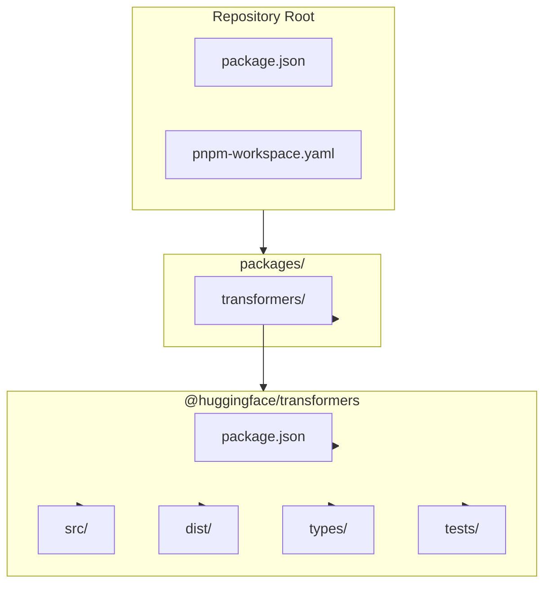
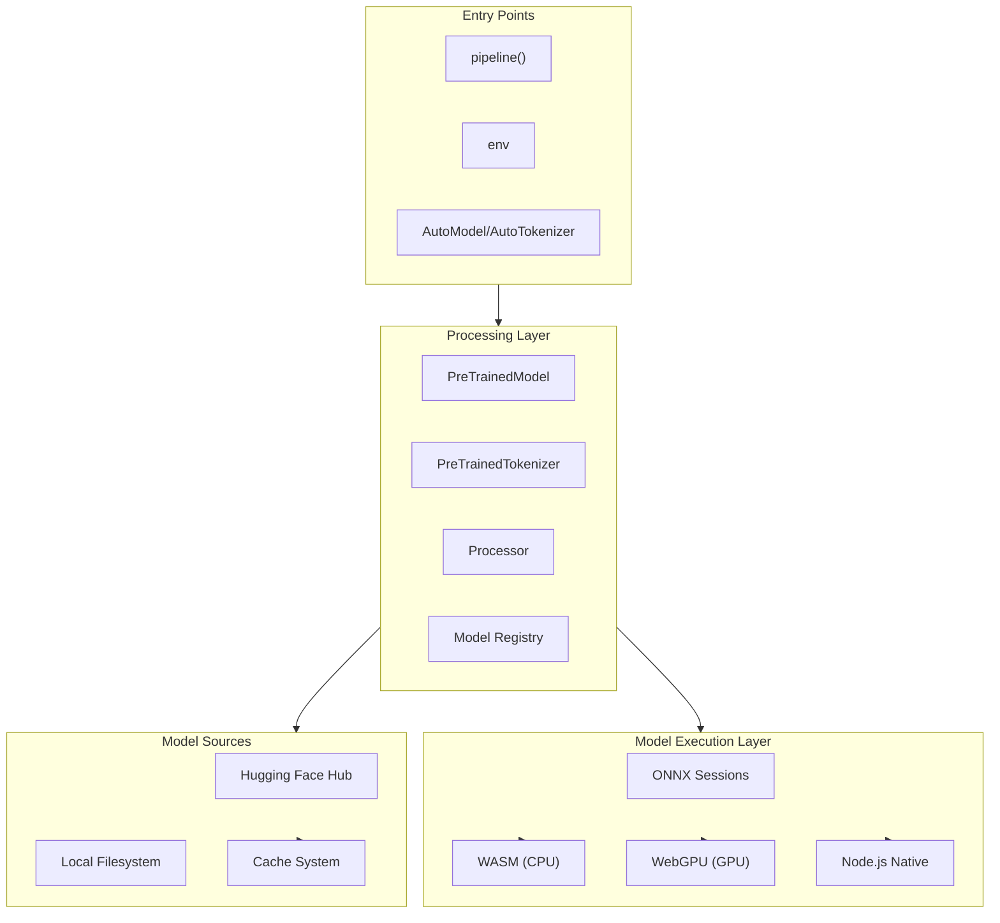

<!-- source: DeepWiki mcp.deepwiki.com · repo huggingface/transformers.js · page 1 Overview · fetched 2026-10-26 -->

# Overview

<details>
<summary>Relevant source files</summary>

The following files were used as context for generating this wiki page:

- [README.md](README.md)
- [package.json](package.json)
- [packages/transformers/docs/snippets/2_installation.snippet](packages/transformers/docs/snippets/2_installation.snippet)
- [packages/transformers/docs/snippets/3_custom-usage.snippet](packages/transformers/docs/snippets/3_custom-usage.snippet)
- [packages/transformers/package.json](packages/transformers/package.json)
- [packages/transformers/src/env.js](packages/transformers/src/env.js)
- [pnpm-lock.yaml](pnpm-lock.yaml)
- [pnpm-workspace.yaml](pnpm-workspace.yaml)

</details>


## What is Transformers.js?

Transformers.js (`@huggingface/transformers` on npm) is a JavaScript library that enables running state-of-the-art machine learning models directly in web browsers and Node.js environments without requiring a server. It is designed to be functionally equivalent to Hugging Face's Python library, allowing developers to run the same pretrained models using a very similar API [README.md:26-28]().

The library provides:
- **Zero-server ML inference**: Models run entirely client-side in the browser or in Node.js [README.md:26]().
- **100+ supported architectures**: Including BERT, GPT-2, T5, Whisper, CLIP, and Llama [README.md:28-32]().
- **Multiple execution backends**: WebAssembly (WASM), WebGPU, WebNN, CUDA, and DirectML [packages/transformers/src/backends/onnx.js:33-46]().
- **Model quantization support**: fp32, fp16, q8 (8-bit), and q4 (4-bit) quantization [README.md:117-121]().
- **Cross-platform compatibility**: Browser, Node.js, Deno, Bun, and web workers [packages/transformers/src/env.js:37-53]().
- **Pipeline API**: High-level task-based interface compatible with Hugging Face's Python API [README.md:58-93]().

This document provides a high-level architectural overview of the library. For specific implementation details, refer to the subsystem-specific pages: Repository Structure ([Repository Structure](#1.1)), Installation and Setup ([Installation and Setup](#1.2)), and Public API Surface ([Public API Surface](#1.3)).

**Sources:** [README.md:26-36](), [packages/transformers/package.json:2-4](), [packages/transformers/src/env.js:29]()

## Repository Structure

The repository is organized as a pnpm monorepo with the main `@huggingface/transformers` package located in the `packages/transformers/` directory [pnpm-workspace.yaml:1-2](). The monorepo structure allows for potential framework integrations and shared tooling.

For details, see [Repository Structure](#1.1).

**Diagram: Repository Structure**



**Sources:** [package.json:1-63](), [pnpm-workspace.yaml:1-13](), [packages/transformers/package.json:1-87]()

## Architecture Overview

Transformers.js uses [ONNX Runtime](https://onnxruntime.ai) as its execution engine [README.md:34](). The library is organized into distinct layers that handle everything from environment detection to high-level task execution.

**Diagram: Core Library Architecture**



The library adapts to different environments through the `env` object [packages/transformers/src/env.js:1-23](). It detects runtime capabilities such as WebGPU availability, filesystem access, and the presence of the Browser Cache API [packages/transformers/src/env.js:31-65]().

**Sources:** [README.md:34-36](), [packages/transformers/src/env.js:31-144](), [packages/transformers/package.json:57-63]()

## Core Components

### Pipeline System
The `pipeline()` function is the primary high-level interface. It groups together a pretrained model with preprocessing (tokenization/image processing) and postprocessing [README.md:58-59](). It supports over 30 tasks including sentiment analysis, object detection, and speech recognition [README.md:28-32]().

### Model Registry and Auto Classes
The library uses "Auto Classes" (e.g., `AutoModel`, `AutoTokenizer`) to automatically resolve and load the correct class for a given model ID [README.md:142-167](). This system relies on a registry that maps model types (like `bert` or `gpt2`) to their corresponding JavaScript implementations.

### Hub Integration and Caching
Transformers.js integrates with the Hugging Face Hub to fetch models on demand. It features a sophisticated caching system that can use the Browser Cache API, the local filesystem (in Node.js), or a custom user-defined cache [packages/transformers/src/env.js:146-167]().

For details, see [Public API Surface](#1.3).

**Sources:** [README.md:55-109](), [packages/transformers/src/env.js:146-190](), [packages/transformers/package.json:8-23]()

## Installation and Setup

The library can be installed via NPM for use in bundled applications or imported directly via CDN for vanilla JavaScript environments [packages/transformers/docs/snippets/2_installation.snippet:2-12]().

```bash
npm i @huggingface/transformers
```

Configuration is handled globally via the `env` object, allowing users to specify custom model paths, disable remote loading, or configure WASM binary locations [packages/transformers/docs/snippets/3_custom-usage.snippet:8-18]().

For details, see [Installation and Setup](#1.2).

**Sources:** [README.md:39-52](), [packages/transformers/docs/snippets/2_installation.snippet:1-13](), [packages/transformers/docs/snippets/3_custom-usage.snippet:1-25]()

---

