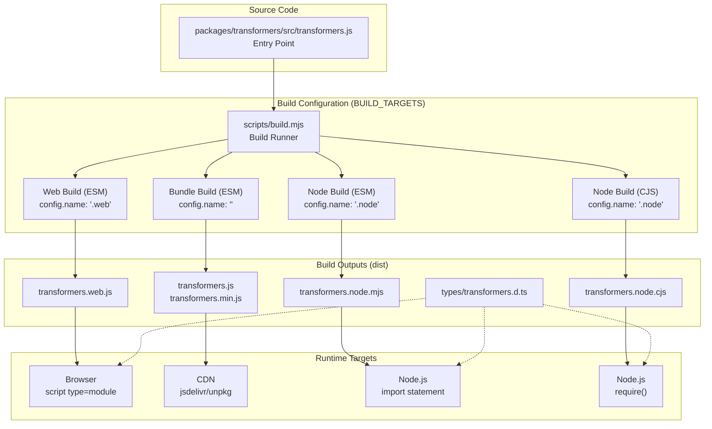
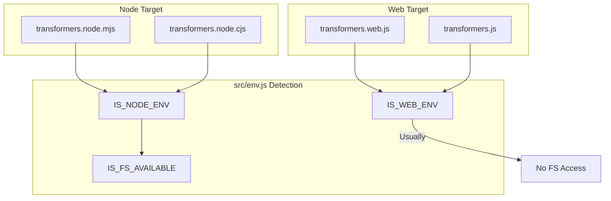

<!-- source: DeepWiki mcp.deepwiki.com · repo huggingface/transformers.js · page 13.1 Build Targets · fetched 2026-10-26 -->

# Build Targets

<details>
<summary>Relevant source files</summary>

The following files were used as context for generating this wiki page:

- [packages/transformers/docs/snippets/2_installation.snippet](packages/transformers/docs/snippets/2_installation.snippet)
- [packages/transformers/docs/snippets/3_custom-usage.snippet](packages/transformers/docs/snippets/3_custom-usage.snippet)
- [packages/transformers/package.json](packages/transformers/package.json)
- [packages/transformers/scripts/build/targets.mjs](packages/transformers/scripts/build/targets.mjs)
- [packages/transformers/src/env.js](packages/transformers/src/env.js)
- [pnpm-lock.yaml](pnpm-lock.yaml)

</details>


## Purpose and Scope

This document describes the different build outputs produced by Transformers.js and how they are configured to support multiple JavaScript environments and module systems. It covers the four primary build targets (web browser bundles, web external bundles, Node.js ES modules, and Node.js CommonJS modules), their configuration in `package.json`, and the build process that creates them.

For information about the build system and plugins, see [Build System and Plugins](#13.2). For details on how these builds are distributed via npm and CDN, see [Package Distribution](#13.3).

## Build Target Overview

Transformers.js produces multiple build artifacts to support different JavaScript runtime environments and module systems. Each target is optimized for its specific use case by including or excluding dependencies and configuring module resolution appropriately. The build process is orchestrated via `scripts/build.mjs` and defined in `scripts/build/targets.mjs`.

### Code to Entity Mapping: Build Pipeline
The following diagram maps the build configuration objects in the codebase to their final output artifacts and runtime environments.



**Sources:** [packages/transformers/scripts/build/targets.mjs:7-51](), [packages/transformers/package.json:8-23](), [packages/transformers/package.json:29]()

## Build Target Configurations

The build system defines distinct configurations for each target environment in `BUILD_TARGETS`, specifying which modules to ignore, which to treat as external, and the output format.

| Build Target | Output Files | Format | Ignored Modules | External Modules |
|-------------|--------------|--------|-----------------|------------------|
| **Bundle Build** | `transformers.js` | ESM | `WEB_IGNORE_MODULES` | None (all bundled) |
| **Web Build** | `transformers.web.js` | ESM | `WEB_IGNORE_MODULES` | `WEB_EXTERNAL_MODULES` |
| **Node.js ESM** | `transformers.node.mjs` | ESM | `NODE_IGNORE_MODULES` | `NODE_EXTERNAL_MODULES` |
| **Node.js CJS** | `transformers.node.cjs` | CJS | `NODE_IGNORE_MODULES` | `NODE_EXTERNAL_MODULES` |

**Sources:** [packages/transformers/scripts/build/targets.mjs:7-51](), [packages/transformers/scripts/build/constants.mjs:1-1]()

### Module Exclusion Strategies

The library uses environment detection in `src/env.js` to handle different runtime capabilities, but the build targets enforce these boundaries at the bundle level.

*   **WEB_IGNORE_MODULES**: Excludes Node.js-specific modules like `onnxruntime-node`, `sharp`, `node:fs`, `node:path`, and `node:url` [packages/transformers/scripts/build/targets.mjs:14]().
*   **NODE_IGNORE_MODULES**: Excludes browser-specific modules like `onnxruntime-web` [packages/transformers/scripts/build/targets.mjs:35]().

### Runtime Detection Logic
The `env.js` module determines the environment at runtime, which complements the build-time target selection.



**Sources:** [packages/transformers/src/env.js:33-53](), [packages/transformers/src/env.js:99-144]()

## Package.json Export Configuration

The `package.json` file uses conditional exports to route different environments to their respective build targets. This ensures that a single `import { pipeline } from '@huggingface/transformers'` works correctly across Node.js (both ESM and CJS) and browsers.

```json
"exports": {
  "node": {
    "import": {
      "types": "./types/transformers.d.ts",
      "default": "./dist/transformers.node.mjs"
    },
    "require": {
      "types": "./types/transformers.d.ts",
      "default": "./dist/transformers.node.cjs"
    }
  },
  "default": {
    "types": "./types/transformers.d.ts",
    "default": "./dist/transformers.web.js"
  }
}
```

**Sources:** [packages/transformers/package.json:8-23]()

*   **Node.js (import)**: Resolves to `dist/transformers.node.mjs` [packages/transformers/package.json:12]().
*   **Node.js (require)**: Resolves to `dist/transformers.node.cjs` [packages/transformers/package.json:16]().
*   **Default (Browser/Bundlers)**: Resolves to `dist/transformers.web.js` [packages/transformers/package.json:21]().

## CDN and Minification

For CDN distribution (via JSDelivr or Unpkg), the library provides a minified, fully bundled version.

*   **Minified Bundle**: `dist/transformers.min.js` is the entry point for CDNs [packages/transformers/package.json:85-86]().
*   **WASM Paths**: By default, the library fetches precompiled WASM binaries from a CDN, but this can be overridden via `env.backends.onnx.wasm.wasmPaths` [packages/transformers/docs/snippets/3_custom-usage.snippet:17]().

**Sources:** [packages/transformers/package.json:85-86](), [packages/transformers/docs/snippets/3_custom-usage.snippet:16-18]()

## TypeScript Declarations

TypeScript type declarations are generated as a separate build step using `tsc --build` [packages/transformers/package.json:27](). The resulting `types/transformers.d.ts` file is shared across all build targets to provide consistent type safety regardless of the module format used [packages/transformers/package.json:6]().

**Sources:** [packages/transformers/package.json:6](), [packages/transformers/package.json:27](), [packages/transformers/package.json:29]()

---

