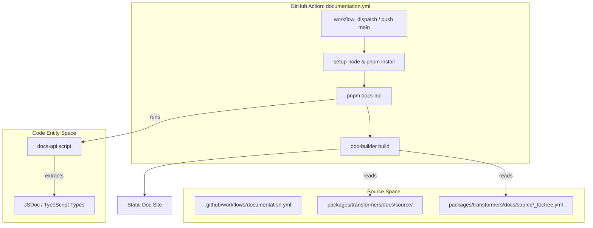
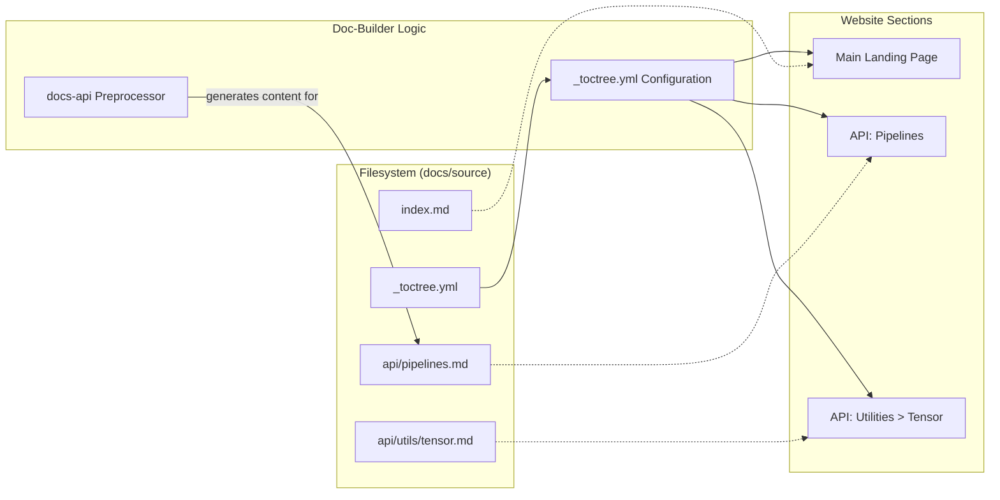

<!-- source: DeepWiki mcp.deepwiki.com · repo huggingface/transformers.js · page 15.1 Doc-Builder Integration · fetched 2026-10-26 -->

# Doc-Builder Integration

Relevant source files

The following files were used as context for generating this wiki page:

- [.github/workflows/documentation.yml](.github/workflows/documentation.yml)
- [.github/workflows/pr-documentation.yml](.github/workflows/pr-documentation.yml)
- [.github/workflows/publish.yml](.github/workflows/publish.yml)
- [.github/workflows/tests.yml](.github/workflows/tests.yml)
- [.github/workflows/upload-pr-documentation.yml](.github/workflows/upload-pr-documentation.yml)
- [packages/transformers/docs/source/_toctree.yml](packages/transformers/docs/source/_toctree.yml)
- [packages/transformers/docs/source/index.md](packages/transformers/docs/source/index.md)
- [packages/transformers/docs/source/integrations/vercel-ai-sdk.md](packages/transformers/docs/source/integrations/vercel-ai-sdk.md)
- [packages/transformers/docs/source/tutorials/next-ai-sdk.md](packages/transformers/docs/source/tutorials/next-ai-sdk.md)

The Transformers.js documentation system utilizes the Hugging Face `doc-builder` tool to generate a static documentation site from Markdown and TypeScript source files. This integration allows for a unified documentation style consistent with other Hugging Face libraries while handling the specific needs of a JavaScript/TypeScript codebase, such as JSDoc parsing and Web-specific tutorials.

## Overview of the Build Pipeline

The documentation generation process is automated via GitHub Actions and involves several stages: environment setup, API reference extraction, and the final build using `doc-builder`.

### Data Flow and Implementation

The source files reside in the `packages/transformers/docs/source` directory [.github/workflows/documentation.yml:15](). The integration follows this high-level flow:

1.  **Trigger**: The workflow is triggered on pushes to `main` or via manual `workflow_dispatch` [.github/workflows/documentation.yml:3-7]().
2.  **Pre-processing**: The `docs-api` script is executed to prepare the API reference from the TypeScript source code [.github/workflows/documentation.yml:16]().
3.  **Site Generation**: The `doc-builder` tool consumes the processed source files and the `_toctree.yml` configuration to generate the final HTML/Next.js site [.github/workflows/documentation.yml:11-17]().

### Process Flow Diagram

The following diagram illustrates how the GitHub Action `build_main_documentation.yml` interacts with the Transformers.js repository to produce the site.

**Documentation Generation Flow**

Sources: [.github/workflows/documentation.yml:1-20](), [packages/transformers/docs/source/_toctree.yml:1-97]()

## GitHub Actions Workflows

The repository uses three primary workflows to manage documentation:

| Workflow | Purpose | Trigger |
| :--- | :--- | :--- |
| `documentation.yml` | Builds and deploys the main documentation site. | Push to `main` [.github/workflows/documentation.yml:5-7]() |
| `pr-documentation.yml` | Builds a preview of the documentation for pull requests. | `pull_request` [.github/workflows/pr-documentation.yml:4]() |
| `upload-pr-documentation.yml` | Uploads the built PR preview to a staging area and posts a comment. | `workflow_run` completion [.github/workflows/upload-pr-documentation.yml:4-7]() |

### Technical Details of `build` Jobs

The documentation jobs utilize a shared workflow from `huggingface/doc-builder` [.github/workflows/documentation.yml:11](). Key parameters include:
*   **`path_to_docs`**: Set to `transformers.js/packages/transformers/docs/source` [.github/workflows/documentation.yml:15]().
*   **`pre_command`**: A critical step that enables `corepack`, installs dependencies with `ONNXRUNTIME_NODE_INSTALL=skip` (to speed up the build), and runs the `docs-api` command [.github/workflows/documentation.yml:16]().
*   **`additional_args`**: Uses `--not_python_module` since Transformers.js is a JavaScript library, signaling to `doc-builder` to skip Python-specific introspection [.github/workflows/documentation.yml:17]().

Sources: [.github/workflows/documentation.yml:11-20](), [.github/workflows/pr-documentation.yml:12-20](), [.github/workflows/upload-pr-documentation.yml:11-17]()

## Structure and Configuration

The organization of the documentation is governed by the `_toctree.yml` file. This file defines the navigation sidebar and the nesting of various sections.

### TOC Tree Mapping

The `_toctree.yml` maps local Markdown files to titles in the UI:
*   **Get Started**: Includes `installation.md`, `pipelines.md`, and `custom_usage.md` [packages/transformers/docs/source/_toctree.yml:3-10]().
*   **Tutorials**: Contains environment-specific guides like `vanilla-js`, `react`, `next`, and `node` [packages/transformers/docs/source/_toctree.yml:11-26]().
*   **API Reference**: A deep hierarchy covering `models`, `tokenizers`, `processors`, and internal utilities like `maths` or `tensor` [packages/transformers/docs/source/_toctree.yml:41-97]().

### File-to-Entity Mapping

This diagram bridges the physical file structure in `docs/source` to the conceptual sections defined in the Documentation System.

**Documentation Entity Mapping**

Sources: [packages/transformers/docs/source/_toctree.yml:1-97](), [.github/workflows/documentation.yml:15-18]()

## Integration with Vercel AI SDK

The documentation also includes specialized integration guides. For instance, `vercel-ai-sdk.md` documents how to use `@browser-ai/transformers-js` as a provider for the Vercel AI SDK [packages/transformers/docs/source/integrations/vercel-ai-sdk.md:3-9](). This involves:
*   **Installation**: Instructions for `npm install @browser-ai/transformers-js` [packages/transformers/docs/source/integrations/vercel-ai-sdk.md:14-16]().
*   **Usage Patterns**: Examples for `streamText` and `generateText` using the `transformersJS` model provider [packages/transformers/docs/source/integrations/vercel-ai-sdk.md:28-52]().
*   **Web Worker Support**: Documentation for `TransformersJSWorkerHandler` to offload inference from the main thread [packages/transformers/docs/source/integrations/vercel-ai-sdk.md:118-146]().

Sources: [packages/transformers/docs/source/integrations/vercel-ai-sdk.md:1-203](), [packages/transformers/docs/source/tutorials/next-ai-sdk.md:1-185]()

---

