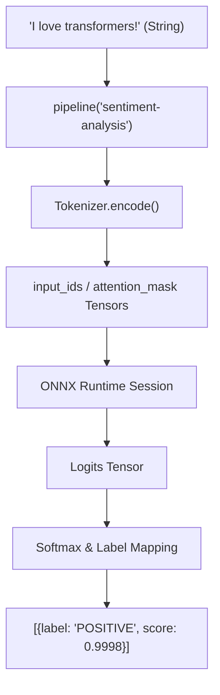
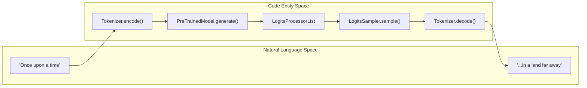
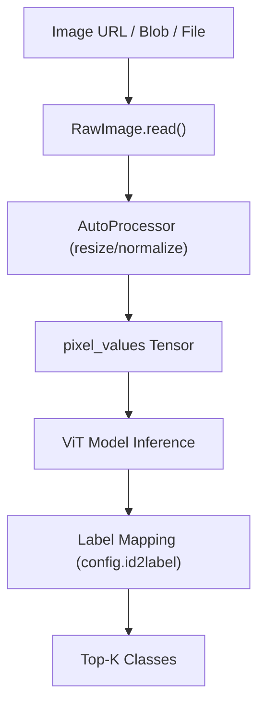

<!-- source: DeepWiki mcp.deepwiki.com · repo huggingface/transformers.js · page 16.1 Quick Start Examples · fetched 2026-10-26 -->

# Quick Start Examples

<details>
<summary>Relevant source files</summary>

The following files were used as context for generating this wiki page:

- [README.md](README.md)
- [package.json](package.json)
- [packages/transformers/docs/source/tutorials/browser-extension.md](packages/transformers/docs/source/tutorials/browser-extension.md)
- [packages/transformers/docs/source/tutorials/electron.md](packages/transformers/docs/source/tutorials/electron.md)
- [packages/transformers/docs/source/tutorials/react.md](packages/transformers/docs/source/tutorials/react.md)
- [packages/transformers/docs/source/tutorials/vanilla-js.md](packages/transformers/docs/source/tutorials/vanilla-js.md)

</details>


This page provides technical examples for the most common tasks using the Transformers.js library. It focuses on the high-level `pipeline()` API, which abstracts the complexities of model loading, tokenization, inference, and post-processing.

Transformers.js is designed to be functionally equivalent to the Hugging Face Python library [README.md:28-29](), utilizing [ONNX Runtime](https://onnxruntime.ai) to execute models across various environments [README.md:34-36]().

Sources: [README.md:28-36](), [src/pipelines.js:1386-1527]()

## Text Classification (Sentiment Analysis)

Text classification assigns categorical labels to input text. The `pipeline()` function with the `'sentiment-analysis'` task returns a `TextClassificationPipeline` instance [src/pipelines.js:1826-1914]().

### Implementation Detail

**1. Pipeline Allocation**
```javascript
import { pipeline } from '@huggingface/transformers';

// Allocate a pipeline for sentiment-analysis
const classifier = await pipeline('sentiment-analysis');
```
By default, this loads the `Xenova/distilbert-base-uncased-finetuned-sst-2-english` model [README.md:106-108](). The `pipeline` function internally calls `AutoTokenizer.from_pretrained` [src/tokenizers.js:2755-2948]() and `AutoModelForSequenceClassification.from_pretrained` [src/models.js:3268-3290]().

**2. Inference**
```javascript
const out = await classifier('I love transformers!');
// Output: [{'label': 'POSITIVE', 'score': 0.999817686}]
```
The input string is passed to the pipeline's `_call` method [src/pipelines.js:1872-1914](), which tokenizes the text, runs the ONNX session, and applies a softmax function [src/utils/maths.js:66-76]() to the resulting logits.

### Text Classification Data Flow



Sources: [README.md:81-89](), [src/pipelines.js:1826-1914](), [src/models.js:3268-3290]()

## Text Generation

Text generation involves predicting the next tokens in a sequence. For decoder-only models (like GPT-2), the `pipeline` uses `Text2TextGenerationPipeline` [src/pipelines.js:2183-2368]().

### Implementation Detail

**1. Model Selection**
```javascript
const generator = await pipeline('text-generation', 'Xenova/gpt2');
```
This initializes an `AutoModelForCausalLM` [src/models.js:3448-3470]().

**2. Generation Execution**
```javascript
const output = await generator('Once upon a time', {
  max_new_tokens: 50,
  temperature: 0.9,
  do_sample: true,
});
```
The pipeline invokes the `generate()` method [src/models.js:707-990](), which manages the autoregressive loop. It utilizes `LogitsProcessorList` [src/generation/logits_process.js:490-550]() to apply constraints and `LogitsSampler` [src/generation/logits_sampler.js:1-250]() for token selection.

### Text Generation Logic Space



Sources: [src/pipelines.js:2183-2368](), [src/models.js:707-990](), [src/generation/logits_process.js:490-550]()

## Image Classification

Image classification utilizes Computer Vision models to identify objects within an image. This task returns an `ImageClassificationPipeline` [src/pipelines.js:2564-2644]().

### Implementation Detail

**1. Pipeline Setup**
```javascript
const classifier = await pipeline('image-classification', 'Xenova/vit-base-patch16-224');
```
This loads an `AutoProcessor` [src/processors.js:1043-1184]() and `AutoModelForImageClassification` [src/models.js:3314-3336]().

**2. Image Processing**
```javascript
const url = 'https://huggingface.co/datasets/Xenova/transformers.js-docs/resolve/main/cats.jpg';
const output = await classifier(url);
```
The pipeline uses `RawImage.read(url)` [src/utils/image.js:357-494]() to fetch and decode the image. The `Processor` then performs resizing, center cropping [src/utils/image.js:802-851](), and normalization [src/utils/image.js:853-920]() to produce the `pixel_values` tensor required by the model.

### Image Classification Data Flow



Sources: [src/pipelines.js:2564-2644](), [src/utils/image.js:357-920](), [src/processors.js:1043-1184]()

## Execution Configuration

All pipelines support environment and performance configurations through the `options` object [src/pipelines.js:1386-1527]().

### Hardware Acceleration (WebGPU)
To run models on the GPU in supported browsers, set the `device` to `'webgpu'` [README.md:106-109]():
```javascript
const pipe = await pipeline('sentiment-analysis', 'model-id', {
  device: 'webgpu',
});
```
This maps to `WebGPUDevice` logic in the backend [src/utils/devices.js:1-100]().

### Quantization (Dtypes)
To reduce memory footprint and increase speed in the browser, use quantized weights [README.md:122-127]():
```javascript
const pipe = await pipeline('sentiment-analysis', 'model-id', {
  dtype: 'q4', // 4-bit quantization
});
```
The library resolves the specific ONNX file (e.g., `model_q4.onnx`) using `DEFAULT_DTYPE_SUFFIX_MAPPING` [src/models.js:162-267]().

### Progress Monitoring
For large models, use the `progress_callback` to track download status [src/utils/hub.js:1-100]():
```javascript
const pipe = await pipeline('summarization', 'model-id', {
  progress_callback: (data) => console.log(data),
});
```

Sources: [README.md:106-127](), [src/pipelines.js:1386-1527](), [src/models.js:162-267](), [src/utils/hub.js:1-100]()

---

