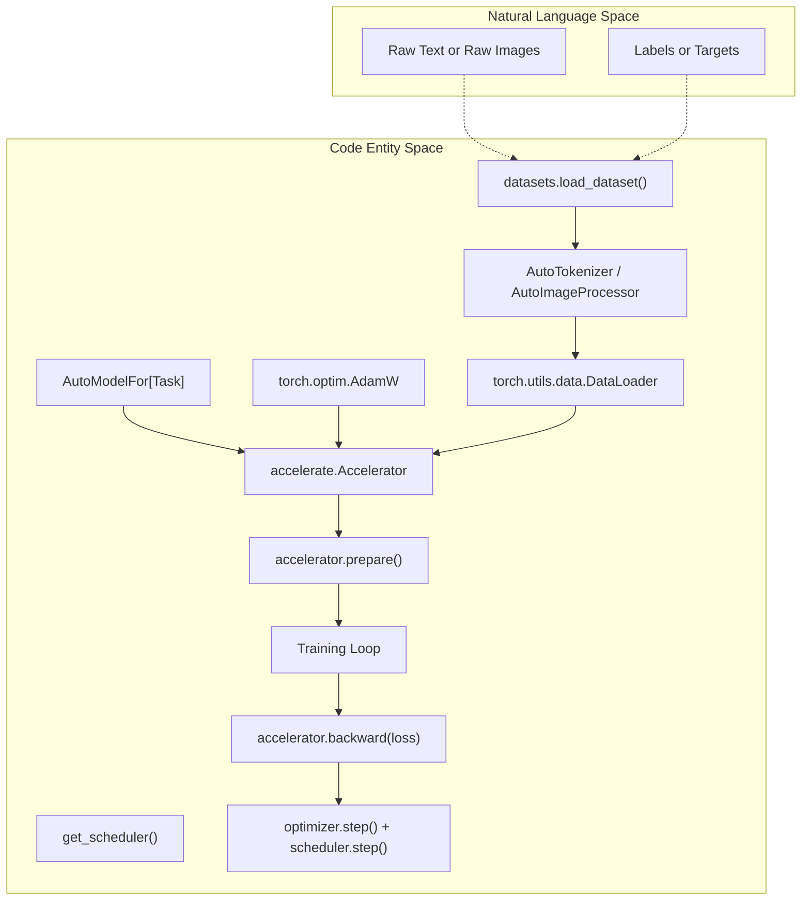
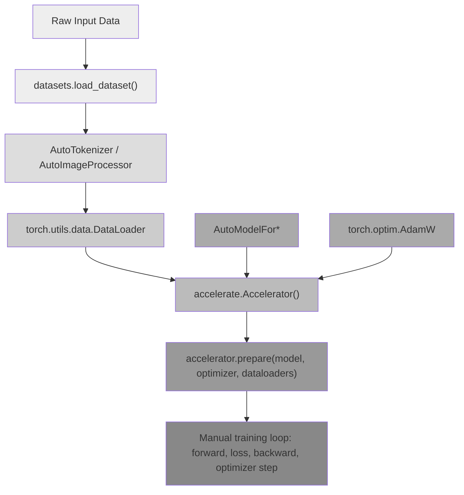

<!-- source: DeepWiki mcp.deepwiki.com · repo huggingface/transformers · page 6.4 Training Examples & Scripts · fetched 2026-10-26 -->

# Training Examples & Scripts

<details>
<summary>Relevant source files</summary>

The following files were used as context for generating this wiki page:

- [examples/pytorch/audio-classification/run_audio_classification.py](examples/pytorch/audio-classification/run_audio_classification.py)
- [examples/pytorch/contrastive-image-text/run_clip.py](examples/pytorch/contrastive-image-text/run_clip.py)
- [examples/pytorch/image-classification/run_image_classification.py](examples/pytorch/image-classification/run_image_classification.py)
- [examples/pytorch/image-classification/run_image_classification_no_trainer.py](examples/pytorch/image-classification/run_image_classification_no_trainer.py)
- [examples/pytorch/image-pretraining/run_mae.py](examples/pytorch/image-pretraining/run_mae.py)
- [examples/pytorch/image-pretraining/run_mim.py](examples/pytorch/image-pretraining/run_mim.py)
- [examples/pytorch/image-pretraining/run_mim_no_trainer.py](examples/pytorch/image-pretraining/run_mim_no_trainer.py)
- [examples/pytorch/language-modeling/run_clm.py](examples/pytorch/language-modeling/run_clm.py)
- [examples/pytorch/language-modeling/run_clm_no_trainer.py](examples/pytorch/language-modeling/run_clm_no_trainer.py)
- [examples/pytorch/language-modeling/run_fim.py](examples/pytorch/language-modeling/run_fim.py)
- [examples/pytorch/language-modeling/run_fim_no_trainer.py](examples/pytorch/language-modeling/run_fim_no_trainer.py)
- [examples/pytorch/language-modeling/run_mlm.py](examples/pytorch/language-modeling/run_mlm.py)
- [examples/pytorch/language-modeling/run_mlm_no_trainer.py](examples/pytorch/language-modeling/run_mlm_no_trainer.py)
- [examples/pytorch/language-modeling/run_plm.py](examples/pytorch/language-modeling/run_plm.py)
- [examples/pytorch/multiple-choice/run_swag.py](examples/pytorch/multiple-choice/run_swag.py)
- [examples/pytorch/multiple-choice/run_swag_no_trainer.py](examples/pytorch/multiple-choice/run_swag_no_trainer.py)
- [examples/pytorch/question-answering/run_qa.py](examples/pytorch/question-answering/run_qa.py)
- [examples/pytorch/question-answering/run_qa_beam_search.py](examples/pytorch/question-answering/run_qa_beam_search.py)
- [examples/pytorch/question-answering/run_qa_beam_search_no_trainer.py](examples/pytorch/question-answering/run_qa_beam_search_no_trainer.py)
- [examples/pytorch/question-answering/run_qa_no_trainer.py](examples/pytorch/question-answering/run_qa_no_trainer.py)
- [examples/pytorch/question-answering/run_seq2seq_qa.py](examples/pytorch/question-answering/run_seq2seq_qa.py)
- [examples/pytorch/semantic-segmentation/run_semantic_segmentation.py](examples/pytorch/semantic-segmentation/run_semantic_segmentation.py)
- [examples/pytorch/semantic-segmentation/run_semantic_segmentation_no_trainer.py](examples/pytorch/semantic-segmentation/run_semantic_segmentation_no_trainer.py)
- [examples/pytorch/speech-recognition/run_speech_recognition_ctc.py](examples/pytorch/speech-recognition/run_speech_recognition_ctc.py)
- [examples/pytorch/speech-recognition/run_speech_recognition_ctc_adapter.py](examples/pytorch/speech-recognition/run_speech_recognition_ctc_adapter.py)
- [examples/pytorch/speech-recognition/run_speech_recognition_seq2seq.py](examples/pytorch/speech-recognition/run_speech_recognition_seq2seq.py)
- [examples/pytorch/summarization/run_summarization.py](examples/pytorch/summarization/run_summarization.py)
- [examples/pytorch/summarization/run_summarization_no_trainer.py](examples/pytorch/summarization/run_summarization_no_trainer.py)
- [examples/pytorch/text-classification/run_classification.py](examples/pytorch/text-classification/run_classification.py)
- [examples/pytorch/text-classification/run_glue.py](examples/pytorch/text-classification/run_glue.py)
- [examples/pytorch/text-classification/run_glue_no_trainer.py](examples/pytorch/text-classification/run_glue_no_trainer.py)
- [examples/pytorch/text-classification/run_xnli.py](examples/pytorch/text-classification/run_xnli.py)
- [examples/pytorch/token-classification/run_ner.py](examples/pytorch/token-classification/run_ner.py)
- [examples/pytorch/token-classification/run_ner_no_trainer.py](examples/pytorch/token-classification/run_ner_no_trainer.py)
- [examples/pytorch/translation/run_translation.py](examples/pytorch/translation/run_translation.py)
- [examples/pytorch/translation/run_translation_no_trainer.py](examples/pytorch/translation/run_translation_no_trainer.py)

</details>


The `examples/pytorch/` directory is the main collection of training scripts demonstrating how to train and fine-tune Hugging Face Transformers models for a broad spectrum of tasks. It includes scripts for language modeling, text classification, question answering, summarization, translation, speech recognition, image classification, semantic segmentation, and more.

Two primary training patterns are presented:

1.  **Trainer-based scripts**: These scripts make full use of the `Trainer` API (or `Seq2SeqTrainer` variant) from the Transformers library, which encapsulates the training loop, handles distributed training, evaluation, checkpointing, and logging automatically. They also parse arguments via the `HfArgumentParser` for `ModelArguments`, `DataTrainingArguments`, and `TrainingArguments` dataclasses.

2.  **No-Trainer scripts**: These rely on the `accelerate` library to provide distributed training and mixed precision capabilities but require the user to manually implement the training loop logic, loss computation, and backpropagation. This pattern offers greater flexibility while maintaining seamless multi-device and distributed support.

These training example scripts illustrate usage across diverse tasks and modalities including natural language understanding, generation, computer vision, and audio.

---

## Script Taxonomy and Supported Tasks

Training scripts are broadly organized by task and modality. Each task folder commonly includes a trainer-based script (`run_task.py`) and a no-trainer script (`run_task_no_trainer.py`).

| Domain                 | Key Tasks                             | Primary AutoModel Classes                     |
|------------------------|---------------------------------------|-----------------------------------------------|
| **Language Modeling**  | CLM, MLM, FIM, PLM                    | `AutoModelForCausalLM`, `AutoModelForMaskedLM` |
| **Text Classification**| GLUE, Sentiment Analysis, NER         | `AutoModelForSequenceClassification`, `AutoModelForTokenClassification` |
| **Seq2Seq Tasks**      | Summarization, Translation            | `AutoModelForSeq2SeqLM`                       |
| **Question Answering** | Extractive QA, Beam Search QA         | `AutoModelForQuestionAnswering`               |
| **Vision**             | Image Classification, Segmentation, Image Pretraining | `AutoModelForImageClassification`, `AutoModelForSemanticSegmentation`, `AutoModelForMaskedImageModeling` |
| **Audio & Speech**     | ASR (CTC & Seq2Seq), Audio Classification | `AutoModelForSpeechSeq2Seq`, `AutoModelForAudioClassification`, `AutoModelForCTC` |

This coverage allows users to find well-structured examples for a wide domain of modeling tasks.

Sources: [examples/pytorch/language-modeling/run_clm.py:55](), [examples/pytorch/text-classification/run_classification.py:47](), [examples/pytorch/speech-recognition/run_speech_recognition_seq2seq.py:48-52](), [examples/pytorch/image-classification/run_image_classification_no_trainer.py:59](), [examples/pytorch/language-modeling/run_mlm_no_trainer.py:64](), [examples/pytorch/semantic-segmentation/run_semantic_segmentation_no_trainer.py:54](), [examples/pytorch/image-pretraining/run_mim_no_trainer.py:60](), [examples/pytorch/speech-recognition/run_speech_recognition_ctc.py:47-50]()

---

## The No-Trainer Pattern (Accelerate)

The no-trainer examples use the [`accelerate.Accelerator`](https://huggingface.co/docs/accelerate) library to abstract device placement, mixed precision, and distributed setup while requiring explicit control over the training loop. This pattern is flexible for advanced customization scenarios.

### Implementation Overview

Typical workflow steps in no-trainer scripts:

-   **Initialize `Accelerator`**: An instance of `Accelerator` is created, which manages hardware setup and distribution (e.g., multi-GPU, TPU), mixed precision, and logging [examples/pytorch/language-modeling/run_clm_no_trainer.py:50-51]().
-   **Load and preprocess datasets**: Datasets are loaded using the `datasets` library and preprocessed using `AutoTokenizer` or `AutoImageProcessor` [examples/pytorch/language-modeling/run_clm_no_trainer.py:60-65]().
-   **Instantiate Model & Optimizer**: The model is loaded with an appropriate `AutoModelFor*` class, and standard optimizers like `AdamW` are set up [examples/pytorch/language-modeling/run_clm_no_trainer.py:64]() and [examples/pytorch/image-classification/run_image_classification_no_trainer.py:129-134]().
-   **Use `accelerator.prepare()`**: This function prepares the model, optimizer, and dataloaders to be compatible with distributed training and mixed precision [examples/pytorch/language-modeling/run_clm_no_trainer.py:50-51]().
-   **Manual Training Loop**: The script executes an explicit loop over epochs and batches, uses `accelerator.backward(loss)` for backpropagation, and calls `optimizer.step()` and `lr_scheduler.step()` [examples/pytorch/language-modeling/run_clm_no_trainer.py:50-51]().

### Example No-Trainer Data Flow



This illustrates the procedural layering from data input to training execution in the no-trainer scripts.

Sources: [examples/pytorch/language-modeling/run_clm_no_trainer.py:50-69](), [examples/pytorch/image-classification/run_image_classification_no_trainer.py:39-45](), [examples/pytorch/image-classification/run_image_classification_no_trainer.py:129-134]()

---

## The Trainer Pattern

Trainer-based scripts simplify training workflows by leveraging the high-level `Trainer` interface, which abstracts away common training concerns such as epoch loops, evaluation, checkpointing, gradient accumulation, and logging.

### Argument Parsing and Configuration

These examples utilize `HfArgumentParser` to parse three types of dataclasses which group related parameters:

-   **ModelArguments**: Controls which model, tokenizer, and config to load, as well as related options such as cache location or remote code trust [examples/pytorch/language-modeling/run_clm.py:82-161]().
-   **DataTrainingArguments**: Specifies datasets, input/output columns, preprocessing details, and dataset splits [examples/pytorch/language-modeling/run_clm.py:164-302]().
-   **TrainingArguments**: Defines training hyperparameters (batch size, learning rate, epochs), output directories, logging strategies, mixed precision, and distributed options [examples/pytorch/language-modeling/run_clm.py:59-119]().

These three classes are parsed in the script's entry point and fed to instantiate a `Trainer` or a `Seq2SeqTrainer`.

### Key Components in Trainer-based Scripts

| Component                | Role                                        |
|--------------------------|---------------------------------------------|
| `HfArgumentParser`       | Parses command-line args into dataclasses   |
| `Trainer`/`Seq2SeqTrainer` | Handles training loop, evaluation, checkpointing, and prediction |
| `DataCollator*` classes  | Handles batch collation and padding logic   |
| `evaluate` library       | Loads and computes evaluation metrics       |

### Typical Trainer Data Flow

```mermaid
graph LR
    NLSample["Natural Language Sample (train/eval dataset)"] --> DS["datasets.Dataset / DataLoader"]
    DS --> DC["DataCollatorWithPadding / DataCollatorForSeq2Seq"]
    DC --> TR["`Trainer` or `Seq2SeqTrainer`"]
    Configs["ModelArguments + DataTrainingArguments + TrainingArguments"] --> TR
    TR --> MODEL["PreTrainedModel (`AutoModelFor*`)"]
    TR --> TOKENIZER["AutoTokenizer"]
    TR --> EVAL_METRICS["Evaluation metrics via `evaluate`"]
    TR --> TrainingLoop["trainer.train()"]

    style NLSample fill:#eeeeee
    style DS fill:#eeeeee
    style DC fill:#dddddd
    style TR fill:#cccccc
    style MODEL fill:#bbbbbb
    style TOKENIZER fill:#bbbbbb
    style EVAL_METRICS fill:#bbbbbb
    style TrainingLoop fill:#aaaaaa
```

This architecture presents a clean separation between argument parsing, data processing, model setup, and training orchestration.

Sources: [examples/pytorch/text-classification/run_classification.py:71-201](), [examples/pytorch/text-classification/run_classification.py:410-430](), [examples/pytorch/language-modeling/run_clm.py:57-63]()

---

## Specialized Objectives and Tasks in Examples

### Causal Language Modeling (CLM) & Fill-in-the-Middle (FIM)

-   **CLM scripts** (e.g., `run_clm.py`) cover autoregressive decoding tasks, fine-tuning decoder-only models like GPT, GPT-2 with cross-entropy loss over next-token prediction [examples/pytorch/language-modeling/run_clm.py:31-35]().
-   **FIM scripts** (e.g., `run_fim_no_trainer.py`) implement the Fill-in-the-Middle objective, which adapts sequences to predict the middle portion conditioned on both prefix and suffix. This advanced data manipulation enables better code modeling and text infilling [examples/pytorch/language-modeling/run_fim_no_trainer.py:31-36](). Parameters like `fim_rate` control how frequently sequences undergo FIM transformation [examples/pytorch/language-modeling/run_fim_no_trainer.py:180-194]().

Sources: [examples/pytorch/language-modeling/run_clm.py:31-35](), [examples/pytorch/language-modeling/run_fim_no_trainer.py:31-36](), [examples/pytorch/language-modeling/run_fim_no_trainer.py:180-194]()

### Speech Recognition (ASR)

Two primary architectures are showcased:

1.  **CTC-based ASR**: Uses models like Wav2Vec2 and ASR-specific processors for input feature extraction and output decoding with CTC loss. Demonstrated in scripts like `run_speech_recognition_ctc.py` [examples/pytorch/speech-recognition/run_speech_recognition_ctc.py:47-54]().
2.  **Seq2Seq ASR**: Uses encoder-decoder models (e.g., Whisper), applying autoregressive decoding during evaluation, fine-tuned with `Seq2SeqTrainer`. Scripts enable freezing feature encoder layers to stabilize training on small datasets [examples/pytorch/speech-recognition/run_speech_recognition_seq2seq.py:48-52](), [examples/pytorch/speech-recognition/run_speech_recognition_seq2seq.py:123-126]().

Sources: [examples/pytorch/speech-recognition/run_speech_recognition_ctc.py:47-54](), [examples/pytorch/speech-recognition/run_speech_recognition_seq2seq.py:48-52](), [examples/pytorch/speech-recognition/run_speech_recognition_seq2seq.py:123-126]()

### Vision and Semantic Segmentation

-   Image classification scripts use `AutoImageProcessor` alongside `torchvision.transforms` for preprocessing and augmentation of images [examples/pytorch/image-classification/run_image_classification_no_trainer.py:46-59]().
-   Semantic segmentation examples handle special label processing, including mapping background class labels to an "ignore index" (usually 255) during loss computation to exclude irrelevant pixels [examples/pytorch/semantic-segmentation/run_semantic_segmentation_no_trainer.py:71-83]().

Sources: [examples/pytorch/image-classification/run_image_classification_no_trainer.py:46-59](), [examples/pytorch/semantic-segmentation/run_semantic_segmentation_no_trainer.py:71-83]()

---

## Data Collators in Example Scripts

Data collators are vital components that handle dynamic padding, batch merging, and task-specific data formatting. Several collators are used across examples based on task and input type:

| Data Collator                  | Use Case                               | Example Reference                                     |
|--------------------------------|----------------------------------------|-------------------------------------------------------|
| `default_data_collator`        | General batching for already tensorized inputs | Language modeling scripts [examples/pytorch/language-modeling/run_clm.py:60]() |
| `DataCollatorWithPadding`      | Padding sequences dynamically for text classification tasks | GLUE examples [examples/pytorch/text-classification/run_glue.py:50]() |
| `DataCollatorForLanguageModeling` | Masked language modeling with masking of tokens | MLM no-trainer [examples/pytorch/language-modeling/run_mlm_no_trainer.py:66]() |
| `DataCollatorForMultipleChoice`| Multiple choice tasks batching       | SWAG no-trainer [examples/pytorch/multiple-choice/run_swag_no_trainer.py:60]() |
| `DataCollatorForSeq2Seq`       | Sequence-to-sequence tasks, handles both encoder and decoder inputs | Summarization no-trainer [examples/pytorch/summarization/run_summarization_no_trainer.py:65]() |

These collators standardize batch inputs compatible with model forward calls.

Sources: [examples/pytorch/language-modeling/run_clm.py:60](), [examples/pytorch/text-classification/run_glue.py:50](), [examples/pytorch/language-modeling/run_mlm_no_trainer.py:66](), [examples/pytorch/multiple-choice/run_swag_no_trainer.py:60](), [examples/pytorch/summarization/run_summarization_no_trainer.py:65]()

---

# Summary of Training Example Architecture

This overview covered the landscape of training example scripts within `examples/pytorch/` highlighting:

-   Their division into **Trainer-based** vs **no-trainer (Accelerate-based)** paradigms.
-   How scripts are organized by task, covering NLP, vision, and audio with diverse modeling objectives.
-   The implementation patterns including argument parsing, model and dataset instantiation, data collation, and training/evaluation loops.
-   Special focus on advanced objectives such as FIM for causal LM, and distinctive modalities like speech and vision.
-   Usage of centralized components such as `Accelerator` and `Trainer` classes to unify distributed training.

Together these examples serve as comprehensive reference implementation blueprints for training and fine-tuning Transformer models across modalities and tasks.

---

# Additional Diagrams Bridging Tasks to Code Entities

## 1. Trainer Pattern Core Classes and Flow

```mermaid
graph LR
    NLSample["Natural Language Sample (train/eval dataset)"] --> DS["datasets.Dataset / DataLoader"]
    DS --> DC["DataCollatorWithPadding / DataCollatorForSeq2Seq"]
    DC --> TR["`Trainer` or `Seq2SeqTrainer`"]
    Configs["ModelArguments + DataTrainingArguments + TrainingArguments"] --> TR
    TR --> MODEL["PreTrainedModel (`AutoModelFor*`)"]
    TR --> TOKENIZER["AutoTokenizer"]
    TR --> EVAL_METRICS["Evaluation metrics via `evaluate`"]
    TR --> TrainingLoop["trainer.train()"]

    style NLSample fill:#eeeeee
    style DS fill:#eeeeee
    style DC fill:#dddddd
    style TR fill:#cccccc
    style MODEL fill:#bbbbbb
    style TOKENIZER fill:#bbbbbb
    style EVAL_METRICS fill:#bbbbbb
    style TrainingLoop fill:#aaaaaa
```

This diagram shows how components like datasets, collators, and `Trainer` integrate with model, tokenizer, and metrics for orchestration.

## 2. No-Trainer Pattern Core Classes and Flow with Accelerate



This diagram emphasizes manual control in no-trainer scripts while leveraging accelerate's device and distributed handling.

---

# References

Extensively cited examples:

-   `examples/pytorch/text-classification/run_classification.py`
-   `examples/pytorch/text-classification/run_glue.py`
-   `examples/pytorch/language-modeling/run_clm.py`
-   `examples/pytorch/language-modeling/run_clm_no_trainer.py`
-   `examples/pytorch/language-modeling/run_fim_no_trainer.py`
-   `examples/pytorch/speech-recognition/run_speech_recognition_seq2seq.py`
-   `examples/pytorch/image-classification/run_image_classification_no_trainer.py`
-   `examples/pytorch/semantic-segmentation/run_semantic_segmentation_no_trainer.py`
-   `examples/pytorch/summarization/run_summarization_no_trainer.py`
-   `examples/pytorch/speech-recognition/run_speech_recognition_ctc.py`

Each serves as an authoritative template on modeling, data preparation, training loop structuring and integration with Trainer or Accelerator APIs.

---

# End of 6.4 Training Examples & Scripts

Sources:
[examples/pytorch/text-classification/run_classification.py:16-56](), [examples/pytorch/text-classification/run_classification.py:71-201](), [examples/pytorch/text-classification/run_classification.py:410-430](),
[examples/pytorch/language-modeling/run_clm_no_trainer.py:30-81](), [examples/pytorch/language-modeling/run_clm_no_trainer.py:50-70](),
[examples/pytorch/language-modeling/run_clm.py:30-85](), [examples/pytorch/language-modeling/run_clm.py:82-191](),
[examples/pytorch/language-modeling/run_fim_no_trainer.py:15-50](), [examples/pytorch/language-modeling/run_fim_no_trainer.py:180-194](),
[examples/pytorch/speech-recognition/run_speech_recognition_seq2seq.py:28-137](),
[examples/pytorch/image-classification/run_image_classification_no_trainer.py:35-70](), [examples/pytorch/image-classification/run_image_classification_no_trainer.py:129-134](),
[examples/pytorch/semantic-segmentation/run_semantic_segmentation_no_trainer.py:60-95](),
[examples/pytorch/image-pretraining/run_mim_no_trainer.py:60](),
[examples/pytorch/speech-recognition/run_speech_recognition_ctc.py:47-54](),
[examples/pytorch/summarization/run_summarization_no_trainer.py:65](),
[examples/pytorch/text-classification/run_glue.py:50]()

---

