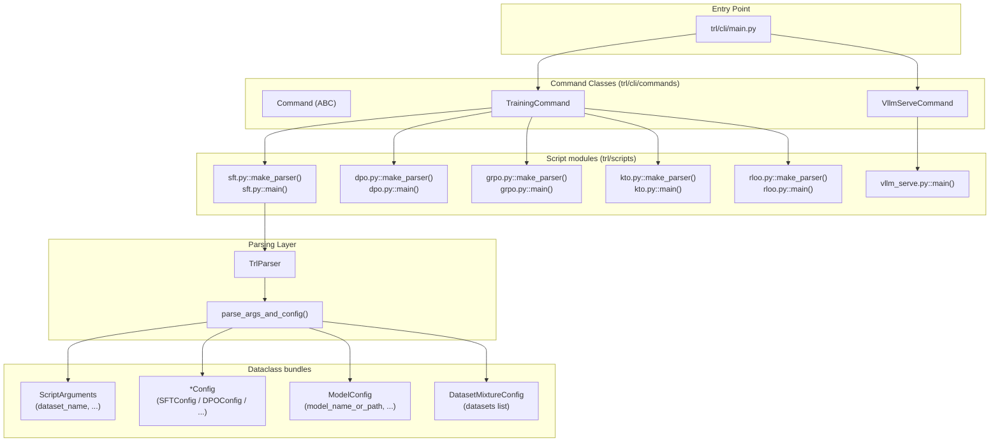
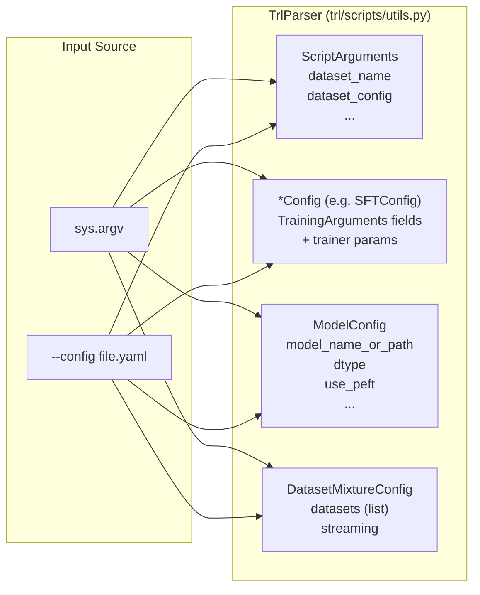

<!-- source: DeepWiki mcp.deepwiki.com · repo huggingface/trl · page 10 Command Line Interface · fetched 2026-10-26 -->

# Command Line Interface

<details>
<summary>Relevant source files</summary>

The following files were used as context for generating this wiki page:

- [docs/source/clis.md](docs/source/clis.md)
- [docs/source/script_utils.md](docs/source/script_utils.md)
- [examples/scripts/prm.py](examples/scripts/prm.py)
- [examples/scripts/sft_gemma3.py](examples/scripts/sft_gemma3.py)
- [tests/test_cli_utils.py](tests/test_cli_utils.py)
- [trl/cli/commands/base.py](trl/cli/commands/base.py)
- [trl/cli/commands/training.py](trl/cli/commands/training.py)
- [trl/cli/commands/vllm_serve.py](trl/cli/commands/vllm_serve.py)
- [trl/cli/main.py](trl/cli/main.py)
- [trl/scripts/dpo.py](trl/scripts/dpo.py)
- [trl/scripts/grpo.py](trl/scripts/grpo.py)
- [trl/scripts/kto.py](trl/scripts/kto.py)
- [trl/scripts/reward.py](trl/scripts/reward.py)
- [trl/scripts/rloo.py](trl/scripts/rloo.py)
- [trl/scripts/sft.py](trl/scripts/sft.py)
- [trl/scripts/utils.py](trl/scripts/utils.py)

</details>


The TRL Command Line Interface (CLI) provides a way to fine-tune language models without writing Python code. The CLI wraps TRL's trainer classes—such as `SFTTrainer`, `DPOTrainer`, `GRPOTrainer`, and others—into subcommands that accept configuration via arguments and YAML files. Training jobs are launched by specifying the model, dataset, and hyperparameters directly from the terminal.

For information about the Python API and trainer classes themselves, see the individual trainer documentation pages: [Supervised Fine-Tuning (SFT)](#3), [Direct Preference Optimization (DPO)](#4), [Group Relative Policy Optimization (GRPO)](#5), [REINFORCE Leave-One-Out (RLOO)](#6), [KTO and Preference Optimization Variants](#7.1), and [Additional Training Methods](#7).

## Overview of CLI Commands

TRL provides the following CLI subcommands:

| Command | Script | Trainer | Purpose |
|---------|--------|---------|---------|
| `trl sft` | `trl/scripts/sft.py` | `SFTTrainer` | Supervised fine-tuning on text or conversational data |
| `trl dpo` | `trl/scripts/dpo.py` | `DPOTrainer` | Direct Preference Optimization with preference pairs |
| `trl grpo` | `trl/scripts/grpo.py` | `GRPOTrainer` | Group Relative Policy Optimization for online RL |
| `trl kto` | `trl/scripts/kto.py` | `KTOTrainer` | Kahneman-Tversky Optimization with unpaired preferences |
| `trl rloo` | `trl/scripts/rloo.py` | `RLOOTrainer` | REINFORCE Leave-One-Out online RL |
| `trl reward` | `trl/scripts/reward.py` | `RewardTrainer` | Train outcome-supervised reward models |
| `trl vllm-serve` | `trl/scripts/vllm_serve.py` | — | Start a vLLM server for fast generation in online methods |
| `trl env` | — | — | Print environment and package version info for bug reports |

Sources: [trl/scripts/sft.py:142-150](), [trl/scripts/dpo.py:144-152](), [trl/scripts/grpo.py:167-175](), [trl/scripts/kto.py:136-145](), [trl/scripts/rloo.py:151-160](), [trl/cli/commands/vllm_serve.py:20-36](), [docs/source/clis.md:5-22]()

## CLI Architecture

The `trl` command dispatches to subcommands defined in `trl/cli/commands/`. Training commands launch scripts located in `trl/scripts/` using `accelerate`. Each script exposes a `make_parser` function that registers its subparser and a `main` function that runs the actual training.

**CLI dispatch flow diagram**



Sources: [trl/cli/commands/training.py:34-72](), [trl/cli/commands/vllm_serve.py:20-36](), [trl/scripts/sft.py:142-156](), [trl/scripts/utils.py:138-159]()

## Using the CLI

### Basic Usage Pattern

All trainer CLI commands follow the same pattern and can be launched directly or via configuration files:

```bash
trl <subcommand> \
    --model_name_or_path <model_name_or_path> \
    --dataset_name <dataset_name> \
    --output_dir <output_directory> \
    [trainer-specific arguments]
```

For details, see [CLI Training Commands](#10.1).

### Supervised Fine-Tuning (SFT)

The `trl sft` command is backed by `trl/scripts/sft.py`. It parses `(ScriptArguments, SFTConfig, ModelConfig, DatasetMixtureConfig)`.

```bash
trl sft \
    --model_name_or_path Qwen/Qwen2-0.5B \
    --dataset_name trl-lib/Capybara \
    --output_dir ./sft_output \
    --learning_rate 2.0e-5 \
    --num_train_epochs 1 \
    --packing \
    --per_device_train_batch_size 2
```

Sources: [trl/scripts/sft.py:27-40](), [trl/scripts/sft.py:142-150]()

### Direct Preference Optimization (DPO)

The `trl dpo` command is backed by `trl/scripts/dpo.py`. It parses `(ScriptArguments, DPOConfig, ModelConfig, DatasetMixtureConfig)`.

```bash
trl dpo \
    --model_name_or_path Qwen/Qwen2-0.5B-Instruct \
    --dataset_name trl-lib/ultrafeedback_binarized \
    --output_dir ./dpo_output \
    --learning_rate 5.0e-7 \
    --per_device_train_batch_size 2
```

Sources: [trl/scripts/dpo.py:27-39](), [trl/scripts/dpo.py:145-152]()

### Group Relative Policy Optimization (GRPO)

The `trl grpo` command is backed by `trl/scripts/grpo.py`. It parses `(GRPOScriptArguments, GRPOConfig, ModelConfig, DatasetMixtureConfig)`. `GRPOScriptArguments` extends `ScriptArguments` with `reward_model_name_or_path` and `reward_funcs`.

```bash
trl grpo \
    --model_name_or_path Qwen/Qwen2.5-0.5B \
    --dataset_name trl-lib/gsm8k \
    --reward_funcs accuracy_reward \
    --output_dir ./grpo_output
```

Sources: [trl/scripts/grpo.py:34-67](), [trl/scripts/grpo.py:168-175]()

### REINFORCE Leave-One-Out (RLOO)

The `trl rloo` command is backed by `trl/scripts/rloo.py`. It parses `(RLOOScriptArguments, RLOOConfig, ModelConfig, DatasetMixtureConfig)`.

```bash
trl rloo \
    --model_name_or_path Qwen/Qwen2.5-0.5B \
    --dataset_name HuggingFaceH4/Polaris-Dataset-53K \
    --reward_funcs accuracy_reward \
    --output_dir ./rloo_output
```

Sources: [trl/scripts/rloo.py:34-67](), [trl/scripts/rloo.py:152-160]()

### KTO Training

The `trl kto` command is backed by `trl/scripts/kto.py`. It parses config using `KTOTrainer` from the experimental namespace.

```bash
trl kto \
    --model_name_or_path trl-lib/qwen1.5-1.8b-sft \
    --dataset_name trl-lib/kto-mix-14k \
    --output_dir ./kto_output
```

Sources: [trl/scripts/kto.py:30-42](), [trl/scripts/kto.py:137-145]()

## Argument Parsing Architecture

**Dataclass bundles parsed by `TrlParser`**



Sources: [trl/scripts/utils.py:138-185](), [trl/scripts/sft.py:142-156](), [trl/cli/commands/training.py:51-71]()

## vLLM Server CLI

The `trl vllm-serve` command starts a vLLM server for fast generation during online training methods:

```bash
trl vllm-serve \
    --model_name_or_path Qwen/Qwen2.5-7B \
    --port 8000 \
    --gpu-memory-utilization 0.9
```

The `VllmServeCommand` class in `trl/cli/commands/vllm_serve.py` delegates execution to `trl/scripts/vllm_serve.py`.

Sources: [trl/cli/commands/vllm_serve.py:20-36](), [docs/source/clis.md:21]()

## YAML Config Files

Any CLI argument can be placed in a YAML file and loaded with `--config`. `TrlParser` handles merging these values with CLI overrides and environment variables defined in the `env` field of the YAML.

Example config structure:
```yaml
model_name_or_path: Qwen/Qwen2.5-0.5B
dataset_name: stanfordnlp/imdb
learning_rate: 0.0001
env:
  VAR1: value1
```

Sources: [docs/source/clis.md:88-106](), [tests/test_cli_utils.py:53-77]()

## Agent Skills System

TRL includes a skills system that allows AI agents (like Claude or OpenCode agents) to effectively use the CLI for training tasks. This is managed via the `trl/skills/` module, which provides discovery and installation of CLI capabilities.

For details, see [Agent Skills System](#10.2).

## Scoped Child Pages

- [CLI Training Commands](#10.1) — Detailed guide on `trl sft`, `dpo`, `grpo`, `kto`, `rloo`, `reward` commands, YAML support, and `TrlParser` logic.
- [Agent Skills System](#10.2) — Documentation for `trl/skills/` module, `SKILL.md` discovery, and agent integration.

Sources: [trl/cli/commands/training.py:34-72](), [trl/scripts/utils.py:138-185]()

---

