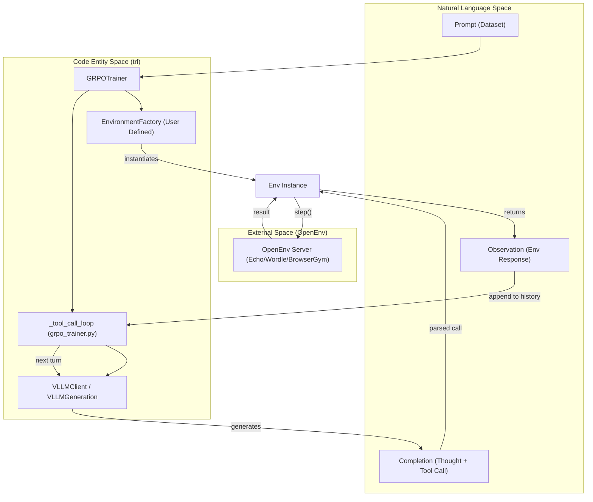
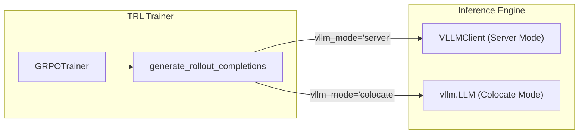

<!-- source: DeepWiki mcp.deepwiki.com · repo huggingface/trl · page 14 OpenEnv and Agentic Training · fetched 2026-10-26 -->

# OpenEnv and Agentic Training

Relevant source files

The following files were used as context for generating this wiki page:

- [docs/source/openenv.md](docs/source/openenv.md)
- [examples/notebooks/grpo_functiongemma_browsergym_openenv.ipynb](examples/notebooks/grpo_functiongemma_browsergym_openenv.ipynb)
- [examples/notebooks/openenv_sudoku_grpo.ipynb](examples/notebooks/openenv_sudoku_grpo.ipynb)
- [examples/notebooks/openenv_wordle_grpo.ipynb](examples/notebooks/openenv_wordle_grpo.ipynb)
- [examples/scripts/openenv/browsergym.py](examples/scripts/openenv/browsergym.py)
- [examples/scripts/openenv/browsergym_llm.py](examples/scripts/openenv/browsergym_llm.py)
- [examples/scripts/openenv/catch.py](examples/scripts/openenv/catch.py)
- [examples/scripts/openenv/echo.py](examples/scripts/openenv/echo.py)
- [examples/scripts/openenv/sudoku.py](examples/scripts/openenv/sudoku.py)
- [examples/scripts/openenv/wordle.py](examples/scripts/openenv/wordle.py)
- [trl/experimental/online_dpo/online_dpo_trainer.py](trl/experimental/online_dpo/online_dpo_trainer.py)
- [trl/experimental/openenv/utils.py](trl/experimental/openenv/utils.py)

The **OpenEnv** framework in TRL provides a standardized interface for training Large Language Models (LLMs) and Vision-Language Models (VLMs) in interactive, stateful environments. Unlike stateless tool-calling where each action is independent, OpenEnv enables genuine multi-turn interaction where an agent's actions shape future observations.

This integration is primarily used with `GRPOTrainer` to facilitate reinforcement learning for agentic workflows, such as web browsing, game playing, or complex reasoning tasks.

## High-Level Architecture

The OpenEnv integration bridges the gap between the model's policy and external execution environments. The `GRPOTrainer` manages a multi-turn loop where it generates actions, executes them via a standardized environment interface, and feeds observations back to the model.

### Agentic Training Loop

The following diagram illustrates how the `GRPOTrainer` coordinates with the `EnvironmentFactory` and the model to perform rollouts:

**Title: TRL Agentic Training Loop**

Sources: [docs/source/openenv.md:110-117](), [trl/experimental/openenv/utils.py:88-114]()

## Core Components

### The Environment Interface
To integrate an environment, users define an environment class (often following the `EnvironmentFactory` pattern) that implements a few key methods:
*   `reset(**kwargs)`: Initializes the environment at the start of an episode.
*   **Tool Methods**: Any public method (e.g., `click()`, `guess()`, `move()`) is automatically discovered and exposed as a tool to the model via its docstring.
*   `reward`: A property or attribute typically updated after each `step()` to be collected by the trainer's reward function.

### Tool Execution in GRPO
The `GRPOTrainer` handles the complexity of the multi-turn interaction through an internal tool-calling loop. It parses the model's generated text for tool calls, executes the corresponding methods on the environment instance, and continues the generation process until the model stops calling tools or reaches a limit.

Sources: [docs/source/openenv.md:139-143](), [examples/scripts/openenv/echo.py:94-115]()

## Supported Environments and Examples

TRL provides several example scripts and notebooks demonstrating OpenEnv integration across different domains:

| Environment | Task Type | Key Features |
| :--- | :--- | :--- |
| **Echo** | Text | Simple length-based reward for testing integration. |
| **Wordle** | Text / Logic | Multi-turn word guessing game using `textarena_env`. |
| **Sudoku** | Logic / Reasoning | Solving 9x9 puzzles with coordinate-based tool calls. |
| **BrowserGym** | VLM / Web | Web navigation using screenshots and accessibility trees. |
| **Catch** | Control | Moving a paddle to catch falling balls (OpenSpiel). |

### Multi-Turn VLM Example: BrowserGym
In `examples/scripts/openenv/browsergym.py`, the agent receives both text (accessibility tree) and visual (screenshots) observations. Each tool call (like `click` or `fill`) returns a new state that includes a PIL image, allowing the VLM to "see" the result of its actions.

Sources: [examples/scripts/openenv/browsergym.py:27-29](), [examples/scripts/openenv/wordle.py:182-195]()

## Advanced Training Modes

### Async GRPO for Long-Horizon Tasks
For complex agentic tasks where environment steps are slow (e.g., real-world web browsing or heavy simulations), TRL offers an experimental `AsyncGRPOTrainer`. This architecture decouples the generation (rollout) from the optimization (training), allowing multiple workers to interact with environments in parallel and stream data back to the trainer.

For details, see **[Async GRPO for Agentic Workflows](#14.2)**.

### vLLM Integration
OpenEnv training heavily relies on vLLM for efficient generation during rollouts. TRL supports both `colocate` mode (vLLM and Trainer share a GPU) and `server` mode (separate vLLM instance).

**Title: vLLM Rollout Generation Flow**

Sources: [trl/experimental/openenv/utils.py:108-113](), [examples/scripts/openenv/wordle.py:168-178]()

## Detailed Documentation

*   **[OpenEnv Interface and Examples](#14.1)**: Deep dive into the `reset/step` interface, tool masking for loss calculation, and specific environment implementations like Wordle and BrowserGym.
*   **[Async GRPO for Agentic Workflows](#14.2)**: Technical details on the `AsyncRolloutWorker`, weight synchronization via `NCCLWeightTransferEngine`, and handling stale rollouts.

Sources: [docs/source/openenv.md:1-135]()

---

