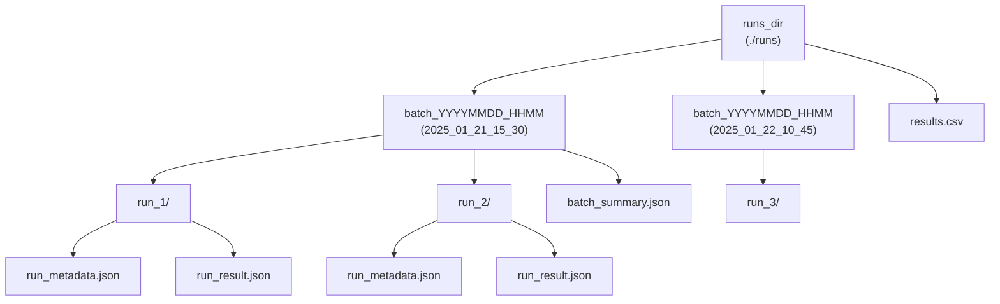
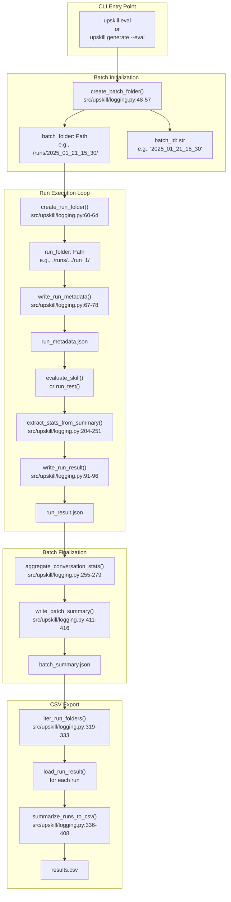

<!-- source: DeepWiki mcp.deepwiki.com · repo huggingface/upskill · page 8.1 Run Directory Structure · fetched 2026-10-26 -->

# Run Directory Structure

<details>
<summary>Relevant source files</summary>

The following files were used as context for generating this wiki page:

- [README.md](README.md)
- [src/upskill/logging.py](src/upskill/logging.py)

</details>


This document describes the directory structure and file formats used by upskill's run logging system. Run logging captures detailed evaluation metrics for every test execution, enabling performance tracking, comparison, and analysis over time.

For information about the metrics stored within these files, see [Conversation Statistics](#8.2). For information about visualizing and analyzing run data, see [Results Visualization](#8.3) and [CSV Export and Analysis](#8.4).

## Overview

The run logging system organizes evaluation results into a hierarchical directory structure under the `runs_dir` (default: `./runs/`). Each evaluation session creates a timestamped batch folder containing individual run folders. Each run folder stores metadata and results in JSON format, while aggregate statistics are maintained at the batch level.

**Directory Hierarchy**



**Sources:** [README.md:356-370](), [src/upskill/logging.py:1-14]()

## Batch Folders

Batch folders group related evaluation runs together using a timestamp-based naming convention: `batch_YYYYMMDD_HHMM`. Each batch folder is created by `create_batch_folder()` when a new evaluation session begins.

**Batch Folder Naming**

| Component | Format | Example |
|-----------|--------|---------|
| Year | `YYYY` | `2025` |
| Month | `MM` | `01` |
| Day | `DD` | `21` |
| Hour | `HH` | `15` |
| Minute | `MM` | `30` |

**Complete Path:** `./runs/2025_01_21_15_30/`

The batch ID is generated using `datetime.now().strftime("%Y_%m_%d_%H_%M")` in the `create_batch_folder()` function.

**Sources:** [src/upskill/logging.py:48-57]()

## Run Folders

Within each batch folder, individual runs are stored in numbered subdirectories: `run_1/`, `run_2/`, etc. Each run folder contains exactly two JSON files that capture the complete execution context and results.

**Run Folder Structure**

```
batch_2025_01_21_15_30/
├── run_1/
│   ├── run_metadata.json
│   └── run_result.json
├── run_2/
│   ├── run_metadata.json
│   └── run_result.json
└── batch_summary.json
```

Run folders are created by `create_run_folder()` which takes a batch folder path and run number as parameters.

**Sources:** [src/upskill/logging.py:60-64]()

## run_metadata.json

The `run_metadata.json` file stores execution context information written at the start of a run. This file is created by `write_run_metadata()` and contains a `RunMetadata` object serialized to JSON.

**File Structure**

```json
{
  "model": "anthropic.claude-sonnet-4-20250514",
  "task": "git-commit-messages",
  "batch_id": "2025_01_21_15_30",
  "run_number": 1,
  "timestamp": "2025-01-21T15:30:42.123456"
}
```

**Field Descriptions**

| Field | Type | Description |
|-------|------|-------------|
| `model` | string | Full model identifier used for evaluation |
| `task` | string | Task or skill name being evaluated |
| `batch_id` | string | Parent batch identifier (timestamp) |
| `run_number` | integer | Sequential run number within batch |
| `timestamp` | ISO 8601 string | Exact time the run was initiated |

The metadata is loaded using `load_run_metadata()` which returns an empty dict if the file doesn't exist or cannot be parsed.

**Sources:** [src/upskill/logging.py:67-89](), [src/upskill/models.py:252-269]()

## run_result.json

The `run_result.json` file stores complete evaluation results written at the end of a run. This file is created by `write_run_result()` and contains a `RunResult` object with embedded `RunMetadata` and `ConversationStats`.

**File Structure**

```json
{
  "metadata": {
    "model": "anthropic.claude-sonnet-4-20250514",
    "task": "git-commit-messages",
    "batch_id": "2025_01_21_15_30",
    "run_number": 1,
    "timestamp": "2025-01-21T15:30:42.123456"
  },
  "stats": {
    "conversation_span_ms": 8234.5,
    "llm_time_ms": 7123.2,
    "tool_time_ms": 1111.3,
    "turns": 5,
    "tool_calls": 12,
    "tool_errors": 0,
    "mcp_calls": 8,
    "execute_calls": 4,
    "input_tokens": 1200,
    "output_tokens": 800,
    "total_tokens": 2000,
    "tool_call_map": {
      "filesystem__read": 5,
      "execute_python": 4
    },
    "tool_error_map": {},
    "usage_summaries": [],
    "timing_summaries": []
  },
  "passed": true,
  "assertions_passed": 3,
  "assertions_total": 3,
  "run_type": "with_skill",
  "skill_name": "git-commit-messages",
  "session_id": "abc123",
  "session_history_file": "/path/to/session.json",
  "error_message": null
}
```

**Field Descriptions**

| Field | Type | Description |
|-------|------|-------------|
| `metadata` | object | `RunMetadata` object (see above) |
| `stats` | object | `ConversationStats` object with detailed metrics (see [#8.2](#8.2)) |
| `passed` | boolean | Whether all test assertions passed |
| `assertions_passed` | integer | Number of successful assertions |
| `assertions_total` | integer | Total number of assertions |
| `run_type` | string | "baseline" or "with_skill" |
| `skill_name` | string\|null | Name of skill being evaluated |
| `session_id` | string\|null | FastAgent session identifier |
| `session_history_file` | string\|null | Path to session history file |
| `error_message` | string\|null | Error message if run failed |

The result is loaded using `load_run_result()` which returns `None` if the file doesn't exist or cannot be parsed.

**Sources:** [src/upskill/logging.py:91-108](), [src/upskill/models.py:308-339]()

## batch_summary.json

The `batch_summary.json` file stores aggregate statistics for all runs within a batch. This file is created by `write_batch_summary()` and contains a `BatchSummary` object.

**File Structure**

```json
{
  "batch_id": "2025_01_21_15_30",
  "total_runs": 5,
  "passed_runs": 4,
  "failed_runs": 1,
  "pass_rate": 0.8,
  "avg_assertions_passed": 2.8,
  "avg_assertions_total": 3.0,
  "avg_input_tokens": 1150.0,
  "avg_output_tokens": 780.0,
  "avg_total_tokens": 1930.0,
  "avg_conversation_span_ms": 7845.2,
  "avg_llm_time_ms": 6823.4,
  "avg_tool_time_ms": 1021.8,
  "avg_turns": 4.6,
  "avg_tool_calls": 10.2,
  "models": ["sonnet", "haiku"],
  "tasks": ["git-commit-messages"]
}
```

**Field Descriptions**

| Field | Type | Description |
|-------|------|-------------|
| `batch_id` | string | Batch identifier |
| `total_runs` | integer | Total number of runs in batch |
| `passed_runs` | integer | Number of runs where `passed=true` |
| `failed_runs` | integer | Number of runs where `passed=false` |
| `pass_rate` | float | `passed_runs / total_runs` |
| `avg_assertions_passed` | float | Mean assertions passed across runs |
| `avg_assertions_total` | float | Mean total assertions across runs |
| `avg_input_tokens` | float | Mean input tokens across runs |
| `avg_output_tokens` | float | Mean output tokens across runs |
| `avg_total_tokens` | float | Mean total tokens across runs |
| `avg_conversation_span_ms` | float | Mean total conversation duration |
| `avg_llm_time_ms` | float | Mean LLM processing time |
| `avg_tool_time_ms` | float | Mean tool execution time |
| `avg_turns` | integer | Mean conversation turns |
| `avg_tool_calls` | float | Mean tool invocations |
| `models` | array[string] | List of unique models in batch |
| `tasks` | array[string] | List of unique tasks in batch |

The summary is loaded using `load_batch_summary()` which returns `None` if the file doesn't exist or cannot be parsed.

**Sources:** [src/upskill/logging.py:411-427](), [src/upskill/models.py:342-371]()

## results.csv

The `results.csv` file is generated at the runs directory root level by the `summarize_runs_to_csv()` function. It provides a flattened view of all runs across all batches for easy analysis in spreadsheet tools or data analysis frameworks.

**CSV Schema**

The CSV contains 24 columns defined in the `FIELDNAMES` constant:

| Column | Type | Description |
|--------|------|-------------|
| `batch_id` | string | Batch folder timestamp |
| `run_number` | integer | Run number within batch |
| `model` | string | Model identifier |
| `task` | string | Task/skill name |
| `timestamp` | ISO 8601 | Run start time |
| `passed` | boolean | Test passed flag |
| `assertions_passed` | integer | Successful assertions |
| `assertions_total` | integer | Total assertions |
| `input_tokens` | integer | Input token count |
| `output_tokens` | integer | Output token count |
| `total_tokens` | integer | Total token count |
| `conversation_span_ms` | float | Total conversation duration |
| `llm_time_ms` | float | LLM processing time |
| `tool_time_ms` | float | Tool execution time |
| `turns` | integer | Conversation turns |
| `tool_calls` | integer | Total tool invocations |
| `tool_errors` | integer | Tool errors encountered |
| `mcp_calls` | integer | MCP protocol tool calls |
| `execute_calls` | integer | Direct execution calls |
| `error_message` | string | Error message if failed |
| `session_id` | string | FastAgent session ID |
| `session_history_file` | string | Path to session history |

**Example CSV Content**

```csv
batch_id,run_number,model,task,timestamp,passed,assertions_passed,assertions_total,input_tokens,output_tokens,total_tokens,...
2025_01_21_15_30,1,sonnet,git-commit-messages,2025-01-21T15:30:42.123456,true,3,3,1200,800,2000,...
2025_01_21_15_30,2,haiku,git-commit-messages,2025-01-21T15:31:12.456789,true,3,3,950,650,1600,...
```

The CSV is generated by iterating over all run folders with `iter_run_folders()` and loading each `run_result.json` file. If a result file is missing, the function attempts to construct a minimal `RunResult` from `run_metadata.json`.

**Sources:** [src/upskill/logging.py:16-45](), [src/upskill/logging.py:336-408]()

## File Creation Workflow

The following diagram shows the code flow for creating run logging files during an evaluation session.

**Diagram: Run Logging Code Flow**



**Sources:** [src/upskill/logging.py:48-428]()

## Accessing Run Data Programmatically

The logging module provides a complete API for accessing run data programmatically. These functions can be used to build custom analysis tools or integrate run data into other systems.

**Loading Individual Run Data**

```python
from pathlib import Path
from upskill.logging import load_run_metadata, load_run_result

run_folder = Path("./runs/2025_01_21_15_30/run_1")

# Load metadata (dict)
metadata = load_run_metadata(run_folder)
print(f"Model: {metadata['model']}, Task: {metadata['task']}")

# Load complete result (RunResult object)
result = load_run_result(run_folder)
if result:
    print(f"Passed: {result.passed}")
    print(f"Tokens: {result.stats.total_tokens}")
    print(f"LLM Time: {result.stats.llm_time_ms}ms")
```

**Loading Batch Summaries**

```python
from upskill.logging import load_batch_summary

batch_folder = Path("./runs/2025_01_21_15_30")

summary = load_batch_summary(batch_folder)
if summary:
    print(f"Pass Rate: {summary.pass_rate:.1%}")
    print(f"Avg Tokens: {summary.avg_total_tokens:.0f}")
    print(f"Models: {', '.join(summary.models)}")
```

**Iterating Over All Runs**

```python
from upskill.logging import iter_run_folders, load_run_result

runs_dir = Path("./runs")

for run_folder in iter_run_folders(runs_dir):
    result = load_run_result(run_folder)
    if result:
        print(f"{result.metadata.batch_id}/run_{result.metadata.run_number}: "
              f"{result.metadata.model} - {result.passed}")
```

**Generating CSV Summaries**

```python
from upskill.logging import summarize_runs_to_csv

runs_dir = Path("./runs")
csv_path = summarize_runs_to_csv(runs_dir)
print(f"Summary exported to: {csv_path}")

# Export to custom location
custom_csv = summarize_runs_to_csv(runs_dir, Path("./analysis/results.csv"))
```

**Sources:** [src/upskill/logging.py:80-108](), [src/upskill/logging.py:319-408](), [src/upskill/logging.py:418-427]()

## Data Model Reference

The run logging system uses three primary Pydantic models defined in `src/upskill/models.py`:

| Model | Line Reference | Purpose |
|-------|---------------|---------|
| `RunMetadata` | [src/upskill/models.py:252-269]() | Execution context and identifiers |
| `ConversationStats` | [src/upskill/models.py:212-249]() | Detailed performance metrics (see [#8.2](#8.2)) |
| `RunResult` | [src/upskill/models.py:308-339]() | Complete run outcome with metadata and stats |
| `BatchSummary` | [src/upskill/models.py:342-371]() | Aggregated statistics across runs |

For detailed information about the metrics captured in `ConversationStats`, including timing breakdowns, token usage, and tool categorization, see [Conversation Statistics](#8.2).

For information about visualizing and filtering run data using the CLI, see [Results Visualization](#8.3).

For information about exporting and analyzing run data in external tools, see [CSV Export and Analysis](#8.4).

**Sources:** [src/upskill/models.py:212-371]()

---

