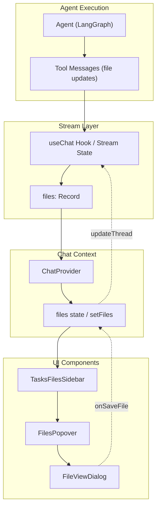
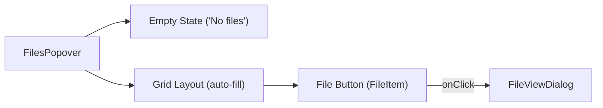
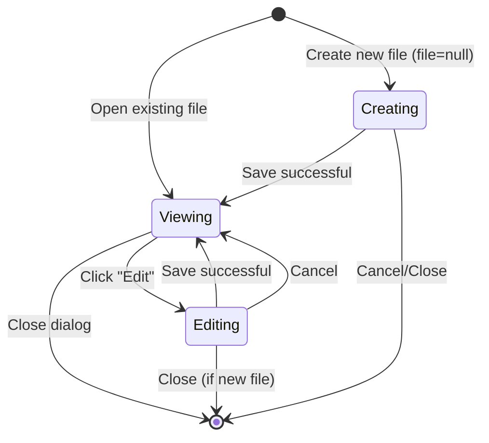
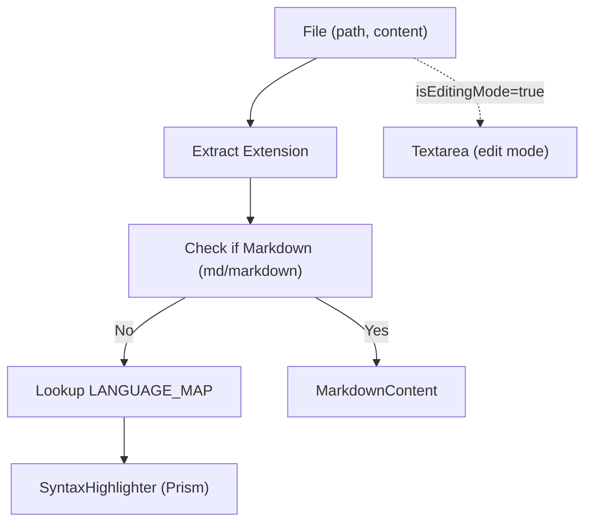

<!-- source: DeepWiki mcp.deepwiki.com · repo langchain-ai/deep-agents-ui · page 6.1 File Management · fetched 2026-10-26 -->

# File Management

<details>
<summary>Relevant source files</summary>

The following files were used as context for generating this wiki page:

- [src/app/components/FileViewDialog.tsx](src/app/components/FileViewDialog.tsx)
- [src/app/components/SubAgentIndicator.tsx](src/app/components/SubAgentIndicator.tsx)

</details>


This document covers the file management system in the Deep Agents UI, which enables users to view, edit, and interact with files created or modified by the agent during execution. The system provides syntax-highlighted file viewing, inline editing capabilities, and file operations such as copy and download.

For information about task (todo) management displayed in the same sidebar, see [Task Sidebar](6.2). For general agent state and streaming updates, see [useChat Hook](4.2).

## Overview

The file management system consists of two primary components: `FilesPopover` for displaying files in a grid layout, and `FileViewDialog` for viewing and editing individual file contents. Files are stored in the agent's state as a `Record<string, string>` mapping file paths to their contents, and are synchronized through the LangGraph streaming API.

**Sources**: [src/app/components/TasksFilesSidebar.tsx:23-112](), [src/app/components/FileViewDialog.tsx:1-297]()

## File State and Storage

### File Data Structure

Files in the system are represented as a simple key-value structure where keys are file paths and values are file contents:

```typescript
files: Record<string, string>
```

The `FileItem` type provides a structured representation for individual files:

```typescript
interface FileItem {
  path: string;
  content: string;
}
```

### State Management Flow



**Diagram: File State Flow Through the Application**

Files flow from agent execution through the streaming layer into React state managed by `ChatProvider`, then render through the sidebar components. User edits flow back through the same path to update the agent's thread state.

**Sources**: [src/app/components/TasksFilesSidebar.tsx:114-264](), [src/app/components/FileViewDialog.tsx:53-73]()

## File Display Components

### FilesPopover Component

The `FilesPopover` component ([src/app/components/TasksFilesSidebar.tsx:23-112]()) renders the file list in a responsive grid layout. It handles the display of all files and manages file selection for viewing/editing.

#### Component Structure



**Diagram: FilesPopover Component Structure**

**Key Features**:

| Feature | Implementation | Location |
|---------|---------------|----------|
| Empty State | Displays "No files created yet" when no files exist | [src/app/components/TasksFilesSidebar.tsx:44-47]() |
| Grid Layout | CSS Grid with auto-fill and 256px minimum columns | [src/app/components/TasksFilesSidebar.tsx:49]() |
| File Buttons | Interactive buttons with `FileText` icon and filename | [src/app/components/TasksFilesSidebar.tsx:70-98]() |
| Content Parsing | Handles both string and object content formats | [src/app/components/TasksFilesSidebar.tsx:54-67]() |

#### Content Normalization

The `FilesPopover` includes logic to normalize file content that may arrive in different formats:

```typescript
// Handle content that may be an object with {content: [lines]} structure
if (typeof rawContent === "object" && rawContent !== null && "content" in rawContent) {
  const contentArray = (rawContent as { content: unknown }).content;
  if (Array.isArray(contentArray)) {
    fileContent = contentArray.join("\n");
  }
}
```

This ensures consistent string content regardless of the agent's output format.

**Sources**: [src/app/components/TasksFilesSidebar.tsx:54-67]()

### Integration with TasksFilesSidebar

The file display is integrated into the `TasksFilesSidebar` component with collapsible functionality. The files section auto-expands when files are first created ([src/app/components/TasksFilesSidebar.tsx:136-142]()):

```typescript
useEffect(() => {
  if (prevFilesCount.current === 0 && filesCount > 0) {
    setFilesOpen(true);
  }
  prevFilesCount.current = filesCount;
}, [filesCount]);
```

**Sources**: [src/app/components/TasksFilesSidebar.tsx:114-264]()

## FileViewDialog Component

The `FileViewDialog` component ([src/app/components/FileViewDialog.tsx:53-296]()) provides a full-featured file viewer and editor with syntax highlighting, markdown rendering, and file operations.

### Dialog State Management



**Diagram: FileViewDialog State Machine**

The dialog tracks its mode with the `isEditingMode` state ([src/app/components/FileViewDialog.tsx:59]()):
- New files (when `file === null`) start in editing mode.
- Existing files start in viewing mode.
- Users can switch to editing mode via the `handleEdit` callback ([src/app/components/FileViewDialog.tsx:114-116]()).

**Sources**: [src/app/components/FileViewDialog.tsx:59-79]()

### File Type Detection and Rendering

The dialog implements sophisticated file type detection and rendering:

#### Language Mapping

The `LANGUAGE_MAP` ([src/app/components/FileViewDialog.tsx:17-51]()) supports over 30 file extensions including programming languages (js, ts, py, go, rs), configuration formats (json, yaml, toml), and markup languages.

#### Rendering Pipeline



**Diagram: File Rendering Pipeline**

The rendering logic ([src/app/components/FileViewDialog.tsx:206-251]()):

| Condition | Renderer | Component/Library |
|-----------|----------|-------------------|
| `isEditingMode === true` | Plain textarea | `Textarea` component |
| `isMarkdown === true` | Markdown renderer | `MarkdownContent` component |
| Otherwise | Syntax highlighter | `SyntaxHighlighter` (Prism) |

**Sources**: [src/app/components/FileViewDialog.tsx:81-92](), [src/app/components/FileViewDialog.tsx:206-251]()

### Syntax Highlighting Configuration

The dialog uses `react-syntax-highlighter` with the Prism engine and `oneDark` theme ([src/app/components/FileViewDialog.tsx:223-240]()). Key features include line numbers and `pre-wrap` white-space handling for long lines.

**Sources**: [src/app/components/FileViewDialog.tsx:223-240]()

## File Operations

### View Mode Operations

When viewing a file, the dialog provides three operations: `Edit`, `Copy`, and `Download`.

#### Copy to Clipboard

```typescript
const handleCopy = useCallback(() => {
  if (fileContent) {
    navigator.clipboard.writeText(fileContent);
  }
}, [fileContent]);
```

Uses the Clipboard API to copy file contents to the system clipboard ([src/app/components/FileViewDialog.tsx:94-98]()).

#### Download File

```typescript
const handleDownload = useCallback(() => {
  if (fileContent && fileName) {
    const blob = new Blob([fileContent], { type: "text/plain" });
    const url = URL.createObjectURL(blob);
    const a = document.createElement("a");
    a.href = url;
    a.download = fileName;
    document.body.appendChild(a);
    a.click();
    document.body.removeChild(a);
    URL.revokeObjectURL(url);
  }
}, [fileContent, fileName]);
```

Creates a temporary blob URL and triggers a browser download with the filename preserved ([src/app/components/FileViewDialog.tsx:100-112]()).

**Sources**: [src/app/components/FileViewDialog.tsx:94-112](), [src/app/components/FileViewDialog.tsx:163-202]()

### Edit Mode Operations

In edit mode, users can modify both filename and content.

#### Filename Validation

The dialog enforces filename constraints via `fileNameIsValid` ([src/app/components/FileViewDialog.tsx:128-134]()):
- Not empty
- No forward slashes ()
- No spaces

#### Save Operation

File saves are handled through `useSWRMutation` ([src/app/components/FileViewDialog.tsx:63-73]()):

```typescript
const fileUpdate = useSWRMutation(
  { kind: "files-update", fileName, fileContent },
  async ({ fileName, fileContent }) => {
    if (!fileName || !fileContent) return;
    return await onSaveFile(fileName, fileContent);
  },
  {
    onSuccess: () => setIsEditingMode(false),
    onError: (error) => toast.error(`Failed to save file: ${error}`),
  }
);
```

The mutation calls the `onSaveFile` callback provided by the parent and transitions back to view mode on success.

**Sources**: [src/app/components/FileViewDialog.tsx:63-73](), [src/app/components/FileViewDialog.tsx:128-134]()

## Edit Restrictions

File editing is disabled under certain conditions to prevent conflicts during agent execution. The `editDisabled` prop ([src/app/components/TasksFilesSidebar.tsx:257]()) disables editing when:

| Condition | Reason |
|-----------|--------|
| `isLoading === true` | Agent is actively processing and may modify files |
| `interrupt !== undefined` | Agent is awaiting user input on an interrupt |

**Sources**: [src/app/components/TasksFilesSidebar.tsx:119](), [src/app/components/TasksFilesSidebar.tsx:257]()

## Sub-Agent Visibility

In complex workflows involving hierarchical agents, the `SubAgentIndicator` component ([src/app/components/SubAgentIndicator.tsx:14-46]()) is used to display sub-agent execution contexts. While primarily a chat interface element, it helps track which agent (main or sub-agent) is responsible for the current state, including file modifications.

**Sources**: [src/app/components/SubAgentIndicator.tsx:1-48]()

---

