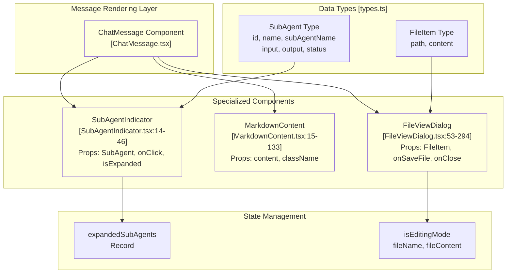
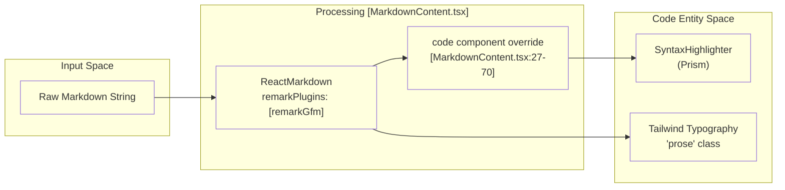
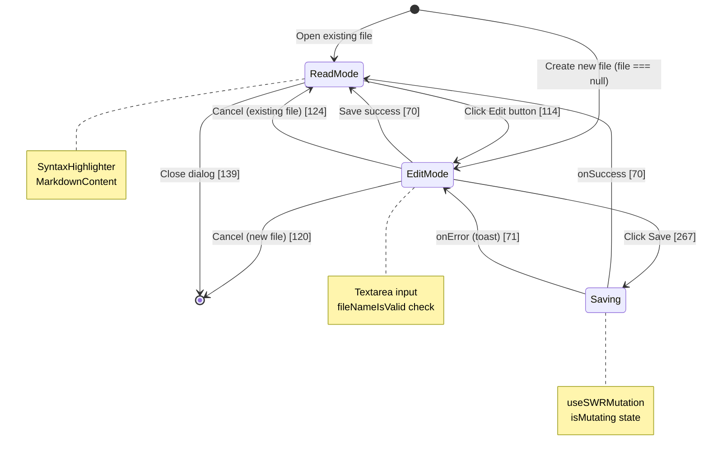

<!-- source: DeepWiki mcp.deepwiki.com · repo langchain-ai/deep-agents-ui · page 7.3 Specialized Components · fetched 2026-10-26 -->

# Specialized Components

<details>
<summary>Relevant source files</summary>

The following files were used as context for generating this wiki page:

- [postcss.config.cjs](postcss.config.cjs)
- [src/app/components/FileViewDialog.tsx](src/app/components/FileViewDialog.tsx)
- [src/app/components/MarkdownContent.tsx](src/app/components/MarkdownContent.tsx)
- [src/app/components/SubAgentIndicator.tsx](src/app/components/SubAgentIndicator.tsx)

</details>


## Purpose and Scope

This document covers domain-specific UI components that handle specialized agent interaction patterns in the Deep Agents UI. Unlike the generic UI primitives covered in [UI Component Library](7.2), these components encapsulate complex behaviors specific to agent workflows such as sub-agent visualization, file management, and tool execution display.

For information about tool execution visualization and approval workflows, see [Agent Tools and Execution](5). For file management features and the task sidebar, see [Files and Tasks](6).

---

## Overview of Specialized Components

The Deep Agents UI includes several specialized components that handle specific aspects of agent interaction beyond standard UI patterns. These components integrate deeply with the LangGraph agent execution model and provide rich, contextual interfaces for agent-generated content.

| Component | Primary Purpose | Key Features |
|-----------|----------------|--------------|
| `SubAgentIndicator` | Display sub-agent execution details | Collapsible interface, status tracking, name display |
| `FileViewDialog` | View and edit agent-managed files | Syntax highlighting, markdown rendering, inline editing |
| `MarkdownContent` | Render formatted agent responses | Remark-GFM support, syntax highlighting for code blocks |

**Sources**: [src/app/components/SubAgentIndicator.tsx:1-49](), [src/app/components/FileViewDialog.tsx:1-297](), [src/app/components/MarkdownContent.tsx:1-136]()

---

## Component Architecture

### Specialized Component Integration Pattern



This diagram illustrates how specialized components are integrated into the message rendering layer. The `ChatMessage` component acts as the orchestrator, determining which specialized components to render based on message content and tool execution state.

**Sources**: [src/app/components/SubAgentIndicator.tsx:14-46](), [src/app/components/FileViewDialog.tsx:53-294](), [src/app/components/MarkdownContent.tsx:15-133]()

---

## SubAgentIndicator Component

The `SubAgentIndicator` component provides a collapsible interface for displaying sub-agent execution details. It identifies when the agent has delegated work to a specialized sub-agent (typically using a "task" tool) and presents the sub-agent's identity and status.

### Component Interface

```typescript
interface SubAgentIndicatorProps {
  subAgent: SubAgent;
  onClick: () => void;
  isExpanded?: boolean;
}
```

The component is defined at [src/app/components/SubAgentIndicator.tsx:14-46]() and accepts three props:
- `subAgent`: Contains sub-agent metadata including `subAgentName` [src/app/components/SubAgentIndicator.tsx:27]().
- `onClick`: Handler for toggling the expanded/collapsed state [src/app/components/SubAgentIndicator.tsx:21]().
- `isExpanded`: Boolean indicating current expansion state (defaults to true) [src/app/components/SubAgentIndicator.tsx:15]().

### Visual Structure

The component renders a collapsible button with the sub-agent name and a chevron icon:

| Element | Implementation | Location |
|---------|---------------|----------|
| Container | `rounded-lg border-none bg-card` | [SubAgentIndicator.tsx:17]() |
| Button | `variant="ghost"` with full width | [SubAgentIndicator.tsx:18-23]() |
| Label | Sub-agent type name in bold text | [SubAgentIndicator.tsx:26-28]() |
| Icon | `ChevronUp` or `ChevronDown` based on state | [SubAgentIndicator.tsx:30-40]() |

**Sources**: [src/app/components/SubAgentIndicator.tsx:1-49]()

---

## FileViewDialog Component

The `FileViewDialog` component provides a full-featured file viewing and editing interface with syntax highlighting, markdown rendering, and file management operations (copy, download, edit, save).

### Component Interface and State

```typescript
export const FileViewDialog = React.memo<{
  file: FileItem | null;
  onSaveFile: (fileName: string, content: string) => Promise<void>;
  onClose: () => void;
  editDisabled: boolean;
}>(/*...*)
```

Defined at [src/app/components/FileViewDialog.tsx:53-58](), the component manages internal state for editing mode:

| State Variable | Type | Purpose |
|----------------|------|---------|
| `isEditingMode` | `boolean` | Tracks whether file is in edit mode [src/app/components/FileViewDialog.tsx:59]() |
| `fileName` | `string` | Current file name (editable for new files) [src/app/components/FileViewDialog.tsx:60]() |
| `fileContent` | `string` | Current file content [src/app/components/FileViewDialog.tsx:61]() |

### File Type Detection and Language Mapping

The component uses file extension detection to determine appropriate syntax highlighting via a `LANGUAGE_MAP` [src/app/components/FileViewDialog.tsx:17-51]().

```typescript
const fileExtension = useMemo(() => {
  const fileNameStr = String(fileName || "");
  return fileNameStr.split(".").pop()?.toLowerCase() || "";
}, [fileName]);
```

This logic at [src/app/components/FileViewDialog.tsx:81-84]() supports over 30 file types including programming languages, markup languages, and configuration formats.

### Rendering Modes

The component switches between three rendering modes:

1. **Edit Mode**: Uses `Textarea` for direct editing [src/app/components/FileViewDialog.tsx:207-213]().
2. **Syntax Highlighted View**: Uses `SyntaxHighlighter` with `oneDark` theme for code files [src/app/components/FileViewDialog.tsx:223-240]().
3. **Markdown View**: Uses `MarkdownContent` component for `.md` and `.markdown` files [src/app/components/FileViewDialog.tsx:218-221]().

### File Operations

| Operation | Icon | Implementation | Handler Location |
|-----------|------|----------------|------------------|
| Edit | `Edit` | Enter editing mode | [FileViewDialog.tsx:114-116]() |
| Copy | `Copy` | Copy content to clipboard | [FileViewDialog.tsx:94-98]() |
| Download | `Download` | Download as file via Blob URL | [FileViewDialog.tsx:100-112]() |
| Save | `Save` | Persist changes via `onSaveFile` | [FileViewDialog.tsx:63-73]() |

### Save Mutation with SWR

File saving is handled through `useSWRMutation` for optimistic updates and error handling [src/app/components/FileViewDialog.tsx:63-73](). It triggers the `onSaveFile` callback and displays a toast notification on error [src/app/components/FileViewDialog.tsx:71]().

**Sources**: [src/app/components/FileViewDialog.tsx:1-297]()

---

## MarkdownContent Component

The `MarkdownContent` component is the primary engine for rendering text content from agents, supporting GitHub Flavored Markdown (GFM) and integrated code highlighting.

### Rendering Pipeline



### Key Features
- **GFM Support**: Includes `remarkGfm` for tables, task lists, and strikethrough [src/app/components/MarkdownContent.tsx:25]().
- **Syntax Highlighting**: Uses `react-syntax-highlighter` with the `oneDark` theme for non-inline code blocks [src/app/components/MarkdownContent.tsx:39-61]().
- **Styling**: Applies Tailwind's `prose` class with custom overrides for typography [src/app/components/MarkdownContent.tsx:20]().
- **Custom Link Handling**: Automatically adds `target="_blank"` and `rel="noopener noreferrer"` to all links [src/app/components/MarkdownContent.tsx:86-93]().

**Sources**: [src/app/components/MarkdownContent.tsx:1-136]()

---

## File Dialog State Management

### FileViewDialog State Transitions



This state diagram illustrates the file dialog's mode transitions. The component uses `useSWRMutation` at [src/app/components/FileViewDialog.tsx:63-73]() to manage the save operation with loading states and error handling.

**Sources**: [src/app/components/FileViewDialog.tsx:53-294]()

---

## Summary

Specialized components in the Deep Agents UI provide rich, contextual interfaces for specific agent interaction patterns. The `SubAgentIndicator` component handles the visualization of delegated sub-agent work, while the `FileViewDialog` component provides a full-featured file management interface with syntax highlighting and editing capabilities. These components are optimized for performance using `React.memo` [src/app/components/SubAgentIndicator.tsx:14](), [src/app/components/FileViewDialog.tsx:53](), [src/app/components/MarkdownContent.tsx:15]().

---

