# Page: Overview

# Overview

<details>
<summary>Relevant source files</summary>

The following files were used as context for generating this wiki page:

- [.github/CODEOWNERS](.github/CODEOWNERS)
- [README.md](README.md)
- [examples/README.md](examples/README.md)
- [examples/async-subagent-server/uv.lock](examples/async-subagent-server/uv.lock)
- [examples/downloading_agents/README.md](examples/downloading_agents/README.md)
- [examples/downloading_agents/content-writer.zip](examples/downloading_agents/content-writer.zip)
- [examples/llm-wiki/uv.lock](examples/llm-wiki/uv.lock)
- [libs/acp/uv.lock](libs/acp/uv.lock)
- [libs/code/README.md](libs/code/README.md)
- [libs/deepagents/README.md](libs/deepagents/README.md)
- [libs/deepagents/pyproject.toml](libs/deepagents/pyproject.toml)
- [libs/deepagents/uv.lock](libs/deepagents/uv.lock)
- [libs/partners/daytona/uv.lock](libs/partners/daytona/uv.lock)
- [libs/partners/modal/uv.lock](libs/partners/modal/uv.lock)
- [libs/partners/quickjs/uv.lock](libs/partners/quickjs/uv.lock)
- [libs/partners/runloop/uv.lock](libs/partners/runloop/uv.lock)

</details>


Deep Agents is a batteries-included agent framework designed for building autonomous AI agents with advanced capabilities in planning, delegation, and filesystem interaction. It is built on top of LangGraph, providing an opinionated yet fully extensible agent harness that abstracts away manual wiring of prompts, toolsets, and context management. Deep Agents offers a rich CLI experience, extensibility through pluggable middleware, and supports a variety of backend environments including local and remote sandboxes.

For deeper dives, see the child pages on [Packages](#1.1), [Quick Start](#1.2), and [Architecture Overview](#1.3).

Sources: [README.md:12-24](), [libs/deepagents/README.md:1-21]()

---

## 1.1. Packages

The Deep Agents monorepo consists of multiple independently versioned Python packages managed via the `uv` package manager, designed to separate concerns between core SDK functionality, terminal UI, integrations, and evaluation frameworks:

- **`deepagents`**: The core SDK library featuring the primary function `create_deep_agent()` for agent instantiation, a modular middleware stack (`AgentMiddleware`), and backend abstractions following `BackendProtocol`. This is the foundational package for agent logic and orchestration.  
- **`deepagents-code`**: The pre-built interactive terminal UI and coding agent accessible through the `dcode` command-line tool, built using Textual for a rich TUI experience.
- **`deepagents-cli`**: Command-line tools for project initialization, development, and deploy workflows.
- **`deepagents-acp`**: Agent Client Protocol implementation to integrate with editors like Zed for communication and tooling.
- **`deepagents-evals`**: Behavioral evaluation framework including Harbor integration to provide standardized benchmarks and rigorous agent performance assessment.
- **`deepagents-talon`**: An experimental runtime host for long-lived agents supporting channel adapters (Slack, Telegram, etc.) and cron-based scheduling.
- **Partner Sandbox Integrations**: Remote sandbox environment adapters including `langchain-daytona`, `langchain-modal`, `langchain-runloop`, `langchain-quickjs`, and `langchain-vercel-sandbox` for flexible agent execution environments.

Each package addresses a specific layer or integration need, enabling composability and scalability across deployment scenarios.

Sources: [libs/deepagents/README.md:1-53](), [libs/code/README.md:1-32](), [.github/workflows/pr_lint.yml:30-137]()

---

## 1.2. Quick Start

Deep Agents supports two main onboarding paths: using it as a Python SDK to build customized agents, and running the out-of-the-box interactive terminal coding agent (`dcode`).

### Using the Core SDK Programmatically

The core SDK exposes `create_deep_agent()` which instantiates a fully configured agent with a default middleware stack tuned for multi-step reasoning, tool calling, and context management:

```python
from deepagents import create_deep_agent

agent = create_deep_agent(
    model="openai:gpt-6-astra",
    system_prompt="You are a research assistant.",
)
result = agent.invoke({"messages": "Research LangGraph and write a summary"})
```

This simple sequence shows creating an agent, invoking it with a user message, and collecting its response.

### Running the Interactive Terminal Coding Agent

Install and launch `deepagents-code`, a Claude-like terminal AI coding assistant powered by any LLM, with a single shell command:

```bash
curl -LsSf https://langch.in/dcode | bash
dcode
```

The `dcode` tool provides a rich interactive experience including chat input, filesystem browsing, sub-agent orchestration, human-in-the-loop approval, OAuth login for various providers, and persistent session management.

For installation details, environment configuration, and usage patterns, see the [Quick Start](#1.2) documentation page.

Sources: [README.md:51-64](), [libs/code/README.md:12-28]()

---

## 1.3. Architecture Overview

At its core, Deep Agents is built on LangGraph, an advanced graph runtime that supports streaming responses, persistence, checkpointing, and modular execution. Deep Agents leverages LangGraph to construct a middleware stack that intermediates between the LLM and tool invocation, providing features such as filesystem access, sub-agent delegation, skill management, and context window summarization.

### Package and Code Entity Structure

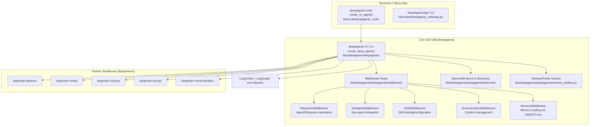

### Execution Flow Overview

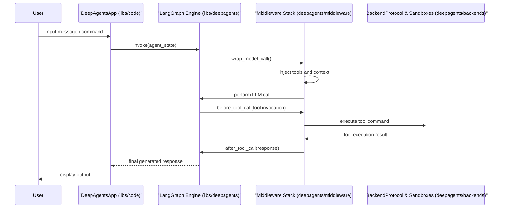

The middleware intercepts agent interactions to manage filesystem access, delegate sub-agents with isolated state, load skills dynamically, and summarize or offload context to fit within model windows.

The `BackendProtocol` abstracts file storage, shell sandboxes, state persistence, and remote sandboxes, enabling flexible deployment on local environments or cloud providers.

For a detailed breakdown of components, data flow, and how the CLI UI integrates with the core SDK, see the [Architecture Overview](#1.3) page.

Sources: [libs/deepagents/README.md:21-40](), [README.md:86-91](), [libs/code/README.md:34-44]()

---

This overview provides a high-level introduction to the Deep Agents ecosystem, illustrating the relationship between core packages, key runtime components, and the interactive CLI application. Dive into the linked child pages for comprehensive documentation on package contents, usage instructions, and architectural details.

---

# Page: Packages

# Packages

<details>
<summary>Relevant source files</summary>

The following files were used as context for generating this wiki page:

- [.release-please-manifest.json](.release-please-manifest.json)
- [ACTION.md](ACTION.md)
- [action.yml](action.yml)
- [libs/ARCHITECTURE.md](libs/ARCHITECTURE.md)
- [libs/DEVELOPMENT.md](libs/DEVELOPMENT.md)
- [libs/README.md](libs/README.md)
- [libs/code/CHANGELOG.md](libs/code/CHANGELOG.md)
- [libs/code/deepagents_code/_version.py](libs/code/deepagents_code/_version.py)
- [libs/code/pyproject.toml](libs/code/pyproject.toml)
- [libs/code/uv.lock](libs/code/uv.lock)
- [libs/deepagents/CHANGELOG.md](libs/deepagents/CHANGELOG.md)
- [libs/deepagents/deepagents/_version.py](libs/deepagents/deepagents/_version.py)
- [libs/evals/AGENTS.md](libs/evals/AGENTS.md)
- [libs/evals/uv.lock](libs/evals/uv.lock)
- [libs/partners/AGENTS.md](libs/partners/AGENTS.md)
- [libs/talon/uv.lock](libs/talon/uv.lock)

</details>


## Purpose and Scope

This page documents the primary packages and partner integrations in the Deep Agents monorepo. The project is structured as a modular ecosystem providing a core SDK, interactive terminal interfaces, deployment tooling, and standardized protocol/provider integrations.

- **`deepagents`** (Core SDK): The foundational library for building agents with middleware, harness profiles, and pluggable backends. [libs/deepagents/pyproject.toml:2-5]()
- **`deepagents-code`** (Coding Agent): The primary user-facing interactive terminal UI (TUI) and coding agent. [libs/code/pyproject.toml:6-8](), [.release-please-manifest.json:4-4]()
- **`deepagents-cli`** / Lifecycle Tooling: Focused on the `init`, `deploy`, `agents`, and `mcp-servers` commands for agent lifecycle management. [.release-please-manifest.json:1-11]()
- **`deepagents-acp`** (Agent Client Protocol): Integration for exposing Deep Agents via the standardized ACP server protocol. [libs/acp/pyproject.toml:2-14]()
- **`deepagents-evals/harbor`**: Integration with the Harbor evaluation framework for benchmarking and LangSmith tracing. [libs/evals/AGENTS.md:1-40]()
- **`deepagents-talon`**: Experimental long-running runtime host for Deep Agents, supporting channel adapters like WhatsApp and Telegram, and persistent cron scheduling. [libs/talon/uv.lock:1-10](), [.release-please-manifest.json:5-5]()
- **Partner Sandboxes**: Specialized integration packages for remote execution environments like Daytona, Modal, Runloop, Vercel, and QuickJS. [libs/partners/daytona/uv.lock:1-10](), [libs/partners/modal/uv.lock:1-10](), [libs/partners/runloop/uv.lock:1-10](), [.release-please-manifest.json:6-10]()

Sources: [.release-please-manifest.json:1-11](), [libs/deepagents/pyproject.toml:1-35](), [libs/code/pyproject.toml:1-106](), [libs/evals/AGENTS.md:1-41]()


---

## Monorepo Architecture

The repository uses a `libs/` and `partners/` directory structure to isolate core logic from external integrations. Each package is independently versioned and managed with the `uv` package manager and contains its own configuration and lock files.

Key packages:

- `libs/deepagents`: Core SDK describing agent, middleware, backends.
- `libs/code`: Interactive terminal coding agent, CLI, TUI, MCP integration.
- `libs/acp`: Agent Client Protocol server exposing agents over stdio JSON-RPC.
- `libs/evals`: Evaluation framework with Harbor adapter and testing CLI.
- `libs/talon`: Experimental long-running host for persistent agents and channel adapters.
- `libs/partners`: Partner sandbox providers for remote execution (Daytona, Modal, Runloop, Vercel, QuickJS).

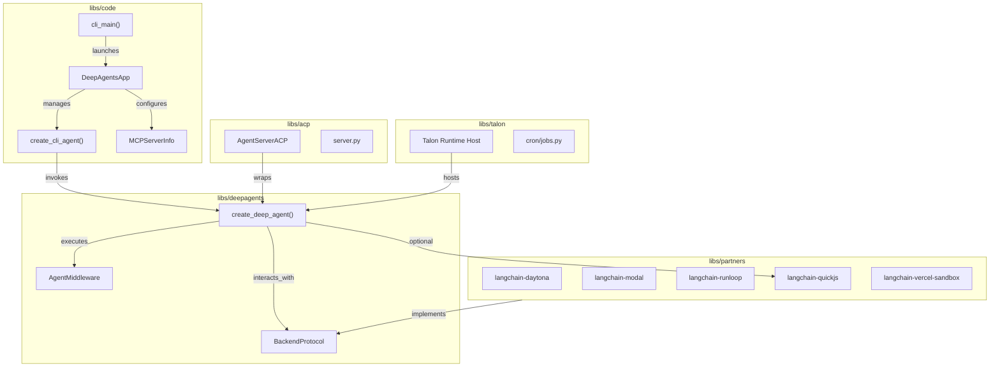

Sources: [libs/deepagents/pyproject.toml:22-30](), [libs/code/pyproject.toml:28-65](), [.release-please-manifest.json:1-11]()


---

## Core SDK: `deepagents`

The `deepagents` package is the engine of the framework. It defines the agent lifecycle and execution graph leveraging LangGraph, and implements a flexible middleware architecture that enables sub-agent spawning, skills loading, memory management, offline tools, and backend abstraction.

**Version:** `0.7.26` [.release-please-manifest.json:2-2]()

### Key Classes and Functions

- `create_deep_agent()`: Factory function that instantiates and configures an agent graph with default middleware and toolchain. This is the core entry point for building Deep Agents programmatically.
- **Middleware System**: A layered interceptor system implementing the `AgentMiddleware` interface. Built-in middleware includes:
  - `MemoryMiddleware`: Loads persistent agent memory from AGENTS.md files.
  - `SkillsMiddleware`: Loads modular skills with precedence for built-in, user, and project levels.
  - `FilesystemMiddleware`: Provides tools for file access and execution within configured backends.
  - `SubAgentMiddleware`: Supports spawning isolated and forked sub-agents, sync or async.
  - `SummarizationMiddleware`: Manages context window compaction and conversation offloading.
- **Backend Protocols**: Abstractions (`BackendProtocol`, `SandboxBackendProtocol`) for implementing filesystem and shell operations backed by local, composite, cloud (LangSmith), or remote sandbox environments.

### Data Flow

When calling an agent created via `create_deep_agent()`:

1. Input prompt is sent through middleware stack.
2. Middleware may intercept tool calls or model interactions.
3. If a tool calls for sub-agent delegation, `SubAgentMiddleware` manages spawning.
4. Filesystem and state tools route requests to configured backend implementations.
5. Middleware manage memory reads/writes and summarize conversation history as needed.

Sources: [.release-please-manifest.json:2-2](), [libs/deepagents/pyproject.toml:1-35](), [libs/deepagents/uv.lock:1-15]()


---

## Coding Agent: `deepagents-code`

`deepagents-code` is the official pre-built interactive terminal coding agent built on top of the core SDK. It provides a rich Textual-based TUI, interactive chat, command slash handlers, thread management, and extensive config for local and remote usage.

**Version:** `0.1.85` [.release-please-manifest.json:4-4]()

### Core Components

- `DeepAgentsApp`: The main Textual TUI class managing the interactive agent session lifecycle, event loop, message streaming, and user input handling.
- `create_cli_agent()`: Specialized agent factory that configures middleware stacks for CLI usage, adding local context injection (Git status, project files), local memory loading, and shell allow list security.
- MCP (Model Context Protocol) Integration: supports OAuth login flows, provider tool loading, and in-TUI management.
- Cost tracking: Bundled offline pricing data integrated for usage estimation.
- Shell and tool integrations with autocomplete, external editor support, and multi-line chat input.
- Headless mode for non-interactive automation and JSON output.
- Local context injection middleware adding Git status and project file tree to system prompts for coding context.

### Key Features

- Interactive multi-thread chat UI with persistent sessions.
- Slash command registry and dynamic command dispatch.
- Tool output virtualization and rich rendering with diffs and markdown.
- Plugin manager with marketplace and install lifecycle.
- Goal and rubric review system integrated in the UI.
- Local and remote context injection, including support for local shell allow lists.

Sources: [.release-please-manifest.json:4-4](), [libs/code/pyproject.toml:1-106](), [libs/code/CHANGELOG.md:1-109]()


---

## Agent Client Protocol: `deepagents-acp`

`deepagents-acp` implements the Agent Client Protocol allowing Deep Agents to run inside editors (like Zed) or other clients supporting the ACP JSON-RPC over stdio.

- **`AgentServerACP`**: The main server class handling ACP communication, wrapping a `create_deep_agent` instance.
- Supports command allowlists and agent lifecycle management over the protocol.
- Provides a demo overlay demonstrating protocol usage.

**Version:** `0.0.13` [.release-please-manifest.json:3-3]()

Sources: [libs/acp/pyproject.toml:2-14]()


---

## Evaluation Framework & Harbor Integration: `deepagents-evals/harbor`

The `deepagents-evals` package provides a structured evaluation framework leveraging Harbor and LangSmith tracing. It is designed for benchmarking agent behavior across scenarios and capturing detailed metrics.

- Provides a command-line interface `deepagents-evals` with subcommands for running tests, trials, aggregation, and radar charts.
- Supports listing eval categories, tiers, models, and runs.
- Integrates with Harbor through adapters to record runs and analysis.
- Designed to require LangSmith tracing enabled for invoking evaluations.

Sources: [libs/evals/AGENTS.md:1-41]()


---

## Talon Runtime Host: `deepagents-talon`

An experimental host runtime aimed at long-running agents with persistent state, background cron jobs, and multi-channel adapters:

- Manages agent lifecycle, configuration hardening, and sub-agent async handling.
- Includes channel adapters for WhatsApp (with Node.js bridge and QR pairing), Telegram, Slack, Discord, voice transcription, and speech output.
- Provides persistent conversation history storage using multiple backends (vector stores, SQL, archives).
- Supports cron scheduler for persistent jobs and automated triggers.

**Version:** `0.0.9` [.release-please-manifest.json:5-5]()

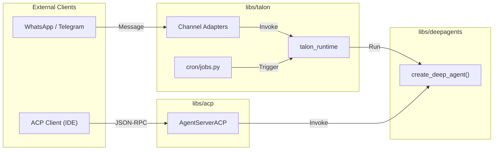

Sources: [.release-please-manifest.json:1-11](), [libs/acp/uv.lock:1-15](), [libs/talon/uv.lock:1-10]()


---

## Partner Sandbox Integrations

A set of integration packages providing sandboxed `BackendProtocol` implementations for remote or cloud execution environments. These allow Deep Agents to execute tool calls or shell actions remotely with environment isolation.

| Package Name               | Description                                   | Version           | Source Reference                        |
|----------------------------|-----------------------------------------------|-------------------|---------------------------------------|
| `langchain-daytona`         | Daytona sandbox provider for ephemeral remote execution | `0.0.8`           | [.release-please-manifest.json:6-6]() |
| `langchain-modal`           | Modal serverless sandbox provider             | `0.0.6`           | [.release-please-manifest.json:7-7]() |
| `langchain-runloop`         | Runloop managed environment sandbox provider  | `0.0.7`           | [.release-please-manifest.json:8-8]() |
| `langchain-vercel-sandbox`  | Vercel sandbox for serverless execution        | `0.0.2`           | [.release-please-manifest.json:9-9]() |
| `langchain-quickjs`         | Embedded QuickJS interpreter for local sandboxed JS execution | `0.3.9`           | [.release-please-manifest.json:10-10]() |

Each of these sandbox packages implements the `BackendProtocol` interface and exposes adapters to run code, scripts, or commands remotely, integrating transparently with Deep Agents middleware stacks.

Sources: [.release-please-manifest.json:6-10](), [libs/partners/daytona/uv.lock:1-10](), [libs/partners/modal/uv.lock:1-10](), [libs/partners/runloop/uv.lock:1-10]()


---

## Summary Table of Packages

| Package                 | Type                     | Features                                           | Version          |
|-------------------------|--------------------------|----------------------------------------------------|------------------|
| `deepagents`            | Core SDK Library          | Agent creation, middleware, tools, backends       | 0.7.26           |
| `deepagents-code`       | Terminal Coding Agent     | Interactive TUI, MCP integration, headless mode   | 0.1.85           |
| `deepagents-acp`        | Protocol Server           | ACP JSON-RPC server for IDE integration            | 0.0.13           |
| `deepagents-evals`      | Evaluation Framework      | Eval CLI, Harbor integration, LangSmith tracing   | — (varies)       |
| `deepagents-talon`      | Experimental Runtime Host | Channel adapters, cron scheduler, persistent jobs | 0.0.9            |
| Partners sandboxes      | Remote Sandboxed Backends | Daytona, Modal, Runloop, Vercel, QuickJS          | 0.0.x            |

Sources: [.release-please-manifest.json:1-11](), [libs/deepagents/pyproject.toml:2-35](), [libs/code/pyproject.toml:5-106]()


---

## Bridging Natural Language Space to Code Entity Space

Below are two diagrams illustrating how names and concepts appearing in the system description correspond closely to code entities and packages in the repository.

---

### Diagram 1: Core SDK and Terminal Coding Agent

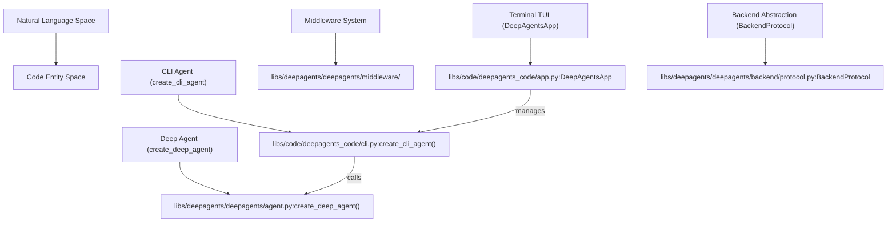

---

### Diagram 2: Runtime Hosts, ACP, and Partner Sandboxes

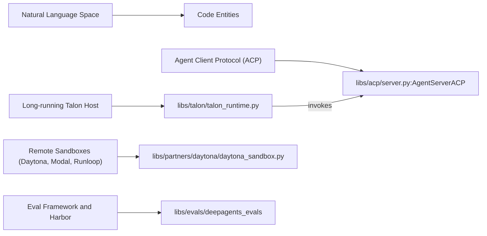

---

## References

- For detailed package versions and dependency management see `.release-please-manifest.json` [1-11]()
- Core SDK configuration and dependencies: `libs/deepagents/pyproject.toml` [1-35]()
- Coding agent details and dependencies: `libs/code/pyproject.toml` [1-106]()
- Talon runtime dependencies and runtime specifics: `libs/talon/uv.lock` [1-10]()
- Evaluation framework agent guide and CLI usage: `libs/evals/AGENTS.md` [1-41]()

---

This completes the overview documentation of packages within the Deep Agents monorepo. Each package is detailed in respective child pages or documentation for further exploration.

---

# Page: Quick Start

# Quick Start

<details>
<summary>Relevant source files</summary>

The following files were used as context for generating this wiki page:

- [.github/CODEOWNERS](.github/CODEOWNERS)
- [README.md](README.md)
- [examples/README.md](examples/README.md)
- [examples/downloading_agents/README.md](examples/downloading_agents/README.md)
- [examples/downloading_agents/content-writer.zip](examples/downloading_agents/content-writer.zip)
- [libs/code/DEVELOPMENT.md](libs/code/DEVELOPMENT.md)
- [libs/code/README.md](libs/code/README.md)
- [libs/code/deepagents_code/_debug.py](libs/code/deepagents_code/_debug.py)
- [libs/code/deepagents_code/_debug_buffer.py](libs/code/deepagents_code/_debug_buffer.py)
- [libs/code/deepagents_code/_tool_stream.py](libs/code/deepagents_code/_tool_stream.py)
- [libs/code/scripts/install.sh](libs/code/scripts/install.sh)
- [libs/code/tests/unit_tests/test__tool_stream.py](libs/code/tests/unit_tests/test__tool_stream.py)
- [libs/code/tests/unit_tests/test_debug.py](libs/code/tests/unit_tests/test_debug.py)
- [libs/code/tests/unit_tests/test_debug_buffer.py](libs/code/tests/unit_tests/test_debug_buffer.py)
- [libs/code/tests/unit_tests/test_install_script.py](libs/code/tests/unit_tests/test_install_script.py)
- [libs/deepagents/README.md](libs/deepagents/README.md)

</details>


This page provides minimal working instructions to get started with Deep Agents in both SDK (programmatic) and CLI (interactive terminal) modes. Deep Agents is an opinionated, ready-to-run agent harness built on LangGraph that provides planning, filesystem access, context management, human-in-the-loop approval, and extensible tooling out of the box. It integrates seamlessly with any LangChain-compatible chat model supporting tool calling and offers robust architecture for production deployments. [README.md:24-43](), [libs/deepagents/README.md:13-52]()

---

## Installation and Setup

### SDK Installation

Install the core `deepagents` package using `pip` or the `uv` package manager. The SDK is model-agnostic and works with any LLM backend that supports tool calling, including OpenAI, Anthropic, Google, open-weight providers, or local models. [README.md:51-53](), [libs/deepagents/README.md:13-17]()

```bash
pip install deepagents
# or
uv add deepagents
```

---

### Deep Agents Code (Terminal UI) Installation

`deepagents-code` is a pre-built, ready-to-run coding agent with a terminal-based interactive Textual UI. It provides session persistence, live streaming responses, web search, remote sandbox execution, persistent memory, custom skills, and human-in-the-loop approval. [libs/code/README.md:30-42]()

**Installation via automated shell script:**

The install shell script downloads and installs `deepagents-code` as a `uv` tool command named `dcode`. It manages isolated Python virtual environments, handles Python version management (default: 3.13), installs dependencies with optional extras for various model providers and sandbox backends, and supports safe upgrades and uninstallation. The installer includes environment flags like `DEEPAGENTS_CODE_EXTRAS` for model/sandbox extras, `DEEPAGENTS_CODE_VERSION` to pin a version, and `DEEPAGENTS_CODE_YES` for unattended upgrades. [libs/code/scripts/install.sh:1-137](), [libs/code/README.md:12-28]()

```bash
curl -LsSf https://langch.in/dcode | bash
```

**Example with extras:**

```bash
DEEPAGENTS_CODE_EXTRAS="nvidia,ollama" curl -LsSf https://langch.in/dcode | bash
```

*Extras include model providers such as `anthropic`, `openai`, `ollama`, and sandbox providers like `daytona`, `modal`, `runloop`. See the install script environment variables documentation for the full list.* [libs/code/scripts/install.sh:47-58]()

---

## SDK Quick Start

### Basic Usage

The core abstraction is a `DeepAgent` returned by `create_deep_agent()`, which constructs a LangGraph graph pre-assembled with layered middleware for planning, filesystem and shell tools, context management, skill loading, tool calling, and sub-agent delegation. Invocation is via `agent.invoke()` with a standard LangChain-style messages dictionary.

Example: create a simple research assistant agent:

```python
from deepagents import create_deep_agent

agent = create_deep_agent(
    model="openai:gpt-4o",
    system_prompt="You are a research assistant."
)

result = agent.invoke({"messages": "Research LangGraph and write a summary"})
print(result)
```

The agent automatically orchestrates planning, sub-tasks, filesystem and shell interactions, and manages its context window, memory, and skills. [README.md:54-64](), [libs/deepagents/README.md:41-52]()

---

### SDK Architectural Flow

Below is a high-level diagram showing the key components involved in the SDK agent creation and execution flow.

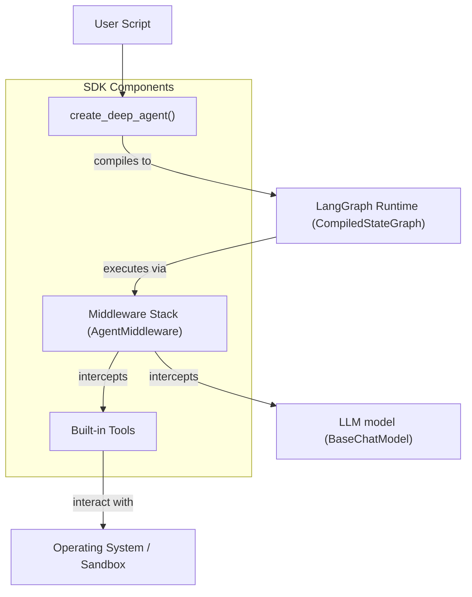

- `create_deep_agent`: Factory function that returns a compiled LangGraph agent graph with default middleware and tools wired up. [README.md:54-62]()
- Middleware stack (`AgentMiddleware` implementations) intercept execution to provide built-in tools for filesystem access, shell execution, context compaction, memory, skills, and sub-agent delegation.
- Tools include `ls`, `read_file`, `write_file`, `edit_file`, `execute`, and utilities for task planning, memory, and more.
- The agent calls into the configured LLM chat model for reasoning and planning behind the scenes.

**Sources:** [README.md:28-31](), [README.md:54-62]()

---

## CLI Quick Start (deepagents-code terminal UI)

### Launching the interactive terminal UI

After installation, launch `dcode` to start the Deep Agents Code interactive terminal UI. This launches a terminal-based Textual app with streaming output, persistent conversational threads, autocomplete, slash commands, and support for human-in-the-loop tool call approval. [libs/code/README.md:24-36]()

```bash
dcode
```

The UI reads and writes user data, configuration, sessions, and persistent memory to the configured `DEEPAGENTS_HOME` directory (`~/.deepagents` by default). [libs/code/scripts/install.sh:37-48]()

---

### deepagents-code Runtime Interaction Flow

The following sequence diagram illustrates the flow from user input in the terminal to agent execution and sandbox tool execution:

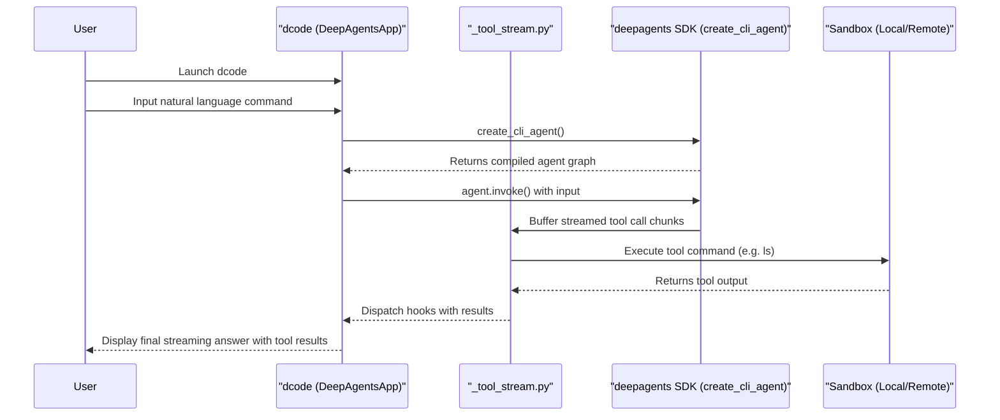

- The CLI creates an interactive agent graph with `create_cli_agent()`.
- User messages invoke the agent, whose middleware emits tool call messages streamed and buffered by `_tool_stream.py`.
- Tools execute in local or remote sandboxes.
- Hook events (`tool.use`, `tool.result`, `tool.error`) are dispatched to the UI for rendering in real time.
- The Textual UI renders streaming agent text, tool output, and supports user interactivity including approvals and submission prompts. [libs/code/deepagents_code/_tool_stream.py:1-106](), [libs/code/README.md:34-44]()

---

### CLI Installer and Features

- **Auto-update and version management**: The install script (`install.sh`) safely installs and upgrades `deepagents-code` as a `uv` tool, handling pre-release strategies, pinned versions, and optional extras for provider support. [libs/code/scripts/install.sh:25-90]()
- **Managed binaries**: Tools like `ripgrep` are installed in the `dcode` tool environment with SHA-256 verified binaries, avoiding system-wide dependencies. [libs/code/scripts/install.sh:70-77]()
- **Session Persistence**: Conversation threads and configurations persist across runs inside the `DEEPAGENTS_HOME` directory. [libs/code/scripts/install.sh:37-48]()
- **Security**: Runs are trusted at the local directory level, and human-in-the-loop approval gates tool calls. For untrusted code or repos, remote sandboxes are recommended. [libs/code/README.md:45-49]()

---

## Summary of Key Features

| Feature                    | Description                                                                | Key Implementation                    |
|----------------------------|----------------------------------------------------------------------------|-------------------------------------|
| **Agent Creation**          | `create_deep_agent()`: Creates a full harnessed agent with planning, tools, and memory | `deepagents.create_deep_agent` [README.md:54-66]() |
| **Middleware Stack**        | Intercepts agent requests for tool calling, context, sub-agent delegation | Middleware in `deepagents.middleware` |
| **Built-in Tools**          | Filesystem ops (`ls`, `read_file`, etc.), shell commands, planning utilities | Defined in core SDK tooling layers  |
| **Sub-Agents**              | Task delegation with isolated or forked contexts                          | `task` tool middleware              |
| **Persistent Memory**       | Session-spanning memory and recall via `AGENTS.md` files                  | `MemoryMiddleware`                   |
| **Skills System**           | Dynamically loaded reusable behaviors and commands                        | `SkillsMiddleware`                   |
| **Terminal UI - deepagents-code** | Interactive terminal app with streaming, sessions, approvals             | `dcode` command and Textual app     |
| **Remote Sandboxes**        | Support for isolated execution environments (Daytona, Modal, Runloop, Vercel) | Included provider extras and tooling|
| **Human-in-the-loop Approval**| User approves or rejects agent tool calls before execution               | CLI and SDK middleware               |

---

This page provides all necessary quick start instructions and architecture insight to begin developing and running Deep Agents both programmatically and via the rich terminal interface. Use this as a foundational reference to dive into the comprehensive features of the Deep Agents framework.

---

**Sources:**  
- [README.md:24-66]()  
- [libs/deepagents/README.md:13-52]()  
- [libs/code/README.md:12-44]()  
- [libs/code/scripts/install.sh:1-137]()  
- [libs/code/deepagents_code/_tool_stream.py:1-106]()

---

# Page: Architecture Overview

# Architecture Overview

<details>
<summary>Relevant source files</summary>

The following files were used as context for generating this wiki page:

- [libs/deepagents/deepagents/__init__.py](libs/deepagents/deepagents/__init__.py)
- [libs/deepagents/deepagents/graph.py](libs/deepagents/deepagents/graph.py)
- [libs/deepagents/deepagents/middleware/__init__.py](libs/deepagents/deepagents/middleware/__init__.py)
- [libs/deepagents/deepagents/middleware/patch_tool_calls.py](libs/deepagents/deepagents/middleware/patch_tool_calls.py)
- [libs/deepagents/deepagents/middleware/subagents.py](libs/deepagents/deepagents/middleware/subagents.py)
- [libs/deepagents/tests/integration_tests/test_filesystem_middleware.py](libs/deepagents/tests/integration_tests/test_filesystem_middleware.py)
- [libs/deepagents/tests/integration_tests/test_subagent_middleware.py](libs/deepagents/tests/integration_tests/test_subagent_middleware.py)
- [libs/deepagents/tests/unit_tests/middleware/test_subagent_middleware_init.py](libs/deepagents/tests/unit_tests/middleware/test_subagent_middleware_init.py)
- [libs/deepagents/tests/unit_tests/test_eviction_replay.py](libs/deepagents/tests/unit_tests/test_eviction_replay.py)
- [libs/deepagents/tests/unit_tests/test_graph.py](libs/deepagents/tests/unit_tests/test_graph.py)
- [libs/deepagents/tests/unit_tests/test_subagents.py](libs/deepagents/tests/unit_tests/test_subagents.py)
- [openwiki/.claims/architecture/source-map.json](openwiki/.claims/architecture/source-map.json)
- [openwiki/architecture/source-map.md](openwiki/architecture/source-map.md)

</details>


This page explains the high-level architecture of Deep Agents: how the core SDK and application packages are structured, how they interact, and the key design patterns that enable extensibility. It covers the LangGraph foundation, middleware execution model, backend abstraction layer, and the relationship between `deepagents` (core SDK) and `deepagents-code` (terminal UI).

---

## LangGraph Foundation

Deep Agents is built on top of LangGraph. The core SDK’s key function, `create_deep_agent()`, returns a `CompiledStateGraph` instance, which is the compiled executable agent graph managed by LangGraph’s runtime [libs/deepagents/deepagents/graph.py:28](). 

To address the scalability challenge of long-running interactive sessions, the agent’s state `messages` channel employs a `DeltaChannel` with a custom reducer. This reduces checkpoint storage growth from quadratic to linear with respect to conversation length, enabling efficient persistence [libs/deepagents/deepagents/graph.py:73-76]().

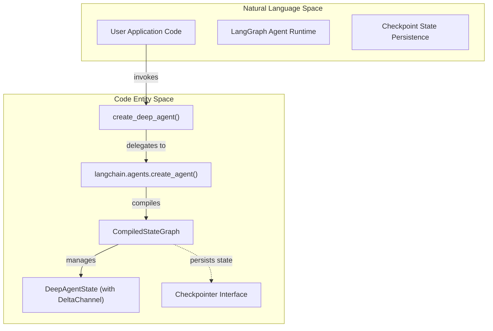
*Diagram 1: Mapping high-level agent creation and execution concepts to LangGraph code entities.*

Sources: [libs/deepagents/deepagents/graph.py:3-6,28,73-76]()

---

## Core SDK Architecture & Middleware Stack

The `deepagents` package provides `create_deep_agent()` which assembles a layered middleware pipeline around LangChain's agent runner. This pipeline is central to Deep Agents’ extensibility and feature integration [libs/deepagents/deepagents/graph.py:40-63]().

Middleware subclasses implement hooks (especially `wrap_model_call`) to intercept and modify requests and responses dynamically. This enables advanced capabilities like system prompt injection, tool filtering, history summarization, state tracking, and sub-agent orchestration.

### Middleware Pipeline and Roles

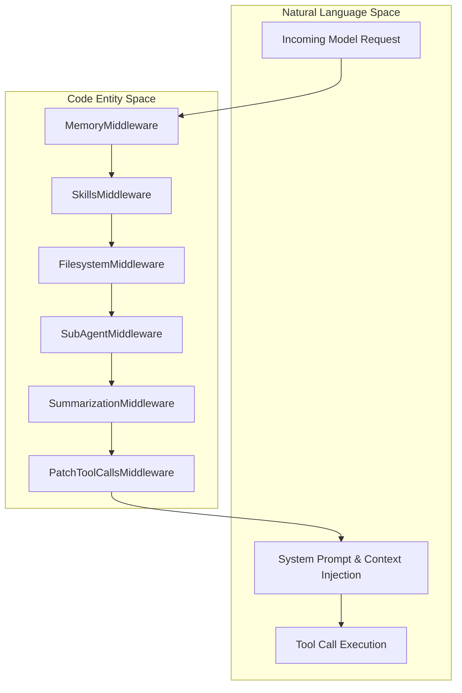
*Diagram 2: Middleware interception pipeline mapping request stages to concrete middleware classes.*

| Middleware Class         | Module Path                                                          | Primary Responsibility                                                                                   |
|--------------------------|----------------------------------------------------------------------|----------------------------------------------------------------------------------------------------------|
| `MemoryMiddleware`       | [middleware/memory.py](libs/deepagents/deepagents/middleware/memory.py#L52)       | Injects project-level and user memory instructions from `AGENTS.md` files into the system prompt context. |
| `SkillsMiddleware`       | [middleware/skills.py](libs/deepagents/deepagents/middleware/skills.py#L54)       | Dynamically loads and injects structured custom skills from multiple backend skill source locations.      |
| `FilesystemMiddleware`   | [middleware/filesystem.py](libs/deepagents/deepagents/middleware/filesystem.py#L51) | Provides vital file operations tools (`ls`, `read_file`, `write_file`, `edit_file`, `glob`, `grep`).       |
| `SubAgentMiddleware`    | [middleware/subagents.py](libs/deepagents/deepagents/middleware/subagents.py#L59)  | Exposes a `task` tool enabling spawning of specialized subagents in isolated or forked conversation modes. |
| `SummarizationMiddleware` | [middleware/summarization.py](libs/deepagents/deepagents/middleware/summarization.py#L5-L9) | Manages conversation compaction, summarizing history when context window thresholds are exceeded.          |
| `PatchToolCallsMiddleware` | [middleware/patch_tool_calls.py](libs/deepagents/deepagents/middleware/patch_tool_calls.py#L49) | Corrects malformed or incomplete tool calls in the conversation before further processing.                |

Sources:  
[libs/deepagents/deepagents/graph.py#L40-L63](),  
[libs/deepagents/deepagents/middleware/memory.py#L50-L70](),  
[libs/deepagents/deepagents/middleware/skills.py#L50-L90](),  
[libs/deepagents/deepagents/middleware/filesystem.py#L40-L110](),  
[libs/deepagents/deepagents/middleware/subagents.py#L55-L120](),  
[libs/deepagents/deepagents/middleware/summarization.py#L5-L45](),  
[libs/deepagents/deepagents/middleware/patch_tool_calls.py#L11-L53]()

---

## Backend Abstraction

Deep Agents abstracts file storage, state management, and sandboxed execution via defined `BackendProtocol` and `SandboxBackendProtocol` interfaces. This abstraction decouples agent functionality from storage details, allowing flexible backend selection and composition [libs/deepagents/deepagents/backends/protocol.py:44]().

Here is the typical hierarchy of backend implementations:

```mermaid
graph TB
    BackendProtocol["BackendProtocol Interface"]
    SandboxBackendProtocol["SandboxBackendProtocol Interface"]

    StateBackend["StateBackend"]
    StoreBackend["StoreBackend"]
    FilesystemBackend["FilesystemBackend"]
    CompositeBackend["CompositeBackend"]

    BackendProtocol <|-- StateBackend
    BackendProtocol <|-- StoreBackend
    BackendProtocol <|-- FilesystemBackend
    BackendProtocol <|-- CompositeBackend
    SandboxBackendProtocol --|> BackendProtocol
```
*Diagram 3: Backend interfaces and key implementations.*

| Backend Class          | Storage Target                 | Execute Support | Primary Use Case                                                          |
|-----------------------|-------------------------------|-----------------|---------------------------------------------------------------------------|
| `StateBackend`        | Runtime ephemeral in-memory state | No              | Short-lived file storage scoped to an individual agent run for full control over file state [backends/state.py:36](). |
| `StoreBackend`        | Persistent LangGraph Store        | No              | Durable cross-session file storage leveraging LangGraph’s store [backends/store.py:37](). |
| `FilesystemBackend`   | Local Host Filesystem             | No              | Directly proxies filesystem operations on the host machine [backends/filesystem.py:83](). |
| `CompositeBackend`    | Mounted backends by path prefix  | Varies          | Enables mounting multiple backend implementations under distinct filesystem roots [backends/composite.py:34](). |

Sources:  
[libs/deepagents/deepagents/backends/protocol.py:44](),  
[libs/deepagents/deepagents/backends/state.py:36](),  
[libs/deepagents/deepagents/backends/store.py:37](),  
[libs/deepagents/deepagents/backends/filesystem.py:83](),  
[libs/deepagents/deepagents/backends/composite.py:34]()

---

## deepagents-code Application Bridge

The `deepagents-code` package provides an interactive terminal UI wrapper around the SDK, exposing a richer CLI interface and additional local context features. The `dcode` tool bootstrap starts a `DeepAgentsApp`, which internally creates CLI-focused agents through `create_cli_agent()` that build upon `create_deep_agent()` [libs/deepagents/deepagents/graph.py:3-6]().

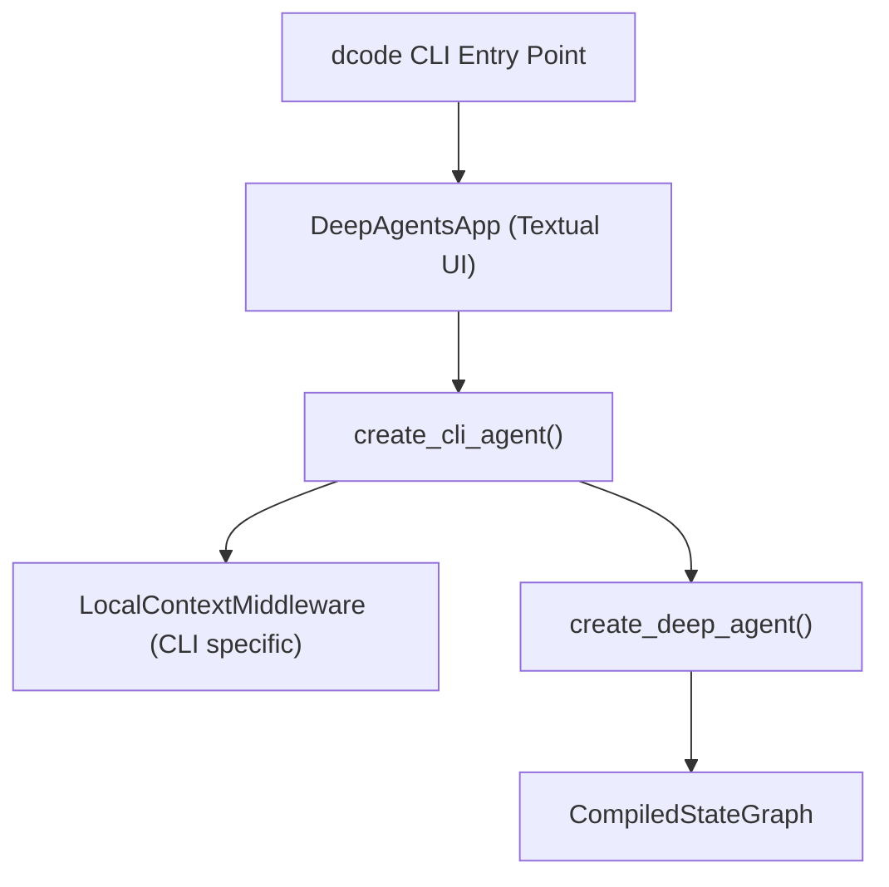
*Diagram 4: Flow from terminal CLI entrypoint to underlying SDK agent graph.*

The `deepagents-code` package augments the core SDK by adding middleware like `LocalContextMiddleware` which injects local Git status, directory structures, and active project snapshots into the context before dispatch. This design isolates UI/operational behavior while reusing the full feature set of the core SDK.

Sources: [libs/deepagents/deepagents/graph.py:3-6](), [libs/code/deepagents_code/app.py]()

---

## Conversation Compaction and Offloading

To manage context window limitations and token budget constraints, Deep Agents employs `SummarizationMiddleware` which monitors conversation activity and triggers automatic compaction when thresholds such as token count or message volume are exceeded. This middleware:

1. Evaluates thresholds for context fullness (tokens, message count, fraction of window) based on configuration [middleware/summarization.py:158-166]().
2. Calls out to LLM summarization routines that condense conversation history into a smaller summary block inserted into the system prompt [middleware/summarization.py:8-9]().
3. Offloads raw historical messages to backend persistent storage under `/conversation_history/{session_id}.md` paths to avoid losing information [middleware/summarization.py:42-45]().
4. Exposes a manual `compact_conversation` tool via `SummarizationToolMiddleware` to allow explicit conversation trimming [middleware/summarization.py:10-12]().

This middleware is crucial for enabling long, interactive deep agent sessions without overwhelming the model context or excess storage use.

Sources: [libs/deepagents/deepagents/middleware/summarization.py:5-45,158-166]()

---

# Summary

- Deep Agents core SDK is fundamentally a LangGraph compiled agent graph with a delta-based message state for scalable persistence.
- A rich middleware stack wraps the core agent execution path, enabling modular features including memory injection, skills tooling, filesystem operations, task delegation (subagents), and conversation summarization.
- Backend abstractions provide flexible filesystem and storage layering, crucial for sandboxing and persistent state.
- The `deepagents-code` package integrates the core with a CLI Textual UI, adding local context and session management while leveraging the SDK’s middleware and agent creation primitives.
- Summarization middleware and delta-state management make scaling to long-running interactive coding sessions practical and performant.

This architecture underpins Deep Agents’ design goal of extensible, composable AI agents with robust coding environment integration.

---

Sources Summary:  
- Core graph and agent construction: [libs/deepagents/deepagents/graph.py:3-156,610-653]()  
- Middleware stack and execution pipeline: [libs/deepagents/deepagents/middleware/__init__.py](), [libs/deepagents/deepagents/middleware/memory.py#L50-L70](), [libs/deepagents/deepagents/middleware/skills.py#L50-L90](), [libs/deepagents/deepagents/middleware/filesystem.py#L40-L110](), [libs/deepagents/deepagents/middleware/subagents.py#L50-L176](), [libs/deepagents/deepagents/middleware/summarization.py#L5-L45,158-166](), [libs/deepagents/deepagents/middleware/patch_tool_calls.py#L11-L53]()  
- Backend abstractions: [libs/deepagents/deepagents/backends/protocol.py:44](), [libs/deepagents/deepagents/backends/state.py:36](), [libs/deepagents/deepagents/backends/store.py:37](), [libs/deepagents/deepagents/backends/filesystem.py:83](), [libs/deepagents/deepagents/backends/composite.py:34]()  
- deepagents-code integration: [libs/deepagents/deepagents/graph.py:3-6](), [libs/code/deepagents_code/app.py]()

---

# Page: Core SDK

# Core SDK

<details>
<summary>Relevant source files</summary>

The following files were used as context for generating this wiki page:

- [libs/deepagents/deepagents/__init__.py](libs/deepagents/deepagents/__init__.py)
- [libs/deepagents/deepagents/graph.py](libs/deepagents/deepagents/graph.py)
- [libs/deepagents/deepagents/middleware/__init__.py](libs/deepagents/deepagents/middleware/__init__.py)
- [libs/deepagents/deepagents/middleware/patch_tool_calls.py](libs/deepagents/deepagents/middleware/patch_tool_calls.py)
- [libs/deepagents/deepagents/middleware/subagents.py](libs/deepagents/deepagents/middleware/subagents.py)
- [libs/deepagents/tests/integration_tests/test_filesystem_middleware.py](libs/deepagents/tests/integration_tests/test_filesystem_middleware.py)
- [libs/deepagents/tests/integration_tests/test_subagent_middleware.py](libs/deepagents/tests/integration_tests/test_subagent_middleware.py)
- [libs/deepagents/tests/unit_tests/middleware/test_subagent_middleware_init.py](libs/deepagents/tests/unit_tests/middleware/test_subagent_middleware_init.py)
- [libs/deepagents/tests/unit_tests/test_eviction_replay.py](libs/deepagents/tests/unit_tests/test_eviction_replay.py)
- [libs/deepagents/tests/unit_tests/test_graph.py](libs/deepagents/tests/unit_tests/test_graph.py)
- [libs/deepagents/tests/unit_tests/test_subagents.py](libs/deepagents/tests/unit_tests/test_subagents.py)

</details>


The Core SDK (`deepagents`) provides the foundational agent framework built on top of LangGraph. It is designed to enable the creation of rich, extensible AI agents with built-in capabilities such as planning, filesystem interaction, sub-agent delegation, memory context, skills integration, and conversation summarization. The primary entry point for SDK users is the [`create_deep_agent`](#agent-creation-create_deep_agent) function, which assembles a fully configured deep agent with a layered middleware stack and an abstracted backend architecture optimized for efficient state checkpointing via `DeltaChannel`. This SDK is model-agnostic and adaptable to a variety of LLM providers.

For detailed SDK usage within CLI tools, interactive terminals, or external runtimes, see the [deepagents-code Application](#3) and [Integrations](#5) sections.

---

## Architecture Overview

DeepAgents SDK follows a modular, middleware-driven design that cleanly separates concerns involved in agent operation. At its core, it integrates with LangGraph's state graph engine and utilizes middleware components to intercept, modify, and enhance model and tool calls.

### Core SDK Architecture Diagram

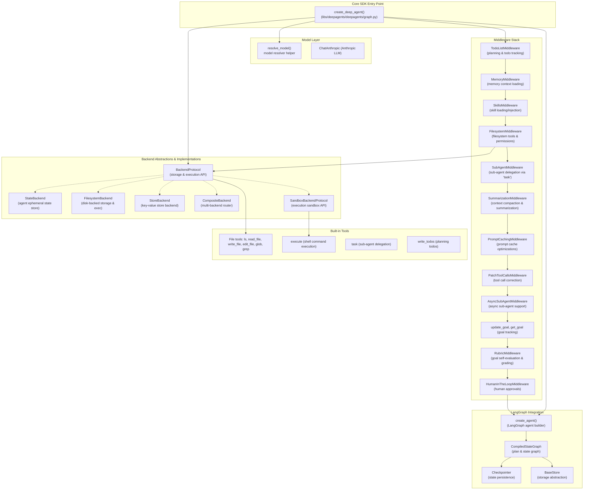

This diagram highlights:

- Entry at `create_deep_agent` which initializes models, middlewares, and backends.
- Sequential middleware execution managing memory, skills, filesystem, subagents, summarization, goal evaluation, and interactive approvals.
- Backend abstractions that enable pluggable storage and execution implementations.
- Integration with LangGraph for state graph compilation and execution.

Sources: [libs/deepagents/deepagents/graph.py:3-77,204-250](), [libs/deepagents/deepagents/middleware/__init__.py:1-114](), [libs/deepagents/deepagents/middleware/subagents.py:1-75](), [libs/deepagents/deepagents/backends/protocol.py:30-70]()

---

## Agent Creation: `create_deep_agent`

The SDK's primary API for agent instantiation is the function:

```python
def create_deep_agent(
    model: str | BaseChatModel | None = None,
    tools: Sequence[BaseTool | Callable | dict[str, Any]] | None = None,
    *,
    system_prompt: str | SystemMessage | None = None,
    middleware: Sequence[AgentMiddleware] = (),
    subagents: Sequence[SubAgent | CompiledSubAgent | AsyncSubAgent] | None = None,
    skills: list[str] | None = None,
    memory: list[str] | None = None,
    response_format: ResponseFormat[Any] | type | dict[str, Any] | None = None,
    context_schema: type | None = None,
    checkpointer: Checkpointer | None = None,
    store: BaseStore | None = None,
    backend: BackendProtocol | BackendFactory | None = None,
    interrupt_on: dict[str, bool | InterruptOnConfig] | None = None,
    debug: bool = False,
    name: str | None = None,
    cache: BaseCache | None = None,
) -> CompiledStateGraph
```

This function:

- Resolves the model to use (default Anthropic's "claude-sonnet-4-6" if none provided).
- Combines built-in, middleware-provided, and user-supplied tools into a coherent set available to the LLM.
- Assembles a middleware stack that layers memory context, skills, filesystem access, sub-agent delegation, summarization, goal tracking, and human-in-the-loop control.
- Configures backend storage for conversation and file artifacts.
- Compiles the entire setup as a `CompiledStateGraph` which can be invoked programmatically.

For detailed parameter descriptions, examples, and default configurations, see the child page [Agent Creation (create_deep_agent)](#2.1).

Sources: [libs/deepagents/deepagents/graph.py:204-250](), [libs/deepagents/deepagents/graph.py:143-153]()

---

## Middleware System

Middleware in DeepAgents intercepts agent requests and responses for extensibility and control. Each middleware subclasses `AgentMiddleware` and overrides lifecycle hooks:

- `wrap_model_call`: intercepts and modifies each LLM call.
- `wrap_tool_call`: manages tool execution lifecycle.

Middleware enables dynamic tool filtering, system prompt injection, message post-processing, and persistent state tracking.

### Middleware Stack Execution Flow

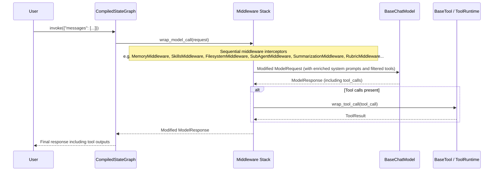

Middleware examples:

- `MemoryMiddleware`: Injects persistent memory context.
- `SkillsMiddleware`: Loads structured skill prompts dynamically.
- `FilesystemMiddleware`: Enforces file access permissions and provides file ops tools.
- `SubAgentMiddleware`: Offers the `task` tool for sub-agent delegation.
- `SummarizationMiddleware`: Manages context window via automatic summarization.
- `RubricMiddleware`: Provides goal evaluation and grading.
- `HumanInTheLoopMiddleware`: Supports manual intervention and approvals.

For full middleware ecosystem details, see [Middleware System](#2.2).

Sources: [libs/deepagents/deepagents/graph.py:343-375](), [libs/deepagents/deepagents/middleware/__init__.py:1-114]()

---

## Sub-Agent Delegation

Sub-agent delegation allows agents to spawn smaller, focused agents ("subagents") to handle tasks. This is implemented via the `SubAgentMiddleware` which provides a `task` tool callable by the main agent.

Key concepts:

- **Isolated mode**: The subagent receives only the delegated task description and runs independently.
- **Fork mode** (experimental): The subagent inherits the parent's conversation context and state.

Subagents can have separate models, tools, middleware, memory, and skills. This enables modular, composable workflows with specialized capabilities.

Example sub-agent configuration fields include:

- `name`: Identifier for the subagent.
- `description`: Action-focused description for delegation.
- `model`: Optional different model override.
- `middleware`: Additional middleware to inject.
- `permissions`: Filesystem permissions specific to this subagent.
- `response_format`: Controls structured output.

For comprehensive usage, configuration options, and the `task` tool's behavior, see [Sub-Agent Delegation](#2.3).

Sources: [libs/deepagents/deepagents/middleware/subagents.py:1-176]()

---

## Skills System

The Skills system enables the agent to load and use declarative skill definitions typically authored in structured markdown files (`SKILL.md`). The `SkillsMiddleware` dynamically loads these skill prompts from multiple sources with defined precedence:

- Built-in SDK skills.
- User-level skills folder.
- Project-level skills folder.

Skills expand the agent's toolset and context by injecting relevant natural language instructions and capabilities.

For details about skill discovery, precedence, and middleware configuration, consult [Skills System](#2.4).

Sources: [libs/deepagents/deepagents/middleware/skills.py:1]()

---

## Memory System

The Memory system persists long-term context and workspace knowledge for agents. It loads memory context from `AGENTS.md` files located in various config scopes (project, user, global), and integrates this in agent prompts.

The `MemoryMiddleware` handles:

- Scanning memory files on startup.
- Loading and injecting memory context for each model call.
- Managing memory source precedence.

For specifications on memory file formats, source priority, and middleware usage, see [Memory System](#2.5).

Sources: [libs/deepagents/deepagents/middleware/memory.py:1]()

---

## Filesystem Operations and Built-in Tools

DeepAgents SDK includes a set of built-in tools for managing and interacting with the workspace filesystem:

- File listing: `ls`
- File reading: `read_file`
- File writing: `write_file`
- File editing: `edit_file`
- Glob pattern matching: `glob`
- File search: `grep`
- Command execution: `execute`
- Todo writing: `write_todos`

The filesystem tools operate through interactions with a backend implementing the `BackendProtocol`. The `execute` tool requires a backend conforming to the `SandboxBackendProtocol` for secure shell command execution.

These tools support parameters for pagination, path scoping, and permission enforcement.

For details of tool parameters, default behavior, and backend integration, see [Filesystem Operations and Built-in Tools](#2.6).

Sources: [libs/deepagents/deepagents/graph.py:344-352](), [libs/deepagents/deepagents/backends/protocol.py:30-70]()

---

## Backend Architecture

The backend system abstracts persistent storage and execution sandboxes behind well-defined protocols:

1. **BackendProtocol** — defines core filesystem-like interfaces (`read`, `write`, `edit`, `ls`, `glob`, `grep`).
2. **SandboxBackendProtocol** — extends `BackendProtocol` with execution support (`execute` shell commands, `setup` for initialization).

### Common Backend Implementations

- `StateBackend`: In-memory ephemeral state store ideal for transient data.
- `StoreBackend`: Key-value store backend built on arbitrary `BaseStore` implementations.
- `FilesystemBackend`: Real filesystem integration supporting full `BackendProtocol` and `SandboxBackendProtocol`.
- `CompositeBackend`: Routes paths to different backend instances based on configured rules.
- `ContextHubBackend`: Context aggregation backed by LangSmith.
- `LangSmithBackend`: LangSmith managed backend.
- Local shell sandbox for command execution.

### Backend Protocol Diagram

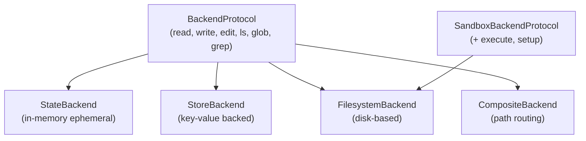

This abstraction allows agents to flexibly manage storage and code execution environments without coupling to a specific platform.

Full details and backend selection strategies are in [Backend Architecture](#2.7).

Sources: [libs/deepagents/deepagents/backends/protocol.py:30-70](), [libs/deepagents/deepagents/backends/state.py:1-60]()

---

## Context Window Management

Managing large conversation contexts is critical for LLM agents. The `SummarizationMiddleware`:

- Monitors conversation token counts.
- Automatically summarizes and compacts old message history upon reaching configurable triggers.
- Offloads evicted messages to backend storage.
- Supports media reference handling for non-text content.

These mechanisms maintain efficient memory usage while preserving essential context for agent performance.

For configuration options and detailed explanation, see [Context Window Management](#2.8).

Sources: [libs/deepagents/deepagents/middleware/summarization.py:1-51]()

---

## System Prompts and Model Configuration

System prompts are assembled dynamically incorporating:

- SDK defaults and instruction sets.
- Harness profiles that model the interaction style per target LLM provider.
- Injected memory and skills context.
- User-supplied prompt overrides.

Models are resolved flexibly by name or specification using `resolve_model`, which supports Anthropic, OpenAI, and custom model providers.

Snapshot smoke tests ensure prompt integrity and stop regressions.

More information is available at [System Prompts and Model Configuration](#2.9).

Sources: [libs/deepagents/deepagents/graph.py:64-68](), [libs/deepagents/deepagents/_models.py:40]()

---

## Harness Profiles

Harness profiles (`HarnessProfile` and `ProviderProfile`) enable customizing the agent runtime to the specifics of particular LLM providers or use cases.

Profiles define:

- System prompt suffixes or configurations.
- Middleware exclusions (to strip or replace certain middleware).
- Tool visibility and behavior tuning.

These are registered in the SDK and applied automatically when the target model provider is detected.

For all profile API details, registration strategies, and usage notes, see [Harness Profiles](#2.10).

Sources: [libs/deepagents/deepagents/profiles/harness/harness_profiles.py:1-100]()

---

## Goal and Rubric System

For structured task tracking and evaluation, the SDK includes:

- `GoalToolsMiddleware`: managing goal lifecycle statuses and transitions.
- `RubricMiddleware`: enables automated self-evaluation with grader prompts, generating a `GraderVerdict` indicating acceptance or failure.
- Tools facilitate criteria acceptance generation and rubric management.

This tightly couples with agent toolsets and middleware to guide and assess agent task completion.

For in-depth explanation and configuration, see [Goal and Rubric System](#2.11).

Sources: [libs/deepagents/deepagents/middleware/rubric.py:1-150]()

---

This concludes the Core SDK overview. Each major area has a dedicated child page for full technical reference and usage instructions. For next steps, explore:

- [Agent Creation (create_deep_agent)](#2.1)
- [Middleware System](#2.2)
- [Sub-Agent Delegation](#2.3)
- [Skills System](#2.4)
- [Memory System](#2.5)
- [Filesystem Operations and Built-in Tools](#2.6)
- [Backend Architecture](#2.7)
- [Context Window Management](#2.8)
- [System Prompts and Model Configuration](#2.9)
- [Harness Profiles](#2.10)
- [Goal and Rubric System](#2.11)

---

# Additional Diagrams Bridging Natural Language to Code Entities

### Diagram 1: Natural Language Concept → Middleware Code Entities

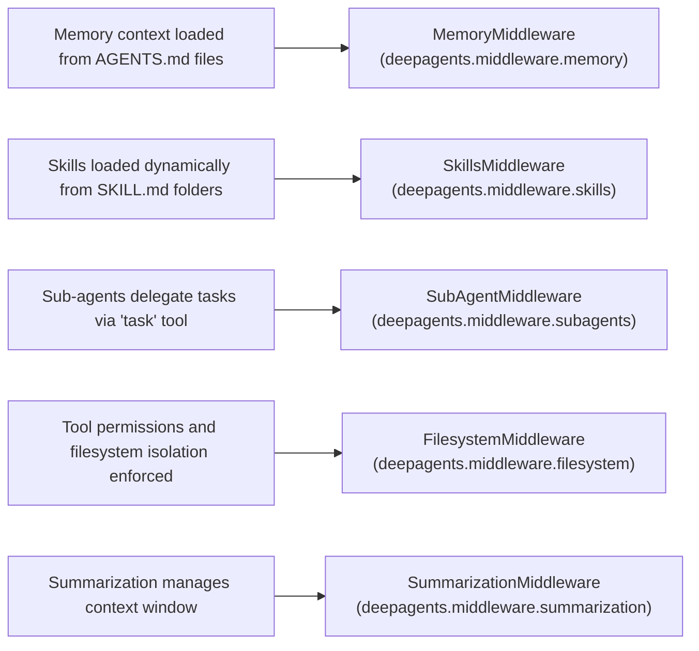

### Diagram 2: Natural Language Feature → Core SDK Code Path

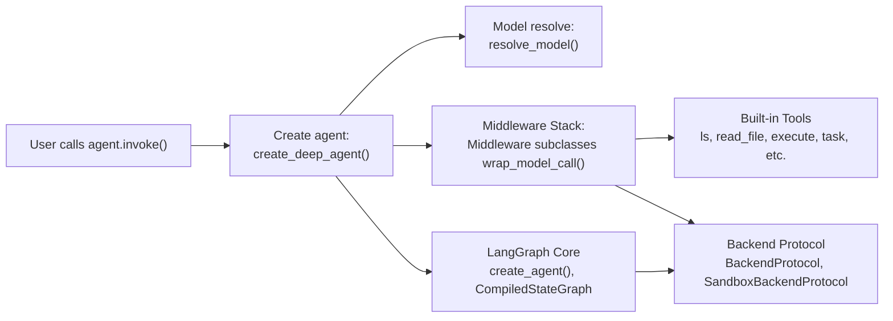

Sources: [libs/deepagents/deepagents/graph.py:3-77,204-250](), [libs/deepagents/deepagents/middleware/__init__.py:1-114](), [libs/deepagents/deepagents/middleware/subagents.py:1-176](), [libs/deepagents/deepagents/backends/protocol.py:30-70]()

---

This page provides a top-level guide to the deepagents core SDK structure, components, and architecture. For technical details, configuration options, and usage instructions, please refer to the linked child pages.

---

# Page: Agent Creation (create_deep_agent)

# Agent Creation (create_deep_agent)

<details>
<summary>Relevant source files</summary>

The following files were used as context for generating this wiki page:

- [libs/deepagents/deepagents/__init__.py](libs/deepagents/deepagents/__init__.py)
- [libs/deepagents/deepagents/graph.py](libs/deepagents/deepagents/graph.py)
- [libs/deepagents/deepagents/middleware/__init__.py](libs/deepagents/deepagents/middleware/__init__.py)
- [libs/deepagents/deepagents/middleware/patch_tool_calls.py](libs/deepagents/deepagents/middleware/patch_tool_calls.py)
- [libs/deepagents/deepagents/middleware/subagents.py](libs/deepagents/deepagents/middleware/subagents.py)
- [libs/deepagents/tests/integration_tests/test_filesystem_middleware.py](libs/deepagents/tests/integration_tests/test_filesystem_middleware.py)
- [libs/deepagents/tests/integration_tests/test_subagent_middleware.py](libs/deepagents/tests/integration_tests/test_subagent_middleware.py)
- [libs/deepagents/tests/unit_tests/middleware/test_subagent_middleware_init.py](libs/deepagents/tests/unit_tests/middleware/test_subagent_middleware_init.py)
- [libs/deepagents/tests/unit_tests/test_eviction_replay.py](libs/deepagents/tests/unit_tests/test_eviction_replay.py)
- [libs/deepagents/tests/unit_tests/test_graph.py](libs/deepagents/tests/unit_tests/test_graph.py)
- [libs/deepagents/tests/unit_tests/test_subagents.py](libs/deepagents/tests/unit_tests/test_subagents.py)

</details>


The `create_deep_agent` function is the primary entry point for constructing Deep Agent graphs in the core SDK. It orchestrates the composition of several components: LLM model resolution, backend storage configuration, middleware stack assembly, system prompt composition, and ultimately compiles a LangGraph `CompiledStateGraph` instance that represents the fully configured deep agent runtime environment. This makes it a critical integration function allowing for flexible, extensible AI agents with sophisticated middleware and toolsets.

This page documents the full function signature, detailed semantics of its parameters, its internal assembly pipeline, and fundamental usage patterns. For CLI-oriented agent creation, consult page 3.8. For middleware internals, see page 2.2.

---

## Function Signature

```python
def create_deep_agent(
    model: str | BaseChatModel | None = None,
    tools: Sequence[BaseTool | Callable | dict[str, Any]] | None = None,
    *,
    system_prompt: str | SystemMessage | SystemPromptConfig | None = None,
    middleware: Sequence[AgentMiddleware] = (),
    subagents: Sequence[SubAgent | CompiledSubAgent | AsyncSubAgent] | None = None,
    skills: list[str] | None = None,
    memory: list[str] | None = None,
    response_format: ResponseFormat[ResponseT] | type[ResponseT] | dict[str, Any] | None = None,
    context_schema: type[ContextT] | None = None,
    checkpointer: Checkpointer | None = None,
    store: BaseStore | None = None,
    backend: BackendProtocol | BackendFactory | None = None,
    interrupt_on: dict[str, bool | InterruptOnConfig] | None = None,
    debug: bool = False,
    name: str | None = None,
    cache: BaseCache | None = None,
    state_schema: type[AgentState] | None = None,
    excluded_middleware: Sequence[str | type[AgentMiddleware]] | None = None,
) -> CompiledStateGraph:
    ...
```

This signature accepts a wide array of agent configuration parameters enabling highly customizable agent instantiation. 

**Sources:** [libs/deepagents/deepagents/graph.py:167-194]()

---

## Parameters Reference

### Core Parameters

| Parameter          | Type                                                 | Default | Description                                                                                                |
|--------------------|------------------------------------------------------|---------|------------------------------------------------------------------------------------------------------------|
| `model`            | `str \| BaseChatModel \| None`                      | `None`  | The LLM model instance or identifier string. It is resolved via `resolve_model()`, supporting provider prefixes like `openai:`, `anthropic:`, etc. Defaults to Anthropic's Claude Sonnet v4. [libs/deepagents/deepagents/graph.py:145-153](), [libs/deepagents/deepagents/graph.py:210-212]() |
| `tools`            | `Sequence[BaseTool \| Callable \| dict] \| None`    | `None`  | Additional custom tools to supplement the built-in tools the agent provides.                              |
| `system_prompt`    | `str \| SystemMessage \| SystemPromptConfig \| None`| `None`  | Custom system prompt or configuration for assembling prefix/base/suffix for the agent’s initial prompt.  |
| `backend`          | `BackendProtocol \| BackendFactory \| None`          | `None`  | Specifies the storage backend for the agent’s filesystem operations. Defaults to `StateBackend`, which stores file state directly in the agent's LangGraph state dictionary. |
| `checkpointer`     | `Checkpointer \| None`                               | `None`  | An optional LangGraph checkpointer for maintaining agent state persistence and enabling time travel debugging of agent conversations.  |
| `store`            | `BaseStore \| None`                                  | `None`  | Optional LangGraph store instance used for persistent key-value storage and checkpointing integration.   |
| `state_schema`     | `type[AgentState] \| None`                           | `None`  | Custom agent state schema, defaults to `DeepAgentState`. This controls message storage and other state fields. |

### Middleware and Extension Parameters

| Parameter             | Type                                                                         | Default | Description                                                                                                  |
|-----------------------|------------------------------------------------------------------------------|---------|--------------------------------------------------------------------------------------------------------------|
| `middleware`          | `Sequence[AgentMiddleware]`                                                  | `()`    | Additional middleware layers to insert into the stack for request interception and behavior modification.    |
| `subagents`           | `Sequence[SubAgent \| CompiledSubAgent \| AsyncSubAgent] \| None`            | `None`  | Subagents exposed via the `task` tool, each with isolated or forked conversation modes and custom config.  |
| `skills`              | `list[str] \| None`                                                          | `None`  | Skill source directory paths, loaded as prompt sections and toolsets by the SkillsMiddleware.                |
| `memory`              | `list[str] \| None`                                                          | `None`  | Memory source directory paths containing `AGENTS.md` context injected via MemoryMiddleware.                  |
| `interrupt_on`        | `dict[str, bool \| InterruptOnConfig] \| None`                              | `None`  | Controls which tools trigger human-in-the-loop interruptions (via `HumanInTheLoopMiddleware`).              |
| `excluded_middleware` | `Sequence[str \| type[AgentMiddleware]] \| None`                            | `None`  | Middleware names or classes to be removed from the default middleware stack, for fine customization.        |

**Sources:** [libs/deepagents/deepagents/graph.py:167-194](), [libs/deepagents/deepagents/middleware/subagents.py:36-123]()

---

## Agent Assembly Architecture

The construction of a Deep Agent proceeds through well-defined phases, transforming input parameters into a graph instance that handles LLM orchestration, tool dispatch, prompt engineering, and memory management.

### Architectural Data Flow from User Intent to Code Entities

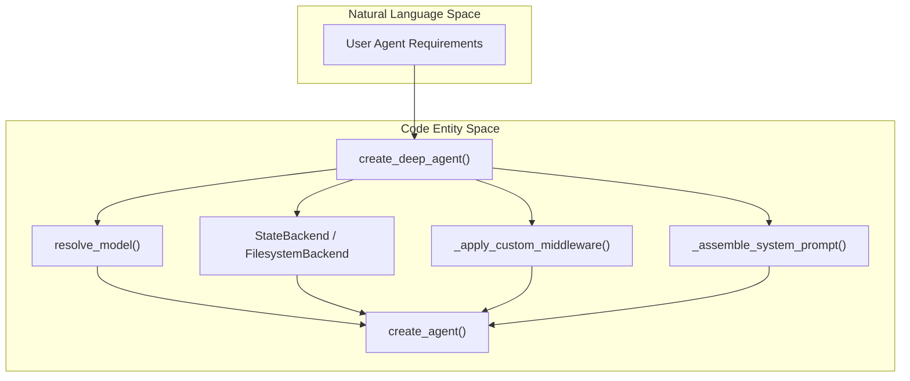

This sequence depicts the mapping from high-level user inputs, such as specifying the model and tools, through various resolution and assembly layers resulting in the final `CompiledStateGraph`.

**Sources:** [libs/deepagents/deepagents/graph.py:210-316]()

---

### Detailed Assembly Pipeline

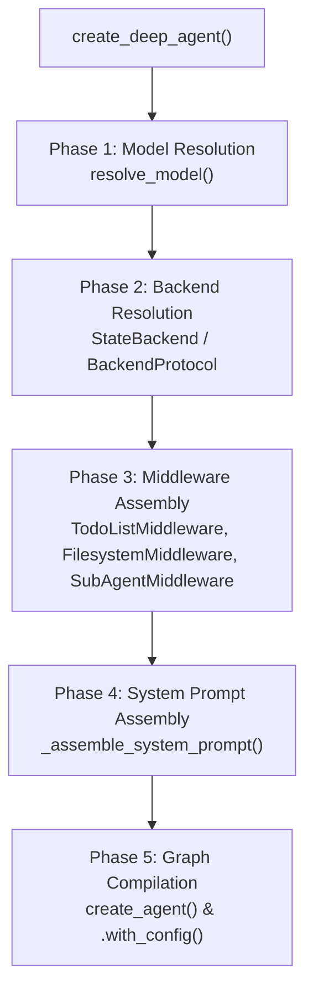

- **Phase 1:** The `model` parameter is normalized to a `BaseChatModel` instance using `resolve_model()`, which supports model specifiers with provider prefixes and applies provider profiles for billing and attribution headers.
- **Phase 2:** The backend storage abstraction is resolved to a concrete `BackendProtocol` implementation. If none is provided, defaults to `StateBackend`.
- **Phase 3:** Middleware layers comprising task management, memory injection, skills loading, filesystem tools, and subagent support are assembled in a canonical order before user custom layers append.
- **Phase 4:** The system prompt is composed, merging base instructions, user overrides, and middleware contributions.
- **Phase 5:** The agent graph is compiled and configured as a `CompiledStateGraph` ready for invocation.

**Sources:** [libs/deepagents/deepagents/graph.py:210-316]()

---

## Model Resolution Mechanism

The agent creation process transforms the `model` parameter into a fully instantiated `BaseChatModel` using `resolve_model()`. The function interprets strings with provider prefixes (e.g., `openai:gpt-4`, `anthropic:claude`) and applies provider-specific profiles that may append billing tags and attribution headers.

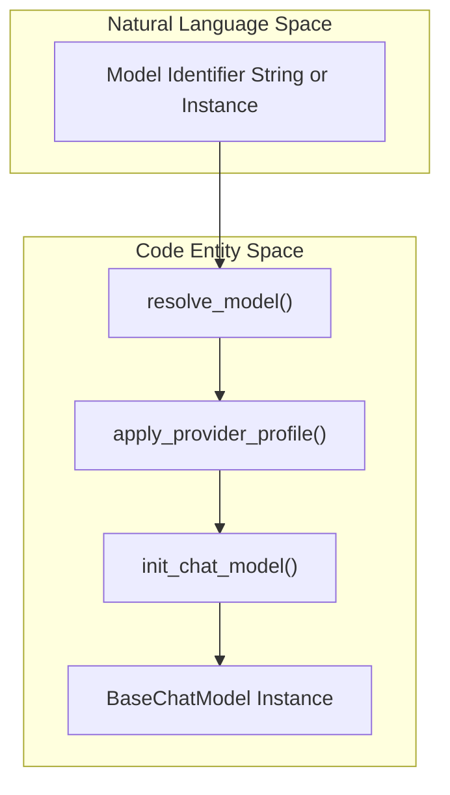

- If `model=None` is passed, the default is Anthropic's Claude Sonnet 4 (`ChatAnthropic(model_name="claude-sonnet-4-6")`).
- The resolved model supports structured output and is compatible with middleware expectations.

**Sources:** [libs/deepagents/deepagents/_models.py:35-57](), [libs/deepagents/deepagents/graph.py:145-153](), [libs/deepagents/deepagents/graph.py:210-212]()

---

## Backend Architecture

The backend abstracts how file state and execution state are stored and accessed. It follows a protocol interface (`BackendProtocol`) that allows interoperability of multiple backend implementations:

```mermaid
graph TB
    Protocol["BackendProtocol"]
    StateBk["StateBackend"]
    FsBk["FilesystemBackend"]
    StoreBk["StoreBackend"]
    CompBk["CompositeBackend"]
    SandboxProto["SandboxBackendProtocol"]

    Protocol -.-> StateBk
    Protocol -.-> FsBk
    Protocol -.-> StoreBk
    Protocol -.-> CompBk
    Protocol -.-> SandboxProto
```

- The default `StateBackend` stores mutable file state inside LangGraph's shared state dictionary.
- Other backends include `FilesystemBackend` which interfaces with local or remote filesystems, `StoreBackend` mapping to key-value stores, and `CompositeBackend` for routing requests.
- Sandboxed backends (`SandboxBackendProtocol`) support running code/tools in isolated environments.

**Sources:** [libs/deepagents/deepagents/backends/protocol.py:31-31](), [libs/deepagents/deepagents/backends/state.py:39-49](), [libs/deepagents/deepagents/backends/filesystem.py:24-24]()

---

## Middleware Stack Configuration

`create_deep_agent()` assembles a comprehensive middleware stack that is injected in a well-defined order. This stack enriches model calls with additional capabilities such as tool filtering, context injection, action delegation, and conversation compaction:

| Order | Middleware Class             | Role                                                                       |
|-------|-----------------------------|----------------------------------------------------------------------------|
| 1     | `TodoListMiddleware`        | Manages task lists exposed via the `write_todos` tool.                     |
| 2     | `MemoryMiddleware`          | Loads and injects persistent memory context from `AGENTS.md` files.        |
| 3     | `SkillsMiddleware`          | Loads skills (`SKILL.md`) directories, injecting instructions and tools.   |
| 4     | `FilesystemMiddleware`      | Provides core filesystem tools like `ls`, `read_file`, `write_file`, etc.  |
| 5     | `SubAgentMiddleware`        | Implements synchronous subagents accessible via the `task` tool.           |
| 6     | `AsyncSubAgentMiddleware`   | Adds asynchronous subagent dispatch and API call support.                   |
| 7     | `SummarizationMiddleware`   | Automatically compacts conversation history, offloads to disk/backends.    |
| 8     | `AnthropicPromptCachingMiddleware` | Optimizes prompt payloads through caching for Anthropic endpoint users.  |
| 9     | `PatchToolCallsMiddleware` | Fixes malformed or dangling tool call results in LLM conversation history. |
| 10    | `HumanInTheLoopMiddleware` | Intercepts designated tool calls to allow manual human approval or interruption. |

Additional user-supplied middleware is appended last, respecting configuration flags to optionally exclude standard middleware.

**Sources:** [libs/deepagents/deepagents/graph.py:237-293]()

---

## State Schema and Delta Channel Optimization

By default, agents use the `DeepAgentState` schema extending `AgentState`. This schema applies a custom `DeltaChannel` reducer on the `messages` field, compressing the checkpoint growth on conversation histories from $O(N^2)$ to $O(N)$ complexity by serializing only incremental changes rather than full message lists.

- `DeltaChannel` emits full snapshots approximately every 50 messages (configurable).
- This mechanism significantly improves scalability in long-running agent conversations.

**Sources:** [libs/deepagents/deepagents/graph.py:73-80]()

---

## Basic Usage Example

```python
from deepagents.graph import create_deep_agent
from langchain_anthropic import ChatAnthropic

# Optional: specify your own model or use the default
model = ChatAnthropic(model_name="claude-sonnet-4-6")

# Create a basic deep agent with default middleware and filesystem backend
agent = create_deep_agent(model=model)

# Invoke the agent with a human message
response = agent.invoke({"messages": [{"type": "human", "text": "List files in root directory"}]})

print(response["messages"][-1].text)
```

This simple example shows how to instantiate a Deep Agent using `create_deep_agent` and invoke it with a message. Advanced options for tools, skills, subagents, and middleware override can also be specified.

**Sources:** [libs/deepagents/deepagents/graph.py:315-316]()

---

# Summary

The `create_deep_agent` function is a centralized API for creating powerful, extensible AI agents within the Deep Agents SDK. It converts user-oriented parameters into a fully compiled LangGraph graph with rich middleware layers, subagent support, filesystem integration, memory and skills context, and human-in-the-loop capabilities. Its design supports flexibility via backend abstraction, middleware customization, and sophisticated prompt assembly strategies optimized for efficiency and state management.

---

# Mermaid Diagrams Summary

### Diagram 1: Natural Language Intent to Code Entities in create_deep_agent

```mermaid
graph TB
    subgraph NaturalLanguageSpace["Natural Language Space"]
        UserIntent["User Agent Requirements"]
    end

    subgraph CodeEntitySpace["Code Entity Space"]
        EntryPoint["create_deep_agent()"]
        ModelRes["resolve_model()"]
        BackendRes["StateBackend / FilesystemBackend"]
        MiddlewareAsm["_apply_custom_middleware()"]
        PromptComp["_assemble_system_prompt()"]
        GraphCompile["create_agent()"]
    end

    UserIntent --> EntryPoint
    EntryPoint --> ModelRes
    EntryPoint --> BackendRes
    EntryPoint --> MiddlewareAsm
    EntryPoint --> PromptComp
    ModelRes --> GraphCompile
    BackendRes --> GraphCompile
    MiddlewareAsm --> GraphCompile
    PromptComp --> GraphCompile
```

### Diagram 2: Detailed Internal Assembly Pipeline within create_deep_agent

```mermaid
graph TB
    Start["create_deep_agent()"] --> P1["Phase 1: Model Resolution<br/>resolve_model()"]
    P1 --> P2["Phase 2: Backend Resolution<br/>StateBackend / BackendProtocol"]
    P2 --> P3["Phase 3: Middleware Assembly<br/>TodoListMiddleware, FilesystemMiddleware, SubAgentMiddleware"]
    P3 --> P4["Phase 4: System Prompt Assembly<br/>_assemble_system_prompt()"]
    P4 --> P5["Phase 5: Graph Compilation<br/>create_agent() & .with_config()"]
```

### Diagram 3: Model Resolution Flow from Identifier to BaseChatModel

```mermaid
graph TB
    subgraph NaturalLanguageSpace["Natural Language Space"]
        ModelString["Model Identifier String or Instance"]
    end

    subgraph CodeEntitySpace["Code Entity Space"]
        CheckModel["resolve_model()"]
        ApplyProfile["apply_provider_profile()"]
        InitChat["init_chat_model()"]
        ReturnModel["BaseChatModel Instance"]
    end

    ModelString --> CheckModel
    CheckModel --> ApplyProfile
    ApplyProfile --> InitChat
    InitChat --> ReturnModel
```

### Diagram 4: Backend Protocol Implementations Supporting Agent Storage

```mermaid
graph TB
    Protocol["BackendProtocol"]
    StateBk["StateBackend"]
    FsBk["FilesystemBackend"]
    StoreBk["StoreBackend"]
    CompBk["CompositeBackend"]
    SandboxProto["SandboxBackendProtocol"]

    Protocol -.-> StateBk
    Protocol -.-> FsBk
    Protocol -.-> StoreBk
    Protocol -.-> CompBk
    Protocol -.-> SandboxProto
```

---

**Sources:**  
- [libs/deepagents/deepagents/graph.py:1-316]()  
- [libs/deepagents/deepagents/_models.py:35-57]()  
- [libs/deepagents/deepagents/middleware/subagents.py:36-123]()  
- [libs/deepagents/deepagents/backends/protocol.py:31-31]()  
- [libs/deepagents/deepagents/backends/state.py:39-49]()  
- [libs/deepagents/deepagents/backends/filesystem.py:24-24]()

---

# Page: Middleware System

# Middleware System

<details>
<summary>Relevant source files</summary>

The following files were used as context for generating this wiki page:

- [libs/deepagents/deepagents/__init__.py](libs/deepagents/deepagents/__init__.py)
- [libs/deepagents/deepagents/backends/filesystem.py](libs/deepagents/deepagents/backends/filesystem.py)
- [libs/deepagents/deepagents/backends/protocol.py](libs/deepagents/deepagents/backends/protocol.py)
- [libs/deepagents/deepagents/backends/sandbox.py](libs/deepagents/deepagents/backends/sandbox.py)
- [libs/deepagents/deepagents/backends/utils.py](libs/deepagents/deepagents/backends/utils.py)
- [libs/deepagents/deepagents/graph.py](libs/deepagents/deepagents/graph.py)
- [libs/deepagents/deepagents/middleware/__init__.py](libs/deepagents/deepagents/middleware/__init__.py)
- [libs/deepagents/deepagents/middleware/_fs_interrupt.py](libs/deepagents/deepagents/middleware/_fs_interrupt.py)
- [libs/deepagents/deepagents/middleware/filesystem.py](libs/deepagents/deepagents/middleware/filesystem.py)
- [libs/deepagents/deepagents/middleware/patch_tool_calls.py](libs/deepagents/deepagents/middleware/patch_tool_calls.py)
- [libs/deepagents/deepagents/middleware/permissions.py](libs/deepagents/deepagents/middleware/permissions.py)
- [libs/deepagents/deepagents/middleware/subagents.py](libs/deepagents/deepagents/middleware/subagents.py)
- [libs/deepagents/tests/integration_tests/test_filesystem_middleware.py](libs/deepagents/tests/integration_tests/test_filesystem_middleware.py)
- [libs/deepagents/tests/integration_tests/test_subagent_middleware.py](libs/deepagents/tests/integration_tests/test_subagent_middleware.py)
- [libs/deepagents/tests/unit_tests/backends/test_filesystem_backend.py](libs/deepagents/tests/unit_tests/backends/test_filesystem_backend.py)
- [libs/deepagents/tests/unit_tests/backends/test_protocol.py](libs/deepagents/tests/unit_tests/backends/test_protocol.py)
- [libs/deepagents/tests/unit_tests/backends/test_sandbox_backend.py](libs/deepagents/tests/unit_tests/backends/test_sandbox_backend.py)
- [libs/deepagents/tests/unit_tests/backends/test_utils.py](libs/deepagents/tests/unit_tests/backends/test_utils.py)
- [libs/deepagents/tests/unit_tests/middleware/test_subagent_middleware_init.py](libs/deepagents/tests/unit_tests/middleware/test_subagent_middleware_init.py)
- [libs/deepagents/tests/unit_tests/test_end_to_end.py](libs/deepagents/tests/unit_tests/test_end_to_end.py)
- [libs/deepagents/tests/unit_tests/test_eviction_replay.py](libs/deepagents/tests/unit_tests/test_eviction_replay.py)
- [libs/deepagents/tests/unit_tests/test_graph.py](libs/deepagents/tests/unit_tests/test_graph.py)
- [libs/deepagents/tests/unit_tests/test_local_sandbox_operations.py](libs/deepagents/tests/unit_tests/test_local_sandbox_operations.py)
- [libs/deepagents/tests/unit_tests/test_middleware.py](libs/deepagents/tests/unit_tests/test_middleware.py)
- [libs/deepagents/tests/unit_tests/test_middleware_async.py](libs/deepagents/tests/unit_tests/test_middleware_async.py)
- [libs/deepagents/tests/unit_tests/test_permissions.py](libs/deepagents/tests/unit_tests/test_permissions.py)
- [libs/deepagents/tests/unit_tests/test_subagents.py](libs/deepagents/tests/unit_tests/test_subagents.py)

</details>


Purpose and scope: This page explains the middleware architecture in Deep Agents, detailing execution order, available built-in middleware (`MemoryMiddleware`, `SkillsMiddleware`, `FilesystemMiddleware`, `SubAgentMiddleware`, `SummarizationMiddleware`, etc.), the `AgentMiddleware` protocol, state extension via reducers, and how middleware intercepts requests and responses across the agent lifecycle.

---

## Overview

Middleware layers are the primary mechanism for extending agent functionality. Unlike plain tools, middleware can:

- **Filter tools dynamically**: For example, `FilesystemMiddleware` removes the `execute` tool at call-time if the resolved backend does not support execution [libs/deepagents/deepagents/middleware/filesystem.py:335-353]().
- **Inject system-prompt context**: Middleware such as `MemoryMiddleware` and `SkillsMiddleware` inject relevant instructions and memory content into the system message on every model call [libs/deepagents/deepagents/middleware/memory.py:82-108](), [libs/deepagents/deepagents/middleware/skills.py:122-134]().
- **Transform messages**: `SummarizationMiddleware` manages token count, truncates oversized tool arguments, and replaces conversation history with summaries when context windows are filled [libs/deepagents/deepagents/middleware/summarization.py:173-186]().
- **Maintain state across turns**: Middleware can read and write a typed state dictionary that persists across agent turns to assist in complex workflows or long-term memory [libs/deepagents/deepagents/middleware/memory.py:88-97]().

| Middleware               | Purpose                                            | Key Hooks Used                              |
|--------------------------|----------------------------------------------------|--------------------------------------------|
| `MemoryMiddleware`       | Loads project and user context from `AGENTS.md`    | `wrap_model_call`, `abefore_agent`         |
| `SkillsMiddleware`       | Loads and injects skill capabilities from `SKILL.md` | `before_agent`, `wrap_model_call`           |
| `FilesystemMiddleware`   | Provides file system tools and manages result eviction | `wrap_model_call`, `wrap_tool_call`         |
| `SubAgentMiddleware`     | Task delegation to synchronous sub-agents          | `wrap_model_call`                           |
| `AsyncSubAgentMiddleware`| Remote background task delegation                   | `wrap_model_call`                           |
| `SummarizationMiddleware`| Automatic context window management                 | `wrap_model_call`                           |
| `HumanInTheLoopMiddleware`| Handles tool call approvals and interruptions       | `wrap_tool_call`                            |
| `RubricMiddleware`       | Self-evaluates progress against acceptance criteria | `wrap_model_call`                           |
| `GoalToolsMiddleware`    | Tools for goal lifecycle management                  | `tools`                                    |

Sources: [libs/deepagents/deepagents/middleware/filesystem.py:1-45](), [libs/deepagents/deepagents/middleware/memory.py:1-53](), [libs/deepagents/deepagents/middleware/summarization.py:1-48](), [libs/deepagents/deepagents/graph.py:12-14](), [libs/deepagents/deepagents/middleware/rubric.py:41-41](), [libs/deepagents/deepagents/middleware/subagents.py:1-17]()

---

## AgentMiddleware Protocol

Middleware components implement the `AgentMiddleware` protocol, which defines hooks corresponding to various stages of the agent lifecycle. Middleware classes subclass `AgentMiddleware` and override these hooks to:

- Modify or enrich prompts before the model call (`wrap_model_call`).
- Intercept and potentially modify tool calls and responses (`wrap_tool_call`).
- Extend state with typed dictionaries exposed via a `state_schema`.
- Perform asynchronous variants of hooks (`awrap_model_call`, `awrap_tool_call`).
- Optionally perform operations before the agent session starts (`before_agent` or `abefore_agent`).

### Middleware Class Relationships

```mermaid
classDiagram
    class AgentMiddleware {
        <<interface>>
        +state_schema: Type~AgentState~
        +tools: List~BaseTool~
        +before_agent(state, runtime) Optional~Command~
        +wrap_model_call(request, handler) ModelResponse
        +wrap_tool_call(request, handler) ToolMessage
        +awrap_model_call(request, handler) ModelResponse
        +awrap_tool_call(request, handler) ToolMessage
    }
    
    class FilesystemMiddleware {
        +state_schema: FilesystemState
        +tools: [ls, read_file, write_file, edit_file, glob, grep, execute]
        +backend: BackendProtocol
        +wrap_tool_call()
        +wrap_model_call()
    }
    
    class SubAgentMiddleware {
        +tools: [task]
        +subagents: List~SubAgent~
        +wrap_model_call()
    }
    
    class SkillsMiddleware {
        +state_schema: SkillsState
        +sources: List~str~
        +before_agent()
        +wrap_model_call()
    }

    class MemoryMiddleware {
        +state_schema: MemoryState
        +sources: List~str~
        +wrap_model_call()
        +abefore_agent()
    }
    
    AgentMiddleware <|-- FilesystemMiddleware
    AgentMiddleware <|-- SubAgentMiddleware
    AgentMiddleware <|-- SkillsMiddleware
    AgentMiddleware <|-- MemoryMiddleware
```

- `state_schema` defines the TypedDict keys that extend agent state for that middleware (e.g., `FilesystemState` adds the `"files"` key in state).
- `tools` lists tool instances the middleware registers to extend the capabilities exposed to the agent.
- `before_agent` or `abefore_agent` run once at session start to load data or initialize state.
- `wrap_model_call` and `wrap_tool_call` intercept calls to the LLM or tools to inject context, filter tools, perform permission checks, or offload large results.

Sources: [libs/deepagents/deepagents/middleware/filesystem.py:114-121](), [libs/deepagents/deepagents/middleware/memory.py:88-102](), [libs/deepagents/deepagents/middleware/subagents.py:11-17]()

---

## Execution Flow and Lifecycle Hooks

Middleware are wrapped in a stack, forming a pipeline through which model requests and tool calls pass. The order of middleware registration is critical because inner middleware can alter state or requests that outer middleware see.

### Middleware Execution Pipeline

```mermaid
sequenceDiagram
    participant Agent as "create_deep_agent"
    participant MW as "Middleware Stack"
    participant Model as "LLM (wrap_model_call)"
    participant Tools as "Tool Executor (wrap_tool_call)"
    
    Agent->>MW: "before_agent(state, runtime)"
    Note over MW: "Initialize state, load memory, skills, etc."
    MW-->>Agent: "Command(update={...})"
    
    loop "Agent turns (conversation)"
        Agent->>MW: "wrap_model_call(request, handler)"
        Note over MW: "Inject context, filter tools"
        MW->>Model: "handler(request)"
        Model-->>MW: "ModelResponse"
        MW-->>Agent: "ModelResponse"
        
        alt "Tool call used"
            Agent->>MW: "wrap_tool_call(request, handler)"
            Note over MW: "Validate permissions, offload large results"
            MW->>Tools: "handler(request)"
            Tools-->>MW: "ToolMessage"
            MW-->>Agent: "ToolMessage"
        end
    end
```

### Prompt Injection by Middleware

- `MemoryMiddleware` and `SkillsMiddleware` inject context by appending to the system message using utilities like `append_to_system_message`.
- Contextual memory files wrapped in tags like `<agent_memory>` appear in the system prompt to instruct the agent.
- `SubAgentMiddleware` may inject directives specifying task delegation.

### Tool Result Offloading and Eviction

- `FilesystemMiddleware` handles large tool results by offloading them to the backend if their token count exceeds a configured threshold (`TOOL_RESULT_TOKEN_LIMIT`).
- When offloaded, the tool result is replaced with a reference path, and a preview snippet is included to aid in interpretation without flooding the conversational buffer.
- This eviction pattern reduces token usage in the conversation and preserves large outputs externally.

Sources: [libs/deepagents/deepagents/graph.py:12-63](), [libs/deepagents/deepagents/middleware/memory.py:82-108](), [libs/deepagents/deepagents/middleware/filesystem.py:355-419](), [libs/deepagents/backends/utils.py:33-33]()

---

## State Schema Extension and Reducers

Middleware extend the base `AgentState` by adding new keys. These keys correspond to TypedDict schemas they define. Changes from middleware are merged into the agent's state across turns.

### Filesystem State and File Data Reducer

```mermaid
graph TD
    subgraph "Code Entity Space"
        FS["FilesystemState (TypedDict)"]
        FDR["_file_data_reducer (function)"]
        FD[ "FileData (TypedDict)" ]
    end

    subgraph "Natural Language Space"
        Files["'files' state key: file path -> FileData or None"]
        Delete["File Deletion (None means remove file key)"]
        Update["File Content Update"]
    end

    FS -->|"annotated with"| FDR
    FDR -->|"manages"| FD
    Files -.-> FS
    Delete -.-> FDR
    Update -.-> FDR
```

- The middleware keeps the `"files"` key in state as a mapping from filepath strings to `FileData` dictionaries.
- The `_file_data_reducer` function applies incoming update dictionaries to the current `"files"` state by setting files and removing any file path keys whose value is `None`, implementing deletions [libs/deepagents/deepagents/middleware/filesystem.py:78-121]().

This reducer pattern ensures consistent and declarative state updates for file contents managed internally by `FilesystemMiddleware`.

Sources: [libs/deepagents/deepagents/middleware/filesystem.py:78-121]()

---

## Key Built-in Middleware

### FilesystemMiddleware

- Provides the agent with tools to interact with the filesystem, including `ls`, `read_file`, `write_file`, `edit_file`, `glob`, `grep`, and conditionally `execute`.
- Uses an underlying backend implementing `BackendProtocol` (e.g., `StateBackend`, `FilesystemBackend`, `CompositeBackend`) to perform actual file I/O.
- Dynamically filters the availability of the `execute` tool based on backend capability.
- Enforces filesystem permissions defined via `FilesystemPermission` rules during tool calls, guarding operations paths and access [libs/deepagents/deepagents/middleware/filesystem.py:335-353]().

### SkillsMiddleware

- Loads skill definitions from `SKILL.md` files at configured source directories.
- Parses YAML frontmatter in these files to extract metadata and instructions.
- Injects skill instructions as context into the system prompt, enhancing the agent's capability set [libs/deepagents/deepagents/middleware/skills.py:1-45]().

### MemoryMiddleware

- Loads `AGENTS.md` files from configured memory sources to provide long-term project or user memory context.
- Encourages agents to learn from feedback by updating these memory files via edit operations.
- Injects memory contents into every model call's system prompt wrapped in `<agent_memory>` tags for clarity [libs/deepagents/deepagents/middleware/memory.py:27-126]().

### SummarizationMiddleware

- Manages the automatic compression of conversation history to stay within model context token limits.
- Upon excess tokens, summarizes and offloads prior conversation history to the backend filesystem, referencing it in the ongoing context.
- Supports a manual `compact_conversation` tool to trigger compaction explicitly [libs/deepagents/deepagents/middleware/summarization.py:1-194]().

### Additional Middleware

- `SubAgentMiddleware` provides sub-agent task delegation via a `task` tool.
- `AsyncSubAgentMiddleware` supports asynchronous remote sub-agent invocation.
- `HumanInTheLoopMiddleware` wraps tool calls to enforce approval workflows.
- `RubricMiddleware` injects prompts to self-evaluate adherence to goal rubrics.
- `GoalToolsMiddleware` exposes goal lifecycle management tools to the agent [libs/deepagents/deepagents/graph.py:211-211]().

Sources: [libs/deepagents/deepagents/middleware/filesystem.py:335-353](), [libs/deepagents/deepagents/middleware/memory.py:1-136](), [libs/deepagents/deepagents/middleware/summarization.py:1-194](), [libs/deepagents/deepagents/graph.py:211-211]()

---

## Middleware Composition Order

The `create_deep_agent` function composes middleware in a defined order to ensure logical layering of functionality:

1. `TodoListMiddleware` — innermost context, manages a todo list [libs/deepagents/deepagents/graph.py:14]()
2. `MemoryMiddleware` — injects agent memory and context [libs/deepagents/deepagents/graph.py:52]()
3. `SkillsMiddleware` — injects skill context [libs/deepagents/deepagents/graph.py:54]()
4. `FilesystemMiddleware` — provides filesystem tools and permission enforcement [libs/deepagents/deepagents/graph.py:51]()
5. `SubAgentMiddleware` — task delegation for synchronous subagents [libs/deepagents/deepagents/graph.py:59]()
6. `AsyncSubAgentMiddleware` — remote async subagent support [libs/deepagents/deepagents/graph.py:50]()
7. `SummarizationMiddleware` — context summarization and compaction [libs/deepagents/deepagents/graph.py:63]()
8. `AnthropicPromptCachingMiddleware` — prompt caching optimizations [libs/deepagents/deepagents/graph.py:46]()
9. `PatchToolCallsMiddleware` — patching tool call formatting [libs/deepagents/deepagents/graph.py:53]()
10. `_ToolExclusionMiddleware` — exclude certain tools dynamically [libs/deepagents/deepagents/graph.py:48]()
11. `HumanInTheLoopMiddleware` — outermost middleware for approval/interruption [libs/deepagents/deepagents/graph.py:14]()

The wrapping order ensures that system prompt injection and middleware augmentations occur inside out, with approvals and interrupts applied last.

Sources: [libs/deepagents/deepagents/graph.py:13-63]()

---

# Diagrams Bridging Natural Language Concepts to Code Entities


### Diagram 1: Middleware System Natural Language to Code Entity Mapping

```mermaid
graph LR
    NL1["Natural Language: Filesystem tools (ls, read_file, write_file, edit_file, glob, grep, execute)"] 
    NL2["Natural Language: Memory loading from AGENTS.md files"]
    NL3["Natural Language: Skills loading from SKILL.md files"]
    NL4["Natural Language: Task delegation to sub-agents with 'task' tool"]
    NL5["Natural Language: Automatic context summarization and compaction"]

    CE1["Code Entity: FilesystemMiddleware (libs/deepagents/deepagents/middleware/filesystem.py)"]
    CE2["Code Entity: MemoryMiddleware (libs/deepagents/deepagents/middleware/memory.py)"]
    CE3["Code Entity: SkillsMiddleware (libs/deepagents/deepagents/middleware/skills.py)"]
    CE4["Code Entity: SubAgentMiddleware (libs/deepagents/deepagents/middleware/subagents.py)"]
    CE5["Code Entity: SummarizationMiddleware (libs/deepagents/deepagents/middleware/summarization.py)"]

    NL1 --> CE1
    NL2 --> CE2
    NL3 --> CE3
    NL4 --> CE4
    NL5 --> CE5
```

### Diagram 2: Middleware Lifecycle Hook Usage Across Agent Execution

```mermaid
sequenceDiagram
    participant NaturalLang as "Natural Language Request/Instruction"
    participant MiddlewareStack as "Middleware Stack (AgentMiddleware instances)"
    participant Graph as "DeepAgent / create_deep_agent (libs/deepagents/deepagents/graph.py)"
    participant Backend as "BackendProtocol Backend (FilesystemBackend, StateBackend)"
    participant Model as "LLM model (e.g. ChatAnthropic)"

    NaturalLang->>Graph: Create agent with middleware stack
    Graph->>MiddlewareStack: Register Middleware in order
    NaturalLang->>MiddlewareStack: wrap_model_call(request)
    MiddlewareStack->>Model: Possibly augmented request
    Model-->>MiddlewareStack: ModelResponse
    MiddlewareStack-->>NaturalLang: Augmented ModelResponse
    
    alt Tool Call in Response
        NaturalLang->>MiddlewareStack: wrap_tool_call(tool_request)
        MiddlewareStack->>Backend: Perform file IO or tools
        Backend-->>MiddlewareStack: Tool results
        MiddlewareStack-->>NaturalLang: ToolMessage (possibly offloaded)
    end
```

---

# Summary

The Deep Agents middleware system provides a robust, layered framework for intercepting and enhancing both language model calls and tool executions. Middleware can add stateful memory, inject skills, manage filesystem interactions with permissions and offloading, delegate work to sub-agents, and manage conversation history via summarization. The lifecycle hooks `before_agent`, `wrap_model_call`, and `wrap_tool_call` enable fine-grained control and context injection at each stage. Middleware are composed in a carefully defined order in `create_deep_agent` to maximize extensibility and ensure consistent behavior. The strongly-typed state schemas and reducers provide structured cross-turn data management.

Sources:  
- [libs/deepagents/deepagents/middleware/filesystem.py:1-185,335-419]()  
- [libs/deepagents/deepagents/middleware/memory.py:27-108]()  
- [libs/deepagents/deepagents/middleware/skills.py:1-53]()  
- [libs/deepagents/deepagents/middleware/subagents.py:1-176]()  
- [libs/deepagents/deepagents/middleware/summarization.py:1-194]()  
- [libs/deepagents/deepagents/graph.py:12-63, 211-211]()

---

# Page: Sub-Agent Delegation

# Sub-Agent Delegation

<details>
<summary>Relevant source files</summary>

The following files were used as context for generating this wiki page:

- [libs/deepagents/deepagents/__init__.py](libs/deepagents/deepagents/__init__.py)
- [libs/deepagents/deepagents/graph.py](libs/deepagents/deepagents/graph.py)
- [libs/deepagents/deepagents/middleware/__init__.py](libs/deepagents/deepagents/middleware/__init__.py)
- [libs/deepagents/deepagents/middleware/_blob_offload.py](libs/deepagents/deepagents/middleware/_blob_offload.py)
- [libs/deepagents/deepagents/middleware/_parent_notifier.py](libs/deepagents/deepagents/middleware/_parent_notifier.py)
- [libs/deepagents/deepagents/middleware/async_subagents.py](libs/deepagents/deepagents/middleware/async_subagents.py)
- [libs/deepagents/deepagents/middleware/patch_tool_calls.py](libs/deepagents/deepagents/middleware/patch_tool_calls.py)
- [libs/deepagents/deepagents/middleware/subagents.py](libs/deepagents/deepagents/middleware/subagents.py)
- [libs/deepagents/tests/integration_tests/test_filesystem_middleware.py](libs/deepagents/tests/integration_tests/test_filesystem_middleware.py)
- [libs/deepagents/tests/integration_tests/test_subagent_middleware.py](libs/deepagents/tests/integration_tests/test_subagent_middleware.py)
- [libs/deepagents/tests/unit_tests/middleware/test_blob_offload.py](libs/deepagents/tests/unit_tests/middleware/test_blob_offload.py)
- [libs/deepagents/tests/unit_tests/middleware/test_filesystem_middleware_init.py](libs/deepagents/tests/unit_tests/middleware/test_filesystem_middleware_init.py)
- [libs/deepagents/tests/unit_tests/middleware/test_subagent_middleware_init.py](libs/deepagents/tests/unit_tests/middleware/test_subagent_middleware_init.py)
- [libs/deepagents/tests/unit_tests/test_async_subagents.py](libs/deepagents/tests/unit_tests/test_async_subagents.py)
- [libs/deepagents/tests/unit_tests/test_eviction_replay.py](libs/deepagents/tests/unit_tests/test_eviction_replay.py)
- [libs/deepagents/tests/unit_tests/test_graph.py](libs/deepagents/tests/unit_tests/test_graph.py)
- [libs/deepagents/tests/unit_tests/test_subagents.py](libs/deepagents/tests/unit_tests/test_subagents.py)

</details>


Sub-agent delegation enables a main agent to spawn specialized child agents for focused tasks. Each sub-agent operates with an isolated context window and can be configured with its own model, tools, and system prompt. This mechanism is exposed to the agent through the `task` tool, which is automatically registered by `SubAgentMiddleware` [libs/deepagents/deepagents/middleware/subagents.py:1-176]().

---

## Purpose and Architecture

Sub-agents provide task decomposition and context isolation. When a conversation grows long or involves distinct subtasks, the main agent can delegate work to a sub-agent that starts with a fresh context window. The sub-agent executes independently, returns its result, and its internal conversation history is discarded—only the final output is returned to the parent agent as a `ToolMessage` [libs/deepagents/deepagents/middleware/subagents.py:167-169]().

### Subagent Delegation Flow

```mermaid
graph TB
    MainAgent["MainAgent (create_deep_agent)"]
    SubAgentMiddleware["SubAgentMiddleware\n(libs/deepagents/deepagents/middleware/subagents.py)"]
    TaskTool["task tool (StructuredTool)"]
    SubAgentRunnable["CompiledSubAgent.runnable"]
    Backend["BackendProtocol"]
    
    MainAgent -->|"wrapped by"| SubAgentMiddleware
    SubAgentMiddleware -->|"registers"| TaskTool
    MainAgent -->|"calls task()"| TaskTool
    TaskTool -->|"invokes"| SubAgentRunnable
    SubAgentRunnable -->|"uses"| Backend
    MainAgent -->|"shares"| Backend
    SubAgentRunnable -->|"returns result"| TaskTool
    TaskTool -->|"returns ToolMessage"| MainAgent
```

Sources: [libs/deepagents/deepagents/middleware/subagents.py:1-176](), [libs/deepagents/tests/unit_tests/test_subagents.py:130-144]()

---

## Subagent Types

### Synchronous Subagents (`SubAgent`)

Synchronous subagents are defined as `SubAgent` TypedDicts specifying their configuration. The `SubAgentMiddleware` compiles these specifications into `CompiledSubAgent` instances used internally when the `task` tool is called. This allows the main agent to delegate tasks seamlessly [libs/deepagents/deepagents/middleware/subagents.py:83-174]().

**SubAgent Specification Fields**

| Field             | Type                           | Required | Description                                                                                                   |
|-------------------|--------------------------------|----------|---------------------------------------------------------------------------------------------------------------|
| `name`            | `str`                          | Yes      | Unique ID used by the main agent in `task(subagent_type="name")` calls.                                       |
| `description`     | `str`                          | Yes      | Text describing the subagent’s function used for delegation decisions.                                       |
| `mode`            | `Literal["isolated", "fork"]`  | No       | Defaults to `"isolated"`. `"fork"` allows continuing the parent's conversation instead of starting fresh.    |
| `system_prompt`   | `str`                          | No       | Additional instructions appended to the inherited prompt in fork mode or used standalone in isolated mode.   |
| `model`           | `str \| BaseChatModel`          | No       | Model override for the subagent, e.g., `"openai:gpt-5.5"`.                                                   |
| `tools`           | `Sequence[BaseTool \| Callable \| dict]` | No     | Tools accessible to the subagent. Inherits from main agent if absent.                                        |
| `middleware`      | `list[AgentMiddleware]`        | No       | Additional/overriding middleware for the subagent.                                                          |
| `skills`          | `list[str]`                    | No       | Skill directories for `SkillsMiddleware`. Forbidden in fork mode.                                            |
| `permissions`     | `list[FilesystemPermission]`   | No       | Filesystem access restrictions replacing parent's permissions if provided.                                   |
| `response_format` | `ResponseFormat \| type \| dict`| No      | Structured output format for the subagent’s response.                                                        |

Sources: [libs/deepagents/deepagents/middleware/subagents.py:83-174]()

### Asynchronous Subagents (`AsyncSubAgent`)

Async subagents run as background jobs on remote Agent Protocol servers. They are described by the `AsyncSubAgent` TypedDict, managed by `AsyncSubAgentMiddleware`, which supplies tools to start, monitor, update, and cancel these tasks [libs/deepagents/deepagents/middleware/async_subagents.py:56-133]().

**AsyncSubAgent Specification Fields**

| Field        | Type               | Required | Description                                                            |
|--------------|--------------------|----------|------------------------------------------------------------------------|
| `name`       | `str`              | Yes      | Unique identifier.                                                     |
| `description`| `str`              | Yes      | Description for delegation decisions.                                 |
| `graph_id`   | `str`              | Yes      | Graph or assistant ID on the remote server.                          |
| `url`        | `str`              | No       | URL of the remote Agent Protocol server; omitted for local ASGI.     |
| `headers`    | `dict[str, str]`   | No       | Additional request headers, e.g., for authentication.                |
| `mode`       | `Literal["isolated", "fork"]` | No     | Fork mode sends parent's conversation snapshot; isolated sends only task description (default). |

Async subagents immediately return a `task_id` to the main agent, which can then query progress and results asynchronously [libs/deepagents/deepagents/middleware/async_subagents.py:5-7]().

Sources: [libs/deepagents/deepagents/middleware/async_subagents.py:56-133](), [libs/deepagents/deepagents/middleware/async_subagents.py:135-172]()

---

## Context Isolation and Recursion

### Delegation Modes

- **Isolated (Default)**: Subagent receives only the delegated task description with a fresh context. It does not inherit the parent's message history or context [libs/deepagents/deepagents/middleware/subagents.py:86-90]().
- **Fork (Experimental)**: Subagent receives a snapshot of the parent's conversation as the starting context and then continues with the delegated task description. Some parent state keys (like summarization events, structured responses) are excluded to avoid confusion or incorrect result scattering [libs/deepagents/deepagents/middleware/subagents.py:52-72]().

### Recursion Protection

Forked subagents are marked with a special state key (`_FORKED_CONTEXT_KEY`) preventing them from invoking `task` or `atask` again. Attempting recursive delegation results in a refusal message: 

*“You are a subagent and cannot delegate to another subagent. Complete this task yourself instead of calling this tool again.”* [libs/deepagents/deepagents/middleware/subagents.py:54-63]().

This safeguards against infinite delegation loops and unbounded task recursion.

Sources: [libs/deepagents/deepagents/middleware/subagents.py:43-63](), [libs/deepagents/deepagents/middleware/subagents.py:72-77]()

---

## Middleware Architecture and Data Flow

### The `task` Tool

The `task` tool is the primary interface for synchronous subagent delegation. It is implemented as a `StructuredTool` registered by `SubAgentMiddleware`. When the main agent invokes `task(...)`, the middleware looks up the subagent by name, executes the subagent’s runnable, and returns its final result in a `ToolMessage` to the main agent [libs/deepagents/deepagents/middleware/subagents.py:95-116]().

### SubAgentMiddleware Data Flow Diagram

```mermaid
graph LR
    MainAgent["MainAgent (create_deep_agent)"]
    TaskTool["task(description, subagent_type)"]
    SubAgentMiddleware["SubAgentMiddleware (middleware/subagents.py)"]
    SubAgentRegistry["Subagent Registry: name → CompiledSubAgent"]
    CompiledSubAgent["CompiledSubAgent (runnable)"]
    Backend["BackendProtocol"]
    ToolMessage["ToolMessage (result)"]

    MainAgent -->|"calls"| TaskTool
    TaskTool -->|"looks up subagent"| SubAgentMiddleware
    SubAgentMiddleware -->|"retrieves"| SubAgentRegistry
    SubAgentRegistry -->|"executes runnable"| CompiledSubAgent
    CompiledSubAgent -->|"uses"| Backend
    CompiledSubAgent -->|"returns final message"| TaskTool
    TaskTool -->|"returns"| ToolMessage
    ToolMessage -->|"appended to"| MainAgent
```

**Explanation:**  
- The main agent (constructed by `create_deep_agent`) uses `SubAgentMiddleware` which registers the `task` tool.  
- Calling `task()` invokes the associated subagent by name.  
- The subagent runs in isolation or fork mode via `CompiledSubAgent`, using the shared backend.  
- The subagent’s last message is converted into a `ToolMessage` sent back to the parent agent.

Sources: [libs/deepagents/deepagents/middleware/subagents.py:20-60](), [libs/deepagents/tests/unit_tests/test_subagents.py:130-144]()

---

## Async Subagent Execution

Async subagents are managed by `AsyncSubAgentMiddleware`. Instead of blocking for results, they start background runs on external Agent Protocol servers using the LangGraph SDK, returning a `task_id` immediately. The main agent can asynchronously query, update, or cancel tasks via tools registered by this middleware [libs/deepagents/deepagents/middleware/async_subagents.py:1-173]().

### Async Subagent Tools Provided

| Tool Name           | Purpose                                           |
|---------------------|--------------------------------------------------|
| `start_async_task`   | Starts a new async subagent run; returns `task_id` immediately [async_subagents.py:110-117]() |
| `check_async_task`   | Queries the status and result of an async task [async_subagents.py:119-124]()                  |
| `update_async_task`  | Sends new instructions to a running async task [async_subagents.py:126-131]()                   |
| `cancel_async_task`  | Cancels a running async task [async_subagents.py:133-137]()                                    |
| `list_async_tasks`   | Lists tracked tasks with optional filtering [async_subagents.py:139-144]()                     |

### Async Task Tracking State

Async tasks are persisted in the middleware state under the `async_tasks` dictionary keyed by `task_id`. Each task is an `AsyncTask` TypedDict with metadata including `thread_id`, `run_id`, `agent_name`, `status` and timestamps in ISO-8601 format.

The reducer function `_tasks_reducer` ensures incoming async task updates are merged correctly into existing state without loss [libs/deepagents/deepagents/middleware/async_subagents.py:120-129]().

Sources: [libs/deepagents/deepagents/middleware/async_subagents.py:138-172](), [libs/deepagents/deepagents/middleware/async_subagents.py:172-194]()

---

## Implementation Details

### SubAgent Middleware Interface

Both `SubAgentMiddleware` and `AsyncSubAgentMiddleware` subclass `AgentMiddleware` from LangChain. They intercept messages sent to the LLM to:

- Register tools for subagent delegation.
- Inject or modify system prompts and tool lists dynamically.
- Manage sub-agent-specific state and context isolation.
- Handle task lifecycle and persistence of async tasks.

### Key Classes and Functions

| Symbol                     | Description                                                                          | Location                                                     |
|----------------------------|--------------------------------------------------------------------------------------|--------------------------------------------------------------|
| `SubAgent`                 | TypedDict describing synchronous subagent specification fields.                     | `middleware/subagents.py` lines 83-174                        |
| `AsyncSubAgent`            | TypedDict describing asynchronous subagent specification fields.                    | `middleware/async_subagents.py` lines 56-133                 |
| `SubAgentMiddleware`       | Middleware implementing sync subagent support with `task` tool registration.          | `middleware/subagents.py` entire module                       |
| `AsyncSubAgentMiddleware`  | Middleware implementing async subagent support with async task tools registered.      | `middleware/async_subagents.py` entire module                 |
| `_tasks_reducer`           | Function to merge async task updates into middleware state.                          | `middleware/async_subagents.py` lines 122-129                 |
| `create_sub_agent`         | Helper to compile a `SubAgent` spec into a `CompiledSubAgent` runnable.              | `middleware/subagents.py` lines 30-40                          |
| `_build_task_tool`          | Constructs the `task` StructuredTool for invoking sync subagents.                   | `middleware/subagents.py` lines 27-33                          |

Sources: [libs/deepagents/deepagents/middleware/subagents.py:1-176](), [libs/deepagents/deepagents/middleware/async_subagents.py:1-173](), [libs/deepagents/tests/unit_tests/test_subagents.py:95-160]()

---

## Bridging Natural Language to Code Entities: Sub-Agent Delegation Overview

```mermaid
graph TD
    NL1["Natural Language: Subagent Delegation"]
    NL2["Natural Language: Async Subagent Execution"]
    Code1["Code Entity: SubAgentMiddleware\n(module: middleware/subagents.py)"]
    Code2["Code Entity: AsyncSubAgentMiddleware\n(module: middleware/async_subagents.py)"]
    Code3["Code Entity: create_deep_agent()\n(module: deepagents/graph.py)"]
    Code4["Code Entity: task tool\n(StructuredTool in SubAgentMiddleware)"]
    Code5["Code Entity: async tools\n(start_async_task, check_async_task, etc.)"]

    NL1 --> Code1
    NL1 --> Code4
    NL2 --> Code2
    Code1 --> Code3
    Code2 --> Code3
    Code4 --> Code3
    Code5 --> Code2
```

---

## Bridging Natural Language to Code Entities: Subagent Delegate Flow

```mermaid
flowchart TB
    User["User requests complex task"]
    MainAgent["Main Agent\n(create_deep_agent)"]
    SubAgentMiddleware["SubAgentMiddleware"]
    AsyncSubAgentMiddleware["AsyncSubAgentMiddleware"]
    TaskTool["task() tool"]
    AsyncStartTool["start_async_task tool"]
    SyncSubAgent["Synchronous SubAgent\n(CompiledSubAgent runnable)"]
    AsyncSubAgent["Async SubAgent\n(Agent Protocol remote run)"]
    Backend["BackendProtocol"]

    User --> MainAgent
    MainAgent --> SubAgentMiddleware
    MainAgent --> AsyncSubAgentMiddleware
    SubAgentMiddleware --> TaskTool
    AsyncSubAgentMiddleware --> AsyncStartTool
    MainAgent --> TaskTool
    MainAgent --> AsyncStartTool
    TaskTool --> SyncSubAgent
    AsyncStartTool --> AsyncSubAgent
    SyncSubAgent --> Backend
    AsyncSubAgent --> Backend
    SyncSubAgent --> TaskTool
    AsyncSubAgent --> AsyncStartTool
```

Sources: [libs/deepagents/deepagents/middleware/subagents.py](), [libs/deepagents/deepagents/middleware/async_subagents.py](), [libs/deepagents/deepagents/graph.py]()

---

# Summary

Sub-Agent Delegation in the Deep Agents framework is realized primarily via the `SubAgentMiddleware` which provides synchronous subagents through the `task` tool with isolated or fork modes. Asynchronous subagents run on remote Agent Protocol servers managed by `AsyncSubAgentMiddleware`, returning control immediately to the parent with task IDs and providing tools for ongoing management.

This separation allows rich task decomposition, context isolation, and externalized background processing within the agent framework. Both middleware types integrate tightly with the backend for persistent state and reuse within the overarching Deep Agents architecture instantiated by `create_deep_agent`.

---

Sources:  
- libs/deepagents/deepagents/middleware/subagents.py  
- libs/deepagents/deepagents/middleware/async_subagents.py  
- libs/deepagents/deepagents/graph.py  
- libs/deepagents/tests/unit_tests/test_subagents.py  
- libs/deepagents/tests/unit_tests/test_async_subagents.py

---

# Page: Skills System

# Skills System

<details>
<summary>Relevant source files</summary>

The following files were used as context for generating this wiki page:

- [libs/deepagents/deepagents/middleware/_skill_tools.py](libs/deepagents/deepagents/middleware/_skill_tools.py)
- [libs/deepagents/deepagents/middleware/skills.py](libs/deepagents/deepagents/middleware/skills.py)
- [libs/deepagents/tests/unit_tests/middleware/skill_tools_support.py](libs/deepagents/tests/unit_tests/middleware/skill_tools_support.py)
- [libs/deepagents/tests/unit_tests/middleware/test_pinned_skills.py](libs/deepagents/tests/unit_tests/middleware/test_pinned_skills.py)
- [libs/deepagents/tests/unit_tests/middleware/test_skill_tool_resolver.py](libs/deepagents/tests/unit_tests/middleware/test_skill_tool_resolver.py)
- [libs/deepagents/tests/unit_tests/middleware/test_skill_tools.py](libs/deepagents/tests/unit_tests/middleware/test_skill_tools.py)
- [libs/deepagents/tests/unit_tests/middleware/test_skill_tools_payload.py](libs/deepagents/tests/unit_tests/middleware/test_skill_tools_payload.py)
- [libs/deepagents/tests/unit_tests/middleware/test_skills_middleware.py](libs/deepagents/tests/unit_tests/middleware/test_skills_middleware.py)
- [libs/deepagents/tests/unit_tests/middleware/test_skills_middleware_async.py](libs/deepagents/tests/unit_tests/middleware/test_skills_middleware_async.py)
- [openwiki/.claims/concepts/subagents-skills.json](openwiki/.claims/concepts/subagents-skills.json)
- [openwiki/concepts/subagents-skills.md](openwiki/concepts/subagents-skills.md)

</details>


## Purpose and Scope

The Skills System implements Anthropic's agent skills pattern with progressive disclosure, enabling agents to load specialized capabilities from structured directories. Unlike simple tool definitions, skills bundle markdown instructions with metadata to guide the agent on when and how to apply specific procedures. This page documents the skills loading mechanism, including built-in, user-level, and project-level skills, precedence rules, and `SkillsMiddleware` configuration.

Sources: [libs/deepagents/deepagents/middleware/skills.py:1-11]()

---

## Architecture and Data Flow

The Skills System bridges "Natural Language Space" (Markdown instructions in `SKILL.md`) to "Code Entity Space" (the `SkillsMiddleware` and `BackendProtocol`), exposing a middleware-driven pattern for skill discovery, validation, caching, and injection into agent prompts.

```mermaid
graph TD
    subgraph "CodeEntitySpace(Implementation)"
        SMW["SkillsMiddleware[libs/deepagents/deepagents/middleware/skills.py]"]
        BP["BackendProtocol[libs/deepagents/deepagents/backends/protocol.py]"]
        SST["SkillsState[libs/deepagents/deepagents/middleware/skills.py]"]
        MET["SkillMetadata[libs/deepagents/deepagents/middleware/skills.py]"]
        LSM["_list_skills/_alist_skills[libs/deepagents/deepagents/middleware/skills.py]"]
    end

    subgraph "NaturalLanguageSpace(Content)"
        DIR["SkillDirectory"]
        SKM["SKILL.md(YAML+Markdown)"]
        RFS["Resources (scripts/, refs/, assets)"]
    end

    DIR -->|Contains| SKM
    DIR -->|May contain| RFS
    BP -->|ls/read| DIR
    SMW -->|Uses backend access| BP
    LSM -->|Discovers skills| BP
    SMW -->|Parses metadata| MET
    MET -->|Cached in| SST
    SST -->|Injected into| Prompt["SystemPrompt"]
```

**Skills System Component Mapping**

| Concept | Code Entity / Implementation | Role |
| :-------| :---------------------------| :----|
| Skill Source | `SkillSource` type ([skills.py:206-208]()) | Backend paths or tuples specifying where skills reside, with optional labels. |
| Metadata Parsing | `_parse_skill_metadata` ([skills.py:417-458]()) | Parses YAML frontmatter from `SKILL.md`. |
| Validation | `_validate_metadata` ([skills.py:378-414]()) | Validates skill name, description length, and overall metadata consistency. |
| Backend Access | BackendProtocol ([backends/protocol.py]) | Abstracts over storage backends; supports listing and reading skill files. |
| State Management | `SkillsState` ([skills.py:229-240]()) | Holds `loaded_skills` dictionary and load warnings for progressive disclosure management. |
| Prompt Injection | `_format_skills_for_prompt` ([skills.py:539-577]()) | Converts skills into markdown prompt blocks, injecting instructions progressively. |

Sources: [libs/deepagents/deepagents/middleware/skills.py:1-44](), [libs/deepagents/deepagents/middleware/skills.py:151-240](), [libs/deepagents/deepagents/middleware/skills.py:378-577](), [libs/deepagents/tests/unit_tests/middleware/test_skills_middleware.py:32-48]()

---

## Skill Structure and Specification

Each skill follows a strict directory and file pattern with structured metadata to support agent understanding and runtime tool gating.

### File Layout

```txt
/skills/user/web-research/
├── SKILL.md          # Required: YAML frontmatter + markdown instructions
├── helper.py         # Optional: Supporting files & scripts
└── ...
```

Sources: [libs/deepagents/deepagents/middleware/skills.py:21-30]()

### SKILL.md Format

The `SKILL.md` file contains YAML frontmatter with keys like `name`, `description`, `license` and optionally `compatibility`, `metadata`, and `allowed_tools`.

Example:

```markdown
---
name: web-research
description: Structured approach to conducting thorough web research
license: MIT
---

# Web Research Skill

## When to Use
- User asks you to research a topic
...
```

Sources: [libs/deepagents/deepagents/middleware/skills.py:31-44](), [libs/deepagents/tests/unit_tests/middleware/test_skills_middleware.py:75-94]()

### Metadata Constraints

The middleware strictly enforces these validations:

- **Skill Name**: Must be 1–64 characters, lowercase alphanumeric plus hyphens, no consecutive or trailing hyphens, and must match the skill directory name.  
- **Description**: Max 1024 characters.  
- **Maximum File Size**: SKILL.md is limited to 10MB to mitigate DoS risks.  
- **Warnings**: Load errors log and produce prompt warnings truncated to 1000 chars with a maximum of 20 warnings per load session.

These constraints implement the [Agent Skills specification](https://agentskills.io/specification).

Sources: [libs/deepagents/deepagents/middleware/skills.py:135-194](), [libs/deepagents/deepagents/middleware/skills.py:339-414](), [libs/deepagents/tests/unit_tests/middleware/test_skills_middleware.py:93-153]()

---

## Skills Loading Mechanism and Precedence

### Loading Sources

Skill sources define backend paths where skills are discovered. These can be:

- Built-in skills (e.g., `/skills/base/`)  
- User-level skills (e.g., `~/.deepagents/skills/`)  
- Project-level skills (e.g., `./.deepagents/skills/`)  
- Explicit labeled sources (e.g., `("/repo/.claude/skills", "Project Claude")`)

Sources are iterated in order, and later sources override earlier ones by skill name (last-wins), allowing layered customization and overrides.

### Precedence Diagram

```mermaid
graph BT
    BS["BuiltInSource[/skills/base/]"]
    US["UserSource[~/.deepagents/skills/]"]
    PS["ProjectSource[./.deepagents/skills/]"]

    BS -->|LoadFirst| SMW["SkillsMiddleware.before_agent"]
    US -->|OverrideDuplicates| SMW
    PS -->|FinalOverride| SMW

    SMW -->|Output| LS["loaded_skills (Dict[str, SkillMetadata])"]
    LS -->|Render| SP["SystemPromptInjection"]
```

Sources: [libs/deepagents/deepagents/middleware/skills.py:8-11](), [libs/deepagents/deepagents/middleware/skills.py:65-73](), [libs/deepagents/tests/unit_tests/middleware/test_skills_middleware.py:178-196]()

---

## SkillsMiddleware Configuration

The middleware implementation relies exclusively on backend APIs (no direct filesystem access). It supports any backend implementing `BackendProtocol`, including `FilesystemBackend`, `StateBackend`, or `StoreBackend`, ensuring portability.

### Initialization Example

```python
from deepagents.backends.state import StateBackend
from deepagents.middleware.skills import SkillsMiddleware

middleware = SkillsMiddleware(
    backend=StateBackend(),
    sources=[
        "/skills/base/",
        "/skills/user/",
        "/skills/project/",
        ("/repo/.claude/skills", "Project Claude"),
    ],
)
```

The `sources` parameter accepts a list of paths or `(path, label)` tuples.

Sources: [libs/deepagents/deepagents/middleware/skills.py:84-97](), [libs/deepagents/deepagents/middleware/skills.py:151-204]()

### Source Labeling

If a source is a bare path, `SkillsMiddleware` derives a label:

- By default, the last path segment capitalized (e.g., `/skills/user/` → `User`)  
- Special case: `built_in_skills` becomes `Built-in`  
- Special case: paths ending with `skills` climb one parent directory to avoid redundant "Skills Skills" naming (e.g., `~/.claude/skills` → `Claude`)  

Explicit labels can be passed via `(path, label)` tuples to disambiguate conflicting source names.

Sources: [libs/deepagents/deepagents/middleware/skills.py:194-204]()

---

## Skill Tools and Progressive Disclosure

Skills may declare `include_tools` metadata listing tool names or tool resolver names. The middleware defers loading these tools until the skill instructions are explicitly read by the agent ("progressive disclosure").

This is governed by:

- `_SkillTools` submodule for disclosure gating of tools named or resolved at runtime.  
- A `SkillToolResolver` callback that resolves include names to actual `BaseTool` instances at runtime.

Tools declared in `include_tools` are not immediately available; they become enabled only after a successful read of that skill's `SKILL.md`.

For more, see also `deepagents.middleware._skill_tools` which orchestrates tool gating.

Sources: [libs/deepagents/deepagents/middleware/skills.py:176-204](), [libs/deepagents/deepagents/middleware/_skill_tools.py](), [libs/deepagents/tests/unit_tests/middleware/test_skill_tools.py](), [libs/deepagents/tests/unit_tests/middleware/test_skill_tool_resolver.py]()

---

## Skills and Sub-Agent Delegation

In the sub-agent system, skills can be specified on a per-subagent basis:

- When using `SubAgentMiddleware`, synchronous `SubAgent` specifications may include a list of skill source paths. This causes independent `SkillsMiddleware` to load those paths and inject relevant skills into the subagent’s prompt.  
- In `fork` mode (where the sub-agent continues the parent thread), explicit skill sources are disallowed to avoid conflicting or redundant compositions—subagents inherit the already-loaded skills from the parent's context.

This design isolates skill environments between parent and subagent.

Sources: [libs/deepagents/deepagents/middleware/subagents.py:66-120]()

---

## Comparison with Memory System

While both skills and memory contribute context to the agent prompt, they have distinct purposes and behaviors.

```mermaid
graph LR
    subgraph "MemoryFlow"
        MMW["MemoryMiddleware[deepagents/middleware/memory.py]"]
        AMD["AGENTS.md"]
    end

    subgraph "SkillsFlow"
        SMW["SkillsMiddleware[deepagents/middleware/skills.py]"]
        SKD["SKILL.md files"]
        SSP["Skills System Prompt"]
    end

    AMD --> MMW --> Prompt["Injected System Prompt"]
    SKD --> SMW --> SSP --> Prompt
```

| Feature | Skills System (`SkillsMiddleware`) | Memory System (`MemoryMiddleware`) |
|---|---|---|
| Primary files | `SKILL.md` | `AGENTS.md` |
| Content type | Structured YAML frontmatter + markdown instructions | Unstructured markdown/text instructions |
| Update mechanism | Read-only, static per session | Can be updated dynamically by the agent |
| Loading precedence | Last source wins (overrides) | Concatenated in order (additive) |
| Prompt markup | `<skills>` block, labeled by source | `<agent_memory>` block |

Sources: [libs/deepagents/deepagents/middleware/skills.py:1-44](), [libs/deepagents/deepagents/middleware/subagents.py:1-41]()

---

# Summary

The Skills System is a robust, layered approach to loading reusable, instruction-rich capabilities for agents. Using the `SkillsMiddleware`, agents discover skills across multiple backend sources, validate and parse skill metadata and instructions, progressively disclose skill tools on demand, and enforce source precedence to enable local customization and overrides.

This architecture promotes extensibility, runtime portability over multiple backend abstractions, and coordination with sub-agent delegation, forming an essential foundation for high-quality, domain-specific agent behaviors.

---

# References

- SkillsMiddleware core implementation: [libs/deepagents/deepagents/middleware/skills.py:1-208]()  
- SubAgent skills integration: [libs/deepagents/deepagents/middleware/subagents.py:60-120]()  
- Skill tools disclosure: [libs/deepagents/deepagents/middleware/_skill_tools.py]()  
- Skills unit tests: [libs/deepagents/tests/unit_tests/middleware/test_skills_middleware.py]()  
- Skill tools resolver tests: [libs/deepagents/tests/unit_tests/middleware/test_skill_tool_resolver.py]()

---

# Page: Memory System

# Memory System

<details>
<summary>Relevant source files</summary>

The following files were used as context for generating this wiki page:

- [libs/deepagents/deepagents/middleware/memory.py](libs/deepagents/deepagents/middleware/memory.py)
- [libs/deepagents/tests/integration_tests/test_deepagents.py](libs/deepagents/tests/integration_tests/test_deepagents.py)
- [libs/deepagents/tests/integration_tests/test_hitl.py](libs/deepagents/tests/integration_tests/test_hitl.py)
- [libs/deepagents/tests/unit_tests/middleware/test_memory_middleware.py](libs/deepagents/tests/unit_tests/middleware/test_memory_middleware.py)
- [libs/deepagents/tests/unit_tests/middleware/test_memory_middleware_async.py](libs/deepagents/tests/unit_tests/middleware/test_memory_middleware_async.py)

</details>


The Memory System in Deep Agents provides a persistent contextual foundation for AI agents via `AGENTS.md` files. These markdown-based memory files serve as continual knowledge sources loaded into the agent's runtime state, enabling agents to retain instructions, preferences, and domain knowledge across sessions and interactions. Unlike skills which are invoked on demand, memory is automatically injected into the system prompt on every model invocation, shaping consistent and informed agent behavior.

`MemoryMiddleware` is the core component that implements this functionality, orchestrating the loading, combination, and injection of memory sources from external storage backends. This allows flexible support for memory stored locally on disk, in state storage, or other backends supporting the `BackendProtocol` interface [libs/deepagents/deepagents/middleware/memory.py:2-11]().

---

## Purpose and Scope

The Memory System's main goal is to provide persistent instruction and context for AI agents using standard Markdown documents named `AGENTS.md` that can live in multiple hierarchical locations within a user or project environment. These contexts persistently influence the system prompt on all calls to the language model, ensuring agents operate with domain knowledge and project conventions [libs/deepagents/deepagents/middleware/memory.py:10-11](). This system complements but is distinct from:

- **Skills:** On-demand workflows or tool integrations invoked explicitly by the agent.
- **Local Context:** Dynamically detected project or file context injected per invocation.

Key aspects include:
- Supports multiple memory sources, concatenated in a well-defined precedence order.
- Memory content is included in the system prompt under tagged XML-like blocks.
- Memory files are read via a pluggable filesystem or state backend implementing `BackendProtocol`.
- Memory contents are tracked in agent internal state, marked private to avoid inadvertent propagation.
- The memory file format is flexible markdown with stripped HTML comments to clean metadata [libs/deepagents/deepagents/middleware/memory.py:26-52]().

Typical use example:

```python
from deepagents import MemoryMiddleware, create_deep_agent
from deepagents.backends.filesystem import FilesystemBackend

backend = FilesystemBackend(root_dir="/")

middleware = MemoryMiddleware(
    backend=backend,
    sources=[
        "~/.deepagents/AGENTS.md",
        "./.deepagents/AGENTS.md",
    ],
)

agent = create_deep_agent(middleware=[middleware])
```

Sources: [libs/deepagents/deepagents/middleware/memory.py:1-53]()

---

## Architecture Overview

The Memory System is implemented as a middleware layer (`MemoryMiddleware`) that hooks into the agent execution lifecycle defined by LangGraph. It performs two main roles:

1. **Loading** the raw markdown content from configured memory source files through `BackendProtocol` reads.
2. **Injecting** the combined memory content into the system prompt on every model call, wrapped inside `<agent_memory>` XML-style tags plus instructional guidelines.

### Core Components and Data Flow

```mermaid
graph TB
    subgraph "Natural Language Space"
        USER_MEM["UserAGENTSmd (~/.deepagents/AGENTS.md)"]
        PROJ_MEM["ProjectAGENTSmd (./.deepagents/AGENTS.md)"]
    end
    
    subgraph "Code Entity Space"
        MW["MemoryMiddleware"]
        BEFORE["abefore_agent / before_agent"]
        WRAP["wrap_model_call"]
        FORMAT["_format_agent_memory()"]
    end
    
    subgraph "Agent State"
        STATE["MemoryState"]
        MEM_CONTENTS["memory_contents: dict[str, str]<br/>(PrivateStateAttr)"]
    end
    
    subgraph "System Prompt Assembly"
        BASE_PROMPT["Base Agent System Prompt"]
        MEM_TAGS["<agent_memory> ... </agent_memory>"]
        GUIDELINES["MEMORY_SYSTEM_PROMPT (Learning & Trust Guidelines)"]
    end
    
    USER_MEM --> MW
    PROJ_MEM --> MW
    
    MW --> BEFORE
    BEFORE --> MEM_CONTENTS
    MEM_CONTENTS --> STATE
    
    MEMORY_CONTENTS --> WRAP
    STATE --> WRAP
    WRAP --> FORMAT
    FORMAT --> MEM_TAGS
    MEM_TAGS --> BASE_PROMPT
    GUIDELINES --> BASE_PROMPT
```

- **`MemoryMiddleware`** reads configured source paths from the backend asynchronously or synchronously during `before_agent` lifecycle hooks, assembling content keyed by source path into the private state attribute `memory_contents` [libs/deepagents/deepagents/middleware/memory.py:88-96]().

- The method `_format_agent_memory` composes the entire combined memory block, preserving source ordering and stripping HTML comments [libs/deepagents/tests/unit_tests/middleware/test_memory_middleware.py:133-180]().

- The `wrap_model_call` hook appends the formatted memory block plus a detailed instructional prompt (`MEMORY_SYSTEM_PROMPT`) guiding the agent on trust, learning, and updating memory, thereby integrating memory seamlessly into the model’s system prompt [libs/deepagents/deepagents/middleware/memory.py:105-149]().

Sources: [libs/deepagents/deepagents/middleware/memory.py:1-156](), [libs/deepagents/tests/unit_tests/middleware/test_memory_middleware.py:107-196]()

---

## Memory Source Precedence

Memory content is loaded from multiple hierarchical sources supplied as a list of paths to the `MemoryMiddleware`. These paths are read and concatenated in order, with content from later sources appended after earlier ones. This defines a clear precedence where more local or project-specific memories can override or supplement global ones [libs/deepagents/deepagents/middleware/memory.py:24-30]().

### Typical Memory Sources and Scope

| Priority (Order in `sources`) | Location                     | Example Path               | Scope                      |
|-------------------------------|------------------------------|---------------------------|----------------------------|
| 1 (lowest precedence)          | User Home                    | `~/.deepagents/AGENTS.md` | Global user preferences    |
| 2 (higher precedence)          | Project Root or Workspace    | `./.deepagents/AGENTS.md` | Project-specific context   |

### Loading and Concatenation Flow

```mermaid
graph TD
    CREATE_AGENT["create_deep_agent()"]
    
    subgraph "Memory Sources Ordered"
        USER_SOURCE["~/.deepagents/AGENTS.md"]
        PROJECT_SOURCE["./.deepagents/AGENTS.md"]
    end
    
    subgraph "Backend Reads"
        READ_USER["Backend.read() or aread() for user source"]
        READ_PROJECT["Backend.read() or aread() for project source"]
    end
    
    subgraph "MemoryMiddleware Assembly"
        STORE_CONTENTS["Store content by path in memory_contents dict"]
        FORMAT["_format_agent_memory()"]
    end
    
    CREATE_AGENT --> USER_SOURCE
    CREATE_AGENT --> PROJECT_SOURCE
    USER_SOURCE --> READ_USER
    PROJECT_SOURCE --> READ_PROJECT
    READ_USER --> STORE_CONTENTS
    READ_PROJECT --> STORE_CONTENTS
    STORE_CONTENTS --> FORMAT
```

- The memory backends (`FilesystemBackend` or others) read each configured file path.
- Missing files are safely skipped without error, preserving the loading of other sources [libs/deepagents/tests/unit_tests/middleware/test_memory_middleware_async.py:100-123]().
- The original order of sources is used during formatting to maintain human-expected precedence in the combined prompt [libs/deepagents/tests/unit_tests/middleware/test_memory_middleware.py:178-196]().
- Content is preserved verbatim except HTML comments (`<!-- ... -->`) which are removed before injection [libs/deepagents/deepagents/middleware/memory.py:50-52]().

Sources: [libs/deepagents/deepagents/middleware/memory.py:35-52](), [libs/deepagents/tests/unit_tests/middleware/test_memory_middleware.py:178-196](), [libs/deepagents/tests/unit_tests/middleware/test_memory_middleware_async.py:100-123]()

---

## Learning and Memory Updates

The memory system explicitly instructs the AI agent on appropriate handling of persistent memory via `MEMORY_SYSTEM_PROMPT`. This prompt is appended to every system prompt and provides detailed guidelines on how to interpret, trust, and update memory content stored in `AGENTS.md` files.

### Guidelines Highlights

- **Trust and Verification:**
  - Memory content is reference data read from disk and may be outdated or inaccurate.
  - Memory should not override explicit user instructions, safety policies, or verified tool outputs.
  - When memory conflicts with user input or verified facts, the agent should prefer user and evidence [libs/deepagents/deepagents/middleware/memory.py:113-117]().
  
- **Learning from Feedback:**
  - Agents should learn implicit and explicit corrections from interaction to update memory promptly.
  - Using the `edit_file` tool to immediately persist useful learnings is encouraged.
  - Capturing patterns behind corrections improves permanent agent knowledge [libs/deepagents/deepagents/middleware/memory.py:118-124]().

- **When to Update Memories:**
  - On explicit user instructions to remember information.
  - When user feedback describes role or desired behavior changes.
  - When new preferences or workflow patterns are observed.
  - When missing context for tool use is discovered.
  
- **When NOT to Update:**
  - Temporary or transient details (e.g., "I'm running late").
  - Simple questions or one-off requests.
  - Never store credentials or API keys in memory [libs/deepagents/deepagents/middleware/memory.py:132-146]().

This extensive prompt governs the agent's interaction with its persistent knowledge, guiding judicious updates to the `AGENTS.md` files as the conversation progresses [libs/deepagents/deepagents/middleware/memory.py:104-149]().

Sources: [libs/deepagents/deepagents/middleware/memory.py:104-149]()

---

## State Schema and Isolation

Memory loaded by `MemoryMiddleware` is tracked inside the agent's LangGraph runtime state using a defined schema:

```python
class MemoryState(AgentState):
    """State schema for MemoryMiddleware."""

    memory_contents: NotRequired[Annotated[dict[str, str], PrivateStateAttr]]
```

- The key `memory_contents` holds a dictionary mapping source file paths (strings) to their full markdown content (strings) [libs/deepagents/deepagents/middleware/memory.py:88-96]().

- The attribute is annotated with `PrivateStateAttr`. This means:
  - It is persisted in the agent's checkpointed state.
  - However, it is **excluded** from the "public" or output state visible to subagents or external callers by default.
  - This private attribute isolation allows delegated subagents to load their own, contextually relevant memory files rather than inheriting the parent's entire memory content [libs/deepagents/deepagents/middleware/memory.py:95-96]().

This design ensures memory is modular, scoped, and safely managed across hierarchical/recursive agent calls.

Sources: [libs/deepagents/deepagents/middleware/memory.py:88-96]()

---

## Implementation Details

### Memory Loading Workflow

- On the `before_agent` or `abefore_agent` hook, `MemoryMiddleware` checks if memory content is already loaded in the state.
- If not, it iterates over the configured `sources` list, calling `backend.read(path)` or `backend.aread(path)` to fetch the raw markdown content asynchronously or synchronously.
- Read contents are collected into a dictionary mapping each source path to its file content.
- Missing or unreadable files are silently skipped, allowing flexible partial overrides.
- The loaded memory dictionary is stored in the private `memory_contents` key within the agent state [libs/deepagents/deepagents/middleware/memory.py:24-79](), [libs/deepagents/tests/unit_tests/middleware/test_memory_middleware.py:29-33](), [libs/deepagents/tests/unit_tests/middleware/test_memory_middleware_async.py:32-47]().

### System Prompt Injection

- The core function `_format_agent_memory(memory_contents)` generates an injected prompt block.
- It iterates over memory sources in the configured order, pairing each file path with its content.
- HTML comments (`<!-- ... -->`) are stripped to avoid leaking author notes into the prompt.
- If no memory is loaded or no sources are configured, a placeholder `"No memory loaded"` is shown inside the `<agent_memory>` block.
- The generated memory block is appended inside the system prompt, followed by the detailed `MEMORY_SYSTEM_PROMPT` instructions [libs/deepagents/middleware/memory.py:105-149](), [libs/deepagents/tests/unit_tests/middleware/test_memory_middleware.py:107-196]().

Sources: [libs/deepagents/deepagents/middleware/memory.py:16-33](), [libs/deepagents/tests/unit_tests/middleware/test_memory_middleware.py:29-33](), [libs/deepagents/tests/unit_tests/middleware/test_memory_middleware_async.py:32-47]()

---

## Usage Example

```python
from deepagents import MemoryMiddleware, create_deep_agent
from deepagents.backends.filesystem import FilesystemBackend

# Initialize backend, e.g. filesystem root directory
backend = FilesystemBackend(root_dir="/project/root")

# Configure MemoryMiddleware with source precedence
middleware = MemoryMiddleware(
    backend=backend,
    sources=[
        "~/.deepagents/AGENTS.md",  # Global user instructions
        "./.deepagents/AGENTS.md",  # Project-specific memory
    ],
)

# Create agent with MemoryMiddleware included
agent = create_deep_agent(middleware=[middleware])
```

This setup ensures the agent always injects both global and project-specific persistent context stored in the configured `AGENTS.md` files [libs/deepagents/deepagents/middleware/memory.py:13-33]().

---

# Summary

The Memory System implemented via `MemoryMiddleware` integrates continuously loaded, persistent agent knowledge from hierarchical `AGENTS.md` markdown files into the Deep Agents framework. It manages ordered loading from multiple customizable sources through abstracted backends, carefully injects combined memory content into the system prompt with rich usage instructions, and isolates this state for scoped use within agents and subagents. The design encourages iterative learning and explicit user instruction capture while enforcing security and freshness guards in the agent's ongoing interaction cycle.

Sources:  
- `libs/deepagents/deepagents/middleware/memory.py:1-156`  
- `libs/deepagents/tests/unit_tests/middleware/test_memory_middleware.py:29-196`  
- `libs/deepagents/tests/unit_tests/middleware/test_memory_middleware_async.py:32-123`

---

# Page: Filesystem Operations and Built-in Tools

# Filesystem Operations and Built-in Tools

<details>
<summary>Relevant source files</summary>

The following files were used as context for generating this wiki page:

- [libs/deepagents/deepagents/backends/filesystem.py](libs/deepagents/deepagents/backends/filesystem.py)
- [libs/deepagents/deepagents/backends/protocol.py](libs/deepagents/deepagents/backends/protocol.py)
- [libs/deepagents/deepagents/backends/sandbox.py](libs/deepagents/deepagents/backends/sandbox.py)
- [libs/deepagents/deepagents/backends/utils.py](libs/deepagents/deepagents/backends/utils.py)
- [libs/deepagents/deepagents/middleware/_fs_interrupt.py](libs/deepagents/deepagents/middleware/_fs_interrupt.py)
- [libs/deepagents/deepagents/middleware/filesystem.py](libs/deepagents/deepagents/middleware/filesystem.py)
- [libs/deepagents/deepagents/middleware/permissions.py](libs/deepagents/deepagents/middleware/permissions.py)
- [libs/deepagents/tests/unit_tests/backends/test_filesystem_backend.py](libs/deepagents/tests/unit_tests/backends/test_filesystem_backend.py)
- [libs/deepagents/tests/unit_tests/backends/test_protocol.py](libs/deepagents/tests/unit_tests/backends/test_protocol.py)
- [libs/deepagents/tests/unit_tests/backends/test_sandbox_backend.py](libs/deepagents/tests/unit_tests/backends/test_sandbox_backend.py)
- [libs/deepagents/tests/unit_tests/backends/test_utils.py](libs/deepagents/tests/unit_tests/backends/test_utils.py)
- [libs/deepagents/tests/unit_tests/test_end_to_end.py](libs/deepagents/tests/unit_tests/test_end_to_end.py)
- [libs/deepagents/tests/unit_tests/test_local_sandbox_operations.py](libs/deepagents/tests/unit_tests/test_local_sandbox_operations.py)
- [libs/deepagents/tests/unit_tests/test_middleware.py](libs/deepagents/tests/unit_tests/test_middleware.py)
- [libs/deepagents/tests/unit_tests/test_middleware_async.py](libs/deepagents/tests/unit_tests/test_middleware_async.py)
- [libs/deepagents/tests/unit_tests/test_permissions.py](libs/deepagents/tests/unit_tests/test_permissions.py)

</details>


This page documents the `FilesystemMiddleware` class and its suite of built-in tools within the Deep Agents framework. These tools empower agents to perform rich filesystem interactions including file listings, content reads and writes, pattern-based file searches, text searches, file edits, shell command execution in sandboxed environments, and task item writing.

The middleware integrates with various backends via the abstract `BackendProtocol`, supports permission-based access control, manages large tool results with eviction to storage, and injects guiding system prompts to improve agent tool usage.

For backend storage details see [Backend Architecture (2.7)](2.7). For security and approval flows see [HITL Approval (4.1)](4.1). For overall agent and middleware setup see [Agent Creation (2.1)](2.1).

---

## `FilesystemMiddleware` Overview

`FilesystemMiddleware` is the central component enabling filesystem manipulation tools for an agent. It registers a fixed set of essential tools for filesystem operations and command execution and manages tool invocation, result handling, and permission enforcement.

### Initialization Parameters

| Parameter                     | Type                                | Default                   | Description                                                    |
|-------------------------------|-----------------------------------|---------------------------|----------------------------------------------------------------|
| `backend`                     | `BACKEND_TYPES | None`              | `StateBackend`            | Storage backend for filesystem data and optional command execution. |
| `system_prompt`               | `str | None`                      | `None`                    | Custom overriding system prompt for filesystem operations.    |
| `custom_tool_descriptions`   | `dict[str, str] | None`             | `{}`                      | Custom descriptions per tool name.                             |
| `tool_token_limit_before_evict` | `int | None`                   | `20000`                   | Token count threshold to trigger offloading large results.    |
| `max_execute_timeout`         | `int`                             | `3600`                    | Maximum timeout in seconds for `execute` shell command tool.  |
| `_permissions`                | `list[FilesystemPermission]`     | `[]`                      | Rule-based access control for filesystem operations.          |

### Core Responsibilities

- Provide built-in tools for common filesystem operations: `ls`, `read_file`, `write_file`, `edit_file`, `glob`, `grep`, `execute`, `write_todos`.
- Enforce **permission rules** controlling access to file paths grouped by operation (`read`, `write`).
- Inject **system prompts** with usage conventions, path normalization rules, and tool behavioral guidelines.
- Intercept and **evict large tool results** to the filesystem to manage conversation token limits.
- Determine and route to appropriate backend implementations dynamically using runtime context.
- Conditionally expose execution capabilities only if backend supports shell command runs.

### Code Entity Bridge: Tools in `FilesystemMiddleware`

```mermaid
graph TB
    subgraph NaturalLanguageSpace
        UserReq["User/Model Tool Request\n(e.g., 'read a file', 'list directory')"]
    end

    subgraph CodeEntitySpace
        FM["FilesystemMiddleware\n[deepagents/middleware/filesystem.py:365-464]"]
        LS["_create_ls_tool()\n[.../filesystem.py:479-518]"]
        RF["_create_read_file_tool()\n[.../filesystem.py:520-628]"]
        WF["_create_write_file_tool()\n[.../filesystem.py:630-697]"]
        EF["_create_edit_file_tool()\n[.../filesystem.py:699-770]"]
        GB["_create_glob_tool()\n[.../filesystem.py:772-820]"]
        GP["_create_grep_tool()\n[.../filesystem.py:822-876]"]
        EX["_create_execute_tool()\n[.../filesystem.py:878-1003]"]
        WT["_create_write_todos_tool()\n[.../filesystem.py:1005-1030]"]

        FM --> LS
        FM --> RF
        FM --> WF
        FM --> EF
        FM --> GB
        FM --> GP
        FM --> EX
        FM --> WT
    end

    UserReq --> FM
```

Sources: [libs/deepagents/deepagents/middleware/filesystem.py:365-464](), [libs/deepagents/deepagents/middleware/filesystem.py:479-1030]()

---

## Filesystem Permissions and Access Control

`FilesystemMiddleware` supports fine-grained access permissions via `FilesystemPermission` dataclasses. These permission rules govern whether an operation on a given file path is allowed, denied, or requires a Human-in-the-Loop (HITL) interrupt approval.

### Permission Rule Fields

- **operations:** List of operations the rule applies to; `"read"` or `"write"`.
- **paths:** List of absolute glob path patterns (must start with `/`) defining scoped file targets.
- **mode:** One of `"allow"`, `"deny"`, or `"interrupt"` (request approval).

### Enforcement Logic Flow

```mermaid
graph TD
    ToolCall["Tool Call (operation, path)\n[filesystem.py tool call entry points]"] --> MatchRule["Matches Permission Rule?"]
    MatchRule -->|deny| Deny["Return Permission Denied Error"]
    MatchRule -->|interrupt| Interrupt["Trigger HITL Interrupt\n[filesystem.py: interrupt_on predicates]"]
    MatchRule -->|allow or no match| ExecOp["Execute Backend Operation"]
    Interrupt -->|approved| ExecOp
    Interrupt -->|rejected| Deny
```

If no matching allow rule is found, the operation is denied by default.

Sources: [libs/deepagents/deepagents/middleware/filesystem.py:1200-1250](), [libs/deepagents/deepagents/middleware/filesystem.py:123-134]()

---

## Backend Integration and Routing

`FilesystemMiddleware` determines the backend to use for file operations dynamically. It utilizes the `BackendProtocol` interface shared among several backend implementations:

- `StateBackend`: In-memory and graph-backed storage.
- `StoreBackend`: Backend backed by generalized key-value stores.
- `FilesystemBackend`: Direct OS filesystem reads/writes.
- `CompositeBackend`: Routes operations to appropriate routed backend by path prefix.

### Dynamic Backend Resolution Bridge

```mermaid
graph LR
    subgraph NaturalLanguageSpace
        FilePath["File Path Reference\n(e.g., '/memories/note.txt')"]
    end

    subgraph CodeEntitySpace
        FM["FilesystemMiddleware\n[filesystem.py: 466-477]"]
        BackendSelector["_get_backend(runtime)"]
        CompBackend["CompositeBackend\n[backends/composite.py]"]
        StateBackend["StateBackend\n[backends/state.py]"]
        StoreBackend["StoreBackend\n[backends/store.py]"]
        FSBackend["FilesystemBackend\n[backends/filesystem.py]"]

        FM --> BackendSelector
        BackendSelector --> CompBackend
        CompBackend --> StateBackend
        CompBackend --> StoreBackend
        CompBackend --> FSBackend
    end

    FilePath --> FM
```

Sources: [libs/deepagents/deepagents/middleware/filesystem.py:466-477](), [libs/deepagents/deepagents/backends/composite.py]()

---

## Tools for File Operations

### 1. `ls` — List Directory Contents

Lists filenames within a specified directory. Returns a list of paths including trailing `/` on directory entries.

- **Parameters:**
  - `path` (str, required): Absolute directory path to list (must start with `/`).
- **Behavior:** Only lists immediate directory contents; does not recursively descend.
- **Returns:** List of file and folder names.

Sources: [libs/deepagents/deepagents/middleware/filesystem.py:479-518]()

---

### 2. `read_file` — Read File Contents (with Pagination & Multimodal Support)

Reads file content optionally paginated by lines. Returns text with line numbers for context.

- **Parameters:**
  - `file_path` (str, required): Absolute file path.
  - `offset` (int, optional): Line offset (0-indexed). Defaults to 0.
  - `limit` (int, optional): Maximum lines to return. Defaults to 100.
- **Multimodal Support:**
  - Determines file type by extension (image, audio, video, etc.).
  - For images, returns base64 encoded media blocks wrapped in special `ToolMessage` containing `ContentBlock` for multimodal LLM models.
  - For videos, extracts sampled still frames (if dependencies available) and returns them as video metadata and media blocks.
- **File Type Detection:** Uses `_get_file_type()` helper that maps extensions to types.

Sources: [libs/deepagents/deepagents/middleware/filesystem.py:520-628](), [libs/deepagents/deepagents/backends/utils.py:71]()

---

### 3. `write_file` — Write Text Content to a File

Creates or replaces a specified file with given text content.

- **Parameters:**
  - `file_path` (str, required): Absolute path for new or existing file.
  - `content` (str, required): UTF-8 text content to write.

Sources: [libs/deepagents/deepagents/middleware/filesystem.py:630-697]()

---

### 4. `edit_file` — Edit File by String Replacement

Performs string replacement operations in the specified file.

- **Parameters:**
  - `file_path` (str, required): Absolute file path.
  - `old_string` (str, required): Exact string to find.
  - `new_string` (str, required): Replacement string.
  - `replace_all` (bool, optional): When true, replaces all occurrences, else only first.

Supports partial replacements with backend support for efficient text editing operations.

Sources: [libs/deepagents/deepagents/middleware/filesystem.py:699-770]()

---

## Search and Discovery Tools

### 5. `glob` — File Pattern Matching Search

Finds files matching a glob pattern at or under a given path.

- Accepts brace expansion and recursive `**` wildcards.
- Uses a thread pool with a timeout to prevent long-running operations.
- Returns matching paths with a flag indicating if truncation occurred due to timeout or walk size.

Sources: [libs/deepagents/deepagents/middleware/filesystem.py:772-820](), [libs/deepagents/deepagents/middleware/filesystem.py:120]()

---

### 6. `grep` — Text Pattern Search

Performs search for regex or plain text matches across files with context lines.

- Supports output modes:
  - `files_with_matches`: Return only matching file paths.
  - `content`: Return matched lines with optional context lines.
  - `count`: Return total number of matches.

Integrates with `ripgrep` if available; otherwise, falls back to Python search.

Sources: [libs/deepagents/deepagents/middleware/filesystem.py:822-876]()

---

## Shell and Task Tools

### 7. `execute` — Run Shell Commands in Sandbox

Runs arbitrary shell commands within isolated environments provided by backends implementing `SandboxBackendProtocol`.

- **Parameters:**
  - `command` (str, required): Shell command to execute.
  - `timeout` (int, optional): Maximum runtime seconds (default capped by middleware).
- **Availability:** Tool is only registered if backend supports execution interface.

Sources: [libs/deepagents/deepagents/middleware/filesystem.py:878-1003]()

---

### 8. `write_todos` — Manage TODO Task List File

Writes a list of TODO task items (strings) to a designated `TODO.md` file in storage backend.

- Useful for agents needing to track multi-turn objectives.
- Accepts a list of strings representing to-do entries.

Sources: [libs/deepagents/deepagents/middleware/filesystem.py:1005-1030]()

---

## Large Tool Result Management (Eviction)

To handle conversation token limits, large outputs returned by filesystem tools are intercepted and offloaded to the filesystem backend automatically.

### Eviction Flow Diagram

```mermaid
graph TD
    ToolExec["Tool invoked\n(e.g. read_file, grep)"] --> ToolRes["Tool returns result"]
    ToolRes --> WrapCall["wrap_tool_call() hook\n[filesystem.py:293-362]"]
    WrapCall --> IsToolMsg{"Is result a ToolMessage?"}
    IsToolMsg -->|Yes| CheckSize{"content >= token_limit × chars_per_token?"}
    CheckSize -->|Yes| Evict["_intercept_large_tool_result()\n[filesystem.py:330-362]"]
```

- If tool result length surpasses the configured limit multiplied by `NUM_CHARS_PER_TOKEN`, the textual result is truncated.
- The full content is saved to a file path in the backend.
- The agent is redirected to read the partial content from disk in increments using `read_file` with `offset` and `limit`.
- Preview snippets show head and tail with truncated lines indicated.

Sources: [libs/deepagents/deepagents/middleware/filesystem.py:293-362](), [libs/deepagents/deepagents/backends/utils.py:70-99]()

---

## System Prompts and Behavioral Guidance

`FilesystemMiddleware` injects system prompts into the agent via `before_agent()` that define conventions, path normalization, and behavioral expectations for the filesystem tools.

### Key System Prompts

- **FILESYSTEM_SYSTEM_PROMPT:**

  Details filesystem navigation conventions, path normalizations (requiring absolute paths starting with `/`), and usage examples for tools like `ls`, `read_file`, `write_file`, `edit_file`, `glob`, and `grep`.

- **EXECUTION_SYSTEM_PROMPT:**

  Provides context for executing shell commands safely. It emphasizes non-interactive command usage, signal handling, and environment expectations inside the sandbox backend.

These prompts guide the language model to produce valid file paths and correct tool parameters, improving robustness.

Sources: [libs/deepagents/deepagents/middleware/filesystem.py:1130-1146](), [libs/deepagents/deepagents/middleware/filesystem.py:244-270]()

---

# Summary Diagram: Natural Language Intent to Filesystem Code

```mermaid
flowchart LR
    subgraph NL
        UserReq["User or Model directs\nfile-related task"]
        PermissionCheck["Check permissions"]
        BackendResolve["Resolve appropriate backend"]
        ToolInvoke["Invoke filesystem tool"]
    end

    subgraph FS
        FM["FilesystemMiddleware"]
        PermRules["FilesystemPermission rules"]
        BackendSelect["_get_backend(runtime)"]
        StateB["StateBackend"]
        StoreB["StoreBackend"]
        FSBackend["FilesystemBackend"]
        CompositeBackend["CompositeBackend"]

        ToolSet["Tools: ls, read_file, write_file,\nedit_file, glob, grep, execute, write_todos"]
        LargeResultIntercept["_intercept_large_tool_result()"]
        SystemPrompts["System Prompts injected"]
    end

    UserReq --> PermissionCheck --> BackendResolve --> ToolInvoke
    PermissionCheck --> PermRules
    BackendResolve --> BackendSelect --> CompositeBackend
    CompositeBackend --> StateB
    CompositeBackend --> StoreB
    CompositeBackend --> FSBackend
    ToolInvoke --> FM --> ToolSet
    ToolInvoke --> LargeResultIntercept
    FM --> SystemPrompts
```

Sources: Synthesized from [libs/deepagents/deepagents/middleware/filesystem.py](), [libs/deepagents/deepagents/backends/composite.py](), [libs/deepagents/deepagents/backends/filesystem.py](), [libs/deepagents/deepagents/middleware/permissions.py]()

---

This concludes the detailed explanation of the filesystem operations and built-in tools middleware provided in Deep Agents. These components enable robust file interactions with powerful permission controls and management hooks, supporting varied backend implementations and large-result handling for AI agents performing code and data manipulation tasks.

---

# Page: Backend Architecture

# Backend Architecture

<details>
<summary>Relevant source files</summary>

The following files were used as context for generating this wiki page:

- [libs/deepagents/deepagents/backends/__init__.py](libs/deepagents/deepagents/backends/__init__.py)
- [libs/deepagents/deepagents/backends/composite.py](libs/deepagents/deepagents/backends/composite.py)
- [libs/deepagents/deepagents/backends/context_hub.py](libs/deepagents/deepagents/backends/context_hub.py)
- [libs/deepagents/deepagents/backends/local_shell.py](libs/deepagents/deepagents/backends/local_shell.py)
- [libs/deepagents/deepagents/backends/state.py](libs/deepagents/deepagents/backends/state.py)
- [libs/deepagents/deepagents/backends/store.py](libs/deepagents/deepagents/backends/store.py)
- [libs/deepagents/tests/integration_tests/test_context_hub_backend.py](libs/deepagents/tests/integration_tests/test_context_hub_backend.py)
- [libs/deepagents/tests/unit_tests/backends/__init__.py](libs/deepagents/tests/unit_tests/backends/__init__.py)
- [libs/deepagents/tests/unit_tests/backends/test_composite_backend.py](libs/deepagents/tests/unit_tests/backends/test_composite_backend.py)
- [libs/deepagents/tests/unit_tests/backends/test_composite_backend_async.py](libs/deepagents/tests/unit_tests/backends/test_composite_backend_async.py)
- [libs/deepagents/tests/unit_tests/backends/test_context_hub_backend.py](libs/deepagents/tests/unit_tests/backends/test_context_hub_backend.py)
- [libs/deepagents/tests/unit_tests/backends/test_file_format.py](libs/deepagents/tests/unit_tests/backends/test_file_format.py)
- [libs/deepagents/tests/unit_tests/backends/test_filesystem_backend_async.py](libs/deepagents/tests/unit_tests/backends/test_filesystem_backend_async.py)
- [libs/deepagents/tests/unit_tests/backends/test_local_shell_backend.py](libs/deepagents/tests/unit_tests/backends/test_local_shell_backend.py)
- [libs/deepagents/tests/unit_tests/backends/test_state_backend.py](libs/deepagents/tests/unit_tests/backends/test_state_backend.py)
- [libs/deepagents/tests/unit_tests/backends/test_state_backend_async.py](libs/deepagents/tests/unit_tests/backends/test_state_backend_async.py)
- [libs/deepagents/tests/unit_tests/backends/test_store_backend.py](libs/deepagents/tests/unit_tests/backends/test_store_backend.py)
- [libs/deepagents/tests/unit_tests/backends/test_store_backend_async.py](libs/deepagents/tests/unit_tests/backends/test_store_backend_async.py)

</details>


This document explains the backend architecture in `deepagents`, which provides pluggable storage and execution environments for file operations. Backends control where files are stored and how commands are executed, enabling support for ephemeral state, persistent storage, local disk access, and remote sandbox execution.

For information about how backends are used by tools, see [Filesystem Operations and Built-in Tools](2.6). For sandbox-specific configuration and lifecycle management, see [Sandbox Integration](4.3).

Sources: `[libs/deepagents/deepagents/backends/protocol.py:1-6]()`, `[libs/deepagents/deepagents/backends/protocol.py:236-250]()`

---

## Purpose and Protocol Design

The backend system implements a protocol-based architecture that decouples file storage and command execution from the agent's core logic. This enables flexible deployment patterns:

- **Ephemeral mode**: Files stored in agent state via `StateBackend`.
- **Persistent mode**: Files stored across conversations using `StoreBackend`.
- **Local mode**: Direct filesystem operations on disk via `FilesystemBackend`.
- **Remote mode**: Sandboxed execution in isolated environments via `BaseSandbox` and `LangSmithSandbox`.
- **Hybrid mode**: Different paths routed to different backends via `CompositeBackend`.

All backends implement `BackendProtocol`, with execution-capable backends additionally implementing `SandboxBackendProtocol`.

Sources: `[libs/deepagents/deepagents/backends/protocol.py:1-6]()`, `[libs/deepagents/deepagents/backends/protocol.py:236-375]()`

---

## Protocol Hierarchy

The backend system is built on two core protocols defined in `libs/deepagents/deepagents/backends/protocol.py`. All backends implement `BackendProtocol`, which provides the basic file operation interface. Backends that support command execution additionally implement `SandboxBackendProtocol`.

### Interface Definitions

The following diagram illustrates the relationship between the abstract protocols and the concrete implementation classes.

**Backend Class Hierarchy**

```mermaid
classDiagram
    class "BackendProtocol" {
        <<interface>>
        +id: str
        +ls(path: str) LsResult
        +read(path: str, offset: int, limit: int) ReadResult
        +write(path: str, content: str) WriteResult
        +edit(path: str, old: str, new: str, replace_all: bool) EditResult
        +glob(pattern: str, path: str) GlobResult
        +grep(pattern: str, path: str, glob: str) GrepResult
    }
    
    class "SandboxBackendProtocol" {
        <<interface>>
        +execute(command: str, timeout: int) ExecuteResponse
        +aexecute(command: str, timeout: int) ExecuteResponse
        +upload_files(files: list) list
        +download_files(paths: list) list
    }
    
    "BackendProtocol" <|-- "SandboxBackendProtocol"
    "BackendProtocol" <|.. "StateBackend"
    "BackendProtocol" <|.. "StoreBackend"
    "BackendProtocol" <|.. "CompositeBackend"
    "BackendProtocol" <|.. "ContextHubBackend"
    "SandboxBackendProtocol" <|.. "FilesystemBackend"
    "SandboxBackendProtocol" <|.. "BaseSandbox"
    "BaseSandbox" <|-- "LangSmithSandbox"
```

| Protocol                   | Key Methods                                | Purpose                                                                          |
|----------------------------|--------------------------------------------|----------------------------------------------------------------------------------|
| `BackendProtocol`           | `ls()`, `read()`, `write()`, `edit()`, `glob()`, `grep()` | Base interface for file operations. Includes both sync and async variants (e.g., `aread`). |
| `SandboxBackendProtocol`    | `execute()`, `aexecute()`, `upload_files()`, `download_files()` | Extends `BackendProtocol` to add shell command execution and bulk file transfer capabilities. |

Sources: `[libs/deepagents/deepagents/backends/protocol.py:236-375]()`

---

## Backend Implementations

### StateBackend

`StateBackend` stores files in the agent's ephemeral state, existing only within a single conversation thread. It interacts with the `files` channel in the LangGraph state.

- **Storage Location**: LangGraph state channel named `files`.
- **Persistence**: Thread-scoped only; state is checkpointed after each agent step.
- **Execution Support**: None.
- **Read-Your-Writes Semantics**: Uses `fresh=True` when reading state via `_read_files()` to ensure visibility of updates within a single superstep (e.g., a tool writing then reading a file in one eval) (`_read_files` and `_send_files_update` methods).
- **Key Functions**:
  - `_get_config()`: obtains current LangGraph config ensuring presence of `CONFIG_KEY_READ` and `CONFIG_KEY_SEND`.
  - `_read_files()`: reads the current files from the state channel.
  - `_send_files_update()`: queues file updates to the state channel.
  - `ls()`, `read()`, `write()`, `edit()`, etc.: implement file operations by manipulating in-memory state snapshots.

Sources: `[libs/deepagents/deepagents/backends/state.py:38-146]()`

---

### StoreBackend

`StoreBackend` provides persistent storage using LangGraph's `BaseStore` interface. Files persist across conversation threads, enabling long-term memory.

- **Storage Location**: LangGraph Store with a configurable namespace returned by a caller-supplied factory. Namespaces prevent conflicts and isolate data (e.g., per user or project).
- **Persistence**: Durable and cross-thread.
- **Execution Support**: None.
- **Isolation**: Uses namespace tuples (validated with character restrictions) to isolate data and prevent wildcard injections.
- **Key Functions**:
  - `_get_store()`: returns the BaseStore instance, obtained dynamically if needed.
  - `_get_namespace()`: resolves namespace from current `Runtime`.
  - `read()`, `write()`, `edit()`, `ls()`, `grep()`, `glob()`, etc.: all interact with the store using the resolved namespace.
  - Content migration logic supports legacy list-based storage formats to current string content.

Sources: `[libs/deepagents/deepagents/backends/store.py:89-167]()`

---

### FilesystemBackend

`FilesystemBackend` executes direct filesystem operations on local disk under a specified `root_dir`. It supports sandbox backend operations with local shell command execution.

- **Storage Location**: Local filesystem rooted at `root_dir`.
- **Persistence**: Permanent on disk.
- **Execution Support**: Implements `SandboxBackendProtocol` with actual shell commands via subprocess.
- **Security Measures**: `virtual_mode` blocks path traversal potentially escaping `root_dir`; this applies for filesystem access but **does not restrict shell commands**.
- **Performance**: Uses `ripgrep` (`rg`) if available on PATH for fast file search (`grep`); falls back to Python implementations.
- **Key Features**:
  - Path normalization and traversal blocking.
  - Async and sync variants for file operations.
  - Execution with a configurable timeout and environment.
  - File listing, reading with pagination, writing, editing, globbing, and grep-like search.

Sources: `[libs/deepagents/deepagents/backends/filesystem.py:91-180]()` (inferred from tests and local_shell override)

---

### LocalShellBackend

`LocalShellBackend` extends `FilesystemBackend` with **unrestricted local shell execution** on the host machine.

- **Execution**: Commands run directly on the host system without sandboxing or isolation.
- **Security Warning**: Grants agents full filesystem and shell access with serious security risks.
- **Use Cases**:
  - Local development scenarios where full trust is established.
- **Safeguards**:
  - Use only with Human-in-the-Loop (HITL) middleware.
  - Deploy only in trusted dev environments.
- **Configuration**:
  - `root_dir`, `virtual_mode`, execution timeout, environment variables, and inheritance of host env.
- Uses `subprocess` to run shell commands synchronously or asynchronously.

Sources: `[libs/deepagents/deepagents/backends/local_shell.py:1-165]()`

---

### BaseSandbox and LangSmithSandbox

`BaseSandbox` is a base class for remote sandboxed execution backends implementing `SandboxBackendProtocol`.

- **Design**:
  - File ops can be implemented by running Python/shell commands inside the sandbox itself, minimizing transfer of large file contents.
  - Supports inline editing for small payloads; large edits use temporary uploaded files.
  - Supports paginated reads by executing server-side scripts with line offsets/limits.
  - Bounded `glob` implementations limit walk time and max match counts to avoid long-running glob operations.
- `LangSmithSandbox` extends `BaseSandbox` to integrate with the LangSmith remote execution system.

Sources: `[libs/deepagents/deepagents/backends/sandbox.py:1-44]`, `[libs/deepagents/tests/unit_tests/backends/test_sandbox_backend.py:46-141]()`

---

### ContextHubBackend

`ContextHubBackend` is a specialized persistent backend for LangSmith Hub repositories.

- Stores files and metadata in an agent hub repo (persistent cloud service).
- Supports fetch, caching, mutation queue with conflict retrying, and linked entries.
- Threading is used internally to batch mutations efficiently.
- Suitable for remote syncing and managed agent contexts.

Sources: `[libs/deepagents/deepagents/backends/context_hub.py:1-211]()`

---

## CompositeBackend and Routing

`CompositeBackend` enables hybrid backend architectures by routing file operations to different backend implementations based on **path prefixes**.

- The default backend handles paths not matched by any route.
- Routes are defined as a mapping from string path prefixes (e.g., `/memories/`) to backend instances.
- File paths matching a route prefix are passed to the routed backend with the prefix stripped.
- For glob/glob patterns, patterns are adjusted so routed backends receive relative patterns.
- File info and grep matches received are remapped to prepend their route prefix again for consistency.

### Routing Logic Diagram

```mermaid
graph TD
    A["Agent Tool Call: read('/memories/notes.txt')"] --> B["CompositeBackend.read()"]
    B --> C["_route_for_path('/memories/notes.txt')"]
    C -->|Match: '/memories/'| D["StoreBackend.read('/notes.txt')"]
    C -->|No match| E["StateBackend.read('/memories/notes.txt')"]
    D --> F["ReadResult (File content)"]
    E --> F
    F --> G["_remap_file_info_path(prefix='/memories/')"]
    G --> H["Final Result with original prefixed path"]
```

### Routing Use Cases

- `/memories/` routed to `StoreBackend` for persistent memories.
- Root `/` routed to `StateBackend` for ephemeral state files.
- Can route different prefixes to local `FilesystemBackend` or remote sandboxes.

Sources: `[libs/deepagents/deepagents/backends/composite.py:1-106]()`, `[libs/deepagents/deepagents/backends/composite.py:145-176]()`

---

## Architecture to Code Space Mapping

To bridge conceptual backend features to concrete code constructs, the following diagrams associate architectural subsystems with their defining classes and modules.

### Storage Abstraction Mapping

```mermaid
graph TD
    subgraph "Natural Language Space"
        A1["Ephemeral State Storage"]
        A2["Persistent Database Store"]
        A3["Local Disk Filesystem"]
        A4["Remote Sandbox Execution"]
        A5["Path-Based Hybrid Router"]
    end

    subgraph "Code Entity Space"
        B1["StateBackend (deepagents.backends.state)"]
        B2["StoreBackend (deepagents.backends.store)"]
        B3["FilesystemBackend (deepagents.backends.filesystem)"]
        B4["BaseSandbox & LangSmithSandbox (deepagents.backends.sandbox)"]
        B5["CompositeBackend (deepagents.backends.composite)"]
    end

    A1 --> B1
    A2 --> B2
    A3 --> B3
    A4 --> B4
    A5 --> B5
```

Sources:  
`[libs/deepagents/deepagents/backends/state.py:38]`,  
`[libs/deepagents/deepagents/backends/store.py:89]`,  
`[libs/deepagents/deepagents/backends/filesystem.py:91]`,  
`[libs/deepagents/deepagents/backends/sandbox.py:34]`,  
`[libs/deepagents/deepagents/backends/composite.py]`

---

### Execution and Protocol Mapping

```mermaid
graph TD
    subgraph "Conceptual Operations"
        C1["Core File Interface"]
        C2["Shell Command Execution"]
        C3["Bulk File Transfer"]
        C4["Grep & Glob Filtering"]
    end

    subgraph "Python Protocols & Functions"
        D1["BackendProtocol (deepagents.backends.protocol)"]
        D2["SandboxBackendProtocol.execute() / aexecute()"]
        D3["SandboxBackendProtocol.upload_files() / download_files()"]
        D4["compile_grep_include_glob() (deepagents.backends.utils)"]
    end

    C1 --> D1
    C2 --> D2
    C3 --> D3
    C4 --> D4
```

Sources: `[libs/deepagents/deepagents/backends/protocol.py:236-375]`, `[libs/deepagents/deepagents/backends/utils.py:98-167]`

---

## Utility Functions and Data Structures

### FileData and FileInfo

Backends communicate using typed dictionaries defining file contents and metadata:

```python
class FileData(TypedDict):
    content: str       # Plain text or base64 encoded binary
    encoding: str      # "utf-8" or "base64"
    created_at: NotRequired[str]    # ISO timestamp
    modified_at: NotRequired[str]   # ISO timestamp
```

### Content Formatting

The utility `format_content_with_line_numbers` produces a `cat -n` style view with line numbers for LLM consumption. It chunks long lines if exceeding the `MAX_LINE_LENGTH` (5000 characters), inserting continuation symbols (`↵`).

Sources: `[libs/deepagents/deepagents/backends/protocol.py:129-201]`, `[libs/deepagents/deepagents/backends/utils.py:74-76]`

---

## Large Tool Result Eviction

To prevent context window exhaustion, large tool results are automatically evicted from memory and offloaded to backend storage by the filesystem middleware:

1. **Detection**: Monitors token count against a limit (`TOOL_RESULT_TOKEN_LIMIT`=20,000 tokens).
2. **Offloading**: Large results are saved to the backend at a path based on tool call ID via `sanitize_tool_call_id`.
3. **Preview Replacement**: The original tool message content is replaced with a truncation guidance placeholder.

This enables streaming large tool outputs without surpassing LLM context limits.

Sources:  
`[libs/deepagents/deepagents/backends/utils.py:89-90]`,  
`[libs/deepagents/deepagents/middleware/filesystem.py:82-88]`

---

# Summary

The backend architecture in `deepagents` offers a modular, extensible, and protocol-driven storage and execution system for AI agents. It supports ephemeral state storage, persistent cross-thread stores, local disk access with optional shell execution, remote sandbox environments, and hybrid routing. This flexible design enables safe, scalable, and performant handling of files and commands across diverse deployments.

# End of Page

Sources:  
`[libs/deepagents/deepagents/backends/protocol.py:1-6]()`,  
`[libs/deepagents/deepagents/backends/protocol.py:236-375]()`,  
`[libs/deepagents/deepagents/backends/state.py:38-146]()`,  
`[libs/deepagents/deepagents/backends/store.py:89-167]()`,  
`[libs/deepagents/deepagents/backends/filesystem.py:91-180]()`,  
`[libs/deepagents/deepagents/backends/local_shell.py:1-165]()`,  
`[libs/deepagents/deepagents/backends/sandbox.py:1-44]()`,  
`[libs/deepagents/deepagents/backends/context_hub.py:1-211]()`,  
`[libs/deepagents/deepagents/backends/composite.py:1-106]()`,  
`[libs/deepagents/deepagents/backends/composite.py:145-176]()`,  
`[libs/deepagents/deepagents/backends/utils.py:74-90]()`,  
`[libs/deepagents/deepagents/middleware/filesystem.py:82-88]()`,  
`[libs/deepagents/tests/unit_tests/backends/test_composite_backend.py:1-177]()`,  
`[libs/deepagents/tests/unit_tests/backends/test_store_backend.py:1-179]()`,  
`[libs/deepagents/tests/unit_tests/backends/test_state_backend.py:1-168]()`,  
`[libs/deepagents/tests/unit_tests/backends/test_composite_backend_async.py:1-177]()`,  
`[libs/deepagents/tests/unit_tests/backends/test_filesystem_backend_async.py:1-175]()`,  
`[libs/deepagents/tests/unit_tests/backends/test_store_backend_async.py:1-177]()`,  
`[libs/deepagents/tests/unit_tests/backends/test_local_shell_backend.py:1-40]()`,  
`[libs/deepagents/tests/unit_tests/backends/test_context_hub_backend.py:1-60]()`,  
`[libs/deepagents/tests/unit_tests/backends/test_file_format.py:1-180]()`.

---

# Page: Context Window Management

# Context Window Management

<details>
<summary>Relevant source files</summary>

The following files were used as context for generating this wiki page:

- [libs/deepagents/deepagents/middleware/summarization.py](libs/deepagents/deepagents/middleware/summarization.py)
- [libs/deepagents/tests/unit_tests/middleware/test_compact_tool.py](libs/deepagents/tests/unit_tests/middleware/test_compact_tool.py)
- [libs/deepagents/tests/unit_tests/middleware/test_summarization_factory.py](libs/deepagents/tests/unit_tests/middleware/test_summarization_factory.py)
- [libs/deepagents/tests/unit_tests/middleware/test_summarization_middleware.py](libs/deepagents/tests/unit_tests/middleware/test_summarization_middleware.py)

</details>


Context window management in Deep Agents prevents conversations from exceeding model token limits through automatic summarization, conversation compaction, argument truncation, and media reference handling. These mechanisms maintain conversation continuity while staying within model constraints by offloading historical data to backend storage and preserving conversation state validity.

---

## Overview

Deep Agents employs a multi-layered automatic context management system to maintain conversation coherence within model context size limits:

1. **Automatic Summarization**  
   The `SummarizationMiddleware` automatically detects when conversation history grows too large based on token or message count thresholds. It performs LLM-based summarization of older messages to reduce token usage while preserving recent context. The evicted conversation is offloaded to persistent backend storage for later retrieval.

2. **Manual Compaction via Tool**  
   `SummarizationToolMiddleware` exposes a `compact_conversation` tool that agents or human-in-the-loop approval flows can invoke on demand to trigger compaction using the same summarization engine.

3. **Argument Truncation Optimization**  
   Prior to full summarization, large arguments in tool calls (e.g., file contents, patches) in older messages outside the keep window are truncated to smaller summaries. This lightweight pre-truncation reduces bloat.

4. **Reactive Overflow Tail Clipping**  
   If a `ContextOverflowError` occurs during inference from too-large context, trailing `ToolMessage` batches are offloaded through `_aclip_overflow_tail` or `_clip_overflow_tail` helpers to reduce context size.

5. **Dangling Tool Call Patching**  
   `PatchToolCallsMiddleware` ensures conversation graph integrity by repairing incomplete tool call responses when messages are compacted or removed, injecting placeholder `ToolMessage` results to maintain valid agent state.

6. **Media Reference Handling**  
   Media content embedded in messages (e.g., images encoded as base64) is extracted and saved as external files by the summarization middleware. Summaries include XML-style media reference tags understood by downstream models, allowing future retrieval and inspection on-demand.


These capabilities cooperate in a middleware stack to transparently and proactively manage context size, preserving agent responsiveness and historical continuity.

Sources: [libs/deepagents/deepagents/middleware/summarization.py:1-60](), [libs/deepagents/deepagents/middleware/patch_tool_calls.py:1-46]()

---

## Architecture and Data Flow

At the core lies the `SummarizationMiddleware` class, which wraps around the chat model inference calls. It monitors the cumulative token and message count of the current `AgentState`'s message buffer. When configured trigger thresholds are exceeded, it summarizes and offloads older messages while retaining a recent window.

`SummarizationToolMiddleware` wraps the compact conversation tool interface atop this service, exposing an explicit trigger callable by agents.

### Context Window Management Interaction Diagram

```mermaid
graph TB
    subgraph CodeEntitySpace["Code Entities"]
        SummarizationMiddleware["SummarizationMiddleware"]
        SummarizationToolMiddleware["SummarizationToolMiddleware"]
        PatchToolCallsMiddleware["PatchToolCallsMiddleware"]
        BackendProtocol["BackendProtocol (e.g., FilesystemBackend)"]
        AgentState["AgentState (DeepAgentState)"]
        ModelInference["ChatModel.invoke() / ainvoke()"]
    end

    subgraph NaturalLanguageSpace["Natural Language & Concepts"]
        UserInput["User Input / Tool Output"]
        ThresholdCheck["Token/Message Thresholds"]
        SummarizationTrigger["Summarization Trigger"]
        ContextCompaction["Conversation Compaction"]
        MediaOffloading["Media Extraction and Reference"]
        HistoryOffload["Offload Old Messages to Backend"]
        SummaryMessage["HumanMessage Summary"]
        DialogueContext["Conversation Context"]
        DanglingToolRepair["Dangling Tool Call Repair"]
    end

    UserInput --> DialogueContext
    DialogueContext --> AgentState
    AgentState -.-> ThresholdCheck
    ThresholdCheck -->|exceeds limits| SummarizationTrigger
    SummarizationTrigger --> SummarizationMiddleware
    SummarizationMiddleware --> ContextCompaction
    ContextCompaction --> SummaryMessage
    ContextCompaction --> MediaOffloading
    MediaOffloading --> HistoryOffload
    HistoryOffload --> BackendProtocol
    SummaryMessage --> AgentState
    AgentState --> ModelInference
    ContextCompaction --> DanglingToolRepair
    DanglingToolRepair --> AgentState
    SummarizationToolMiddleware -. explicitly calls .-> SummarizationMiddleware
```

Sources: [libs/deepagents/deepagents/middleware/summarization.py:1-60](), [libs/deepagents/deepagents/middleware/summarization.py:463-565](), [libs/deepagents/deepagents/middleware/patch_tool_calls.py:11-46]()

---

## Automatic Summarization

### SummarizationMiddleware Key Concepts

- Implements automatic detection when conversation exceeds token or message count limits.
- Uses `TriggerClause` types to define when summarization triggers:

| Trigger Type | Format | Description |
|--------------|---------|-------------|
| Messages     | `("messages", N)` | Trigger when message count ≥ N |
| Tokens       | `("tokens", N)`   | Trigger when token count ≥ N |
| Fraction     | `("fraction", F)` | Trigger when tokens ≥ fraction F of model context window |

- Uses `keep` window settings to retain recent messages intact, e.g. last 10% or last N messages.
- Employs an LLM summarization model and a prompt that instructs preservation of media tags.
- Summaries are saved as a special `HumanMessage` replacing older messages, reducing context tokens.
- Produces and updates a summarization event in the agent state for further processing.

```python
# Instantiating SummarizationMiddleware with model-aware defaults
summ = SummarizationMiddleware(
    model="gpt-5.5",
    backend=backend,
    trigger=("fraction", 0.85),
    keep=("fraction", 0.10),
)
```

Sources: [libs/deepagents/deepagents/middleware/summarization.py:5-60](), [libs/deepagents/deepagents/middleware/summarization.py:155-167]()

### Model-Aware Defaults

The summarization middleware factory `create_summarization_tool_middleware` sets default trigger and keep policies depending on the model's `max_input_tokens` profile:

- If profile present, trigger at 85% of context window, keep last 10%.
- If unknown or legacy model, defaults to preset token/message counts to avoid overshoot.

Summary prompts embed an addendum explaining XML-style media reference tags so LLMs preserve these references conceptually and syntactically.

Sources: [libs/deepagents/deepagents/middleware/summarization.py:16-17](), [libs/deepagents/deepagents/middleware/summarization.py:100-117]()

---

## Argument Truncation

Before full summarization, the system applies **argument truncation** as an optimization:

- Applied only to older messages before the keep window.
- Targets tool call arguments in `AIMessage.tool_calls`, like file patches or long textual contents.
- Shortens large string arguments with a truncation suffix instead of discarding them entirely.
- Reduces token usage to keep preservation of essential context at minimal cost.

This is implemented by the `_truncate_args` method within `SummarizationMiddleware`.

Sources: [libs/deepagents/deepagents/middleware/summarization.py:168-177](), [libs/deepagents/deepagents/middleware/summarization.py:519-565]()

---

## Tool-Based Conversation Compaction

To enable manual control and Human-In-The-Loop modes, `SummarizationToolMiddleware` provides a `compact_conversation` tool:

- Agents or users can invoke this tool to trigger context compaction on demand.
- Internally calls `_run_compact` or `_arun_compact` on the wrapped `SummarizationMiddleware`.
- Returns a `Command` with updated conversation messages reflecting the summary and pruning.
- Updates the summarization event in state, allowing consistent conversation context downstream.

```python
tool_mw = SummarizationToolMiddleware(summ)
agent = create_deep_agent(middleware=[summ, tool_mw])
```

The tool's input schema, `CompactConversationSchema`, formalizes parameters passed to the compacting logic.

Sources: [libs/deepagents/deepagents/middleware/summarization.py:10-15](), [libs/deepagents/deepagents/middleware/summarization.py:726-761](), [libs/deepagents/tests/unit_tests/middleware/test_compact_tool.py:123-127]()

---

## Backend Storage and Offloading

### Offloading Evicted History

After summarizing old messages, the evicted conversation segment is offloaded in markdown format under:

```
/conversation_history/{session_id}.md
```

- Each summarization appends a new dated section to the file.
- Allows reconstruction or inspection of full conversation history if needed.
- Media content embedded in messages is stored separately within `<artifacts_root>/conversation_history/media/` to keep markdown free of large base64 blobs.

### Media Reference Tags

Media files are replaced in messages with special XML tags like:

```xml
<image url="/conversation_history/media/abcd1234.png" />
```

The default summary prompt instructs the LLM to preserve these tags verbatim rather than hallucinate visual information. Models can re-load media content on-demand by invoking a `read_file` tool on the referenced paths.

### Offload Implementation

The `_offload_to_backend` method performs:

1. Formatting offloaded messages as markdown string.
2. Writing this content asynchronously or synchronously via configured `BackendProtocol`.
3. On success, the file path is set in the summarization event.
4. Failures fall back gracefully, leaving offload path as None.

Sources: [libs/deepagents/deepagents/middleware/summarization.py:44-60](), [libs/deepagents/deepagents/middleware/summarization.py:662-710](), [libs/deepagents/deepagents/middleware/summarization.py:100-117]()

---

## State Management and Graph Integrity

### LangGraph State Integration

- `DeepAgentState` subclasses underlying state with a `DeltaChannel` on `messages` to efficiently track conversational diffs, limiting checkpoint size growth.
- Summarization events are recorded as a `_summarization_event` key pointing to the latest summarization metadata.
  
### Dangling Tool Call Patching

When messages are removed by compaction, `AIMessage` nodes with missing associated `ToolMessage` results ("dangling" calls) are fixed by `PatchToolCallsMiddleware`:

- Injects synthetic `ToolMessage` nodes with status messages like "Tool call omitted due to conversation compression."
- Ensures LangGraph engine's message graph remains valid and consistent to prevent runtime errors.
- Protects agent from corrupt or incomplete conversation histories.

### State and Summarization Event Flow Diagram

```mermaid
graph LR
    subgraph CodeEntitySpace["State Management"]
        DeepAgentState["DeepAgentState"]
        SummarizationEvent["SummarizationEvent (_summarization_event)"]
        _apply_event_to_messages["_apply_event_to_messages()"]
        PatchToolCallsMiddleware["PatchToolCallsMiddleware"]
    end

    subgraph NaturalLanguageSpace["Conversation Context"]
        FullHistory["Full Conversation History"]
        EvictedSummary["SummaryMessage"]
        OffloadStorage["Markdown Offload Storage"]
    end

    FullHistory --> _apply_event_to_messages
    SummarizationEvent --> _apply_event_to_messages
    _apply_event_to_messages --> EvictedSummary
    EvictedSummary --> DeepAgentState
    DeepAgentState --> PatchToolCallsMiddleware
    SummarizationEvent --> OffloadStorage
```

Sources: [libs/deepagents/deepagents/middleware/summarization.py:135-146](), [libs/deepagents/deepagents/middleware/summarization.py:463-477](), [libs/deepagents/deepagents/middleware/patch_tool_calls.py:11-46](), [libs/deepagents/deepagents/graph.py:73-76]()

---

# Summary

The context window management system in Deep Agents leverages:

- **SummarizationMiddleware** for automatic history compaction with LLM summaries and offloading.
- **SummarizationToolMiddleware** for explicit conversation compaction tooling.
- Backend offloading of evicted messages and external handling of media content.
- Guarding conversation graph validity with `PatchToolCallsMiddleware` to patch dangling calls.
- Model-aware trigger defaults and pre-summarization argument truncation optimizations.

Together, these components enable scalable, maintainable conversational AI agents that respect the token limits of modern large language models without losing historical context or breaking tooling workflows.

For implementation details, explore the core class `SummarizationMiddleware` and associated tooling in `libs/deepagents/deepagents/middleware/summarization.py`.

---

# Citations

- SummarizationMiddleware and SummarizationToolMiddleware implementation: [libs/deepagents/deepagents/middleware/summarization.py:1-176]()  
- SummarizationToolMiddleware tests: [libs/deepagents/tests/unit_tests/middleware/test_compact_tool.py:1-127]()  
- Summarization middleware factory defaults: [libs/deepagents/tests/unit_tests/middleware/test_summarization_factory.py:1-141]()  
- PatchToolCallsMiddleware: [libs/deepagents/deepagents/middleware/patch_tool_calls.py:1-46]()  
- DeepAgentState with DeltaChannel: [libs/deepagents/deepagents/graph.py:73-76]()

---

# Page: System Prompts and Model Configuration

# System Prompts and Model Configuration

<details>
<summary>Relevant source files</summary>

The following files were used as context for generating this wiki page:

- [libs/deepagents/tests/unit_tests/smoke_tests/snapshots/custom_system_message.md](libs/deepagents/tests/unit_tests/smoke_tests/snapshots/custom_system_message.md)
- [libs/deepagents/tests/unit_tests/smoke_tests/snapshots/custom_system_message_tools.json](libs/deepagents/tests/unit_tests/smoke_tests/snapshots/custom_system_message_tools.json)
- [libs/deepagents/tests/unit_tests/smoke_tests/snapshots/system_prompt_with_execute.md](libs/deepagents/tests/unit_tests/smoke_tests/snapshots/system_prompt_with_execute.md)
- [libs/deepagents/tests/unit_tests/smoke_tests/snapshots/system_prompt_with_execute_tools.json](libs/deepagents/tests/unit_tests/smoke_tests/snapshots/system_prompt_with_execute_tools.json)
- [libs/deepagents/tests/unit_tests/smoke_tests/snapshots/system_prompt_with_media_extra_tools.json](libs/deepagents/tests/unit_tests/smoke_tests/snapshots/system_prompt_with_media_extra_tools.json)
- [libs/deepagents/tests/unit_tests/smoke_tests/snapshots/system_prompt_with_memory_and_skills.md](libs/deepagents/tests/unit_tests/smoke_tests/snapshots/system_prompt_with_memory_and_skills.md)
- [libs/deepagents/tests/unit_tests/smoke_tests/snapshots/system_prompt_with_memory_and_skills_tools.json](libs/deepagents/tests/unit_tests/smoke_tests/snapshots/system_prompt_with_memory_and_skills_tools.json)
- [libs/deepagents/tests/unit_tests/smoke_tests/snapshots/system_prompt_with_routed_backend_tools.json](libs/deepagents/tests/unit_tests/smoke_tests/snapshots/system_prompt_with_routed_backend_tools.json)
- [libs/deepagents/tests/unit_tests/smoke_tests/snapshots/system_prompt_with_sync_and_async_subagents.md](libs/deepagents/tests/unit_tests/smoke_tests/snapshots/system_prompt_with_sync_and_async_subagents.md)
- [libs/deepagents/tests/unit_tests/smoke_tests/snapshots/system_prompt_with_sync_and_async_subagents_tools.json](libs/deepagents/tests/unit_tests/smoke_tests/snapshots/system_prompt_with_sync_and_async_subagents_tools.json)
- [libs/deepagents/tests/unit_tests/smoke_tests/snapshots/system_prompt_without_execute.md](libs/deepagents/tests/unit_tests/smoke_tests/snapshots/system_prompt_without_execute.md)
- [libs/deepagents/tests/unit_tests/smoke_tests/snapshots/system_prompt_without_execute_tools.json](libs/deepagents/tests/unit_tests/smoke_tests/snapshots/system_prompt_without_execute_tools.json)
- [libs/deepagents/tests/unit_tests/smoke_tests/test_system_prompt.py](libs/deepagents/tests/unit_tests/smoke_tests/test_system_prompt.py)

</details>


This page documents the assembly and configuration of system prompts and language models within the Deep Agents framework. It covers the hierarchical construction of instructions from base templates, middleware contributions, snapshot smoke tests, interactive versus non-interactive modes, model resolution logic, and the Harness Profiles system.

## Overview

System prompts in Deep Agents are dynamically assembled documents rather than static strings. The final prompt seen by the LLM is a concatenation of multiple sources, ensuring that core behavioral guidelines, user instructions, and middleware-specific tool guidance are all present and correctly prioritized.

The assembly logic follows a strict order to ensure that caller instructions take precedence while model-tuning guidance sits closest to the conversation history where the model attends most [libs/deepagents/deepagents/graph.py:49-68]().

## System Prompt Assembly Architecture

The final system prompt is composed of four primary segments joined by blank lines (`\n\n`):

1.  **Prefix (User)**: The `prefix` key in `SystemPromptConfig` (or the `system_prompt=` string argument to `create_deep_agent`). This is always first, allowing caller instructions to take precedence [libs/deepagents/deepagents/graph.py:30-49]().
2.  **Base**: The legacy `_LEGACY_BASE_AGENT_PROMPT` constant. This can be replaced by a `HarnessProfile.base_system_prompt` or explicitly overridden via the `base` key in `SystemPromptConfig` [libs/deepagents/deepagents/graph.py:79-121](). Note: Direct access to `BASE_AGENT_PROMPT` is deprecated in favor of profile-based management [libs/deepagents/deepagents/graph.py:124-138]().
3.  **Suffix**: Text placed after the base, typically via the `suffix` key in `SystemPromptConfig` [libs/deepagents/deepagents/graph.py:49-50]().
4.  **Middleware/Model Tuning**: Instructions contributed by active middleware (e.g., `MemoryMiddleware`, `SkillsMiddleware`) and the `HarnessProfile.system_prompt_suffix` (model-specific tuning appended last) [libs/deepagents/deepagents/graph.py:49-68]().

### System Prompt Flow Diagram

This diagram maps the relationship between natural language specification templates and the code entities that process them into the final prompt.

```mermaid
graph TD
    subgraph "NaturalLanguageSpace"
        BP["_LEGACY_BASE_AGENT_PROMPT<br/>(graph.py)"]
        SSP["DEEPAGENTS_DEFAULT_SUMMARY_PROMPT<br/>(summarization.py)"]
        HP_S["HarnessProfile.system_prompt_suffix"]
        MEM_G["memory_guidelines<br/>(AGENTS.md)"]
    end

    subgraph "CodeEntitySpace"
        CDA["create_deep_agent()"]
        MW_Stack["AgentMiddleware Stack"]
        SAMW["SubAgentMiddleware"]
        MMW["MemoryMiddleware"]
        SMW["SkillsMiddleware"]
        SUMM["SummarizationMiddleware"]
    end

    BP --> CDA
    HP_S --> CDA
    CDA --> MW_Stack
    
    MW_Stack --> SAMW
    MW_Stack --> MMW
    MW_Stack --> SMW
    MW_Stack --> SUMM

    SAMW -- "Appends" --> SATools["task tool instructions"]
    MMW -- "Injects" --> Mem["Memory Context"]
    MEM_G --> MMW
    SMW -- "Injects" --> Sk["Skill Instructions"]
    SSP --> SUMM
    SUMM -- "Appends" --> CCT["compact_conversation tool"]

    SATools --> FinalPrompt["Final System Message"]
    Mem --> FinalPrompt
    Sk --> FinalPrompt
    CCT --> FinalPrompt
```

Sources: [libs/deepagents/deepagents/graph.py:79-138](), [libs/deepagents/deepagents/middleware/summarization.py:100-117](), [libs/deepagents/deepagents/middleware/__init__.py:17-48](), [libs/deepagents/deepagents/profiles/harness/harness_profiles.py:119-135]()

---

## Base Prompt, Behavioral Guidelines, and Mode Variations

### Base Agent Prompt

The SDK's legacy `_LEGACY_BASE_AGENT_PROMPT` establishes the agent's persona, though users are encouraged to provide their own via `create_deep_agent` [libs/deepagents/deepagents/graph.py:79-121]():

- **Core Behavior**: Emphasizes conciseness, directness, and the removal of "polite" preambles like "Sure!" or "I'll now..." [libs/deepagents/deepagents/graph.py:81-87]().
- **Professional Objectivity**: Prioritizes accuracy over user validation and avoids emotional validation [libs/deepagents/deepagents/graph.py:89-94]().
- **Operational Loop**: Defines a 3-step process: **Understand first**, **Act**, and **Verify** [libs/deepagents/deepagents/graph.py:95-103]().
- **Blocked State**: Instructs the agent to stop and analyze failures rather than retrying the same approach repeatedly [libs/deepagents/deepagents/graph.py:105-108]().

### Interactive vs. Non-Interactive Modes

Prompt assembly adapts depending on whether the agent executes in an interactive terminal user interface (`deepagents-code`) or a headless, non-interactive pipeline:

- **Interactive Mode**: The prompt is augmented to include instructions for progress updates and real-time interaction feedback during longer tasks to maintain user engagement [libs/deepagents/deepagents/graph.py:119-121]().
- **Non-Interactive / Headless Mode**: Relies on standard system prompt configurations without auxiliary UI progress prompts, optimized for automated batch execution, JSON output streaming, and strict turn limits.

Sources: [libs/deepagents/deepagents/graph.py:79-121](), [libs/deepagents/tests/unit_tests/smoke_tests/snapshots/system_prompt_with_memory_and_skills.md:64-102]()

---

## Middleware-Contributed Prompts

Middleware components extend the prompt to explain the tools and context they provide. This is handled via the `AgentMiddleware.wrap_model_call` hook [libs/deepagents/deepagents/middleware/__init__.py:17-33]().

| Middleware        | Section Injected       | Key Logic                                                                                                      |
|-------------------|-----------------------|----------------------------------------------------------------------------------------------------------------|
| **Summarization** | `DEEPAGENTS_DEFAULT_SUMMARY_PROMPT` | Explains how conversation history is compacted and media references are preserved [libs/deepagents/deepagents/middleware/summarization.py:100-117](). |
| **Memory**        | `<agent_memory>` & `<memory_guidelines>`      | Injects contents from `AGENTS.md` and provides instructions on how to update memory using `edit_file` [libs/deepagents/tests/unit_tests/smoke_tests/snapshots/system_prompt_with_memory_and_skills.md:47-102](). |
| **Skills**         | `## Skills System`        | Details available skills and the **progressive disclosure** pattern (read instructions only when needed) [libs/deepagents/tests/unit_tests/smoke_tests/snapshots/system_prompt_with_memory_and_skills.md:1-45](). |
| **Rubric**         | `GRADER_SYSTEM_PROMPT`     | Used by the internal grader agent to evaluate task completion against rubrics [libs/deepagents/deepagents/middleware/rubric.py:53-65](). |

Sources: [libs/deepagents/deepagents/middleware/summarization.py:100-117](), [libs/deepagents/tests/unit_tests/smoke_tests/snapshots/system_prompt_with_memory_and_skills.md:1-116](), [libs/deepagents/deepagents/middleware/rubric.py:53-65]()

---

## Model Resolution and Harness Profiles

Deep Agents uses a resolution layer to map model identifiers to specific configurations and provider-specific initialization logic.

### Model Resolution

The `resolve_model` function in `deepagents._models` handles the instantiation of `BaseChatModel` instances [libs/deepagents/deepagents/_models.py:13-19]().

- **OpenAI**: Automatically sets `use_responses_api=True` when initializing OpenAI models [libs/deepagents/tests/unit_tests/test_models.py:91-97]().
- **OpenRouter**: Injects SDK attribution headers (`app_url`, `app_title`) and defaults to ignoring Azure providers (`openrouter_provider={"ignore": ["azure"]}`) to ensure consistent tool-calling behavior [libs/deepagents/tests/unit_tests/test_models.py:99-110]().
- **NVIDIA**: Injects specific billing and origin headers [libs/deepagents/tests/unit_tests/test_models.py:112-123]().
- **Provider Discovery**: The `get_model_provider` function extracts the provider string from the model instance for profile lookup [libs/deepagents/deepagents/_models.py:15]().

### Harness Profiles System

Harness profiles declare how `create_deep_agent` should shape the agent's runtime behavior for a given model [libs/deepagents/deepagents/profiles/harness/harness_profiles.py:9-18]().

- **Prompt Modification**: Profiles use `system_prompt_suffix` to layer model-specific instructions onto the base prompt [libs/deepagents/deepagents/profiles/harness/harness_profiles.py:134-135]().
- **Bootstrap**: Built-in profiles for Anthropic, NVIDIA, and OpenAI are registered during a lazy bootstrap phase [libs/deepagents/deepagents/profiles/_builtin_profiles.py:1-172]().
- **Registration**: Users and third-party plugins can register profiles using `register_harness_profile` and `register_provider_profile` [libs/deepagents/deepagents/profiles/harness/harness_profiles.py:15-16]().

```mermaid
graph LR
    subgraph "ConfigurationSpace"
        MC["Model Identifier String"]
        HP["HarnessProfile<br/>(dataclass)"]
        PP["ProviderProfile<br/>(dataclass)"]
    end

    subgraph "ResolutionLogic"
        RM["resolve_model()"]
        APP["apply_provider_profile()"]
        HPM["_get_harness_profile()"]
    end

    subgraph "FinalCodeEntities"
        BCM["BaseChatModel"]
        SM["SystemMessage"]
    end

    MC --> RM
    RM --> APP
    APP --> PP
    RM --> HPM
    HPM --> HP
    HP --> SM
    PP --> BCM
```

Sources: [libs/deepagents/deepagents/_models.py:13-19](), [libs/deepagents/deepagents/profiles/provider/provider_profiles.py:50-52](), [libs/deepagents/deepagents/profiles/harness/harness_profiles.py:82-135](), [libs/deepagents/deepagents/profiles/_builtin_profiles.py:1-172]()

---

## Snapshot Smoke Tests and Verification

System prompt assembly is verified through extensive snapshot testing to ensure that middleware and profiles contribute expected structural text and tool descriptors without regression.

- **Prompt Snapshots**: The `test_system_prompt.py` suite captures the materialized system message across various configurations (e.g., with/without execution tools, memory, skills) [libs/deepagents/tests/unit_tests/smoke_tests/test_system_prompt.py:87-113]().
- **Routed Backends**: Tests verify that prompt assembly correctly reflects filesystem routing in `CompositeBackend`, displaying virtual mounts and host path mappings [libs/deepagents/tests/unit_tests/smoke_tests/test_system_prompt.py:145-172]().
- **Media Extras**: Optional `[video]` extras are tested via marks to ensure `read_file` descriptions update appropriately to advertise seconds-based offset/limit capabilities [libs/deepagents/tests/unit_tests/smoke_tests/test_system_prompt.py:117-143]().

Sources: [libs/deepagents/tests/unit_tests/smoke_tests/test_system_prompt.py:1-172](), [libs/deepagents/tests/unit_tests/smoke_tests/snapshots/system_prompt_with_memory_and_skills.md:1-116]()

---

# Page: Harness Profiles

# Harness Profiles

<details>
<summary>Relevant source files</summary>

The following files were used as context for generating this wiki page:

- [libs/deepagents/deepagents/_models.py](libs/deepagents/deepagents/_models.py)
- [libs/deepagents/deepagents/middleware/_tool_exclusion.py](libs/deepagents/deepagents/middleware/_tool_exclusion.py)
- [libs/deepagents/deepagents/profiles/__init__.py](libs/deepagents/deepagents/profiles/__init__.py)
- [libs/deepagents/deepagents/profiles/_builtin_profiles.py](libs/deepagents/deepagents/profiles/_builtin_profiles.py)
- [libs/deepagents/deepagents/profiles/_keys.py](libs/deepagents/deepagents/profiles/_keys.py)
- [libs/deepagents/deepagents/profiles/harness/_openai_codex.py](libs/deepagents/deepagents/profiles/harness/_openai_codex.py)
- [libs/deepagents/deepagents/profiles/harness/harness_profiles.py](libs/deepagents/deepagents/profiles/harness/harness_profiles.py)
- [libs/deepagents/deepagents/profiles/provider/_nvidia.py](libs/deepagents/deepagents/profiles/provider/_nvidia.py)
- [libs/deepagents/deepagents/profiles/provider/_openrouter.py](libs/deepagents/deepagents/profiles/provider/_openrouter.py)
- [libs/deepagents/deepagents/profiles/provider/provider_profiles.py](libs/deepagents/deepagents/profiles/provider/provider_profiles.py)
- [libs/deepagents/tests/unit_tests/middleware/test_tool_exclusion.py](libs/deepagents/tests/unit_tests/middleware/test_tool_exclusion.py)
- [libs/deepagents/tests/unit_tests/test_models.py](libs/deepagents/tests/unit_tests/test_models.py)

</details>


Harness profiles provide a configuration layer that tunes agent runtime behavior without requiring changes to call sites [libs/deepagents/deepagents/profiles/harness/harness_profiles.py:9-13](). While **Provider Profiles** control the model construction phase (such as setting API keys or attribution headers), **Harness Profiles** shape how `create_deep_agent` assembles the agent's system prompt, tool visibility, middleware stack, and subagent behavior [libs/deepagents/deepagents/profiles/harness/harness_profiles.py:9-13]().

---

## 1. Overview and Data Flow

The profile system allows the SDK to adapt to the specific capabilities and quirks of different model families (e.g., Anthropic Claude vs. OpenAI GPT or NVIDIA Nemotron). Profiles are resolved based on the model's provider or a specific `provider:model` key. Harness profiles focus on controlling agent runtime shaping, while provider profiles affect model construction [libs/deepagents/deepagents/profiles/harness/harness_profiles.py:9-18](), [libs/deepagents/deepagents/_models.py:35-57]().

### Model to Profile Resolution Flow

```mermaid
graph TD
    A["create_deep_agent(model=...)"] --> B["resolve_model(model)"]
    B --> C["get_model_provider(model)"]
    B --> D["get_model_identifier(model)"]
    C --> E["provider (e.g. 'anthropic')"]
    D --> F["model_name (e.g. 'claude-3-5-sonnet')"]
    E & F --> G["_get_harness_profile(key)"]
    G --> H{"Profile found?"}
    H -->|"provider:model match"| I["Apply Model-Specific HarnessProfile"]
    H -->|"provider match"| J["Apply Provider-Level HarnessProfile"]
    H -->|"none found"| K["Apply Default HarnessProfile"]
    I & J & K --> L["Final Agent Runtime Configuration"]

    style B stroke-dasharray: 5 5
    style G stroke-dasharray: 5 5
```

This pipeline ensures that runtime shaping enables tailored behavior based on provider or exact model identifiers, aiding in model-specific tuning without modifying agent call sites.

Sources: [libs/deepagents/deepagents/_models.py:35-57](), [libs/deepagents/deepagents/profiles/harness/harness_profiles.py:9-18]()

---

## 2. Key Data Classes

### HarnessProfile

`HarnessProfile` is a frozen dataclass that captures runtime configuration overrides for agents after the chat model is constructed. It controls system prompt augmentation, middleware exclusion, tool visibility, subagent defaults, and tool metadata overrides [libs/deepagents/deepagents/profiles/harness/harness_profiles.py:82-192]().

| Field                  | Type                             | Description                                                                                                             |
|------------------------|---------------------------------|-------------------------------------------------------------------------------------------------------------------------|
| `system_prompt_prefix`  | `str \| None`                   | Text prepended to the assembled system prompt before the default base prompt.                                           |
| `system_prompt_suffix`  | `str \| None`                   | Text appended after the assembled system prompt for final prompt shaping.                                               |
| `base_system_prompt`    | `str \| None`                   | Complete replacement of the default base system prompt (`BASE_AGENT_PROMPT`).                                           |
| `excluded_middleware`   | `frozenset[type \| str]`        | Middleware classes or names to exclude from the agent's middleware stack (e.g., to disable or replace default behavior).|
| `excluded_tools`        | `frozenset[str]`                | Names of tools to hide from the model via the internal tool-exclusion middleware, preventing their invocation.           |
| `tool_overrides`        | `dict[str, dict]`               | Tool metadata overrides such as descriptions or specific behavior tuning for tools exposed to the agent.               |
| `general_purpose_subagent` | `GeneralPurposeSubagentProfile` | Configuration for customizing the auto-added "general-purpose" subagent's inclusion, description, and prompt.           |
| `extra_middleware`      | `Callable[[], list[AgentMiddleware]] \| None` | Factory returning extra middleware to insert into the stack at runtime.                                                 |

---

#### GeneralPurposeSubagentProfile

This is a nested dataclass within the harness profile system that tunes the default auto-added "general-purpose" synchronous subagent. It allows enabling/disabling the subagent or overriding its system prompt and description [libs/deepagents/deepagents/profiles/harness/harness_profiles.py:83-175]().

| Field           | Type          | Description                                                                                   |
|-----------------|---------------|-----------------------------------------------------------------------------------------------|
| `enabled`       | `bool \| None`| Optional three-state flag controlling subagent inclusion (None = default on, True = force on, False = disable).|
| `description`   | `str \| None` | Optional override for the default description of the subagent.                               |
| `system_prompt` | `str \| None` | Optional override for the subagent's base system prompt; takes precedence over base_system_prompt for this subagent.|

---

### ProviderProfile

`ProviderProfile` controls model construction behavior by specifying initialization keyword arguments and runtime side effects like enforcing minimum version or injecting headers for attribution. It is used by `resolve_model()` to create `BaseChatModel` instances with provider-specific customizations [libs/deepagents/deepagents/profiles/provider/provider_profiles.py:37-130](), [libs/deepagents/deepagents/_models.py:35-57]().

Key components:

- `init_kwargs`: Static kwargs forwarded to `init_chat_model`.
- `init_kwargs_factory`: Optional factory callable producing dynamic kwargs at resolution time, merged with static `init_kwargs`.
- `pre_init`: Optional callable invoked before model instantiation to perform side effects or validation (e.g., version checks).

Example: OpenRouter profile enforces minimum package version and injects app attribution headers conditionally [libs/deepagents/deepagents/profiles/provider/_openrouter.py:27-130]().

---

## 3. Registration and Extension

### Profile Registration Functions

- `register_harness_profile(key: str, profile: HarnessProfile)`  
- `register_provider_profile(key: str, profile: ProviderProfile)`

These functions register profiles keyed by provider or `provider:model` strings into global registries populated at runtime [libs/deepagents/deepagents/profiles/harness/harness_profiles.py:43-47](), [libs/deepagents/deepagents/profiles/provider/provider_profiles.py:47-52]().

### Entry Point Plugins

Deep Agents discovers third-party profiles registered via [PEP-517 entry points](https://packaging.python.org/en/latest/specifications/entry-points) under these groups:

- `deepagents.provider_profiles` — for model/provider construction profiles.
- `deepagents.harness_profiles` — for runtime agent harness profiles.

These are loaded lazily on first profile access during bootstrap [libs/deepagents/deepagents/profiles/_builtin_profiles.py:103-132]().

### Merge Semantics

Profile registrations are _additive_. Multiple profiles registered under the same key merge overlaying keys, enabling overrides and extensions instead of replacement [libs/deepagents/deepagents/profiles/harness/harness_profiles.py:15-18]().

The layering priority:

1. Built-in profiles register first on bootstrap.
2. Third-party entry-point plugins merge on top.
3. User-registered profiles override both.
4. Model-specific keys (`provider:model`) merge on top of provider-level keys (`provider`).

```mermaid
graph BT
    Default["Default HarnessProfile"]
    Provider["Provider HarnessProfile (e.g. 'anthropic')"]
    Model["Model HarnessProfile (e.g. 'anthropic:claude-3-5-sonnet')"]
    
    Model -- "Merges into" --> Provider
    Provider -- "Merges into" --> Default
```

Sources: [libs/deepagents/deepagents/profiles/harness/harness_profiles.py:15-18](), [libs/deepagents/deepagents/profiles/_builtin_profiles.py:103-160]()

---

## 4. Built-in Profiles

Deep Agents includes built-in provider and harness profiles shipped with the SDK, applied automatically during bootstrap:

| Provider/Model              | Description and Purpose                                                 | Files / Registration |
|----------------------------|------------------------------------------------------------------------|----------------------|
| **Anthropic**               | Profiles for Claude family models like Opus, Sonnet, Haiku with behavior overrides | `libs/deepagents/deepagents/profiles/_builtin_profiles.py:29-32` |
| **OpenAI Codex**            | Special suffix and middleware (e.g., `TodoListMiddleware`) for Codex models tuned for autonomous engineering reasoning | `libs/deepagents/deepagents/profiles/harness/_openai_codex.py` |
| **NVIDIA**                 | Injects `X-BILLING-INVOKE-ORIGIN` headers for usage attribution in NVIDIA NIM endpoints | `libs/deepagents/deepagents/profiles/provider/_nvidia.py` |
| **OpenRouter**             | Enforces minimum `langchain-openrouter` version and injects attribution headers; excludes Azure routing by default | `libs/deepagents/deepagents/profiles/provider/_openrouter.py` |

These built-ins are vital for ensuring the agent behaves correctly with each backend's expectations and are not disabled by missing or malformed packaging metadata [libs/deepagents/deepagents/profiles/_builtin_profiles.py:103-160]().

---

## 5. Middleware Exclusion and Tool Visibility Tuning

Harness profiles allow excluding middleware classes or names via `excluded_middleware` but protect essential "scaffolding" middleware required for core agent operations. Attempting to exclude such critical middleware triggers detailed validation errors [libs/deepagents/deepagents/profiles/harness/harness_profiles.py:39-81]().

### Validated Middleware Exclusion Process

```mermaid
graph TD
    A["HarnessProfile.excluded_middleware"] --> B["_scaffolding_violation_label(entry)"]
    B --> C{"Entry is Required Scaffolding?"}
    C -->|"Yes"| D["Raise TypeError with explanation"]
    C -->|"No"| E["Filtered middleware stack passed to agent"]
    
    subgraph "Required Middleware Names (_REQUIRED_MIDDLEWARE_NAMES)"
        F["FilesystemMiddleware"]
        G["SubAgentMiddleware"]
        H["AsyncSubAgentMiddleware"]
        I["_ToolExclusionMiddleware"]
    end
    
    E -.-> F & G & H & I
```

This protects core components that back filesystem tools, subagent dispatch, and permission enforcement, while still permitting removal of optional middleware.

### Tool Visibility and Exclusion

Tool visibility is controlled via the `excluded_tools` field of `HarnessProfile`. Deep Agents applies an internal `_ToolExclusionMiddleware` late in the middleware stack to prevent excluded tools from appearing in model prompts or being callable by the model [libs/deepagents/deepagents/middleware/_tool_exclusion.py:34-101]().

- Before the model sees tools, excluded ones are filtered out from the tool list.
- If a model attempts to call an excluded tool by name despite this, the middleware rejects it with an immediate error message, ensuring consistent behavior.
- This middleware thus acts both as a filter and a runtime gatekeeper.

Sources: [libs/deepagents/deepagents/profiles/harness/harness_profiles.py:39-81](), [libs/deepagents/deepagents/middleware/_tool_exclusion.py:34-101]()

---

# Summary Diagram: Natural Language Concepts Mapped to Core Code Entities

```mermaid
graph TD
    User["User Calls create_deep_agent('openai:gpt-5.2-codex')"]
    ModelRecov["resolve_model(string) resolves to BaseChatModel"]
    Provider["Extract provider via get_model_provider(model)"]
    ModelName["Extract model name via get_model_identifier(model)"]
    HarnessProfileLookup["_get_harness_profile(provider:model or provider)"]
    ProviderProfileLookup["apply_provider_profile(provider:model or provider)"]
    MergeProcess["Merge profiles with additive overlay:\nBuilt-in < Plugins < User < Model-level"]
    AgentConstruction["create_deep_agent assembles agent with:\n - system_prompt (base + prefix/suffix)\n - middleware stack (filtered by excluded_middleware)\n - tools (filtered by excluded_tools)\n - subagent config (GeneralPurposeSubagentProfile)"]
    
    User --> ModelRecov
    ModelRecov --> Provider
    ModelRecov --> ModelName
    Provider & ModelName --> HarnessProfileLookup
    Provider & ModelName --> ProviderProfileLookup
    HarnessProfileLookup & ProviderProfileLookup --> MergeProcess
    MergeProcess --> AgentConstruction
```

---

# Summary

Harness Profiles in Deep Agents provide a sophisticated, declarative mechanism for dynamically configuring agent runtime behavior tailored to specific model providers or versions, orthogonal to model construction by Provider Profiles. They enable nuanced prompt shaping, control over middleware, tool visibility tuning, and subagent defaults while maintaining system integrity by protecting essential scaffolding components. The built-in profiles cover key frontier models and providers, and third parties can extend or override defaults via entry points with additive merge semantics.

Sources:  
- [libs/deepagents/deepagents/profiles/harness/harness_profiles.py:1-192](),  
- [libs/deepagents/deepagents/profiles/_builtin_profiles.py:1-166](),  
- [libs/deepagents/deepagents/_models.py:1-173](),  
- [libs/deepagents/deepagents/profiles/provider/provider_profiles.py:1-157](),  
- [libs/deepagents/deepagents/profiles/provider/_openrouter.py:1-130](),  
- [libs/deepagents/deepagents/profiles/provider/_nvidia.py:1-50](),  
- [libs/deepagents/deepagents/middleware/_tool_exclusion.py:1-101]()

---

# Page: Goal and Rubric System

# Goal and Rubric System

<details>
<summary>Relevant source files</summary>

The following files were used as context for generating this wiki page:

- [libs/code/deepagents_code/goal_state_notice.py](libs/code/deepagents_code/goal_state_notice.py)
- [libs/code/deepagents_code/goal_tools.py](libs/code/deepagents_code/goal_tools.py)
- [libs/code/tests/unit_tests/test_fork_goal_notice.py](libs/code/tests/unit_tests/test_fork_goal_notice.py)
- [libs/code/tests/unit_tests/test_goal_state_notice.py](libs/code/tests/unit_tests/test_goal_state_notice.py)
- [libs/code/tests/unit_tests/test_goal_tools.py](libs/code/tests/unit_tests/test_goal_tools.py)
- [libs/deepagents/deepagents/middleware/rubric.py](libs/deepagents/deepagents/middleware/rubric.py)
- [libs/deepagents/tests/unit_tests/backends/test_timeout_compat.py](libs/deepagents/tests/unit_tests/backends/test_timeout_compat.py)
- [libs/deepagents/tests/unit_tests/middleware/test_rubric_middleware.py](libs/deepagents/tests/unit_tests/middleware/test_rubric_middleware.py)
- [libs/deepagents/tests/unit_tests/test_deep_agent_streaming.py](libs/deepagents/tests/unit_tests/test_deep_agent_streaming.py)
- [libs/deepagents/tests/unit_tests/test_rubric_example.py](libs/deepagents/tests/unit_tests/test_rubric_example.py)

</details>


## Purpose and Scope

The Goal and Rubric system provides a structured framework within Deep Agents for defining, managing, and automatically evaluating agent tasks through a goal lifecycle enriched with formal acceptance criteria (the *rubric*). This system enables the agent to internally assess its output against defined criteria and iteratively revise its response until the rubric is satisfied or a failure condition or iteration limit is reached. This automation reduces manual oversight and introduces robustness and reliability into agent workflows.

Core components include `GoalToolsMiddleware` exposing goal management tools, `RubricMiddleware` implementing the self-evaluation grading loop using sub-agents, and state management of the goal lifecycle. The goal lifecycle states, rubric evaluation results (`GraderVerdict`), and tool interfaces integrate closely with LangGraph execution and the Deep Agents agent middleware stack.

Sources: [libs/deepagents/deepagents/middleware/rubric.py:2-11](), [libs/code/deepagents_code/goal_tools.py:1-181](), [libs/code/deepagents_code/goal_rubric.py:1-156]()

---

## Goal Lifecycle and GoalStatus

The system tracks and manages the goal through various lifecycle states represented in agent graph state channels and accessible to the agent via specialized middleware.

### Goal Lifecycle States

- **active**: The goal is live and actionable.
- **paused**: User or system paused state, blocking agent updates.
- **blocked**: A blocker status indicating an unmet prerequisite or issue.
- **complete**: Terminal completed state signaling goal fulfillment.

These states coordinate agent behavior and tooling usage permissions; for example, when paused or complete, goal update tools reject changes to avoid inconsistent states.

### Goal Lifecycle Diagram

This diagram shows how natural language goals and rubrics relate to the supporting middleware and code entities managing the goal lifecycle and evaluation outcomes.

```mermaid
graph TD
    subgraph "NaturalLanguageSpace"
        UserGoal["User Request / Goal"]
        Criteria["Acceptance Criteria (Rubric)"]
    end

    subgraph "CodeEntitySpace"
        GTM["GoalToolsMiddleware"]
        RM["RubricMiddleware"]
        GRC["GoalRubricChannels"]
        GV["GraderVerdict"]

        UserGoal --> GTM["update_goal tool calls"]
        Criteria --> GRC["rubric state input"]

        GTM --> |"updates goal status & notes"| GRC
        GRC --> |"sets GoalStatus.active" | Active["GoalStatus.active"]
        Active --> RM
        RM --> |"evaluates transcript vs rubric"| GV
        GV --> |"satisfied -> complete"| Done["GoalStatus.complete"]
        GV --> |"needs_revision -> active"| Active
        GV --> |"failed -> blocked"| Blocked["GoalStatus.blocked"]
```

Sources: [libs/deepagents/deepagents/middleware/rubric.py:66-73](), [libs/code/deepagents_code/goal_tools.py:110-143](), [libs/code/deepagents_code/resume_state.py:72-79]()

---

## GoalToolsMiddleware and Goal Tools

The `GoalToolsMiddleware` enables persistent goal and rubric state interaction via dedicated agent-exposed tools. These tools read from and write to graph private state channels encapsulated by the `GoalRubricChannels` base class to maintain state stability and consistency.

### Key Goals and Tools

- `update_goal`: The primary tool letting the agent report goal status changes (`complete` or `blocked`) along with evidence notes. The tool performs runtime validation for:
  - Presence of an active goal objective.
  - Status transitions disallowed if paused or completed.
  - Note length constraints (`GOAL_STATUS_NOTE_CHAR_LIMIT`).
  - Oversized saved state preventing any updates to avoid inconsistent rubric or goal state.
  
Completion requests are staged for confirmation post-turn rubric evaluation before committing, allowing the rubric verdict to finalize acceptance.

### Implementation Highlights

- `GoalToolState` extends `GoalRubricChannels` with a public `rubric` input.
- `_update_goal_command` builds and validates the `update_goal` command dynamically depending on the current goal state and agent inputs.
- Oversized state detection prevents the agent from working toward or grading against unusable goals, prompting user intervention.

```python
def _update_goal_command(
    *, status: Literal["complete", "blocked"], note: str, tool_call_id: str, state: dict[str, Any]
) -> Command[Any]:
    # Validates and constructs update commands depending on goal lifecycle and note size
    ...
```

Sources: [libs/code/deepagents_code/goal_tools.py:108-160](), [libs/code/deepagents_code/goal_state_limits.py:1-80](), [libs/code/deepagents_code/resume_state.py:155-185]()

---

## RubricMiddleware and Self-Evaluation Workflow

The `RubricMiddleware` realizes the goal's acceptance criteria evaluation by invoking a *grader sub-agent* each time the agent attempts to finish an iteration (i.e., when no further tool calls are made).

### Functional Flow

- When the agent's response has no pending tool calls, `RubricMiddleware` extracts a capped transcript of recent messages.
- It relays this transcript alongside the rubric to a grader sub-agent, configured from a system prompt that instructs the grader to evaluate criteria strictly as context.
- The grader outputs a structured `GraderResponse` with a `GraderVerdict`:
  - `satisfied`: All criteria met, evaluation terminates successfully.
  - `needs_revision`: One or more criteria failed; feedback added to a synthetic human message tagged `lc_source="rubric_grader"`, injected back into the conversation to resume loop.
  - `failed`: Severe rubric or system error; terminates with failure.
- Iteration capped at `max_iterations` (default 3) to avoid infinite loops; if reached with unresolved `needs_revision`, evaluation stops with the last agent response.

### Grading Loop Diagram

```mermaid
graph TD
    subgraph "NaturalLanguageSpace"
        Prompt["Agent Transcript"]
        Rubric["Acceptance Criteria Rubric"]
    end

    subgraph "CodeEntitySpace"
        RM["RubricMiddleware"]
        Grader["Grader Sub-Agent"]
        Verdict["GraderResponse"]

        RM --> |"Extract Transcript & Rubric"| Grader
        Grader --> |"Evaluate Criteria"| Verdict
        Verdict --> |"needs_revision"| InjectRevision["Inject HumanMessage with feedback (lc_source=rubric_grader)"]
        InjectRevision --> RM
```

Sources: [libs/deepagents/deepagents/middleware/rubric.py:2-11](), [libs/deepagents/deepagents/middleware/rubric.py:121-140](), [libs/deepagents/deepagents/middleware/rubric.py:66-91]()

---

## GraderVerdict and RubricResult

The `GraderVerdict` is a typed literal representing the grading verdict emitted by the grader sub-agent; it drives the iterative evaluation workflow as follows:

| Verdict            | Meaning                                                                                                   |
|--------------------|-----------------------------------------------------------------------------------------------------------|
| `satisfied`        | The agent's transcript meets all acceptance criteria; evaluation ends successfully.                       |
| `needs_revision`   | Some criteria failed; includes actionable feedback. Middleware injects feedback to resume iteration.      |
| `failed`           | The rubric is malformed or evaluation is impossible; evaluation terminates in failure.                    |

The middleware defines two additional internal terminal statuses augmenting `GraderVerdict` to manage the middleware loop:

| RubricResult          | Description                                                                                                  |
|-----------------------|--------------------------------------------------------------------------------------------------------------|
| `max_iterations_reached` | The iteration limit hit with unresolved `needs_revision`; stops loop preserving last agent answer.       |
| `grader_error`          | The grader sub-agent experienced an error (e.g., model timeout, structured output errors).                 |

Only `needs_revision` continues the iteration loop; all others terminate grading. To bound cost, the agent transcript sent to the grader is capped at 30 messages and each message is truncated to 4000 characters if needed.

Sources: [libs/deepagents/deepagents/middleware/rubric.py:66-119]()

---

## Acceptance Criteria Generation

Acceptance criteria (the rubric) for goals are automatically generated using a specialized criteria agent. This agent distills a goal's natural language objective into a minimal set of concrete bullet points that serve as measurable acceptance criteria.

### Generation Process

1. **Context Injection:**  
   Recent conversation history is included up to length/character limits to provide sufficient context for creating meaningful criteria.
   
2. **Allowed Read-Only Tools:**  
   The criteria agent can use readonly tools such as repository read commands, `fetch_url`, and `web_search`—the latter strictly budgeted to avoid excessive cost.

3. **Drafting Criteria:**  
   The criteria agent drafts 2-5 bullet points that define measurable success conditions aligned with the goal.

4. **Revision with User Feedback:**  
   If user feedback on the criteria draft is present, the system refines the objective minimally to incorporate that feedback while preserving explicit user constraints.

Sources: [libs/code/deepagents_code/goal_rubric.py:87-156]()

---

## Reliable Rubric and CLI Integration

In CLI environments, a custom subclass `ReliableRubricMiddleware` extends `RubricMiddleware` to facilitate more robust evaluation workflows with enhancements including:

- Context-aware nested graders accommodating verification-tool budgets.
- Runtime model selection influenced by thread state.
- Clean handling of model retry logic and error reporting.
- Tighter integration with persisted thread and goal state optimized for CLI workflows.

This middleware enables reliable, repeatable acceptance criteria reviews in terminal UI-based Deep Agents CLI usage.

Sources: [libs/code/deepagents_code/reliable_rubric.py:99-118]()

---

# Summary Mermaid Diagram: Bridging Concepts to Code Entities

This composite diagram relates key natural language concepts—Goals, Rubrics, and Graders—to Deep Agents codebase middleware and tooling components.

```mermaid
graph TD
    subgraph "NaturalLanguageSpace"
        UserGoal["User Goal / Objective"]
        AcceptanceCriteria["Acceptance Criteria (Rubric)"]
        AgentTranscript["Agent Response Transcript"]
        FeedbackLoop["Feedback on Evaluation"]
    end

    subgraph "CodeEntitySpace"
        GTM["GoalToolsMiddleware"]
        GTS["GoalToolState / GoalRubricChannels"]
        UpdateGoal["_update_goal_command()"]
        RM["RubricMiddleware"]
        GraderAgent["Grader Sub-Agent (create_agent)"]
        GraderResponse["GraderResponse / GraderVerdict"]
        ReliableRM["ReliableRubricMiddleware"]
    end

    UserGoal -->|set/modified| GTM
    GTM --> GTS
    GTS -->|store goal/rubric state| GTS
    GTM -->|validate status| UpdateGoal
    GTM -->|expose tool 'update_goal'| RM
    AcceptanceCriteria --> GTS
    RM -->|invoke grader with transcript and rubric| GraderAgent
    AgentTranscript --> RM
    GraderAgent -->|outputs verdict| GraderResponse
    GraderResponse -->|interpreted by| RM
    GraderResponse -->|feedback inject| FeedbackLoop
    FeedbackLoop --> RM
    RM -- CLI integration --> ReliableRM
```

Sources: [libs/code/deepagents_code/goal_tools.py:1-181](), [libs/deepagents/deepagents/middleware/rubric.py:2-140](), [libs/code/deepagents_code/reliable_rubric.py:99-118]()

---

# Data Flow Summary

The typical flow for goal definition and evaluation is:

1. User or system sets a goal objective and optionally a rubric via agent tools (`update_goal`).
2. The goal state and rubric are persisted in `GoalRubricChannels`.
3. The agent performs a turn, producing a response transcript.
4. `RubricMiddleware` intercepts attempts to finish and calls a grader sub-agent with the transcript + rubric.
5. The grader returns a verdict:  
   - If `needs_revision`, feedback is injected and the agent re-runs.  
   - If `satisfied`, the goal is marked complete.  
   - If `failed` or max iterations hit, the goal is blocked or final.
6. On completion, TUI or CLI components resolve the staged completion note.

---

# Key Classes and Functions

| Code Entity                  | Description                                                   | Location (lines)                      |
|-----------------------------|---------------------------------------------------------------|-------------------------------------|
| `GoalToolsMiddleware`        | Middleware exposing goal management tools (`update_goal`).    | `deepagents_code/goal_tools.py:20-165` |
| `GoalToolState`              | Holds middleware state for goal and rubric channels.          | `deepagents_code/goal_tools.py:110-130`|
| `_update_goal_command`       | Command builder validating and updating goal status.          | `deepagents_code/goal_tools.py:130-181`|
| `RubricMiddleware`           | Middleware implementing grading loop with grader sub-agent.   | `deepagents/deepagents/middleware/rubric.py:13-2000+` (full file)|
| `GraderVerdict`              | Literal type enumerating grader possible verdicts.            | `deepagents/deepagents/middleware/rubric.py:66-73`|
| `ReliableRubricMiddleware`   | Subclass enhancing rubric middleware for CLI.                  | `deepagents_code/reliable_rubric.py:99-118`|
| Goal Rubric Generation Agent | Uses read-only tools to draft acceptance criteria from goals. | `deepagents_code/goal_rubric.py:87-156`|

---

# Conclusion

The Goal and Rubric system in Deep Agents presents a rigorous, middleware-driven framework that connects natural language objectives with formalized acceptance criteria and iterative self-evaluation loops. It introduces tool-mediated stateful goal management and leverages sub-agent grading to ensure agent outputs align with user-defined success conditions. This system is foundational for building reliable multi-turn workflows that can self-correct and confidently report completion or roadblocks with evidence.

---

# References

- `libs/deepagents/deepagents/middleware/rubric.py` (lines 2-140 plus full file for grading internals)
- `libs/code/deepagents_code/goal_tools.py` (lines 1-181)
- `libs/code/deepagents_code/goal_rubric.py` (lines 87-156)
- `libs/code/deepagents_code/reliable_rubric.py` (lines 99-118)
- `libs/code/deepagents_code/resume_state.py` (lines 72-79, 155-185)

Sources:  
[libs/deepagents/deepagents/middleware/rubric.py:2-140](),  
[libs/code/deepagents_code/goal_tools.py:1-181](),  
[libs/code/deepagents_code/goal_rubric.py:87-156](),  
[libs/code/deepagents_code/reliable_rubric.py:99-118](),  
[libs/code/deepagents_code/resume_state.py:72-79,155-185]()

---

# Page: deepagents-code Application

# deepagents-code Application

<details>
<summary>Relevant source files</summary>

The following files were used as context for generating this wiki page:

- [libs/code/COMMANDS.md](libs/code/COMMANDS.md)
- [libs/code/deepagents_code/app.py](libs/code/deepagents_code/app.py)
- [libs/code/deepagents_code/command_registry.py](libs/code/deepagents_code/command_registry.py)
- [libs/code/deepagents_code/tui/widgets/startup_tip.py](libs/code/deepagents_code/tui/widgets/startup_tip.py)
- [libs/code/tests/unit_tests/test_app.py](libs/code/tests/unit_tests/test_app.py)
- [libs/code/tests/unit_tests/test_command_registry.py](libs/code/tests/unit_tests/test_command_registry.py)
- [libs/code/tests/unit_tests/test_thread_naming_app.py](libs/code/tests/unit_tests/test_thread_naming_app.py)
- [libs/code/tests/unit_tests/tui/widgets/test_startup_tip.py](libs/code/tests/unit_tests/tui/widgets/test_startup_tip.py)

</details>


The `deepagents-code` package provides the terminal interface and interactive coding agent for the Deep Agents framework. Formerly a part of `deepagents-cli`, it was split into a dedicated package at v0.1.0 to focus on the interactive terminal UI (TUI) and local coding workflows [libs/code/CHANGELOG.md:44-48](), [libs/code/pyproject.toml:5-8]().

## Package Overview

`deepagents-code` serves as the primary user-facing entry point for interacting with Deep Agents on a local machine. It leverages the [Textual](https://github.com/Textualize/textual) framework to provide a rich, asynchronous terminal interface [libs/code/pyproject.toml:53]().

Key capabilities include:
- **Interactive TUI**: A multi-pane terminal interface with virtualized message scrolling and real-time streaming managed by the `DeepAgentsApp` class, which drives the app lifecycle, message queue, and event handling [libs/code/deepagents_code/app.py:70](), [libs/code/tests/unit_tests/test_app.py:68-180]().
- **Coding Agent**: Optimized for local project workflows, file system interaction, and shell commands via the `create_cli_agent` factory that assembles the middleware stack and configures the backend [libs/code/deepagents_code/app.py:70]() (details in child pages).
- **Slash Commands**: A unified slash-command registry enables commands like `/model`, `/thread`, `/mcp`, `/auth`, `/goal`, and others to be invoked from the TUI input, supporting user interaction, session control, and configuration [libs/code/deepagents_code/command_registry.py:1-192](), [libs/code/COMMANDS.md:1-67]().
- **Thread and Session Management**: Persistence of conversation threads through a SQLite-backed sessions database, enabling resume, rename, and switching with associated metadata tracked by the app [libs/code/deepagents_code/app.py:70](), [libs/code/tests/unit_tests/test_thread_naming_app.py]().
- **Configuration and Model Profiles**: Dynamic loading of user/project config (`config.toml`), model profiles/specifications, and managed providers for runtime model selection and credential management.
- **MCP Integration**: Full support for the Model Context Protocol including in-TUI OAuth login flows, tool loading, and a dedicated MCP viewer to manage federated servers and authentication.
- **Hooks and Plugins**: A robust event-driven hooks v2 system for injecting custom user shell commands and extensibility, alongside a plugin manager UI to install and manage skills, MCP servers, and hooks [libs/code/tests/unit_tests/test_app.py:101]().
- **Performance Optimizations**: Use of virtualized scrolling, message streaming, and context offloading to maintain responsiveness even with large conversation histories.

Sources: [libs/code/pyproject.toml:5-106](), [libs/code/deepagents_code/app.py:1-199](), [libs/code/deepagents_code/command_registry.py:1-192](), [libs/code/tests/unit_tests/test_app.py:1-210](), [libs/code/tests/unit_tests/test_thread_naming_app.py:1-181]()

---

## Architecture Overview

`deepagents-code` serves as the orchestration layer between the user’s terminal and the underlying LangGraph-based agent framework. It handles environment loading, configuration resolution, message routing, and UI state management through the main class `DeepAgentsApp` [libs/code/deepagents_code/app.py:70]().

### System Architecture and Component Relationships

```mermaid
graph TB
    subgraph "NaturalLanguageSpace [User Terminal]"
        UserInput["User Input (chat, slash commands)"]
        CmdInput["SlashCommands (/model, /auth, /goal, ... )"]
    end

    subgraph "TUI Layer (deepagents-code)"
        DeepAgentsApp["DeepAgentsApp (libs/code/deepagents_code/app.py)"]
        ChatInput["ChatInput (tui/widgets/chat_input.py)"]
        MessageStore["MessageStore (tui/widgets/message_store.py)"]
        SubagentPanel["SubagentPanel (tui/widgets/subagent_panel.py)"]
        StatusBar["StatusBar (tui/widgets/status.py)"]
        StartupTip["StartupTip (tui/widgets/startup_tip.py)"]
    end

    subgraph "Configuration and State"
        ConfigResolver["ConfigResolver (config_manifest.py)"]
        CredentialManager["Credentials & Auth Store (config.py)"]
        HooksManager["HooksManager (hooks/manager.py)"]
        SessionStats["SessionStats (_session_stats.py)"]
    end

    subgraph "Agent Execution & Backend"
        LocalAgent["create_cli_agent()"]
        TextualAdapter["TextualUIAdapter"]
        RemoteAgent["RemoteAgent (client/remote_client.py)"]
    end

    UserInput --> ChatInput
    CmdInput --> ChatInput
    ChatInput --> DeepAgentsApp
    DeepAgentsApp --> MessageStore
    DeepAgentsApp --> SubagentPanel
    DeepAgentsApp --> StatusBar
    DeepAgentsApp --> StartupTip
    DeepAgentsApp --> ConfigResolver
    DeepAgentsApp --> CredentialManager
    DeepAgentsApp --> HooksManager
    DeepAgentsApp --> SessionStats
    DeepAgentsApp --> TextualAdapter

    TextualAdapter --> LocalAgent
    TextualAdapter --> RemoteAgent
```

This architecture bridges user natural language inputs and slash commands through the terminal UI widgets (`ChatInput`, `MessageStore`) managed by the `DeepAgentsApp`. Configuration and credentials feed local or remote agent backends that execute and respond to user queries and coding tasks.

Sources: [libs/code/deepagents_code/app.py:100-171](), [libs/code/deepagents_code/config_manifest.py:1-32](), [libs/code/deepagents_code/command_registry.py:1-44]()

---

### Execution Mapping: Natural Language to Code Entities

```mermaid
graph LR
    subgraph "NaturalLanguage Concepts"
        NL_Interactive["Interactive TUI Session"]
        NL_ConfigLoading["Configuration Loading (config.toml)"]
        NL_CredentialMgmt["Credential & Auth Management"]
        NL_SlashCommands["Slash Command Input"]
    end

    subgraph "Code Entities"
        CE_App["DeepAgentsApp (app.py)"]
        CE_ChatInput["ChatInput Widget (chat_input.py)"]
        CE_CommandRegistry["COMMANDS (command_registry.py)"]
        CE_ConfigResolver["ConfigResolver (config_manifest.py)"]
        CE_Credentials["Credentials Manager (config.py)"]
        CE_AgentFactory["create_cli_agent() (app.py)"]
        CE_HooksManager["HooksManager (hooks/manager.py)"]
    end

    NL_Interactive --> CE_App
    NL_Interactive --> CE_ChatInput
    NL_ConfigLoading --> CE_ConfigResolver
    NL_CredentialMgmt --> CE_Credentials
    NL_SlashCommands --> CE_CommandRegistry
    CE_App --> CE_AgentFactory
    CE_App --> CE_HooksManager
```

This diagram shows how user concepts map to specific codebase components: natural user inputs and commands drive widgets and app logic, which resolve configuration, credentials, and agent creation dynamically.

Sources: [libs/code/deepagents_code/app.py:70-120](), [libs/code/deepagents_code/command_registry.py:1-50](), [libs/code/deepagents_code/config.py:80-110](), [libs/code/tests/unit_tests/test_app.py:68-180]()

---

## Execution Modes

`deepagents-code` supports multiple modes of operation to fit diverse workflows:

### 1. Interactive Mode (Terminal UI)

The default mode, launched via commands like `dcode`, providing:
- A fully interactive textual UI with chat-based conversation
- Multi-line input with autocomplete and slash commands
- Real-time streaming of agent responses and tool outputs
- Support for media attachments, message virtualization, and subagent UI panels
- Incognito shell mode for executing one-off shell commands excluded from model context
- Onboarding experiences and startup tips for discoverability

This mode is centered on the `DeepAgentsApp` class which manages the app lifecycle, event loop integration, and UI rendering [libs/code/deepagents_code/app.py:60-171](), [libs/code/tests/unit_tests/test_app.py:1-210]().

### 2. Non-Interactive Mode (Headless Automation)

Supports execution of single tasks non-interactively via `run_non_interactive`:
- Ideal for scripted automation and pipeline integrations
- Can receive input from piped stdin and output structured JSON results
- Removes interactive UI overhead and disables event handling
- Configurable with max turn limits and timeouts for safety [libs/code/deepagents_code/app.py:70-171]() (see child page for details).

### 3. Client-Server Mode

Allows the terminal client to connect to a remote agent server:
- Utilizes a LangGraph developer server or hosted LangGraph backend
- Communicates via the `RemoteAgent` client interface
- Enables offloading compute or centralizing multi-user deployments
- Managed within deepagents-code's client submodules and supported by interactive UI [libs/code/pyproject.toml:30-58]().

Sources: [libs/code/deepagents_code/app.py:70-171](), [libs/code/pyproject.toml:30-58]()

---

## Sub-Pages

For detailed documentation on deepagents-code components and features, see the following child pages:

- [deepagents-code Overview and Installation](#3.1) — Setup instructions, the `dcode` command, dependencies, and installation options.
- [Interactive Mode and DeepAgentsApp](#3.2) — App lifecycle, event routing, message queue mechanics, onboarding, and incognito shell mode.
- [Chat Input and Autocomplete](#3.3) — Multi-line input handling, mode detection, autocomplete logic, and external editor integration.
- [Message Display and Virtualization](#3.4) — Rendering logic, streaming updates, virtualization for performance, message types, and tool output formats.
- [Thread and Session Management](#3.5) — Thread lifecycle, thread selector UI, session persistence, state migration, and usage statistics.
- [Configuration and Model Management](#3.6) — Configuration resolution, config.toml, model profiles, authentication, and runtime model switching.
- [Non-Interactive Mode](#3.7) — Detailed usage of headless mode, JSON output, HITL automation, and exit code semantics.
- [Agent Creation (create_cli_agent)](#3.8) — Middleware stack configuration, backend setup, system prompt generation, and subagent loading.
- [Local Context Injection](#3.9) — Git-aware context generation, directory tree snapshots, and project-level prompt injection.
- [CLI Commands and Utilities](#3.10) — Slash command registry and reference, diagnostics commands, startup tips, debug console.
- [Client-Server Mode](#3.11) — Remote agent connections, langgraph dev server manager, workspace binding, and offload APIs.
- [MCP Integration and OAuth](#3.12) — MCP manifest configuration, tool loading, in-TUI OAuth flows, provider modules, and MCP viewer UI.
- [Deploy Command (deepagents deploy)](#3.13) — Packaging and deployment workflows using the `deepagents.toml` manifest and bundler internals.
- [Goal Review and Notifications](#3.14) — Goal acceptance-criteria lifecycle, rubric grading, goal review UI, and notification system.
- [Hooks System](#3.15) — Lifecycle event hooks v2 design, hooks.json schema, policy enforcement, and execution engine.
- [Plugin Manager](#3.16) — Marketplace integration, skill/plugin installation lifecycle, PluginManagerScreen UI, and adapters.

---

This page provides a high-level overview of the deepagents-code application layer, emphasizing its interactive terminal interface, agent orchestration, and extensibility. For implementation specifics, architectural deep-dives, and user guidance, consult the linked subpages.

Sources: [libs/code/deepagents_code/app.py:1-199](), [libs/code/deepagents_code/command_registry.py:1-192](), [libs/code/tests/unit_tests/test_app.py:1-210](), [libs/code/tests/unit_tests/test_thread_naming_app.py:1-181]()

---

# Page: deepagents-code Overview and Installation

# deepagents-code Overview and Installation

<details>
<summary>Relevant source files</summary>

The following files were used as context for generating this wiki page:

- [libs/code/DEVELOPMENT.md](libs/code/DEVELOPMENT.md)
- [libs/code/THREAT_MODEL.md](libs/code/THREAT_MODEL.md)
- [libs/code/deepagents_code/_debug.py](libs/code/deepagents_code/_debug.py)
- [libs/code/deepagents_code/_debug_buffer.py](libs/code/deepagents_code/_debug_buffer.py)
- [libs/code/deepagents_code/_tool_stream.py](libs/code/deepagents_code/_tool_stream.py)
- [libs/code/deepagents_code/extras_info.py](libs/code/deepagents_code/extras_info.py)
- [libs/code/deepagents_code/main.py](libs/code/deepagents_code/main.py)
- [libs/code/deepagents_code/ui.py](libs/code/deepagents_code/ui.py)
- [libs/code/deepagents_code/update_check.py](libs/code/deepagents_code/update_check.py)
- [libs/code/scripts/install.sh](libs/code/scripts/install.sh)
- [libs/code/tests/unit_tests/test__tool_stream.py](libs/code/tests/unit_tests/test__tool_stream.py)
- [libs/code/tests/unit_tests/test_args.py](libs/code/tests/unit_tests/test_args.py)
- [libs/code/tests/unit_tests/test_debug.py](libs/code/tests/unit_tests/test_debug.py)
- [libs/code/tests/unit_tests/test_debug_buffer.py](libs/code/tests/unit_tests/test_debug_buffer.py)
- [libs/code/tests/unit_tests/test_extras_info.py](libs/code/tests/unit_tests/test_extras_info.py)
- [libs/code/tests/unit_tests/test_install_command.py](libs/code/tests/unit_tests/test_install_command.py)
- [libs/code/tests/unit_tests/test_install_script.py](libs/code/tests/unit_tests/test_install_script.py)
- [libs/code/tests/unit_tests/test_main.py](libs/code/tests/unit_tests/test_main.py)
- [libs/code/tests/unit_tests/test_main_args.py](libs/code/tests/unit_tests/test_main_args.py)
- [libs/code/tests/unit_tests/test_update_check.py](libs/code/tests/unit_tests/test_update_check.py)
- [libs/code/tests/unit_tests/test_version.py](libs/code/tests/unit_tests/test_version.py)

</details>


This page introduces `deepagents-code`, the interactive terminal-based coding agent for the Deep Agents framework [libs/code/pyproject.toml:6-8](). It covers installation via the `install.sh` script and `uv` tool, the `dcode` CLI command, package dependencies, Python version requirements, execution flows, and the automated update lifecycle.

---

## 1. Overview and Package Scope

`deepagents-code` is a standalone Python package providing a rich Textual-based terminal user interface (TUI) for AI-driven coding assistance tasks. It allows developers to interact with an agent capable of executing file operations, shell commands, and managing complex multi-step workflows with persistent memory and approval controls [libs/code/pyproject.toml:6-8]().

### The v0.1.0 Split

The Deep Agents monorepo splits CLI capabilities into two packages to distinguish deployment concerns from the interactive coding experience [libs/code/CHANGELOG.md:3-5]():

1. **`deepagents-cli`**: Focuses on project deployment, initialization, and lifecycle management (`init`, `dev`, `deploy`).
2. **`deepagents-code`**: Focuses on the interactive terminal UI and coding agent experience, invoked via the `dcode` command [libs/code/pyproject.toml:155-156]().

### Key Characteristics

| Key Aspect         | Description                                                                              |
|--------------------|------------------------------------------------------------------------------------------|
| Package Name       | `deepagents-code`                                                                        |
| Primary Commands   | `dcode`, `deepagents-code`                                                               |
| UI Framework       | Textual-based terminal user interface (TUI)                                             |
| Python Version Req | `>=3.12, <4.0`                                                                           |
| Dependencies       | Built on `deepagents` SDK and `langgraph`                                               |

Sources: [libs/code/pyproject.toml:6-156](), [libs/code/CHANGELOG.md:3-5]()

---

## 2. Installation Architecture (`install.sh` and `uv` Tool)

### Quick Install Script

The primary installation vector for `deepagents-code` is the shell bootstrap script `install.sh`, which provisions the `uv` package manager and installs the package into an isolated Python environment [libs/code/scripts/install.sh:5-10](). It is commonly invoked as:

```bash
curl -LsSf https://langch.in/dcode | bash
```

This script detects existing installs, upgrades if a newer version is available, and can install specific versions or pre-releases.

### Environment Variables for Installation

The installer supports several environment variables to customize the installation behavior [libs/code/scripts/install.sh:48-87]():

| Environment Variable          | Description                                                                                                                    |
|------------------------------|--------------------------------------------------------------------------------------------------------------------------------|
| `DEEPAGENTS_HOME`            | User config and data directory (default: `~/.deepagents`)                                                                     |
| `DEEPAGENTS_CODE_EXTRAS`     | Comma-separated pip extras to install (e.g., `"ollama,groq,daytona"`)                                                         |
| `DEEPAGENTS_CODE_VERSION`    | Specific version to install (e.g., `"0.1.0rc1"`)                                                                               |
| `DEEPAGENTS_CODE_PRERELEASE` | Pre-release strategy for `uv` tool installer: `disallow`, `allow`, `if-necessary`, `explicit`, `if-necessary-or-explicit`      |
| `DEEPAGENTS_CODE_PYTHON`     | Python version to use (default: `3.13`)                                                                                        |
| `DEEPAGENTS_CODE_YES`        | Automatically accept upgrades without prompt                                                                                  |
| `DEEPAGENTS_CODE_SKIP_OPTIONAL` | Skip checks for optional tools                                                                                              |
| `DEEPAGENTS_CODE_RIPGREP_INSTALLER` | Choice for ripgrep provisioning: `"managed"` (default) or `"system"`                                                  |
| `DEEPAGENTS_CODE_NO_MODIFY_PATH` | Skip PATH modifications and symlink creation, useful in managed environments                                               |

The installer script safely handles repeated runs, upgrades, and uninstalls. Uninstallation removes the `dcode` binary and isolated virtual environment but leaves user configurations intact in `DEEPAGENTS_HOME` [libs/code/scripts/install.sh:33-45]().

### Manual Tool Installation

Advanced users can also manually install with:

```bash
uv tool install deepagents-code
```

which provisions a similar isolated environment.

### Optional Extras and Extensions

`deepagents-code` supports modular optional dependencies organized into categories [libs/code/pyproject.toml:108-151]():

| Category          | Supported Extras                                                         |
|-------------------|--------------------------------------------------------------------------|
| **Model Providers**| anthropic, openai, google-genai, ollama, groq, deepseek, bedrock, mistralai, nvidia, vertex, cohere, fireworks, huggingface, ibm, litellm, openrouter, perplexity, together, xai, all-providers |
| **Sandbox Providers** | agentcore, daytona, modal, runloop, vercel, all-sandboxes             |
| **Standalone**     | media, quickjs                                                           |

This extensibility allows users to tailor their installation to the backend providers and sandboxes they require.

Sources: [libs/code/scripts/install.sh:34-87](), [libs/code/pyproject.toml:108-151]()

---

## 3. System Requirements and Dependencies

The `deepagents-code` package relies on a modern asynchronous Python environment capable of advanced terminal UI and SDK interactions:

- **Python Runtime:** Requires Python 3.12 or higher, but less than 4.0 [libs/code/pyproject.toml:13]().

- **Core SDK and Graph Framework:** Built upon the `deepagents` SDK and LangGraph for AI agent orchestration [libs/code/pyproject.toml:30-32]().

- **Terminal UI Framework:** Uses `textual` (>=8.2.8) for terminal window management and widgets, `textual-autocomplete` for input enhancements, and `rich` for formatting [libs/code/pyproject.toml:53-57]().

- **Managed Tools:** The installer can auto-provision crucial CLI tools like `ripgrep` (`rg`) inside the virtual environment for high-speed file indexing and search within the workspace [libs/code/scripts/install.sh:70-77]().

- **Dependency Introspection:** Runtime code inspects installed optional extras and dependencies via package metadata parsing courtesy of `extras_info.py` [libs/code/deepagents_code/extras_info.py:1-6]().

Sources: [libs/code/pyproject.toml:13-57](), [libs/code/scripts/install.sh:70-77](), [libs/code/deepagents_code/extras_info.py:1-6]()

---

## 4. CLI Entry Point and Execution Flow

The primary CLI entry point is the `dcode` command, which maps directly to the `cli_main()` function in `deepagents_code.main` [libs/code/pyproject.toml:155-156](). This function parses CLI arguments, manages invocations such as interactive mode, tool installation, and version reporting.

### Execution Flow

- User invokes `dcode` or `deepagents-code` from a terminal.
- The main module's `cli_main()` interprets the command or subcommand.
- For interactive sessions, it launches the Textual TUI.
- For management commands, it invokes appropriate internal subsystems (e.g., installing tools, listing agents).
- The version flag triggers detailed version and optional dependency introspection.

### Diagram: Natural Language Space to Code Entity Space: Entry Point Routing

```mermaid
graph TB
    subgraph "NaturalLanguageSpace"
        UserCmd[""dcode command""]
        InstallCmd[""dcode tools install""]
        VersionFlag[""--version flag""]
    end
    
    subgraph "CodeEntitySpace"
        Main[""deepagents_code.main:cli_main()""]
        VersionText[""deepagents_code.main:build_version_text()""]
        ExtrasInfo[""deepagents_code.extras_info:get_extras_status()""]
    end
    
    subgraph "ExecutionOutput"
        TUI[""Interactive Textual TUI App""]
        ToolFlow[""Managed Tool Provisioning""]
        StatusCheck[""Version Report / Extras Status""]
    end

    UserCmd --> Main
    Main --> TUI
    InstallCmd --> Main
    Main --> ToolFlow
    VersionFlag --> Main
    Main --> VersionText
    VersionText --> StatusCheck
    Main --> ExtrasInfo
    ExtrasInfo --> StatusCheck
```

The version details are composed by `build_version_text()` in `libs/code/deepagents_code/main.py:122-154`() which calls `collect_version_report()` from `extras_info.py` to detect installed optional extras and SDK version annotations [libs/code/deepagents_code/main.py:137-141](), [libs/code/deepagents_code/extras_info.py:1-6]().

Sources: [libs/code/pyproject.toml:155-156](), [libs/code/deepagents_code/main.py:120-154](), [libs/code/deepagents_code/extras_info.py:1-6]()

---

## 5. Automated Update Lifecycle and State Management

`deepagents-code` includes an automated update checking and upgrade mechanism designed to seamlessly keep user installs up-to-date without disrupting offline use.

### Update Lifecycle Architecture

The update process is coordinated via the `deepagents_code.update_check` module. It performs version queries, caching, upgrade locks, and manages notifications:

```mermaid
graph TD
    subgraph "NaturalLanguageSpace"
        UpdateCmd[""dcode update / background check""]
        UpgradeTrigger[""uv tool upgrade trigger""]
    end

    subgraph "CodeEntitySpace"
        CacheFile[""deepagents_code.update_check:CACHE_FILE""]
        UpdateCheckMod[""deepagents_code.update_check:get_latest_version()""]
        PerformUpgrade[""deepagents_code.update_check:perform_upgrade()""]
        UpdateLock[""deepagents_code.update_check:UPDATE_LOCK_FILE""]
    end

    subgraph "ExternalRegistry"
        PyPI[""PyPI JSON API""]
    end

    UpdateCmd --> UpdateCheckMod
    UpdateCheckMod --> CacheFile
    UpdateCheckMod -->|HTTP GET| PyPI
    UpgradeTrigger --> PerformUpgrade
    PerformUpgrade --> UpdateLock
```

### Key Components

- **Caching & TTL:** The update query results from PyPI are cached locally in a JSON file (`latest_version.json`) under the default state directory (`~/.deepagents/state`) with a TTL of 24 hours, to avoid frequent network calls [libs/code/deepagents_code/update_check.py:69-114]().

- **Concurrent Upgrade Locking:** To prevent multiple CLI instances from upgrading concurrently, an advisory lock file (`update.lock`) is acquired during upgrades. If the main install directory is unwritable, a fallback profile-scoped lock is used. This ensures serialized upgrade executions [libs/code/deepagents_code/update_check.py:77-96]().

- **Auto-Upgrade Trigger:** When an update is detected and auto-upgrade is enabled, the process will invoke `uv tool install -U deepagents-code` to upgrade itself, then restart the CLI executable with an environment variable flag to mark the restart post-update [libs/code/deepagents_code/main.py:138-185]().

- **Failure Handling:** If the update fails in a non-writable state, the failure note is unpersisted and causes retries on subsequent launches until resolved [libs/code/deepagents_code/main.py:57-60]().

- **User Notifications:** The CLI surfaces update availability in the UI and CLI outputs, with options for manual or automatic upgrades, depending on configuration [libs/code/deepagents_code/update_check.py:98-127]().

- **Uninstallation:** Uninstalling `deepagents-code` removes the tool binaries and environment but preserves the `DEEPAGENTS_HOME` configuration and session data, allowing reinstallation without data loss [libs/code/scripts/install.sh:33-45]().

Sources: [libs/code/deepagents_code/update_check.py:69-127](), [libs/code/deepagents_code/main.py:54-119, 183-185](), [libs/code/scripts/install.sh:33-45]()

---

# Summary

`deepagents-code` is the interactive CLI package of the Deep Agents framework, offering a sophisticated terminal UI and AI coding assistant experience. It supports flexible installation via a `curl | bash` installer using `uv` for isolated environments, advanced optional extras for model and sandbox providers, Python 3.12+ support, and an automatic self-update lifecycle safeguarding users with locks and caching. The core entry point is the `dcode` command which dispatches interaction to a Textual TUI or subcommands for management tasks.

This page corresponds to the "3.1" section in our documentation hierarchy and serves as a leaf page with self-contained information on the overview and installation of `deepagents-code`.

---

**References:**

- `libs/code/pyproject.toml:6-156`  
- `libs/code/scripts/install.sh:5-87`  
- `libs/code/deepagents_code/main.py:54-185`  
- `libs/code/deepagents_code/update_check.py:69-127`  
- `libs/code/deepagents_code/extras_info.py:1-6`

---

# Page: Interactive Mode and DeepAgentsApp

# Interactive Mode and DeepAgentsApp

<details>
<summary>Relevant source files</summary>

The following files were used as context for generating this wiki page:

- [libs/code/COMMANDS.md](libs/code/COMMANDS.md)
- [libs/code/deepagents_code/app.py](libs/code/deepagents_code/app.py)
- [libs/code/deepagents_code/command_registry.py](libs/code/deepagents_code/command_registry.py)
- [libs/code/deepagents_code/tui/modals/_cost_breakdown.py](libs/code/deepagents_code/tui/modals/_cost_breakdown.py)
- [libs/code/deepagents_code/tui/modals/cost_breakdown.py](libs/code/deepagents_code/tui/modals/cost_breakdown.py)
- [libs/code/deepagents_code/tui/modals/mcp_servers.py](libs/code/deepagents_code/tui/modals/mcp_servers.py)
- [libs/code/deepagents_code/tui/modals/mcp_servers.tcss](libs/code/deepagents_code/tui/modals/mcp_servers.tcss)
- [libs/code/deepagents_code/tui/widgets/debug_console.py](libs/code/deepagents_code/tui/widgets/debug_console.py)
- [libs/code/deepagents_code/tui/widgets/startup_tip.py](libs/code/deepagents_code/tui/widgets/startup_tip.py)
- [libs/code/deepagents_code/tui/widgets/welcome.py](libs/code/deepagents_code/tui/widgets/welcome.py)
- [libs/code/tests/unit_tests/test_app.py](libs/code/tests/unit_tests/test_app.py)
- [libs/code/tests/unit_tests/test_command_registry.py](libs/code/tests/unit_tests/test_command_registry.py)
- [libs/code/tests/unit_tests/test_cost_breakdown.py](libs/code/tests/unit_tests/test_cost_breakdown.py)
- [libs/code/tests/unit_tests/test_debug_console.py](libs/code/tests/unit_tests/test_debug_console.py)
- [libs/code/tests/unit_tests/test_thread_naming_app.py](libs/code/tests/unit_tests/test_thread_naming_app.py)
- [libs/code/tests/unit_tests/tui/widgets/test_startup_tip.py](libs/code/tests/unit_tests/tui/widgets/test_startup_tip.py)
- [libs/code/tests/unit_tests/tui/widgets/test_welcome.py](libs/code/tests/unit_tests/tui/widgets/test_welcome.py)

</details>


This document covers the `DeepAgentsApp` class [libs/code/deepagents_code/app.py:188-273](), the core Textual application that provides the interactive terminal UI for the `deepagents-code` package. It details the app lifecycle, server startup, event handling, message queuing, incognito shell mode, onboarding flow, event bus integration, and embedded tips shown during startup.

For a more comprehensive understanding of associated widgets and subsystems, refer to these related pages:
- [3.3 Chat Input and Autocomplete]()
- [3.4 Message Display and Virtualization]()
- [3.5 Thread and Session Management]()

---

## Purpose and Scope

`DeepAgentsApp` orchestrates the interactive CLI experience of deepagents-code by managing UI components, user input queuing, agent execution, state persistence, and event handling. Its responsibilities include:

- **Widget composition:** Configures the TUI widget hierarchy with chat message area, input field, status bar, onboarding dialogs, and info banners [libs/code/deepagents_code/app.py:532-621]().

- **Message queueing:** Manages a `_pending_messages` deque to buffer user prompts when the agent is busy, ensuring sequential execution and preventing concurrency issues [libs/code/deepagents_code/app.py:488]().

- **Agent task execution:** Runs LangGraph agents asynchronously through the `execute_task_textual` adapter, streaming partial results and handling user interruptions [libs/code/deepagents_code/app.py:1525-1565]().

- **Interrupt and cancellation:** Processes escape or Ctrl+C triggers to cancel in-flight agents, dismiss modals or autocomplete, clear queues, and reset app state gracefully [libs/code/deepagents_code/app.py:1828-1908]().

- **Thread/session management:** Supports thread switching and persistence, enabling the user to resume previous conversations and share context across sessions [libs/code/deepagents_code/app.py:1567-1631]().

- **Human-in-the-Loop (HITL) approvals:** Integrates decision UIs and approval cycles for tool calls via `TextualUIAdapter` for safety and manual control [libs/code/deepagents_code/app.py:1218-1230]().

- **Incognito shell mode (:: `!!` prefix):** Allows direct shell command execution without recording state in agent context, isolating transient commands [libs/code/deepagents_code/app.py:1406-1460]().

- **Event bus ingestion:** Listens for external events over UNIX sockets, converting them into conversation inputs to enrich the interaction flow [libs/code/deepagents_code/app.py:1291-1335]().

- **Onboarding and startup tips:** Presents welcome banners with context info and randomized tips to aid user orientation and discoverability [libs/code/deepagents_code/tui/widgets/startup_tip.py:1-143](), [libs/code/deepagents_code/tui/widgets/welcome.py:1-202]().

Sources: [libs/code/deepagents_code/app.py:1-1908](), [libs/code/deepagents_code/_session_stats.py:67-71](), [libs/code/deepagents_code/tui/widgets/startup_tip.py:1-143]()

---

## Application Architecture

### Natural Language to Code Entity Mapping

This diagram explains the mapping from user-facing system concepts to the concrete code entities implementing them within `DeepAgentsApp` and its dependencies.

```mermaid
graph TB
    subgraph "NaturalLanguageSpace"
        App["Main Textual Application"]
        State["Session State Storage"]
        Stats["Token and Cost Usage Tracker"]
        Queue["User Input and Message Queue"]
        EventBus["External Event Bus (Unix Socket)"]
        Widgets["UI Widgets (Chat, Status, Goal Panel)"]
    end

    subgraph "CodeEntitySpace"
        DeepAgentsApp["DeepAgentsApp<br/>(libs/code/deepagents_code/app.py:188)"]
        TextualSessionState["TextualSessionState<br/>(libs/code/deepagents_code/app.py:247)"]
        SessionStats["SessionStats<br/>(libs/code/deepagents_code/_session_stats.py:67)"]
        PendingQueue["_pending_messages deque<br/>(libs/code/deepagents_code/app.py:488)"]
        EventBusImpl["ExternalEvent Listener & Handler<br/>(libs/code/deepagents_code/app.py:1291-1335)"]
        WidgetSet["ChatInput, StatusBar, GoalStatusPanel, WelcomeBanner<br/>(libs/code/deepagents_code/tui/widgets)"]
    end

    App --> DeepAgentsApp
    State --> TextualSessionState
    Stats --> SessionStats
    Queue --> PendingQueue
    EventBus --> EventBusImpl
    Widgets --> WidgetSet
```

Sources: [libs/code/deepagents_code/app.py:188-273](), [libs/code/deepagents_code/_session_stats.py:67-71](), [libs/code/deepagents_code/tui/widgets/welcome.py:1-202]()

### Widget Hierarchy and UI Composition

The `compose()` method in `DeepAgentsApp` builds the main UI structure. This includes the vertically scrollable chat message panel, a welcome banner at the top, the goal status panel, the chat input field, and the status bar.

```mermaid
graph TB
    DeepAgentsApp["DeepAgentsApp<br/>(app.py:188)"]
    ChatScroll["VerticalScroll Container #chat<br/>(app.py:550)"]
    WelcomeBanner["WelcomeBanner #welcome-banner<br/>(welcome.py)"]
    MessagesContainer["Container #messages<br/>(app.py:556)"]
    GoalStatusPanel["GoalStatusPanel #goal-status-panel<br/>(goal_status.py)"]
    BottomContainer["Container #bottom-app-container<br/>(app.py:575)"]
    ChatInput["ChatInput #input-area<br/>(chat_input.py)"]
    StatusBar["StatusBar #status-bar<br/>(status.py)"]

    DeepAgentsApp --> ChatScroll
    ChatScroll --> WelcomeBanner
    ChatScroll --> MessagesContainer
    ChatScroll --> GoalStatusPanel
    ChatScroll --> BottomContainer
    BottomContainer --> ChatInput
    DeepAgentsApp --> StatusBar
```

Sources: [libs/code/deepagents_code/app.py:532-621](), [libs/code/deepagents_code/tui/widgets/welcome.py:1-202]()

---

## Core Data Structures

- **TextualSessionState**: A dataclass encapsulating the current session state such as active threads, auto-approval flags, and resume information for conversations [libs/code/deepagents_code/app.py:247-273]().
  
- **QueuedMessage**: Represents a user's message waiting in the queue while another agent invocation is active. It stores prompt text and metadata [libs/code/deepagents_code/app.py:196-207]().
  
- **SessionStats**: Tracks tokens usage, cost estimates, and other statistics related to the session with aggregation and formatting utilities [libs/code/deepagents_code/_session_stats.py:67-71]().

Sources: [libs/code/deepagents_code/app.py:196-273](), [libs/code/deepagents_code/_session_stats.py:67-71]()

---

## Message Flow and Agent Execution

The typical flow for user messages submitted in interactive mode proceeds as follows:

```mermaid
sequenceDiagram
    participant User as User
    participant ChatInput as ChatInput Widget (chat_input.py)
    participant App as DeepAgentsApp (app.py)
    participant Queue as _pending_messages Queue (app.py:488)
    participant Adapter as execute_task_textual (textual_adapter.py)

    User->>ChatInput: Enter prompt text
    ChatInput->>App: Submit new message event
    alt Agent is busy
        App->>Queue: Append QueuedMessage to _pending_messages
        App->>App: Show queued placeholder message widget
    else Agent is idle
        App->>App: Process user message (_handle_user_message)
        App->>App: Mount UserMessage widget to UI
        App->>Adapter: Run execute_task_textual to invoke LangGraph agent
        Adapter-->>App: Stream partial agent responses
        App->>Queue: After completion, process next message from queue
    end
```

This ensures user inputs are serialized and agent executions do not overlap.

### Incognito Shell Mode (Prompt prefix: `!!`)

When the user prefixes input with `!!`, `DeepAgentsApp` routes execution to an incognito shell task runner (`_run_incognito_shell_task`) that executes commands locally on the user's shell environment without recording the inputs or outputs into the LangGraph session history. This mode is primarily used for transient commands such as local shell inspection or quick experiments without polluting agent context [libs/code/deepagents_code/app.py:1406-1460]().

### External Event Bus

`DeepAgentsApp` features a background Unix domain socket listener that ingests external events represented as `ExternalEvent` objects. These events are translated into `ExternalInput` instances and enqueued for processing, enabling extensibility for automated or system-triggered conversations [libs/code/deepagents_code/app.py:1291-1335]().

Sources: [libs/code/deepagents_code/app.py:1231-1460](), [libs/code/deepagents_code/app.py:1525-1565]()

---

## Onboarding and Server Startup Lifecycle

### Onboarding Flow

At startup, the app checks if the workspace is configured with necessary provider credentials and tools. If missing, it triggers an onboarding flow involving modal screens such as `LaunchDependenciesScreen` to guide the user through provider selection and authentication steps [libs/code/deepagents_code/app.py:102-105](), [libs/code/deepagents_code/tui/widgets/launch_init.py:113-118]().

### Server Startup and Handshake

The `WelcomeBanner` widget displays version info, model details, working directory, and any pending MCP tool statuses. While bootstrapping, the app launches a server process for LangGraph and performs a handshake to confirm readiness. Once the backend and tool bindings are resolved, it transitions the UI to interactive mode [libs/code/deepagents_code/app.py:1102-1120](), [libs/code/deepagents_code/tui/widgets/welcome.py:165-181]().

Sources: [libs/code/deepagents_code/app.py:102-120](), [libs/code/deepagents_code/tui/widgets/launch_init.py:113-118](), [libs/code/deepagents_code/tui/widgets/welcome.py:165-181]()

---

## Interrupt Handling

The `action_interrupt` method is bound to the Escape key and Ctrl+C signals to manage cancellation and UI state resets:

1. Dismisses any active modal or autocomplete input popups to avoid leaving orphaned overlays [libs/code/deepagents_code/app.py:1830-1835]().

2. Cancels any running Textual workers executing agent or shell tasks by aborting async coroutines and cleaning up [libs/code/deepagents_code/app.py:1845]().

3. Clears the message queue `_pending_messages` to block further task processing, ensuring clean state [libs/code/deepagents_code/app.py:1850]().

This robust interrupt pipeline ensures quick recovery from stuck prompts or unexpected execution stalls.

Sources: [libs/code/deepagents_code/app.py:1828-1908]()

---

## Persistent Session and Threads

`DeepAgentsApp` manages multiple concurrent conversation threads. It loads thread histories into cache at startup, enabling fast switching and persistence via its `TextualSessionState`. Users can safely switch, clear, or rename threads, preserving their interaction histories for contextual continuity [libs/code/deepagents_code/app.py:1567-1631]().

---

## On-Screen Starter Tips and Welcome Banner

### Startup Tips

A weighted collection of user tips and discoverability hints display randomly above the chat input as a `StartupTip` widget. The tips include usage recommendations for common slash commands, special input modes (`!!` incognito shell), and feature pointers like Shift+Tab approval mode cycling [libs/code/deepagents_code/tui/widgets/startup_tip.py:23-143]().

### Welcome Banner

The `WelcomeBanner` widget presents contextual metadata such as:

- Active LLM model and provider
- Current working directory (opt-in)
- Thread ID with clickable LangSmith project trace links (debug mode)
- MCP tool counts and authentication status
- Editable installation tags `(local)`
- Debug and experimental mode indicators

The banner visually structures this data in a bordered box atop the chat scroll region to orient users upon launch [libs/code/deepagents_code/tui/widgets/welcome.py:165-202]().

Sources: [libs/code/deepagents_code/tui/widgets/startup_tip.py:1-143](), [libs/code/deepagents_code/tui/widgets/welcome.py:165-202]()

---

## Lifecycle and Workarounds

- **iTerm2 Cursor Guide**: On app shutdown, it calls `restore_iterm_cursor_guide()` to reset terminal cursor states, avoiding artifacts from alternate screen buffers [libs/code/deepagents_code/app.py:134](), [libs/code/deepagents_code/iterm_cursor_guide.py:1-50]().

- **Initial Prompt Dispatch**: If the CLI invoked `dcode` with `-m` to supply an initial prompt, the app automatically submits that prompt after mounting to streamline typical startup workflows [libs/code/deepagents_code/app.py:532-612]().

Sources: [libs/code/deepagents_code/app.py:134](), [libs/code/deepagents_code/app.py:532-621](), [libs/code/deepagents_code/iterm_cursor_guide.py:1-50]()

---

# Summary

`DeepAgentsApp` forms the backbone of the textual interactive mode in the deepagents-code package, integrating user input queuing, asynchronous LangGraph execution, stateful thread management, and dynamic UI updates. It gracefully handles onboarding, server startup, and shell command execution modes. The embedded event listener and startup tips enhance extensibility and user experience.

# References

- `DeepAgentsApp` main class and session state: [libs/code/deepagents_code/app.py:188-273, 488, 532-621, 1291-1335, 1406-1460, 1525-1565, 1828-1908]()
- Session statistics and token tracking: [libs/code/deepagents_code/_session_stats.py:67-71]()
- Startup tips widget: [libs/code/deepagents_code/tui/widgets/startup_tip.py:1-143]()
- Welcome banner widget: [libs/code/deepagents_code/tui/widgets/welcome.py:165-202]()

---

# Page: Chat Input and Autocomplete

# Chat Input and Autocomplete

<details>
<summary>Relevant source files</summary>

The following files were used as context for generating this wiki page:

- [libs/code/deepagents_code/app.tcss](libs/code/deepagents_code/app.tcss)
- [libs/code/deepagents_code/tui/modals/prompt_clipboard.py](libs/code/deepagents_code/tui/modals/prompt_clipboard.py)
- [libs/code/deepagents_code/tui/modals/resume_compact.py](libs/code/deepagents_code/tui/modals/resume_compact.py)
- [libs/code/deepagents_code/tui/widgets/_inline_prompt.py](libs/code/deepagents_code/tui/widgets/_inline_prompt.py)
- [libs/code/deepagents_code/tui/widgets/_paste_textarea.py](libs/code/deepagents_code/tui/widgets/_paste_textarea.py)
- [libs/code/deepagents_code/tui/widgets/ask_user.py](libs/code/deepagents_code/tui/widgets/ask_user.py)
- [libs/code/deepagents_code/tui/widgets/autocomplete.py](libs/code/deepagents_code/tui/widgets/autocomplete.py)
- [libs/code/deepagents_code/tui/widgets/chat_input.py](libs/code/deepagents_code/tui/widgets/chat_input.py)
- [libs/code/deepagents_code/tui/widgets/goal_review.py](libs/code/deepagents_code/tui/widgets/goal_review.py)
- [libs/code/deepagents_code/tui/widgets/prompt_search.py](libs/code/deepagents_code/tui/widgets/prompt_search.py)
- [libs/code/deepagents_code/tui/widgets/thread_selector.py](libs/code/deepagents_code/tui/widgets/thread_selector.py)
- [libs/code/tests/integration_tests/test_pending_work_recovery.py](libs/code/tests/integration_tests/test_pending_work_recovery.py)
- [libs/code/tests/unit_tests/test_app_thread_ownership.py](libs/code/tests/unit_tests/test_app_thread_ownership.py)
- [libs/code/tests/unit_tests/test_resume_compaction_recovery.py](libs/code/tests/unit_tests/test_resume_compaction_recovery.py)
- [libs/code/tests/unit_tests/test_threads_resume.py](libs/code/tests/unit_tests/test_threads_resume.py)
- [libs/code/tests/unit_tests/tui/modals/test_prompt_clipboard.py](libs/code/tests/unit_tests/tui/modals/test_prompt_clipboard.py)
- [libs/code/tests/unit_tests/tui/widgets/test_ask_user.py](libs/code/tests/unit_tests/tui/widgets/test_ask_user.py)
- [libs/code/tests/unit_tests/tui/widgets/test_autocomplete.py](libs/code/tests/unit_tests/tui/widgets/test_autocomplete.py)
- [libs/code/tests/unit_tests/tui/widgets/test_chat_input.py](libs/code/tests/unit_tests/tui/widgets/test_chat_input.py)
- [libs/code/tests/unit_tests/tui/widgets/test_goal_review.py](libs/code/tests/unit_tests/tui/widgets/test_goal_review.py)
- [libs/code/tests/unit_tests/tui/widgets/test_inline_prompt.py](libs/code/tests/unit_tests/tui/widgets/test_inline_prompt.py)

</details>


This page documents the `ChatInput` widget and its supporting systems in the `deepagents-code` package. The chat input system provides a multi-line text area with mode detection (normal, shell, command), a fuzzy autocomplete system for slash commands and file paths, persistent command history, and specialized handling for media attachments, large paste collapsing, `ask_user` prompts, and external editor support.

Sources: [libs/code/deepagents_code/tui/widgets/chat_input.py:1-185]()

## Widget Architecture

The chat input system is implemented as a composition of several Textual widgets and modular controller classes to manage interaction complexity effectively. The `ChatInput` widget is the main orchestrator managing draft text input, autocomplete logic, history navigation, media tracking, and special prompt handling.

### Component Hierarchy & Entity Bridge

The following diagram bridges user interactions in the "Natural Language Space" to the underlying code entities in the `deepagents_code.tui.widgets` package and related modules.

#### Chat Input Component Architecture Bridge
```mermaid
graph TB
    subgraph "NaturalLanguageSpace"
        UserTyping["UserTypingCommandOrPath"]
        FileDrop["MediaOrFileDrop"]
        HistoryNavigation["HistoryScroll"]
    end

    subgraph "CodeEntitySpace"
        ChatInput["ChatInput (tui/widgets/chat_input.py)"]
        ChatTextArea["ChatTextArea (tui/widgets/chat_input.py)"]
        CompletionPopup["CompletionPopup (tui/widgets/chat_input.py)"]
        HistoryManager["HistoryManager (tui/widgets/history.py)"]
        MultiCompletionManager["MultiCompletionManager (tui/widgets/autocomplete.py)"]
        SlashCommandController["SlashCommandController (tui/widgets/autocomplete.py)"]
        FuzzyFileController["FuzzyFileController (tui/widgets/autocomplete.py)"]
        MediaTracker["MediaTracker (input.py)"]
    end

    UserTyping --> ChatInput
    FileDrop --> ChatTextArea
    HistoryNavigation --> HistoryManager

    ChatInput --> ChatTextArea
    ChatInput --> CompletionPopup
    ChatInput --> HistoryManager
    ChatInput --> MediaTracker
    
    ChatTextArea --> MultiCompletionManager
    MultiCompletionManager --> SlashCommandController
    MultiCompletionManager --> FuzzyFileController
```

Sources: [libs/code/deepagents_code/tui/widgets/chat_input.py:30-68](), [libs/code/deepagents_code/tui/widgets/autocomplete.py:311-313]()

### Key Classes and Their Roles

| Class | Location | Description |
|-------|----------|-------------|
| `ChatInput` | [libs/code/deepagents_code/tui/widgets/chat_input.py:641-680]() | Container widget managing input, submission, mode switching, paste collapsing, and external editor integration. |
| `ChatTextArea` | [libs/code/deepagents_code/tui/widgets/chat_input.py:240-280]() | Extends `TextArea` with custom keybindings for history traversal, paste handling, media token management, and submitting the input text. |
| `CompletionPopup` | [libs/code/deepagents_code/tui/widgets/chat_input.py:1210-1230]() | Scrollable dropdown displaying autocomplete suggestions, built from individual clickable `CompletionOption` widgets. |
| `HistoryManager` | [libs/code/deepagents_code/tui/widgets/history.py:10-110]() | Maintains command history with durable append-only JSON lines storage, excluding certain commands like `/`-prefixes and incognito shell commands. |
| `MultiCompletionManager` | [libs/code/deepagents_code/tui/widgets/autocomplete.py:310-345]() | Coordinates multiple autocomplete controllers (slash commands, file paths, thread references) and dispatches key events to the appropriate controller. |
| `SlashCommandController` | [libs/code/deepagents_code/tui/widgets/autocomplete.py:140-270]() | Provides fuzzy matching and completion for slash commands starting with `/`, prioritizing prefix and substring matches over description search. |
| `FuzzyFileController` | [libs/code/deepagents_code/tui/widgets/autocomplete.py:420-520]() | Autocompletes file paths triggered by the `@` prefix, leveraging `git ls-files` when available and implementing a fuzzy scoring heuristic to rank files. |
| `MediaTracker` | [libs/code/deepagents_code/input.py:105-155]() | Tracks media attachment placeholders in the input text and manages their insertion and deletion behavior reliably as atomic tokens. |
| `PasteBurstTextArea` | [libs/code/deepagents_code/tui/widgets/_paste_textarea.py:45-100]() | Detects rapid burst pastes typically seen from terminals without bracketed paste support, buffering keystrokes and suppressing premature submit keypresses. |
| `InlinePromptTextArea` | [libs/code/deepagents_code/tui/widgets/_inline_prompt.py:110-160]() | Base textarea class for in-line prompts such as goal review or question answering, with paste collapsing and media support. |
| `CollapsingPasteTextArea` | [libs/code/deepagents_code/tui/widgets/_paste_textarea.py:820-880]() | Implements large paste-collapse logic, converting multi-line pasted content into concise placeholders, expanded on submission. |

Sources: [libs/code/deepagents_code/tui/widgets/chat_input.py:240-680](), [libs/code/deepagents_code/tui/widgets/autocomplete.py:140-520](), [libs/code/deepagents_code/tui/widgets/history.py:10-110](), [libs/code/deepagents_code/input.py:105-155](), [libs/code/deepagents_code/tui/widgets/_paste_textarea.py:45-100,820-880](), [libs/code/deepagents_code/tui/widgets/_inline_prompt.py:110-160]()

---

## Input Modes and Detection

The chat input supports multiple modes that affect how input is interpreted and rendered. The mode is detected based on the leading characters typed by the user.

### Supported Input Modes

| Mode              | Trigger Prefix | Glyph shown in UI | Description                                         |
|-------------------|----------------|-------------------|-----------------------------------------------------|
| Normal            | (no prefix)    | `>`               | Standard chat input for conversational agents       |
| Shell             | `!`            | `$`               | Shell command execution                               |
| Shell Incognito   | `!!`           | `$`               | Shell commands that do not get saved to history      |
| Command           | `/`            | `/`               | Internal slash commands for the TUI (e.g., `/model`) |

This mode detection is facilitated by the utility functions `detect_mode_prefix` and related constants `MODE_PREFIXES` and `MODE_DISPLAY_GLYPHS`.

The UI visually shows a mode-specific glyph at the start of the input area, replaced from the raw prefix to keep the input text clean for user editing.

### Mode Detection and Prefix Handling Flow

1. User input changes trigger `_on_text_area_changed`.
2. Detect mode prefix using `detect_mode_prefix` (e.g., leading `!`, `!!`, `/`).
3. Strip the prefix from the visible text area to not clutter the typing area.
4. Internally track the mode and prefix separately for later usage.
5. Upon submission (`Enter`), re-add the prefix before sending the text to the underlying agent.

This ensures user input is clean but also that mode semantics are preserved for backend interpretation.

Sources: [libs/code/deepagents_code/config.py:27-38](), [libs/code/deepagents_code/tui/widgets/chat_input.py:800-1128]()

---

## Autocomplete System

`ChatInput` provides an autocomplete popup powered by a multiplexed system that manages multiple completion controllers each specialized in different domains.

### Data Flow for Autocomplete Suggestions

The user input text and cursor position are forwarded to `MultiCompletionManager`, which delegates matching and suggestion generation to one or more specialized controllers (`SlashCommandController`, `FuzzyFileController`, and `ThreadCompletionController`). The matched suggestions are rendered in the `CompletionPopup`.

#### Autocomplete Suggestion Data Flow
```mermaid
sequenceDiagram
    participant ChatTextArea as ChatTextArea
    participant ChatInput as ChatInput
    participant MultiCompletionMgr as MultiCompletionManager
    participant SlashCmdController as SlashCommandController
    participant FuzzyFileController as FuzzyFileController
    participant ThreadCompletionController as ThreadCompletionController
    participant CompletionPopup as CompletionPopup

    ChatTextArea->>ChatInput: on_text_changed(text, cursor)
    ChatInput->>MultiCompletionMgr: on_text_changed(text, cursor)
    MultiCompletionMgr->>SlashCmdController: can_handle(text, cursor)
    MultiCompletionMgr->>FuzzyFileController: can_handle(text, cursor)
    MultiCompletionMgr->>ThreadCompletionController: can_handle(text, cursor)
    MultiCompletionMgr->>CompletionPopup: update_suggestions(suggestion_list, selected_index)
    CompletionPopup->>CompletionPopup: render suggestions
```

---

### Completion Controllers Overview

- **SlashCommandController**

  Designed for inputs starting with `/`. Matches commands from the registered command entries via prefix and fuzzy matching weighted by command name, description, and keywords. Results are capped and sorted by score.

- **FuzzyFileController**

  Activated on `@` typed prefixes. It lists project files (using `git ls-files` if available or fallback scans) and applies fuzzy matching to the file paths to suggest completions. Uses a custom scoring function reflecting name match, folder boundaries, and path depth.

- **ThreadCompletionController**

  Handles `@@` prefix for referencing existing recent threads durably. Filters threads by metadata and labels and inserts thread ID tokens.

These controllers cleanly separate concerns, allowing flexible expansion and asynchronous cache warming (e.g., file scan warmers).

Sources: [libs/code/deepagents_code/tui/widgets/autocomplete.py:130-520](), [libs/code/deepagents_code/tui/widgets/autocomplete.py:650-750]()

---

## History Navigation and Prompt Search

### Inline History Search Panel

- Triggered by Ctrl+R inside the input widget.
- Opens an inline `PromptSearchPanel` that filters user past prompts in real-time.
- Supports navigation with arrow keys and insertion with Tab or Enter.
- Efficient rendering by windowing to a limited number of rows.

### History Persistence

- History is stored append-only at `~/.deepagents/.state/history.jsonl`.
- Commands starting with `/` or shell incognito commands starting with `!!` are excluded from history persistence.
- HistoryManager handles load, append, and navigation logic.

Sources: [libs/code/deepagents_code/tui/widgets/prompt_search.py:1-180](), [libs/code/deepagents_code/tui/widgets/history.py:10-110](), [libs/code/deepagents_code/tui/modals/prompt_clipboard.py:1-150]()

---

## Paste Handling, Media Placeholders, and External Editor

### Large Paste Collapsing

To avoid overwhelming the UI with large pasted text blocks, the input system collapses them into placeholders like `[Pasted text #1 +5 lines]`. The full original pasted content is stored internally and expanded transparently upon submission. This improves usability in terminals without bracketed paste support by buffering burst keystrokes.

This logic is layered in `PasteBurstTextArea` and `CollapsingPasteTextArea`, and supported by utilities in `paste_collapse.py`.

### Media Attachment Parsing and Tracking

Pasted or mentioned media files (images/videos) are represented as atomic placeholders (`[image 1]`, `[video 2]`) within the input. The `MediaTracker` supports insertion and removal, and `ChatTextArea` overrides keypress handlers to ensure deletion removes an entire placeholder.

Unsupported media paste or drop is intercepted early in specialized prompt textareas (e.g., goal reviewing or ask_user prompts) and results in user notification toast messages.

### Path Parsing and External Editor Integration

- The system detects Windows drive-letter paths and unusual Unicode spaces common in macOS file dialogs.
- Users can open the current prompt text in their configured system editor via `Ctrl+X` or `/editor` command, improving efficiency for complex multi-line input.

Sources: [libs/code/deepagents_code/tui/widgets/chat_input.py:400-580](), [libs/code/deepagents_code/paste_collapse.py:1-80](), [libs/code/deepagents_code/input.py:70-160](), [libs/code/deepagents_code/tui/widgets/_paste_textarea.py:45-120](), [libs/code/deepagents_code/tui/widgets/_inline_prompt.py:20-60]()

---

## Ask User Prompts and Inline Inputs

Within the interactive flow, the agent may issue structured `ask_user` prompts or goal reviews requiring user feedback, handled by dedicated widgets extending from the shared `InlinePromptTextArea`.

- **AskUserTextArea** supports multi-select and free-form questions, including custom "Other" options. It carefully manages keyboard bindings for escape to deselect custom options and preserves paste collapsing for input cleanliness.

- **GoalReviewMenu** wraps a text input for reviewing acceptance criteria, featuring commands for accept, reject with feedback, editing in an external editor, and cancellation. It reuses paste collapsing behavior ensuring large feedback inputs are manageable.

These input modes integrate seamlessly into the chat input lifecycle, with event forwarding and submission via futures allowing synchronous user response capture.

Sources: [libs/code/deepagents_code/tui/widgets/ask_user.py:80-120](), [libs/code/deepagents_code/tui/widgets/goal_review.py:80-140]()

---

# Summary

The chat input system in `deepagents-code` is a comprehensive solution meeting advanced terminal UI needs for an agent framework. It combines multi-mode input handling, a rich autocomplete ecosystem, persistent history, paste and media management, and extensible inline prompt widgets. This layered architecture allows the TUI to remain responsive and user-friendly while supporting complex workflows like slash commands, file references, and multi-turn, interactive user queries.

---

# Additional Diagrams

### Autocomplete Responsibility Flow Bridging Natural Language Triggers and Code Modules
```mermaid
graph TB
    UserTypingSlash["User types '/'"] --> SlashController["SlashCommandController\n(autocomplete.py)"]
    UserTypingAt["User types '@'"] --> FileController["FuzzyFileController\n(autocomplete.py)"]
    UserTypingDoubleAt["User types '@@'"] --> ThreadController["ThreadCompletionController\n(autocomplete.py)"]

    SlashController --> CompletionView["CompletionPopup\n(chat_input.py)"]
    FileController --> CompletionView
    ThreadController --> CompletionView

    CompletionView --> ChatInput["ChatInput\n(chat_input.py)"]
    ChatInput --> ChatTextArea["ChatTextArea\n(chat_input.py)"]
```

### ChatInput Event and State Flow When User Sends a Message
```mermaid
stateDiagram-v2
    [*] --> Idle

    Idle --> Typing : User types text
    Typing --> Autocompleting : input triggers autocomplete
    Autocompleting --> Typing : autocomplete applied or dismissed
    Typing --> SubmitReady : user presses Enter with valid input
    SubmitReady --> Sending : input sent to agent backend
    Sending --> Idle : response received or error

    note right of Autocompleting
        MultiCompletionManager delegates to
        SlashCommandController/FuzzyFileController
    end note

    note left of ChatInput: Tracks mode prefix\nStrips/Re-adds mode prefix on submit
```

Sources: [libs/code/deepagents_code/tui/widgets/chat_input.py:640-785](), [libs/code/deepagents_code/tui/widgets/autocomplete.py:130-310](), [libs/code/deepagents_code/tui/widgets/history.py:10-110]()

# End of "3.3 Chat Input and Autocomplete"

---

# Page: Message Display and Virtualization

# Message Display and Virtualization

<details>
<summary>Relevant source files</summary>

The following files were used as context for generating this wiki page:

- [libs/code/deepagents_code/file_ops.py](libs/code/deepagents_code/file_ops.py)
- [libs/code/deepagents_code/tui/widgets/context_usage.py](libs/code/deepagents_code/tui/widgets/context_usage.py)
- [libs/code/deepagents_code/tui/widgets/diff.py](libs/code/deepagents_code/tui/widgets/diff.py)
- [libs/code/deepagents_code/tui/widgets/message_store.py](libs/code/deepagents_code/tui/widgets/message_store.py)
- [libs/code/deepagents_code/tui/widgets/messages.py](libs/code/deepagents_code/tui/widgets/messages.py)
- [libs/code/deepagents_code/tui/widgets/subagent_panel.py](libs/code/deepagents_code/tui/widgets/subagent_panel.py)
- [libs/code/deepagents_code/tui/widgets/tool_renderers.py](libs/code/deepagents_code/tui/widgets/tool_renderers.py)
- [libs/code/deepagents_code/tui/widgets/tool_widgets.py](libs/code/deepagents_code/tui/widgets/tool_widgets.py)
- [libs/code/tests/unit_tests/test_charset.py](libs/code/tests/unit_tests/test_charset.py)
- [libs/code/tests/unit_tests/test_file_ops.py](libs/code/tests/unit_tests/test_file_ops.py)
- [libs/code/tests/unit_tests/test_js_cost_tracking.py](libs/code/tests/unit_tests/test_js_cost_tracking.py)
- [libs/code/tests/unit_tests/test_transcript_virtualization.py](libs/code/tests/unit_tests/test_transcript_virtualization.py)
- [libs/code/tests/unit_tests/tui/widgets/test_diff.py](libs/code/tests/unit_tests/tui/widgets/test_diff.py)
- [libs/code/tests/unit_tests/tui/widgets/test_message_store.py](libs/code/tests/unit_tests/tui/widgets/test_message_store.py)
- [libs/code/tests/unit_tests/tui/widgets/test_messages.py](libs/code/tests/unit_tests/tui/widgets/test_messages.py)
- [libs/code/tests/unit_tests/tui/widgets/test_subagent_panel.py](libs/code/tests/unit_tests/tui/widgets/test_subagent_panel.py)
- [libs/code/tests/unit_tests/tui/widgets/test_thread_selector.py](libs/code/tests/unit_tests/tui/widgets/test_thread_selector.py)
- [libs/code/tests/unit_tests/tui/widgets/test_tool_renderers.py](libs/code/tests/unit_tests/tui/widgets/test_tool_renderers.py)

</details>


This page documents the `deepagents-code` message display and virtualization subsystem, which enables efficient handling and rendering of large conversation histories in the TUI. It maintains a sliding window of live DOM message widgets while storing the entire message history as lightweight `MessageData` dataclasses. This design supports seamless streaming updates, virtualization to limit rendered widgets, and specialized rendering for tool outputs including diffs and subagent fan-out monitoring.

**Purpose**: To explain the implementation of message rendering, streaming layout, virtualization techniques, the `MessageStore` abstraction, and specialized UI renderers including tool output and diffs. Also covers the subagent fan-out panel and various performance optimizations.

**Scope**: Covers message-layer architecture, `MessageStore` and `MessageData` design, widget types (`UserMessage`, `AssistantMessage`, `ToolCallMessage`, `DiffMessage`, etc.), streaming interactions, layout, virtualization window management, tool output formatting, diff rendering, subagent panel, and safe markup handling.

---

## Architecture Overview

The message rendering system is a layered architecture separating message data management, widget presentation, and streaming flow.

- **Data Layer**: `MessageStore` holds all `MessageData` objects representing the entire transcript efficiently.
- **Widget Layer**: Message types like `UserMessage`, `AssistantMessage`, `ToolCallMessage`, `DiffMessage` render each message data instance into DOM widgets.
- **Streaming Layer**: The `TextualUIAdapter` handles streaming content from the agent and updates the `MessageStore`, also coordinating UI updates.

```mermaid
graph TB
    subgraph DataLayer ["libs/code/deepagents_code/tui/widgets/message_store.py"]
        MessageStore["MessageStore"]
        MessageData["MessageData"]
        MessageStore -->|"manages"| MessageData
    end
    
    subgraph WidgetLayer ["libs/code/deepagents_code/tui/widgets/messages.py"]
        UserMessage["UserMessage"]
        AssistantMessage["AssistantMessage"]
        ToolCallMessage["ToolCallMessage"]
        ErrorMessage["ErrorMessage"]
        AppMessage["AppMessage"]
        DiffMessage["DiffMessage"]
    end
    
    subgraph StreamingLayer ["libs/code/deepagents_code/tui/textual_adapter.py"]
        TextualUIAdapter["TextualUIAdapter"]
    end
    
    MessageData -. "to_widget()" .-> UserMessage
    MessageData -. "to_widget()" .-> AssistantMessage
    MessageData -. "to_widget()" .-> ToolCallMessage
    MessageData -. "to_widget()" .-> DiffMessage
    MessageData -. "to_widget()" .-> ErrorMessage
    
    TextualUIAdapter --> UserMessage
    TextualUIAdapter --> AssistantMessage
    TextualUIAdapter --> ToolCallMessage
    TextualUIAdapter -. "update_message()" .-> MessageStore
    
    DeepAgentsApp["DeepAgentsApp [libs/code/deepagents_code/app.py]"] --> MessageStore
    DeepAgentsApp --> TextualUIAdapter
```

Sources: `[libs/code/deepagents_code/tui/widgets/message_store.py:129-208]()`, `[libs/code/deepagents_code/tui/widgets/messages.py:20-200]()`, `[libs/code/deepagents_code/tui/textual_adapter.py:30-65]()`, `[libs/code/deepagents_code/tui/textual_adapter.py:120-165]()`

---

## Message Virtualization

### Overview

Virtualization allows the TUI to handle very large message histories by only mounting a fixed-size window of message widgets in the DOM at a time. Older messages remain in memory as lightweight `MessageData` dataclasses and get hydrated (re-mounted) when the user scrolls near them.

### MessageStore and MessageData

- **MessageStore**: Core data structure managing the full list of messages, tracking which messages are currently visible, protected from pruning, or archived. Implements pruning and hydration strategies to maintain a sliding window of mounted widgets.
- **MessageData**: Lightweight dataclass holding all metadata and text to recreate a specific message widget, including fields for tool calls, diffs, subagents, timestamps, statuses, and expansion states. Uses full 128-bit UUID hex strings for message IDs to avoid collisions.

| MessageData Field       | Description                                                                                     |
|------------------------|-------------------------------------------------------------------------------------------------|
| `type`                 | Message category, enumerated in `MessageType` (`USER`, `ASSISTANT`, `TOOL`, `DIFF`, `ERROR`, etc.). |
| `content`              | The main text content of the message, usually plain strings for tool output or chat text.       |
| `tool_status`          | Tool execution status (`PENDING`, `RUNNING`, `SUCCESS`, `ERROR`, etc.), enables streaming display. |
| `tool_output`          | Captured textual output of a tool call, possibly truncated for performance.                      |
| `is_streaming`         | Marks messages currently streaming/receiving live updates, protected from pruning.                |

### Virtualization Flow: Hydration and Pruning

- **Hydration**: When the user scrolls near archived messages, `MessageStore` uses `MessageData.to_widget()` to recreate the corresponding message widgets for display.
- **Pruning**: New messages appended cause older messages outside the window to be pruned from the DOM to maintain performance.

```mermaid
graph LR
    archived["Archived Messages (MessageData only)"]
    visible["Visible Window (Mounted Widgets)"]
    MessageStore

    scroll_event["Scroll near archived messages"] -->|hydrate| visible
    new_message["New message appended"] -->|prune| archived

    visible -- unmount old --> archived
    archived -- restore --> visible
    MessageStore -. manages .-> archived
    MessageStore -. manages .-> visible
```

Sources: `[libs/code/deepagents_code/tui/widgets/message_store.py:1-70]()`, `[libs/code/deepagents_code/tui/widgets/message_store.py:100-180]()`, `[libs/code/tests/unit_tests/test_transcript_virtualization.py:1-140]()`

---

## Message Widget Types and Rendering

### UserMessage

- Displays user input with styling based on the input mode (`shell`, `command`, `incognito`).
- Uses color schemes from `_mode_color` resolving to terminal theme colors.
- Handles bracketed content safely to avoid markup crashes.
- Highlights command-like patterns and email prefixes.
- Tested to safely render arbitrary bracketed content without `MarkupError`.

### AssistantMessage

- Renders agent responses as Markdown, using a streaming Markdown rendering mechanism.
- Pointer shape management ensures text-selection cursors only appear over rendered text and link pointers over links.
- Uses a muted markdown style wrapper to ensure stability and selection capability in the terminal UI.

### ToolCallMessage

- Displays tool invocation, arguments, execution status, and output.
- Uses `format_tool_display` for consistent output formatting and possible truncation.
- Tool outputs can embed user question transcripts, rendered with `render_ask_user_transcript_for_display`.

### DiffMessage

- Renders file diffs line-by-line using syntax highlighting.
- Shows unified diff with gutter, plus/minus markers, and word-level emphasis for changes.
- Uses `compose_diff_lines` to generate rows and `DiffStats` for change summaries.

### Subagent Fan-out Panel

- Dedicated panel for live status of subagents spawned from `js_eval` calls inside tool executions.
- Tracks lifecycle events (`start`, `complete`, `error`, `cancel`), status, durations, and error messages.
- Updates dynamically as events arrive, showing labels sanitized against control characters for security.

Sources: `[libs/code/deepagents_code/tui/widgets/messages.py:115-201]()`, `[libs/code/tests/unit_tests/tui/widgets/test_messages.py:60-90]()`, `[libs/code/deepagents_code/tui/widgets/diff.py:1-200]()`, `[libs/code/deepagents_code/tui/widgets/subagent_panel.py:1-191]()`

---

## Tool Output Display and Specialized Renderers

- JS eval tool outputs are parsed into structured blocks (`JsEvalStdout`, `JsEvalResult`, `JsEvalError`) via `parse_js_eval_blocks` for rich display.
- Tool outputs include truncation metadata (`FormattedOutput`) describing omitted content, avoiding performance degradation when rendering large outputs.
- Ask User questions and answers are rendered inline with transcripts allowing clear interaction history display.
- Diff rendering includes highlighted source prefixes and contexts, with configurable max lines and syntax-aware emphasis.
- Subagent panel consumes live subagent events and renders a dedicated docked fan-out UI with live timing and status indicators.

Sources: `[libs/code/deepagents_code/tui/widgets/messages.py:55-68]()`, `[libs/code/deepagents_code/tui/widgets/messages.py:191-200]()`, `[libs/code/deepagents_code/tui/widgets/diff.py:1-176]()`, `[libs/code/deepagents_code/tui/widgets/subagent_panel.py:1-190]()`

---

## Performance and Layout Optimizations

### Streaming Layout and Update Flow

- The `TextualUIAdapter` integrates with the `DeepAgentsApp` and agent execution to stream assistant responses and tool outputs incrementally.
- Tool status and output updates push incremental patches to `MessageStore`, preventing full re-renders and minimizing flicker.
- Active streaming messages are marked and protected (`is_streaming` and `_ACTIVE_REASON`) from pruning until complete.

### Message Protection and Virtualization Window

- The active streaming message is kept in the DOM even if outside the nominal window to avoid visual glitches.
- The `WINDOW_SIZE` constant controls the maximum number of mounted messages, with hydration buffers around scroll edges to prefetch neighboring messages.
- Pruning carefully preserves messages flagged as active or live.

### Markup Safety and Unicode Security

- All user-controlled text is sanitized of control and bidirectional override characters to prevent terminal escape and injection attacks.
- Dangerous Unicode characters are rendered with unicode markers visually exposing them.
- The `_MutedRichMarkdown` wrapper for markdown messages catches rendering exceptions and falls back to plain text output to avoid breaking the UI.

Sources: `[libs/code/deepagents_code/tui/widgets/message_store.py:20-65]()`, `[libs/code/deepagents_code/tui/widgets/messages.py:75-80]()`, `[libs/code/tests/unit_tests/tui/widgets/test_messages.py:120-144]()`, `[libs/code/deepagents_code/tui/textual_adapter.py:140-160]()`

---

# Diagrams Bridging Natural Language System to Code Entities

### Diagram 1: Message Virtualization Data Flow

```mermaid
flowchart LR
    UserInput["User Input (natural language)"] -->|Typed| AppInput["ChatInput widget"]
    AppInput -->|Append message| MsgStore["MessageStore (Data Layer)"]
    MsgStore -->|Holds| MsgData["MessageData instances (All messages)"]
    MsgStore -->|Hydrates visible range| WidgetsLayer["Message Widgets (UserMessage, AssistantMessage, ToolCallMessage, DiffMessage, etc.)"]
    WidgetsLayer -->|Render to| DOM["Terminal/DOM"]
    ScrollEvent["User scrolls transcript"] -->|Triggers| MsgStore
    MsgStore -->|Hydrates archived messages| WidgetsLayer
    NewMessage["Agent/tool appends message"] -->|via TextualUIAdapter| MsgStore
```

### Diagram 2: Tool Output and Subagent Fan-out Rendering

```mermaid
flowchart TB
    AgentExec["Agent Execution (js_eval etc.)"] -->|Emits tool calls| TextualUIAdapter
    TextualUIAdapter -->|Updates| MsgStore
    MsgStore -->|Tool messages| ToolWidget["ToolCallMessage widget"]
    ToolWidget -->|Parse tool output| ToolParsers["parse_js_eval_blocks etc."]
    ToolParsers --> JSStdout["JsEvalStdout widget"]
    ToolParsers --> JSResult["JsEvalResult widget"]
    ToolParsers --> JSError["JsEvalError widget"]
    ToolWidget -. Live subagent events .-> SubagentPanel["SubagentPanel widget"]
    SubagentPanel -->|Render live phases, subagents| DOM
```

---

# Summary

The message display and virtualization system in `deepagents-code` extensively decouples message data management from DOM representation. The `MessageStore` efficiently retains large histories as dataclasses, while mounted widgets represent only a sliding window. Streaming and tool outputs are incrementally updated through specialized renderers supporting markdown, diffs, and subagent activity. The architecture and implementation ensure scalable, performant chat interfaces with rich tool integration, precise virtualization, and security against markup injection.

Sources:  
- `[libs/code/deepagents_code/tui/widgets/message_store.py:1-180]()`  
- `[libs/code/deepagents_code/tui/widgets/messages.py:20-200]()`  
- `[libs/code/deepagents_code/tui/widgets/diff.py:1-176]()`  
- `[libs/code/deepagents_code/tui/widgets/subagent_panel.py:1-190]()`  
- `[libs/code/deepagents_code/tui/textual_adapter.py:30-65]()`  
- `[libs/code/tests/unit_tests/tui/widgets/test_message_store.py:1-182]()`  
- `[libs/code/tests/unit_tests/test_transcript_virtualization.py:1-140]()`  
- `[libs/code/tests/unit_tests/tui/widgets/test_messages.py:60-144]()`

---

# Page: Thread and Session Management

# Thread and Session Management

<details>
<summary>Relevant source files</summary>

The following files were used as context for generating this wiki page:

- [libs/code/deepagents_code/_cli_context.py](libs/code/deepagents_code/_cli_context.py)
- [libs/code/deepagents_code/_session_stats.py](libs/code/deepagents_code/_session_stats.py)
- [libs/code/deepagents_code/client/non_interactive.py](libs/code/deepagents_code/client/non_interactive.py)
- [libs/code/deepagents_code/cold_cache.py](libs/code/deepagents_code/cold_cache.py)
- [libs/code/deepagents_code/configurable_model.py](libs/code/deepagents_code/configurable_model.py)
- [libs/code/deepagents_code/cost_tracking.py](libs/code/deepagents_code/cost_tracking.py)
- [libs/code/deepagents_code/offload.py](libs/code/deepagents_code/offload.py)
- [libs/code/deepagents_code/plugins/store.py](libs/code/deepagents_code/plugins/store.py)
- [libs/code/deepagents_code/resume_state.py](libs/code/deepagents_code/resume_state.py)
- [libs/code/deepagents_code/sessions.py](libs/code/deepagents_code/sessions.py)
- [libs/code/deepagents_code/tui/modals/cold_cache.py](libs/code/deepagents_code/tui/modals/cold_cache.py)
- [libs/code/deepagents_code/tui/textual_adapter.py](libs/code/deepagents_code/tui/textual_adapter.py)
- [libs/code/tests/integration_tests/benchmarks/test_thread_loading_benchmarks.py](libs/code/tests/integration_tests/benchmarks/test_thread_loading_benchmarks.py)
- [libs/code/tests/unit_tests/test_cache_expiry.py](libs/code/tests/unit_tests/test_cache_expiry.py)
- [libs/code/tests/unit_tests/test_cold_cache.py](libs/code/tests/unit_tests/test_cold_cache.py)
- [libs/code/tests/unit_tests/test_configurable_model.py](libs/code/tests/unit_tests/test_configurable_model.py)
- [libs/code/tests/unit_tests/test_cost_tracking.py](libs/code/tests/unit_tests/test_cost_tracking.py)
- [libs/code/tests/unit_tests/test_non_interactive.py](libs/code/tests/unit_tests/test_non_interactive.py)
- [libs/code/tests/unit_tests/test_offload.py](libs/code/tests/unit_tests/test_offload.py)
- [libs/code/tests/unit_tests/test_resume_state.py](libs/code/tests/unit_tests/test_resume_state.py)
- [libs/code/tests/unit_tests/test_session_stats.py](libs/code/tests/unit_tests/test_session_stats.py)
- [libs/code/tests/unit_tests/test_sessions.py](libs/code/tests/unit_tests/test_sessions.py)
- [libs/code/tests/unit_tests/tui/modals/test_cold_cache.py](libs/code/tests/unit_tests/tui/modals/test_cold_cache.py)
- [libs/code/tests/unit_tests/tui/test_textual_adapter.py](libs/code/tests/unit_tests/tui/test_textual_adapter.py)

</details>


This document covers thread (conversation) persistence, session state tracking, resume state, session statistics, and the interactive thread browser UI in `deepagents-code`. For general CLI app lifecycle, see [Interactive Mode and DeepAgentsApp](3.2). For message rendering and storage, see [Message Display and Virtualization](3.4). For thread display preferences and configuration, see [Configuration and Model Management](3.6).

## Purpose and Scope

The application persists all conversations as **threads** in a SQLite database (`~/.deepagents/sessions.db`), leveraging LangGraph's checkpoint mechanism. Each thread has a unique identifier and stores metadata such as agent name, timestamps, git branch, and working directory. The thread selector UI (`ThreadSelectorScreen`) allows users to browse, resume, delete, and rename past conversations with features like fuzzy search, customizable columns, and keyboard navigation.

This page describes the full technical detail of:

- Thread ID generation and uniqueness guarantees
- Database persistence using async SQLite with LangGraph checkpoints
- Internal state migration and management of checkpoint files
- Resume state implementation to rehydrate model and goal contexts on load
- Thread switching operations in the UI
- Persistence and querying of session cost and usage statistics
- In-memory caching strategies for improved UI responsiveness

---

## Thread Identifier Generation

Each conversation thread in `deepagents-code` is identified by a unique string generated by the function `generate_thread_id()`. This function produces a **UUID7** string, providing:

- Monotonic time-based ordering based on generation timestamp
- Natural lexical sort order corresponding to creation time
- 36-character standard UUID string format with embedded instants

This timestamped ID ensures threads are ordered by creation without needing additional timestamp indexing.

The system supports backward compatibility with older 8-character hex thread IDs when looking up checkpoint records, supporting legacy data [libs/code/deepagents_code/sessions.py:235-265](), [libs/code/tests/unit_tests/test_sessions.py:25-60]().

### Thread ID Generation Flow

```mermaid
graph TD
    User["User requests new conversation"]
    DeepAgentsApp["DeepAgentsApp"]
    GenID["generate_thread_id()"]
    UUID7["uuid.uuid7()"]
    ThreadIDOutput["UUID7 thread ID string"]
    SessionsDB["sessions.db (LangGraph checkpoint)"]

    User --> DeepAgentsApp
    DeepAgentsApp --> GenID
    GenID --> UUID7
    UUID7 --> ThreadIDOutput
    DeepAgentsApp -->|Uses thread_id| SessionsDB
```

---

## Database Persistence and State Migration

### Storage Location and Structure

All thread data is persisted in a SQLite database located at `~/.deepagents/sessions.db`, managed by LangGraph's `AsyncSqliteSaver` checkpointing driver. This advanced integration enables reliable async transactional storage with versioning and concurrency support.

### Asynchronous SQLite Access

The app uses `aiosqlite` for asynchronous DB connections. A monkey patch `_patch_aiosqlite()` adds a missing `is_alive()` method required by LangGraph checkpoint version 2.1.0+ [libs/code/deepagents_code/sessions.py:40-73]().

Connections are opened via `_new_connection()` which:

- Applies monkey patches
- Ensures the worker thread cleans up correctly by joining after close
- Guards against asyncio cancellation races that could leak handles and cause warnings [libs/code/deepagents_code/sessions.py:74-162]()

### State Migration

To isolate internal state files, the system moves persistence artifacts into a `.state/` subdirectory within the `~/.deepagents/` configuration directory.

The directory is created and hardened with file permission restricted to the current user to enhance security [libs/code/deepagents_code/sessions.py:14]().

### Database Schema Highlights

Key tables include:

- `checkpoints`: stores serialized thread state and metadata keyed by `thread_id`
- `writes`: manages transaction history and atomic updates for checkpoint durability

The checkpoint mechanism integrates with agent execution, persisting conversation turns and session metadata automatically.

Diagram: Database Architecture & Migration Flow

```mermaid
graph LR
    AsyncSqliteSaver["AsyncSqliteSaver (LangGraph)"]
    NewConn["_new_connection()"]
    Patch["_patch_aiosqlite()"]
    Harden["harden_state_dir()"]
    SessionsDB["~/.deepagents/sessions.db"]
    StateDir["~/.deepagents/.state/"]
    CheckpointsTable["checkpoints table"]
    WritesTable["writes table"]

    AsyncSqliteSaver --> NewConn
    NewConn --> Patch
    NewConn --> Harden
    Harden --> StateDir
    StateDir --> SessionsDB
    SessionsDB --> CheckpointsTable
    SessionsDB --> WritesTable
```

---

## Resume State and Middleware

### Purpose

Resuming a thread requires restoring the agent's internal state such as the exact model used, token tracking, and goal progression without replaying the entire conversation history.

This functionality is implemented via a combination of:

- Private checkpointed state channels persisted with LangGraph
- Middleware to interpret and update resume state in process

### Checkpointed Channels

The following private channels are saved inside thread checkpoints:

- `_model_spec` and `_model_params`: record the exact model spec (provider:model) and model parameters used in the last turn [libs/code/deepagents_code/resume_state.py:1-56]()
- `_context_tokens`: tracks total tokens used from the last `AIMessage.usage_metadata`
- `_goal_objective`, `_goal_status`, `_goal_rubric`: capture the current task description, status, and acceptance criteria for ongoing goal evaluation

These channels use `PrivateStateAttr` to maintain isolated, non-mergeable state critical to resumption correctness.

---

## Thread Switching and ThreadSelectorScreen

### ThreadSelectorScreen Functionality

The user interface for thread management is the `ThreadSelectorScreen`, a modal dialog allowing:

- Viewing a list of threads with customizable columns
- Fuzzy searching across thread names and metadata
- Sorting and filtering by recency, activity, or message counts
- Resuming (selecting) a thread to continue interaction
- Deleting or renaming threads directly from the UI

This screen uses cached thread metadata for performant render cycles and reacts to user keyboard/mouse input to manage session state [libs/code/deepagents_code/tui/widgets/thread_selector.py:21-41]().

### Switching and Thread Resume Logic

- Switching to a thread records the outgoing thread ID as `previous_thread_id` in the `TextualSessionState`, enabling toggling back with a simple `/threads -r` command [libs/code/tests/unit_tests/test_threads_resume.py:20-35]()
- If a thread ID is requested but not found, near miss search heuristics provide an alternative selection
- Thread metadata updates (last updated timestamp, message counts) are refreshed live and cached for quick UI responsiveness

Diagram: Thread Switching Flow in the UI

```mermaid
sequenceDiagram
    participant UI as ThreadSelectorScreen
    participant Session as TextualSessionState
    participant DB as sessions.db
    participant Agent as DeepAgentsApp

    UI->>DB: Query list of threads with filters
    DB-->>UI: Return cached thread metadata
    UI->>User: Display thread list

    User->>UI: Select thread N
    UI->>Agent: Switch thread to N
    Agent->>Session: Save previous_thread_id
    Agent->>DB: Load thread state for N
    DB-->>Agent: Return checkpoint state
    Agent->>UI: Display resumed conversation
```

---

## Cost and Session Statistics

### SessionStats

The system tracks detailed session consumption statistics for each thread, including:

- Total tokens consumed (input/output)
- Number of requests made (per kind: user turn, subagent calls)
- Estimated API cost in USD for the session's lifetime, updated incrementally with each turn

These statistics are persisted in checkpoint metadata and updated live during streaming completions in the client UI [libs/code/tests/unit_tests/test_resume_state.py:8-11]().

### Streamed and Checkpointed Synchronization

- The client UI reads session cost updates from the durable checkpoint metadata on load
- Streaming completions report incremental token counts and provisional costs live, allowing the UI to reflect usage before checkpoint persistence

---

## Caching and Performance

To maintain responsive thread browsing in the UI despite large numbers of threads and messages, several caches are used:

- `_message_count_cache`: Maps `thread_id` to the approximate number of messages in the thread (max cache size 4096 entries) [libs/code/deepagents_code/sessions.py:30-33]()
- `_initial_prompt_cache`: Stores the first human message (initial prompt) text for display purposes, also limited to 4096 entries [libs/code/deepagents_code/sessions.py:34-35]()
- `_recent_threads_cache`: Caches the list of recently queried threads by `(agent_name, limit)` key with a max of 16 keys cached, preventing frequent DB hits for the most commonly requested views

These caches significantly improve the speed of filtering, sorting, and searching threads in the ThreadSelectorScreen.

---

# Summary

Thread and session management in `deepagents-code` is built on robust, async SQLite checkpoint persistence with LangGraph, using UUID7 time-ordered identifiers for sorting and recovery. Rich metadata and cost statistics are maintained and cached for performant UI browsing. Resume state middleware ensures consistent rehydration of model contexts, token counts, and goal progress across sessions. The `ThreadSelectorScreen` UI serves as the primary user interface for thread operations, allowing seamless switching and management of conversation sessions.

---

Sources:  
- [libs/code/deepagents_code/sessions.py:14-162, 224-265]()  
- [libs/code/deepagents_code/resume_state.py:1-56]()  
- [libs/code/deepagents_code/tui/widgets/thread_selector.py:21-41]()  
- [libs/code/tests/unit_tests/test_sessions.py:27-97]()  
- [libs/code/tests/unit_tests/test_threads_resume.py:15-40]()  
- [libs/code/tests/unit_tests/test_resume_state.py:5-15]()

---

# Page: Configuration and Model Management

# Configuration and Model Management

<details>
<summary>Relevant source files</summary>

The following files were used as context for generating this wiki page:

- [libs/code/deepagents_code/_env_vars.py](libs/code/deepagents_code/_env_vars.py)
- [libs/code/deepagents_code/client/commands/config.py](libs/code/deepagents_code/client/commands/config.py)
- [libs/code/deepagents_code/config.py](libs/code/deepagents_code/config.py)
- [libs/code/deepagents_code/config_manifest.py](libs/code/deepagents_code/config_manifest.py)
- [libs/code/deepagents_code/configuration/provider.py](libs/code/deepagents_code/configuration/provider.py)
- [libs/code/deepagents_code/configuration/providers.py](libs/code/deepagents_code/configuration/providers.py)
- [libs/code/deepagents_code/configuration/resolver.py](libs/code/deepagents_code/configuration/resolver.py)
- [libs/code/deepagents_code/configuration/service.py](libs/code/deepagents_code/configuration/service.py)
- [libs/code/deepagents_code/configuration/types.py](libs/code/deepagents_code/configuration/types.py)
- [libs/code/deepagents_code/configuration/writer.py](libs/code/deepagents_code/configuration/writer.py)
- [libs/code/deepagents_code/model_config.py](libs/code/deepagents_code/model_config.py)
- [libs/code/deepagents_code/reasoning_effort.py](libs/code/deepagents_code/reasoning_effort.py)
- [libs/code/deepagents_code/tui/widgets/auth.py](libs/code/deepagents_code/tui/widgets/auth.py)
- [libs/code/deepagents_code/tui/widgets/model_selector.py](libs/code/deepagents_code/tui/widgets/model_selector.py)
- [libs/code/tests/unit_tests/conftest.py](libs/code/tests/unit_tests/conftest.py)
- [libs/code/tests/unit_tests/test_config.py](libs/code/tests/unit_tests/test_config.py)
- [libs/code/tests/unit_tests/test_config_manifest.py](libs/code/tests/unit_tests/test_config_manifest.py)
- [libs/code/tests/unit_tests/test_configuration.py](libs/code/tests/unit_tests/test_configuration.py)
- [libs/code/tests/unit_tests/test_configuration_resolution.py](libs/code/tests/unit_tests/test_configuration_resolution.py)
- [libs/code/tests/unit_tests/test_configuration_resolver.py](libs/code/tests/unit_tests/test_configuration_resolver.py)
- [libs/code/tests/unit_tests/test_model_config.py](libs/code/tests/unit_tests/test_model_config.py)
- [libs/code/tests/unit_tests/test_reasoning_effort.py](libs/code/tests/unit_tests/test_reasoning_effort.py)
- [libs/code/tests/unit_tests/tui/widgets/test_auth_widgets.py](libs/code/tests/unit_tests/tui/widgets/test_auth_widgets.py)
- [libs/code/tests/unit_tests/tui/widgets/test_model_selector.py](libs/code/tests/unit_tests/tui/widgets/test_model_selector.py)

</details>


This page documents the configuration system, model management, authentication store, ranked resolution, reasoning effort controls, runtime model switching, and themes within `deepagents-code`. The system relies on a multi-tiered configuration framework comprising `config.toml`, project/global dotenv files, managed config providers, and a ranked `ConfigResolver`, supplemented by a secure in-TUI credential store for provider keys.

---

## Configuration Manifest and Ranked Resolver

### Overview
Central to the configuration system is the `config_manifest.py` module that acts as the canonical manifest and resolver for every user-tunable scalar config option. It specifies the full configuration *surface*: option keys, types, typed defaults, associated environment variables, and their locations in `config.toml`. Typed defaults (especially for internal interpreter options) are defined as module constants, ensuring a single source of truth [libs/code/deepagents_code/config_manifest.py:1-32]().

The runtime configuration resolution is performed by the shared `ConfigResolver` class. It merges values from multiple sources in a strict precedence order:

1. **Managed Configuration (Managed TOML)** – Enterprise/admin overrides from a management server or service (`configuration.service`), labeled `"managed config"` in provenance.
2. **Environment Variables** – Including variables with a `DEEPAGENTS_CODE_` prefix that override canonical environment variables (e.g., `OPENAI_API_KEY`) [libs/code/deepagents_code/config.py:70-140]().
3. **User Configuration File** – User edits in the TOML file at `~/.deepagents/config.toml`.
4. **Typed Defaults** – Hardcoded defaults defined in the manifest module constants.

Resolution tolerates invalid values at any layer by logging errors and falling back to the next available source, preventing a bad entry from discarding valid others [libs/code/deepagents_code/config_manifest.py:13-18](). This cascading ensures a robust and predictable configuration environment.

### Data Flow and Classes

- `ConfigOption` objects represent individual configuration options with metadata such as types, default values, linked environment variables, and redaction flags.
- The `ConfigResolver` is the runtime engine that, given a config key, looks up the option, applies validation, merges sources with precedence, and returns a `ResolvedValue` including the effective value and provenance.
- Managed configuration snapshots are loaded and merged centrally, exposing health diagnostics for override status.
- `configuration.service` and `configuration.provider` modules coordinate the loading of managed configuration and provider-authentication integration.

```mermaid
graph TB
    subgraph "Natural Language Space: Configuration Layers"
        ManagedTOML["Managed Enterprise Policy"]
        EnvVars["Environment Variables & DEEPAGENTS_CODE_*"]
        UserTOML["User config.toml"]
        TypedDefaults["Typed Defaults"]
    end

    subgraph "Code Entity Space: Resolution Engine"
        Resolver["ConfigResolver._resolve()"]
        Manifest["config_manifest.get_option()"]
        Result["ResolvedValue"]
    end

    ManagedTOML --> Resolver
    EnvVars --> Resolver
    UserTOML --> Resolver
    TypedDefaults --> Resolver
    Manifest --> Resolver
    Resolver --> Result
```

**Diagram: Configuration resolution flow bridging configuration layers to `ConfigResolver`**

**Sources:**  
[libs/code/deepagents_code/config_manifest.py:1-18](),  
[libs/code/deepagents_code/config.py:70-140]()

---

## Configuration File Structure and ModelConfig

### Location and Format
User-level configuration is cached and parsed from a single TOML file, typically at `~/.deepagents/config.toml`. The `ModelConfig` class in `model_config.py` manages this structured model and provider configuration. It uses the standard-library TOML parser `tomllib` for reading, and `tomli_w` for writing [libs/code/deepagents_code/model_config.py:15-52]().

The core sections include:

- `[models]`: Contains keys like `default`, `recent`, and `auto_classifier` for controlling model selection.
- `[models.providers.<provider>]`: Defines individual providers with their API keys, known models, base URLs, and nested `[params]` for provider-specific options.
- `[interpreter]`: Options controlling the interpreter middleware (e.g., `enable`, `timeout`, `memory_limit_mb`).
- `[themes.<name>]`: Custom user themes for UI customization.

This layout supports flexible declaration of available models, their grouping by provider, and rich typed options controlling interpreter behavior and UI theming.

### ModelConfig Loading Flow

```mermaid
graph TB
    subgraph "Code Entity Space: ModelConfig Loading"
        Load["ModelConfig.load()"]
        Parse["tomllib.load()"]
        Fallback["Fallback: Empty ModelConfig on error"]
    end

    subgraph "TOML Structure"
        Models["[models]<br/>default, recent, auto_classifier"]
        Providers["[models.providers.<name>]<br/>models, api_key_env, base_url"]
        Params["[models.providers.<name>.params]"]
        Interpreter["[interpreter]<br/>enable, timeout, memory_limit_mb"]
        Themes["[themes.<name>] user-defined colors"]
    end

    Load --> Parse
    Parse -->|Error| Fallback
    Parse -->|Success| Models
    Parse --> Providers
    Providers --> Params
    Parse --> Interpreter
    Parse --> Themes
```

**Diagram: `ModelConfig` parsing and TOML section mapping**

**Sources:**  
[libs/code/deepagents_code/model_config.py:15-52](),  
[libs/code/deepagents_code/config_manifest.py:70-80]()

---

## Credential Store, Authentication, and `/auth`

### Credential Management Overview
Provider API keys and other credentials are handled with a layered approach:

- Environment variables, resolved via the `resolve_env_var` function which prioritizes `DEEPAGENTS_CODE_`-prefixed overrides over canonical names [libs/code/deepagents_code/model_config.py:101-148]().
- Persistent credential storage in a secure, user-specific JSON file at `~/.deepagents/.state/auth.json` managed by the `auth_store` module.
- The `/auth` TUI command modifies and manages credential storage within the terminal UI, allowing interactive login/logout of provider API keys [libs/code/deepagents_code/config.py:30-55]().

### Runtime Environment Reload and Bootstrapping
The `Credentials` class facilitates lazy and thread-safe bootstrap of dotenv loading and environment capture. It can reload the environment at runtime, merging launch-time and project `.env` file values while avoiding partial state via atomic replacements, and protecting secrets [libs/code/deepagents_code/config.py:80-140]().

This coordination prevents configuration drift during live sessions in the TUI or CLI, especially for LangSmith tracing environment variables and other sensitive keys. It uses internal locking and stored bootstrap state to synchronize reloads.

**Sources:**  
[libs/code/deepagents_code/config.py:70-140](),  
[libs/code/deepagents_code/model_config.py:28-48](),  
[libs/code/deepagents_code/client/commands/config.py:190-360]()

---

## Model Selection and Runtime Switching

### ModelSelectorScreen

The interactive model selector is exposed via the `/model` TUI command implemented by the `ModelSelectorScreen` class in `tui/widgets/model_selector.py` [libs/code/deepagents_code/tui/widgets/model_selector.py:1-140]().

Key features of `ModelSelectorScreen`:

- Displays available models grouped by provider.
- Includes a "Recent" pseudo-provider section, surfacing the most recently used models.
- Curates a frontier-tier "Recommended" list toggleable by the user.
- Supports fuzzy filtering and keyboard navigation for quick model search.
- Shows authentication status for each provider using `ProviderAuthStatus`.
- Invokes `create_model()` to instantiate selected models and validate credentials.
- Persists recent and default model selections with `save_recent_model()` and `save_default_model()`.

### User Interaction and Data Flow

```mermaid
graph LR
    subgraph "Natural Language Space"
        UserAction["User activates /model command"]
        FilterInput["User types query string"]
        ToggleRecommended["User toggles Recommended-only mode (Ctrl+R)"]
    end

    subgraph "Code Entity Space: ModelSelectorScreen Components"
        Screen["ModelSelectorScreen"]
        Catalog["get_available_models()"]
        Profiles["get_model_profiles()"]
        CredentialStatus["get_provider_auth_status()"]
        ModelInstantiate["create_model()"]
        ModelHistory["save_recent_model()/save_default_model()"]
    end

    UserAction --> Screen
    FilterInput --> Screen
    ToggleRecommended --> Screen
    Screen --> Catalog
    Screen --> Profiles
    Screen --> CredentialStatus
    Screen --> ModelInstantiate
    ModelInstantiate --> ModelHistory
```

**Diagram: Interaction flow within `ModelSelectorScreen`**

### Runtime Model Switching and Validation

- Upon model selection, the screen verifies provider credentials via `get_provider_auth_status()`.
- It safely creates a new model instance using the `create_model()` factory function.
- Successful selections update persistent recent/default history via `save_recent_model()` and `save_default_model()`.
- If a large context window or potentially expensive model switch occurs, the system can enforce user confirmation before switching [libs/code/deepagents_code/tui/widgets/model_selector.py:35-100]().

This system facilitates runtime switching of the active agent model for the current session within `deepagents-code`, supporting model experimentation, multi-provider support, and tracking of user preferences.

**Sources:**  
[libs/code/deepagents_code/tui/widgets/model_selector.py:1-140](),  
[libs/code/deepagents_code/model_config.py:50-70](),  
[libs/code/deepagents_code/config.py:30-50]()

---

## Reasoning Effort Configuration

DeepAgents supports adjustment of "reasoning effort" or thinking intensity, leveraging reasoning effort levels from LangChain model profiles.

- The system tracks persistent user choices of effort per model using `load_effort_for_model(model_spec)` and `save_effort_for_model(model_spec, effort)` in `model_config.py` [libs/code/deepagents_code/model_config.py:49-58]().
- This integrates with UI widgets like `EffortSelectorScreen` for interactive adjustment.
- The `DeepAgentsApp` synchronizes model, provider, and effort state on startup and restoration, overlaying persisted effort overrides onto startup config [libs/code/tests/unit_tests/test_reasoning_effort.py:60-190]().

This mechanism supports dynamic control over LLM resource usage or model response characteristics in interactive sessions.

**Sources:**  
[libs/code/deepagents_code/model_config.py:49-58](),  
[libs/code/tests/unit_tests/test_reasoning_effort.py:60-190]()

---

## Theme and UI Customization

Users can configure custom UI color themes under `[themes.<name>]` sections within `config.toml`.

- Theme definitions are loaded and applied via internal theme resolution utilities [libs/code/deepagents_code/app.py:105-109]().
- UI-related configuration options controlled via the `ConfigResolver` include:
  - `cursor_style`: Cursor visual style, either `block` or `underline` [libs/code/deepagents_code/config_manifest.py:160-170]().
  - `cursor_blink`: Whether the cursor blinks, defaults to enabled, overridable by environment variables [libs/code/deepagents_code/_env_vars.py:85-102]().
  - `collapse_pastes`: Controls collapsing of large chat pastes into placeholders for UI compactness [libs/code/deepagents_code/_env_vars.py:80-92]().

These theming capabilities enable users to tailor the terminal UI appearance and behavior for comfort and accessibility.

**Sources:**  
[libs/code/deepagents_code/app.py:105-109](),  
[libs/code/deepagents_code/config_manifest.py:160-170](),  
[libs/code/deepagents_code/_env_vars.py:80-92]()

---

## Session Statistics and Cost Tracking

The configuration and runtime model management system also integrates cost and token tracking:

- `SessionStats` aggregates token usage and cost per session, with thresholds triggering warnings [libs/code/deepagents_code/app.py:85-93]().
- `TokenTrackingState` records detailed counts of tokens consumed for different roles.
- Cost warning thresholds such as `SESSION_COST_WARNING_THRESHOLD_USD_DEFAULT` (default $50) are configurable [libs/code/deepagents_code/config_manifest.py:139-141]().
- These metrics allow monitoring and managing usage expenses in interactive and automated workflows.

**Sources:**  
[libs/code/deepagents_code/app.py:85-93](),  
[libs/code/deepagents_code/config.py:40-60](),  
[libs/code/deepagents_code/config_manifest.py:139-141]()

---

# Summary

The configuration and model management framework in `deepagents-code` is a comprehensive, layered system:

- The **configuration manifest** offers a typed, documented surface and consistent defaults.
- The **ranked `ConfigResolver`** merges managed policies, environment variables, user configs, and typed defaults robustly.
- **`ModelConfig`** loads and saves structured model and provider configurations including credentials, auto-classifier choices, and interpreter settings.
- A secure **credential store** combined with layered environment resolution protects API keys and provider credentials, accessible via the `/auth` interface.
- Interactive **model selection** is implemented by the `ModelSelectorScreen` enabling quick searching, switching, and credential validation on the fly.
- Persistent **reasoning effort** settings adjust model resource usage tailored to user sessions.
- UI **themes and behavior flags** are exposed as configuration options for UI customization.
- Session-level **tracking of tokens and costs** provides operational feedback and usage control.

This tightly integrated system supports runtime flexibility and extensibility while maintaining a consistent user experience and security model.

---

**Sources:**  
- [libs/code/deepagents_code/config_manifest.py:1-32]()  
- [libs/code/deepagents_code/config.py:70-140]()  
- [libs/code/deepagents_code/model_config.py:15-70]()  
- [libs/code/deepagents_code/tui/widgets/model_selector.py:1-140]()  
- [libs/code/tests/unit_tests/test_reasoning_effort.py:60-190]()  
- [libs/code/deepagents_code/_env_vars.py:80-92]()  
- [libs/code/deepagents_code/client/commands/config.py:150-360]()

---

# Page: Non-Interactive Mode

# Non-Interactive Mode

<details>
<summary>Relevant source files</summary>

The following files were used as context for generating this wiki page:

- [libs/code/THREAT_MODEL.md](libs/code/THREAT_MODEL.md)
- [libs/code/deepagents_code/_session_stats.py](libs/code/deepagents_code/_session_stats.py)
- [libs/code/deepagents_code/client/non_interactive.py](libs/code/deepagents_code/client/non_interactive.py)
- [libs/code/deepagents_code/cost_tracking.py](libs/code/deepagents_code/cost_tracking.py)
- [libs/code/deepagents_code/main.py](libs/code/deepagents_code/main.py)
- [libs/code/deepagents_code/tui/textual_adapter.py](libs/code/deepagents_code/tui/textual_adapter.py)
- [libs/code/deepagents_code/ui.py](libs/code/deepagents_code/ui.py)
- [libs/code/deepagents_code/update_check.py](libs/code/deepagents_code/update_check.py)
- [libs/code/tests/unit_tests/test_args.py](libs/code/tests/unit_tests/test_args.py)
- [libs/code/tests/unit_tests/test_cost_tracking.py](libs/code/tests/unit_tests/test_cost_tracking.py)
- [libs/code/tests/unit_tests/test_main.py](libs/code/tests/unit_tests/test_main.py)
- [libs/code/tests/unit_tests/test_main_args.py](libs/code/tests/unit_tests/test_main_args.py)
- [libs/code/tests/unit_tests/test_non_interactive.py](libs/code/tests/unit_tests/test_non_interactive.py)
- [libs/code/tests/unit_tests/test_session_stats.py](libs/code/tests/unit_tests/test_session_stats.py)
- [libs/code/tests/unit_tests/test_update_check.py](libs/code/tests/unit_tests/test_update_check.py)
- [libs/code/tests/unit_tests/test_version.py](libs/code/tests/unit_tests/test_version.py)
- [libs/code/tests/unit_tests/tui/test_textual_adapter.py](libs/code/tests/unit_tests/tui/test_textual_adapter.py)

</details>


This leaf page covers headless execution in `deepagents-code`, detailing the implementation and usage of `run_non_interactive()`. It explains automated Human-in-the-Loop (HITL) evaluation, shell allow-lists, piped input, JSON output formatting, execution limits such as `--max-turns` and `--timeout`, and process exit codes. Non-interactive mode enables running a single user task headlessly with proper streaming of output and status management [libs/code/deepagents_code/client/non_interactive.py:1-19]().

For integration workflows requiring interactive approvals, refer to [ACP Integration (5.1)]().

---

## Overview

Non-interactive mode activates when the CLI detects headless execution flags (e.g., `-n`, `--non-interactive`) or piped `stdin` input. Instead of running the usual interactive TUI via `DeepAgentsApp`, it executes a single headless agent session using `run_non_interactive()` [libs/code/deepagents_code/client/non_interactive.py:3-8]().

**Key Traits:**

- Runs a single user task synchronously with no persistent interactive session.
- Connects to an ephemeral LangGraph subprocess server via a `RemoteAgent` HTTP+SSE client.
- Shell tool execution is gated by an optional shell allow-list and automated HITL policy.
- Supports quiet mode to suppress streaming diagnostics.
- Can produce machine-readable JSON output for programmatic consumption.
- Enforces turn limits (`--max-turns`) and wall-clock timeouts (`--timeout`).
- Returns standard Unix exit codes reflecting execution outcome.

Overall, non-interactive mode is suited for automation, scripts, and editor integrations needing automated execution without manual intervention [libs/code/deepagents_code/client/non_interactive.py:3-19](). 

### Architecture and Data Flow

```mermaid
flowchart TB
    subgraph User Input Layer
        input["CLI Invocation: Non-Interactive Run (e.g. `dcode -n <prompt>`)"]
    end

    subgraph CLI Main Entry Point (libs/code/deepagents_code/main.py)
        parse_args["parse_args()"]
        is_non_interactive{"Is non-interactive mode?"}
    end

    subgraph Non-Interactive Mode (libs/code/deepagents_code/client/non_interactive.py)
        run_non_interactive["run_non_interactive()"]
        startup_cmd["_run_startup_command()"]
        agent_loop["_run_agent_loop()"]
        process_stream["_process_stream_chunk()"]
        hitl_decision["_make_hitl_decision()"]
    end

    subgraph LangGraph Server & Agent
        dev_server["LangGraph dev server subprocess"]
        remote_agent["RemoteAgent HTTP+SSE Client"]
        agent["LangGraph Agent"]
    end

    subgraph Output Layer
        stdout["Agent response → stdout"]
        json_out["JSON Output (if --json)"]
        exit_code["sys.exit(exit_code)"]
    end

    input --> parse_args
    parse_args --> is_non_interactive
    is_non_interactive -->|No| interactive["Interactive TUI: DeepAgentsApp (app.py)"]
    is_non_interactive -->|Yes| run_non_interactive
    run_non_interactive --> startup_cmd
    run_non_interactive --> agent_loop
    agent_loop --> remote_agent
    remote_agent --> dev_server
    dev_server --> agent
    agent --> remote_agent
    remote_agent --> process_stream
    process_stream --> hitl_decision
    hitl_decision --> agent_loop
    process_stream --> stdout
    process_stream --> json_out
    run_non_interactive --> exit_code
```

*Figure: Natural language CLI input flow to agent execution in non-interactive mode, highlighting connections to key code entities.*

Sources: [libs/code/deepagents_code/main.py:44-51](), [libs/code/deepagents_code/client/non_interactive.py:1-100]()

---

## Basic Usage and Invocation

### Invocation Examples

```bash
# Run a single task headless
dcode -n "summarize README.md"

# Limit agent execution turns (to avoid runaway loops)
dcode -n "refactor module" --max-turns 5

# Run a shell command before first agent prompt
dcode -n "fix tests" --startup-cmd "npm install"

# Emit JSON output for thread list
dcode threads list --json
```

The CLI entry point parses arguments and triggers `run_non_interactive()` for these headless runs, managing lifecycle from startup commands to final exit status [libs/code/deepagents_code/client/non_interactive.py:584-663]().

### Non-Interactive Mode Flowchart

```mermaid
flowchart TD
    parse_args["parse_args() (main.py)"]
    check_mode{"Non-Interactive mode?"}
    run_non_interactive["run_non_interactive() (client/non_interactive.py)"]
    app_mode["DeepAgentsApp (app.py) interactive mode"]
    startup_cmd["_run_startup_command()"]
    run_loop["_run_agent_loop()"]
    sys_exit["sys.exit()"]

    parse_args --> check_mode
    check_mode -->|Yes| run_non_interactive
    check_mode -->|No| app_mode
    run_non_interactive --> startup_cmd
    startup_cmd --> run_loop
    run_loop --> sys_exit
```

*Figure: Decision logic linking CLI argument parsing to launching non-interactive mode.*

Sources: [libs/code/deepagents_code/main.py:44-51](), [libs/code/deepagents_code/client/non_interactive.py:584-663]()

---

## Shell Command Execution and Allow-Lists

### Shell Allow-List Configuration

Non-interactive mode controls shell commands via the `shell_allow_list` setting, which can be:

- **Not set (`None`)**: Shell commands are disabled; non-shell tools auto-approved.
- **`recommended` or explicit list (e.g., `ls,cat,grep`)**: Shell enabled and only commands in allow-list approved.
- **`all`**: Full shell access granted, all tools auto-approved.

This logic restricts potentially dangerous shell calls during unattended runs while permitting safe commands [libs/code/deepagents_code/client/non_interactive.py:9-15]().

### Allow-List Decision Matrix

| Shell Allow-List Setting | Shell Enabled | Shell Commands Auto-Approved | Automated HITL Triggered |
|--------------------------|---------------|------------------------------|--------------------------|
| `None`                   | No            | N/A                          | No                       |
| `recommended` or list    | Yes           | No                           | Yes                      |
| `all`                    | Yes           | Yes                          | No                       |

### HITL Decision Logic in `_make_hitl_decision()`

```mermaid
graph TD
    request["ActionRequest (tool call)"]
    check_shell{"Is tool a shell command?"}
    has_allow_list{"Is shell_allow_list defined?"}
    check_allowed["is_shell_command_allowed(command)"]
    approve_non_shell["Return ApproveDecision"]
    approve_shell["Return ApproveDecision"]
    reject_no_allow_list["Return RejectDecision (Shell disabled)"]
    reject_disallowed["Return RejectDecision (Not in allow-list)"]

    request --> check_shell
    check_shell --> |No| approve_non_shell
    check_shell --> |Yes| has_allow_list
    has_allow_list --> |No| reject_no_allow_list
    has_allow_list --> |Yes| check_allowed
    check_allowed --> |True| approve_shell
    check_allowed --> |False| reject_disallowed
```

Shell execution requests denied by the allow-list receive a clear rejection with a message including allowed commands [libs/code/deepagents_code/client/non_interactive.py:133-190]().

Sources: [libs/code/deepagents_code/client/non_interactive.py:9-15](), [libs/code/deepagents_code/client/non_interactive.py:133-190](), [libs/code/deepagents_code/config.py:72-79]()

---

## Output Control and Quiet Mode

### Quiet Mode (`-q` / `--quiet`)

Quiet mode suppresses all streaming diagnostics such as tool call markers and file operation updates. Only the agent’s response text is emitted on `stdout`. This is ideal for scripting or when the output should be minimal [libs/code/deepagents_code/client/non_interactive.py:16-19]().

Text output is written directly:

```python
def _write_text(text: str) -> None:
    """Write agent response text to stdout without trailing newline."""
    sys.stdout.write(text)
    sys.stdout.flush()
```

This ensures consistent UTF-8 console encoding without accidental truncation in quiet sessions [libs/code/deepagents_code/client/non_interactive.py:178-190]().

Sources: [libs/code/deepagents_code/client/non_interactive.py:16-19](), [libs/code/deepagents_code/client/non_interactive.py:178-190]()

---

## Startup Commands, Turn Limits, and Timeouts

### Startup Shell Command (`--startup-cmd`)

An optional shell command can run before the start of the agent execution. This runs via an asynchronous shell subprocess (`asyncio.create_subprocess_shell`) and is **not subject to shell allow-list gating**, to allow initialization setup [libs/code/deepagents_code/client/non_interactive.py:192-204]().

### Execution Turn Limits (`--max-turns`)

`run_non_interactive()` enforces a maximum number of agentic turns to prevent runaway repetitive loops or spiraling token costs. Surpassing this limit raises an error with a clear message and terminates execution [libs/code/deepagents_code/client/non_interactive.py:460-538]().

### Timeout (`--timeout`)

A hard wall-clock timer aborts agent execution if the elapsed time exceeds the configured timeout. The CLI exits with status code `124` to signal timeout termination [libs/code/deepagents_code/client/non_interactive.py:657-658]().

Sources: [libs/code/deepagents_code/client/non_interactive.py:192-204](), [libs/code/deepagents_code/client/non_interactive.py:460-538](), [libs/code/deepagents_code/client/non_interactive.py:657-658](), [libs/code/deepagents_code/ui.py:173-174]()

---

## Stream Processing Architecture

### Stream Processing Dataflow

Non-interactive mode consumes a stream of events from the remote LangGraph agent, using the `StreamState` class to accumulate fragments and track progress [libs/code/deepagents_code/client/non_interactive.py:231-255]().

```mermaid
flowchart TB
    stream_chunk["Stream Chunk (namespace, stream_mode, data)"]
    message_mode{"stream_mode == 'messages'?"}
    message_type_decision["Identify message object type"]
    ai_msg["AIMessage"]
    tool_msg["ToolMessage"]

    stream_chunk --> message_mode
    message_mode -->|Yes| message_type_decision
    message_type_decision -->|AIMessage| ai_msg
    message_type_decision -->|ToolMessage| tool_msg

    subgraph "AI Message Processing"
        ingest_buffer["ToolCallBuffer.ingest()"]
        write_stdout["_write_text()"]
        ai_msg --> ingest_buffer
        ai_msg --> write_stdout
    end

    subgraph "Tool Message Processing"
        dispatch_hooks["dispatch_hook('tool.result')"]
        tool_msg --> dispatch_hooks
    end
```

*Figure: Internal message dispatching flow within `_process_stream_chunk()`.*

This approach allows controlled emission of partial messages, tool output, and decision events for structured processing and optional JSON output [libs/code/deepagents_code/client/non_interactive.py:411-440]().

Sources: [libs/code/deepagents_code/client/non_interactive.py:231-255](), [libs/code/deepagents_code/client/non_interactive.py:411-440]()

---

## Exit Codes

`run_non_interactive()` concludes by calling `sys.exit()` with a status code reflecting the run result [libs/code/deepagents_code/client/non_interactive.py:584-663]():

| Exit Code | Meaning                                                       | Notes                              |
|-----------|---------------------------------------------------------------|----------------------------------|
| `0`       | Success: Task completed with no critical errors              | Normal completion                 |
| `1`       | General error: configuration failures, model errors, crashes | Non-recoverable failures         |
| `124`     | Timeout: Hard wall-clock limit reached                        | Indicates timeout termination     |
| `130`     | Keyboard interrupt: User aborted with Ctrl+C                 | Signals graceful user termination |

This conveys success/failure status to calling scripts or workflows in the standard Unix manner [libs/code/deepagents_code/client/non_interactive.py:657-662]().

Sources: [libs/code/deepagents_code/client/non_interactive.py:584-663]()

---

# Summary

The non-interactive mode in `deepagents-code` provides a robust and secure mechanism for headless AI agent execution supporting diverse use cases from automation and CI pipelines to editor integration. It enforces controls over shell command execution via allow-lists, offers output control with quiet and JSON modes, and supports safe execution bounds by applying turn and timeouts. Its integrated streaming processing enables rich output handling and automated decision-making for HITL workflows without manual user intervention.

---

# Key Code Components

| Symbol                  | Role/Description                                                             | Location/Lines                       |
|-------------------------|------------------------------------------------------------------------------|------------------------------------|
| `run_non_interactive()` | Runs the lifecycle of the headless agent session, manages exit codes         | `client/non_interactive.py:584-663`|
| `_make_hitl_decision()` | Automated approval/rejection of tool and shell commands based on policy      | `client/non_interactive.py:133-190`|
| `_run_agent_loop()`     | Core asynchronous event loop driving agent execution and stream consumption   | `client/non_interactive.py:460-538`|
| `_run_startup_command()`| Runs optional shell command on startup before first turn                      | `client/non_interactive.py:192-204`|
| `StreamState`           | Tracks stream progress, manages aggregated tokens/usage, and buffering       | `client/non_interactive.py:231-255`|
| `is_shell_command_allowed()` | Checks if a shell command matches the allow-list policy                    | `config.py:72-79`                   |

---

# References and Sources

- [libs/code/deepagents_code/client/non_interactive.py:1-663]()
- [libs/code/deepagents_code/main.py:44-51]()
- [libs/code/deepagents_code/ui.py:21-21]()
- [libs/code/deepagents_code/config.py:72-79]()
- [libs/code/deepagents_code/client/non_interactive.py:133-190]()
- [libs/code/deepagents_code/client/non_interactive.py:192-204]()
- [libs/code/deepagents_code/client/non_interactive.py:231-255]()
- [libs/code/deepagents_code/client/non_interactive.py:411-440]()

---

# Page: Agent Creation (create_cli_agent)

# Agent Creation (create_cli_agent)

<details>
<summary>Relevant source files</summary>

The following files were used as context for generating this wiki page:

- [libs/code/deepagents_code/_server_config.py](libs/code/deepagents_code/_server_config.py)
- [libs/code/deepagents_code/agent.py](libs/code/deepagents_code/agent.py)
- [libs/code/deepagents_code/server_graph.py](libs/code/deepagents_code/server_graph.py)
- [libs/code/tests/unit_tests/test_agent.py](libs/code/tests/unit_tests/test_agent.py)
- [libs/code/tests/unit_tests/test_server_config.py](libs/code/tests/unit_tests/test_server_config.py)
- [libs/code/tests/unit_tests/test_server_graph.py](libs/code/tests/unit_tests/test_server_graph.py)

</details>


This document covers the `create_cli_agent()` function, which is the primary entry point for creating CLI-configured agents in the `deepagents-code` package. This function assembles the complete agent graph with terminal-specific middleware, backend routing, and Human-in-the-Loop (HITL) approval gates.

For the core SDK agent creation, see [Agent Creation (create_deep_agent)]().

---

## Function Overview

The `create_cli_agent()` function is defined in [libs/code/deepagents_code/agent.py:489-774]() and serves as the main factory for CLI agents. It orchestrates assembling several disparate systems into a unified LangGraph `Pregel` object.

Key responsibilities include:  
1. **Agent directory setup:** Ensures `~/.deepagents/agents/{assistant_id}/` exists and contains an `agent.md` file [libs/code/deepagents_code/agent.py:539-548]().  
2. **Middleware assembly:** Builds a stack including `ConfigurableModelMiddleware`, `MemoryMiddleware`, `PluginSkillsMiddleware`, `LocalContextMiddleware`, and `ReliableRubricMiddleware` [libs/code/deepagents_code/agent.py:917-1052]().  
3. **Backend resolution:** Configures a `CompositeBackend` that routes local shell or remote sandbox execution, plus temporary storage for large results and persistent conversation history [libs/code/deepagents_code/agent.py:643-739]().  
4. **HITL configuration:** Sets up `interrupt_on` gates for destructive or expensive tools like `execute`, `write_file`, and `web_search`, including a predicate honoring the user's `ApprovalMode` [libs/code/deepagents_code/agent.py:686-701]().  
5. **System prompt generation:** Dynamically generates a base prompt adapting to interactive or non-interactive modes and includes specialized memory guidelines [libs/code/deepagents_code/agent.py:348-477]().

---

## Function Signature and Parameters

```python
def create_cli_agent(
    model: str | BaseChatModel,
    assistant_id: str,
    *,
    tools: Sequence[BaseTool | Callable | dict[str, Any]] | None = None,
    sandbox: SandboxBackendProtocol | None = None,
    sandbox_type: str | None = None,
    system_prompt: str | None = None,
    interactive: bool = True,
    approval_mode: ApprovalMode | None = None,
    shell_allow_list: list[str] | None = None,
    enable_ask_user: bool = False,
    enable_memory: bool = True,
    enable_skills: bool = True,
    enable_shell: bool = True,
    checkpointer: BaseCheckpointSaver | None = None,
    mcp_server_info: list[MCPServerInfo] | None = None,
    cwd: str | Path | None = None,
    project_context: ProjectContext | None = None,
    async_subagents: list[AsyncSubAgent] | None = None,
    enable_rubric: bool = True,
) -> tuple[Pregel, CompositeBackend]:
```

### Key Parameters

| Parameter            | Type                                               | Description                                                                                     |
|---------------------|----------------------------------------------------|-------------------------------------------------------------------------------------------------|
| `model`             | `str \| BaseChatModel`                             | The LLM to use. Can be a string identifier (e.g., `anthropic:claude-3-5-sonnet`) or model instance. [libs/code/deepagents_code/agent.py:490]() |
| `assistant_id`      | `str`                                              | Unique identifier for the agent, used for directory paths and persistence. [libs/code/deepagents_code/agent.py:491]() |
| `interactive`       | `bool`                                             | If `True`, the system prompt and behavior is tailored for a human operator. [libs/code/deepagents_code/agent.py:497]() |
| `approval_mode`     | `ApprovalMode`                                      | Controls HITL behavior (e.g., `manual`, `auto`, `yolo`). If no explicit value, defaults are derived from environment/config. [libs/code/deepagents_code/agent.py:498]() |
| `shell_allow_list`  | `list[str]`                                        | List of allowed shell commands that bypass HITL in non-interactive runs. [libs/code/deepagents_code/agent.py:500]() |
| `sandbox`           | `SandboxBackendProtocol \| None`                   | Optional remote sandbox backend to execute shell commands in. [libs/code/deepagents_code/agent.py:652-665]() |
| `project_context`   | `ProjectContext \| None`                            | Provides context about the current git repository and project root, used for local context injection. [libs/code/deepagents_code/agent.py:508]() |

Sources: [libs/code/deepagents_code/agent.py:489-511]()

---

## Middleware Stack Assembly

The CLI agent uses a middleware stack arranged to ensure correct context injection, tool gating, and lifecycle handling. The stack is constructed as a list of `AgentMiddleware` instances passed to `create_deep_agent`.

### Middleware sequence in `create_cli_agent`

1. **ConfigurableModelMiddleware**: Manages runtime overrides and dynamic switching of the model backend. Supports `/model` commands.  
2. **ShellAllowListMiddleware**: In non-interactive mode, this middleware intercepts shell `execute` tool calls and allows execution without HITL approval if commands are on the allow-list.  
3. **MemoryMiddleware**: Loads persistent agent memory from files (`~/.deepagents/agents/` and project memory files). Includes readonly system prompt that guides how to interpret this memory.  
4. **PluginSkillsMiddleware**: Loads plugin-based skills alongside user-level and project-level skills, supporting the extensible skill ecosystem.  
5. **LocalContextMiddleware**: Injects local context information (working directory tree, git status, environment snapshot) into system prompts.  
6. **ReliableRubricMiddleware** (optional): Adds goal-tracking, rubric evaluation, and self-reflection tools for goal-driven agent execution.  
7. **ResumeStateMiddleware**: Maintains and restores checkpoint state, including token usage and model configurations.  
8. **SummarizationMiddleware**: Adds conversation compaction tools to manage context window size automatically.  

### Diagram: Middleware Flow Mapping Natural Language Space to Code Entity Space

```mermaid
graph TD
    Title["Middleware Stack Assembly"]
    Start["Request Space"] --> M1
    subgraph CodeSpace ["Code Entity Space"]
        M1["ConfigurableModelMiddleware<br/>deepagents_code.configurable_model"]
        M2["ShellAllowListMiddleware<br/>deepagents_code.agent"]
        M3["MemoryMiddleware<br/>deepagents.middleware.memory"]
        M4["PluginSkillsMiddleware<br/>deepagents_code.plugins.adapters.skills_middleware"]
        M5["LocalContextMiddleware<br/>deepagents_code.local_context"]
        M6["ReliableRubricMiddleware<br/>deepagents_code.reliable_rubric"]
        M7["ResumeStateMiddleware<br/>deepagents_code.resume_state"]
        M8["SummarizationMiddleware<br/>deepagents.middleware.summarization"]
    end
    M1 --> M2
    M2 --> M3
    M3 --> M4
    M4 --> M5
    M5 --> M6
    M6 --> M7
    M7 --> M8
    M8 --> End["Agent Graph Core"]
```

Sources: [libs/code/deepagents_code/agent.py:184-206](), [libs/code/deepagents_code/agent.py:917-1052](), [libs/code/deepagents_code/local_context.py:121-216](), [libs/code/deepagents_code/resume_state.py:61-68]()

---

## Backend and Sandbox Resolution

The agent backend encapsulates how and where tools execute, whether in a local shell or in a remote sandbox.

- When no sandbox backend is passed, `LocalShellBackend` is used, configured to inherit the current environment but restoring the original `LANGSMITH_PROJECT` environment variable if modified, ensuring accurate LangSmith tracing [libs/code/deepagents_code/agent.py:643-662]().  
- When a sandbox backend is provided, it is integrated as the main shell backend.  
- A `CompositeBackend` is composed to route paths for persistent data such as large tool results (`/large_tool_results/`) and conversation history (`/conversation_history/`) to dedicated `FilesystemBackend` instances on the host filesystem to maintain state durability [libs/code/deepagents_code/agent.py:713-739]().

### Diagram: Backend Selection Mapping Natural Language Space to Code Entity Space

```mermaid
graph TD
    Title["Backend Selection Flow"]
    Input["Agent Configuration"] --> CheckSandbox
    subgraph CodeSpace ["Code Entity Space"]
        CheckSandbox{"Is Sandbox Provided?"}
        LocalShell["LocalShellBackend<br/>deepagents.backends.local_shell"]
        Sandbox["SandboxBackendProtocol<br/>deepagents.backends.sandbox"]
        Comp["CompositeBackend<br/>deepagents.backends.composite"]
        LargeRes["/large_tool_results/<br/>FilesystemBackend"]
        ConvHist["/conversation_history/<br/>FilesystemBackend"]
    end
    CheckSandbox -- "No" --> LocalShell
    CheckSandbox -- "Yes" --> Sandbox
    LocalShell --> Comp
    Sandbox --> Comp
    Comp --> LargeRes
    Comp --> ConvHist
```

Conversation history routing to `/conversation_history/` is designed so it survives server restarts and persists for the user [libs/code/tests/unit_tests/test_agent.py:155-183](). This ensures continuity and retrospection over multiple sessions.

Sources: [libs/code/deepagents_code/agent.py:643-739](), [libs/code/tests/unit_tests/test_agent.py:155-183]()

---

## System Prompt Generation

The `get_system_prompt()` function generates the base instructions for the agent. It loads a template from a `system_prompt.md` file and applies variable substitution depending on context, enabling a flexible, project-aware prompt foundation.

Key dynamically injected sections:

- **Memory Guidelines:** Appends a readonly memory section with instructions on memory trust model [libs/code/deepagents_code/agent.py:119-145]().  
- **Ambiguity Instructions:** Different text blocks for interactive mode (where the agent asks clarifying questions if ambiguous) vs non-interactive mode (where it makes reasonable assumptions) [libs/code/deepagents_code/agent.py:386-396]().  
- **Model Identity:** Injects information about the model name and maximal context window size via `build_model_identity_section()` [libs/code/deepagents_code/agent.py:403-414]().  
- **Working Directory:** Interpolates the agent’s absolute working directory or sandbox workspace path [libs/code/deepagents_code/agent.py:416-453]().

This design supports transparent, adaptable system prompts for different runtime environments, improving the agent's reliability and user guidance.

Sources: [libs/code/deepagents_code/agent.py:348-477](), [libs/code/deepagents_code/agent.py:119-145]()

---

## Human-in-the-Loop (HITL) Configuration and ShellAllowListMiddleware

For sensitive tooling, the agent uses an `interrupt_on` configuration that defines triggers causing the agent to pause for human approval. This is critical for destructive or expensive operations.

### Tools with Custom Interrupt Descriptions

| Tool        | Description Formatter              | Behavior                                                         |
| ----------- | -------------------------------- | ----------------------------------------------------------------|
| write_file  | `_format_write_file_description` | Detects if operation is create or overwrite; counts lines.       |
| execute     | `_format_execute_description`    | Displays the exact shell command and directory where it runs.   |
| web_search  | `_format_web_search_description` | Warns that the agent will call an internet search API.           |
| task        | `_format_task_description`       | Shows the sub-agent description and instructions.               |

These formatters enhance transparency during HITL prompt messages [libs/code/deepagents_code/agent.py:177-271]().

### Interrupt Predicate Logic

The `_should_interrupt_tool_call()` function determines if a tool call triggers an interrupt pause, based on:

- The current `ApprovalMode`, stored in the agent's `Store` object (e.g., manual approval, auto approve, YOLO mode).
- Whether the tool is destructive and not read-only.
- The `ApprovalMode` allows some tools to bypass approval if in an automated or "yolo" mode [libs/code/deepagents_code/agent.py:274-302]().

### ShellAllowListMiddleware Details

In non-interactive or automated runs, it’s preferable to skip human approval on known safe shell commands. The `ShellAllowListMiddleware` intercepts shell `execute` tool calls and:

- Checks if the command matches the configured allow-list.
- If on the allow-list, allows execution without HITL prompts, even if `interrupt_on` normally triggers.
- Otherwise, forwards the call to the next middleware where it may be gated or approved.

This middleware works in tandem with the HITL system to balance security and automation [libs/code/deepagents_code/agent.py:184-206]().

Sources: [libs/code/deepagents_code/agent.py:177-302](), [libs/code/deepagents_code/agent.py:686-701]()

---

## Custom Subagent Loading

`deepagents-code` supports creating and managing custom subagents, represented as Markdown files with YAML frontmatter metadata. These subagents are specialized agents launched via the `task` tool inside the main agent.

### Subagent Discovery

Custom subagents are loaded from the following directories:

1. **User-level agents:** `~/.deepagents/agents/{agent_name}/AGENTS.md`  
2. **Project-level agents:** `.deepagents/agents/{agent_name}/AGENTS.md`

The function `list_subagents()` scans these profiles and combines them, with project-level overrides taking precedence over user-level definitions [libs/code/deepagents_code/subagents.py:220-244]().

### YAML Frontmatter Schema

Each subagent Markdown file begins with `---` delimited YAML containing metadata fields such as:

| Field       | Type  | Required | Description                                             |
| ----------- | ----- | -------- | -------------------------------------------------------|
| `name`      | str   | No       | Unique ID for the subagent, used by the `task` tool; defaults to folder basename. [libs/code/deepagents_code/subagents.py:48-49]() |
| `description`| str  | Yes      | Short summary describing the subagent's role—aids the main agent in delegation decisions. [libs/code/deepagents_code/subagents.py:51-52]() |
| `model`     | str   | No       | Optional model override for the subagent, e.g. `anthropic:claude-3-haiku`. [libs/code/deepagents_code/subagents.py:57-58]() |

The Markdown body after the frontmatter serves as the subagent's **system prompt**, providing instructions and context [libs/code/deepagents_code/subagents.py:54-55]().

This extensible design allows users and projects to extend the agent's capabilities with custom, isolated subagents loaded dynamically at runtime.

Sources: [libs/code/deepagents_code/subagents.py:1-174](), [libs/code/deepagents_code/subagents.py:220-244]()

---

## Integration with SDK

The `create_cli_agent()` function ultimately calls `create_deep_agent()` from the core SDK, passing the fully constructed middleware stack, composite backend, system prompt, and discovered custom subagents.

Additional details:

- **FilesystemMiddleware tool description extension:** The CLI agent merges custom filesystem tool descriptions derived from SDK harness profiles into the filesystem middleware for consistent documentation in CLI usage [libs/code/deepagents_code/agent.py:151-176]().  
- **HITL and shells:** Configured approval modes and shell allow-lists are honored and injected as middleware interceptors for tooling calls.  
- **Async subagents:** Passed through to support async subagent behaviors if configured.

This layered design cleanly separates CLI-specific concerns from the core SDK agent creation logic, facilitating reuse and consistency across interfaces [libs/code/deepagents_code/agent.py:894-913](), [libs/code/deepagents_code/agent.py:1054-1076]().

Sources: [libs/code/deepagents_code/agent.py:894-913](), [libs/code/deepagents_code/agent.py:1054-1076](), [libs/code/deepagents_code/agent.py:151-176]()

---

# Summary Mermaid Diagram

```mermaid
graph TD
    NL1["Natural Language Space: User config & CLI flags"]
    NL2["Custom Subagents (Markdown with YAML)"]

    Code1["create_cli_agent()"]
    Code2["Middleware Stack:<br/>ConfigurableModelMiddleware<br/>ShellAllowListMiddleware<br/>MemoryMiddleware<br/>PluginSkillsMiddleware<br/>LocalContextMiddleware<br/>ReliableRubricMiddleware<br/>ResumeStateMiddleware<br/>SummarizationMiddleware"]
    Code3["Backends:<br/>LocalShellBackend or SandboxBackend<br/>CompositeBackend routes /large_tool_results/ and /conversation_history/"]
    Code4["System Prompt Generation:<br/>Interactive mode adjustments<br/>Memory guidelines"]
    Code5["HITL Configuration:<br/>interrupt_on tools with approval predicate"]
    Code6["Custom Subagent Loading:<br/>list_subagents() with project/user precedence"]
    Code7["Calls create_deep_agent() with full config"]

    NL1 --> Code1
    NL2 --> Code6
    Code1 --> Code2
    Code1 --> Code3
    Code1 --> Code4
    Code1 --> Code5
    Code6 --> Code7
    Code2 --> Code7
    Code3 --> Code7
    Code4 --> Code7
    Code5 --> Code7
    Code7 --> "Pregel graph instance with CompositeBackend"
```

---

# References

- middleware and backend assembly: [libs/code/deepagents_code/agent.py:489-774]()  
- system prompt generation: [libs/code/deepagents_code/agent.py:348-477]()  
- shell allow list middleware: [libs/code/deepagents_code/agent.py:184-206]()  
- HITL interrupt predicate and custom descriptions: [libs/code/deepagents_code/agent.py:177-302]()  
- backend selection and composite backend: [libs/code/deepagents_code/agent.py:643-739]()  
- custom subagent loading: [libs/code/deepagents_code/subagents.py:1-174](), [libs/code/deepagents_code/subagents.py:220-244]()  
- integration with core SDK create_deep_agent: [libs/code/deepagents_code/agent.py:894-913](), [libs/code/deepagents_code/agent.py:1054-1076]()

---

This page fully documents the purpose, implementation, data flows, and key components involved in `create_cli_agent`, linking natural language configuration inputs through careful middleware layering and backend routing into a sophisticated agent runtime graph.

---

# Page: Local Context Injection

# Local Context Injection

<details>
<summary>Relevant source files</summary>

The following files were used as context for generating this wiki page:

- [libs/code/deepagents_code/built_in_skills/deepagents-plugin-discovery/SKILL.md](libs/code/deepagents_code/built_in_skills/deepagents-plugin-discovery/SKILL.md)
- [libs/code/deepagents_code/local_context.py](libs/code/deepagents_code/local_context.py)
- [libs/code/deepagents_code/system_prompt.md](libs/code/deepagents_code/system_prompt.md)
- [libs/code/tests/integration_tests/benchmarks/test_local_context_benchmarks.py](libs/code/tests/integration_tests/benchmarks/test_local_context_benchmarks.py)
- [libs/code/tests/integration_tests/test_compact_resume.py](libs/code/tests/integration_tests/test_compact_resume.py)
- [libs/code/tests/integration_tests/test_offload_server_side.py](libs/code/tests/integration_tests/test_offload_server_side.py)
- [libs/code/tests/unit_tests/skills/test_load.py](libs/code/tests/unit_tests/skills/test_load.py)
- [libs/code/tests/unit_tests/smoke_tests/snapshots/system_prompt_headless_local.md](libs/code/tests/unit_tests/smoke_tests/snapshots/system_prompt_headless_local.md)
- [libs/code/tests/unit_tests/smoke_tests/snapshots/system_prompt_interactive_local.md](libs/code/tests/unit_tests/smoke_tests/snapshots/system_prompt_interactive_local.md)
- [libs/code/tests/unit_tests/smoke_tests/test_system_prompt.py](libs/code/tests/unit_tests/smoke_tests/test_system_prompt.py)
- [libs/code/tests/unit_tests/test_local_context.py](libs/code/tests/unit_tests/test_local_context.py)
- [libs/code/tests/unit_tests/test_reload.py](libs/code/tests/unit_tests/test_reload.py)
- [libs/code/tests/unit_tests/test_server_helpers.py](libs/code/tests/unit_tests/test_server_helpers.py)

</details>


Local Context Injection is a CLI-specific middleware (`LocalContextMiddleware`) that automatically detects and injects detailed environment information into the agent's system prompt. This enables the agent to have up-to-date awareness of the user's local project and development environment, improving response relevance in interactive coding and analysis tasks.

This page provides a full technical walkthrough of the middleware's implementation, key functions, data flows, the detection script's structure, system prompt snapshot tests, and relevant state schemas.

For related details on CLI-specific agent creation, see [3.8 Agent Creation (create_cli_agent)](). For broader middleware architecture, see [2.2 Middleware System]().

---

## Overview

`LocalContextMiddleware` runs an environment detection script inside the backend's shell environment (local shell or remote sandbox) to gather rich metadata about the project and system [libs/code/deepagents_code/local_context.py:4-7](). This script introspects:

- **Current Directory**: Absolute path and basic workspace info.
- **Project Type**: Languages and monorepo patterns (Python, JavaScript, Rust, Go, Java; monorepo detection).
- **Package Managers**: Detection of uv, poetry, npm, yarn, pnpm, bun.
- **Runtimes**: Python and Node.js versions installed.
- **Git Status**: Branch name, availability of main/master branches, and count of uncommitted changes.
- **Filesystem Overview**: Top-level directory listing and a partial directory tree.
- **Makefile Content**: First lines of Makefile if present.
- **Test Command Discovery**: Known test commands like make test, pytest, npm test.
- **Connected MCP Servers**: Model Context Protocol server and tool inventory.
- **Tracing Context**: Current LangSmith project names for agent and user contexts.

This metadata is returned as a markdown-formatted block stored as private state in the agent and appended to the system prompt every model call, giving the agent situational awareness of the local environment [libs/code/deepagents_code/local_context.py:680-838](), [libs/code/deepagents_code/local_context.py:38-188]().

The environment detection runs initially on the first user message and refreshes post summarization compactions to reflect changes in the local environment [libs/code/deepagents_code/local_context.py:482-522]().

**Sources:** [libs/code/deepagents_code/local_context.py:1-237](), [libs/code/deepagents_code/local_context.py:680-838]()

---

## Middleware Architecture

### Components and Flow

The core middleware class is `LocalContextMiddleware` which derives from `AgentMiddleware` and manages local context detection and injection into the model request [libs/code/deepagents_code/local_context.py:412-576]().

Key methods:

- `before_agent(state, handler)`: Executes the detection script on the first run or when a new summarization cutoff triggers a context refresh. Updates internal state with fresh context or refresh markers.
- `wrap_model_call(request, state, handler)`: Augments the system prompt in the outgoing model request with the collected local context, MCP server details, and LangSmith tracing context.

The detection script (`DETECT_CONTEXT_SCRIPT`) is a large bash script assembled from modular Python helper functions that generate sections of the output in parallel subshell jobs, writing to temp files and concatenating results.

### Class and Flow Diagram

```mermaid
graph TB
    subgraph "CLI_Agent_Creation" ["CLI Agent Creation"]
        CREATE["create_cli_agent()"]
        BACKEND["_ExecutableBackend<br/>(LocalShell or Remote)"]
    end
    
    subgraph "LocalContextMiddleware_Entity" ["LocalContextMiddleware"]
        MW["LocalContextMiddleware"]
        BEFORE["before_agent()"]
        WRAP["wrap_model_call()"]
        SCRIPT["DETECT_CONTEXT_SCRIPT"]
    end
    
    subgraph "State_Management" ["State Management"]
        STATE["LocalContextState"]
        LC["_local_context: str"]
        CUTOFF["_local_context_refreshed_at_cutoff: int"]
    end
    
    subgraph "Execution_Flow" ["Execution Flow"]
        FIRST["First Invocation"]
        REFRESH["Post-Summarization Refresh"]
        INJECT["Inject to system_prompt"]
    end
    
    subgraph "Detection_Script_Sections" ["Detection Script Sections"]
        S1["_section_header()"]
        S2["_section_project()"]
        S3["_section_package_managers()"]
        S4["_section_runtimes()"]
        S5["_section_git()"]
        S6["_section_files()"]
        S7["_section_tree()"]
        S8["_section_makefile()"]
    end
    
    CREATE --> MW
    CREATE --> BACKEND
    MW --> BACKEND
    MW --> STATE
    
    BEFORE --> FIRST
    BEFORE --> REFRESH
    WRAP --> INJECT
    
    FIRST --> SCRIPT
    REFRESH --> SCRIPT
    SCRIPT --> S1
    S1 --> S2
    S2 -.parallel.-> S3
    S2 -.parallel.-> S4
    S2 -.parallel.-> S5
    S2 -.parallel.-> S6
    S2 -.parallel.-> S7
    S2 -.parallel.-> S8
    
    SCRIPT --> LC
    REFRESH --> CUTOFF
    LC --> INJECT
    
    MW --> BEFORE
    MW --> WRAP
```

**Sources:** [libs/code/deepagents_code/local_context.py:412-576](), [libs/code/deepagents_code/local_context.py:38-188]()

---

## Detection Script Construction

### Script Architecture

The detection script is composed of labeled bash functions that execute sequentially or in parallel background jobs. It is designed so the initial setup sections run in sequence configuring working directory and git root, then independent environment probes run concurrently writing outputs to temporary files. Finally, all sections are concatenated into a single markdown output.

Key points:

- Uses a dynamic temp directory `$_DCT` to write intermediate outputs.
- Runs detection of package managers, runtimes, git state, tests, directory files, and trees concurrently.
- Uses shell-builtins and common CLI tools (`git`, `node`, `python3`, `tree`, `ls`) with timeout protections.
- Outputs are wrapped with markdown headers and formatting to be suitable for injection into the system prompt.

This parallel-execution model maximizes efficiency while supporting local or remote sandboxes identically, since the shell environment is the definitive source of truth for file presence and versions.

### Parallel Execution Diagram

```mermaid
graph LR
    subgraph "Sequential_Execution" ["Sequential Execution"]
        H["_section_header()"]
        P["_section_project()"]
    end
    
    subgraph "Parallel_Execution" ["Parallel Execution (Background Jobs)"]
        PM["_section_package_managers()"]
        RT["_section_runtimes()"]
        G["_section_git()"]
        TC["_section_test_command()"]
        F["_section_files()"]
        T["_section_tree()"]
        MF["_section_makefile()"]
    end
    
    subgraph "Output_Assembly" ["Output Assembly"]
        TMP["Temp files<br/>$_DCT/02_pkgmgr<br/>$_DCT/03_runtimes<br/>etc."]
        CAT["cat all temp files"]
        OUT["Final markdown output"]
    end
    
    H --> P
    P --> PM
    P --> RT
    P --> G
    P --> TC
    P --> F
    P --> T
    P --> MF
    
    PM --> TMP
    RT --> TMP
    G --> TMP
    TC --> TMP
    F --> TMP
    T --> TMP
    MF --> TMP
    
    TMP --> CAT
    CAT --> OUT
```

### Detection Script Sections Summary

| Section          | Function                 | Information Gathered                                      | Example Output                            |
|------------------|--------------------------|----------------------------------------------------------|------------------------------------------|
| Header           | `_section_header()`      | Detect current directory, flag git presence              | `**Current Directory**: /home/user/project` |
| Project          | `_section_project()`     | Detect language (python, js, rust), monorepo patterns    | `**Project**: python (uv), monorepo`      |
| Package Managers | `_section_package_managers()` | Detect uv, poetry, npm, yarn, pnpm, bun                  | `**Package Manager**: Python: uv`         |
| Runtimes         | `_section_runtimes()`    | Check python3, node versions                              | `**Runtimes**: Python 3.12.4, Node 20.11.0` |
| Git              | `_section_git()`         | Current branch, main/master presence, uncommitted changes | `**Git**: Current branch main, 1 uncommitted change` |
| Test Command     | `_section_test_command()`| Presence of test commands like `make test`, `pytest`      | `**Run Tests**: pytest`                    |
| Files            | `_section_files()`       | List visible directory contents (capped at 20 entries)    | `- README.md`, `- src/`                    |
| Tree             | `_section_tree()`        | Generate a 3-level directory tree output                   | Multi-line structural tree view           |
| Makefile         | `_section_makefile()`    | Show first 20 lines of Makefile if present                 | Makefile snippet lines                     |

**Sources:** [libs/code/deepagents_code/local_context.py:674-852]()

---

## Context Lifecycle and Refresh Logic

### Logic Flow

- On the **first agent invocation**, if no prior context snapshot exists (`_local_context` is empty), the middleware runs the detection script synchronously and stores the output [libs/code/deepagents_code/local_context.py:515-522]().
- When a **summarization compaction event** occurs (reported by `SummarizationMiddleware` with a cutoff index), `before_agent()` compares the cutoff with the last refresh index (`_local_context_refreshed_at_cutoff`) [libs/code/deepagents_code/local_context.py:494-513]().
- If the cutoff has advanced, a **post-summarization refresh** runs the detection script again to update context with any environment changes.
- This prevents redundant script executions within the same summarization window while ensuring environment drifts (like git status changes or new files) are picked up promptly.

### Refresh State Machine Diagram

```mermaid
stateDiagram-v2
    [*] --> Check_Event: before_agent() called
    Check_Event --> Compare_Thread_Cutoff: _summarization_event exists
    Check_Event --> Initial_Detection: No event
    
    Compare_Thread_Cutoff --> Run_Refresh: cutoff != _local_context_refreshed_at_cutoff
    Compare_Thread_Cutoff --> NoOp: cutoff == _local_context_refreshed_at_cutoff
    
    Run_Refresh --> Execute_Script: backend.execute(DETECT_CONTEXT_SCRIPT)
    Execute_Script --> Update_Context: Success (exit 0)
    Execute_Script --> Record_Cutoff_Only: Failure (exit != 0)
    
    Update_Context --> Store_Context_And_Cutoff: Update state["_local_context"]
    Record_Cutoff_Only --> Store_Cutoff_Only: Update state["_local_context_refreshed_at_cutoff"]
    
    Store_Context_And_Cutoff --> [*]
    Store_Cutoff_Only --> [*]
    NoOp --> [*]
    Initial_Detection --> [*]
```

**Sources:** [libs/code/deepagents_code/local_context.py:482-522]()

---

## System Prompts and system_prompt.md Snapshots

### System Prompt Template

The base system prompt for the CLI agent is stored as a markdown file `deepagents_code/system_prompt.md` which outlines core behavior, formatting rules, git safety policies, debugging advice, and CLI command use standards [libs/code/deepagents_code/system_prompt.md:1-137]().

At runtime, `create_cli_agent()` loads this prompt and applies interpolations based on interactive vs non-interactive modes, and then the `LocalContextMiddleware` appends the markdown block generated by the detection script alongside memory and skills data [libs/code/deepagents_code/agent.py](), [libs/code/deepagents_code/local_context.py:524-576]().

This clean separation allows snapshot tests to verify prompt stability independently.

### Snapshot Smoke Testing

Snapshot tests verify that the system prompt with injected local context remains stable to prevent unintentional prompt drift:

- A special `_SnapshotChatModel` fake model captures the initial system prompt during the first model call for snapshot comparison.
- Fixed environment values (`_FIXED_CWD`, `_FIXED_LOCAL_CONTEXT`) reproduce a predictable prompt content across different machines.
- Snapshots reside in `libs/code/tests/unit_tests/smoke_tests/snapshots/` as markdown files like `system_prompt_interactive_local.md`.

This testing guards prompts against unexpected formatting or content regressions that degrade prompt quality or model behavior [libs/code/tests/unit_tests/smoke_tests/test_system_prompt.py:1-185](), [libs/code/tests/unit_tests/smoke_tests/snapshots/system_prompt_interactive_local.md:1-131]().

**Sources:** [libs/code/deepagents_code/system_prompt.md:1-137](), [libs/code/tests/unit_tests/smoke_tests/test_system_prompt.py:1-185](), [libs/code/tests/unit_tests/smoke_tests/snapshots/system_prompt_interactive_local.md:1-131]()

---

## System Prompt Injection & Security

### Sanitization Functions

The local context fields may contain untrusted user input such as git branch names, MCP server error messages, or LangSmith project names which could be crafted to inject prompt lines or cause log forging.

To mitigate this:

- `_sanitize_error_detail()` removes hidden, control unicode characters and newlines, restricts length, and collapses whitespace for MCP error strings to one safe line [libs/code/deepagents_code/local_context.py:67-88]().
- `_sanitize_tracing_project_name()` similarly operates on LangSmith project names, bounding length and flattening to a single line [libs/code/deepagents_code/local_context.py:90-106]().
- The `sanitize_control_chars()` utility strips BiDi unicode directional overrides and illegal control characters [libs/code/deepagents_code/unicode_security.py:176-202]().
  
This sanitization protects the integrity of the system prompt.

### Prompt Augmentation Data Flow

The `wrap_model_call()` hook combines the base system prompt with the local context and MCP/tracing information before the model call. This logic flow:

```mermaid
graph LR
    subgraph "Model_Request_Flow" ["Model Request Flow"]
        REQ["ModelRequest"]
        SYS["system_prompt<br/>'Base agent instructions...'"]
        STATE["state<br/>{_local_context: '...', mcp_servers: [...]}"]
    end
    
    subgraph "wrap_model_call_Logic" ["wrap_model_call() Logic"]
        CHECK["Check state._local_context"]
        MCP["_build_mcp_context()"]
        TRACE["_build_tracing_context()"]
        APPEND["system_prompt + '\n\n' + _local_context + '\n\n' + mcp_context + '\n\n' + tracing_context"]
        OVERRIDE["request.override(system_prompt=...)"]
    end
    
    subgraph "Modified_Request" ["Modified Request"]
        NEW_SYS["system_prompt<br/>'Base instructions...\n\n## Local Context\n...'"]
    end
    
    REQ --> CHECK
    SYS --> CHECK
    STATE --> CHECK
    
    CHECK --> MCP
    MCP --> TRACE
    TRACE --> APPEND
    
    APPEND --> OVERRIDE
    OVERRIDE --> NEW_SYS
    NEW_SYS --> HANDLER["handler(modified_request)"]
```

The final prompt given to the model includes live local context, enabling it to reason with accurate knowledge of the user's environment.

**Sources:** [libs/code/deepagents_code/local_context.py:67-237](), [libs/code/deepagents_code/local_context.py:524-576](), [libs/code/deepagents_code/unicode_security.py:176-202]()

---

## State Schema and Backend Requirements

### `LocalContextState`

The middleware defines private state attributes to hold the local context and the summarization cutoff index when it was last refreshed. These are marked as `PrivateStateAttr` to exclude them from public trace payloads and checkpoint outputs [libs/code/deepagents_code/local_context.py:32]().

| Field                          | Type                         | Visibility | Purpose                                                   |
|--------------------------------|------------------------------|------------|-----------------------------------------------------------|
| `_local_context`               | `Annotated[str, PrivateStateAttr]` | Private    | Markdown text of the detected local environment context injected into system prompts. [libs/code/deepagents_code/local_context.py:397]() |
| `_local_context_refreshed_at_cutoff` | `Annotated[int, PrivateStateAttr]` | Private    | Summarization event cutoff index when the context was refreshed. [libs/code/deepagents_code/local_context.py:401-404]()       |

### Backend Compatibility

To execute the environment detection script, the middleware requires a backend implementing the `_ExecutableBackend` protocol, which demands a synchronous `execute(command: str) -> ExecuteResponse` method. An asynchronous counterpart `_AsyncExecutableBackend` is also defined for async support [libs/code/deepagents_code/local_context.py:24]().

Runtime verification using `@runtime_checkable` ensures backend compatibility before executing the detection script [libs/code/deepagents_code/local_context.py:101-106]().

**Sources:** [libs/code/deepagents_code/local_context.py:24](), [libs/code/deepagents_code/local_context.py:101-106](), [libs/code/deepagents_code/local_context.py:390-404](), [libs/code/tests/unit_tests/test_local_context.py:139-150]()

---

# Summary

`LocalContextMiddleware` is a critical component in the deepagents-code CLI agent stack that detects detailed project and environment metadata by running a comprehensive bash script within the agent's configured backend shell environment. This context is stored privately and injected into every system prompt, ensuring the LLM is aware of git status, runtimes, package managers, and MCP server states without manual intervention.

Its modular script design balances sequential and parallelism for efficiency and reusability across local and remote backends. Tight sanitization and snapshot tests ensure robustness against prompt injection vulnerabilities and regression.

This middleware exemplifies how domain-specific environment knowledge is tightly integrated into the agent runtime for effective interactive code assistance.

---

**All source code and test citations:**

- [libs/code/deepagents_code/local_context.py:1-237]()
- [libs/code/deepagents_code/local_context.py:390-404]()
- [libs/code/deepagents_code/local_context.py:412-576]()
- [libs/code/deepagents_code/local_context.py:674-895]()
- [libs/code/deepagents_code/system_prompt.md:1-137]()
- [libs/code/tests/unit_tests/smoke_tests/test_system_prompt.py:1-185]()
- [libs/code/tests/unit_tests/smoke_tests/snapshots/system_prompt_interactive_local.md:1-131]()
- [libs/code/tests/unit_tests/test_local_context.py:139-150]()
- [libs/code/deepagents_code/unicode_security.py:176-202]()

---

# Page: CLI Commands and Utilities

# CLI Commands and Utilities

<details>
<summary>Relevant source files</summary>

The following files were used as context for generating this wiki page:

- [libs/code/COMMANDS.md](libs/code/COMMANDS.md)
- [libs/code/deepagents_code/app.py](libs/code/deepagents_code/app.py)
- [libs/code/deepagents_code/command_registry.py](libs/code/deepagents_code/command_registry.py)
- [libs/code/deepagents_code/doctor.py](libs/code/deepagents_code/doctor.py)
- [libs/code/deepagents_code/tui/widgets/_condense_path.py](libs/code/deepagents_code/tui/widgets/_condense_path.py)
- [libs/code/deepagents_code/tui/widgets/startup_tip.py](libs/code/deepagents_code/tui/widgets/startup_tip.py)
- [libs/code/deepagents_code/tui/widgets/status.py](libs/code/deepagents_code/tui/widgets/status.py)
- [libs/code/tests/unit_tests/test_app.py](libs/code/tests/unit_tests/test_app.py)
- [libs/code/tests/unit_tests/test_command_registry.py](libs/code/tests/unit_tests/test_command_registry.py)
- [libs/code/tests/unit_tests/test_doctor.py](libs/code/tests/unit_tests/test_doctor.py)
- [libs/code/tests/unit_tests/test_startup_fast_paths.py](libs/code/tests/unit_tests/test_startup_fast_paths.py)
- [libs/code/tests/unit_tests/test_thread_naming_app.py](libs/code/tests/unit_tests/test_thread_naming_app.py)
- [libs/code/tests/unit_tests/tui/widgets/test_condense_path.py](libs/code/tests/unit_tests/tui/widgets/test_condense_path.py)
- [libs/code/tests/unit_tests/tui/widgets/test_startup_tip.py](libs/code/tests/unit_tests/tui/widgets/test_startup_tip.py)
- [libs/code/tests/unit_tests/tui/widgets/test_status.py](libs/code/tests/unit_tests/tui/widgets/test_status.py)

</details>


This page documents the command-line interface commands and utilities available in `deepagents-code`. The CLI provides two primary categories of commands:

1. **Slash commands**: Interactive commands entered during a conversation session (e.g., `/threads`, `/model`) defined in a unified registry [libs/code/deepagents_code/command_registry.py:1-192]().
2. **Command-line flags and subcommands**: Arguments passed when launching the CLI from a shell (e.g., `dcode auth`, `dcode mcp`, `dcode doctor`) [libs/code/deepagents_code/doctor.py:1-193]().

---

## Slash Command System and Registry

Slash commands are processed at the chat input layer and handled within the main application, providing interactive control and features accessible via commands prefixed with a slash (`/`). The centralized command registry maintains all metadata for these commands to ensure consistency and support autocomplete.

### Bypass Tiers and Command Classification

Each slash command is classified into a `BypassTier` that controls its execution priority and handling semantics, especially when the system is busy:

- `ALWAYS`: Executes immediately regardless of any busy state, including during thread switches.
- `CONNECTING`: Bypasses queues only during initial server connection.
- `IMMEDIATE_UI`: Opens UI modals immediately but defers heavy work.
- `SIDE_EFFECT_FREE`: Executes side effects immediately but defers chat output.
- `QUEUED`: Waits in the message queue when the app is busy.

This tiering system ensures a responsive UI while maintaining consistent command processing [libs/code/deepagents_code/command_registry.py:18-35]()

### Command Registry Structure

The `COMMANDS` tuple in `command_registry.py` contains all registered slash commands as frozen dataclasses `SlashCommand`. Each entry includes:

- Canonical name (e.g., `/quit`)
- Description (short user-facing description)
- Bypass tier
- Optional aliases (e.g., `/q` for `/quit`)
- Hidden keywords for fuzzy matching in autocomplete
- Argument hints for commands accepting parameters
- Optionally, an experimental flag requiring advanced mode

This design centralizes command metadata, avoiding duplication across code or documentation [libs/code/deepagents_code/command_registry.py:37-192]()

### Slash Command Execution Flow

When a user enters text starting with `/` in the chat input, the autocomplete subsystem uses the command registry entries to suggest and validate commands, providing argument hints and keyword-based fuzzy matching.

Upon submission, commands are dispatched for handling by the main application (`_handle_command` method in `app.py`), which:

- Checks the command's `BypassTier` to determine if it can bypass the queue
- Routes the command to a dedicated handler function or modal screen depending on the command name
- Supports commands that open interactive UI components immediately or queue actions appropriately

Key commands include:

- `/threads` for thread management
- `/model` to switch the AI model
- `/offload` to manage context summarization
- `/debug` to open the debug console overlay

```mermaid
flowchart TB
    subgraph NL_SPACE ["Natural Language Space (UI)"]
        CI["ChatInput"]
        AC["Autocomplete"]
        STip["StartupTip (startup_tip.py)"]
    end

    subgraph CODE_ENTITIES ["Code Entity Space (Logic)"]
        CMD_REG["COMMANDS (command_registry.py)"]
        HC["_handle_command() (app.py)"]
        BT["BypassTier (Enum)"]
        SC["SlashCommand (dataclass)"]
    end

    subgraph HANDLERS ["Implementation Handlers"]
        TH["_handle_threads()"]
        MH["_handle_model_switch()"]
        OH["_handle_offload()"]
        DC["DebugConsoleScreen (debug_console.py)"]
    end

    CI -->|"starts with '/'"| AC
    AC -->|"reads CommandEntry data"| SC
    SC -->|"metadata source"| CMD_REG
    STip -->|"displays weighted tips"| CI
    CI -->|"on submit"| HC
    HC -->|"checks tier"| BT
    HC -->|"/threads"| TH
    HC -->|"/model"| MH
    HC -->|"/offload"| OH
    HC -->|"/debug"| DC
```

Sources: [libs/code/deepagents_code/command_registry.py:1-192](), [libs/code/deepagents_code/tui/widgets/startup_tip.py:23-54](), [libs/code/deepagents_code/tui/widgets/debug_console.py:1-150](), [libs/code/deepagents_code/app.py:180-199]()

---

## COMMANDS.md Catalog Generation

The repository contains a generated markdown catalog of all slash commands (`COMMANDS.md`) for user reference.

- **Data Source**: Command names, aliases, and descriptions are directly read from the `COMMANDS` registry in `command_registry.py` [libs/code/deepagents_code/COMMANDS.md:2-8]().
  
- **Regeneration**: The file is auto-generated by running `make commands-catalog`, which invokes `scripts/generate_commands_catalog.py`. This ensures documentation stays in sync with the codebase and reflects changes in commands or their metadata [libs/code/deepagents_code/COMMANDS.md:7-8]().

- **Hidden Commands**: Some commands, like `/debug` and `/debug-error`, are intentionally hidden from autocomplete and help outputs for administrative use only [libs/code/deepagents_code/COMMANDS.md:62-68]().

| Command | Aliases | Description |
|---------|---------|-------------|
| `/agents` |  | Browse and switch between available agents |
| `/auth` | `/connect` | Connect and manage provider and service credentials |
| `/auto` |  | Switch to Auto approval mode or manage its classifier model |
| `/btw` |  | Ask a side question without changing the conversation |
| `/clear` |  | Start a fresh thread |
| `/copy` |  | Copy the latest assistant message to clipboard |
| `/context` |  | Show current context window usage |
| `/cost` |  | Show estimated thread cost |
| `/goal` |  | Set and manage a persistent objective with acceptance criteria |
| ... | ... | ... |

*The table above represents sample entries; see `COMMANDS.md` for full details.*

Sources: [libs/code/COMMANDS.md:1-67]()

---

## Startup Tips Widget

The `StartupTip` widget provides helpful usage tips displayed above the chat input box in the interactive TUI. These tips serve to highlight useful slash commands, shortcuts, and features to improve discoverability and usability [libs/code/deepagents_code/tui/widgets/startup_tip.py:1-54]().

### Tip Selection

- Tips are stored in a weighted dictionary `_TIPS`, where each text item maps to a relative weight indicating its selection probability.
- On each launch, one tip is randomly selected with weighted probability, biasing towards useful or important tips.
- The tip text may be dynamically customized, such as replacing a generic external editor keybinding hint with the actual editor name detected in your environment.
- The tip selection also adapts to runtime feature flags, disabling or substituting tips related to policies like YOLO approval mode availability [libs/code/deepagents_code/tui/widgets/startup_tip.py:23-110]().

### Environment Control

- Users may disable the startup tip entirely by setting the environment variable `HIDE_SPLASH_TIPS` [libs/code/deepagents_code/_env_vars.py], which is checked before rendering the widget [libs/code/deepagents_code/tui/widgets/startup_tip.py:110-124]().

### Widget Implementation

The `StartupTip` class extends the `textual.widgets.Static` widget and renders the selected tip with muted dim italic styling controlled via CSS. It assembles a `Content` object containing the label "Tip:" followed by the selected tip text for rendering in the terminal UI [libs/code/deepagents_code/tui/widgets/startup_tip.py:121-143]().

Sources: [libs/code/deepagents_code/tui/widgets/startup_tip.py:1-143]()

---

## Doctor Diagnostics (`dcode doctor`)

The `dcode doctor` CLI command provides an offline diagnostic report that summarizes the health and configuration state of the installed `deepagents-code` environment, including version info, dependency checks, and configuration paths [libs/code/deepagents_code/doctor.py:1-193]().

### Diagnostic Model

- Diagnostics are structured as groups called `DiagnosticSection`, each representing an area of system health.
- Each section contains multiple `DiagnosticItem` instances representing individual facts with a label, value, and an `ok` flag indicating whether the item is healthy.
- The presence of any unhealthy item marks the entire section as unhealthy, aiding quick triage [libs/code/deepagents_code/doctor.py:33-58]().

### Key Diagnostic Checks

- **Version and Platform**: Reports the version of the CLI, SDK, platform architecture, git commit hashes, and install method.
- **SDK Version Health**: Checks for declared SDK dependency mismatches, invalid editable source versions, and resolves installed metadata versions.
- **Git Commit Detection**: Uses either a baked-in build commit stamped at package build time or probes the local `.git` working tree using `git rev-parse` to determine the exact commit hash representing the installed version [libs/code/deepagents_code/doctor.py:59-153]().

### Offline and Safe

- The `doctor` command does not contact external servers like PyPI; it relies solely on local metadata and caches.
- This design ensures safe copy-paste sharing of diagnostic data for debugging or bug reporting without exposing sensitive or private information [libs/code/deepagents_code/doctor.py:3-8]().

Sources: [libs/code/deepagents_code/doctor.py:1-193]()

---

## Read-Only Debug Console (`Ctrl+\` / `/debug`)

The Debug Console is an interactive read-only modal overlay within the TUI designed for in-situ diagnostics and runtime introspection. It can be toggled with the keyboard chord `Ctrl+\` or invoked via the hidden slash command `/debug` [libs/code/deepagents_code/tui/widgets/debug_console.py:1-150]().

### User Interaction and Activation

- The console opens immediately on `Ctrl+\` keystroke or when entering `/debug` at the chat prompt.
- It is designed to be non-blocking and does not mutate any agent or session state.
- Serves as a diagnostic session snapshot and log viewer [libs/code/deepagents_code/tui/widgets/debug_console.py:57-60]().

### Implementation Details

- Displays a snapshot of key session metadata fields, such as:
  - Current CLI version and git commit
  - Active model in use
  - Current working directory
  - MCP (Multi-Cloud Protocol) server status and authentication details
  - Link to open the current thread's trace in LangSmith [libs/code/deepagents_code/tui/widgets/debug_console.py:61-87]()

- The metadata fields are represented as tuples with labels and asynchronous content fetchers that refresh periodically while the console is open.

- The log section displays recent application log records pulled from an in-memory ring buffer (`_debug_buffer`), allowing filtering log messages by severity level (e.g., show only warnings or errors) or exact level matches [libs/code/deepagents_code/tui/widgets/debug_console.py:1-150]().

```mermaid
flowchart TB
    DC["DebugConsoleScreen"]
    SB["Session Snapshot Fields"]
    LB["Log Buffer (in-memory ring buffer)"]
    KT["Toggle Key: Ctrl+\ / /debug command"]

    KT --> DC
    DC --> SB
    DC --> LB
    
    subgraph SnapshotFields
        v["Version / Commit"]
        m["Model"]
        cwd["CWD"]
        mcp["MCP Servers"]
        trace["LangSmith Trace Link"]
    end

    SB --> v
    SB --> m
    SB --> cwd
    SB --> mcp
    SB --> trace
```

Sources: [libs/code/deepagents_code/tui/widgets/debug_console.py:1-150]()

---

# Summary

The CLI commands and utilities in `deepagents-code` provide a comprehensive and extensible interface both for interactive slash command invocation and for external CLI interactions. The centralized `command_registry.py` serves as the authoritative source of command metadata for slash commands facilitating consistency and discoverability in the TUI.

Support tools such as the `StartupTip` widget enhance user guidance, while diagnostic commands like `dcode doctor` and the debug console provide robust introspection facilities for maintainers and advanced users.

This architecture and tooling ensure an efficient command ecosystem enabling both day-to-day productivity and deep debugging in the development and production lifecycle of Deep Agents.

---

Sources:  
- libs/code/deepagents_code/command_registry.py:1-192()  
- libs/code/deepagents_code/COMMANDS.md:1-68()  
- libs/code/deepagents_code/tui/widgets/startup_tip.py:1-144()  
- libs/code/deepagents_code/doctor.py:1-193()  
- libs/code/deepagents_code/tui/widgets/debug_console.py:1-150()  
- libs/code/deepagents_code/app.py:180-199()

---

# Page: Client-Server Mode

# Client-Server Mode

<details>
<summary>Relevant source files</summary>

The following files were used as context for generating this wiki page:

- [libs/code/deepagents_code/client/launch/server.py](libs/code/deepagents_code/client/launch/server.py)
- [libs/code/deepagents_code/client/launch/server_manager.py](libs/code/deepagents_code/client/launch/server_manager.py)
- [libs/code/deepagents_code/client/remote_client.py](libs/code/deepagents_code/client/remote_client.py)
- [libs/code/deepagents_code/model_api.py](libs/code/deepagents_code/model_api.py)
- [libs/code/deepagents_code/model_catalog.py](libs/code/deepagents_code/model_catalog.py)
- [libs/code/deepagents_code/model_metadata.py](libs/code/deepagents_code/model_metadata.py)
- [libs/code/deepagents_code/offload_api.py](libs/code/deepagents_code/offload_api.py)
- [libs/code/deepagents_code/workspace.py](libs/code/deepagents_code/workspace.py)
- [libs/code/tests/unit_tests/test_model_catalog.py](libs/code/tests/unit_tests/test_model_catalog.py)
- [libs/code/tests/unit_tests/test_model_metadata.py](libs/code/tests/unit_tests/test_model_metadata.py)
- [libs/code/tests/unit_tests/test_model_switch.py](libs/code/tests/unit_tests/test_model_switch.py)
- [libs/code/tests/unit_tests/test_offload_api.py](libs/code/tests/unit_tests/test_offload_api.py)
- [libs/code/tests/unit_tests/test_remote_client.py](libs/code/tests/unit_tests/test_remote_client.py)
- [libs/code/tests/unit_tests/test_server.py](libs/code/tests/unit_tests/test_server.py)
- [libs/code/tests/unit_tests/test_server_manager.py](libs/code/tests/unit_tests/test_server_manager.py)
- [libs/code/tests/unit_tests/test_workspace.py](libs/code/tests/unit_tests/test_workspace.py)

</details>


## Purpose and Scope

This document details the client-server architecture powering the `deepagents-code` application (`dcode`). It covers the lifecycle orchestration of the background `langgraph dev` server process, environment variable serialization via `ServerConfig`, graph bootstrap through `make_graph()`, client communication via `RemoteAgent`, and server-side thread offloading via the `/offload` API and workspace binding mechanisms.

Sources: [libs/code/deepagents_code/client/launch/server_manager.py:1-14](), [libs/code/deepagents_code/_server_config.py:1-10](), [libs/code/deepagents_code/server_graph.py:1-10]()

---

## Architecture & System Overview

The client-server mode decouples the Textual-based interactive user interface (or headless runner) from the LangGraph execution runtime. The client application spawns and monitors a `langgraph dev` subprocess, communicating asynchronously using HTTP and Server-Sent Events (SSE) via the `langgraph-sdk` client wrapped by `RemoteAgent`.

### System Entity Mapping (Natural Language Space to Code Entity Space)

```mermaid
graph TB
    subgraph ClientSpace["Client Process Space"]
        ServerManager["server_manager.py::<br/>start_server_and_get_agent()"]
        ServerProcessHandler["server.py::<br/>ServerProcess"]
        ClientCore["remote_client.py::<br/>RemoteAgent"]
    end

    subgraph ServerSpace["Server Process Space"]
        ServerGraph["server_graph.py::<br/>make_graph()"]
        ConfigReader["_server_config.py::<br/>ServerConfig.from_env()"]
        OffloadRouter["offload_api.py::<br/>Starlette App"]
        WorkspaceManager["workspace.py::<br/>resolve_workspace()"]
    end

    ServerManager -->|"Spawns and monitors"| ServerProcessHandler
    ServerProcessHandler -->|"Passes DEEPAGENTS_CODE_SERVER_*"| ServerSpace
    ServerGraph -->|"Loads config via"| ConfigReader
    ClientCore -->|"HTTP/SSE /threads/{id}/runs/stream"| ServerGraph
    ClientCore -->|"HTTP POST /offload"| OffloadRouter
    ServerGraph -->|"Binds thread"| WorkspaceManager
```

Sources: [libs/code/deepagents_code/client/launch/server_manager.py:1-15](), [libs/code/deepagents_code/client/launch/server.py:1-5](), [libs/code/deepagents_code/server_graph.py:1-10](), [libs/code/deepagents_code/offload_api.py:1-43]()

---

## Server Lifecycle Management

The server lifecycle is managed by `server_manager.py` and `server.py`. The `start_server_and_get_agent()` function coordinates workspace scaffolding, configuration injection, server execution, and health validation.

### Workspace Scaffolding

Before launching the `langgraph dev` subprocess, the client creates an ephemeral workspace directory containing auxiliary runtime files:

| File            | Purpose                                                                                                                |
|-----------------|------------------------------------------------------------------------------------------------------------------------|
| `langgraph.json`| Generated via `generate_langgraph_json()` to register `deepagents_code.server_graph:make_graph` and point to the session checkpointer |
| `checkpointer.py`| Dynamically written to instantiate an `AsyncSqliteSaver` tied to the app's sessions DB path read from the environment    |
| `pyproject.toml` | Declares dependencies and points the server runtime back to the installed `deepagents-code` package                   |

The checkpointer code reads the database path from the environment, enabling dynamic runtime access without bake-in source paths. The project root is set so the server can install dependencies correctly and link to the core package [libs/code/deepagents_code/client/launch/server_manager.py:94-164](), [libs/code/deepagents_code/client/launch/server.py:200-216]().

### Subprocess Launch and Environment Sanitization

The `ServerProcess` class encapsulates subprocess startup, managing lifecycle signals and port assignment:

- It deletes inherited environment variables listed in `_SERVER_ENV_DENYLIST` (such as `PYTHONPATH`, `LD_PRELOAD`, and `NODE_OPTIONS`) to prevent contamination or hijacking of the server environment.
- The server uses an ephemeral port (default `0`) found by `_find_free_port()` avoiding the known default port `2024` to permit local coexistence with user `langgraph dev` instances.
- It retries to find a free port if the requested one is busy, with port checks via `_port_in_use()`.
- Server health is polled with configurable timeouts and backoffs to detect readiness or failure promptly.

This isolation and sanitization ensure security and stable startup of the contained LangGraph runtime subprocess [libs/code/deepagents_code/client/launch/server.py:130-170](), [libs/code/deepagents_code/client/launch/server_manager.py:134-180]().

Sources: [libs/code/deepagents_code/client/launch/server_manager.py:1-188](), [libs/code/deepagents_code/client/launch/server.py:21-216]()

---

## Server Configuration (`ServerConfig`)

Configuration parameters are transmitted from the client process to the server process using environment variables with the prefix `DEEPAGENTS_CODE_SERVER_`.

### Serialization Contract and Validation

- `ServerConfig` is a dataclass that encapsulates runtime policy options such as:
  - `allow_fs_tools`: An allowlist of permitted filesystem tool names; must include `"read_file"` if present.
  - `assistant_id`: Identifier string for the agent.
  - `auto_approve`, `enable_shell`, `enable_ask_user`: Booleans controlling runtime behavior.
  - `mcp_config_path`, `sandbox_type`, `sandbox_id`, `sandbox_snapshot_name`, `sandbox_setup`: Sandbox and MCP integration parameters.
- The method `to_env()` serializes these configurations to string values or JSON-encoded arrays for environment variables.
- The method `from_env()` reconstructs and validates configuration from environment variables inside the server process.
- Strict fail-closed validation avoids accepting malformed, tampered, or partial configurations.
- Environment variables are carefully set or cleared atomically before server launch by `_apply_server_config()` and managed lifecycle code.

This contract is verified with unit tests to maintain the invariant that `allow_fs_tools` always includes `"read_file"` upon deserialization, guarding against incomplete or unsafe tool allowlists [libs/code/deepagents_code/_server_config.py:1-60](), [libs/code/deepagents_code/tests/unit_tests/test_server_manager.py:26-82]().

Sources: [libs/code/deepagents_code/_server_config.py:1-188](), [libs/code/deepagents_code/tests/unit_tests/test_server_manager.py:26-82]()

---

## Server Graph Entrypoint (`make_graph`)

The server-side runtime graph construction occurs in `server_graph.py`, referenced directly by `langgraph.json`.

### Key Components and Flow

- `make_graph()` asynchronously reads server startup configuration via `ServerConfig.from_env()`.
- Builds the LangGraph runtime environment by assembling:
  - Backend storages and caches.
  - Agent middleware including the task and skills systems.
  - MCP session management tools via `MCPSessionManager`.
- Context schema validations and overrides are applied for runtime parameters (model names, approval modes, etc.).
- The runtime and graph are cached in process memory to avoid redundant container startup on multiple requests.

This factory function defines the core runtime powered by LangGraph on the server [libs/code/deepagents_code/server_graph.py:1-175](), [libs/code/deepagents_code/tests/unit_tests/test_server_graph.py:60-76](), [libs/code/deepagents_code/_cli_context.py:44-91]().

Sources: [libs/code/deepagents_code/server_graph.py:1-175](), [libs/code/deepagents_code/tests/unit_tests/test_server_graph.py:60-76]()

---

## RemoteAgent Client and Data Flow

The `RemoteAgent` class in `remote_client.py` abstracts the client-side communication to the background LangGraph server.

### Data Flow: Client to Server Stream

```mermaid
sequenceDiagram
    participant App as DeepAgentsApp
    participant Client as RemoteAgent
    participant SDK as RemoteGraph (langgraph-sdk)
    participant Server as langgraph dev (server_graph.py)

    App->>Client: astream(input, config)
    Client->>SDK: astream(input, config)
    SDK->>Server: POST /threads/{id}/runs/stream (HTTP/SSE)
    
    loop Stream Events
        Server-->>SDK: Event (metadata/values/messages)
        SDK-->>Client: Raw Event Stream Tuple (ns, mode, data)
        Client-->>Client: _convert_message_data(data)
        Client-->>App: Yield Normalized (ns, mode, LangChainMessage)
    end
```

### Normalization Helpers

- `_convert_message_data()`: Converts raw streamed JSON message dicts from the SDK into typed LangChain message objects such as `AIMessageChunk` and `ToolMessage`. This preserves fields like chunk positions and additional metadata for client rendering and message state [libs/code/deepagents_code/client/remote_client.py:20-20](), [libs/code/deepagents_code/tests/unit_tests/test_remote_client.py:65-133]().
- `_convert_interrupts()`: Converts server-side dictionaries describing interrupt events into LangGraph `Interrupt` objects for interactive prompts and flow control on the client [libs/code/deepagents_code/client/remote_client.py:19-19](), [libs/code/deepagents_code/tests/unit_tests/test_remote_client.py:140-169]().
- `_prepare_config()`: Ensures that top-level trace tags and other metadata survive the boundary between CLI and server, retaining observability and grouping semantics in distributed traces [libs/code/deepagents_code/client/remote_client.py:21-21](), [libs/code/deepagents_code/tests/unit_tests/test_remote_client.py:46-59]().

`RemoteAgent` is responsible for managing run cancellation, offload request coordination, and session cost monitoring via associated trackers, offering an asynchronous streaming API to the interactive UI [libs/code/deepagents_code/client/remote_client.py:1-186]().

Sources: [libs/code/deepagents_code/client/remote_client.py:16-24](), [libs/code/deepagents_code/tests/unit_tests/test_remote_client.py:1-169]()

---

## Offload API and Workspace Binding

The server application exposes additional HTTP operations using a Starlette application in `offload_api.py`.

### Thread Offloading (`/offload`)

- The endpoint `/dcode/threads/{thread_id}/offload` enables the client to request offloading (such as summary compaction or conversation history archiving) without active tool execution interrupts.
- Offloading is restricted to threads in quiescent states (`idle` or `error`) to avoid disrupting ongoing runs.
- Per-thread `asyncio.Lock` prevents concurrent conflicting offload attempts.
- Server-side code validates offload result fields and protocol compliance strictly before notifying clients.
- LangSmith trace flushing is triggered during graceful shutdown to ensure telemetry completeness.

These mechanisms enable context management scalability, preventing extremely large context windows from degrading UI responsiveness or model cost [libs/code/deepagents_code/offload_api.py:1-174](), [libs/code/deepagents_code/client/remote_client.py:60-123]().

### Workspace Binding

Thread-to-workspace bindings are managed authoritatively by the server to maintain consistent policy enforcement and prevent workspace conflicts:

- `WorkspaceBinding` carries workspace identity and configuration fingerprints, including policy and runtime details.
- The binding validates project roots, directory canonicalization, and restricts config updates that would violate trust boundaries.
- Conflict errors contain structured diagnostics for display and handling in the client.
- Bindings are referenced in thread operation requests and used to resolve model metadata and sandbox/middleware policies.

The workspace binding strategy isolates concurrent projects on the same server to avoid policy leaks or resource conflicts [libs/code/deepagents_code/workspace.py:1-120](), [libs/code/deepagents_code/offload_api.py:160-182]().

Sources: [libs/code/deepagents_code/offload_api.py:1-174](), [libs/code/deepagents_code/workspace.py:1-120]()

---

# Summary Diagram: Client-Server Interaction for `deepagents-code`

```mermaid
flowchart TB
    Client[DeepAgentsApp (Textual UI / CLI)]
    RemoteAgent["remote_client.py::<br/>RemoteAgent"]
    LangGraphSDK["langgraph_sdk.RemoteGraph<br/>(HTTP/SSE Streaming)"]
    ServerProcess["langgraph dev subprocess<br/>(ServerProcess)"]
    ServerGraph["server_graph.py::<br/>make_graph() - Execution Runtime"]
    OffloadAPI["offload_api.py::<br/>/offload HTTP API"]
    Workspace["workspace.py::<br/>WorkspaceBinding / Policy"]
    ServerConfig["_server_config.py::<br/>ServerConfig from_env()"]

    Client -->|astream()| RemoteAgent
    RemoteAgent -->|streams HTTP/SSE| LangGraphSDK
    LangGraphSDK -->|POST /runs/stream| ServerGraph
    ServerProcess -->|env: DEEPAGENTS_CODE_SERVER_*| ServerConfig
    ServerGraph -->|binds thread| Workspace
    Workspace --> ServerGraph
    Client -->|POST /offload| OffloadAPI
    OffloadAPI --> Workspace
    OffloadAPI --> ServerGraph
```

This diagram bridges the natural language concept of client-server communication with the concrete code entities responsible for each part of the interaction, clarifying roles and data flow in the architecture.

Sources: Combined from all above sections.

---

# End of 3.11 Client-Server Mode

---

# Page: MCP Integration and OAuth

# MCP Integration and OAuth

<details>
<summary>Relevant source files</summary>

The following files were used as context for generating this wiki page:

- [libs/code/deepagents_code/mcp_auth.py](libs/code/deepagents_code/mcp_auth.py)
- [libs/code/deepagents_code/mcp_login_service.py](libs/code/deepagents_code/mcp_login_service.py)
- [libs/code/deepagents_code/mcp_oauth_ui.py](libs/code/deepagents_code/mcp_oauth_ui.py)
- [libs/code/deepagents_code/mcp_providers/base.py](libs/code/deepagents_code/mcp_providers/base.py)
- [libs/code/deepagents_code/mcp_providers/github.py](libs/code/deepagents_code/mcp_providers/github.py)
- [libs/code/deepagents_code/mcp_providers/slack.py](libs/code/deepagents_code/mcp_providers/slack.py)
- [libs/code/deepagents_code/mcp_tools.py](libs/code/deepagents_code/mcp_tools.py)
- [libs/code/deepagents_code/tui/widgets/mcp_reconnect.py](libs/code/deepagents_code/tui/widgets/mcp_reconnect.py)
- [libs/code/deepagents_code/tui/widgets/mcp_viewer.py](libs/code/deepagents_code/tui/widgets/mcp_viewer.py)
- [libs/code/tests/unit_tests/test_mcp_auth.py](libs/code/tests/unit_tests/test_mcp_auth.py)
- [libs/code/tests/unit_tests/test_mcp_login_service.py](libs/code/tests/unit_tests/test_mcp_login_service.py)
- [libs/code/tests/unit_tests/test_mcp_oauth_ui.py](libs/code/tests/unit_tests/test_mcp_oauth_ui.py)
- [libs/code/tests/unit_tests/test_mcp_tools.py](libs/code/tests/unit_tests/test_mcp_tools.py)
- [libs/code/tests/unit_tests/tui/widgets/test_mcp_reconnect.py](libs/code/tests/unit_tests/tui/widgets/test_mcp_reconnect.py)
- [libs/code/tests/unit_tests/tui/widgets/test_mcp_viewer.py](libs/code/tests/unit_tests/tui/widgets/test_mcp_viewer.py)

</details>


DeepAgents integrates the **Model Context Protocol (MCP)** to extend the capabilities of agents by connecting to external tool servers using a standardized JSON configuration format, supporting multiple transports, OAuth authentication, and user-trusted project-based controls. This page details the MCP integration focusing on configuration management (`mcp.json`), tool loading, the in-terminal user interface (TUI) OAuth login flow, provider-specific modules, MCP viewer and reconnect widgets, and trust fingerprinting mechanisms.

---

## MCP Configuration and Discovery

MCP supports multiple transport types, primarily `stdio`, `http`, and `sse` transports [libs/code/deepagents_code/mcp_auth.py:97-101](). MCP configurations are customarily stored in JSON files named `mcp.json` (or `.mcp.json`) that specify MCP servers and their tool endpoints.

### Discovery and Merging

MCP configuration discovery merges servers declared in:

1. **Explicit user-supplied config**: Passed via CLI option `--mcp-config`.
2. **User-level config files**: In standard user directories.
3. **Project-level `.mcp.json` files**: Found within project directory hierarchies.

The merge respects strict precedence, and open policies on project vs. user configs. This process is driven by functions like `discover_mcp_config_sources()` and `resolve_mcp_config()` which return structured results in the form of `ConfigResolution` or error details `ConfigResolutionError` [libs/code/deepagents_code/mcp_tools.py:1-42](), [libs/code/deepagents_code/mcp_login_service.py:27-160]().

```mermaid
flowchart TD
    ExplicitConfig(["--mcp-config path"])
    UserConfig(["User config dir: mcp.json"])
    ProjectConfig(["Project directories: .mcp.json"])
    Discover["discover_mcp_config_sources()"]
    Resolve["resolve_mcp_config()"]
    Result["ConfigResolution / ConfigResolutionError"]

    ExplicitConfig --> Discover
    UserConfig --> Discover
    ProjectConfig --> Discover
    Discover --> Resolve
    Resolve --> Result
```

---

## Trust Fingerprinting and Project-Level Controls

To safeguard against malicious or leaked environment variables and control access to sensitive MCP configurations, DeepAgents implements:

- **Trust gating for project MCP configurations**:
  - **User-level configs** are implicitly trusted.
  - **Project-level configs** require explicit per-session trust approval (flag `trust_project_mcp`) or persistent user approval via stored fingerprints.
  - **Disabled or untrusted project servers** are filtered out and user is notified [libs/code/deepagents_code/mcp_login_service.py:61-99]().

- **Cryptographic fingerprinting**:
  Each project-level server config dictionary is hashed (via `fingerprint_mcp_server_config`) and stored in the user's config approval list (`enabled_project_server_approvals`) to reliably detect unauthorized or mutated entries [libs/code/tests/unit_tests/test_mcp_login_service.py:37-72]().

This mechanism cleanly isolates unsafe project configs and enforces user vigilance before allowing new servers.

---

## MCP Server and Tool Metadata

The MCP subsystem represents servers and tools with clear data classes to encapsulate their properties and states:

| Class           | Description                                      |
|-----------------|------------------------------------------------|
| `MCPServerInfo` | Holds metadata for each configured MCP server including name, transport type, status flags, error messages, and its exposed tools [libs/code/deepagents_code/mcp_tools.py:116-162](). |
| `MCPToolInfo`   | Represents a single MCP tool’s metadata, including name, human-readable description, and the raw JSON Schema input parameter definitions [libs/code/deepagents_code/mcp_tools.py:71-90](). |
| `MCPServerStatus`| Literal string indicating server load state: `"ok"`, `"unauthenticated"`, `"awaiting_reconnect"`, `"error"`, or `"disabled"` [libs/code/deepagents_code/mcp_tools.py:90-113](). |

These classes help upper layers visualize the MCP ecosystem and drive tool-loading logic.

---

## Tool Loading and Session Management

The `MCPSessionManager` class along with helper functions manages MCP server lifecycle including connection, authentication, tool discovery, and session caching [libs/code/deepagents_code/mcp_tools.py:38-200]().

- MCP tools are loaded from resolved MCP server configs.
- Environment variable expansions and `${VAR}` style substitutions are resolved during loading.
- Handling of different transports (`stdio`, `http`, `sse`) specifies how the client connects.
- Tools discovered for each server are wrapped into `MCPToolInfo` instances.
- Session states track errors, authentication status, and whether OAuth login is required.

---

## OAuth Integration and Provider Modules

Many remote MCP servers require OAuth authentication:

### OAuth Mechanism

- Implemented via `mcp_auth.py` which provides OAuth login flows, token management, and persistence with `FileTokenStorage` [libs/code/deepagents_code/mcp_auth.py:1-187]().
- Supports **authorization code flow** with browser-based authorization and local callback servers or manual paste-back URLs.
- Supports **device code flow** (RFC 8628) for devices/bots without browsers.
- Tokens and client info are stored securely on disk with refresh token handling and a 30-second safety refresh margin.
- The `OAuthInteraction` protocol abstracts the UI interaction interface, enabling both CLI and TUI flows [libs/code/deepagents_code/mcp_oauth_ui.py:18-160]().

### UI Abstractions

- `CliOAuthInteraction` is the existing CLI handler that uses stdin/stdout for prompts and user input.
- A TUI-compatible implementation satisfies `OAuthInteraction` for integrated in-terminal OAuth flows without blocking stdin/stdout interaction.

### Provider Modules

Service-specific OAuth behaviors are encapsulated in modular provider classes under `deepagents_code.mcp_providers`.

For example, the **Slack MCP Provider**:

- Uses Authorization Code flow with a fixed public client ID (no secret) and a hardcoded local callback port `3118`.
- Provides preseeded client metadata and supports threading optional Slack team workspace IDs into auth URLs.
- Implements specialized login flow to seamlessly manage Slack workspaces during OAuth [libs/code/deepagents_code/mcp_providers/slack.py:1-175]().

---

## TUI Widgets for MCP Management

Interactive TUI widgets offer visibility and controls to users for MCP servers and OAuth state:

### MCP Viewer (`MCPViewerScreen`)

- A modal dialog displays a searchable, filterable list of MCP servers and their tools (names, descriptions, parameters parsed from JSON Schema).
- Displays server statuses using semantic glyphs (checkmark, warning, error, pause) and colors mapped by status (`ok`, `unauthenticated`, `error`, `disabled`).
- Allows user toggling server disable/enable states via `F2`.
- Enables triggering an MCP tools reconnect with `Ctrl+R`.
- Helps users diagnose authentication requirements and errors interactively [libs/code/deepagents_code/tui/widgets/mcp_viewer.py:1-193]().

### MCP Reconnect Prompts

- Modal confirmation dialogs handling scenarios where a restart of the LangGraph backend server is necessary to apply new tokens or enable/disable toggles.
- `MCPReconnectPromptScreen` is shown after OAuth login success to request immediate reconnect or defer.
- `MCPDisableReconnectPromptScreen` presents choices when toggling server states without immediate reconnect [libs/code/deepagents_code/tui/widgets/mcp_reconnect.py:14-196]().

---

## Component Architecture and Code Entities

The following diagrams connect natural language concepts to exact code entities and function calls to clarify the flow of MCP integration.

### MCP Tool Resolution and Loading Flow

```mermaid
flowchart TD
    CLI["CLI or TUI command/event"]
    resolve["resolve_and_load_mcp_tools() (mcp_tools.py)"]
    discover["discover_mcp_config_sources() (mcp_tools.py)"]
    sessionMgr["MCPSessionManager (mcp_tools.py)"]
    createSession["_create_mcp_session() (mcp_tools.py)"]
    MCPTool["MCPToolInfo (mcp_tools.py)"]
    MCPServer["MCPServerInfo (mcp_tools.py)"]

    CLI --> resolve
    resolve --> discover
    resolve --> sessionMgr
    sessionMgr --> createSession
    createSession --> MCPTool
    MCPTool --> MCPServer
```

### MCP OAuth Reauthentication and Token Flow

```mermaid
sequenceDiagram
    participant MCPSessionMgr as "MCPSessionManager (mcp_tools.py)"
    participant Auth as "mcp_auth.py"
    participant Login as "mcp_login_service.py"
    participant UI as "OAuthInteraction (mcp_oauth_ui.py)"
    participant TokenStore as "FileTokenStorage (mcp_auth.py)"

    MCPSessionMgr->>Auth: Check token validity
    Auth-->>MCPSessionMgr: MCPReauthRequiredError (token expired)
    MCPSessionMgr->>Login: resolve_mcp_config()
    Login->>UI: request_callback_url()
    UI->>Auth: Perform login()
    Auth->>TokenStore: set_tokens() / set_client_info()
    TokenStore-->>MCPSessionMgr: Reload session with new tokens
```

---

# Summary

- DeepAgents auto-discovers, loads, and merges MCP JSON configs from system-wide, user, and project locations.
- It implements trust fingerprinting mechanisms to control untrusted project-level server configurations.
- `MCPSessionManager` and helper classes manage MCP server connection states, tool loading, and authentication.
- OAuth flows support device and authorization code grants, integrated via an abstract user interaction protocol implemented by CLI and TUI surfaces.
- Provider modules, such as Slack, encapsulate service-specific OAuth client details and login flow hooks.
- The TUI provides informative, interactive widgets including MCP server viewers and reconnect confirmation modals, offering seamless tool and auth management within the terminal UI.

---

Sources:  
- [libs/code/deepagents_code/mcp_tools.py:1-162]()  
- [libs/code/deepagents_code/mcp_auth.py:1-187]()  
- [libs/code/deepagents_code/mcp_login_service.py:1-160]()  
- [libs/code/deepagents_code/mcp_providers/slack.py:1-175]()  
- [libs/code/deepagents_code/mcp_oauth_ui.py:1-160]()  
- [libs/code/deepagents_code/tui/widgets/mcp_viewer.py:1-193]()  
- [libs/code/deepagents_code/tui/widgets/mcp_reconnect.py:1-196]()

---

# Page: Deploy Command (deepagents deploy)

# Deploy Command (deepagents deploy)

<details>
<summary>Relevant source files</summary>

The following files were used as context for generating this wiki page:

- [examples/async-subagent-server/pyproject.toml](examples/async-subagent-server/pyproject.toml)
- [examples/content-builder-agent/uv.lock](examples/content-builder-agent/uv.lock)
- [examples/deep_research/pyproject.toml](examples/deep_research/pyproject.toml)
- [examples/deep_research/uv.lock](examples/deep_research/uv.lock)
- [examples/nvidia_deep_agent/pyproject.toml](examples/nvidia_deep_agent/pyproject.toml)
- [examples/nvidia_deep_agent/uv.lock](examples/nvidia_deep_agent/uv.lock)
- [examples/text-to-sql-agent/pyproject.toml](examples/text-to-sql-agent/pyproject.toml)
- [examples/text-to-sql-agent/uv.lock](examples/text-to-sql-agent/uv.lock)
- [libs/code/THREAT_MODEL.md](libs/code/THREAT_MODEL.md)
- [libs/code/deepagents_code/main.py](libs/code/deepagents_code/main.py)
- [libs/code/deepagents_code/ui.py](libs/code/deepagents_code/ui.py)
- [libs/code/deepagents_code/update_check.py](libs/code/deepagents_code/update_check.py)
- [libs/code/tests/unit_tests/test_args.py](libs/code/tests/unit_tests/test_args.py)
- [libs/code/tests/unit_tests/test_main.py](libs/code/tests/unit_tests/test_main.py)
- [libs/code/tests/unit_tests/test_main_args.py](libs/code/tests/unit_tests/test_main_args.py)
- [libs/code/tests/unit_tests/test_update_check.py](libs/code/tests/unit_tests/test_update_check.py)
- [libs/code/tests/unit_tests/test_version.py](libs/code/tests/unit_tests/test_version.py)

</details>


The `deepagents deploy` command is a core feature in the Deep Agents ecosystem designed for packaging and deploying AI agent harnesses in a manner that is agnostic to the underlying LLM model or infrastructure. This command bundles together the agent's configuration, memory, skills, system prompts, and related assets into a deployable payload that targets managed runtimes or sandboxed environments. It bridges local project development with production hosting platforms, supporting open protocols such as the Model Context Protocol (MCP) and Agent Protocol.

This page provides an in-depth technical overview of the deploy command's configuration, project layout conventions, execution subcommands (`init`, `dev`, `deploy`), the internal bundler mechanics, the sandbox execution scope options, and the supported deployment endpoints.

---

## Project Layout and Conventions

The deployment process relies heavily on a convention-driven project layout. This structure enables automatic discovery and bundling of agent-related files, facilitating reproducible and consistent deployments.

### Canonical Directory Structure

```
my-agent/
├── deepagents.toml         # Deployment manifest: model, backend, and auth config
├── AGENTS.md               # Required system prompt and agent instructions
├── mcp.json                # Optional MCP server configurations
├── .env                    # Optional local environment variable settings
├── skills/                 # Optional skills directory with reusable instructions
│   └── example/
│       ├── SKILL.md        # Skill definition files with instruction frontmatter
│       └── extra.txt       # Optional supporting data files for skills
└── user/                   # Optional user memory seeding files
    └── memory.md           # User-specific persistent memory seeded to the agent
```

### Key Configuration Components

- **`deepagents.toml`**  
  This is the primary deployment manifest file defining:
  - The agent's identity and metadata (e.g., name, author).
  - Model provider configuration including endpoint and parameters.
  - Authentication blocks for remote service credentials.  
  It is the key source for the `ConfigResolver` to interpret deployment settings at runtime.

- **`AGENTS.md`**  
  Contains the agent's primary system prompt and instructions. It forms the base prompt environment for the agent during execution and is mandatory.

- **`mcp.json`**  
  An optional file describing MCP servers associated with the agent deployment. Servers are represented as `MCPServerInfo` instances internally, enabling managed tool access through the MCP protocol.

- **`user/memory.md` and skills directory**  
  Provide persistent memory and modular skills that are bundled at deployment time. These are loaded by memory and skills middleware to extend agent behavior in production.

These layout conventions are enforced and consumed primarily by the `deepagents-code` CLI and its deployment bundler [libs/code/deepagents_code/main.py:37-48](), [libs/code/deepagents_code/ui.py:127-148](), [libs/code/THREAT_MODEL.md:64-67]()

---

## Deployment Subcommands

The deploy feature exposes several subcommands under the `deepagents deploy` umbrella:

### 1. `deepagents deploy init`

- Initializes a new deployable agent project scaffold.
- Creates the canonical directory structure laid out above.
- Generates a template `deepagents.toml` configuration and example files.
- Prepares the environment for local development and deployment.

### 2. `deepagents deploy dev`

- Starts a local runtime or sandboxed environment for iterative development.
- Uses the bundler to package current project files in-memory.
- Launches a local sandbox scope according to the configured deployment backend.
- Enables rapid testing and debugging of agent behaviors prior to production deployment.

### 3. `deepagents deploy deploy`

- Performs a full bundle of the project files and metadata.
- Uploads or pushes the bundle to configured managed agent runtime endpoints.
- Validates authentication tokens and deployment configurations.
- Supports multiple target protocols (MCP, A2A, Agent Protocol).
- Manages lifecycle events and reports deployment success or failure.

These subcommands integrate tightly with the project layout conventions and configuration resolution layers, streamlining the developer experience.

---

## Bundler Internals and Data Flow

At its core, the deploy command uses an internal bundler to aggregate disparate assets from disk and configuration into a unified deployment payload.

### Bundler Components:

- **ConfigResolver**  
  Parses and validates the `deepagents.toml` file, resolving model providers, authentication credentials, deployment backends, and other runtime parameters.

- **ProjectLoader**  
  Discovers project files such as `AGENTS.md`, `mcp.json`, skill directories, and user memory in accordance with canonical layout.

- **AssetBundler**  
  Reads content files, serializes them into structured formats, and prepares them for transport. This includes interpreting frontmatter in skills, memory seeding files, and prompt fragments.

- **PayloadGenerator**  
  Combines configuration data with bundled assets, producing a deployable package consumed by managed runtime APIs.

### Deployment Data Flow Diagram

```mermaid
graph TD
    subgraph "LocalProjectSpace" ["Local Project Space"]
        A["deepagents.toml"]
        B["AGENTS.md"]
        C["mcp.json"]
        D["skills/"]
        E["user/memory.md"]
    end

    subgraph "CLI_Bundler" ["deepagents deploy Bundler"]
        F["ConfigResolver"]
        G["ProjectLoader"]
        H["AssetBundler"]
        I["PayloadGenerator"]
    end

    subgraph "ManagedRuntime" ["Managed Deep Agents Runtime"]
        J["AgentRegistry"]
        K["SandboxEnvironment"]
        L["MemoryStore"]
    end

    A -->|"defines model/auth"| F
    B -->|"system prompt"| G
    C -->|"tool config"| G
    D -->|"instruction sets"| H
    E -->|"initial memory"| H
    F --> I
    G --> I
    H --> I
    I -->|"Deployment Payload"| J
    J -->|"provisions"| K
    J -->|"seeds"| L
```

This flow exemplifies how assets and configuration flow from the filesystem to the deployed managed runtime environment. The deployment payload carries all necessary items to instantiate the agent in production, including model details, skills, memory, and endpoint configurations.

Sources: [libs/code/deepagents_code/main.py:37-48](), [libs/code/THREAT_MODEL.md:64-67]()

---

## Sandbox and Memory Scope

Sandboxing is a crucial aspect of agent deployment, controlling the execution environment boundaries and lifecycle.

### Sandbox Scopes Supported

- **`thread` Scope**  
  Each conversation thread obtains a unique sandbox instance. This is suited for execution isolation, ensuring side effects or state do not leak between threads or users. It fits security-sensitive deployments where compartmentalization is essential.

- **`assistant` Scope**  
  All conversation threads share a single sandbox instance. This mode enables persistent shared state or long-running daemon-like behavior. Useful for deployments where continuity and efficiency over multiple threads are priorities.

The scope setting is governed by the deployment configuration and determines the lifecycle and visibility of any in-memory or filesystem sandbox artifacts.

### User Memory Seeding

- Memory files such as `user/memory.md` and `AGENTS.md` are bundled during deployment.
- They seed the agent's initial memory state and system prompt.
- Persistent memory updates during agent runtime are managed by backend protocols and storage.
- Memory middleware consumes these seeds at agent startup.

Sandbox and memory scoping form a foundational trust and security boundary modeled and enforced primarily within the Deep Agents CLI and runtime stack [libs/code/THREAT_MODEL.md:60-67]()

---

## Deployment Endpoints and Authentication

Deep Agents supports multiple runtime endpoints and authentications modes when deploying agents.

### Supported Deployment Protocols:

1. **Model Context Protocol (MCP)**
   - Exposes the deployed agent as a server endpoint adhering to MCP.
   - Allows external clients and tools to invoke the agent programmatically.
   - MCP server configurations are described via `mcp.json` files and translated internally into `MCPServerInfo` instances.

2. **Agent-to-Agent (A2A)**
   - Enables high-fidelity agent communication patterns.
   - Supports managed runtime interactions with rich event and message passing interfaces.

3. **Agent Protocol**
   - An open, extensible standard for generic agent interactions.
   - Designed for compatibility with a wide range of tooling and integrations.

### Authentication and `[auth]` Blocks

- The `deepagents.toml` file may define one or more `[auth]` sections.
- These contain external service credentials for model APIs, webhooks, or custom runtime backends.
- Auth credentials are managed persistently via the `/auth` command in the `deepagents-code` CLI.
- Integration with the broader credential store ensures secure handling and seamless runtime usage.

### Deployment Configuration to Code Mapping

```mermaid
graph TD
    subgraph "ConfigSpace" ["deepagents.toml Entities"]
        C1["AgentNameConfig"]
        C2["ModelProviderConfig"]
        C3["AuthKeysConfig"]
    end

    subgraph "ImplementationSpace" ["Code Entities"]
        I1["ModelConfig"]
        I2["MCPServerInfo"]
        I3["DeepAgentsApp"]
        I4["ConfigResolver"]
    end

    subgraph "RuntimeSpace" ["Deployment Runtime"]
        R1["ManagedAgentInstance"]
        R2["AuthStore"]
    end

    C1 -->|"mapped to"| I4
    C2 -->|"resolves via"| I1
    C3 -->|"persisted in"| R2
    I4 -->|"initializes"| I3
    I3 -->|"uses"| I2
    I1 -->|"configures"| R1
```

This diagram illustrates how configuration entities defined in `deepagents.toml` correspond to internal objects used by the CLI and runtime components to initialize and deploy the agent, including authentication and server bindings.

Sources: [libs/code/deepagents_code/main.py:37-41](), [libs/code/deepagents_code/ui.py:138-140](), [libs/code/THREAT_MODEL.md:64-67]()

---

## Supported Providers

The deployment system supports a versatile collection of model and sandbox providers, configured optionally in the `pyproject.toml` file and loaded dynamically.

### Model Providers

- **Anthropic**
- **OpenAI**
- **Google GenAI**
- **DeepSeek**
- **Mistral**
- **Ollama**
- Additional providers via plugin systems or MCP integration

### Sandbox Providers

- **LangSmith Sandbox**: Hosted sandbox with LangSmith integration.
- **Daytona**: Remote execution environment.
- **Modal**: Cloud function sandbox backend.
- **Runloop**: Interactive execution sandbox.
- **Vercel**: Edge runtime provider.

These providers are discovered and managed via the sandbox factory and registry subsystem, accessible through the CLI deployment commands to initiate appropriate sandboxed agent instances.

Sources: [libs/code/deepagents_code/extras_info.py:1-45](), [libs/code/THREAT_MODEL.md:43]()

---

# Summary

The `deepagents deploy` command harmonizes agent configuration, prompt engineering, skills, memory, authentication, and deployment protocol compliance within a coherent, extendable framework. Its convention-based project layout and integrated bundler simplify repetitive tasks, while sandbox scope options and endpoint support enable flexible deployment topologies from local development sandboxes to cloud-managed agent APIs. Authentication and protocol support ensure secure, standards-compliant interactions with both managed and partner runtimes.

This functionality is critical for production-grade agent deployments in the Deep Agents eco-system, enabling developers to bridge their local development environments with managed cloud runtimes transparently and securely.

---

**Sources:**  
- [libs/code/deepagents_code/main.py:37-48,40-41]()  
- [libs/code/deepagents_code/ui.py:127-148,138-140]()  
- [libs/code/THREAT_MODEL.md:60-67,43,64-67]()  
- [libs/code/deepagents_code/extras_info.py:1-45]()

---

# Page: Goal Review and Notifications

# Goal Review and Notifications

<details>
<summary>Relevant source files</summary>

The following files were used as context for generating this wiki page:

- [libs/code/deepagents_code/_constants.py](libs/code/deepagents_code/_constants.py)
- [libs/code/deepagents_code/goal_rubric.py](libs/code/deepagents_code/goal_rubric.py)
- [libs/code/deepagents_code/reliable_rubric.py](libs/code/deepagents_code/reliable_rubric.py)
- [libs/code/deepagents_code/tui/widgets/agent_selector.py](libs/code/deepagents_code/tui/widgets/agent_selector.py)
- [libs/code/deepagents_code/tui/widgets/effort_selector.py](libs/code/deepagents_code/tui/widgets/effort_selector.py)
- [libs/code/deepagents_code/tui/widgets/notification_center.py](libs/code/deepagents_code/tui/widgets/notification_center.py)
- [libs/code/deepagents_code/tui/widgets/notification_settings.py](libs/code/deepagents_code/tui/widgets/notification_settings.py)
- [libs/code/tests/unit_tests/test_goal_rubric.py](libs/code/tests/unit_tests/test_goal_rubric.py)
- [libs/code/tests/unit_tests/test_reliable_rubric.py](libs/code/tests/unit_tests/test_reliable_rubric.py)
- [libs/code/tests/unit_tests/tui/widgets/test_agent_selector.py](libs/code/tests/unit_tests/tui/widgets/test_agent_selector.py)
- [libs/code/tests/unit_tests/tui/widgets/test_notification_center.py](libs/code/tests/unit_tests/tui/widgets/test_notification_center.py)
- [libs/code/tests/unit_tests/tui/widgets/test_notification_settings.py](libs/code/tests/unit_tests/tui/widgets/test_notification_settings.py)

</details>


This page documents the goal acceptance-criteria workflow (`GoalReviewScreen`, `goal_rubric.py`, `ReliableRubricMiddleware`) and the notification center/settings system within `deepagents-code`.

## Purpose and Scope

The goal acceptance-criteria workflow orchestrates the process of translating user goals into structured, actionable acceptance criteria with automated verification using a reliable rubric system. This workflow is critical to ensure alignment between user intent and agent execution, driving goal lifecycle progression (`active`, `blocked`, `complete`, `paused`).

Simultaneously, the notification center component provides a unified UI hub for system-level alerts, dependency warnings, and user-configurable preferences. It exposes pending notices as rows, expandable settings toggles for warnings, and detail modals for actionable notification items.

**Sources:**  
`[libs/code/deepagents_code/goal_rubric.py:1-60]()`  
`[libs/code/deepagents_code/tui/widgets/notification_center.py:1-48]()`

---

## Goal Acceptance-Criteria Workflow (`goal_rubric.py`)

The acceptance-criteria workflow uses the `goal_rubric.py` module to parse raw goal objectives into minimal, concrete, and measurable acceptance criteria — furnished as flat Markdown bullet lists, without implementation or extraneous detail.

### Key Classes and Constants

- **`GOAL_RUBRIC_SYSTEM_PROMPT`**:  
  This system prompt instructs the LLM to produce concise, necessary acceptance criteria in Markdown bullets, focusing on observable results rather than implementation details. It restricts excessive web searches (max 3) and repository tool calls (bounded by `_REPOSITORY_TOOL_CALL_LIMIT`) to keep inspection targeted and efficient.  
  This prompt enforces preserving user constraints exactly, disallowing invention of requirements, and resolving underspecified objectives from conversation context.

- **`GoalProposal`** (structured output model): encapsulates the objective and the drafted criteria bullet list.

- **`_conversation_context`**:  
  Extracts recent, text-only, sanitized messages from the conversation history, excluding internal system/tool/debug messages and limiting content size. This context is key for concretizing underspecified goals during rubric drafting.

### Workflow Sequence

1. **User Input**: The user provides a textual goal objective.
2. **Prompt Construction**: `GOAL_RUBRIC_SYSTEM_PROMPT` is combined with the cleaned conversation context.
3. **Agent Invocation**: A goal criteria drafting agent (`_create_goal_criteria_agent`) receives the prompt and context.
4. **Goal Proposal Output**: The agent returns a `GoalProposal` containing the structured acceptance criteria.
5. **Review and Presentation**: The `GoalReviewScreen` presents the criteria to the user for acceptance or amendment.

```mermaid
graph TD
    UserObjective["User Objective Input"]
    Prompt["GOAL_RUBRIC_SYSTEM_PROMPT (goal_rubric.py:116-135)"]
    Context["_conversation_context (goal_rubric.py)"]
    Agent["_create_goal_criteria_agent (goal_rubric.py)"]
    Proposal["GoalProposal (goal_rubric.py:85)"]
    GoalReview["GoalReviewScreen"]

    UserObjective --> Prompt
    Prompt --> Context
    Context --> Agent
    Agent --> Proposal
    Proposal --> GoalReview
```

**Sources:**  
`[libs/code/deepagents_code/goal_rubric.py:85-156]()`  
`[libs/code/tests/unit_tests/test_goal_rubric.py:173-190]()`

---

## Reliable Rubric and Goal Tools (`reliable_rubric.py` and `goal_tools.py`)

The robustness of the rubric and goal state management at runtime is achieved through middleware customizations and tools that enforce rigorous validation, structured retries, and state transitions.

### Reliable Rubric Middleware

The `ReliableRubricMiddleware` extends the SDK's `RubricMiddleware` to add specialized CLI-specific behavior supporting:

- **Per-request grader model selection**: Using thread-local state, it respects thread-scoped grade model overrides or falls back to main model specs.  
- **Nested grading**: The middleware runs a nested grading process with dcode’s verification middleware stack, supporting retries and managing operation budgets to avoid redundant evaluations.  
- **Failure handling**: On grader failures, it can fallback gracefully or propagate distinct errors for oversized goal states or recursion limits.

This middleware consumes and emits state via a private schema subclass (`ReliableRubricState`), carrying additional runtime model selections used in the CLI [libs/code/deepagents_code/reliable_rubric.py:71-175]().

### Goal Tools Middleware

`GoalToolsMiddleware` registers the key tool function `update_goal` exposed to the agent:

- The `_update_goal_command` validates the update payload's size limits and correctness before applying state transitions.  
- The method updates internal `_goal_status` and `_goal_status_note` state channels accordingly (e.g., moving a goal to `complete` or `blocked`).  
- It returns a LangGraph `Command` reflecting the state update, or a refusal `ToolMessage` for invalid updates.

```mermaid
graph TD
    ModelCall["Agent calls update_goal() (goal_tools.py:66)"]
    Validate["_update_goal_command (goal_tools.py:125-154)"]
    CheckSize{"State & Note Size Limits"}
    Reject["Return ToolMessage Refusal"]
    StateUpdate["Update _goal_status & _goal_status_note"]
    ReturnCmd["Return LangGraph Command (goal_tools.py:131)"]

    ModelCall --> Validate
    Validate --> CheckSize
    CheckSize -- "Invalid or Oversized" --> Reject
    CheckSize -- "Valid" --> StateUpdate
    StateUpdate --> ReturnCmd
```

**Sources:**  
`[libs/code/deepagents_code/reliable_rubric.py:71-175]()`  
`[libs/code/deepagents_code/goal_tools.py:50-154]()`  

---

## Notification Center and Actionable Notices

The notification subsystem provides a centralized UI hub, called `NotificationCenterScreen`, for presenting pending notifications, including missing dependencies, system warnings, and user alerts. It supports an inline notification settings section for toggling warning preferences.

### Core Components and Flow

- **`PendingNotification`**: Represents an individual notification entry with fields like `key`, `title`, `body`, and a list of `NotificationAction` objects. Actions include typical functionalities such as copy install commands, entering API keys, suppressing notices, and opening websites.  
- **Notification Actions**: Actions triggering modals or operations fall into two categories:  
  - *Terminal actions* dismiss the notification center upon completion.  
  - *In-place actions* (e.g., `ENTER_API_KEY`) open sub-dialogs over the center without dismissing it, posting messages like `NotificationActionRequested` to trigger app-layer handlers.

- **User Experience**:  
  - The center displays notifications as clickable single-line rows (`_NotificationRow`), with a dedicated detail modal layered on top on selection.  
  - Users can suppress notifications inline (`SUPPRESS`), which keeps the center open but refreshes the registry of notices.  
  - Warning toggles appear at the bottom in an expandable settings section, allowing users to control which warnings to show.

### Notification Settings

The settings toggles are defined in `notification_settings.py` as `WARNING_TOGGLES`:

| Warning Key           | Description                                    |
|-----------------------|------------------------------------------------|
| `COLD_CACHE_WARNING_KEY` | Warn before expensive cold prompt-cache turns |
| `ripgrep`             | Warn when ripgrep is not installed              |
| `tavily`              | Warn when TAVILY_API_KEY is not set (web search)|
| `YOLO_WARNING_KEY`    | Warn when YOLO mode is active (no approval review)|

User preferences are persisted in the configuration and respected across sessions.

```mermaid
graph TD
    SystemEvent["System Warning / Missing Dependency"]
    Registry["PendingNotification Registry"]
    Center["NotificationCenterScreen (notification_center.py)"]
    User[/"User Selection"/]
    Detail["NotificationDetailScreen / UpdateAvailableScreen"]
    Settings["WARNING_TOGGLES (notification_settings.py)"]
    Config["config.toml (Persistent Preferences)"]

    SystemEvent --> Registry
    Registry --> Center
    Center --> User
    User -- "Drill-in Action" --> Detail
    User -- "Toggle Warning Setting" --> Settings
    Settings --> Config
```

**Sources:**  
`[libs/code/deepagents_code/tui/widgets/notification_center.py:1-163]()`  
`[libs/code/deepagents_code/tui/widgets/notification_settings.py:1-15]()`  
`[libs/code/tests/unit_tests/tui/widgets/test_notification_center.py:1-177]()`  
`[libs/code/tests/unit_tests/tui/widgets/test_notification_settings.py:1-170]()`  

---

## Summary Diagram Connecting Natural Language and Code Entities

```mermaid
graph LR
    subgraph "Natural Language Workflow"
        UserGoal["User Goal Input"]
        GoalReviewUI["GoalReviewScreen"]
        NotificationUI["NotificationCenterScreen"]
    end

    subgraph "Code Entities in deepagents-code"
        GoalPrompt["GOAL_RUBRIC_SYSTEM_PROMPT (goal_rubric.py)"]
        CriteriaAgent["_create_goal_criteria_agent (goal_rubric.py)"]
        ProposalModel["GoalProposal (goal_rubric.py:85)"]
        ReliableRubric["ReliableRubricMiddleware (reliable_rubric.py)"]
        GoalTool["update_goal() Tool (goal_tools.py)"]
        NotificationCenter["NotificationCenterScreen (notification_center.py)"]
        WarningToggles["WARNING_TOGGLES (notification_settings.py)"]
    end

    UserGoal --> GoalPrompt
    GoalPrompt --> CriteriaAgent
    CriteriaAgent --> ProposalModel
    ProposalModel --> GoalReviewUI

    UserGoal -.-> GoalTool
    GoalTool --> ReliableRubric

    SystemWarnings --> NotificationCenter
    NotificationCenter -.-> WarningToggles
    NotificationCenter --> NotificationUI
```

---

This completes the technical overview of the goal review acceptance-criteria workflow and the notification center/settings subsystems in `deepagents-code`. Both components play critical roles in the interactive user-agent experience: the first for goal verification and progress control, and the second for system-wide alerts and user preferences.

# End of 3.14 Goal Review and Notifications

---

**Complete Sources:**  
- `[libs/code/deepagents_code/goal_rubric.py:1-175]()`  
- `[libs/code/deepagents_code/reliable_rubric.py:1-175]()`  
- `[libs/code/deepagents_code/goal_tools.py:50-154]()`  
- `[libs/code/deepagents_code/tui/widgets/notification_center.py:1-163]()`  
- `[libs/code/deepagents_code/tui/widgets/notification_settings.py:1-15]()`  
- `[libs/code/tests/unit_tests/test_goal_rubric.py:173-190]()`  
- `[libs/code/tests/unit_tests/test_reliable_rubric.py:1-200]()`  
- `[libs/code/tests/unit_tests/tui/widgets/test_notification_center.py:1-177]()`  
- `[libs/code/tests/unit_tests/tui/widgets/test_notification_settings.py:1-170]()`

---

# Page: Hooks System

# Hooks System

<details>
<summary>Relevant source files</summary>

The following files were used as context for generating this wiki page:

- [libs/code/HOOKS.md](libs/code/HOOKS.md)
- [libs/code/deepagents_code/hooks/capabilities.py](libs/code/deepagents_code/hooks/capabilities.py)
- [libs/code/deepagents_code/hooks/engine.py](libs/code/deepagents_code/hooks/engine.py)
- [libs/code/deepagents_code/hooks/env.py](libs/code/deepagents_code/hooks/env.py)
- [libs/code/deepagents_code/hooks/manager.py](libs/code/deepagents_code/hooks/manager.py)
- [libs/code/deepagents_code/hooks/models/config.py](libs/code/deepagents_code/hooks/models/config.py)
- [libs/code/deepagents_code/hooks/models/domain.py](libs/code/deepagents_code/hooks/models/domain.py)
- [libs/code/deepagents_code/hooks/models/wire.py](libs/code/deepagents_code/hooks/models/wire.py)
- [libs/code/deepagents_code/hooks/projection.py](libs/code/deepagents_code/hooks/projection.py)
- [libs/code/deepagents_code/hooks/reducer.py](libs/code/deepagents_code/hooks/reducer.py)
- [libs/code/deepagents_code/hooks/runner.py](libs/code/deepagents_code/hooks/runner.py)
- [libs/code/deepagents_code/hooks/runtime.py](libs/code/deepagents_code/hooks/runtime.py)
- [libs/code/deepagents_code/hooks/server_middleware.py](libs/code/deepagents_code/hooks/server_middleware.py)
- [libs/code/deepagents_code/hooks/snapshot.py](libs/code/deepagents_code/hooks/snapshot.py)
- [libs/code/deepagents_code/hooks/tools.py](libs/code/deepagents_code/hooks/tools.py)
- [libs/code/deepagents_code/hooks/transcript.py](libs/code/deepagents_code/hooks/transcript.py)
- [libs/code/deepagents_code/hooks/trust.py](libs/code/deepagents_code/hooks/trust.py)
- [libs/code/deepagents_code/plugins/adapters/hooks.py](libs/code/deepagents_code/plugins/adapters/hooks.py)
- [libs/code/deepagents_code/tui/widgets/cwd_switch.py](libs/code/deepagents_code/tui/widgets/cwd_switch.py)
- [libs/code/deepagents_code/tui/widgets/mcp_login.py](libs/code/deepagents_code/tui/widgets/mcp_login.py)
- [libs/code/tests/unit_tests/hooks/models/test_models.py](libs/code/tests/unit_tests/hooks/models/test_models.py)
- [libs/code/tests/unit_tests/hooks/test_engine.py](libs/code/tests/unit_tests/hooks/test_engine.py)
- [libs/code/tests/unit_tests/hooks/test_execution.py](libs/code/tests/unit_tests/hooks/test_execution.py)
- [libs/code/tests/unit_tests/hooks/test_server_lifecycle.py](libs/code/tests/unit_tests/hooks/test_server_lifecycle.py)
- [libs/code/tests/unit_tests/hooks/test_transcript.py](libs/code/tests/unit_tests/hooks/test_transcript.py)
- [libs/code/tests/unit_tests/hooks/test_trust.py](libs/code/tests/unit_tests/hooks/test_trust.py)
- [libs/code/tests/unit_tests/tui/widgets/test_cwd_switch.py](libs/code/tests/unit_tests/tui/widgets/test_cwd_switch.py)

</details>


The Hooks v2 system provides a robust mechanism for executing user-configured shell commands or script handlers at specific agent lifecycle events `[libs/code/HOOKS.md:3-4]()`. It enables real-time monitoring, security policy enforcement, and context injection by allowing external handlers to inspect agent state and influence execution via exit codes and structured JSON payloads `[libs/code/HOOKS.md:127-135]()`.

## Overview and Lifecycle Events

Hooks are triggered by two primary process owners: the **Client** (the interactive terminal UI or headless runner) and the **Server** (the LangGraph agent runtime) `[libs/code/deepagents_code/hooks/models/domain.py:53-58]()`.

### Supported Events Matrix

| Event               | Owner  | Matcher Field | Description                                        |
| ------------------- | ------ | ------------- | ------------------------------------------------ |
| `SessionStart`      | Client | `cause`       | Triggered on startup, resume, or clear            `[libs/code/HOOKS.md:51]()`                   |
| `UserPromptSubmit`  | Client | _None_        | Before a user prompt is dispatched to the agent   `[libs/code/HOOKS.md:52]()`                   |
| `PermissionRequest` | Client | `tool_name`   | Before the TUI requests user permission for tool execution `[libs/code/HOOKS.md:54]()`          |
| `Notification`      | Client | `notification_type` | On lifecycle notifications such as agent completion `[libs/code/HOOKS.md:55]()`              |
| `PreToolUse`        | Server | `tool_name`   | Before a tool call is executed by the model         `[libs/code/HOOKS.md:56]()`                   |
| `PostToolUse`       | Server | `tool_name`   | After a tool call completes successfully             `[libs/code/HOOKS.md:57]()`                   |
| `PostToolUseFailure`| Server | `tool_name`   | After a tool call raises an error                     `[libs/code/deepagents_code/hooks/models/domain.py:46]()` |
| `PreCompact`        | Server | `trigger`     | Before conversation history compaction               `[libs/code/HOOKS.md:59]()`                   |
| `Stop`              | Server | _None_        | After an agent turn completes                         `[libs/code/HOOKS.md:60]()`                   |
| `SubagentStart`     | Server | `agent_name`  | When a subagent is spawned                            `[libs/code/HOOKS.md:61]()`                   |
| `SubagentStop`      | Server | `agent_name`  | When a subagent finishes executing                    `[libs/code/deepagents_code/hooks/models/domain.py:50]()` |

Sources: `[libs/code/HOOKS.md:49-63]()`, `[libs/code/deepagents_code/hooks/models/domain.py:36-51]`, `[libs/code/deepagents_code/hooks/server_middleware.py:3-5]()`


---

## Configuration and Trust Model

Hooks are declared using `hooks.json` configuration files distributed across three distinct scope levels.

### Scope Precedence and Merging

1. **Project Scope**: `{project_root}/.deepagents/hooks.json`  
2. **User Scope**: `~/.deepagents/hooks.json` (or alternate config directory in tests)  
3. **Plugin Scope**: Contributed via `plugin.json` or plugin registrations from enabled plugins  

The `load_hooks_config` function validates, merges, and computes a canonical SHA-256 fingerprint (`snapshot_id`) for the combined configuration `[libs/code/deepagents_code/hooks/loading.py:131-137]()`, `[libs/code/deepagents_code/hooks/loading.py:186-198]()`. All matching handlers for an event execute in declaration order, and aggregation policies combine their results `[libs/code/deepagents_code/hooks/loading.py:9-11]()`.

### Workspace Trust Boundary

Because project-scoped hooks can execute arbitrary code within a repository, the engine enforces strict workspace trust rules implemented by `WorkspaceTrust` to prevent security risks `[libs/code/deepagents_code/hooks/trust.py:25-27]()`. Key points:

- **Interactive Mode**: The user is prompted to authorize project hooks when encountering an untrusted repository `[libs/code/HOOKS.md:21]()`.
- **Trust Persistence**: Trusted project hooks are persisted across sessions in `~/.deepagents/.state/hooks_trust.json` with restricted (0o600) permissions `[libs/code/HOOKS.md:22]()`, `[libs/code/tests/unit_tests/hooks/test_trust.py:57-66]()`.
- **Headless Mode / CI**: Without explicit flags like `--trust-project-hooks`, project-scoped handlers are not loaded to avoid executing untrusted code `[libs/code/HOOKS.md:25]()`.

This mitigates risks of compromised or malicious hooks in external projects.

Sources: `[libs/code/HOOKS.md:7-42]()`, `[libs/code/deepagents_code/hooks/loading.py:1-26]()`, `[libs/code/deepagents_code/hooks/trust.py:57-67]()`, `[libs/code/tests/unit_tests/hooks/test_trust.py:111-125]()`


---

## Hook Execution Engine

The `HookEngine` is the core executor that matches incoming lifecycle invocations against a compiled `HooksSnapshot` configuration and coordinates handler execution `[libs/code/deepagents_code/hooks/engine.py:15]()`, `[libs/code/deepagents_code/hooks/snapshot.py:69-75]()`.

### Handler Types

- **Command**: Runs a shell command string (POSIX `/bin/sh`, Windows `cmd.exe`), allowing full shell capability such as pipes and environment expansions `[libs/code/HOOKS.md:78]()`, `[libs/code/deepagents_code/hooks/runner.py:95-103]()`.
- **Argv**: Runs a direct list of arguments with `asyncio.create_subprocess_exec`, avoiding shell parsing and reducing injection risks `[libs/code/HOOKS.md:79]()`, `[libs/code/deepagents_code/hooks/runner.py:84-93]()`.

### Execution Data Flow

1. **Invocation Creation**: A `HookInvocation` object wraps a `HookEvent` and shared `HookContext` describing the lifecycle state `[libs/code/deepagents_code/hooks/models/domain.py:152-163]()`.
2. **Projection**: The domain event is transformed into a Claude-compatible JSON wire format `HookWireInput` by `project_hook_input` to serve the external handler interface `[libs/code/deepagents_code/hooks/projection.py:70-75]()`.
3. **Running Handlers**: The `run_command_handler` async coroutine launches the configured command with bounded timeout, feeding the JSON payload into `stdin` and collecting structured JSON output from `stdout` `[libs/code/deepagents_code/hooks/runner.py:46-60]()`.
4. **Reducing Results**: Multiple handler outputs are merged via `reduce_hook_results` into final typed decisions including exit code interpretation and diagnostic aggregation `[libs/code/deepagents_code/hooks/reducer.py:56-57]()`.

### Exit Code and Aggregation Policies

- **Exit Code 0**: Success. The handler's stdout is parsed as `HookWireOutput` JSON and interpreted to influence lifecycle decisions.
- **Exit Code 2**: Synthetic "block" decision. For example, in `PreToolUse` hooks, this immediately denies tool execution with a reason, regardless of stdout content.
- **Other non-zero codes**: Treated as failures, reported as diagnostics but typically allow continuation.

### Natural Language to Code Entity Mapping

This diagram illustrates how lifecycle hooks conceptually bridge the natural language domain of agent lifecycle events and user configurations into concrete code entities.

```mermaid
graph TD
    subgraph "Natural_Language_Space"
        NL_Event["Agent Lifecycle Event"]
        NL_Config["User Configuration hooks.json"]
    end

    subgraph "Code_Entity_Space"
        Manager["HooksManager"]
        Runtime["HooksRuntime"]
        Snapshot["HooksSnapshot"]
        Engine["HookEngine"]
        Runner["run_command_handler"]
        Reducer["reduce_hook_results"]
    end

    NL_Event --> Manager
    NL_Config --> Snapshot
    Manager --> Runtime
    Runtime --> Engine
    Engine --> Snapshot
    Engine --> Runner
    Runner --> Reducer
    Reducer --> Manager
```

Sources: `[libs/code/deepagents_code/hooks/manager.py:106-112]()`, `[libs/code/deepagents_code/hooks/runtime.py:49-55]()`, `[libs/code/deepagents_code/hooks/snapshot.py:69-75]()`, `[libs/code/deepagents_code/hooks/engine.py:15]()`


---

## Transcripts and Materialization

The hooks system integrates tightly with conversation history. Transcripts are stored in JSONL format for both user sessions and individual subagents via `TranscriptStore` `[libs/code/deepagents_code/hooks/transcript.py]()`. 

- The client runtime materializes transcripts and provides file paths (`transcript_path`, `agent_transcript_path`) to hook handlers in wire input payloads to give external commands access to the full conversational context without querying the live graph `[libs/code/deepagents_code/hooks/runtime.py:38-46]()`, `[libs/code/deepagents_code/hooks/projection.py:59-75]()`.

This allows shell scripts or external processes to analyze thread history, agent turns, and subagent activity for complex lifecycle decision making or notifications.

Sources: `[libs/code/deepagents_code/hooks/runtime.py:126-142]()`, `[libs/code/deepagents_code/hooks/projection.py:59-75]()`


---

## Migration from Legacy Hooks

Legacy hooks used a more limited flat list configuration format. The Hooks v2 system provides migration utilities (`migrate_legacy_hooks`, `is_legacy_hooks_document`) that transform legacy user or project hook configurations into the new structured schema supporting full lifecycle events and finer-grained handler declarations `[libs/code/deepagents_code/hooks/loading.py:24-46]`, `[libs/code/deepagents_code/hooks/migration.py]()`. 

- Deprecated legacy formats emit warnings with deprecation timelines to prompt users to upgrade `[libs/code/deepagents_code/hooks/loading.py:59]()`.

Sources: `[libs/code/deepagents_code/hooks/loading.py:24-46]()`, `[libs/code/deepagents_code/hooks/migration.py]()`

---

## Implementation Details

### Server-Side Middleware

`ServerHooksMiddleware` is a critical middleware layer integrated into the server-side LangGraph agent runtime `[libs/code/deepagents_code/hooks/server_middleware.py:1-6]()`. It manages the dispatch and orchestration of server-owned lifecycle events:

- Emits lifecycle events including `PreCompact`, `PreToolUse`, `PostToolUse`, `PostToolUseFailure`, `Stop`, `SubagentStart`, and `SubagentStop` through LangGraph's interrupt channel, enabling client runtimes or external handlers to process them `[libs/code/deepagents_code/hooks/server_middleware.py:3-5]()`.
- Maintains private state keys for:
  - `_hooks_pre_tool_outcomes` caching tool-call permission decisions,
  - `_hooks_stop_continuation_count` tracking stop-hook loop iterations,
  - `_hooks_pending_post_tools` monitoring tool executions awaiting post-action hooks `[libs/code/deepagents_code/hooks/server_middleware.py:90-92]()`.
- Handles interruption by propagating hook invocation requests and resuming operations after receiving decisions.

### Client-Side Management Flow

Here is a typical lifecycle interaction between server-side middleware, the client-side hook manager, the hook execution engine, and external command runners during a `PreToolUse` event:

```mermaid
sequenceDiagram
    participant Middleware as ServerHooksMiddleware
    participant Client as HooksManager
    participant Engine as HookEngine
    participant External as Shell Command (External)

    Middleware->>Middleware: _before_tool_call()
    Middleware->>Client: interrupt(HookInvocationRequest)
    Client->>Engine: invoke(HookInvocation)
    Engine->>Engine: snapshot.match(invocation)
    Engine->>External: run_command_handler(stdin=JSON)
    External-->>Engine: stdout(JSON) + Exit Code
    Engine->>Client: HookDecision
    Client-->>Middleware: resume(HookInvocationResponse)
    Middleware->>Middleware: _apply_pre_tool_decision()
```

- The `ServerHooksMiddleware` intercepts tool calls, emits a `PreToolUse` hook invocation via async interrupt to the client.
- The `HooksManager` on the client receives the invocation, then passes it to the `HookEngine`, which matches against configured handlers.
- The `HookEngine` runs each handler's shell command with the invocation JSON passed to stdin.
- Handler JSON outputs and exit codes are gathered and reduced into a `HookDecision`.
- The client sends the decision back to the server middleware, which applies the result to permit or deny tool execution.

Sources: `[libs/code/deepagents_code/hooks/server_middleware.py:22-38]()`, `[libs/code/deepagents_code/hooks/manager.py:106-125]()`, `[libs/code/deepagents_code/hooks/engine.py:15]()`, `[libs/code/deepagents_code/hooks/runner.py:46-60]()`


---

---

# Page: Plugin Manager

# Plugin Manager

<details>
<summary>Relevant source files</summary>

The following files were used as context for generating this wiki page:

- [libs/code/deepagents_code/plugins/discovery.py](libs/code/deepagents_code/plugins/discovery.py)
- [libs/code/deepagents_code/plugins/manifest.py](libs/code/deepagents_code/plugins/manifest.py)
- [libs/code/deepagents_code/plugins/marketplace.py](libs/code/deepagents_code/plugins/marketplace.py)
- [libs/code/deepagents_code/plugins/models.py](libs/code/deepagents_code/plugins/models.py)
- [libs/code/deepagents_code/tui/modals/plugin_manager/__init__.py](libs/code/deepagents_code/tui/modals/plugin_manager/__init__.py)
- [libs/code/deepagents_code/tui/modals/plugin_manager/content.py](libs/code/deepagents_code/tui/modals/plugin_manager/content.py)
- [libs/code/deepagents_code/tui/modals/plugin_manager/models.py](libs/code/deepagents_code/tui/modals/plugin_manager/models.py)
- [libs/code/deepagents_code/tui/modals/plugin_manager/plugin_manager.tcss](libs/code/deepagents_code/tui/modals/plugin_manager/plugin_manager.tcss)
- [libs/code/deepagents_code/tui/modals/plugin_manager/state.py](libs/code/deepagents_code/tui/modals/plugin_manager/state.py)
- [libs/code/deepagents_code/tui/modals/plugin_manager/tabs.py](libs/code/deepagents_code/tui/modals/plugin_manager/tabs.py)
- [libs/code/tests/unit_tests/plugins/test_marketplace.py](libs/code/tests/unit_tests/plugins/test_marketplace.py)
- [libs/code/tests/unit_tests/plugins/test_plugins_p0.py](libs/code/tests/unit_tests/plugins/test_plugins_p0.py)
- [libs/code/tests/unit_tests/tui/modals/plugin_manager/test_structure.py](libs/code/tests/unit_tests/tui/modals/plugin_manager/test_structure.py)

</details>


The Plugin Manager provides an extensible system for augmenting `deepagents-code` with new capabilities. It manages the discovery, installation, and lifecycle of plugins that contribute skills, Model Context Protocol (MCP) servers, and event hooks to the agentic environment.

## Purpose and Scope

This page documents the internal architecture of the plugin system in `deepagents-code`. This includes the `plugin.json` manifest specification, supported plugin components (skills, MCP servers, hooks), marketplace sources and parsing, the installation lifecycle, the `PluginManagerScreen` TUI implementation, persistence stores, and component adapters.

Sources: [libs/code/deepagents_code/tui/modals/plugin_manager/__init__.py:1-166](), [libs/code/deepagents_code/plugins/manifest.py:1-38]()

## Plugin Manifest and Components

Plugins are identified by a manifest file, `plugin.json`, located either at the plugin root or within a `.claude-plugin/` or `.codex-plugin/` directory [libs/code/deepagents_code/plugins/manifest.py:21-25]().

### Plugin Manifest (`plugin.json`)
The manifest defines the plugin's identity and its constituent components.

| Attribute | Description |
| :--- | :--- |
| `name` | Unique identifier for the plugin (no whitespace, validated by a regex). Names such as `code-review` and `review@team` are valid; spaces are not allowed. [libs/code/deepagents_code/plugins/manifest.py:58-82]() |
| `version` | Version string of the plugin manifest [libs/code/deepagents_code/plugins/models.py:72]() |
| `displayName` | Optional human-readable label presented in the UI [libs/code/deepagents_code/plugins/models.py:77]() |
| `skills` | One or multiple relative paths pointing to skill directories within the plugin [libs/code/deepagents_code/plugins/manifest.py:150-163]() |
| `mcpServers` | One or multiple relative paths or inline MCP server definitions, exposing commands or services to the agent environment [libs/code/deepagents_code/plugins/manifest.py:187-196]() |
| `hooks` | One or multiple relative paths or inline hook configurations conforming to `hooks.json` format [libs/code/deepagents_code/plugins/manifest.py:199-213]() |
| `autoUpdate` | Boolean indicating if this plugin permits automatic update by the system [libs/code/deepagents_code/plugins/models.py:78]() |

### Supported Components
The system discovers and loads the following components:

1.  **Skills**: Agent tools or capabilities organized in skill directories according to the manifest [libs/code/deepagents_code/plugins/models.py:89]().
2.  **MCP Servers**: Background or interactive protocol servers providing tools or capabilities remotely [libs/code/deepagents_code/plugins/models.py:90]().
3.  **Hooks**: Systems hooks (Hooks v2) responding to lifecycle events like `PreToolUse` or `SessionStart` [libs/code/deepagents_code/plugins/models.py:91]().

**Unsupported Components**: Certain directories such as `agents/` and `commands/` appear in plugin directories but are explicitly not loaded by the system to prevent conflicts. These are recorded as unsupported components for display purposes [libs/code/deepagents_code/plugins/manifest.py:28-31]().

Sources: [libs/code/deepagents_code/plugins/manifest.py:21-31](), [libs/code/deepagents_code/plugins/models.py:54-94]()

## Marketplace Architecture

Plugins are distributed via **Marketplaces**, which are collections of plugins declared in `marketplace.json` manifests [libs/code/deepagents_code/plugins/models.py:190-199]().

### Marketplace Sources
Marketplaces can be sourced from various locations and formats via `parse_marketplace_source` and `add_marketplace_source`:

* **Local Directory** - A local filesystem directory containing a `marketplace.json` file [libs/code/deepagents_code/plugins/models.py:20-25]().
* **GitHub Repository** - Either shorthand notation (e.g., `owner/repo`) or full HTTPS URL [libs/code/deepagents_code/plugins/marketplace.py:180-191]().
* **Git Repository URL** - Generic Git repository URLs supporting optional `#ref` for branches or tags [libs/code/deepagents_code/plugins/marketplace.py:159-179]().
* **HTTPS URL** - Direct URL to a JSON marketplace manifest (must be HTTPS for security) [libs/code/deepagents_code/plugins/marketplace.py:168-191]().

Marketplace URLs and repository credentials are redacted in logs and UI displays to avoid leaking secrets [libs/code/deepagents_code/plugins/marketplace.py:78-140]().

### Plugin Identity

Plugins use a canonical stable identity string in the form:

```
{name}@{marketplace}
```

Example: `quality-review-plugin@company-tools`

This identity is used for registration, enablement, and installation bookkeeping [libs/code/deepagents_code/plugins/models.py:111-129]().

Sources: [libs/code/deepagents_code/plugins/marketplace.py:142-201](), [libs/code/deepagents_code/plugins/models.py:13-50](), [libs/code/deepagents_code/plugins/discovery.py:53-97]()

## Plugin Lifecycle and Storage

### Persistence Stores

Plugin state is persisted with several JSON files managed in package `plugins.store`:

| Store | Description |
| --- | --- |
| `installed_plugins.json` | Maps plugin IDs to `install_path` and manifest `version` for installed plugin caches [libs/code/deepagents_code/plugins/store.py:213-221]() |
| `enabled_plugins.json` | List of plugin IDs currently enabled and active in the user's session [libs/code/deepagents_code/plugins/store.py:32-49]() |
| `marketplace_records.json` | Stores configured marketplace sources with metadata like source type, URL, cache location, and optional ref [libs/code/deepagents_code/plugins/store.py:202-210]() |

These stores are accessed and mutated with concurrency protection by `plugin_mutation_lock` decorators ensuring consistency [libs/code/deepagents_code/plugins/discovery.py:54-80]().

### Lifecycle States

The UI and internal state logic represent plugins with `_PluginRow` dataclasses supporting these session-aware status states:

* **`enabled`** — Plugin is enabled and loaded in the current interactive session.
* **`disabled`** — Plugin is installed but not enabled, thus inactive.
* **`pending_reload`** — The plugin's enabled state differs from the loaded session; changes require a `/reload` command to apply.
* **`error`** — Plugin failed to load due to manifest or runtime errors.

The UI displays these states prominently and supports transitions via enable/disable and installation commands [libs/code/deepagents_code/tui/modals/plugin_manager/models.py:38-64]().

Sources: [libs/code/deepagents_code/plugins/store.py:32-49](), [libs/code/deepagents_code/tui/modals/plugin_manager/models.py:37-78]()

## Implementation: Plugin Manager TUI

### PluginManagerScreen Overview

The `PluginManagerScreen` class is a `ModalScreen` implemented using the Textual TUI framework. It offers a keyboard-navigable interface for plugin discovery, installation, enablement, marketplace management, and error inspection. It supports multiple tabs (`discover`, `installed`, `marketplaces`, `errors`, `settings`) and modal dialogs for details and confirmation actions [libs/code/deepagents_code/tui/modals/plugin_manager/__init__.py:89-166]():

- Keyboard bindings for navigation: arrow keys, tab, enter, escape, and search `/` focusing.
- Lifecycle hooks to check for reload necessity on close and to handle plugin state changes in place.
- Deferred checks allow prompting users to `/reload` their session when plugin states have changed.

### Data Flow: Discovery to Display

The UI data flow from plugin system discovery to user interface involves scanning filesystem and marketplace data, merging installed and enabled states, and presenting consistent plugin rows with detailed metadata.

```mermaid
graph TD
    subgraph NaturalLanguageSpace
        Slash["/plugins command"] --> Screen["PluginManagerScreen (TUI)"]
        Screen --> Tabs["Tabs: discover, installed, marketplaces, errors, settings"]
    end

    subgraph CodeEntitySpace
        Screen -- calls --> StateLoad["_load_manager_state()"]
        StateLoad -- calls --> Disc["discover_plugins()"]
        Disc -- reads --> InstStore["load_installed_plugins()"]
        Disc -- reads --> MktStore["load_marketplace_records()"]
        
        StateLoad -- transforms to --> PluginRows["_PluginRow instances"]
        PluginRows -- used by --> RenderContent["_plugin_prompt(), _installed_details_options(), etc."]
        RenderContent -- renders --> TextualUI["Textual OptionList widget"]
    end
    
    InstStore --> FS1["installed_plugins.json"]
    MktStore --> FS2["marketplace_records.json"]
```
This data flow ensures static and dynamic plugin information, including enabled state, MCP server connection status, skill counts, hook presence, and load state errors are synchronized for display in the TUI.

Sources: [libs/code/deepagents_code/tui/modals/plugin_manager/state.py:20-165](), [libs/code/deepagents_code/tui/modals/plugin_manager/__init__.py:150-165]()

### Installation and Materialization Lifecycle

When a user installs a plugin, the system executes the following steps:

1. Resolves the plugin source (local directory, Git repo, or URL) using marketplace metadata.
2. Materializes the plugin source by downloading/cloning or copying files to a versioned cache directory under:

```
plugins/cache/{marketplace}/{plugin_name}/{version}/
```

3. Writes or updates the `installed_plugins.json` store to register the installation path and version.
4. Enables the plugin by adding it to `enabled_plugins.json`.
5. Prepares plugin runtime data directories.

```mermaid
graph TD
    subgraph NaturalLanguageSpace
        User["User Action: install plugin"] --> Trigger["Activate 'Install' in PluginManagerScreen"]
    end

    subgraph CodeEntitySpace
        Trigger --> InstallFunc["install_plugin(plugin_id)"]
        InstallFunc -- calls --> Materialize["materialize_plugin_source()"]
        InstallFunc -- calls --> CacheRegister["cache_and_register_plugin()"]
        CacheRegister -- writes --> CacheDir["plugins/cache/... versioned directory"]
        CacheRegister -- updates --> InstalledJSON["installed_plugins.json"]
    end
```

This process is atomic and guarded by `plugin_mutation_lock` to prevent concurrent mutations [libs/code/deepagents_code/plugins/discovery.py:203-217](), [libs/code/deepagents_code/plugins/marketplace.py:20-35]()

Sources: [libs/code/deepagents_code/plugins/discovery.py:203-217](), [libs/code/deepagents_code/plugins/marketplace.py:21-35]()

## Component Adapters

To integrate plugin components into the agent runtime, the plugin system provides adapters aligning plugin data structures to internal middleware and runtime abstractions.

- **Skills Adapter**: The function `plugin_skill_sources` enumerates skill directories exposed by a plugin instance, feeding the core `SkillsMiddleware` to load skill tools [libs/code/deepagents_code/tui/modals/plugin_manager/state.py:56-77]().

- **MCP Servers Adapter**: `plugin_mcp_server_entries` extracts MCP server definitions, environment variable interpolations (such as `${CLAUDE_PLUGIN_ROOT}`), and handles server name scoping to prevent naming collisions across plugins [libs/code/tests/unit_tests/plugins/test_plugins_p0.py:20-95]().

- **Hooks Adapter**: Plugin hook files (typically `hooks.json`) are exposed as a tuple of paths in `inventory.hook_files`. These feed into the `HookEngine` lifecycle event dispatcher [libs/code/deepagents_code/plugins/models.py:91](), [libs/code/deepagents_code/tui/modals/plugin_manager/state.py:120-140]().

These adapters provide typed, scoped integration points that enable the multi-component plugin architecture.

Sources: [libs/code/deepagents_code/tui/modals/plugin_manager/state.py:56-110](), [libs/code/deepagents_code/plugins/models.py:82-94](), [libs/code/tests/unit_tests/plugins/test_plugins_p0.py:20-95]()

## CLI and Slash Commands

The plugin manager functionality is exposed via several user commands and CLI interfaces:

| Command | Action |
| :--- | :--- |
| `/plugins` | Opens the `PluginManagerScreen` which presents the interactive TUI for plugin management. [libs/code/deepagents_code/tui/modals/plugin_manager/__init__.py:86]() |
| `/reload` | Causes the agent system to reload plugins, applying any changes such as enables/disables or installations pending a reload. This command is referenced in UI state as necessary to sync plugin state [libs/code/deepagents_code/tui/modals/plugin_manager/models.py:60-61]() |
| `dcode mcp config` | CLI command to manage MCP server configurations, including plugin-contributed MCP tools [libs/code/tests/unit_tests/plugins/test_plugins_p0.py:25]() |

Sources: [libs/code/deepagents_code/tui/modals/plugin_manager/__init__.py:85-109](), [libs/code/deepagents_code/plugins/commands_cli.py:25]()

---

This detailed view shows how the Plugin Manager operates as a core extensibility mechanism, coordinating manifests, marketplaces, installed state, runtime integration, and user interaction through a cohesive UI model and persistent store backed lifecycle.

# Additional Diagram: Mapping Natural Language Plugin Concepts to Code Artifacts

```mermaid
graph TD
    NL1["User-facing plugin features"]
    NL2["Skills (agent tools)"]
    NL3["MCP servers (protocol endpoints)"]
    NL4["Lifecycle hooks (hooks.json handlers)"]
    NL5["Marketplace plugin sources"]
    NL6["Plugin install/enable lifecycle"]

    CE1["PluginManifest class\n(libs/code/deepagents_code/plugins/models.py)"]
    CE2["PluginInstance class\n- Consolidated plugin entity"]
    CE3["Skills adapter\nplugin_skill_sources()"]
    CE4["MCP adapter\nplugin_mcp_server_entries()"]
    CE5["Hooks adapter\nfrom inventory.hook_files"]
    CE6["MarketplaceRecord & PluginMarketplace\n(manage sources and cache)"]
    CE7["install_plugin() lifecycle\n& plugin_mutation_lock"]

    NL1 --> CE1
    NL2 --> CE3
    NL3 --> CE4
    NL4 --> CE5
    NL5 --> CE6
    NL6 --> CE7

    CE1 --> CE2
    CE6 --> CE2
```

Sources: [libs/code/deepagents_code/plugins/models.py:50-137](), [libs/code/deepagents_code/tui/modals/plugin_manager/state.py:50-120](), [libs/code/deepagents_code/plugins/discovery.py:203-217]()

---

# Summary

The Plugin Manager system in `deepagents-code` is a sophisticated architecture enabling modular extension with skills, MCP servers, and hooks contributed by plugins defined via `plugin.json` manifests and organized into marketplaces. It manages installation and enablement states with concurrency-safe stores, provides user interaction via a terminal UI screen, and exposes components to the agent runtime through specialized adapter interfaces. This design supports seamless expansion of agent capabilities while maintaining session consistency and user control.

---

# Page: Advanced Features

# Advanced Features

<details>
<summary>Relevant source files</summary>

The following files were used as context for generating this wiki page:

- [libs/code/deepagents_code/_ask_user_types.py](libs/code/deepagents_code/_ask_user_types.py)
- [libs/code/deepagents_code/ask_user.py](libs/code/deepagents_code/ask_user.py)
- [libs/code/deepagents_code/auto_mode.py](libs/code/deepagents_code/auto_mode.py)
- [libs/code/tests/unit_tests/test_ask_user_middleware.py](libs/code/tests/unit_tests/test_ask_user_middleware.py)
- [libs/code/tests/unit_tests/test_ask_user_types.py](libs/code/tests/unit_tests/test_ask_user_types.py)
- [libs/code/tests/unit_tests/test_auto_mode.py](libs/code/tests/unit_tests/test_auto_mode.py)

</details>


This page provides a high-level overview of the advanced functionality within the Deep Agents ecosystem, spanning both the core SDK and the `deepagents-code` application. Here, we introduce the Human-in-the-Loop (HITL) approval mechanisms including automated decision-making via classifier-assisted Auto mode, large tool result eviction to manage token budgets, sandbox integrations for safe execution, patterns for creating custom tools and middleware, streaming execution flow considerations, and security features with path validation and shell command controls.

For foundational usage, such as basic agent creation and middleware, see [Agent Creation (create_deep_agent)](#2.1) and [deepagents-code Application](#3).

---

## Human-in-the-Loop (HITL) Approval and Auto Mode

HITL approval enables user intervention during agent executions for safety-critical or security-sensitive operations. It acts as a gatekeeper before executing certain types of tool calls — for example, file modifications, shell commands, or credential access — allowing a user to review and authorize actions.

The `interrupt_on` agent configuration defines which tool calls trigger these interruptions, implemented within the HITL middleware [libs/code/deepagents_code/auto_mode.py:27-34](). 

To streamline this process, an Auto mode leverages a classifier-backed policy (`AutoModeHITLMiddleware`). This middleware automates approvals for routine, low-risk commands by evaluating the user's intent using a dedicated classifier model and applying predefined safety policies. It categorizes actions into decision types like destructive changes or credential access to decide when to require human review [libs/code/deepagents_code/auto_mode.py:63-78]().

Additionally, a shell allow-list bypasses review for frequently used, safe commands to reduce friction. YOLO ("You Only Live Once") mode permits skipping approval caches for certain testing or development purposes [libs/code/deepagents_code/auto_mode.py:70-74]().

### HITL and Auto Mode Flow

```mermaid
graph TB
    subgraph "NaturalLanguageSpace"
        "UserIntent"["User Request"]
    end

    subgraph "CodeEntitySpace"
        "create_deep_agent"["create_deep_agent()"]
        "AutoModeHITLMiddleware"["AutoModeHITLMiddleware<br/>(auto_mode.py)"]
        "LangGraphPregel"["LangGraph Pregel<br/>(interrupt hook)"]
        "TextualUIAdapter"["TextualUIAdapter"]
        "ApprovalMenu"["ApprovalMenu<br/>(auto_mode.py)"]
        "ResumeCommand"["Command(resume=...)"]
    end

    "UserIntent" --> "create_deep_agent"
    "create_deep_agent" --> "AutoModeHITLMiddleware"
    "AutoModeHITLMiddleware" --> "LangGraphPregel"
    "LangGraphPregel" --> "TextualUIAdapter"
    "TextualUIAdapter" --> "ApprovalMenu"
    "ApprovalMenu" -- "User Input" --> "ResumeCommand"
    "ResumeCommand" --> "LangGraphPregel"
```

This flow illustrates how user input triggers execution via `create_deep_agent()`, which uses `AutoModeHITLMiddleware` for approval decisions. When a tool call matches `interrupt_on` criteria, LangGraph's Pregel runtime interrupts execution. The CLI adapter presents an approval menu to the user, who resumes or denies the action, feeding back into the runtime.

For a comprehensive technical dive, see [Human-in-the-Loop (HITL) Approval and Auto Mode](#4.1).

---

## Tool Result Eviction

Tool outputs can sometimes be very large, potentially exceeding token limits for the underlying language model context window. To address this, Deep Agents implements an eviction and offloading system that intercepts large tool results, stores them externally, and provides summaries or previews as lightweight stand-ins.

The eviction logic uses token thresholds to determine when to offload results. If the output size exceeds these thresholds, middleware such as `offload_middleware` intercepts and redirects storage to a dedicated backend location (e.g., `/large_tool_results/`) [libs/deepagents/deepagents/middleware/filesystem.py:82-88](). This preserves runtime efficiency and avoids choking the language model context.

Additionally, preview generation techniques produce truncated or summarized representations so that the agent and user can still see meaningful feedback without loading entire large outputs [libs/deepagents/deepagents/middleware/filesystem.py:85]().

For detailed implementation and usage, see [Tool Result Eviction](#4.2).

---

## Sandbox Integration

Sandbox backends provide isolated execution environments that encapsulate command execution, file operations, and other runtime activities. They abstract away host details and ensure secure, reproducible agent executions.

The key interface is the `SandboxBackendProtocol` [libs/deepagents/deepagents/backends/protocol.py:40-60](), which sandboxes implement. The system currently supports multiple sandbox providers, including:

- Local shell sandbox for straightforward command execution.
- LangSmith sandbox.
- Remote cloud sandboxes: Daytona, Modal, Runloop, and Vercel integrations [libs/deepagents/deepagents/backends/sandbox.py:3-61]().

These sandboxes provide implementations for essential operations like `execute()` and `upload_files()`. 

For instance, large file replacements during edits can be handled server-side by sandbox utilities, reducing client-server round-trips and complexity [libs/deepagents/tests/unit_tests/backends/test_sandbox_backend.py:26-34]().

### Sandbox Integration Overview Diagram

```mermaid
graph LR
    subgraph "NaturalLanguageSpace"
        "AgentExec"["Agent Execution"]
    end

    subgraph "CodeEntitySpace"
        "SandboxBackendProtocol"["SandboxBackendProtocol<br/>(backends/protocol.py)"]
        "LocalShellSandbox"["LocalShellSandbox<br/>(backends/sandbox.py)"]
        "LangSmithSandbox"["LangSmithSandbox<br/>(backends/sandbox.py)"]
        "PartnerSandboxes"["Daytona / Modal / Runloop / Vercel<br/>(external integration)"]
        "ExecuteUpload"["execute(), upload_files()"]
    end

    "AgentExec" --> "SandboxBackendProtocol"
    "SandboxBackendProtocol" --> "LocalShellSandbox"
    "SandboxBackendProtocol" --> "LangSmithSandbox"
    "SandboxBackendProtocol" --> "PartnerSandboxes"
    "LocalShellSandbox" --> "ExecuteUpload"
    "LangSmithSandbox" --> "ExecuteUpload"
    "PartnerSandboxes" --> "ExecuteUpload"
```

For more information, see [Sandbox Integration](#4.3).

---

## Custom Development

### Custom Tools

Developers can extend the agent's capabilities by creating custom tools using the `StructuredTool` interface. This approach promotes strong argument validation using Pydantic schemas to ensure that language models produce correct, well-typed inputs for tool calls.

Built-in tools such as `fetch_url` serve as examples of how to develop managed tools within Deep Agents, combining schema validation and runtime logic [libs/deepagents/deepagents/middleware/filesystem.py:34-50]().

For best practices and technical details, see [Custom Tools Development](#4.4).

### Custom Middleware

Middleware allows interception and modification of agent execution flows. Implementing the `AgentMiddleware` interface provides hooks such as:

- `wrap_model_call`: To mutate or observe language model requests and responses.
- `wrap_tool_call`: To inspect or alter tool calls and their results.

Middleware ordering and state management are essential considerations for composing robust extensions [libs/deepagents/deepagents/middleware/filesystem.py:19-30]().

See [Custom Middleware Development](#4.5) for more details.

---

## Streaming and Execution Flow

Agent execution heavily relies on LangGraph's streaming event architecture, which enables responsive output streaming and efficient processing.

The CLI application uses `TextualUIAdapter` to consume these streams and render them interactively, while middleware components handle ongoing tool invocation and chunk processing [libs/deepagents/deepagents/middleware/filesystem.py:19-30](). The system supports features like model retry, incremental chunk handling, and interrupt processing.

### Streaming Execution Flow Diagram

```mermaid
graph TB
    subgraph "ExecutionFlow"
        "LangGraphGraph"["LangGraph Graph"]
        "StreamEvents"["astream_events"]
        "TextualUIAdapter"["TextualUIAdapter"]
    end

    subgraph "deepagents-codeEntities"
        "DeepAgentsApp"["DeepAgentsApp"]
        "MessageStore"["MessageStore"]
        "FilesystemMiddleware"["FilesystemMiddleware<br/>(middleware/filesystem.py)"]
    end

    "LangGraphGraph" --> "StreamEvents"
    "StreamEvents" --> "TextualUIAdapter"
    "TextualUIAdapter" --> "DeepAgentsApp"
    "DeepAgentsApp" --> "MessageStore"
    "LangGraphGraph" -- "ToolCall" --> "FilesystemMiddleware"
```

For in-depth explanation, see [Streaming and Execution Flow](#4.6).

---

## Security and Path Validation

Security is layered throughout Deep Agents, enforcing strict validation and sandboxing to prevent abuse or unintended consequences.

### Key Security Features

- **Path Validation**: The utility `validate_path` enforces canonicalization and disallows path traversal (`..`) attacks. It ensures all filesystem operations remain within designated roots [libs/deepagents/deepagents/backends/utils.py:80]().

- **Virtual Mode**: Filesystem backends can enforce virtual mode, which anchors file operations strictly to a root directory, rejecting any absolute or host-root paths [libs/deepagents/deepagents/backends/filesystem.py:155-172]().

- **Shell Command Patterns**: The AutoMode HITL middleware detects dangerous shell patterns to flag or require human approval for risky operations, such as credential assignment or unexpected flags [libs/code/deepagents_code/auto_mode.py:160-170]().

- **Secrets Detection**: Regex-based detections flag environment variables or shell variables resembling secrets, triggering maximum severity review.

### Security Boundary Diagram

```mermaid
graph LR
    subgraph "SecurityLayers"
        "validate_path"["validate_path<br/>(backends/utils.py)"]
        "_SHELL_CONTROL_RE"["_SHELL_CONTROL_RE Pattern<br/>(auto_mode.py)"]
        "virtual_mode"["virtual_mode (FilesystemMiddleware)<br/>(backends/filesystem.py)"]
    end

    "ToolCall" --> "validate_path"
    "validate_path" -- "Safe Path" --> "_SHELL_CONTROL_RE"
    "_SHELL_CONTROL_RE" -- "Allowed Shell Cmds" --> "virtual_mode"
    "virtual_mode" -- "Restricted Execution" --> "SandboxBackend"
```

For a thorough security discussion, see [Security and Path Validation](#4.7).

---

**Page Sources:**
* [libs/code/deepagents_code/auto_mode.py:1-184]()
* [libs/deepagents/deepagents/middleware/filesystem.py:1-94]()
* [libs/deepagents/deepagents/backends/protocol.py:40-60]()
* [libs/deepagents/deepagents/backends/sandbox.py:1-61]()
* [libs/deepagents/deepagents/backends/utils.py:70-90]()
* [libs/deepagents/deepagents/backends/filesystem.py:150-180]()

---

# Page: Human-in-the-Loop (HITL) Approval and Auto Mode

# Human-in-the-Loop (HITL) Approval and Auto Mode

<details>
<summary>Relevant source files</summary>

The following files were used as context for generating this wiki page:

- [libs/code/deepagents_code/_ask_user_types.py](libs/code/deepagents_code/_ask_user_types.py)
- [libs/code/deepagents_code/ask_user.py](libs/code/deepagents_code/ask_user.py)
- [libs/code/deepagents_code/auto_mode.py](libs/code/deepagents_code/auto_mode.py)
- [libs/code/deepagents_code/tui/widgets/approval.py](libs/code/deepagents_code/tui/widgets/approval.py)
- [libs/code/deepagents_code/tui/widgets/auto_mode_notice.py](libs/code/deepagents_code/tui/widgets/auto_mode_notice.py)
- [libs/code/deepagents_code/tui/widgets/yolo_mode_notice.py](libs/code/deepagents_code/tui/widgets/yolo_mode_notice.py)
- [libs/code/tests/unit_tests/test_ask_user_middleware.py](libs/code/tests/unit_tests/test_ask_user_middleware.py)
- [libs/code/tests/unit_tests/test_ask_user_types.py](libs/code/tests/unit_tests/test_ask_user_types.py)
- [libs/code/tests/unit_tests/test_auto_mode.py](libs/code/tests/unit_tests/test_auto_mode.py)
- [libs/code/tests/unit_tests/tui/widgets/test_approval.py](libs/code/tests/unit_tests/tui/widgets/test_approval.py)

</details>


## Purpose and Scope

The Human-in-the-Loop (HITL) approval system in Deep Agents provides an interactive checkpoint for gating potentially impactful agent operations, such as executing shell commands, editing files, or accessing the network. This ensures user oversight over actions that may be destructive or require clarification. 

Key components include the `HumanInTheLoopMiddleware` integrating with a specialized `AutoModeHITLMiddleware` classifier for automation, and the `ApprovalMenu` widget in the `deepagents-code` terminal UI for user interaction. The system implements security safeguards including Unicode homograph warnings, shell allow-lists, deferred approvals, and a YOLO mode for unrestricted execution with explicit acknowledgment.

Sources: [libs/code/deepagents_code/auto_mode.py:27-44](), [libs/code/deepagents_code/auto_mode.py:63-64](), [libs/code/deepagents_code/tui/widgets/approval.py:102-112]()

---

## System Architecture and Data Flow

The HITL approval workflow engages at the intersection of natural language-driven agent execution (LangGraph plus middleware) and the TUI-based user interaction framework.

```mermaid
graph TB
    subgraph "NaturalLanguageSpace"
        LLM["LLM sends AIMessage including ToolCall"]
        AutoModeHITL["AutoModeHITLMiddleware [auto_mode.py:63-64]"]
        HITLMw["HumanInTheLoopMiddleware [auto_mode.py:27-34]"]
    end

    subgraph "CodeEntitySpace"
        TextualUI["TextualUIAdapter [tui/textual_adapter.py]"]
        ApprovalMenuWidget["ApprovalMenu [tui/widgets/approval.py]"]
        Store["Persistent Store Cache [langgraph.store]"]
    end

    LLM -->|"ToolCallRequest"| AutoModeHITL
    AutoModeHITL -->|"Check Auto/Manual Policy"| HITLMw
    HITLMw -->|"GraphInterrupt with HITLRequest"| TextualUI
    TextualUI -->|"Mounts ApprovalMenu UI Widget"| ApprovalMenuWidget
    ApprovalMenuWidget -->|"User Decision (Approve/Reject/Auto...) "| TextualUI
    TextualUI -->|"resume(Command) to continue execution"| HITLMw
    ApprovalMenuWidget -.->|"Persist Mode / Cache"| Store
```

This graph reveals the key middleware classes (`AutoModeHITLMiddleware`, `HumanInTheLoopMiddleware`) and UI components (`TextualUIAdapter`, `ApprovalMenu`) that orchestrate approval. The persistent `Store` caches approval modes and deferred approval state. A tool call from the LLM triggers the policy middleware which either auto-approves or sends an approval request to the UI via `GraphInterrupt`. The user response resumes agent execution.

Sources: [libs/code/deepagents_code/auto_mode.py:27-44](), [libs/code/deepagents_code/tui/widgets/approval.py:102-146](), [libs/code/deepagents_code/approval_mode.py:70-75]()

---

## Interrupt Configuration and Tool Gating

The core mechanism for human interaction is configured via `interrupt_on` flags (an instance of `InterruptOnConfig`), specifying which tool calls require explicit approval.

### Gated Tools and Conditions

- **Filesystem Write Tools** (`write_file`, `edit_file`): Always gated by default to protect codebase integrity.
- **Shell Execution (`execute`)**: Typically gated unless overridden (e.g., non-interactive with allow-lists).
- **Manual Clarifications (`ask_user`)**: Special interrupt that triggers a prompt to the user to clarify ambiguous contexts before proceeding.
- **Security Warnings**: Any tool call argument containing suspicious Unicode (zero-width spaces, control characters) or URLs with dangerous homographs triggers additional warning UI.

The HITL middleware examines every tool call against these configurations and security heuristics, issuing a `GraphInterrupt` with a `HITLRequest` that pauses execution and awaits an approval command.

Sources: [libs/code/deepagents_code/auto_mode.py:32-34](), [libs/code/deepagents_code/tui/widgets/approval.py:27-35](), [libs/code/deepagents_code/ask_user.py:26-27]()

---

## Approval Modes and Workflow

Deep Agents supports three approval modes configured via `ApprovalMode` and controlled persistently.

| Mode      | Description                                                    | Behavior                                      | Activation                                                      |
|-----------|----------------------------------------------------------------|-----------------------------------------------|----------------------------------------------------------------|
| Manual    | Default mode requiring the user to explicitly approve each gated action. | Every action triggers `ApprovalMenu`.         | Default on startup or when disabling automation.                |
| Auto      | Uses an LLM classifier to automatically approve safe routine actions. | Actions passing classifier test auto-execute; else fallback to manual. | Enabled explicitly; shows a first-run notice summarizing behavior. |
| YOLO      | Unrestricted execution with no approval gating.                | All tool calls pass immediately; potentially risky. | One-time explicit acknowledgement via YOLO notice before activation. |

### The `ApprovalMenu` Widget

The UI widget `ApprovalMenu` (in `deepagents_code.tui.widgets.approval`) implements the interactive menu for user approval.

Key implementation details include:

- **Key Bindings**: Up/down arrows and `j/k` to navigate options; `y` or `enter` to approve; `n` to reject; `a` for auto-approve all subsequent calls; `e` to expand long commands for full view; `tab` to reject with feedback [libs/code/deepagents_code/tui/widgets/approval.py:119-133]().
- **Expandable Commands**: Shell commands longer than 120 characters or more than 5 lines are truncated in display with ellipsis; users can expand them inline [libs/code/deepagents_code/tui/widgets/approval.py:40-84]().
- **Deferred Approval**: The widget returns a `Decided` message carrying the user's decision back to the middleware. Execution is resumed with a `Command` object that encodes the approval or rejection [libs/code/deepagents_code/tui/widgets/approval.py:135-146]().

Sources: [libs/code/deepagents_code/approval_mode.py:70-75](), [libs/code/deepagents_code/tui/widgets/approval.py:40-46](), [libs/code/deepagents_code/tui/widgets/approval.py:102-146]()

---

## Security: Unicode and Homograph Inspections

Before showing tool arguments for approval, the system performs security inspections to prevent homograph attacks and other Unicode-based spoofing.

### Checks Implemented

- **Detect Dangerous Unicode**: Invisible or deceptive characters like zero-width, bidirectional overrides, or homoglyphs are scanned and flagged [libs/code/deepagents_code/tui/widgets/approval.py:27-30]().
- **URL Safety**: Domain names in arguments are analyzed for suspicious Unicode that could impersonate legitimate sites (e.g., cyrillic 'а' instead of latin 'a'). These trigger explicit warnings in the approval dialog.
- **User Warnings**: Any detected issues accumulate in the `_security_warnings` attribute of `ApprovalMenu`, which renders explicit banners highlighting these risks, ensuring the user is fully informed before approving [libs/code/deepagents_code/tui/widgets/approval.py:133-140]().

This safeguard critically mitigates risks from malicious or malformed agent outputs.

Sources: [libs/code/deepagents_code/tui/widgets/approval.py:27-35](), [libs/code/deepagents_code/tui/widgets/approval.py:133-140]()

---

## Classifier-Backed Auto Mode

The `AutoModeHITLMiddleware` layer embodies an AI classifier policy for automatic gating decisions, using a secondary classifier LLM distinct from the primary agent model. This enables "Auto" mode, which balances safety and convenience.

### Key Concepts and Implementation

- **Classifier Model**: The classifier is instantiated or reused per session/model spec and invoked asynchronously to predict the safety of a tool call. It outputs `decision` categories for the middle middleware to act upon [libs/code/deepagents_code/auto_mode.py:60-70]().
- **Decision Categories**: Enum `AutoDecisionCategory` partitions calls into states like `approve`, `deny`, or `escalate`. The middleware enforces run-time limits on denials to avoid overly frequent forced human reviews [libs/code/deepagents_code/auto_mode.py:62-64]().
- **Fallback Logic**: After exceeding configured thresholds of consecutive or total denials, the system switches back to manual mode escalation to safeguard against excessive automatic blocking [libs/code/deepagents_code/auto_mode.py:121-130]().
- **Model Caching**: A small cache bound by `_MAX_CLASSIFIER_MODEL_CACHE` holds classifier client instances to optimize repeated classifier invocations especially during dynamic model switching [libs/code/deepagents_code/auto_mode.py:150-150]().

```mermaid
graph TD
    ToolCall["ToolCallRequest"]
    CheckPolicy["Policy Check: Routine Allowed?"]
    AutoClassifier["Invoke Classifier Model (ainvoke)"]
    ApprovalMenuUI["ApprovalMenu UI for Manual Review"]

    ToolCall --> CheckPolicy
    CheckPolicy -- "Safe" --> ExecuteTool["Execute Tool Immediately"]
    CheckPolicy -- "Uncertain or Gated" --> AutoClassifier
    AutoClassifier -- "Approve" --> ExecuteTool
    AutoClassifier -- "Deny or Escalate" --> ApprovalMenuUI
    ApprovalMenuUI --> UserDecision["User Approves/Rejects"]
    UserDecision --> ToolCallExecResume["Resume Execution"]
```

This flow shows how tool calls are routed through policy, classified for safety, and escalated to manual approval if uncertain.

Sources: [libs/code/deepagents_code/auto_mode.py:60-70](), [libs/code/deepagents_code/auto_mode.py:121-150](), [libs/code/deepagents_code/tui/widgets/approval.py:102-112]()

---

## Shell Allow-Lists and Non-Interactive Mode

In non-interactive contexts (e.g., scripts, CI), Deep Agents can operate headlessly with approvals handled programmatically via a shell allow-list strategy.

### Allow-List Behavior

- **Empty List / None**: The shell is effectively disabled; tool calls with shell commands are blocked; non-shell tools auto-approve.
- **Explicit Lists**: Commands are validated against an allow-list. Approved commands run automatically, unrecognized ones get rejected without UI.
- **Allow All (`all`)**: Enables all shell commands without restriction, effectively instantaneous approval for all tool calls.
- **Iteration Limits**: To avoid infinite loops due to repeated rejected inputs, non-interactive runs enforce a max of 50 approval iterations per task.

This allows safe automation with explicit command control in sensitive environments.

Sources: [libs/code/deepagents_code/client/non_interactive.py:9-15](), [libs/code/deepagents_code/client/non_interactive.py:152-168]()

---

## YOLO Mode

YOLO mode ("You Only Live Once") disables all approval gates, allowing the agent to execute commands and modify files immediately without confirmation. Entry to YOLO mode requires an explicit acknowledgment from the user to emphasize the extreme trust and potential risk.

### YOLO Notice Screen

A dedicated `YoloModeNoticeScreen` modal screen confirms the user's consent to the risks of YOLO mode before enabling it [libs/code/deepagents_code/tui/widgets/yolo_mode_notice.py:7-184](). It provides details on mode behavior and key bindings to switch back or cancel.

---

# Summary Table of Key Code Entities

| Component                        | Description                                                      | Code Location                             |
|---------------------------------|------------------------------------------------------------------|-------------------------------------------|
| `HumanInTheLoopMiddleware`      | Core HITL middleware implementing interrupt and resume          | `deepagents_code/auto_mode.py:27-34`      |
| `AutoModeHITLMiddleware`         | Classifier-based automatic approval middleware                  | `deepagents_code/auto_mode.py:63-64`      |
| `ApprovalMenu`                  | Interactive Textual UI widget for user approval                  | `deepagents_code/tui/widgets/approval.py` |
| `interrupt_on` (`InterruptOnConfig`) | Configuration controlling gating of tool calls               | `deepagents_code/auto_mode.py` (config)   |
| Unicode/Homograph Checks        | Detect deception in tool call arguments                           | `deepagents_code/tui/widgets/approval.py` |
| Shell Allow-Lists               | Programmatic command filtering for non-interactive environments  | `client/non_interactive.py`                |
| YOLO Mode                     | Unrestricted execution mode with explicit opt-in                  | `tui/widgets/yolo_mode_notice.py`          |
| Ask User Interrupt (Clarification) | Middleware for interactive agent clarification prompts         | `deepagents_code/ask_user.py`              |

---

This detailed Leaf page explains how the Human-in-the-Loop system combines interactive approval, automatic classification, security validations, and flexible modes to ensure safe and user-controlled Deep Agents operation.

Sources:  
[libs/code/deepagents_code/auto_mode.py:27-44,63-70,121-150](),  
[libs/code/deepagents_code/tui/widgets/approval.py:27-60,102-146](),  
[libs/code/deepagents_code/ask_user.py:25-27](),  
[libs/code/deepagents_code/client/non_interactive.py:9-15,152-168](),  
[libs/code/deepagents_code/tui/widgets/yolo_mode_notice.py:7-184]()

---

# Page: Tool Result Eviction

# Tool Result Eviction

<details>
<summary>Relevant source files</summary>

The following files were used as context for generating this wiki page:

- [libs/code/deepagents_code/managed_tools.py](libs/code/deepagents_code/managed_tools.py)
- [libs/code/deepagents_code/offload_middleware.py](libs/code/deepagents_code/offload_middleware.py)
- [libs/code/tests/unit_tests/test_compact_tool.py](libs/code/tests/unit_tests/test_compact_tool.py)
- [libs/code/tests/unit_tests/test_end_to_end.py](libs/code/tests/unit_tests/test_end_to_end.py)
- [libs/code/tests/unit_tests/test_managed_tools.py](libs/code/tests/unit_tests/test_managed_tools.py)
- [libs/deepagents/deepagents/middleware/_blob_offload.py](libs/deepagents/deepagents/middleware/_blob_offload.py)
- [libs/deepagents/deepagents/middleware/_parent_notifier.py](libs/deepagents/deepagents/middleware/_parent_notifier.py)
- [libs/deepagents/deepagents/middleware/async_subagents.py](libs/deepagents/deepagents/middleware/async_subagents.py)
- [libs/deepagents/tests/unit_tests/middleware/test_blob_offload.py](libs/deepagents/tests/unit_tests/middleware/test_blob_offload.py)
- [libs/deepagents/tests/unit_tests/middleware/test_filesystem_middleware_init.py](libs/deepagents/tests/unit_tests/middleware/test_filesystem_middleware_init.py)
- [libs/deepagents/tests/unit_tests/test_async_subagents.py](libs/deepagents/tests/unit_tests/test_async_subagents.py)

</details>


## Purpose and Scope

Tool Result Eviction is an automatic mechanism implemented primarily within the `FilesystemMiddleware` [[libs/deepagents/deepagents/middleware/filesystem.py:440-445]]() designed to manage large tool outputs that may exceed LLM context limits. When a tool's response is massive—often producing thousands of lines—the middleware intercepts it, offloads the complete result to a backend filesystem directory named `/large_tool_results/`, and replaces the original message content with a concise preview coupled with a file path pointer.

This selective eviction preserves agent context space, reduces noise in conversations, and enables targeted retrieval of large outputs through explicit `read_file` usage by the model, with controlled pagination (offset and limit).

---

## Overview

In practical agent workflows, some tools (notably `execute`) frequently yield voluminous outputs—log dumps, command results, or large data blobs—that can overwhelm the LLM context window. The eviction system addresses this by:

1. **Interception**: Detecting message sizes post-tool call via a character-to-token approximation.
2. **Offloading**: Persisting full tool results to a backend storage system under a defined directory prefix.
3. **Proxy Preview**: Returning to the model a truncated preview containing only the first and last few lines, annotated with line numbers.
4. **Guided Retrieval**: Injecting an eviction notice directing the model to selectively request full data segments via `read_file` with an `offset` and `limit`.

The eviction applies selectively: some tools are exempt because their outputs are already succinct or truncated internally, or evicting them risks recursive data loss.

---

## Implementation Details

### Eviction Threshold and Size Estimation

- The core heuristic for eviction size limits uses a character-based approximation:
  - `NUM_CHARS_PER_TOKEN` is set to 4 [[libs/deepagents/deepagents/middleware/_message_eviction.py:10-10]]().
  - The default eviction threshold `tool_token_limit_before_evict` is 20,000 tokens [[libs/deepagents/deepagents/middleware/filesystem.py:440-440]]().
  - This implies an approximate maximum of 80,000 characters (20,000 tokens × 4 chars/token) before eviction triggers.
- This heuristic avoids the overhead of tokenizing large strings repeatedly.
- The threshold corresponds with `TOOL_RESULT_TOKEN_LIMIT` defined in `backends/utils.py`, ensuring consistent backend and middleware logic [[libs/deepagents/deepagents/backends/utils.py:89-89]]().

### Excluded Tools from Eviction

To prevent recursive or inefficient trimming, certain tools are exempt:

| Tool Name       | Reason for Exclusion                                                   |
| --------------- | -------------------------------------------------------------------- |
| `ls`, `glob`, `grep` | Return filtered or inherently limited outputs; truncation signals improved query rather than raw eviction [[libs/deepagents/deepagents/middleware/filesystem.py:126-130]](). |
| `read_file`     | Has built-in backend truncation and slicing utilities to safely handle large files [[libs/deepagents/deepagents/backends/utils.py:21-21]](). |
| `edit_file`, `write_file` | Return brief confirmation messages, no risk of huge output [[libs/deepagents/deepagents/middleware/filesystem.py:131-132]](). |

---

## Data Flow and Logic

### Logical Architecture: Eviction from Large Tool Results

```mermaid
graph TD
    subgraph "NaturalLanguageSpace"
        Execute["AgentRunsCommandProducingLargeText"]
    end

    subgraph "CodeEntitySpace"
        MW["FilesystemMiddleware"]
        Wrap["after_tool_call (wrap_tool_call)"]
    end

    subgraph "EvictionLogic"
        Intercept["_offload_tool_message_content"]
        Preview["_create_content_preview"]
        Extract["_extract_text_from_message"]
        MsgTemplate["TOO_LARGE_TOOL_MSG (eviction notice)"]
    end

    subgraph "StorageAndUtilities"
        Sanitize["sanitize_tool_call_id"]
        Backend["BackendProtocol"]
        Path["/large_tool_results/ Directory"]
    end

    Execute --> Wrap
    Wrap --> Intercept
    Intercept --> Extract
    Intercept -->|OverThreshold| Sanitize
    Intercept -->|SaveContent| Backend
    Backend --> Path
    Intercept --> Preview
    Preview --> MsgTemplate
    MsgTemplate -->|ReturnEvictionNotice| Wrap
```

This diagram maps the key steps between natural language concepts (agent generating large output) and code functions/classes handling the eviction:

- The `FilesystemMiddleware` intercepts tool calls after execution (`after_tool_call`).
- The core eviction function `_offload_tool_message_content` evaluates size and manages offload.
- Content preview creation occurs with helper functions.
- The backend stores the full output under `/large_tool_results/`, organized by sanitized `tool_call_id`.
- An eviction notice containing instructions and preview is returned to the agent.

Sources: [[libs/deepagents/deepagents/middleware/filesystem.py:840-878]](), [[libs/deepagents/deepagents/middleware/_message_eviction.py:100-143]](), [[libs/deepagents/deepagents/backends/utils.py:78-78]]()

---

### Execution Sequence: From Tool Output to Eviction

```mermaid
sequenceDiagram
    participant Agent as AgentNode
    participant Middleware as FilesystemMiddleware
    participant Eviction as MessageEviction (_offload_tool_message_content)
    participant Backend as BackendStorage

    Agent->>Middleware: Tool produces large ToolMessage result
    Middleware->>Eviction: Evaluate size and eligibility for eviction
    alt ExceedsSizeThreshold and NotExcludedTool
        Eviction->>Eviction: Sanitize tool_call_id for path safety
        Eviction->>Backend: Write full content to /large_tool_results/{sanitized_id}
        Eviction->>Eviction: Generate content preview (head + tail lines)
        Eviction->>Middleware: Return truncated ToolMessage with TOO_LARGE_TOOL_MSG
    else DoesNotExceedThreshold or Excluded
        Eviction->>Middleware: Return original ToolMessage unmodified
    end
    Middleware->>Agent: Pass forward the (possibly evicted) ToolMessage result
```

This sequence details the interception flow:

- Upon receiving the raw tool message, the middleware invokes eviction logic.
- If eviction criteria are met, the content is offloaded, and a fallback preview message is returned.
- Otherwise, the original message passes through unmodified.

Sources: [[libs/deepagents/deepagents/middleware/filesystem.py:852-878]](), [[libs/deepagents/deepagents/middleware/_message_eviction.py:100-143]](), [[libs/deepagents/deepagents/middleware/_message_eviction.py:56-82]]()

---

## Content Preview Generation

When evicting content, a concise preview is generated to aid agent comprehension without flooding the context.

- The preview extraction is performed by `_create_content_preview` [[libs/deepagents/deepagents/middleware/_message_eviction.py:56-82]]().
- It includes:
  - The **first 5 lines** of the output (head).
  - The **last 5 lines** of the output (tail).
- Each line is formatted with a line number prefix using `format_content_with_line_numbers` [[libs/deepagents/deepagents/backends/utils.py:36-36]]().
- Individual lines are truncated to 1000 characters to avoid single-line overloads [[libs/deepagents/deepagents/middleware/_message_eviction.py:71-71]]().
- The preview is embedded in a standard eviction notice `TOO_LARGE_TOOL_MSG` that instructs how the agent can retrieve full data by calling `read_file` with offset and limit parameters [[libs/deepagents/deepagents/middleware/_message_eviction.py:12-23]]().

---

## Configuration and Customization

The eviction system is controlled through parameters in the `FilesystemMiddleware` constructor:

```python
# Constructor snippet from libs/deepagents/deepagents/middleware/filesystem.py:440-445
def __init__(
    self,
    ...,
    tool_token_limit_before_evict: int | None = 20000,
    ...,
):
```

- Setting `tool_token_limit_before_evict` to `None` disables eviction entirely, allowing unbounded tool message sizes [[libs/deepagents/deepagents/middleware/filesystem.py:852-852]]().
- The threshold can be lowered for agents with smaller context windows by passing a smaller integer (e.g., 4000 tokens).
- The middleware's `backend` is responsible for storage of evicted outputs [[libs/deepagents/deepagents/middleware/filesystem.py:441-441]]().
- When using a `CompositeBackend` [[libs/deepagents/deepagents/backends/composite.py:41-41]](), the `/large_tool_results/` prefix can route to a specific storage backend dedicated for these large blobs.

---

## Summary

The Tool Result Eviction system implemented in `FilesystemMiddleware` is a vital context management enhancement for Deep Agents:

- It uses content length heuristics and token approximations to detect large tool outputs.
- Eligible results are offloaded to the backend filesystem under `/large_tool_results/`.
- Evicted messages are replaced with a structured preview and retrieval instructions to keep conversation contexts manageable.
- This process integrates transparently into the agent execution lifecycle, preserving full data integrity while keeping LLM context consumption under control.
- Configurable thresholds and backend routing support flexible deployments and agent profiles.

---

# Additional Mermaid Diagrams Bridging Natural Language to Code Entities

### Diagram 1: FilesystemMiddleware Eviction Integration

```mermaid
graph LR
    NL["Agent generates tool output"] --> FS["FilesystemMiddleware"]
    FS --> WRAP["wrap_tool_call()"]
    WRAP --> MESSAGE_EVIC["_offload_tool_message_content()"]
    MESSAGE_EVIC --> SIZE_CHECK["_approximate_length > threshold"]
    MESSAGE_EVIC --> EXCL_CHECK["_tool_name not in exclusion list"]
    SIZE_CHECK --> SANITIZE["sanitize_tool_call_id()"]
    SANITIZE --> BACKEND["backend.write(path, content)"]
    BACKEND --> STORAGE["/large_tool_results/<id> (FilesystemBackend or CompositeBackend)"]
    MESSAGE_EVIC --> PREVIEW["_create_content_preview()"]
    PREVIEW --> NOTICE["TOO_LARGE_TOOL_MSG string"]
    MESSAGE_EVIC --> WRAP
```

This highlights how the eviction logic builds on the agent's received tool call, processes size/exclusion logic, offloads results to storage, and returns a preview in place of the full result.

---

### Diagram 2: Eviction Preview Generation Workflow

```mermaid
graph TD
    Input["ToolMessage content (text)"] --> EXTRACT["_extract_text_from_message()"]
    EXTRACT --> SPLIT["Split text into lines"]
    SPLIT --> HEAD["Take first 5 lines"]
    SPLIT --> TAIL["Take last 5 lines"]
    HEAD --> TRUNCATE_LINE["Truncate each line to 1000 chars"]
    TAIL --> TRUNCATE_LINE
    TRUNCATE_LINE --> FORMAT["format_content_with_line_numbers()"]
    FORMAT --> CONCAT["Concatenate head + ... + tail"]
    CONCAT --> PREVIEW["Preview string snippet"]
```

This diagram outlines the transformation from full text content to a final line-numbered preview snippet displayed in the eviction notice.

---

## Sources

- `libs/deepagents/deepagents/middleware/filesystem.py:1-135, 440-462, 840-878`  
- `libs/deepagents/deepagents/middleware/_message_eviction.py:10-143`  
- `libs/deepagents/deepagents/backends/utils.py:21-21, 36-36, 78-78, 89-90`  
- `libs/deepagents/deepagents/middleware/_blob_offload.py:1-154`  
- `libs/deepagents/deepagents/middleware/filesystem.py:126-135`  
- `libs/deepagents/deepagents/backends/composite.py:41-41`

---

# Page: Sandbox Integration

# Sandbox Integration

<details>
<summary>Relevant source files</summary>

The following files were used as context for generating this wiki page:

- [libs/code/deepagents_code/integrations/sandbox_factory.py](libs/code/deepagents_code/integrations/sandbox_factory.py)
- [libs/code/deepagents_code/integrations/sandbox_provider.py](libs/code/deepagents_code/integrations/sandbox_provider.py)
- [libs/code/deepagents_code/integrations/sandbox_registry.py](libs/code/deepagents_code/integrations/sandbox_registry.py)
- [libs/code/tests/unit_tests/test_sandbox_factory.py](libs/code/tests/unit_tests/test_sandbox_factory.py)
- [libs/code/tests/unit_tests/test_sandbox_provider.py](libs/code/tests/unit_tests/test_sandbox_provider.py)
- [libs/code/tests/unit_tests/test_sandbox_registry.py](libs/code/tests/unit_tests/test_sandbox_registry.py)
- [libs/partners/daytona/LICENSE](libs/partners/daytona/LICENSE)
- [libs/partners/daytona/README.md](libs/partners/daytona/README.md)
- [libs/partners/daytona/langchain_daytona/__init__.py](libs/partners/daytona/langchain_daytona/__init__.py)
- [libs/partners/daytona/langchain_daytona/sandbox.py](libs/partners/daytona/langchain_daytona/sandbox.py)
- [libs/partners/daytona/tests/__init__.py](libs/partners/daytona/tests/__init__.py)
- [libs/partners/daytona/tests/test_import.py](libs/partners/daytona/tests/test_import.py)
- [libs/partners/daytona/tests/unit_tests/__init__.py](libs/partners/daytona/tests/unit_tests/__init__.py)
- [libs/partners/daytona/tests/unit_tests/test_import.py](libs/partners/daytona/tests/unit_tests/test_import.py)
- [libs/partners/modal/LICENSE](libs/partners/modal/LICENSE)
- [libs/partners/modal/README.md](libs/partners/modal/README.md)
- [libs/partners/modal/langchain_modal/sandbox.py](libs/partners/modal/langchain_modal/sandbox.py)
- [libs/partners/runloop/README.md](libs/partners/runloop/README.md)
- [libs/partners/runloop/langchain_runloop/__init__.py](libs/partners/runloop/langchain_runloop/__init__.py)
- [libs/partners/runloop/langchain_runloop/sandbox.py](libs/partners/runloop/langchain_runloop/sandbox.py)
- [libs/partners/runloop/tests/unit_tests/test_import.py](libs/partners/runloop/tests/unit_tests/test_import.py)

</details>


## Purpose and Scope

This page documents the sandbox integration system within the Deep Agents framework. It details how code execution and file operations are isolated and managed via sandbox providers, including local shell, LangSmith, Daytona, Modal, Runloop, and Vercel. It covers key abstractions such as `SandboxBackendProtocol` and `BaseSandbox`, lifecycle management via the sandbox factory and registry, plus the mechanism for executing user setup scripts. The content is targeted at developers extending or maintaining sandbox backends or integrating new providers.

---

## 1. Sandbox Protocol and Base Implementation

All sandbox backends conform to the `SandboxBackendProtocol` interface [libs/deepagents/deepagents/backends/protocol.py:43-65](), which extends the core `BackendProtocol` by adding the critical `execute()` method for running shell commands inside the sandbox environment.

The abstract class `BaseSandbox` [libs/deepagents/deepagents/backends/sandbox.py:34-46]() provides a robust foundation implementing file system operations (`read`, `write`, `edit`, `ls`, `grep`, `glob`, etc.) on top of `execute()` calls. It translates complex operations into scripts executed inside the sandbox, mitigating environment limits such as shell argument size and permissions.

### Core Components Mapping: Protocol and BaseSandbox

```mermaid
graph TD
    subgraph "Natural_Language_Space"
        SandboxProto["Sandbox Protocol"]
        SandboxEngine["Base Sandbox Engine"]
        LocalShell["Local Shell Execution"]
    end

    subgraph "Code_Entity_Space_CoreSDK"
        SandboxBackendProtocol["SandboxBackendProtocol"]
        BaseSandboxClass["BaseSandbox"]
        LangSmithSandboxClass["LangSmithSandbox (Remote)"]
    end

    SandboxProto --> SandboxBackendProtocol
    SandboxEngine --> BaseSandboxClass
    LocalShell --> LangSmithSandboxClass
    
    BaseSandboxClass --"implements"--> SandboxBackendProtocol
    LangSmithSandboxClass --"subclasses"--> BaseSandboxClass
```

### Key Methods and Data Flow
- `execute(command: str, *, timeout: int | None = None) -> ExecuteResponse`: Runs shell commands inside the sandbox. An essential override for each concrete provider.
- File operations in `BaseSandbox` use on-the-fly scripts and robust streaming to work around platform limits (e.g., `ARG_MAX`) and simplify cross-provider differences.
- The implementation of `glob` uses a Python inline script with limits on recursive expansion and runtime to avoid runaway searches.
- Editing operations (`edit()`) patch file content safely by uploading chunks and executing controlled replacement scripts.

**Sources:** [libs/deepagents/deepagents/backends/protocol.py:43-65](), [libs/deepagents/deepagents/backends/sandbox.py:34-135]()

---

## 2. Sandbox Factory, Registry, and Configuration

The `deepagents-code` CLI and SDK unify sandbox lifecycle management via a registry of known providers and a factory method to create or reuse sandboxes.

### Components Mapping: CLI to Sandbox Factory and Registry

```mermaid
graph TD
    subgraph "Natural_Language_Space"
        CLI_Flag["--sandbox CLI Flag"]
        SnapshotOption["--sandbox-snapshot-name"]
        SetupScript["--sandbox-setup Script"]
    end

    subgraph "Code_Entity_Space_DeepAgentsCode"
        ArgParser["parse_args()"]
        SandboxRegistryClass["SandboxRegistry"]
        SandboxFactoryFunc["create_sandbox() (context manager)"]
        SetupExecutor["_run_sandbox_setup()"]
    end

    CLI_Flag --> ArgParser
    SnapshotOption --> ArgParser
    ArgParser --> SandboxFactoryFunc
    SandboxFactoryFunc --> SandboxRegistryClass
    SetupScript --> SetupExecutor
```

### Registry and Factory Details

- `SandboxRegistry` merges configurations from three sources:
  1. Built-in curated providers (e.g., AgentCore, Daytona, LangSmith).
  2. Third-party providers discovered via the `deepagents_code.sandbox_providers` entry point group.
  3. Providers declared in user config files `[sandboxes.providers]` for extensibility or private packages.

- Registry precedence merges these: config overrides entry points, which override built-in providers.

- `create_sandbox()` is a Python context manager that:
  - Obtains the provider instance from the registry.
  - Calls `provider.get_or_create()` to start or reuse a sandbox.
  - Optionally runs a user-supplied setup script inside the sandbox.
  - Yields the sandbox backend to the caller.
  - Cleans up the sandbox on context exit (unless it was reused by ID).

- Setup script execution expands environment variables from the current workspace environment snapshot before running the script inside the sandbox.

**Sources:** [libs/code/deepagents_code/integrations/sandbox_factory.py:42-185](), [libs/code/deepagents_code/integrations/sandbox_registry.py:1-194]()

---

## 3. Sandbox Providers

Deep Agents support multiple sandbox backends, each tailored for different execution environments.

| Provider Name | Source Package / Module                | Core Class              | Notes & Capabilities                                    |
|---------------|-------------------------------------|-------------------------|--------------------------------------------------------|
| `local`       | Host shell (subprocess)              | Subclass of `BaseSandbox` | Executes commands on local machine, useful for testing.|
| `langsmith`   | `deepagents.backends.langsmith`     | `LangSmithSandbox`      | AWS-integrated, SDK-backed remote execute & file ops.  |
| `daytona`     | `langchain_daytona`                  | `DaytonaSandbox`        | Wraps Daytona sandbox sessions; uses polling for logs. |
| `modal`       | `langchain_modal`                   | `ModalSandbox`          | Modal serverless containers, supports waiting, file IO.|
| `runloop`     | `langchain_runloop`                 | `RunloopSandbox`        | Controls Runloop devbox with snapshot/blueprint support.|
| `vercel`      | `deepagents_code` integration       | Vercel provider adapter | Serverless sandbox integration with ID support.        |

### DaytonaSandbox Overview

- Wraps an existing Daytona sandbox instance.
- Implements `execute()` by creating session commands, polling logs until completion or timeout.
- Provides file upload/download support [libs/partners/daytona/langchain_daytona/sandbox.py:23-186]()

### ModalSandbox Overview

- Wraps a Modal sandbox session.
- Executes commands with bash inside the sandbox.
- Supports file read/write with exception handling for directories and permissions [libs/partners/modal/langchain_modal/sandbox.py:16-113]()

### RunloopSandbox Overview

- Wraps a Runloop devbox.
- Executes commands and handles file transfers via Runloop SDK.
- Supports snapshotting via blueprints [libs/partners/runloop/langchain_runloop/sandbox.py:18-78]()

**Sources:**  
- [libs/partners/daytona/langchain_daytona/sandbox.py:23-186]()  
- [libs/partners/modal/langchain_modal/sandbox.py:16-113]()  
- [libs/partners/runloop/langchain_runloop/sandbox.py:18-78]()  
- [libs/code/deepagents_code/integrations/sandbox_registry.py:38-80]()

---

## 4. Setup Script Execution

Users can specify a shell script to run inside the sandbox immediately after creation (or connection). This bootstraps environment configuration such as dependency installation or environment variable setup.

### Setup Execution Flow

```mermaid
sequenceDiagram
    participant CLI_App as "CLI / App"
    participant SetupRunner as "_run_sandbox_setup()"
    participant EnvSnapshot as "active_environment()"
    participant Sandbox as "SandboxBackendProtocol"

    CLI_App->>SetupRunner: backend, setup_script_path
    SetupRunner->>EnvSnapshot: Load workspace environment variables snapshot
    SetupRunner->>SetupRunner: Read script file content
    SetupRunner->>SetupRunner: Expand ${VAR} using environment template substitution
    SetupRunner->>Sandbox: execute("bash -c '<expanded script>'")
    Sandbox-->>SetupRunner: ExecuteResponse(exit_code, output)
    alt Execution failed (exit_code != 0)
        SetupRunner-->>CLI_App: Raise RuntimeError with setup failure details
    else Success
        SetupRunner-->>CLI_App: Setup complete message
    end
```

- The script supports shell variable expansion using `string.Template.safe_substitute()` with workspace environment variables.
- Execution failure interrupts sandbox creation and triggers cleanup if the sandbox was newly created.
- Setup progress and errors are printed to the console with rich markup formatting.

**Sources:** [libs/code/deepagents_code/integrations/sandbox_factory.py:44-84]()

---

## 5. Summary Diagram: Sandbox Provider Flow and Setup

```mermaid
flowchart TD
    subgraph "User_Space"
        CLI["CLI/SDK Request (`--sandbox` flag)"]
        Config["Sandbox Config and Registry"]
        SetupScript["Optional Setup Script"]
    end
    subgraph "DeepAgents_Code"
        Registry["SandboxRegistry"]
        Factory["create_sandbox()"]
        SetupRunner["_run_sandbox_setup()"]
    end
    subgraph "Sandbox_Provider_Space"
        Provider["SandboxProvider Instance"]
        Backend["SandboxBackendProtocol (BaseSandbox)"]
        ConcreteImpls["ModalSandbox / DaytonaSandbox / RunloopSandbox / LangSmithSandbox / LocalShell"]
    end

    CLI --> Config
    Config --> Registry
    CLI --> Factory
    Factory --> Registry
    Factory --> Provider
    Provider --> Backend
    Backend --> ConcreteImpls
    Factory --> SetupRunner
    SetupScript --> SetupRunner
    SetupRunner --> Backend
```

This diagram bridges the natural language CLI and configuration with the internal `create_sandbox` factory and sandbox backend implementations, including how the setup script is injected into sandbox provisioning.

---

## 6. Additional Technical Details

- **Dependency Management and Installation:** Each built-in provider metadata includes a `SandboxInstallHint` describing how to install required packages as extras or standalone packages. For example, the `daytona` provider is installed as the `daytona` extra in the `deepagents-code` package. This is surfaced during CLI error messages when dependencies are missing.

- **Snapshot / Blueprint Support:** Some providers (LangSmith, Daytona, Runloop) support snapshot names or blueprints allowing reproducible sandbox states for faster initialization.

- **Sandbox ID Reuse:** Factories allow reuse of existing sandboxes by ID, toggling cleanup ownership. Snapshots must not be combined with the reuse of an existing sandbox ID to avoid conflicts.

**Sources:**  
- [libs/code/deepagents_code/integrations/sandbox_provider.py:1-137]()  
- [libs/code/deepagents_code/integrations/sandbox_registry.py:1-194]()  
- [libs/code/deepagents_code/integrations/sandbox_factory.py:87-185]()

---

### Summary Table of Sandbox Provider Metadata (Excerpt from `SandboxRegistry`)

| Provider    | Working Dir      | Install Hint           | Supports ID | Supports Snapshot | Backend Module          |
|-------------|------------------|------------------------|-------------|-------------------|------------------------|
| `agentcore` | `/tmp`           | extra: `agentcore`     | False       | False             | `langchain_agentcore_codeinterpreter` |
| `daytona`   | `/home/daytona`  | extra: `daytona`       | True        | True              | `langchain_daytona`    |
| `langsmith` | `/root`          | bundled                | True        | True              | None (bundled)         |
| `modal`     | `/workspace`     | extra: `modal`         | True        | False             | `langchain_modal`      |
| `runloop`   | `/home/user`     | extra: `runloop`       | True        | True              | `langchain_runloop`    |
| `vercel`    | `/vercel/sandbox`| extra: `vercel`        | True        | False             | `langchain_vercel_sandbox`|

---

# References

- `SandboxBackendProtocol` interface and `BaseSandbox` abstract class: [libs/deepagents/deepagents/backends/protocol.py:43-65](), [libs/deepagents/deepagents/backends/sandbox.py:34-135]()
- Sandbox factory and setup: [libs/code/deepagents_code/integrations/sandbox_factory.py:1-185]()
- Sandbox registry and provider metadata: [libs/code/deepagents_code/integrations/sandbox_registry.py:1-194]()
- Daytona sandbox backend: [libs/partners/daytona/langchain_daytona/sandbox.py:23-186]()
- Modal sandbox backend: [libs/partners/modal/langchain_modal/sandbox.py:16-113]()
- Runloop sandbox backend: [libs/partners/runloop/langchain_runloop/sandbox.py:18-78]()
- Sandbox provider interface: [libs/code/deepagents_code/integrations/sandbox_provider.py:1-137]()

---

# End of Sandbox Integration Documentation

---

# Page: Custom Tools Development

# Custom Tools Development

<details>
<summary>Relevant source files</summary>

The following files were used as context for generating this wiki page:

- [libs/code/deepagents_code/managed_tools.py](libs/code/deepagents_code/managed_tools.py)
- [libs/code/deepagents_code/offload_middleware.py](libs/code/deepagents_code/offload_middleware.py)
- [libs/code/tests/unit_tests/test_compact_tool.py](libs/code/tests/unit_tests/test_compact_tool.py)
- [libs/code/tests/unit_tests/test_end_to_end.py](libs/code/tests/unit_tests/test_end_to_end.py)
- [libs/code/tests/unit_tests/test_managed_tools.py](libs/code/tests/unit_tests/test_managed_tools.py)
- [libs/deepagents/deepagents/backends/filesystem.py](libs/deepagents/deepagents/backends/filesystem.py)
- [libs/deepagents/deepagents/backends/protocol.py](libs/deepagents/deepagents/backends/protocol.py)
- [libs/deepagents/deepagents/backends/sandbox.py](libs/deepagents/deepagents/backends/sandbox.py)
- [libs/deepagents/deepagents/backends/utils.py](libs/deepagents/deepagents/backends/utils.py)
- [libs/deepagents/deepagents/middleware/_fs_interrupt.py](libs/deepagents/deepagents/middleware/_fs_interrupt.py)
- [libs/deepagents/deepagents/middleware/filesystem.py](libs/deepagents/deepagents/middleware/filesystem.py)
- [libs/deepagents/deepagents/middleware/permissions.py](libs/deepagents/deepagents/middleware/permissions.py)
- [libs/deepagents/tests/unit_tests/backends/test_filesystem_backend.py](libs/deepagents/tests/unit_tests/backends/test_filesystem_backend.py)
- [libs/deepagents/tests/unit_tests/backends/test_protocol.py](libs/deepagents/tests/unit_tests/backends/test_protocol.py)
- [libs/deepagents/tests/unit_tests/backends/test_sandbox_backend.py](libs/deepagents/tests/unit_tests/backends/test_sandbox_backend.py)
- [libs/deepagents/tests/unit_tests/backends/test_utils.py](libs/deepagents/tests/unit_tests/backends/test_utils.py)
- [libs/deepagents/tests/unit_tests/test_end_to_end.py](libs/deepagents/tests/unit_tests/test_end_to_end.py)
- [libs/deepagents/tests/unit_tests/test_local_sandbox_operations.py](libs/deepagents/tests/unit_tests/test_local_sandbox_operations.py)
- [libs/deepagents/tests/unit_tests/test_middleware.py](libs/deepagents/tests/unit_tests/test_middleware.py)
- [libs/deepagents/tests/unit_tests/test_middleware_async.py](libs/deepagents/tests/unit_tests/test_middleware_async.py)
- [libs/deepagents/tests/unit_tests/test_permissions.py](libs/deepagents/tests/unit_tests/test_permissions.py)

</details>


This page provides a detailed technical guide for developing custom tools within the Deep Agents framework and the `deepagents-code` CLI. It explains the usage of the `StructuredTool` interface, tool parameter schemas and validation, built-in dcode tools like `fetch_url` with strong SSRF and DNS rebinding protections, managed auxiliary tools (like auto-installing ripgrep), interaction with various backends, and recommended best practices for developing secure and robust custom tools.

---

## Tool Creation and StructuredTool Interface

Deep Agents builds on LangChain's tooling abstraction, enabling both simple function-based tools and complex structured tools integrated tightly with agent internal state and backend storage.

### Integration Flow: From User Intent to Tool Execution

```mermaid
graph TB
    subgraph "Natural Language Space"
        UserIntent["User Intent: 'Fetch URL content'"]
        ModelChoice["Model Selects 'fetch_url' Tool"]
    end

    subgraph "Code Entity Space"
        create_deep_agent["create_deep_agent() [deepagents/graph.py]"]
        StructuredTool["StructuredTool [langchain_core.tools]"]
        ToolRuntime["ToolRuntime [langchain.tools]"]
        FetchUrl["fetch_url() [deepagents_code/tools.py]"]
        
        create_deep_agent -->|"registers tools"| StructuredTool
        StructuredTool -->|"wraps"| FetchUrl
        StructuredTool -->|"drives"| ToolRuntime
    end

    UserIntent -.->|"interpreted by"| create_deep_agent
    ModelChoice -.->|"triggers"| FetchUrl
```

- `StructuredTool` wraps a function (e.g., `fetch_url`) and provides structured parameter validation and schema.
- At runtime, the `ToolRuntime` provides context (state, backend, tool call metadata) to the tool.
- Tools are registered as part of middleware added during agent creation via `create_deep_agent`.

**Sources:** [libs/deepagents/deepagents/middleware/types.py:19-27](), [libs/code/deepagents_code/tools.py:1-25](), [libs/deepagents/deepagents/graph.py:30-70]()

---

## Tool Schemas and Validation

Custom tools must define explicit parameters with Python type annotations, ideally using `Annotated` to embed user-friendly descriptions. This enhances LLM understanding and improves prompt tooling.

- **Synchronous and Asynchronous Parity**: Both sync and async implementations must be fully defined, e.g., `invoke()` and `ainvoke()` implementations.

- **Path Parameter Validation**: Filesystem-related tools rigorously validate user-provided paths to prevent traversal or sandbox escapes using utilities like `validate_path` and functions in `deepagents.backends.utils` to ensure security and correctness.

- **Parameter Descriptions via `Annotated`**: Parameters use `typing.Annotated[T, "description"]` to provide metadata used both for validation and for prompt generation.

Example snippet for argument annotation (conceptual):

```python
from typing import Annotated

def read_file(
    file_path: Annotated[str, "The path to the file to read, relative to workspace root"],
    offset: Annotated[int, "The byte offset from which to start reading"],
    limit: Annotated[int, "The maximum number of bytes to read"]
) -> str:
    ...
```

**Sources:** [libs/deepagents/deepagents/middleware/filesystem.py:15-20](), [libs/deepagents/deepagents/backends/utils.py:70-90]()

---

## Built-in dcode Tools: `fetch_url`

`deepagents-code` provides a suite of useful prebuilt tools. Among them, `fetch_url` allows an agent to retrieve the content of remote web resources securely.

### SSRF and DNS Pinned Resolution

Given the risk of Server-Side Request Forgery (SSRF) attacks — where an attacker might induce an agent to fetch internal or sensitive IP addresses — `fetch_url` implements strict URL validation via `_validate_url`:

```mermaid
graph TD
    InputURL["Candidate URL String"] --> ParseURL["urlparse() [urllib.parse]"]
    ParseURL --> SchemeCheck{"Scheme Allowed?"}
    SchemeCheck -->|"http/https"| DNSResolve["socket.getaddrinfo() [socket]"]
    SchemeCheck -->|"other"| Reject["_UrlValidationError: Scheme not allowed"]
    DNSResolve --> IPCheck{"IP in Blocked Range?"}
    IPCheck -->|"Private/Loopback/IMDS"| Reject
    IPCheck -->|"Public Global IP"| WithPinnedDNS["_pinned_dns context manager"]
    WithPinnedDNS --> FetchHTTP["requests.get() [requests]"]
    FetchHTTP --> Result["HTML to Markdown Conversion"]
```

#### Key Security Features:

- **Scheme Restriction**: Only `http` and `https` URLs are allowed.
- **Blocked IP Ranges**: Private, loopback, link-local (including cloud IMDS `169.254.169.254`), multicast, and reserved IPs are blocked. This is checked for both IPv4 and IPv6 addresses.
- **Pinned DNS Resolution**: The `_pinned_dns` context manager patches `urllib3.util.connection.create_connection` to hardcode the IP to the vetted DNS lookup result, shielding against DNS rebinding attacks that swap resolved IPs between DNS lookup and TCP connect. This closes the TOCTOU gap in URL resolution.

This defense is crucial for any tool that fetches URLs from possibly untrusted inputs.

**Sources:** [libs/code/deepagents_code/tools.py:60-185]()

---

## Managed Tools (Auto-Installing Auxiliary Binaries)

The `deepagents-code` package optionally includes "managed tools", which automatically provision command-line dependencies to enable advanced capabilities without requiring user setup.

### Example: `ripgrep` (Fast grep utility)

- The package pins a specific `ripgrep` version (`RIPGREP_VERSION`) and downloads precompiled binaries (`RIPGREP_ASSETS`) per platform [libs/code/deepagents_code/managed_tools.py:40-75]().
- Binaries are checksum-verified against hardcoded SHA256 hashes (`RIPGREP_BINARY_SHA256`) before installation to avoid supply chain issues [libs/code/deepagents_code/managed_tools.py:78-98]().
- The managed tool directory (`BIN_DIR` or user home profile fallback) is prepended to `os.environ["PATH"]` so subprocess invocations of `rg` use the managed binary transparently [libs/code/deepagents_code/managed_tools.py:100-114]().

This ensures consistent tool execution regardless of host environment tool availability.

**Sources:** [libs/code/deepagents_code/managed_tools.py:1-114]()

---

## Interacting with Backends and Security

Custom tools operate in contexts with backends implementing `BackendProtocol`. The most common backends include:

- `StateBackend` - in-memory or ephemeral state store.
- `FilesystemBackend` - direct host filesystem access.
- `StoreBackend` - key-value store abstraction.
- `SandboxBackendProtocol` - remote or container sandbox execution environments.

Tools use the `ToolRuntime` interface to access these backends.

### Filesystem Permissions and Enforcement

One of the critical complexities in exposing filesystem tools is enforcing per-path, per-operation permissions defined as `FilesystemPermission` rules (`allow` / `deny` / `interrupt`):

```mermaid
graph LR
    ToolCall["ToolCall: write_file('/etc/passwd')"] --> PermissionsCheck["_check_fs_permission()"]
    PermissionsCheck -->|"allowed"| Execute
    PermissionsCheck -->|"deny"| Abort["Abort with Permission Denied"]
    PermissionsCheck -->|"interrupt"| InterruptHITL["Trigger Human-in-the-Loop Approval"]
```

- Permissions are central to safe tooling: denying writes to sensitive paths or requiring user intervention on dangerous operations.
- The middleware integrates permission checks at the tool call boundary (`wrap_tool_call`), rejecting or interrupting calls based on rules.

### Large Result Eviction

Middleware monitors tool outputs for size to avoid overwhelming model context windows. Large outputs are automatically offloaded and replaced with filesystem references.

**Sources:** [libs/deepagents/deepagents/backends/protocol.py:1-60](), [libs/deepagents/deepagents/middleware/filesystem.py:50-90]()

---

## Best Practices for Custom Tools

1. **Robust Error Handling:** Instead of raising uncaught exceptions, tools should catch errors and return structured error messages. This allows LLM agents to interpret failures and self-correct. For example, filesystem tools return error payloads such as `{"error": "file_not_found"}` rather than throwing.

2. **Async Support:** Long-running or I/O-bound tool operations should implement asynchronous coroutines (`ainvoke`) to prevent blocking the LangGraph event loop. This improves concurrency and scalability.

3. **Use SSRF Guards for Network Tools:** Always validate URLs including scheme and IP address ranges, and use DNS pinning when making external requests from tools exposed to untrusted inputs. This prevents security vulnerabilities.

4. **Normalize and Validate Paths:** Use `PurePosixPath` and backend validation utilities to handle paths consistently across platforms and prevent traversal or escapes. Always check that paths stay within allowed roots or mount points.

5. **Leverage Middleware and Managed Tooling:** Use existing middleware components (e.g., `FilesystemMiddleware`) that wire in permissions, logging, context, and result eviction to reduce boilerplate and improve integration.

---

This page provides a concise yet detailed overview of how to create and manage custom tools within the Deep Agents ecosystem, focusing on secure, type-safe, and robust implementations that interact well with the agent runtime and backend abstractions.

---

# Mermaid Diagram: Tool Invocation Flow from Natural Language to Code

```mermaid
graph LR
    UserIntent["User Natural Language Intent"] --> LLMModel["LLM Model"]
    LLMModel --> ToolSelector["Tool Selection Module"]
    ToolSelector -->|Chooses tool| StructuredTool["StructuredTool [langchain_core.tools.StructuredTool]"]
    StructuredTool -->|Calls| ToolFunction["Concrete Tool Function (e.g. fetch_url) [deepagents_code/tools.py]"]
    ToolFunction --> BackendAPI["BackendProtocol Interface"]
    BackendAPI --> StorageBackend["Concrete Backend (Filesystem, State, Sandbox)"]
    ToolFunction -->|May call| HTTPRequests["Network Requests (e.g. requests.get)"]
    HTTPRequests --> DNSResolver["_pinned_dns context manager"]
```

**Sources:** [libs/deepagents/deepagents/middleware/types.py:19-27](), [libs/code/deepagents_code/tools.py:1-185](), [libs/deepagents/deepagents/backends/protocol.py:1-60]()

---

# Mermaid Diagram: Mapping Language Constructs to Code Entities in FilesystemMiddleware

```mermaid
graph TB
    "Agent Model Prompt" -->|"Includes" Filesystem_SysPrompt["FilesystemMiddleware System Prompt [middleware/filesystem.py]"]
    Filesystem_SysPrompt --> FilesystemMiddleware["FilesystemMiddleware Class"]
    FilesystemMiddleware -->|Adds| FilesystemTools["Tools: ls, read_file, write_file, edit_file, glob, grep, delete"]
    FilesystemTools -->|Wrap| ToolCallRequest["ToolCallRequest (Tool Invocation)"]
    ToolCallRequest -->|Validates| FilesystemPermissionChecks["_check_fs_permission()"]
    FilesystemPermissionChecks --> BackendProtocol["BackendProtocol Methods: read(), write(), delete(), grep(), glob()"]
    BackendProtocol --> FilesystemBackend["FilesystemBackend Implementation"]
```

**Sources:** [libs/deepagents/deepagents/middleware/filesystem.py:40-165](), [libs/deepagents/deepagents/backends/protocol.py:1-60](), [libs/deepagents/deepagents/backends/filesystem.py:1-180]()

---

# Summary Table: Key Classes and Functions for Custom Tools

| Concept                      | Code Symbol / Location                          | Description                                            |
|-----------------------------|------------------------------------------------|--------------------------------------------------------|
| Tool Interface              | `StructuredTool` [langchain_core.tools]         | Base class for structured tools with schema validation.|
| Tool Execution Context      | `ToolRuntime` [langchain.tools]                  | Context object passed to tools for state and backend.  |
| Filesystem Tool Middleware  | `FilesystemMiddleware` [middleware/filesystem.py]| Middleware that provides built-in filesystem tools and permissions enforcement. |
| Network Tool Example        | `fetch_url()` [deepagents_code/tools.py]         | Built-in tool that fetches URL content with SSRF defense. |
| DNS Pinned Context Manager  | `_pinned_dns` [deepagents_code/tools.py]          | Context manager patching DNS resolution to pin IPs.     |
| Managed Tool Infrastructure | managed_tools.py                                 | Auto-installation and verification of auxiliary tools like ripgrep. |
| Backend Protocol Interface  | `BackendProtocol` [backends/protocol.py]          | Defines standard backend file and command APIs.        |
| Filesystem Backend          | `FilesystemBackend` [backends/filesystem.py]     | Local filesystem implementation of backend protocol.    |
| Tool Permission Checks      | `_check_fs_permission` [middleware/permissions.py]| Enforces filesystem operation rules per path and operation. |

---

# Notes

- Many filesystem tools are implemented as structured tools in the `FilesystemMiddleware` with carefully defined Inputs/Outputs, path validation, permission checks, and async coroutine support.
- `fetch_url` is an example of a network-facing tool designed with layered security.
- Managed tool support reduces external dependencies, improving portability and user experience.
- Middleware enforces uniform patterns for error handling, human-in-the-loop approvals, and result offloading.
- Consistency in path handling and validation is vital for security.

---

**Sources:**  
- [libs/deepagents/deepagents/middleware/types.py:19-27](),  
- [libs/code/deepagents_code/tools.py:1-185](),  
- [libs/code/deepagents_code/managed_tools.py:1-114](),  
- [libs/deepagents/deepagents/middleware/filesystem.py:1-193](),  
- [libs/deepagents/deepagents/backends/protocol.py:1-60](),  
- [libs/deepagents/deepagents/backends/filesystem.py:1-180]()

---

# Page: Custom Middleware Development

# Custom Middleware Development

<details>
<summary>Relevant source files</summary>

The following files were used as context for generating this wiki page:

- [libs/deepagents/deepagents/__init__.py](libs/deepagents/deepagents/__init__.py)
- [libs/deepagents/deepagents/graph.py](libs/deepagents/deepagents/graph.py)
- [libs/deepagents/deepagents/middleware/__init__.py](libs/deepagents/deepagents/middleware/__init__.py)
- [libs/deepagents/deepagents/middleware/patch_tool_calls.py](libs/deepagents/deepagents/middleware/patch_tool_calls.py)
- [libs/deepagents/deepagents/middleware/subagents.py](libs/deepagents/deepagents/middleware/subagents.py)
- [libs/deepagents/tests/integration_tests/test_filesystem_middleware.py](libs/deepagents/tests/integration_tests/test_filesystem_middleware.py)
- [libs/deepagents/tests/integration_tests/test_subagent_middleware.py](libs/deepagents/tests/integration_tests/test_subagent_middleware.py)
- [libs/deepagents/tests/unit_tests/middleware/test_subagent_middleware_init.py](libs/deepagents/tests/unit_tests/middleware/test_subagent_middleware_init.py)
- [libs/deepagents/tests/unit_tests/test_eviction_replay.py](libs/deepagents/tests/unit_tests/test_eviction_replay.py)
- [libs/deepagents/tests/unit_tests/test_graph.py](libs/deepagents/tests/unit_tests/test_graph.py)
- [libs/deepagents/tests/unit_tests/test_subagents.py](libs/deepagents/tests/unit_tests/test_subagents.py)

</details>


This page documents the API and best practices for developing custom middleware components in DeepAgents. Middleware extends agent capabilities by adding new tools, modifying system prompts, intercepting model and tool calls, and managing internal state across turns.

For usage of built-in middleware, see [section 2.2](). For the full middleware API reference, see [section 7.3]().

---

## Overview

Middleware in DeepAgents wraps the agent's model call and tool execution cycle, enabling actions such as:

- **Dynamic tool filtering**: e.g., `FilesystemMiddleware` removes the `execute` tool at call-time if the backend lacks support [libs/deepagents/deepagents/middleware/filesystem.py:123-132](), [libs/deepagents/deepagents/middleware/filesystem.py:1584-1590]().
- **Injecting system-prompt context**: e.g., `MemoryMiddleware` and `SkillsMiddleware` add instructions into the system message per LLM call to inform the model of context and tool usage [libs/deepagents/deepagents/middleware/memory.py:103-106](), [libs/deepagents/deepagents/middleware/_utils.py:23]().
- **Messages transformation**: e.g., `SummarizationMiddleware` manages token counts, truncates large tool arguments via configuration, and replaces conversation history with compact summaries to stay within context window limits [libs/deepagents/deepagents/middleware/summarization.py:161-171](), [libs/deepagents/deepagents/middleware/summarization.py:226-235]().
- **Cross-turn state management**: Middleware reads/writes a typed state dictionary persisted across turns, such as tracking summarization events or loaded memories [libs/deepagents/deepagents/middleware/summarization.py:135-147](), [libs/deepagents/deepagents/middleware/memory.py:88-97]().
- **Permission enforcement**: `FilesystemMiddleware` validates requested file paths against `FilesystemPermission` rules and constructs `InterruptOnConfig` for human-in-the-loop controls [libs/deepagents/deepagents/middleware/filesystem.py:77-78](), [libs/deepagents/deepagents/middleware/_fs_interrupt.py:45-45]().
- **Execution patching**: `PatchToolCallsMiddleware` scans message history for dangling tool calls (calls without results due to cancellation or error) and injects explanatory `ToolMessage` entries [libs/deepagents/deepagents/middleware/patch_tool_calls.py:11-18]().

Middleware subclasses `AgentMiddleware` and the stack executes as a chain wrapping the model and tool executions in sequence.

**Sources:**  
[libs/deepagents/deepagents/middleware/summarization.py:1-60](),  
[libs/deepagents/deepagents/middleware/filesystem.py:1-78](),  
[libs/deepagents/deepagents/graph.py:1-66](),  
[libs/deepagents/deepagents/middleware/patch_tool_calls.py:1-12]()

---

## Middleware Architecture

Middleware forms the core extensibility and interception layer in Deep Agents, bridging user natural language inputs to the underlying agent code and backends.

The diagram below shows how middleware wraps model calls and tool execution, annotating key middleware components with their code files:

### Middleware Interaction Flow

```mermaid
graph TB
    subgraph "Natural Language Space"
        Input[/"UserInput<br/>(Natural Language)"/]
        Output[/"AgentResponse<br/>(Natural Language)"/]
    end
    
    subgraph "Code Entity Space: Middleware Stack"
        M1["SummarizationMiddleware<br/>(summarization.py)"]
        M2["SkillsMiddleware<br/>(skills.py)"]
        M3["FilesystemMiddleware<br/>(filesystem.py)"]
        M4["MemoryMiddleware<br/>(memory.py)"]
        M5["PatchToolCallsMiddleware<br/>(patch_tool_calls.py)"]
        M6["SubAgentMiddleware<br/>(subagents.py)"]
    end
    
    subgraph "Core Agent Components"
        StateSchema["DeepAgentState<br/>(graph.py)"]
        ToolRegistry["ToolNode<br/>(langgraph.prebuilt)"]
        ModelCall["wrap_model_call()"]
        ToolCall["before_tool_call() / after_tool_call()"]
    end

    subgraph "Backend Storage Layer"
        Backend["BackendProtocol<br/>(protocol.py)"]
    end
    
    Input --> M1
    M1 --> M2
    M2 --> M3
    M3 --> M4
    M4 --> M6
    M6 --> M5
    M5 --> StateSchema
    StateSchema --> ToolRegistry
    ToolRegistry --> ModelCall
    ModelCall --> Backend
    ToolRegistry --> ToolCall
    ToolCall --> Backend
    Backend --> M3
    M3 --> M2
    M2 --> M1
    M1 --> Output
    
    M1 -.modifies.-> StateSchema
    M4 -.modifies.-> StateSchema
    M2 -.uses.-> Backend
    M4 -.uses.-> Backend
```

Multiple middleware layers can contribute to the agent’s persistent state schema and toolset. Model calls and tool executions flow through the middleware chain, allowing interception and augmentation.

**Sources:**  
[libs/deepagents/deepagents/middleware/summarization.py:191-205](),  
[libs/deepagents/deepagents/graph.py:73-76](),  
[libs/deepagents/deepagents/middleware/memory.py:88-97](),  
[libs/deepagents/deepagents/middleware/filesystem.py:1335-1355]()

---

## AgentMiddleware Interface

Custom middleware must subclass `AgentMiddleware` [libs/deepagents/deepagents/middleware/summarization.py:84-84]() and can override several lifecycle hooks to insert behavior.

### Core Interface and Inheritance

```mermaid
classDiagram
    class AgentMiddleware {
        +state_schema: Type[TypedDict]
        +tools: list[BaseTool]
        +wrap_model_call(request: ModelRequest, handler) ModelResponse
        +awrap_model_call(request: ModelRequest, handler) ModelResponse
        +before_tool_call(request: ModelRequest)
        +after_tool_call(response: ModelResponse)
        +before_agent(state: AgentState, runtime)
    }
    
    class SummarizationMiddleware {
        +state_schema = SummarizationState
        +tools: list[BaseTool]
        +wrap_model_call()
    }
    
    class MemoryMiddleware {
        +state_schema = MemoryState
        +wrap_model_call()
    }
    
    class PatchToolCallsMiddleware {
        +before_agent()
    }
    
    class SubAgentMiddleware {
        +tools: list[BaseTool]
        +wrap_model_call()
        +before_tool_call()
        +after_tool_call()
    }
    
    AgentMiddleware <|-- SummarizationMiddleware
    AgentMiddleware <|-- MemoryMiddleware
    AgentMiddleware <|-- PatchToolCallsMiddleware
    AgentMiddleware <|-- SubAgentMiddleware
```

### Key Methods and Properties

- **`wrap_model_call(request: ModelRequest, handler)`**:  
  Intercept and optionally modify every model invocation. This allows injecting or rewriting the system prompt, filtering tools, adjusting call parameters, or post-processing the model's `ModelResponse`. Both synchronous and async versions (`awrap_model_call`) exist.  
  This hook wraps every call to the underlying LLM.  
  [libs/deepagents/tests/unit_tests/test_end_to_end.py:54-61]()

- **`before_tool_call(request: ModelRequest)` and `after_tool_call(response: ModelResponse)`**:  
  Intercept tool execution before and after the tool runs. This enables pre-processing inputs, logging, handling large or invalid tool results, or dispatching subagents.  
  For example, `FilesystemMiddleware` uses these hooks to evict large result data to auxiliary storage and extract media references.  
  [libs/deepagents/deepagents/middleware/filesystem.py:1552-1560]()

- **`before_agent(state: AgentState, runtime)`**:  
  Called prior to the agent execution loop. Middleware such as `PatchToolCallsMiddleware` uses this to detect and patch dangling tool calls from prior interactions in the message history, injecting cancellation notices as `ToolMessage` entries.  
  [libs/deepagents/deepagents/middleware/patch_tool_calls.py:17-49]()

- **`state_schema`**:  
  A `TypedDict` subclass that defines typed state attributes this middleware adds to the agent state. Middleware can read and write these fields to maintain cross-turn information.  
  For instance, `MemoryMiddleware` defines `memory_contents` to store loaded agent memories [libs/deepagents/deepagents/middleware/memory.py:88-97]().

- **`tools`**:  
  A list of `BaseTool` instances that the middleware provides to the agent’s tool registry.  
  For example, `SubAgentMiddleware` provides tooling such as `task` for delegating subtasks to subagents.  
  [libs/deepagents/deepagents/middleware/subagents.py:58-59]()

**Sources:**  
[libs/deepagents/deepagents/middleware/summarization.py:191-205](),  
[libs/deepagents/deepagents/middleware/memory.py:88-97](),  
[libs/deepagents/deepagents/middleware/subagents.py:58-59](),  
[libs/deepagents/tests/unit_tests/test_end_to_end.py:48-71](),  
[libs/deepagents/deepagents/middleware/patch_tool_calls.py:17-21]()

---

## State Management

Middleware can augment the agent's persistent state schema. DeepAgents uses LangGraph's state management, where middleware state fields are stored in the `DeepAgentState` (a subclass of `AgentState`) and persisted across agent turns via checkpoints.

Middleware state fields can be annotated with `PrivateStateAttr` to mark them as private internal state that should be persisted but not exposed to the LLM in prompts.

### Example: Memory Middleware State Schema

```python
from langchain.agents.middleware.types import AgentState, NotRequired, PrivateStateAttr
from typing import Annotated

class MemoryState(AgentState):
    """State schema for MemoryMiddleware."""

    memory_contents: NotRequired[Annotated[dict[str, str], PrivateStateAttr]]
```

Middleware updates typically return partial state dictionaries from hooks which LangGraph merges into the `DeepAgentState` for the subsequent invocation.

**Sources:**  
[libs/deepagents/deepagents/middleware/memory.py:88-97](),  
[libs/deepagents/deepagents/middleware/summarization.py:191-205](),  
[libs/deepagents/deepagents/graph.py:73-76]()

---

## Tool Creation and Data Flow

Middleware adds tools by assigning a list of `BaseTool` objects to `self.tools`. These tools represent callable commands the LLM can invoke.

Tools often receive a `runtime` argument that exposes agent internals such as current state, config, and environment.

### Example: SubAgent `task` Tool

`SubAgentMiddleware` provides the `task` tool to delegate to configured subagents by creating new sub-agent instances via `create_agent`. The tool interprets arguments to identify which subagent to invoke and manages passing state and receiving results.

### Middleware Tools and Data Domain Diagram

```mermaid
graph LR
    subgraph "Middleware module: subagents.py"
        SAM[/"SubAgentMiddleware"/]
        TaskTool["task tool"]
    end

    subgraph "Core Logic"
        CA["create_agent()"]
        BP["BackendProtocol"]
    end

    subgraph "Data Entities"
        SubAgent["SubAgent (TypedDict)"]
        Command["Command object"]
    end

    SAM --> TaskTool
    TaskTool -- uses --> SubAgent
    TaskTool -- executes --> CA
    CA -- interacts --> BP
    TaskTool -- returns --> Command
```

This pattern enables recursive delegation and complex workflows with nested agents.

**Sources:**  
[libs/deepagents/deepagents/middleware/subagents.py:55-62](),  
[libs/deepagents/deepagents/middleware/summarization.py:131-134]()

---

## Specialized Middleware Examples

### Memory Middleware

`MemoryMiddleware` loads agent memories from configured sources using a `BackendProtocol` backend. It injects these memories into the system prompt, guiding the agent's behavior per the AGENTS.md spec including instructions on when to update memories, e.g., via `edit_file` tool calls.  
[libs/deepagents/deepagents/middleware/memory.py:2-53]()  
[libs/deepagents/deepagents/middleware/memory.py:118-140]()

### Summarization Middleware

`SummarizationMiddleware` compacts conversation history automatically based on configurable triggers such as token count thresholds or message counts. It offloads historic messages to a backend in markdown format and separately handles media references.  
[libs/deepagents/deepagents/middleware/summarization.py:155-167]()  
[libs/deepagents/deepagents/middleware/summarization.py:42-51]()

**Sources:**  
[libs/deepagents/deepagents/middleware/memory.py:1-53](),  
[libs/deepagents/deepagents/middleware/summarization.py:1-60]()

---

## System Prompt Modification

Middleware can modify the system prompt dynamically to inject context or instructions relevant to their domain. This is done primarily in the `wrap_model_call` hook by rewriting or augmenting the `system_message` field in the `ModelRequest`.

For example, `MemoryMiddleware` uses the utility `append_to_system_message` to embed memory contents and behavioral guidelines as prompt blocks:

```python
from deepagents.middleware._utils import append_to_system_message

def wrap_model_call(self, request: ModelRequest, handler):
    prompt = append_to_system_message(
        request.system_message,
        "<agent_memory>",
        self._format_agent_memory(),
        "<memory_guidelines>",
        self._behavior_guidelines(),
    )
    new_request = request.override(system_message=prompt)
    return handler(new_request)
```

**Sources:**  
[libs/deepagents/deepagents/middleware/memory.py:103-154](),  
[libs/deepagents/deepagents/middleware/_utils.py:23]()

---

## Testing Middleware

Comprehensive middleware testing ensures that tool registration, system message injections, and state extensions behave correctly.

### Unit Testing Hook Execution

Middleware that modifies the outgoing `ModelRequest` can be tested with a capturing middleware that records the final system prompt or tool list during invocation, verifying state changes or prompt modifications.

Example usage is in tests that verify `MemoryMiddleware` and `SummarizationMiddleware` hooks [libs/deepagents/tests/unit_tests/test_end_to_end.py:48-71]().

### Memory Formatting Testing

Tests for `MemoryMiddleware` validate the formatting of agent memories from various sources, including empty inputs, single memory items, and multi-source concatenation with correct ordering and prefixing in the final prompt string.

These tests confirm that context injection behaves as expected for diverse configurations [libs/deepagents/tests/unit_tests/middleware/test_memory_middleware.py:107-188]().

**Sources:**  
[libs/deepagents/tests/unit_tests/test_end_to_end.py:48-71](),  
[libs/deepagents/tests/unit_tests/middleware/test_memory_middleware.py:107-188]()

---

# Summary

Custom middleware in Deep Agents operates by subclassing `AgentMiddleware` and overriding hooks like `wrap_model_call`, `before_tool_call`, and `after_tool_call` to influence the agent's functioning. Middleware layers work in a stack to filter toolsets, augment system prompts, transform messages, manage permissions, and maintain persistent state across agent turns. Middleware can also provide new tools to the agent, enabling advanced features like subagent delegation.

This architecture enables developers to extend the DeepAgents framework with rich, stateful, and context-aware behaviors that integrate tightly with the agent's lifecycle and runtime environment.

---

# Additional Mermaid Diagram

## Middleware Role Bridging Natural Language Input to Agent Code Entities and Tools

```mermaid
graph TD
    NL["User Input (Natural Language)"]
    NL --> MiddlewareStack["Middleware Stack (AgentMiddleware)"]
    
    subgraph Middleware
        MSW["wrap_model_call()"]
        MTC["before_tool_call()/after_tool_call()"]
        MST["tools (e.g., task, ls, memory)"]
    end
    
    MiddlewareStack --> MSW --> MTC --> MST
    
    MST --> AgentCore["Core Agent Logic (create_agent, DeepAgentState)"]
    AgentCore --> Backend["BackendProtocol (FilesystemBackend, StateBackend)"]
    
    Backend --> Storage["Persistent Storage (FileSystem, Memory)"]
    Storage --> Backend
    Backend --> AgentCore
    
    AgentCore --> MiddlewareStack  # state update loop
    
    MiddlewareStack --> NL["Model/Tool Output (Natural Language)"]
```

This diagram shows how the middleware stack encompasses both input interception (wrap_model_call) and tool execution interception, providing a rich API for custom middleware development and integration with agent internals and storage backends.

**Sources:**  
[libs/deepagents/deepagents/middleware/__init__.py:3-48](),  
[libs/deepagents/deepagents/middleware/subagents.py:1-176](),  
[libs/deepagents/deepagents/middleware/patch_tool_calls.py:11-50](),  
[libs/deepagents/deepagents/graph.py:1-156]()

---

# Page: Streaming and Execution Flow

# Streaming and Execution Flow

<details>
<summary>Relevant source files</summary>

The following files were used as context for generating this wiki page:

- [libs/code/DEVELOPMENT.md](libs/code/DEVELOPMENT.md)
- [libs/code/deepagents_code/_debug.py](libs/code/deepagents_code/_debug.py)
- [libs/code/deepagents_code/_debug_buffer.py](libs/code/deepagents_code/_debug_buffer.py)
- [libs/code/deepagents_code/_session_stats.py](libs/code/deepagents_code/_session_stats.py)
- [libs/code/deepagents_code/_tool_stream.py](libs/code/deepagents_code/_tool_stream.py)
- [libs/code/deepagents_code/client/non_interactive.py](libs/code/deepagents_code/client/non_interactive.py)
- [libs/code/deepagents_code/cost_tracking.py](libs/code/deepagents_code/cost_tracking.py)
- [libs/code/deepagents_code/tui/textual_adapter.py](libs/code/deepagents_code/tui/textual_adapter.py)
- [libs/code/scripts/install.sh](libs/code/scripts/install.sh)
- [libs/code/tests/unit_tests/test__tool_stream.py](libs/code/tests/unit_tests/test__tool_stream.py)
- [libs/code/tests/unit_tests/test_cost_tracking.py](libs/code/tests/unit_tests/test_cost_tracking.py)
- [libs/code/tests/unit_tests/test_debug.py](libs/code/tests/unit_tests/test_debug.py)
- [libs/code/tests/unit_tests/test_debug_buffer.py](libs/code/tests/unit_tests/test_debug_buffer.py)
- [libs/code/tests/unit_tests/test_install_script.py](libs/code/tests/unit_tests/test_install_script.py)
- [libs/code/tests/unit_tests/test_non_interactive.py](libs/code/tests/unit_tests/test_non_interactive.py)
- [libs/code/tests/unit_tests/test_session_stats.py](libs/code/tests/unit_tests/test_session_stats.py)
- [libs/code/tests/unit_tests/tui/test_textual_adapter.py](libs/code/tests/unit_tests/tui/test_textual_adapter.py)

</details>


This page documents the agent execution process, focusing on streaming modes in LangGraph, UI adaptation in `TextualUIAdapter`, how tool streams are handled, chunk processing, model retry logic, and interrupt handling including HITL (Human-in-the-Loop) approvals and user prompts. It covers detailed data flow, key classes/functions, and provides diagrams to bridge the natural language user experience and the code entity architecture.

---

## Purpose and Scope

The execution of Deep Agents in `deepagents-code` ties together asynchronous agent graph streaming provided by LangGraph with user experience elements in the interactive Textual terminal UI as well as a non-interactive headless mode. The intent of this page is to elucidate how streaming data from agent executions is managed efficiently and reliably through a layered, event-driven pipeline:

- **LangGraph streaming** produces multi-mode event tuples (messages, updates, interrupts).
- The **TextualUIAdapter** abstracts streaming events into reactive UI updates and interaction flows.
- **Tool Call Buffers** reconstruct fragmented tool execution outputs before rendering.
- **Model retry middleware** ensures robust handling of transient provider errors.
- Interrupts trigger prompt-based approval or user input cycles, supporting pause/resume semantics.
- Session metrics track token usage, model calls, and costs live during execution.
  
This page is a leaf-level technical documentation section describing code anatomy, interactions, and processing flow.

---

## LangGraph Streaming Architecture

Agent execution streams rely on LangGraph's underlying Pregel graph runtime, which exposes a streaming interface via asynchronous iteration over the compiled agent graph's state.

### Key Streaming Configurations

- **Streaming Modes**: Agent streams use `stream_mode=["messages", "updates"]` to receive:
  - **Messages** — chunked AI and tool messages (including partial text).
  - **Updates** — state/durability metadata, also used for interrupts.
- **Subgraphs**: The stream has `subgraphs=True` enabled, allowing nested sub-agent executions (e.g., tasks spawned via the `task` tool) to be streamed as hierarchical namespaces.
- **Durability**: Managed with `durability="exit"` ensuring consistent graph state checkpoints and facilitating resumption after failures.

### Execution Streaming Flow

The async iterator over `agent.astream()` yields tuples:

```python
(namespace: tuple[str, ...], stream_mode: Literal["messages", "updates"], data: Any)
```

Namespaces isolate main agent from subagents; empty tuple `()` is root agent namespace, and subagents get hierarchical tuple namespaces.

Sources:  
- [libs/code/deepagents_code/tui/textual_adapter.py:2702-2735]()  
- [libs/code/deepagents_code/config.py:37-38]()

---

## Streaming Execution Pipeline

### Diagram: Streaming Execution Pipeline Architecture

```mermaid
graph TB
  subgraph "User Interaction Layer (Natural Language Space)"
    UIInput["User prompt submission (ChatInput)"] --> UIHandle["_handle_user_message() in TextualSessionState"]
  end

  subgraph "LangGraph Execution Layer (Code Entity Space)"
    ExecTask["execute_task_textual() (tui/textual_adapter.py)"]
    StreamIter["agent.astream() (LangGraph Pregel streaming)"]
    StreamRouter["Stream Chunk Router\n(namespace, mode, data)"]
  end

  subgraph "Stream Event Handlers"
    MsgMode["Message Mode\n(AIMessageChunk, ToolMessage)"]
    UpdMode["Update Mode\n(state updates, __interrupt__)"]
    RetryMiddleware["CodeModelRetryMiddleware\n(model retry logic)"]
  end

  UIInput --> UIHandle
  UIHandle --> ExecTask
  ExecTask --> StreamIter
  StreamIter --> StreamRouter

  StreamRouter --> MsgMode
  StreamRouter --> UpdMode

  MsgMode --> RetryMiddleware
  UpdMode -->|"__interrupt__ payload"| InterruptHandler["Interrupt & HITL Dispatch"]

  RetryMiddleware -->|text chunk| UIAdapter["TextualUIAdapter update calls"]
  InterruptHandler -->|approval/ask_user| UIAdapter
```

Sources:  
- [libs/code/deepagents_code/tui/textual_adapter.py:2605-2850]()  
- [libs/code/deepagents_code/client/non_interactive.py:100-200]()  
- [libs/code/deepagents_code/model_retry.py:35-70]()

---

## Core Execution Components

### execute_task_textual Function

- Located in `tui/textual_adapter.py` around lines 2605-2750.
- Serves as the entry point to execute an agent task asynchronously within the interactive Textual UI.
- Accepts the prompt and context, resolves multimodal payloads (media/images) with `MediaTracker` and `create_multimodal_content`.
- Parses textual file mentions (`@filename`) through `parse_file_mentions`.
- Drives streaming from the agent via `agent.astream()`:
  - Receives stream chunks in multiplexed `(namespace, mode, data)` tuples.
  - Routes chunks based on mode (`messages`, `updates`) and namespace (root agent or sub-agents).
- Accumulates session statistics such as token counts and timing using `SessionStats` and helper functions like `record_message_usage`.
- Marshals and coordinates UI updates through `TextualUIAdapter` callbacks.

Sources:  
- [libs/code/deepagents_code/tui/textual_adapter.py:2605-2750]()  
- [libs/code/deepagents_code/_session_stats.py:46-178]()

---

### TextualUIAdapter Class

- Defined early in `tui/textual_adapter.py` (lines 53-460).
- Abstracts UI side-effects away from streaming code.
- Provides async callbacks and hooks for UI widget actions such as:
  - `mount_message` — inserts widgets into UI scroll containers.
  - `update_status` — updates live status bars (showing token counts, progress).
  - `request_approval` — displays approval modals upon interrupts.
  - `request_ask_user` — user prompt widgets for clarifications.
  - `set_spinner` — show/hide progress spinners.
  - `set_active_message` — track active streaming chunk widget.

This decoupling allows isolation of pure streaming logic from concrete UI implementations, enabling testability and modularity.

Sources:  
- [libs/code/deepagents_code/tui/textual_adapter.py:53-460]()

---

## Model Retry Logic

`CodeModelRetryMiddleware` is responsible for intelligently retrying model calls on transient provider errors.

- Wrapped narrowly around just the model invocation node in the graph, not the whole turn, to prevent re-executing completed tool calls during retries.
- Uses exponential backoff with jitter and surfaces transient status messages as a spinner in the UI.
- Inserts stream separators `RETRY_BOUNDARY_LINE` in case of retry after a dropped connection mid-chunk.
- Recognizes HTTP 429, 503, and connection/tls errors for retry eligibility.

This middleware ensures robustness without re-executing already finished tools, maintaining integrity of tool state.

Sources:  
- [libs/code/deepagents_code/model_retry.py:1-165]()

---

## Chunk Processing

### Message Stream Processing

In `stream_mode="messages"`, chunks received are `(message, metadata)` tuples where:

- For **AIMessageChunk**:
  - Extracts incremental text tokens from `content_blocks`.
  - Streams incremental tokens to `AssistantMessage` UI widgets.
- For **ToolCallBuffer**:
  - Buffers fragmented streaming tool outputs to assemble full JSON payloads before mounting or updating `ToolCallMessage` widgets.
  - Supports chunked incremental tool output handling robustly.
- For **ToolMessage**:
  - Matches tool calls by `tool_call_id` with mounted tool widgets.
  - Updates tool status (success, error) on result reception.

This supports incremental rendering of both natural language responses and non-trivial tool outputs.

Sources:  
- [libs/code/deepagents_code/tui/textual_adapter.py:2850-3080]()

---

## Interrupt and Resume Flow

The system supports interactive approval and user prompts via interrupts detected in `updates` mode with payload `__interrupt__`.

### Interrupt Handling and Command Resume Cycle

```mermaid
graph TB
  subgraph "Execution Flow"
    Stream["agent.astream() running"]
    Interrupt["__interrupt__ received in updates mode"]
  end

  subgraph "Adapter Validation & Prompting"
    ValidateAdapter["_hitl_adapter_cache or _get_ask_user_adapter"]
    ShowModal["ApprovalMenu / AskUserWidget displayed"]
    UserDecision["User selects decision (Approve/Reject/Edit/Answers)"]
  end

  subgraph "Resumption"
    BuildResumeCommand["Command(resume=resume_payload) built"]
    ResumeStream["agent.astream(Command) invoked to resume"]
  end

  Stream --> Interrupt
  Interrupt --> ValidateAdapter
  ValidateAdapter --> ShowModal
  ShowModal --> UserDecision
  UserDecision --> BuildResumeCommand
  BuildResumeCommand --> ResumeStream
  ResumeStream --> Stream
```

- Upon receiving an interrupt in the streaming updates channel, the system marshals a validated UI adapter for HITL or `ask_user` interactions.
- It mounts interactive approval or question widgets for user decisions.
- User inputs (approval, rejection, edits, answer submissions) construct a resume payload.
- This resumes the `agent.astream()` with the command to continue execution respecting user decisions.

Sources:  
- [libs/code/deepagents_code/tui/textual_adapter.py:2763-2805]()  
- [libs/code/deepagents_code/tui/textual_adapter.py:3133-3243]()

---

## Namespace Isolation

LangGraph streaming uses hierarchical namespace tuples for event isolation.

- The main/root agent runs in namespace `()`.
- Sub-agents run in namespaces like `("sub_task", "<unique-id>")`.

This hierarchical namespace system isolates streams, enabling concurrent nested subagent execution without event collisions.

Sources:  
- [libs/code/deepagents_code/tui/textual_adapter.py:2702-2746]()

---

## UI Feedback States

- The UI status bar reflects live token consumption and request state, updated via `_on_tokens_update` callbacks.
- Summarization triggers detected in stream cause mounting of specific `SummarizationMessage` UI components to notify users.
- Tool rows and assistant messages update dynamically as token chunks and tool results arrive.

Sources:  
- [libs/code/deepagents_code/tui/textual_adapter.py:351-358]()  
- [libs/code/deepagents_code/tui/textual_adapter.py:510-516]()

---

## Error Handling and Cleanup

- When a streaming session is interrupted or encounters errors, `finalize_pending_tools_with_error` iterates pending tool widgets and flags appropriate failure states.
- `_handle_interrupt_cleanup` manages synchronized cleaning of token ledgers and partial execution state on interrupts or user-initiated cancels.
- The system ensures no inconsistent states remain and prepares UI for possible stream resumption or clean exit.

Sources:  
- [libs/code/deepagents_code/tui/textual_adapter.py:485-506]()  
- [libs/code/deepagents_code/tui/textual_adapter.py:3133-3195]()

---

# Summary

This chapter outlined how Deep Agents orchestrate streaming execution flows using LangGraph's multi-mode streams coupled with the `TextualUIAdapter` to deliver interactive and robust agent experiences. It described the data flow paths from user prompt submission through asynchronous stream chunk processing, tool output assembly, interrupt handling with HITL approval or user prompts, and model retry logic preserving execution integrity. Namespace isolation enables nested subagent workflows, while session stats track usage and cost metrics live.

Together, these mechanisms form the backbone for scalable, reliable, and interactive AI agent executions embedded in the `deepagents-code` terminal UI and headless operation modes.

---

# Diagram: Mapping Natural Language Agent Execution to Code Components

```mermaid
graph TD
  UserPrompt["User submits prompt (Natural Language)"] --> ChatInput["ChatInput widget (deepagents_code/tui/widgets)"]
  ChatInput --> TextualSession["TextualSessionState.handle_message (app.py)"]
  TextualSession --> ExecTask["execute_task_textual() (tui/textual_adapter.py)"]
  ExecTask --> AgentStream["agent.astream() (LangGraph compiled graph)"]
  AgentStream --> StreamRouter["Stream Chunk Router (process_stream_chunk)"]
  StreamRouter --> TextualUI["TextualUIAdapter callbacks"]
  TextualUI --> UIWidgets["AssistantMessage, ToolCallMessage, SummarizationMessage (UI widgets)"]
```

Sources:  
- [libs/code/deepagents_code/tui/textual_adapter.py:1-460,2605-2850]()  
- [libs/code/deepagents_code/app.py:various]() (implicit from code references)

---

# Diagram: Mapping Interrupt Handling (HITL & Ask User) to Code Entities

```mermaid
graph TD
  InterruptRecv["__interrupt__ event (updates mode)"] --> ValidateAdapter["_hitl_adapter_cache or _get_ask_user_adapter (tui/textual_adapter.py)"]
  ValidateAdapter --> DisplayModal["ApprovalMenu / AskUserWidget display (UI modal)"]
  DisplayModal --> UserDecision["User selects Approve / Reject / Edit / Answers"]
  UserDecision --> BuildResume["Build Command(resume=payload)"]
  BuildResume --> ResumeStream["agent.astream(Command) invoked to resume"]
  ResumeStream --> Stream["Streaming resumes (LangGraph + UI updates)"]
```

Sources:  
- [libs/code/deepagents_code/tui/textual_adapter.py:2763-2805]()  
- [libs/code/deepagents_code/tui/textual_adapter.py:3133-3243]()

---

# References

- `TextualUIAdapter` class, including callback definitions and usage, in `libs/code/deepagents_code/tui/textual_adapter.py` (lines 53-460)  
- `execute_task_textual` function implementing streaming loop, chunk routing, and session stats, in `libs/code/deepagents_code/tui/textual_adapter.py` (lines 2605-2750)  
- Non-interactive streaming and chunk processing in `libs/code/deepagents_code/client/non_interactive.py`  
- Transient model error retry middleware in `libs/code/deepagents_code/model_retry.py`  
- Session cost and token stats in `libs/code/deepagents_code/_session_stats.py`  
- Interrupt detection and cleanup handling in `libs/code/deepagents_code/tui/textual_adapter.py` (lines 3133-3195)

---

# Page: Security and Path Validation

# Security and Path Validation

<details>
<summary>Relevant source files</summary>

The following files were used as context for generating this wiki page:

- [libs/code/THREAT_MODEL.md](libs/code/THREAT_MODEL.md)
- [libs/code/deepagents_code/main.py](libs/code/deepagents_code/main.py)
- [libs/code/deepagents_code/ui.py](libs/code/deepagents_code/ui.py)
- [libs/code/deepagents_code/update_check.py](libs/code/deepagents_code/update_check.py)
- [libs/code/tests/unit_tests/test_args.py](libs/code/tests/unit_tests/test_args.py)
- [libs/code/tests/unit_tests/test_main.py](libs/code/tests/unit_tests/test_main.py)
- [libs/code/tests/unit_tests/test_main_args.py](libs/code/tests/unit_tests/test_main_args.py)
- [libs/code/tests/unit_tests/test_update_check.py](libs/code/tests/unit_tests/test_update_check.py)
- [libs/code/tests/unit_tests/test_version.py](libs/code/tests/unit_tests/test_version.py)
- [libs/deepagents/deepagents/backends/filesystem.py](libs/deepagents/deepagents/backends/filesystem.py)
- [libs/deepagents/deepagents/backends/protocol.py](libs/deepagents/deepagents/backends/protocol.py)
- [libs/deepagents/deepagents/backends/sandbox.py](libs/deepagents/deepagents/backends/sandbox.py)
- [libs/deepagents/deepagents/backends/utils.py](libs/deepagents/deepagents/backends/utils.py)
- [libs/deepagents/deepagents/middleware/_fs_interrupt.py](libs/deepagents/deepagents/middleware/_fs_interrupt.py)
- [libs/deepagents/deepagents/middleware/filesystem.py](libs/deepagents/deepagents/middleware/filesystem.py)
- [libs/deepagents/deepagents/middleware/permissions.py](libs/deepagents/deepagents/middleware/permissions.py)
- [libs/deepagents/tests/unit_tests/backends/test_filesystem_backend.py](libs/deepagents/tests/unit_tests/backends/test_filesystem_backend.py)
- [libs/deepagents/tests/unit_tests/backends/test_protocol.py](libs/deepagents/tests/unit_tests/backends/test_protocol.py)
- [libs/deepagents/tests/unit_tests/backends/test_sandbox_backend.py](libs/deepagents/tests/unit_tests/backends/test_sandbox_backend.py)
- [libs/deepagents/tests/unit_tests/backends/test_utils.py](libs/deepagents/tests/unit_tests/backends/test_utils.py)
- [libs/deepagents/tests/unit_tests/test_end_to_end.py](libs/deepagents/tests/unit_tests/test_end_to_end.py)
- [libs/deepagents/tests/unit_tests/test_local_sandbox_operations.py](libs/deepagents/tests/unit_tests/test_local_sandbox_operations.py)
- [libs/deepagents/tests/unit_tests/test_middleware.py](libs/deepagents/tests/unit_tests/test_middleware.py)
- [libs/deepagents/tests/unit_tests/test_middleware_async.py](libs/deepagents/tests/unit_tests/test_middleware_async.py)
- [libs/deepagents/tests/unit_tests/test_permissions.py](libs/deepagents/tests/unit_tests/test_permissions.py)

</details>


This page documents the security mechanisms and validation systems in the Deep Agents monorepo. It covers shell command filtering, path validation, dangerous pattern detection, Unicode security checks, trust boundaries from `THREAT_MODEL.md`, dotenv key denylists, and Model Context Protocol (MCP) trust enforcement. These systems implement defense-in-depth to protect users from malicious agent behavior and accidental destructive operations.

For information about HITL approval UI and user interaction, see [4.1](). For tool execution internals, see [2.6]().

---

## Overview and Trust Boundaries

Deep Agents enforces security through multiple validation layers that intercept and validate tool calls before they are executed. The primary security concerns addressed are:

1. **Shell command injection** – Prevent arbitrary command execution via pattern matching and allow-lists.
2. **Path traversal** – Validate filesystem paths, agent names, and skill locations to avoid unauthorized access.
3. **Unicode attacks** – Detect hidden characters and homograph attacks in tool arguments.
4. **Unintended destructive operations** – Require explicit approval for dangerous tools via Human-in-the-Loop (HITL) middleware.
5. **Environment and configuration isolation** – Prevent project-local files (like `.env` or `.mcp.json` in a cloned repo) from escalating privileges or auto-approving malicious capabilities.

This layered approach provides defense-in-depth by combining static validation, runtime permission checking, explicit user confirmation, and environment restrictions.

### Security Pipeline Diagram

This diagram bridges natural language security concepts to the specific code entities responsible for enforcement.

```mermaid
graph TB
    subgraph "Natural Language Space"
        Input["Agent Tool Call"]
        Safety["Safety Decision"]
    end

    subgraph "Code Entity Space (SDK & App)"
        PatternCheck["contains_dangerous_patterns()"]
        AllowList["_resolve_shell_allow_list"]
        UnicodeCheck["detect_dangerous_unicode()"]
        PathValidation["FilesystemPermission"]
        Decision["HumanInTheLoopMiddleware"]
        FSMiddleware["FilesystemMiddleware"]
        LocalContext["LocalContextMiddleware"]
        BackendCheck["FilesystemBackend.virtual_mode"]
        MCPTrust["mcp_trust.py / Fingerprinting"]
    end
    
    Input --> PatternCheck
    PatternCheck --> AllowList
    AllowList --> UnicodeCheck
    UnicodeCheck --> PathValidation
    PathValidation --> Decision
    Decision --> FSMiddleware
    FSMiddleware --> BackendCheck
    BackendCheck --> Safety
    LocalContext -.->|Sanitizes Prompt| Safety
```

**Sources:**  
[libs/deepagents/deepagents/middleware/filesystem.py:126-135](), [libs/code/deepagents_code/agent.py:144-152](), [libs/code/deepagents_code/_env_vars.py:105-126]()

---

## Shell Command Security

### Shell Allow-Lists and Command Signature Extraction

The system enforces shell command security by maintaining allow-lists on commands agents may invoke at the shell level. Rather than checking just the base binary name, it extracts *command signatures* including subcommands and flags critical to execution semantics. This prevents "over-permissioning" where allowing `python` alone could enable unrestricted execution of arbitrary inline code (`python -c "malicious_code"`).

Examples of signature extraction logic include:

| Tool          | Signature Logic                            | Example Command             | Extracted Signature    |
|---------------|------------------------------------------|----------------------------|-----------------------|
| **Python**    | Includes `-m` module or `-c` flag        | `python -m pytest tests/`  | `python -m pytest`     |
| **Node**      | Includes `-e` or `-p` flags               | `node -e 'console.log(1)'` | `node -e`             |
| **NPM / UV**  | Includes subcommand and target            | `uv run pytest`             | `uv run pytest`        |
| **Others**    | Base command only                         | `ls -la`                   | `ls`                  |

This signature extraction occurs centrally in the CLI and server startup configuration layers to enforce allowed shell commands consistently. [libs/deepagents/deepagents/middleware/filesystem.py:126-135]()

### Environment Variable Protection and Denylists

Security further restricts environment variables:

- The server interpreter startup enforces scrubbing of launch-time environment variables like `PYTHONPATH` to prevent untrusted import paths. These are stripped from main server processes (`server._SERVER_ENV_DENYLIST`) and only reapplied inside approval-gated shell subprocesses with special carrier variables such as `_INHERITED_PYTHONPATH_ENV`. This avoids clients injecting malicious module paths invisibly. [libs/code/deepagents_code/config.py:134-142]()

- Project-level `.env` files are prevented from overriding sensitive user configuration keys. Keys controlling authorization or classifier behavior (e.g., `AUTO_CLASSIFIER_MODEL`, `DANGEROUSLY_ENABLE_PROJECT_MCP_SERVERS`) are denylisted, ensuring repository control over environment cannot escalate privileges or bypass security reviews. [libs/code/deepagents_code/_env_vars.py:37-54](), [libs/code/deepagents_code/_env_vars.py:105-126]()

**Sources:**  
[libs/deepagents/deepagents/middleware/filesystem.py:126-135](), [libs/code/deepagents_code/config.py:134-142](), [libs/code/deepagents_code/_env_vars.py:37-54]()

---

## Filesystem Permissions and Path Validation

### FilesystemPermission Rules

The core SDK enforces filesystem access controls through `FilesystemMiddleware` by wrapping filesystem-related tools and intercepting tool calls:

- Permissions are categorized as `read` or `write` operations per tool, and separate rules apply for sensitive mutating commands (e.g., `delete`, `edit_file`). [libs/deepagents/deepagents/middleware/filesystem.py:171-183]()

- Recursive delete safety is enforced: when deleting recursively, the system refuses if the deletion pattern overlaps with protected subtrees, preventing large-scale accidental data loss. This is implemented by checking subtree overlaps via utility functions like `_paths_overlap`. [libs/deepagents/deepagents/backends/utils.py:74-81]()

- Before exposing `execute` tools for shell command execution, the backend is verified to support execution to avoid unintentional capability grants. [libs/deepagents/deepagents/middleware/filesystem.py:58-59]()

### Path Validation Logic

All paths used in filesystem tools go through strict validation routines:

- `validate_path()` rejects forbidden patterns such as `..` (parent directory traversal) or `~` (user home shortcuts) to prevent escaping the intended root. [libs/deepagents/deepagents/backends/utils.py:80-81]()

- Paths are normalized to prevent equivocation across platforms or input forms. [libs/deepagents/deepagents/backends/filesystem.py:178-179]()

- When `FilesystemBackend` is active with `virtual_mode=True`, all paths are anchored to a configured `root_dir`. Path traversal is blocked, and absolute paths are disallowed from escaping the root, enforcing sandboxing semantics. When `virtual_mode=False`, absolute paths bypass restrictions, allowing unrestricted filesystem access (intended only for trusted environments). [libs/deepagents/deepagents/backends/filesystem.py:161-172]()

**Sources:**  
[libs/deepagents/deepagents/middleware/filesystem.py:53-135](), [libs/deepagents/deepagents/backends/filesystem.py:155-184](), [libs/deepagents/deepagents/backends/utils.py:74-81]()

---

## Unicode and Content Safety

### Unicode Security Checks

The `deepagents-code` package offers utilities that detect potentially dangerous Unicode patterns in user inputs and tool arguments, guarding against homograph attacks and invisible character exploits:

- Functions such as `detect_dangerous_unicode()` flag characters used for spoofing or obfuscation inside prompts or tool arguments. [libs/code/deepagents_code/agent.py:144-152]()

- The system can sanitize or annotate these suspicious characters so the TUI or HITL interface can visually warn operators about potential spoofing.

- URL inputs are specifically validated for homograph and phishing indicators to avoid exfiltration or command injection via crafted URLs.

### Sandbox-Side Safety

For remote sandbox backends, Python guard scripts are used for globbing and pattern matching:

- These include strict limits on max expansions (`MAX_EXPANSIONS = 1000`), max matches (`MAX_MATCHES = 10000`), and execution time budgets (`TIME_BUDGET = 5.0 seconds`) to prevent resource exhaustion or denial of service from pathological glob patterns such as repeated `**/**/**` recursion. [libs/deepagents/deepagents/backends/sandbox.py:62-70]()

**Sources:**  
[libs/code/deepagents_code/agent.py:144-152](), [libs/deepagents/deepagents/backends/sandbox.py:51-70]()

---

## Managed Configuration Constraints and MCP Trust

### Managed Configuration Constraints

The `config_manifest.py` module establishes enforceable safety bounds and limits on configurable parameters to prevent hostile or accidental resource exhaustion:

- For example, the graph recursion limit is strictly bounded between `RECURSION_LIMIT_FLOOR = 25` and `RECURSION_LIMIT_CEILING = 100000`. Settings outside these bounds are either rejected or clamped. [libs/code/deepagents_code/config_manifest.py:105-112]()

- The Auto approval classifier has a bound of 300 seconds on its timeout (and a floor of 1.0 second) to prevent indefinite hangs during automatic evaluation steps. [libs/code/deepagents_code/config_manifest.py:80-103]()

### MCP Trust and Fingerprinting

Trust for project-local Model Context Protocol (MCP) servers is controlled with explicit environment variables and user consent:

- The flag `DEEPAGENTS_CODE_DANGEROUSLY_ENABLE_PROJECT_MCP_SERVERS` can allow pre-approved project MCP servers by name, but this approval must come from process-level environment variables and **cannot** be overridden by project-local `.env` files to prevent privilege escalation from untrusted repos. [libs/code/deepagents_code/_env_vars.py:105-126]()

- MCP server URLs, tokens, and metadata are fingerprinted per session to detect tampering or unauthorized changes.

### Security Data Flow Diagram

This sequence diagram illustrates the flow of validation from user input to backend execution and HITL interruption:

```mermaid
sequenceDiagram
    participant User
    participant App as "DeepAgentsApp"
    participant Server as "AgentRuntime"
    participant Backend as "FilesystemBackend"

    User->>App: "InputPrompt"
    App->>App: "check_url_safety / detect_dangerous_unicode"
    App->>Server: "RunAgent"
    Server->>Server: "FilesystemPermission"
    Server->>Backend: "_resolve_path(key)"
    Note over Backend: "Traversal Guard (..) Check"
    Note over Backend: "virtual_mode check"
    Backend-->>Server: "Path Validated"
    Server-->>App: "interrupt_on (HITL)"
    App-->>User: "ApprovalPromptWithUnicodeMarkers"
```

**Sources:**  
[libs/code/deepagents_code/config_manifest.py:80-112](), [libs/code/deepagents_code/_env_vars.py:105-126](), [libs/deepagents/deepagents/backends/filesystem.py:161-179]()

---

# Summary

The Deep Agents framework's security and path validation involve tight correlation of allow-lists, pattern matching, permission objects, environment variable filtering, and runtime enforcement with HITL gating to provide robust safeguards against malicious or accidental misuse. The design separates trusted (interactive human or controlled environment) and untrusted (agent runtime) boundaries clearly, enforcing strong validation and explicit approvals appropriately. These measures align with the `THREAT_MODEL.md` trust boundaries and provide a comprehensive defense-in-depth security posture.

# Appendix: Key Classes and Functions

| Component                      | Description                                                                             | Location                                      |
|-------------------------------|-----------------------------------------------------------------------------------------|-----------------------------------------------|
| `FilesystemMiddleware`         | Middleware wrapping filesystem tools, enforcing permission and validation gating.       | `deepagents/middleware/filesystem.py:145-175` |
| `FilesystemPermission`         | Defines read/write access rules and path restrictions for filesystem operations.        | Same as above                                  |
| `validate_path()`              | Validates and normalizes paths to prevent traversal and escaping sandbox root.          | `deepagents/backends/utils.py:74-81`           |
| `detect_dangerous_unicode()`  | Detect dangerous Unicode and visually suspicious characters in inputs.                  | `deepagents_code/agent.py:144-152`              |
| `_resolve_shell_allow_list()` | Parses and enforces shell allow-list for command invocations, extracting signatures.    | `deepagents_code/config.py:134-142`             |
| MCP Trust / Fingerprinting     | Validates project MCP server trust and prevents hidden authorizations from repos.       | `deepagents_code/_env_vars.py:105-126`          |
| `FilesystemBackend._resolve_path()` | Resolves and validates filesystem paths with traversal checks and anchoring to root. | `deepagents/deepagents/backends/filesystem.py:161-170` |

---

This page should be referenced for in-depth understanding and auditing of Deep Agents security controls related to path and command validation.

# End of 4.7 - Security and Path Validation

---

# Page: Integrations

# Integrations

<details>
<summary>Relevant source files</summary>

The following files were used as context for generating this wiki page:

- [libs/acp/.env.example](libs/acp/.env.example)
- [libs/acp/README.md](libs/acp/README.md)
- [libs/acp/deepagents_acp/__main__.py](libs/acp/deepagents_acp/__main__.py)
- [libs/acp/deepagents_acp/server.py](libs/acp/deepagents_acp/server.py)
- [libs/acp/deepagents_acp/utils.py](libs/acp/deepagents_acp/utils.py)
- [libs/acp/examples/__init__.py](libs/acp/examples/__init__.py)
- [libs/acp/examples/demo_agent.py](libs/acp/examples/demo_agent.py)
- [libs/acp/examples/local_context.py](libs/acp/examples/local_context.py)
- [libs/acp/run_demo_agent.sh](libs/acp/run_demo_agent.sh)
- [libs/acp/tests/test_agent.py](libs/acp/tests/test_agent.py)
- [libs/acp/tests/test_command_allowlist.py](libs/acp/tests/test_command_allowlist.py)
- [libs/acp/tests/test_dangerous_patterns.py](libs/acp/tests/test_dangerous_patterns.py)
- [libs/acp/tests/test_model_switching.py](libs/acp/tests/test_model_switching.py)
- [libs/acp/tests/unit_tests/__init__.py](libs/acp/tests/unit_tests/__init__.py)
- [libs/acp/tests/unit_tests/test_execute_permissions.py](libs/acp/tests/unit_tests/test_execute_permissions.py)
- [libs/acp/tests/unit_tests/test_local_context.py](libs/acp/tests/unit_tests/test_local_context.py)

</details>


This section covers the integration packages and protocols that extend Deep Agents functionality. These integrations enable additional execution environments, communication protocols, and evaluation frameworks. For information about the core SDK middleware and tools, see [Core SDK](#2). For CLI-specific configuration and usage, see [deepagents-code Application](#3).

The Deep Agents ecosystem includes five categories of integrations:
1. **Protocol Integrations**: `deepagents-acp` for Agent Client Protocol communication.
2. **Evaluation Framework**: `deepagents-harbor` for Harbor-based evaluation with LangSmith tracing.
3. **Sandbox Providers**: Partner packages (`langchain-daytona`, `langchain-modal`, `langchain-runloop`, `langchain-vercel-sandbox`) for remote code execution.
4. **REPL Middleware**: `langchain-quickjs` for embedded QuickJS execution and parallel tool calls.
5. **Runtime Hosts**: `deepagents-talon` for long-running agents with channel adapters (e.g., WhatsApp).

---

## Integration Package Architecture

The integration packages build on top of the core `deepagents` library to provide specialized functionality and connectivity to external clients, runtime environments, and evaluation systems.

### Monorepo Integration Structure

```mermaid
graph TB
    subgraph "Code Entity Space"
        deepagents["deepagents (create_deep_agent)"]
        acp_server["deepagents_acp.AgentServerACP"]
        acp_proto["agent-client-protocol"]
        daytona["langchain-daytona"]
        modal_sandbox["langchain-modal"]
        runloop["langchain-runloop"]
        vercel["langchain-vercel-sandbox"]
        quickjs["langchain-quickjs"]
        talon["deepagents_talon"]
    end
    
    subgraph "Natural Language Space"
        nl_acp["ACP Protocol Client (e.g. Zed IDE)"]
        nl_sandboxes["Remote Cloud Sandboxes"]
        nl_talon["Long-Running Runtime Host"]
    end
    
    nl_acp -.->|"communicates via stdio"| acp_server
    acp_server -->|"wraps graph"| deepagents
    acp_server --> acp_proto
    
    nl_sandboxes -.->|"executes tools"| daytona
    nl_sandboxes -.->|"executes tools"| modal_sandbox
    nl_sandboxes -.->|"executes tools"| runloop
    nl_sandboxes -.->|"executes tools"| vercel
    
    daytona -.->|"sandbox backend"| deepagents
    modal_sandbox -.->|"sandbox backend"| deepagents
    runloop -.->|"sandbox backend"| deepagents
    vercel -.->|"sandbox backend"| deepagents
    
    nl_talon -.->|"hosts persistent process"| talon
    talon --> deepagents
```

This diagram shows how the various integration packages relate to the core SDK and the external natural language spaces they serve. The ACP server acts as a protocol adapter communicating over stdio. The remote sandbox providers serve as backend execution environments for tools. The Talon runtime host manages long-running agent processes with external channel adapters.

**Sources**:  
[libs/acp/deepagents_acp/server.py:58-61]()

---

## ACP (Agent Client Protocol)

The `deepagents-acp` package provides integration with the [Agent Client Protocol (ACP)](https://agentclientprotocol.com), enabling Deep Agents to be embedded within ACP-compatible text editors such as [Zed](https://zed.dev) [libs/acp/README.md:1-3]().

### `AgentServerACP`

At the core is the `AgentServerACP` class, which adapts a Deep Agents graph (`CompiledStateGraph`) to the ACP server interface [libs/acp/deepagents_acp/server.py:58-400+]().

Features include:
- **Session Management**: Supports multiple parallel agent sessions via `new_session`, preserving working directories and session states [libs/acp/deepagents_acp/server.py:98-115]().
- **Streaming Responses**: Handles streaming AI message chunks to clients using ACP’s `session_update` protocol [libs/acp/deepagents_acp/server.py:126-190]().
- **Dynamic Configuration**: Supports changing agent models and modes mid-session through ACP `SessionConfigOptionSelect` objects, with automatic adaptation by the agent factory [libs/acp/examples/demo_agent.py:23-121]().
- **Security Enforcement**: Implements command allowlisting and detects dangerous shell patterns to prevent injection attacks in shell tool invocations [libs/acp/deepagents_acp/utils.py:126-148]().
- **Persistent Memory**: Supports session load/persist when configured with durable LangGraph checkpointers [libs/acp/README.md:113-126]().

### ACP Protocol Communication Flow

```mermaid
sequenceDiagram
    participant Client as "ACP Client (e.g. Zed)"
    participant Server as "AgentServerACP"
    participant Graph as "CompiledStateGraph (LangGraph)"
    
    Client->>Server: prompt(TextContentBlock)
    Server->>Graph: astream(input, config)
    loop Streaming AI Responses
        Graph-->>Server: AIMessageChunk
        Server->>Client: session_update(update_agent_message)
    end
    Graph-->>Server: Final State
    Server->>Client: PromptResponse(stop_reason='end_turn')
```

This flow depicts the interaction where the ACP client prompts the agent, the Deep Agent graph streams messages back, and the server relays those to the client with real-time updates.

### Model Switching and Modes

`AgentServerACP` supports multiple models and session modes exposed via `SessionModeState` objects [libs/acp/examples/demo_agent.py:80-119](). The user can dynamically switch models and modes through session config options, causing the server to rebuild the agent instance with the new configuration transparently.

For complete usage details and configuration, see [ACP (Agent Client Protocol)](#5.1).

**Sources**:  
[libs/acp/deepagents_acp/server.py:58-192](),  
[libs/acp/examples/demo_agent.py:23-121](),  
[libs/acp/README.md:1-207]()

---

## Harbor Evaluation Framework

`deepagents-harbor` package integrates evaluation workflows with the Harbor framework for rigorous agent evaluation and benchmarking.

- Converts agent execution traces to LangSmith datasets for persistent experiment tracking.
- Enables reward feedback and trajectory scoring via integrated Rust LLM judges.
- Automates evaluation workflows for multiple models, datasets, and sandbox backends.
- Supports detailed analysis and visualization of evaluation results for research and CI/CD.

For technical details and usage, see [Harbor Evaluation Framework](#5.2).

---

## Remote Sandbox Providers

Deep Agents supports multiple remote sandbox providers through partner integrations:

| Provider      | Package                    | Description                              |
|---------------|----------------------------|------------------------------------------|
| **Daytona**   | `langchain-daytona`         | Persistent cloud dev workspaces          |
| **Modal**     | `langchain-modal`           | Serverless containerized execution       |
| **Runloop**   | `langchain-runloop`         | API-managed remote sandboxes             |
| **QuickJS**   | `langchain-quickjs`         | Embedded QuickJS JS sandbox              |
| **Vercel**    | `langchain-vercel-sandbox`  | Sandbox optimized for Vercel platform    |

These providers offer specialized environments for tools like `execute`, enabling isolated and scalable code execution. The system uses a factory pattern (`sandbox_factory`) to dynamically instantiate sandboxes based on configuration, allowing seamless switching between local and remote backends [libs/acp/examples/demo_agent.py:58-69]().

### Sandbox Backend Mapping

```mermaid
graph LR
    subgraph "Code Entity Space"
        tool["FilesystemMiddleware.execute"]
        protocol["BackendProtocol"]
        local_backend["LocalShellBackend"]
        composite["CompositeBackend"]
    end
    
    subgraph "Natural Language Space"
        env["Remote Cloud Sandbox"]
    end
    
    tool -->|"calls"| protocol
    protocol -.->|"implemented by"| local_backend
    composite -->|"routes to"| local_backend
    env --- local_backend
```

This diagram illustrates how the `execute` tool calls into a backend protocol implementation, which may be local or remote sandbox backed.

For complete information, see [Remote Sandbox Providers](#5.3).

**Sources**:  
[libs/acp/examples/demo_agent.py:58-69]()

---

## REPL Middleware (langchain-quickjs)

The `langchain-quickjs` package introduces an embedded QuickJS interpreter as middleware in the agent stack.

- Implements a `ReplMiddleware` tool that executes JavaScript blocks in a persistent embedded context.
- Provides primitives within JS for dispatching subagents and orchestrating multi-step workflows programmatically.
- Enables parallel execution and swarm task patterns through REPL tool orchestration.
- Supports snapshots, prompt modes, and benchmarks for REPL performance and execution characteristics.

For detailed usage and API reference, see [REPL Middleware (langchain-repl / langchain-quickjs)](#5.4).

---

## Talon Runtime Host

The `deepagents-talon` package is designed as an experimental long-running runtime host for Deep Agents.

Key features:
- Runs persistent agent processes that maintain state and history.
- Supports channel adapters for communication platforms such as Slack, WhatsApp (with Node.js QR pairing), Telegram, and Discord.
- Includes a cron scheduler for persistent background jobs.
- Manages agent fleets and configuration loading from environment variables.
- Integrates LangSmith tracing for observability of channel-driven agent runs.
- Stores conversation history and embeddings with vector and relational DB backends (e.g., Voyage, Postgres).

For more comprehensive details, see [Talon Runtime Host](#5.5).

---

## Shared Development Standards

All integration packages follow consistent development policies:

- Use `hatchling` as the build backend.
- Enforce strict linting with `ruff` using the `ALL` category.
- Adopt `ty` for type checking and `pytest` with `asyncio_mode="auto"` for testing.
- Include comprehensive automated test coverage for isolation and protocol compliance.

These standards maintain quality and interoperability across integration packages.

**Sources**:  
[libs/acp/pyproject.toml:1-90]()

---

For detailed technical documentation and examples, consult the respective child pages:

- [ACP (Agent Client Protocol)](#5.1)  
- [Harbor Evaluation Framework](#5.2)  
- [Remote Sandbox Providers](#5.3)  
- [REPL Middleware (langchain-repl / langchain-quickjs)](#5.4)  
- [Talon Runtime Host](#5.5)

---

# Page: ACP (Agent Client Protocol)

# ACP (Agent Client Protocol)

<details>
<summary>Relevant source files</summary>

The following files were used as context for generating this wiki page:

- [libs/acp/.env.example](libs/acp/.env.example)
- [libs/acp/README.md](libs/acp/README.md)
- [libs/acp/deepagents_acp/__main__.py](libs/acp/deepagents_acp/__main__.py)
- [libs/acp/deepagents_acp/server.py](libs/acp/deepagents_acp/server.py)
- [libs/acp/deepagents_acp/utils.py](libs/acp/deepagents_acp/utils.py)
- [libs/acp/examples/__init__.py](libs/acp/examples/__init__.py)
- [libs/acp/examples/demo_agent.py](libs/acp/examples/demo_agent.py)
- [libs/acp/examples/local_context.py](libs/acp/examples/local_context.py)
- [libs/acp/pyproject.toml](libs/acp/pyproject.toml)
- [libs/acp/run_demo_agent.sh](libs/acp/run_demo_agent.sh)
- [libs/acp/tests/test_agent.py](libs/acp/tests/test_agent.py)
- [libs/acp/tests/test_command_allowlist.py](libs/acp/tests/test_command_allowlist.py)
- [libs/acp/tests/test_dangerous_patterns.py](libs/acp/tests/test_dangerous_patterns.py)
- [libs/acp/tests/test_model_switching.py](libs/acp/tests/test_model_switching.py)
- [libs/acp/tests/unit_tests/__init__.py](libs/acp/tests/unit_tests/__init__.py)
- [libs/acp/tests/unit_tests/test_execute_permissions.py](libs/acp/tests/unit_tests/test_execute_permissions.py)
- [libs/acp/tests/unit_tests/test_local_context.py](libs/acp/tests/unit_tests/test_local_context.py)

</details>


The `deepagents-acp` package integrates Deep Agents with the [Agent Client Protocol (ACP)](https://agentclientprotocol.com/overview/introduction), enabling Deep Agents to interoperate with ACP-compatible IDEs/editors and run over standard input/output (stdio) JSON-RPC streams. This facilitates embedding AI coding agents, like the prebuilt Deep Agents Code agent or fully custom Deep Agents, into development environments such as [Zed](https://zed.dev). It supports command allowlists, session persistence, dynamic model switching, and integration with sandbox backends [libs/acp/pyproject.toml:5-29](), [libs/acp/README.md:1-8, 10-10, 137-175]().

---

## Overview

ACP is a JSON-RPC based protocol designed for embedding AI agents into development platforms. The `deepagents-acp` implementation wraps Deep Agents' core LangGraph-based agent graphs in an ACP server that communicates over JSON-RPC streams on stdio or similar transport layers.

**Core Components:**

| Component          | Code Entity                                   | Role                                                                                   |
|--------------------|----------------------------------------------|----------------------------------------------------------------------------------------|
| `AgentServerACP`   | `libs/acp/deepagents_acp/server.py`          | ACP server class bridging ACP requests to the LangGraph agent; manages ACP sessions, modes, and model selection |
| `AgentSessionContext` | `libs/acp/deepagents_acp/server.py`          | Session context carrying cwd, mode, and model info passed to agent factories            |
| `run_agent`        | Provided by `acp` package                     | Entrypoint to start ACP event loop, handling stdio communication and stream lifecycle  |
| `create_deep_agent`| `deepagents` package                          | Factory function to create LangGraph compiled state graphs representing Deep Agents    |
| `CompositeBackend`, `LocalShellBackend` | `deepagents.backends`                     | Backend implementations used by agents for filesystem and shell command execution      |

The ACP adapter enables:

- Running Deep Agents inside ACP-enabled editors (like Zed) or any JSON-RPC stdio channel.
- Session lifecycle management including persistent loading with durable checkpointers.
- Dynamic LLM model switching mid-session.
- Interaction mode selection influencing agent interrupt behavior.
- Command allowlisting with granularity on shell commands executed by tools.
- Rich content streaming (text, images, reasoning chunks) to ACP clients.

### ACP Integration Architecture

```mermaid
graph TB
    subgraph "Natural Language Space"
        CLIENT["ACP Client (e.g. Zed Editor)"]
        STDIN_OUT["stdio JSON-RPC Stream"]
    end
    
    subgraph "Code Entity Space: deepagents_acp"
        RUN_AGENT_FN["acp.run_agent()"]
        AGENT_SERVER["AgentServerACP"]
        FACTORY["Agent Factory / CompiledStateGraph"]
    end
    
    subgraph "Code Entity Space: deepagents core"
        CREATE_DEEP["create_deep_agent()"]
        GRAPH["langgraph.graph.state.CompiledStateGraph"]
        BACKEND["deepagents.backends.CompositeBackend"]
    end
    
    CLIENT -->|"JSON-RPC"| STDIN_OUT
    STDIN_OUT --> RUN_AGENT_FN
    RUN_AGENT_FN --> AGENT_SERVER
    AGENT_SERVER --> FACTORY
    FACTORY --> CREATE_DEEP
    CREATE_DEEP --> GRAPH
    GRAPH --> BACKEND
```

---

## AgentServerACP Implementation and Session Lifecycle

`AgentServerACP` is the key class implementing the ACP server interface by extending `ACPAgent` from the `acp` library. It wraps a LangGraph `CompiledStateGraph` or an agent factory function, managing client sessions and translating ACP protocol messages into LangChain/DeepAgents invocations.

Core session lifecycle methods:

| Method          | Description                                                                                                    |
|-----------------|----------------------------------------------------------------------------------------------------------------|
| `initialize`    | Exchanges server capabilities with ACP client, advertising features like prompt accessory support, tool calls, and content blocks [libs/acp/deepagents_acp/server.py:12-57]() |
| `new_session`   | Creates a new session, invoking the underlying Deep Agent factory with `AgentSessionContext` (cwd, mode, model). Normalizes arguments including legacy MCP server config. Returns session ID and config options [libs/acp/deepagents_acp/server.py:98-117, 123-124]() |
| `prompt`        | Receives a prompt (content blocks), converts them to LangChain message format, and runs the agent graph asynchronously via `astream()`. Streams updates (agent messages, thought chunks, tool calls) back to the client [libs/acp/deepagents_acp/server.py:15-74](), [libs/acp/tests/test_agent.py:126-127]() |

`AgentSessionContext` structure provides:

- `cwd`: working directory for the session, guiding backend filesystem root.
- `mode`: interaction mode (e.g., "ask_before_edits") affecting interrupt handling.
- `model`: LLM model identifier for dynamic model selection.

### ACP Interaction Sequence Diagram

```mermaid
sequenceDiagram
    participant Client as ACP Client
    participant Server as AgentServerACP
    participant Graph as CompiledStateGraph
    
    Client->>Server: initialize(protocol_version)
    Server-->>Client: InitializeResponse(capabilities)
    
    Client->>Server: new_session(cwd, mcp_servers)
    Server->>Server: agent_factory(AgentSessionContext)
    Server-->>Client: NewSessionResponse(session_id, config_options)
    
    Client->>Server: prompt(content_blocks, session_id)
    Server->>Graph: astream(input, config)
    loop Graph Execution
        Graph-->>Server: message chunks / tool calls / reasoning updates
        Server-->>Client: session_update (agent_message/thought/tool_call)
    end
    Server-->>Client: PromptResponse(stop_reason)
```

---

## Model, Mode, and Persistent Session Management

### Dynamic Model Switching

`AgentServerACP` supports dynamic LLM model selection by exposing a list of models as ACP `SessionConfigOptionSelect` options. Users can switch models mid-session without losing conversation history. The server applies the chosen model in the `AgentSessionContext` passed to the agent factory, enabling hot swaps of backend providers or LLMs [libs/acp/README.md:177-206]().

### Interaction Modes

Modes represent different agent interrupt/approval policies controlling tool execution behavior:

| Mode ID          | Description                                           | Interrupt Configuration Detail               |
|------------------|-------------------------------------------------------|----------------------------------------------|
| `ask_before_edits`| Asks for permission before all edits, writes, shell commands, and plans | Full interrupt allowlists enabled             |
| `accept_edits`    | Auto-accept edits, ask before shell and plans         | Partial interrupt allowlist                    |
| `accept_everything` | Accepts all operations without prompts               | No interrupt checks enabled                     |

This is configured by mapping ACP `SessionMode` states to DeepAgents `interrupt_on` configuration passed during agent construction [libs/acp/examples/demo_agent.py:23-38, 80-99]().

### Persistent Sessions

Using a durable LangGraph checkpointer (e.g., `MemorySaver`), the ACP server can implement `session/load` to restore previous sessions across process restarts. It rehydrates the LangGraph state, verifies the original working directory matches, and replays conversation history and reasoning updates to the client using ACP `session/update` events [libs/acp/README.md:113-126]().

---

## Data Transformation and Shell Security

### ACP-LangChain Content Conversion

The server translates ACP protocol content blocks to LangChain internal message content and vice versa:

| Content Type           | Conversion Function                                             | Notes                                                            |
|------------------------|-----------------------------------------------------------------|------------------------------------------------------------------|
| Text blocks            | `convert_text_block_to_content_blocks` [libs/acp/deepagents_acp/utils.py:19-21]() | Converts ACP text block to LangChain block with `"type": "text"` |
| Image blocks           | `convert_image_block_to_content_blocks` [libs/acp/deepagents_acp/utils.py:24-33]() | Encodes base64 images with data uris                             |
| Audio blocks           | `convert_audio_block_to_content_blocks` (raises NotImplementedError) [libs/acp/deepagents_acp/utils.py:35-42]() | Audio content not currently supported                            |
| Resource blocks        | `convert_resource_block_to_content_blocks` [libs/acp/deepagents_acp/utils.py:45-71]() | Converts file URIs relative to session working directory          |
| Embedded resource block| `convert_embedded_resource_block_to_content_blocks` [libs/acp/deepagents_acp/utils.py:74-99]() | Processes embedded text or blobs                                  |

Visible reasoning chunks in assistant outputs are streamed as `AgentThoughtChunk` ACP blocks alongside text chunks to represent LLM internal thought processes transparently [libs/acp/deepagents_acp/server.py:167-193]().

### Shell Command Security and Allowlist Extraction

The agent’s `execute` tool uses the following mechanisms to ensure safe shell command execution under ACP:

- **Dangerous Pattern Detection**: `contains_dangerous_patterns(command: str) -> bool` scans shell input strings for injection vectors like command substitution (`$()`), backticks, newlines, redirection (`>`, `<`), and background execution (`&` but not `&&`). Commands containing these are rejected even if on the allowlist [libs/acp/deepagents_acp/utils.py:102-150]().

- **Command Type Extraction**: `extract_command_types(command: str) -> list[str]` parses complex shell expressions potentially containing pipelines and conditional operators, producing normalized command signatures that guard permission granularity. For example, `python -m pytest` differs from `python -m pip`, `npm run build` differs from `npm install` [libs/acp/deepagents_acp/utils.py:151-182]().

| Example Input                     | Extracted Command Signature(s)       |
|---------------------------------|-------------------------------------|
| `python -m pytest tests/`        | `python -m pytest`                   |
| `npm run build`                  | `npm run build`                     |
| `uv run pytest`                  | `uv run pytest`                     |
| `cd dir && ls`                  | `["cd", "ls"]`                      |

This tight control prevents over-permissioning and run-time injection vulnerabilities in shell tooling exposed to ACP clients.

---

## Example Usage and Prebuilt Agents

### Custom ACP Server Script Example

Users can write custom ACP servers by creating an agent using `create_deep_agent`, wrapping it in an `AgentServerACP`, and running it via `run_agent` from the `acp` library:

```python
import asyncio
from acp import run_agent as run_acp_agent
from deepagents import create_deep_agent
from deepagents_acp.server import AgentServerACP

async def main() -> None:
    agent = create_deep_agent(
        system_prompt="You are a helpful assistant",
    )
    server = AgentServerACP(agent)
    await run_acp_agent(server)

if __name__ == "__main__":
    asyncio.run(main())
```

This pattern is demonstrated in `libs/acp/examples/demo_agent.py`, which also shows using a layered backend (`CompositeBackend` with shell and ephemeral backends), local context middleware, and interaction modes [libs/acp/examples/demo_agent.py:41-127](), [libs/acp/README.md:84-111]().

### Prebuilt Deep Agents Code Agent (`dcode --acp`)

For users who prefer not to build their own server, the `deepagents-code` package includes a prebuilt coding agent that can run as an ACP server over stdio simply by passing the `--acp` flag:

```bash
dcode --acp --model anthropic:claude-sonnet-5
```

This prebuilt agent exposes the full suite of filesystem and shell tools, MCP integration, and subagent support out-of-the-box, enabling immediate ACP integration in editors without custom coding [libs/acp/README.md:137-175]().

---

## Package Dependencies and Environment

`deepagents-acp` requires Python 3.11+ and depends primarily on `agent-client-protocol` (ACP library), `deepagents` core SDK, and `python-dotenv` for environment variable loading:

| Dependency          | Version Requirement            |
|---------------------|-------------------------------|
| `agent-client-protocol` | `>=0.10.1`                   |
| `deepagents`        | Local editable via `../deepagents` |
| `python-dotenv`     | `>=1.2.2`                     |

Installation and builds are managed via the `hatchling` build system specified in `pyproject.toml` [libs/acp/pyproject.toml:5-75]().

---

# Summary

The `deepagents-acp` package implements a fully featured ACP server for Deep Agents, exposing standard and advanced agent capabilities over JSON-RPC stdio streams. It allows embedding Deep Agents with context-aware local folders and file systems inside editors, supports dynamic LLM model switching, mode selection with interrupt control, persistent sessions with durable checkpoints, and secure command execution governed by detailed command signature extraction and allowlisting.

This integration is crucial for enabling seamless developer-facing assistant workflows in ACP-enabled IDEs.

---

# Sources

- [libs/acp/pyproject.toml:5-29]()
- [libs/acp/README.md:1-8,10-10,84-111,113-126,137-175,177-206]()
- [libs/acp/deepagents_acp/server.py:11-74,98-117,119-193]()
- [libs/acp/deepagents_acp/utils.py:19-99,102-182]()
- [libs/acp/examples/demo_agent.py:23-38,41-127]()
- [libs/acp/tests/test_agent.py:62-201]()
- [libs/acp/tests/test_command_allowlist.py:1-137]()

---

# Page: Harbor Evaluation Framework

# Harbor Evaluation Framework

<details>
<summary>Relevant source files</summary>

The following files were used as context for generating this wiki page:

- [.github/scripts/tests/evals/test_prune_agent_deps.py](.github/scripts/tests/evals/test_prune_agent_deps.py)
- [.github/workflows/_harbor_run.yml](.github/workflows/_harbor_run.yml)
- [.github/workflows/unified_evals.yml](.github/workflows/unified_evals.yml)
- [libs/evals/deepagents_harbor/__init__.py](libs/evals/deepagents_harbor/__init__.py)
- [libs/evals/deepagents_harbor/langgraph_project/langgraph.json](libs/evals/deepagents_harbor/langgraph_project/langgraph.json)
- [libs/evals/deepagents_harbor/langgraph_project/langgraph_agent.py](libs/evals/deepagents_harbor/langgraph_project/langgraph_agent.py)
- [libs/evals/deepagents_harbor/langsmith.py](libs/evals/deepagents_harbor/langsmith.py)
- [libs/evals/pyproject.toml](libs/evals/pyproject.toml)
- [libs/evals/scripts/harbor_langsmith.py](libs/evals/scripts/harbor_langsmith.py)
- [libs/evals/tests/evals/pytest_reporter.py](libs/evals/tests/evals/pytest_reporter.py)
- [libs/evals/tests/unit_tests/test_analyze_eval_failures.py](libs/evals/tests/unit_tests/test_analyze_eval_failures.py)
- [libs/evals/tests/unit_tests/test_harbor_langgraph_agent.py](libs/evals/tests/unit_tests/test_harbor_langgraph_agent.py)
- [libs/evals/tests/unit_tests/test_harbor_langsmith_integration.py](libs/evals/tests/unit_tests/test_harbor_langsmith_integration.py)
- [libs/evals/tests/unit_tests/test_langsmith.py](libs/evals/tests/unit_tests/test_langsmith.py)
- [libs/evals/tests/unit_tests/test_pytest_reporter.py](libs/evals/tests/unit_tests/test_pytest_reporter.py)

</details>


## Purpose and Scope

The `deepagents-harbor` package provides integration between the Deep Agents AI framework and the Harbor evaluation system, which is a standardized benchmarking platform for autonomous agent tasks. This integration enables Deep Agents to participate in Harbor evaluations by adapting agent interfaces, leveraging LangSmith for tracing and observability, and providing evaluation workflows.

Specifically, the framework includes:
- A LangGraph project adapter to run Deep Agents as Harbor LangGraph agents.
- LangSmith integration for datasets, experiments, and feedback management aligned with Harbor tasks.
- Evaluation workflows that orchestrate model-category-task sharding and track results across multiple benchmarking environments.
- Special handling for model-specific reasoning defaults (e.g., for GLM-5.2).
- Support for local dependency staging and strict dependency management for reproducibility.

**Sources:**  
[libs/evals/deepagents_harbor/langsmith.py:1-9](), [libs/evals/pyproject.toml:4-8](), [libs/evals/deepagents_harbor/langgraph_project/langgraph_agent.py:1-189](), [.github/workflows/_harbor_run.yml:1-171](), [.github/workflows/unified_evals.yml:1-134](), [libs/evals/Makefile:41-60]()

## Architecture Overview

The integration connects the Deep Agents AI SDK with Harbor's environment and agent abstractions, using LangGraph to implement agent logic for Harbor’s LangGraph runner. LangSmith is used for rich tracing of evaluations.

```mermaid
graph TB
    subgraph "Harbor Framework (External)"
        HarborEnv["BaseEnvironment<br/>(harbor.environments.base)"]
        HarborAgent["BaseAgent<br/>(harbor.agents.base)"]
        HarborBench["Harbor Benchmarks<br/>(terminal-bench, etc.)"]
    end
    
    subgraph "deepagents-harbor Integration"
        LGraphAgent["langgraph_agent.py<br/>(make_graph, make_bare_graph)"]
        LangSmithTracing["LangSmith Integration<br/>(deepagents_harbor/langsmith.py)"]
        LocalDeps["Local Dependencies<br/>(.local_deps)"]
    end
    
    subgraph "Deep Agents Core"
        SDK["create_deep_agent()<br/>(deepagents:create_deep_agent)"]
        CLI["create_cli_agent()<br/>(deepagents_code:create_cli_agent)"]
        LocalShell["LocalShellBackend<br/>(deepagents.backends:LocalShellBackend)"]
    end
    
    HarborAgent --> LGraphAgent
    LGraphAgent --> SDK
    LGraphAgent --> CLI
    LGraphAgent --> LocalShell
    
    LocalDeps -- "rsync" --> LGraphAgent
    LGraphAgent --> LangSmithTracing
    HarborBench --> HarborEnv
```

- Harbor’s `BaseEnvironment` runs benchmark tasks.
- The Deep Agents LangGraph entry points (`make_graph`, `make_bare_graph`) instantiate Deep Agents configured for Harbor.
- LangSmith integration instruments dataset and experiment creation, with feedback propagation.
- Local dependencies staged into `.local_deps` ensure the evaluation environment uses current SDK code.
- The Deep Agents SDK and CLI agent creation functions provide flexibility for different agent configurations used within Harbor's sandboxes.

**Sources:**  
[libs/evals/deepagents_harbor/langgraph_project/langgraph_agent.py:15-18](), [libs/evals/deepagents_harbor/langsmith.py:1-9]()


## LangGraph Sandbox Integration

Deep Agents run as LangGraph-based agents under Harbor using the `deepagents_harbor/langgraph_project` adapter.

### Graph Factory Functions

The `langgraph.json` in `deepagents_harbor/langgraph_project` declares multiple graph factories:

| Graph Name  | Description                                              | Factory Function                         |
|-------------|----------------------------------------------------------|----------------------------------------|
| `dcode`     | DeepAgents CLI-based headless agent with LocalShell backend, auto-approval enabled. | `make_graph()` [langgraph_agent.py:18-19]() |
| `bare`      | SDK-based agent created with LocalShell backend (no CLI). | `make_bare_graph()` [langgraph_agent.py:15-16]() |
| `tau3`      | Specialized agent factory using MultiServerMCPClient for tau3-bench. | `make_tau3_graph()` [langgraph_agent.py:22-22]() |

This flexibility allows Harbor to run different variants of Deep Agents, choosing between CLI harness or bare SDK and specialized multi-server evaluation clients.

### Environment Scrubbing

Before agent startup, the `_scrub_shell_env` context manager removes sensitive environment variables like `LANGSMITH_API_KEY` and `OPENAI_API_KEY` temporarily to avoid leaking credentials into sandboxed shell backends.

```python
@contextmanager
def _scrub_shell_env():
    saved = {name: os.environ.pop(name, None) for name in _SHELL_ENV_DENYLIST}
    try:
        yield
    finally:
        for name, value in saved.items():
            if value is None:
                os.environ.pop(name, None)
            else:
                os.environ[name] = value
```

This is crucial since Harbor executes inside containerized or sandboxed environments where environment isolation matters.  
**Source:** [libs/evals/deepagents_harbor/langgraph_project/langgraph_agent.py:45-66](), [libs/evals/deepagents_harbor/langgraph_project/langgraph_agent.py:83-94]()

### Assistant ID Normalization

Harbor provides session IDs that may be too long or contain invalid characters for file system usage in Deep Agents. The method `_harbor_assistant_id` normalizes IDs to be filesystem-safe and capped at 64 characters by:

- Replacing invalid characters with `-`.
- If the sanitized ID exceeds 64 characters, a SHA-256 hash digest is used to create a stable shortened ID prefix.

This normalization ensures stable, valid agent IDs per Harbor session for caching and filesystem-based state.  
**Source:** [libs/evals/deepagents_harbor/langgraph_project/langgraph_agent.py:184-188]()

### GLM-5.2 Model Reasoning Defaults

Some evaluation runs use the GLM-5.2 model family, which requires explicit reasoning effort configuration for best results. The function `_apply_glm_5_2_reasoning_default` sets the reasoning effort to `"high"` on the model configuration if not already specified.

This default is applied during model construction in `_build_model`, ensuring consistent evaluation profiles across runs involving GLM-5.2 models.

**Sources:** [libs/evals/deepagents_harbor/langgraph_project/langgraph_agent.py:126-171]()

## LangSmith Integration and Tracing

The framework provides extensive tools for LangSmith integration that manage evaluation metadata and enable traceability and feedback incorporation.

### Dataset and Experiment Support

- **Deterministic Example IDs:**  
  `create_example_id_from_instruction` deterministically hashes a task instruction string with SHA-256, producing a UUID compatible with LangSmith's example format. This generates consistent example identifiers for tasks across evaluation runs.

- **Dataset Creation and Update:**  
  Harbor dataset tasks are downloaded and parsed to extract:
  - Task instructions from `instruction.md`.
  - Metadata from `task.toml`.
  - Reference solution scripts from `solution/solve.sh`.
  
  This data is collated into LangSmith datasets for trace indexing.

- **Experiment Sessions:**  
  The integration supports experiment creation, including supplying metadata and linking experiments to datasets. This provides a structured way to analyze evaluation sessions inside LangSmith.

- **API Key Resolution:**  
  The `resolve_langsmith_api_key` function checks environment variables in priority order (`LANGSMITH_API_KEY`, then `LANGCHAIN_API_KEY`) to supply authorization headers for API calls.

### Reward Feedback

The module includes functionality to consume Harbor job results and send reward signals back into LangSmith trials, enabling integrated feedback loops for evaluation metrics.

### CLI Wrapper

The `deepagents_evals/scripts/harbor_langsmith.py` CLI script exposes dataset creation, experiment session creation, and feedback addition as command-line commands, acting as a thin wrapper around the core `deepagents_harbor.langsmith` API.

**Sources:** [libs/evals/deepagents_harbor/langsmith.py:119-201](), [libs/evals/deepagents_harbor/langsmith.py:59-69](), [libs/evals/scripts/harbor_langsmith.py:1-195]()

## Unified Evaluation Workflow

Evaluation runs are orchestrated via GitHub Actions workflows that expand model-category-task matrices and distribute evaluation leaf jobs.

```mermaid
graph TD
    subgraph "CI Orchestration (.github/workflows/unified_evals.yml)"
        Prep["prep job<br/>(shard_matrix.py)"]
        Matrix["Eval Matrix<br/>(model x category x shard)"]
    end

    subgraph "Execution Leaf (_harbor_run.yml)"
        HarborRun["⚓ Run Harbor"]
        LSPlugin["harbor-langsmith plugin"]
    end

    subgraph "Observability"
        LangSmith["LangSmith Experiments"]
        Radar["radar.py Visualizations"]
    end

    Prep --> Matrix
    Matrix --> HarborRun
    HarborRun --> LSPlugin
    LSPlugin --> LangSmith
    HarborRun --> Radar
```

- **Matrix Expansion:**  
  The `prep` job parses input models and categories and computes a flattened evaluation matrix that shards categories and tasks across parallel jobs. This expansion considers limits on parallelism and shards to conform to Harbor and GitHub Actions constraints.

- **Harbor Invocation:**  
  Each run leaf executes `harbor run` with the langgraph agent type and passes agent graph and configuration arguments referencing the Deep Agents LangGraph adapter.

- **LangSmith Plugin:**  
  The Harbor-langsmith plugin manages dataset and experiment linkage and routes feedback for traceability.

- **Visualization:**  
  Post-run, results are aggregated and rendered as radar spider charts via `deepagents_evals/radar.py` to compare model performance across categories (e.g., file operations, memory, tool use).

**Sources:**  
[.github/workflows/unified_evals.yml:1-134](), [.github/workflows/_harbor_run.yml:1-171](), [libs/evals/deepagents_evals/radar.py:1-219]()

## Dependency Overrides and Local Staging

### Dependency Management

The `libs/evals/pyproject.toml` pins versions for Harbor and related packages to ensure stable and reproducible runs:

- Harbor packages with LangSmith extra: `harbor[langsmith]>=0.20.0,<0.21.0`  
- Harbor LangSmith integration package pinned at `harbor-langsmith>=0.3.0,<0.4.0` (supports experiment_name without job-id suffix).  
- Filelock pinned to `>=3.30.3` to resolve a deadlock issue during concurrent Docker builds in Harbor.  
- Other pinned dependencies cover model providers, tools, and eval-specific utilities like `datasets` and `nltk`.

This strict dependency management prevents subtle runtime discrepancies or transient failures due to incompatible package versions.

### Local Code Staging

The evaluation Makefile includes a `stage-harbor-local-deps` target that uses `rsync` to mirror local copies of `deepagents`, `deepagents-code`, and other needed sources into `deepagents_harbor/langgraph_project/.local_deps`.

This ensures that Harbor’s sandboxed runs use the exact developer environment code for both SDK and CLI components, avoiding detached published versions which may be stale.

```Makefile
stage-harbor-local-deps:
    rm -rf deepagents_harbor/langgraph_project/.local_deps
    mkdir -p deepagents_harbor/langgraph_project/.local_deps
    rsync -a --delete ../deepagents/ deepagents_harbor/langgraph_project/.local_deps/deepagents/
    rsync -a --delete ../code/ deepagents_harbor/langgraph_project/.local_deps/deepagents-code/
    rsync -a --delete ../acp/ deepagents_harbor/langgraph_project/.local_deps/deepagents-acp/
```

**Sources:**  
[libs/evals/pyproject.toml:19-54](), [libs/evals/pyproject.toml:116-135](), [libs/evals/Makefile:41-60]()

---

This completes the technical overview of the Harbor Evaluation Framework integration in Deep Agents. The framework tightly couples Deep Agents with Harbor’s infrastructure using LangGraph, ensuring well-instrumented, traceable, and scalable evaluation runs across diverse benchmarks and model families.

---

# Page: Remote Sandbox Providers

# Remote Sandbox Providers

<details>
<summary>Relevant source files</summary>

The following files were used as context for generating this wiki page:

- [libs/partners/daytona/LICENSE](libs/partners/daytona/LICENSE)
- [libs/partners/daytona/README.md](libs/partners/daytona/README.md)
- [libs/partners/daytona/langchain_daytona/__init__.py](libs/partners/daytona/langchain_daytona/__init__.py)
- [libs/partners/daytona/langchain_daytona/sandbox.py](libs/partners/daytona/langchain_daytona/sandbox.py)
- [libs/partners/daytona/pyproject.toml](libs/partners/daytona/pyproject.toml)
- [libs/partners/daytona/tests/__init__.py](libs/partners/daytona/tests/__init__.py)
- [libs/partners/daytona/tests/test_import.py](libs/partners/daytona/tests/test_import.py)
- [libs/partners/daytona/tests/unit_tests/__init__.py](libs/partners/daytona/tests/unit_tests/__init__.py)
- [libs/partners/daytona/tests/unit_tests/test_import.py](libs/partners/daytona/tests/unit_tests/test_import.py)
- [libs/partners/modal/LICENSE](libs/partners/modal/LICENSE)
- [libs/partners/modal/README.md](libs/partners/modal/README.md)
- [libs/partners/modal/langchain_modal/sandbox.py](libs/partners/modal/langchain_modal/sandbox.py)
- [libs/partners/modal/pyproject.toml](libs/partners/modal/pyproject.toml)
- [libs/partners/runloop/README.md](libs/partners/runloop/README.md)
- [libs/partners/runloop/langchain_runloop/__init__.py](libs/partners/runloop/langchain_runloop/__init__.py)
- [libs/partners/runloop/langchain_runloop/sandbox.py](libs/partners/runloop/langchain_runloop/sandbox.py)
- [libs/partners/runloop/pyproject.toml](libs/partners/runloop/pyproject.toml)
- [libs/partners/runloop/tests/unit_tests/test_import.py](libs/partners/runloop/tests/unit_tests/test_import.py)
- [libs/partners/vercel/uv.lock](libs/partners/vercel/uv.lock)

</details>


## Purpose and Scope

This page documents the remote sandbox execution providers available for Deep Agents. These providers enable agents to execute code and file operations in isolated, remote environments instead of the local machine. This includes dedicated partner packages for **Daytona**, **Modal**, **Runloop**, and specialized **QuickJS** or **Vercel** sandboxes.

For information about the backend protocol specification, see [7.4 Backend Protocol](). For details on how the CLI integrates sandboxes during agent creation, see [3.8 Agent Creation (create_cli_agent)]().

Sources: [libs/partners/daytona/pyproject.toml:6-7](), [libs/partners/modal/pyproject.toml:6-7](), [libs/partners/runloop/pyproject.toml:6-7]()

## Overview

Deep Agents supports several remote sandbox and interpreter providers through dedicated partner packages. These packages implement the `SandboxBackendProtocol` or provide specific middleware to extend agent capabilities.

| Package                | Purpose                       | Key Entity                                                        |
|------------------------|-------------------------------|-------------------------------------------------------------------|
| `langchain-daytona`    | Development environment sandboxes | `DaytonaSandbox` [libs/partners/daytona/langchain_daytona/sandbox.py:23]()              |
| `langchain-modal`      | Serverless container execution    | `ModalSandbox` [libs/partners/modal/langchain_modal/sandbox.py:16]()                      |
| `langchain-runloop`    | API-based sandbox execution        | `RunloopSandbox` [libs/partners/runloop/langchain_runloop/sandbox.py:18]()               |
| `langchain-vercel-sandbox` | Vercel-hosted sandboxes       | `VercelSandbox` (referenced in [libs/partners/vercel/uv.lock:12]())                     |
| `langchain-quickjs`    | In-process JavaScript REPL         | `ReplMiddleware` (via `deepagents[quickjs]`)                                             |

Sources: [libs/partners/daytona/pyproject.toml:6-7](), [libs/partners/modal/pyproject.toml:6-7](), [libs/partners/runloop/pyproject.toml:6-7](), [libs/partners/daytona/langchain_daytona/sandbox.py:23-28](), [libs/partners/vercel/uv.lock:12]()

## Architecture: Natural Language to Code Entity Space

The following diagrams illustrate how natural language concepts map to specific code entities within the partner integrations, bridging natural language intent to concrete execution classes and methods.

### Sandbox Execution Flow

This diagram shows how a request to "execute code" travels from the agent through the partner-specific sandbox implementations and the common protocol interfaces.

```mermaid
graph TD
    subgraph "NaturalLanguageSpace"
        NL_REQ["\"Run this shell command\""]
    end

    subgraph "CodeEntitySpace"
        AGENT["deepagents.graph.create_deep_agent"]
        TOOL["execute_tool"]
        
        subgraph "PartnerImplementations"
            DAYTONA["langchain_daytona.sandbox.DaytonaSandbox"]
            RUNLOOP["langchain_runloop.sandbox.RunloopSandbox"]
            MODAL["langchain_modal.sandbox.ModalSandbox"]
        end

        PROTOCOL["deepagents.backends.protocol.SandboxBackendProtocol"]
        BASE["deepagents.backends.sandbox.BaseSandbox"]
    end

    NL_REQ --> AGENT
    AGENT --> TOOL
    TOOL --> PROTOCOL
    PROTOCOL --> BASE
    BASE --> DAYTONA
    BASE --> RUNLOOP
    BASE --> MODAL
```

Sources: [libs/partners/daytona/langchain_daytona/sandbox.py:23-28](), [libs/partners/runloop/langchain_runloop/sandbox.py:18-19](), [libs/partners/modal/langchain_modal/sandbox.py:16-17]()

### Filesystem Operation Mapping

This diagram maps filesystem requests to the underlying partner SDK calls implemented by each sandbox provider.

```mermaid
graph TD
    subgraph "NaturalLanguageSpace"
        FS_REQ["\"Read file /tmp/log.txt\""]
    end

    subgraph "CodeEntitySpace"
        DOWNLOAD["download_files"]
        
        subgraph "SDKCalls"
            DAYTONA_FS["self._sandbox.fs.download_files()"]
            RUNLOOP_FS["self._devbox.file.download()"]
            MODAL_FS["self._sandbox.open()"]
        end
    end

    FS_REQ --> DOWNLOAD
    DOWNLOAD -->|"DaytonaSandbox"| DAYTONA_FS
    DOWNLOAD -->|"RunloopSandbox"| RUNLOOP_FS
    DOWNLOAD -->|"ModalSandbox"| MODAL_FS
```

Sources: [libs/partners/daytona/langchain_daytona/sandbox.py:153](), [libs/partners/runloop/langchain_runloop/sandbox.py:66](), [libs/partners/modal/langchain_modal/sandbox.py:32]()

## Daytona Integration (`langchain-daytona`)

The `langchain-daytona` package provides a sandbox implementation that wraps an existing Daytona sandbox instance belonging to a development environment.

### Implementation Details

The `DaytonaSandbox` class inherits from `BaseSandbox` and implements the critical `execute` method by creating and polling command sessions within the Daytona environment.

- **Session Management**: A unique UUID-based session is created for every execution using `self._sandbox.process.create_session(session_id)` to isolate command runs safely [libs/partners/daytona/langchain_daytona/sandbox.py:93-94]().
- **Polling Strategy**: The command completion is polled continuously with a configurable `sync_polling_interval` (either a fixed float delay or a callable returning delay based on elapsed time) [libs/partners/daytona/langchain_daytona/sandbox.py:35-59]().
- **File Operations**: Standard file operations are inherited from `BaseSandbox`; however, the `download_files` and `upload_files` methods are overridden to leverage Daytona's filesystem API for batch file transfers [libs/partners/daytona/langchain_daytona/sandbox.py:153-184]().

### Key Class: `DaytonaSandbox`

| Method            | Description                                                                            |
|-------------------|----------------------------------------------------------------------------------------|
| `execute`         | Runs a shell command via session logs with synchronous polling [libs/partners/daytona/langchain_daytona/sandbox.py:66-84]() |
| `download_files`  | Downloads multiple files from the Daytona sandbox filesystem API [libs/partners/daytona/langchain_daytona/sandbox.py:136-184]() |
| `upload_files`    | Uploads files in batch to the sandbox filesystem [libs/partners/daytona/langchain_daytona/sandbox.py:186-194]()                |

Example usage snippet from the package README:

```python
from daytona import Daytona
from langchain_daytona import DaytonaSandbox

sandbox = Daytona().create()
backend = DaytonaSandbox(
    sandbox=sandbox,
    timeout=300,
    sync_polling_interval=0.25,
)
result = backend.execute("echo hello")
print(result.output)
```

Sources: [libs/partners/daytona/langchain_daytona/sandbox.py:23-194](), [libs/partners/daytona/README.md:16-28]()

## Runloop Integration (`langchain-runloop`)

This package provides integration with Runloop's API to manage ephemeral development containers called "devboxes," suitable for orchestrated, API-driven sandbox executions.

### Implementation Details

- **Blueprint Bootstrapping**: Supports starting devboxes based on named blueprints (snapshots) using `provider.get_or_create(snapshot="my-blueprint")` for repeatable environments [libs/partners/runloop/README.md:32-35]().
- **Lifecycle Management**: The provider supports sandbox provisioning and cleanup with explicit deletion via `provider.delete(sandbox_id=sandbox.id)` [libs/partners/runloop/README.md:22-29]().
- **Execution**: Commands execute on the remote devbox via `self._devbox.cmd.exec`, with output including both stdout and stderr merged [libs/partners/runloop/langchain_runloop/sandbox.py:36-60]().

### Key Class: `RunloopSandbox`

| Method           | Description                                                                    |
|------------------|--------------------------------------------------------------------------------|
| `execute`        | Executes shell commands on the devbox and collects output and exit code [libs/partners/runloop/langchain_runloop/sandbox.py:36-60]() |
| `download_files` | Downloads files from the devbox using the SDK's file API [libs/partners/runloop/langchain_runloop/sandbox.py:62-70]()                |
| `upload_files`   | Uploads files to the devbox [libs/partners/runloop/langchain_runloop/sandbox.py:72-78]()                                            |

Example usage snippet from the package README:

```python
import os
from langchain_runloop import RunloopProvider

api_key = os.environ["RUNLOOP_API_KEY"]
provider = RunloopProvider(api_key=api_key)

sandbox = provider.get_or_create()
try:
    result = sandbox.execute("echo hello")
    print(result.output)
finally:
    provider.delete(sandbox_id=sandbox.id)
```

Sources: [libs/partners/runloop/README.md:1-43](), [libs/partners/runloop/langchain_runloop/sandbox.py:18-78]()

## Modal Integration (`langchain-modal`)

This package integrates with Modal’s serverless execution environment allowing ephemeral and scalable container-based sandbox execution.

### Implementation Details

- **Command Execution**: Uses `self._sandbox.exec("bash", "-c", command)` to run shell commands inside the container, waiting synchronously for completion [libs/partners/modal/langchain_modal/sandbox.py:91-99]().
- **File Access**: Implements `_read_file` and `_write_file` by opening files in the Modal sandbox, supporting binary reading/writing and correctly handling errors like missing files or permission issues [libs/partners/modal/langchain_modal/sandbox.py:24-69]().
- **Sandbox ID**: Exposes the sandbox identifier via `self._sandbox.object_id` [libs/partners/modal/langchain_modal/sandbox.py:71-73]().

Example usage snippet from the package README:

```python
import modal
from langchain_modal import ModalSandbox

sandbox = ModalSandbox(modal.Sandbox.create(app=modal.App.lookup("your-app")))
result = sandbox.execute("echo hello")
print(result.output)
```

Sources: [libs/partners/modal/pyproject.toml:1-48](), [libs/partners/modal/langchain_modal/sandbox.py:16-113]()

## Vercel Sandbox Integration (`langchain-vercel-sandbox`)

The `langchain-vercel-sandbox` package integrates with Vercel sandbox infrastructure to provide remote execution contexts hosted on Vercel.

- The package requires the `deepagents` SDK at version 0.7.x [libs/partners/vercel/uv.lock:12-36]() and uses dependencies like `anyio`, `httpx`, and `pydantic` for network and data handling.
- While implementation specifics lie in the package codebase, it exposes a provider conforming to the sandbox backend protocol, allowing it to be plugged into Deep Agents' backend abstraction.

Sources: [libs/partners/vercel/uv.lock:1-80]()

## Comparison of Provider Capabilities

| Feature                | Daytona                                    | Runloop                                   | Modal                                         |
|------------------------|--------------------------------------------|-------------------------------------------|-----------------------------------------------|
| **Environment**        | Remote Dev Environment                      | Ephemeral Devbox                          | Serverless Container                          |
| **Execution Method**   | Session-based command execution with polling | Direct SDK exec                           | Container exec (`sandbox.exec`)                |
| **Default Timeout**    | 30 minutes [libs/partners/daytona/langchain_daytona/sandbox.py:34]() | 30 minutes [libs/partners/runloop/langchain_runloop/sandbox.py:29]() | 30 minutes [libs/partners/modal/langchain_modal/sandbox.py:22]() |
| **File Access**        | Batch FS API for downloads/uploads         | SDK File API for downloads/uploads       | File-like objects opened via sandbox.open()   |
| **Blueprint Support**  | None                                       | Yes [libs/partners/runloop/README.md:35]() | None                                          |

Sources: [libs/partners/daytona/langchain_daytona/sandbox.py:34-153](), [libs/partners/runloop/langchain_runloop/sandbox.py:29-66](), [libs/partners/runloop/README.md:32-35]()

## Testing and Validation

The Deep Agents monorepo enforces quality and compatibility across remote provider packages, aligned to maintain consistent support for Python versions 3.11 through 3.14.

- **Python Version Support**: The partner libraries specify Python >=3.11,<4.0 and test against latest minor versions 3.11-3.14 [libs/partners/daytona/pyproject.toml:15-18](), [libs/partners/runloop/pyproject.toml:15-18](), [libs/partners/modal/pyproject.toml:15-18]().
- **Linting and Type Checking**: Use `ruff` for linting and `ty` for rigorous type checking, ensuring compliance and consistency across codebases [libs/partners/daytona/pyproject.toml:45-46](), [libs/partners/runloop/pyproject.toml:46-47](), [libs/partners/modal/pyproject.toml:45-46]().
- **Asynchronous Support**: Test dependencies include `pytest-asyncio` to enable async testing scenarios, accommodating current synchronous implementations and future async improvements [libs/partners/daytona/pyproject.toml:44](), [libs/partners/runloop/pyproject.toml:45]().
- **CI Coverage**: These packages have comprehensive unit and integration tests validating interface conformance and functional behaviors.

Sources: [libs/partners/daytona/pyproject.toml:15-46](), [libs/partners/runloop/pyproject.toml:15-47](), [libs/partners/modal/pyproject.toml:15-47]()

---

This page summarizes the key partner sandbox integrations enabling remote, isolated execution environments for Deep Agents, highlighting design, implementation, and usage patterns to facilitate developer understanding and contribution.

---

# Page: REPL Middleware (langchain-repl / langchain-quickjs)

# REPL Middleware (langchain-repl / langchain-quickjs)

<details>
<summary>Relevant source files</summary>

The following files were used as context for generating this wiki page:

- [libs/deepagents/tests/unit_tests/test_timing.py](libs/deepagents/tests/unit_tests/test_timing.py)
- [libs/partners/quickjs/README.md](libs/partners/quickjs/README.md)
- [libs/partners/quickjs/langchain_quickjs/_format.py](libs/partners/quickjs/langchain_quickjs/_format.py)
- [libs/partners/quickjs/langchain_quickjs/_prompt.py](libs/partners/quickjs/langchain_quickjs/_prompt.py)
- [libs/partners/quickjs/langchain_quickjs/_ptc.py](libs/partners/quickjs/langchain_quickjs/_ptc.py)
- [libs/partners/quickjs/langchain_quickjs/_repl.py](libs/partners/quickjs/langchain_quickjs/_repl.py)
- [libs/partners/quickjs/langchain_quickjs/middleware.py](libs/partners/quickjs/langchain_quickjs/middleware.py)
- [libs/partners/quickjs/pyproject.toml](libs/partners/quickjs/pyproject.toml)
- [libs/partners/quickjs/tests/unit_tests/smoke_tests/snapshots/quickjs_system_prompt_mixed_foreign_functions.md](libs/partners/quickjs/tests/unit_tests/smoke_tests/snapshots/quickjs_system_prompt_mixed_foreign_functions.md)
- [libs/partners/quickjs/tests/unit_tests/smoke_tests/snapshots/quickjs_system_prompt_mixed_foreign_functions_call.md](libs/partners/quickjs/tests/unit_tests/smoke_tests/snapshots/quickjs_system_prompt_mixed_foreign_functions_call.md)
- [libs/partners/quickjs/tests/unit_tests/smoke_tests/snapshots/quickjs_system_prompt_mixed_foreign_functions_turn.md](libs/partners/quickjs/tests/unit_tests/smoke_tests/snapshots/quickjs_system_prompt_mixed_foreign_functions_turn.md)
- [libs/partners/quickjs/tests/unit_tests/smoke_tests/snapshots/quickjs_system_prompt_no_tools.md](libs/partners/quickjs/tests/unit_tests/smoke_tests/snapshots/quickjs_system_prompt_no_tools.md)
- [libs/partners/quickjs/tests/unit_tests/smoke_tests/snapshots/quickjs_system_prompt_no_tools_call.md](libs/partners/quickjs/tests/unit_tests/smoke_tests/snapshots/quickjs_system_prompt_no_tools_call.md)
- [libs/partners/quickjs/tests/unit_tests/smoke_tests/snapshots/quickjs_system_prompt_no_tools_turn.md](libs/partners/quickjs/tests/unit_tests/smoke_tests/snapshots/quickjs_system_prompt_no_tools_turn.md)
- [libs/partners/quickjs/tests/unit_tests/smoke_tests/test_system_prompt.py](libs/partners/quickjs/tests/unit_tests/smoke_tests/test_system_prompt.py)
- [libs/partners/quickjs/tests/unit_tests/test_end_to_end.py](libs/partners/quickjs/tests/unit_tests/test_end_to_end.py)
- [libs/partners/quickjs/tests/unit_tests/test_end_to_end_async.py](libs/partners/quickjs/tests/unit_tests/test_end_to_end_async.py)
- [libs/partners/quickjs/tests/unit_tests/test_prompt_modes.py](libs/partners/quickjs/tests/unit_tests/test_prompt_modes.py)
- [libs/partners/quickjs/tests/unit_tests/test_ptc.py](libs/partners/quickjs/tests/unit_tests/test_ptc.py)
- [libs/partners/quickjs/tests/unit_tests/test_repl_middleware.py](libs/partners/quickjs/tests/unit_tests/test_repl_middleware.py)
- [libs/partners/quickjs/tests/unit_tests/test_thread_affinity.py](libs/partners/quickjs/tests/unit_tests/test_thread_affinity.py)

</details>


The `langchain-quickjs` package integrates a fast, embedded QuickJS JavaScript interpreter into Deep Agents, exposing a persistent, sandboxed JavaScript REPL as middleware. This enables agents to evaluate arbitrary JavaScript securely and efficiently, persist state across turns, orchestrate parallel tool invocations, and dispatch subagents—all within a single REPL environment. This capability significantly reduces the number of LLM round-trips and empowers more complex, programmatic workflows.

It is offered as an optional dependency of the core SDK under `deepagents[quickjs]` [libs/partners/quickjs/pyproject.toml:25-32]().

---

## Overview and Purpose

The primary goal of `langchain-quickjs` is to provide a persistent, sandboxed JavaScript interpreter available as a tool within an agent's middleware stack. Instead of multiple separate tool calls, the agent can write one block of JavaScript code that manipulates data, calls tools programmatically using asynchronous promises, and dispatches configured subagents via a `task` function exposed inside the REPL.

### Key Features

- **Embedded QuickJS Interpreter**: Provides a PyO3-wrapped QuickJS runtime with managed worker threads for concurrency and scalability.
- **Persistence Modes**: Supports state persistence across tool calls and turns via QuickJS heap snapshots (`thread`, `turn`, `call` modes).
- **Sandboxed Environment**: No filesystem, network, or real clock access unless injected explicitly via programmatic tool calling (PTC).
- **Console Capture**: Buffers all `console.log/warn/error` output and returns it alongside evaluation results.
- **Programmatic Tool Calling (PTC)**: Async JavaScript calls to LangChain tools exposed under a `tools` global namespace.
- **Subagent Dispatch**: A top-level `task()` function exposed for spawning full subagent runs from inside the REPL.
- **Safety and Resource Limits**: Configurable memory limits (default 64MB), per-eval timeouts (default 5s), and PTC call budgets.
- **Snapshots and Persistence**: Secure snapshot serialization and replay with HMAC signing to persist REPL state across agent turns.

---

## Natural Language to Code Entity Mapping

The following diagram maps how a natural language instruction progresses through Deep Agents to becoming a JavaScript evaluation inside the QuickJS runtime, highlighting the key code entities and their responsibilities.

```mermaid
graph TD
    NL["\"Calculate the average age of users 1, 2, and 3\""]

    Agent["create_deep_agent()"]
    MW["CodeInterpreterMiddleware"]
    Registry["_Registry (per-thread REPLs)"]
    REPL["_ThreadREPL (eval handler)"]
    QJS["quickjs_rs.Context (QuickJS)"]

    subgraph JS_Environment
        PTC["tools.<toolName> (PTC Bridge)"]
        Task["task({...}) (Subagent Dispatch)"]
        Console["_ConsoleBuffer (console capture)"]
        Outcome["EvalOutcome (formatted result)"]
    end

    NL --> Agent
    Agent --> MW
    MW -- "requests REPL slot/context" --> Registry
    Registry -- "provides REPL instance" --> REPL
    REPL -- "executes JS code" --> QJS
    QJS -- "calls async host functions" --> PTC
    QJS -- "dispatches subagents" --> Task
    QJS -- "logs console output" --> Console
    REPL -- "formats and returns result" --> Outcome
```

Sources:  
[libs/partners/quickjs/langchain_quickjs/middleware.py:130-135](),  
[libs/partners/quickjs/langchain_quickjs/_repl.py:73-88](),  
[libs/partners/quickjs/langchain_quickjs/_repl.py:146-153](),  
[libs/partners/quickjs/langchain_quickjs/_repl.py:44-47]()

---

## CodeInterpreterMiddleware, Snapshots, and Persistence

The `CodeInterpreterMiddleware` class is the centerpiece providing the `eval` tool. It manages a per-LangGraph thread QuickJS slot comprising a worker thread, runtime, and context. This slot persists state between calls depending on persistence mode, ensuring isolation between conversations.

### State Management

The middleware maintains a `REPLState` schema storing:

- `_quickjs_slot_id`: A private unique identifier for the QuickJS slot ([libs/partners/quickjs/langchain_quickjs/middleware.py:65-76]())
- `_quickjs_snapshot_payload`: Serialized QuickJS runtime heap snapshot bytes, compressed and encoded with a chain replay algorithm ([libs/partners/quickjs/langchain_quickjs/middleware.py:45-51]())
- `_quickjs_snapshot_hmac`: HMAC signature bytes ensuring snapshot integrity ([libs/partners/quickjs/langchain_quickjs/middleware.py:45-51]())

### Persistence Modes

The middleware supports three modes:

| Mode       | Description                                                                                         | Default                |
|------------|-------------------------------------------------------------------------------------------------|------------------------|
| `thread`   | State persists across calls **and** multiple turns in the same conversation thread.              | Recommended default    |
| `turn`     | State persists only within a single turn's calls, snapshot replayed between turns.               |                        |
| `call`     | A fresh QuickJS context runs each call with no persistence.                                      |                        |

The mode is normalized and validated internally ([libs/partners/quickjs/langchain_quickjs/middleware.py:90-105]()).

---

## Programmatic Tool Calling (PTC)

PTC allows JavaScript code running inside the REPL to directly invoke any configured LangChain tool asynchronously. Tools are exposed under the global `tools` object with camelCased names.

### Configuration and Tool Exposure

The middleware constructor accepts a `ptc` argument, a list of tools or tool names selectively exposed inside the REPL. The middleware uses `filter_tools_for_ptc()` to remove the `eval` tool itself and ensure no recursion ([libs/partners/quickjs/langchain_quickjs/middleware.py:182-183](), [libs/partners/quickjs/langchain_quickjs/_ptc.py:40-42]()).

### Data Marshaling and Invocation

- **Input Marshaling**: JavaScript input objects passed to `tools.foo()` calls are recursively stripped of `undefined` values so Python tool defaults can apply ([libs/partners/quickjs/langchain_quickjs/_repl.py:194-212]()).
- **Invocation**: The call is dispatched to LangChain tools with support for `ToolRuntime` injection, propagating runtime context such as thread ID ([libs/partners/quickjs/langchain_quickjs/_repl.py:125-127]()).
- **Output Marshaling**: Python return types (`list`, `dict`, `int`) are converted back to native JavaScript types transparently ([libs/partners/quickjs/tests/unit_tests/test_end_to_end.py:201-208]()).

### PTC Call Budget

To prevent denial-of-service attacks, the middleware enforces a maximum number of PTC calls per `eval` call (default 256). Exceeding this limit raises a `PTCCallBudgetExceeded` error surfaced back to the JavaScript code ([libs/partners/quickjs/langchain_quickjs/_repl.py:96-109]()).

---

## Subagent Dispatch (`task`)

If the host agent defines a `task` tool (via `SubAgentMiddleware`), the middleware exposes a JavaScript `task()` function that asynchronously dispatches configured subagents with full agentic behavior.

### Subagent Execution Model

- `task()` runs a full agent loop with the provided `description` prompt.
- Supports optional `responseSchema` for JSON Schema-based structured output.
- Each dispatch runs in isolation; subagents are stateless and receive locators, not large payloads ([libs/partners/quickjs/langchain_quickjs/_prompt.py:32-107](), [libs/partners/quickjs/langchain_quickjs/_subagent.py:44-47]()).
- Parent-level HITL (human-in-the-loop) approval is not triggered per subagent dispatch since these dispatches occur inside an already-approved `eval`.

### Concurrency Control

The REPL imposes a configured limit (default 32) on concurrent subagent dispatches. Calls beyond this wait for available capacity before proceeding ([libs/partners/quickjs/langchain_quickjs/_repl.py:57-58]()).

---

## Prompt Modes and System Prompt Assembly

The middleware dynamically generates system prompt snippets describing the REPL environment, persistence, safety boundaries, and usage of `task()` and PTC features using helper render functions:

- `render_repl_system_prompt`: Describes REPL sandbox, persistence, memory, timeout ([libs/partners/quickjs/langchain_quickjs/_prompt.py:20-31]())
- `render_subagent_system_prompt`: Explains `task()` usage, concurrency, and approval model ([libs/partners/quickjs/langchain_quickjs/_prompt.py:32-107]())
- `render_eval_tool_code_doc` and `render_eval_tool_description`: Tool metadata for model consumption ([libs/partners/quickjs/langchain_quickjs/_prompt.py:34-36]())

Snapshot and smoke tests verify system prompt stability across configurations [libs/partners/quickjs/tests/unit_tests/smoke_tests/test_system_prompt.py]().

---

## Execution Model, Safety, and Benchmarks

### Worker Thread Model

The QuickJS runtime executes JavaScript on dedicated worker threads (`quickjs_rs.ThreadWorker`) to avoid blocking the main Python event loop and improve concurrency [libs/partners/quickjs/langchain_quickjs/_repl.py:38]().

### Error Handling and Output Formatting

Errors from QuickJS evaluation produce detailed `EvalOutcome` objects with the following notable error types formatted as XML-like blocks returned to the LLM:

| Error Type           | Description                                              |
|----------------------|----------------------------------------------------------|
| `Timeout`            | Execution time exceeded the configured timeout (default 5s) [libs/partners/quickjs/langchain_quickjs/_repl.py:41]() |
| `OutOfMemory`        | QuickJS heap memory exceeded allowed limit (default 64 MB) [libs/partners/quickjs/langchain_quickjs/_repl.py:34]() |
| `PTCCallBudgetExceeded` | Too many PTC calls in one eval [libs/partners/quickjs/langchain_quickjs/_repl.py:96-109]()    |
| `Deadlock`           | An unresolved top-level promise detected, indicating deadlock [libs/partners/quickjs/langchain_quickjs/_repl.py:30]()|

### Console Capture

The `_ConsoleBuffer` intercepts and accumulates all `console.log/warn/error` calls, returning this output as a separate `<stdout>` block alongside the result. Both output and logs are truncated to a configurable maximum (default 4000 characters) ([libs/partners/quickjs/langchain_quickjs/_repl.py:152-186](), [libs/partners/quickjs/langchain_quickjs/middleware.py:147-150]()).

### Benchmarking

Integrated `pytest-benchmark` and CodSpeed memory benchmarks measure throughput, heap allocation, and GC overhead for the QuickJS interpreter under load in `tests/benchmarks` ([libs/partners/quickjs/pyproject.toml:47-48]()).

---

## Summary Table of Core Classes and Functions

| Class / Function                | Role / Description                                                                         | Location                                      |
|-------------------------------|--------------------------------------------------------------------------------------------|-----------------------------------------------|
| `CodeInterpreterMiddleware`   | Middleware exposing persistent JS REPL as a tool, handles snapshots, PTC, and subagents.  | `langchain_quickjs/middleware.py:113-179`    |
| `REPLState`                   | Private state schema holding QuickJS slot IDs and snapshots for persistence.               | `langchain_quickjs/middleware.py:65-76`      |
| `_Registry`                   | Manages per-thread keyed QuickJS REPL instances (slots/workers/runtimes).                 | `langchain_quickjs/_repl.py:70-80`            |
| `_ThreadREPL`                 | Represents a per-thread REPL runtime instance, handles eval and bridges with host.         | `langchain_quickjs/_repl.py:81-350`          |
| `_ConsoleBuffer`              | Buffers console log output to send alongside eval results.                                 | `langchain_quickjs/_repl.py:159-193`         |
| `filter_tools_for_ptc`        | Filters agent tools exposed for programmatic calling to exclude unsafe tools like `eval`. | `langchain_quickjs/_ptc.py`                   |
| `render_repl_system_prompt`   | Renders system prompt describing the REPL for the LLM.                                    | `langchain_quickjs/_prompt.py`                |
| `render_subagent_system_prompt`| Renders system prompt snippet for subagent dispatch API usage.                           | `langchain_quickjs/_prompt.py`                |

---

# Additional Diagram: Natural Language Space to REPL Middleware Code Entities

```mermaid
graph TD
    NL["User Input: \"Analyze file for SQL injection risks\""]

    Agent["create_deep_agent()"]
    Middleware["CodeInterpreterMiddleware"]
    State["REPLState: slot ID & snapshots"]
    Registry["_Registry: managed REPL instances"]
    REPL["_ThreadREPL: context, eval, console"]
    QJS["quickjs_rs.Context: JS runtime"]

    PTCBridge["Programmatic Tool Calling: `tools.*` async functions"]
    SubagentTask["`task({...})`: subagent dispatch"]
    ConsoleBuffer["_ConsoleBuffer: captures console.log output"]
    EvalResult["EvalOutcome: formatted result & error"]

    NL --> Agent
    Agent --> Middleware
    Middleware --> State
    Middleware --> Registry
    Registry --> REPL
    REPL --> QJS
    QJS --> PTCBridge
    QJS --> SubagentTask
    QJS --> ConsoleBuffer
    REPL --> EvalResult
```

---

# Summary

The `langchain-quickjs` REPL middleware package integrates a persistent, sandboxed QuickJS JavaScript runtime directly into Deep Agents via the `CodeInterpreterMiddleware`. It enables complex orchestration of LangChain tools asynchronously via PTC from inside JavaScript, dispatches concurrent subagents with the `task()` primitive, and carefully manages persistence through efficient signed snapshots. The embedded interpreter runs safely in worker threads with strict resource budgets and console output capture. Prompt engineering support ensures the runtime semantics are clearly communicated to the model for robust execution.

This powerful middleware optimizes multi-step workflows by consolidating stateful logic and tool invocations into single turns, combating LLM round-trip overheads, enabling advanced concurrency, and unlocking sophisticated agent programmatic capabilities.

---

### Sources

- libs/partners/quickjs/pyproject.toml:25-32  
- libs/partners/quickjs/langchain_quickjs/middleware.py:62-76, 113-179  
- libs/partners/quickjs/langchain_quickjs/_repl.py:1-212  
- libs/partners/quickjs/langchain_quickjs/_ptc.py  
- libs/partners/quickjs/langchain_quickjs/_prompt.py  
- libs/partners/quickjs/tests/unit_tests/smoke_tests/test_system_prompt.py  
- libs/partners/quickjs/tests/unit_tests/test_end_to_end.py  
- libs/partners/quickjs/tests/unit_tests/test_ptc.py

---

# Page: Talon Runtime Host

# Talon Runtime Host

<details>
<summary>Relevant source files</summary>

The following files were used as context for generating this wiki page:

- [libs/talon/README.md](libs/talon/README.md)
- [libs/talon/deepagents_talon/__main__.py](libs/talon/deepagents_talon/__main__.py)
- [libs/talon/deepagents_talon/config.py](libs/talon/deepagents_talon/config.py)
- [libs/talon/deepagents_talon/host.py](libs/talon/deepagents_talon/host.py)
- [libs/talon/deepagents_talon/interfaces.py](libs/talon/deepagents_talon/interfaces.py)
- [libs/talon/deepagents_talon/model_selection.py](libs/talon/deepagents_talon/model_selection.py)
- [libs/talon/deepagents_talon/runtime.py](libs/talon/deepagents_talon/runtime.py)
- [libs/talon/tests/test_host.py](libs/talon/tests/test_host.py)
- [libs/talon/tests/test_runtime.py](libs/talon/tests/test_runtime.py)
- [libs/talon/tests/unit_tests/test_model_selection.py](libs/talon/tests/unit_tests/test_model_selection.py)
- [openwiki/.claims/integrations/talon.json](openwiki/.claims/integrations/talon.json)
- [openwiki/integrations/talon.md](openwiki/integrations/talon.md)

</details>


The `deepagents-talon` package provides an experimental, long-running runtime host designed for persistent AI agents [libs/talon/README.md:1-16](). Unlike the interactive `deepagents-code` terminal UI, Talon is built for background execution, persistent cron scheduling, and multi-channel communication via adapters like WhatsApp, Telegram, Discord, and Slack [libs/talon/README.md:3-16](). It acts as an integration bridge between the Deep Agents core SDK and asynchronous external event sources, owning the lifecycle of channel adapters, subagents, and cron schedulers all within a single event loop [libs/talon/deepagents_talon/host.py:1-5]().

Because Talon is a parent component, this page provides a high-level architectural overview. Detailed documentation is organized into the following child pages:

- For host process lifecycle management, runtime initialization, background tasks, runtime configuration, subagent handling, MCP tool loading and OAuth, and cron persistent scheduling, see [Talon Host Runtime and Configuration](#5.5.1).
- For channel adapters including WhatsApp (Node.js bridge and QR pairing), Telegram, Discord, Slack, commands, voice transcription and speech processing, and exposure modes, see [Talon Channel Adapters](#5.5.2).
- For conversation history persistence, history adapter abstraction, backend drivers, embeddings, archive search, and vector store integration, see [Talon History, Embeddings and Archive Storage](#5.5.3).

---

## High-Level Architecture and Host Lifecycle

Talon orchestrates diverse asynchronous subsystems within a unified event-driven host process [libs/talon/README.md:3-4](). The central runtime component is the `TalonHost` class, which manages the process lifecycle, per-conversation concurrency serialization, cancellation, and graceful shutdown [libs/talon/deepagents_talon/host.py:120-160]().

On startup, the Talon CLI bootstraps configuration using `TalonConfig`, which reads environment variables and prepares a stable, secure working directory hierarchy under `~/.deepagents/<assistant_id>/` for agent state, manifests, sessions, cron jobs, and channel sessions [libs/talon/deepagents_talon/__main__.py:70-130](), [libs/talon/deepagents_talon/config.py:40-132](). Talon then starts a `DeepAgentRuntime` instance that integrates the Deep Agents core stack for language model-driven agent invocation, tool invocation, memory handling, and middleware composition [libs/talon/deepagents_talon/runtime.py:20-61]().

The host connects channel adapters that receive inbound messages from external platforms and deliver outbound responses. These adapters support text and voice media, with automatic voice transcription pipelines for audio messages [libs/talon/deepagents_talon/speech.py:20-75](), and they convert platform-specific messages into normalized `ChannelMessage` events for processing.

**Message Flow: Natural Language to Code Entity**

```mermaid
graph TD
    subgraph "NaturalLanguageSpace"
        UserVoice["User Voice Message"]
        UserText["User Text Message"]
    end

    subgraph "CodeEntitySpace"
        WAAdapter["WhatsAppChannel Adapter"]
        TelegramAdapter["TelegramChannel Adapter"]
        DiscordAdapter["DiscordChannel Adapter"]
        SlackAdapter["SlackChannel Adapter"]
        Transcribe["transcribe_voice_message Function"]
        TalonReceive["TalonHost.receive_message Method"]
        RuntimeInvoke["DeepAgentRuntime.invoke Method"]
    end

    UserVoice -->|audio| WAAdapter
    UserVoice -->|audio| TelegramAdapter
    UserVoice -->|audio| DiscordAdapter
    UserVoice -->|audio| SlackAdapter

    UserText -->|text| WAAdapter
    UserText -->|text| TelegramAdapter
    UserText -->|text| DiscordAdapter
    UserText -->|text| SlackAdapter

    WAAdapter -->|if audio| Transcribe
    TelegramAdapter -->|if audio| Transcribe
    DiscordAdapter -->|if audio| Transcribe
    SlackAdapter -->|if audio| Transcribe

    Transcribe --> TalonReceive
    WAAdapter -->|if text| TalonReceive
    TelegramAdapter -->|if text| TalonReceive
    DiscordAdapter -->|if text| TalonReceive
    SlackAdapter -->|if text| TalonReceive

    TalonReceive --> RuntimeInvoke
```

Incoming messages from users on various platforms are normalized into internal events by channel adapters. Audio messages undergo transcription before reaching the Talon host's `receive_message` method, which dispatches them to the `DeepAgentRuntime` `invoke` method to invoke the AI agent logic and generate responses.

---

## Subsystem Overview

Talon's architecture is modular, encompassing several core subsystems, each covered in dedicated child pages:

### 1. Host Runtime and Configuration

This subsystem manages the Talon host lifecycle, including startup, graceful shutdown, and interruption/recovery of ongoing agent turns. It handles persistent storage of agent state and conversation checkpoints using LangGraph checkpointing abstractions, such as SQLite and optional PostgreSQL or MongoDB backends. Background work delegation is managed by the `BackgroundSubagents` orchestrator, which runs asynchronous subtasks.

The persistent cron scheduler component enables scheduling of agent tasks via cron-like expressions, with job state persisted across restarts. MCP (Model-Controller-Provider) tools are dynamically loaded from JSON configuration files, supporting multiple server protocols and OAuth authentication flows. The runtime configuration (`TalonConfig`) secures assistant state directories with strict file permissions and permits sandboxed execution of agent tools using external sandbox providers [libs/talon/README.md:30-86](), [libs/talon/deepagents_talon/host.py:1-300+]().

For implementation details on the runtime loop, configuration hardening, asynchronous subagents, MCP OAuth tool loading, and cron persistent job management, see [Talon Host Runtime and Configuration](#5.5.1).

---

### 2. Channel Adapters

Talon supports multiple channel adapters that mediate communication with messaging platforms, translating inbound platform-specific messages and reactions into unified internal events, and vice versa for outbound content.

Adapters presently supported include:

- WhatsApp — backed by a loopback Node.js bridge with QR code pairing and rich media support.
- Telegram — using bot APIs for messaging and reactions.
- Discord — integrating commands and user interactions.
- Slack — supporting slash commands, message reactions, and threaded conversations.

Additional features include real-time voice transcription of audio messages, message exposure modes to restrict access or visibility, and specialized command handling within channels [libs/talon/README.md:9-12](), [libs/talon/deepagents_talon/channels/slack.py:1-80](), [libs/talon/deepagents_talon/channels/whatsapp.py:80-130]().

For comprehensive details on channel adapter protocols, bridging internals, voice transcription pipelines, and channel access control, see [Talon Channel Adapters](#5.5.2).

---

### 3. History, Embeddings and Archive Storage

Talon archives channel conversations and agent interactions into a local SQLite database (`checkpoints.sqlite`) or optionally configurable remote databases like PostgreSQL or MongoDB, enabling persistent reference, bounded paging, and search within past sessions. Conversation offloading and compacting mechanisms preserve text, tool invocations, and distinct message revisions across restarts and compaction events.

Embedding vector stores are integrated via adapter profiles, leveraging Voyage or Postgres vector backends for semantic search capabilities. The system supports archive saver modules to manage conversation exports and indexing, which the agent runtime can query and manipulate [libs/talon/README.md:34-120](), [libs/talon/deepagents_talon/archive.py:1-40]().

For full technical coverage of history adapters, embedding profiles, storage backends, and archive search tooling, see [Talon History, Embeddings and Archive Storage](#5.5.3).

---

**System Component Architecture: Talon Runtime Components**

```mermaid
graph TD
    subgraph "AdaptersAndSchedulers"
        WA["WhatsAppChannel Adapter"]
        TG["TelegramChannel Adapter"]
        DC["DiscordChannel Adapter"]
        Slack["SlackChannel Adapter"]
        CronSched["PersistentCronScheduler"]
    end

    subgraph "TalonCore"
        Host["TalonHost"]
        Config["TalonConfig"]
        Runtime["DeepAgentRuntime"]
        MCP["MCPToolProvider"]
    end

    subgraph "Persistence"
        JobStore["CronJobStore"]
        CheckpointDB["Conversation Checkpointer"]
        ArchiveStore["ConversationArchiveStore"]
        Embeddings["EmbeddingProfile Backends"]
    end

    WA --> Host
    TG --> Host
    DC --> Host
    Slack --> Host
    CronSched --> Host

    Host --> Runtime
    Host --> Config
    Host --> MCP

    Runtime --> CheckpointDB
    CronSched --> JobStore
    Runtime --> ArchiveStore
    ArchiveStore --> Embeddings
```

This diagram depicts the Talon host at the center, integrating with channel adapters that ingest external events, the persistent cron scheduler managing scheduled tasks, MCP tool providers managing external resource access, and backend persistence layers for conversation history and vector embeddings supporting agent memory and search.

---

# Child Pages

- [Talon Host Runtime and Configuration](#5.5.1)  
  Covers the Talon host process lifecycle, runtime components in `runtime.py`, configuration loading and hardening in `config.py`, asynchronous and synchronous subagent handling, MCP tool loading and OAuth flows, and the cron scheduler with persistent job state.

- [Talon Channel Adapters](#5.5.2)  
  Details the channel adapter implementations, including WhatsApp's Node.js bridge, Telegram, Discord, Slack, plus commands, reactions, voice transcription, and exposure management.

- [Talon History, Embeddings and Archive Storage](#5.5.3)  
  Describes conversation history management, profile adapters, backend drivers (SQLite, PostgreSQL, MongoDB), vector stores and embedding mappings (Voyage, Postgres), archive saver logic, and mechanisms for indexed search and archive record handling.

---

# Summary

Talon is an experimental, alpha-stage local runtime host that supports long-running Deep Agents. It integrates multiple communication channels, supports persistent agent state and conversation archiving, includes a persistent cron scheduler, provides MCP tool integration with managed OAuth, and optionally runs agent tools inside remote sandboxes for isolation.

Talon acts as the orchestration boundary between external event sources (channels, schedulers) and the core Deep Agents language-model runtime, managing orchestration, concurrency, authorization, delivery, and state persistence in a secure directory structure with careful environment and configuration management.

This host bridges the world of natural language message exchanges into structured agent runtime invocations, enabling asynchronous AI workflows spanning communication platforms and scheduled background work.

---

**Sources:**  
- [libs/talon/README.md:1-96]()  
- [libs/talon/deepagents_talon/host.py:1-189]()  
- [libs/talon/deepagents_talon/runtime.py:1-205]()  
- [libs/talon/deepagents_talon/__main__.py:1-130]()  
- [libs/talon/deepagents_talon/config.py:1-132]()  
- [libs/talon/deepagents_talon/interfaces.py:1-203]()  
- [openwiki/integrations/talon.md:1-103]()

---

# Page: Talon Host Runtime and Configuration

# Talon Host Runtime and Configuration

<details>
<summary>Relevant source files</summary>

The following files were used as context for generating this wiki page:

- [libs/talon/README.md](libs/talon/README.md)
- [libs/talon/deepagents_talon/__main__.py](libs/talon/deepagents_talon/__main__.py)
- [libs/talon/deepagents_talon/authorization.py](libs/talon/deepagents_talon/authorization.py)
- [libs/talon/deepagents_talon/background.py](libs/talon/deepagents_talon/background.py)
- [libs/talon/deepagents_talon/config.py](libs/talon/deepagents_talon/config.py)
- [libs/talon/deepagents_talon/cron/jobs.py](libs/talon/deepagents_talon/cron/jobs.py)
- [libs/talon/deepagents_talon/cron/tools.py](libs/talon/deepagents_talon/cron/tools.py)
- [libs/talon/deepagents_talon/defaults/AGENTS.md](libs/talon/deepagents_talon/defaults/AGENTS.md)
- [libs/talon/deepagents_talon/defaults/skills/configuration-hardening/references/hardening-model.md](libs/talon/deepagents_talon/defaults/skills/configuration-hardening/references/hardening-model.md)
- [libs/talon/deepagents_talon/host.py](libs/talon/deepagents_talon/host.py)
- [libs/talon/deepagents_talon/interfaces.py](libs/talon/deepagents_talon/interfaces.py)
- [libs/talon/deepagents_talon/mcp.py](libs/talon/deepagents_talon/mcp.py)
- [libs/talon/deepagents_talon/mcp_auth.py](libs/talon/deepagents_talon/mcp_auth.py)
- [libs/talon/deepagents_talon/mcp_config.py](libs/talon/deepagents_talon/mcp_config.py)
- [libs/talon/deepagents_talon/mcp_oauth.py](libs/talon/deepagents_talon/mcp_oauth.py)
- [libs/talon/deepagents_talon/model_selection.py](libs/talon/deepagents_talon/model_selection.py)
- [libs/talon/deepagents_talon/runtime.py](libs/talon/deepagents_talon/runtime.py)
- [libs/talon/deepagents_talon/subagents.py](libs/talon/deepagents_talon/subagents.py)
- [libs/talon/tests/cron/test_jobs.py](libs/talon/tests/cron/test_jobs.py)
- [libs/talon/tests/test_host.py](libs/talon/tests/test_host.py)
- [libs/talon/tests/test_mcp.py](libs/talon/tests/test_mcp.py)
- [libs/talon/tests/test_mcp_auth.py](libs/talon/tests/test_mcp_auth.py)
- [libs/talon/tests/test_runtime.py](libs/talon/tests/test_runtime.py)
- [libs/talon/tests/unit_tests/test_background.py](libs/talon/tests/unit_tests/test_background.py)
- [libs/talon/tests/unit_tests/test_background_runtime.py](libs/talon/tests/unit_tests/test_background_runtime.py)
- [libs/talon/tests/unit_tests/test_cron_concurrency.py](libs/talon/tests/unit_tests/test_cron_concurrency.py)
- [libs/talon/tests/unit_tests/test_cron_pinned_skills.py](libs/talon/tests/unit_tests/test_cron_pinned_skills.py)
- [libs/talon/tests/unit_tests/test_mcp_config.py](libs/talon/tests/unit_tests/test_mcp_config.py)
- [libs/talon/tests/unit_tests/test_model_selection.py](libs/talon/tests/unit_tests/test_model_selection.py)
- [libs/talon/tests/unit_tests/test_oauth_transport.py](libs/talon/tests/unit_tests/test_oauth_transport.py)
- [libs/talon/tests/unit_tests/test_research_defaults.py](libs/talon/tests/unit_tests/test_research_defaults.py)
- [libs/talon/tests/unit_tests/test_research_subagents.py](libs/talon/tests/unit_tests/test_research_subagents.py)
- [libs/talon/tests/unit_tests/test_skill_reload.py](libs/talon/tests/unit_tests/test_skill_reload.py)
- [libs/talon/tests/unit_tests/test_subagent_reload.py](libs/talon/tests/unit_tests/test_subagent_reload.py)

</details>


## Purpose and Scope

The `deepagents-talon` package provides an experimental local runtime host for long-running Deep Agents. It owns the process lifecycle for channel adapters, cron schedulers, and agent runtimes within a single unified asyncio event loop. This page documents the host architecture, process coordination, runtime execution (`runtime.py`), configuration hardening (`config.py`), subagent and asynchronous subagent execution, MCP tool loading with OAuth, and the persistent cron scheduler.

Sources: `[libs/talon/README.md:1-16]()`, `[libs/talon/deepagents_talon/host.py:1-4]()`

---

## 1. Host Process Lifecycle and Coordinator (`host.py`)

The Talon host coordinates all components—channel adapters, background workers, schedulers, and the agent runtime—within a single process lifecycle managed by `TalonHost` in `libs/talon/deepagents_talon/host.py`. 

The host handles graceful shutdown sequences, per-conversation interrupt-and-continue logic, active run cancellations (`/stop`), and channel-independent turn serialization.

```mermaid
graph TD
    subgraph "Host Process Space"
        A["main() [libs/talon/deepagents_talon/__main__.py:73-134]()"] --> B["TalonHost [libs/talon/deepagents_talon/host.py:184-189]()"]
        B --> C["ChannelAdapters [libs/talon/deepagents_talon/interfaces.py:190-206]()"]
        B --> D["AgentRuntime [libs/talon/deepagents_talon/interfaces.py:48-49]()"]
        B --> E["PersistentCronScheduler [libs/talon/deepagents_talon/cron/scheduler.py]()"]
        C -->|InboundMessage| B
        B -->|AgentRequest| D
        E -->|TriggerEvent| B
    end
```

### Key Host Functions and Classes
- **`TalonHost`**: Coordinates startup and tear-down of connected channels, initializes the scheduler, binds message handlers, and manages active conversation locks. `[libs/talon/deepagents_talon/host.py:184-189]()`
- **Signal Handling and Shutdown**: Captures termination signals (SIGINT, SIGTERM) to trigger graceful cancellation of pending tasks, ensuring checkpoints and state are flushed safely. `[libs/talon/deepagents_talon/host.py:22-22]()`
- **Turn Serialization**: Uses per-conversation locks (`_ConversationLock`) to serialize inbound messages, preventing race conditions when channels or cron jobs dispatch simultaneous turns for the same assistant thread. `[libs/talon/deepagents_talon/host.py:184-189]()`

Sources: `[libs/talon/deepagents_talon/host.py:1-2458]()`, `[libs/talon/deepagents_talon/__main__.py:73-134]()`

---

## 2. Runtime Architecture and Agent Execution (`runtime.py`)

The agent runtime is implemented by `DeepAgentRuntime` in `libs/talon/deepagents_talon/runtime.py`. It wraps the core SDK's `create_deep_agent` graph and manages conversation checkpointers, dynamic tool refreshing, tool approvals, and background result reclamation.

```mermaid
graph TD
    Req["AgentRequest [libs/talon/deepagents_talon/interfaces.py:129-166]()"] --> RT["DeepAgentRuntime.invoke() [libs/talon/deepagents_talon/runtime.py:1000-1000]()"]
    RT --> Graph["Compiled LangGraph Agent (create_deep_agent) [libs/talon/deepagents_talon/runtime.py:23-23]()"]
    Graph -->|Tool Interrupt| Appr["ToolApprovalStore [libs/talon/deepagents_talon/tool_approvals.py]()"]
    Graph -->|Result| Res["AgentResult [libs/talon/deepagents_talon/interfaces.py:168-184]()"]
```

### Key Components in `runtime.py`
- **`DeepAgentRuntime`**: Manages execution state, recursion limits (`DEFAULT_RECURSION_LIMIT = 500`), and thread checkpointers (using `ConversationSaver`). `[libs/talon/deepagents_talon/runtime.py:104-104]()`, `[libs/talon/deepagents_talon/archive_saver.py]()`
- **Tool Refreshing**: Periodically re-evaluates available dynamic tools between turns when `refresh_tools` callbacks are supplied. `[libs/talon/deepagents_talon/runtime.py:166-172]()`
- **Echo Placeholder**: Provides `EchoAgentRuntime` for validating host lifecycle wiring and channel communication without requiring active LLM provider credentials. `[libs/talon/deepagents_talon/interfaces.py:220-230]()`

Sources: `[libs/talon/deepagents_talon/runtime.py:1-1957]()`, `[libs/talon/deepagents_talon/interfaces.py:129-184]()`

---

## 3. Configuration Hardening and State Management (`config.py`)

Configuration for a single Talon assistant process is managed by `TalonConfig` in `libs/talon/deepagents_talon/config.py`. It establishes a per-assistant namespaced directory structure and enforces restrictive filesystem permissions to protect operator credentials and workspace history.

### Directory Structure and Permissions
The assistant home directory defaults to `~/.deepagents/<assistant_id>/`. When `TalonConfig.ensure_home()` runs, it provisions subdirectories with explicit POSIX permissions:
- **`manifest_dir`**: Materialized agent manifests (`~/.deepagents/<assistant_id>/`) `[libs/talon/deepagents_talon/config.py:140-142]()`
- **`agents_dir`**: Custom subagent configurations (`agents/`) `[libs/talon/deepagents_talon/config.py:144-146]()`
- **`cron_dir`**: Scheduler state (`cron/`) `[libs/talon/deepagents_talon/config.py:148-150]()`
- **`channel_dir`**: Channel session data (`channels/`) `[libs/talon/deepagents_talon/config.py:152-154]()`

`ensure_home()` enforces restrictive `0o700` permissions on directories and `tools.json` storage files to isolate multi-tenant or multi-operator access on the local host. `[libs/talon/deepagents_talon/config.py:108-132]()`

```mermaid
graph LR
    CFG["TalonConfig.from_env() [libs/talon/deepagents_talon/config.py:57-106]()"] --> Home["ensure_home() [libs/talon/deepagents_talon/config.py:108-132]()"]
    Home --> D1["manifest_dir (0o700) [libs/talon/deepagents_talon/config.py:140-142]()"]
    Home --> D2["agents_dir (0o700) [libs/talon/deepagents_talon/config.py:144-146]()"]
    Home --> D3["cron_dir (0o700) [libs/talon/deepagents_talon/config.py:148-150]()"]
    Home --> D4["channel_dir (0o700) [libs/talon/deepagents_talon/config.py:152-154]()"]
```

### Environment Security
`TalonConfig` filters environment variables visible to channels and plugins, limiting them to approved runtime prefixes (`DEEPAGENTS_TALON_`, `AGENT_`, `LANGSMITH_`, `OPENAI_`, `SPEECH_`, `TELEGRAM_`) while scrubbing sensitive injection vectors. `[libs/talon/deepagents_talon/config.py:25-34]()`

Sources: `[libs/talon/deepagents_talon/config.py:1-349]()`

---

## 4. Subagents and Asynchronous Subagents

Talon integrates local subagents and asynchronous background workers to delegate complex or long-running tasks.

- **Local Subagents**: Defined within the assistant's workspace or loaded dynamically through `prepare_subagents`. `[libs/talon/deepagents_talon/subagents.py:81-81]()`
- **Background Subagents**: Managed by `BackgroundSubagents`, allowing asynchronous tasks to execute concurrently with the main assistant conversation. Results are queued and ingested during subsequent agent turns via standard follow-up prompts. `[libs/talon/deepagents_talon/background.py:49-49]()`, `[libs/talon/deepagents_talon/host.py:158-158]()`

Sources: `[libs/talon/deepagents_talon/subagents.py]()`, `[libs/talon/deepagents_talon/background.py]()`, `[libs/talon/deepagents_talon/runtime.py:43]()`

---

## 5. MCP Tool Loading and OAuth Integration (`mcp.py` & `mcp_auth.py`)

Talon loads Model Context Protocol (MCP) tools from configuration files (such as `~/.deepagents/.mcp.json` or custom environment-specified paths) using `MCPToolProvider` in `libs/talon/deepagents_talon/mcp.py`. `[libs/talon/deepagents_talon/mcp.py:187-192]()`

```mermaid
graph TD
    Sub["MCPToolProvider.load() [libs/talon/deepagents_talon/mcp.py:203-203]()"] --> Config["load_mcp_tools() [libs/talon/deepagents_talon/mcp.py:300-300]()"]
    Config --> Client["FastMCPClient [libs/talon/deepagents_talon/mcp.py:20-20]()"]
    Client --> Tools["Loaded MCP Tools & Status"]
    Tools --> OAuth["FileTokenStorage [libs/talon/deepagents_talon/mcp_auth.py:164-196]()"]
```

### Authentication and OAuth
- **`FileTokenStorage`**: Persists OAuth bearer and refresh tokens in cleartext within restricted directories, enforcing `0o600` file permissions. `[libs/talon/deepagents_talon/mcp_auth.py:164-196]()`, `[libs/talon/tests/test_mcp_auth.py:115-115]()`
- **Interactive and Device Grants**: Supports authorization flows and device code grants (`_present_device_code`) to authenticate against protected MCP servers when a user session is active. `[libs/talon/deepagents_talon/mcp_auth.py:48-55]()`, `[libs/talon/mcp_auth.py:490-490]()`

Sources: `[libs/talon/deepagents_talon/mcp.py:1-924]()`, `[libs/talon/deepagents_talon/mcp_auth.py:1-1240]()`

---

## 6. Cron Scheduler and Persistent Jobs (`cron/`)

The persistent cron scheduler allows agents to run scheduled tasks across host restarts. 

- **`CronJobStore`**: Manages persistent storage of scheduled jobs inside the assistant's `cron_dir`. `[libs/talon/deepagents_talon/cron/jobs.py:211-218]()`
- **Scheduled Triggers**: Triggers background runs that invoke the agent runtime with configured prompts. If a run outputs the `SILENT_SENTINEL` response, the host suppresses outbound messaging to prevent notification spam. `[libs/talon/deepagents_talon/cron/scheduler.py:100-100]()`, `[libs/talon/deepagents_talon/cron/scheduler.py:100-100]()`

Sources: `[libs/talon/deepagents_talon/cron/scheduler.py]()`, `[libs/talon/deepagents_talon/cron/jobs.py]()`

---

# Page: Talon Channel Adapters

# Talon Channel Adapters

<details>
<summary>Relevant source files</summary>

The following files were used as context for generating this wiki page:

- [examples/talon/Dockerfile](examples/talon/Dockerfile)
- [examples/talon/README.md](examples/talon/README.md)
- [examples/talon/docker-compose.yml](examples/talon/docker-compose.yml)
- [libs/talon/deepagents_talon/archive_saver.py](libs/talon/deepagents_talon/archive_saver.py)
- [libs/talon/deepagents_talon/channels/__init__.py](libs/talon/deepagents_talon/channels/__init__.py)
- [libs/talon/deepagents_talon/channels/base.py](libs/talon/deepagents_talon/channels/base.py)
- [libs/talon/deepagents_talon/channels/discord.py](libs/talon/deepagents_talon/channels/discord.py)
- [libs/talon/deepagents_talon/channels/slack.py](libs/talon/deepagents_talon/channels/slack.py)
- [libs/talon/deepagents_talon/channels/telegram.py](libs/talon/deepagents_talon/channels/telegram.py)
- [libs/talon/deepagents_talon/channels/whatsapp.py](libs/talon/deepagents_talon/channels/whatsapp.py)
- [libs/talon/deepagents_talon/channels/whatsapp_bridge/bridge.js](libs/talon/deepagents_talon/channels/whatsapp_bridge/bridge.js)
- [libs/talon/deepagents_talon/channels/whatsapp_bridge/id_compat.js](libs/talon/deepagents_talon/channels/whatsapp_bridge/id_compat.js)
- [libs/talon/deepagents_talon/channels/whatsapp_bridge/media.js](libs/talon/deepagents_talon/channels/whatsapp_bridge/media.js)
- [libs/talon/deepagents_talon/commands.py](libs/talon/deepagents_talon/commands.py)
- [libs/talon/deepagents_talon/history_embeddings.py](libs/talon/deepagents_talon/history_embeddings.py)
- [libs/talon/deepagents_talon/pairing.py](libs/talon/deepagents_talon/pairing.py)
- [libs/talon/deepagents_talon/speech.py](libs/talon/deepagents_talon/speech.py)
- [libs/talon/tests/channels/test_base.py](libs/talon/tests/channels/test_base.py)
- [libs/talon/tests/channels/test_discord.py](libs/talon/tests/channels/test_discord.py)
- [libs/talon/tests/channels/test_slack.py](libs/talon/tests/channels/test_slack.py)
- [libs/talon/tests/channels/test_telegram.py](libs/talon/tests/channels/test_telegram.py)
- [libs/talon/tests/channels/test_whatsapp.py](libs/talon/tests/channels/test_whatsapp.py)
- [libs/talon/tests/channels/whatsapp_bridge/id_compat.test.js](libs/talon/tests/channels/whatsapp_bridge/id_compat.test.js)
- [libs/talon/tests/channels/whatsapp_bridge/media.test.js](libs/talon/tests/channels/whatsapp_bridge/media.test.js)
- [libs/talon/tests/conftest.py](libs/talon/tests/conftest.py)
- [libs/talon/tests/integration_tests/test_discord_host.py](libs/talon/tests/integration_tests/test_discord_host.py)
- [libs/talon/tests/integration_tests/test_slack_host.py](libs/talon/tests/integration_tests/test_slack_host.py)
- [libs/talon/tests/integration_tests/test_telegram_host.py](libs/talon/tests/integration_tests/test_telegram_host.py)
- [libs/talon/tests/test_config.py](libs/talon/tests/test_config.py)
- [libs/talon/tests/test_speech.py](libs/talon/tests/test_speech.py)
- [libs/talon/tests/unit_tests/test_commands.py](libs/talon/tests/unit_tests/test_commands.py)
- [libs/talon/tests/unit_tests/test_conversation_deletion.py](libs/talon/tests/unit_tests/test_conversation_deletion.py)
- [libs/talon/tests/unit_tests/test_history_embeddings.py](libs/talon/tests/unit_tests/test_history_embeddings.py)
- [libs/talon/tests/unit_tests/test_history_visibility.py](libs/talon/tests/unit_tests/test_history_visibility.py)
- [libs/talon/tests/unit_tests/test_pairing.py](libs/talon/tests/unit_tests/test_pairing.py)
- [libs/talon/tests/unit_tests/test_pairing_slack.py](libs/talon/tests/unit_tests/test_pairing_slack.py)
- [libs/talon/tests/unit_tests/test_scheduled_history.py](libs/talon/tests/unit_tests/test_scheduled_history.py)
- [libs/talon/tests/unit_tests/test_slack_oauth_context.py](libs/talon/tests/unit_tests/test_slack_oauth_context.py)
- [libs/talon/tests/unit_tests/test_speech.py](libs/talon/tests/unit_tests/test_speech.py)
- [libs/talon/tests/unit_tests/test_whatsapp_reactions.py](libs/talon/tests/unit_tests/test_whatsapp_reactions.py)

</details>


## Purpose and Scope

The `deepagents-talon` channel adapter subsystem provides the boundary layer between external messaging platforms (WhatsApp, Telegram, Discord, Slack) and the Talon long-running agent runtime host. It normalized inbound text, media, reactions, and commands into provider-agnostic data structures (`ChannelMessage`, `ChannelReaction`), enforces rigorous exposure and access-control policies, manages asynchronous polling or event gateways, and handles optional inbound voice transcription.

Sources: [libs/talon/deepagents_talon/channels/whatsapp.py:1-53](), [libs/talon/deepagents_talon/channels/discord.py:1-49](), [libs/talon/deepagents_talon/speech.py:1-23](), [libs/talon/deepagents_talon/channels/slack.py:1-66]()

---

## Exposure Modes and Access Control

All channel adapters share a common authorization and exposure engine defined in `deepagents_talon.channels.base`. The `ChannelExposure` dataclass and `ExposureMode` enum govern whether an inbound message or reaction is permitted to trigger the assistant.

### Exposure Modes

*   `self`: Only permits messages originating from the operator or direct messages to the bot where the operator ID matches.
*   `allowlist`: Permits messages from a explicitly configured set of allowed chat identifiers or user IDs.
*   `mention`: Requires specific mention patterns (e.g., `@agent`) in group or shared chats before processing.
*   `open`: Exposes the bot to all inbound messages. This mode requires an explicit environmental acknowledgement (e.g., `DEEPAGENTS_TALON_WHATSAPP_OPEN_ACK`) to prevent accidental public exposure.

```mermaid
graph TD
  A["InboundMessage"] --> B{"Check ExposureMode"}
  B -->|Self| C["Validate Operator ID"]
  B -->|Allowlist| D["Validate Allowed Chats / Users"]
  B -->|Mention| E["Check Mention Patterns"]
  B -->|Open| F["Verify Open Acknowledgement Env"]
  C -->|Pass| G["Dispatch to Agent Handler"]
  D -->|Pass| G
  E -->|Pass| G
  F -->|Pass| G
  C -->|Fail| H["Drop Message"]
  D -->|Fail| H
  E -->|Fail| H
  F -->|Fail| H
```
Sources: [libs/talon/tests/channels/test_whatsapp.py:94-149](), [libs/talon/deepagents_talon/channels/whatsapp.py:110-169]()

---

## Slack Channel Adapter

The Slack channel adapter (`libs/talon/deepagents_talon/channels/slack.py`) uses the `slack_sdk` Socket Mode client for real-time event handling and the Web API for message posting and file uploads.

### Key Features

*   **Socket Mode**: Connects to Slack's Events API via WebSockets, enabling real-time message and reaction processing.
*   **Web API**: Utilizes `AsyncWebClient` for sending messages, uploading files, and retrieving thread context.
*   **Thread Context Management**: Retrieves historical messages within a thread to provide context to the agent, filtering out sensitive OAuth callback URLs.
*   **Media Handling**: Downloads inbound files from `files.slack.com` and uploads outbound files, respecting `max_media_bytes` limits.
*   **Mention Allowlist**: Optionally restricts outbound mentions to a specific set of user IDs.
*   **Sender Pairing**: Supports the `SenderPairing` mechanism for approving unknown DM senders via `/talon pair` commands.

```mermaid
graph TD
  subgraph Talon Host
    A[("SlackChannel")] --> B["_SlackSdkGateway"]
    B --> C["SocketModeClient (WebSocket)"]
    B --> D["AsyncWebClient (HTTP)"]
    B --> E["AsyncWebhookClient (HTTP)"]
  end

  subgraph Slack Platform
    C -- "Events API (RTM)" --> F["Slack Events API"]
    D -- "Web API (chat.postMessage, files.upload)" --> G["Slack Web API"]
    E -- "Webhook API" --> G
  end

  F -->|Inbound Messages, Reactions| A
  G -->|Outbound Messages, Files| A

  subgraph "Natural Language Space"
    NL_MSG["User Message"]
    NL_REACT["User Reaction"]
    NL_CMD["User Command (/talon pair)"]
  end

  subgraph "Code Entity Space"
    CE_MSG["_SlackInboundMessage"]
    CE_REACT["_SlackInboundReaction"]
    CE_CMD["_SlackInboundCommand"]
    CE_PAIRING["SenderPairing"]
    CE_GATEWAY["_SlackSdkGateway"]
    CE_CHANNEL["SlackChannel"]
  end

  NL_MSG --> CE_MSG
  NL_REACT --> CE_REACT
  NL_CMD --> CE_CMD

  CE_MSG --> CE_CHANNEL.handle_message
  CE_REACT --> CE_CHANNEL.handle_reaction
  CE_CMD --> CE_CHANNEL.handle_command

  CE_CHANNEL.handle_command --> CE_PAIRING.handle_command
  CE_PAIRING.handle_command --> CE_GATEWAY.post_message

  CE_CHANNEL.send_message --> CE_GATEWAY.post_message
  CE_CHANNEL.send_media --> CE_GATEWAY.upload_file
```
Sources: [libs/talon/deepagents_talon/channels/slack.py:1-179](), [libs/talon/tests/channels/test_slack.py:1-194](), [libs/talon/tests/unit_tests/test_slack_oauth_context.py:1-74](), [libs/talon/tests/unit_tests/test_pairing_slack.py:1-197]()

---

## WhatsApp Bridge Architecture

WhatsApp integration is implemented via a loopback Node.js subprocess (`bridge.js`) communicating with Python via a local HTTP interface secured with a ephemeral shared bearer token (`DEEPAGENTS_TALON_WHATSAPP_BRIDGE_TOKEN`). The Node process wraps `whatsapp-web.js` and Puppeteer.

### Node Bridge and ID Compatibility

Because WhatsApp Web uses complex internal ID representations (Phone Numbers vs LIDs), `id_compat.js` injects prototype-level compatibility into `WAWebMsgKey` and normalizes serialized message identifiers.

```mermaid
graph TD
  subgraph Python Process
    A["WhatsAppChannel._poll_loop"] -->|HTTP GET /messages| B["_BridgeTransport"]
    C["WhatsAppChannel.send_message"] -->|HTTP POST /messages| B
  end
  subgraph Node Subprocess
    B -->|Bearer Token Auth| D["bridge.js HTTP Server"]
    D -->|whatsapp-web.js Client| E["Puppeteer / Chromium Engine"]
    E -->|QR Event| F["qrcode-terminal (CLI QR)"]
    E -->|Message Event| G["id_compat.js Normalizer"]
    G -->|Normalized Queue| D
  end
```
Sources: [libs/talon/deepagents_talon/channels/whatsapp.py:61-128](), [libs/talon/deepagents_talon/channels/whatsapp_bridge/bridge.js:1-92](), [libs/talon/deepagents_talon/channels/whatsapp_bridge/id_compat.js:1-81]()

### QR Pairing and Session Persistence

When a WhatsApp session is unauthenticated, the Node bridge emits a `qr` event intercepted by `qrcode-terminal` to render an interactive QR code directly in the terminal host. Session credentials and Chromium profile data persist in `WhatsAppChannelConfig.session_dir`.

Sources: [libs/talon/deepagents_talon/channels/whatsapp.py:84-128](), [libs/talon/deepagents_talon/channels/whatsapp_bridge/bridge.js:94-98]()

---

## Telegram Channel Adapter

The Telegram channel adapter (`deepagents_talon/channels/telegram.py`) uses long polling via `DEEPAGENTS_TALON_TELEGRAM_BOT_TOKEN` to retrieve updates from the Telegram Bot API (`DEEPAGENTS_TALON_TELEGRAM_API_BASE`).

```mermaid
graph TD
  A["TelegramChannel"] -->|Long Polling getUpdates| B["Telegram Bot API"]
  B -->|JSON Updates| A
  A -->|Parse & Filter Exposure| C["dispatch_message()"]
  C -->|Run Handler| D["Talon Agent Runtime"]
  D -->|Send Response / Media| E["Telegram sendMessage / sendDocument"]
```
Sources: [examples/talon/.env.example:77-93]()

---

## Discord Channel Adapter

The Discord channel adapter (`libs/talon/deepagents_talon/channels/discord.py`) is backed by the `discord.py` Gateway client and `app_commands.CommandTree`.

### Key Features

*   **Gateway Event Handling**: Intercepts `on_message`, `on_raw_reaction_add`, and connection state changes.
*   **Native Slash Commands**: Automatically registers Talon chat commands as Discord application commands (`DEEPAGENTS_TALON_DISCORD_SLASH_COMMANDS`). Guild-scoped registration (`DEEPAGENTS_TALON_DISCORD_COMMAND_GUILD_ID`) allows instant iteration during development.
*   **Attachment Handling**: Automatically downloads inbound files up to `max_media_bytes` into `DiscordChannelConfig.inbound_media_dir`.

```mermaid
graph TD
  subgraph Talon Host
    A[("DiscordChannel")] --> B["_DiscordPyGateway"]
    B --> C["discord.Client (Gateway)"]
    B --> D["app_commands.CommandTree"]
  end

  subgraph Discord Platform
    C -- "Events API (WebSocket)" --> F["Discord Gateway"]
    D -- "Application Commands API" --> G["Discord API"]
  end

  F -->|Inbound Messages, Reactions, Interactions| A
  G -->|Outbound Messages, Files| A

  subgraph "Natural Language Space"
    NL_MSG["User Message"]
    NL_REACT["User Reaction"]
    NL_SLASH_CMD["User Slash Command (/help)"]
  end

  subgraph "Code Entity Space"
    CE_MSG["_DiscordInboundMessage"]
    CE_REACT["_DiscordInboundReaction"]
    CE_INTERACTION["_DiscordInboundInteraction"]
    CE_GATEWAY["_DiscordPyGateway"]
    CE_CHANNEL["DiscordChannel"]
  end

  NL_MSG --> CE_MSG
  NL_REACT --> CE_REACT
  NL_SLASH_CMD --> CE_INTERACTION

  CE_MSG --> CE_CHANNEL.handle_message
  CE_REACT --> CE_CHANNEL.handle_reaction
  CE_INTERACTION --> CE_CHANNEL.handle_interaction

  CE_CHANNEL.send_message --> CE_GATEWAY.send_message
  CE_CHANNEL.send_media --> CE_GATEWAY.send_file
```
Sources: [libs/talon/deepagents_talon/channels/discord.py:75-156](), [libs/talon/tests/channels/test_discord.py:30-116]()

---

## Commands System

Talon channels support integrated chat commands (e.g., status inquiries, control directives) cataloged in `deepagents_talon.commands`. Commands are evaluated prior to agent invocation when prefixed with command markers, or via native platform constructs (such as Discord slash commands). The `COMMANDS_BY_NAME` dictionary [libs/talon/deepagents_talon/commands.py:10]() holds all registered commands, and `visible_commands()` [libs/talon/deepagents_talon/commands.py:12]() filters them for display.

Sources: [libs/talon/deepagents_talon/commands.py:1-40](), [libs/talon/deepagents_talon/channels/discord.py:38-68](), [libs/talon/tests/unit_tests/test_commands.py:1-59]()

---

## Voice Transcription and Speech

Inbound audio payloads (voice notes or audio attachments matching `ASR_ELIGIBLE_MEDIA_TYPES` [libs/talon/deepagents_talon/channels/base.py:31]()) can be automatically transcribed into text before reaching the agent runtime.

### Transcriber Implementations

*   **Local Parakeet Transcriber**: Uses local NVIDIA Parakeet models through Hugging Face `transformers` running on CPU or configured devices (`LocalParakeetVoiceTranscriber`).
*   **OpenAI Transcriber**: Delegates to the OpenAI Audio Transcriptions API (`OpenAIVoiceTranscriber`).

```mermaid
graph TD
  A["ChannelMessage with audio metadata"] --> B{"build_voice_transcriber()"}
  B -->|Local Parakeet Model| C["LocalParakeetVoiceTranscriber.transcribe()"]
  B -->|OpenAI SDK Configured| D["OpenAIVoiceTranscriber.transcribe()"]
  C --> E["Appended transcript text in message"]
  D --> E
  E --> F["Talon Agent Handler"]
```
Sources: [libs/talon/deepagents_talon/speech.py:31-155](), [examples/talon/.env.example:44-49]()

---

# Page: Talon History, Embeddings and Archive Storage

# Talon History, Embeddings and Archive Storage

<details>
<summary>Relevant source files</summary>

The following files were used as context for generating this wiki page:

- [libs/talon/deepagents_talon/archive.py](libs/talon/deepagents_talon/archive.py)
- [libs/talon/deepagents_talon/history_index.py](libs/talon/deepagents_talon/history_index.py)
- [libs/talon/deepagents_talon/history_postgres.py](libs/talon/deepagents_talon/history_postgres.py)
- [libs/talon/deepagents_talon/history_vector_backends.py](libs/talon/deepagents_talon/history_vector_backends.py)
- [libs/talon/deepagents_talon/history_vectors.py](libs/talon/deepagents_talon/history_vectors.py)
- [libs/talon/deepagents_talon/store_archive.py](libs/talon/deepagents_talon/store_archive.py)
- [libs/talon/deepagents_talon/store_archive_index.py](libs/talon/deepagents_talon/store_archive_index.py)
- [libs/talon/deepagents_talon/store_records.py](libs/talon/deepagents_talon/store_records.py)
- [libs/talon/pyproject.toml](libs/talon/pyproject.toml)
- [libs/talon/tests/archive_helpers.py](libs/talon/tests/archive_helpers.py)
- [libs/talon/tests/store_archive_contract.py](libs/talon/tests/store_archive_contract.py)
- [libs/talon/tests/test_main.py](libs/talon/tests/test_main.py)
- [libs/talon/tests/unit_tests/test_archive.py](libs/talon/tests/unit_tests/test_archive.py)
- [libs/talon/tests/unit_tests/test_archive_saver.py](libs/talon/tests/unit_tests/test_archive_saver.py)
- [libs/talon/tests/unit_tests/test_archive_search.py](libs/talon/tests/unit_tests/test_archive_search.py)
- [libs/talon/tests/unit_tests/test_history_vectors.py](libs/talon/tests/unit_tests/test_history_vectors.py)
- [libs/talon/tests/unit_tests/test_store_archive.py](libs/talon/tests/unit_tests/test_store_archive.py)

</details>


## Purpose and Scope
This document covers the technical architecture of Talon's durable conversation archiving, vector indexing, hybrid search, and checkpoint integration. It details how conversation histories are normalized, chunked, journaled, embedded across various adapters (such as local models, Voyage AI, and OpenAI-compatible endpoints), and exposed via chat-scoped agent tools without relying on database-specific SQL assumptions.

---

## 1. History Profiles and Configuration
Talon isolates embedding configuration and resource limits from the underlying storage backend through the `EmbeddingProfile` dataclass and validation routines [libs/talon/deepagents_talon/history_profiles.py:32-95]().

The configuration parses environment variables prefixed with `DEEPAGENTS_TALON_HISTORY_EMBED_` [libs/talon/deepagents_talon/history_profiles.py:24](). Supported adapters include `local`, `voyage`, `openai-compatible`, and `atlas` [libs/talon/deepagents_talon/history_profiles.py:27]().

```python
@dataclass(frozen=True)
class EmbeddingProfile:
    adapter: str = "local"
    model: str = LOCAL_MODEL
    dims: int = 1024
    max_input_tokens: int = 8192
    batch_size: int = 4
    concurrency: int = 1
    bytes_per_token: int = 1
    send_dimensions: bool = True
    query_prompt: str = LOCAL_PROMPT
    base_url: str = ""
    query_model: str = ""
    embed: Embeddings | None = field(default=None, repr=False, compare=False)
```
* `fingerprint`: Computes a SHA-256 hash over core vector space settings (adapter, model, dimensions, input bounds, base URL) while explicitly excluding credentials and query-time options, ensuring re-indexing only triggers on structural changes [libs/talon/deepagents/config.py:100-113]().
* `client_side`: Returns `True` for all adapters except `atlas`, indicating whether Talon computes embeddings prior to database writes [libs/talon/deepagents_talon/history_profiles.py:54-56]().

Sources:
- `libs/talon/deepagents_talon/history_profiles.py`
- `libs/talon/deepagents/config.py`

---

## 2. History Backends and Drivers
Talon supports pluggable storage backends for conversation archives through connection URIs and dynamic entry-point loading [libs/talon/deepagents_talon/history_backends.py](), [libs/talon/deepagents_talon/history_drivers.py]().

The `open_history` asynchronous context manager validates the `DEEPAGENTS_TALON_HISTORY_URI` setting, rejecting unauthenticated or invalid connection strings, and manages lifecycles for SQLite, PostgreSQL, and MongoDB stores via LangGraph store interfaces. Custom backends register via the `deepagents_talon.history_backends` entry point group.

Sources:
- `libs/talon/deepagents_talon/history_backends.py`
- `libs/talon/deepagents_talon/history_drivers.py`

---

## 3. Vector Stores and Embeddings (Voyage, Postgres, Local)
Semantic retrieval relies on `HistoryVectorIndex`, which synchronizes unindexed conversation transcripts with a vector-capable store [libs/talon/deepagents_talon/history_vectors.py:62-104]().

```mermaid
graph TD
    subgraph "Code Entity Space"
        A["StoreConversationArchive"] --> B["StoreVectorArchive"]
        B --> C["HistoryVectorIndex"]
        C --> D["PreparedVectorStore"]
        D --> E["HistoryVoyageEmbeddings"]
        D --> F["HistoryPostgresStore"]
    end
    subgraph "Natural Language Space"
        G["Raw Message Chunks"] -->|Append| A
        C -->|Background Polling| B
        D -->|Batch Vectorization| E
        D -->|Semantic Indexing| F
    end
```

*   **Voyage Integration**: `HistoryVoyageEmbeddings` wraps Voyage AI clients with rate-limiting, batch size limits, and `output_dimension` configuration parameters [libs/talon/deepagents_talon/history_voyage.py](). The `deepagents-talon` package declares `langchain-voyageai` and `voyageai` as optional dependencies for this functionality [libs/talon/pyproject.toml:58-63]().
*   **PostgreSQL Vector Backend**: `HistoryPostgresStore` leverages database-native vector extensions and asynchronous connection drivers for efficient similarity searches [libs/talon/deepagents_talon/history_postgres.py](). The `deepagents-talon` package declares `langgraph-checkpoint-postgres` and `psycopg[binary]` as optional dependencies for PostgreSQL support [libs/talon/pyproject.toml:74-76]().
*   **Vector Backend Factory**: `vector_backend` coordinates initialization parameters across pluggable vector engines [libs/talon/deepagents_talon/history_vector_backends.py]().

Sources:
- `libs/talon/deepagents_talon/history_vectors.py`
- `libs/talon/deepagents_talon/history_voyage.py`
- `libs/talon/deepagents_talon/history_postgres.py`
- `libs/talon/deepagents_talon/history_vector_backends.py`
- `libs/talon/pyproject.toml`

---

## 4. Prepared Store
To prevent slow embedding provider network calls from blocking database connection locks, Talon introduces `PreparedVectorStore` [libs/talon/deepagents_talon/history_prepared_store.py:18-25]().

```mermaid
graph TD
    subgraph "Code Entity Space"
        OP["abatch(ops: Iterable[Op])"] --> EXT["_indexed(op)"]
        EXT --> EMB["embed.aembed_documents()"]
        EMB --> CACHE["EMBEDDING_CACHE.set(cache)"]
        CACHE --> STORE["store.abatch(ops)"]
    end
```

`PreparedVectorStore` intercepts asynchronous batch operations (`abatch`), inspects `PutOp` payloads to extract text fields requiring indexing, computes all document and query vectors in parallel outside transaction boundaries, stores them in context-local state via `EMBEDDING_CACHE`, and then invokes the underlying store mutation [libs/talon/deepagents_talon/history_prepared_store.py:39-72]().

Sources:
- `libs/talon/deepagents_talon/history_prepared_store.py`

---

## 5. Archive Saver
`ConversationSaver` wraps any asynchronous LangGraph checkpointer (`BaseCheckpointSaver`) to append conversation message deltas to a `StoreConversationArchive` concurrently with thread state persistence [libs/talon/deepagents_talon/archive_saver.py:37-57]().

```python
class ConversationSaver(BaseCheckpointSaver[V]):
    def __init__(
        self, checkpointer: BaseCheckpointSaver[V], *, archive: StoreConversationArchive
    ) -> None:
        super().__init__(serde=checkpointer.serde)
        self.checkpointer = checkpointer
        self.archive = archive
        self._lock = asyncio.Lock()
```

When `aput` is called, `ConversationSaver` extracts trusted channel/chat scope metadata from `RunnableConfig`, records session markers, extracts new message representations from the checkpoint, and commits them to the archive storage [libs/talon/deepagents_talon/archive_saver.py:127-177]().

Sources:
- `libs/talon/deepagents_talon/archive_saver.py`

---

## 6. Store Records and Durable Journal
`StoreRecords` provides an ordered, recoverable record journaling mechanism over any portable LangGraph key/value Store [libs/talon/deepagents_talon/store_records.py:56-61]().

*   **Redo Journal**: Writes are preceded by committing a journal node containing bounded mutations (`_MAX_WRITES = 12`) [libs/talon/deepagents_talon/store_records.py:23,94-102]().
*   **Recovery**: Upon accessing records, `recover()` replays uncommitted batch operations and clears the journal on success, ensuring interrupted operations are fully restartable [libs/talon/deepagents_talon/store_records.py:72-78,105-117]().
*   **Chaining**: `chain()` traverses explicit cursor links (`previous_session`, `next_session`) to guarantee order without relying on backend search sorting [libs/talon/deepagents_talon/store_records.py:118-134]().

Sources:
- `libs/talon/deepagents_talon/store_records.py`

---

## 7. Archive Search and Vector Index Worker
`StoreConversationArchive` coordinates metadata records, keyword searching, and background vector synchronization [libs/talon/deepagents_talon/store_archive.py:83-129](). Messages are broken into bounded chunks (`CHUNK_SIZE = 4000`) before persistence [libs/talon/deepagents_talon/archive.py:20](), [libs/talon/deepagents_talon/store_archive.py:58-81]().

`StoreVectorArchive` implements the `VectorArchive` protocol to bridge immutable archive entries with `HistoryVectorIndex` without maintaining a separate SQL queue [libs/talon/deepagents_talon/store_archive_index.py:17-26]().

`conversation_tools()` exposes three core tools to agents [libs/talon/deepagents_talon/archive.py:121-177]():
1.  `search_conversations`: Performs hybrid semantic/keyword search across past chat archives [libs/talon/deepagents_talon/archive.py:135-148]().
2.  `read_conversation`: Retrieves chronological chunks from a specific session [libs/talon/deepagents_talon/archive.py:150-162]().
3.  `list_conversations`: Summarizes available sessions in the current channel and chat scope [libs/talon/deepagents_talon/archive.py:164-175]().

The `StoreConversationArchive` also handles legacy Slack scope compatibility, allowing parent scopes to access history from child threads without moving the history [libs/talon/deepagents_talon/store_archive.py:53-60](), as demonstrated in unit tests [libs/talon/tests/unit_tests/test_store_archive.py:21-73](). It enforces a retrieval budget to bound reads and releases locks, preventing excessive resource consumption during searches [libs/talon/tests/unit_tests/test_store_archive.py:132-153]().

```mermaid
graph TD
    subgraph "Talon History System"
        A[("Agent Request")] --> B{{"conversation_tools()"}}
        B --> C["search_conversations"]
        B --> D["read_conversation"]
        B --> E["list_conversations"]

        C --> F["StoreConversationArchive.search_page()"]
        D --> G["StoreConversationArchive.entries()"]
        E --> H["StoreConversationArchive.conversations()"]

        F --> I["HistoryVectorIndex.search_page()"]
        G --> J["StoreRecords.chain()"]
        H --> K["StoreRecords.chain()"]

        I --> L["BaseStore.asearch()"]
        J --> M["BaseStore.aget()"]
        K --> N["BaseStore.aget()"]

        subgraph "Background Indexing"
            O["StoreConversationArchive.append()"] --> P["StoreVectorArchive"]
            P --> Q["HistoryVectorIndex._run()"]
            Q --> R["BaseStore.abatch()"]
            Q --> S["EmbeddingProvider.aembed_documents()"]
        end
    end

    style A fill:#ace,stroke:#333,stroke-width:2px
    style B fill:#f9f,stroke:#333,stroke-width:2px
    style C fill:#f9f,stroke:#333,stroke-width:2px
    style D fill:#f9f,stroke:#333,stroke-width:2px
    style E fill:#f9f,stroke:#333,stroke-width:2px
    style F fill:#ccf,stroke:#333,stroke-width:2px
    style G fill:#ccf,stroke:#333,stroke-width:2px
    style H fill:#ccf,stroke:#333,stroke-width:2px
    style I fill:#ccf,stroke:#333,stroke-width:2px
    style J fill:#ccf,stroke:#333,stroke-width:2px
    style K fill:#ccf,stroke:#333,stroke-width:2px
    style L fill:#afa,stroke:#333,stroke-width:2px
    style M fill:#afa,stroke:#333,stroke-width:2px
    style N fill:#afa,stroke:#333,stroke-width:2px
    style O fill:#ace,stroke:#333,stroke-width:2px
    style P fill:#ccf,stroke:#333,stroke-width:2px
    style Q fill:#ccf,stroke:#333,stroke-width:2px
    style R fill:#afa,stroke:#333,stroke-width:2px
    style S fill:#afa,stroke:#333,stroke-width:2px
```
Title: Talon History Search and Indexing Flow

Sources:
- `libs/talon/deepagents_talon/archive.py`
- `libs/talon/deepagents_talon/store_archive.py`
- `libs/talon/deepagents_talon/store_archive_index.py`
- `libs/talon/deepagents_talon/history_vectors.py`
- `libs/talon/tests/unit_tests/test_store_archive.py`

---

# Page: Development and Testing

# Development and Testing

<details>
<summary>Relevant source files</summary>

The following files were used as context for generating this wiki page:

- [.github/ISSUE_TEMPLATE/bug-report.yml](.github/ISSUE_TEMPLATE/bug-report.yml)
- [.github/ISSUE_TEMPLATE/config.yml](.github/ISSUE_TEMPLATE/config.yml)
- [.github/ISSUE_TEMPLATE/feature-request.yml](.github/ISSUE_TEMPLATE/feature-request.yml)
- [.github/ISSUE_TEMPLATE/privileged.yml](.github/ISSUE_TEMPLATE/privileged.yml)
- [.github/PULL_REQUEST_TEMPLATE.md](.github/PULL_REQUEST_TEMPLATE.md)
- [.github/workflows/deepagents-example.yml.example](.github/workflows/deepagents-example.yml.example)
- [AGENTS.md](AGENTS.md)

</details>


This document covers development practices, testing strategies, dependency management, code quality tooling, and release automation for the Deep Agents monorepo. It bridges the gap between high-level architectural concepts and the actual files, packages, and commands used during daily development.

---

## Monorepo Organization and Guidelines

The Deep Agents project uses a Python monorepo structure managed by the `uv` package manager [AGENTS.md:18-22](). Each package is a distinct workspace member with its own `pyproject.toml` and `uv.lock` file, allowing for independent versioning and dependency pinning. 

For full details on repository layout, contribution standards, issue templates, and development guidelines, see [Project Structure and Guidelines](#6.1).

**Monorepo Entity Map**
```mermaid
graph TB
    subgraph "Root_Workspace"
        RootAGENTS["AGENTS.md"]
        RootToml["pyproject.toml"]
        RootLock["uv.lock"]
    end
    
    subgraph "libs_Core_and_Apps"
        DeepAgents["libs/deepagents/"]
        CLI["libs/cli/"]
        Code["libs/code/"]
        ACP["libs/acp/"]
        Talon["libs/talon/"]
    end
    
    subgraph "libs_partners_Integrations"
        QuickJS["libs/partners/quickjs/"]
        Daytona["libs/partners/daytona/"]
        Modal["libs/partners/modal/"]
        Runloop["libs/partners/runloop/"]
        Vercel["libs/partners/vercel/"]
    end
    
    CLI --> DeepAgents
    Code --> DeepAgents
    ACP --> DeepAgents
    Talon --> DeepAgents
    Talon --> Code
    QuickJS --> DeepAgents
    Daytona --> DeepAgents
    Modal --> DeepAgents
    Runloop --> DeepAgents
    Vercel --> DeepAgents
    
    subgraph "Code_Entities"
        CDA["create_deep_agent"]
        CCA["create_cli_agent"]
        ACP_Srv["AgentServerACP"]
    end
    
    DeepAgents --- CDA
    Code --- CCA
    ACP --- ACP_Srv
```
Sources: [AGENTS.md:1-22](), [.github/workflows/deepagents-example.yml.example:1-157]()

---

## Dependencies and Build System

The project relies exclusively on `uv` for package resolution, lockfile generation, and virtual environment synchronization. CI workflows enforce `UV_NO_SYNC` and `UV_FROZEN` to maintain environment integrity and prevent unexpected lockfile modifications [AGENTS.md:18-22]().

For deep dives into cross-package dependencies, version pin bumps, and build configurations, see [Dependencies and Build System](#6.2).

Sources: [AGENTS.md:18-22]()

---

## Testing and Evaluation Framework

The codebase uses `pytest` as its primary testing execution engine. The test architecture enforces a strict boundary between network-free unit tests located in `tests/unit_tests/` and networked integration tests located in `tests/integration_tests/` [AGENTS.md:81-83](). All packages treat unaccepted pytest warnings as errors [AGENTS.md:85-87]().

For detailed instructions on configuring fixtures, running async tests under `asyncio_mode = "auto"`, and executing smoke tests, see [Testing and Evaluation Framework](#6.3).

**Test Flow and Code Association**
```mermaid
graph LR
    subgraph "Test_Suites"
        UT["Unit_Tests<br/>tests/unit_tests/"]
        IT["Integration_Tests<br/>tests/integration_tests/"]
    end

    subgraph "Testing_Tools"
        Pytest["pytest"]
        UvRun["uv sync --group test"]
        CodSpeed["CodSpeed Benchmarks"]
    end

    subgraph "CI_Execution"
        CITest["_test.yml"]
        CIBench["_benchmark.yml"]
    end

    UT --- Pytest
    IT --- Pytest
    Pytest --- UvRun
    
    CITest --> Pytest
    CIBench --> CodSpeed
```
Sources: [AGENTS.md:77-88]()

---

## Code Quality Tools

Code quality is automatically validated via static analysis tooling. `ruff` is used for high-performance linting and formatting, alongside strict type annotations that prohibit unconstrained `Any` types in public interfaces [AGENTS.md:24-27, 66]().

For configuration options, pre-commit hooks, Makefile tasks, and per-file lint suppression strategies, see [Code Quality Tools](#6.4).

Sources: [AGENTS.md:24-27, 66-70, 85-87]()

---

## Release Process and CI/CD

Releases are managed via an automated pipeline driven by Conventional Commits [AGENTS.md:30-39](). Pull request titles and branches are validated against strict type and scope rules to guarantee reliable changelog generation and automated version bumping [AGENTS.md:30-39](). The project uses a pull request template to guide contributions [AGENTS.md:47-53]().

For details on PyPI trusted publishing, changelog generation scripts, and release-please workflows, see [Release Process and CI/CD](#6.5).

Sources: [AGENTS.md:30-53](), [.github/PULL_REQUEST_TEMPLATE.md:1-32]()

---

## Evals Package and Benchmark Workflows

The monorepo includes dedicated evaluation packages (`libs/evals`) for tracking model behavior, trajectory scoring, and benchmark execution across standardized datasets.

For details on model groups, evaluation tiers, `EVAL_CATALOG` generation, LLM judges, and continuous benchmarking actions, see [Evals Package and Benchmark Workflows](#6.6).

Sources: [AGENTS.md:5-7]()

---

# Page: Project Structure and Guidelines

# Project Structure and Guidelines

<details>
<summary>Relevant source files</summary>

The following files were used as context for generating this wiki page:

- [.github/ISSUE_TEMPLATE/bug-report.yml](.github/ISSUE_TEMPLATE/bug-report.yml)
- [.github/ISSUE_TEMPLATE/config.yml](.github/ISSUE_TEMPLATE/config.yml)
- [.github/ISSUE_TEMPLATE/feature-request.yml](.github/ISSUE_TEMPLATE/feature-request.yml)
- [.github/ISSUE_TEMPLATE/privileged.yml](.github/ISSUE_TEMPLATE/privileged.yml)
- [.github/PULL_REQUEST_TEMPLATE.md](.github/PULL_REQUEST_TEMPLATE.md)
- [.github/workflows/deepagents-example.yml.example](.github/workflows/deepagents-example.yml.example)
- [AGENTS.md](AGENTS.md)
- [libs/code/AGENTS.md](libs/code/AGENTS.md)
- [openwiki/.claims/architecture/code-agent.json](openwiki/.claims/architecture/code-agent.json)
- [openwiki/.claims/architecture/overview.json](openwiki/.claims/architecture/overview.json)
- [openwiki/.claims/quickstart.json](openwiki/.claims/quickstart.json)
- [openwiki/.claims/testing/testing-guide.json](openwiki/.claims/testing/testing-guide.json)
- [openwiki/.last-update.json](openwiki/.last-update.json)
- [openwiki/architecture/code-agent.md](openwiki/architecture/code-agent.md)
- [openwiki/architecture/index.md](openwiki/architecture/index.md)
- [openwiki/architecture/overview.md](openwiki/architecture/overview.md)
- [openwiki/concepts/index.md](openwiki/concepts/index.md)
- [openwiki/index.md](openwiki/index.md)
- [openwiki/operations/index.md](openwiki/operations/index.md)
- [openwiki/quickstart.md](openwiki/quickstart.md)
- [openwiki/testing/index.md](openwiki/testing/index.md)
- [openwiki/testing/testing-guide.md](openwiki/testing/testing-guide.md)

</details>


This page documents the monorepo organization, development tooling, coding standards, contribution guidelines, and maintainer routing for Deep Agents. It covers the physical structure of the codebase, package topologies, issue/PR automation, and the internal maintainer wiki (`openwiki/`).

---

## Monorepo Organization

Deep Agents is a Python monorepo containing multiple independently versioned packages managed with `uv` [openwiki/quickstart.md:78-78](). The repository follows a workspace-based structure where each package maintains its own `pyproject.toml` and `Makefile` [openwiki/quickstart.md:78-78]().

### Directory Structure and Package Topology

```mermaid
graph TD
    ROOT["deepagents/ (root)"]
    LIBS["libs/"]
    GITHUB[".github/"]
    OPENWIKI["openwiki/"]
    
    ROOT --> LIBS
    ROOT --> GITHUB
    ROOT --> OPENWIKI
    ROOT --> AGENTS_MD["AGENTS.md"]
    ROOT --> README["README.md"]
    
    LIBS --> SDK["deepagents/"]
    LIBS --> CODE["code/"]
    LIBS --> ACP["acp/"]
    LIBS --> EVALS["evals/"]
    LIBS --> PARTNERS["partners/"]
    LIBS --> TALON["talon/"]
    
    PARTNERS --> DAYTONA["daytona/"]
    PARTNERS --> MODAL["modal/"]
    PARTNERS --> RUNLOOP["runloop/"]
    PARTNERS --> QUICKJS["quickjs/"]
    PARTNERS --> VERCEL["vercel/"]
    
    GITHUB --> WORKFLOWS["workflows/"]
    GITHUB --> SCRIPTS["scripts/"]
    
    SDK --> SDK_PY["pyproject.toml"]
    CODE --> CODE_PY["pyproject.toml"]
```

Sources: [openwiki/quickstart.md:60-78](), [AGENTS.md:1-9]()

### Package Summary Table

| Package | Path | Declared Python | Purpose |
|---------|------|-----------------|---------|
| `deepagents` | `libs/deepagents/` | `>=3.11,<4.0` | Core SDK: `create_deep_agent`, middleware, backends, and harness behavior [openwiki/quickstart.md:67-67](). |
| `deepagents-code` | `libs/code/` | `>=3.12,<4.0` | Prebuilt `dcode` terminal agent: TUI, client/server runtime, and sessions [openwiki/quickstart.md:68-68](). |
| `deepagents-acp` | `libs/acp/` | `>=3.11` | Agent Client Protocol (ACP) adapter for editor integration [openwiki/quickstart.md:69-69](). |
| `deepagents-evals` | `libs/evals/` | `>=3.12,<3.14` | Behavioral evaluations and Harbor-backed benchmarks [openwiki/quickstart.md:72-72](). |
| `deepagents-talon` | `libs/talon/` | `>=3.12` | Experimental long-running host, channels (WhatsApp/Telegram), and schedules [openwiki/quickstart.md:70-70](). |
| `partners` | `libs/partners/` | Variable | Provider and sandbox integrations (Daytona, Modal, Runloop, Vercel, QuickJS) [openwiki/quickstart.md:71-71](). |

Sources: [openwiki/quickstart.md:59-73]()

---

## Development Workflow and Guidelines (`AGENTS.md`)

Repository-wide development rules for contributors and automated agents are maintained in `AGENTS.md` [AGENTS.md:1-3]().

### Corridor Security Analysis
When Corridor's `analyzePlan` tool is available, developers and agents must create an implementation plan and run the tool to analyze security constraints before modifying or generating code [AGENTS.md:10-16]().

### Suppressing Lint Rules
- Use inline `# noqa: RULE` comments with an explicit justification for individual exceptions [AGENTS.md:24-26]().
- Reserve `[tool.ruff.lint.per-file-ignores]` in `pyproject.toml` for categorical policies (such as tests not requiring docstrings) [AGENTS.md:26-26](). Do not hide isolated violations with file-wide ignores [AGENTS.md:26-26]().

Sources: [AGENTS.md:1-27]()

---

## Code Entity Mapping

The following diagrams bridge conceptual system spaces to concrete code implementation entities across the repository.

### Monorepo Dependency Direction

```mermaid
flowchart TD
    DCODE["libs/code/ (deepagents-code)"] --> SDK["libs/deepagents/ (deepagents)"]
    DCODE --> ACP["libs/acp/ (deepagents-acp)"]
    ACP --> SDK
    EVALS["libs/evals/ (deepagents-evals)"] --> SDK
    EVALS --> DCODE
    TALON["libs/talon/ (deepagents-talon)"] --> SDK
    TALON --> DCODE
    EVALS --> HARBOR["Harbor Runtime"]
```

Sources: [openwiki/quickstart.md:65-73]()

### Textual UI Component Organization (Natural Language to Code Entity)

```mermaid
graph LR
    subgraph "NaturalLanguageSpace"
        SCREEN["Root Screen"]
        MODAL["Modal Dialog"]
        WIDGET["Reusable Component"]
    end

    subgraph "CodeEntitySpace"
        TUI_SCREEN["libs/code/deepagents_code/tui/screens/"]
        TUI_MODAL["libs/code/deepagents_code/tui/modals/"]
        TUI_WIDGET["libs/code/deepagents_code/tui/widgets/"]
    end

    SCREEN --- TUI_SCREEN
    MODAL --- TUI_MODAL
    WIDGET --- TUI_WIDGET
```

Sources: [libs/code/AGENTS.md:68-71]()

---

## Contribution Standards

### PR Conventions and Scopes
- **Titles:** Must follow Conventional Commits format: `type(scope): description` [AGENTS.md:32-32](), [.github/PULL_REQUEST_TEMPLATE.md:20-20]().
- **Scopes:** Allowed types and scopes are defined in `.github/workflows/pr_lint.yml` [AGENTS.md:32-32]().
- **Atomic Commits:** Keep each bump-worthy PR to one releasable component. Place cross-package dependency or lockfile churn in a separate `chore(deps):` PR [AGENTS.md:38-38]().

### Branch Naming
Name feature and fix branches as `<github-username>/<scope>/<short-description>` using kebab-case for the description [AGENTS.md:42-42](). Documentation-only branches may use the branch-only `docs` scope [AGENTS.md:42-42]().

### Public Interfaces and Code Quality
- Preserve exported function signatures, argument positions, and names in `__init__.py` files [AGENTS.md:57-59]().
- Add new parameters as keyword-only with defaults [AGENTS.md:60-60]().
- Use Google-style docstrings for public functions and place type hints in signatures rather than docstrings [AGENTS.md:67-68]().
- **Warnings are errors:** All packages treat unaccepted pytest warnings as errors [AGENTS.md:85-87](). Scope expected warnings using `@pytest.mark.filterwarnings` [AGENTS.md:91-91]().

Sources: [AGENTS.md:28-96](), [.github/PULL_REQUEST_TEMPLATE.md:1-32]()

---

## Issue Templates and Automation

The repository utilizes structured GitHub issue forms and automated workflows to maintain rigorous issue classification.

### Issue Templates and Area Mapping
- **Bug Reports:** Located in `.github/ISSUE_TEMPLATE/bug-report.yml` [.github/ISSUE_TEMPLATE/bug-report.yml:1-4](); requires reproduction steps, system info, and area selection [.github/ISSUE_TEMPLATE/bug-report.yml:70-120]().
- **Feature Requests:** Located in `.github/ISSUE_TEMPLATE/feature-request.yml` [.github/ISSUE_TEMPLATE/feature-request.yml:1-4](); captures feature descriptions and proposed solutions [.github/ISSUE_TEMPLATE/feature-request.yml:57-72]().
- **Package Labeling Automation:** The workflow `.github/workflows/auto-label-by-package.yml` maps issue form selections under "Area" to `package:*` or `integration:*` labels (e.g., `"deepagents (SDK)"` maps to `package:deepagents`, `"daytona"` maps to `integration:daytona`) [openwiki/.claims/architecture/code-agent.json:10-10]().

Sources: [.github/ISSUE_TEMPLATE/bug-report.yml:1-124](), [.github/ISSUE_TEMPLATE/feature-request.yml:1-76]()

---

## Internal Maintainer Wiki (`openwiki/`)

The `openwiki/` directory contains deep maintainer reference documentation, runbooks, and architecture notes:
- **Architecture Guides:** High-level system maps in `openwiki/architecture/overview.md` [openwiki/architecture/index.md:5-5]().
- **Workflows:** Step-by-step guides for [building agents](openwiki/workflows/build-a-deep-agent.md), [running dcode sessions](openwiki/workflows/run-dcode-session.md), and [executing evals](openwiki/workflows/run-evals.md) [openwiki/index.md:11-16]().
- **State Persistence:** Concepts detailing checkpoints and conversation lifecycle management [openwiki/concepts/index.md:5-5]().

Sources: [openwiki/index.md:1-16](), [openwiki/architecture/index.md:1-8]()

---

# Page: Dependencies and Build System

# Dependencies and Build System

<details>
<summary>Relevant source files</summary>

The following files were used as context for generating this wiki page:

- [.github/dependabot.yml](.github/dependabot.yml)
- [.github/scripts/checks/check_lockfiles_pre_commit.py](.github/scripts/checks/check_lockfiles_pre_commit.py)
- [.github/scripts/checks/raise_langchain_minimums.py](.github/scripts/checks/raise_langchain_minimums.py)
- [.github/scripts/checks/refresh_lockfiles.py](.github/scripts/checks/refresh_lockfiles.py)
- [.github/scripts/release/check_dep_freshness.py](.github/scripts/release/check_dep_freshness.py)
- [.github/scripts/release/check_release_deps.py](.github/scripts/release/check_release_deps.py)
- [.github/scripts/release/check_wheel_dep_freshness.py](.github/scripts/release/check_wheel_dep_freshness.py)
- [.github/scripts/release/resolve_python_matrix.py](.github/scripts/release/resolve_python_matrix.py)
- [.github/scripts/tests/checks/test_check_lockfiles_pre_commit.py](.github/scripts/tests/checks/test_check_lockfiles_pre_commit.py)
- [.github/scripts/tests/checks/test_raise_langchain_minimums.py](.github/scripts/tests/checks/test_raise_langchain_minimums.py)
- [.github/scripts/tests/checks/test_refresh_lockfiles.py](.github/scripts/tests/checks/test_refresh_lockfiles.py)
- [.github/scripts/tests/release/test_check_dep_freshness.py](.github/scripts/tests/release/test_check_dep_freshness.py)
- [.github/scripts/tests/release/test_check_release_deps.py](.github/scripts/tests/release/test_check_release_deps.py)
- [.github/scripts/tests/release/test_check_wheel_dep_freshness.py](.github/scripts/tests/release/test_check_wheel_dep_freshness.py)
- [.github/scripts/tests/workflows/test_release_python_matrix.py](.github/scripts/tests/workflows/test_release_python_matrix.py)
- [.github/workflows/bump_genai_prices.yml](.github/workflows/bump_genai_prices.yml)
- [.github/workflows/check_dep_freshness.yml](.github/workflows/check_dep_freshness.yml)
- [.github/workflows/check_release_deps.yml](.github/workflows/check_release_deps.yml)
- [.github/workflows/raise_langchain_minimums.yml](.github/workflows/raise_langchain_minimums.yml)
- [.release-please-manifest.json](.release-please-manifest.json)
- [libs/code/CHANGELOG.md](libs/code/CHANGELOG.md)
- [libs/code/deepagents_code/_version.py](libs/code/deepagents_code/_version.py)
- [libs/code/pyproject.toml](libs/code/pyproject.toml)
- [libs/code/uv.lock](libs/code/uv.lock)
- [libs/deepagents/CHANGELOG.md](libs/deepagents/CHANGELOG.md)
- [libs/deepagents/deepagents/_version.py](libs/deepagents/deepagents/_version.py)
- [libs/evals/uv.lock](libs/evals/uv.lock)
- [libs/talon/uv.lock](libs/talon/uv.lock)

</details>


This page documents the dependency management system, build automation, CI/CD verification workflows, and development setups across the Deep Agents monorepo. It details the utilization of the `uv` package manager, `uv.lock` architecture, `pyproject.toml` configuration parameters, dependency groups, SDK version pinning strategies, and cross-package dependency relationships.

Sources: [.github/actions/uv_setup/action.yml:3-47](), [libs/deepagents/pyproject.toml:1-35](), [libs/evals/uv.lock:1-17]()

---

## Package Overview and Cross-Package Dependencies

The Deep Agents repository is organized as a monorepo containing independently versioned and published Python packages. The ecosystem relies on `uv` workspaces and precise version specs in individual package manifests.

| Package | Purpose / Description | Build Backend | Python Version Range |
|---------|-----------------------|---------------|----------------------|
| `deepagents` | Core SDK, middleware system, filesystem, and memory | `hatchling` | `>=3.12,<4.0` |
| `deepagents-code` | Terminal coding agent built on the Deep Agents SDK | `hatchling` [libs/code/pyproject.toml:3]() | `>=3.12,<4.0` [libs/code/pyproject.toml:13]() |
| `deepagents-acp` | Agent Client Protocol (ACP) support server | `hatchling` | `>=3.12,<4.0` |
| `deepagents-talon` | Experimental long-running runtime host | `hatchling` | `>=3.12` [libs/talon/uv.lock:3]() |
| `libs/partners/*` | Partner sandbox integrations (Daytona, Modal, Runloop, Vercel) | `hatchling` | `>=3.12,<4.0` |

The core SDK (`deepagents`) forms the structural foundation, while application-level packages like `deepagents-code` and `deepagents-cli` depend directly on it alongside downstream toolkits (`langgraph-sdk`, `textual`, etc.).

```mermaid
graph TB
    subgraph "Code_Entity_Space_Monorepo"
        SDK["deepagents<br/>libs/deepagents/pyproject.toml"]
        CODE["deepagents-code<br/>libs/code/pyproject.toml"]
        ACP["deepagents-acp<br/>libs/acp/pyproject.toml"]
        TALON["deepagents-talon<br/>libs/talon/pyproject.toml"]
    end
    
    subgraph "External_Ecosystem"
        LC_CORE["langchain-core<br/>>=1.6.3,<2.0.0"]
        LC_ANTHRO["langchain-anthropic<br/>>=1.7.6,<2.0.0"]
        LG_SDK["langgraph-sdk<br/>>=0.4.7,<1.0.0"]
    end
    
    CODE -->|"depends on SDK"| SDK
    ACP -->|"depends on SDK"| SDK
    TALON -->|"depends on SDK"| SDK
    
    SDK --> LC_CORE
    SDK --> LC_ANTHRO
    CODE --> LG_SDK
```

**Cross-Package Dependency Topology**

Sources: [libs/code/pyproject.toml:30](), [libs/code/pyproject.toml:35](), [libs/code/pyproject.toml:41](), [libs/code/pyproject.toml:104]()

---

## Dependency Management with `uv` and `uv.lock`

The monorepo uses **`uv`** for dependency resolution and virtual environment creation. Each package directory maintains its own `uv.lock` file, pinning every transitive dependency with exact SHA-256 hashes for source distributions and platform wheels.

### Lockfile Structure and Resolution Markers

Lockfiles use `resolution-markers` arrays to capture environment-specific conditional requirements (e.g., Python full version bounds, platform checks like Windows or Emscripten) [libs/evals/uv.lock:4-8](). The `supported-markers` and `required-markers` further refine the environment constraints for which the lockfile is valid [libs/evals/uv.lock:9-17]().

```mermaid
graph LR
    subgraph "uv_lock_Structure"
        RM["resolution-markers<br/>libs/evals/uv.lock:4-8"]
        SM["supported-markers<br/>libs/evals/uv.lock:9-13"]
        RQM["required-markers<br/>libs/evals/uv.lock:14-17"]
        MANIFEST["manifest<br/>libs/evals/uv.lock:19-26"]
        PKG["[[package]] Entries<br/>libs/evals/uv.lock:28-38"]
        DEP["dependencies List<br/>libs/evals/uv.lock:32-34"]
        WHEELS["wheels & sdist Hashes<br/>libs/evals/uv.lock:35-38"]
    end
    
    RM --> PKG
    SM --> PKG
    RQM --> PKG
    MANIFEST --> PKG
    PKG --> DEP
    PKG --> WHEELS
```

**Anatomy of `uv.lock` Resolution**

CI pipelines and local development environments initialize Python and `uv` using the custom composite action `.github/actions/uv_setup/action.yml`, which configures cache dependency globs against `pyproject.toml` and `uv.lock` [.github/actions/uv_setup/action.yml:3-47]().

Sources: [.github/actions/uv_setup/action.yml:3-47](), [libs/evals/uv.lock:1-86](), [libs/code/uv.lock:1-79](), [libs/talon/uv.lock:1-74]()

---

## Build System Configuration (`pyproject.toml`) and Dependency Groups

The `deepagents-code` package configuration specifies minimum Python versions (`>=3.12,<4.0`), metadata, keywords, core production dependencies, optional extras, and developer dependency groups [libs/code/pyproject.toml:1-181]().

### Core Dependencies and Optional Extras

Core production dependencies in `libs/code/pyproject.toml` include:
- `deepagents==0.7.26` [libs/code/pyproject.toml:30]()
- `langchain>=1.4.6,<2.0.0` [libs/code/pyproject.toml:31]()
- `langgraph-checkpoint-sqlite>=3.1.2,<4.0.0` [libs/code/pyproject.toml:32]()
- `langgraph-sdk>=0.4.7,<1.0.0` [libs/code/pyproject.toml:35]()
- `textual>=8.2.8,<9.0.0` [libs/code/pyproject.toml:53]()

Optional features are organized via `[project.optional-dependencies]` [libs/code/pyproject.toml:108]():
- **Model providers**: e.g., `anthropic = ["langchain-anthropic>=1.7.6,<2.0.0"]` [libs/code/pyproject.toml:110]()
- **Sandbox providers**: e.g., `daytona = ["langchain-daytona>=0.0.7"]` [libs/code/pyproject.toml:140]()
- **Standalone integrations**: e.g., `media = ["av>=18.0.0,<19.0.0", "pillow>=12.3.0,<13.0.0"]` [libs/code/pyproject.toml:149]()

### Dependency Groups for Development and Testing

The `[dependency-groups]` table separates test runners, linters, and type checkers from runtime requirements [libs/code/pyproject.toml:168]():
- **Testing**: `textual-dev`, `build`, `hatchling`, `ruff`, `ty`, `pytest`, `pytest-asyncio`, `pytest-benchmark`, `pytest-codspeed`, `pytest-cov` [libs/code/pyproject.toml:169-181]()

Sources: [libs/code/pyproject.toml:1-181]()

---

## Build Automation, SDK Bumps, and CI Validation

To maintain repository health across multiple packages, several automated workflows and guardrails execute checks on pull requests and scheduled crons.

```mermaid
graph TD
    subgraph "CI_Automation_Workflows"
        LC["check_lockfiles.yml<br/>Validates uv.lock sync"]
        VC["check_versions.yml<br/>Ensures version equality"]
        ES["check_extras_sync.yml<br/>Validates optional packages"]
        BUMP_SDK["bump_code_sdk_pin.yml<br/>libs/code SDK pin synchronization"]
        RAISE_MINS["raise_langchain_minimums.yml<br/>Raises dependency lower bounds"]
        BOT["dependabot.yml<br/>Monthly dependency sweeps"]
    end
    
    LC -->|Fail on mismatch| CI_FAIL[Build Failure]
    VC -->|Fail on version drift| CI_FAIL
    BUMP_SDK -->|Updates pyproject.toml & uv.lock| PR_CREATE[Open Automation PR]
    RAISE_MINS -->|Updates pyproject.toml & uv.lock| PR_CREATE
```

**Build and Release Automation Flow**

### SDK Pin Bumping Mechanism
`deepagents-code` publishes with an exact SDK pin (e.g., `deepagents==0.7.26` [libs/code/pyproject.toml:30]()). The `.release-please-manifest.json` file tracks the current versions of all published packages, including `libs/deepagents` at `0.7.26` and `libs/code` at `0.1.85` [.release-please-manifest.json:2-3](), [.release-please-manifest.json:4](). When the core SDK version moves ahead, the automated workflow `.github/workflows/bump_code_sdk_pin.yml` compares versions and opens or updates a synchronization PR [.github/workflows/bump_code_sdk_pin.yml:1-131](). The `deepagents-code` version is also explicitly defined in `libs/code/deepagents_code/_version.py` as `0.1.85` [libs/code/deepagents_code/_version.py:5](). Similarly, the `deepagents` SDK version is `0.7.26` [libs/deepagents/deepagents/_version.py:21]().

### Raising Dependency Minimums
The `.github/workflows/raise_langchain_minimums.yml` workflow automatically raises the lower bounds of LangChain-ecosystem dependencies to their latest stable PyPI releases [.github/workflows/raise_langchain_minimums.yml:1-12](). This workflow runs daily and can also be triggered manually for specific packages or dependencies [.github/workflows/raise_langchain_minimums.yml:57-88](). It updates `pyproject.toml` files and regenerates `uv.lock` files, creating a pull request with the changes [.github/workflows/raise_langchain_minimums.yml:26-31](). The script `raise_langchain_minimums.py` handles the logic for identifying raiseable requirements and rewriting manifest files [.github/scripts/checks/raise_langchain_minimums.py:1-25]().

Dependabot concurrently coordinates updates across subdirectories while ignoring internal monorepo packages to prevent circular overrides [.github/dependabot.yml:19-52]().

Sources: [.release-please-manifest.json:1-11](), [libs/code/pyproject.toml:30](), [libs/code/deepagents_code/_version.py:5](), [libs/deepagents/deepagents/_version.py:21](), [.github/workflows/bump_code_sdk_pin.yml:1-144](), [.github/dependabot.yml:1-69](), [.github/actions/uv_setup/action.yml:3-47](), [.github/workflows/raise_langchain_minimums.yml:1-144](), [.github/scripts/checks/raise_langchain_minimums.py:1-170](), [.github/scripts/tests/checks/test_raise_langchain_minimums.py:1-187]()

---

## Development Workflows and Makefile Integration

Standardized development tasks are executed via package-level `Makefile` targets. These invoke `uv run` commands scoped to the appropriate dependency groups.

| Target | Underlying Command | Role |
|--------|-------------------|------|
| `make test` | `uv run --group test pytest` | Executes test suite with coverage |
| `make lint` | `uv run --all-groups ruff check` | Runs linter checks across all source trees |
| `make type` | `uv run --all-groups ty check` | Runs static type analysis via `ty` |
| `make format` | `uv run --all-groups ruff format` | Auto-formats codebases according to `pyproject.toml` |

Sources: [libs/code/pyproject.toml:168-181]()

---

# Page: Testing and Evaluation Framework

# Testing and Evaluation Framework

<details>
<summary>Relevant source files</summary>

The following files were used as context for generating this wiki page:

- [.github/actions/uv_setup/action.yml](.github/actions/uv_setup/action.yml)
- [.github/scripts/tests/workflows/test_ci_workflow.py](.github/scripts/tests/workflows/test_ci_workflow.py)
- [.github/scripts/tests/workflows/test_inherited_ci_diagnostics.py](.github/scripts/tests/workflows/test_inherited_ci_diagnostics.py)
- [.github/workflows/_lint.yml](.github/workflows/_lint.yml)
- [.github/workflows/_test.yml](.github/workflows/_test.yml)
- [.github/workflows/block_fork_main_prs.yml](.github/workflows/block_fork_main_prs.yml)
- [.github/workflows/bump_uv_pin.yml](.github/workflows/bump_uv_pin.yml)
- [.github/workflows/check_extras_sync.yml](.github/workflows/check_extras_sync.yml)
- [.github/workflows/check_lockfiles.yml](.github/workflows/check_lockfiles.yml)
- [.github/workflows/check_versions.yml](.github/workflows/check_versions.yml)
- [.github/workflows/pr_lint_trailer.yml](.github/workflows/pr_lint_trailer.yml)
- [.github/workflows/ripgrep_timeout_comment.yml](.github/workflows/ripgrep_timeout_comment.yml)
- [libs/acp/Makefile](libs/acp/Makefile)
- [libs/deepagents/Makefile](libs/deepagents/Makefile)
- [libs/partners/daytona/Makefile](libs/partners/daytona/Makefile)
- [libs/partners/modal/Makefile](libs/partners/modal/Makefile)
- [libs/partners/quickjs/Makefile](libs/partners/quickjs/Makefile)
- [libs/partners/runloop/Makefile](libs/partners/runloop/Makefile)
- [openwiki/.claims/operations/development.json](openwiki/.claims/operations/development.json)
- [openwiki/operations/development.md](openwiki/operations/development.md)

</details>


## Overview and Scope

The testing and evaluation framework in the Deep Agents monorepo governs correctness, regression protection, performance tracking, and behavioral evaluation across packages. The framework operates across multiple tiers:
- **Unit and Integration Tests**: Standard `pytest` configurations validating individual middleware components, backends, and graph compilation.
- **Snapshot Smoke Tests**: Deterministic assertions over materialized system prompts, tool schemas, and backend route configurations [libs/deepagents/tests/unit_tests/smoke_tests/test_system_prompt.py:1-172]().
- **CI Workflows**: Reusable GitHub Actions workflows (`.github/workflows/_test.yml`, `.github/workflows/_benchmark.yml`) managing multi-version Python matrices, runner operating systems, and CodSpeed instrumentation [.github/workflows/_test.yml:1-154]().
- **Behavioral Evals & Harbor**: End-to-end evaluation suites tracking agent trajectories against precise assertions and external benchmarks.

Sources: [libs/deepagents/tests/unit_tests/smoke_tests/test_system_prompt.py:1-172](), [.github/workflows/_test.yml:1-154]()

---

## Pytest Configuration and Environment

The test suite relies on standard configuration conventions defined across package `pyproject.toml` files and conftest modules.

### Key Configuration Elements
* **Asyncio Mode**: Configured to `auto` to natively support asynchronous LangGraph node execution and agent invocations without explicit `@pytest.mark.asyncio` decorators.
* **Fixtures and Scoping**: Test suites utilize modular fixtures such as `snapshots_dir` and specialized backend factories (`LocalShellBackend`, `FilesystemBackend`, `CompositeBackend`) to construct isolated execution states [libs/deepagents/tests/unit_tests/smoke_tests/test_system_prompt.py:87-172]().
* **Environment Verification**: CI and local environments validate dependency configurations and platform-specific capabilities (such as optional `[video]` extras or `ripgrep` binaries) prior to execution [.github/workflows/_test.yml:109-144]().
* **`UV_FROZEN`**: The `UV_FROZEN=true` environment variable is set for `uv` commands in Makefiles, preventing silent repair of stale lockfiles during test runs [libs/deepagents/Makefile:6-7](), [libs/acp/Makefile:1-2](). This ensures that tests are run against the exact dependency versions specified in `uv.lock` files.

**Title: Test Execution and Fixture Flow**

```mermaid
graph TD
    subgraph "Natural_Language_Space"
        "UserPrompt"["'Analyze prompt output and tool schemas'"]
    end

    subgraph "Code_Entity_Space"
        "pytest_cmd"["pytest libs/deepagents/tests"]
        "smoke_conftest"["snapshots_dir fixture"]
        "test_system_prompt"["test_system_prompt_snapshot_with_execute()"]
        "create_deep_agent_fn"["create_deep_agent(model, backend)"]
        "assert_snapshot"["_assert_snapshot(snapshot_path, actual)"]
    end

    "UserPrompt" --> "pytest_cmd"
    "pytest_cmd" --> "smoke_conftest"
    "smoke_conftest" --> "test_system_prompt"
    "test_system_prompt" --> "create_deep_agent_fn"
    "create_deep_agent_fn" --> "assert_snapshot"
```
Sources: [libs/deepagents/tests/unit_tests/smoke_tests/test_system_prompt.py:43-114](), [libs/deepagents/Makefile:6-7](), [libs/acp/Makefile:1-2]()

---

## Snapshot Smoke Tests

Snapshot smoke tests verify that structural changes to system prompt generation, middleware registration, and tool bindings do not introduce regressions.

### Implementation and Verification
The core smoke test module (`libs/deepagents/tests/unit_tests/smoke_tests/test_system_prompt.py`) runs agents against mock chat models (`GenericFakeChatModel`) and compares the resulting system messages and OpenAI tool schemas against checked-in gold files [libs/deepagents/tests/unit_tests/smoke_tests/test_system_prompt.py:34-114]().

- **Tool Snapshotting**: Functions like `_tools_as_openai_snapshot()` convert registered agent tools using `convert_to_openai_tool()` and serialize them into deterministic JSON structures [libs/deepagents/tests/unit_tests/smoke_tests/test_system_prompt.py:67-70]().
- **Backend Path Routing**: Complex backends like `CompositeBackend` are tested against snapshot expectations to ensure correct rendering of host path mappings, virtual paths, and memory integration [libs/deepagents/tests/unit_tests/smoke_tests/test_system_prompt.py:145-172]().
- **Optional Extras**: Tests marked with `@pytest.mark.video_extra` validate feature flags (such as PyAV and Pillow integration in `read_file`) independently of the base installation [libs/deepagents/tests/unit_tests/smoke_tests/test_system_prompt.py:116-143]().
- **Updating Snapshots**: Snapshots can be updated by running `make update-snapshots` from the `libs/deepagents` directory [libs/deepagents/Makefile:26-28](). This command specifically targets the `tests/unit_tests/smoke_tests/` directory.

Sources: [libs/deepagents/tests/unit_tests/smoke_tests/test_system_prompt.py:1-172](), [libs/deepagents/tests/unit_tests/smoke_tests/snapshots/system_prompt_with_memory_and_skills.md:1-116](), [libs/deepagents/Makefile:26-28]()

---

## CI Test and Benchmark Workflows

Continuous Integration across the monorepo is orchestrated via modular GitHub Actions workflows.

### Reusable Test Pipeline (`_test.yml`)
The unit testing workflow (`.github/workflows/_test.yml`) handles multi-version Python testing across matrix runners:
- **Input Validation**: Ensures `python-versions` and `extra-configurations` are correctly structured JSON arrays [.github/workflows/_test.yml:41-59]().
- **Dependency Management**: Installs locked dependencies via `uv sync --group test` under frozen lockfile constraints [.github/workflows/_test.yml:38-95](). The `uv-install` action is used for setting up Python and `uv` with caching [.github/actions/uv_setup/action.yml:1-47]().
- **Ripgrep Resilience**: Handles platform-specific binary requirements. On release PRs, strict checks enforce `ripgrep` availability, while allowing maintainer escape hatches via the `ci:skip-ripgrep` PR label [.github/workflows/_test.yml:109-154]().
- **Lockfile Checks**: The `check_lockfiles.yml` workflow ensures that all `uv.lock` files are up-to-date with their respective `pyproject.toml` files, preventing merges with out-of-sync dependencies [.github/workflows/check_lockfiles.yml:1-35]().
- **Version Equality Checks**: The `check_versions.yml` workflow verifies that version numbers in `pyproject.toml` and `_version.py` files are synchronized, preventing mismatched version numbers in releases [.github/workflows/check_versions.yml:1-37]().
- **Extras Synchronization Checks**: The `check_extras_sync.yml` workflow ensures that optional dependencies declared in `[project.optional-dependencies]` are consistent with the `dependencies` section in `pyproject.toml` files [.github/workflows/check_extras_sync.yml:1-73]().

### CodSpeed Benchmarking (`_benchmark.yml`)
Performance regressions are monitored using pytest-benchmark integrated with CodSpeed.
- Executes wall-time benchmarks via `make bench` on specialized `codspeed-macro` runners.
- Optionally executes memory benchmarks (`make bench-memory`) when `has-memory-benchmarks` is enabled.

**Title: CI Workflow Architecture**

```mermaid
graph TD
    subgraph "Workflow_Execution_Space"
        "ci_yml"["ci.yml (Path Filtering)"]
        "test_yml"["_test.yml (Matrix Runner)"]
        "benchmark_yml"["_benchmark.yml (CodSpeed)"]
        "check_lockfiles_yml"["check_lockfiles.yml"]
        "check_versions_yml"["check_versions.yml"]
        "check_extras_sync_yml"["check_extras_sync.yml"]
    end

    subgraph "Code_Entity_Space"
        "uv_setup_action"["uv-install action"]
        "uv_sync_cmd"["uv sync --group test"]
        "pytest_run_cmd"["make test / make bench"]
        "ripgrep_check_step"["🏷️ Resolve ripgrep bypass"]
        "check_lockfiles_script"["check_lockfiles_pre_commit.py"]
        "check_version_equality_script"["check_version_equality.py"]
        "check_extras_sync_script"["check_extras_sync.py"]
    end

    "ci_yml" --> "test_yml"
    "ci_yml" --> "benchmark_yml"
    "test_yml" --> "uv_setup_action"
    "uv_setup_action" --> "uv_sync_cmd"
    "uv_sync_cmd" --> "ripgrep_check_step"
    "ripgrep_check_step" --> "pytest_run_cmd"
    "benchmark_yml" --> "uv_setup_action"
    "check_lockfiles_yml" --> "uv_setup_action"
    "check_lockfiles_yml" --> "check_lockfiles_script"
    "check_versions_yml" --> "uv_setup_action"
    "check_versions_yml" --> "check_version_equality_script"
    "check_extras_sync_yml" --> "uv_setup_action"
    "check_extras_sync_yml" --> "check_extras_sync_script"
```
Sources: [.github/workflows/_test.yml:1-154](), [.github/actions/uv_setup/action.yml:1-47](), [.github/workflows/check_lockfiles.yml:1-35](), [.github/workflows/check_versions.yml:1-37](), [.github/workflows/check_extras_sync.yml:1-73]()

---

## Evaluation Framework and Trajectory Scoring

Beyond unit tests, the deep agents framework includes behavioral evaluation tools housed in `libs/evals` to grade agent performance across realistic interaction trajectories.

### Trajectory Assertion Model
Agent performance is evaluated using a two-tier assertion model:
1. **Success Tier (`.success(...)`)**: Core correctness checks that cause test failures upon violation (e.g., `FinalTextContains`, `FileEquals`, `LLMJudge`).
2. **Efficiency Tier (`.expect(...)`)**: Soft assertions on trajectory shape, tool call counts, and step limits that are logged but never fail test execution.

### Evaluation Categories
Capabilities are categorized into structured testing domains, including file operations (`file_operations`), retrieval (`retrieval`), tool utilization (`tool_use`), memory recall (`memory`), conversation flow (`conversation`), and summarization (`summarization`).

Sources: [openwiki/operations/development.md:61]()

---

# Page: Code Quality Tools

# Code Quality Tools

<details>
<summary>Relevant source files</summary>

The following files were used as context for generating this wiki page:

- [.pre-commit-config.yaml](.pre-commit-config.yaml)
- [libs/acp/Makefile](libs/acp/Makefile)
- [libs/code/Makefile](libs/code/Makefile)
- [libs/code/scripts/generate_commands_catalog.py](libs/code/scripts/generate_commands_catalog.py)
- [libs/deepagents/Makefile](libs/deepagents/Makefile)
- [libs/partners/daytona/Makefile](libs/partners/daytona/Makefile)
- [libs/partners/modal/Makefile](libs/partners/modal/Makefile)
- [libs/partners/quickjs/Makefile](libs/partners/quickjs/Makefile)
- [libs/partners/runloop/Makefile](libs/partners/runloop/Makefile)

</details>


This page documents the code quality tooling used in the Deep Agents monorepo, including linting, formatting, type checking, automated synchronization checks, generated command catalogs, and pre-commit hooks. These tools are integrated via package-level `Makefile` tasks and enforced through local development workflows and GitHub Actions CI/CD pipelines.

## Overview

The Deep Agents monorepo employs a standardized stack of code quality and verification tools across all packages (`deepagents`, `deepagents-code`, `deepagents-acp`, `deepagents-talon`, and partner sandboxes) to ensure consistency, correctness, and maintainability.

*   **Ruff**: A high-performance Python linter and formatter used for style enforcement, import sorting, and error detection [libs/deepagents/Makefile:72-73](), [libs/code/Makefile:72-73]().
*   **ty**: A static type checking wrapper used across monorepo packages [libs/deepagents/Makefile:78](), [libs/code/Makefile:80]().
*   **uv**: The primary package manager and execution engine running tasks in frozen/reproducible environments [libs/deepagents/Makefile:6](), [libs/code/Makefile:6]().
*   **Pre-commit**: Local hook enforcement ensuring adherence to formatting, commit messages, and branch naming standards [.pre-commit-config.yaml:1-117]().
*   **Automation Scripts**: Custom checks verifying version synchronization, extras alignment, and generated artifact freshness [.pre-commit-config.yaml:83-104]().

Sources: [.pre-commit-config.yaml:1-117](), [libs/deepagents/Makefile:1-97](), [libs/code/Makefile:1-127]()

## Unified Task Management (Makefile)

Each package directory contains a dedicated `Makefile` that abstracts tool invocation. This guarantees that local developer workflows match CI execution paths. Tasks default to running via `uv run` with `UV_FROZEN = true` [libs/deepagents/Makefile:6](), [libs/code/Makefile:6]().

### Core Makefile Targets Across Packages

| Target | Command / Implementation | Description |
| :--- | :--- | :--- |
| `make lint` | `ruff check` + `ruff format --diff` + `make type` | Runs all static analysis, import checks, and type validation [libs/deepagents/Makefile:70-74](), [libs/code/Makefile:70-74](). |
| `make format` | `ruff format` + `ruff check --fix` | Automatically formats files and applies safe lint fixes [libs/deepagents/Makefile:80-83](), [libs/code/Makefile:82-85](). |
| `make type` | `ty check <package>` | Runs static type checking via the `ty` tool wrapper [libs/deepagents/Makefile:77-78](), [libs/code/Makefile:80](). |
| `make test` | `pytest -n auto` | Executes parallelized unit tests with socket limitations [libs/deepagents/Makefile:19-23](), [libs/code/Makefile:25-28](). |
| `make commands-catalog` | `python scripts/generate_commands_catalog.py` | Regenerates `COMMANDS.md` from the slash command registry (`deepagents-code` only) [libs/code/Makefile:91-92](). |
| `make check` | Full gauntlet (`lint`, `check_imports`, `test`, extras/version checks) | Runs local CI parity gauntlet (`deepagents-code` only) [libs/code/Makefile:106-117](). |

### Monorepo Tooling Architecture

```mermaid
graph TD
    subgraph "NaturalLanguageSpace" ["Natural Language Space"]
        Linter["Style & Lint Enforcement"]
        TypeSafety["Static Type Checking"]
        TestExec["Test Execution & Coverage"]
        CatalogGen["Slash Command Catalog Generation"]
        LockVerify["Lockfile & Version Integrity"]
    end

    subgraph "CodeEntitySpace" ["Code Entity Space"]
        RuffExec["ruff check / ruff format"]
        TyExec["ty check"]
        PytestExec["pytest -n auto"]
        GenCmd["scripts/generate_commands_catalog.py"]
        CheckScripts["check_extras_sync.py & check_version_equality.py"]
        PkgMake["libs/code/Makefile & libs/deepagents/Makefile"]
    end

    Linter --> RuffExec
    TypeSafety --> TyExec
    TestExec --> PytestExec
    CatalogGen --> GenCmd
    LockVerify --> CheckScripts
    
    RuffExec --- PkgMake
    TyExec --- PkgMake
    PytestExec --- PkgMake
    GenCmd --- PkgMake
    CheckScripts --- PkgMake
```

Sources: [libs/deepagents/Makefile:1-97](), [libs/code/Makefile:1-127](), [libs/acp/Makefile:1-55]()

## Linting, Formatting, and Type Checking

Ruff and `ty` form the core static analysis pipeline. The `lint` target executes a multi-step check:
1.  **Linter**: `ruff check` detects style violations, unused imports, and logical flaws [libs/deepagents/Makefile:72](), [libs/code/Makefile:72]().
2.  **Formatter Diff**: `ruff format --diff` ensures code conforms to standard formatting rules without making in-place modifications [libs/deepagents/Makefile:73](), [libs/code/Makefile:73]().
3.  **Type Checker**: `ty check` verifies type annotations across package sources [libs/deepagents/Makefile:78](), [libs/code/Makefile:80]().

To repair formatting issues or apply safe automated lint corrections, developers invoke `make format`, which runs `ruff format` followed by `ruff check --fix` [libs/deepagents/Makefile:80-83](), [libs/code/Makefile:82-85]().

Sources: [libs/deepagents/Makefile:58-88](), [libs/code/Makefile:58-90]()

## Pre-commit Hooks and Local Integrity

The repository configures strict pre-commit hooks under `.pre-commit-config.yaml` to prevent malformed commits, broken lockfiles, and documentation drift before changes are pushed [.pre-commit-config.yaml:1-117]().

### Pre-commit Hook Architecture

```mermaid
graph LR
    subgraph "InputSpace" ["Input Files & Commits"]
        CommitMsg["Commit Message"]
        YamlToml["YAML/TOML Configs"]
        PySources["Python Files"]
        LockFiles["pyproject.toml / uv.lock"]
    end

    subgraph "HookExecution" ["Pre-commit Hooks"]
        ConvCommit["conventional-pre-commit"]
        LintHooks["Local Make Format & Lint"]
        CatalogHook["commands-catalog"]
        IntegrityHooks["lock-check & version-equality"]
    end

    subgraph "Enforcement" ["Verification Stage"]
        GitCommit["Git Commit / Push"]
    end

    CommitMsg --> ConvCommit
    YamlToml --> LintHooks
    PySources --> LintHooks
    PySources --> CatalogHook
    LockFiles --> IntegrityHooks
    
    ConvCommit --> GitCommit
    LintHooks --> GitCommit
    CatalogHook --> GitCommit
    IntegrityHooks --> GitCommit
```

Key local hooks defined in [.pre-commit-config.yaml:57-117]() include:
*   **`deepagents` / `deepagents-code` / `evals` / `acp`**: Invokes package-specific `make format lint` rules [.pre-commit-config.yaml:57-82]().
*   **`commands-catalog`**: Ensures `COMMANDS.md` remains synchronized with `deepagents_code/command_registry.py` [.pre-commit-config.yaml:83-88]().
*   **`lock-check`**: Validates `uv.lock` consistency against `pyproject.toml` files via `check_lockfiles_pre_commit.py` [.pre-commit-config.yaml:89-93]().
*   **`extras-sync`**: Confirms optional dependency groups align with base requirements [.pre-commit-config.yaml:94-98]().
*   **`version-equality`**: Verifies `pyproject.toml` version declarations match internal `_version.py` files [.pre-commit-config.yaml:99-104]().
*   **`branch-name`**: Enforces branch naming conventions during pre-push [.pre-commit-config.yaml:111-117]().

Sources: [.pre-commit-config.yaml:1-117]()

## Generated Catalogs and Automation Scripts

Certain reference documents in the repository are strictly auto-generated to prevent drift between implementation and documentation.

### Slash Command Catalog (`COMMANDS.md`)
The `deepagents-code` package maintains a generated reference for its CLI slash commands. 
*   **Script**: `libs/code/scripts/generate_commands_catalog.py` imports `COMMANDS` and `HIDDEN_COMMANDS` directly from `deepagents_code.command_registry` [libs/code/scripts/generate_commands_catalog.py:20-23]().
*   **Generation & Verification**: Running `python scripts/generate_commands_catalog.py` writes `COMMANDS.md` [libs/code/scripts/generate_commands_catalog.py:49-85](). Passing `--check` verifies if the file is up-to-date and exits with status `1` if stale, which is enforced by both pre-commit and Makefile targets [libs/code/Makefile:91-95](), [libs/code/scripts/generate_commands_catalog.py:94-128]().

Sources: [libs/code/Makefile:91-96](), [libs/code/scripts/generate_commands_catalog.py:1-135]()

## Dependency Minimums and Synchronization

The repository uses automated GitHub Actions workflows and checks to manage LangChain-ecosystem dependency floors and workspace consistency.

*   **Raise Dependency Minimums Workflow**: `.github/workflows/raise_langchain_minimums.yml` runs a daily cron job (and supports manual dispatch) to bump lower bounds (`>=`, `~=`) of in-scope dependencies (`langchain*`, `langgraph*`, `langsmith*`, `deepagents*`) to the newest stable PyPI releases [.github/workflows/raise_langchain_minimums.yml:1-83]().
*   **Script Logic**: `.github/scripts/checks/raise_langchain_minimums.py` parses manifests, fetches compatible PyPI versions concurrently via thread pools, plans rewrites, and regenerates affected `uv.lock` files [.github/scripts/checks/raise_langchain_minimums.py:1-169]().

Sources: [.github/workflows/raise_langchain_minimums.yml:1-140](), [.github/scripts/checks/raise_langchain_minimums.py:1-169]()

---

# Page: Release Process and CI/CD

# Release Process and CI/CD

<details>
<summary>Relevant source files</summary>

The following files were used as context for generating this wiki page:

- [.github/LABELS.md](.github/LABELS.md)
- [.github/RELEASING.md](.github/RELEASING.md)
- [.github/SECRETS.md](.github/SECRETS.md)
- [.github/scripts/labeling/pr-labeler-config.json](.github/scripts/labeling/pr-labeler-config.json)
- [.github/scripts/labeling/semif-topic-classifier.js](.github/scripts/labeling/semif-topic-classifier.js)
- [.github/scripts/labeling/topic-classifier.js](.github/scripts/labeling/topic-classifier.js)
- [.github/scripts/release/draft-release-notes.js](.github/scripts/release/draft-release-notes.js)
- [.github/scripts/release/release-notes.js](.github/scripts/release/release-notes.js)
- [.github/scripts/tests/labeling/pr-labeler.test.js](.github/scripts/tests/labeling/pr-labeler.test.js)
- [.github/scripts/tests/labeling/priority-labels.test.js](.github/scripts/tests/labeling/priority-labels.test.js)
- [.github/scripts/tests/labeling/semif-topic-classifier.test.js](.github/scripts/tests/labeling/semif-topic-classifier.test.js)
- [.github/scripts/tests/labeling/sync-topic-labels.test.js](.github/scripts/tests/labeling/sync-topic-labels.test.js)
- [.github/scripts/tests/labeling/test_topic_classifier.py](.github/scripts/tests/labeling/test_topic_classifier.py)
- [.github/scripts/tests/labeling/topic-classifier.test.js](.github/scripts/tests/labeling/topic-classifier.test.js)
- [.github/scripts/tests/release/draft-release-notes.test.js](.github/scripts/tests/release/draft-release-notes.test.js)
- [.github/scripts/tests/release/release-notes.test.js](.github/scripts/tests/release/release-notes.test.js)
- [.github/scripts/tests/release/test_release_notes.py](.github/scripts/tests/release/test_release_notes.py)
- [.github/scripts/tests/release/test_release_please_workflow.py](.github/scripts/tests/release/test_release_please_workflow.py)
- [.github/scripts/tests/workflows/test_openwiki_workflow.py](.github/scripts/tests/workflows/test_openwiki_workflow.py)
- [.github/scripts/tests/workflows/test_workflow_secret_scoping.py](.github/scripts/tests/workflows/test_workflow_secret_scoping.py)
- [.github/topic-labels.json](.github/topic-labels.json)
- [.github/workflows/_benchmark.yml](.github/workflows/_benchmark.yml)
- [.github/workflows/auto-label-by-package.yml](.github/workflows/auto-label-by-package.yml)
- [.github/workflows/check_sdk_pin.yml](.github/workflows/check_sdk_pin.yml)
- [.github/workflows/ci.yml](.github/workflows/ci.yml)
- [.github/workflows/close_unchecked_issues.yml](.github/workflows/close_unchecked_issues.yml)
- [.github/workflows/dependabot_lockfile_fix.yml](.github/workflows/dependabot_lockfile_fix.yml)
- [.github/workflows/integration_tests.yml](.github/workflows/integration_tests.yml)
- [.github/workflows/openwiki-update.yml](.github/workflows/openwiki-update.yml)
- [.github/workflows/pr_labeler.yml](.github/workflows/pr_labeler.yml)
- [.github/workflows/pr_labeler_backfill.yml](.github/workflows/pr_labeler_backfill.yml)
- [.github/workflows/pr_lint.yml](.github/workflows/pr_lint.yml)
- [.github/workflows/release-please.yml](.github/workflows/release-please.yml)
- [.github/workflows/release.yml](.github/workflows/release.yml)
- [.github/workflows/release_notes.yml](.github/workflows/release_notes.yml)
- [.github/workflows/release_notes_check.yml](.github/workflows/release_notes_check.yml)
- [.github/workflows/release_please_parse_check.yml](.github/workflows/release_please_parse_check.yml)
- [.github/workflows/reopen_on_assignment.yml](.github/workflows/reopen_on_assignment.yml)
- [.github/workflows/require_issue_link.yml](.github/workflows/require_issue_link.yml)
- [.github/workflows/sync_priority_labels.yml](.github/workflows/sync_priority_labels.yml)
- [.github/workflows/sync_topic_labels.yml](.github/workflows/sync_topic_labels.yml)
- [.github/workflows/tag-external-issues.yml](.github/workflows/tag-external-issues.yml)
- [release-please-config.json](release-please-config.json)

</details>


This page describes the automated release process and CI/CD infrastructure for the Deep Agents monorepo. The system automates version bumping, conventional-commit analysis, CHANGELOG generation, curated release notes, and PyPI publishing using [release-please](https://github.com/googleapis/release-please), custom scripts, and GitHub Actions across multiple packages including the core SDK, CLI, terminal UI, and partner integrations.

---

## Release System Architecture

The release pipeline is a multi-stage process that transitions from commit analysis to artifact distribution. It enforces [Conventional Commits](https://www.conventionalcommits.org) to determine version increments and maintain automated changelogs.

### Workflow Integration

The CI/CD suite consists of several specialized workflows:

1.  **Release Please** [.github/workflows/release-please.yml:1-10](): Analyzes `main` branch commits for all managed components to create or update package-specific release PRs. It includes a `guard-empty-commit` job to prevent global version fan-out caused by commits with no file paths [.github/workflows/release-please.yml:30-53]().
2.  **Package Release** [.github/workflows/release.yml:16-40](): The core engine that builds, tests, and publishes packages to PyPI. It handles SDK (`deepagents`), ACP (`deepagents-acp`), terminal UI (`deepagents-code`), Talon (`deepagents-talon`), and partner packages like `langchain-daytona` [.github/workflows/release.yml:122-159]().
3.  **Curated Release Notes** [.github/workflows/release-please.yml:1-10](): A specialized workflow for every managed package that uses an LLM-based bot to draft polished release notes for review before merging a release PR [.github/RELEASING.md:53-66]().

### Release Automation Flow

The following diagram bridges the "Natural Language Space" (Process steps) to the "Code Entity Space" (Workflows and Scripts).

**Release Data Flow**
```mermaid
graph TD
    subgraph "Trigger_Space"
        COMMIT["Conventional Commit (feat/fix)"]
        PUSH["git push origin main"]
    end

    subgraph "Automation_Space"
        RP_WF[".github/workflows/release-please.yml"]
        RP_ACTION["release-please-action"]
        MANIFEST["release-please-config.json"]
        EMPTY_GUARD["guard-empty-commit job"]
    end

    subgraph "Validation_Space"
        NOTES_CHECK[".github/workflows/release_notes_check.yml"]
        BOT_DRAFT[".github/scripts/release/release-notes.js"]
        CHECK_PIN[".github/workflows/check_sdk_pin.yml"]
    end

    subgraph "Distribution_Space"
        REL_WF[".github/workflows/release.yml"]
        BUILD_JOB["uv build"]
        TEST_PYPI["test-pypi"]
        PUBLISH["publish (PyPI Trusted Publishing)"]
    end

    PUSH --> EMPTY_GUARD
    EMPTY_GUARD --> RP_WF
    RP_WF --> RP_ACTION
    RP_ACTION -->|Reads| MANIFEST
    RP_ACTION -->|Creates| REL_PR["Release PR (e.g. release(deepagents): 0.7.15)"]

    REL_PR --> NOTES_CHECK
    REL_PR --> BOT_DRAFT
    
    REL_PR -->|Merge| REL_WF
    REL_WF --> CHECK_PIN
    REL_WF --> BUILD_JOB
    BUILD_JOB --> TEST_PYPI
    TEST_PYPI --> PUBLISH
```
Sources: [.github/workflows/release-please.yml:1-149](), [.github/workflows/release.yml:1-174](), [.github/RELEASING.md:20-50](), [.github/workflows/check_sdk_pin.yml:1-20]()

---

## Release-Please Configuration

The repository uses `release-please` to manage a multi-package monorepo. Configuration is defined in `release-please-config.json` [release-please-config.json:1-5]().

### Managed Packages
The system manages the following components independently:
*   `deepagents` (SDK) in `libs/deepagents` [.github/RELEASING.md:9]()
*   `deepagents-acp` in `libs/acp` [.github/RELEASING.md:10]()
*   `deepagents-code` (Terminal UI) in `libs/code` [.github/RELEASING.md:11]()
*   `deepagents-talon` in `libs/talon` [.github/RELEASING.md:12]()
*   Partner sandboxes: `langchain-daytona`, `langchain-modal`, `langchain-runloop`, `langchain-quickjs`, `langchain-vercel-sandbox` [.github/RELEASING.md:13-17]()

### Versioning and Conventional Commits
Version bumps are determined by commit types. All packages are currently pre-1.0, so bumps are shifted: `feat!` triggers a minor bump (0.x.0), while `feat` triggers a patch bump (0.0.x) [release-please-config.json:62-63](). Version strings are kept in sync across `pyproject.toml` and internal `_version.py` files (e.g., `libs/deepagents/deepagents/_version.py`) [release-please-config.json:66-69]().

| Commit Type | Standard ($\ge$ 1.0) | Pre-1.0 (current) | Changelog Section |
| :--- | :--- | :--- | :--- |
| `feat:` | Minor (0.x.0) | Patch (0.0.x) | Features [release-please-config.json:8-12]() |
| `feat!:` | Major (x.0.0) | Minor (0.x.0) | Features (Breaking) [.github/RELEASING.md:35]() |
| `fix:` | Patch (0.0.x) | Patch (0.0.x) | Bug Fixes [release-please-config.json:13-17]() |
| `perf:` | Patch (0.0.x) | Patch (0.0.x) | Performance Improvements [release-please-config.json:18-22]() |
| `revert:` | Patch (0.0.x) | Patch (0.0.x) | Reverted Changes [release-please-config.json:23-27]() |

Sources: [release-please-config.json:1-197](), [.github/RELEASING.md:29-38](), [libs/deepagents/deepagents/_version.py:17-22]()

---

## Curated Release Notes System

The monorepo uses a custom bot-assisted workflow to transform raw changelogs into polished release notes. This logic is implemented in `.github/scripts/release/release-notes.js` [.github/scripts/release/release-notes.js:1-10]().

### The `release-bot` Workflow
1.  **Drafting**: When a release PR is marked "Ready for Review", `release-bot` posts a polished draft as a comment [.github/RELEASING.md:58]().
2.  **Instruction**: Maintainers can provide one-off instructions like `@release-bot draft emphasize the breaking change` [.github/RELEASING.md:67]().
3.  **Application**: Once finalized, a maintainer comments `@release-bot apply`. The bot updates the package's `CHANGELOG.md` and the PR body [.github/RELEASING.md:60]().

### Metadata and Fingerprinting
The system uses hidden HTML markers to track the state of release notes and prevent stale notes from being merged [.github/scripts/release/release-notes.js:30-38]().
*   `changelog-fingerprint`: A SHA256 hash of the generated changelog section used to detect if `release-please` has added new commits since the notes were drafted [.github/scripts/release/release-notes.js:62]().
*   `release-heading-hash`: Ensures the version heading in the curated notes matches the PR version [.github/scripts/release/release-notes.js:61]().

**Release Notes Logic**
```mermaid
graph TD
    subgraph "Code_Entities"
        RN_JS[".github/scripts/release/release-notes.js"]
        CONFIG_JSON["release-please-config.json"]
        RN_TEST[".github/scripts/tests/release/release-notes.test.js"]
    end

    subgraph "Process_Flow"
        READY["PR Ready for Review"]
        DRAFT_CMD["@release-bot draft"]
        APPLY_CMD["@release-bot apply"]
    end

    subgraph "State_Markers"
        FINGERPRINT["changelog-fingerprint"]
        CONTENT_HASH["override-content-hash"]
    end

    READY --> RN_JS
    DRAFT_CMD --> RN_JS
    RN_JS -->|Creates| DRAFT_COMMENT["Override Comment"]
    DRAFT_COMMENT -->|Contains| FINGERPRINT
    APPLY_CMD --> RN_JS
    RN_JS -->|Validates| FINGERPRINT
    RN_JS -->|Updates| CHANGELOG["CHANGELOG.md"]
    RN_JS -->|Updates| PR_BODY["PR Description"]
```
Sources: [.github/scripts/release/release-notes.js:1-139](), [.github/RELEASING.md:52-74](), [.github/scripts/tests/release/release-notes.test.js:1-112]()

---

## The Release Pipeline (`release.yml`)

The `release.yml` workflow is the primary distribution engine. It is triggered automatically when a release PR is merged via a `workflow_dispatch` call from `release-please.yml` [.github/workflows/release.yml:4-7]().

### 1. Build and Environment
The `setup` job determines the working directory based on the package input (e.g., `libs/code` for `deepagents-code`) [.github/workflows/release.yml:122-159](). It uses `uv` for dependency management with `UV_FROZEN: "true"` to ensure reproducible builds [.github/workflows/release.yml:87-88]().

### 2. SDK Pin Validation
`deepagents-code` pins an exact `deepagents==` version in `libs/code/pyproject.toml` [.github/RELEASING.md:49-51](). The release workflow includes a check to validate this pin unless explicitly bypassed via `dangerous-skip-sdk-pin-check` [.github/workflows/release.yml:71-76](). A stale pin (older than the current workspace version) will fail the release unless acknowledged [.github/workflows/check_sdk_pin.yml:148-160]().

### 3. PyPI Trusted Publishing
The pipeline uses **PyPI Trusted Publishing** (OIDC) [.github/workflows/release.yml:9-12]().
*   **Test PyPI**: Artifacts are verified on Test PyPI before final release [.github/workflows/release.yml:14]().
*   **Production PyPI**: Final publication occurs via the `publish` job using environment-scoped permissions.

Sources: [.github/workflows/release.yml:1-174](), [.github/RELEASING.md:40-52](), [.github/workflows/check_sdk_pin.yml:1-158]()

---

## Labeling Workflows and Repository Automation

The repository utilizes robust automation for pull request labeling, issue tracking, and contributor classification.

### Unified PR Labeler (`pr_labeler.yml`)
The unified PR labeler applies size, change-type, package/integration, and contributor classification labels in a single sequential workflow [.github/workflows/pr_labeler.yml:1-4](). It verifies organization membership via a secure GitHub App token and renames package component scopes in PR titles [.github/workflows/pr_labeler.yml:58-137]().

### Issue Link Requirements (`require_issue_link.yml`)
External pull requests are required to reference an approved issue (e.g., `Fixes #NNN`) and have the author assigned [.github/workflows/require_issue_link.yml:1-3](). Non-compliant external PRs receive the `auto:missing-issue-link` label and are commented on or closed automatically [.github/workflows/require_issue_link.yml:1-3]().

### Issue Tagging (`auto-label-by-package.yml`)
The `auto-label-by-package.yml` workflow automatically applies `package:*` and `integration:*` labels to issues based on the "Area" section of the issue form [.github/workflows/auto-label-by-package.yml:115-149](). It also applies `topic:*` labels using a small open model and a default `priority:triage` label to new issues [.github/workflows/auto-label-by-package.yml:64-95]().

**Labeling Workflow**
```mermaid
graph TD
    subgraph "Event_Trigger"
        PR_OPENED["Pull Request Opened/Synchronized"]
        ISSUE_OPENED["Issue Opened/Edited"]
    end

    subgraph "Labeling_Workflows"
        PR_LABELER[".github/workflows/pr_labeler.yml"]
        ISSUE_LABELER[".github/workflows/auto-label-by-package.yml"]
        ISSUE_LINK_CHECK[".github/workflows/require_issue_link.yml"]
        PR_TITLE_LINT[".github/workflows/pr_lint.yml"]
    end

    subgraph "Label_Types"
        SIZE_LABELS["size:xs, sm, md, lg, xl"]
        CHANGE_TYPE_LABELS["type:feat, fix, docs, etc."]
        PACKAGE_LABELS["package:deepagents, package:code, etc."]
        INTEGRATION_LABELS["integration:daytona, integration:modal, etc."]
        CONTRIBUTOR_LABELS["org:external, org:internal, auto:trusted-contributor"]
        PRIORITY_LABELS["priority:triage, priority:high"]
        TOPIC_LABELS["topic:agent, topic:cli"]
        AUTO_LABELS["auto:missing-issue-link, ci:skip-title-lint"]
    end

    PR_OPENED --> PR_LABELER
    PR_LABELER -->|Applies| SIZE_LABELS
    PR_LABELER -->|Applies| CHANGE_TYPE_LABELS
    PR_LABELER -->|Applies| PACKAGE_LABELS
    PR_LABELER -->|Applies| INTEGRATION_LABELS
    PR_LABELER -->|Applies| CONTRIBUTOR_LABELS

    ISSUE_OPENED --> ISSUE_LABELER
    ISSUE_LABELER -->|Applies| PACKAGE_LABELS
    ISSUE_LABELER -->|Applies| INTEGRATION_LABELS
    ISSUE_LABELER -->|Applies| PRIORITY_LABELS
    ISSUE_LABELER -->|Applies| TOPIC_LABELS

    PR_OPENED --> ISSUE_LINK_CHECK
    ISSUE_LINK_CHECK -->|Enforces| AUTO_LABELS

    PR_OPENED --> PR_TITLE_LINT
    PR_TITLE_LINT -->|Enforces| AUTO_LABELS
```
Sources: [.github/workflows/pr_labeler.yml:1-163](), [.github/workflows/require_issue_link.yml:1-148](), [.github/workflows/auto-label-by-package.yml:1-151](), [.github/workflows/pr_lint.yml:1-175]()

---

# Page: Evals Package and Benchmark Workflows

# Evals Package and Benchmark Workflows

<details>
<summary>Relevant source files</summary>

The following files were used as context for generating this wiki page:

- [.github/workflows/_eval.yml](.github/workflows/_eval.yml)
- [.github/workflows/clbench.yml](.github/workflows/clbench.yml)
- [.github/workflows/evals.yml](.github/workflows/evals.yml)
- [.github/workflows/evals_trials.yml](.github/workflows/evals_trials.yml)
- [.github/workflows/harbor.yml](.github/workflows/harbor.yml)
- [.gitignore](.gitignore)
- [LICENSE](LICENSE)
- [libs/evals/CONTRIBUTING.md](libs/evals/CONTRIBUTING.md)
- [libs/evals/EVAL_CATALOG.md](libs/evals/EVAL_CATALOG.md)
- [libs/evals/MODEL_GROUPS.md](libs/evals/MODEL_GROUPS.md)
- [libs/evals/Makefile](libs/evals/Makefile)
- [libs/evals/README.md](libs/evals/README.md)
- [libs/evals/deepagents_evals/categories.json](libs/evals/deepagents_evals/categories.json)
- [libs/evals/deepagents_evals/cli.py](libs/evals/deepagents_evals/cli.py)
- [libs/evals/deepagents_evals/radar.py](libs/evals/deepagents_evals/radar.py)
- [libs/evals/deepagents_evals/trial_summary.py](libs/evals/deepagents_evals/trial_summary.py)
- [libs/evals/scripts/composite_radar.py](libs/evals/scripts/composite_radar.py)
- [libs/evals/scripts/generate_eval_catalog.py](libs/evals/scripts/generate_eval_catalog.py)
- [libs/evals/scripts/generate_model_groups.py](libs/evals/scripts/generate_model_groups.py)
- [libs/evals/scripts/generate_radar.py](libs/evals/scripts/generate_radar.py)
- [libs/evals/scripts/run_trials.py](libs/evals/scripts/run_trials.py)
- [libs/evals/tests/evals/conftest.py](libs/evals/tests/evals/conftest.py)
- [libs/evals/tests/evals/test_iterative_constraint_satisfaction.py](libs/evals/tests/evals/test_iterative_constraint_satisfaction.py)
- [libs/evals/tests/evals/test_tool_usage_incident_graph.py](libs/evals/tests/evals/test_tool_usage_incident_graph.py)
- [libs/evals/tests/evals/test_tool_usage_relational.py](libs/evals/tests/evals/test_tool_usage_relational.py)
- [libs/evals/tests/evals/utils.py](libs/evals/tests/evals/utils.py)
- [libs/evals/tests/unit_tests/test_assertions.py](libs/evals/tests/unit_tests/test_assertions.py)
- [libs/evals/tests/unit_tests/test_category_tagging.py](libs/evals/tests/unit_tests/test_category_tagging.py)
- [libs/evals/tests/unit_tests/test_cli.py](libs/evals/tests/unit_tests/test_cli.py)
- [libs/evals/tests/unit_tests/test_eval_catalog.py](libs/evals/tests/unit_tests/test_eval_catalog.py)
- [libs/evals/tests/unit_tests/test_generate_radar_script.py](libs/evals/tests/unit_tests/test_generate_radar_script.py)
- [libs/evals/tests/unit_tests/test_model_groups.py](libs/evals/tests/unit_tests/test_model_groups.py)
- [libs/evals/tests/unit_tests/test_radar.py](libs/evals/tests/unit_tests/test_radar.py)
- [libs/evals/tests/unit_tests/test_run_trials.py](libs/evals/tests/unit_tests/test_run_trials.py)
- [libs/evals/tests/unit_tests/test_trial_summary.py](libs/evals/tests/unit_tests/test_trial_summary.py)

</details>


The purpose of this page is to document the evaluation subsystem housed within `libs/evals` (`deepagents-evals`, `deepagents_clbench`, `harbor_adapters`, and `datasets`). This package provides rigorous evaluation suites, external benchmark integrations (such as Harbor and Terminal-Bench), automated catalog generation, radar chart visualizations, LLM-backed judges, trajectory scoring, and GitHub Actions CI automation workflows.

---

## 1. Package Structure and Dependencies (`libs/evals`)

The `libs/evals` package (`deepagents-evals`) is configured via `libs/evals/pyproject.toml` [libs/evals/pyproject.toml:1-54]() and bundles dependencies required for running harness evaluations against multiple LLM providers, container sandboxes, and dataset stores. 

Key dependencies and runtime configuration include:
- **Core SDK & Code**: Local editable links to `deepagents` and `deepagents-code` (`libs/code`) [libs/evals/pyproject.toml:137-140]().
- **Harbor Integration**: Uses `harbor[langsmith]>=0.20.0,<0.21.0` and `harbor-langsmith>=0.3.0,<0.4.0` for managing trial rollouts and LangSmith observability tracing across sandbox environments [libs/evals/pyproject.toml:24-29]().
- **Model Providers**: Integrates LangChain provider wrappers for Anthropic, Baseten, DeepSeek, Fireworks, Google GenAI, Groq, Mistral, NVIDIA NIM, Ollama, OpenAI, OpenRouter, and xAI [libs/evals/pyproject.toml:35-47]().
- **Evaluation Utilities**: Utilizes `datasets`, `nltk`, `openevals>=0.2.0`, `tiktoken`, and optional `matplotlib>=3.11.0` for chart generation [libs/evals/pyproject.toml:49-62]().

```mermaid
graph TD
    subgraph "Code Entity Space"
        PY[pyproject.toml] -->|Declares deps| DE[deepagents-evals]
        DE -->|Depends on| SDK[libs/deepagents]
        DE -->|Depends on| CODE[libs/code]
        DE -->|Integrates| HB[harbor-langsmith]
        HB -->|Traces via| LS[LangSmith Observability]
    end
    
    style PY fill:none,stroke:#333,stroke-width:2px
    style DE fill:none,stroke:#333,stroke-width:2px
    style SDK fill:none,stroke:#333,stroke-width:2px
    style CODE fill:none,stroke:#333,stroke-width:2px
    style HB fill:none,stroke:#333,stroke-width:2px
    style LS fill:none,stroke:#333,stroke-width:2px
```

**Sources:** `libs/evals/pyproject.toml` [libs/evals/pyproject.toml:1-140]()

---

## 2. Evaluation Categories, Tiers, and Catalog Generation

Evaluations within `deepagents-evals` are systematically categorized and tagged to support targeted test execution and regression gating.

### Eval Categories and Tiers
As defined in `EVAL_CATALOG.md`, the evaluation suite spans 136 evals across 8 primary categories [libs/evals/EVAL_CATALOG.md:1-13]:
1. `file_operations`: Validates file reading, writing, editing, deletion, parallel file operations, and path guards [libs/evals/EVAL_CATALOG.md:15-37].
2. `retrieval`: Tests path matching, grep regex recovery, globbing, and nested directory traversal [libs/evals/EVAL_CATALOG.md:39-49].
3. `tool_use`: Covers auto-mode authorization, goal tools, tool selection, and external benchmarks [libs/evals/EVAL_CATALOG.md:51-58].
4. `memory`: Assesses agent memory retrieval, `AGENTS.md` parsing, and memory persistence.
5. `conversation`: Evaluates multi-turn dialogue management and follow-up quality.
6. `summarization`: Tests summarization middleware and context window compaction.
7. `unit_test`: Validates core utility functions and isolated module behaviors.
8. `langchain/middleware`: Exercises middleware interception hooks and execution flows.

In addition to categories, evaluations support execution tiers:
- `baseline`: Used as a regression gate for stability and correctness.
- `hillclimb`: Used for progress tracking and agent capability improvements.

### EVAL_CATALOG Generation
The `libs/evals/scripts/generate_eval_catalog.py` script automatically scans `tests/evals/` to inspect test functions, extract category tags, and regenerate `libs/evals/EVAL_CATALOG.md` as the single source of truth [libs/evals/EVAL_CATALOG.md:1-6].

```mermaid
graph TD
    subgraph "Code Entity Space"
        TS[tests/evals/test_*.py] -->|Scanned by| GC[generate_eval_catalog.py]
        GC -->|Generates| EC[EVAL_CATALOG.md]
        EC -->|Used by| WF[evals.yml Workflow]
    end

    style TS fill:none,stroke:#333,stroke-width:2px
    style GC fill:none,stroke:#333,stroke-width:2px
    style EC fill:none,stroke:#333,stroke-width:2px
    style WF fill:none,stroke:#333,stroke-width:2px
```

**Sources:** `libs/evals/EVAL_CATALOG.md` [libs/evals/EVAL_CATALOG.md:1-13], `libs/evals/Makefile` [libs/evals/Makefile:109-113]()

---

## 3. Model Groups and Evaluation Runners

Model selections are organized via `libs/evals/MODEL_GROUPS.md` and supported in CI workflow definitions. Models use standard provider-prefixed syntax (e.g., `provider:model` such as `anthropic:claude-sonnet-4-6` or `openai:gpt-4.1`) [.github/workflows/evals.yml:38-117].

Supported presets include:
- `frontier`, `mega`, `fast`, `open`, `open-fireworks`, `docs`
- Provider-specific presets (`anthropic`, `openai`, `google_genai`, `fireworks`, `baseten`, `groq`, `ollama`, `openrouter`, `xai`) [.github/workflows/evals.yml:48-66]

The `libs/evals/scripts/generate_model_groups.py` script is responsible for regenerating `MODEL_GROUPS.md` from the canonical registry [libs/evals/Makefile:104-106]().

```mermaid
graph TD
    subgraph "Code Entity Space"
        MG[MODEL_GROUPS.md] -->|Defines sets| EV[evals.yml]
        EV -->|Spawns matrix jobs| RE[eval run workflow _eval.yml]
        RE -->|Executes via pytest| PT[pytest --eval-category]
    end

    style MG fill:none,stroke:#333,stroke-width:2px
    style EV fill:none,stroke:#333,stroke-width:2px
    style RE fill:none,stroke:#333,stroke-width:2px
    style PT fill:none,stroke:#333,stroke-width:2px
```

**Sources:** `.github/workflows/evals.yml` [.github/workflows/evals.yml:38-117], `.github/workflows/_eval.yml` [.github/workflows/_eval.yml:1-110], `libs/evals/Makefile` [libs/evals/Makefile:104-106]()

---

## 4. LLM Judges, Trajectory Scoring, and Radar Charts

`deepagents-evals` incorporates automated evaluation metrics using `openevals` [libs/evals/pyproject.toml:51] and custom assertion modules to grade agent behaviors:
- **LLM Judges**: Evaluate qualitative outputs, reasoning steps, and follow-up quality against predefined rubrics. The `evals.yml` workflow includes an optional `analyze_failures` step that uses an LLM to analyze failed eval runs [libs/evals/.github/workflows/evals.yml:165-176]().
- **Trajectory Scoring**: The `libs/evals/tests/evals/utils.py` module defines `AgentStep` and `AgentTrajectory` data structures to capture and analyze the sequence of tool calls, intermediate states, and final artifacts produced across multi-step execution graphs [libs/evals/tests/evals/utils.py:27-71](). `SuccessAssertion` and `EfficiencyAssertion` classes provide a framework for defining correctness and efficiency checks on these trajectories [libs/evals/tests/evals/utils.py:79-142]().
- **Radar Charts**: The `libs/evals/deepagents_evals/radar.py` module processes evaluation reports and plots multi-axis radar charts comparing model capabilities across categories like file operations, tool use, retrieval, and memory [libs/evals/deepagents_evals/radar.py:1-50](). The `Makefile` includes targets `radar` and `radar-from-summary` to generate these charts [libs/evals/Makefile:92-98]().

```mermaid
graph TD
    subgraph "Code Entity Space"
        AT[AgentTrajectory] -->|Checked by| SA[SuccessAssertion]
        AT -->|Checked by| EA[EfficiencyAssertion]
        SA -->|Results in| RP[Evaluation Report JSON]
        EA -->|Results in| RP
        RP -->|Rendered by| RC[deepagents_evals.radar]
        RC -->|Outputs| CH[Radar Charts Visualization]
    end

    style AT fill:none,stroke:#333,stroke-width:2px
    style SA fill:none,stroke:#333,stroke-width:2px
    style EA fill:none,stroke:#333,stroke-width:2px
    style RP fill:none,stroke:#333,stroke-width:2px
    style RC fill:none,stroke:#333,stroke-width:2px
    style CH fill:none,stroke:#333,stroke-width:2px
```

**Sources:** `libs/evals/pyproject.toml` [libs/evals/pyproject.toml:51], `libs/evals/deepagents_evals/radar.py` [libs/evals/deepagents_evals/radar.py:1-50], `libs/evals/tests/evals/utils.py` [libs/evals/tests/evals/utils.py:27-142](), `.github/workflows/evals.yml` [libs/evals/.github/workflows/evals.yml:165-176](), `libs/evals/Makefile` [libs/evals/Makefile:92-98]()

---

## 5. Benchmark Workflows and GitHub Actions

Evaluation execution is automated via three core GitHub Actions workflows:

1. **`evals.yml`**: Manual workflow (`workflow_dispatch`) that partitions model evaluation sets into per-provider matrix jobs (`strategy.max-parallel: 1` per provider while running providers in parallel) [.github/workflows/evals.yml:1-35]. Supports custom category filters, exclude filters, eval tiers, and failure analysis [.github/workflows/evals.yml:110-176].
2. **`_eval.yml`**: Reusable workflow that executes pytest for a single model with configured environment variables (`LANGSMITH_TRACING=true`, `LANGSMITH_EXPERIMENT`) and applies CLI filtering flags (`--eval-category`, `--eval-tier`) [.github/workflows/_eval.yml:1-186]. This workflow also sets up Python and UV dependencies [libs/evals/.github/workflows/_eval.yml:130-144]().
3. **`evals_trials.yml`**: Runs the eval suite multiple times for the same model/configuration, aggregating per-trial reports into a single summary. It can run trials sequentially or in parallel [libs/evals/.github/workflows/evals_trials.yml:1-15].
4. **`harbor.yml`**: Runs external benchmark evaluations through Harbor (such as `terminal-bench/terminal-bench-2`, `sierra-research/tau3-bench`, and `harbor-index/harbor-index`) using Docker or LangSmith sandbox environments [.github/workflows/harbor.yml:1-157]. The `Makefile` provides targets like `run-terminal-bench-docker` and `run-terminal-bench-langsmith` to execute these locally [libs/evals/Makefile:74-85]().

```mermaid
graph TD
    subgraph "Code Entity Space"
        EV[.github/workflows/evals.yml] -->|Calls reusable| RE[.github/workflows/_eval.yml]
        ET[.github/workflows/evals_trials.yml] -->|Calls reusable| RE
        HB[.github/workflows/harbor.yml] -->|Runs Harbor datasets| SB[Docker / LangSmith Sandboxes]
        CB[.github/workflows/clbench.yml] -->|Runs clbench benchmarks| DB[Benchmark Datasets]
    end

    style EV fill:none,stroke:#333,stroke-width:2px
    style RE fill:none,stroke:#333,stroke-width:2px
    style ET fill:none,stroke:#333,stroke-width:2px
    style HB fill:none,stroke:#333,stroke-width:2px
    style SB fill:none,stroke:#333,stroke-width:2px
    style CB fill:none,stroke:#333,stroke-width:2px
    style DB fill:none,stroke:#333,stroke-width:2px
```

**Sources:** `.github/workflows/evals.yml` [.github/workflows/evals.yml:1-176], `.github/workflows/_eval.yml` [.github/workflows/_eval.yml:1-186], `.github/workflows/evals_trials.yml` [libs/evals/.github/workflows/evals_trials.yml:1-15](), `.github/workflows/harbor.yml` [.github/workflows/harbor.yml:1-157], `libs/evals/Makefile` [libs/evals/Makefile:74-85]()

---

# Page: API Reference

# API Reference

<details>
<summary>Relevant source files</summary>

The following files were used as context for generating this wiki page:

- [libs/deepagents/deepagents/__init__.py](libs/deepagents/deepagents/__init__.py)
- [libs/deepagents/deepagents/graph.py](libs/deepagents/deepagents/graph.py)
- [libs/deepagents/deepagents/middleware/__init__.py](libs/deepagents/deepagents/middleware/__init__.py)
- [libs/deepagents/deepagents/middleware/patch_tool_calls.py](libs/deepagents/deepagents/middleware/patch_tool_calls.py)
- [libs/deepagents/deepagents/middleware/subagents.py](libs/deepagents/deepagents/middleware/subagents.py)
- [libs/deepagents/tests/integration_tests/test_filesystem_middleware.py](libs/deepagents/tests/integration_tests/test_filesystem_middleware.py)
- [libs/deepagents/tests/integration_tests/test_subagent_middleware.py](libs/deepagents/tests/integration_tests/test_subagent_middleware.py)
- [libs/deepagents/tests/unit_tests/middleware/test_subagent_middleware_init.py](libs/deepagents/tests/unit_tests/middleware/test_subagent_middleware_init.py)
- [libs/deepagents/tests/unit_tests/test_eviction_replay.py](libs/deepagents/tests/unit_tests/test_eviction_replay.py)
- [libs/deepagents/tests/unit_tests/test_graph.py](libs/deepagents/tests/unit_tests/test_graph.py)
- [libs/deepagents/tests/unit_tests/test_subagents.py](libs/deepagents/tests/unit_tests/test_subagents.py)

</details>


This page provides an overview of the detailed API documentation for key functions, classes, and protocols in the Deep Agents monorepo. As a parent page, it summarizes the core subsystems and points to dedicated child pages for deep technical specifications, parameter lists, and edge cases.

For conceptual overviews, see [Architecture Overview](#1.3). For end-to-end usage examples, see [Examples and Tutorials](#8).

---

## API Organization

The Deep Agents monorepo is partitioned into modular packages that provide distinct layers of the framework, ranging from the core SDK to terminal UIs, agent client protocols, and maintainer utilities.

| Package | Purpose | Primary Exports |
|---------|---------|-----------------|
| `deepagents` | Core SDK and agent framework | `create_deep_agent`, `FilesystemMiddleware`, `HarnessProfile`, `BackendProtocol` [libs/deepagents/deepagents/graph.py:1-66]() |
| `deepagents-code` | Terminal UI and coding agent | `create_cli_agent`, `DeepAgentsApp`, CLI commands, TUI components [libs/deepagents/deepagents/graph.py:48-60]() |
| `deepagents-acp` | Agent Client Protocol | `AgentServerACP`, stdio communication utilities |
| `deepagents-harbor` | Harbor environment integration | `HarborSandbox` |
| `deepagents-talon` | Experimental runtime host | Channel adapters, cron scheduler, fleet export loading |

Sources: [libs/deepagents/deepagents/graph.py:1-66](), [libs/deepagents/deepagents/backends/protocol.py:1-45]()

---

## Architecture to Code Mapping

The following diagrams illustrate how high-level architectural concepts map directly to underlying code entities within the core SDK and CLI packages.

### Core SDK Entity Mapping
This diagram connects natural language agent concepts to classes and functions in the `deepagents` package.

```mermaid
graph TD
    subgraph "Natural Language Space"
        Agent["Deep Agent"]
        Storage["Storage Backend"]
        Plugin["Middleware"]
        Config["Harness Profile"]
    end

    subgraph "Code Entity Space"
        Graph["DeepAgentState"]
        BP["BackendProtocol"]
        AM["AgentMiddleware"]
        HP["HarnessProfile"]
        CDA["create_deep_agent()"]
    end

    Agent -- "Implemented by" --> Graph
    Storage -- "Defined by" --> BP
    Plugin -- "Defined by" --> AM
    Config -- "Defined by" --> HP
    CDA -- "Constructs" --> Graph
    Graph -- "Uses" --> BP
    Graph -- "Intercepted by" --> AM
    Graph -- "Tuned by" --> HP
```
Sources: [libs/deepagents/deepagents/graph.py:73-76](), [libs/deepagents/deepagents/backends/protocol.py:187-202](), [libs/deepagents/deepagents/profiles/harness/harness_profiles.py:64-68]()

### CLI System Entity Mapping
This diagram maps terminal features to their corresponding runtime components in `deepagents-code`.

```mermaid
graph LR
    subgraph "CLI Features"
        TUI["Interactive TUI"]
        HITL["Human Approval"]
        Context["Project Context"]
        Models["Model Profiles"]
    end

    subgraph "Code Components"
        App["DeepAgentsApp"]
        HIM["HumanInTheLoopMiddleware"]
        LCM["LocalContextMiddleware"]
        CMM["ConfigurableModelMiddleware"]
        CCA["create_cli_agent()"]
    end

    TUI -- "Managed by" --> App
    HITL -- "Enforced by" --> HIM
    Context -- "Injected by" --> LCM
    Models -- "Managed by" --> CMM
    CCA -- "Wires together" --> HIM
    CCA -- "Wires together" --> LCM
    CCA -- "Wires together" --> CMM
```
Sources: [libs/deepagents/deepagents/graph.py:12-13](), [libs/deepagents/tests/unit_tests/test_middleware.py:107-116]()

---

## Main Entry Point References

### Agent Creation Factories
The core SDK and CLI provide primary factory functions that assemble graph topologies, bind default middleware stacks, and configure state reducers.

- **`create_deep_agent`**: Assembles a LangGraph state graph configured with `DeltaChannel` message reduction, memory middleware, skills, and filesystem tools. It also handles subagent configuration, including both synchronous (`SubAgentMiddleware`) and asynchronous (`AsyncSubAgentMiddleware`) subagents. For complete parameter references and type interactions, see [create_deep_agent](#7.1).
- **`create_cli_agent`**: Assembles the terminal-optimized agent stack, incorporating local context discovery, shell allow-lists, and interactive human-in-the-loop controls. For details, see [create_cli_agent](#7.2).

Sources: [libs/deepagents/deepagents/graph.py:73-77](), [libs/deepagents/deepagents/graph.py:165-231](), [libs/deepagents/deepagents/middleware/subagents.py:1-2](), [libs/deepagents/deepagents/middleware/async_subagents.py:1-2]()

---

## Core Protocols and Subsystems

### Middleware API
The `AgentMiddleware` interface forms the foundation of interception and prompt tuning in Deep Agents. Middleware hooks execute around model calls and tool invocations. Key middleware implementations include `FilesystemMiddleware` for file operations, `MemoryMiddleware` for context injection, `SkillsMiddleware` for skill management, `SubAgentMiddleware` for subagent delegation, `SummarizationMiddleware` for context window management, and `PatchToolCallsMiddleware` for handling dangling tool calls. For the complete interface reference, lifecycle hooks, and response types, see [Middleware API](#7.3).

Sources: [libs/deepagents/deepagents/graph.py:14-20](), [libs/deepagents/middleware/__init__.py:15-48](), [libs/deepagents/deepagents/middleware/filesystem.py:1-2](), [libs/deepagents/deepagents/middleware/memory.py:1-2](), [libs/deepagents/deepagents/middleware/skills.py:1-2](), [libs/deepagents/deepagents/middleware/subagents.py:1-2](), [libs/deepagents/deepagents/middleware/summarization.py:1-2](), [libs/deepagents/deepagents/middleware/patch_tool_calls.py:1-2]()

### Backend Protocol
The `BackendProtocol` and `SandboxBackendProtocol` define storage and execution abstractions for filesystems and local/remote shell runtimes. These protocols are implemented by various backends, such as `StateBackend` and `StoreBackend`, and can be combined using `CompositeBackend`. For required methods, async variants, and artifact roots, see [Backend Protocol](#7.4).

Sources: [libs/deepagents/deepagents/backends/protocol.py:1-45](), [libs/deepagents/deepagents/backends/protocol.py:187-208](), [libs/deepagents/tests/integration_tests/test_filesystem_middleware.py:28-30]()

### Built-in Tools Reference
Deep Agents provides batteries-included toolsets for file manipulation (`ls`, `read_file`, `write_file`, `edit_file`, `glob`, `grep`), planning (`write_todos`), execution (`execute`), and sub-agent delegation (`task`, `start_async_task`, `check_async_task`). The `task` tool is used for both isolated and forked subagents. For parameter rules and error handling, see [Built-in Tools Reference](#7.5).

Sources: [libs/deepagents/deepagents/middleware/filesystem.py:126-134](), [libs/deepagents/deepagents/middleware/subagents.py:58-65](), [libs/deepagents/tests/unit_tests/test_subagents.py:111-113]()

### CLI Command Reference
The `deepagents-code` package exposes terminal commands, environment variables, configuration keys, and slash commands. For a full breakdown of flags and options, see [CLI Command Reference](#7.6).

Sources: [libs/deepagents/deepagents/graph.py:48-60]()

### Type Definitions
Key data structures and TypedDicts—such as `FilesystemState`, `FileData`, `ExecuteResponse`, `ThreadInfo`, `SubagentMetadata`, `TokenTrackingState`, `GoalStatus`, and `ResumeState`—drive state representation. `DeepAgentState` is a core state definition that uses `DeltaChannel` for messages. For full definitions, see [Type Definitions](#7.7).

Sources: [libs/deepagents/deepagents/graph.py:73-76](), [libs/deepagents/deepagents/middleware/summarization.py:142-154](), [libs/deepagents/deepagents/middleware/subagents.py:84-101]()

### Harness Profiles API
Harness Profiles encapsulate model-specific tuning, including profile keys, merge semantics, excluded middleware, and tool visibility settings. `HarnessProfile` and `ProviderProfile` are key dataclasses for this system. For registration functions and dataclass fields, see [Harness Profiles API](#7.8).

Sources: [libs/deepagents/deepagents/profiles/harness/harness_profiles.py:64-68](), [libs/deepagents/deepagents/__init__.py:17-26]()

### Hooks API Reference
The Hooks v2 engine evaluates lifecycle events using `hooks.json` schemas, handler types, exit code policies, and aggregation rules. For complete execution details, see [Hooks API Reference](#7.9).

Sources: [libs/deepagents/deepagents/graph.py:1-66]()

---

# Page: create_deep_agent

# create_deep_agent

<details>
<summary>Relevant source files</summary>

The following files were used as context for generating this wiki page:

- [libs/deepagents/deepagents/__init__.py](libs/deepagents/deepagents/__init__.py)
- [libs/deepagents/deepagents/graph.py](libs/deepagents/deepagents/graph.py)
- [libs/deepagents/deepagents/middleware/__init__.py](libs/deepagents/deepagents/middleware/__init__.py)
- [libs/deepagents/deepagents/middleware/patch_tool_calls.py](libs/deepagents/deepagents/middleware/patch_tool_calls.py)
- [libs/deepagents/deepagents/middleware/subagents.py](libs/deepagents/deepagents/middleware/subagents.py)
- [libs/deepagents/tests/integration_tests/test_filesystem_middleware.py](libs/deepagents/tests/integration_tests/test_filesystem_middleware.py)
- [libs/deepagents/tests/integration_tests/test_subagent_middleware.py](libs/deepagents/tests/integration_tests/test_subagent_middleware.py)
- [libs/deepagents/tests/unit_tests/middleware/test_subagent_middleware_init.py](libs/deepagents/tests/unit_tests/middleware/test_subagent_middleware_init.py)
- [libs/deepagents/tests/unit_tests/test_eviction_replay.py](libs/deepagents/tests/unit_tests/test_eviction_replay.py)
- [libs/deepagents/tests/unit_tests/test_graph.py](libs/deepagents/tests/unit_tests/test_graph.py)
- [libs/deepagents/tests/unit_tests/test_subagents.py](libs/deepagents/tests/unit_tests/test_subagents.py)

</details>


This page provides a complete API reference for the `create_deep_agent` function. This function is the primary entry point for constructing a fully configured Deep Agent, assembling a LangGraph `CompiledStateGraph` with integrated middleware for planning, filesystem operations, sub-agent delegation, memory management, and conversation summarization.

## Function Signature

The function is defined in [libs/deepagents/deepagents/graph.py:200-278](), though the provided snippet shows the setup leading to it.

```python
def create_deep_agent(
    model: str | BaseChatModel | None = None,
    tools: Sequence[BaseTool | Callable | dict[str, Any]] | None = None,
    *,
    system_prompt: str | SystemMessage | SystemPromptConfig | None = None,
    middleware: Sequence[AgentMiddleware] = (),
    subagents: Sequence[SubAgent | CompiledSubAgent | AsyncSubAgent] | None = None,
    skills: list[str] | None = None,
    memory: list[str] | None = None,
    response_format: ResponseFormat[ResponseT] | type[ResponseT] | dict[str, Any] | None = None,
    context_schema: type[ContextT] | None = None,
    state_schema: type[AgentState] | None = None,
    checkpointer: Checkpointer | None = None,
    store: BaseStore | None = None,
    backend: BackendProtocol | BackendFactory | None = None,
    interrupt_on: dict[str, bool | InterruptOnConfig] | None = None,
    debug: bool = False,
    name: str | None = None,
    cache: BaseCache | None = None,
) -> CompiledStateGraph:
```

Sources: [libs/deepagents/deepagents/graph.py:200-224]()

## Parameters

### `model`
**Type:** `str | BaseChatModel | None`  
**Default:** `None` (defaults to Claude 3.5 Sonnet)

The language model used by the agent. If `None`, it defaults to `ChatAnthropic(model_name="claude-sonnet-4-6")` via `_build_default_model()` [libs/deepagents/deepagents/graph.py:143-152](). Note that relying on the default model is deprecated [libs/deepagents/deepagents/graph.py:154-158]().
- **String Identifiers**: Resolved via `resolve_model()` [libs/deepagents/deepagents/graph.py:40]().
- **BaseChatModel**: A direct instance of a LangChain chat model.
- **Harness Profiles**: The function automatically resolves model-specific "harness profiles" via `_harness_profile_for_model` that apply provider-specific configurations, tune system prompts, and manage `excluded_middleware` [libs/deepagents/deepagents/graph.py:64-68]().

Sources: [libs/deepagents/deepagents/graph.py:40](), [libs/deepagents/deepagents/graph.py:64-68](), [libs/deepagents/deepagents/graph.py:143-158]()

### `tools`
**Type:** `Sequence[BaseTool | Callable | dict[str, Any]] | None`  
**Default:** `None`

Custom tools provided to the agent. `create_deep_agent` automatically injects built-in tools based on the middleware stack:
- **Planning**: `write_todos` via `TodoListMiddleware` (imported from `langchain.agents.middleware`) [libs/deepagents/deepagents/graph.py:13]().
- **Filesystem**: `ls`, `read_file`, `write_file`, `edit_file`, `glob`, `grep` via `FilesystemMiddleware` [libs/deepagents/deepagents/graph.py:51]().
- **Shell**: `execute` (enabled if the `backend` implements `SandboxBackendProtocol`) [libs/deepagents/deepagents/graph.py:35](), [libs/deepagents/deepagents/graph.py:44-45]().
- **Sub-agents**: `task` via `SubAgentMiddleware` [libs/deepagents/deepagents/graph.py:55-62]().
- **Summarization**: `compact_conversation` via `SummarizationToolMiddleware` (if enabled) [libs/deepagents/deepagents/middleware/summarization.py:10-12]().

Sources: [libs/deepagents/deepagents/graph.py:13](), [libs/deepagents/deepagents/graph.py:35](), [libs/deepagents/deepagents/graph.py:44-45](), [libs/deepagents/deepagents/graph.py:51](), [libs/deepagents/deepagents/graph.py:55-62](), [libs/deepagents/deepagents/middleware/summarization.py:10-12]()

### `system_prompt`
**Type:** `str | SystemMessage | SystemPromptConfig | None`  
**Default:** `None`

Custom instructions for the agent. The final prompt is assembled from multiple parts. While `BASE_AGENT_PROMPT` is deprecated [libs/deepagents/deepagents/graph.py:124-138](), the system supports assembly via:
1. `prefix`: Caller text placed before the base prompt.
2. `base`: Legacy `_LEGACY_BASE_AGENT_PROMPT` [libs/deepagents/deepagents/graph.py:79-121]() or a profile-specific base.
3. `suffix`: Caller text placed after the base.
4. `HarnessProfile.system_prompt_suffix`: Model-specific tuning guidance applied via `_apply_profile_prompt` [libs/deepagents/deepagents/graph.py:66]().

Sources: [libs/deepagents/deepagents/graph.py:66](), [libs/deepagents/deepagents/graph.py:79-121](), [libs/deepagents/deepagents/graph.py:124-138]()

### `middleware`
**Type:** `Sequence[AgentMiddleware]`  
**Default:** `()`

Additional custom middleware. These are applied alongside the standard stack which includes `FilesystemMiddleware`, `MemoryMiddleware`, `SkillsMiddleware`, `SubAgentMiddleware`, and `SummarizationMiddleware` [libs/deepagents/deepagents/graph.py:50-63](). The order of execution is determined by the `AgentMiddleware` interface hooks [libs/deepagents/deepagents/middleware/__init__.py:17-33]().

Sources: [libs/deepagents/deepagents/graph.py:50-63](), [libs/deepagents/deepagents/middleware/__init__.py:17-33]()

### `subagents`
**Type:** `Sequence[SubAgent | CompiledSubAgent | AsyncSubAgent] | None`  
**Default:** `None`

A list of agents that the main agent can delegate tasks to via the `task` tool.
- **`SubAgent`**: Declarative synchronous specification [libs/deepagents/deepagents/middleware/subagents.py:84]().
- **`CompiledSubAgent`**: A pre-compiled LangGraph runnable [libs/deepagents/deepagents/middleware/subagents.py:60]().
- **`AsyncSubAgent`**: Remote or background sub-agent specification [libs/deepagents/deepagents/middleware/async_subagents.py:50]().

Sources: [libs/deepagents/deepagents/graph.py:50](), [libs/deepagents/deepagents/graph.py:55-62](), [libs/deepagents/deepagents/middleware/async_subagents.py:50](), [libs/deepagents/deepagents/middleware/subagents.py:60](), [libs/deepagents/deepagents/middleware/subagents.py:84]()

### `skills` / `memory`
**Type:** `list[str] | None`  
**Default:** `None`

- **`skills`**: Paths to directories containing skill definitions, loaded via `SkillsMiddleware` [libs/deepagents/deepagents/graph.py:54]().
- **`memory`**: Paths to memory files (e.g., `AGENTS.md`) loaded via `MemoryMiddleware` [libs/deepagents/deepagents/graph.py:52]().

Sources: [libs/deepagents/deepagents/graph.py:52](), [libs/deepagents/deepagents/graph.py:54]()

### `backend`
**Type:** `BackendProtocol | BackendFactory | None`  
**Default:** `None` (defaults to `StateBackend`)

The storage and execution interface. If `None`, a `StateBackend` is initialized [libs/deepagents/deepagents/graph.py:43](). If a `SandboxBackendProtocol` is provided, the agent gains the ability to run shell commands via `execute` [libs/deepagents/deepagents/graph.py:35](), [libs/deepagents/deepagents/graph.py:45](). Complex routing can be achieved using `CompositeBackend` [libs/deepagents/deepagents/tests/integration_tests/test_filesystem_middleware.py:28]().

Sources: [libs/deepagents/deepagents/graph.py:35](), [libs/deepagents/deepagents/graph.py:43](), [libs/deepagents/deepagents/graph.py:45](), [libs/deepagents/deepagents/tests/integration_tests/test_filesystem_middleware.py:28]()

### `interrupt_on`
**Type:** `dict[str, bool | InterruptOnConfig] | None`  
**Default:** `None`

Configures Human-in-the-Loop (HITL) behavior. Maps tool names to approval requirements, triggering an interrupt before the tool is executed via `HumanInTheLoopMiddleware` [libs/deepagents/deepagents/graph.py:13]().

Sources: [libs/deepagents/deepagents/graph.py:13]()

## Architecture: Mapping Concepts to Code

### Entity Association Diagram

This diagram maps natural language capabilities to the specific Python classes and files that implement them.

```mermaid
graph TD
    subgraph "NaturalLanguageSpace"
        TaskPlanning[""Track my progress on a list of tasks""]
        FileOps[""Read, write, and edit local files""]
        SubDelegation[""Delegate complex work to sub-agents""]
        ContextMgmt[""Keep the conversation history manageable""]
        PersistMem[""Remember context from AGENTS.md""]
        SelfEval[""Grade work against rubrics""]
    end

    subgraph "CodeEntitySpace"
        TaskPlanning -.-> TodoListMiddleware["TodoListMiddleware<br/>(langchain.agents.middleware)"]
        FileOps -.-> FilesystemMiddleware["FilesystemMiddleware<br/>(deepagents.middleware.filesystem)"]
        SubDelegation -.-> SubAgentMiddleware["SubAgentMiddleware<br/>(deepagents.middleware.subagents)"]
        ContextMgmt -.-> SummarizationMiddleware["SummarizationMiddleware<br/>(deepagents.middleware.summarization)"]
        PersistMem -.-> MemoryMiddleware["MemoryMiddleware<br/>(deepagents.middleware.memory)"]
        SelfEval -.-> RubricMiddleware["RubricMiddleware<br/>(deepagents.middleware.rubric)"]
    end

    subgraph "ImplementationFiles"
        FilesystemMiddleware --- F_FS["libs/deepagents/deepagents/middleware/filesystem.py"]
        SubAgentMiddleware --- F_SA["libs/deepagents/deepagents/middleware/subagents.py"]
        SummarizationMiddleware --- F_SUM["libs/deepagents/deepagents/middleware/summarization.py"]
        MemoryMiddleware --- F_MEM["libs/deepagents/deepagents/middleware/memory.py"]
        RubricMiddleware --- F_RUB["libs/deepagents/deepagents/middleware/rubric.py"]
    end
```

Sources: [libs/deepagents/deepagents/graph.py:50-63](), [libs/deepagents/deepagents/middleware/subagents.py:55-62](), [libs/deepagents/deepagents/middleware/rubric.py:41]()

### Execution Pipeline

This sequence diagram shows how data flows through the middleware stack generated by `create_deep_agent`.

```mermaid
sequenceDiagram
    participant LG as "LangGraph/User"
    participant MW as "Middleware Stack"
    participant LLM as "BaseChatModel"
    participant BE as "BackendProtocol"

    LG->>MW: "invoke(messages)"
    MW->>MW: "MemoryMiddleware: Inject context from files"
    MW->>MW: "SummarizationMiddleware: Check token limits"
    MW->>LLM: "wrap_model_call(ModelRequest)"
    LLM-->>MW: "ModelResponse (Tool Calls)"
    MW->>MW: "PatchToolCallsMiddleware: Validate tool syntax"
    MW->>BE: "before_tool_call (Execute/Write)"
    BE-->>MW: "Tool Result Data"
    MW->>MW: "SummarizationMiddleware: Offload large results"
    MW-->>LG: "Final State Update"
```

Sources: [libs/deepagents/deepagents/graph.py:50-63](), [libs/deepagents/deepagents/middleware/patch_tool_calls.py:49]()

## Implementation Details

### State Management
`create_deep_agent` uses `DeepAgentState` which implements a `DeltaChannel` on the `messages` list [libs/deepagents/deepagents/graph.py:73-77](). This reduces checkpoint growth from O(N²) to O(N) by using a specialized reducer `_messages_delta_reducer` [libs/deepagents/deepagents/graph.py:39](), [libs/deepagents/deepagents/graph.py:76]().

### Sub-Agent Processing
The function wraps all provided sub-agents into a `SubAgentMiddleware`. By default, it includes the `GENERAL_PURPOSE_SUBAGENT` [libs/deepagents/deepagents/graph.py:56](), [libs/deepagents/deepagents/middleware/subagents.py:57](). Sub-agents are accessed via the `task` tool, and can run asynchronously via `AsyncSubAgentMiddleware` [libs/deepagents/deepagents/graph.py:50]().

### Automatic Context Compaction
The `SummarizationMiddleware` automatically triggers when token usage exceeds thresholds (e.g., a fraction of the context window) [libs/deepagents/deepagents/middleware/summarization.py:64](). It offloads history to the backend as markdown files and handles media references [libs/deepagents/deepagents/middleware/summarization.py:42-51](), [libs/deepagents/deepagents/middleware/summarization.py:100-107]().

### Versioning
The package version is tracked in `__version__` [libs/deepagents/deepagents/_version.py:23](), which is used during agent construction to tag metadata in the `CompiledStateGraph` [libs/deepagents/deepagents/graph.py:42](). Editable installs are specifically marked in metadata [libs/deepagents/deepagents/graph.py:133-139]().

Sources: [libs/deepagents/deepagents/graph.py:39](), [libs/deepagents/deepagents/graph.py:42](), [libs/deepagents/deepagents/graph.py:50](), [libs/deepagents/deepagents/graph.py:56](), [libs/deepagents/deepagents/graph.py:73-77](), [libs/deepagents/deepagents/graph.py:133-139](), [libs/deepagents/deepagents/_version.py:23](), [libs/deepagents/deepagents/middleware/subagents.py:57](), [libs/deepagents/deepagents/middleware/summarization.py:42-51](), [libs/deepagents/deepagents/middleware/summarization.py:64](), [libs/deepagents/deepagents/middleware/summarization.py:100-107]()

---

# Page: create_cli_agent

# create_cli_agent

<details>
<summary>Relevant source files</summary>

The following files were used as context for generating this wiki page:

- [libs/code/deepagents_code/_server_config.py](libs/code/deepagents_code/_server_config.py)
- [libs/code/deepagents_code/agent.py](libs/code/deepagents_code/agent.py)
- [libs/code/deepagents_code/server_graph.py](libs/code/deepagents_code/server_graph.py)
- [libs/code/tests/unit_tests/test_agent.py](libs/code/tests/unit_tests/test_agent.py)
- [libs/code/tests/unit_tests/test_server_config.py](libs/code/tests/unit_tests/test_server_config.py)
- [libs/code/tests/unit_tests/test_server_graph.py](libs/code/tests/unit_tests/test_server_graph.py)

</details>


This page provides a complete API reference for `create_cli_agent`, detailing its parameters, middleware stack configuration, `ServerConfig`, and backend factory patterns utilized within the `deepagents-code` terminal agent package.

For the core agent creation function without terminal interface features, see `create_deep_agent` in `libs/deepagents/deepagents/graph.py` [libs/deepagents/deepagents/graph.py:22-133](). For detailed middleware documentation, refer to the middleware system architecture.

---

## Function Signature and Purpose

The `create_cli_agent` function is defined at `libs/code/deepagents_code/agent.py` [libs/code/deepagents_code/agent.py:441-654]() and serves as the primary factory for assembling agents configured for CLI interactions, session persistence, skills loading, memory management, and secure execution.

```python
def create_cli_agent(
    model: str | BaseChatModel,
    assistant_id: str,
    *,
    tools: Sequence[BaseTool | Callable | dict[str, Any]] | None = None,
    sandbox: SandboxBackendProtocol | None = None,
    sandbox_type: str | None = None,
    system_prompt: str | None = None,
    auto_approve: bool = False,
    interrupt_shell_only: bool = False,
    shell_allow_list: list[str] | None = None,
    enable_ask_user: bool = False,
    enable_memory: bool = True,
    enable_skills: bool = True,
    enable_shell: bool = True,
    mcp_server_info: list[MCPServerInfo] | None = None,
    cwd: str | Path | None = None,
    project_context: ProjectContext | None = None,
    async_subagents: list[AsyncSubAgent] | None = None,
    checkpointer: BaseCheckpointSaver | None = None,
    # ... additional parameters for goal/rubric and token tracking
) -> tuple[Pregel, CompositeBackend]
```

**Purpose**: Construct a fully configured `Pregel` agent graph paired with a `CompositeBackend` [libs/code/deepagents_code/agent.py:653]() tailored for terminal-based workflows.

**Key Differences from `create_deep_agent`**:
- Automatically injects terminal middleware stack (`MemoryMiddleware`, `SkillsMiddleware`, `LocalContextMiddleware`, `ConfigurableModelMiddleware`) [libs/code/deepagents_code/agent.py:534-582]().
- Manages local persistence directories and seeds `AGENTS.md` configuration files under `~/.deepagents/{assistant_id}/` [libs/code/deepagents_code/agent.py:497-510]().
- Configures human-in-the-loop (HITL) interrupt predicates (`_add_interrupt_on()`, `_should_interrupt_tool_call`) for safety-critical operations [libs/code/deepagents_code/agent.py:615-639]().
- Switches dynamically between host `FilesystemBackend` and remote sandbox backends [libs/code/deepagents_code/agent.py:561-587]().
- Supports `ShellAllowListMiddleware` for automated non-interactive command validation [libs/code/deepagents_code/agent.py:178-235]().

Sources: [libs/code/deepagents_code/agent.py:178-235](), [libs/code/deepagents_code/agent.py:441-654]()

---

## Parameters Reference

| Parameter | Type | Default | Description |
|-----------|------|---------|-------------|
| `model` | `str \| BaseChatModel` | required | LLM model identifier (e.g., `"openai:gpt-4o"`) or pre-instantiated chat model. |
| `assistant_id` | `str` | required | Unique identifier used for state storage and directory names under `~/.deepagents/`. |
| `tools` | `Sequence[BaseTool \| Callable \| dict[str, Any]] \| None` | `None` | Optional sequence of tools (e.g., web search, custom functions) to inject into the agent. |
| `sandbox` | `SandboxBackendProtocol \| None` | `None` | Remote sandbox backend instance. If `None`, local host filesystem and shell are used. |
| `sandbox_type` | `str \| None` | `None` | Descriptor string (`"modal"`, `"runloop"`, `"daytona"`, `"langsmith"`) tuning system prompts. |
| `system_prompt` | `str \| None` | `None` | Explicit system prompt override. If `None`, dynamically generated via `get_system_prompt()`. |
| `auto_approve` | `bool` | `False` | When `True`, bypasses all HITL approval pauses and executes tool calls directly. |
| `interrupt_shell_only` | `bool` | `False` | When `True`, restricts approval interrupts exclusively to shell execution tools. |
| `shell_allow_list` | `list[str] \| None` | `None` | Permitted shell commands evaluated during non-interactive or automated runs. |
| `enable_memory` | `bool` | `True` | Enables `MemoryMiddleware` to load user and project `AGENTS.md` reference files. |
| `enable_skills` | `bool` | `True` | Enables `SkillsMiddleware` to dynamically discover and load custom skill scripts. |
| `enable_shell` | `bool` | `True` | Enables host `ShellMiddleware` when running in local filesystem mode. |
| `mcp_server_info` | `list[MCPServerInfo] \| None` | `None` | Model Context Protocol (MCP) server metadata injected into system instructions. |
| `cwd` | `str \| Path \| None` | `None` | Working directory context for file operations and execution backends. |
| `checkpointer` | `BaseCheckpointSaver \| None` | `None` | Persistence checkpointer for saving graph states and thread histories. |

Sources: [libs/code/deepagents_code/agent.py:441-462]()

---

## Agent Creation Flow and Architecture

The assembly pipeline links natural language intent and configuration settings to executable LangGraph structures and backend multiplexers.

Title: "Agent Assembly Pipeline"
```mermaid
graph TB
    Start["create_cli_agent()"] --> CheckMemorySkills["Check enable_memory and enable_skills"]
    CheckMemorySkills -->|Enabled| SetupAgentDir["Setup Agent Directory ~/.deepagents/{assistant_id}/"]
    CheckMemorySkills -->|Disabled| BuildMiddleware["Build Middleware Stack"]
    SetupAgentDir --> CreateAGENTSmd["Create default AGENTS.md if missing"]
    CreateAGENTSmd --> BuildMiddleware
    
    BuildMiddleware --> AddMemory["Add MemoryMiddleware"]
    BuildMiddleware --> AddSkills["Add SkillsMiddleware"]
    AddMemory --> CheckSandbox{"sandbox == None?"}
    AddSkills --> CheckSandbox
    
    CheckSandbox -->|Yes| LocalMode["LOCAL MODE Execution"]
    CheckSandbox -->|No| SandboxMode["SANDBOX MODE Execution"]
    
    LocalMode --> LocalBackend["backend = FilesystemBackend()"]
    LocalBackend --> LocalContext["Add LocalContextMiddleware()"]
    LocalContext --> ShellCheck{"enable_shell?"}
    ShellCheck -->|Yes| AddShell["Add ShellMiddleware()"]
    ShellCheck -->|No| GetPrompt["get_system_prompt()"]
    AddShell --> GetPrompt
    
    SandboxMode --> SandboxBackend["backend = sandbox"]
    SandboxBackend --> GetPrompt
    
    GetPrompt --> ConfigInterrupts{"auto_approve?"}
    ConfigInterrupts -->|Yes| CheckAllowList["shell_allow_list provided?"]
    ConfigInterrupts -->|No| HITLInterrupts["interrupt_on = _add_interrupt_on()"]
    
    CheckAllowList -->|Yes| AddAllowList["Add ShellAllowListMiddleware()"]
    CheckAllowList -->|No| CreateComposite["Create CompositeBackend"]
    AddAllowList --> CreateComposite
    HITLInterrupts --> CreateComposite
    
    CreateComposite --> CreateAgent["create_deep_agent()"]
    CreateAgent --> Return["Return (Pregel, CompositeBackend)"]
```

Sources: [libs/code/deepagents_code/agent.py:441-654]()

---

## Backend Factory Patterns and ServerConfig

The package coordinates CLI processes and server runtimes using `ServerConfig` defined in `libs/code/deepagents_code/_server_config.py` [libs/code/deepagents_code/_server_config.py:1-1148]() and server graphs initialized in `libs/code/deepagents_code/server_graph.py` [libs/code/deepagents_code/server_graph.py:1-1124]().

### ServerConfig Serialization and Invariants
- **Environment Multiplexing**: The parent process serializes configuration parameters into environment variables prefixed with `DEEPAGENTS_CODE_SERVER_` via `ServerConfig.to_env()` [libs/code/deepagents_code/_server_config.py:299-390]().
- **Server Deserialization**: The LangGraph server subprocess reads back the configuration using `ServerConfig.from_env()` [libs/code/deepagents_code/_server_config.py:400-600]().
- **Partitioning Policies**: Fields are strictly divided between `SESSION_WORKSPACE_FIELDS` (client-claimable flags) and `PROJECT_WORKSPACE_FIELDS` (security-sensitive code execution grants resolved per checkout) [libs/code/deepagents_code/_server_config.py:34-81]().

Sources: [libs/code/deepagents_code/_server_config.py:1-1148](), [libs/code/deepagents_code/server_graph.py:1-1124]()

---

## Middleware Stack Configuration

When `create_cli_agent` executes, it composes a rich middleware stack prior to invoking the core SDK factory.

| Middleware Class | Module Path | Purpose |
|------------------|-------------|---------|
| `MemoryMiddleware` | `deepagents.middleware` | Loads hierarchical reference files from `AGENTS.md` [libs/code/deepagents_code/agent.py:534-545](). |
| `SkillsMiddleware` | `deepagents.middleware` | Discovers and registers custom Python script tools [libs/code/deepagents_code/agent.py:548-558](). |
| `LocalContextMiddleware` | `deepagents_code.local_context` | Injects Git branch status, environment runtimes, and directory trees [libs/code/deepagents_code/agent.py:564](). |
| `ConfigurableModelMiddleware` | `deepagents_code.configurable_model` | Enables dynamic model switching via `/model` commands [libs/code/deepagents_code/agent.py:465](). |
| `ShellAllowListMiddleware` | `deepagents_code.agent` | Validates terminal commands against automated rules [libs/code/deepagents_code/agent.py:178-235](). |
| `ReliableRubricMiddleware` | `deepagents_code.reliable_rubric` | Implements objective-driven acceptance criteria grading [libs/code/deepagents_code/agent.py:603](). |

Sources: [libs/code/deepagents_code/agent.py:178-235](), [libs/code/deepagents_code/agent.py:465-603]()

---

## Human-in-the-Loop and Tool Authorization

Title: "Natural Language to Code Entity HITL Mapping"
```mermaid
graph TB
    subgraph "NaturalLanguageSpace"
        NL1["User requests shell command execution"]
        NL2["Agent attempts file modification"]
        NL3["Agent initiates web search query"]
        NL4["Agent spawns sub-agent task"]
    end

    subgraph "CodeEntitySpace"
        CE1["execute" --> F1["_format_execute_description"]]
        CE2["write_file" --> F2["_format_write_file_description"]]
        CE3["web_search" --> F3["_format_web_search_description"]]
        CE4["task" --> F4["_format_task_description"]]
        
        Predicate["_should_interrupt_tool_call()"]
    end
    
    NL1 --> CE1
    NL2 --> CE2
    NL3 --> CE3
    NL4 --> CE4
    
    CE1 --> Predicate
    CE2 --> Predicate
    CE3 --> Predicate
    CE4 --> Predicate
```

**Approval Logic**:
- Critical tool handlers (`execute`, `write_file`, `web_search`, `task`) format descriptive previews using specialized formatters [libs/code/deepagents_code/agent.py:279-438]().
- The `_should_interrupt_tool_call` function inspects runtime context and store-backed `approval_mode` states to dynamically suppress or trigger interrupts [libs/code/deepagents_code/agent.py:1134-1188]().

Sources: [libs/code/deepagents_code/agent.py:261-438](), [libs/code/deepagents_code/agent.py:615-639](), [libs/code/deepagents_code/agent.py:1134-1188]()

---

# Page: Middleware API

# Middleware API

<details>
<summary>Relevant source files</summary>

The following files were used as context for generating this wiki page:

- [libs/deepagents/deepagents/__init__.py](libs/deepagents/deepagents/__init__.py)
- [libs/deepagents/deepagents/graph.py](libs/deepagents/deepagents/graph.py)
- [libs/deepagents/deepagents/middleware/__init__.py](libs/deepagents/deepagents/middleware/__init__.py)
- [libs/deepagents/deepagents/middleware/patch_tool_calls.py](libs/deepagents/deepagents/middleware/patch_tool_calls.py)
- [libs/deepagents/deepagents/middleware/subagents.py](libs/deepagents/deepagents/middleware/subagents.py)
- [libs/deepagents/deepagents/middleware/summarization.py](libs/deepagents/deepagents/middleware/summarization.py)
- [libs/deepagents/tests/integration_tests/test_filesystem_middleware.py](libs/deepagents/tests/integration_tests/test_filesystem_middleware.py)
- [libs/deepagents/tests/integration_tests/test_subagent_middleware.py](libs/deepagents/tests/integration_tests/test_subagent_middleware.py)
- [libs/deepagents/tests/unit_tests/middleware/test_compact_tool.py](libs/deepagents/tests/unit_tests/middleware/test_compact_tool.py)
- [libs/deepagents/tests/unit_tests/middleware/test_subagent_middleware_init.py](libs/deepagents/tests/unit_tests/middleware/test_subagent_middleware_init.py)
- [libs/deepagents/tests/unit_tests/middleware/test_summarization_factory.py](libs/deepagents/tests/unit_tests/middleware/test_summarization_factory.py)
- [libs/deepagents/tests/unit_tests/middleware/test_summarization_middleware.py](libs/deepagents/tests/unit_tests/middleware/test_summarization_middleware.py)
- [libs/deepagents/tests/unit_tests/test_eviction_replay.py](libs/deepagents/tests/unit_tests/test_eviction_replay.py)
- [libs/deepagents/tests/unit_tests/test_graph.py](libs/deepagents/tests/unit_tests/test_graph.py)
- [libs/deepagents/tests/unit_tests/test_subagents.py](libs/deepagents/tests/unit_tests/test_subagents.py)

</details>


The Middleware API provides the primary extensibility mechanism for Deep Agents. By implementing the `AgentMiddleware` interface, developers can intercept model calls, inject system prompts, manage state via custom reducers, and provide tools to the agent.

## Overview

Middleware intercepts every LLM request before it is sent and every tool response before it is returned to the agent logic [libs/deepagents/deepagents/middleware/__init__.py:15-18](). This architecture allows for dynamic tool filtering, system-prompt injection, message transformation (e.g., summarization), and maintenance of cross-turn state [libs/deepagents/deepagents/middleware/__init__.py:21-30]().

Unlike plain tools, which are only invoked *by* the LLM, middleware runs *before* and *after* the LLM call, enabling it to modify the system prompt or tool list per-call [libs/deepagents/deepagents/middleware/__init__.py:32-41]().

Sources: [libs/deepagents/deepagents/middleware/__init__.py:1-48]()

## AgentMiddleware Interface

The `AgentMiddleware` interface is the foundation for all middleware in the system. It defines lifecycle hooks that allow for fine-grained control over the agent's execution flow.

### Methods and Lifecycle

| Method | Timing | Purpose |
|:---|:---|:---|
| `wrap_model_call` | Before/After LLM call | Intercepts `ModelRequest` to augment system prompts or modify model parameters, and processes `ModelResponse` [libs/deepagents/deepagents/middleware/subagents.py:15-16](). |
| `before_tool_call` | Before tool execution | Intercept tool inputs, validate permissions, or modify arguments [libs/deepagents/deepagents/middleware/filesystem.py:70-80](). |
| `after_tool_call` | After tool execution | Post-process tool outputs, handle result eviction, or update state [libs/deepagents/deepagents/middleware/filesystem.py:82-88](). |
| `before_agent` | Before agent loop | Handle dangling tool calls or initialize turn-specific state [libs/deepagents/deepagents/middleware/patch_tool_calls.py:17-18](). |

Sources: [libs/deepagents/deepagents/middleware/patch_tool_calls.py:11-18](), [libs/deepagents/deepagents/middleware/subagents.py:15-16](), [libs/deepagents/deepagents/middleware/filesystem.py:70-88]()

### Data Flow and Interception

The following diagram illustrates how middleware intercepts the communication between the LangGraph agent logic and external entities (Models and Tools).

**Middleware Interception Flow**
```mermaid
sequenceDiagram
    participant Agent as "LangGraph Agent"
    participant MW as "AgentMiddleware"
    participant Model as "BaseChatModel"
    participant Tool as "BaseTool"

    Note over Agent,MW: "wrap_model_call"
    Agent->>MW: "ModelRequest (System Prompt, Messages)"
    MW->>MW: "append_to_system_message()"
    MW->>Model: "handler(ModifiedRequest)"
    Model-->>MW: "ExtendedModelResponse"
    MW-->>Agent: "ModelResponse"

    Note over Agent,MW: "before_tool_call"
    Agent->>MW: "ToolCallRequest (Name, Args)"
    MW->>Tool: "handler(Request)"
    
    Note over Tool,MW: "after_tool_call"
    Tool-->>MW: "ToolMessage | Command"
    MW->>MW: "Post-processing (e.g. Truncation/Eviction)"
    MW-->>Agent: "Final Result"
```
Sources: [libs/deepagents/deepagents/middleware/_utils.py:23](), [libs/deepagents/deepagents/middleware/__init__.py:15-30](), [libs/deepagents/deepagents/middleware/subagents.py:15-16]()

---

## Core Middleware Implementations

### FilesystemMiddleware
Manages the agent's interaction with the filesystem via `BackendProtocol`. It provides tools for file manipulation and enforces access control [libs/deepagents/deepagents/middleware/filesystem.py:51-52]().

*   **Tools**: Provides standard filesystem operations such as `ls`, `read_file`, `write_file`, `edit_file`, `glob`, `grep`, `execute`, and `delete` [libs/deepagents/deepagents/middleware/filesystem.py:126-134]().
*   **Permissions**: Uses `FilesystemPermission` objects to enforce access control rules [libs/deepagents/deepagents/middleware/filesystem.py:51]().
*   **Execution Support**: Dynamically filters the `execute` tool based on whether the backend supports it [libs/deepagents/deepagents/middleware/__init__.py:21-22]().

### MemoryMiddleware
Implements the memory loading mechanism to inject project-specific context from `AGENTS.md` files into the system prompt [libs/deepagents/deepagents/middleware/memory.py:2-6](). 

*   **State**: Tracks loaded contents in `MemoryState` as private state attributes [libs/deepagents/deepagents/middleware/memory.py:88-96]().
*   **Prompt Injection**: Wraps the loaded memory in `<agent_memory>` tags and appends specific guidelines for trust and verification [libs/deepagents/deepagents/middleware/memory.py:105-148]().

### SummarizationMiddleware
Automatically compacts conversation history when token usage exceeds a threshold [libs/deepagents/deepagents/middleware/summarization.py:5-6](). 

*   **Triggers**: Supports `TriggerClause` with `tokens`, `messages`, or `fraction` of context window thresholds [libs/deepagents/deepagents/middleware/summarization.py:155-166]().
*   **Offloading**: Full history is offloaded to markdown files at `/conversation_history/{session_id}.md` [libs/deepagents/deepagents/middleware/summarization.py:44-45]().
*   **Media Handling**: Extracts base64 media from evicted messages and stores them separately to keep history files text-only [libs/deepagents/deepagents/middleware/summarization.py:48-51]().

### PatchToolCallsMiddleware
Handles "dangling" tool calls—cases where an `AIMessage` contains tool calls that were never answered by a `ToolMessage` [libs/deepagents/deepagents/middleware/patch_tool_calls.py:11-12](). It intercepts the state in `before_agent` and injects error messages for malformed or cancelled calls [libs/deepagents/deepagents/middleware/patch_tool_calls.py:33-47]().

Sources: [libs/deepagents/deepagents/middleware/memory.py:1-148](), [libs/deepagents/deepagents/middleware/summarization.py:1-166](), [libs/deepagents/deepagents/middleware/patch_tool_calls.py:1-49](), [libs/deepagents/deepagents/middleware/filesystem.py:51-134]()

---

## State Management and Code Entities

Middleware updates the agent's state based on model interactions or tool results. The system uses `DeltaChannel` for `messages` in `DeepAgentState` to reduce checkpoint growth from O(N²) to O(N) [libs/deepagents/deepagents/graph.py:73-76]().

**Code Entity Association: State and Middleware**
```mermaid
classDiagram
    class DeepAgentState {
        +messages: DeltaChannel
    }
    class FilesystemMiddleware {
        +backend: BackendProtocol
        +permissions: list[FilesystemPermission]
    }
    class MemoryMiddleware {
        +backend: BackendProtocol
        +sources: list[str]
    }
    class MemoryState {
        +memory_contents: dict[str, str]
    }
    class PatchToolCallsMiddleware {
        +before_agent(state, runtime)
    }
    class SummarizationMiddleware {
        +trigger: TriggerClause
        +keep: ContextSize
    }
    class FilesystemPermission {
        +path: str
        +allow: bool
    }
    class RubricMiddleware {
        +grader_model: BaseChatModel
    }

    FilesystemMiddleware ..> DeepAgentState : "Intercepts tool results"
    MemoryMiddleware ..> MemoryState : "Updates private state"
    FilesystemMiddleware ..> FilesystemPermission : "Evaluates rules"
    RubricMiddleware ..> DeepAgentState : "Evaluates task completion"
    SummarizationMiddleware ..> DeepAgentState : "Evicts old messages"
    PatchToolCallsMiddleware ..> DeepAgentState : "Patches message history"
```
Sources: [libs/deepagents/deepagents/graph.py:73-76](), [libs/deepagents/deepagents/middleware/memory.py:88-96](), [libs/deepagents/deepagents/middleware/summarization.py:155-166](), [libs/deepagents/deepagents/middleware/patch_tool_calls.py:11-49](), [libs/deepagents/deepagents/middleware/filesystem.py:51-52]()

### Model Configuration and Harness Profiles
Harness profiles declare how `create_deep_agent` should shape the agent's runtime behavior for a given provider or specific model spec [libs/deepagents/deepagents/profiles/harness/harness_profiles.py:9-11]().

*   **Exclusion**: Profiles can use `excluded_middleware` to strip capabilities. However, "required scaffolding" (filesystem tools, subagent dispatch, and permission enforcement) cannot be excluded [libs/deepagents/deepagents/profiles/harness/harness_profiles.py:74-79]().
*   **System Prompts**: Profiles tune prompt assembly, tool visibility, and default subagent behavior [libs/deepagents/deepagents/profiles/harness/harness_profiles.py:10-13]().

Sources: [libs/deepagents/deepagents/profiles/harness/harness_profiles.py:1-80](), [libs/deepagents/deepagents/graph.py:34-38]()

---

# Page: Backend Protocol

# Backend Protocol

<details>
<summary>Relevant source files</summary>

The following files were used as context for generating this wiki page:

- [libs/deepagents/deepagents/backends/composite.py](libs/deepagents/deepagents/backends/composite.py)
- [libs/deepagents/deepagents/backends/filesystem.py](libs/deepagents/deepagents/backends/filesystem.py)
- [libs/deepagents/deepagents/backends/protocol.py](libs/deepagents/deepagents/backends/protocol.py)
- [libs/deepagents/deepagents/backends/sandbox.py](libs/deepagents/deepagents/backends/sandbox.py)
- [libs/deepagents/deepagents/backends/state.py](libs/deepagents/deepagents/backends/state.py)
- [libs/deepagents/deepagents/backends/store.py](libs/deepagents/deepagents/backends/store.py)
- [libs/deepagents/deepagents/backends/utils.py](libs/deepagents/deepagents/backends/utils.py)
- [libs/deepagents/deepagents/middleware/_fs_interrupt.py](libs/deepagents/deepagents/middleware/_fs_interrupt.py)
- [libs/deepagents/deepagents/middleware/filesystem.py](libs/deepagents/deepagents/middleware/filesystem.py)
- [libs/deepagents/deepagents/middleware/permissions.py](libs/deepagents/deepagents/middleware/permissions.py)
- [libs/deepagents/tests/unit_tests/backends/test_composite_backend.py](libs/deepagents/tests/unit_tests/backends/test_composite_backend.py)
- [libs/deepagents/tests/unit_tests/backends/test_composite_backend_async.py](libs/deepagents/tests/unit_tests/backends/test_composite_backend_async.py)
- [libs/deepagents/tests/unit_tests/backends/test_file_format.py](libs/deepagents/tests/unit_tests/backends/test_file_format.py)
- [libs/deepagents/tests/unit_tests/backends/test_filesystem_backend.py](libs/deepagents/tests/unit_tests/backends/test_filesystem_backend.py)
- [libs/deepagents/tests/unit_tests/backends/test_filesystem_backend_async.py](libs/deepagents/tests/unit_tests/backends/test_filesystem_backend_async.py)
- [libs/deepagents/tests/unit_tests/backends/test_protocol.py](libs/deepagents/tests/unit_tests/backends/test_protocol.py)
- [libs/deepagents/tests/unit_tests/backends/test_sandbox_backend.py](libs/deepagents/tests/unit_tests/backends/test_sandbox_backend.py)
- [libs/deepagents/tests/unit_tests/backends/test_state_backend.py](libs/deepagents/tests/unit_tests/backends/test_state_backend.py)
- [libs/deepagents/tests/unit_tests/backends/test_state_backend_async.py](libs/deepagents/tests/unit_tests/backends/test_state_backend_async.py)
- [libs/deepagents/tests/unit_tests/backends/test_store_backend.py](libs/deepagents/tests/unit_tests/backends/test_store_backend.py)
- [libs/deepagents/tests/unit_tests/backends/test_store_backend_async.py](libs/deepagents/tests/unit_tests/backends/test_store_backend_async.py)
- [libs/deepagents/tests/unit_tests/backends/test_utils.py](libs/deepagents/tests/unit_tests/backends/test_utils.py)
- [libs/deepagents/tests/unit_tests/test_end_to_end.py](libs/deepagents/tests/unit_tests/test_end_to_end.py)
- [libs/deepagents/tests/unit_tests/test_local_sandbox_operations.py](libs/deepagents/tests/unit_tests/test_local_sandbox_operations.py)
- [libs/deepagents/tests/unit_tests/test_middleware.py](libs/deepagents/tests/unit_tests/test_middleware.py)
- [libs/deepagents/tests/unit_tests/test_middleware_async.py](libs/deepagents/tests/unit_tests/test_middleware_async.py)
- [libs/deepagents/tests/unit_tests/test_permissions.py](libs/deepagents/tests/unit_tests/test_permissions.py)

</details>


This page documents the `BackendProtocol` and `SandboxBackendProtocol` interfaces that define the contract for pluggable storage and execution backends in Deep Agents. These protocols enable agents to perform file operations (read, write, edit, ls, grep, glob) and optionally execute shell commands using different storage mechanisms (ephemeral state, persistent store, real filesystem, remote sandboxes).

For information about specific backend implementations, see [Backend Architecture](#2.7). For how backends are used in filesystem tools, see [Filesystem Operations and Built-in Tools](#2.6).

---

## Protocol Hierarchy

The backend system defines two protocol interfaces:

- **`BackendProtocol`**: Base interface for file operations (`ls`, `read`, `write`, `edit`, `grep`, `glob`, `upload`, `download`). [libs/deepagents/deepagents/backends/protocol.py:245-493]()
- **`SandboxBackendProtocol`**: Extension that adds shell execution capabilities (`execute()` method and `id` property). [libs/deepagents/deepagents/backends/protocol.py:512-561]()

### Natural Language Space to Code Entity Space: Protocols

| Concept | Code Entity | File Path |
| :--- | :--- | :--- |
| **Base Interface** | `BackendProtocol` | [libs/deepagents/deepagents/backends/protocol.py:245]() |
| **Sandbox Interface** | `SandboxBackendProtocol` | [libs/deepagents/deepagents/backends/protocol.py:512]() |
| **Execution Result** | `ExecuteResponse` | [libs/deepagents/deepagents/backends/protocol.py:495]() |
| **File Content Data** | `FileData` | [libs/deepagents/deepagents/backends/protocol.py:187]()

Title: Protocol Inheritance and Implementations
```mermaid
graph TB
    BackendProtocol["BackendProtocol<br/>(abc.ABC)"]
    SandboxBackendProtocol["SandboxBackendProtocol<br/>(BackendProtocol)"]
    
    StateBackend["StateBackend<br/>(libs/deepagents/deepagents/backends/state.py)"]
    StoreBackend["StoreBackend<br/>(libs/deepagents/deepagents/backends/store.py)"]
    FilesystemBackend["FilesystemBackend<br/>(libs/deepagents/deepagents/backends/filesystem.py)"]
    BaseSandbox["BaseSandbox<br/>(libs/deepagents/deepagents/backends/sandbox.py)"]
    CompositeBackend["CompositeBackend<br/>(libs/deepagents/deepagents/backends/composite.py)"]
    
    BackendProtocol --> StateBackend
    BackendProtocol --> StoreBackend
    BackendProtocol --> CompositeBackend
    BackendProtocol --> SandboxBackendProtocol
    
    SandboxBackendProtocol --> FilesystemBackend
    SandboxBackendProtocol --> BaseSandbox
    
    BaseSandbox --> MockSandbox["MockSandbox (Tests)"]
```
**Sources:** [libs/deepagents/deepagents/backends/protocol.py:245-523](), [libs/deepagents/deepagents/backends/sandbox.py:1-40](), [libs/deepagents/deepagents/backends/composite.py:12-32](), [libs/deepagents/deepagents/backends/filesystem.py:91-137]()

---

## BackendProtocol Interface

The `BackendProtocol` class defines the base interface that all backends must implement. It is an abstract base class that provides default async wrappers for synchronous methods. [libs/deepagents/deepagents/backends/protocol.py:245-253]()

### Core File Operations

Title: Backend Operation Flow
```mermaid
graph LR
    subgraph "File_Operations"
        read["read(file_path, offset, limit)<br/>→ ReadResult"]
        write["write(file_path, content)<br/>→ WriteResult"]
        edit["edit(file_path, old_string,<br/>new_string, replace_all)<br/>→ EditResult"]
        ls["ls(path)<br/>→ LsResult"]
    end
    
    subgraph "Search_Operations"
        grep["grep(pattern, path, glob)<br/>→ GrepResult"]
        glob_op["glob(pattern, path)<br/>→ GlobResult"]
    end
    
    subgraph "Transfer_Operations"
        upload["upload_files(files)<br/>→ list[FileUploadResponse]"]
        download["download_files(paths)<br/>→ list[FileDownloadResponse]"]
    end
```
**Sources:** [libs/deepagents/deepagents/backends/protocol.py:266-493]()

#### `ls(path: str) -> LsResult`
Lists all files and directories in the specified directory. Returns an `LsResult` containing a list of `FileInfo` dictionaries or an error message. [libs/deepagents/deepagents/backends/protocol.py:266-279]()

#### `read(file_path: str, offset: int = 0, limit: int = 2000) -> ReadResult`
Reads file content with pagination support. For text files, returns content formatted with line numbers. For binary files, returns base64-encoded content. [libs/deepagents/deepagents/backends/protocol.py:281-316]()

#### `write(file_path: str, content: str) -> WriteResult`
Creates a new file. Returns an error if the file already exists. [libs/deepagents/deepagents/backends/protocol.py:386-409]()

#### `edit(file_path: str, old_string: str, new_string: str, replace_all: bool = False) -> EditResult`
Performs exact string replacements in an existing file. [libs/deepagents/deepagents/backends/protocol.py:411-442]()

#### `grep(pattern: str, path: str = "/", glob: str | None = None, max_count: int | None = None, context_lines: int = 0) -> GrepResult`
Searches for a regular expression `pattern` within files under `path`. Supports optional `glob` patterns for inclusion/exclusion, `max_count` for limiting matches, and `context_lines` for surrounding lines. [libs/deepagents/deepagents/backends/protocol.py:318-354]()

#### `glob(pattern: str, path: str = "/") -> GlobResult`
Finds files and directories matching a `pattern` under `path`. [libs/deepagents/deepagents/backends/protocol.py:356-382]()

#### `upload_files(files: list[tuple[str, bytes]]) -> list[FileUploadResponse]`
Uploads a list of files to the backend. [libs/deepagents/deepagents/backends/protocol.py:444-468]()

#### `download_files(paths: list[str]) -> list[FileDownloadResponse]`
Downloads a list of files from the backend. [libs/deepagents/deepagents/backends/protocol.py:470-493]()

**Sources:** [libs/deepagents/deepagents/backends/protocol.py:266-493]()

---

## SandboxBackendProtocol Extension

The `SandboxBackendProtocol` extends `BackendProtocol` to add shell command execution capabilities. This is designed for backends running in isolated environments (containers, VMs, remote hosts). [libs/deepagents/deepagents/backends/protocol.py:512-515]()

### Execute Method
```python
def execute(
    self,
    command: str,
    *,
    timeout: int | None = None,
) -> ExecuteResponse
```
Executes a shell command in the sandbox environment. [libs/deepagents/deepagents/backends/protocol.py:529-561]()

- **`command`**: Full shell command string to execute.
- **`timeout`**: Maximum time in seconds to wait for completion. Defaults to `DEFAULT_GREP_TIMEOUT` (15s) for sync phases, with `ASYNC_GREP_TIMEOUT` (35s) for async wrappers. [libs/deepagents/deepagents/backends/protocol.py:20-28]()
- **`ExecuteResponse`**: Contains `output` (combined stdout/stderr), `exit_code`, and `truncated` flag. [libs/deepagents/deepagents/backends/protocol.py:495-510]()

### Sandbox ID Property
```python
@property
def id(self) -> str
```
Returns a unique identifier for the sandbox backend instance. [libs/deepagents/deepagents/backends/protocol.py:524-527]()

---

## Result Types

All file operations return structured result objects rather than raising exceptions. This allows backends to communicate errors in a way that LLMs can interpret. [libs/deepagents/deepagents/backends/protocol.py:30-45]()

### Natural Language Space to Code Entity Space: Results

| LLM Concept | Code Entity | File Path |
| :--- | :--- | :--- |
| **Read Outcome** | `ReadResult` | [libs/deepagents/deepagents/backends/protocol.py:204]() |
| **Write Outcome** | `WriteResult` | [libs/deepagents/deepagents/backends/protocol.py:239]() |
| **Edit Outcome** | `EditResult` | [libs/deepagents/deepagents/backends/protocol.py:263]() |
| **File Meta** | `FileInfo` | [libs/deepagents/deepagents/backends/protocol.py:129]() |
| **Search Match** | `GrepMatch` | [libs/deepagents/deepagents/backends/protocol.py:159]() |

Title: Result Object Structure
```mermaid
graph TB
    subgraph "Result_Dataclasses"
        ReadResult["ReadResult<br/>error: str | None<br/>file_data: FileData | None"]
        WriteResult["WriteResult<br/>error: str | None<br/>path: str | None"]
        EditResult["EditResult<br/>error: str | None<br/>path: str | None<br/>occurrences: int | None"]
        LsResult["LsResult<br/>error: str | None<br/>entries: list[FileInfo] | None"]
        GrepResult["GrepResult<br/>error: str | None<br/>matches: list[GrepMatch] | None"]
        GlobResult["GlobResult<br/>error: str | None<br/>matches: list[FileInfo] | None"]
        ExecuteResponse["ExecuteResponse<br/>output: str<br/>exit_code: int | None<br/>truncated: bool"]
    end
    
    subgraph "Supporting_Types"
        FileData["FileData<br/>content: str<br/>encoding: str"]
        FileInfo["FileInfo<br/>path: str<br/>is_dir: bool"]
        GrepMatch["GrepMatch<br/>path: str<br/>line: int<br/>text: str"]
    end
    
    ReadResult --> FileData
    LsResult --> FileInfo
    GrepResult --> GrepMatch
    GlobResult --> FileInfo
```
**Sources:** [libs/deepagents/deepagents/backends/protocol.py:129-263](), [libs/deepagents/deepagents/backends/protocol.py:495-510]()

---

## Async Method Variants

All `BackendProtocol` methods have async variants with an `a` prefix (e.g., `aread()`, `awrite()`). The default implementations use `asyncio.to_thread()` to wrap the synchronous methods. [libs/deepagents/deepagents/backends/protocol.py:309-316](), [libs/deepagents/deepagents/backends/protocol.py:403-409]()

Backends can override these methods to provide native async implementations. For example, `FilesystemBackend` provides `aexecute` via `asyncio.create_subprocess_shell`. [libs/deepagents/deepagents/backends/filesystem.py:11-13]()

**Available Async Methods:**
- `als(path) -> LsResult` [libs/deepagents/deepagents/backends/protocol.py:277]()
- `aread(file_path, offset, limit) -> ReadResult` [libs/deepagents/deepagents/backends/protocol.py:309]()
- `awrite(file_path, content) -> WriteResult` [libs/deepagents/deepagents/backends/protocol.py:403]()
- `aedit(file_path, old_string, new_string, replace_all) -> EditResult` [libs/deepagents/deepagents/backends/protocol.py:434]()
- `agrep(pattern, path, glob) -> GrepResult` [libs/deepagents/deepagents/backends/protocol.py:354]()
- `aglob(pattern, path) -> GlobResult` [libs/deepagents/deepagents/backends/protocol.py:382]()
- `aupload_files(files) -> list[FileUploadResponse]` [libs/deepagents/deepagents/backends/protocol.py:461]()
- `adownload_files(paths) -> list[FileDownloadResponse]` [libs/deepagents/deepagents/backends/protocol.py:486]()
- `aexecute(command, timeout) -> ExecuteResponse` [libs/deepagents/deepagents/backends/protocol.py:554]()

**Sources:** [libs/deepagents/deepagents/backends/protocol.py:277](), [libs/deepagents/deepagents/backends/protocol.py:309](), [libs/deepagents/deepagents/backends/protocol.py:354](), [libs/deepagents/deepagents/backends/protocol.py:382](), [libs/deepagents/deepagents/backends/protocol.py:403](), [libs/deepagents/deepagents/backends/protocol.py:434](), [libs/deepagents/deepagents/backends/protocol.py:461](), [libs/deepagents/deepagents/backends/protocol.py:486](), [libs/deepagents/deepagents/backends/protocol.py:554](), [libs/deepagents/deepagents/backends/filesystem.py:11-13]()

---

## Implementation Patterns

### BaseSandbox
The `BaseSandbox` class implements most file operations by executing shell commands via the `execute()` method. [libs/deepagents/deepagents/backends/sandbox.py:1-13]()
- **Read**: Uses a Python one-liner command for server-side pagination and encoding detection. [libs/deepagents/deepagents/backends/sandbox.py:42]()
- **Edit**: Uses a Python script for inline replacement or temp-file uploads for large payloads. [libs/deepagents/deepagents/backends/sandbox.py:27-30]()
- **Write**: Performs pre-flight checks to create parent directories before delegating to `upload_files()`. [libs/deepagents/deepagents/backends/sandbox.py:33]()

### StateBackend
`StateBackend` stores files in ephemeral LangGraph state.
- **Read**: Fetches the `files` channel from the graph execution context. [libs/deepagents/deepagents/backends/state.py:37]()
- **Write**: Enqueues partial updates to the `files` channel. [libs/deepagents/deepagents/backends/state.py:40]()

### StoreBackend
`StoreBackend` provides persistent, cross-thread storage using LangGraph's `BaseStore`. [libs/deepagents/deepagents/backends/store.py:18]()
- **Namespacing**: Requires a `namespace` factory to scope file operations (e.g., by thread or assistant ID). [libs/deepagents/deepagents/backends/store.py:79]()

### CompositeBackend
`CompositeBackend` routes operations to different backends based on path prefixes. [libs/deepagents/deepagents/backends/composite.py:1-6]()
- **Routing**: Matches paths against `routes` (longest prefix first) and falls back to a `default` backend. [libs/deepagents/deepagents/backends/composite.py:152-171]()
- **Artifacts Root**: The `artifacts_root` parameter (if supported by the backend) defines where middleware offloads large results. [libs/deepagents/deepagents/middleware/filesystem.py:40-43]()

**Sources:** [libs/deepagents/deepagents/backends/sandbox.py:1-13](), [libs/deepagents/deepagents/backends/sandbox.py:27-30](), [libs/deepagents/deepagents/backends/sandbox.py:33](), [libs/deepagents/deepagents/backends/sandbox.py:42](), [libs/deepagents/deepagents/backends/state.py:37](), [libs/deepagents/deepagents/backends/state.py:40](), [libs/deepagents/deepagents/backends/store.py:18](), [libs/deepagents/deepagents/backends/store.py:79](), [libs/deepagents/deepagents/backends/composite.py:1-6](), [libs/deepagents/deepagents/backends/composite.py:152-171](), [libs/deepagents/deepagents/middleware/filesystem.py:40-43]()

---

## File Operation Error Mapping

The `FileOperationError` type defines standardized error literals that the LLM can interpret. [libs/deepagents/deepagents/backends/protocol.py:39-44]()

| Error Literal | Description |
| :--- | :--- |
| `file_not_found` | The requested file doesn't exist. |
| `permission_denied` | Access denied for the operation. |
| `is_directory` | Attempted to operate on a directory as a file. |
| `invalid_path` | Path syntax is malformed or contains invalid characters. |

**Sources:** [libs/deepagents/deepagents/backends/protocol.py:39-62](), [libs/deepagents/deepagents/backends/filesystem.py:21-24]()

---

# Page: Built-in Tools Reference

# Built-in Tools Reference

<details>
<summary>Relevant source files</summary>

The following files were used as context for generating this wiki page:

- [libs/deepagents/deepagents/backends/filesystem.py](libs/deepagents/deepagents/backends/filesystem.py)
- [libs/deepagents/deepagents/backends/protocol.py](libs/deepagents/deepagents/backends/protocol.py)
- [libs/deepagents/deepagents/backends/sandbox.py](libs/deepagents/deepagents/backends/sandbox.py)
- [libs/deepagents/deepagents/backends/utils.py](libs/deepagents/deepagents/backends/utils.py)
- [libs/deepagents/deepagents/middleware/_fs_interrupt.py](libs/deepagents/deepagents/middleware/_fs_interrupt.py)
- [libs/deepagents/deepagents/middleware/filesystem.py](libs/deepagents/deepagents/middleware/filesystem.py)
- [libs/deepagents/deepagents/middleware/permissions.py](libs/deepagents/deepagents/middleware/permissions.py)
- [libs/deepagents/tests/unit_tests/backends/test_filesystem_backend.py](libs/deepagents/tests/unit_tests/backends/test_filesystem_backend.py)
- [libs/deepagents/tests/unit_tests/backends/test_protocol.py](libs/deepagents/tests/unit_tests/backends/test_protocol.py)
- [libs/deepagents/tests/unit_tests/backends/test_sandbox_backend.py](libs/deepagents/tests/unit_tests/backends/test_sandbox_backend.py)
- [libs/deepagents/tests/unit_tests/backends/test_utils.py](libs/deepagents/tests/unit_tests/backends/test_utils.py)
- [libs/deepagents/tests/unit_tests/test_end_to_end.py](libs/deepagents/tests/unit_tests/test_end_to_end.py)
- [libs/deepagents/tests/unit_tests/test_local_sandbox_operations.py](libs/deepagents/tests/unit_tests/test_local_sandbox_operations.py)
- [libs/deepagents/tests/unit_tests/test_middleware.py](libs/deepagents/tests/unit_tests/test_middleware.py)
- [libs/deepagents/tests/unit_tests/test_middleware_async.py](libs/deepagents/tests/unit_tests/test_middleware_async.py)
- [libs/deepagents/tests/unit_tests/test_permissions.py](libs/deepagents/tests/unit_tests/test_permissions.py)

</details>


This page provides comprehensive technical documentation for the built-in tools available in the Deep Agents framework. These tools are primarily provided through the middleware system and allow agents to interact with the filesystem, manage state, execute shell commands, delegate tasks to sub-agents, and interact with users.

## Overview

Built-in tools are injected into the agent's graph via `AgentMiddleware` implementations. When `create_deep_agent` is called, these middlewares contribute specific tools to the `ToolNode`.

### Tool Provisioning Architecture

The following diagram bridges natural language tool concepts to their underlying code entities within the `deepagents` and `deepagents-code` packages.

**Tool to Code Entity Mapping**
```mermaid
graph TB
    subgraph "Middleware Layer"
        FSM["FilesystemMiddleware"]
        SAM["SubAgentMiddleware"]
        TDM["TodoListMiddleware"]
        GTM["GoalToolsMiddleware"]
        AUM["AskUserMiddleware"]
    end

    subgraph "Filesystem Tools (filesystem.py)"
        ls["ls"]
        read["read_file"]
        write["write_file"]
        edit["edit_file"]
        glob["glob"]
        grep["grep"]
        exec["execute"]
        del["delete"]
    end

    subgraph "Delegation Tools (subagents.py)"
        task["task"]
    end

    subgraph "Planning Tools (todo_list.py)"
        wt["write_todos"]
    end

    subgraph "Goal Tools (goal_tools.py)"
        ug["update_goal"]
        gg["get_goal"]
        gr["get_rubric"]
    end

    subgraph "Interactive Tools (ask_user.py)"
        au["ask_user"]
    end

    FSM --> ls & read & write & edit & glob & grep & exec & del
    SAM --> task
    TDM --> wt
    GTM --> ug & gg & gr
    AUM --> au

    subgraph "Backend Space"
        SB["StateBackend"]
        STB["StoreBackend"]
        FSB["FilesystemBackend"]
        LSB["LocalShellBackend"]
        CB["CompositeBackend"]
    end

    ls & read & write & edit & glob & grep & del -. "BackendProtocol" .-> SB & STB & FSB & CB
    exec -. "SandboxBackendProtocol" .-> LSB
```
Sources: [libs/deepagents/deepagents/middleware/filesystem.py:126-135](), [libs/deepagents/tests/unit_tests/test_middleware.py:95-135]()

## Filesystem Tools

The `FilesystemMiddleware` provides a suite of tools for file manipulation. These tools are designed to work with any implementation of `BackendProtocol`.

### ls
Lists files and directories at a given path.

| Parameter | Type | Description |
| :--- | :--- | :--- |
| `path` | `str` | Absolute path to the directory to list. Must be absolute, not relative. |

**Implementation Detail:**
The tool calls `backend.ls(path)` [libs/deepagents/deepagents/middleware/filesystem.py:127-127](). It returns a list of paths. If the path points to a directory, it returns entries with a trailing slash (e.g., `/docs/`) [libs/deepagents/tests/unit_tests/test_middleware_async.py:100-100]().

### read_file
Reads content from a file. Supports text, multimodal image, audio, and video content.

| Parameter | Type | Default | Description |
| :--- | :--- | :--- | :--- |
| `file_path` | `str` | Required | Absolute path to the file to read. |
| `offset` | `int` | `0` | Line number to start reading from (0-indexed) or seconds for video. |
| `limit` | `int` | `100` | Maximum number of lines to read or seconds for video. |

**Key Features:**
- **Pagination:** Uses `offset` and `limit` to prevent context window overflow [libs/deepagents/deepagents/backends/sandbox.py:155-155]().
- **Line Numbering:** Output is formatted with `cat -n` style line numbers using `format_content_with_line_numbers` [libs/deepagents/deepagents/backends/utils.py:40-40]().
- **Multimodal Support:** Automatically detects media types (image, audio, video) by extension [libs/deepagents/deepagents/backends/utils.py:198-206]().
- **Video Sampling:** For video files, it extracts frames at a rate of 0.5 seconds (`_VIDEO_SAMPLING_RATE`) [libs/deepagents/deepagents/middleware/filesystem.py:188-188]().
- **Truncation Warning:** If a result is extremely large, `truncate_if_too_long` is applied [libs/deepagents/deepagents/backends/utils.py:43-43]().
- **Empty Content:** If a file exists but is empty, it returns a specific `EMPTY_CONTENT_WARNING` [libs/deepagents/deepagents/backends/utils.py:24-24]().

### write_file
Creates a new file or overwrites an existing one.

| Parameter | Type | Description |
| :--- | :--- | :--- |
| `file_path` | `str` | Absolute path where the file should be created. |
| `content` | `str` | The text content to write to the file. |

**Behavior:**
- Calls `backend.write(file_path, content)` [libs/deepagents/deepagents/middleware/filesystem.py:131-131]().
- Successfully written files return a `WriteResult` rendered as a confirmation message [libs/deepagents/deepagents/backends/protocol.py:228-243]().

### edit_file
Performs exact string replacement within a file.

| Parameter | Type | Description |
| :--- | :--- | :--- |
| `file_path` | `str` | Absolute path to the file to edit. |
| `old_string` | `str` | The exact text to find and replace. |
| `new_string` | `str` | The text to replace `old_string` with. |
| `replace_all`| `bool`| If `True`, replaces all occurrences. If `False` (default), `old_string` must be unique. |

**Constraints:**
- The agent **should** read the file before editing to ensure context awareness.
- If `replace_all=False` and multiple occurrences are found, the backend returns an error message [libs/deepagents/deepagents/backends/protocol.py:246-271]().

### glob & grep
- **glob:** Finds files matching a pattern (e.g., `**/*.py`). It supports recursive matching using `wcmatch` flags like `GLOBSTAR` [libs/deepagents/deepagents/middleware/filesystem.py:162-163]().
- **grep:** Searches for text patterns. Supports literal search via `ripgrep` (`rg`) if available on the system for performance [libs/deepagents/deepagents/backends/filesystem.py:72-88]().
- **Implementation:** Grep and Glob results are capped to prevent token overflow using `_apply_grep_max_count` [libs/deepagents/deepagents/backends/protocol.py:64-65]().

Sources: [libs/deepagents/deepagents/middleware/filesystem.py:126-135](), [libs/deepagents/deepagents/backends/protocol.py:187-271](), [libs/deepagents/deepagents/backends/utils.py:198-206](), [libs/deepagents/tests/unit_tests/test_middleware_async.py:43-183](), [libs/deepagents/backends/utils.py:40-40](), [libs/deepagents/backends/utils.py:43-43](), [libs/deepagents/backends/utils.py:24-24](), [libs/deepagents/middleware/filesystem.py:188-188](), [libs/deepagents/middleware/filesystem.py:162-163](), [libs/deepagents/backends/filesystem.py:72-88](), [libs/deepagents/backends/protocol.py:64-65]()

## Execution Tools

### execute
Executes shell commands in a sandbox environment. This tool is available if the backend implements `SandboxBackendProtocol`.

| Parameter | Type | Description |
| :--- | :--- | :--- |
| `command` | `str` | Shell command to execute in the sandbox environment. |
| `timeout` | `int` | Maximum execution time in seconds. |

**Implementation (Sandbox Backend):**
The `BaseSandbox` implementation uses shell commands for most operations, including `glob`, `grep`, and `read` [libs/deepagents/deepagents/backends/sandbox.py:6-12](). Concrete subclasses like `LocalSubprocessSandbox` implement the actual `execute` call via `subprocess.run` [libs/deepagents/tests/unit_tests/test_local_sandbox_operations.py:121-127]().

**Security and Truncation:**
- Output is captured and can be truncated if it exceeds `TOOL_RESULT_TOKEN_LIMIT` [libs/deepagents/backends/utils.py:26-26]().
- The `ExecuteResponse` includes the output and exit code [libs/deepagents/deepagents/backends/protocol.py:330-343]().

Sources: [libs/deepagents/deepagents/backends/sandbox.py:1-44](), [libs/deepagents/deepagents/backends/protocol.py:330-343](), [libs/deepagents/backends/utils.py:26-26](), [libs/deepagents/tests/unit_tests/test_local_sandbox_operations.py:121-127]()

## Security and Validation

### Path Validation and Permissions
The `FilesystemMiddleware` implements a permission system to restrict agent access.
- **FilesystemPermission:** Rules define `operations` (read/write), `paths` (glob patterns), and `mode` (allow/deny) [libs/deepagents/deepagents/middleware/filesystem.py:168-169]().
- **Recursive Delete Safety:** A recursive delete is refused if any `deny` write rule's pattern overlaps the target subtree [libs/deepagents/tests/unit_tests/test_permissions.py:122-129]().
- **Validation:** All tools use `validate_path` to ensure paths are within virtual filesystem boundaries [libs/deepagents/deepagents/backends/utils.py:85-85](). Attempts to use path traversal (e.g., `../../`) or `~` are rejected in virtual mode [libs/deepagents/deepagents/backends/filesystem.py:161-164]().

### Backend Safety (FilesystemBackend)
The `FilesystemBackend` provides a `virtual_mode` (default `True`) which acts as a virtual root for filesystem operations [libs/deepagents/deepagents/backends/filesystem.py:155-164](). When enabled, it blocks traversal and ensures all resolved paths remain within the specified `root_dir`.

Sources: [libs/deepagents/deepagents/middleware/filesystem.py:168-169](), [libs/deepagents/deepagents/backends/filesystem.py:139-168](), [libs/deepagents/tests/unit_tests/test_permissions.py:122-129](), [libs/deepagents/deepagents/backends/utils.py:85-85]()

---

# Page: CLI Command Reference

# CLI Command Reference

<details>
<summary>Relevant source files</summary>

The following files were used as context for generating this wiki page:

- [libs/code/COMMANDS.md](libs/code/COMMANDS.md)
- [libs/code/deepagents_code/_env_vars.py](libs/code/deepagents_code/_env_vars.py)
- [libs/code/deepagents_code/app.py](libs/code/deepagents_code/app.py)
- [libs/code/deepagents_code/client/commands/config.py](libs/code/deepagents_code/client/commands/config.py)
- [libs/code/deepagents_code/command_registry.py](libs/code/deepagents_code/command_registry.py)
- [libs/code/deepagents_code/config.py](libs/code/deepagents_code/config.py)
- [libs/code/deepagents_code/config_manifest.py](libs/code/deepagents_code/config_manifest.py)
- [libs/code/deepagents_code/model_config.py](libs/code/deepagents_code/model_config.py)
- [libs/code/deepagents_code/tui/widgets/startup_tip.py](libs/code/deepagents_code/tui/widgets/startup_tip.py)
- [libs/code/tests/unit_tests/conftest.py](libs/code/tests/unit_tests/conftest.py)
- [libs/code/tests/unit_tests/test_app.py](libs/code/tests/unit_tests/test_app.py)
- [libs/code/tests/unit_tests/test_command_registry.py](libs/code/tests/unit_tests/test_command_registry.py)
- [libs/code/tests/unit_tests/test_config.py](libs/code/tests/unit_tests/test_config.py)
- [libs/code/tests/unit_tests/test_config_manifest.py](libs/code/tests/unit_tests/test_config_manifest.py)
- [libs/code/tests/unit_tests/test_model_config.py](libs/code/tests/unit_tests/test_model_config.py)
- [libs/code/tests/unit_tests/test_thread_naming_app.py](libs/code/tests/unit_tests/test_thread_naming_app.py)
- [libs/code/tests/unit_tests/tui/widgets/test_startup_tip.py](libs/code/tests/unit_tests/tui/widgets/test_startup_tip.py)

</details>


This page provides a complete reference for `deepagents-code` CLI arguments, subcommands, interactive slash commands, environment variables, and configuration options.

## CLI Overview and Entry Point

The `deepagents-code` CLI is the primary entry point for interacting with the Deep Agents framework, supporting an interactive TUI, a non-interactive headless runner, and an ACP server mode.

**Entry Point**: `cli_main` in `libs/code/deepagents_code/main.py` [libs/code/deepagents_code/main.py:44-47]() (aliased to `dcode` and `deepagents-code` in `pyproject.toml`). The runtime installs termination signal handlers for graceful resource cleanup [libs/code/deepagents_code/main.py:113-118]() and performs version reporting via `build_version_text` [libs/code/deepagents_code/main.py:120-154]().

Sources: [libs/code/deepagents_code/main.py:11-47](), [libs/code/deepagents_code/main.py:113-154]()

## Global CLI Arguments and Flags

These options apply when invoking the `dcode` command to start a session.

| Flag | Argument | Description |
|:---|:---|:---|
| `-r`, `--resume` | `[ID]` | Resume thread: `-r` for most recent, `-r ID` for specific [libs/code/deepagents_code/app.py:32528]() |
| `-a`, `--agent` | `NAME` | Agent profile to use (e.g., `coder`) [libs/code/deepagents_code/app.py:32528]() |
| `-M`, `--model` | `MODEL` | Model to use (e.g., `gpt-5.5`) [libs/code/deepagents_code/app.py:32528]() |
| `--model-params` | `JSON` | Extra model kwargs (e.g., `'{"temperature": 0.7}'`) [libs/code/deepagents_code/app.py:32528]() |
| `--summarization-model` | `MODEL` | Model for context-compaction summaries [libs/code/deepagents_code/app.py:32528]() |
| `--max-retries` | `N` | Retries after a failed model request; `0` disables [libs/code/deepagents_code/app.py:32528]() |
| `--profile-override` | `JSON` | Override model profile fields as JSON [libs/code/deepagents_code/app.py:32528]() |
| `-m`, `--message` | `TEXT` | Initial prompt to auto-submit on start [libs/code/deepagents_code/app.py:32528]() |
| `-s`, `--skill` | `NAME` | Invoke a skill when the session starts [libs/code/deepagents_code/app.py:32528]() |
| `--startup-cmd` | `CMD` | Shell command to run at startup, before first prompt [libs/code/deepagents_code/app.py:32528]() |
| `-y`, `--auto-approve` | - | Enable classifier-backed Auto mode (TUI or ACP) [libs/code/deepagents_code/app.py:32528]() |
| `--auto-classifier-model` | `MODEL` | Model the Auto classifier reviews actions with [libs/code/deepagents_code/app.py:32528]() |
| `--yolo` | - | Run gated actions without review after acknowledgement [libs/code/deepagents_code/app.py:32528]() |
| `--shell-allow-list` | `LIST` | Comma-separated list of pre-approved shell commands [libs/code/deepagents_code/app.py:32528]() |
| `--json` | - | Emit machine-readable JSON output [libs/code/deepagents_code/app.py:32528]() |

Sources: [libs/code/deepagents_code/app.py:32528](), [libs/code/tests/unit_tests/test_app.py:1-210]()

## Subcommands Reference

The CLI exposes multiple subcommands for environment management, inspection, and configuration:

- **`agents <list|reset>`**: Manages agent profiles and resets them to defaults [libs/code/deepagents_code/app.py:32528]().
- **`skills <list|create|info|delete>`**: Manages agent skills [libs/code/deepagents_code/app.py:32528]().
- **`threads <list|delete>`**: Manages conversation threads and history [libs/code/deepagents_code/app.py:32528]().
- **`mcp <login>`**: Manages Model Context Protocol servers and authentication [libs/code/deepagents_code/app.py:32528]().
- **`config [get <key>|path]`**: Inspects configuration state and schema paths [libs/code/deepagents_code/app.py:32528]().
- **`auth <list|set|remove|status|path>`**: Manages provider credentials via `auth_store` [libs/code/deepagents_code/app.py:32528]().
- **`update`**: Checks for and installs software updates [libs/code/deepagents_code/app.py:32528]().
- **`doctor`**: Prints installation diagnostics [libs/code/deepagents_code/app.py:32528]().
- **`tools <install|list>`**: Manages managed binaries such as `ripgrep` [libs/code/deepagents_code/app.py:32528]().
- **`install NAME` / `uninstall NAME`**: Installs or removes optional extras [libs/code/deepagents_code/app.py:32528]().

Sources: [libs/code/deepagents_code/app.py:32528]()

## Interactive Slash Commands and Bypass Tiers

Slash commands are managed by the unified registry in `libs/code/deepagents_code/command_registry.py` [libs/code/deepagents_code/command_registry.py:1-6]() and classified by `BypassTier` to control queue execution rules [libs/code/deepagents_code/command_registry.py:18-35]().

| Command | Aliases | Description | Bypass Tier |
|:---|:---|:---|:---|
| `/agents` | - | Browse and switch between available agents | `IMMEDIATE_UI` [libs/code/deepagents_code/command_registry.py:78-83]() |
| `/auth` | `/connect` | Connect and manage provider and service credentials | `IMMEDIATE_UI` [libs/code/deepagents_code/command_registry.py:112-117]() |
| `/auto` | - | Switch to Auto approval mode or pick classifier | `IMMEDIATE_UI` [libs/code/deepagents_code/command_registry.py:85-97]() |
| `/clear` | - | Start a fresh thread | `QUEUED` [libs/code/deepagents_code/command_registry.py:120-124]() |
| `/copy` | - | Copy latest assistant message to clipboard | `QUEUED` [libs/code/deepagents_code/command_registry.py:126-129]() |
| `/context` | - | Show current context window usage | `QUEUED` [libs/code/deepagents_code/command_registry.py:131-136]() |
| `/goal` | - | Set and manage persistent objective with criteria | `QUEUED` [libs/code/deepagents_code/command_registry.py:155-166]() |
| `/mcp` | - | Manage MCP servers and authentication | `SIDE_EFFECT_FREE` [libs/code/deepagents_code/command_registry.py:180-185]() |
| `/model` | - | Switch models or edit model settings | `IMMEDIATE_UI` [libs/code/deepagents_code/command_registry.py:195]() |
| `/offload` | `/compact` | Summarize and offload older messages | `QUEUED` [libs/code/COMMANDS.md:39]() |
| `/force-clear` | - | Recover a stuck session with a fresh thread | `ALWAYS` [libs/code/deepagents_code/command_registry.py:149-153]() |

**Incognito Shell Mode**: Prefixing a command or prompt with `!!` runs local shell commands directly without injecting them into the model's conversation history [libs/code/deepagents_code/tui/widgets/startup_tip.py:51]().

Sources: [libs/code/deepagents_code/command_registry.py:18-193](), [libs/code/COMMANDS.md:1-60](), [libs/code/deepagents_code/tui/widgets/startup_tip.py:51]()

## Data Flow and Code Entity Mapping

The following diagrams bridge natural language space (user inputs and commands) to code entity space (classes and functions in `deepagents_code`).

Title: "CommandRegistrationAndDispatch"
```mermaid
graph TD
    UserCommand["UserSlashCommandInput"] --> Registry["SlashCommandRegistry[deepagents_code/command_registry.py]"]
    Registry --> TierEval["EvaluateBypassTier[BypassTier]"]
    
    TierEval -->|"ALWAYS"| ForceClear["force_clear_handler[libs/code/deepagents_code/app.py]"]
    TierEval -->|"IMMEDIATE_UI"| ModalScreen["DeepAgentsAppModal[deepagents_code/app.py]"]
    TierEval -->|"SIDE_EFFECT_FREE"| SideEffect["ActionDispatcher[libs/code/deepagents_code/app.py]"]
    TierEval -->|"QUEUED"| MessageQueue["MessageQueue[deepagents_code/app.py]"]
```
Sources: [libs/code/deepagents_code/command_registry.py:1-74](), [libs/code/deepagents_code/app.py:1-199]()

Title: "StartupAndUpdateFlow"
```mermaid
graph TD
    CLIStart["CliMain[libs/code/deepagents_code/main.py]"] --> CheckUpdate["CheckCachedUpdate[libs/code/deepagents_code/app.py]"]
    CheckUpdate --> SignalHandlers["InstallTerminationSignals[_install_termination_signal_handlers]"]
    SignalHandlers --> LaunchApp["RunTextualApp[deepagents_code/app.py]"]
    LaunchApp --> StartupTipWidget["StartupTipWidget[deepagents_code/tui/widgets/startup_tip.py]"]
```
Sources: [libs/code/deepagents_code/app.py:1-199](), [libs/code/deepagents_code/tui/widgets/startup_tip.py:116-143]()

## Environment Variables and Configuration Keys

The CLI behavior is modulated through environment variables and configuration files (`config.toml`).

| Variable / Key | Scope / Default | Description |
|:---|:---|:---|
| `DEEPAGENTS_CODE_AUTO_CLASSIFIER_MODEL` | Environment / Config | Model spec (`provider:model`) used by the Auto approval-mode classifier. [libs/code/deepagents_code/_env_vars.py:37-54]() |
| `DEEPAGENTS_CODE_AUTO_CLASSIFIER_TIMEOUT` | Environment / Config | Seconds the Auto approval-mode classifier may take to review one batch. [libs/code/deepagents_code/_env_vars.py:56-71]() |
| `DEEPAGENTS_CODE_MCP_TOOL_TIMEOUT` | Environment / Config | Seconds an MCP tool call may run before returning a failed tool message. [libs/code/deepagents_code/_env_vars.py:73-78]() |
| `DEEPAGENTS_CODE_AUTO_UPDATE` | Environment / Config | Toggles automatic app updates. Enabled by default. [libs/code/deepagents_code/_env_vars.py:80-82]() |
| `DEEPAGENTS_CODE_COLLAPSE_PASTES` | Environment / Config | Collapse large chat-input pastes into placeholders. Enabled by default. [libs/code/deepagents_code/_env_vars.py:84-91]() |
| `DEEPAGENTS_CODE_CURSOR_BLINK` | Environment / Config | Blink the chat input cursor. Enabled by default. [libs/code/deepagents_code/_env_vars.py:93-103]() |
| `DEEPAGENTS_CODE_CURSOR_STYLE` | Environment / Config | Chat input cursor style (`block` or `underline`). [libs/code/deepagents_code/_env_vars.py:105-110]() |
| `DEEPAGENTS_CODE_DANGEROUSLY_ENABLE_PROJECT_MCP_SERVERS` | Environment | Comma-separated project MCP server names to dangerously pre-approve. [libs/code/deepagents_code/_env_vars.py:112-133]() |
| `DEEPAGENTS_CODE_DEBUG` | Environment | Enable verbose debug logging and preserve the server subprocess log. [libs/code/deepagents_code/_env_vars.py:135-140]() |
| `DEEPAGENTS_CODE_DEBUG_COLD_CACHE` | Environment | Force the cold prompt-cache warning modal on every interactive send. [libs/code/deepagents_code/_env_vars.py:142-146]() |
| `DEEPAGENTS_CODE_RESTARTED_AFTER_UPDATE` | Internal Environment | State marker preventing recursive update restart loops [libs/code/tests/unit_tests/test_app.py:1-210]() |
| `HIDE_SPLASH_TIPS` | Environment | When truthy, suppresses random tips above the chat input widget [libs/code/deepagents_code/tui/widgets/startup_tip.py:11-12]()
| `[startup].mode` | `config.toml` | Default approval mode (`manual`, `auto`, `yolo`) [libs/code/deepagents_code/config_manifest.py:1-32]() |
| `[startup].yolo_switcher` | `config.toml` | Controls whether YOLO mode appears in the `Shift+Tab` cycle [libs/code/deepagents_code/tui/widgets/startup_tip.py:73-86]() |

Sources: [libs/code/deepagents_code/_env_vars.py:37-146](), [libs/code/deepagents_code/config_manifest.py:1-175](), [libs/code/deepagents_code/config.py:1-195](), [libs/code/deepagents_code/model_config.py:1-190](), [libs/code/deepagents_code/tui/widgets/startup_tip.py:11-12](), [libs/code/tests/unit_tests/test_app.py:1-210](), [libs/code/tests/unit_tests/test_config.py:1-180](), [libs/code/tests/unit_tests/test_config_manifest.py:1-181](), [libs/code/tests/unit_tests/test_model_config.py:1-185](), [libs/code/tests/unit_tests/tui/widgets/test_startup_tip.py:1-55]()

---

# Page: Type Definitions

# Type Definitions

<details>
<summary>Relevant source files</summary>

The following files were used as context for generating this wiki page:

- [libs/code/deepagents_code/_cli_context.py](libs/code/deepagents_code/_cli_context.py)
- [libs/code/deepagents_code/cold_cache.py](libs/code/deepagents_code/cold_cache.py)
- [libs/code/deepagents_code/configurable_model.py](libs/code/deepagents_code/configurable_model.py)
- [libs/code/deepagents_code/resume_state.py](libs/code/deepagents_code/resume_state.py)
- [libs/code/deepagents_code/tui/modals/cold_cache.py](libs/code/deepagents_code/tui/modals/cold_cache.py)
- [libs/code/tests/unit_tests/test_cache_expiry.py](libs/code/tests/unit_tests/test_cache_expiry.py)
- [libs/code/tests/unit_tests/test_cold_cache.py](libs/code/tests/unit_tests/test_cold_cache.py)
- [libs/code/tests/unit_tests/test_configurable_model.py](libs/code/tests/unit_tests/test_configurable_model.py)
- [libs/code/tests/unit_tests/test_resume_state.py](libs/code/tests/unit_tests/test_resume_state.py)
- [libs/code/tests/unit_tests/tui/modals/test_cold_cache.py](libs/code/tests/unit_tests/tui/modals/test_cold_cache.py)
- [libs/deepagents/deepagents/__init__.py](libs/deepagents/deepagents/__init__.py)
- [libs/deepagents/deepagents/graph.py](libs/deepagents/deepagents/graph.py)
- [libs/deepagents/deepagents/middleware/__init__.py](libs/deepagents/deepagents/middleware/__init__.py)
- [libs/deepagents/deepagents/middleware/patch_tool_calls.py](libs/deepagents/deepagents/middleware/patch_tool_calls.py)
- [libs/deepagents/deepagents/middleware/subagents.py](libs/deepagents/deepagents/middleware/subagents.py)
- [libs/deepagents/tests/integration_tests/test_filesystem_middleware.py](libs/deepagents/tests/integration_tests/test_filesystem_middleware.py)
- [libs/deepagents/tests/integration_tests/test_subagent_middleware.py](libs/deepagents/tests/integration_tests/test_subagent_middleware.py)
- [libs/deepagents/tests/unit_tests/middleware/test_subagent_middleware_init.py](libs/deepagents/tests/unit_tests/middleware/test_subagent_middleware_init.py)
- [libs/deepagents/tests/unit_tests/test_eviction_replay.py](libs/deepagents/tests/unit_tests/test_eviction_replay.py)
- [libs/deepagents/tests/unit_tests/test_graph.py](libs/deepagents/tests/unit_tests/test_graph.py)
- [libs/deepagents/tests/unit_tests/test_subagents.py](libs/deepagents/tests/unit_tests/test_subagents.py)

</details>


This page provides reference documentation for key type definitions and data structures used throughout the `deepagents` codebase. These types define the contracts for agent configuration, filesystem operations, backend protocols, and state management.

## Type System Overview

The `deepagents` type system uses `TypedDict` extensively for data structures, providing type hints without runtime overhead. The architecture separates specification types (what you define) from runtime types (what the system uses internally).

### Type Category Relationships

The following diagram shows how different data structures interact across the system, from model configuration to backend results.

Title: "Data Structure Relationships"
```mermaid
graph TB
    subgraph "Configuration_Types"
        ModelSpec["ModelSpec<br/>dataclass"]
        ProviderConfig["ProviderConfig<br/>TypedDict"]
        SubAgentMetadata["SubAgentMetadata<br/>TypedDict"]
        ConfigOption["ConfigOption<br/>TypedDict"]
    end
    
    subgraph "Filesystem_&_Backend_Types"
        FileData["FileData<br/>TypedDict"]
        FileInfo["FileInfo<br/>TypedDict"]
        ReadResult["ReadResult<br/>dataclass"]
        WriteResult["WriteResult<br/>dataclass"]
        ExecuteResponse["ExecuteResponse<br/>dataclass"]
    end
    
    subgraph "State_Management"
        FilesystemState["FilesystemState<br/>TypedDict"]
        DeepAgentState["DeepAgentState<br/>Class"]
        ResumeState["ResumeState<br/>TypedDict"]
        TokenTrackingState["TokenTrackingState<br/>TypedDict"]
        CLIContextSchema["CLIContextSchema<br/>dataclass"]
    end
    
    ModelSpec -->|"used_in"| ProviderConfig
    FileData -->|"returned_by"| ReadResult
    WriteResult -->|"updates"| FileData
    FileData -->|"stored_in"| FilesystemState
    ExecuteResponse -->|"from"| SandboxBackend["SandboxBackendProtocol"]
    SubAgentMetadata -->|"tracked_in"| DeepAgentState
    FilesystemState -->|"part_of"| DeepAgentState
    TokenTrackingState -->|"managed_by"| TokenStateMiddleware
    CLIContextSchema -->|"passed_as"| DeepAgentState
    ConfigOption -->|"defines"| ProviderConfig
```

Sources: [libs/deepagents/deepagents/backends/protocol.py:129-283](), [libs/deepagents/deepagents/middleware/filesystem.py:206-220](), [libs/deepagents/deepagents/backends/protocol.py:39-62](), [libs/code/deepagents_code/_cli_context.py:44-90]()

---

## Filesystem and Backend Types

### FileData

The standard structure for storing file contents with metadata across backends. It supports both UTF-8 text and base64-encoded binary data.

```python
class FileData(TypedDict):
    content: str
    encoding: str
    created_at: NotRequired[str]
    modified_at: NotRequired[str]
```

**Fields:**
- `content`: Plain string containing the file data (utf-8 text or base64-encoded binary) [libs/deepagents/deepagents/backends/protocol.py:190-191]().
- `encoding`: Content encoding: `"utf-8"` for text, `"base64"` for binary [libs/deepagents/deepagents/backends/protocol.py:193-194]().
- `created_at` / `modified_at`: ISO 8601 timestamps [libs/deepagents/deepagents/backends/protocol.py:196-200]().

Sources: [libs/deepagents/deepagents/backends/protocol.py:187-201](), [libs/deepagents/deepagents/middleware/filesystem.py:49-49]()

### Backend Result Objects

Backend operations return specific dataclasses or TypedDicts to ensure type safety and clear error reporting for the agent.

| Type | Purpose | Key Attributes |
| :--- | :--- | :--- |
| `ReadResult` | Result of a read operation | `error` (str), `file_data` (`FileData`), `total_lines` [libs/deepagents/deepagents/backends/protocol.py:204-221]() |
| `WriteResult` | Result of a write operation | `error` (str), `path` (str), `files_update` (dict) [libs/deepagents/deepagents/backends/protocol.py:230-243]() |
| `EditResult` | Result of an edit operation | `error`, `path`, `occurrences` (int), `files_update` [libs/deepagents/deepagents/backends/protocol.py:246-277]() |
| `ExecuteResponse` | Result of a shell command | `output` (str), `exit_code` (int), `truncated` (bool) [libs/deepagents/deepagents/backends/protocol.py:280-292]() |
| `GlobResult` | Result of a glob walk | `matches` (list[FileInfo]), `truncated` (bool) [libs/deepagents/deepagents/backends/protocol.py:223-228]() |
| `FileInfo` | Structured file listing info | `path` (str), `is_dir` (bool), `size` (int) [libs/deepagents/deepagents/backends/protocol.py:129-147]() |
| `GrepMatch` | A single match from a grep search | `path`, `line`, `text`, `context_before`, `context_after` [libs/deepagents/deepagents/backends/protocol.py:159-185]() |

Sources: [libs/deepagents/deepagents/backends/protocol.py:129-292]()

---

## Agent State and Session Types

### DeepAgentState

The core state object for a Deep Agent, extending `AgentState` with a `DeltaChannel` for messages to optimize checkpoint growth.

```python
class DeepAgentState(AgentState):
    messages: Required[Annotated[list[AnyMessage], DeltaChannel(_messages_delta_reducer, snapshot_frequency=50)]]
```
The `messages` field uses `DeltaChannel` with `_messages_delta_reducer` to store message deltas, reducing checkpoint size from O(N²) to O(N) [libs/deepagents/deepagents/graph.py:75-78]().

Sources: [libs/deepagents/deepagents/graph.py:75-78]()

### ThreadInfo

Represents metadata for a conversation thread persisted in storage.

```python
class ThreadInfo(TypedDict):
    thread_id: str
    agent_name: str
    updated_at: str
    cwd: NotRequired[str]
    message_count: NotRequired[int]
```

Sources: [libs/code/deepagents_code/_cli_context.py:1-68]()

### SubagentMetadata

A `TypedDict` used to define declarative subagents, specifying their name, description, tools, model, and other configurations.

```python
class SubAgent(TypedDict):
    name: str
    description: str
    tools: NotRequired[Sequence[BaseTool | Callable | dict[str, Any]]]
    model: NotRequired[str | BaseChatModel]
    middleware: NotRequired[list[AgentMiddleware]]
    interrupt_on: NotRequired[dict[str, bool | InterruptOnConfig]]
    skills: NotRequired[list[str]]
    permissions: NotRequired[list[FilesystemPermission]]
    response_format: NotRequired[ResponseFormat[Any] | type | dict[str, Any]]
    system_prompt: NotRequired[str]
    mode: NotRequired[Literal["isolated", "fork", "handoff"]]
    graph_id: NotRequired[str]
    url: NotRequired[str]
    headers: NotRequired[dict[str, str]]
    state_schema: NotRequired[type[AgentState]]
    default_tools: NotRequired[Sequence[BaseTool | Callable | dict[str, Any]]]
    default_middleware: NotRequired[list[AgentMiddleware]]
    default_system_prompt: NotRequired[str]
    default_interrupt_on: NotRequired[dict[str, bool | InterruptOnConfig]]
    default_permissions: NotRequired[list[FilesystemPermission]]
    default_response_format: NotRequired[ResponseFormat[Any] | type | dict[str, Any]]
```
This type is used by `SubAgentMiddleware` to configure sub-agents, allowing for isolated or forked execution modes [libs/deepagents/deepagents/middleware/subagents.py:84-176]().

Sources: [libs/deepagents/deepagents/middleware/subagents.py:84-176]()

### TokenTrackingState

A `TypedDict` used to track token usage and context window management.

```python
class TokenTrackingState(TypedDict):
    last_model_request_at: NotRequired[str]
    last_cache_model_spec: NotRequired[str]
    last_cache_endpoint: NotRequired[str]
    last_cache_model_params: NotRequired[dict[str, Any]]
```
This state is managed by `ConfigurableModelMiddleware` to persist information about the last model request, including its timestamp, specification, endpoint, and parameters. This data is crucial for features like cache expiry warnings [libs/code/deepagents_code/configurable_model.py:690-700]().

Sources: [libs/code/deepagents_code/configurable_model.py:690-700]()

### Goal and Rubric State

The goal tools and rubric middleware use specific structures to track agent progress.

- **`GoalStatus`**: A literal representing the lifecycle of a goal: `active`, `paused`, `blocked`, or `complete` [libs/code/deepagents_code/resume_state.py:80-80]().
- **`GoalRubricChannels`**: Part of the `ResumeState`, containing criteria and verification state for a specific goal's acceptance [libs/code/deepagents_code/resume_state.py:24-42]().

Sources: [libs/code/deepagents_code/resume_state.py:1-81]()

### ResumeState

A `TypedDict` that defines the structure for persisting the agent's state across sessions, including goal and rubric information.

```python
class ResumeState(TypedDict):
    goal_status: NotRequired[GoalStatus]
    goal_rubric_channels: NotRequired[GoalRubricChannels]
    last_model_request_at: NotRequired[str]
    last_cache_model_spec: NotRequired[str]
    last_cache_endpoint: NotRequired[str]
    last_cache_model_params: NotRequired[dict[str, Any]]
```
This structure is used to restore the agent's context, including its current goal, rubric evaluation progress, and details about the last model interaction for cache management [libs/code/deepagents_code/resume_state.py:75-81]().

Sources: [libs/code/deepagents_code/resume_state.py:75-81]()

### FilesystemState

Defines the structure of the `files` channel in the agent's state, used by `FilesystemMiddleware`.

```python
class FilesystemState(TypedDict):
    files: Annotated[dict[str, FileData], _file_data_reducer]
```

**Reducer Logic:** The state reducer handles updates to the filesystem state, treating `None` values in update dictionaries as deletion markers for state-based backends [libs/deepagents/deepagents/middleware/filesystem.py:198-220]().

Sources: [libs/deepagents/deepagents/middleware/filesystem.py:198-220]()

### FilesystemPermission

A dataclass defining access rules for filesystem operations, used to restrict or require approval for specific paths.

```python
@dataclass
class FilesystemPermission:
    operations: list[FilesystemOperation]
    paths: list[str]
    mode: Literal["allow", "deny", "interrupt"] = "allow"
```

**Fields:**
- `operations`: List of operations, e.g., `["read"]` or `["write"]` [libs/deepagents/deepagents/middleware/filesystem.py:123-134]().
- `paths`: List of glob patterns for restricted paths [libs/deepagents/deepagents/middleware/filesystem.py:80-80]().
- `mode`: The enforcement action. `"interrupt"` triggers a Human-in-the-Loop approval [libs/deepagents/deepagents/middleware/filesystem.py:54-54]().

Sources: [libs/deepagents/deepagents/middleware/filesystem.py:53-134]()

### CLIContextSchema

A dataclass defining the schema for runtime context passed to the agent graph, allowing per-run overrides for models, approval modes, and other settings.

```python
@dataclass
class CLIContextSchema:
    model: str | None = None
    model_params: dict[str, Any] = field(default_factory=dict)
    summarization_model: str | None = None
    profile_overrides: dict[str, Any] = field(default_factory=dict)
    model_context_limit: int | None = None
    classifier_model: str | None = None
    approval_mode: str = "manual"
    auto_approve: bool = False
    approval_mode_key: str | None = None
    thread_id: str | None = None
    turn_id: str | None = None
    hooks_snapshot_id: str | None = None
    hooks_server_events: list[str] = field(default_factory=list)
    prompt_id: str | None = None
    workspace: dict[str, Any] = field(default_factory=dict)
```
This schema is registered with LangGraph via `context_schema=` and is used to coerce the `context=` payload into a structured object for in-process runs, or to reconstruct it from JSON for remote API calls [libs/code/deepagents_code/_cli_context.py:44-90]().

Sources: [libs/code/deepagents_code/_cli_context.py:44-90]()

### CLIContext

A `TypedDict` used by clients to construct the `context=` payload for agent runs, mirroring the fields of `CLIContextSchema`.

```python
class CLIContext(TypedDict, total=False):
    model: str | None
    model_params: dict[str, Any]
    summarization_model: str | None
    profile_overrides: dict[str, Any]
    model_context_limit: int | None
    classifier_model: str | None
    approval_mode: str
    auto_approve: bool
    approval_mode_key: str | None
    thread_id: str | None
    turn_id: str | None
    hooks_snapshot_id: str | None
    hooks_server_events: list[str]
    prompt_id: str | None
    workspace: dict[str, Any]
```
This type provides a convenient way to specify runtime overrides for agent behavior, such as switching models or adjusting approval settings [libs/code/deepagents_code/_cli_context.py:168-257]().

Sources: [libs/code/deepagents_code/_cli_context.py:168-257]()

---

## Type Mapping: Natural Language to Code

The following diagrams bridge the gap between conceptual system components and their specific code implementations.

Title: "Conceptual to Code Entity Mapping Backend"
```mermaid
classDiagram
    class FileStorage {
        <<Concept>>
        Code: "FileData [TypedDict]"
        File: "protocol.py"
    }
    class DirectoryEntry {
        <<Concept>>
        Code: "FileInfo [TypedDict]"
        File: "protocol.py"
    }
    class ShellExecution {
        <<Concept>>
        Code: "ExecuteResponse [dataclass]"
        File: "protocol.py"
    }
    class SearchMatch {
        <<Concept>>
        Code: "GrepMatch [TypedDict]"
        File: "protocol.py"
    }
    
    FileStorage ..> FileData : implements
    DirectoryEntry ..> FileInfo : implements
    ShellExecution ..> ExecuteResponse : implements
    SearchMatch ..> GrepMatch : implements
```

Sources: [libs/deepagents/deepagents/backends/protocol.py:129-292]()

Title: "Conceptual to Code Entity Mapping Session And Progress"
```mermaid
classDiagram
    class ConversationThread {
        <<Concept>>
        Code: "ThreadInfo [TypedDict]"
        File: "_cli_context.py"
    }
    class AgentMemory {
        <<Concept>>
        Code: "FilesystemState [TypedDict]"
        File: "filesystem.py"
    }
    class GoalTracking {
        <<Concept>>
        Code: "GoalStatus [Literal]"
        File: "resume_state.py"
    }
    class CLIContextSchema {
        <<Concept>>
        Code: "CLIContextSchema [dataclass]"
        File: "_cli_context.py"
    }
    class AgentRuntimeContext {
        <<Concept>>
        Code: "CLIContext [TypedDict]"
        File: "_cli_context.py"
    }
    
    ConversationThread ..> ThreadInfo : implements
    AgentMemory ..> FilesystemState : implements
    GoalTracking ..> GoalStatus : implements
    CLIContextSchema ..> CLIContextSchema : implements
    AgentRuntimeContext ..> CLIContext : implements
```

Sources: [libs/deepagents/deepagents/middleware/filesystem.py:198-220](), [libs/code/deepagents_code/_cli_context.py:44-90](), [libs/code/deepagents_code/resume_state.py:80-80](), [libs/code/deepagents_code/_cli_context.py:168-257]()

---

## Error and Format Constants

### FileOperationError

Standardized error codes used across all backend implementations to provide consistent feedback to the model.

- `file_not_found`: The requested file doesn't exist [libs/deepagents/deepagents/backends/protocol.py:59]().
- `permission_denied`: Access denied for the operation [libs/deepagents/deepagents/backends/protocol.py:60]().
- `is_directory`: Attempted to operate on a directory as a file [libs/deepagents/deepagents/backends/protocol.py:61]().
- `invalid_path`: Path syntax is malformed or contains invalid characters [libs/deepagents/deepagents/backends/protocol.py:62]().

Sources: [libs/deepagents/deepagents/backends/protocol.py:39-62]()

### Token and Timeout Constants

- `DEFAULT_GREP_TIMEOUT`: 15 seconds for a single sync grep phase [libs/deepagents/deepagents/backends/protocol.py:20-21]().
- `ASYNC_GREP_TIMEOUT`: 35 seconds, providing headroom for ripgrep timeout followed by Python fallback [libs/deepagents/deepagents/backends/protocol.py:23-28]().
- `ASYNC_GLOB_TIMEOUT`: 30 seconds for a sandbox glob round-trip [libs/deepagents/deepagents/backends/protocol.py:30-37]().
- `TOOL_RESULT_TOKEN_LIMIT`: 20,000 tokens, the threshold for large result eviction [libs/deepagents/deepagents/backends/utils.py:89-89]().

Sources: [libs/deepagents/deepagents/backends/protocol.py:20-37](), [libs/deepagents/deepagents/backends/utils.py:88-90]()

---

# Page: Harness Profiles API

# Harness Profiles API

<details>
<summary>Relevant source files</summary>

The following files were used as context for generating this wiki page:

- [libs/deepagents/deepagents/_models.py](libs/deepagents/deepagents/_models.py)
- [libs/deepagents/deepagents/middleware/_tool_exclusion.py](libs/deepagents/deepagents/middleware/_tool_exclusion.py)
- [libs/deepagents/deepagents/profiles/__init__.py](libs/deepagents/deepagents/profiles/__init__.py)
- [libs/deepagents/deepagents/profiles/_builtin_profiles.py](libs/deepagents/deepagents/profiles/_builtin_profiles.py)
- [libs/deepagents/deepagents/profiles/_keys.py](libs/deepagents/deepagents/profiles/_keys.py)
- [libs/deepagents/deepagents/profiles/harness/_openai_codex.py](libs/deepagents/deepagents/profiles/harness/_openai_codex.py)
- [libs/deepagents/deepagents/profiles/harness/harness_profiles.py](libs/deepagents/deepagents/profiles/harness/harness_profiles.py)
- [libs/deepagents/deepagents/profiles/provider/_nvidia.py](libs/deepagents/deepagents/profiles/provider/_nvidia.py)
- [libs/deepagents/deepagents/profiles/provider/_openrouter.py](libs/deepagents/deepagents/profiles/provider/_openrouter.py)
- [libs/deepagents/deepagents/profiles/provider/provider_profiles.py](libs/deepagents/deepagents/profiles/provider/provider_profiles.py)
- [libs/deepagents/tests/unit_tests/middleware/test_tool_exclusion.py](libs/deepagents/tests/unit_tests/middleware/test_tool_exclusion.py)
- [libs/deepagents/tests/unit_tests/test_models.py](libs/deepagents/tests/unit_tests/test_models.py)

</details>


The Harness Profiles API provides a mechanism for tuning agent behavior based on the underlying model or provider without modifying call sites. It allows for fine-grained control over system prompts, tool visibility, middleware selection, and subagent configuration through a centralized registration system [libs/deepagents/deepagents/profiles/harness/harness_profiles.py:9-18]().

## Overview and Data Structures

The system is built around two primary dataclasses: `ProviderProfile`, which handles model construction and configuration, and `HarnessProfile`, which shapes the agent's runtime behavior once the model is instantiated [libs/deepagents/deepagents/profiles/harness/harness_profiles.py:9-13](), [libs/deepagents/deepagents/profiles/provider/provider_profiles.py:9-14](). These profiles are orthogonal: `ProviderProfile` controls the model-construction phase (e.g., API keys, base URLs, pre-initialization checks) via `resolve_model` and `init_chat_model` [libs/deepagents/deepagents/_models.py:35-58](), while `HarnessProfile` tunes the agent environment during graph assembly [libs/deepagents/deepagents/profiles/harness/harness_profiles.py:9-18]().

### HarnessProfile Fields

The `HarnessProfile` dataclass defines how `create_deep_agent` configures the agent's runtime environment [libs/deepagents/deepagents/profiles/harness/harness_profiles.py:9-18]().

| Field | Type | Description |
| :--- | :--- | :--- |
| `system_prompt_prefix` | `str \| None` | Text prepended to the final system prompt. |
| `system_prompt_suffix` | `str \| None` | Text appended to the final system prompt [libs/deepagents/deepagents/profiles/harness/harness_profiles.py:9-18](). |
| `base_system_prompt` | `str \| None` | Global override for the main agent's system prompt. |
| `excluded_middleware` | `Sequence[str \| type[AgentMiddleware]]` | Middleware to remove from the default stack. Cannot include scaffolding [libs/deepagents/deepagents/profiles/harness/harness_profiles.py:39-62](). |
| `extra_middleware` | `Sequence[AgentMiddleware] \| Callable[[], Sequence[AgentMiddleware]]` | Additional middleware to insert into the stack. Can be a callable to create fresh instances [libs/deepagents/deepagents/profiles/harness/_openai_codex.py:69-78](). |
| `excluded_tools` | `frozenset[str]` | Tool names to hide from the model and reject if called [libs/deepagents/deepagents/middleware/_tool_exclusion.py:34-40](). |
| `tool_overrides` | `Mapping[str, Mapping[str, Any]]` | Per-tool configuration overrides, such as description modifications. |
| `subagent_config` | `GeneralPurposeSubagentProfile` | Configures the default `general-purpose` subagent [libs/deepagents/deepagents/profiles/harness/harness_profiles.py:83-111](). |

### ProviderProfile Fields

`ProviderProfile` handles concerns that shape how `init_chat_model` assembles the client instance [libs/deepagents/deepagents/profiles/provider/provider_profiles.py:37-64]().

| Field | Type | Description |
| :--- | :--- | :--- |
| `init_kwargs` | `Mapping[str, Any]` | Static keyword arguments forwarded to `init_chat_model` [libs/deepagents/deepagents/profiles/provider/provider_profiles.py:79-81](). |
| `pre_init` | `Callable[[str], None] \| None` | Hook for side-effectful checks (e.g., version enforcement) before construction [libs/deepagents/deepagents/profiles/provider/provider_profiles.py:93-101](). |
| `init_kwargs_factory` | `Callable[[], dict[str, Any]] \| None` | Factory for dynamic kwargs derived from runtime state (e.g., environment variables) [libs/deepagents/deepagents/profiles/provider/provider_profiles.py:103-107](). |

Sources: [libs/deepagents/deepagents/profiles/harness/harness_profiles.py:9-18](), [libs/deepagents/deepagents/profiles/provider/provider_profiles.py:37-131](), [libs/deepagents/deepagents/_models.py:35-58](), [libs/deepagents/deepagents/middleware/_tool_exclusion.py:34-40](), [libs/deepagents/deepagents/profiles/harness/_openai_codex.py:69-78]()

## Profile Key Format and Validation

Both harness and provider profiles share a unified key format validated by `validate_profile_key` [libs/deepagents/deepagents/profiles/_keys.py:1-31](). Keys must follow either `provider` (e.g., `"openai"`) or `provider:model` (e.g., `"openai:gpt-5.4"`).

- The first colon acts as the structural separator between the provider name and the model identifier [libs/deepagents/deepagents/profiles/_keys.py:11-22]().
- Providers cannot contain colons, while model identifiers may contain nested colons [libs/deepagents/deepagents/profiles/_keys.py:11-22]().
- Leading or trailing whitespaces, or spaces adjacent to the colon, raise a `ValueError` [libs/deepagents/deepagents/profiles/_keys.py:32-45]().

Sources: [libs/deepagents/deepagents/profiles/_keys.py:1-45]()

## Profile Registration, Merge Semantics, and Scaffolding Protection

Profiles are registered via module functions and stored in internal registries [libs/deepagents/deepagents/profiles/harness/harness_profiles.py:15-18](), [libs/deepagents/deepagents/profiles/provider/provider_profiles.py:19-20]().

*   `register_harness_profile`: Registers a `HarnessProfile` under a specified registry key [libs/deepagents/deepagents/profiles/harness/harness_profiles.py:15-18]().
*   `register_provider_profile`: Registers a `ProviderProfile` under a specified registry key [libs/deepagents/deepagents/profiles/provider/provider_profiles.py:19-20]().
*   **Merge Semantics**: Registrations are additive. Re-registering under an existing key merges the new profile values on top of prior registrations rather than overwriting them completely [libs/deepagents/deepagents/profiles/harness/harness_profiles.py:15-18](), [libs/deepagents/deepagents/profiles/provider/provider_profiles.py:19-20]().
*   **Scaffolding Protection**: The framework prevents the exclusion of required scaffolding middleware (such as filesystem tools, subagent dispatch, and permission enforcement) [libs/deepagents/deepagents/profiles/harness/harness_profiles.py:39-80](). The function `_scaffolding_violation_label` checks entries against `_REQUIRED_MIDDLEWARE_NAMES`, raising a descriptive rejection if users attempt to strip core architecture [libs/deepagents/deepagents/profiles/harness/harness_profiles.py:39-80]().

Sources: [libs/deepagents/deepagents/profiles/harness/harness_profiles.py:39-80](), [libs/deepagents/deepagents/profiles/provider/provider_profiles.py:19-20]()

## Plugin Architecture and Entry-Point Packaging

Built-in profiles are bootstrapped lazily via `_ensure_builtin_profiles_loaded` to minimize initialization overhead [libs/deepagents/deepagents/profiles/_builtin_profiles.py:1-20]().

- **Built-in Registrations**: Modules such as `_nvidia`, `_openai`, `_openrouter`, and various Anthropic/OpenAI/Nemotron harness modules register defaults explicitly [libs/deepagents/deepagents/profiles/_builtin_profiles.py:29-38](). For example, the `_openrouter` module registers a `ProviderProfile` that enforces a minimum `langchain-openrouter` version and injects default app-attribution headers [libs/deepagents/deepagents/profiles/provider/_openrouter.py:1-12](). Similarly, `_nvidia` injects app-origin attribution headers [libs/deepagents/deepagents/profiles/provider/_nvidia.py:1-10]().
- **Third-Party Plugins**: `importlib.metadata` entry points under the groups `deepagents.provider_profiles` and `deepagents.harness_profiles` are discovered during bootstrap [libs/deepagents/deepagents/profiles/_builtin_profiles.py:56-62]().
- Each entry point resolves to a zero-argument callable performing target registrations, safely isolated so that third-party plugin failures emit warnings without aborting SDK initialization [libs/deepagents/deepagents/profiles/_builtin_profiles.py:103-160]().

Sources: [libs/deepagents/deepagents/profiles/_builtin_profiles.py:1-160](), [libs/deepagents/deepagents/profiles/provider/_openrouter.py:1-12](), [libs/deepagents/deepagents/profiles/provider/_nvidia.py:1-10]()

## Code Entity Association: Profile Resolution and Model Initialization

This diagram connects the conceptual request for an agent model to the concrete code entities involved in model resolution and provider profile application.

Title: "ProfileResolutionFlow"
```mermaid
graph TD
    subgraph "NaturalLanguageSpace"
        A["User requests model string 'openai:gpt-5.4'"]
        B["Configured BaseChatModel instance ready for graph"]
    end

    subgraph "CodeEntitySpace"
        C["resolve_model('openai:gpt-5.4')"]
        D["apply_provider_profile('openai:gpt-5.4')"]
        E["_PROVIDER_PROFILES lookup"]
        F["init_chat_model()"]
    end

    A --> C
    C --> D
    D --> E
    E --> F
    F --> B
```

Sources: [libs/deepagents/deepagents/_models.py:35-58](), [libs/deepagents/deepagents/profiles/provider/provider_profiles.py:37-131]()

## Code Entity Association: System Prompt Assembly

This diagram links natural language agent behavior instructions to the internal prompt-composition functions and data structures.

Title: "SystemPromptAssemblyFlow"
```mermaid
graph TD
    subgraph "NaturalLanguageSpace"
        A["Developer supplies prompt instructions"]
        B["Agent processes combined system prompt"]
    end

    subgraph "CodeEntitySpace"
        C["create_deep_agent(system_prompt=...)"]
        D["_harness_profile_for_model()"]
        E["_apply_profile_prompt()"]
        F["HarnessProfile.base_system_prompt"]
        G["HarnessProfile.system_prompt_suffix"]
        H["SystemMessage"]
    end

    A --> C
    C --> D
    D --> E
    F --> E
    G --> E
    E --> H
    H --> B
```

Sources: [libs/deepagents/deepagents/graph.py:76-135](), [libs/deepagents/deepagents/profiles/harness/harness_profiles.py:9-18]()

---

# Page: Hooks API Reference

# Hooks API Reference

<details>
<summary>Relevant source files</summary>

The following files were used as context for generating this wiki page:

- [libs/code/HOOKS.md](libs/code/HOOKS.md)
- [libs/code/deepagents_code/hooks/capabilities.py](libs/code/deepagents_code/hooks/capabilities.py)
- [libs/code/deepagents_code/hooks/engine.py](libs/code/deepagents_code/hooks/engine.py)
- [libs/code/deepagents_code/hooks/env.py](libs/code/deepagents_code/hooks/env.py)
- [libs/code/deepagents_code/hooks/models/config.py](libs/code/deepagents_code/hooks/models/config.py)
- [libs/code/deepagents_code/hooks/models/domain.py](libs/code/deepagents_code/hooks/models/domain.py)
- [libs/code/deepagents_code/hooks/models/wire.py](libs/code/deepagents_code/hooks/models/wire.py)
- [libs/code/deepagents_code/hooks/projection.py](libs/code/deepagents_code/hooks/projection.py)
- [libs/code/deepagents_code/hooks/reducer.py](libs/code/deepagents_code/hooks/reducer.py)
- [libs/code/deepagents_code/hooks/runner.py](libs/code/deepagents_code/hooks/runner.py)
- [libs/code/deepagents_code/hooks/snapshot.py](libs/code/deepagents_code/hooks/snapshot.py)
- [libs/code/deepagents_code/hooks/tools.py](libs/code/deepagents_code/hooks/tools.py)
- [libs/code/tests/unit_tests/hooks/models/test_models.py](libs/code/tests/unit_tests/hooks/models/test_models.py)
- [libs/code/tests/unit_tests/hooks/test_engine.py](libs/code/tests/unit_tests/hooks/test_engine.py)
- [libs/code/tests/unit_tests/hooks/test_execution.py](libs/code/tests/unit_tests/hooks/test_execution.py)

</details>


The Hooks v2 system provides a robust mechanism for executing user-configured shell commands and event handlers at specific agent lifecycle events in the Deep Agents framework. These hooks allow for external policy enforcement, automated environment setup, transcript inspection, and integration with local development tools.

Sources: [libs/code/deepagents_code/hooks/loading.py:1-26](), [libs/code/deepagents_code/hooks/snapshot.py:1-70]()

---

## Hooks Schema (`hooks.json`)

The configuration for hooks is defined in a `hooks.json` file, typically located in `~/.deepagents/hooks.json` (User-scoped), `{project_root}/.deepagents/hooks.json` (Project-scoped), or contributed via plugin documents [libs/code/deepagents_code/hooks/loading.py:3-11]().

### Matcher Groups
Each event key in the `hooks` configuration object maps to a sequence of matcher groups. A group contains an optional `matcher` string (regex or exact match) and a list of command handler specifications [libs/code/deepagents_code/hooks/snapshot.py:113-169]().

| Field | Type | Description |
| :--- | :--- | :--- |
| `matcher` | `string` | Regex or exact match against the event's matcher field (e.g., `tool_name` or `cause`). Matches `*` or empty string for all values for that event's matcher field [libs/code/HOOKS.md:45](). |
| `hooks` | `list` | A list of `CommandHandlerSpec` objects to execute when the matcher evaluates to true [libs/code/deepagents_code/hooks/models/config.py:28-29](). |

### Handler Configuration (`CommandHandlerSpec`)
Handlers define the specific executable command or argument vector [libs/code/deepagents_code/hooks/models/config.py:11-23]().

| Field | Type | Default | Description |
| :--- | :--- | :--- | :--- |
| `type` | `string` | `"command"` | The handler type. Currently only `"command"` is supported [libs/code/deepagents_code/hooks/capabilities.py:48](). |
| `command` | `string` | Required | Shell command string to execute. Supports environment variable expansion and plugin variable resolution [libs/code/deepagents_code/hooks/snapshot.py:152-154](). |
| `argv` | `list[str]` | `null` | Optional list of arguments for direct execution (bypasses shell interpretation to avoid quoting issues) [libs/code/deepagents_code/hooks/snapshot.py:159-165](). |
| `timeout` | `float` | `600.0` | Execution timeout in seconds. Certain interactive events like `UserPromptSubmit` and `Notification` apply shorter defaults [libs/code/deepagents_code/hooks/capabilities.py:80-127](). |
| `statusMessage`| `string` | `null` | Optional UI status text displayed while the hook handler is running [libs/code/deepagents_code/hooks/snapshot.py:52](). |

Sources: [libs/code/deepagents_code/hooks/loading.py:1-26](), [libs/code/deepagents_code/hooks/models/config.py:11-29](), [libs/code/deepagents_code/hooks/snapshot.py:44-59]()

---

## Hook Lifecycle Events (`HookEvent`)

Events are originated by either the **Client** (`deepagents-code` TUI/CLI runtime) or the **Server** (`ServerHooksMiddleware` / LangGraph execution graph) [libs/code/deepagents_code/hooks/models/domain.py:36-58]().

| HookEvent | Owner | Matcher Field | Description |
| :--- | :--- | :--- | :--- |
| `SessionStart` | Client | `cause` | Triggered on session `startup`, `resume`, `clear`, or `compact` [libs/code/deepagents_code/hooks/models/domain.py:60-67](). |
| `UserPromptSubmit`| Client | None | Triggered when a user submits a prompt input [libs/code/deepagents_code/hooks/models/domain.py:172-178](). |
| `SessionEnd` | Client | `cause` | Triggered on session `clear`, `resume`, or `prompt_input_exit` [libs/code/deepagents_code/hooks/models/domain.py:69-76](). |
| `PermissionRequest`| Client | `tool_name` | Triggered before asking the user for explicit tool permissions [libs/code/deepagents_code/hooks/models/domain.py:186-191](). |
| `Notification` | Client | `notification_type`| Emitted when a lifecycle notice (e.g., `agent_completed`) occurs [libs/code/deepagents_code/hooks/models/domain.py:193-198](). |
| `PreToolUse` | Server | `tool_name` | Triggered before a tool execution begins inside the agent graph [libs/code/deepagents_code/hooks/models/domain.py:200-205](). |
| `PostToolUse` | Server | `tool_name` | Triggered after a tool execution succeeds [libs/code/deepagents_code/hooks/models/domain.py:207-219](). |
| `PostToolUseFailure`| Server | `tool_name` | Triggered after a tool execution encounters an error [libs/code/deepagents_code/hooks/capabilities.py:188-188]() |
| `PreCompact` | Server | `trigger` | Triggered prior to conversation history compaction (`manual` or `auto`) [libs/code/deepagents_code/hooks/models/domain.py:87-92](). |
| `Stop` | Server | None | Triggered after an agent stop turn [libs/code/deepagents_code/hooks/capabilities.py:188-188]() |
| `SubagentStart` | Server | `agent_name` | Triggered when a hierarchical subagent starts [libs/code/deepagents_code/hooks/capabilities.py:188-188]() |
| `SubagentStop` | Server | `agent_name` | Triggered when a hierarchical subagent stops [libs/code/deepagents_code/hooks/capabilities.py:188-188]() |

Sources: [libs/code/deepagents_code/hooks/models/domain.py:36-51](), [libs/code/deepagents_code/hooks/projection.py:113-227](), [libs/code/deepagents_code/hooks/capabilities.py:102-188]()

---

## Hook Decision Types (`HookDecision`)

Hook handlers can influence the agent's behavior by returning specific decisions. The `HookDecision` is an event-specific Pydantic model that encapsulates the aggregated outcome of all matching handlers for a given event [libs/code/deepagents_code/hooks/models/domain.py:241-471]().

For example, `PermissionRequestDecision` allows for `allow`, `deny`, or `ask` behaviors, and can include `updated_permissions` [libs/code/deepagents_code/hooks/models/domain.py:300-308](). `PreToolUseDecision` can `deny` a tool call or provide `additional_context` [libs/code/deepagents_code/hooks/models/domain.py:330-336]().

Sources: [libs/code/deepagents_code/hooks/models/domain.py:241-471](), [libs/code/deepagents_code/hooks/reducer.py:74-98]()

---

## Handler Type (`HandlerType`)

Currently, only `COMMAND` handlers are supported, which execute shell commands [libs/code/deepagents_code/hooks/capabilities.py:45-50]().

Sources: [libs/code/deepagents_code/hooks/capabilities.py:45-50]()

---

## Exit Code Policy (`ExitCodePolicy`)

The `ExitCodePolicy` defines how a non-zero exit code from a hook handler is interpreted for a specific event [libs/code/deepagents_code/hooks/capabilities.py:58-68]().

| Policy | Description |
| :--- | :--- |
| `BLOCK` | Exit code 2 blocks the operation (e.g., `UserPromptSubmit`, `PreCompact`). |
| `CONTEXT` | Exit code 2 adds diagnostic context. |
| `DENY` | Exit code 2 denies the action (e.g., `PermissionRequest`, `PreToolUse`). |
| `FEEDBACK` | Exit code 2 provides feedback (e.g., `PostToolUse`, `PostToolUseFailure`). |
| `CONTINUE_LOOP` | Exit code 2 causes the agent to continue its loop. |
| `DIAGNOSE` | Exit code 2 results in a diagnostic message. |
| `IGNORE` | Exit code 2 is ignored. |

Sources: [libs/code/deepagents_code/hooks/capabilities.py:58-68](), [libs/code/deepagents_code/hooks/runner.py:151-160]()

---

## Aggregation Policy (`AggregationPolicy`)

The `AggregationPolicy` determines how the results of multiple matching hook handlers are combined to form a single `HookDecision` [libs/code/deepagents_code/hooks/capabilities.py:70-78]().

| Policy | Description |
| :--- | :--- |
| `CONTEXT` | Aggregates `additional_context` from all handlers. |
| `PERMISSION` | Prioritizes `deny` decisions over `allow` or `none`. |
| `FEEDBACK_AND_CONTEXT` | Combines feedback and context. |
| `STOP_LOOP` | The first handler to stop processing decides the event. |
| `SIDE_EFFECT` | Handlers run for their side effects, decisions are not aggregated. |

Sources: [libs/code/deepagents_code/hooks/capabilities.py:70-78](), [libs/code/HOOKS.md:15]()

---

## `HookEngine.run()`

The `HookEngine.run()` method is the primary entry point for executing hooks. It takes a `HookInvocation` (containing the event and its context), paths to transcripts, and an optional progress callback. It returns a `HookDecision` object, which is the aggregated outcome of all executed handlers [libs/code/deepagents_code/hooks/engine.py:41-68]().

The method performs the following steps:
1.  **Match Handlers**: Uses `self.snapshot.match(invocation)` to find all relevant `HookHandler` instances for the given `invocation` [libs/code/deepagents_code/hooks/engine.py:69]().
2.  **Serialize Input**: Projects the `HookInvocation` into a JSON-compatible `HookWireInput` payload, which is sent to the stdin of the hook processes [libs/code/deepagents_code/hooks/engine.py:70-75]().
3.  **Execute Handlers**: Concurrently runs each matched `HookHandler` using `run_command_handler()`, respecting individual handler timeouts or event-specific defaults [libs/code/deepagents_code/hooks/engine.py:94-107]().
4.  **Reduce Results**: Aggregates the `HandlerResult` objects from all executed handlers into a single `HookDecision` using `self.adapter.to_domain_decision()` (which internally calls `reduce_hook_results()`) [libs/code/deepagents_code/hooks/engine.py:108-112]().

### Hook Execution Flow (Natural Language to Code Entity Space)

```mermaid
graph TD
    subgraph "NaturalLanguageSpace"
        A["UserPromptOrToolExecution"] --> B["HookLifecycleEvent"]
    end
    subgraph "CodeEntitySpace"
        B_NL["HookLifecycleEvent"] --> HookInvocation["HookInvocation"]
        HookInvocation --> HookEngineRun["HookEngine.run()"]
        HookEngineRun --> HooksSnapshotMatch["HooksSnapshot.match()"]
        HooksSnapshotMatch --> HookHandler["HookHandler"]
        HookHandler --> RunCommandHandler["run_command_handler()"]
        RunCommandHandler --> HandlerResult["HandlerResult"]
        HandlerResult --> ReduceHookResults["reduce_hook_results()"]
        ReduceHookResults --> HookDecision["HookDecision"]
    end
    HookDecision --> ServerHooksMiddleware["ServerHooksMiddleware"]

    classDef default stroke:#333,fill:#fff;
```

Title: Hook Execution Flow and Code Mapping

Sources: [libs/code/deepagents_code/hooks/engine.py:15-30](), [libs/code/deepagents_code/hooks/runner.py:46-191](), [libs/code/deepagents_code/hooks/reducer.py:74-98]()

---

## Injected Environment Variables

Hook handlers receive a sanitized process environment augmented with specific variables [libs/code/deepagents_code/hooks/env.py:19](). Plugins can also define custom `env` mappings via `PluginHooksSource` [libs/code/deepagents_code/hooks/loading.py:97-101]().

| Variable | Description |
| :--- | :--- |
| `CLAUDE_PLUGIN_ROOT` | Absolute path to the enabled plugin's root directory. |
| `PLUGIN_ROOT` | Alias for `CLAUDE_PLUGIN_ROOT`. |
| `PLUGIN_DATA` | Writable directory path for plugins to persist local state. |
| `CLAUDE_PROJECT_DIR` | Absolute path to the current project workspace [libs/code/deepagents_code/hooks/loading.py:153-162](). |

Sources: [libs/code/deepagents_code/hooks/loading.py:97-121](), [libs/code/deepagents_code/hooks/runner.py:78](), [libs/code/deepagents_code/hooks/env.py:19](), [libs/code/deepagents_code/hooks/engine.py:126-128]()

---

## Data Flow: Domain to Wire Space

Internal `HookInvocation` domain models are projected into `HookWireInput` JSON structures passed via `stdin` to subprocess handlers [libs/code/deepagents_code/hooks/projection.py:70-99]().

### Domain-to-Wire Mapping Architecture

```mermaid
classDiagram
    class HookInvocation {
        HookContext context
        HookDomainEvent event
    }
    class HookWireInput {
        string session_id
        string transcript_path
        string hook_event_name
        JsonObject tool_input
    }
    class HookWireOutput {
        string decision
        string reason
        HookSpecificOutput hookSpecificOutput
    }
    class HookDecision {
        PermissionEffect permission
        list context
        list feedback
    }

    HookInvocation --> HookWireInput : "project_hook_input()"
    HookWireOutput --> HookDecision : "reduce_hook_results()"
    HookDecision --> ServerHooksMiddleware : "Apply Decision"

    classDef default stroke:#333,fill:#fff;
```

Title: Data Flow and Wire Protocol Mapping

Sources: [libs/code/deepagents_code/hooks/projection.py:70-99](), [libs/code/deepagents_code/hooks/models/wire.py:22-54](), [libs/code/deepagents_code/hooks/reducer.py:74-98]()

---

## Server Integration: `ServerHooksMiddleware`

The `ServerHooksMiddleware` manages server-side graph interrupts and coordinates event emission across agent execution turns [libs/code/deepagents_code/hooks/server_middleware.py:1-6](). It utilizes private state keys to maintain transactional integrity:
*   **`_hooks_pre_tool_outcomes`**: Tracks results of `PreToolUse` hooks to ensure tool calls are evaluated correctly per turn [libs/code/deepagents_code/hooks/server_middleware.py:91]().
*   **`_hooks_pending_post_tools`**: Maps `tool_call_id` to execution durations for tools awaiting `PostToolUse` processing [libs/code/deepagents_code/hooks/server_middleware.py:92]().

Sources: [libs/code/deepagents_code/hooks/server_middleware.py:1-204](), [libs/code/tests/unit_tests/hooks/test_server_lifecycle.py:57-68]()

---

## Workspace Trust Model

Project-scoped hooks located under `.deepagents/hooks.json` are loaded only if the target workspace directory is marked as trusted [libs/code/deepagents_code/hooks/trust.py:24-28](). Trust decisions are persisted securely in `hooks_trust.json` based on canonical project root identification [libs/code/tests/unit_tests/hooks/test_trust.py:57-67](). Users can grant trust for the duration of an interactive session or persist permissions permanently.

Sources: [libs/code/deepagents_code/hooks/trust.py:24-28](), [libs/code/tests/unit_tests/hooks/test_trust.py:1-190]()

---

# Page: Examples and Tutorials

# Examples and Tutorials

<details>
<summary>Relevant source files</summary>

The following files were used as context for generating this wiki page:

- [examples/async-subagent-server/pyproject.toml](examples/async-subagent-server/pyproject.toml)
- [examples/content-builder-agent/uv.lock](examples/content-builder-agent/uv.lock)
- [examples/deep_research/pyproject.toml](examples/deep_research/pyproject.toml)
- [examples/deep_research/uv.lock](examples/deep_research/uv.lock)
- [examples/nvidia_deep_agent/pyproject.toml](examples/nvidia_deep_agent/pyproject.toml)
- [examples/nvidia_deep_agent/uv.lock](examples/nvidia_deep_agent/uv.lock)
- [examples/text-to-sql-agent/pyproject.toml](examples/text-to-sql-agent/pyproject.toml)
- [examples/text-to-sql-agent/uv.lock](examples/text-to-sql-agent/uv.lock)

</details>


This page provides practical examples and high-level tutorials demonstrating common Deep Agents usage patterns. Each example shows how to combine the core SDK components—such as `create_deep_agent`, middleware, backends, and tools—to build functional AI agents. The examples progress from basic agent creation to advanced workflows involving sub-agents, custom backends, and deployment patterns.

For detailed step-by-step guides, refer to the child pages linked in each section.

Sources: [examples/README.md:1-14]()

## Minimal Agent Creation

The simplest Deep Agents setup requires only the `create_deep_agent` function with default parameters:

```python
from deepagents import create_deep_agent

# Create agent with all default middleware and tools
agent = create_deep_agent(
    model="openai:gpt-5.5",
    system_prompt="You are a research assistant."
)

# Invoke with a message
result = agent.invoke({
    "messages": [{"role": "user", "content": "Research LangGraph and write a summary"}]
})
```

This creates an agent equipped with default model configurations, the full middleware stack (todos, memory, skills, filesystem, subagents, and summarization), all built-in tools (`ls`, `read_file`, `write_file`, `edit_file`, `glob`, `grep`, `execute`, `task`, `compact_conversation`), and an in-memory `StateBackend`.

For a detailed tutorial, see **[Basic Agent Creation](#8.1)**.

Sources: [examples/README.md:55-64]()

## Example Projects and Workflows

The repository includes several specialized examples demonstrating complex patterns in the `examples/` directory, spanning deep research, content generation, and text-to-sql planning.

| Example | Key Features Demonstrated |
|---------|---------------------------|
| **Deep Research** | Multi-step research using `Tavily`, parallel sub-agents, and strategic reflection [examples/deep_research/pyproject.toml:1-21]() |
| **Content Builder** | Configured via `AGENTS.md` memory and custom skills for multi-platform content generation [examples/content-builder-agent/pyproject.toml:1-4]() |
| **Text-to-SQL** | Planning via `write_todos`, schema exploration skills, and database interaction using `SQLAlchemy` [examples/text-to-sql-agent/pyproject.toml:1-17]() |
| **NVIDIA Deep Agent** | Multi-model orchestration using Nemotron Super and GPU-accelerated code execution via RAPIDS [examples/nvidia_deep_agent/pyproject.toml:1-19]() |
| **Async Sub-agent Server** | Self-hosted Agent Protocol server exposing a researcher as an async subagent [examples/async-subagent-server/pyproject.toml:1-15]() |
| **Ralph Loop** | Autonomous looping with fresh context each iteration, using the filesystem for persistence [examples/README.md:93-93]() |
| **Downloading Agents** | Portability pattern: agents as folders containing `AGENTS.md` and `skills/` shared via zip [examples/downloading_agents/README.md:7-9]() |

Sources: [examples/README.md:57-97](), [examples/downloading_agents/README.md:1-41](), [examples/deep_research/pyproject.toml:1-21](), [examples/content-builder-agent/pyproject.toml:1-4](), [examples/text-to-sql-agent/pyproject.toml:1-17](), [examples/nvidia_deep_agent/pyproject.toml:1-19](), [examples/async-subagent-server/pyproject.toml:1-15]()

## Memory and Skills Configuration

Deep Agents use a file-based approach to configuration. `AGENTS.md` files are parsed by `MemoryMiddleware` to inject persistent instructions and context into the system prompt. Skills are defined as standalone markdown or Python components inside a `skills/` directory and loaded dynamically by `SkillsMiddleware`.

The downloading agents pattern emphasizes that an agent is simply a self-contained folder structure containing an `AGENTS.md` memory file and a `skills/` directory [examples/downloading_agents/README.md:7-9]().

For details on setting up memory files and configuring skill precedence, see **[Memory and Skills Configuration](#8.2)**.

Sources: [examples/downloading_agents/README.md:1-41]()

## Sub-Agent Delegation Pattern

The `task` tool allows an agent managed by `create_deep_agent` to spawn specialized sub-agents with isolated or forked context windows via `SubagentsMiddleware`.

### Sub-Agent Delegation Bridging Natural Language to Code Entities
```mermaid
graph TD
    Supervisor["Supervisor create_deep_agent"] --> TaskTool["task built-in tool"]
    TaskTool --> SyncSub["SubagentsMiddleware Sync"]
    TaskTool --> AsyncSub["SubagentsMiddleware Async"]
    SyncSub --> Supervisor
    AsyncSub --> Background["Background Server"]
```

For detailed tutorials on sync/async sub-agents and frontmatter configuration, see **[Sub-Agent Workflows](#8.4)**.

Sources: [examples/README.md:33-43]()

## Deploy and Scaffolding Patterns

The `deepagents deploy` command allows users to package and ship agents to the LangGraph Platform using a `deepagents.toml` file to configure models, authentication, and execution sandboxes [examples/README.md:81-97]().

### Deployment Architecture Bridging Natural Language to Code Entities
```mermaid
graph LR
    Config["deepagents.toml DeployConfig"] --> CLI["deepagents_cli.deploy"]
    CLI --> Sandbox["SandboxBackend Protocol"]
    CLI --> LGP["LangGraph Platform"]
```

For a complete walkthrough of deployment examples, see **[Deploy Examples](#8.6)**.

Sources: [examples/README.md:81-97]()

## deepagents-code Usage Patterns

The `deepagents-code` package (`dcode`) provides an interactive terminal UI powered by Textual for managing threads, executing slash commands, and interacting with agents [examples/README.md:21-29](). It also supports non-interactive execution for automation tasks using `--max-turns` and piped inputs.

For tutorials on interactive mode, piped input, and thread management, see **[deepagents-code Usage Patterns](#8.5)**.

Sources: [examples/README.md:21-29]()

## Talon and Channel Adapter Examples

The `deepagents-talon` package enables long-running agent hosts equipped with channel adapters (such as the WhatsApp and Telegram bridges), QR-code pairing, voice transcription, and autonomous cron scheduling [examples/README.md:87-87]().

For tutorials on Talon configuration and channel integrations, see **[Talon and Channel Adapter Examples](#8.7)**.

Sources: [examples/README.md:87-87]()

## Hooks and Plugin Examples

The Hooks v2 system permits running custom validation or automation scripts during lifecycle events like `PreToolUse` and `PostToolUse`. Plugins packaged via `plugin.json` manifests extend the environment with bundled skills and MCP tools.

For practical examples on writing `hooks.json` and managing plugins via the TUI interface, see **[Hooks and Plugin Examples](#8.8)**.

Sources: [examples/README.md:57-97]()

---

### Child Pages
- **[Basic Agent Creation](#8.1)** — Tutorial: creating a simple agent with `create_deep_agent`, invoking it, and understanding the response.
- **[Memory and Skills Configuration](#8.2)** — Tutorial: setting up `AGENTS.md` memory files, creating custom skills, and configuring skill precedence.
- **[Multi-Backend Configuration](#8.3)** — Tutorial: using `CompositeBackend` to route different paths to different storage backends.
- **[Sub-Agent Workflows](#8.4)** — Tutorial: creating specialized sub-agents, using the task tool, and configuring async sub-agents via frontmatter.
- **[deepagents-code Usage Patterns](#8.5)** — Tutorial: common deepagents-code workflows including interactive mode, piped input, and MCP OAuth login.
- **[Deploy Examples](#8.6)** — Walkthrough of the deploy example projects, `deepagents.toml` configuration, and the autonomous `ralph_mode` pattern.
- **[Talon and Channel Adapter Examples](#8.7)** — Walkthrough of Talon-based examples: WhatsApp Docker Compose, Fleet export loading, and cron scheduling.
- **[Hooks and Plugin Examples](#8.8)** — Practical examples for the Hooks v2 system and plugin manager.

---

# Page: Basic Agent Creation

# Basic Agent Creation

<details>
<summary>Relevant source files</summary>

The following files were used as context for generating this wiki page:

- [examples/async-subagent-server/pyproject.toml](examples/async-subagent-server/pyproject.toml)
- [examples/content-builder-agent/uv.lock](examples/content-builder-agent/uv.lock)
- [examples/deep_research/pyproject.toml](examples/deep_research/pyproject.toml)
- [examples/deep_research/uv.lock](examples/deep_research/uv.lock)
- [examples/nvidia_deep_agent/pyproject.toml](examples/nvidia_deep_agent/pyproject.toml)
- [examples/nvidia_deep_agent/uv.lock](examples/nvidia_deep_agent/uv.lock)
- [examples/text-to-sql-agent/pyproject.toml](examples/text-to-sql-agent/pyproject.toml)
- [examples/text-to-sql-agent/uv.lock](examples/text-to-sql-agent/uv.lock)
- [libs/deepagents/deepagents/__init__.py](libs/deepagents/deepagents/__init__.py)
- [libs/deepagents/deepagents/graph.py](libs/deepagents/deepagents/graph.py)
- [libs/deepagents/deepagents/middleware/__init__.py](libs/deepagents/deepagents/middleware/__init__.py)
- [libs/deepagents/deepagents/middleware/patch_tool_calls.py](libs/deepagents/deepagents/middleware/patch_tool_calls.py)
- [libs/deepagents/deepagents/middleware/subagents.py](libs/deepagents/deepagents/middleware/subagents.py)
- [libs/deepagents/tests/integration_tests/test_filesystem_middleware.py](libs/deepagents/tests/integration_tests/test_filesystem_middleware.py)
- [libs/deepagents/tests/integration_tests/test_subagent_middleware.py](libs/deepagents/tests/integration_tests/test_subagent_middleware.py)
- [libs/deepagents/tests/unit_tests/middleware/test_subagent_middleware_init.py](libs/deepagents/tests/unit_tests/middleware/test_subagent_middleware_init.py)
- [libs/deepagents/tests/unit_tests/test_eviction_replay.py](libs/deepagents/tests/unit_tests/test_eviction_replay.py)
- [libs/deepagents/tests/unit_tests/test_graph.py](libs/deepagents/tests/unit_tests/test_graph.py)
- [libs/deepagents/tests/unit_tests/test_subagents.py](libs/deepagents/tests/unit_tests/test_subagents.py)

</details>


This tutorial covers the fundamentals of creating a simple agent using [`create_deep_agent`][libs/deepagents/deepagents/graph.py:3-5](), invoking it with inputs, and understanding the resulting execution state. For advanced configuration involving persistent memory, skills, or sub-agents, see [Memory and Skills Configuration]().

## Minimal Agent Creation

The entry point for building a deep agent is [`create_deep_agent`][libs/deepagents/deepagents/graph.py:3-5](). When invoked with default arguments, it initializes a model via [`resolve_model`][libs/deepagents/deepagents/graph.py:40-40]() and configures a comprehensive middleware stack including planning, filesystem operations, sub-agent delegation, and automated summarization.

```python
from deepagents import create_deep_agent

# Creates an agent with default model and standard middleware stack
agent = create_deep_agent()
result = agent.invoke({"messages": [{"role": "user", "content": "Research LangGraph and write a summary"}]})
```[libs/deepagents/deepagents/graph.py:1-60]()

By default, the agent includes:
- **Planning**: `write_todos` via `TodoListMiddleware` [libs/deepagents/tests/unit_tests/test_graph.py:15-15]().
- **Filesystem Tools**: `ls`, `read_file`, `write_file`, `edit_file`, `glob`, `grep` via [`FilesystemMiddleware`][libs/deepagents/deepagents/graph.py:51-51]().
- **Shell Execution**: `execute` tool for running system processes.
- **Sub-Agent Delegation**: `task` tool via [`SubAgentMiddleware`][libs/deepagents/deepagents/graph.py:55-62]() for isolated subtask handling.
- **Context Management**: Automatic conversation compaction via [`create_summarization_middleware`][libs/deepagents/deepagents/graph.py:63-63]().

Title: Deep Agent Assembly Flow (Natural Language to Code Entities)
```mermaid
graph TB
    subgraph CodeEntitySpace ["Code Entity Space"]
        node1["create_deep_agent()"]
        node2["resolve_model()"]
        node3["create_agent()"]
        node4["CompiledStateGraph"]
    end

    subgraph MiddlewareStack ["Middleware Stack Components"]
        m1["TodoListMiddleware"]
        m2["FilesystemMiddleware"]
        m3["SubAgentMiddleware"]
        m4["SummarizationMiddleware"]
        m5["MemoryMiddleware"]
        m6["SkillsMiddleware"]
    end

    node1 --> node2
    node2 --> node_build["Build Middleware Stack"]
    node_build --> MiddlewareStack
    MiddlewareStack --> node_prompt["Assemble Prompt"]
    
    subgraph PromptParts ["Prompt Generation"]
        p1["_LEGACY_BASE_AGENT_PROMPT"]
        p2["HarnessProfile Suffix"]
        p3["Middleware Prompts"]
    end
    
    node_prompt --> PromptParts
    PromptParts --> node3
    node3 --> node4
```

Sources: [libs/deepagents/deepagents/graph.py:1-63](), [libs/deepagents/deepagents/graph.py:73-77]()

## Understanding the Agent Object

[`create_deep_agent`][libs/deepagents/deepagents/graph.py:3-5]() returns a `CompiledStateGraph` [libs/deepagents/deepagents/graph.py:28-28](). This graph manages execution state, checkpointing, and tool routing.

**Core State Architecture:**
- **State Schema**: Uses [`DeepAgentState`][libs/deepagents/deepagents/graph.py:73-77](), which inherits from LangChain's `AgentState` [libs/deepagents/deepagents/graph.py:73-73]().
- **Delta Channels**: The `messages` field is annotated with a `DeltaChannel` using [`_messages_delta_reducer`][libs/deepagents/deepagents/graph.py:39-39]() and a snapshot frequency of `50`, reducing checkpoint growth from $O(N^2)$ to $O(N)$ [libs/deepagents/deepagents/graph.py:76-76]().

**Key Execution Methods:**
- `invoke(input, config)`: Synchronously executes the graph until completion.
- `ainvoke(input, config)`: Asynchronous execution counterpart.
- `stream(input, config)`: Yields streaming updates across graph nodes.

Title: Agent Execution Cycle
```mermaid
graph LR
    subgraph StateSpace ["State Management"]
        s1["DeepAgentState"]
    end

    subgraph ExecutionSpace ["Execution Nodes"]
        e1["_DeepAgentNode"]
        e2["ToolExecutorNode"]
    end

    s1 --> e1
    e1 -- "HasToolCalls" --> e2
    e2 --> e1
    e1 -- "NoToolCalls" --> out["OutputState"]
```

Sources: [libs/deepagents/deepagents/graph.py:28-30](), [libs/deepagents/deepagents/graph.py:73-77]()

## Invoking the Agent

To execute the agent, provide an input dictionary containing a `messages` list with role-content dictionaries or LangChain message instances.

```python
from langchain_core.messages import HumanMessage

# Invoke using explicit message objects
result = agent.invoke({
    "messages": [HumanMessage(content="Analyze the current workspace directory.")]
})
```[libs/deepagents/deepagents/graph.py:12-25]()

During execution, model outputs containing tool calls are intercepted by middleware and routed to the corresponding tool implementations (e.g., filesystem tools or task delegates) before resuming generation.

Title: Model and Middleware Interaction Flow
```mermaid
graph TB
    node_inv["agent.invoke()"] --> node_val["ValidateState"]
    node_val --> node_wrap["wrap_model_call()"]
    node_wrap --> node_gen["LLMGeneration"]
    node_gen --> node_check["CheckToolCalls"]
    node_check -- "Yes" --> node_exec["ExecuteTool"]
    node_exec --> node_wrap
    node_check -- "No" --> node_ret["ReturnState"]
```

Sources: [libs/deepagents/deepagents/graph.py:12-28](), [libs/deepagents/deepagents/middleware/subagents.py:55-60]()

## Understanding the Response

The return value of `invoke` is a dictionary conforming to [`DeepAgentState`][libs/deepagents/deepagents/graph.py:73-77]().

**Response Structure:**
- `messages`: A complete sequence of `HumanMessage`, `AIMessage`, and `ToolMessage` instances recording the entire interaction history.

```python
result = agent.invoke({"messages": [HumanMessage(content="Hello!")]})

# Inspect the final AI response content
print(result["messages"][-1].content)
```[libs/deepagents/deepagents/graph.py:73-77]()

Title: Response Message Hierarchy
```mermaid
graph TB
    res["result['messages']"] --> hm["HumanMessage"]
    res --> am["AIMessage"]
    res --> tm["ToolMessage"]
    
    am -- "contains" --> tc["tool_calls"]
    tm -- "provides" --> to["tool_outputs"]
```

Sources: [libs/deepagents/deepagents/graph.py:73-77](), [libs/deepagents/tests/unit_tests/test_subagents.py:133-140]()

## Basic Customization

### Custom Model Configuration
You can supply a specific chat model instance or a string identifier resolved via [`resolve_model`][libs/deepagents/deepagents/graph.py:40-40]():

```python
agent = create_deep_agent(
    model="anthropic:claude-3-5-sonnet-latest",
)
```[libs/deepagents/deepagents/graph.py:40-40]()

### Adding Custom Tools
Pass custom tools using the `tools` parameter to extend the agent's capabilities [libs/deepagents/deepagents/graph.py:25-25]():

```python
from langchain_core.tools import tool

@tool
def calculate_metric(value: float) -> float:
    """Calculate a custom metric."""
    return value * 2.0

agent = create_deep_agent(tools=[calculate_metric])
```[libs/deepagents/deepagents/graph.py:25-25]()

### System Prompt Customization
The agent prompt assembly combines base instructions (`_LEGACY_BASE_AGENT_PROMPT`) [libs/deepagents/deepagents/graph.py:79-121]() with contributions from middleware such as [`MemoryMiddleware`][libs/deepagents/deepagents/middleware/memory.py:52-52]() and [`SkillsMiddleware`][libs/deepagents/deepagents/middleware/skills.py:54-54](). You can override or supplement these by passing a `system_prompt` argument.

Title: System Prompt Construction
```mermaid
graph TB
    u_prompt["UserSystemPrompt"] --> f_sys["FinalSystemMessage"]
    l_prompt["_LEGACY_BASE_AGENT_PROMPT"] --> f_sys
    s_prompt["SkillsMiddlewarePrompt"] --> f_sys
    m_prompt["MemoryMiddlewarePrompt"] --> f_sys
```

Sources: [libs/deepagents/deepagents/graph.py:79-138](), [libs/deepagents/deepagents/middleware/memory.py:52-52](), [libs/deepagents/deepagents/middleware/skills.py:54-54]()

## Next Steps
- **[Memory and Skills Configuration]()**: Set up `AGENTS.md` files and custom skill libraries.
- **[Sub-Agent Workflows]()**: Learn how to delegate work using the `task` tool.
- **[deepagents-code Overview and Installation]()**: Run agents interactively using the `dcode` terminal UI.

Sources: [libs/deepagents/deepagents/graph.py:1-163](), [libs/deepagents/deepagents/middleware/subagents.py:1-62]()

---

# Page: Memory and Skills Configuration

# Memory and Skills Configuration

<details>
<summary>Relevant source files</summary>

The following files were used as context for generating this wiki page:

- [libs/deepagents/deepagents/middleware/_skill_tools.py](libs/deepagents/deepagents/middleware/_skill_tools.py)
- [libs/deepagents/deepagents/middleware/memory.py](libs/deepagents/deepagents/middleware/memory.py)
- [libs/deepagents/deepagents/middleware/skills.py](libs/deepagents/deepagents/middleware/skills.py)
- [libs/deepagents/tests/integration_tests/test_deepagents.py](libs/deepagents/tests/integration_tests/test_deepagents.py)
- [libs/deepagents/tests/integration_tests/test_hitl.py](libs/deepagents/tests/integration_tests/test_hitl.py)
- [libs/deepagents/tests/unit_tests/middleware/skill_tools_support.py](libs/deepagents/tests/unit_tests/middleware/skill_tools_support.py)
- [libs/deepagents/tests/unit_tests/middleware/test_memory_middleware.py](libs/deepagents/tests/unit_tests/middleware/test_memory_middleware.py)
- [libs/deepagents/tests/unit_tests/middleware/test_memory_middleware_async.py](libs/deepagents/tests/unit_tests/middleware/test_memory_middleware_async.py)
- [libs/deepagents/tests/unit_tests/middleware/test_pinned_skills.py](libs/deepagents/tests/unit_tests/middleware/test_pinned_skills.py)
- [libs/deepagents/tests/unit_tests/middleware/test_skill_tool_resolver.py](libs/deepagents/tests/unit_tests/middleware/test_skill_tool_resolver.py)
- [libs/deepagents/tests/unit_tests/middleware/test_skill_tools.py](libs/deepagents/tests/unit_tests/middleware/test_skill_tools.py)
- [libs/deepagents/tests/unit_tests/middleware/test_skill_tools_payload.py](libs/deepagents/tests/unit_tests/middleware/test_skill_tools_payload.py)
- [libs/deepagents/tests/unit_tests/middleware/test_skills_middleware.py](libs/deepagents/tests/unit_tests/middleware/test_skills_middleware.py)
- [libs/deepagents/tests/unit_tests/middleware/test_skills_middleware_async.py](libs/deepagents/tests/unit_tests/middleware/test_skills_middleware_async.py)

</details>


This tutorial explains how to configure memory and skills for Deep Agents. Memory provides persistent context via `AGENTS.md` files, while skills provide specialized capabilities via `SKILL.md` files following the [Agent Skills specification](https://agentskills.io/specification).

---

## Memory Configuration with AGENTS.md

`MemoryMiddleware` implements support for the [AGENTS.md specification](https://agents.md), loading context from configurable sources and injecting it into the system prompt [libs/deepagents/deepagents/middleware/memory.py:2-6](). Unlike skills (which are on-demand workflows), memory is loaded continuously and provides persistent context [libs/deepagents/deepagents/middleware/memory.py:9-11]().

### Memory Source Hierarchy

Sources are simply paths to `AGENTS.md` files that are loaded in order and combined [libs/deepagents/deepagents/middleware/memory.py:37-40](). Multiple sources are concatenated in order, so later sources appear after earlier ones in the combined prompt [libs/deepagents/deepagents/middleware/memory.py:38-40]().

**Diagram: Memory Source Loading and Data Flow**

```mermaid
graph TD
    subgraph "Natural Language Space"
        UserMD["User Preferences<br/>'Always use type hints'"]
        ProjMD["Project Guidelines<br/>'This is a FastAPI project'"]
    end

    subgraph "Code Entity Space"
        MMW["MemoryMiddleware<br/>libs/deepagents/deepagents/middleware/memory.py"]
        MS["MemoryState<br/>libs/deepagents/deepagents/middleware/memory.py:89-96"]
        MSP["MEMORY_SYSTEM_PROMPT<br/>libs/deepagents/deepagents/middleware/memory.py:105-149"]
        BE["BackendProtocol<br/>deepagents.backends.protocol.py"]
    end

    UserMD --> BE
    ProjMD --> BE
    BE -- "read_file()" --> MMW
    MMW -- "update state" --> MS
    MS --> MSP
    MSP -- "append_to_system_message<br/>libs/deepagents/deepagents/middleware/_utils.py" --> FinalPrompt["System Prompt"]
```

Sources: [libs/deepagents/deepagents/middleware/memory.py:2-96](), [libs/deepagents/tests/unit_tests/middleware/test_memory_middleware.py:107-118]()

The middleware manages state via `MemoryState`, which maps source paths to their loaded content [libs/deepagents/deepagents/middleware/memory.py:89-96](). It uses the `BackendProtocol` to fetch file contents, ensuring portability across filesystem and remote storage [libs/deepagents/deepagents/middleware/memory.py:19-25](). If no memory is found, the system defaults to showing "No memory loaded" within the tags [libs/deepagents/tests/unit_tests/middleware/test_memory_middleware.py:107-118]().

Sources: [libs/deepagents/deepagents/middleware/memory.py:2-96](), [libs/deepagents/tests/unit_tests/middleware/test_memory_middleware.py:107-118]()

### Memory Guidelines and Learning

The `MemoryMiddleware` includes a comprehensive `MEMORY_SYSTEM_PROMPT` that instructs the agent on how to learn from user feedback [libs/deepagents/deepagents/middleware/memory.py:105-149]().

**Key Learning Behaviors:**
- **Trust and Verification**: Agents are warned that memory files are disk data and may be outdated; they must prioritize user requests and verified tool evidence [libs/deepagents/deepagents/middleware/memory.py:112-116]().
- **Learning from Feedback**: Capturing the "WHY" behind user corrections is a top priority to improve permanently [libs/deepagents/deepagents/middleware/memory.py:117-125]().
- **Prompt Updates**: Knowledge is saved by calling the `edit_file` tool on the `AGENTS.md` source [libs/deepagents/deepagents/middleware/memory.py:109-111]().
- **Exclusions**: Agents are strictly forbidden from storing API keys, credentials, or transient information like "I'm running late" [libs/deepagents/deepagents/middleware/memory.py:138-145]().

Sources: [libs/deepagents/deepagents/middleware/memory.py:105-149]()

---

## Skills Configuration with SKILL.md

Skills are loaded from one or more **sources**—paths in a backend where skills are organized [libs/deepagents/deepagents/middleware/skills.py:8-11](). Each skill is a directory containing a `SKILL.md` file with YAML frontmatter [libs/deepagents/deepagents/middleware/skills.py:23-29]().

### Skill Directory Structure

**Diagram: Skills Directory Layout**

```mermaid
graph TB
    subgraph "Code Entity Space"
        SkillsDir["Skill Source Directory"]
        SR["Skill Folder<br/>(e.g. web-research)"]
        SR_MD["SKILL.md<br/>(YAML + Markdown)"]
        SR_PY["helper.py<br/>(Optional support)"]
    end

    SkillsDir --> SR
    SR --> SR_MD
    SR --> SR_PY
```

Sources: [libs/deepagents/deepagents/middleware/skills.py:23-44]()

Only `SKILL.md` is required. The `SkillsMiddleware` uses backend APIs exclusively (no direct filesystem access), making it portable across storage backends [libs/deepagents/deepagents/middleware/skills.py:13-15]().

Sources: [libs/deepagents/deepagents/middleware/skills.py:13-44]()

### SKILL.md Format Specification

The `SkillsMiddleware` parses frontmatter into metadata per the [Agent Skills specification](https://agentskills.io/specification) [libs/deepagents/deepagents/middleware/skills.py:46-52]().

**Example Skill Structure:**
```markdown
---
name: web-research
description: Structured approach to conducting thorough web research
license: MIT
---

# Web Research Skill
...
```

Sources: [libs/deepagents/deepagents/middleware/skills.py:31-44](), [libs/deepagents/tests/unit_tests/middleware/test_skills_middleware.py:155-183]()

### Skill Validation Rules

The system enforces strict validation for skill metadata [libs/deepagents/deepagents/middleware/skills.py:145-148]():
- **Name**: Max 64 characters, lowercase alphanumeric and hyphens only [libs/deepagents/deepagents/middleware/skills.py:49-50](). It must match the directory name [libs/deepagents/tests/unit_tests/middleware/test_skills_middleware.py:149-153]().
- **Description**: Max 1024 characters [libs/deepagents/deepagents/middleware/skills.py:146]().
- **Security**: Maximum size for `SKILL.md` files is 10MB to prevent DoS attacks [libs/deepagents/deepagents/middleware/skills.py:162-162]().

Sources: [libs/deepagents/deepagents/middleware/skills.py:139-148](), [libs/deepagents/tests/unit_tests/middleware/test_skills_middleware.py:93-153]()

---

## Skills Source Configuration

### Precedence and Labels

Sources are loaded in order, with later sources overriding earlier ones when skills share the same name (last one wins) [libs/deepagents/deepagents/middleware/skills.py:8-11]().

**Diagram: Skill Precedence and Middleware Interaction**

```mermaid
graph BT
    subgraph "Natural Language Space"
        UserSkill["User Skill<br/>(Overrides Base)"]
        BaseSkill["Base Skill"]
    end

    subgraph "Code Entity Space"
        SMW["SkillsMiddleware<br/>libs/deepagents/deepagents/middleware/skills.py"]
        BE["BackendProtocol<br/>deepagents.backends.protocol.py"]
        SP["SystemPrompt<br/>(Annotated Skills)"]
    end

    BaseSkill --> BE
    UserSkill --> BE
    BE -- "ls() / download()" --> SMW
    SMW -- "format_skills" --> SP
```

Sources: [libs/deepagents/deepagents/middleware/skills.py:8-11](), [libs/deepagents/deepagents/middleware/skills.py:54-73](), [libs/deepagents/deepagents/middleware/skills.py:192-210]()

Sources can be bare paths or `(path, label)` tuples [libs/deepagents/deepagents/middleware/skills.py:206-208](). Bare paths derive labels from the final component (e.g., `/skills/user/` -> `User`), while tuples allow disambiguation [libs/deepagents/deepagents/middleware/skills.py:56-63](). Special cases like `built_in_skills` collapse to `Built-in` [libs/deepagents/deepagents/middleware/skills.py:194-204]().

Sources: [libs/deepagents/deepagents/middleware/skills.py:8-11](), [libs/deepagents/deepagents/middleware/skills.py:54-73](), [libs/deepagents/deepagents/middleware/skills.py:192-210]()

### Skill Tool Resolution

Skills can declare tools they need using `metadata.include_tools` in their `SKILL.md` frontmatter [libs/deepagents/deepagents/middleware/_skill_tools.py:46-47](). These tools are resolved by a `SkillToolResolver` [libs/deepagents/deepagents/middleware/skills.py:176-204]().

**`SkillToolResolver` Functionality:**
- Takes an `include_tools` name and the `Runtime` as input [libs/deepagents/deepagents/middleware/skills.py:176-176]().
- Returns a sequence of `BaseTool` instances [libs/deepagents/deepagents/middleware/skills.py:176-176]().
- Can be synchronous or asynchronous [libs/deepagents/deepagents/middleware/skills.py:185-186]().
- Ensures tool names are unique within the resolved set [libs/deepagents/deepagents/middleware/_skill_tools.py:86-90]().
- Resolvers should be cheap or cached, as they run on every model call [libs/deepagents/deepagents/middleware/skills.py:187-188]().

**Diagram: Skill Tool Resolution Flow**

```mermaid
graph TD
    subgraph "Natural Language Space"
        SkillMD["SKILL.md<br/>metadata:<br/>  include_tools: 'crm-tools'"]
    end

    subgraph "Code Entity Space"
        SMW["SkillsMiddleware<br/>libs/deepagents/deepagents/middleware/skills.py"]
        STR["SkillToolResolver<br/>libs/deepagents/deepagents/middleware/skills.py:176-204"]
        CRMTools["CRM Tools<br/>(e.g., create_customer_request)"]
        Model["Chat Model"]
    end

    SkillMD -- "metadata.include_tools" --> SMW
    SMW -- "resolve('crm-tools', runtime)" --> STR
    STR -- "returns [create_customer_request]" --> SMW
    SMW -- "discloses tools" --> Model
    Model -- "uses tool" --> CRMTools
```

Sources: [libs/deepagents/deepagents/middleware/skills.py:176-204](), [libs/deepagents/deepagents/middleware/_skill_tools.py:46-47](), [libs/deepagents/deepagents/middleware/_skill_tools.py:63-96]()

The `_normalize_skill_tools` function converts various input formats (sequences of tools, callables) into a consistent `SkillToolResolver` [libs/deepagents/deepagents/middleware/_skill_tools.py:63-96](). This allows for flexible tool definition, including dynamically generated tools or groups of tools [libs/deepagents/tests/unit_tests/middleware/skill_tools_support.py:113-123]().

Sources: [libs/deepagents/deepagents/middleware/_skill_tools.py:63-96](), [libs/deepagents/tests/unit_tests/middleware/skill_tools_support.py:113-123]()

### Tool Disclosure and Gating

The `SkillsMiddleware` manages the disclosure of tools to the language model. Tools are disclosed inline in the conversation history, typically right after the `SKILL.md` file that names them is read [libs/deepagents/tests/unit_tests/middleware/test_skill_tools_payload.py:120-144](). This ensures the model has access to the relevant tools when it needs them.

**Key aspects of tool disclosure:**
- **Inline Disclosure**: Tools are added to the conversation as `tool_addition` blocks (for Anthropic models) or `additional_tools` input items (for OpenAI models) [libs/deepagents/tests/unit_tests/middleware/test_skill_tools_payload.py:88-108](), [libs/deepagents/tests/unit_tests/middleware/test_skill_tools_payload.py:151-161]().
- **Gating**: Tools can be "gated" by the `defer_loading` extra parameter [libs/deepagents/middleware/_skill_tools.py:52-53](). Gated tools are not disclosed until they are explicitly searched for by the model, reducing context window pressure [libs/deepagents/tests/unit_tests/middleware/test_skill_tools_payload.py:300-320]().
- **Precedence**: If a tool is defined in multiple places (e.g., directly in `create_deep_agent` and via a skill), the one provided directly to `create_deep_agent` takes precedence [libs/deepagents/tests/unit_tests/middleware/test_skill_tools_payload.py:400-420]().

Sources: [libs/deepagents/middleware/_skill_tools.py:52-53](), [libs/deepagents/tests/unit_tests/middleware/test_skill_tools_payload.py:88-108](), [libs/deepagents/tests/unit_tests/middleware/test_skill_tools_payload.py:120-144](), [libs/deepagents/tests/unit_tests/middleware/test_skill_tools_payload.py:151-161](), [libs/deepagents/tests/unit_tests/middleware/test_skill_tools_payload.py:300-320](), [libs/deepagents/tests/unit_tests/middleware/test_skill_tools_payload.py:400-420]()

---

## Sub-Agent Configuration

Deep Agents can delegate tasks to sub-agents via the `task` tool [libs/deepagents/tests/integration_tests/test_deepagents.py:39-56](). Sub-agents are configured using sub-agent definitions that allow defining specialized models, tools, prompts, and execution modes [libs/deepagents/tests/integration_tests/test_deepagents.py:25-34]().

### Delegation Modes
- **Isolated (Default)**: The sub-agent receives only the delegated task description without parent conversation history.
- **Fork (Experimental)**: The sub-agent continues the parent's conversation, inheriting state [libs/deepagents/tests/unit_tests/test_deep_agent_streaming.py:102-111]().

Sources: [libs/deepagents/tests/integration_tests/test_deepagents.py:25-102](), [libs/deepagents/tests/unit_tests/test_deep_agent_streaming.py:92-112]()

---

# Page: Multi-Backend Configuration

# Multi-Backend Configuration

<details>
<summary>Relevant source files</summary>

The following files were used as context for generating this wiki page:

- [libs/deepagents/deepagents/backends/composite.py](libs/deepagents/deepagents/backends/composite.py)
- [libs/deepagents/deepagents/backends/state.py](libs/deepagents/deepagents/backends/state.py)
- [libs/deepagents/deepagents/backends/store.py](libs/deepagents/deepagents/backends/store.py)
- [libs/deepagents/tests/unit_tests/backends/test_composite_backend.py](libs/deepagents/tests/unit_tests/backends/test_composite_backend.py)
- [libs/deepagents/tests/unit_tests/backends/test_composite_backend_async.py](libs/deepagents/tests/unit_tests/backends/test_composite_backend_async.py)
- [libs/deepagents/tests/unit_tests/backends/test_file_format.py](libs/deepagents/tests/unit_tests/backends/test_file_format.py)
- [libs/deepagents/tests/unit_tests/backends/test_filesystem_backend_async.py](libs/deepagents/tests/unit_tests/backends/test_filesystem_backend_async.py)
- [libs/deepagents/tests/unit_tests/backends/test_state_backend.py](libs/deepagents/tests/unit_tests/backends/test_state_backend.py)
- [libs/deepagents/tests/unit_tests/backends/test_state_backend_async.py](libs/deepagents/tests/unit_tests/backends/test_state_backend_async.py)
- [libs/deepagents/tests/unit_tests/backends/test_store_backend.py](libs/deepagents/tests/unit_tests/backends/test_store_backend.py)
- [libs/deepagents/tests/unit_tests/backends/test_store_backend_async.py](libs/deepagents/tests/unit_tests/backends/test_store_backend_async.py)

</details>


This page provides a technical guide and tutorial for configuring `CompositeBackend` to implement hybrid storage strategies. The `CompositeBackend` enables routing file operations to different storage backends based on path prefixes, allowing developers to combine ephemeral workspace storage with persistent memory, local disk access with cloud sandboxes, or multiple isolated persistent namespaces.

For general backend architecture concepts, see [2.7](). For basic agent creation patterns, see [8.1]().

## CompositeBackend Architecture

The `CompositeBackend` class [libs/deepagents/deepagents/backends/composite.py:1-6]() routes file operations to different backend implementations based on path prefixes. It implements the `BackendProtocol` interface [libs/deepagents/deepagents/backends/protocol.py:12-31]() and delegates calls using path matching rules [libs/deepagents/deepagents/backends/composite.py:1-6]().

**CompositeBackend Routing Architecture**

```mermaid
graph TB
    subgraph "Filesystem Tools (Natural Language Space)"
        read_file["read_file tool"]
        write_file["write_file tool"]
        edit_file["edit_file tool"]
        ls["ls tool"]
        grep["grep tool"]
        glob["glob tool"]
    end
    
    subgraph "CompositeBackend (Code Entity Space)"
        CB["CompositeBackend<br/>[libs/deepagents/deepagents/backends/composite.py:1]()"]
        Router["_route_for_path()<br/>[libs/deepagents/deepagents/backends/composite.py:1]()"]
    end
    
    subgraph "Backend Implementations"
        SB["StateBackend<br/>[libs/deepagents/deepagents/backends/state.py:38]"]
        Store1["StoreBackend (Memories)<br/>[libs/deepagents/deepagents/backends/store.py:90]"]
        FSB["FilesystemBackend<br/>[libs/deepagents/deepagents/backends/filesystem.py:1]()"]
    end
    
    read_file --> CB
    write_file --> CB
    edit_file --> CB
    ls --> CB
    grep --> CB
    glob --> CB
    
    CB --> Router
    Router --> |"default paths"| SB
    Router --> |"/memories/*"| Store1
    Router --> |"/local/*"| FSB
```

Sources: [libs/deepagents/deepagents/backends/composite.py:1-6](), [libs/deepagents/deepagents/backends/protocol.py:12-31](), [libs/deepagents/deepagents/backends/state.py:38](), [libs/deepagents/deepagents/backends/store.py:90](), [libs/deepagents/deepagents/backends/filesystem.py:1]()

### Path Routing Mechanism

The routing engine handles prefix matching to determine which backend handles a specific file path, stripping or retaining prefixes as needed for the target backend.

**Routing and Path Normalization Flow**

```mermaid
graph TB
    Input["Input Path: '/memories/notes/idea.md'"]
    
    Loop["Iterate sorted_routes<br/>(Longest prefix first)"]
    
    MatchCheck["path.startswith(normalized_prefix)?"]
    
    Strip["suffix = path[len(normalized_prefix):]<br/>backend_path = '/' + suffix"]
    
    Return["Return (Backend, '/notes/idea.md', '/memories/')"]
    
    Default["No Match:<br/>Return (default, original_path, None)"]
    
    Input --> Loop
    Loop --> MatchCheck
    MatchCheck -->|"True"| Strip
    MatchCheck -->|"False"| Loop
    Loop -->|"No Matches"| Default
    Strip --> Return
```

Sources: [libs/deepagents/deepagents/backends/composite.py:1-6]()

## Implementation Patterns

### Pattern 1: Ephemeral Workspace + Persistent Memories

This is the standard configuration for agents that need a temporary scratchpad for the current task but must remember information across different conversations. It uses `StateBackend` for the root and `StoreBackend` for the `/memories/` path [libs/deepagents/tests/unit_tests/backends/test_composite_backend.py:22-28]().

```python
from deepagents.backends.composite import CompositeBackend
from deepagents.backends.state import StateBackend
from deepagents.backends.store import StoreBackend
from langgraph.store.memory import InMemoryStore

mem_store = InMemoryStore() # Example store

# Configuration example
composite = CompositeBackend(
    default=StateBackend(),
    routes={"/memories/": StoreBackend(store=mem_store, namespace=lambda _rt: ("filesystem",))},
)
```

**Storage Behavior:**

| Path | Backend | Implementation Detail | Persistence |
|------|---------|-----------------------|-------------|
| `/task.txt` | `StateBackend` | Stored in LangGraph `files` state channel [libs/deepagents/deepagents/backends/state.py:94]() | Thread-scoped |
| `/memories/user.json` | `StoreBackend` | Stored via LangGraph `BaseStore` [libs/deepagents/deepagents/backends/store.py:122]() | Cross-thread |

Sources: [libs/deepagents/deepagents/backends/composite.py:1-6](), [libs/deepagents/tests/unit_tests/backends/test_composite_backend.py:22-55](), [libs/deepagents/deepagents/backends/state.py:94](), [libs/deepagents/deepagents/backends/store.py:122]()

### Pattern 2: Local Filesystem + Persistent Storage

Used in CLI tools where the agent operates on a local directory but maintains a persistent knowledge base.

```python
from deepagents.backends.composite import CompositeBackend
from deepagents.backends.filesystem import FilesystemBackend
from deepagents.backends.store import StoreBackend
from langgraph.store.memory import InMemoryStore

mem_store = InMemoryStore() # Example store

# Local project files in / + persistent memories in /memories/
fs = FilesystemBackend(root_dir="./src", virtual_mode=True)
store = StoreBackend(store=mem_store, namespace=lambda _rt: ("filesystem",))
comp = CompositeBackend(default=fs, routes={"/memories/": store})
```

Sources: [libs/deepagents/tests/unit_tests/backends/test_composite_backend.py:57-105](), [libs/deepagents/deepagents/backends/composite.py:1-6]()

## Core Method Implementations

### Directory Listing (`ls`)

The `ls()` method aggregates entries. If the path is `/`, it merges the default backend's root entries with virtual directories representing the routes [libs/deepagents/deepagents/backends/composite.py:1-6]().

**ls() Logic for Root Path**

```mermaid
graph TB
    Start["ls(path='/')"]
    
    DefaultLS["ls_result = default_backend.ls('/')"]
    
    RouteLoop["For each route in routes:"]
    
    AddVirtual["entries.append({<br/>'path': route_prefix,<br/>'is_dir': True<br/>})"]
    
    Final["Return LsResult(entries)"]
    
    Start --> DefaultLS
    DefaultLS --> RouteLoop
    RouteLoop --> AddVirtual
    AddVirtual --> RouteLoop
    RouteLoop -->|"Done"| Final
```

Sources: [libs/deepagents/deepagents/backends/composite.py:1-6]()

### Search Operations (`grep` and `glob`)

Search operations are routed based on the `path` parameter. If `path="/"` or `None`, the `CompositeBackend` performs a global search across all backends and merges the results, remapping internal paths back to the virtual composite paths [libs/deepagents/deepagents/backends/composite.py:37-106]().

**Key Search Helpers:**
- `_remap_grep_path`: Prepends the route prefix to matches found in a sub-backend [libs/deepagents/deepagents/backends/composite.py:37-45]().
- `_strip_route_from_pattern`: Normalizes glob patterns so a search for `/memories/*.md` becomes `/*.md` when passed to the memories backend [libs/deepagents/deepagents/backends/composite.py:60-82]().
- `_route_glob_pattern`: Determines if a pattern can match a specific route based on anchoring [libs/deepagents/deepagents/backends/composite.py:85-106]().

Sources: [libs/deepagents/deepagents/backends/composite.py:37-106]()

### Batch File Operations

For efficiency, `upload_files` and `download_files` group files by their target backend and perform batch calls [libs/deepagents/deepagents/backends/composite.py:1-31]().

**Batching Sequence**

```mermaid
sequenceDiagram
    participant C as CompositeBackend
    participant S as StateBackend (Default)
    participant M as StoreBackend (/memories)

    C->>C: Group files by backend
    Note over C: Batch 1: [/a.txt, /b.txt]<br/>Batch 2: [/memories/c.txt]
    
    C->>S: upload_files([/a.txt, /b.txt])
    S-->>C: [Success, Success]
    
    C->>M: upload_files([/c.txt])
    M-->>C: [Success]
    
    C->>C: Reassemble results in original order
```

Sources: [libs/deepagents/deepagents/backends/composite.py:1-31](), [libs/deepagents/deepagents/backends/protocol.py:12-31]()

## Async Support

`CompositeBackend` provides full parity for asynchronous operations via `awrite`, `aread`, `als`, `agrep`, `aglob`, and `aexecute` [libs/deepagents/tests/unit_tests/backends/test_composite_backend_async.py:46-79](). These methods mirror the logic of their synchronous counterparts but await the delegated calls to the underlying backends [libs/deepagents/tests/unit_tests/backends/test_composite_backend_async.py:46-79]().

Sources: [libs/deepagents/deepagents/backends/composite.py:1-6](), [libs/deepagents/tests/unit_tests/backends/test_composite_backend_async.py:46-79]()

---

# Page: Sub-Agent Workflows

# Sub-Agent Workflows

<details>
<summary>Relevant source files</summary>

The following files were used as context for generating this wiki page:

- [examples/async-subagent-server/pyproject.toml](examples/async-subagent-server/pyproject.toml)
- [examples/content-builder-agent/uv.lock](examples/content-builder-agent/uv.lock)
- [examples/deep_research/pyproject.toml](examples/deep_research/pyproject.toml)
- [examples/deep_research/uv.lock](examples/deep_research/uv.lock)
- [examples/nvidia_deep_agent/pyproject.toml](examples/nvidia_deep_agent/pyproject.toml)
- [examples/nvidia_deep_agent/uv.lock](examples/nvidia_deep_agent/uv.lock)
- [examples/text-to-sql-agent/pyproject.toml](examples/text-to-sql-agent/pyproject.toml)
- [examples/text-to-sql-agent/uv.lock](examples/text-to-sql-agent/uv.lock)
- [libs/deepagents/deepagents/middleware/_blob_offload.py](libs/deepagents/deepagents/middleware/_blob_offload.py)
- [libs/deepagents/deepagents/middleware/_parent_notifier.py](libs/deepagents/deepagents/middleware/_parent_notifier.py)
- [libs/deepagents/deepagents/middleware/async_subagents.py](libs/deepagents/deepagents/middleware/async_subagents.py)
- [libs/deepagents/tests/unit_tests/middleware/test_blob_offload.py](libs/deepagents/tests/unit_tests/middleware/test_blob_offload.py)
- [libs/deepagents/tests/unit_tests/middleware/test_filesystem_middleware_init.py](libs/deepagents/tests/unit_tests/middleware/test_filesystem_middleware_init.py)
- [libs/deepagents/tests/unit_tests/test_async_subagents.py](libs/deepagents/tests/unit_tests/test_async_subagents.py)

</details>


This page provides a technical tutorial and reference for sub-agent workflows in Deep Agents. It covers creating specialized sub-agents, using the `task` tool in isolated versus fork modes, synchronous versus asynchronous sub-agents via `AsyncSubAgentMiddleware` and the `async-subagent-server` example, and loading custom subagents via YAML frontmatter configuration files.

---

## 1. Overview & Architecture

Sub-agents are autonomous agent instances spawned by a parent agent to handle specific subtasks. They provide context isolation, specialized toolsets, distinct model configurations, and flexible execution lifecycles.

**Diagram: Sub-Agent Types and Delegation Flow (Natural Language to Code Entity Space)**
```mermaid
graph TD
    MainAgent["create_deep_agent()"]
    
    subgraph "Middleware Layer"
        SubAgentMW["SubAgentMiddleware<br/>(libs/deepagents/deepagents/middleware/subagents.py)"]
        AsyncMW["AsyncSubAgentMiddleware<br/>(libs/deepagents/deepagents/middleware/async_subagents.py)"]
    end
    
    subgraph "Synchronous Sub-Agents"
        GPSubAgent["'general-purpose'<br/>(GENERAL_PURPOSE_SUBAGENT)"]
        CustomSubAgent["SubAgent Spec<br/>(libs/deepagents/deepagents/middleware/subagents.py)"]
    end
    
    subgraph "Asynchronous Sub-Agents"
        AsyncSpec["AsyncSubAgent Spec<br/>(libs/deepagents/deepagents/middleware/async_subagents.py)"]
        SDKClient["LangGraphClient / SyncLangGraphClient<br/>(langgraph_sdk.client)"]
        RemoteServer["Agent Protocol Server<br/>(graph_id + url)"]
    end
    
    MainAgent --> SubAgentMW
    MainAgent --> AsyncMW
    
    SubAgentMW -->|"spawns local runnable"| GPSubAgent
    SubAgentMW -->|"spawns local runnable"| CustomSubAgent
    
    AsyncMW -->|"starts background run"| AsyncSpec
    AsyncSpec --> SDKClient
    SDKClient -.->|"Agent Protocol / HTTP"| RemoteServer
```

Sources:
- [libs/deepagents/deepagents/middleware/subagents.py]()
- [libs/deepagents/deepagents/middleware/async_subagents.py]()

---

## 2. Synchronous Sub-Agents & The Task Tool

Synchronous sub-agents run locally within the same process. When the parent calls the `task` tool, execution blocks until the sub-agent returns its final message or structured result [libs/deepagents/deepagents/middleware/subagents.py:163-170]().

### SubAgent Specification
Sub-agents are defined using the `SubAgent` TypedDict, which configures their name, description, system prompt, tool list, model, middleware stack, skills, and response format [libs/deepagents/deepagents/middleware/subagents.py:66-120]().

### Isolated vs. Fork Modes
- **Isolated Mode (Default):** The sub-agent starts with a fresh conversation state containing only the delegated task description, ensuring complete context hygiene [libs/deepagents/deepagents/middleware/subagents.py:69-70]().
- **Fork Mode (`mode="fork"`):** The sub-agent inherits a copy of the parent conversation history up to the delegation point, allowing it to inspect prior dialogue [libs/deepagents/deepagents/middleware/subagents.py:70-75]().

### Recursion Protection
Sub-agents are automatically protected against recursive delegation loops. The middleware intercepts attempts by a sub-agent to invoke the `task` tool recursively [libs/deepagents/deepagents/middleware/subagents.py:61-63]().

Sources:
- [libs/deepagents/deepagents/middleware/subagents.py:46-120]()
- [libs/deepagents/tests/unit_tests/test_subagents.py:38-144]()

---

## 3. Asynchronous Sub-Agents and the async-subagent-server Example

Asynchronous sub-agents run on remote deployments (e.g., LangGraph Platform or self-hosted Agent Protocol servers). The parent agent receives a `task_id` immediately, allowing it to continue other operations while the sub-agent executes in the background [libs/deepagents/deepagents/middleware/async_subagents.py:1-7]().

### State Tracking and Tools
`AsyncSubAgentMiddleware` equips the agent with state tracking via `AsyncSubAgentState` and five core management tools [libs/deepagents/deepagents/middleware/async_subagents.py:132-171]():
- `start_async_task`: Launches a background run on the remote server [libs/deepagents/deepagents/middleware/async_subagents.py:138-142]().
- `check_async_task`: Polls the status and retrieves results using a `task_id` [libs/deepagents/deepagents/middleware/async_subagents.py:145-149]().
- `update_async_task`: Sends follow-up instructions or context to a running task [libs/deepagents/deepagents/middleware/async_subagents.py:151-155]().
- `cancel_async_task`: Stops an active remote run [libs/deepagents/deepagents/middleware/async_subagents.py:158-162]().
- `list_async_tasks`: Filters and lists tracked background tasks by status [libs/deepagents/deepagents/middleware/async_subagents.py:164-171]().

**Diagram: Async Sub-Agent Workflow**
```mermaid
graph TD
    A[Parent Agent] --> B{Call start_async_task};
    B --> C[AsyncSubAgentMiddleware.start_async_task()];
    C --> D{LangGraphClient.threads.create()};
    D --> E[Remote Agent Protocol Server];
    E --> F[Sub-Agent Execution];
    F --> G{LangGraphClient.threads.get()};
    G --> H[AsyncSubAgentMiddleware.check_async_task()];
    H --> I[Parent Agent Receives Status/Result];

    subgraph "Parent Agent State"
        J[async_tasks: Dict[str, AsyncTask]]
    end
    I -- "Updates" --> J;
```

### The async-subagent-server Example
The `async-subagent-server` example project provides a self-hosted reference implementation using FastAPI, Uvicorn, LangGraph, and `deepagents` [examples/async-subagent-server/pyproject.toml:1-15](). It exposes an Agent Protocol-compliant endpoint that handles asynchronous subagent lifecycle events over HTTP and ASGI transport.

Sources:
- [libs/deepagents/deepagents/middleware/async_subagents.py:34-181]()
- [examples/async-subagent-server/pyproject.toml:1-15]()
- [libs/deepagents/tests/unit_tests/test_async_subagents.py:107-121]()

---

## 4. Custom Subagents via YAML Frontmatter

In `deepagents-code`, custom subagents can be declared declaratively using YAML frontmatter files located in `.deepagents/agents/`.

### YAML Frontmatter Structure
A custom subagent file defines metadata and operational parameters:
```yaml
---
name: "code-reviewer"
description: "Reviews code changes for security vulnerabilities and style violations."
model: "anthropic:claude-3-5-sonnet"
tools: ["read_file", "grep", "glob"]
system_prompt: |
  You are an expert security code reviewer. Analyze the provided codebase thoroughly.
---
```

When the CLI agent initializes, it parses these files to construct specialized `SubAgent` specifications dynamically without requiring explicit Python code modifications [libs/deepagents/deepagents/middleware/subagents.py:66-120]().

Sources:
- [libs/deepagents/deepagents/middleware/subagents.py:66-120]()

---

## 5. Context Isolation and State Filtering

To prevent parent state pollution, `SubAgentMiddleware` filters out specific keys during sub-agent invocation via `_FORK_EXCLUDED_STATE_KEYS` [libs/deepagents/deepagents/middleware/subagents.py:46-52]().

| Aspect | Behavior |
|--------|----------|
| **Messages** | Sub-agents initialize with a fresh message history or a sanitized fork of the parent [libs/deepagents/deepagents/middleware/subagents.py:69-71](). |
| **Summarization** | Summarization events are folded into messages for forks; session identifiers are stripped [libs/deepagents/deepagents/middleware/subagents.py:49-51](). |
| **Permissions** | Filesystem permissions can be inherited or explicitly scoped for the sub-agent instance [libs/deepagents/deepagents/middleware/subagents.py:114-117](). |

Sources:
- [libs/deepagents/deepagents/middleware/subagents.py:46-117]()
- [libs/deepagents/middleware/filesystem.py:12-16]()

---

## 6. Summary Table: Sync vs. Async Sub-Agents

| Feature | Synchronous (`task`) | Asynchronous (`start_async_task`) |
|---------|----------------------|-----------------------------------|
| **Execution** | Blocking (local process) | Non-blocking (remote server) |
| **Context** | Ephemeral, isolated, or fork | Persistent remote thread |
| **Monitoring** | Direct return upon completion | Polling via `check_async_task` |
| **State Tracking** | Merged into parent return message | Tracked in `async_tasks` state dict [libs/deepagents/deepagents/middleware/async_subagents.py:132-135]() |
| **Transport** | Internal Python function call | HTTP / Agent Protocol [libs/deepagents/deepagents/middleware/async_subagents.py:69-74]() |

Sources:
- [libs/deepagents/deepagents/middleware/subagents.py:66-174]()
- [libs/deepagents/deepagents/middleware/async_subagents.py:34-171]()

---

# Page: deepagents-code Usage Patterns

# deepagents-code Usage Patterns

<details>
<summary>Relevant source files</summary>

The following files were used as context for generating this wiki page:

- [libs/code/COMMANDS.md](libs/code/COMMANDS.md)
- [libs/code/deepagents_code/app.py](libs/code/deepagents_code/app.py)
- [libs/code/deepagents_code/command_registry.py](libs/code/deepagents_code/command_registry.py)
- [libs/code/deepagents_code/tui/widgets/startup_tip.py](libs/code/deepagents_code/tui/widgets/startup_tip.py)
- [libs/code/tests/unit_tests/test_app.py](libs/code/tests/unit_tests/test_app.py)
- [libs/code/tests/unit_tests/test_command_registry.py](libs/code/tests/unit_tests/test_command_registry.py)
- [libs/code/tests/unit_tests/test_thread_naming_app.py](libs/code/tests/unit_tests/test_thread_naming_app.py)
- [libs/code/tests/unit_tests/tui/widgets/test_startup_tip.py](libs/code/tests/unit_tests/tui/widgets/test_startup_tip.py)
- [openwiki/.claims/workflows/run-dcode-session.json](openwiki/.claims/workflows/run-dcode-session.json)
- [openwiki/workflows/index.md](openwiki/workflows/index.md)
- [openwiki/workflows/run-dcode-session.md](openwiki/workflows/run-dcode-session.md)

</details>


This page provides technical documentation and tutorials for common workflows using the `deepagents-code` package (`dcode`). It covers interactive terminal operations, automated non-interactive execution, piped input, model switching, thread management, incognito shell execution, Model Context Protocol (MCP) authentication, external editor integration, credential management via `/auth`, and the goal/rubric workflow.

---

## Command Invocation and Execution Routing

The `deepagents-code` CLI entry point parses command-line arguments to determine whether to launch the interactive Textual-based UI (`DeepAgentsApp`) or execute a headless non-interactive task via `run_non_interactive`.

### Execution Flow Architecture

```mermaid
graph TB
    subgraph "CLI Entry Space [libs/code/deepagents_code/main.py]"
        START["cli_main()"]
        PARSE["parse_args()"]
        SIGNAL["_install_termination_signal_handlers()"]
    end

    subgraph "Execution Routing Space"
        CHECK_NI{{"non_interactive_message?"}}
        RUN_NI["run_non_interactive()"]
        RUN_TUI["run_textual_cli_async()"]
    end

    subgraph "App Lifecycle Space [libs/code/deepagents_code/app.py]"
        APP_INIT["DeepAgentsApp()"]
        MOUNT["on_mount()"]
        READY["on_deep_agents_app_server_ready"]
    end

    START --> SIGNAL
    START --> PARSE
    PARSE --> CHECK_NI
    CHECK_NI -->|"Set (-n)"| RUN_NI
    CHECK_NI -->|"None"| RUN_TUI
    RUN_TUI --> APP_INIT
    APP_INIT --> MOUNT
    MOUNT --> READY
```
**Diagram Title: `dcode` Execution Flow**
This diagram illustrates the high-level flow from CLI invocation to either interactive TUI or non-interactive execution.
Sources: [libs/code/deepagents_code/main.py:44-47](), [libs/code/deepagents_code/main.py:92-118](), [libs/code/deepagents_code/app.py:1-50]()

---

## Interactive Mode Patterns and Chat Input

Interactive mode provides a terminal interface built on the Textual framework using the `DeepAgentsApp` class [libs/code/deepagents_code/app.py:1-50]().

### Startup and Onboarding
Upon startup, the app initializes the `NotificationRegistry` for background alerts and `SessionStats` for resource and cost tracking [libs/code/deepagents_code/app.py:142-149](), [libs/code/deepagents_code/app.py:88-96](). If the environment dictates, it restores the iTerm2 cursor guide via `restore_iterm_cursor_guide` [libs/code/deepagents_code/app.py:141-142](). Startup tips are displayed above the chat input, chosen randomly from a weighted list defined in `_TIPS` [libs/code/deepagents_code/tui/widgets/startup_tip.py:23-48](). The visibility of these tips can be controlled by the `HIDE_SPLASH_TIPS` environment variable [libs/code/deepagents_code/tui/widgets/startup_tip.py:112-118]().

### Chat Input Modes and Autocomplete
The `ChatInput` widget [libs/code/deepagents_code/tui/widgets/chat_input.py]() supports distinct operational modes determined by input prefixes:
*   **Normal Mode**: Standard natural language prompt submission.
*   **Shell Mode (`!`)**: Executes local shell commands.
*   **Incognito Shell Mode (`!!`)**: Executes shell commands without recording them to thread persistence or session history logs [libs/code/deepagents_code/tui/widgets/startup_tip.py:45]().
*   **Command Mode (`/`)**: Triggers unified slash commands registered in `COMMANDS` via `command_registry.py` [libs/code/deepagents_code/command_registry.py:37-76]().

Large paste collapsing is controlled by `DEEPAGENTS_CODE_COLLAPSE_PASTES` to prevent UI rendering lags [libs/code/deepagents_code/_env_vars.py:73-81]().

### External Editor Integration
For multi-line or complex prompts, users can invoke an external system editor (resolved via the `$EDITOR` environment variable) using `Ctrl+X` or the `/editor` slash command [libs/code/deepagents_code/command_registry.py:175-179](). This writes the current buffer to a temporary file, opens the editor subprocess, and reads back the saved content. A startup tip reminds users of this functionality [libs/code/deepagents_code/tui/widgets/startup_tip.py:37]().

**Sources:** [libs/code/deepagents_code/app.py:1-50](), [libs/code/deepagents_code/app.py:88-96](), [libs/code/deepagents_code/app.py:141-149](), [libs/code/deepagents_code/_env_vars.py:73-81](), [libs/code/deepagents_code/command_registry.py:37-76](), [libs/code/deepagents_code/command_registry.py:175-179](), [libs/code/deepagents_code/tui/widgets/startup_tip.py:23-48](), [libs/code/deepagents_code/tui/widgets/startup_tip.py:112-118]()

---

## Model Context Protocol (MCP) and Authentication Workflows

`deepagents-code` integrates with MCP servers to expose external tools and resources securely.

### MCP Configuration Discovery and OAuth Login
MCP configurations are loaded from `~/.deepagents/mcp.json` and project-local `.mcp.json` files [libs/code/deepagents_code/model_config.py:28-50](). For providers requiring authentication, the system invokes an OAuth loopback flow.

```mermaid
graph LR
    subgraph "TUI and Auth Space [libs/code/deepagents_code/mcp_auth.py]"
        AUTH_START["OAuthClientProvider"]
        LOCAL_SRV["Loopback Redirect Server"]
        STORAGE["FileTokenStorage"]
    end

    subgraph "External Provider Space"
        BROWSER["User Browser"]
        PROVIDER["OAuth Provider Auth Endpoint"]
    end

    AUTH_START --> BROWSER
    BROWSER --> PROVIDER
    PROVIDER --> LOCAL_SRV
    LOCAL_SRV --> STORAGE
```
**Diagram Title: MCP OAuth Login Flow**
This diagram illustrates the OAuth 2.0 loopback flow for MCP authentication.
Sources: [libs/code/deepagents_code/mcp_auth.py:21-186]()

Tokens are stored using `FileTokenStorage` under state directories with strict permissions (`0o600`) and synchronized across processes using `filelock` [libs/code/deepagents_code/mcp_auth.py:21-186](). Credentials and API keys can also be managed interactively via the `/auth` slash command [libs/code/deepagents_code/command_registry.py:112-118](). The `/mcp` command allows managing MCP servers and authentication, including login and reconnect functionality [libs/code/deepagents_code/command_registry.py:188-192]().

**Sources:** [libs/code/deepagents_code/mcp_auth.py:21-186](), [libs/code/deepagents_code/command_registry.py:112-118](), [libs/code/deepagents_code/command_registry.py:188-192]()

---

## Thread and Session Management

Sessions and conversation history are persisted locally via SQLite/sessions databases [libs/code/tests/unit_tests/test_app.py:36-41](). The `DeepAgentsApp` manages thread ownership and state, including resuming previous conversations [openwiki/.claims/workflows/run-dcode-session.json:7-17]().

*   **Thread Switching (`/threads`)**: Allows browsing and resuming past conversations [libs/code/deepagents_code/command_registry.py:52-56]().
*   **Clearing Threads (`/clear`)**: Initiates a fresh thread context while preserving session stats [libs/code/deepagents_code/command_registry.py:120-124]().
*   **Force Clearing (`/force-clear`)**: Bypasses active queues to recover stuck states immediately [libs/code/deepagents_code/command_registry.py:149-153]().
*   **Renaming Threads (`/rename`)**: Allows users to manually name the current thread or trigger automatic name generation [libs/code/deepagents_code/command_registry.py:46-50](). This can happen even when the agent is busy [libs/code/tests/unit_tests/test_thread_naming_app.py:50-64]().
*   **Cost Tracking (`/cost`)**: Evaluates accumulated token usage and USD expenditure against configured warning thresholds [libs/code/deepagents_code/command_registry.py:143-147]().

**Sources:** [libs/code/deepagents_code/command_registry.py:46-50](), [libs/code/deepagents_code/command_registry.py:52-56](), [libs/code/deepagents_code/command_registry.py:120-153](), [libs/code/tests/unit_tests/test_app.py:36-41](), [libs/code/tests/unit_tests/test_thread_naming_app.py:50-64](), [openwiki/.claims/workflows/run-dcode-session.json:7-17]()

---

## Goal and Rubric Workflow

The goal and rubric system enables agents to operate autonomously against defined objectives and acceptance criteria.

*   **Objective Definition (`/goal`)**: Sets persistent goals bounded by size limits (`GOAL_OBJECTIVE_CHAR_LIMIT`, `RUBRIC_CHAR_LIMIT`) to protect context window efficiency [libs/code/deepagents_code/goal_state_limits.py:92-96](). The `/goal` command supports various subcommands like `amend`, `pause`, `resume`, `show`, `clear`, `model`, and `max-iterations` [libs/code/deepagents_code/command_registry.py:163-174]().
*   **Rubric Evaluation**: `RubricMiddleware` evaluates outputs against acceptance criteria, tracking progress through `GoalStatus` lifecycle objects [libs/code/tests/unit_tests/test_app.py:36-41](). The `/rubric` command allows setting explicit acceptance criteria [libs/code/deepagents_code/command_registry.py:51-55]().
*   **Review Interfaces**: `GoalReviewMenu` and `GoalReviewTextArea` allow users to inspect and amend LLM-proposed objectives and graders before execution [libs/code/tests/unit_tests/test_app.py:107-111]().

**Sources:** [libs/code/deepagents_code/command_registry.py:51-55](), [libs/code/deepagents_code/command_registry.py:163-174](), [libs/code/deepagents_code/goal_state_limits.py:92-96](), [libs/code/tests/unit_tests/test_app.py:36-41](), [libs/code/tests/unit_tests/test_app.py:107-111]()

---

## Configuration and Runtime Model Management

Configuration values are resolved dynamically through the `ConfigResolver` service combining environment variables, project TOML files, and built-in defaults [libs/code/deepagents_code/config_manifest.py:1-32]().

### Configuration Resolution Architecture

```mermaid
graph TD
    subgraph "Resolution Space [libs/code/deepagents_code/config_manifest.py]"
        MANIFEST["ConfigOption Manifest"]
        RESOLVER["ConfigResolver"]
        ENV["Credentials.from_environment()"]
    end

    subgraph "Execution Space [libs/code/deepagents_code/model_config.py]"
        RESOLVE_ENV["resolve_env_var()"]
        MODEL_CFG["ModelConfig"]
        AUTH_STATUS["get_provider_auth_status()"]
    end

    MANIFEST --> RESOLVER
    RESOLVER --> ENV
    ENV --> RESOLVE_ENV
    RESOLVE_ENV --> MODEL_CFG
    MODEL_CFG --> AUTH_STATUS
```
**Diagram Title: Configuration Resolution Flow**
This diagram illustrates how configuration options are resolved from various sources.
Sources: [libs/code/deepagents_code/config_manifest.py:1-32](), [libs/code/deepagents_code/model_config.py:102-125]()

Environment overrides prefixed with `DEEPAGENTS_CODE_` take absolute precedence over canonical environment variables (e.g., `DEEPAGENTS_CODE_OPENAI_API_KEY` overrides `OPENAI_API_KEY`) [libs/code/deepagents_code/model_config.py:102-125](). Runtime model switching and reasoning effort adjustments are available via `/effort` and model selector screens [libs/code/deepagents_code/command_registry.py:180-185](). The `/model` command allows switching models or editing model settings [libs/code/deepagents_code/command_registry.py:38-42]().

**Sources:** [libs/code/deepagents_code/config_manifest.py:1-32](), [libs/code/deepagents_code/model_config.py:102-125](), [libs/code/deepagents_code/command_registry.py:38-42](), [libs/code/deepagents_code/command_registry.py:180-185]()

---

## Non-Interactive Automation and Piped Input

When executed with non-interactive flags or piped standard input, `deepagents-code` bypasses the Textual TUI (`DeepAgentsApp`) and delegates execution to `run_non_interactive()` [libs/code/deepagents_code/main.py:92-118](). This supports shell script automation, CI/CD tool integration, JSON structured outputs, turn limits, and timeouts.

The `dcode -n` command is used for one-task headless execution, allowing for bounded tasks with `--max-turns` and `--timeout` [openwiki/workflows/run-dcode-session.md:75-76](). Shell execution is disabled by default in non-interactive mode; it can be enabled with `--shell-allow-list recommended`, an explicit list, or `all` [openwiki/workflows/run-dcode-session.md:81-82](). Other tools are automatically approved in headless mode. The `-q` flag reserves stdout for response text and sends status, tool notices, and errors to stderr, while `--no-stream` buffers the response [openwiki/workflows/run-dcode-session.md:83-84]().

**Sources:** [libs/code/deepagents_code/main.py:92-118](), [openwiki/workflows/run-dcode-session.md:75-76](), [openwiki/workflows/run-dcode-session.md:81-84]()

---

# Page: Deploy Examples

# Deploy Examples

<details>
<summary>Relevant source files</summary>

The following files were used as context for generating this wiki page:

- [.github/CODEOWNERS](.github/CODEOWNERS)
- [README.md](README.md)
- [examples/README.md](examples/README.md)
- [examples/async-subagent-server/pyproject.toml](examples/async-subagent-server/pyproject.toml)
- [examples/content-builder-agent/uv.lock](examples/content-builder-agent/uv.lock)
- [examples/deep_research/pyproject.toml](examples/deep_research/pyproject.toml)
- [examples/deep_research/uv.lock](examples/deep_research/uv.lock)
- [examples/downloading_agents/README.md](examples/downloading_agents/README.md)
- [examples/downloading_agents/content-writer.zip](examples/downloading_agents/content-writer.zip)
- [examples/nvidia_deep_agent/pyproject.toml](examples/nvidia_deep_agent/pyproject.toml)
- [examples/nvidia_deep_agent/uv.lock](examples/nvidia_deep_agent/uv.lock)
- [examples/text-to-sql-agent/pyproject.toml](examples/text-to-sql-agent/pyproject.toml)
- [examples/text-to-sql-agent/uv.lock](examples/text-to-sql-agent/uv.lock)
- [libs/code/README.md](libs/code/README.md)
- [libs/deepagents/README.md](libs/deepagents/README.md)

</details>


This page provides a comprehensive technical walkthrough of the reference deployment and execution examples provided in the Deep Agents monorepo (`examples/`). These examples demonstrate how to package, configure, and execute production-ready agents using the `deepagents deploy` system, custom backend setups, MCP integrations, multi-model orchestration, and autonomous looping frameworks like Ralph mode.

---

## Overview of Deploy Examples

The `examples/` directory houses several reference implementations showcasing different facets of agent design, configuration via `deepagents.toml`, and runtime topologies [examples/README.md:57-97]().

| Example | Key Architectural Feature | Primary Components |
| :--- | :--- | :--- |
| `deploy-coding-agent` | Autonomous coding with isolated sandbox execution | LangSmith sandbox, `AGENTS.md` worklists |
| `deploy-content-writer` | Persistent per-user memory (`user/AGENTS.md`) and authentication | `MemoryMiddleware`, `FilesystemBackend` |
| `deploy-mcp-docs-agent` | External documentation research via Model Context Protocol | `mcp.json`, MCP Client registrations |
| `deploy-gtm-agent` | Coordinated synchronous and asynchronous subagents | Sync market researcher, async content writer |
| `nvidia_deep_agent` | Multi-model orchestration with GPU-accelerated code execution | `langchain-modal`, `langchain-nvidia-ai-endpoints` [examples/nvidia_deep_agent/pyproject.toml:10-11]() |
| `ralph_mode` | Autonomous looping with fresh context per iteration | `run_non_interactive`, persistent filesystem/git [examples/README.md:93-93]() |
| `better-harness` | Outer-loop optimization driven by evaluations | Trajectory scorers, automated `SKILL.md` generators |

Sources: [examples/README.md:57-97](), [examples/nvidia_deep_agent/pyproject.toml:10-11]()

---

## Deploy Project Layout and `deepagents.toml`

All deployable examples adhere to a strict convention-based directory layout that the `deepagents deploy` bundler inspects to construct runtime payloads, mount memories, and register tools [examples/README.md:105-112]().

### Canonical Structure
```txt
my-agent/
├── deepagents.toml  # Project configuration and deployment settings
├── AGENTS.md        # System prompt and base memory
├── mcp.json         # MCP tool registrations
├── skills/          # Directory of Agent Skills (SKILL.md files)
├── subagents/       # Nested agents (sync/async)
└── user/            # Per-user writable memory template
    └── AGENTS.md    # Seeded for each new user
```

### Data Flow: Bundling to Deployment
The bundling engine processes project files and constructs a unified initialization payload containing memories, skill trees, and tool descriptors.

**Deployment Logic Association Diagram**
Title: "Mapping Filesystem to Deployment Entities"
```mermaid
graph TD
    subgraph "Filesystem_Space"
        toml_file["deepagents.toml"]
        agents_file["AGENTS.md"]
        skills_dir["skills/"]
        user_file["user/AGENTS.md"]
        mcp_file["mcp.json"]
        sub_dir["subagents/"]
    end

    subgraph "Code_Entity_Space"
        DeployConfig["DeployConfig"]
        Seed_Payload["Seed Payload"]
        CompositeBackend["CompositeBackend"]
        ServerRuntime["ServerRuntime"]
    end

    toml_file -- "parsed" --> DeployConfig
    agents_file -- "read" --> Seed_Payload
    skills_dir -- "indexed" --> Seed_Payload
    user_file -- "user_memories" --> Seed_Payload
    mcp_file -- "tool_config" --> ServerRuntime
    sub_dir -- "discovery" --> Seed_Payload
    
    DeployConfig -- "defines" --> CompositeBackend
    Seed_Payload -- "mounted_at_memories" --> CompositeBackend
```
Sources: [examples/README.md:105-112](), [examples/content-builder-agent/content_writer.py:168-174]()

---

## 1. deploy-coding-agent (Sandboxed Execution)

The `deploy-coding-agent` example highlights secure code execution using remote sandbox abstractions. 

- **Workflow**: Operates on a structured lifecycle: Plan $\rightarrow$ Implement $\rightarrow$ Review $\rightarrow$ Deliver, guided by the project root `AGENTS.md`.
- **Backend Switching**: Utilizes `LocalShellBackend` during local development and seamlessly transitions to remote sandbox drivers (such as LangSmith, Modal, Daytona, or Runloop) upon deployment.
- **Security**: Integrates shell allow-lists and path traversal checks to restrict untrusted tool calls inside the sandbox.

Sources: [examples/README.md:70-70]()

---

## 2. deploy-content-writer (Skills + User Memory)

The `deploy-content-writer` pattern showcases multi-tenant memory management where an agent preserves individual user preferences, tone profiles, and historical publishing goals across distinct invocation threads.

### Implementation Details
- **Per-User Memory**: Managed via `MemoryMiddleware`, which evaluates and mounts per-user memory files from the `user/AGENTS.md` template [examples/content-builder-agent/content_writer.py:169-169]().
- **Skills System**: Loaded dynamically from the `./skills/` directory via `SkillsMiddleware` [examples/content-builder-agent/content_writer.py:170-170]().
- **Subagent Wiring**: Employs a custom `load_subagents` helper to bind external utility definitions (such as web search tools) to sub-agent definitions [examples/content-builder-agent/content_writer.py:134-163]().
- **State Persistence**: Configured with `FilesystemBackend` to isolate runtime artifacts in the project directory [examples/content-builder-agent/content_writer.py:173-173]().

Sources: [examples/content-builder-agent/pyproject.toml:1-13](), [examples/content-builder-agent/content_writer.py:1-174]()

---

## 3. deploy-mcp-docs-agent (MCP Tools)

This reference architecture demonstrates how to integrate Model Context Protocol (MCP) servers into a deployed Deep Agent.

- **`mcp.json` Configuration**: Specifies external MCP server endpoints (e.g., documentation search endpoints, internal API gateways).
- **Tool Loading**: The agent runtime automatically instantiates MCP clients at startup, registering remote tools alongside native built-in filesystem and shell tools.
- **Trust & Authentication**: Manages OAuth login flows and trust fingerprints for secure server connections.

Sources: [examples/README.md:64-65]()

---

## 4. deploy-gtm-agent (Sync/Async Subagents)

The Go-To-Market (GTM) Strategist example illustrates the coordination of heterogeneous subagents operating under different execution semantics.

- **Market Researcher (Synchronous)**: A blocking subagent responsible for gathering and validating market data. The supervisor agent waits for completion before proceeding to synthesis.
- **Content Writer (Asynchronous)**: A background subagent dispatched via async execution channels to generate promotional copy and campaign assets concurrently.

Sources: [examples/README.md:86-87](), [examples/async-subagent-server/pyproject.toml:1-10]()

---

## 5. nvidia_deep_agent (Multi-Model GPU Skills)

The `nvidia_deep_agent` project implements a multi-model architecture combining frontier orchestration models with specialized hardware acceleration.

### GPU Execution and Skills
- **Orchestration**: A frontier model (e.g., Claude 3.5 Sonnet) handles high-level planning and task delegation.
- **Nemotron Backend**: Integrates `langchain-nvidia-ai-endpoints` to power NVIDIA Nemotron Super subagents for high-volume research and inference [examples/nvidia_deep_agent/pyproject.toml:11-11]().
- **Modal Sandbox Integration**: Utilizes `langchain-modal` to provision GPU-enabled remote containers [examples/nvidia_deep_agent/pyproject.toml:10-10]().
- **RAPIDS Data Stack**: Exposes specialized skills (`cudf-analytics`, `cuml-machine-learning`) for accelerated data processing.

**NVIDIA Agent Code Entity Mapping**
Title: "Multi-Model GPU Agent Entities"
```mermaid
graph LR
    subgraph "Model_Space"
        frontier_model["Claude 3.5 Sonnet"]
        nemotron_super["Nemotron Super"]
    end

    subgraph "Backend_Space"
        ModalSandbox["ModalSandbox"]
        NVIDIAEndpoints["NVIDIAEndpoints"]
    end

    subgraph "Skill_Space"
        cudf_skills["cudf-analytics"]
        cuml_skills["cuml-machine-learning"]
    end

    frontier_model -- "delegates_to" --> nemotron_super
    frontier_model -- "executes_in" --> ModalSandbox
    nemotron_super -- "invokes" --> NVIDIAEndpoints
    ModalSandbox -- "runs" --> cudf_skills
    ModalSandbox -- "runs" --> cuml_skills
```
Sources: [examples/nvidia_deep_agent/pyproject.toml:1-19]()

---

## 6. ralph_mode (Autonomous Looping)

`ralph_mode` implements an autonomous iterative execution pattern where each loop starts with a **fresh context** (empty conversation history) to eliminate token saturation, relying entirely on the filesystem and Git for worklog persistence [examples/README.md:93-93]().

### Execution Mechanics
1. **Fresh Context Initialization**: Each iteration runs with a clean thread history while preserving generated files on disk [examples/ralph_mode/README.md:13-16]().
2. **Orchestration Script**: `ralph_mode.py` executes `run_non_interactive` repeatedly, passing task descriptors and tracking exit statuses [examples/ralph_mode/ralph_mode.py:122-132]().
3. **Sandbox Support**: Allows routing iteration workloads into remote sandboxes (`--sandbox modal`, `--sandbox daytona`) [examples/ralph_mode/README.md:52-54]().

**Ralph Execution Flow**
Title: "Ralph Mode Loop Architecture"
```mermaid
sequenceDiagram
    participant User
    participant Script as ralph_mode.py
    participant CLI as run_non_interactive
    participant FS as Filesystem

    User->>Script: Start Task (max_iterations)
    loop Iteration Loop
        Script->>CLI: Invoke (Fresh Thread History)
        CLI->>FS: Read Workspace State
        CLI->>FS: Write Changes & Code
        CLI-->>Script: Return Exit Code
        Note over Script: Context discarded, FS preserved
    end
    Script->>User: Display Final Workspace Tree
```
Sources: [examples/ralph_mode/README.md:1-93](), [examples/ralph_mode/ralph_mode.py:46-155]()

---

## 7. better-harness (Eval-Driven Optimization)

The `better-harness` example demonstrates an outer-loop optimization pattern designed to iteratively improve agent harnesses based on evaluation metrics.

- **Trajectory Scoring**: Evaluates agent behavior across standardized test benchmarks, producing structured scoring artifacts.
- **Automated Skill Evolution**: An optimizer agent analyzes scoring failures and automatically generates or refines `SKILL.md` files to address capability gaps in subsequent test runs.

Sources: [examples/README.md:95-95](), [examples/deep_research/pyproject.toml:7-21]()

---

# Page: Talon and Channel Adapter Examples

# Talon and Channel Adapter Examples

<details>
<summary>Relevant source files</summary>

The following files were used as context for generating this wiki page:

- [examples/talon/Dockerfile](examples/talon/Dockerfile)
- [examples/talon/README.md](examples/talon/README.md)
- [examples/talon/docker-compose.yml](examples/talon/docker-compose.yml)
- [libs/talon/Makefile](libs/talon/Makefile)
- [libs/talon/deepagents_talon/channels/__init__.py](libs/talon/deepagents_talon/channels/__init__.py)
- [libs/talon/deepagents_talon/channels/base.py](libs/talon/deepagents_talon/channels/base.py)
- [libs/talon/deepagents_talon/channels/whatsapp_bridge/package-lock.json](libs/talon/deepagents_talon/channels/whatsapp_bridge/package-lock.json)
- [libs/talon/deepagents_talon/channels/whatsapp_bridge/package.json](libs/talon/deepagents_talon/channels/whatsapp_bridge/package.json)
- [libs/talon/deepagents_talon/history_embeddings.py](libs/talon/deepagents_talon/history_embeddings.py)
- [libs/talon/deepagents_talon/speech.py](libs/talon/deepagents_talon/speech.py)
- [libs/talon/tests/channels/test_base.py](libs/talon/tests/channels/test_base.py)
- [libs/talon/tests/conftest.py](libs/talon/tests/conftest.py)
- [libs/talon/tests/integration_tests/test_telegram_host.py](libs/talon/tests/integration_tests/test_telegram_host.py)
- [libs/talon/tests/test_speech.py](libs/talon/tests/test_speech.py)
- [libs/talon/tests/unit_tests/test_history_embeddings.py](libs/talon/tests/unit_tests/test_history_embeddings.py)
- [libs/talon/tests/unit_tests/test_speech.py](libs/talon/tests/unit_tests/test_speech.py)

</details>


The `deepagents-talon` package provides an experimental, long-running runtime host for Deep Agents [openwiki/integrations/talon.md:3-3](). Unlike the ephemeral nature of the standard CLI or interactive TUI, Talon is designed for persistent availability, supporting background tasks via a cron scheduler and external communication through channel adapters in a single event loop [openwiki/integrations/talon.md:39-39]().

## Talon Architecture and Data Flow

Talon acts as a bridge between external communication channels and the Deep Agents SDK. It maintains state across restarts and manages a fleet of agents defined in a local assistant directory [openwiki/integrations/talon.md:39-40](). The host coordinates the lifecycle of the `AgentRuntime`, `ChannelAdapter`, and `PersistentCronScheduler` [openwiki/integrations/talon.md:39-39]().

### System Components and Entities

The following diagram illustrates how the `TalonHost` coordinates natural language communication channels and scheduled tasks with the underlying code entities.

**Talon Host Coordination Flow**

```mermaid
graph TD
    subgraph "External Ingress"
        User["User (WhatsApp/Telegram/Discord)"]
        Clock["System Clock"]
    end

    subgraph "Talon Runtime (deepagents-talon)"
        Host["TalonHost (host.py)"]
        Adapter["ChannelAdapter (interfaces.py)"]
        Scheduler["PersistentCronScheduler (scheduler.py)"]
        Transcriber["VoiceTranscriber (speech.py)"]
    end

    subgraph "Core SDK Space"
        Runtime["DeepAgentRuntime (runtime.py)"]
        Agent["create_deep_agent()"]
        MCP["load_mcp_tools (mcp.py)"]
    end

    User -- "ChannelMessage" --> Adapter
    Adapter -- "receive_message" --> Host
    Clock -- "Tick" --> Scheduler
    Scheduler -- "invoke" --> Host
    Host -- "transcribe_voice_message" --> Transcriber
    Host -- "invoke" --> Runtime
    Runtime -- "initialize" --> Agent
    Runtime -- "tools" --> MCP
```

Sources: [openwiki/integrations/talon.md:39-43](), [libs/talon/deepagents_talon/cron/scheduler.py:27-58](), [libs/talon/deepagents_talon/speech.py:31-43]()

### Request and Response Mapping

This diagram bridges the gap between the "Natural Language Space" (messages) and the "Code Entity Space" (internal classes and protocols).

**Talon Entity Mapping**

```mermaid
graph LR
    subgraph "Natural Language Space"
        InputMsg["WhatsApp/Telegram/Discord Text or Media"]
        OutputMsg["Channel Reply"]
    end

    subgraph "Code Entity Space"
        C_Msg["ChannelMessage (interfaces.py)"]
        A_Req["AgentRequest (interfaces.py)"]
        A_Res["AgentResult (interfaces.py)"]
        D_Run["DeepAgentRuntime (runtime.py)"]
        C_Adap["ChannelAdapter (interfaces.py)"]
    end

    InputMsg -- "parsed into" --> C_Msg
    C_Msg -- "transformed to" --> A_Req
    A_Req -- "passed to invoke()" --> D_Run
    D_Run -- "returns" --> A_Res
    A_Res -- "sent via" --> C_Adap
    C_Adap -- "formats as" --> OutputMsg
```

Sources: [openwiki/integrations/talon.md:39-44](), [libs/talon/deepagents_talon/channels/discord.py:168-179]()

## Channel Adapters: WhatsApp, Telegram, and Discord

Talon supports multiple channel adapters, with the WhatsApp bridge, Telegram Bot API, and Discord Gateway client being primary implementations [openwiki/integrations/talon.md:39-39]().

### WhatsApp Integration
The WhatsApp channel uses a local Node.js bridge [openwiki/integrations/talon.md:39-40](). The bridge's dependencies are defined in `libs/talon/deepagents_talon/channels/whatsapp_bridge/package.json` [libs/talon/deepagents_talon/channels/whatsapp_bridge/package.json:11-14]().
- **QR Pairing**: The bridge prints a QR code to the terminal during pairing for the operator to scan [examples/talon/.env.example:51-76]().
- **Exposure Modes**: The `ChannelExposure` class [libs/talon/deepagents_talon/channels/base.py:79-108]() defines how inbound messages are handled.
    - `self`: Only messages from the paired account (or specific `OPERATOR_ID`) trigger the agent [examples/talon/.env.example:51-54]().
    - `allowlist`: Only specific chats in `DEEPAGENTS_TALON_WHATSAPP_ALLOWLIST_CHATS` or matches in `MENTION_PATTERNS` are processed [examples/talon/.env.example:51-56]().
    - `open`: Allows arbitrary senders to trigger the agent; requires explicit acknowledgement via `DEEPAGENTS_TALON_WHATSAPP_OPEN_ACK` [examples/talon/.env.example:71-76]().

### Telegram Integration
The Telegram adapter uses the Bot API with long polling [examples/talon/.env.example:77-93]().
- **Configuration**: Requires a bot token and allows filtering by user ID or chat ID in `allowlist` mode [examples/talon/.env.example:77-85]().
- **Media**: Supports inbound and outbound media, subject to the cross-channel `DEEPAGENTS_TALON_MAX_MEDIA_BYTES` cap [examples/talon/.env.example:32-33]().

### Discord Integration
The Discord adapter uses `discord.py` to connect via the Discord Gateway [libs/talon/deepagents_talon/channels/discord.py:1-4]().
- **Configuration**: Managed via `DiscordChannelConfig` parsed from `DEEPAGENTS_TALON_DISCORD_BOT_TOKEN`, `DEEPAGENTS_TALON_DISCORD_EXPOSURE`, and allowed user lists [libs/talon/deepagents_talon/channels/discord.py:75-156]().
- **Slash Commands**: Supports registering Talon chat commands as native Discord application commands when `DEEPAGENTS_TALON_DISCORD_SLASH_COMMANDS=true` [libs/talon/deepagents_talon/channels/discord.py:104-111]().

### Voice Transcription
Talon provides opt-in inbound voice transcription via `DEEPAGENTS_TALON_VOICE_TRANSCRIPTION_ENABLED=true` [libs/talon/deepagents_talon/speech.py:125-156](). The `build_voice_transcriber` function [libs/talon/deepagents_talon/speech.py:125-156]() determines which transcriber to use.
- **Local Model**: Defaults to `nvidia/parakeet-tdt-0.6b-v3` using the Transformers library [libs/talon/deepagents_talon/speech.py:25-28](). The `LocalParakeetVoiceTranscriber` class [libs/talon/deepagents_talon/speech.py:51-84]() handles local transcription.
- **OpenAI Model**: Can be configured to use the OpenAI SDK transcription path by setting `DEEPAGENTS_TALON_VOICE_TRANSCRIPTION_MODEL` to a non-Parakeet model [libs/talon/deepagents_talon/speech.py:86-123](). The `OpenAIVoiceTranscriber` class [libs/talon/deepagents_talon/speech.py:86-123]() handles OpenAI-based transcription.
- **Media Type Eligibility**: Only media types in `ASR_ELIGIBLE_MEDIA_TYPES` (voice, video, audio) are considered for transcription [libs/talon/deepagents_talon/channels/base.py:31-32](), [libs/talon/deepagents_talon/speech.py:192-196]().

Sources: [examples/talon/.env.example:51-112](), [libs/talon/deepagents_talon/channels/discord.py:75-156](), [libs/talon/deepagents_talon/speech.py:31-156](), [libs/talon/deepagents_talon/channels/base.py:79-108](), [libs/talon/deepagents_talon/channels/whatsapp_bridge/package.json:11-14]()

## Fleet Export Loading

Talon provides utilities to import agent configurations exported from external orchestration or management platforms, materializing the agent manifest, skills, and tools into the local assistant directory [openwiki/integrations/talon.md:41-45]().

- **Fleet Directory**: Configure the source directory via environment configuration or fleet loaders [openwiki/integrations/talon.md:41-45]().
- **OAuth Handling**: Supports secure credential integration and re-minting on authorization errors during export loading.

Sources: [openwiki/integrations/talon.md:41-45]()

## Cron Scheduling and Persistence

Talon includes a `PersistentCronScheduler` that allows agents to manage and execute recurring tasks [libs/talon/deepagents_talon/cron/scheduler.py:27-58]().

### Job Management
- **Persistence**: Jobs are stored in structured records (e.g., `jobs.json`) within the assistant's state directory [libs/talon/deepagents_talon/cron/jobs.py:26-31]().
- **Tools**: Agents are exposed to cron tools to create, list, edit, and remove their own schedules [libs/talon/deepagents_talon/cron/scheduler.py:27-58]().
- **Silence Suppression**: Jobs returning the `[SILENT]` sentinel have their delivery suppressed while still recording successful execution [libs/talon/deepagents_talon/cron/scheduler.py:19-20](), [libs/talon/deepagents_talon/cron/scheduler.py:146-162]().

### Execution Flow
1. **Trigger**: The scheduler identifies due jobs during its tick loop (`tick_once`) [libs/talon/deepagents_talon/cron/scheduler.py:76-83]().
2. **Dispatch**: The scheduler claims the job, runs the agent handler, and records success or error states [libs/talon/deepagents_talon/cron/scheduler.py:114-188]().

Sources: [libs/talon/deepagents_talon/cron/scheduler.py:27-189](), [libs/talon/deepagents_talon/cron/jobs.py:26-177]()

## History Adapters and Vector Embeddings

Talon supports optional long-term conversation search through vector embeddings and history archives [libs/talon/deepagents_talon/history_adapters.py:43-65](). The `HistoryEmbeddings` class [libs/talon/deepagents_talon/history_embeddings.py:37-77]() handles the loading and embedding of models.
- **Adapters**: Supports `local` (using `sentence-transformers` with models like Qwen), `atlas` (MongoDB Atlas), `voyage` (Voyage AI), and `openai` (OpenAI embeddings) [libs/talon/deepagents_talon/history_adapters.py:87-120]().
- **Bounded Concurrency**: `BoundedEmbeddings` wraps embedding clients to bound HTTP concurrency and pool complete document chunks without unexpected truncation [libs/talon/deepagents_talon/history_adapters.py:157-168]().

Sources: [libs/talon/deepagents_talon/history_adapters.py:43-168](), [libs/talon/deepagents_talon/history_embeddings.py:37-77]()

## Environment Variable Reference

The following table summarizes common environment settings used to configure Talon and its channel adapters.

| Variable | Description | Default |
| :--- | :--- | :--- |
| `AGENT_ASSISTANT_ID` | Identifier for namespacing assistant state [examples/talon/.env.example:2-2](). | `talon-local` |
| `AGENT_MODEL` | Provider/Model ID for the agent [examples/talon/.env.example:3-3](). | `openai:gpt-5.2` |
| `DEEPAGENTS_TALON_WORKSPACE` | Working directory for the agent [examples/talon/.env.example:13-14](). | `.` |
| `DEEPAGENTS_TALON_VOICE_TRANSCRIPTION_ENABLED` | Enables local ASR transcription [examples/talon/.env.example:46-46](). | `true` |
| `DEEPAGENTS_TALON_WHATSAPP_ENABLED` | Enables the WhatsApp bridge adapter [examples/talon/.env.example:52-52](). | `false` |
| `DEEPAGENTS_TALON_TELEGRAM_ENABLED` | Enables the Telegram bot adapter [examples/talon/.env.example:79-79](). | `false` |
| `DEEPAGENTS_TALON_DISCORD_ENABLED` | Enables the Discord bot adapter [examples/talon/.env.example:96-96](). | `false` |

Sources: [examples/talon/.env.example:1-113]()

## Security Considerations and Local/Docker Execution

Talon is an **experimental runtime** with a single-operator design [openwiki/integrations/talon.md:37-37]().
- **Isolation Boundaries**: It does not implement multi-tenant boundaries or sandbox-backed execution isolation out of the box [openwiki/integrations/talon.md:37-37]().
- **Credential Safety**: Channel access should be treated as direct access to the operator's agent, model credentials, MCP tools, and local host resources [openwiki/integrations/talon.md:37-37]().

### Docker Compose Topology
The `talon-whatsapp` example provides a pre-configured Docker topology combining the Python Talon host and the Node.js WhatsApp bridge [examples/talon/docker-compose.yml:1-15](). Volumes are mounted for `~/.deepagents/` to persist session state and QR pairing data across container restarts. The `Dockerfile` [examples/talon/Dockerfile:1-67]() sets up the environment, installs dependencies, and copies necessary files for the Talon host and WhatsApp bridge.

Sources: [openwiki/integrations/talon.md:37-38](), [examples/talon/docker-compose.yml:1-24](), [examples/talon/Dockerfile:1-67]()

---

# Page: Hooks and Plugin Examples

# Hooks and Plugin Examples

<details>
<summary>Relevant source files</summary>

The following files were used as context for generating this wiki page:

- [libs/code/HOOKS.md](libs/code/HOOKS.md)
- [libs/code/deepagents_code/hooks/capabilities.py](libs/code/deepagents_code/hooks/capabilities.py)
- [libs/code/deepagents_code/hooks/engine.py](libs/code/deepagents_code/hooks/engine.py)
- [libs/code/deepagents_code/hooks/env.py](libs/code/deepagents_code/hooks/env.py)
- [libs/code/deepagents_code/hooks/models/config.py](libs/code/deepagents_code/hooks/models/config.py)
- [libs/code/deepagents_code/hooks/models/domain.py](libs/code/deepagents_code/hooks/models/domain.py)
- [libs/code/deepagents_code/hooks/models/wire.py](libs/code/deepagents_code/hooks/models/wire.py)
- [libs/code/deepagents_code/hooks/projection.py](libs/code/deepagents_code/hooks/projection.py)
- [libs/code/deepagents_code/hooks/reducer.py](libs/code/deepagents_code/hooks/reducer.py)
- [libs/code/deepagents_code/hooks/runner.py](libs/code/deepagents_code/hooks/runner.py)
- [libs/code/deepagents_code/hooks/snapshot.py](libs/code/deepagents_code/hooks/snapshot.py)
- [libs/code/deepagents_code/hooks/tools.py](libs/code/deepagents_code/hooks/tools.py)
- [libs/code/deepagents_code/plugins/discovery.py](libs/code/deepagents_code/plugins/discovery.py)
- [libs/code/deepagents_code/plugins/manifest.py](libs/code/deepagents_code/plugins/manifest.py)
- [libs/code/deepagents_code/plugins/marketplace.py](libs/code/deepagents_code/plugins/marketplace.py)
- [libs/code/deepagents_code/plugins/models.py](libs/code/deepagents_code/plugins/models.py)
- [libs/code/deepagents_code/tui/modals/plugin_manager/__init__.py](libs/code/deepagents_code/tui/modals/plugin_manager/__init__.py)
- [libs/code/deepagents_code/tui/modals/plugin_manager/content.py](libs/code/deepagents_code/tui/modals/plugin_manager/content.py)
- [libs/code/deepagents_code/tui/modals/plugin_manager/models.py](libs/code/deepagents_code/tui/modals/plugin_manager/models.py)
- [libs/code/deepagents_code/tui/modals/plugin_manager/plugin_manager.tcss](libs/code/deepagents_code/tui/modals/plugin_manager/plugin_manager.tcss)
- [libs/code/deepagents_code/tui/modals/plugin_manager/state.py](libs/code/deepagents_code/tui/modals/plugin_manager/state.py)
- [libs/code/deepagents_code/tui/modals/plugin_manager/tabs.py](libs/code/deepagents_code/tui/modals/plugin_manager/tabs.py)
- [libs/code/tests/unit_tests/hooks/models/test_models.py](libs/code/tests/unit_tests/hooks/models/test_models.py)
- [libs/code/tests/unit_tests/hooks/test_engine.py](libs/code/tests/unit_tests/hooks/test_engine.py)
- [libs/code/tests/unit_tests/hooks/test_execution.py](libs/code/tests/unit_tests/hooks/test_execution.py)
- [libs/code/tests/unit_tests/plugins/test_marketplace.py](libs/code/tests/unit_tests/plugins/test_marketplace.py)
- [libs/code/tests/unit_tests/plugins/test_plugins_p0.py](libs/code/tests/unit_tests/plugins/test_plugins_p0.py)
- [libs/code/tests/unit_tests/tui/modals/plugin_manager/test_structure.py](libs/code/tests/unit_tests/tui/modals/plugin_manager/test_structure.py)

</details>


The purpose of this page is to provide practical, code-level examples and architectural details for the Hooks v2 system and the Plugin Manager in `deepagents-code`. Hooks allow interception of agent lifecycle events via external shell commands or scripts, while plugins package these hooks alongside skills and MCP servers into redistributable manifests.

## Hooks v2 System

Hooks are configured via `hooks.json` files and evaluated by the `HookEngine` [libs/code/deepagents_code/hooks/engine.py:15-60](). Each hook receives a structured JSON payload on `stdin` and communicates decisions via exit codes and `stdout`.

### Lifecycle Event Flow

The following diagram bridges natural language configuration space to code entities within the hooks runtime architecture.

**Diagram: Tool Execution Hook Flow**
```mermaid
sequenceDiagram
    participant A as "Agent (LangGraph)"
    participant M as "ServerHooksMiddleware"
    participant E as "HookEngine"
    participant H as "External Hook (Shell/Script)"

    A->>M: before_tool_call(ToolCall)
    M->>E: run(PreToolUse, ToolCallData)
    E->>H: spawn(command) with JSON stdin
    H-->>E: exit code + JSON stdout
    E-->>M: PreToolUseDecision (allow/deny)
    alt is denied
        M->>A: return ToolMessage(error="Blocked...")
    else is allowed
        M->>A: proceed to tool execution
        A->>M: after_tool_call(ToolResult)
        M->>E: run(PostToolUse, ResultData)
        E->>H: spawn(command)
        H-->>E: HookWireOutput
        E-->>M: PostToolUseDecision
    end
```
**Sources:** [libs/code/deepagents_code/hooks/engine.py:15-60](), [libs/code/deepagents_code/hooks/runtime.py:49-142]()

### Configuration (`hooks.json`) and Precedence

Hooks v2 configurations are loaded and merged from three cascading sources in highest-to-lowest precedence order [libs/code/deepagents_code/hooks/loading.py:1-26]:
1. **Project Scope:** `{project_root}/.deepagents/hooks.json` [libs/code/deepagents_code/hooks/loading.py:153-162]()
2. **User Scope:** `~/.deepagents/hooks.json` [libs/code/deepagents_code/hooks/loading.py:165-174]()
3. **Plugin Scope:** `hooks.json` documents contributed by enabled plugins [libs/code/deepagents_code/hooks/loading.py:97-121]()

#### Example: Writing a Project-Scoped `hooks.json`
This example demonstrates a project-scoped hooks configuration that validates `Bash` commands and audits `Write` actions.

```json
{
  "hooks": {
    "PreToolUse": [
      {
        "matcher": "Bash",
        "hooks": [
          {
            "type": "command",
            "command": "python3 check_safety.py",
            "statusMessage": "Verifying command safety"
          }
        ]
      }
    ],
    "PostToolUse": [
      {
        "matcher": "Write",
        "hooks": [
          {
            "type": "command",
            "command": "echo \"File written: $(jq -r .tool_input.path)\" >> audit.log"
          }
        ]
      }
    ]
  }
}
```
The `HookEvent` types like `PreToolUse` and `PostToolUse` are defined in `deepagents_code.hooks.models.domain.HookEvent` [libs/code/deepagents_code/hooks/models/domain.py:38-51](). The `matcher` field allows filtering events based on tool names or notification types [libs/code/deepagents_code/hooks/snapshot.py:136-178](). The `command` field specifies the shell command to execute, and `statusMessage` provides user feedback in the TUI.
**Sources:** [libs/code/deepagents_code/hooks/loading.py:1-26](), [libs/code/deepagents_code/hooks/models/config.py:1-50](), [libs/code/deepagents_code/hooks/models/domain.py:38-51](), [libs/code/deepagents_code/hooks/snapshot.py:136-178]()

### Workspace Trust Model

Project-scoped hooks execute arbitrary shell commands and therefore require explicit workspace trust [libs/code/deepagents_code/tests/unit_tests/hooks/test_trust.py:1-29].
*   **Trust Check:** `WorkspaceTrust` checks whether the project root has been approved via `trust_project_hooks` [libs/code/deepagents_code/hooks/trust.py:1-50]().
*   **Persistence:** Trust grants are stored in a permission store under the user configuration directory with strict file permissions (`0o600`) [libs/code/deepagents_code/tests/unit_tests/hooks/test_trust.py:57-67]().
*   **Session vs Persistent:** Interactive prompts allow temporary session-only grants or persistent approvals [libs/code/deepagents_code/tests/unit_tests/hooks/test_trust.py:127-139]().

**Sources:** [libs/code/deepagents_code/hooks/trust.py:1-50](), [libs/code/deepagents_code/tests/unit_tests/hooks/test_trust.py:57-67]()

---

## Plugin System

Plugins bundle skills, MCP servers, and hooks into redistributable units [libs/code/deepagents_code/plugins/models.py:54-79]().

### Plugin Manifest (`plugin.json`)

A plugin exposes its identity and components through a manifest file (`plugin.json` or `.claude-plugin/plugin.json`) [libs/code/deepagents_code/plugins/manifest.py:39-55]().

```json
{
  "name": "code-quality-pro",
  "version": "1.1.0",
  "description": "Advanced linting and security hooks",
  "author": "Engineering Team",
  "skills": "./skills",
  "hooks": "./hooks/hooks.json",
  "mcpServers": {
    "linter": {
      "command": "node",
      "args": ["${CLAUDE_PLUGIN_ROOT}/dist/server.js"]
    }
  }
}
```
The `PluginManifest` dataclass [libs/code/deepagents_code/plugins/models.py:54-79]() defines the structure for these manifests, including `name`, `version`, `description`, `author`, and paths to `skills`, `hooks`, and `mcpServers`. The `resolve_relative_path` function [libs/code/deepagents_code/plugins/manifest.py:89-127]() ensures that all component paths declared in the manifest are relative to the plugin's root and do not escape it, enhancing security.
**Sources:** [libs/code/deepagents_code/plugins/manifest.py:39-55](), [libs/code/deepagents_code/plugins/models.py:54-79](), [libs/code/deepagents_code/plugins/manifest.py:89-127]()

### Installing a Plugin from a Marketplace

The plugin manager parses marketplace sources (`parse_marketplace_source`) and materializes plugins [libs/code/deepagents_code/plugins/marketplace.py:142-201]().

**Diagram: Plugin Management and Installation Architecture**
```mermaid
graph TD
    subgraph "Natural Language Space"
        User["User input /plugins"]
        Repo["GitHub Marketplace URL / Local Directory"]
    end

    subgraph "Code Entity Space"
        PMS["PluginManagerScreen"]
        Parser["parse_marketplace_source"]
        Installer["install_plugin"]
        Store["load_installed_plugins"]
        Manifest["find_manifest_path"]
        Adapter["PluginAdapters"]
    end

    User -->|Open TUI| PMS
    PMS -->|Browse/Install| Parser
    Repo -->|Fetch manifest.json| Parser
    Parser -->|MarketplaceSource| Installer
    Installer -->|Validate & Cache| Manifest
    Manifest -->|PluginManifest| Store
    Store -->|ComponentInventory| Adapter
```
The `PluginManagerScreen` [libs/code/deepagents_code/tui/modals/plugin_manager/__init__.py:89-166]() orchestrates the user interaction for discovering, installing, and managing plugins. The `install_plugin` function [libs/code/deepagents_code/plugins/__init__.py:17-19]() handles the actual installation process, which involves fetching the plugin source, validating its manifest, and caching its components. The `MarketplaceRecord` [libs/code/deepagents_code/plugins/models.py:201-209]() stores information about installed marketplaces.
**Sources:** [libs/code/deepagents_code/tui/modals/plugin_manager/__init__.py:85-155](), [libs/code/deepagents_code/plugins/marketplace.py:142-201](), [libs/code/deepagents_code/plugins/manifest.py:39-55](), [libs/code/deepagents_code/tui/modals/plugin_manager/__init__.py:89-166](), [libs/code/deepagents_code/plugins/__init__.py:17-19](), [libs/code/deepagents_code/plugins/models.py:201-209]()

### Using `PluginManagerScreen`

The interactive `PluginManagerScreen` provides tabs for managing discoveries, installed extensions, marketplaces, diagnostics, and settings [libs/code/deepagents_code/tui/modals/plugin_manager/__init__.py:85-127]().
*   **State Tracking:** Tracks `load_state` flags (`enabled`, `disabled`, `pending_reload`, `error`) [libs/code/deepagents_code/tui/modals/plugin_manager/content.py:28-36](). The `_load_state_label` function [libs/code/deepagents_code/tui/modals/plugin_manager/content.py:28-36]() generates user-friendly labels for these states.
*   **Reload Prompt:** When plugin states change, exiting prompts the user to run `/reload` to synchronize MCP servers and hooks into the live session [libs/code/deepagents_code/tui/modals/plugin_manager/__init__.py:88-93](). The `test_plugin_manager_keeps_modal_mounted_through_reload_prompt` test [libs/code/libs/code/tests/unit_tests/tui/modals/plugin_manager/test_structure.py:101-159]() demonstrates this behavior.
*   **Plugin Options:** The `_plugin_options` function [libs/code/deepagents_code/tui/modals/plugin_manager/content.py:12-25]() generates the selectable options for plugins, including spacers for visual separation.
*   **Installed Details:** The `_installed_details_options` function [libs/code/deepagents_code/tui/modals/plugin_manager/content.py:97-111]() provides actions like "Disable plugin" or "Uninstall" for installed plugins.

**Sources:** [libs/code/deepagents_code/tui/modals/plugin_manager/__init__.py:85-155](), [libs/code/deepagents_code/tui/modals/plugin_manager/content.py:28-36](), [libs/code/libs/code/tests/unit_tests/tui/modals/plugin_manager/test_structure.py:101-159](), [libs/code/deepagents_code/tui/modals/plugin_manager/content.py:12-25](), [libs/code/deepagents_code/tui/modals/plugin_manager/content.py:97-111]()

---

# Page: Glossary

# Glossary

<details>
<summary>Relevant source files</summary>

The following files were used as context for generating this wiki page:

- [libs/code/COMMANDS.md](libs/code/COMMANDS.md)
- [libs/code/deepagents_code/app.py](libs/code/deepagents_code/app.py)
- [libs/code/deepagents_code/command_registry.py](libs/code/deepagents_code/command_registry.py)
- [libs/code/deepagents_code/tui/widgets/startup_tip.py](libs/code/deepagents_code/tui/widgets/startup_tip.py)
- [libs/code/tests/unit_tests/test_app.py](libs/code/tests/unit_tests/test_app.py)
- [libs/code/tests/unit_tests/test_command_registry.py](libs/code/tests/unit_tests/test_command_registry.py)
- [libs/code/tests/unit_tests/test_thread_naming_app.py](libs/code/tests/unit_tests/test_thread_naming_app.py)
- [libs/code/tests/unit_tests/tui/widgets/test_startup_tip.py](libs/code/tests/unit_tests/tui/widgets/test_startup_tip.py)
- [libs/deepagents/deepagents/__init__.py](libs/deepagents/deepagents/__init__.py)
- [libs/deepagents/deepagents/graph.py](libs/deepagents/deepagents/graph.py)
- [libs/deepagents/deepagents/middleware/__init__.py](libs/deepagents/deepagents/middleware/__init__.py)
- [libs/deepagents/deepagents/middleware/patch_tool_calls.py](libs/deepagents/deepagents/middleware/patch_tool_calls.py)
- [libs/deepagents/deepagents/middleware/subagents.py](libs/deepagents/deepagents/middleware/subagents.py)
- [libs/deepagents/tests/integration_tests/test_filesystem_middleware.py](libs/deepagents/tests/integration_tests/test_filesystem_middleware.py)
- [libs/deepagents/tests/integration_tests/test_subagent_middleware.py](libs/deepagents/tests/integration_tests/test_subagent_middleware.py)
- [libs/deepagents/tests/unit_tests/middleware/test_subagent_middleware_init.py](libs/deepagents/tests/unit_tests/middleware/test_subagent_middleware_init.py)
- [libs/deepagents/tests/unit_tests/test_eviction_replay.py](libs/deepagents/tests/unit_tests/test_eviction_replay.py)
- [libs/deepagents/tests/unit_tests/test_graph.py](libs/deepagents/tests/unit_tests/test_graph.py)
- [libs/deepagents/tests/unit_tests/test_subagents.py](libs/deepagents/tests/unit_tests/test_subagents.py)
- [libs/talon/README.md](libs/talon/README.md)
- [libs/talon/deepagents_talon/__main__.py](libs/talon/deepagents_talon/__main__.py)
- [libs/talon/deepagents_talon/config.py](libs/talon/deepagents_talon/config.py)
- [libs/talon/deepagents_talon/host.py](libs/talon/deepagents_talon/host.py)
- [libs/talon/deepagents_talon/interfaces.py](libs/talon/deepagents_talon/interfaces.py)
- [libs/talon/deepagents_talon/model_selection.py](libs/talon/deepagents_talon/model_selection.py)
- [libs/talon/deepagents_talon/runtime.py](libs/talon/deepagents_talon/runtime.py)
- [libs/talon/tests/test_host.py](libs/talon/tests/test_host.py)
- [libs/talon/tests/test_runtime.py](libs/talon/tests/test_runtime.py)
- [libs/talon/tests/unit_tests/test_model_selection.py](libs/talon/tests/unit_tests/test_model_selection.py)

</details>


This glossary defines the technical terms, architectural patterns, abbreviations, and domain-specific concepts used throughout the Deep Agents monorepo. It serves as a comprehensive reference for onboarding engineers navigating the intersection of LangGraph primitives, Deep Agents core abstractions, terminal UI components, and the Talon runtime host.

---

## 1. Core Concepts & SDK

### Deep Agent
The primary functional unit of the framework. Unlike a raw LLM or a simple chain, a Deep Agent is a compiled state machine (`CompiledStateGraph`) equipped with opinionated capabilities: planning, persistent memory, sub-agent delegation, and automated context summarization [libs/deepagents/deepagents/graph.py:1-6](). Created via `create_deep_agent` [libs/deepagents/deepagents/graph.py:3-5]().
*   **Sources:** [libs/deepagents/deepagents/graph.py:1-6]()

### LangGraph & DeltaChannel
Deep Agents is built natively on **LangGraph**, which implements the Pregel model for distributed graph execution. `DeltaChannel` is used on graph message states to reduce checkpoint growth from $O(N^2)$ to $O(N)$ by streaming state deltas [libs/deepagents/deepagents/graph.py:73-76]().
*   **Sources:** [libs/deepagents/deepagents/graph.py:22-25](), [libs/deepagents/deepagents/graph.py:73-76]()

### AgentMiddleware
An abstraction layer intercepting agent execution flow. Middleware can modify system prompts, wrap model calls, or filter tool inputs and outputs [libs/deepagents/deepagents/graph.py:14-15]().
*   **Sources:** [libs/deepagents/deepagents/graph.py:14-15](), [libs/deepagents/deepagents/middleware/summarization.py:84-85]()

### create_deep_agent & create_cli_agent
*   `create_deep_agent`: The primary SDK function for assembling an agent graph with default models, middleware, and memory [libs/deepagents/deepagents/graph.py:3-5]().
*   `create_cli_agent`: Factory function within `deepagents-code` that layers CLI-specific middleware, shell allow-lists, and configuration onto a deep agent.
*   **Sources:** [libs/deepagents/deepagents/graph.py:3-5]()

---

## 2. Backends & Storage

### BackendProtocol & SandboxBackendProtocol
`BackendProtocol` is a standardized interface for filesystem and state operations, abstracting whether data resides on local disk, graph state, or a remote store [libs/deepagents/deepagents/graph.py:44](). `SandboxBackendProtocol` extends this to provide isolated execution shells.
*   **Sources:** [libs/deepagents/deepagents/graph.py:43-45]()

### CompositeBackend & ContextHubBackend
*   `CompositeBackend`: A routing backend that aggregates multiple `BackendProtocol` implementations by path prefix.
*   `ContextHubBackend`: Connects backend operations to external context providers.
*   **Sources:** [libs/deepagents/deepagents/graph.py:43-45]()

### artifacts_root
The base directory configured on execution backends where agent-generated artifacts and files are safely stored [libs/deepagents/deepagents/backends/protocol.py]().
*   **Sources:** [libs/deepagents/deepagents/backends/protocol.py]()

---

## 3. Communication & Protocols

### ACP (Agent Client Protocol)
A standardized protocol allowing external clients to communicate with Deep Agents running in a server process via `stdio` or HTTP channels [libs/code/deepagents_code/app.py]().
*   **Sources:** [libs/code/deepagents_code/app.py]()

### MCP (Model Context Protocol)
A protocol connecting LLMs to external data sources and custom tools. Managed via `mcp.json`, trust fingerprints, and OAuth client providers (`mcp_auth`) [libs/code/tests/unit_tests/test_app.py:33-33]().
*   **Sources:** [libs/code/tests/unit_tests/test_app.py:33-33]()

---

## 4. Specialized Middleware

### MemoryMiddleware & AGENTS.md
Manages persistent long-term memory by loading contextual instructions from `AGENTS.md` files located in project roots or user directories [libs/deepagents/deepagents/graph.py:52]().
*   **Sources:** [libs/deepagents/deepagents/graph.py:52]()

### SkillsMiddleware & Skills
Dynamic loading mechanism that discovers executable skill directories and registers them as tools for the agent [libs/deepagents/deepagents/graph.py:54]().
*   **Sources:** [libs/deepagents/deepagents/graph.py:54]()

### FilesystemMiddleware & FilesystemPermission
Enforces security and access control rules for built-in filesystem tools (`ls`, `read_file`, `write_file`, etc.) based on ordered permission lists [libs/deepagents/deepagents/graph.py:51]().
*   **Sources:** [libs/deepagents/deepagents/graph.py:51]()

### SummarizationMiddleware
Monitors conversation token usage against thresholds, automatically compacting old message histories and offloading records to persistent storage [libs/deepagents/deepagents/middleware/summarization.py:5-12]().
*   **Sources:** [libs/deepagents/deepagents/middleware/summarization.py:5-12]()

### SubAgentMiddleware & isolated vs fork mode
Facilitates sub-agent task delegation via the `task` tool [libs/deepagents/deepagents/middleware/subagents.py:1-2]().
*   `isolated`: Subagent receives only the delegated description without parent conversation context (default).
*   `fork`: Subagent continues the parent's conversation thread directly [libs/deepagents/deepagents/middleware/subagents.py:66-72]().
*   **Sources:** [libs/deepagents/deepagents/middleware/subagents.py:1-72]()

### GoalToolsMiddleware, RubricMiddleware & GraderVerdict
*   `GoalToolsMiddleware`: Tracks high-level objectives and progress states.
*   `RubricMiddleware`: Performs automated or assisted self-evaluation against acceptance criteria.
*   `GraderVerdict`: The outcome structure produced during rubric evaluations.
*   **Sources:** [libs/deepagents/deepagents/middleware/rubric.py]()

### ReplMiddleware & QuickJS snapshot
Embeds an interpreted JavaScript/Python environment (via QuickJS or local interpreters) into the agent loop with fast snapshot persistence [libs/talon/README.md]().
*   **Sources:** [libs/talon/README.md]()

---

## 5. Configuration, Runtime & CLI

### dcode & TextualUIAdapter
*   `dcode`: The terminal command for launching the `deepagents-code` interactive terminal UI [libs/code/deepagents_code/app.py:54-57]().
*   `TextualUIAdapter`: Bridges LangGraph event streams to the Textual-based TUI framework [libs/code/deepagents_code/app.py:121]().
*   **Sources:** [libs/code/deepagents_code/app.py:54-121]()

### ConfigResolver, ConfigOption & managed config
The unified configuration resolution engine (`ConfigResolver`) that merges managed TOML provider files, environment variables, and user configuration option declarations (`ConfigOption`) [libs/code/deepagents_code/config_manifest.py:1-32]().
*   **Sources:** [libs/code/deepagents_code/config_manifest.py:1-32]()

### workspace snapshot, dotenv provenance & ServerConfig
*   `workspace snapshot`: Captured point-in-time state of project files and config during initialization.
*   `dotenv provenance`: Tracking dictionaries (`_dotenv_provenance`) recording which `.env` file injected specific environment variables into the process [libs/code/deepagents_code/config.py:125-126]().
*   `ServerConfig` / `make_graph`: Configuration and graph-builder structures for running agent servers in client-server mode.
*   **Sources:** [libs/code/deepagents_code/config.py:125-126]()

### HarnessProfile & ProviderProfile
Dataclasses configuring system prompts, tool visibility tunings, and excluded middleware sets tailored to specific model families [libs/deepagents/deepagents/profiles/harness/harness_profiles.py:64-68]().
*   **Sources:** [libs/deepagents/deepagents/profiles/harness/harness_profiles.py:64-68]()

### AutoMode, ApprovalMode & auto_classifier
*   `AutoMode` / `ApprovalMode`: HITL configuration states governing automatic tool execution or escalation.
*   `auto_classifier`: A dedicated smaller model instance used to classify and authorize risky tool calls automatically without human interruption [libs/code/deepagents_code/_env_vars.py:37-54]().
*   **Sources:** [libs/code/deepagents_code/_env_vars.py:37-54]()

### Slash Commands (/offload, /auth)
*   `/offload`: Command to manually trigger conversation offloading and history compaction [libs/code/COMMANDS.md:40]().
*   `/auth`: Command to manage credentials, MCP tokens, and provider authentication in the TUI [libs/code/COMMANDS.md:16]().
*   **Sources:** [libs/code/COMMANDS.md:16](), [libs/code/COMMANDS.md:40]()

---

## 6. Hooks & Plugins

### HookEngine, HookEvent & hooks.json
The execution engine (`HookEngine`) for Hooks v2. It listens to lifecycle events (`HookEvent`) defined in `hooks.json` configuration files across user, project, or plugin scopes.
*   **Sources:** [libs/code/deepagents_code/app.py:135-142]()

### workspace trust & PluginManifest / MarketplaceSource
*   `workspace trust`: Security boundary ensuring unverified project hooks or MCP servers require explicit user acknowledgment.
*   `PluginManifest` / `MarketplaceSource`: Declarative manifests (`plugin.json`) and source registries for extending `deepagents-code` with bundled skills, MCP servers, and hooks.
*   **Sources:** [libs/code/deepagents_code/app.py]()

---

## 7. Talon Runtime Host

### Talon & channel adapter
`deepagents-talon` is the experimental local runtime host for long-running Deep Agents [libs/talon/README.md:1-4](). Channel adapters bridge external platforms (WhatsApp, Telegram, Discord) into unified agent conversations [libs/talon/deepagents_talon/host.py:34-46]().
*   **Sources:** [libs/talon/README.md:1-4](), [libs/talon/deepagents_talon/host.py:34-46]()

### cron scheduler & Fleet export
*   `cron scheduler`: A persistent background scheduler supporting agent-driven cron tasks [libs/talon/README.md:11-13]().
*   `Fleet export`: Serialization format for exporting multi-agent topologies and task history.
*   **Sources:** [libs/talon/README.md:11-13]()

### sandbox provider
A configurable backend for executing shell and file tools in an isolated environment, such as LangSmith, Daytona, Modal, Runloop, or Vercel. Talon supports various sandbox providers, allowing tools to run remotely rather than on the host [libs/talon/README.md:66-70]().
*   **Sources:** [libs/talon/README.md:66-70]()

---

## 8. Evals, Release & Ecosystem

### Harbor & eval tiers
*   `Harbor`: Evaluation harness package (`deepagents-evals`) for running benchmark suites (Terminal-Bench, Tau3, etc.) against agents [.github/workflows/harbor.yml:1-4]().
*   `eval tiers`: Categorization of evaluation runs into security regression gates (`baseline`) and progress tracking (`hillclimb`) [.github/workflows/evals.yml:148-157]().
*   **Sources:** [.github/workflows/evals.yml:148-157](), [.github/workflows/harbor.yml:1-4]()

### model groups, rollouts & shards
*   `model groups`: Predefined sets of evaluated LLMs cataloged in `MODEL_GROUPS.md` [.github/workflows/evals.yml:39-41]().
*   `rollouts`: Multiple execution attempts per benchmark task ($K$ trials) evaluated for pass@K rates [.github/workflows/harbor.yml:133-137]().
*   `shards`: Partitioned matrix jobs distributing evaluation workloads across parallel CI runners [.github.com/langchain-ai/deepagents/blob/main/.github/workflows/evals.yml:3-5]().
*   **Sources:** [.github.com/langchain-ai/deepagents/blob/main/.github/workflows/evals.yml:3-41](), [.github.com/langchain-ai/deepagents/blob/main/.github/workflows/harbor.yml:133-137]()

### release-please, trusted publishing & uv.lock
*   `release-please`: Automation tool managing semantic versioning, changelogs, and GitHub releases.
*   `trusted publishing`: Secure PyPI publishing mechanism avoiding long-lived API tokens via OIDC.
*   `uv.lock`: Lockfile enforcing deterministic dependency resolutions across monorepo packages.
*   **Sources:** [libs/code/deepagents_code/update_check.py:166-167]()

### openwiki
An internal maintainer wiki for documentation and development guidelines [libs/deepagents/README.md:1-10]().
*   **Sources:** [libs/deepagents/README.md:1-10]()

---

## System Architecture Diagrams

### Code Entity Space: Middleware Execution Stack
This diagram illustrates how Natural Language requests and tool calls flow through specific middleware classes before hitting the LangGraph core.

```mermaid
graph TD
    User["User Input"] --> create_deep_agent["create_deep_agent (graph.py)"]
    subgraph "Middleware Stack"
        create_deep_agent --> FilesystemMiddleware["FilesystemMiddleware (middleware/filesystem.py)"]
        FilesystemMiddleware --> SubAgentMiddleware["SubAgentMiddleware (middleware/subagents.py)"]
        SubAgentMiddleware --> SummarizationMiddleware["create_summarization_middleware (middleware/summarization.py)"]
        SummarizationMiddleware --> MemoryMiddleware["MemoryMiddleware (middleware/memory.py)"]
        MemoryMiddleware --> SkillsMiddleware["SkillsMiddleware (middleware/skills.py)"]
        SkillsMiddleware --> PatchToolCallsMiddleware["PatchToolCallsMiddleware (middleware/patch_tool_calls.py)"]
        PatchToolCallsMiddleware --> RubricMiddleware["RubricMiddleware (middleware/rubric.py)"]
    end
    RubricMiddleware --> Pregel["LangGraph CompiledStateGraph (graph.py)"]
    Pregel --> BaseChatModel["BaseChatModel (langchain_core)"]
```
**Sources:** [libs/deepagents/deepagents/graph.py:42-65](), [libs/deepagents/deepagents/middleware/summarization.py:1-10](), [libs/deepagents/deepagents/middleware/subagents.py:1-12]()

### Code Entity Space: Backend Abstraction Mapping
This diagram shows how storage concepts map to concrete backend protocol implementations.

```mermaid
graph LR
    subgraph "Natural Language Space"
        FS["'Virtual Filesystem'"]
    end

    subgraph "Code Entity Space"
        FS --> BackendProtocol["BackendProtocol (backends/protocol.py)"]
        BackendProtocol --> FilesystemBackend["FilesystemBackend (backends/filesystem.py)"]
        BackendProtocol --> StateBackend["StateBackend (backends/state.py)"]
        BackendProtocol --> StoreBackend["StoreBackend (backends/store.py)"]
        BackendProtocol --> CompositeBackend["CompositeBackend (middleware/summarization.py)"]
        
        FilesystemBackend --> LocalDisk["Local File System"]
        StateBackend --> GraphState["LangGraph State"]
        CompositeBackend --> MultiRoute["Multi-Backend Router"]
    end
```
**Sources:** [libs/deepagents/deepagents/graph.py:43-45](), [libs/deepagents/deepagents/middleware/summarization.py:96]()

---

## Terminology Reference Table

| Term | Definition | Code Site |
| :--- | :--- | :--- |
| **assistant_id** | Unique identifier for an agent configuration namespace. | [libs/code/deepagents_code/_constants.py:66]() |
| **interrupt_on** | LangGraph config dict determining which nodes require HITL approval. | [libs/deepagents/deepagents/graph.py:13]() |
| **UV Workspace** | Monorepo dependency management standard. | [libs/code/deepagents_code/update_check.py:166-167]() |
| **SubagentMetadata** | Metadata tracking sub-agent execution context and lineage. | [libs/deepagents/deepagents/middleware/subagents.py:55-59]() |
| **TokenTrackingState** | TypedDict for tracking token consumption across graph execution. | [libs/deepagents/deepagents/middleware/_state.py:47]() |
| **artifacts_root** | Base directory path for agent output files. | [libs/deepagents/deepagents/backends/protocol.py]() |
| **FilesystemPermission** | Rule definitions restricting filesystem access. | [libs/deepagents/deepagents/middleware/filesystem.py:51]() |
| **auth_store** | Local credential store managed via `/auth`. | [libs/code/deepagents_code/ui.py:138-139]() |
| **AutoMode** | Classifier-backed tool execution mode without manual prompts. | [libs/code/deepagents_code/main.py:35]() |
| **HookEngine** | Execution engine for lifecycle hook scripts. | [libs/code/tests/unit_tests/hooks/test_engine.py:1-10]() |
| **HITL** | Human-in-the-Loop. Refers to mechanisms requiring human approval for certain agent actions, such as tool calls. | [libs/deepagents/deepagents/graph.py:13]() |
| **WorkspaceBinding** | The association of a running agent server with a specific local directory, enabling context injection and file operations within that workspace. | [libs/talon/deepagents_talon/runtime.py:111]() |
| **PluginManifest** | A `plugin.json` file describing a plugin's components, such as skills, MCP servers, and hooks. | [libs/code/deepagents_code/app.py]() |
| **MarketplaceSource** | A registry or URL from which plugins can be discovered and installed. | [libs/code/deepagents_code/app.py]() |
| **QuickJS snapshot** | A persistent state of the QuickJS JavaScript runtime, allowing for fast resumption of interpreted code. | [libs/talon/README.md]() |
| **channel adapter** | A component in Talon that bridges external communication platforms (e.g., Slack, WhatsApp) to the agent's conversation system. | [libs/talon/deepagents_talon/host.py:34-46]() |
| **eval tiers** | Categories for evaluation runs, such as `baseline` for security regressions and `hillclimb` for tracking progress. | [.github.com/langchain-ai/deepagents/blob/main/.github/workflows/evals.yml:148-157]() |
| **model groups** | Predefined collections of LLMs used in evaluations, often cataloged in `MODEL_GROUPS.md`. | [.github.com/langchain-ai/deepagents/blob/main/.github/workflows/evals.yml:39-41]() |
| **release-please** | An automation tool for managing semantic versioning, generating changelogs, and creating GitHub releases. | [libs/code/deepagents_code/update_check.py:166-167]() |
| **trusted publishing** | A secure method for publishing Python packages to PyPI using OIDC, eliminating the need for long-lived API tokens. | [libs/code/deepagents_code/update_check.py:166-167]() |
| **openwiki** | An internal wiki for maintainers, containing documentation and development guidelines. | [libs/deepagents/README.md:1-10]() |

**Sources:** [libs/deepagents/deepagents/graph.py](), [libs/code/deepagents_code/app.py](), [libs/deepagents/deepagents/middleware/summarization.py](), [libs/code/deepagents_code/main.py](), [libs/code/deepagents_code/update_check.py](), [libs/talon/README.md](), [libs/talon/deepagents_talon/host.py:34-46](), [.github.com/langchain-ai/deepagents/blob/main/.github/workflows/evals.yml:39-157](), [libs/deepagents/README.md:1-10]()