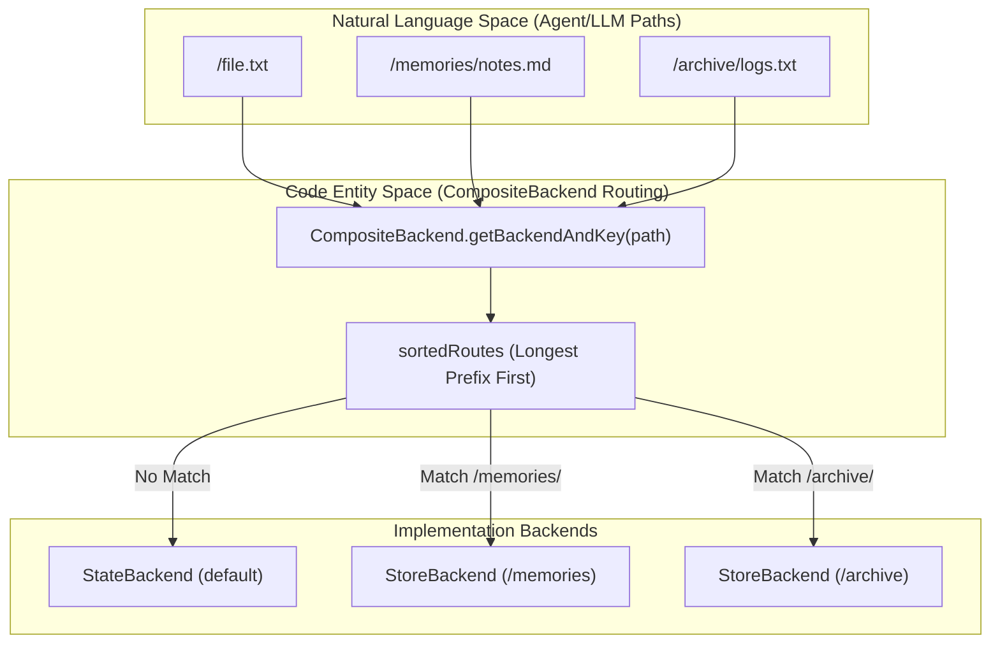
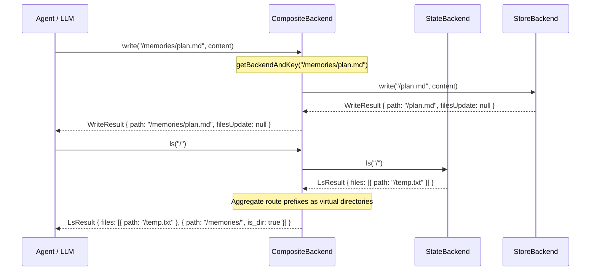

<!-- source: DeepWiki mcp.deepwiki.com · repo langchain-ai/deepagentsjs · page 6.6 CompositeBackend · fetched 2026-10-26 -->

# CompositeBackend

<details>
<summary>Relevant source files</summary>

The following files were used as context for generating this wiki page:

- [examples/backends/composite-backend.ts](examples/backends/composite-backend.ts)
- [examples/backends/state-backend.ts](examples/backends/state-backend.ts)
- [examples/backends/store-backend.ts](examples/backends/store-backend.ts)
- [libs/deepagents/src/backends/composite.test.ts](libs/deepagents/src/backends/composite.test.ts)
- [libs/deepagents/src/backends/composite.ts](libs/deepagents/src/backends/composite.ts)

</details>


## Purpose and Scope

`CompositeBackend` is a specialized backend implementation designed to route file and storage operations to different underlying backends based on **path prefixes**. It enables hybrid storage strategies within a single agent, allowing developers to partition the agent's filesystem into different storage tiers (e.g., ephemeral vs. persistent) based on the directory structure [libs/deepagents/src/backends/composite.ts:2-32]().

For information about the base abstraction, see [Backend System (3.2)](). For details on the individual backends that are commonly composed, see [StateBackend (6.1)](), [StoreBackend (6.2)](), and [FilesystemBackend (6.3)]().

**Sources:** [libs/deepagents/src/backends/composite.ts:1-32](), [libs/deepagents/src/backends/protocol.ts:5-20]()

## Overview

The `CompositeBackend` class implements the `BackendProtocolV2` interface [libs/deepagents/src/backends/composite.ts:33](). Unlike other backends that map to a single storage provider, the `CompositeBackend` acts as a router. It maintains a `default` backend and a map of `routes` where keys are path prefixes (e.g., `/memories/`) and values are other backend implementations [libs/deepagents/src/backends/composite.ts:34-36]().

This architecture allows for sophisticated data lifecycles:
- **`/memories/`** → Routed to `StoreBackend` for persistent, cross-thread storage [libs/deepagents/src/backends/composite.ts:28]().
- **`/sandbox/`** → Routed to a `SandboxBackend` for secure code execution.
- **Everything else** → Routed to `StateBackend` for ephemeral, per-thread storage [libs/deepagents/src/backends/composite.ts:29]().

The implementation automatically handles the adaptation of different protocol versions (e.g., `AnyBackendProtocol`) using utility functions like `adaptBackendProtocol` and `adaptSandboxProtocol` during construction [libs/deepagents/src/backends/composite.ts:42-55]().

**Sources:** [libs/deepagents/src/backends/composite.ts:25-61](), [libs/deepagents/src/backends/composite.test.ts:148-151]()

## Architecture and Data Flow

The following diagrams illustrate how `CompositeBackend` bridges the "Natural Language Space" (paths used by the LLM) to the "Code Entity Space" (specific backend classes).

### Routing Logic



**Diagram: Routing of file paths to specific code entities within CompositeBackend**

**Sources:** [libs/deepagents/src/backends/composite.ts:33-61](), [libs/deepagents/src/backends/composite.ts:75-88]()

### Component Interaction



**Diagram: Sequence of operations showing prefix stripping and re-adding**

**Sources:** [libs/deepagents/src/backends/composite.ts:75-88](), [libs/deepagents/src/backends/composite.ts:97-149](), [libs/deepagents/src/backends/composite.ts:262-270]()

## Key Implementation Details

### Path Normalization and Stripping
To ensure that underlying backends remain agnostic of their mount point, `CompositeBackend` performs transparent path manipulation:
1. **Stripping:** When calling a routed backend, the prefix is removed. For example, `/memories/notes.txt` becomes `/notes.txt` before reaching the target backend [libs/deepagents/src/backends/composite.ts:79-83]().
2. **Prefixing:** When returning results (like `ls` or `grep`), the prefix is added back so the agent always sees the full absolute path [libs/deepagents/src/backends/composite.ts:111-117](), [libs/deepagents/src/backends/composite.ts:198-202]().

### Search Aggregation
Operations like `grep` and `glob` can span multiple backends. If a search is performed at the root (`/`), `CompositeBackend` executes the search across the default backend and all routed backends, merging the results into a single result set [libs/deepagents/src/backends/composite.ts:207-227]().

### Longest Prefix Matching
Routes are sorted by length in descending order during construction [libs/deepagents/src/backends/composite.ts:58-60](). This ensures that if routes for both `/memories/` and `/memories/special/` exist, the more specific route (the longest match) is chosen first [libs/deepagents/src/backends/composite.ts:77-78]().

**Sources:** [libs/deepagents/src/backends/composite.ts:57-61](), [libs/deepagents/src/backends/composite.ts:75-88](), [libs/deepagents/src/backends/composite.ts:207-227]()

## Usage Example

The following example demonstrates how to configure an agent with a `CompositeBackend` that separates ephemeral working files from persistent memories.

```typescript
import { createDeepAgent, CompositeBackend, StateBackend, StoreBackend } from "deepagents";
import { InMemoryStore, MemorySaver } from "@langchain/langgraph-checkpoint";

const agent = createDeepAgent({
  model: myModel,
  checkpointer: new MemorySaver(),
  store: new InMemoryStore(),
  // Combine StateBackend for root and StoreBackend for /memories/
  backend: new CompositeBackend(new StateBackend(), {
    "/memories/": new StoreBackend(),
  }),
});
```

**Sources:** [examples/backends/composite-backend.ts:70-82](), [libs/deepagents/src/backends/composite.test.ts:146-151]()

## Technical Reference

### Class Methods

| Method | Description |
| :--- | :--- |
| `getBackendAndKey(key)` | Internal helper to resolve the appropriate backend and strip the prefix [libs/deepagents/src/backends/composite.ts:75-88](). |
| `ls(path)` | Lists files. If at root, aggregates all backends and lists route prefixes as directories [libs/deepagents/src/backends/composite.ts:97-149](). |
| `read(filePath, ...)` | Routes the read request to the correct backend based on the file path [libs/deepagents/src/backends/composite.ts:159-166](). |
| `grep(pattern, path, ...)` | Performs a search. Can search a specific route or aggregate results from all backends [libs/deepagents/src/backends/composite.ts:182-227](). |
| `write(filePath, content)` | Routes the write request. Returns `filesUpdate` only if the routed backend supports it (e.g., `StateBackend`) [libs/deepagents/src/backends/composite.ts:262-270](). |

### Sandbox Delegation
`CompositeBackend` delegates the `id` property and `execute` method to the `default` backend if it is a sandbox implementation [libs/deepagents/src/backends/composite.ts:64-66](), [libs/deepagents/src/backends/composite.ts:289-291](). This allows the `CompositeBackend` to satisfy the `SandboxBackendProtocolV2` when wrapping a sandbox [libs/deepagents/src/backends/composite.ts:33]().

**Sources:** [libs/deepagents/src/backends/composite.ts:64-66](), [libs/deepagents/src/backends/composite.ts:289-291](), [libs/deepagents/src/backends/protocol.ts:21-28]()

---

