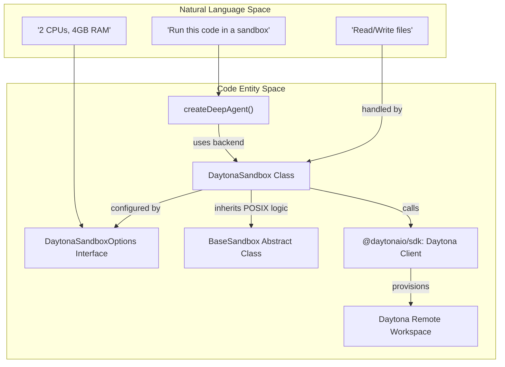
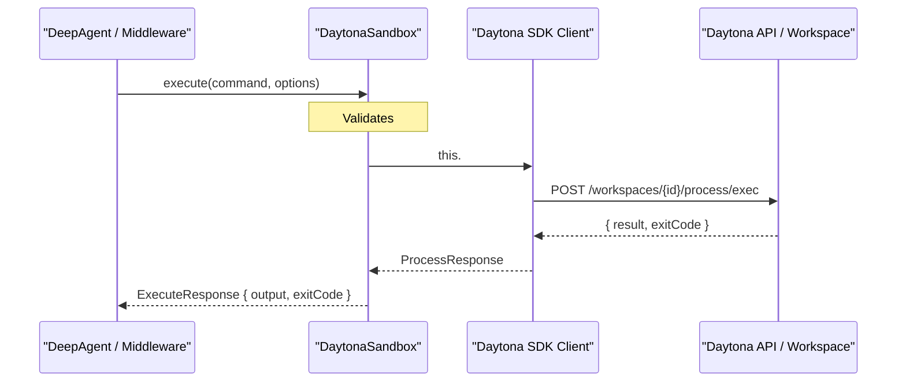

<!-- source: DeepWiki mcp.deepwiki.com · repo langchain-ai/deepagentsjs · page 7.1 Daytona Provider · fetched 2026-10-26 -->

# Daytona Provider

<details>
<summary>Relevant source files</summary>

The following files were used as context for generating this wiki page:

- [libs/providers/daytona/README.md](libs/providers/daytona/README.md)
- [libs/providers/daytona/src/sandbox.int.test.ts](libs/providers/daytona/src/sandbox.int.test.ts)
- [libs/providers/daytona/src/sandbox.test.ts](libs/providers/daytona/src/sandbox.test.ts)
- [libs/providers/daytona/src/sandbox.ts](libs/providers/daytona/src/sandbox.ts)
- [libs/providers/daytona/src/types.ts](libs/providers/daytona/src/types.ts)
- [libs/providers/deno/src/sandbox.int.test.ts](libs/providers/deno/src/sandbox.int.test.ts)
- [libs/providers/modal/src/index.ts](libs/providers/modal/src/index.ts)
- [libs/providers/modal/src/sandbox.int.test.ts](libs/providers/modal/src/sandbox.int.test.ts)
- [libs/providers/modal/src/sandbox.ts](libs/providers/modal/src/sandbox.ts)
- [libs/providers/modal/src/types.ts](libs/providers/modal/src/types.ts)

</details>


The Daytona provider (`@langchain/daytona`) is a sandbox backend implementation that integrates DeepAgentsJS with [Daytona.io](https://www.daytona.io)'s development workspaces. It enables agents to execute code and manipulate files in isolated, fully-configured development environments managed by Daytona's infrastructure.

For information about the base classes, see [SandboxBackend and BaseSandbox](#6.5). For other providers, see [Deno Provider](#7.2) or [Modal Provider](#7.3).

**Sources:** [libs/providers/daytona/src/sandbox.ts:1-10](), [libs/providers/daytona/README.md:1-7]()

## Overview

The Daytona provider wraps the `@daytonaio/sdk` to provide a persistent, OS-level sandbox. Unlike ephemeral containers, Daytona workspaces can be configured with specific languages, resources, and persistent storage that remains available across agent sessions.

### Key Features
- **Full OS Access**: Provides a real shell environment (defaulting to Linux-based workspaces) [libs/providers/daytona/README.md:10-13]().
- **Resource Customization**: Ability to specify CPU, Memory, and Disk allocations [libs/providers/daytona/src/types.ts:57-74]().
- **Snapshot Support**: Create sandboxes from pre-configured snapshots for rapid specialized environment provisioning [libs/providers/daytona/src/types.ts:87-92]().
- **Auto-Stop**: Built-in idle timeouts to manage cloud costs [libs/providers/daytona/src/types.ts:102-109]().
- **Standard Protocol**: Fully implements `SandboxBackendProtocol` via `BaseSandbox` [libs/providers/daytona/src/sandbox.ts:67-67]().

**Sources:** [libs/providers/daytona/src/sandbox.ts:25-66](), [libs/providers/daytona/src/types.ts:30-173](), [libs/providers/daytona/README.md:9-16]()

## Architecture and Data Flow

The `DaytonaSandbox` class acts as a bridge between the LangGraph-based agent and the Daytona API. It manages the lifecycle of a `Sandbox` instance from the `@daytonaio/sdk`.

### System Entity Mapping
The following diagram bridges the Natural Language concepts to the specific code entities used in the implementation.


**Sources:** [libs/providers/daytona/src/sandbox.ts:67-174](), [libs/providers/daytona/src/types.ts:30-74]()

### Execution Flow
When an agent invokes a tool (e.g., `execute`), the call traverses the following path:


**Sources:** [libs/providers/daytona/src/sandbox.ts:250-300](), [libs/providers/daytona/src/sandbox.ts:104-113](), [libs/providers/daytona/src/sandbox.test.ts:155-169]()

## Configuration Options

The `DaytonaSandboxOptions` interface defines how the environment is provisioned.

| Option | Type | Description |
| :--- | :--- | :--- |
| `language` | `"typescript" \| "python" \| "javascript"` | Primary runtime environment. Default: `"typescript"`. |
| `image` | `string` | Custom Docker image (e.g., `"node:20"`). Required if using `resources`. |
| `resources` | `{ cpu, memory, disk }` | Resource allocation in GiB/Units. |
| `snapshot` | `string` | Create sandbox from a saved Daytona snapshot. |
| `target` | `"us" \| "eu"` | Region for provisioning. Default: `"us"`. |
| `autoStopInterval` | `number` | Idle minutes before shutdown. Default: `15`. |
| `initialFiles` | `Record<string, string>` | Map of paths to contents to write on startup. |
| `auth` | `{ apiKey, apiUrl }` | Explicit authentication credentials. |

**Sources:** [libs/providers/daytona/src/types.ts:30-187](), [libs/providers/daytona/README.md:88-164]()

## Implementation Details

### Initialization and Authentication
The `DaytonaSandbox` requires an API key, typically provided via the `DAYTONA_API_KEY` environment variable or the `auth` option. The `initialize()` method handles the asynchronous provisioning of the remote workspace [libs/providers/daytona/src/sandbox.ts:193-248]().

1. **Credentials**: Fetched via `getAuthCredentials` from options or environment [libs/providers/daytona/src/sandbox.ts:205-208]().
2. **Client**: Instantiates the `Daytona` SDK client [libs/providers/daytona/src/sandbox.ts:219-223]().
3. **Provisioning**: Creates a workspace from either a custom `image` (allowing resource overrides) or a `snapshot` [libs/providers/daytona/src/sandbox.ts:226-248]().

### Error Handling
The provider uses a specialized `DaytonaSandboxError` class which extends the core `SandboxError`.

- **AUTHENTICATION_FAILED**: Triggered if API keys are missing or invalid [libs/providers/daytona/src/types.ts:197-197]().
- **SANDBOX_CREATION_FAILED**: Triggered if the Daytona API fails to provision the workspace [libs/providers/daytona/src/types.ts:199-199]().
- **RESOURCE_LIMIT_EXCEEDED**: Triggered if requested CPU/Memory exceeds quotas [libs/providers/daytona/src/types.ts:205-205]().

**Sources:** [libs/providers/daytona/src/types.ts:190-260](), [libs/providers/daytona/src/sandbox.ts:105-133]()

## Usage Example

Integrating the Daytona provider into a `DeepAgent`:

```typescript
import { createDeepAgent } from "deepagents";
import { DaytonaSandbox } from "@langchain/daytona";
import { ChatAnthropic } from "@langchain/anthropic";

// Create and initialize the sandbox in one step
const sandbox = await DaytonaSandbox.create({
  language: "python",
  resources: { cpu: 2, memory: 4 },
  image: "python:3.11-slim"
});

try {
  const agent = createDeepAgent({
    model: new ChatAnthropic({ model: "claude-3-5-sonnet-latest" }),
    backend: sandbox,
    systemPrompt: "You are a data scientist with access to a Python sandbox.",
  });

  // Agent can now use FilesystemMiddleware tools which call sandbox.execute()
} finally {
  // Important: Always close to trigger auto-stop or cleanup
  await sandbox.close();
}
```
**Sources:** [libs/providers/daytona/src/sandbox.ts:53-66](), [libs/providers/daytona/README.md:52-83]()

## Testing Infrastructure

The package utilizes `vitest` and integrates with the `@langchain/sandbox-standard-tests` to ensure compliance with the `SandboxBackendProtocol`.

- **Standard Tests**: The `sandboxStandardTests` suite validates core functionality like file I/O and command execution [libs/providers/daytona/src/sandbox.int.test.ts:36-48]().
- **Integration Tests**: Executes real commands against the Daytona API. It includes logic to clean up stale test sandboxes using `DaytonaSandbox.deleteAll(CI_LABELS)` [libs/providers/daytona/src/sandbox.int.test.ts:19-34]().
- **TypeScript Support**: Specific integration tests verify that TypeScript code can be executed using `npx tsx` within the provisioned environment [libs/providers/daytona/src/sandbox.int.test.ts:105-127]().

**Sources:** [libs/providers/daytona/src/sandbox.int.test.ts:1-181](), [libs/providers/daytona/src/sandbox.test.ts:1-233]()

---

