# Page: Overview

# Overview

<details>
<summary>Relevant source files</summary>

The following files were used as context for generating this wiki page:

- [README.md](README.md)
- [libs/deepagents/README.md](libs/deepagents/README.md)
- [libs/deepagents/package.json](libs/deepagents/package.json)
- [libs/deepagents/src/agent.ts](libs/deepagents/src/agent.ts)
- [libs/deepagents/src/index.ts](libs/deepagents/src/index.ts)
- [libs/deepagents/src/middleware/async_subagents.ts](libs/deepagents/src/middleware/async_subagents.ts)
- [libs/deepagents/src/middleware/index.ts](libs/deepagents/src/middleware/index.ts)
- [libs/deepagents/src/types.ts](libs/deepagents/src/types.ts)
- [package.json](package.json)
- [pnpm-lock.yaml](pnpm-lock.yaml)

</details>


## Purpose and Scope

This page introduces the DeepAgentsJS repository, explaining its purpose as a framework for building controllable AI agents with LangGraph. It provides a high-level overview of the architecture, key components, and how they work together to create "batteries-included" agentic workflows. [libs/deepagents/README.md:1-13](), [libs/deepagents/src/index.ts:1-6]()

For detailed information about specific subsystems:
- Getting started instructions and quick-start guide: see **Getting Started**
- Fundamental concepts and architectural patterns: see **Core Concepts**
- Complete API reference for `createDeepAgent`: see **createDeepAgent API**
- Individual middleware components: see **Middleware Reference**

## What is DeepAgentsJS

DeepAgentsJS is an opinionated agent harness built on top of [LangGraph](https://github.com/langchain-ai/langgraphjs). It is designed to move beyond simple tool-calling loops by providing a production-ready runtime that includes planning, filesystem access, and hierarchical delegation out of the box. [libs/deepagents/README.md:24-32](), [libs/deepagents/package.json:4-5]()

The framework is built using `@langchain/langgraph` (v1.2.8+) and `@langchain/core` (v1.1.38+), maintaining 1:1 compatibility with the Python version of Deep Agents. [libs/deepagents/package.json:41-42](), [libs/deepagents/src/index.ts:4-6]()

**Key Capabilities:**
- **Planning**: Built-in `write_todos` tool for task breakdown. [libs/deepagents/README.md:28-28]()
- **Filesystem**: Standardized tools (`read_file`, `write_file`, `edit_file`, `ls`, `glob`, `grep`) for working memory and persistent storage. [libs/deepagents/README.md:29-29]()
- **Sub-agents**: A `task` tool for delegating work to specialized agents with isolated context windows. [libs/deepagents/README.md:30-30]()
- **Context Management**: Middleware for automatic summarization and token management. [libs/deepagents/README.md:32-32]()

**Sources:** [libs/deepagents/package.json:1-49](), [libs/deepagents/README.md:1-35](), [libs/deepagents/src/index.ts:1-76]()

## Repository Organization

DeepAgentsJS is structured as a `pnpm` monorepo containing the core library, various sandbox providers, and internal evaluation tooling. [package.json:1-58](), [pnpm-lock.yaml:1-17]()

### Workspace Architecture

The following diagram associates high-level system components with their corresponding code entities and file paths.

Title: DeepAgentsJS Code Entity Map
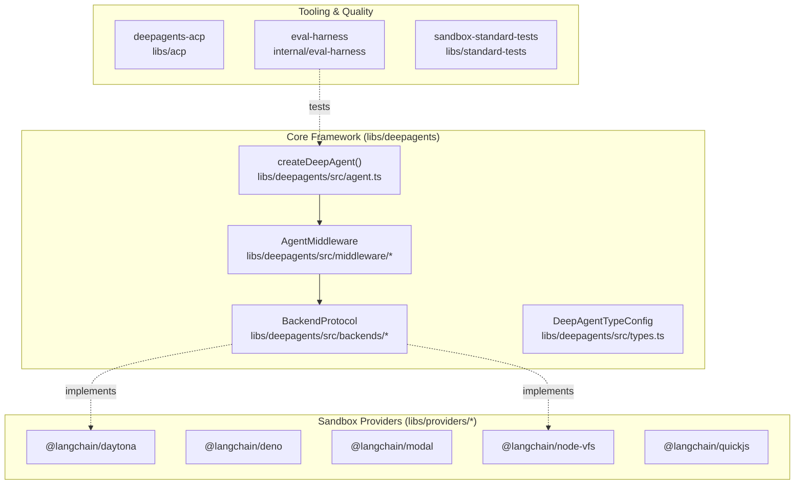

**Sources:** [package.json:1-22](), [pnpm-lock.yaml:17-152](), [libs/deepagents/src/index.ts:8-152]()

## Core Architecture

The architecture centers on the `createDeepAgent` factory, which compiles a LangGraph `StateGraph` by weaving together a configurable list of middleware and backends. [libs/deepagents/src/agent.ts:143-179](), [libs/deepagents/README.md:84-87]()

### Data Flow and Component Interaction

This diagram illustrates how a user request flows through the system, from the agent entry point to the underlying execution backends.

Title: Request Flow and Backend Abstraction
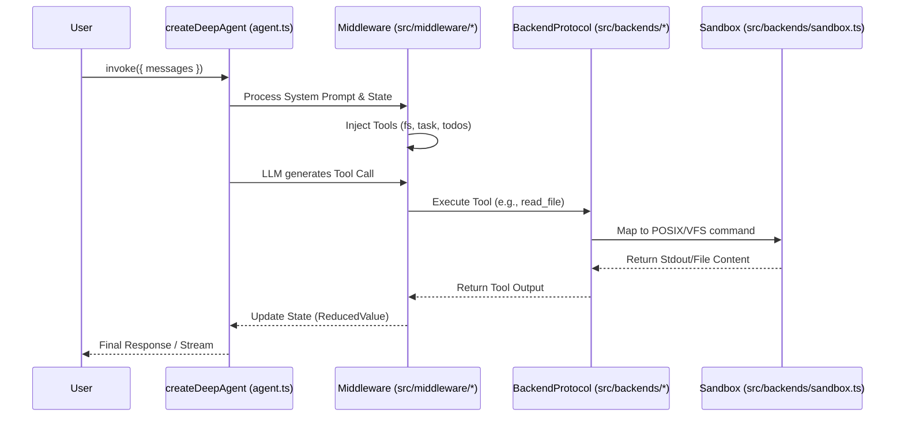

**Sources:** [libs/deepagents/src/agent.ts:143-220](), [libs/deepagents/src/middleware/index.ts:1-76](), [libs/deepagents/src/backends/index.ts:96-152]()

## Key Components

### createDeepAgent Factory
The `createDeepAgent` function is the primary entry point. It provides a "strong default runtime" including filesystem and task management. It handles the deterministic ordering of middleware and detects specific model providers (like Anthropic) to apply optimizations like prompt caching. [libs/deepagents/src/agent.ts:114-122](), [libs/deepagents/src/agent.ts:193-202]()

### Middleware System
Middleware in DeepAgentsJS are not just wrappers; they are functional units that define state schemas, tools, and system prompt modifications. [libs/deepagents/src/agent.ts:129-137]()
- **Filesystem**: `createFilesystemMiddleware` adds the `FILESYSTEM_TOOL_NAMES` suite. [libs/deepagents/src/agent.ts:17-23]()
- **Subagents**: `createSubAgentMiddleware` and `createAsyncSubAgentMiddleware` enable hierarchical task delegation. [libs/deepagents/src/agent.ts:18-27]()
- **Summarization**: `createSummarizationMiddleware` manages context window overflow. [libs/deepagents/src/agent.ts:20-20]()

### Backend and Sandbox System
The `BackendProtocol` provides a unified interface for state and file operations. [libs/deepagents/src/backends/index.ts:109-111]()
- **StateBackend**: Ephemeral in-memory storage. [libs/deepagents/src/backends/index.ts:97-97]()
- **StoreBackend**: Persistent storage using LangGraph Store. [libs/deepagents/src/backends/index.ts:98-98]()
- **SandboxBackendProtocol**: Extends the backend to include shell execution (`execute`) and complex file operations (`grep`, `glob`). [libs/deepagents/src/backends/index.ts:130-132](), [libs/deepagents/src/backends/index.ts:125-128]()

**Sources:** [libs/deepagents/src/agent.ts:1-220](), [libs/deepagents/src/index.ts:8-152](), [libs/deepagents/src/middleware/index.ts:1-76]()

## Development and Build System

The monorepo utilizes a modern toolchain for high-performance development:
- **Build**: `tsdown` for fast TypeScript-to-JavaScript bundling (ESM and CJS). [libs/deepagents/package.json:10](), [libs/deepagents/package.json:62-62]()
- **Testing**: `vitest` for unit and integration testing. [libs/deepagents/package.json:15-20]()
- **Linting/Formatting**: `oxlint` and `oxfmt` for extremely fast code quality checks. [package.json:11-14](), [package.json:49-50]()
- **Versioning**: `changesets` for automated versioning and changelog generation. [package.json:20-21](), [pnpm-lock.yaml:24-26]()

**Sources:** [package.json:1-71](), [libs/deepagents/package.json:1-86]()

---

# Page: Getting Started

# Getting Started

<details>
<summary>Relevant source files</summary>

The following files were used as context for generating this wiki page:

- [README.md](README.md)
- [evals/hitl/package.json](evals/hitl/package.json)
- [evals/subagents/package.json](evals/subagents/package.json)
- [evals/tool-usage-relational/package.json](evals/tool-usage-relational/package.json)
- [examples/async-subagents/parallel-research/package.json](examples/async-subagents/parallel-research/package.json)
- [examples/package.json](examples/package.json)
- [libs/deepagents/README.md](libs/deepagents/README.md)
- [libs/deepagents/package.json](libs/deepagents/package.json)
- [package.json](package.json)
- [pnpm-lock.yaml](pnpm-lock.yaml)

</details>


This document provides installation instructions and a quick-start guide for creating your first Deep Agent. It covers package installation, basic configuration, and a minimal working example.

For detailed information about the framework's architecture and concepts, see **Core Concepts**. For comprehensive API documentation, see **createDeepAgent API**. For sandbox execution environments, see **Backend Implementations**.

## Prerequisites

DeepAgentsJS requires:
- **Node.js**: v24.x is recommended (implied by latest environment support)
- **Package Manager**: pnpm is the primary manager for this monorepo [[package.json:58-58]()].
- **API Keys**: API keys for language model providers (e.g., Anthropic, OpenAI) [[libs/deepagents/package.json:51-53]()].

## Installation

Install the core `deepagents` package using your preferred package manager:

```bash
# npm
npm install deepagents

# yarn
yarn add deepagents

# pnpm
pnpm add deepagents
```

**Sources:** [libs/deepagents/README.md:39-45](), [README.md:39-45]()

### Installing Language Model Providers

Deep Agents are designed to work with LangChain-compatible models. You should install the provider for the LLM you intend to use:

```bash
# For Anthropic (Claude models)
npm install @langchain/anthropic

# For OpenAI (GPT models)
npm install @langchain/openai
```

**Sources:** [libs/deepagents/package.json:51-53](), [examples/package.json:13-19]()

### Installing Optional Dependencies

For specific features or sandbox environments, you may need additional packages:

```bash
# For web search capabilities
npm install @langchain/tavily

# For persistent storage checkpointers
npm install @langchain/langgraph-checkpoint

# For specific sandbox environments
npm install @langchain/node-vfs
npm install @langchain/quickjs
```

**Sources:** [libs/deepagents/package.json:52-55](), [examples/package.json:9-20]()

## Package Architecture

The following diagram bridges the high-level concepts to the specific code entities used in the system.

### System Entity Map

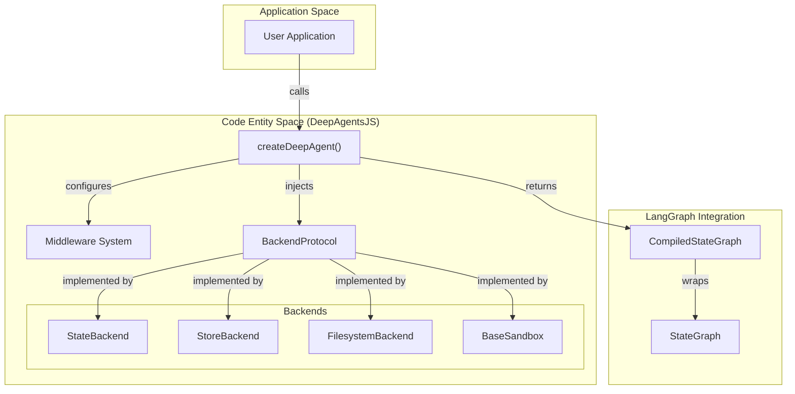

**Sources:** [libs/deepagents/README.md:84-86](), [libs/deepagents/package.json:42-43]()

## Creating Your First Agent

The `createDeepAgent` function is the primary entry point. It returns a compiled LangGraph graph that supports standard methods like `invoke` and `stream`.

### Basic Example

This minimal example creates an agent with default capabilities (planning and filesystem).

```typescript
import { createDeepAgent } from "deepagents";
import { ChatOpenAI } from "@langchain/openai";

// 1. Create the agent
const agent = createDeepAgent({
  model: new ChatOpenAI({ model: "gpt-4o", temperature: 0 }),
});

// 2. Invoke the agent
const result = await agent.invoke({
  messages: [
    {
      role: "user",
      content: "Create a file named hello.md and write 'Hello from DeepAgents' in it.",
    },
  ],
});
```

**Sources:** [libs/deepagents/README.md:47-60](), [libs/deepagents/README.md:71-80]()

## Backend Selection

Deep Agents require a backend for file operations and state persistence. While the default configuration is suitable for many tasks, you can customize the backend based on your requirements:

| Backend Category | Persistence | Environment | Typical Use Case |
|------------------|-------------|-------------|------------------|
| `StateBackend` | Ephemeral | In-memory | Simple sessions, testing |
| `StoreBackend` | Persistent | LangGraph Store | Cross-conversation memory |
| `FilesystemBackend` | Persistent | Local Disk | CLI tools, local automation |
| `SandboxBackend` | Isolated | Virtual/Remote | Safe code execution (Modal, Daytona, Node-VFS) |

**Sources:** [libs/deepagents/README.md:28-32](), [examples/package.json:9-17]()

### Agent Execution Data Flow

The following diagram illustrates how the `CompiledStateGraph` interacts with the middleware and backend during a tool call.

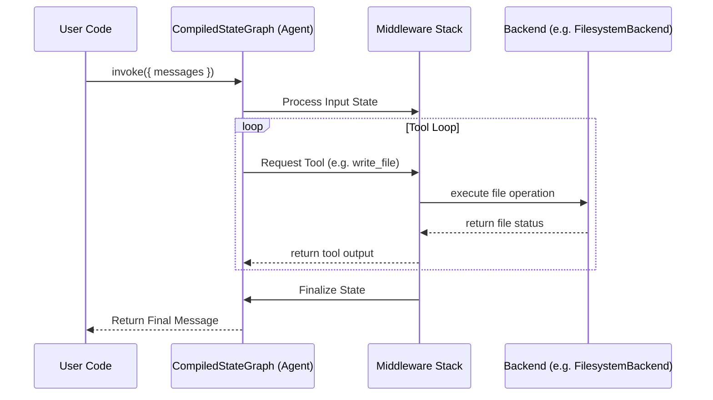

**Sources:** [libs/deepagents/README.md:24-32](), [libs/deepagents/README.md:84-86]()

## Built-in Capabilities

Every agent created via `createDeepAgent` comes with "batteries included" features out of the box:

1.  **Planning**: Includes `write_todos` for task breakdown and progress tracking [[libs/deepagents/README.md:28-28]()].
2.  **Filesystem**: Provides `read_file`, `write_file`, `edit_file`, `ls`, `glob`, and `grep` for managing working memory [[libs/deepagents/README.md:29-29]()].
3.  **Sub-agents**: Includes the `task` tool for delegating work with isolated context windows [[libs/deepagents/README.md:30-30]()].
4.  **Context Management**: Uses file-based workflows to keep long tasks manageable and avoid context overflow [[libs/deepagents/README.md:32-32]()].

## Next Steps

- **Core Concepts**: Learn about the middleware pipeline and the `BackendProtocol`.
- **Middleware Reference**: Explore specialized middleware like `SummarizationMiddleware` or `SkillsMiddleware`.
- **Backend Implementations**: Configure secure execution environments using providers like `Modal`, `Deno`, or `QuickJS`.

**Sources:** [libs/deepagents/README.md:88-96](), [README.md:88-96]()

---

# Page: Core Concepts

# Core Concepts

<details>
<summary>Relevant source files</summary>

The following files were used as context for generating this wiki page:

- [internal/eval-harness/CHANGELOG.md](internal/eval-harness/CHANGELOG.md)
- [libs/acp/CHANGELOG.md](libs/acp/CHANGELOG.md)
- [libs/deepagents/CHANGELOG.md](libs/deepagents/CHANGELOG.md)
- [libs/deepagents/src/agent.ts](libs/deepagents/src/agent.ts)
- [libs/deepagents/src/backends/protocol.ts](libs/deepagents/src/backends/protocol.ts)
- [libs/deepagents/src/backends/state.test.ts](libs/deepagents/src/backends/state.test.ts)
- [libs/deepagents/src/backends/state.ts](libs/deepagents/src/backends/state.ts)
- [libs/deepagents/src/index.ts](libs/deepagents/src/index.ts)
- [libs/deepagents/src/middleware/async_subagents.ts](libs/deepagents/src/middleware/async_subagents.ts)
- [libs/deepagents/src/middleware/index.ts](libs/deepagents/src/middleware/index.ts)
- [libs/deepagents/src/types.ts](libs/deepagents/src/types.ts)
- [libs/providers/quickjs/CHANGELOG.md](libs/providers/quickjs/CHANGELOG.md)

</details>


This page explains the three fundamental architectural patterns that underpin the DeepAgentsJS framework: the **middleware system**, the **backend abstraction layer**, and the **TypeScript type system**. Understanding these concepts is essential for effectively using and extending DeepAgents.

These concepts enable DeepAgents to be modular, extensible, and type-safe. Each concept is covered in detail in dedicated child pages ([Middleware Architecture](#3.1), [Backend System](#3.2), [Type System](#3.3)). This overview explains how they relate to each other and to the overall architecture.

---

## Architecture Overview

DeepAgents builds on LangChain's `createAgent` by adding a composable middleware architecture, a pluggable backend system, and comprehensive TypeScript type inference. The core factory function is `createDeepAgent`, which orchestrates these three systems.

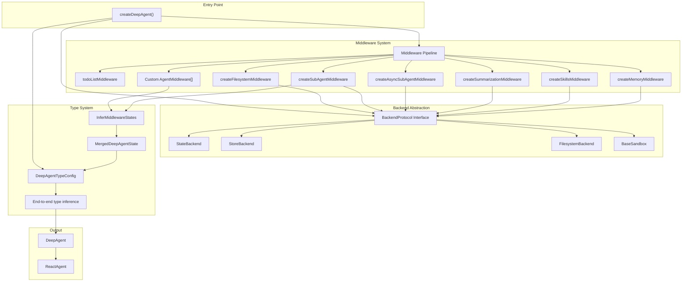

**Diagram: Core Architecture of DeepAgents**

The `createDeepAgent` function [libs/deepagents/src/agent.ts:143-345]() combines these three systems:

1. **Middleware Pipeline**: Composed through factory methods that wire up tools and state [libs/deepagents/src/agent.ts:241-302]().
2. **Backend Abstraction**: Provides pluggable storage and execution via `BackendProtocol` [libs/deepagents/src/backends/protocol.ts:109]().
3. **Type System**: Ensures end-to-end type safety using `DeepAgentTypeConfig` [libs/deepagents/src/types.ts:153-173]().

**Sources:** [libs/deepagents/src/agent.ts:143-345](), [libs/deepagents/src/index.ts:8-152](), [libs/deepagents/src/types.ts:153-173]()

---

## The Middleware System

DeepAgents uses LangChain's `AgentMiddleware` interface to implement composable functionality. Each middleware can provide tools, modify the system prompt, and maintain its own state schema.

### Built-in Middleware

The framework includes several built-in middleware components that are automatically attached or conditionally added by `createDeepAgent`:

| Middleware | Purpose | Tools Provided |
|------------|---------|----------------|
| `todoListMiddleware` | Task planning and tracking | `write_todos` |
| `createFilesystemMiddleware` | File operations | `ls, read_file, write_file, edit_file, glob, grep` |
| `createSubAgentMiddleware` | Sync subagent delegation | `task` |
| `createAsyncSubAgentMiddleware` | Remote subagent delegation | `start_async_task, check_async_task, update_async_task, cancel_async_task, list_async_tasks` |
| `createSummarizationMiddleware` | Automatic context management | None (intercepts messages) |
| `createSkillsMiddleware` | Progressive disclosure of skills | `list_skills, read_skill` |
| `createMemoryMiddleware` | Long-term memory loading | None (modifies system prompt) |

Each middleware is created with factory functions exported from the main entry point [libs/deepagents/src/index.ts:41-76]().

### Middleware Pipeline Execution

Middleware executes in a deterministic order to ensure that prompt optimizations (like caching) and human-in-the-loop interrupts occur at the correct stage [libs/deepagents/src/agent.ts:241-302]().


**Diagram: Middleware Execution Order**

**For detailed information on the middleware architecture, see [Middleware Architecture](#3.1).**

**Sources:** [libs/deepagents/src/agent.ts:241-302](), [libs/deepagents/src/middleware/index.ts:1-73](), [libs/deepagents/src/middleware/async_subagents.ts:203-240]()

---

## The Backend Abstraction

The backend system abstracts storage and execution, allowing DeepAgents to work with different persistence mechanisms. All backends implement the `BackendProtocolV2` interface [libs/deepagents/src/backends/protocol.ts:27-29]().

### Backend Class Hierarchy

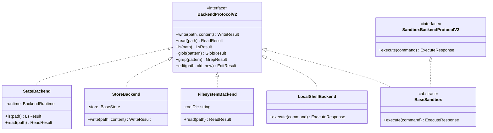

**Diagram: Backend Class Hierarchy**

### Backend Implementations

The framework provides several concrete backend implementations [libs/deepagents/src/index.ts:96-152]():

| Backend | Storage | Execution | Use Case |
|---------|---------|-----------|----------|
| `StateBackend` | In-memory LangGraph state | No | Ephemeral, single-session agents [libs/deepagents/src/backends/state.ts:39-48]() |
| `StoreBackend` | LangGraph Store | No | Multi-session persistent agents |
| `FilesystemBackend` | Local Disk | No | Local file manipulation |
| `LocalShellBackend` | Local Disk | Local Shell | Local dev/testing |
| `BaseSandbox` | Remote/Virtual | Sandboxed Shell | Production agents with isolation |

### Middleware-Backend Integration

Middleware components depend on the backend for persistence. For example, `StateBackend` uses LangGraph's `__pregel_send` to update state [libs/deepagents/src/backends/state.ts:115-126]().

**For detailed information on backends and their implementations, see [Backend System](#3.2).**

**Sources:** [libs/deepagents/src/backends/protocol.ts:1-222](), [libs/deepagents/src/backends/state.ts:49-223](), [libs/deepagents/src/index.ts:96-152]()

---

## The Type System

DeepAgents provides comprehensive TypeScript type inference that flows from configuration through to invocation results.

### DeepAgentTypeConfig

The type system centers on `DeepAgentTypeConfig`, which extends LangChain's `AgentTypeConfig` with subagent information [libs/deepagents/src/types.ts:153-173]():

```typescript
export interface DeepAgentTypeConfig<
  TResponse extends Record<string, any> | ResponseFormatUndefined,
  TState extends AnyAnnotationRoot | InteropZodObject | undefined,
  TContext extends AnyAnnotationRoot | InteropZodObject,
  TMiddleware extends readonly AgentMiddleware[],
  TTools extends readonly (ClientTool | ServerTool)[],
  TSubagents extends readonly AnySubAgent[],
> extends AgentTypeConfig<TResponse, TState, TContext, TMiddleware, TTools> {
  Subagents: TSubagents;
}
```

### Type Inference Flow

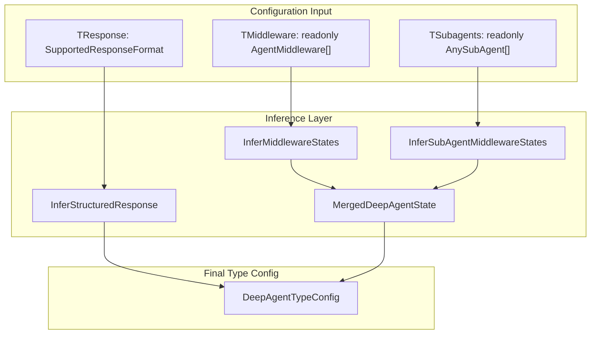

**Diagram: Type Inference Flow**

**Key Type Helpers:**
* `MergedDeepAgentState`: Merges states from custom and subagent middleware [libs/deepagents/src/types.ts:80-84]().
* `InferStructuredResponse`: Extracts the parsed type from response strategies [libs/deepagents/src/types.ts:116-125]().

**For detailed information on the type system, see [Type System](#3.3).**

**Sources:** [libs/deepagents/src/types.ts:1-173](), [libs/deepagents/src/index.ts:10-30]()

---

## Summary

The three core concepts work together to provide DeepAgents' capabilities:

| Concept | Provides | Configured Via |
|---------|----------|----------------|
| **Middleware System** | Tools, state, prompt logic | `middleware` parameter |
| **Backend Abstraction** | Storage and execution portability | `backend` parameter |
| **Type System** | End-to-end type safety | TypeScript generics |

**Sources:** [libs/deepagents/src/agent.ts:143-345](), [libs/deepagents/src/types.ts:1-173](), [libs/deepagents/src/index.ts:1-152]()

---

# Page: Middleware Architecture

# Middleware Architecture

<details>
<summary>Relevant source files</summary>

The following files were used as context for generating this wiki page:

- [.gitignore](.gitignore)
- [libs/deepagents/src/agent.ts](libs/deepagents/src/agent.ts)
- [libs/deepagents/src/backends/protocol.test.ts](libs/deepagents/src/backends/protocol.test.ts)
- [libs/deepagents/src/index.ts](libs/deepagents/src/index.ts)
- [libs/deepagents/src/middleware/agent-memory.test.ts](libs/deepagents/src/middleware/agent-memory.test.ts)
- [libs/deepagents/src/middleware/async_subagents.test.ts](libs/deepagents/src/middleware/async_subagents.test.ts)
- [libs/deepagents/src/middleware/async_subagents.ts](libs/deepagents/src/middleware/async_subagents.ts)
- [libs/deepagents/src/middleware/index.test.ts](libs/deepagents/src/middleware/index.test.ts)
- [libs/deepagents/src/middleware/index.ts](libs/deepagents/src/middleware/index.ts)
- [libs/deepagents/src/middleware/patch_tool_calls.test.ts](libs/deepagents/src/middleware/patch_tool_calls.test.ts)
- [libs/deepagents/src/middleware/patch_tool_calls.ts](libs/deepagents/src/middleware/patch_tool_calls.ts)
- [libs/deepagents/src/middleware/types.ts](libs/deepagents/src/middleware/types.ts)
- [libs/deepagents/src/types.ts](libs/deepagents/src/types.ts)
- [tsconfig.json](tsconfig.json)

</details>


## Purpose and Scope

This page explains the middleware architecture used throughout DeepAgentsJS to extend agent capabilities in a modular, composable way. It covers the middleware pipeline execution order, available hooks, state management, and how to create custom middleware.

The middleware system is built on top of LangChain's `createMiddleware` utility, providing a structured way to inject logic into the agent's lifecycle.

---

## Architecture Overview

The DeepAgents framework uses a middleware-based architecture where functionality is added through a strictly ordered pipeline. Each middleware component can:

- **Add state channels**: Define new keys in the agent's state schema using Zod or `AnnotationRoot` [libs/deepagents/src/agent.ts:130-133]().
- **Inject System Messages**: Prepend or append content to the system prompt [libs/deepagents/src/middleware/utils.ts:42-42]().
- **Intercept Model Calls**: Modify messages or parameters before they reach the LLM [libs/deepagents/src/middleware/patch_tool_calls.ts:169-187]().
- **Provide Tools**: Inject structured tools (like `ls`, `read_file`, or `task`) into the agent's available toolset [libs/deepagents/src/middleware/fs.ts:120-140]().
- **Manage Lifecycle**: Execute logic before or after agent invocation [libs/deepagents/src/middleware/patch_tool_calls.ts:137-160]().

### Core Middleware Pipeline

```mermaid
graph TB
    ["createDeepAgent()"] -- "Constructs" --> [Pipeline]
    
    subgraph Pipeline["Middleware Pipeline (Execution Order)"]
        direction TB
        [todoListMiddleware] -- "Task Management" --> [createFilesystemMiddleware]
        [createFilesystemMiddleware] -- "Files & Sandbox" --> [createSubAgentMiddleware]
        [createSubAgentMiddleware] -- "Delegation" --> [createSummarizationMiddleware]
        [createSummarizationMiddleware] -- "Context Mgmt" --> [anthropicPromptCachingMiddleware]
        [anthropicPromptCachingMiddleware] -- "Caching" --> [createPatchToolCallsMiddleware]
        [createPatchToolCallsMiddleware] -- "Parity Fixes" --> [createSkillsMiddleware]
        [createSkillsMiddleware] -- "On-demand Skills" --> [createMemoryMiddleware]
        [createMemoryMiddleware] -- "Persistent Context" --> [humanInTheLoopMiddleware]
        [humanInTheLoopMiddleware] -- "Oversight" --> [CustomMiddleware]
    end
    
    [Pipeline] -- "Compiled into" --> [ReactAgent]
    
    subgraph CodeEntities["Code Entity Space"]
        [todoListMiddleware]
        [createFilesystemMiddleware]
        [createSubAgentMiddleware]
        [createSummarizationMiddleware]
        [createPatchToolCallsMiddleware]
        [createSkillsMiddleware]
        [createMemoryMiddleware]
        [anthropicPromptCachingMiddleware]
    end
```

**Sources:** [libs/deepagents/src/agent.ts:241-302](), [libs/deepagents/src/middleware/index.ts:1-76]()

The execution order is deterministic to ensure dependencies are met (e.g., Filesystem tools must exist before Subagents that might use them).

---

## Middleware Hooks

Middleware components implement hooks defined by the `AgentMiddleware` interface to integrate with the agent execution flow.

### Hook Execution Flow

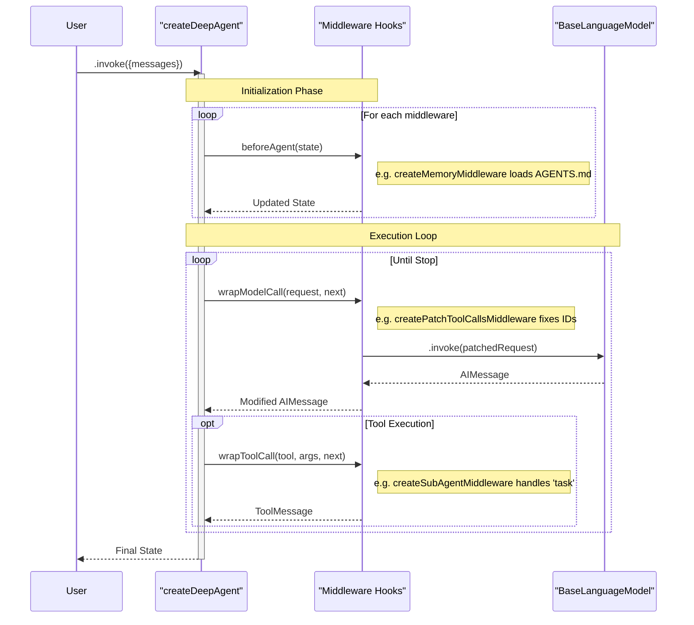

**Sources:** [libs/deepagents/src/agent.ts:143-163](), [libs/deepagents/src/middleware/patch_tool_calls.ts:134-189](), [libs/deepagents/src/middleware/async_subagents.ts:4-9]()

### Key Hooks

| Hook | Purpose | Implementation Example |
|------|---------|------------------------|
| `beforeAgent` | Initialize resources or load data into state before the graph starts. | `createMemoryMiddleware` loads file contents into `memoryContents` [libs/deepagents/src/middleware/memory.ts:137-176](). |
| `wrapModelCall` | Modify the prompt or parameters right before model invocation. | `createPatchToolCallsMiddleware` ensures tool call parity for Gemini/Anthropic [libs/deepagents/src/middleware/patch_tool_calls.ts:169-187](). |
| `wrapToolCall` | Intercept and handle tool execution logic. | `createSubAgentMiddleware` intercepts the `task` tool to run sub-graphs [libs/deepagents/src/middleware/subagents.ts:1-20](). |

---

## State Management

Middleware components contribute state channels to the agent's overall state schema. DeepAgentsJS uses a merging strategy where middleware states are flattened into the final agent state.

### Built-in State Channels

| Middleware | State Channel | Reducer | Description |
|------------|---------------|---------|-------------|
| `createFilesystemMiddleware` | `files` | `filesValue` | Merges file updates into the state record [libs/deepagents/src/middleware/fs.ts:1-9](). |
| `createSummarizationMiddleware` | `__summaryEvents` | `(a, b) => [...a, ...b]` | Private tracking of summarization triggers [libs/deepagents/src/middleware/summarization.ts:51-61](). |
| `createAsyncSubAgentMiddleware` | `asyncTasks` | `asyncTasksReducer` | Merges task updates into the tasks dictionary [libs/deepagents/src/middleware/async_subagents.ts:156-164](). |
| `createMemoryMiddleware` | `memoryContents` | Replace | Mapping of source paths to file content [libs/deepagents/src/middleware/memory.ts:26-28](). |

### The `asyncTasksReducer`

The `asyncTasksReducer` handles concurrent updates to remote tasks, ensuring that individual tool updates (launch, check, cancel) merge into the existing tasks dictionary rather than replacing it [libs/deepagents/src/middleware/async_subagents.ts:177-182]().

**Sources:** [libs/deepagents/src/middleware/async_subagents.ts:156-182](), [libs/deepagents/src/values.ts:79-79]()

---

## Specialized Middleware

### Tool Call Patching
The `createPatchToolCallsMiddleware` is critical for providers like Google Gemini that enforce strict parity between `AIMessage.tool_calls` and `ToolMessage` responses.

- **Dangling Calls**: Inserts synthetic "cancelled" `ToolMessage`s if an AI message has a tool call without a corresponding response [libs/deepagents/src/middleware/patch_tool_calls.ts:82-93]().
- **Orphaned Messages**: Removes `ToolMessage`s that do not match any preceding `AIMessage` tool call [libs/deepagents/src/middleware/patch_tool_calls.ts:63-68]().

### Async Subagents
The `createAsyncSubAgentMiddleware` provides tools (`start_async_task`, `check_async_task`, etc.) to interact with remote LangGraph servers. It uses a `ReducedValue` state channel to track background tasks [libs/deepagents/src/middleware/async_subagents.ts:190-200]().

---

## Creating Custom Middleware

Custom middleware is created using the `createMiddleware` factory from `langchain`.

### Implementation Example

```typescript
import { createMiddleware } from "langchain";
import { z } from "zod/v4";

export const MyCustomMiddleware = createMiddleware({
  name: "MyCustomMiddleware",
  // 1. Define custom state
  stateSchema: z.object({
    customCounter: z.number().default(0),
  }),
  
  // 2. Implement hooks
  beforeAgent: async (state) => {
    return { customCounter: state.customCounter + 1 };
  },
  
  wrapModelCall: async (request, handler) => {
    // Modify request or inspect result
    return handler(request);
  }
});
```

**Sources:** [libs/deepagents/src/agent.ts:130-137](), [libs/deepagents/src/middleware/patch_tool_calls.ts:134-189]()

### Type Inference
DeepAgentsJS uses TypeScript's conditional types to infer the merged state of all middleware. When `MyCustomMiddleware` is passed to `createDeepAgent`, the `customCounter` property becomes available on the agent's state [libs/deepagents/src/types.ts:79-84]().

**Sources:** [libs/deepagents/src/types.ts:71-84](), [libs/deepagents/src/agent.ts:143-163]()

---

# Page: Backend System

# Backend System

<details>
<summary>Relevant source files</summary>

The following files were used as context for generating this wiki page:

- [.changeset/fix-follow-symlinks.md](.changeset/fix-follow-symlinks.md)
- [libs/deepagents/src/backends/filesystem.test.ts](libs/deepagents/src/backends/filesystem.test.ts)
- [libs/deepagents/src/backends/filesystem.ts](libs/deepagents/src/backends/filesystem.ts)
- [libs/deepagents/src/backends/protocol.ts](libs/deepagents/src/backends/protocol.ts)
- [libs/deepagents/src/backends/sandbox.test.ts](libs/deepagents/src/backends/sandbox.test.ts)
- [libs/deepagents/src/backends/sandbox.ts](libs/deepagents/src/backends/sandbox.ts)
- [libs/deepagents/src/backends/state.test.ts](libs/deepagents/src/backends/state.test.ts)
- [libs/deepagents/src/backends/state.ts](libs/deepagents/src/backends/state.ts)
- [libs/deepagents/src/backends/utils.test.ts](libs/deepagents/src/backends/utils.test.ts)
- [libs/deepagents/src/backends/utils.ts](libs/deepagents/src/backends/utils.ts)

</details>


## Purpose and Scope

The backend system provides a pluggable abstraction layer for storage and execution operations in DeepAgentsJS. It decouples agent logic and middleware tools from the underlying storage mechanism (e.g., LangGraph state, persistent stores, or real filesystems). This layer ensures that agents can operate consistently across different environments, from ephemeral in-memory state to persistent sandboxed containers.

## Backend Abstraction Layer

The system is built around a unified interface that allows agents to interact with "files" and "commands" regardless of the physical implementation.

### BackendProtocol

The core interface is defined in `libs/deepagents/src/backends/protocol.ts`. It provides a uniform API for file-like operations. The current standard is `BackendProtocolV2`, which supports both text and binary data via `Uint8Array` [libs/deepagents/src/backends/protocol.ts:17-19]().

**Key Interface Methods:**
- `ls(path)`: Returns structured file listing metadata (`LsResult`) [libs/deepagents/src/backends/protocol.ts:149-156]().
- `read(filePath, offset, limit)`: Returns content (string or `Uint8Array`) with optional pagination for text [libs/deepagents/src/backends/protocol.ts:129-137]().
- `readRaw(filePath)`: Returns the underlying `FileData` object containing metadata like `mimeType` and timestamps [libs/deepagents/src/backends/protocol.ts:141-146]().
- `write(filePath, content)`: Creates or overwrites a file and returns a `WriteResult` [libs/deepagents/src/backends/protocol.ts:174-190]().
- `edit(filePath, oldString, newString, replaceAll)`: Performs targeted string replacement within a file [libs/deepagents/src/backends/protocol.ts:198-216]().
- `grep(pattern, path, glob)`: Performs text searching, returning `GrepMatch` objects with line numbers [libs/deepagents/src/backends/protocol.ts:59-76]().

Sources: [libs/deepagents/src/backends/protocol.ts:1-216](), [libs/deepagents/src/backends/utils.ts:187-235]()

### SandboxBackendProtocol

An extension of the backend layer (`SandboxBackendProtocolV2`) that adds capabilities for remote or isolated execution environments [libs/deepagents/src/backends/protocol.ts:28-29]().

**Additional capabilities:**
- `execute(command)`: Runs a POSIX shell command and returns `ExecuteResponse` (stdout/stderr, exitCode, and a `truncated` flag) [libs/deepagents/src/backends/protocol.ts:222-230]().
- `uploadFiles(files)`: Bulk transfer of `Uint8Array` data to the sandbox [libs/deepagents/src/backends/protocol.ts:252-254]().
- `downloadFiles(paths)`: Bulk retrieval of binary data from the sandbox [libs/deepagents/src/backends/protocol.ts:245-247]().

Sources: [libs/deepagents/src/backends/protocol.ts:222-265](), [libs/deepagents/src/backends/sandbox.ts:1-14]()

## Backend Implementations

DeepAgentsJS includes several built-in backends to handle different persistence and execution requirements.

| Backend | Class Name | Storage/Execution Mechanism | Use Case |
| :--- | :--- | :--- | :--- |
| **State** | `StateBackend` | LangGraph `files` state channel | Ephemeral, per-thread storage. |
| **Filesystem** | `FilesystemBackend` | Local Node.js `fs` | Real disk access (local development/CLI). |
| **Sandbox** | `BaseSandbox` | Remote/Isolated Shell | Secure execution (Daytona, Deno, Modal). |
| **Composite** | `CompositeBackend` | Multi-backend router | Routing paths to different storage types. |

### StateBackend
The `StateBackend` stores files directly within the LangGraph agent state. In modern usage, it uses `__pregel_send` to dispatch state updates to the "files" channel [libs/deepagents/src/backends/state.ts:115-126](). It supports both legacy `v1` (line arrays) and `v2` (raw strings/binary) formats [libs/deepagents/src/backends/state.ts:51-75]().

### FilesystemBackend
The `FilesystemBackend` provides direct access to the host filesystem. It features a `virtualMode` which, when enabled, sandboxes all operations to a `rootDir`, preventing path traversal (`..`) [libs/deepagents/src/backends/filesystem.ts:79-96](). It uses `O_NOFOLLOW` where available to prevent symlink attacks [libs/deepagents/src/backends/filesystem.ts:39-39]().

### BaseSandbox
`BaseSandbox` is an abstract class that implements high-level `BackendProtocol` methods (like `read`, `ls`, `grep`) by translating them into low-level shell commands (e.g., `awk`, `find`, `grep`) executed via the `execute()` method [libs/deepagents/src/backends/sandbox.ts:2-14](). This allows any provider that can run a shell command to immediately support the full filesystem toolset.

Sources: [libs/deepagents/src/backends/state.ts:49-103](), [libs/deepagents/src/backends/filesystem.ts:48-64](), [libs/deepagents/src/backends/sandbox.ts:158-208]()

## System Architecture Diagrams

### Storage Mapping: Natural Language to Code Entities
This diagram shows how high-level storage concepts map to specific classes and interfaces in the codebase.

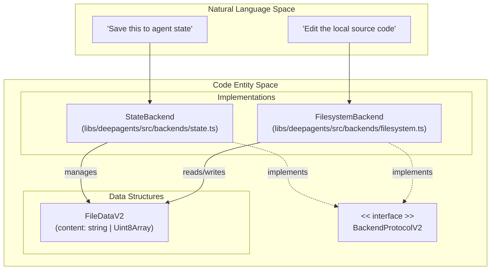
Sources: [libs/deepagents/src/backends/protocol.ts:103-112](), [libs/deepagents/src/backends/state.ts:49](), [libs/deepagents/src/backends/filesystem.ts:48]()

### Execution Mapping: Natural Language to Code Entities
This diagram shows how command execution requests flow through the sandbox abstraction.

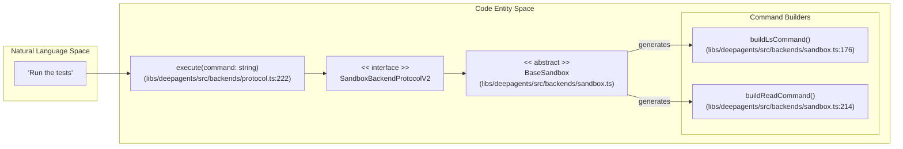
Sources: [libs/deepagents/src/backends/protocol.ts:222](), [libs/deepagents/src/backends/sandbox.ts:176-214]()

## Data Flow: File Operations

When an agent interacts with a file, the following flow occurs:

1.  **Backend Method Call**: A middleware (like `FilesystemMiddleware`) calls a method on the `BackendProtocol` implementation, such as `backend.write(path, content)`.
2.  **Path Resolution**: 
    *   In `FilesystemBackend`, `resolvePath(key)` ensures the path is absolute or contained within the `rootDir` [libs/deepagents/src/backends/filesystem.ts:78-96]().
    *   In `StateBackend`, the path is used as a key in the state's `files` record [libs/deepagents/src/backends/state.ts:95-103]().
3.  **Content Transformation**:
    *   `createFileData` is used to wrap the raw content into a `FileDataV2` structure with a `mimeType` and timestamps [libs/deepagents/src/backends/utils.ts:194-227]().
4.  **Persistence**:
    *   `StateBackend` calls `sendFilesUpdate()` to notify LangGraph of the change [libs/deepagents/src/backends/state.ts:115-126]().
    *   `FilesystemBackend` uses `node:fs/promises` to write to disk [libs/deepagents/src/backends/filesystem.ts:264-284]().

## Sandbox Command Logic

The `BaseSandbox` uses sophisticated shell scripting to provide a consistent environment across different Linux distributions (GNU, BusyBox/Alpine, BSD/macOS).

*   **Runtime Detection**: `buildLsCommand` and `buildFindCommand` probe the environment for `find -printf` (GNU) and fall back to `stat -c` (BusyBox) or `stat -f` (BSD) [libs/deepagents/src/backends/sandbox.ts:176-188]().
*   **Pagination**: `buildReadCommand` uses `awk` to provide efficient line-based reading with `offset` and `limit` directly in the shell [libs/deepagents/src/backends/sandbox.ts:214-230]().
*   **Safety**: All paths and patterns are escaped using `shellQuote` to prevent command injection [libs/deepagents/src/backends/sandbox.ts:38-40]().

Sources: [libs/deepagents/src/backends/sandbox.ts:38-230](), [libs/deepagents/src/backends/utils.ts:79-81]()

---

# Page: Type System

# Type System

<details>
<summary>Relevant source files</summary>

The following files were used as context for generating this wiki page:

- [.gitignore](.gitignore)
- [libs/deepagents/src/agent.int.test.ts](libs/deepagents/src/agent.int.test.ts)
- [libs/deepagents/src/agent.test-d.ts](libs/deepagents/src/agent.test-d.ts)
- [libs/deepagents/src/agent.ts](libs/deepagents/src/agent.ts)
- [libs/deepagents/src/index.ts](libs/deepagents/src/index.ts)
- [libs/deepagents/src/middleware/agent-memory.test.ts](libs/deepagents/src/middleware/agent-memory.test.ts)
- [libs/deepagents/src/middleware/async_subagents.ts](libs/deepagents/src/middleware/async_subagents.ts)
- [libs/deepagents/src/middleware/index.ts](libs/deepagents/src/middleware/index.ts)
- [libs/deepagents/src/middleware/patch_tool_calls.test.ts](libs/deepagents/src/middleware/patch_tool_calls.test.ts)
- [libs/deepagents/src/middleware/patch_tool_calls.ts](libs/deepagents/src/middleware/patch_tool_calls.ts)
- [libs/deepagents/src/middleware/types.ts](libs/deepagents/src/middleware/types.ts)
- [libs/deepagents/src/testing/utils.ts](libs/deepagents/src/testing/utils.ts)
- [libs/deepagents/src/types.ts](libs/deepagents/src/types.ts)
- [tsconfig.json](tsconfig.json)

</details>


**Purpose and Scope**: This document explains the TypeScript type system used throughout DeepAgentsJS, including the `DeepAgentTypeConfig` type bag, type inference from middleware and subagents, response format typing, and helper utilities for extracting types from agent configurations. It covers the flow of types through the `createDeepAgent` factory and how the system ensures end-to-end type safety for state and structured responses.

---

## Overview

The DeepAgents type system provides end-to-end type safety by inferring state schemas from middleware, tracking subagent types for type-safe delegation, and ensuring structured responses match their declared formats. All type information flows through the `createDeepAgent` factory function and is bundled into a `DeepAgentTypeConfig` type bag.

**Type System Architecture**

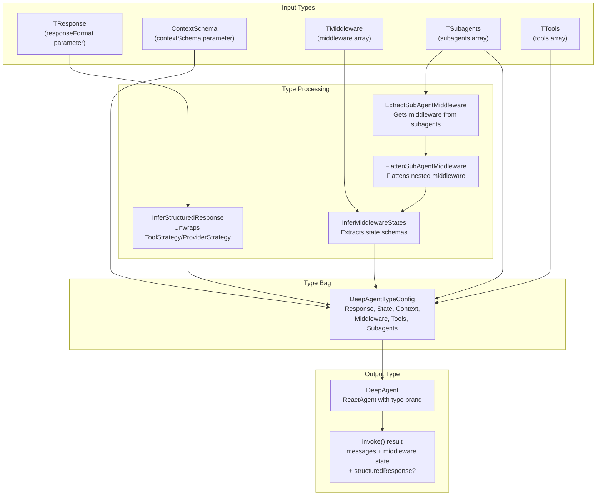

Sources: [libs/deepagents/src/types.ts:153-173](), [libs/deepagents/src/agent.ts:143-163]()

---

## Core Type Constructs

### DeepAgentTypeConfig

The `DeepAgentTypeConfig` interface is a type bag that extends LangChain's `AgentTypeConfig` with subagent type information. It bundles all generic type parameters used throughout the deep agent system, including support for `AnySubAgent` (Sync, Compiled, or Async).

**Type Parameters**:

| Parameter | Default | Description |
|-----------|---------|-------------|
| `TResponse` | `Record<string, any> \| ResponseFormatUndefined` | Structured response type from `responseFormat` |
| `TState` | `AnyAnnotationRoot \| InteropZodObject \| undefined` | Custom state schema (unused in DeepAgents, state comes from middleware) |
| `TContext` | `AnyAnnotationRoot \| InteropZodObject` | Context schema type |
| `TMiddleware` | `readonly AgentMiddleware[]` | Middleware array type |
| `TTools` | `readonly (ClientTool \| ServerTool)[]` | Tools array type |
| `TSubagents` | `readonly AnySubAgent[]` | Subagents array type (Sync, Compiled, or Async) |

**Interface Definition**:

```typescript
export interface DeepAgentTypeConfig<
  TResponse extends Record<string, any> | ResponseFormatUndefined = ...,
  TState extends AnyAnnotationRoot | InteropZodObject | undefined = ...,
  TContext extends AnyAnnotationRoot | InteropZodObject = ...,
  TMiddleware extends readonly AgentMiddleware[] = readonly AgentMiddleware[],
  TTools extends readonly (ClientTool | ServerTool)[] = ...,
  TSubagents extends readonly AnySubAgent[] = readonly AnySubAgent[],
> extends AgentTypeConfig<TResponse, TState, TContext, TMiddleware, TTools> {
  Subagents: TSubagents;
}
```

Sources: [libs/deepagents/src/types.ts:153-173]()

### DeepAgent Type

The `DeepAgent` type wraps LangChain's `ReactAgent` with a type brand (`~deepAgentTypes`) that carries the full `DeepAgentTypeConfig`. This allows helper types to extract type information from an agent instance.

```typescript
export type DeepAgent<TTypes extends DeepAgentTypeConfig> = ReactAgent<TTypes> & {
  readonly "~deepAgentTypes": TTypes;
};
```

The type brand is accessible at compile time but does not exist at runtime. It serves purely for type inference.

Sources: [libs/deepagents/src/types.ts:189-194]()

### AnySubAgent Union

DeepAgents supports three types of subagents, all unified under the `AnySubAgent` type:
1. **SubAgent**: A configuration object for a new subagent.
2. **CompiledSubAgent**: A previously created `DeepAgent` or `ReactAgent` instance.
3. **AsyncSubAgent**: A remote agent running on an Agent Protocol server.

```typescript
export type AnySubAgent = SubAgent | CompiledSubAgent | AsyncSubAgent;
```

Sources: [libs/deepagents/src/types.ts:36-36]()

---

## Type Inference from Middleware

DeepAgents infers state types from middleware by extracting their `stateSchema` properties. The LangChain `InferMiddlewareStates` utility merges all middleware state schemas into a single type.

**Middleware State Inference Flow**

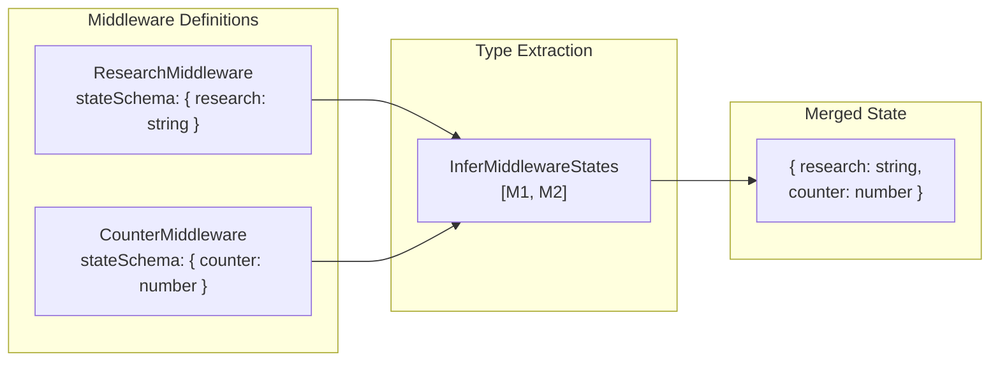

### Example: Custom Middleware State

```typescript
// Define middleware with state schema
const ResearchMiddleware = createMiddleware({
  name: "ResearchMiddleware",
  stateSchema: z.object({
    research: z.string().default("")
  }),
});

const agent = createDeepAgent({
  middleware: [ResearchMiddleware],
});

// invoke() result includes research property typed as string
const result = await agent.invoke({ messages: [] });
// result.research is string
```

Sources: [libs/deepagents/src/agent.test-d.ts:33-48](), [libs/deepagents/src/agent.test-d.ts:116-134]()

### MergedDeepAgentState

The `MergedDeepAgentState` type combines state from both custom middleware and subagent middleware:

```typescript
export type MergedDeepAgentState<
  TMiddleware extends readonly AgentMiddleware[],
  TSubagents extends readonly AnySubAgent[],
> = InferMiddlewareStates<TMiddleware> &
  InferSubAgentMiddlewareStates<TSubagents>;
```

Sources: [libs/deepagents/src/types.ts:80-84]()

---

## Type Inference from Subagents

Subagents can define their own middleware, and the type system extracts and flattens this middleware to infer state contributions.

**Subagent Middleware Extraction**

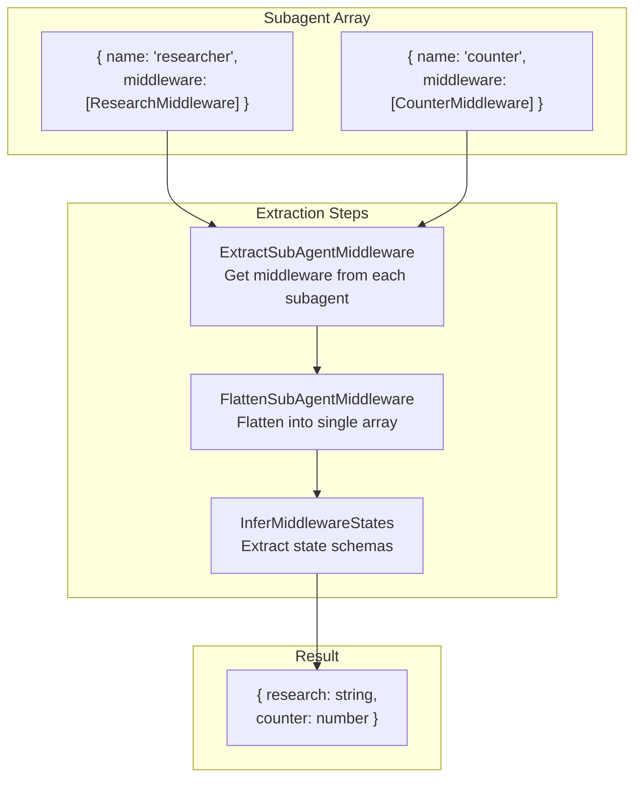

### ExtractSubAgentMiddleware

Extracts the middleware array from a `SubAgent` definition, handling both mutable and readonly arrays:

```typescript
export type ExtractSubAgentMiddleware<T> = T extends { middleware?: infer M }
  ? M extends readonly AgentMiddleware[]
    ? M
    : M extends AgentMiddleware[]
      ? M
      : readonly []
  : readonly [];
```

Sources: [libs/deepagents/src/types.ts:48-54]()

### FlattenSubAgentMiddleware

Recursively flattens middleware from all subagents into a single array:

```typescript
export type FlattenSubAgentMiddleware<T extends readonly AnySubAgent[]> =
  T extends readonly []
    ? readonly []
    : T extends readonly [infer First, ...infer Rest]
      ? Rest extends readonly AnySubAgent[]
        ? readonly [
            ...ExtractSubAgentMiddleware<First>,
            ...FlattenSubAgentMiddleware<Rest>,
          ]
        : ExtractSubAgentMiddleware<First>
      : readonly [];
```

Sources: [libs/deepagents/src/types.ts:59-69]()

### InferSubAgentMiddlewareStates

Combines extraction and flattening to infer state from subagent middleware:

```typescript
export type InferSubAgentMiddlewareStates<T extends readonly AnySubAgent[]> =
  InferMiddlewareStates<FlattenSubAgentMiddleware<T>>;
```

Sources: [libs/deepagents/src/types.ts:74-75]()

---

## Response Format Typing

The type system unwraps response format strategies (`ToolStrategy<T>`, `ProviderStrategy<T>`, `TypedToolStrategy<T>`) to extract the parsed output type.

### SupportedResponseFormat

Union of all response format types accepted by `createDeepAgent`:

```typescript
export type SupportedResponseFormat = ResponseFormat | TypedToolStrategy<any>;
```

Sources: [libs/deepagents/src/types.ts:95-95]()

### InferStructuredResponse

Extracts the parsed type from a response format strategy:

```typescript
export type InferStructuredResponse<T extends SupportedResponseFormat> =
  SupportedResponseFormat extends T
    ? ResponseFormatUndefined
    : T extends TypedToolStrategy<infer U>
      ? U
      : T extends ToolStrategy<infer U>
        ? U
        : T extends ProviderStrategy<infer U>
          ? U
          : ResponseFormatUndefined;
```

**Type Unwrapping**:

| Input Type | Output Type |
|------------|-------------|
| `ToolStrategy<{ city: string }>` | `{ city: string }` |
| `ProviderStrategy<{ answer: string }>` | `{ answer: string }` |
| `TypedToolStrategy<{ name: string }>` | `{ name: string }` |
| `SupportedResponseFormat` (default) | `ResponseFormatUndefined` |

Sources: [libs/deepagents/src/types.ts:116-125]()

---

## Type Extraction Helpers

DeepAgents provides helper types for extracting specific information from a `DeepAgent` instance or `DeepAgentTypeConfig`.

**Type Extraction Helper Utilities**

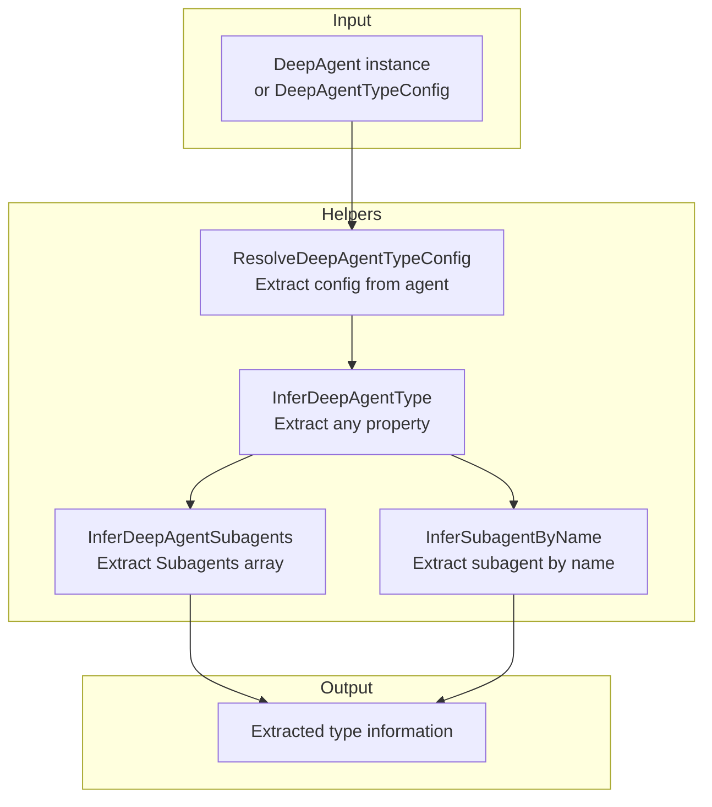

### ResolveDeepAgentTypeConfig

Extracts `DeepAgentTypeConfig` from either a config object or an agent instance:

```typescript
export type ResolveDeepAgentTypeConfig<T> = T extends {
  "~deepAgentTypes": infer Types;
}
  ? Types extends DeepAgentTypeConfig
    ? Types
    : never
  : T extends DeepAgentTypeConfig
    ? T
    : never;
```

Sources: [libs/deepagents/src/types.ts:241-249]()

### InferDeepAgentType

Generic helper to extract any property from a `DeepAgentTypeConfig`:

```typescript
export type InferDeepAgentType<
  T,
  K extends keyof DeepAgentTypeConfig,
> = ResolveDeepAgentTypeConfig<T>[K];
```

Sources: [libs/deepagents/src/types.ts:263-266]()

### InferSubagentByName

Extracts a specific subagent by its name literal:

```typescript
export type InferSubagentByName<T, TName extends string> =
  InferDeepAgentSubagents<T> extends readonly (infer SA)[]
    ? SA extends { name: TName }
      ? SA
      : never
    : never;
```

Sources: [libs/deepagents/src/types.ts:328-333]()

---

## Type Flow Through createDeepAgent

The `createDeepAgent` function threads generic type parameters through the entire agent creation process, assembling them into a final `DeepAgent` type.

**Type Parameter Flow**

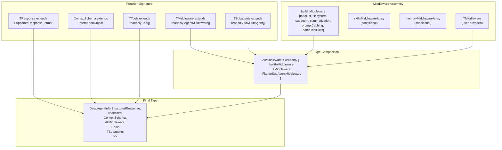

Sources: [libs/deepagents/src/agent.ts:143-345]()

### Generic Type Parameters

The function signature captures five generic type parameters with `const` assertions to preserve literal types:

```typescript
export function createDeepAgent<
  TResponse extends SupportedResponseFormat = SupportedResponseFormat,
  ContextSchema extends InteropZodObject = InteropZodObject,
  const TMiddleware extends readonly AgentMiddleware[] = readonly [],
  const TSubagents extends readonly AnySubAgent[] = readonly [],
  const TTools extends readonly (ClientTool | ServerTool)[] = readonly [],
>(params: CreateDeepAgentParams<...>) { ... }
```

Sources: [libs/deepagents/src/agent.ts:143-163]()

### Final Type Construction

The agent is cast to `DeepAgent` with the complete type configuration, ensuring that `invoke()` results are correctly typed based on the provided middleware and subagents.

```typescript
  return agent as unknown as DeepAgent<
    DeepAgentTypeConfig<
      InferStructuredResponse<TResponse>,
      undefined,
      ContextSchema,
      AllMiddleware,
      TTools,
      TSubagents
    >
  >;
```

Sources: [libs/deepagents/src/agent.ts:335-344]()

---

# Page: createDeepAgent API

# createDeepAgent API

<details>
<summary>Relevant source files</summary>

The following files were used as context for generating this wiki page:

- [libs/deepagents/src/agent.int.test.ts](libs/deepagents/src/agent.int.test.ts)
- [libs/deepagents/src/agent.test-d.ts](libs/deepagents/src/agent.test-d.ts)
- [libs/deepagents/src/agent.test.ts](libs/deepagents/src/agent.test.ts)
- [libs/deepagents/src/agent.ts](libs/deepagents/src/agent.ts)
- [libs/deepagents/src/errors.ts](libs/deepagents/src/errors.ts)
- [libs/deepagents/src/index.ts](libs/deepagents/src/index.ts)
- [libs/deepagents/src/middleware/async_subagents.ts](libs/deepagents/src/middleware/async_subagents.ts)
- [libs/deepagents/src/middleware/cache.test.ts](libs/deepagents/src/middleware/cache.test.ts)
- [libs/deepagents/src/middleware/index.ts](libs/deepagents/src/middleware/index.ts)
- [libs/deepagents/src/testing/utils.ts](libs/deepagents/src/testing/utils.ts)
- [libs/deepagents/src/types.ts](libs/deepagents/src/types.ts)

</details>


This page provides a comprehensive reference for the `createDeepAgent` function, the primary factory function for creating Deep Agents. It documents all configuration parameters, return value types, middleware assembly logic, and type inference behavior.

For information about individual middleware components, see [Middleware Reference](#5). For backend configuration options, see [Backend Implementations](#6). For the conceptual overview of Deep Agents architecture, see [Core Concepts](#3).

## Overview

`createDeepAgent` is a factory function that creates a LangGraph-based agent with built-in support for task planning, filesystem operations, subagent delegation, conversation summarization, and extensible middleware. It wraps LangChain's `createAgent` function with an opinionated middleware stack that implements the Deep Agent architecture pattern. [libs/deepagents/src/agent.ts:114-125]()

The function returns a `DeepAgent` instance (which extends `ReactAgent` from LangGraph) configured with:
- A default or custom language model (defaults to `anthropic:claude-sonnet-4-6`). [libs/deepagents/src/agent.ts:165-165]()
- Automatic middleware for todos, filesystem, subagents, summarization, prompt caching, and tool call patching. [libs/deepagents/src/agent.ts:251-305]()
- Optional middleware for skills, memory, and human-in-the-loop workflows. [libs/deepagents/src/agent.ts:221-250]()
- Type-safe state inference from custom middleware and subagents. [libs/deepagents/src/types.ts:79-84]()
- Configurable backend for filesystem and memory storage. [libs/deepagents/src/agent.ts:174-174]()

**Sources:** [libs/deepagents/src/agent.ts:114-179](), [libs/deepagents/src/types.ts:189-197]()

## Function Signature

```typescript
export function createDeepAgent<
  TResponse extends SupportedResponseFormat = SupportedResponseFormat,
  ContextSchema extends InteropZodObject = InteropZodObject,
  const TMiddleware extends readonly AgentMiddleware[] = readonly [],
  const TSubagents extends readonly AnySubAgent[] = readonly [],
  const TTools extends readonly (ClientTool | ServerTool)[] = readonly [],
>(
  params: CreateDeepAgentParams<
    TResponse,
    ContextSchema,
    TMiddleware,
    TSubagents,
    TTools
  > = {} as CreateDeepAgentParams<...>
)
```

### Type Parameters

| Parameter | Description | Default |
|-----------|-------------|---------|
| `TResponse` | Response format type (from `responseFormat` parameter). [libs/deepagents/src/types.ts:95-95]() | `SupportedResponseFormat` |
| `ContextSchema` | Context schema type (from `contextSchema` parameter). [libs/deepagents/src/agent.ts:145-145]() | `InteropZodObject` |
| `TMiddleware` | Custom middleware tuple type for state inference. [libs/deepagents/src/agent.ts:146-146]() | `readonly []` |
| `TSubagents` | Subagents tuple type for state inference and streaming. [libs/deepagents/src/types.ts:36-36]() | `readonly []` |
| `TTools` | Tools tuple type. [libs/deepagents/src/agent.ts:148-148]() | `readonly []` |

The type parameters are inferred from the configuration object and used to compute the agent's state type by merging states from all middleware sources. [libs/deepagents/src/types.ts:153-173]()

**Sources:** [libs/deepagents/src/agent.ts:143-163](), [libs/deepagents/src/types.ts:153-173]()

## Configuration Parameters

The `CreateDeepAgentParams` interface defines all configuration options:

### Core Parameters

| Parameter | Type | Default | Description |
|-----------|------|---------|-------------|
| `model` | `BaseLanguageModel \| string` | `"anthropic:claude-sonnet-4-6"` | Language model to use. [libs/deepagents/src/agent.ts:165-165]() |
| `tools` | `TTools` | `[]` | Tools the agent should have access to. [libs/deepagents/src/agent.ts:166-166]() |
| `systemPrompt` | `string \| SystemMessage` | `undefined` | Custom system prompt. Combined with `BASE_AGENT_PROMPT`. [libs/deepagents/src/agent.ts:167-167]() |
| `middleware` | `TMiddleware` | `[]` | Custom middleware array. [libs/deepagents/src/agent.ts:168-168]() |

### Agent Composition Parameters

| Parameter | Type | Default | Description |
|-----------|------|---------|-------------|
| `subagents` | `TSubagents` | `[]` | Subagent specifications (sync, async, or compiled). [libs/deepagents/src/agent.ts:169-169]() |
| `skills` | `string[]` | `undefined` | Skill source paths for `SkillsMiddleware`. [libs/deepagents/src/agent.ts:178-178]() |
| `memory` | `string[]` | `undefined` | Memory file paths for `MemoryMiddleware`. [libs/deepagents/src/agent.ts:177-177]() |

### Backend & Storage Parameters

| Parameter | Type | Default | Description |
|-----------|------|---------|-------------|
| `backend` | `BackendProtocol \| ((config) => BackendProtocol)` | `StateBackend` | Backend for filesystem operations. [libs/deepagents/src/agent.ts:174-174]() |
| `store` | `BaseStore` | `undefined` | LangGraph Store for persistent memory. [libs/deepagents/src/agent.ts:173-173]() |
| `checkpointer` | `BaseCheckpointSaver` | `undefined` | Checkpointer for state persistence. [libs/deepagents/src/agent.ts:172-172]() |

**Sources:** [libs/deepagents/src/agent.ts:164-179](), [libs/deepagents/src/types.ts:35-36]()

## Built-in Tool Collision

`createDeepAgent` performs a validation check at construction time to ensure user-supplied tools do not collide with built-in Deep Agent tools. [libs/deepagents/src/agent.ts:181-191]()

```typescript
const BUILTIN_TOOL_NAMES: ReadonlySet<string> = new Set([
  ...FILESYSTEM_TOOL_NAMES, // ls, read_file, write_file, edit_file, glob, grep, execute
  ...ASYNC_TASK_TOOL_NAMES, // start_async_task, check_async_task, update_async_task, etc.
  "task",
  "write_todos",
]);
```

If a collision is detected, it throws a `ConfigurationError` with code `TOOL_NAME_COLLISION`. [libs/deepagents/src/agent.ts:186-190]()

**Sources:** [libs/deepagents/src/agent.ts:91-96](), [libs/deepagents/src/agent.ts:181-191](), [libs/deepagents/src/errors.ts:7-7]()

## System Prompt Construction

The system prompt is constructed by combining the user-provided `systemPrompt` with the `BASE_AGENT_PROMPT` constant. [libs/deepagents/src/agent.ts:55-89]()

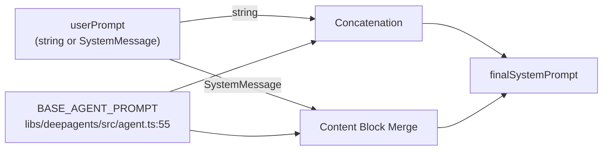

**Sources:** [libs/deepagents/src/agent.ts:55-89](), [libs/deepagents/src/agent.ts:308-313]()

## Middleware Assembly

DeepAgents uses an opinionated middleware pipeline. The order is deterministic to ensure correct data flow (e.g., filesystem tools must exist before memory loads from them). [libs/deepagents/src/agent.ts:251-305]()

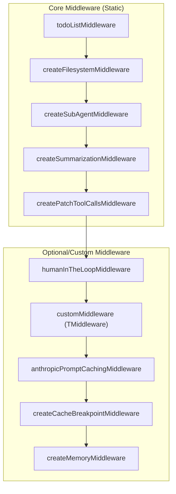

### Cache Optimization
If an Anthropic model is detected via `isAnthropicModel`, the agent automatically injects `anthropicPromptCachingMiddleware` and `createCacheBreakpointMiddleware`. [libs/deepagents/src/agent.ts:194-202]()

**Sources:** [libs/deepagents/src/agent.ts:193-202](), [libs/deepagents/src/agent.ts:251-305]()

## Return Value

`createDeepAgent` returns a `DeepAgent` instance, which is a `ReactAgent` extended with a type bag `~deepAgentTypes` for enhanced type inference. [libs/deepagents/src/types.ts:189-197]()

### State Type Inference

The agent's output state is computed by merging states from all middleware using the `MergedDeepAgentState` helper. [libs/deepagents/src/types.ts:80-84]()

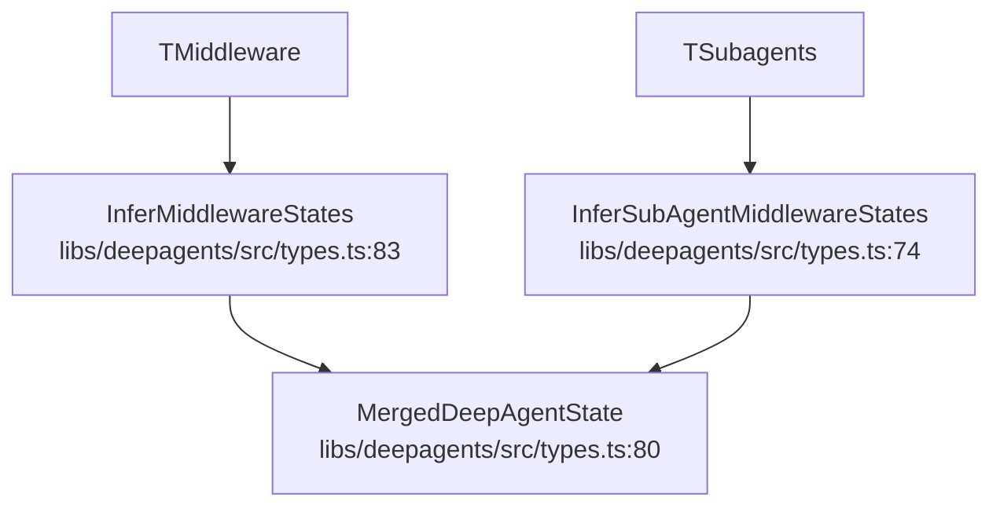

**Sources:** [libs/deepagents/src/types.ts:74-84](), [libs/deepagents/src/agent.ts:316-344]()

## Type Inference Helpers

The following helpers extract type information from a `DeepAgent` instance:

| Helper | Description |
|--------|-------------|
| `InferDeepAgentType<T, K>` | Extracts a specific key from the `DeepAgentTypeConfig`. [libs/deepagents/src/types.ts:153-173]() |
| `InferDeepAgentSubagents<T>` | Extracts the subagents array for type-safe delegation. [libs/deepagents/src/index.ts:20-20]() |
| `InferSubagentByName<T, N>` | Resolves a specific subagent's type by its name. [libs/deepagents/src/index.ts:21-21]() |
| `InferStructuredResponse<T>` | Unwraps `ToolStrategy` or `ProviderStrategy` to the raw Zod type. [libs/deepagents/src/types.ts:116-125]() |

**Sources:** [libs/deepagents/src/types.ts:98-125](), [libs/deepagents/src/index.ts:10-30]()

## Integration with LangGraph

The returned agent is a standard LangGraph graph. It is initialized with a default `recursionLimit` of 10,000 to support long-running autonomous tasks. [libs/deepagents/src/agent.ts:333-335]()

**Sources:** [libs/deepagents/src/agent.ts:333-344]()

---

# Page: Middleware Reference

# Middleware Reference

<details>
<summary>Relevant source files</summary>

The following files were used as context for generating this wiki page:

- [internal/eval-harness/CHANGELOG.md](internal/eval-harness/CHANGELOG.md)
- [libs/acp/CHANGELOG.md](libs/acp/CHANGELOG.md)
- [libs/deepagents/CHANGELOG.md](libs/deepagents/CHANGELOG.md)
- [libs/deepagents/src/agent.ts](libs/deepagents/src/agent.ts)
- [libs/deepagents/src/index.ts](libs/deepagents/src/index.ts)
- [libs/deepagents/src/middleware/async_subagents.ts](libs/deepagents/src/middleware/async_subagents.ts)
- [libs/deepagents/src/middleware/index.ts](libs/deepagents/src/middleware/index.ts)
- [libs/deepagents/src/types.ts](libs/deepagents/src/types.ts)
- [libs/providers/quickjs/CHANGELOG.md](libs/providers/quickjs/CHANGELOG.md)

</details>


This page provides an overview of all middleware components available in DeepAgents and guidance on when to use each one. Middleware extends the capabilities of agents by intercepting and modifying state, model calls, and tool executions.

For detailed documentation of individual middleware components, see:
- [Filesystem Middleware](#5.1) — Detailed documentation of `FilesystemMiddleware`, including all tools (`ls`, `read_file`, `write_file`, `edit_file`, `glob`, `grep`, `execute`), configuration options, state management, and large output eviction.
- [Skills Middleware](#5.2) — Documentation of `SkillsMiddleware`, the `SKILL.md` format, progressive disclosure pattern, multi-source skill loading, and validation rules.
- [Subagent Middleware](#5.3) — Documentation of `SubAgentMiddleware`, the `task` tool, subagent lifecycle, state isolation, and hierarchical architectures.
- [Summarization Middleware](#5.4) — Documentation of `SummarizationMiddleware`, conversation history offloading, context window management, and automatic triggers.
- [Memory Middleware](#5.5) — Documentation of `MemoryMiddleware`, `AGENTS.md` format, memory loading, and how it differs from skills.
- [Other Middleware](#5.6) — Documentation of `TodoListMiddleware`, `PatchToolCallsMiddleware`, `anthropicPromptCachingMiddleware`, and `humanInTheLoopMiddleware`.

---

## Middleware System Overview

Middleware in DeepAgents follows the pattern of LangChain's `createAgent`, using the `AgentMiddleware` interface to hook into agent execution [libs/deepagents/src/agent.ts:7-9](). Each middleware can modify state before execution (`beforeAgent`), wrap model calls (`wrapModelCall`), and transform tool calls.

The `createDeepAgent` function orchestrates a specific execution order to ensure that state updates (like memory or prompt caching) do not conflict with tool execution or summarization logic [libs/deepagents/src/agent.ts:120-123]().

**Sources:** [libs/deepagents/src/agent.ts:1-15](), [libs/deepagents/src/agent.ts:114-142]()

---

## Built-in Middleware Components

The following table lists the primary middleware components available:

| Middleware | Factory Function | Purpose | Default Enabled |
|------------|-----------------|---------|-----------------|
| **Todo List** | `todoListMiddleware()` | Task planning and tracking via `write_todos` | Yes [libs/deepagents/src/agent.ts:91-96]() |
| **Filesystem** | `createFilesystemMiddleware()` | File operations (`ls`, `read_file`, `write_file`, etc.) | Yes [libs/deepagents/src/agent.ts:17-23]() |
| **Subagent** | `createSubAgentMiddleware()` | Delegate tasks via the `task` tool | Yes [libs/deepagents/src/agent.ts:18-25]() |
| **Async Subagent** | `createAsyncSubAgentMiddleware()` | Remote task delegation via Agent Protocol | Yes [libs/deepagents/src/agent.ts:26-28]() |
| **Summarization** | `createSummarizationMiddleware()` | Automatic history offloading and context management | Yes [libs/deepagents/src/agent.ts:20-21]() |
| **Prompt Caching** | `anthropicPromptCachingMiddleware()` | Anthropic-specific cost optimization | Yes (for Claude) [libs/deepagents/src/agent.ts:193-202]() |
| **Patch Tool Calls** | `createPatchToolCallsMiddleware()` | Fixes dangling tool calls across providers | Yes [libs/deepagents/src/agent.ts:19-20]() |
| **Skills** | `createSkillsMiddleware()` | Loads reusable capabilities from `SKILL.md` | Conditional* [libs/deepagents/src/agent.ts:178-179]() |
| **Memory** | `createMemoryMiddleware()` | Loads project context from `AGENTS.md` | Conditional* [libs/deepagents/src/agent.ts:177-178]() |

\* Enabled when `skills` or `memory` parameters are provided to `createDeepAgent`.

**Sources:** [libs/deepagents/src/agent.ts:16-46](), [libs/deepagents/src/index.ts:41-76]()

---

## Middleware Execution Order

The order of middleware is critical. For example, `anthropicPromptCachingMiddleware` is gated by model type to insert `cache_control` breakpoints before the model call [libs/deepagents/src/agent.ts:193-202]().

### Pipeline Flow: Natural Language to Code Entities

```mermaid
graph TD
    subgraph "Natural Language Space"
        UserRequest["'Create a React app'"]
        SkillRequest["'Use the deployment skill'"]
    end

    subgraph "Code Entity Space"
        Agent["createDeepAgent (agent.ts)"]
        FS_MW["createFilesystemMiddleware (fs.ts)"]
        Skill_MW["createSkillsMiddleware (skills.ts)"]
        Sub_MW["createSubAgentMiddleware (subagents.ts)"]
        Sum_MW["createSummarizationMiddleware (summarization.ts)"]
        Cache_MW["anthropicPromptCachingMiddleware"]
        
        Agent --> FS_MW
        FS_MW --> Sub_MW
        Sub_MW --> Sum_MW
        Sum_MW --> Cache_MW
        Cache_MW --> Skill_MW
    end

    UserRequest --> Agent
    SkillRequest --> Skill_MW
```

**Sources:** [libs/deepagents/src/agent.ts:164-210](), [libs/deepagents/src/middleware/index.ts:1-76]()

---

## Middleware by Category

### State & File Management
These components manage the `files` channel and persistent storage.
- **Filesystem Middleware**: Provides the core tools for file manipulation and shell execution. It uses `filesValue` for state reduction [libs/deepagents/src/index.ts:79]().
- **Skills Middleware**: Implements "Progressive Disclosure." It injects `SKILL.md` metadata into the system prompt but requires the agent to use `read_file` to see implementation details [libs/deepagents/src/middleware/skills.ts]().
- **Memory Middleware**: Loads `AGENTS.md` files. Unlike skills, the full content is typically injected into the system prompt [libs/deepagents/src/middleware/memory.ts]().

### Task & Orchestration
- **Subagent Middleware**: Enables hierarchical architectures via the `task` tool [libs/deepagents/src/middleware/subagents.ts]().
- **Async Subagent Middleware**: Connects to remote [Agent Protocol](https://github.com/langchain-ai/agent-protocol) servers for background tasks [libs/deepagents/src/middleware/async_subagents.ts:14-25]().
- **Patch Tool Calls Middleware**: A utility that fixes "dangling" tool calls (calls without content blocks) which often cause validation errors [libs/deepagents/src/middleware/patch_tool_calls.ts:22-24]().

### Context Optimization
- **Summarization Middleware**: Monitors the `messages` channel and triggers a summary when tokens exceed a threshold, offloading history to the backend [libs/deepagents/src/middleware/summarization.ts:51-61]().
- **Prompt Caching**: Specifically targets Anthropic models to insert `cache_control` breakpoints [libs/deepagents/src/agent.ts:193-202]().

---

## Configuration Patterns

### Shared Backend Architecture
Middleware components like Filesystem, Skills, and Memory share a `BackendProtocol` implementation (e.g., `StoreBackend` or `FilesystemBackend`).

```mermaid
graph LR
    subgraph "Middleware Entities"
        FSMW["FilesystemMiddleware"]
        SkillMW["SkillsMiddleware"]
    end

    subgraph "Backend Entities"
        BE["BackendProtocol (backends/index.ts)"]
        SB["StoreBackend (backends/store.ts)"]
        FSB["FilesystemBackend (backends/fs.ts)"]
    end

    FSMW --> BE
    SkillMW --> BE
    BE --> SB
    BE --> FSB
```

**Sources:** [libs/deepagents/src/agent.ts:174-180](), [libs/deepagents/src/backends/index.ts:108-114]()

### Skills Inheritance
Custom subagents do **not** inherit skills from the parent agent by default. If a subagent needs skills, they must be explicitly defined. The only exception is the `GENERAL_PURPOSE_SUBAGENT`, which inherits the parent's skills [libs/deepagents/src/agent.ts:205-210]().

**Sources:** [libs/deepagents/src/agent.ts:211-235]()

---

## Next Steps

- For detailed tool schemas and output eviction, see [Filesystem Middleware](#5.1).
- To learn about the `SKILL.md` format, see [Skills Middleware](#5.2).
- For hierarchical agent patterns, see [Subagent Middleware](#5.3).
- To configure automatic history offloading, see [Summarization Middleware](#5.4).
- For project-level context loading via `AGENTS.md`, see [Memory Middleware](#5.5).
- For specialized utilities like HITL or Prompt Caching, see [Other Middleware](#5.6).

---

# Page: Filesystem Middleware

# Filesystem Middleware

<details>
<summary>Relevant source files</summary>

The following files were used as context for generating this wiki page:

- [libs/deepagents/src/middleware/fs.eviction.test.ts](libs/deepagents/src/middleware/fs.eviction.test.ts)
- [libs/deepagents/src/middleware/fs.int.test.ts](libs/deepagents/src/middleware/fs.int.test.ts)
- [libs/deepagents/src/middleware/fs.test.ts](libs/deepagents/src/middleware/fs.test.ts)
- [libs/deepagents/src/middleware/fs.ts](libs/deepagents/src/middleware/fs.ts)
- [libs/deepagents/src/middleware/hitl.int.test.ts](libs/deepagents/src/middleware/hitl.int.test.ts)
- [libs/deepagents/src/middleware/subagents-hitl.int.test.ts](libs/deepagents/src/middleware/subagents-hitl.int.test.ts)

</details>


The Filesystem Middleware provides a comprehensive suite of file manipulation and search tools to agents, enabling them to interact with files through a pluggable backend abstraction layer. This middleware handles file reading, writing, editing, listing, pattern matching, searching, and optional shell command execution.

For information about backend implementations that this middleware uses, see [Backend Implementations](). For creating custom backends, see [Custom Backend Implementation]().

**Sources:** [libs/deepagents/src/middleware/fs.ts:1-8]()

## Overview

The Filesystem Middleware is created via the `createFilesystemMiddleware` factory function, which returns an `AgentMiddleware` instance with the following capabilities:

| Capability | Description |
|------------|-------------|
| **Tools** | `ls`, `read_file`, `write_file`, `edit_file`, `glob`, `grep`, `execute` |
| **State Management** | `FilesystemStateSchema` with `files` channel using `ReducedValue` for concurrent updates |
| **Backend Support** | Works with `StateBackend`, `StoreBackend`, `FilesystemBackend`, `LocalShellBackend`, `SandboxBackend` |
| **Eviction System** | Automatically saves large tool results to filesystem to prevent context overflow |
| **Dynamic Tools** | `execute` tool only available if backend implements `SandboxBackendProtocol` |

**Sources:** [libs/deepagents/src/middleware/fs.ts:77-85](), [libs/deepagents/src/middleware/fs.ts:749-803]()

## Architecture

### Component Structure

The middleware coordinates between the LangGraph agent, the tool definitions, and the pluggable backends.

Title: Filesystem Middleware Architecture
```mermaid
graph TB
    subgraph "FactoryFunction"
        createFilesystemMiddleware["createFilesystemMiddleware(options)"]
    end
    
    subgraph "MiddlewareComponents"
        AgentMiddleware["AgentMiddleware Instance"]
        StateSchema["FilesystemStateSchema"]
        Tools["Tool Array"]
        WrapModelCall["wrapModelCall hook"]
        WrapToolCall["wrapToolCall hook"]
    end
    
    subgraph "ToolsCreated"
        LS["ls tool<br/>createLsTool()"]
        ReadFile["read_file tool<br/>createReadFileTool()"]
        WriteFile["write_file tool<br/>createWriteFileTool()"]
        EditFile["edit_file tool<br/>createEditFileTool()"]
        Glob["glob tool<br/>createGlobTool()"]
        Grep["grep tool<br/>createGrepTool()"]
        Execute["execute tool<br/>createExecuteTool()"]
    end
    
    subgraph "BackendLayer"
        BackendFactory["BackendFactory or BackendProtocol"]
        ResolvedBackend["resolveBackend(backend, runtime)"]
        BackendMethods["lsInfo, read, write, edit,<br/>globInfo, grepRaw, execute"]
    end
    
    subgraph "StateSystem"
        FilesChannel["files channel<br/>Record<string, FileData>"]
        FileDataReducer["fileDataReducer<br/>Merge/Delete logic"]
    end
    
    createFilesystemMiddleware --> AgentMiddleware
    AgentMiddleware --> StateSchema
    AgentMiddleware --> Tools
    AgentMiddleware --> WrapModelCall
    AgentMiddleware --> WrapToolCall
    
    Tools --> LS
    Tools --> ReadFile
    Tools --> WriteFile
    Tools --> EditFile
    Tools --> Glob
    Tools --> Grep
    Tools --> Execute
    
    LS -.uses.-> ResolvedBackend
    ReadFile -.uses.-> ResolvedBackend
    WriteFile -.uses.-> ResolvedBackend
    EditFile -.uses.-> ResolvedBackend
    Glob -.uses.-> ResolvedBackend
    Grep -.uses.-> ResolvedBackend
    Execute -.uses.-> ResolvedBackend
    
    BackendFactory --> ResolvedBackend
    ResolvedBackend --> BackendMethods
    
    StateSchema --> FilesChannel
    FilesChannel --> FileDataReducer
```

**Sources:** [libs/deepagents/src/middleware/fs.ts:764-803](), [libs/deepagents/src/middleware/fs.ts:232-240](), [libs/deepagents/src/backends/protocol.ts:31]()

### Middleware Hooks Flow

The middleware uses `wrapModelCall` to inject prompts and `wrapToolCall` to handle large output eviction.

Title: Filesystem Middleware Execution Flow
```mermaid
sequenceDiagram
    participant Agent as "LangGraph Agent"
    participant Middleware as "FilesystemMiddleware"
    participant Backend as "Backend (resolved)"
    participant Model as "Language Model"
    
    Agent->>Middleware: wrapModelCall(request)
    Middleware->>Backend: isSandboxBackend(backend)?
    Backend-->>Middleware: true/false
    
    alt Backend supports execution
        Middleware->>Middleware: Include execute tool<br/>Add EXECUTION_SYSTEM_PROMPT
    else Backend does not support execution
        Middleware->>Middleware: Filter out execute tool<br/>Use base system prompt only
    end
    
    Middleware->>Middleware: systemMessage.concat(filesystemPrompt)
    Middleware->>Model: Enhanced request with filtered tools
    Model-->>Agent: Response with tool_calls
    
    Agent->>Middleware: wrapToolCall(request)
    Middleware->>Middleware: Check if tool in TOOLS_EXCLUDED_FROM_EVICTION
    
    alt Tool not excluded
        Middleware->>Agent: Execute handler
        Agent-->>Middleware: ToolMessage result
        
        alt Result exceeds toolTokenLimitBeforeEvict
            Middleware->>Backend: write(evictPath, content)
            Backend-->>Middleware: filesUpdate
            Middleware->>Middleware: Create preview with head/tail<br/>createContentPreview()
            Middleware-->>Agent: Command with truncated message<br/>+ filesUpdate
        else Result within limits
            Middleware-->>Agent: Original ToolMessage
        end
    else Tool excluded
        Middleware->>Agent: Pass through (no eviction)
    end
```

**Sources:** [libs/deepagents/src/middleware/fs.ts:806-832](), [libs/deepagents/src/middleware/fs.ts:833-969](), [libs/deepagents/src/middleware/fs.ts:87-94]()

## Tools

### ls
Lists all files in a directory with their metadata.

| Property | Value |
|----------|-------|
| **Name** | `ls` |
| **Schema** | `{ path?: string }` - defaults to `"/"` |
| **Backend Method** | `lsInfo(path)` |

**Implementation:** [libs/deepagents/src/middleware/fs.ts:368-411]()
**Sources:** [libs/deepagents/src/middleware/fs.ts:256-260]()

### read_file
Reads file content with pagination support.

| Property | Value |
|----------|-------|
| **Name** | `read_file` |
| **Schema** | `{ file_path: string, offset?: number, limit?: number }` |
| **Defaults** | `offset=0`, `limit=100` lines |
| **Eviction** | Excluded from automatic eviction |

**Implementation:** [libs/deepagents/src/middleware/fs.ts:416-480]()
**Sources:** [libs/deepagents/src/middleware/fs.ts:77-85](), [libs/deepagents/src/middleware/fs.ts:261-277]()

### write_file
Creates a new file with specified content.

| Property | Value |
|----------|-------|
| **Name** | `write_file` |
| **Schema** | `{ file_path: string, content?: string }` |
| **Backend Method** | `write(file_path, content)` |

**Implementation:** [libs/deepagents/src/middleware/fs.ts:485-532]()
**Sources:** [libs/deepagents/src/middleware/fs.ts:278-283]()

### edit_file
Performs exact string replacements in existing files.

| Property | Value |
|----------|-------|
| **Name** | `edit_file` |
| **Schema** | `{ file_path: string, old_string: string, new_string: string, replace_all?: boolean }` |
| **Backend Method** | `edit(file_path, old_string, new_string, replace_all)` |

**Implementation:** [libs/deepagents/src/middleware/fs.ts:537-595]()
**Sources:** [libs/deepagents/src/middleware/fs.ts:284-291]()

### glob
Finds files matching a glob pattern.

| Property | Value |
|----------|-------|
| **Name** | **glob** |
| **Schema** | `{ pattern: string, path?: string }` |
| **Backend Method** | `globInfo(pattern, path)` |

**Implementation:** [libs/deepagents/src/middleware/fs.ts:600-634]()
**Sources:** [libs/deepagents/src/middleware/fs.ts:292-301]()

### grep
Searches for literal text patterns across files.

| Property | Value |
|----------|-------|
| **Name** | `grep` |
| **Schema** | `{ pattern: string, path?: string, glob?: string \| null }` |
| **Backend Method** | `grepRaw(pattern, path, glob)` |

**Implementation:** [libs/deepagents/src/middleware/fs.ts:639-694]()
**Sources:** [libs/deepagents/src/middleware/fs.ts:302-312]()

### execute
Executes shell commands in the sandbox environment. Only available if the backend implements `SandboxBackendProtocol`.

**Implementation:** [libs/deepagents/src/middleware/fs.ts:699-745]()
**Sources:** [libs/deepagents/src/middleware/fs.ts:312-356](), [libs/deepagents/src/backends/protocol.ts:29]()

## State Management

### FilesystemStateSchema
The middleware defines a shared state schema with a `files` channel that uses `ReducedValue` to support concurrent updates.

Title: Filesystem State Management
```mermaid
classDiagram
    class FilesystemStateSchema {
        +files: ReducedValue
    }
    class FileData {
        +content: string[]
        +created_at: string
        +modified_at: string
    }
    class fileDataReducer {
        +merge(current, update)
    }
    FilesystemStateSchema --> FileData : contains record of
    FilesystemStateSchema --> fileDataReducer : uses for updates
```

**Sources:** [libs/deepagents/src/middleware/fs.ts:208-224](), [libs/deepagents/src/middleware/fs.ts:225-230]()

### fileDataReducer
The `fileDataReducer` enables concurrent file updates from parallel subagents by merging changes instead of using last-value semantics. It handles additions, updates, and deletions (when a file value is `null`).

**Implementation:** [libs/deepagents/src/middleware/fs.ts:176-206]()
**Sources:** [libs/deepagents/src/middleware/fs.test.ts:27-188]()

## Large Output Eviction

The middleware automatically detects when tool results exceed a token threshold and saves them to the filesystem to prevent context overflow.

### Eviction Logic
1. **Threshold Check**: If content length exceeds `toolTokenLimitBeforeEvict * NUM_CHARS_PER_TOKEN`. [libs/deepagents/src/middleware/fs.ts:881-883]()
2. **Exclusion**: Tools like `ls`, `read_file`, and `grep` are excluded from eviction because they have built-in truncation or specific failure modes. [libs/deepagents/src/middleware/fs.ts:87-94]()
3. **Storage**: The full result is written to `/large_tool_results/{tool_call_id}`. [libs/deepagents/src/middleware/fs.ts:896-900]()
4. **Preview**: A preview showing the head and tail of the result is provided to the LLM. [libs/deepagents/src/middleware/fs.ts:127-138]()

**Sources:** [libs/deepagents/src/middleware/fs.ts:50-71](), [libs/deepagents/src/middleware/fs.ts:101]()

## Configuration Options

| Option | Type | Description |
|--------|------|-------------|
| `backend` | `BackendProtocol \| BackendFactory` | Storage and execution layer. [libs/deepagents/src/middleware/fs.ts:751]() |
| `systemPrompt` | `string \| null` | Custom system prompt instructions. [libs/deepagents/src/middleware/fs.ts:753]() |
| `customToolDescriptions` | `Record<string, string> \| null` | Overrides for tool descriptions. [libs/deepagents/src/middleware/fs.ts:755]() |
| `toolTokenLimitBeforeEvict` | `number \| null` | Token threshold for eviction (default: 20000). [libs/deepagents/src/middleware/fs.ts:757]() |

**Sources:** [libs/deepagents/src/middleware/fs.ts:750-759](), [libs/deepagents/src/middleware/fs.ts:768-771]()

---

# Page: Skills Middleware

# Skills Middleware

<details>
<summary>Relevant source files</summary>

The following files were used as context for generating this wiki page:

- [.changeset/skill-loading-limit.md](.changeset/skill-loading-limit.md)
- [examples/skills-memory/skills-memory-agent.ts](examples/skills-memory/skills-memory-agent.ts)
- [examples/skills/file-organizer/SKILL.md](examples/skills/file-organizer/SKILL.md)
- [examples/skills/skill-creator/SKILL.md](examples/skills/skill-creator/SKILL.md)
- [libs/deepagents/src/middleware/agent-memory.ts](libs/deepagents/src/middleware/agent-memory.ts)
- [libs/deepagents/src/middleware/skills.test.ts](libs/deepagents/src/middleware/skills.test.ts)
- [libs/deepagents/src/middleware/skills.ts](libs/deepagents/src/middleware/skills.ts)
- [libs/deepagents/src/skills/index.int.test.ts](libs/deepagents/src/skills/index.int.test.ts)

</details>


This page documents the Skills Middleware (`SkillsMiddleware`), which loads agent skills from backend storage and injects them into the system prompt using a progressive disclosure pattern. Skills provide agents with specialized capabilities and domain knowledge organized in a standardized format.

For information about other middleware components, see [Middleware Reference](). For the overall middleware architecture and execution order, see [Middleware Architecture]().

## Purpose and Scope

The Skills Middleware implements Anthropic's agent skills pattern, enabling agents to access reusable capabilities stored as `SKILL.md` files. This middleware:

- Loads skills from one or more **sources** (paths in a backend) [libs/deepagents/src/middleware/skills.ts:9-13]()
- Validates skills against the Agent Skills specification [libs/deepagents/src/middleware/skills.ts:70-74]()
- Implements **progressive disclosure** (showing only metadata in prompts, full content on demand) [libs/deepagents/src/middleware/skills.ts:4-6]()
- Supports **multi-source layering** (user → project → team skills with override semantics) [libs/deepagents/src/middleware/skills.ts:9-13]()
- Works with any backend via `BackendProtocol` [libs/deepagents/src/middleware/skills.ts:14-16]()

**Sources:** [libs/deepagents/src/middleware/skills.ts:1-40]()

## Overview

Skills are self-documenting capabilities stored in `SKILL.md` files with YAML frontmatter. The middleware loads these files from configured sources during agent initialization and injects skill metadata into the system prompt. Agents can then read full skill instructions when needed using the `read_file` tool.

### From Code to Prompt Space

The following diagram bridges the code entities (functions and interfaces) with the conceptual flow of skill injection.

```mermaid
graph LR
    subgraph "Code Entity Space"
        Backend["BackendProtocol<br/>(FilesystemBackend, StateBackend)"]
        Loader["listSkillsFromBackend()"]
        Metadata["SkillMetadataEntry[]"]
        State["SkillsStateSchema<br/>(ReducedValue)"]
        Wrap["wrapModelCall()"]
    end

    subgraph "Natural Language Space"
        Files["/skills/user/SKILL.md"]
        Summaries["System Prompt:<br/>'web-research: Structured approach...'"]
        Agent["Agent Reasoning"]
        ToolCall["read_file('/skills/user/web-research/SKILL.md')"]
    end
    
    Files -->|"backend.downloadFiles()"| Backend
    Backend --> Loader
    Loader --> Metadata
    Metadata --> State
    State --> Wrap
    Wrap --> Summaries
    Summaries --> Agent
    Agent --> ToolCall
    ToolCall --> Files
```

**Sources:** [libs/deepagents/src/middleware/skills.ts:486-567](), [libs/deepagents/src/middleware/skills.ts:645-733]()

## The Agent Skills Specification

Skills follow the [Agent Skills specification](https://agentskills.io/specification), a standardized format for documenting agent capabilities. Each skill is a directory containing a `SKILL.md` file with YAML frontmatter.

### SKILL.md Structure

```mermaid
graph TB
    subgraph "SKILL.md Structure"
        Frontmatter["YAML Frontmatter<br/>---<br/>name: skill-name<br/>description: What it does<br/>license: MIT<br/>compatibility: Python 3.10+<br/>allowedTools: [read, write]<br/>---"]
        Markdown["Markdown Content<br/># Skill Title<br/>## Instructions<br/>## Examples"]
    end
    
    subgraph "Validation (parseSkillMetadataFromContent)"
        NameVal["validateSkillName()<br/>1-64 chars, Unicode lowercase + hyphens"]
        DescVal["Description: 1-1024 chars"]
        CompatVal["Compatibility: 0-500 chars"]
        ToolsVal["allowedTools: array of strings"]
    end
    
    subgraph "Output Interface"
        Meta["SkillMetadata<br/>name, description, path, allowedTools"]
    end
    
    Frontmatter --> Validation
    Markdown --> Validation
    Validation --> Meta
```

**Sources:** [libs/deepagents/src/middleware/skills.ts:75-139](), [libs/deepagents/src/middleware/skills.ts:368-484]()

### Frontmatter Fields

| Field | Type | Required | Constraints | Description |
|-------|------|----------|-------------|-------------|
| `name` | string | Yes | 1-64 chars, lowercase alphanumeric + hyphens [libs/deepagents/src/middleware/skills.ts:80-89]() | Skill identifier (must match parent directory) |
| `description` | string | Yes | 1-1024 chars [libs/deepagents/src/middleware/skills.ts:93-101]() | What the skill does and when to use it |
| `license` | string | No | Any [libs/deepagents/src/middleware/skills.ts:107-107]() | License name or reference |
| `compatibility` | string | No | 1-500 chars [libs/deepagents/src/middleware/skills.ts:111-119]() | Environment requirements |
| `allowedTools` | array | No | Array of strings [libs/deepagents/src/middleware/skills.ts:130-138]() | Tool names the skill recommends using |

**Sources:** [libs/deepagents/src/middleware/skills.ts:75-139]()

## Progressive Disclosure Pattern

Progressive disclosure minimizes token usage by showing only skill **metadata** (name, description, path) in the system prompt. The agent reads the full `SKILL.md` content only when needed using the `read_file` tool.

```mermaid
sequenceDiagram
    participant User
    participant Agent
    participant SystemPrompt["System Prompt (via wrapModelCall)"]
    participant ReadFile["read_file tool"]
    participant Backend["BackendProtocol"]
    
    User->>Agent: "Research quantum computing"
    
    Note over Agent,SystemPrompt: Agent sees skill metadata in prompt
    SystemPrompt->>Agent: web-research: Structured approach...<br/>Path: /skills/web-research/SKILL.md
    
    Agent->>ReadFile: read_file("/skills/web-research/SKILL.md")
    ReadFile->>Backend: downloadFiles()
    Backend-->>ReadFile: Full SKILL.md content
    ReadFile-->>Agent: Detailed workflow instructions
    
    Agent->>User: Execute research workflow
```

**Sources:** [libs/deepagents/src/middleware/skills.ts:229-263](), [libs/deepagents/src/middleware/skills.ts:596-624]()

## Multi-Source Skill Loading

Skills can be loaded from multiple **sources** (directory paths), with later sources overriding earlier ones. This enables skill hierarchies (e.g., base -> user -> project). [libs/deepagents/src/middleware/skills.ts:9-13]()

### Override Semantics

When multiple sources contain skills with the same name, the **last source wins** (highest index in the `sources` array). This is handled by the `skillsMetadataReducer`. [libs/deepagents/src/middleware/skills.ts:188-209]()

```typescript
// Configuration example
const middleware = createSkillsMiddleware({
  backend: new FilesystemBackend({ rootDir: "/" }),
  sources: [
    "/skills/user/",      // Loaded first
    "/skills/project/",   // Loaded last (higher priority)
  ],
});
```

**Sources:** [libs/deepagents/src/middleware/skills.ts:144-160](), [libs/deepagents/src/middleware/skills.test.ts:109-146]()

## Middleware Architecture

The `SkillsMiddleware` consists of `beforeAgent` for loading and `wrapModelCall` for injection.

### State Management and Reducers

Skills use `ReducedValue` in the `SkillsStateSchema` to handle concurrent updates from parallel subagents. The `skillsMetadataReducer` merges arrays by skill name, ensuring that later updates override earlier ones. [libs/deepagents/src/middleware/skills.ts:188-225]()

```mermaid
graph TB
    subgraph "State Channel Logic"
        SM["skillsMetadata: ReducedValue"]
        Reducer["skillsMetadataReducer()"]
    end
    
    subgraph "Merging Logic"
        Map["Map<string, SkillMetadataEntry>"]
        Current["current state"]
        Update["new update"]
    end
    
    Current --> Map
    Update --> Map
    Map -->|"Array.from(values())"| Result["Merged Skills"]
    Reducer --> Map
```

**Sources:** [libs/deepagents/src/middleware/skills.ts:188-225](), [libs/deepagents/src/middleware/skills.test.ts:189-211]()

### Backend Abstraction

The middleware uses `BackendProtocol` for storage operations, making it portable across different backends. It can resolve the backend using a static instance or a `BackendFactory` function that has access to runtime state. [libs/deepagents/src/middleware/skills.ts:144-153]()

| Backend Type | Skill Source Implementation |
|-------------|----------------------------|
| `FilesystemBackend` | Reads from real disk paths [libs/deepagents/src/backends/filesystem.ts:10]() |
| `StateBackend` | Reads from `state.files` channel [libs/deepagents/src/middleware/skills.ts:152]() |
| `StoreBackend` | Reads from LangGraph Store [libs/deepagents/src/middleware/skills.ts:60]() |

**Sources:** [libs/deepagents/src/middleware/skills.ts:144-160](), [libs/deepagents/src/middleware/skills.ts:653-660]()

## Validation Rules

The middleware enforces strict validation rules based on the Agent Skills specification.

- **File Size**: Maximum 10MB per `SKILL.md` to prevent DoS. [libs/deepagents/src/middleware/skills.ts:66]()
- **Read Limit**: Default limit of 1000 lines for skill file reading. [libs/deepagents/src/middleware/skills.ts:68]()
- **Name**: 1-64 characters, Unicode lowercase alphanumeric and hyphens. No leading/trailing/consecutive hyphens. [libs/deepagents/src/middleware/skills.ts:71](), [libs/deepagents/src/middleware/skills.ts:266-315]()
- **Description**: 1-1024 characters. [libs/deepagents/src/middleware/skills.ts:72]()
- **Compatibility**: Maximum 500 characters. [libs/deepagents/src/middleware/skills.ts:73]()

**Sources:** [libs/deepagents/src/middleware/skills.ts:65-74](), [libs/deepagents/src/middleware/skills.ts:368-484]()

## Usage Examples

### Integration with createDeepAgent

The `createDeepAgent` function provides a shorthand `skills` parameter which internally configures the `SkillsMiddleware`.

```typescript
import { createDeepAgent, FilesystemBackend } from "deepagents";

const agent = await createDeepAgent({
  model: chatModel,
  backend: new FilesystemBackend({ rootDir: "/" }),
  skills: ["/skills/user/", "/skills/project/"], // Shorthand
});
```

**Sources:** [libs/deepagents/src/middleware/skills.ts:33-40](), [examples/skills-memory/skills-memory-agent.ts:159-164]()

### Integration with Memory Middleware

Skills (procedural knowledge) and Memory (personal/project context) can be used together. While Memory focuses on `agent.md` files (deprecated) or `AGENTS.md` files, Skills focus on modular `SKILL.md` directories. [libs/deepagents/src/middleware/agent-memory.ts:1-12]()

**Sources:** [libs/deepagents/src/skills/index.int.test.ts:150-277](), [examples/skills-memory/skills-memory-agent.ts:149-164]()

---

# Page: Subagent Middleware

# Subagent Middleware

<details>
<summary>Relevant source files</summary>

The following files were used as context for generating this wiki page:

- [libs/deepagents/src/agent.ts](libs/deepagents/src/agent.ts)
- [libs/deepagents/src/index.ts](libs/deepagents/src/index.ts)
- [libs/deepagents/src/middleware/async_subagents.ts](libs/deepagents/src/middleware/async_subagents.ts)
- [libs/deepagents/src/middleware/index.ts](libs/deepagents/src/middleware/index.ts)
- [libs/deepagents/src/middleware/subagent.test.ts](libs/deepagents/src/middleware/subagent.test.ts)
- [libs/deepagents/src/middleware/subagents.int.test.ts](libs/deepagents/src/middleware/subagents.int.test.ts)
- [libs/deepagents/src/middleware/subagents.ts](libs/deepagents/src/middleware/subagents.ts)
- [libs/deepagents/src/types.ts](libs/deepagents/src/types.ts)

</details>


The Subagent Middleware enables hierarchical agent architectures by providing a `task` tool that spawns ephemeral subagents to handle complex, multi-step tasks in isolation. Subagents execute autonomously with their own context window, then return a single result to the parent agent. This pattern is essential for managing token usage, parallelizing independent work, and isolating complex reasoning tasks.

For information about other middleware components, see [Middleware Reference](). For the `createDeepAgent` API that automatically configures subagent middleware, see [createDeepAgent API]().

## Overview

The Subagent Middleware is created using the `createSubAgentMiddleware` function, which adds a `task` tool to the agent and manages the lifecycle of spawned subagents. The middleware handles:

1.  **Task delegation**: Routes tasks to appropriate subagent types based on specifications.
2.  **State isolation**: Filters state when passing to/from subagents to prevent leakage.
3.  **Skills inheritance**: Manages skill distribution (general-purpose inherits, custom does not).
4.  **Parallel execution**: Supports concurrent subagent invocations.
5.  **Result synthesis**: Returns only the final message from subagent execution.

**Architecture Overview**

```mermaid
graph TB
    ParentAgent["Parent Agent"]
    TaskTool["task Tool"]
    SubagentMiddleware["createSubAgentMiddleware"]
    
    subgraph "Subagent Registry"
        GPAgent["general-purpose<br/>(ReactAgent)"]
        CustomAgent1["custom-agent-1<br/>(ReactAgent)"]
        CustomAgent2["custom-agent-2<br/>(ReactAgent)"]
        CompiledAgent["pre-compiled<br/>(Runnable)"]
    end
    
    subgraph "State Management"
        FilterIn["filterStateForSubagent()"]
        FilterOut["returnCommandWithStateUpdate()"]
        ExcludedKeys["EXCLUDED_STATE_KEYS<br/>messages, todos,<br/>structuredResponse,<br/>skillsMetadata,<br/>memoryContents"]
    end
    
    ParentAgent -->|"invokes"| TaskTool
    TaskTool -->|"created by"| SubagentMiddleware
    TaskTool -->|"selects & invokes"| GPAgent
    TaskTool -->|"selects & invokes"| CustomAgent1
    TaskTool -->|"selects & invokes"| CustomAgent2
    TaskTool -->|"selects & invokes"| CompiledAgent
    
    TaskTool -->|"passes state"| FilterIn
    FilterIn -->|"filtered input"| GPAgent
    FilterIn -->|"filtered input"| CustomAgent1
    
    GPAgent -->|"result"| FilterOut
    CustomAgent1 -->|"result"| FilterOut
    FilterOut -->|"Command update"| ParentAgent
    
    ExcludedKeys -.excludes.-> FilterIn
    ExcludedKeys -.excludes.-> FilterOut
```

**Sources**: [libs/deepagents/src/middleware/subagents.ts:1-663](), [libs/deepagents/src/middleware/subagents.ts:45-51]()

## The task Tool

The `task` tool is the primary interface for spawning subagents. It accepts two parameters: `description` (the task to execute) and `subagent_type` (which agent to use). The tool validates the subagent type, filters the current state, invokes the selected subagent, and returns a `Command` with the filtered state update.

**Tool Schema**

| Parameter | Type | Description |
| :--- | :--- | :--- |
| `description` | `string` | The task to execute with the selected agent. Should contain detailed, autonomous instructions. |
| `subagent_type` | `string` | Name of the agent to use. Must match a registered subagent name. |

**Tool Flow**

```mermaid
sequenceDiagram
    participant Model as "Language Model"
    participant TaskTool as "task Tool<br/>(createTaskTool)"
    participant Validation as "Subagent Type<br/>Validation"
    participant StateFilter as "filterStateForSubagent"
    participant Subagent as "Selected Subagent<br/>(ReactAgent)"
    participant CommandFactory as "returnCommandWithStateUpdate"
    
    Model->>TaskTool: tool_call(description, subagent_type)
    TaskTool->>Validation: Check subagent_type exists
    alt Invalid Type
        Validation-->>Model: Error: invalid type
    end
    
    TaskTool->>StateFilter: getCurrentTaskInput()
    StateFilter->>StateFilter: Exclude EXCLUDED_STATE_KEYS
    StateFilter-->>TaskTool: filtered state
    
    TaskTool->>TaskTool: Wrap description in HumanMessage
    TaskTool->>Subagent: invoke(filtered state, config)
    
    Subagent->>Subagent: Execute task autonomously
    Subagent-->>TaskTool: result with messages
    
    TaskTool->>CommandFactory: Extract last message
    CommandFactory->>CommandFactory: Filter content blocks<br/>(remove tool_use, thinking)
    CommandFactory->>CommandFactory: Filter state update
    CommandFactory-->>TaskTool: Command with ToolMessage
    
    TaskTool-->>Model: ToolMessage with result
```

**Sources**: [libs/deepagents/src/middleware/subagents.ts:499-591](), [libs/deepagents/src/middleware/subagents.ts:539-590](), [libs/deepagents/src/middleware/subagents.ts:45-51]()

## Subagent Types

The middleware supports three categories of subagents, each with different configuration and inheritance patterns.

### General-Purpose Subagent

The general-purpose subagent is automatically created when `generalPurposeAgent: true` (the default). It inherits:

*   All tools from the parent agent's `defaultTools`.
*   All skills from the parent agent's skills middleware (via `generalPurposeMiddleware`).
*   The same model as the parent (unless overridden).

This agent is ideal for delegating complex tasks that require the full capability set of the main agent but benefit from isolated context.

```mermaid
graph LR
    ParentAgent["Parent Agent<br/>skills: /skills/user/<br/>tools: [toolA, toolB]"]
    GPMiddleware["generalPurposeMiddleware<br/>(includes SkillsMiddleware)"]
    GPSubagent["general-purpose Subagent<br/>skills: /skills/user/ (inherited)<br/>tools: [toolA, toolB]"]
    
    ParentAgent -->|"creates with"| GPMiddleware
    GPMiddleware -->|"passes to"| GPSubagent
```

**Sources**: [libs/deepagents/src/middleware/subagents.ts:343-351](), [libs/deepagents/src/middleware/subagents.ts:446-467](), [libs/deepagents/src/middleware/subagents.ts:57-59]()

### Custom Subagents (SubAgent Interface)

Custom subagents are defined using the `SubAgent` interface and do NOT inherit skills from the main agent by default. Each custom subagent must explicitly specify its own `skills` property to have skills.

**SubAgent Interface**

```typescript
interface SubAgent {
  name: string;                  // Identifier for subagent_type
  description: string;           // Shown to model for selection
  systemPrompt: string;          // System prompt for this subagent
  tools?: StructuredTool[];      // Override defaultTools
  model?: LanguageModelLike;     // Override defaultModel
  middleware?: readonly AgentMiddleware[];  // Additional middleware
  interruptOn?: Record<string, boolean | InterruptOnConfig>;
  skills?: string[];             // Skill source paths (NOT inherited)
}
```

**Custom Subagent Creation Flow**

```mermaid
graph TB
    SubagentSpec["SubAgent Specification"]
    DefaultMiddleware["defaultMiddleware<br/>(NO skills)"]
    CustomMiddleware["subagent.middleware"]
    SkillsCheck{"Has skills<br/>property?"}
    SkillsMiddleware["SkillsMiddleware<br/>(created for subagent)"]
    HITLCheck{"Has interruptOn?"}
    HITLMiddleware["humanInTheLoopMiddleware"]
    CreateAgent["createAgent()"]
    FinalSubagent["Custom Subagent<br/>(ReactAgent)"]
    
    SubagentSpec --> DefaultMiddleware
    DefaultMiddleware --> SkillsCheck
    SkillsCheck -->|"Yes"| SkillsMiddleware
    SkillsCheck -->|"No"| CustomMiddleware
    SkillsMiddleware --> CustomMiddleware
    CustomMiddleware --> HITLCheck
    HITLCheck -->|"Yes"| HITLMiddleware
    HITLCheck -->|"No"| CreateAgent
    HITLMiddleware --> CreateAgent
    CreateAgent --> FinalSubagent
```

**Sources**: [libs/deepagents/src/middleware/subagents.ts:262-305](), [libs/deepagents/src/middleware/subagents.ts:470-494]()

### Pre-Compiled Subagents (CompiledSubAgent Interface)

Pre-compiled subagents are existing `ReactAgent` or `Runnable` instances that can be used directly without recreation. This enables hierarchical agent architectures where a `createDeepAgent` instance is used as a subagent.

**CompiledSubAgent Interface**

```typescript
interface CompiledSubAgent<TRunnable extends ReactAgent<any> | Runnable> {
  name: string;        // Identifier for subagent_type
  description: string; // Shown to model for selection
  runnable: TRunnable; // Pre-compiled agent or runnable
}
```

**Hierarchical Architecture Example**

```mermaid
graph TB
    ParentAgent["Parent Agent<br/>(createDeepAgent)"]
    TaskTool["task Tool"]
    
    subgraph "Compiled Subagent"
        ChildAgent["Child Deep Agent<br/>(createDeepAgent)"]
        ChildTaskTool["Child's task Tool"]
        GrandchildAgent["Grandchild Subagent"]
    end
    
    ParentAgent -->|"task(child-agent)"| TaskTool
    TaskTool -->|"invokes"| ChildAgent
    ChildAgent -->|"task(grandchild)"| ChildTaskTool
    ChildTaskTool -->|"invokes"| GrandchildAgent
```

**Sources**: [libs/deepagents/src/middleware/subagents.ts:221-230](), [libs/deepagents/src/middleware/subagents.ts:475-477]()

## Async Subagents

Async subagents connect to remote [Agent Protocol](https://github.com/langchain-ai/agent-protocol) servers via the LangGraph SDK. They run as background tasks that the main agent can monitor and update using a specific set of tools: `start_async_task`, `check_async_task`, `update_async_task`, `cancel_async_task`, and `list_async_tasks`.

**Async Task State**

Async tasks are persisted in the agent state within the `asyncTasks` channel, which uses a reducer to merge updates.

```typescript
export interface AsyncTask {
  taskId: string;      // Unique identifier (thread id)
  agentName: string;   // Async subagent type
  threadId: string;    // Remote thread ID
  runId: string;       // Current execution ID
  status: AsyncTaskStatus; // running, success, error, etc.
  createdAt: string;
}
```

**Sources**: [libs/deepagents/src/middleware/async_subagents.ts:26-92](), [libs/deepagents/src/middleware/async_subagents.ts:156-182]()

## State Isolation and Filtering

State filtering is critical for subagent isolation. The middleware excludes specific state keys when passing state to subagents and when returning updates from subagents.

**EXCLUDED\_STATE\_KEYS**

The following keys are excluded from state propagation:

| Key | Reason for Exclusion |
| :--- | :--- |
| `messages` | Handled explicitly; only final message returned. |
| `todos` | No defined reducer; unclear semantics for subagents. |
| `structuredResponse` | No defined reducer; parent-specific output. |
| `skillsMetadata` | Prevents parent skills leaking to child agents. |
| `memoryContents` | Prevents parent memory leaking to child agents. |

**State Filtering Flow**

```mermaid
graph LR
    ParentState["Parent State<br/>{messages, files,<br/>todos, skillsMetadata,<br/>memoryContents, ...}"]
    FilterIn["filterStateForSubagent()"]
    SubagentInput["Subagent Input<br/>{messages: [HumanMessage],<br/>files, ...}"]
    
    SubagentOutput["Subagent Output<br/>{messages, files,<br/>skillsMetadata, ...}"]
    FilterOut["returnCommandWithStateUpdate()"]
    ParentUpdate["Parent Update<br/>{files, ...}<br/>+ ToolMessage"]
    
    ParentState -->|"excludes EXCLUDED_KEYS"| FilterIn
    FilterIn --> SubagentInput
    
    SubagentOutput -->|"excludes EXCLUDED_KEYS"| FilterOut
    FilterOut -->|"extracts last message"| ParentUpdate
```

**Sources**: [libs/deepagents/src/middleware/subagents.ts:45-51](), [libs/deepagents/src/middleware/subagents.ts:356-366](), [libs/deepagents/src/middleware/subagents.ts:379-411]()

### Content Block Filtering

When constructing the `ToolMessage` from the subagent's response, invalid content blocks are filtered out. This prevents errors when using Anthropic models that return `tool_use`, `thinking`, or `redacted_thinking` blocks in `AIMessage.content`.

**Invalid Content Block Types**:

*   `tool_use`: Tool invocation blocks.
*   `thinking`: Extended thinking blocks.
*   `redacted_thinking`: Redacted thinking blocks.

If all blocks are invalid, the content defaults to `"Task completed"`.

**Sources**: [libs/deepagents/src/middleware/subagents.ts:370-398]()

## Skills Inheritance

Skills inheritance follows a clear pattern that distinguishes between general-purpose and custom subagents:

**Inheritance Rules**

| Subagent Type | Inherits Parent Skills | Can Define Own Skills |
| :--- | :--- | :--- |
| general-purpose | ✅ Yes (via `generalPurposeMiddleware`) | ❌ No (uses parent's) |
| Custom (no `skills` property) | ❌ No | ❌ No |
| Custom (with `skills` property) | ❌ No | ✅ Yes (loads from specified paths) |

**Skills Middleware Distribution**

```mermaid
graph TB
    MainAgent["Main Agent<br/>skills: [/skills/user/, /skills/project/]"]
    MainSkillsMW["SkillsMiddleware<br/>(main agent)"]
    
    subgraph "Middleware Creation"
        DefaultMW["defaultMiddleware<br/>(NO skills)"]
        GPMW["generalPurposeMiddleware<br/>(includes main SkillsMiddleware)"]
    end
    
    subgraph "Subagent Creation"
        GPAgent["general-purpose<br/>skills: inherited from main"]
        CustomNoSkills["custom-worker<br/>skills: none"]
        CustomWithSkills["custom-coder<br/>skills: [/skills/coding/]"]
        CustomSkillsMW["SkillsMiddleware<br/>(custom-coder only)"]
    end
    
    MainAgent -->|"has"| MainSkillsMW
    MainAgent -->|"creates"| DefaultMW
    MainAgent -->|"creates"| GPMW
    MainSkillsMW -.copied to.-> GPMW
    
    GPMW -->|"applied to"| GPAgent
    DefaultMW -->|"applied to"| CustomNoSkills
    DefaultMW -->|"applied to"| CustomWithSkills
    CustomWithSkills -->|"adds"| CustomSkillsMW
```

**Sources**: [libs/deepagents/src/middleware/subagents.ts:419-443](), [libs/deepagents/src/middleware/subagent.test.ts:54-135]()

## Hierarchical Agent Architectures

The `CompiledSubAgent` pattern enables multi-level agent hierarchies where agents delegate to agents that can themselves delegate to further subagents.

**Three-Level Hierarchy Example**

```mermaid
graph TB
    Level1["Level 1: Orchestrator Agent<br/>(createDeepAgent)"]
    Level2A["Level 2A: Sports Agent<br/>(createDeepAgent as CompiledSubAgent)"]
    Level2B["Level 2B: Weather Agent<br/>(createDeepAgent as CompiledSubAgent)"]
    Level3A["Level 3A: Soccer Subagent"]
    Level3B["Level 3B: Weather Helper"]
    
    Level1 -->|"task(sports-info)"| Level2A
    Level1 -->|"task(weather-info)"| Level2B
    Level2A -->|"task(soccer-scores)"| Level3A
    Level2A -->|"task(weather-helper)"| Level3B
    
    Level3A -.getSoccerScores.-> ToolA["get_soccer_scores"]
    Level3B -.getWeather.-> ToolB["get_weather"]
```

**Agent-as-Subagent Usage**

```typescript
// Level 2: Create deep agent with its own subagents
const sportsDeepAgent = createDeepAgent({
  model: "claude-3-5-sonnet",
  systemPrompt: "You are a sports information agent.",
  tools: [getSoccerScores],
  subagents: [{
    name: "weather-helper",
    description: "Gets weather info for match conditions.",
    systemPrompt: "Use get_weather for weather.",
    tools: [getWeather]
  }]
});

// Level 1: Use deep agent as CompiledSubAgent
const orchestrator = createDeepAgent({
  model: "claude-3-5-sonnet",
  subagents: [{
    name: "sports-info",
    description: "Sports scores and match conditions.",
    runnable: sportsDeepAgent  // CompiledSubAgent
  } satisfies CompiledSubAgent]
});
```

**Sources**: [libs/deepagents/src/middleware/subagents.int.test.ts:546-713]()

## Subagent Lifecycle

The subagent lifecycle consists of four phases: spawn, run, return, and reconcile.

**Lifecycle Diagram**

```mermaid
sequenceDiagram
    participant Parent as "Parent Agent"
    participant Model as "Language Model"
    participant TaskTool as "task Tool"
    participant Subagent as "Subagent"
    
    Note over Parent,Subagent: Phase 1: Spawn
    Parent->>Model: "Delegate research to subagent"
    Model->>TaskTool: tool_call(task)<br/>description: detailed task<br/>subagent_type: researcher
    TaskTool->>TaskTool: Validate subagent_type
    TaskTool->>TaskTool: Filter state (exclude EXCLUDED_KEYS)
    TaskTool->>Subagent: invoke({messages: [HumanMessage]})
    
    Note over Subagent: Phase 2: Run
    Subagent->>Subagent: Execute task autonomously
    Subagent->>Subagent: Call tools as needed
    Subagent->>Subagent: Reason and iterate
    
    Note over Subagent,TaskTool: Phase 3: Return
    Subagent-->>TaskTool: result {messages: [...]}
    TaskTool->>TaskTool: Extract last message
    TaskTool->>TaskTool: Filter invalid content blocks
    TaskTool->>TaskTool: Filter state update
    TaskTool-->>Model: ToolMessage(content: final result)
    
    Note over Parent,Model: Phase 4: Reconcile
    Model->>Parent: Synthesize subagent result
    Parent->>Parent: Incorporate into response
```

**Key Lifecycle Points**:

1.  **Spawn**: Parent provides detailed, autonomous instructions via `description` parameter. The subagent type is selected via `subagent_type`.
2.  **Run**: Subagent executes completely independently with its own context window. Intermediate steps are not visible to parent.
3.  **Return**: Only the last message from the subagent is returned. Invalid content blocks are filtered out.
4.  **Reconcile**: Parent receives a `ToolMessage` containing the subagent's result and incorporates it into the main reasoning thread.

**Sources**: [libs/deepagents/src/middleware/subagents.ts:196-201](), [libs/deepagents/src/middleware/subagents.ts:539-575]()

## System Prompt Injection

The middleware automatically appends guidance to the parent agent's system prompt via `wrapModelCall`. The injected prompt explains when and how to use the `task` tool.

**Default System Prompt Section** (`TASK_SYSTEM_PROMPT`):

The default prompt provides:

*   When to use the task tool (complex, multi-step, isolated tasks).
*   Subagent lifecycle explanation.
*   When NOT to use the task tool (trivial tasks, sequential dependencies).
*   Best practices (parallelize work, provide detailed instructions).
*   Example usage patterns.

**Customization**:

```typescript
// Override system prompt
const middleware = createSubAgentMiddleware({
  defaultModel: model,
  defaultTools: tools,
  systemPrompt: "Custom task tool instructions...",
  // or set systemPrompt: null to disable injection entirely
});
```

**Sources**: [libs/deepagents/src/middleware/subagents.ts:185-211](), [libs/deepagents/src/middleware/subagents.ts:650-660]()

## Configuration Reference

### createSubAgentMiddleware Options

```typescript
interface SubAgentMiddlewareOptions {
  defaultModel: LanguageModelLike | string;
  defaultTools?: StructuredTool[];
  defaultMiddleware?: AgentMiddleware[] | null;
  generalPurposeMiddleware?: AgentMiddleware[] | null;
  defaultInterruptOn?: Record<string, boolean | InterruptOnConfig> | null;
  subagents?: (SubAgent | CompiledSubAgent)[];
  systemPrompt?: string | null;
  generalPurposeAgent?: boolean;
  taskDescription?: string | null;
}
```

**Configuration Options Table**

| Option | Type | Default | Description |
| :--- | :--- | :--- | :--- |
| `defaultModel` | `LanguageModelLike \| string` | **Required** | Model for subagents. |
| `defaultTools` | `StructuredTool[]` | `[]` | Tools for general-purpose subagent. |
| `defaultMiddleware` | `AgentMiddleware[]` | `null` | Middleware for custom subagents (NO skills). |
| `generalPurposeMiddleware` | `AgentMiddleware[]` | `null` | Middleware for general-purpose (includes skills). |
| `defaultInterruptOn` | `Record<string, InterruptOnConfig>` | `null` | HITL configuration. |
| `subagents` | `(SubAgent \| CompiledSubAgent)[]` | `[]` | Custom subagent definitions. |
| `systemPrompt` | `string \| null` | `TASK_SYSTEM_PROMPT` | Task tool guidance (null disables). |
| `generalPurposeAgent` | `boolean` | `true` | Include general-purpose subagent. |
| `taskDescription` | `string \| null` | `null` | Custom task tool description. |

**Sources**: [libs/deepagents/src/middleware/subagents.ts:595-618](), [libs/deepagents/src/middleware/subagents.ts:623-646]()

## Usage Patterns

### Pattern 1: General-Purpose Delegation

Use the default general-purpose subagent for complex tasks that benefit from isolated context.

```typescript
const agent = createDeepAgent({
  model: "claude-3-5-sonnet",
  systemPrompt: "Use the general-purpose subagent for research tasks.",
  tools: [webSearchTool, readFileTool],
});
```

**Sources**: [libs/deepagents/src/middleware/subagents.int.test.ts:87-117]()

### Pattern 2: Specialized Subagents

Define custom subagents with specific tools and capabilities.

```typescript
const agent = createDeepAgent({
  model: "claude-3-5-sonnet",
  subagents: [
    {
      name: "researcher",
      description: "Conducts thorough research on complex topics",
      systemPrompt: "You are a research specialist.",
      tools: [webSearchTool, documentAnalysisTool],
      skills: ["/skills/research/"]
    }
  ]
});
```

**Sources**: [libs/deepagents/src/middleware/subagents.int.test.ts:119-157]()

### Pattern 3: Parallel Execution

Spawn multiple subagents in parallel by issuing multiple `task` tool calls in a single model response.

**Benefits**:

*   Reduces total execution time.
*   Isolates context per task.
*   Prevents `LastValue` channel errors with proper reducers.

**Sources**: [libs/deepagents/src/middleware/subagents.int.test.ts:450-537]()

### Pattern 4: Hierarchical Agents

Use a `createDeepAgent` instance as a `CompiledSubAgent` in another agent.

```typescript
const childAgent = createDeepAgent({
  model: "claude-3-5-sonnet",
  systemPrompt: "Sports information agent",
  tools: [getSoccerScores]
});

const parentAgent = createDeepAgent({
  model: "claude-3-5-sonnet",
  subagents: [{
    name: "sports-info",
    description: "Sports scores and conditions",
    runnable: childAgent
  } satisfies CompiledSubAgent]
});
```

**Sources**: [libs/deepagents/src/middleware/subagents.int.test.ts:596-656]()

### Pattern 5: Pre-Compiled Agents

Use any `ReactAgent` or `Runnable` as a subagent without modification.

```typescript
const parentAgent = createDeepAgent({
  model: "claude-3-5-sonnet",
  subagents: [{
    name: "specialist",
    description: "Handles specialized tasks",
    runnable: customAgent // Any Runnable
  }]
});
```

**Sources**: [libs/deepagents/src/middleware/subagents.int.test.ts:267-304]()

## Integration with createDeepAgent

When using `createDeepAgent`, the subagent middleware is automatically configured if the `subagents` parameter is provided or if skills are configured.

**Automatic Configuration**:

```typescript
const agent = createDeepAgent({
  model: "claude-3-5-sonnet",
  tools: [tool1, tool2],
  skills: ["/skills/user/"],
  subagents: [customSubagent]
});
```

**Sources**: [libs/deepagents/src/middleware/subagents.ts:232-261]()

---

# Page: Summarization Middleware

# Summarization Middleware

<details>
<summary>Relevant source files</summary>

The following files were used as context for generating this wiki page:

- [.changeset/mean-rats-shake.md](.changeset/mean-rats-shake.md)
- [libs/deepagents/src/middleware/summarization.test.ts](libs/deepagents/src/middleware/summarization.test.ts)
- [libs/deepagents/src/middleware/summarization.ts](libs/deepagents/src/middleware/summarization.ts)

</details>


The Summarization Middleware automatically manages conversation history by monitoring context window usage and offloading old messages to backend storage when thresholds are exceeded. It generates summaries of offloaded messages, replaces them with a condensed summary message, and preserves recent context to keep the agent's memory within model limits.

This middleware addresses the context overflow problem that occurs when long-running conversations exceed the model's maximum input token limit. For information about other middleware components, see [Middleware Reference](). For backend storage configuration, see [Backend Implementations]().

## Core Architecture

The `createSummarizationMiddleware` function [[libs/deepagents/src/middleware/summarization.ts:286-1262]]() returns an `AgentMiddleware` that hooks into the `wrapModelCall` lifecycle to intercept model requests and apply summarization when needed.

```mermaid
graph TB
    subgraph "Middleware Pipeline"
        FilesystemMiddleware["FilesystemMiddleware"]
        SkillsMiddleware["SkillsMiddleware"]
        SummarizationMiddleware["SummarizationMiddleware<br/>(wrapModelCall hook)"]
        OtherMiddleware["Other Middleware"]
    end
    
    subgraph "SummarizationMiddleware Components"
        TriggerCheck["shouldSummarize()<br/>Check triggers"]
        TruncateArgs["truncateArgs()<br/>Truncate old tool args"]
        CompactTools["compactToolResults()<br/>Truncate tool outputs"]
        FindCutoff["determineCutoffIndex()<br/>+ findSafeCutoffPoint()"]
        Offload["offloadToBackend()<br/>Write to backend storage"]
        CreateSummary["createSummary()<br/>Generate summary via LLM"]
        BuildMessage["buildSummaryMessage()<br/>Construct HumanMessage"]
    end
    
    subgraph "Backend Storage"
        Backend["BackendProtocol<br/>(write, downloadFiles,<br/>uploadFiles)"]
        HistoryFile["/conversation_history/{thread_id}.md"]
    end
    
    subgraph "State Management"
        SummarizationEvent["_summarizationEvent<br/>{cutoffIndex, summaryMessage, filePath}"]
        SessionId["_summarizationSessionId"]
    end
    
    FilesystemMiddleware --> SkillsMiddleware
    SkillsMiddleware --> SummarizationMiddleware
    SummarizationMiddleware --> OtherMiddleware
    
    SummarizationMiddleware --> TriggerCheck
    TriggerCheck -->|"Triggered"| TruncateArgs
    TriggerCheck -->|"Not triggered but<br/>ContextOverflowError"| TruncateArgs
    TruncateArgs --> FindCutoff
    FindCutoff -->|"preservedMessages.length === 0"| CompactTools
    FindCutoff -->|"preservedMessages.length > 0"| Offload
    CompactTools -->|"Failed"| Offload
    Offload --> CreateSummary
    CreateSummary --> BuildMessage
    BuildMessage --> SummarizationEvent
    
    Offload --> Backend
    Backend --> HistoryFile
    BuildMessage --> SessionId
```

**Sources**: [[libs/deepagents/src/middleware/summarization.ts:286-1262]](), [[libs/deepagents/src/middleware/summarization.ts:43-63]]()

## Configuration Options

The `SummarizationMiddlewareOptions` interface [[libs/deepagents/src/middleware/summarization.ts:122-172]]() defines the configuration:

| Option | Type | Description | Default |
|--------|------|-------------|---------|
| `model` | `string \| BaseChatModel \| BaseLanguageModel` | Model for generating summaries | Required |
| `backend` | `AnyBackendProtocol \| BackendFactory \| Function` | Backend for storing conversation history | Required |
| `trigger` | `ContextSize \| ContextSize[]` | Threshold(s) for triggering summarization | Auto-computed from model profile |
| `keep` | `ContextSize` | Context retention policy after summarization | Auto-computed from model profile |
| `summaryPrompt` | `string` | Template for generating summaries | `DEFAULT_SUMMARY_PROMPT` |
| `trimTokensToSummarize` | `number` | Max tokens when generating summary | `4000` |
| `historyPathPrefix` | `string` | Path prefix for history files | `"/conversation_history"` |
| `truncateArgsSettings` | `TruncateArgsSettings` | Settings for argument truncation | Auto-computed from model profile |

The `ContextSize` type [[libs/deepagents/src/middleware/summarization.ts:83-88]]() specifies thresholds:

```typescript
export interface ContextSize {
  /** Type of context measurement */
  type: "messages" | "tokens" | "fraction";
  /** Threshold value */
  value: number;
}
```

- `messages`: Count of messages (e.g., `{type: "messages", value: 20}`)
- `tokens`: Token count (e.g., `{type: "tokens", value: 170000}`)
- `fraction`: Fraction of `maxInputTokens` from model profile (e.g., `{type: "fraction", value: 0.85}`)

**Sources**: [[libs/deepagents/src/middleware/summarization.ts:83-172]]()

## Default Computation from Model Profile

When `trigger`, `keep`, or `truncateArgsSettings` are not provided, the middleware computes defaults based on the model's profile using `computeSummarizationDefaults` [[libs/deepagents/src/middleware/summarization.ts:203-227]]():

```mermaid
graph LR
    ModelProfile["Model Profile<br/>(resolvedModel.profile)"]
    HasMaxInputTokens{"Has maxInputTokens?"}
    ProfileDefaults["Profile-based defaults<br/>trigger: {type: 'fraction', value: 0.85}<br/>keep: {type: 'fraction', value: 0.1}<br/>truncateArgs trigger: 0.85, keep: 0.1"]
    FallbackDefaults["Fallback defaults<br/>trigger: {type: 'tokens', value: 170000}<br/>keep: {type: 'messages', value: 6}<br/>truncateArgs trigger: 20 msgs, keep: 20 msgs"]
    
    ModelProfile --> HasMaxInputTokens
    HasMaxInputTokens -->|"Yes"| ProfileDefaults
    HasMaxInputTokens -->|"No"| FallbackDefaults
```

This ensures consistent defaults across language implementations by checking for `maxInputTokens` in the model profile [[libs/deepagents/src/middleware/summarization.ts:208-212]]().

**Sources**: [[libs/deepagents/src/middleware/summarization.ts:178-227]]()

## Trigger Mechanisms

The middleware checks multiple trigger conditions to determine when summarization should occur:

```mermaid
graph TD
    Start["wrapModelCall called"]
    GetEffective["getEffectiveMessages()<br/>Apply previous SummarizationEvent"]
    CountTokens["countTotalTokens()<br/>Include systemMessage + tools"]
    CheckTriggers["shouldSummarize()"]
    
    MessageTrigger["Message count >= trigger.value"]
    TokenTrigger["Adjusted tokens >= trigger.value"]
    FractionTrigger["Adjusted tokens >= maxInputTokens * trigger.value"]
    
    PassThrough["Try handler(request)"]
    ContextOverflow{"ContextOverflowError?"}
    CalibrateMultiplier["Adjust tokenEstimationMultiplier<br/>= maxInputTokens / totalTokens * 1.1"]
    PerformSummarization["performSummarization()"]
    Return["Return result"]
    
    Start --> GetEffective
    GetEffective --> CountTokens
    CountTokens --> CheckTriggers
    CheckTriggers --> MessageTrigger
    CheckTriggers --> TokenTrigger
    CheckTriggers --> FractionTrigger
    
    MessageTrigger -->|"Triggered"| PerformSummarization
    TokenTrigger -->|"Triggered"| PerformSummarization
    FractionTrigger -->|"Triggered"| PerformSummarization
    
    MessageTrigger -->|"Not triggered"| PassThrough
    TokenTrigger -->|"Not triggered"| PassThrough
    FractionTrigger -->|"Not triggered"| PassThrough
    
    PassThrough --> ContextOverflow
    ContextOverflow -->|"Yes"| CalibrateMultiplier
    ContextOverflow -->|"No"| Return
    CalibrateMultiplier --> PerformSummarization
    PerformSummarization --> Return
```

The `shouldSummarize` function [[libs/deepagents/src/middleware/summarization.ts:437-465]]() applies a `tokenEstimationMultiplier` to the estimated token count. This multiplier starts at `1.0` and is calibrated upward when a `ContextOverflowError` is caught [[libs/deepagents/src/middleware/summarization.ts:1240-1245]](), learning the gap between estimated and actual tokens to fire proactive summarization before hitting hard limits.

**Sources**: [[libs/deepagents/src/middleware/summarization.ts:437-465]](), [[libs/deepagents/src/middleware/summarization.ts:1179-1261]](), [[libs/deepagents/src/middleware/summarization.test.ts:944-1005]]()

## Summarization Event Tracking

Instead of rewriting the entire LangGraph state with `RemoveMessage`, the middleware tracks a `SummarizationEvent` [[libs/deepagents/src/middleware/summarization.ts:236-251]]() in private state:

```typescript
export interface SummarizationEvent {
  /** Index in original messages list to summarize before (exclusive) */
  cutoffIndex: number;
  /** Summary of messages before cutoffIndex */
  summaryMessage: HumanMessage;
  /** Path to full conversation history on backend */
  filePath: string | null;
}
```

The `getEffectiveMessages` function [[libs/deepagents/src/middleware/summarization.ts:978-994]]() reconstructs the effective message list on each call:

```mermaid
graph LR
    StateMessages["State messages<br/>[M0, M1, M2, ..., M19]"]
    SummarizationEvent["_summarizationEvent<br/>{cutoffIndex: 15, summaryMessage, filePath}"]
    EffectiveMessages["Effective messages<br/>[summaryMessage, M15, M16, M17, M18, M19]"]
    
    StateMessages --> EffectiveMessages
    SummarizationEvent --> EffectiveMessages
```

This approach avoids full state rewrites and supports chained summarizations. On subsequent summarizations, the `stateCutoffIndex` is computed relative to the previous event [[libs/deepagents/src/middleware/summarization.ts:1029-1033]]().

**Sources**: [[libs/deepagents/src/middleware/summarization.ts:236-251]](), [[libs/deepagents/src/middleware/summarization.ts:978-994]](), [[libs/deepagents/src/middleware/summarization.ts:1029-1033]](), [[libs/deepagents/src/middleware/summarization.test.ts:648-722]]()

## Context Retention Policy

The `keep` policy determines how many messages to preserve after summarization. The `determineCutoffIndex` function [[libs/deepagents/src/middleware/summarization.ts:554-586]]() computes the cutoff based on the policy type:

| Policy Type | Behavior | Example |
|-------------|----------|---------|
| `messages` | Keep last N messages | `{type: "messages", value: 6}` keeps 6 most recent |
| `tokens` | Keep messages totaling N tokens | `{type: "tokens", value: 4000}` keeps ~4000 tokens |
| `fraction` | Keep fraction of maxInputTokens | `{type: "fraction", value: 0.1}` keeps 10% of context |

For token-based policies, the function walks backward from the most recent message, accumulating token counts until the target is exceeded [[libs/deepagents/src/middleware/summarization.ts:572-579]]().

**Sources**: [[libs/deepagents/src/middleware/summarization.ts:554-586]]()

## Safe Cutoff for Tool Call/Result Pairs

The `findSafeCutoffPoint` function [[libs/deepagents/src/middleware/summarization.ts:481-545]]() ensures that `AIMessage` tool calls and their corresponding `ToolMessage` results are not split across the summarization boundary:

```mermaid
graph TD
    RawCutoff["Raw cutoff index<br/>(e.g., index 7)"]
    IsToolMessage{"Is message[cutoffIndex]<br/>a ToolMessage?"}
    FindToolCallIds["Collect tool_call_ids from<br/>consecutive ToolMessages"]
    SearchBackward["Search backward for AIMessage<br/>with matching tool_calls"]
    FoundAI{"Found matching<br/>AIMessage?"}
    CheckDistance{"Backward distance ><br/>cutoffIndex / 2?"}
    MoveBackward["Move cutoff to AIMessage<br/>(preserve AI + Tools)"]
    MoveForward["Advance cutoff past all<br/>ToolMessages (summarize AI + Tools)"]
    Return["Return adjusted cutoff"]
    
    RawCutoff --> IsToolMessage
    IsToolMessage -->|"No"| Return
    IsToolMessage -->|"Yes"| FindToolCallIds
    FindToolCallIds --> SearchBackward
    SearchBackward --> FoundAI
    FoundAI -->|"No"| MoveForward
    FoundAI -->|"Yes"| CheckDistance
    CheckDistance -->|"Yes (too far)"| MoveForward
    CheckDistance -->|"No"| MoveBackward
    MoveForward --> Return
    MoveBackward --> Return
```

This prevents orphaned `ToolMessages` or orphaned AI `tool_calls`, ensuring the model always sees paired requests and responses [[libs/deepagents/src/middleware/summarization.ts:467-545]]().

**Sources**: [[libs/deepagents/src/middleware/summarization.ts:467-545]](), [[libs/deepagents/src/middleware/summarization.test.ts:724-849]]()

## Tool Result Compaction

When `determineCutoffIndex` would summarize all messages, the middleware attempts `compactToolResults` [[libs/deepagents/src/middleware/summarization.ts:690-744]]() instead of full summarization:

```mermaid
sequenceDiagram
    participant PerfSum as "performSummarization()"
    participant DetCutoff as "determineCutoffIndex()"
    participant Compact as "compactToolResults()"
    participant Handler as "handler(request)"
    participant Summarize as "summarizeMessages()"
    
    PerfSum->>DetCutoff: Compute cutoff
    DetCutoff-->>PerfSum: cutoffIndex, preservedMessages=[]
    
    Note over PerfSum: All messages would be summarized<br/>(infinite loop risk)
    
    PerfSum->>Compact: Try compacting tool results
    Compact->>Compact: Calculate per-tool token budget
    Compact->>Compact: Truncate each ToolMessage.content
    Compact-->>PerfSum: {messages: compacted, modified: true}
    
    PerfSum->>Handler: Try with compacted messages
    alt Success
        Handler-->>PerfSum: AIMessage
    else ContextOverflowError
        Handler-->>PerfSum: Error
        PerfSum->>Summarize: Summarize all messages
        Summarize-->>PerfSum: summaryMessage
        PerfSum->>Handler: Retry with [summaryMessage]
        Handler-->>PerfSum: AIMessage
    end
```

Compaction allocates each `ToolMessage` an equal share of the remaining token budget [[libs/deepagents/src/middleware/summarization.ts:717-720]](), truncating content to fit within the context window while preserving the AI/Tool message structure.

**Sources**: [[libs/deepagents/src/middleware/summarization.ts:690-744]](), [[libs/deepagents/src/middleware/summarization.ts:1076-1103]](), [[libs/deepagents/src/middleware/summarization.test.ts:1007-1173]]()

## Argument Truncation

The `truncateArgs` function [[libs/deepagents/src/middleware/summarization.ts:749-813]]() truncates large tool call arguments in old messages to reduce context usage without full summarization:

```typescript
export interface TruncateArgsSettings {
  trigger?: ContextSize;
  keep?: ContextSize;
  maxLength?: number;
  truncationText?: string;
}
```

Only arguments to `write_file` and `edit_file` tools are truncated [[libs/deepagents/src/middleware/summarization.ts:791-792]](), as these commonly contain large content payloads. The function replaces long string arguments with a truncated version followed by `truncationText` [[libs/deepagents/src/middleware/summarization.ts:803-806]]().

**Sources**: [[libs/deepagents/src/middleware/summarization.ts:93-118]](), [[libs/deepagents/src/middleware/summarization.ts:590-653]](), [[libs/deepagents/src/middleware/summarization.ts:749-813]]()

## Backend Integration and History Offloading

Before generating a summary, the middleware offloads the conversation history to backend storage using `offloadToBackend` [[libs/deepagents/src/middleware/summarization.ts:831-905]]():

```mermaid
sequenceDiagram
    participant MW as "SummarizationMiddleware"
    participant Backend as "BackendProtocol"
    participant Store as "Backend Storage"
    
    MW->>MW: filterSummaryMessages()
    MW->>MW: Format as markdown with timestamp
    
    alt Backend has downloadFiles
        MW->>Backend: downloadFiles([historyPath])
        Backend->>Store: Read file as bytes
        alt File exists
            Store-->>Backend: existingBytes
            Backend-->>MW: FileDownloadResponse
            MW->>MW: Concatenate bytes
            MW->>Backend: uploadFiles([[path, combinedBytes]])
        else File doesn't exist
            Store-->>Backend: Error (not found)
            Backend-->>MW: Error response
            MW->>Backend: write(path, newSection)
        end
    else Backend lacks downloadFiles/uploadFiles
        MW->>Backend: edit(path, oldContent, newContent)
    end
```

The offloading uses raw byte concatenation via `uploadFiles` when available [[libs/deepagents/src/middleware/summarization.ts:868-877]](). Each summarization appends a new section to the history file at `/conversation_history/{thread_id}.md` [[libs/deepagents/src/middleware/summarization.ts:27]]().

**Sources**: [[libs/deepagents/src/middleware/summarization.ts:831-905]](), [[libs/deepagents/src/middleware/summarization.ts:25-31]]()

---

# Page: Memory Middleware

# Memory Middleware

<details>
<summary>Relevant source files</summary>

The following files were used as context for generating this wiki page:

- [examples/memory/AGENTS.md](examples/memory/AGENTS.md)
- [examples/memory/memory-agent.ts](examples/memory/memory-agent.ts)
- [libs/deepagents/src/middleware/cache.ts](libs/deepagents/src/middleware/cache.ts)
- [libs/deepagents/src/middleware/memory.test.ts](libs/deepagents/src/middleware/memory.test.ts)
- [libs/deepagents/src/middleware/memory.ts](libs/deepagents/src/middleware/memory.ts)

</details>


## Purpose and Scope

The Memory Middleware loads persistent context from `AGENTS.md` files and injects it into every model call. Memory provides project-specific context, instructions, and learned information that helps agents work effectively within a codebase or domain.

For on-demand capabilities and workflows, see [Skills Middleware (5.2)](). For managing conversation history, see [Summarization Middleware (5.4)]().

**Sources**: [libs/deepagents/src/middleware/memory.ts:1-49]()

---

## Overview

Memory Middleware implements support for the [AGENTS.md specification](https://agents.md), which defines a standard format for providing context to AI agents. Unlike skills (which use progressive disclosure and are loaded on-demand), memory is:

- **Always loaded**: Memory content is included in every model call. [libs/deepagents/src/middleware/memory.ts:10-11]()
- **Fully visible**: The entire content is injected into the system prompt. [libs/deepagents/src/middleware/memory.ts:37-39]()
- **Persistent context**: Provides long-term information across conversations. [libs/deepagents/src/middleware/memory.ts:11-12]()
- **Self-modifying**: Agents are instructed to update memory files using the `edit_file` tool as they learn. [libs/deepagents/src/middleware/memory.ts:129-130]()

Memory files typically contain:
- Project overview and architecture.
- Build/test commands. [examples/memory/AGENTS.md:5-9]()
- Code style guidelines. [examples/memory/AGENTS.md:11-16]()
- User preferences.
- Previously learned information.

**Sources**: [libs/deepagents/src/middleware/memory.ts:1-49](), [libs/deepagents/src/middleware/memory.ts:124-162](), [examples/memory/AGENTS.md:1-31]()

---

## Architecture

### Memory Middleware Data Flow

The middleware operates in two phases:
1. **Loading Phase** (`beforeAgent`): Reads `AGENTS.md` files from configured sources using the backend. [libs/deepagents/src/middleware/memory.ts:258-274]()
2. **Injection Phase** (`wrapModelCall`): Formats loaded content and prepends it to the system prompt. [libs/deepagents/src/middleware/memory.ts:301-323]()

Title: Memory Middleware Component Interaction
```mermaid
graph TB
    subgraph "Configuration"
        Config["createMemoryMiddleware<br/>options"]
        Sources["sources: string[]<br/>(AGENTS.md paths)"]
        Backend["backend<br/>AnyBackendProtocol | BackendFactory"]
    end
    
    subgraph "State Schema"
        StateSchema["MemoryStateSchema"]
        MemoryContents["memoryContents<br/>Record<path, content>"]
        Files["files<br/>filesValue"]
    end
    
    subgraph "Middleware Hooks"
        BeforeAgent["beforeAgent()<br/>Load memory files"]
        WrapModelCall["wrapModelCall()<br/>Inject into prompt"]
    end
    
    subgraph "Backend Operations"
        BackendProtocol["BackendProtocol"]
        DownloadFiles["downloadFiles()"]
        Read["read()"]
    end
    
    subgraph "System Prompt"
        MemorySection["<agent_memory>"]
        Guidelines["<memory_guidelines>"]
        Combined["SystemMessage.concat()"]
    end
    
    Config --> Sources
    Config --> Backend
    
    Sources --> BeforeAgent
    Backend --> BeforeAgent
    
    BeforeAgent --> MemoryContents
    MemoryContents --> StateSchema
    Files --> StateSchema
    
    StateSchema --> WrapModelCall
    WrapModelCall --> MemorySection
    WrapModelCall --> Guidelines
    MemorySection --> Combined
    Guidelines --> Combined
    
    BeforeAgent --> BackendProtocol
    BackendProtocol --> DownloadFiles
    BackendProtocol --> Read
```

**Sources**: [libs/deepagents/src/middleware/memory.ts:81-118](), [libs/deepagents/src/middleware/memory.ts:190-236](), [libs/deepagents/src/middleware/memory.ts:258-324]()

---

## Configuration

### Basic Usage

```typescript
import { createMemoryMiddleware, FilesystemBackend } from "deepagents";

const middleware = createMemoryMiddleware({
  backend: new FilesystemBackend({ rootDir: "/" }),
  sources: [
    "~/.deepagents/AGENTS.md",      // User-level memory
    "./.deepagents/AGENTS.md",       // Project-level memory
  ],
});

const agent = createDeepAgent({
  middleware: [middleware],
});
```
[libs/deepagents/src/middleware/memory.ts:16-33]()

### Configuration Options

| Option | Type | Description |
|--------|------|-------------|
| `backend` | `AnyBackendProtocol \| BackendFactory` | Backend for file operations (see [Backend System (3.2)]()). [libs/deepagents/src/middleware/memory.ts:86-89]() |
| `sources` | `string[]` | Ordered list of `AGENTS.md` file paths to load. [libs/deepagents/src/middleware/memory.ts:96]() |
| `addCacheControl` | `boolean` | (Optional) Adds `cache_control: { type: "ephemeral" }` to the memory block for Anthropic prompt caching. [libs/deepagents/src/middleware/memory.ts:98-104]() |

**Sources**: [libs/deepagents/src/middleware/memory.ts:81-105]()

---

## State Schema

Memory Middleware defines its state using `MemoryStateSchema`. [libs/deepagents/src/middleware/memory.ts:110-117]()

Title: Memory State Mapping
```mermaid
graph LR
    MemoryStateSchema["MemoryStateSchema"]
    MemoryContents["memoryContents<br/>Record<string, string><br/>Private field"]
    Files["files<br/>filesValue<br/>Shared across middleware"]
    
    MemoryStateSchema --> MemoryContents
    MemoryStateSchema --> Files
```

### State Fields

| Field | Type | Visibility | Purpose |
|-------|------|-----------|---------|
| `memoryContents` | `Record<string, string>` | Private (optional) | Maps source paths to loaded content. [libs/deepagents/src/middleware/memory.ts:115]() |
| `files` | `filesValue` | Shared | File state managed by [Filesystem Middleware (5.1)](). [libs/deepagents/src/middleware/memory.ts:116]() |

The `memoryContents` field is marked as optional and treated as private state. It stores the loaded memory content but is not included in the final agent state returned to users. [libs/deepagents/src/middleware/memory.ts:112-115]()

**Sources**: [libs/deepagents/src/middleware/memory.ts:110-117](), [libs/deepagents/src/values.ts:6-14]()

---

## Memory Loading (beforeAgent)

The `beforeAgent` hook loads memory content from configured sources. [libs/deepagents/src/middleware/memory.ts:258-274]()

Title: beforeAgent Sequence
```mermaid
sequenceDiagram
    participant Agent as "Agent Invocation"
    participant Middleware as "MemoryMiddleware.beforeAgent"
    participant Backend as "BackendProtocol"
    participant State as "Agent State"
    
    Agent->>Middleware: beforeAgent(state)
    
    alt memoryContents already in state
        Middleware-->>Agent: return undefined (skip loading)
    else need to load
        loop for each source path
            Middleware->>Backend: loadMemoryFromBackend(path)
            alt downloadFiles available
                Backend->>Backend: downloadFiles([path])
                Backend-->>Middleware: [{content, error}]
            else fallback to read
                Backend->>Backend: read(path)
                Backend-->>Middleware: content string
            end
            
            alt file found
                Middleware->>Middleware: contents[path] = content
            else file_not_found
                Middleware->>Middleware: skip (graceful degradation)
            else other error
                Middleware-->>Agent: throw Error
            end
        end
        
        Middleware->>State: {memoryContents: contents}
        Middleware-->>Agent: return state update
    end
```

### Loading Logic

1. **Check Cache**: If `memoryContents` already exists in state, skip loading. [libs/deepagents/src/middleware/memory.test.ts:85-108]()
2. **Resolve Backend**: Call factory function if backend is a factory. [libs/deepagents/src/middleware/memory.test.ts:110-134]()
3. **Load Sources**: Iterate through sources in order. [libs/deepagents/src/middleware/memory.ts:264-270]()
4. **Graceful Degradation**: Missing files are skipped silently. [libs/deepagents/src/middleware/memory.test.ts:45-68]()

**Sources**: [libs/deepagents/src/middleware/memory.ts:190-236](), [libs/deepagents/src/middleware/memory.ts:276-299]()

---

## System Prompt Injection (wrapModelCall)

The `wrapModelCall` hook injects loaded memory into the system prompt. [libs/deepagents/src/middleware/memory.ts:301-323]()

Title: wrapModelCall Flow
```mermaid
graph TB
    subgraph "Input"
        Request["ModelCallRequest"]
        StateMemory["state.memoryContents"]
        SystemMsg["request.systemMessage"]
    end
    
    subgraph "Processing"
        Format["formatMemoryContents()"]
        Template["MEMORY_SYSTEM_PROMPT"]
        MemoryBlock["<agent_memory>...</agent_memory>"]
        Guidelines["<memory_guidelines>...</memory_guidelines>"]
    end
    
    subgraph "Output"
        MemoryMessage["new SystemMessage(memorySection)"]
        Concat["memoryMessage.concat(originalSystemMessage)"]
        ModifiedRequest["Modified ModelCallRequest"]
    end
    
    Request --> StateMemory
    Request --> SystemMsg
    
    StateMemory --> Format
    Format --> Template
    Template --> MemoryBlock
    Template --> Guidelines
    
    MemoryBlock --> MemoryMessage
    Guidelines --> MemoryMessage
    MemoryMessage --> Concat
    SystemMsg --> Concat
    
    Concat --> ModifiedRequest
```

### Prompt Structure

The injected memory section has two parts:

1. **`<agent_memory>` Block**: Contains the actual loaded content. [libs/deepagents/src/middleware/memory.ts:124-126]()
2. **`<memory_guidelines>` Block**: Instructions on how to use and update memory. [libs/deepagents/src/middleware/memory.ts:128-162]()

### Content Formatting

Memory content is formatted to show source paths. If no memory is loaded, it displays: `(No memory loaded)`. [libs/deepagents/src/middleware/memory.ts:184-186]()

**Sources**: [libs/deepagents/src/middleware/memory.ts:301-323](), [libs/deepagents/src/middleware/memory.ts:164-188]()

---

## Memory Guidelines

The middleware injects comprehensive guidelines instructing the agent how to manage memory. [libs/deepagents/src/middleware/memory.ts:123-162]()

### Core Principles

| Principle | Description |
|-----------|-------------|
| **Learn from feedback** | Update memory immediately when user provides corrections or preferences. [libs/deepagents/src/middleware/memory.ts:131-138]() |
| **Capture patterns** | Encode WHY something is better/worse, not just the specific fix. [libs/deepagents/src/middleware/memory.ts:134-137]() |
| **Ask for information** | Don't assume; ask users for missing context. [libs/deepagents/src/middleware/memory.ts:140-143]() |
| **Update before responding** | Memory updates should be the FIRST action when learning occurs. [libs/deepagents/src/middleware/memory.ts:133]() |

### Security Warning

The guidelines explicitly warn against storing sensitive information:

```
Never store API keys, access tokens, passwords, or any other credentials 
in any file, memory, or system prompt. If the user asks where to put API 
keys or provides an API key, do NOT echo or save it.
```
[libs/deepagents/src/middleware/memory.ts:159-161]()

**Sources**: [libs/deepagents/src/middleware/memory.ts:128-162]()

---

## Comparison with Skills

Memory and Skills serve different purposes:

| Aspect | Memory Middleware | Skills Middleware |
|--------|------------------|-------------------|
| **Loading** | Always loaded at start | On-demand via `read_file` |
| **Visibility** | Full content in prompt | Only name/description |
| **Purpose** | Persistent context & learned info | Reusable workflows & capabilities |
| **Format** | `AGENTS.md` (plain Markdown) | `SKILL.md` (YAML frontmatter + Markdown) |
| **Updates** | Frequent (learns from user) | Rare (curated workflows) |

**Sources**: [libs/deepagents/src/middleware/memory.ts:1-49]()

---

## Usage Examples

### Example: Basic Project Memory

```typescript
import { createDeepAgent, FilesystemBackend } from "deepagents";
import * as path from "node:path";

const agent = createDeepAgent({
  model: "claude-haiku-4-5-20251001",
  backend: new FilesystemBackend({ rootDir: "./" }),
  memory: [path.join("./", "AGENTS.md")],
});
```
[examples/memory/memory-agent.ts:40-52]()

### Prompt Caching Integration

When `addCacheControl` is enabled, the memory block is tagged for prompt caching. Alternatively, the `createCacheBreakpointMiddleware` can be used to place a breakpoint at the boundary between static content and dynamic memory. [libs/deepagents/src/middleware/cache.ts:9-25]()

**Sources**: [examples/memory/memory-agent.ts:1-92](), [libs/deepagents/src/middleware/cache.ts:1-54]()

---

# Page: Other Middleware

# Other Middleware

<details>
<summary>Relevant source files</summary>

The following files were used as context for generating this wiki page:

- [.gitignore](.gitignore)
- [libs/deepagents/src/middleware/agent-memory.test.ts](libs/deepagents/src/middleware/agent-memory.test.ts)
- [libs/deepagents/src/middleware/cache.ts](libs/deepagents/src/middleware/cache.ts)
- [libs/deepagents/src/middleware/fs.int.test.ts](libs/deepagents/src/middleware/fs.int.test.ts)
- [libs/deepagents/src/middleware/hitl.int.test.ts](libs/deepagents/src/middleware/hitl.int.test.ts)
- [libs/deepagents/src/middleware/memory.test.ts](libs/deepagents/src/middleware/memory.test.ts)
- [libs/deepagents/src/middleware/memory.ts](libs/deepagents/src/middleware/memory.ts)
- [libs/deepagents/src/middleware/patch_tool_calls.test.ts](libs/deepagents/src/middleware/patch_tool_calls.test.ts)
- [libs/deepagents/src/middleware/patch_tool_calls.ts](libs/deepagents/src/middleware/patch_tool_calls.ts)
- [libs/deepagents/src/middleware/subagents-hitl.int.test.ts](libs/deepagents/src/middleware/subagents-hitl.int.test.ts)
- [libs/deepagents/src/middleware/types.ts](libs/deepagents/src/middleware/types.ts)
- [tsconfig.json](tsconfig.json)

</details>


This page documents middleware components that provide supporting capabilities for Deep Agents. These components handle task tracking, model compatibility, performance optimization, and human-in-the-loop (HITL) workflows.

The middleware covered here include:
- **TodoListMiddleware**: Task planning and tracking.
- **PatchToolCallsMiddleware**: Tool call/response parity patching.
- **anthropicPromptCachingMiddleware**: Automated prompt caching for Anthropic models.
- **humanInTheLoopMiddleware**: Human approval interrupts.

These middleware are orchestrated within the `createDeepAgent` factory [libs/deepagents/src/agent.ts:241-302]().

---

## Middleware Pipeline Architecture

The middleware documented on this page are integrated into a strictly ordered pipeline. This ensures that state modifications (like memory updates) occur before performance optimizations (like prompt caching) to prevent cache invalidation.

### Pipeline Execution Flow

The following diagram maps the high-level system logic to the specific code entities that implement the pipeline in `createDeepAgent`.

```mermaid
graph TD
    subgraph "Natural Language Space (Intent)"
        Plan["Plan Tasks"]
        Context["Load Context"]
        Optimize["Optimize Costs"]
        Fix["Fix Compatibility"]
        Approve["Get Approval"]
    end

    subgraph "Code Entity Space (Implementation)"
        Todo["todoListMiddleware<br/>libs/deepagents/src/agent.ts"]
        FS["createFilesystemMiddleware<br/>libs/deepagents/src/middleware/fs.ts"]
        Mem["createMemoryMiddleware<br/>libs/deepagents/src/middleware/memory.ts"]
        Cache["createCacheBreakpointMiddleware<br/>libs/deepagents/src/middleware/cache.ts"]
        Patch["createPatchToolCallsMiddleware<br/>libs/deepagents/src/middleware/patch_tool_calls.ts"]
        HITL["humanInTheLoopMiddleware<br/>@langchain/langgraph"]
    end

    Plan -.-> Todo
    Context -.-> FS
    Context -.-> Mem
    Optimize -.-> Cache
    Fix -.-> Patch
    Approve -.-> HITL

    Todo --> FS --> Mem --> Cache --> Patch --> HITL
```

**Sources:** [libs/deepagents/src/agent.ts:241-302](), [libs/deepagents/src/middleware/cache.ts:28-54](), [libs/deepagents/src/middleware/patch_tool_calls.ts:134-189]()

---

## TodoListMiddleware

`todoListMiddleware` enables the agent to maintain a persistent checklist of tasks. It is typically the first middleware in the pipeline [libs/deepagents/src/agent.ts:241-245]().

### State and Tools
The middleware manages a `todos` state channel. It injects the following tools into the agent:
- `add_todo`: Create new tasks.
- `update_todo`: Change status (e.g., to `completed`).
- `list_todos`: Retrieve the current list.
- `remove_todo`: Delete entries.

`createDeepAgent` performs collision detection at construction time to ensure user-supplied tools do not shadow the built-in todo tools [libs/deepagents/src/agent.ts:156-163]().

**Sources:** [libs/deepagents/src/agent.ts:156-163](), [libs/deepagents/src/agent.ts:241-245]()

---

## PatchToolCallsMiddleware

`createPatchToolCallsMiddleware` ensures strict 1:1 parity between `AIMessage` tool calls and `ToolMessage` responses. This is critical for providers like Google Gemini that return `400 INVALID_ARGUMENT` if counts mismatch [libs/deepagents/src/middleware/patch_tool_calls.ts:26-28]().

### Core Logic: `patchDanglingToolCalls`
The core logic resides in `patchDanglingToolCalls` [libs/deepagents/src/middleware/patch_tool_calls.ts:32-99](). It performs two passes:
1. **Dangling tool_calls**: If an `AIMessage` has a `tool_call` without a subsequent `ToolMessage`, a synthetic "cancelled" `ToolMessage` is injected [libs/deepagents/src/middleware/patch_tool_calls.ts:82-93]().
2. **Orphaned ToolMessages**: If a `ToolMessage` exists with a `tool_call_id` that was never requested by a preceding `AIMessage`, it is dropped [libs/deepagents/src/middleware/patch_tool_calls.ts:63-68]().

### Middleware Integration
The middleware patches in two locations for maximum safety:
- `beforeAgent`: Cleans up state at the start of the loop by returning a `RemoveMessage` followed by the patched history [libs/deepagents/src/middleware/patch_tool_calls.ts:137-160]().
- `wrapModelCall`: Acts as a safety net for edge cases like HITL rejections where state updates might not have propagated to the model request yet [libs/deepagents/src/middleware/patch_tool_calls.ts:169-187]().

**Sources:** [libs/deepagents/src/middleware/patch_tool_calls.ts:1-189]()

---

## Cache Breakpoint Middleware

The `createCacheBreakpointMiddleware` enables ephemeral prompt caching (supported by providers like Anthropic). It is positioned after static content-generating middleware to capture the boundary between stable and changing content [libs/deepagents/src/middleware/cache.ts:9-19]().

### Cache Control Implementation
The middleware adds `cache_control: { type: "ephemeral" }` markers to the system message blocks [libs/deepagents/src/middleware/cache.ts:43-46]().

- **Static Blocks**: It tags the last block of the system message during `wrapModelCall`, capturing static content from preceding middleware like the todo list or filesystem tools [libs/deepagents/src/middleware/cache.ts:12-15]().
- **Dynamic Memory**: When used with `createMemoryMiddleware`, the memory block can also be tagged with its own breakpoint if `addCacheControl` is enabled [libs/deepagents/src/middleware/memory.ts:99-104]().

```mermaid
sequenceDiagram
    participant Agent as "createDeepAgent"
    participant Memory as "MemoryMiddleware"
    participant Cache as "CacheBreakpointMiddleware"
    participant LLM as "Model Provider"

    Agent->>Memory: Load AGENTS.md
    Memory-->>Agent: SystemMessage + <agent_memory> (cache_control: ephemeral)
    Agent->>Cache: wrapModelCall(request)
    Cache->>Cache: Tag last static block with cache_control
    Cache->>LLM: Final Prompt with multiple breakpoints
    LLM-->>Agent: Response
```

**Sources:** [libs/deepagents/src/middleware/cache.ts:28-54](), [libs/deepagents/src/middleware/memory.ts:99-104]()

---

## Human-in-the-Loop Middleware

The `humanInTheLoopMiddleware` allows for manual intervention by interrupting the agent graph before or after specific tool executions.

### Configuration via `interruptOn`
The middleware is added to the pipeline if the `interruptOn` configuration is provided to `createDeepAgent` [libs/deepagents/src/agent.ts:296-302](). It uses an `InterruptOnConfig` record to determine which tools require approval [libs/deepagents/src/middleware/hitl.int.test.ts:20-24]().

### Subagent Propagation
In hierarchical architectures, the `interruptOn` settings are automatically passed down to subagents via the `SubAgentMiddleware`, ensuring consistent safety constraints across the entire tree [libs/deepagents/src/agent.ts:267]().

### Integration with `interrupt()` Primitive
Subagents can also use the LangGraph `interrupt()` primitive directly within tools to pause execution and wait for specific user input or structured data [libs/deepagents/src/middleware/subagents-hitl.int.test.ts:38-52](). Execution is resumed using a `Command({ resume: ... })` [libs/deepagents/src/middleware/subagents-hitl.int.test.ts:194-199]().

**Sources:** [libs/deepagents/src/agent.ts:267](), [libs/deepagents/src/agent.ts:296-302](), [libs/deepagents/src/middleware/hitl.int.test.ts:20-24](), [libs/deepagents/src/middleware/subagents-hitl.int.test.ts:15-16](), [libs/deepagents/src/middleware/subagents-hitl.int.test.ts:194-199]()

---

## Summary of Other Middleware Characteristics

| Middleware | Implementation File | Key Role | State Impact |
|:---|:---|:---|:---|
| **TodoList** | External (`langchain`) | Planning | Updates `todos` channel |
| **PatchToolCalls** | `middleware/patch_tool_calls.ts` | Provider Parity | Uses `RemoveMessage` to reset history if mismatch found |
| **CacheBreakpoint**| `middleware/cache.ts` | Cost/Latency | Injects `cache_control` metadata |
| **HITL** | External (`@langchain/langgraph`) | Safety | Triggers `NodeInterrupt` based on tool name |

**Sources:** [libs/deepagents/src/agent.ts:241-302](), [libs/deepagents/src/middleware/patch_tool_calls.ts:134-189](), [libs/deepagents/src/middleware/cache.ts:28-30]()

---

# Page: Backend Implementations

# Backend Implementations

<details>
<summary>Relevant source files</summary>

The following files were used as context for generating this wiki page:

- [.changeset/fix-follow-symlinks.md](.changeset/fix-follow-symlinks.md)
- [libs/deepagents/src/backends/composite.test.ts](libs/deepagents/src/backends/composite.test.ts)
- [libs/deepagents/src/backends/composite.ts](libs/deepagents/src/backends/composite.ts)
- [libs/deepagents/src/backends/filesystem.ts](libs/deepagents/src/backends/filesystem.ts)
- [libs/deepagents/src/backends/protocol.ts](libs/deepagents/src/backends/protocol.ts)
- [libs/deepagents/src/backends/sandbox.test.ts](libs/deepagents/src/backends/sandbox.test.ts)
- [libs/deepagents/src/backends/sandbox.ts](libs/deepagents/src/backends/sandbox.ts)
- [libs/deepagents/src/backends/state.test.ts](libs/deepagents/src/backends/state.test.ts)
- [libs/deepagents/src/backends/state.ts](libs/deepagents/src/backends/state.ts)

</details>


This page provides an overview of the backend abstraction layer in DeepAgentsJS, which decouples storage and execution from the core agent logic. Backends implement the `BackendProtocolV2` interface and provide file operations, state persistence, and optionally shell command execution. This design enables agents to run in diverse environments—from in-memory testing to production sandboxes—without code changes.

For specific backend implementations, see:
- [StateBackend](#6.1) — Documentation of StateBackend, in-memory ephemeral storage, and when to use it. [libs/deepagents/src/backends/state.ts:39-48]()
- [StoreBackend](#6.2) — Documentation of StoreBackend, persistent storage with LangGraph Store, checkpointer integration, and namespace isolation.
- [FilesystemBackend](#6.3) — Documentation of FilesystemBackend, real filesystem operations, and rootDir configuration. [libs/deepagents/src/backends/filesystem.ts:42-47]()
- [LocalShellBackend](#6.4) — Documentation of LocalShellBackend, shell command execution, environment variable inheritance, and security considerations.
- [SandboxBackend and BaseSandbox](#6.5) — Documentation of the SandboxBackendProtocol, BaseSandbox abstract class, cross-platform POSIX shell commands, and how to implement custom sandbox backends. [libs/deepagents/src/backends/sandbox.ts:2-14]()
- [CompositeBackend](#6.6) — Documentation of CompositeBackend and how to combine multiple backends. [libs/deepagents/src/backends/composite.ts:25-32]()

## Purpose of Backends

Backends serve two primary purposes in DeepAgentsJS:

1.  **Storage Abstraction**: Provide a unified interface for file operations (`read`, `write`, `ls`, `glob`, `grep`) regardless of whether files are stored in memory, on disk, or in a remote sandbox [libs/deepagents/src/backends/protocol.ts:129-216]().
2.  **Execution Abstraction**: Optionally provide shell command execution via the `SandboxBackendProtocolV2`, enabling the `execute` tool for running arbitrary commands in isolated environments [libs/deepagents/src/backends/protocol.ts:246-252]().

This abstraction allows the same agent code to work across development (in-memory), testing (virtual filesystem), and production (remote sandbox) without modification.

**Sources**: [libs/deepagents/src/backends/protocol.ts:1-8](), [libs/deepagents/src/backends/sandbox.ts:2-14]()

## Backend Type Hierarchy

The following diagram maps the high-level backend types to their corresponding code entities and interfaces.

**Diagram: Backend Entity Mapping**
```mermaid
graph TB
    subgraph "Interfaces (Code Space)"
        BP["BackendProtocolV2<br/>(libs/deepagents/src/backends/protocol.ts)"]
        SBP["SandboxBackendProtocolV2<br/>(libs/deepagents/src/backends/protocol.ts)"]
    end

    subgraph "Implementations (Code Space)"
        StateB["StateBackend<br/>(libs/deepagents/src/backends/state.ts)"]
        StoreB["StoreBackend<br/>(libs/deepagents/src/backends/store.ts)"]
        FSB["FilesystemBackend<br/>(libs/deepagents/src/backends/filesystem.ts)"]
        BaseS["BaseSandbox<br/>(libs/deepagents/src/backends/sandbox.ts)"]
        CompB["CompositeBackend<br/>(libs/deepagents/src/backends/composite.ts)"]
    end

    BP --> StateB
    BP --> StoreB
    BP --> FSB
    BP --> CompB
    BP --> SBP
    
    SBP --> BaseS
```
**Sources**: [libs/deepagents/src/backends/protocol.ts:17-19](), [libs/deepagents/src/backends/state.ts:49](), [libs/deepagents/src/backends/sandbox.ts:34]()

## The BackendProtocolV2 Interface

The `BackendProtocolV2` interface defines the core file operations that all backends must implement. All file data is represented using the `FileData` structure, which supports both text (string) and binary (Uint8Array) content [libs/deepagents/src/backends/protocol.ts:103-112]().

Key methods include:
- `read(filePath, offset, limit)`: Read formatted file content with line numbers [libs/deepagents/src/backends/protocol.ts:159-166]().
- `write(filePath, content)`: Create or overwrite a file, returning a `WriteResult` [libs/deepagents/src/backends/protocol.ts:174-190]().
- `ls(path)`: List files and directories in a non-recursive manner [libs/deepagents/src/backends/protocol.ts:149-156]().
- `grep(pattern, path, glob)`: Search file contents using literal or regex patterns [libs/deepagents/src/backends/protocol.ts:182-186]().

**Sources**: [libs/deepagents/src/backends/protocol.ts:129-216]()

## SandboxBackendProtocolV2

The `SandboxBackendProtocolV2` extends `BackendProtocolV2` to add shell command execution and bulk file transfer capabilities [libs/deepagents/src/backends/protocol.ts:237-265]().

```typescript
export interface SandboxBackendProtocolV2 extends BackendProtocolV2 {
  readonly id: string;
  execute(command: string, options?: { timeout?: number }): MaybePromise<ExecuteResponse>;
  uploadFiles(files: Array<[string, Uint8Array]>): MaybePromise<FileUploadResponse[]>;
  downloadFiles(paths: string[]): MaybePromise<FileDownloadResponse[]>;
}
```

The `BaseSandbox` abstract class provides a robust implementation of these methods using POSIX shell commands (awk, find, stat, grep) to ensure compatibility across different Linux distributions [libs/deepagents/src/backends/sandbox.ts:2-14]().

**Sources**: [libs/deepagents/src/backends/protocol.ts:237-265](), [libs/deepagents/src/backends/sandbox.ts:34-149]()

## Backend Lifecycle and Integration

The following diagram illustrates how backends bridge the gap between Natural Language tool calls and the underlying code execution/storage.

**Diagram: Tool to Backend Execution Flow**
```mermaid
sequenceDiagram
    participant User as "Natural Language Space"
    participant Agent as "createDeepAgent"
    participant Middleware as "FilesystemMiddleware"
    participant Backend as "BaseSandbox Implementation<br/>(e.g., MockSandbox)"

    User->>Agent: "Search for 'TODO' in the src directory"
    Agent->>Middleware: tool_call: grep(pattern="TODO", path="/src")
    Middleware->>Backend: .grep("TODO", "/src")
    Note over Backend: [libs/deepagents/src/backends/sandbox.ts:245-288]
    Backend-->>Middleware: GrepResult { matches: [...] }
    Middleware-->>Agent: ToolMessage(content="Found matches in...")
    Agent-->>User: "I found the following TODOs..."
```
**Sources**: [libs/deepagents/src/backends/sandbox.ts:245-288](), [libs/deepagents/src/backends/protocol.ts:59-76](), [libs/deepagents/src/backends/sandbox.test.ts:75-94]()

## Available Backend Implementations

| Backend | Code Entity | Persistence | Execution | Use Case |
| :--- | :--- | :--- | :--- | :--- |
| **State** | `StateBackend` | Ephemeral (Agent State) | ❌ | Default, per-thread testing [libs/deepagents/src/backends/state.ts:39-48]() |
| **Store** | `StoreBackend` | Persistent (LangGraph Store) | ❌ | Cross-thread shared memory [libs/deepagents/src/backends/composite.ts:28]() |
| **Filesystem** | `FilesystemBackend` | Persistent (Local Disk) | ❌ | Local file management [libs/deepagents/src/backends/filesystem.ts:48]() |
| **Composite** | `CompositeBackend` | Mixed (Routed by path) | Conditional | Hybrid storage (e.g., `/memories/` in Store) [libs/deepagents/src/backends/composite.ts:25-32]() |
| **Sandbox** | `BaseSandbox` | Remote/Isolated | ✅ | Secure code execution [libs/deepagents/src/backends/sandbox.ts:2-14]() |

**Sources**: [libs/deepagents/src/backends/state.ts:49](), [libs/deepagents/src/backends/filesystem.ts:48](), [libs/deepagents/src/backends/composite.ts:33](), [libs/deepagents/src/backends/sandbox.ts:34]()

## Next Steps

- For ephemeral in-memory storage, see [StateBackend](#6.1).
- For persistent storage with LangGraph Store, see [StoreBackend](#6.2).
- For real filesystem operations, see [FilesystemBackend](#6.3).
- For local shell command execution, see [LocalShellBackend](#6.4).
- For implementing custom sandbox backends, see [SandboxBackend and BaseSandbox](#6.5).
- For combining multiple backends based on path prefixes, see [CompositeBackend](#6.6).

---

# Page: StateBackend

# StateBackend

<details>
<summary>Relevant source files</summary>

The following files were used as context for generating this wiki page:

- [examples/backends/composite-backend.ts](examples/backends/composite-backend.ts)
- [examples/backends/state-backend.ts](examples/backends/state-backend.ts)
- [examples/backends/store-backend.ts](examples/backends/store-backend.ts)
- [libs/deepagents/src/backends/protocol.ts](libs/deepagents/src/backends/protocol.ts)
- [libs/deepagents/src/backends/state.test.ts](libs/deepagents/src/backends/state.test.ts)
- [libs/deepagents/src/backends/state.ts](libs/deepagents/src/backends/state.ts)

</details>


This page documents the `StateBackend` class, which provides in-memory, ephemeral file storage for Deep Agents. For persistent storage, see [StoreBackend](6.2). For real filesystem operations, see [FilesystemBackend](6.3). For information on the general backend abstraction, see [Backend System](3.2).

## Purpose and Scope

`StateBackend` is the default backend implementation used by `createDeepAgent` when no backend is explicitly configured. It stores files in the agent's state (the `files` channel) for the duration of a single agent invocation. Files exist in memory and are checkpointed along with the agent's conversation state.

This backend is suitable for:
- Development and testing.
- Short-lived agent tasks where persistence across different threads is not required.
- Scenarios where files serve as temporary working context during execution.

**Sources:** [libs/deepagents/src/backends/state.ts:1-3](), [libs/deepagents/src/backends/state.ts:39-43](), [examples/backends/state-backend.ts:35-54]()

## Architecture

### Backend Hierarchy

The `StateBackend` implements the `BackendProtocolV2` interface. Unlike `SandboxBackend` implementations, it does not support arbitrary code execution (the `execute` method), focusing purely on file-like CRUD operations within the LangGraph state.

"Natural Language Space to Code Entity Space: Backend Hierarchy"
```mermaid
graph TB
    BackendProtocolV2["BackendProtocolV2<br/>(interface)"]
    StateBackend["StateBackend"]
    StoreBackend["StoreBackend"]
    FilesystemBackend["FilesystemBackend"]
    LocalShellBackend["LocalShellBackend"]
    CompositeBackend["CompositeBackend"]
    
    BackendProtocolV2 --> StateBackend
    BackendProtocolV2 --> StoreBackend
    BackendProtocolV2 --> FilesystemBackend
    BackendProtocolV2 --> LocalShellBackend
    BackendProtocolV2 --> CompositeBackend
    
    FilesystemBackend -.extended by.-> LocalShellBackend
    
    StateBackend -.default.-> createDeepAgent["createDeepAgent()"]
```

**Sources:** [libs/deepagents/src/backends/protocol.ts:27-29](), [libs/deepagents/src/backends/state.ts:49-49](), [examples/backends/composite-backend.ts:79-82]()

### Data Flow and State Management

`StateBackend` supports two modes of operation:
1.  **Zero-arg Mode (Current):** Reads state from the LangGraph execution context via `getCurrentTaskInput` and sends updates via the `__pregel_send` function found in the LangGraph config.
2.  **Legacy Mode:** Reads from an injected `BackendRuntime` and returns `filesUpdate` in the result for the caller (usually middleware) to handle.

"Natural Language Space to Code Entity Space: State Update Flow (Zero-arg)"
```mermaid
sequenceDiagram
    participant LLM as "LLM / Agent"
    participant Tool as "write_file Tool"
    participant SB as "StateBackend"
    participant LG as "LangGraph Runtime"
    participant State as "Agent State (files)"

    LLM->>Tool: "call write_file(path, content)"
    Tool->>SB: "write(filePath, content)"
    SB->>LG: "getCurrentTaskInput()"
    LG-->>SB: "Current Files State"
    Note over SB: "Generates new FileData"
    SB->>LG: "getConfig() -> __pregel_send"
    LG->>State: "send([['files', update]])"
    SB-->>Tool: "WriteResult { path, filesUpdate: null }"
```

**Sources:** [libs/deepagents/src/backends/state.ts:88-126](), [libs/deepagents/src/backends/state.ts:335-350](), [libs/deepagents/src/backends/state.test.ts:19-37]()

## Implementation Details

### File Storage Format
Files in the `StateBackend` can be stored in two formats, though `v2` is the current standard.

| Property | Type | Description |
| :--- | :--- | :--- |
| `content` | `string \| Uint8Array` | File content (string for text, Uint8Array for binary). |
| `mimeType` | `string` | MIME type (e.g., "text/plain", "image/png"). |
| `created_at` | `string` | ISO 8601 timestamp of file creation. |
| `modified_at` | `string` | ISO 8601 timestamp of the last modification. |

**Sources:** [libs/deepagents/src/backends/protocol.ts:103-112](), [libs/deepagents/src/backends/state.ts:207-212]()

### Key Functions

#### `ls(path: string)`
Lists files and directories. It simulates a directory structure by analyzing the keys (paths) in the `files` record. It identifies subdirectories by checking if a path starts with the requested prefix and contains further `/` delimiters.
**Sources:** [libs/deepagents/src/backends/state.ts:135-186]()

#### `read(filePath, offset, limit)`
Retrieves file content. Text files support pagination via `offset` (starting line) and `limit` (number of lines). Binary files return the full `Uint8Array` content, ignoring pagination.
**Sources:** [libs/deepagents/src/backends/state.ts:199-223]()

#### `write(filePath, content)`
Creates a new file. It returns an error if the file already exists, forcing the agent to use `edit` for modifications. It triggers `sendFilesUpdate` to persist changes to the LangGraph state channel.
**Sources:** [libs/deepagents/src/backends/state.ts:331-360]()

#### `grep(pattern, path)`
Performs a text search across files in the specified directory. It uses a literal string match (not regex) and returns structured `GrepMatch` entries including line numbers and matching text.
**Sources:** [libs/deepagents/src/backends/state.ts:261-274](), [libs/deepagents/src/backends/protocol.ts:59-66]()

## Comparison with Other Backends

| Feature | StateBackend | StoreBackend | FilesystemBackend |
| :--- | :--- | :--- | :--- |
| **Storage** | LangGraph State (`files`) | LangGraph `BaseStore` | Local Disk |
| **Persistence** | Ephemeral (Thread-bound) | Persistent (Cross-thread) | Persistent (Local) |
| **Isolation** | Isolated per thread | Shared via namespace | System-wide |
| **Updates** | Via `__pregel_send` / `Command` | Direct `store.put` | Direct `fs` calls |

**Sources:** [libs/deepagents/src/backends/state.ts:39-48](), [examples/backends/composite-backend.ts:42-52](), [libs/deepagents/src/backends/protocol.ts:172-174]()

## Usage and Configuration

### Implicit Usage
If no backend is provided to `createDeepAgent`, it defaults to `StateBackend`.

```typescript
// Implicit default
const agent = createDeepAgent({
  model: myModel,
  // ... other config
});
```

### Explicit Initialization
You can explicitly initialize it to configure the file format or for use in composite scenarios.

```typescript
import { StateBackend } from "deepagents";

const backend = new StateBackend({ fileFormat: "v2" });
```

**Sources:** [libs/deepagents/src/backends/state.ts:58-75](), [examples/backends/state-backend.ts:53-54]()

## Integration with CompositeBackend
`StateBackend` is frequently used as the "root" or "default" route in a `CompositeBackend`, handling all files that don't match specific persistent prefixes (like `/memories/`).

```typescript
import { CompositeBackend, StateBackend, StoreBackend } from "deepagents";

const backend = new CompositeBackend(
  new StateBackend(), // Default: Ephemeral root
  {
    "/memories/": new StoreBackend(), // Persistent sub-directory
  }
);
```

**Sources:** [examples/backends/composite-backend.ts:79-82](), [libs/deepagents/src/backends/state.test.ts:105-150]()

---

# Page: StoreBackend

# StoreBackend

<details>
<summary>Relevant source files</summary>

The following files were used as context for generating this wiki page:

- [.changeset/chilled-beers-lay.md](.changeset/chilled-beers-lay.md)
- [examples/backends/composite-backend.ts](examples/backends/composite-backend.ts)
- [examples/backends/state-backend.ts](examples/backends/state-backend.ts)
- [examples/backends/store-backend.ts](examples/backends/store-backend.ts)
- [libs/deepagents/src/backends/index.ts](libs/deepagents/src/backends/index.ts)
- [libs/deepagents/src/backends/store.test.ts](libs/deepagents/src/backends/store.test.ts)
- [libs/deepagents/src/backends/store.ts](libs/deepagents/src/backends/store.ts)

</details>


## Purpose and Scope

`StoreBackend` provides persistent storage for Deep Agents using LangGraph's `BaseStore` interface. It enables files, skills, memory, and conversation history to be stored across multiple agent invocations and threads. Unlike `StateBackend`, which keeps data only in ephemeral state channels, `StoreBackend` persists data to a store that survives beyond individual conversation lifetimes, making it ideal for cross-thread memory and long-term knowledge retention.

For in-memory ephemeral storage, see [StateBackend](6.1). For real filesystem operations, see [FilesystemBackend](6.3). For combining multiple backends, see [CompositeBackend](6.6).

Sources: [libs/deepagents/src/backends/store.ts:1-10](), [libs/deepagents/src/backends/store.ts:170-178]()

## Overview

`StoreBackend` implements the `BackendProtocolV2` interface and serves as an adapter between Deep Agents middleware and LangGraph's persistent storage system. It translates file-like operations (read, write, ls, grep) into hierarchical store operations using namespaces for isolation.

**Key characteristics:**

| Feature | Description |
|---------|-------------|
| **Persistence** | Data survives across agent invocations and threads via `BaseStore`. |
| **Dynamic Namespaces** | Supports custom namespaces via static arrays or factory functions for user/org-scoped isolation. |
| **Validation** | Enforces safe character sets for namespace components to prevent injection or wildcard collisions. |
| **Execution Context** | Automatically retrieves the store from the LangGraph execution context if not explicitly provided. |
| **Migration Support** | Handles both `v1` (legacy) and `v2` file data formats. |

Sources: [libs/deepagents/src/backends/store.ts:59-91](), [libs/deepagents/src/backends/store.ts:128-167](), [libs/deepagents/src/backends/store.ts:179-184]()

## Architecture

### Data Flow and Entity Mapping

The following diagram maps Natural Language concepts (Files, Directories) to the Code Entities used within the `StoreBackend` implementation.

```mermaid
graph TB
    subgraph "Natural Language Space"
        File["File Object"]
        Dir["Directory Structure"]
        Content["File Content"]
    end

    subgraph "Code Entity Space (StoreBackend)"
        FileData["FileData (Interface)<br/>[libs/deepagents/src/backends/protocol.ts]"]
        StoreItem["Item (LangGraph)<br/>value: Record<string, unknown>"]
        Namespace["validateNamespace()<br/>[libs/deepagents/src/backends/store.ts]"]
        Search["searchStorePaginated()<br/>Retrieves Items via BaseStore"]
    end

    File --> StoreItem
    Dir --> Namespace
    Content --> FileData
    
    StoreItem -.-> FileData
    Search -.-> StoreItem
```

**Diagram: Mapping Files to Store Entities**

Sources: [libs/deepagents/src/backends/store.ts:69-91](), [libs/deepagents/src/backends/store.ts:245-260](), [libs/deepagents/src/backends/store.ts:282-310]()

### Component Interaction

`StoreBackend` interacts with the LangGraph runtime to resolve its dependencies (Store and Config) and uses utility functions for complex file operations like globbing and regex matching.

```mermaid
graph TB
    subgraph "Middleware Layer"
        FS["FilesystemMiddleware"]
        SubAgent["SubAgentMiddleware"]
    end
    
    subgraph "StoreBackend [libs/deepagents/src/backends/store.ts]"
        Protocol["BackendProtocolV2 Implementation"]
        Utils["Backend Utils<br/>[libs/deepagents/src/backends/utils.ts]"]
        StoreLogic["getStore()<br/>getNamespace()"]
    end
    
    subgraph "LangGraph Runtime"
        LG_Store["getStore() / BaseStore"]
        LG_Config["getConfig()"]
        LG_Task["getCurrentTaskInput()"]
    end
    
    FS --> Protocol
    SubAgent --> Protocol
    Protocol --> StoreLogic
    StoreLogic --> Utils
    StoreLogic --> LG_Store
    StoreLogic --> LG_Config
```

**Diagram: StoreBackend Integration Architecture**

Sources: [libs/deepagents/src/backends/store.ts:227-243](), [libs/deepagents/src/backends/store.ts:245-280](), [libs/deepagents/src/backends/store.ts:5-10]()

## Configuration and Usage

### Initialization

`StoreBackend` can be initialized with an explicit store or configured to resolve the store and namespace dynamically from the agent's execution context.

```typescript
import { StoreBackend } from "deepagents";
import { InMemoryStore } from "@langchain/langgraph-checkpoint";

// Example 1: Explicit store and static namespace
const backend = new StoreBackend({
  store: new InMemoryStore(),
  namespace: ["memories", "user_123"]
});

// Example 2: Dynamic namespace factory
const dynamicBackend = new StoreBackend({
  namespace: ({ state }) => ["users", (state as any).userId, "files"]
});
```

Sources: [libs/deepagents/src/backends/store.ts:149-167](), [examples/backends/store-backend.ts:61-62]()

### StoreBackendOptions

The constructor accepts `StoreBackendOptions` to control persistence and isolation behavior.

| Property | Type | Description |
|----------|------|-------------|
| `store` | `BaseStore` | Explicit store instance. If omitted, uses `getLangGraphStore()`. |
| `namespace` | `string[] \| Factory` | Custom hierarchical path. Defaults to `assistant_id` detection or `["filesystem"]`. |
| `fileFormat` | `"v1" \| "v2"` | The internal storage schema for file metadata. Defaults to `"v2"`. |

Sources: [libs/deepagents/src/backends/store.ts:128-167](), [libs/deepagents/src/backends/store.ts:214-215]()

## Namespace Isolation

### Validation Rules

To prevent wildcard or glob injection in store lookups, `StoreBackend` validates namespace components using the `NAMESPACE_COMPONENT_RE` regex: `/^[A-Za-z0-9\-_.@+:~]+$/`.

- **Allowed**: Alphanumeric, `-`, `_`, `.`, `@`, `+`, `:`, `~`.
- **Rejected**: Wildcards (`*`, `?`), brackets (`[`, `]`, `{`, `}`), and empty strings.

Sources: [libs/deepagents/src/backends/store.ts:42-42](), [libs/deepagents/src/backends/store.ts:69-91]()

### Resolution Logic

The `getNamespace()` method resolves the final namespace array in the following priority order:
1. Validates the provided static `namespace` array or calls the `namespace` factory.
2. If no namespace is provided, it attempts to extract an `assistant_id` from the LangGraph config metadata.
3. Falls back to `["filesystem"]`.

Sources: [libs/deepagents/src/backends/store.ts:245-280]()

## Key Implementation Details

### Store Access Patterns

The backend provides two primary ways to access the underlying `BaseStore`:
- **Legacy Mode**: Reads from an injected `StateAndStore` object provided during construction. [libs/deepagents/src/backends/store.ts:228-234]()
- **Zero-Arg Mode**: Retrieves the store from the current LangGraph execution context via `getLangGraphStore()`. [libs/deepagents/src/backends/store.ts:235-239]()

### Pagination Logic

The internal `searchStorePaginated` helper ensures that operations like `ls` or `grep` (which may span many files) do not miss data due to store limits. It uses a recursive-style loop to fetch items with an increasing `offset` until no more items are returned.

Sources: [libs/deepagents/src/backends/store.ts:282-310]()

### File Operations Summary

| Method | Implementation Detail |
|--------|-----------------------|
| `ls(path)` | Fetches all items in the namespace via `searchStorePaginated`, then uses `lsInfo` logic to filter by directory structure. |
| `read(path)` | Retrieves a specific item by key, migrates it to `v2` if necessary, and handles line-based slicing (offset/limit). |
| `write(path, content)` | Checks for existing files to prevent overwrites, then performs `store.put()` with serialized `FileData`. |
| `edit(path, ...)` | Atomic read-modify-write: retrieves the file, applies string replacements via `performStringReplacement`, and saves back to the store. |

Sources: [libs/deepagents/src/backends/store.ts:322-330](), [libs/deepagents/src/backends/store.ts:423-440](), [libs/deepagents/src/backends/store.ts:468-475](), [libs/deepagents/src/backends/store.ts:512-525]()

## Integration with CompositeBackend

`StoreBackend` is frequently used within a `CompositeBackend` to provide a "persistent" partition of a larger virtual filesystem. For example, an agent might use `StateBackend` for the root directory (ephemeral) and `StoreBackend` for a `/memories/` directory (persistent).

```typescript
const backend = new CompositeBackend(new StateBackend(), {
  "/memories/": new StoreBackend(),
});
```

Sources: [examples/backends/composite-backend.ts:79-81](), [libs/deepagents/src/backends/store.test.ts:45-87]()

---

# Page: FilesystemBackend

# FilesystemBackend

<details>
<summary>Relevant source files</summary>

The following files were used as context for generating this wiki page:

- [.changeset/fix-follow-symlinks.md](.changeset/fix-follow-symlinks.md)
- [examples/backends/composite-backend.ts](examples/backends/composite-backend.ts)
- [examples/backends/state-backend.ts](examples/backends/state-backend.ts)
- [examples/backends/store-backend.ts](examples/backends/store-backend.ts)
- [libs/deepagents/src/backends/filesystem.test.ts](libs/deepagents/src/backends/filesystem.test.ts)
- [libs/deepagents/src/backends/filesystem.ts](libs/deepagents/src/backends/filesystem.ts)
- [libs/deepagents/src/backends/sandbox.test.ts](libs/deepagents/src/backends/sandbox.test.ts)
- [libs/deepagents/src/backends/sandbox.ts](libs/deepagents/src/backends/sandbox.ts)
- [libs/deepagents/src/backends/utils.test.ts](libs/deepagents/src/backends/utils.test.ts)
- [libs/deepagents/src/backends/utils.ts](libs/deepagents/src/backends/utils.ts)

</details>


## Purpose and Scope

`FilesystemBackend` is a backend implementation that performs real filesystem operations using Node.js `node:fs/promises` and `node:child_process` APIs. It provides persistent storage for agents, allowing tools to interact with actual directories on disk. This backend supports a `virtualMode` for path sandboxed access and leverages high-performance tools like `ripgrep` for search operations when available.

For other backend implementations, see:
- [StateBackend](6.1) for in-memory ephemeral storage
- [StoreBackend](6.2) for LangGraph Store-based persistence
- [LocalShellBackend](6.4) for filesystem access with shell command execution
- [SandboxBackend](6.5) for remote or containerized execution environments

**Sources:** [libs/deepagents/src/backends/filesystem.ts:1-9](), [libs/deepagents/src/backends/filesystem.ts:41-47]()

## Architecture Overview

`FilesystemBackend` implements the `BackendProtocolV2` interface. It translates high-level file requests from `FilesystemMiddleware` into low-level Node.js system calls. It handles path resolution, security checks, and result formatting using shared utilities.

### Code Entity Relationship

The following diagram maps Natural Language concepts to specific code entities and system dependencies within the `FilesystemBackend` implementation.

```mermaid
graph TB
    subgraph "Natural Language Space"
        Read["Read File"]
        Write["Write/Edit File"]
        Search["Search Content"]
        List["List Directory"]
    end

    subgraph "Code Entity Space (FilesystemBackend)"
        direction LR
        read_method["read()"]
        write_method["write() / edit()"]
        grep_method["grep()"]
        ls_method["ls()"]
        resolve["resolvePath()"]
    end

    subgraph "System Space"
        node_fs["node:fs/promises"]
        rg["ripgrep (rg)"]
        fg["fast-glob"]
    end

    Read --> read_method
    Write --> write_method
    Search --> grep_method
    List --> ls_method

    read_method --> resolve
    write_method --> resolve
    
    read_method --> node_fs
    write_method --> node_fs
    grep_method --> rg
    ls_method --> node_fs
    ls_method --> fg
```

**Sources:** [libs/deepagents/src/backends/filesystem.ts:48-64](), [libs/deepagents/src/backends/filesystem.ts:105-188](), [libs/deepagents/src/backends/filesystem.ts:198-244](), [libs/deepagents/src/backends/filesystem.ts:326-400]()

## Configuration

### Constructor Options

The `FilesystemBackend` constructor accepts an options object:

| Parameter | Type | Default | Description |
|-----------|------|---------|-------------|
| `rootDir` | `string` | `process.cwd()` | The base directory for all operations. |
| `virtualMode` | `boolean` | `false` | If true, paths are treated as virtual absolute paths (e.g., `/src`) relative to `rootDir`. |
| `maxFileSizeMb` | `number` | `10` | Maximum file size allowed for read operations. |

**Sources:** [libs/deepagents/src/backends/filesystem.ts:53-64]()

### Path Resolution and Security

The `resolvePath` method is the central security gate for all operations:

1.  **Normal Mode (`virtualMode: false`)**: Absolute paths are used as-is. Relative paths are resolved against `rootDir`.
2.  **Virtual Mode (`virtualMode: true`)**: All paths are treated as absolute starting from `/` (which maps to `rootDir`). It explicitly blocks traversal patterns (`..` or `~`) and ensures the final path remains inside the `rootDir` using `path.relative`.

**Sources:** [libs/deepagents/src/backends/filesystem.ts:78-96]()

## Implementation Details

### File Operations Flow

When a tool call is made (e.g., `read_file`), the data flows through the backend as follows:

```mermaid
sequenceDiagram
    participant M as FilesystemMiddleware
    participant B as FilesystemBackend
    participant U as utils.ts
    participant FS as node:fs

    M->>B: read(filePath, offset, limit)
    B->>B: resolvePath(filePath)
    B->>FS: stat(resolvedPath)
    Note over B,FS: Uses O_NOFOLLOW if supported
    B->>FS: open(path, O_RDONLY | O_NOFOLLOW)
    FS-->>B: fileDescriptor
    B->>FS: readFile()
    B->>U: formatContentWithLineNumbers(content, offset)
    U-->>B: formattedString
    B-->>M: formattedString
```

**Sources:** [libs/deepagents/src/backends/filesystem.ts:198-244](), [libs/deepagents/src/backends/utils.ts:92-139]()

### Search and Grep

The `grep` method attempts to use `ripgrep` (`rg`) for high-performance searching if available in the system path. It defaults to literal (fixed-string) searches for safety. If `ripgrep` is not found, it falls back to a manual substring search across files discovered via `fast-glob`.

**Sources:** [libs/deepagents/src/backends/filesystem.ts:326-400]()

### Symbolic Link Safety

To prevent symlink-following attacks, the backend uses `fsSync.constants.O_NOFOLLOW` when opening files if the platform supports it. This ensures that the agent cannot read sensitive system files by interacting with a malicious symlink inside the workspace.

**Sources:** [libs/deepagents/src/backends/filesystem.ts:39](), [libs/deepagents/src/backends/filesystem.ts:210-220]()

## Key Functions

### `ls(dirPath: string)`
Lists directory contents. In `virtualMode`, it transforms absolute system paths back into virtual paths (e.g., `/home/user/app/src` becomes `/src`) before returning them to the agent. It sorts results alphabetically.
**Sources:** [libs/deepagents/src/backends/filesystem.ts:105-188]()

### `edit(filePath, oldString, newString, replaceAll)`
Performs precise string replacement. It leverages `performStringReplacement` from `utils.ts` to validate that the `oldString` exists and handles the `replaceAll` logic.
**Sources:** [libs/deepagents/src/backends/filesystem.ts:285-324](), [libs/deepagents/src/backends/utils.ts:340-379]()

### `write(filePath, content)`
Writes content to disk. It automatically creates parent directories if they do not exist using `fs.mkdir(..., { recursive: true })`.
**Sources:** [libs/deepagents/src/backends/filesystem.ts:246-283]()

## Comparison of Operation Modes

| Feature | Virtual Mode (`true`) | Normal Mode (`false`) |
| :--- | :--- | :--- |
| **Path Style** | `/app/main.ts` | `/Users/me/project/main.ts` |
| **Traversal** | Throws error on `..` | Allowed via OS resolution |
| **Root Escaping** | Blocked via `path.relative` check | Possible if process has permissions |
| **Agent View** | Sees `rootDir` as `/` | Sees the real host path |

**Sources:** [libs/deepagents/src/backends/filesystem.ts:79-96](), [libs/deepagents/src/backends/filesystem.test.ts:89-136]()

## Testing

The implementation is verified via `libs/deepagents/src/backends/filesystem.test.ts`, which uses temporary directories to test:
- Absolute vs. Virtual path resolution.
- Multi-level directory listing (`ls`).
- Grep performance and glob pattern matching.
- Path traversal rejection in virtual mode.

**Sources:** [libs/deepagents/src/backends/filesystem.test.ts:45-87](), [libs/deepagents/src/backends/filesystem.test.ts:138-185]()

---

# Page: LocalShellBackend

# LocalShellBackend

<details>
<summary>Relevant source files</summary>

The following files were used as context for generating this wiki page:

- [libs/acp/src/acp-filesystem-backend.test.ts](libs/acp/src/acp-filesystem-backend.test.ts)
- [libs/deepagents/src/backends/local-shell.int.test.ts](libs/deepagents/src/backends/local-shell.int.test.ts)
- [libs/deepagents/src/backends/local-shell.test.ts](libs/deepagents/src/backends/local-shell.test.ts)
- [libs/deepagents/src/backends/local-shell.ts](libs/deepagents/src/backends/local-shell.ts)
- [libs/standard-tests/src/index.ts](libs/standard-tests/src/index.ts)
- [libs/standard-tests/src/tests/command-execution.ts](libs/standard-tests/src/tests/command-execution.ts)
- [libs/standard-tests/src/tests/edit.ts](libs/standard-tests/src/tests/edit.ts)
- [libs/standard-tests/src/tests/file-operations.ts](libs/standard-tests/src/tests/file-operations.ts)

</details>


`LocalShellBackend` is a backend implementation that combines real filesystem operations with unrestricted local shell command execution capabilities. It extends `FilesystemBackend` to provide agents with the ability to run arbitrary shell commands on the host machine while maintaining file system access.

**Scope:** This page covers the `LocalShellBackend` class, its configuration options, shell command execution behavior, environment variable inheritance, and critical security considerations for local command execution.

## Overview

`LocalShellBackend` provides two primary capabilities:

1.  **Filesystem Operations**: Full read/write access to files on the local filesystem via inherited `FilesystemBackend` methods [libs/deepagents/src/backends/local-shell.ts:123-125]().
2.  **Shell Execution**: Direct execution of shell commands on the host machine via the `execute` method [libs/deepagents/src/backends/local-shell.ts:245-316]().

This backend is designed for development and testing scenarios where agents need both file access and the ability to run local commands. Unlike `SandboxBackend` implementations (like Modal or Daytona), `LocalShellBackend` does **not** provide isolation, containerization, or virtualization [libs/deepagents/src/backends/local-shell.ts:5-6]().

### Architectural Position

The following diagram shows how `LocalShellBackend` fits into the backend hierarchy and how it bridges the Natural Language "Execute" intent to Code Entity Space.

**Code Entity Mapping: LocalShellBackend**
```mermaid
graph TB
    subgraph "Backend Hierarchy (Code Entity Space)"
        BackendProtocol["BackendProtocol<br/>(interface)"]
        FilesystemBackend["FilesystemBackend<br/>libs/deepagents/src/backends/filesystem.ts"]
        LocalShellBackend["LocalShellBackend<br/>libs/deepagents/src/backends/local-shell.ts"]
        SandboxBackendProtocol["SandboxBackendProtocolV2<br/>(interface)"]
    end
    
    BackendProtocol --> FilesystemBackend
    FilesystemBackend --> LocalShellBackend
    SandboxBackendProtocol -.-> LocalShellBackend
    
    subgraph "Natural Language Operations"
        FilesystemBackend --> FSMethods["'Read file'<br/>read()<br/>'Write file'<br/>write()<br/>'Edit file'<br/>edit()"]
        LocalShellBackend --> ShellMethods["'Run command'<br/>execute()<br/>'Upload'<br/>uploadFiles()"]
    end
```

**Sources:** [libs/deepagents/src/backends/local-shell.ts:17-27](), [libs/deepagents/src/backends/local-shell.ts:134-136]()

## Configuration

### LocalShellBackendOptions

`LocalShellBackend` is configured via the `LocalShellBackendOptions` interface [libs/deepagents/src/backends/local-shell.ts:32-83]():

| Option | Type | Default | Description |
| :--- | :--- | :--- | :--- |
| `rootDir` | `string` | `process.cwd()` | Working directory for filesystem and shell operations [libs/deepagents/src/backends/local-shell.ts:37](). |
| `virtualMode` | `boolean` | `false` | If true, treats `rootDir` as a virtual root for FS (but not shell) [libs/deepagents/src/backends/local-shell.ts:45](). |
| `timeout` | `number` | `120` | Maximum execution time in seconds for commands [libs/deepagents/src/backends/local-shell.ts:52](). |
| `maxOutputBytes` | `number` | `100,000` | Maximum bytes to capture from command output [libs/deepagents/src/backends/local-shell.ts:59](). |
| `env` | `Record<string, string>` | `undefined` | Custom environment variables for shell commands [libs/deepagents/src/backends/local-shell.ts:66](). |
| `inheritEnv` | `boolean` | `false` | Whether to inherit `process.env` from the parent [libs/deepagents/src/backends/local-shell.ts:74](). |
| `initialFiles` | `Record<string, string>` | `undefined` | Files to create during initialization [libs/deepagents/src/backends/local-shell.ts:82](). |

**Sources:** [libs/deepagents/src/backends/local-shell.ts:32-83](), [libs/deepagents/src/backends/local-shell.ts:144-170]()

## Implementation Details

### Initialization and Lifecycle

Before executing commands, the backend must be initialized. This ensures the `rootDir` exists on the host system [libs/deepagents/src/backends/local-shell.ts:196-206]().

*   **`initialize()`**: Creates the `rootDir` recursively [libs/deepagents/src/backends/local-shell.ts:203](). Throws `SandboxError` with code `ALREADY_INITIALIZED` if called twice [libs/deepagents/src/backends/local-shell.ts:198-201]().
*   **`LocalShellBackend.create()`**: A static factory that instantiates and initializes the backend in one step [libs/deepagents/src/backends/local-shell.ts:333-345]().
*   **`close()`**: Flips the initialization state to false [libs/deepagents/src/backends/local-shell.ts:213-215]().

### Command Execution (`execute`)

The `execute` method uses `node:child_process` to spawn a shell [libs/deepagents/src/backends/local-shell.ts:245-316]().

**Data Flow: execute() Implementation**
```mermaid
sequenceDiagram
    participant Agent
    participant Backend as LocalShellBackend
    participant CP as node:child_process
    participant Host as Host OS

    Agent->>Backend: execute("npm install")
    Backend->>Backend: Check this.#initialized
    Backend->>Backend: Prepare Environment (this.#env)
    Backend->>CP: spawn("sh", ["-c", "npm install"])
    CP->>Host: Create Process
    Host-->>CP: stdout / stderr
    CP-->>Backend: Combined Data (truncated at #maxOutputBytes)
    Backend-->>Agent: ExecuteResponse { output, exitCode, truncated }
```

**Key Execution Behaviors:**
*   **Environment Merging**: If `inheritEnv` is true, the backend clones `process.env` and applies overrides from the `env` option [libs/deepagents/src/backends/local-shell.ts:162-169]().
*   **Stderr Handling**: Stderr lines are prefixed with `[stderr]` and combined into the single `output` string [libs/deepagents/src/backends/local-shell.ts:275-277]().
*   **Timeout**: If the command exceeds the configured `#timeout`, it is killed and returns exit code `124` [libs/deepagents/src/backends/local-shell.ts:292-298]().
*   **Truncation**: If output exceeds `#maxOutputBytes`, it is cut off and the `truncated` flag is set to `true` [libs/deepagents/src/backends/local-shell.ts:269-272]().

**Sources:** [libs/deepagents/src/backends/local-shell.ts:162-169](), [libs/deepagents/src/backends/local-shell.ts:245-316](), [libs/deepagents/src/backends/local-shell.test.ts:149-173]()

## Security Warning

`LocalShellBackend` grants agents **unrestricted** access to your host machine [libs/deepagents/src/backends/local-shell.ts:89-95]().

> [!CAUTION]
> This backend provides NO sandboxing, NO process isolation, and NO security restrictions. It is equivalent to giving the agent a terminal logged in as your current user.

### Appropriate Use Cases
*   Local development CLI tools (e.g., coding assistants) [libs/deepagents/src/backends/local-shell.ts:98]().
*   CI/CD pipelines where the runner environment is already ephemeral and controlled [libs/deepagents/src/backends/local-shell.ts:100]().
*   Personal tools where you have full visibility into the agent's logic.

### Inappropriate Use Cases
*   Production web servers or APIs [libs/deepagents/src/backends/local-shell.ts:103]().
*   Multi-tenant systems [libs/deepagents/src/backends/local-shell.ts:103]().
*   Processing untrusted user input or running third-party code [libs/deepagents/src/backends/local-shell.ts:104]().

**Sources:** [libs/deepagents/src/backends/local-shell.ts:89-107]()

## Integration with Standard Tests

`LocalShellBackend` is verified using the `@langchain/sandbox-standard-tests` suite to ensure it adheres to the `SandboxBackendProtocolV2` [libs/deepagents/src/backends/local-shell.int.test.ts:1-15]().

The integration tests cover:
*   **Command Execution**: Echo, exit codes, stderr capture, and environment variables [libs/standard-tests/src/tests/command-execution.ts:1-85]().
*   **File Operations**: Uploading/downloading files and standard read/write/edit behaviors [libs/standard-tests/src/tests/file-operations.ts:1-157]().
*   **Advanced Editing**: Single/multiple occurrences and `replaceAll` logic [libs/standard-tests/src/tests/edit.ts:1-132]().

**Sources:** [libs/deepagents/src/backends/local-shell.int.test.ts:19-44](), [libs/standard-tests/src/index.ts:1-22]()

## Examples

### Creating an Instance with Environment Inheritance

```typescript
import { LocalShellBackend } from "@langchain/deepagents";

const backend = await LocalShellBackend.create({
  rootDir: "./my-project",
  inheritEnv: true, // Inherit PATH and other system variables
  env: {
    API_KEY: "my-secret-key" // Additional custom variables
  },
  timeout: 60 // 1 minute timeout
});

const result = await backend.execute("npm test");
console.log(result.output);
```

**Sources:** [libs/deepagents/src/backends/local-shell.ts:109-132](), [libs/deepagents/src/backends/local-shell.test.ts:190-202]()

---

# Page: SandboxBackend and BaseSandbox

# SandboxBackend and BaseSandbox

<details>
<summary>Relevant source files</summary>

The following files were used as context for generating this wiki page:

- [.changeset/fix-follow-symlinks.md](.changeset/fix-follow-symlinks.md)
- [libs/deepagents/src/backends/filesystem.ts](libs/deepagents/src/backends/filesystem.ts)
- [libs/deepagents/src/backends/sandbox.test.ts](libs/deepagents/src/backends/sandbox.test.ts)
- [libs/deepagents/src/backends/sandbox.ts](libs/deepagents/src/backends/sandbox.ts)
- [libs/standard-tests/src/sandbox.ts](libs/standard-tests/src/sandbox.ts)
- [libs/standard-tests/src/tests/glob-info.ts](libs/standard-tests/src/tests/glob-info.ts)
- [libs/standard-tests/src/tests/grep-raw.ts](libs/standard-tests/src/tests/grep-raw.ts)
- [libs/standard-tests/src/tests/initial-files.ts](libs/standard-tests/src/tests/initial-files.ts)
- [libs/standard-tests/src/tests/integration.ts](libs/standard-tests/src/tests/integration.ts)
- [libs/standard-tests/src/tests/ls-info.ts](libs/standard-tests/src/tests/ls-info.ts)

</details>


## Purpose and Scope

This page documents the `SandboxBackendProtocolV2` interface and the `BaseSandbox` abstract class, which provide the foundation for implementing sandbox backends that can execute shell commands in isolated environments. These components enable agents to run arbitrary shell commands via the `execute` tool while maintaining file system access.

For information about other backend types (state-based, store-based, filesystem-based), see [6. Backend Implementations](). For specific sandbox provider implementations (Daytona, Deno, Modal, Node-VFS), see [7. Sandbox Providers]().

## Overview

The sandbox backend system consists of two key components:

- **`SandboxBackendProtocolV2`**: Interface defining the contract for sandbox backends that support command execution, file uploads, and downloads [[libs/deepagents/src/backends/protocol.js:29]]().
- **`BaseSandbox`**: Abstract base class providing default implementations of all file operations using POSIX shell commands [[libs/deepagents/src/backends/sandbox.ts:2-14]]().

The design philosophy is to minimize implementation requirements: concrete sandbox implementations only need to provide three methods (`execute`, `uploadFiles`, and `downloadFiles`), while `BaseSandbox` handles all higher-level file operations (like `ls`, `read`, `grep`, and `glob`) through shell commands executed via the provider's `execute()` implementation [[libs/deepagents/src/backends/sandbox.ts:4-6]]().

**Sources:** [libs/deepagents/src/backends/sandbox.ts:1-14](), [libs/deepagents/src/backends/protocol.js:29-31]()

## Architecture

The following diagram illustrates the relationship between the core protocol, the abstract base class, and the specialized provider implementations.

### Sandbox Backend Class Hierarchy
```mermaid
graph TB
    subgraph "Backend Protocol Hierarchy"
        BackendProtocol["BackendProtocolV2<br/>(base interface)"]
        SandboxProtocol["SandboxBackendProtocolV2<br/>+ execute()<br/>+ uploadFiles()<br/>+ downloadFiles()"]
    end
    
    subgraph "Base Implementation"
        BaseSandbox["BaseSandbox<br/>(abstract class)"]
        
        subgraph "Abstract Methods"
            Execute["execute(command: string)"]
            Upload["uploadFiles(files)"]
            Download["downloadFiles(paths)"]
        end
        
        subgraph "Implemented Methods"
            Ls["ls(path)"]
            Read["read(filePath, offset, limit)"]
            ReadRaw["readRaw(filePath)"]
            Write["write(filePath, content)"]
            Edit["edit(filePath, old, new)"]
            Grep["grep(pattern, path)"]
            Glob["glob(pattern, path)"]
        end
    end
    
    subgraph "Concrete Implementations"
        Daytona["DaytonaSandbox"]
        Deno["DenoSandbox"]
        Modal["ModalSandbox"]
        NodeVFS["VfsSandbox"]
        QuickJS["QuickJSSandbox"]
    end
    
    BackendProtocol --> SandboxProtocol
    SandboxProtocol -.implements.-> BaseSandbox
    
    BaseSandbox --> Execute
    BaseSandbox --> Upload
    BaseSandbox --> Download
    
    Execute --> Ls
    Execute --> Read
    Execute --> Grep
    Execute --> Glob
    
    Download --> ReadRaw
    Upload --> Write
    Upload --> Edit
    Download --> Edit
    
    BaseSandbox -.extends.-> Daytona
    BaseSandbox -.extends.-> Deno
    BaseSandbox -.extends.-> Modal
    BaseSandbox -.extends.-> NodeVFS
    BaseSandbox -.extends.-> QuickJS
```

**Sources:** [libs/deepagents/src/backends/sandbox.ts:16-31](), [libs/deepagents/src/backends/sandbox.ts:272-294]()

## SandboxBackendProtocolV2 Interface

The `SandboxBackendProtocolV2` extends the base `BackendProtocolV2` interface with three additional methods that enable command execution and file transfer:

| Method | Parameters | Return Type | Purpose |
|--------|------------|-------------|---------|
| `execute` | `command: string` | `Promise<ExecuteResponse>` | Execute a shell command in the sandbox [[libs/deepagents/src/backends/sandbox.ts:276]]() |
| `uploadFiles` | `files: Array<[string, Uint8Array]>` | `Promise<FileUploadResponse[]>` | Upload multiple files to the sandbox [[libs/deepagents/src/backends/sandbox.ts:282]]() |
| `downloadFiles` | `paths: string[]` | `Promise<FileDownloadResponse[]>` | Download multiple files from the sandbox [[libs/deepagents/src/backends/sandbox.ts:290]]() |

### ExecuteResponse Structure

```typescript
interface ExecuteResponse {
  output: string;      // Combined stdout and stderr
  exitCode: number;    // Command exit code
  truncated: boolean;  // Whether output was truncated
}
```

### File Transfer Response Structures

Both upload and download operations support **partial success** - if one file fails, others can still succeed. Each response includes per-file success/error information [[libs/deepagents/src/backends/sandbox.test.ts:101-126]]().

**Sources:** [libs/deepagents/src/backends/sandbox.ts:16-31](), [libs/deepagents/src/backends/sandbox.test.ts:101-126]()

## BaseSandbox Abstract Class

`BaseSandbox` is an abstract class that implements `SandboxBackendProtocolV2` with a focus on cross-platform compatibility. It requires only three methods to be implemented (`execute`, `uploadFiles`, `downloadFiles`) and provides default implementations for all other file operations.

### Design Principles

1. **Minimal Implementation Surface**: Concrete classes only implement three methods [[libs/deepagents/src/backends/sandbox.ts:5-6]]().
2. **Cross-Platform Shell Commands**: All shell commands use pure POSIX utilities (awk, grep, find, stat) [[libs/deepagents/src/backends/sandbox.ts:9-11]]().
3. **No Runtime Dependencies**: Works on GNU Linux, BusyBox/Alpine, and BSD/macOS without Python, Node.js, or other runtimes [[libs/deepagents/src/backends/sandbox.ts:13]]().
4. **Efficiency**: Operations like `read()` use shell commands to slice files server-side, avoiding large data transfers [[libs/deepagents/src/backends/sandbox.ts:214-231]]().

**Sources:** [libs/deepagents/src/backends/sandbox.ts:1-14]()

## Cross-Platform Shell Command Strategy

`BaseSandbox` achieves cross-platform compatibility through runtime environment detection. Commands probe for available utilities and adapt accordingly:

### Shell Command Detection Logic
```mermaid
graph LR
    subgraph "Runtime Detection Pattern"
        Probe1["Test for<br/>GNU find -printf"]
        Probe2["Test for<br/>BusyBox stat -c"]
        Probe3["Use BSD<br/>stat -f"]
        
        Command["Shell Command"]
    end
    
    Command --> Probe1
    Probe1 -->|"available"| GNU["Use GNU find -printf<br/>Most efficient"]
    Probe1 -->|"not available"| Probe2
    Probe2 -->|"available"| BusyBox["Use find + stat -c<br/>Alpine/BusyBox"]
    Probe2 -->|"not available"| Probe3
    Probe3 --> BSD["Use find + stat -f<br/>macOS/BSD"]
```

### Command Building Functions

| Function | Purpose | Platforms |
|----------|---------|-----------|
| `buildLsCommand(dirPath)` | List directory contents (non-recursive) [[libs/deepagents/src/backends/sandbox.ts:176]]() | GNU / BusyBox / BSD |
| `buildFindCommand(searchPath)` | List files recursively [[libs/deepagents/src/backends/sandbox.ts:196]]() | GNU / BusyBox / BSD |
| `buildReadCommand(filePath, offset, limit)` | Read file with line numbers [[libs/deepagents/src/backends/sandbox.ts:214]]() | Universal (uses awk) |
| `buildGrepCommand(pattern, path, glob)` | Search for literal text [[libs/deepagents/src/backends/sandbox.ts:233]]() | Universal (uses grep) |

### Example: buildLsCommand Output Format

Each command produces tab-delimited output: `size\tmtime\ttype\tpath` [[libs/deepagents/src/backends/sandbox.ts:109]]().

```bash
# GNU find (most efficient):
find -L '/path' -maxdepth 1 -not -path '/path' -printf '%s\t%T@\t%y\t%p\n'

# BusyBox/Alpine fallback:
find -L '/path' -maxdepth 1 -not -path '/path' -exec sh -c '
  for f; do 
    if [ -d "$f" ]; then t=d; elif [ -L "$f" ]; then t=l; else t=f; fi;
    sz=$(stat -c %s "$f") || continue;
    mt=$(stat -c %Y "$f") || continue;
    printf "%s\t%s\t%s\t%s\n" "$sz" "$mt" "$t" "$f";
  done' _ {} +
```

The `-L` flag is included in `find` invocations to ensure symlinks are followed [[libs/deepagents/src/backends/sandbox.ts:178]]().

**Sources:** [libs/deepagents/src/backends/sandbox.ts:158-208](), [libs/deepagents/src/backends/sandbox.ts:109-149](), [.changeset/fix-follow-symlinks.md:5]()

## Required Abstract Methods

Concrete implementations must provide these three methods:

### 1. execute(command: string)

Execute a shell command in the sandbox environment. Must return the combined stdout/stderr output, exit code, and truncation status [[libs/deepagents/src/backends/sandbox.ts:276-280]]().

```typescript
abstract execute(command: string): MaybePromise<ExecuteResponse>;
```

### 2. uploadFiles(files)

Upload multiple files to the sandbox. Must support **partial success** - each file gets its own error status [[libs/deepagents/src/backends/sandbox.ts:282-288]]().

```typescript
abstract uploadFiles(
  files: Array<[string, Uint8Array]>
): MaybePromise<FileUploadResponse[]>;
```

### 3. downloadFiles(paths)

Download multiple files from the sandbox. Must support **partial success** - each file gets its own error status [[libs/deepagents/src/backends/sandbox.ts:290-294]]().

```typescript
abstract downloadFiles(
  paths: string[]
): MaybePromise<FileDownloadResponse[]>;
```

## Implemented Methods

`BaseSandbox` provides default implementations for all file operations.

### File Listing and Searching

#### ls(path)

Lists files and directories directly in the specified directory (non-recursive). Uses `buildLsCommand()` which executes `find` with `-maxdepth 1` [[libs/deepagents/src/backends/sandbox.ts:305-325]]().

#### glob(pattern, path)

Finds files matching a glob pattern. Lists all files recursively via `buildFindCommand()`, then filters using client-side regex matching [[libs/deepagents/src/backends/sandbox.ts:435-466]]().

**Glob pattern support:**
- `*` matches any characters except `/` [[libs/deepagents/src/backends/sandbox.ts:58]]()
- `**` matches any characters including `/` (recursive) [[libs/deepagents/src/backends/sandbox.ts:59]]()
- `?` matches a single character except `/` [[libs/deepagents/src/backends/sandbox.ts:75]]()
- `[...]` character classes [[libs/deepagents/src/backends/sandbox.ts:78]]()

#### grep(pattern, path, glob)

Searches for literal text pattern in files using `grep -rHnF` (fixed-string, not regex) [[libs/deepagents/src/backends/sandbox.ts:390-420]]().

### File Reading and Writing

#### read(filePath, offset, limit)

Reads file content with line numbers. Uses `buildReadCommand()` which executes `awk` to slice the file server-side [[libs/deepagents/src/backends/sandbox.ts:339-355]]().

#### write(filePath, content)

Creates a new file. Returns error if file already exists [[libs/deepagents/src/backends/sandbox.ts:474-499]]().

#### edit(filePath, oldString, newString, replaceAll)

Edits a file by replacing string occurrences. Supports single replacement or replace-all mode [[libs/deepagents/src/backends/sandbox.ts:510-619]]().

## Method Execution Flow

The following sequence diagram shows how a tool call from the natural language space (the Agent) triggers specific code entities within the `BaseSandbox` implementation.

### Agent Tool to Sandbox Command Flow
```mermaid
sequenceDiagram
    participant Agent
    participant FS["FilesystemMiddleware"]
    participant Sandbox["BaseSandbox<br/>(concrete impl)"]
    participant Shell["Shell Environment"]
    
    Note over Agent,Shell: File Listing (ls)
    
    Agent->>FS: ls tool call
    FS->>Sandbox: ls("/workspace")
    Sandbox->>Sandbox: buildLsCommand("/workspace")
    Note right of Sandbox: Generates cross-platform<br/>find + stat command
    Sandbox->>Shell: execute("find ... | stat ...")
    Shell-->>Sandbox: "100\t1234567890\tf\t/workspace/file.txt\n..."
    Sandbox->>Sandbox: parseStatLine() for each line
    Sandbox-->>FS: LsResult (FileInfo[])
    FS-->>Agent: Formatted listing
    
    Note over Agent,Shell: File Reading (read)
    
    Agent->>FS: read_file tool call
    FS->>Sandbox: read("/file.txt", 0, 100)
    Sandbox->>Sandbox: buildReadCommand("/file.txt", 0, 100)
    Note right of Sandbox: awk 'NR >= 1 && NR <= 100'
    Sandbox->>Shell: execute("awk ...")
    Shell-->>Sandbox: "     1\tline 1\n     2\tline 2\n..."
    Sandbox-->>FS: ReadResult
    FS-->>Agent: File content with line numbers
```

**Sources:** [libs/deepagents/src/backends/sandbox.ts:305-619](), [libs/deepagents/src/backends/sandbox.ts:176-231]()

## Testing Custom Sandboxes

The `@langchain/sandbox-standard-tests` package provides a shared integration test suite that all sandbox providers should pass. It covers:

- **Lifecycle**: `registerLifecycleTests` [[libs/standard-tests/src/sandbox.ts:31]]()
- **Command Execution**: `registerCommandExecutionTests` [[libs/standard-tests/src/sandbox.ts:32]]()
- **File Operations**: `registerFileOperationTests`, `registerWriteTests`, `registerReadTests`, `registerEditTests`, `registerLsInfoTests`, `registerGrepRawTests`, `registerGlobInfoTests` [[libs/standard-tests/src/sandbox.ts:33-39]]()
- **Workflows**: `registerIntegrationTests` (e.g., write-read-edit) [[libs/standard-tests/src/tests/integration.ts:15-39]]()

**Sources:** [libs/standard-tests/src/sandbox.ts:16-29](), [libs/standard-tests/src/tests/integration.ts:1-77]()

---

# Page: CompositeBackend

# CompositeBackend

<details>
<summary>Relevant source files</summary>

The following files were used as context for generating this wiki page:

- [examples/backends/composite-backend.ts](examples/backends/composite-backend.ts)
- [examples/backends/state-backend.ts](examples/backends/state-backend.ts)
- [examples/backends/store-backend.ts](examples/backends/store-backend.ts)
- [libs/deepagents/src/backends/composite.test.ts](libs/deepagents/src/backends/composite.test.ts)
- [libs/deepagents/src/backends/composite.ts](libs/deepagents/src/backends/composite.ts)

</details>


## Purpose and Scope

`CompositeBackend` is a specialized backend implementation designed to route file and storage operations to different underlying backends based on **path prefixes**. It enables hybrid storage strategies within a single agent, allowing developers to partition the agent's filesystem into different storage tiers (e.g., ephemeral vs. persistent) based on the directory structure [libs/deepagents/src/backends/composite.ts:2-32]().

For information about the base abstraction, see [Backend System (3.2)](). For details on the individual backends that are commonly composed, see [StateBackend (6.1)](), [StoreBackend (6.2)](), and [FilesystemBackend (6.3)]().

**Sources:** [libs/deepagents/src/backends/composite.ts:1-32](), [libs/deepagents/src/backends/protocol.ts:5-20]()

## Overview

The `CompositeBackend` class implements the `BackendProtocolV2` interface [libs/deepagents/src/backends/composite.ts:33](). Unlike other backends that map to a single storage provider, the `CompositeBackend` acts as a router. It maintains a `default` backend and a map of `routes` where keys are path prefixes (e.g., `/memories/`) and values are other backend implementations [libs/deepagents/src/backends/composite.ts:34-36]().

This architecture allows for sophisticated data lifecycles:
- **`/memories/`** → Routed to `StoreBackend` for persistent, cross-thread storage [libs/deepagents/src/backends/composite.ts:28]().
- **`/sandbox/`** → Routed to a `SandboxBackend` for secure code execution.
- **Everything else** → Routed to `StateBackend` for ephemeral, per-thread storage [libs/deepagents/src/backends/composite.ts:29]().

The implementation automatically handles the adaptation of different protocol versions (e.g., `AnyBackendProtocol`) using utility functions like `adaptBackendProtocol` and `adaptSandboxProtocol` during construction [libs/deepagents/src/backends/composite.ts:42-55]().

**Sources:** [libs/deepagents/src/backends/composite.ts:25-61](), [libs/deepagents/src/backends/composite.test.ts:148-151]()

## Architecture and Data Flow

The following diagrams illustrate how `CompositeBackend` bridges the "Natural Language Space" (paths used by the LLM) to the "Code Entity Space" (specific backend classes).

### Routing Logic

```mermaid
graph TD
    subgraph "Natural Language Space (Agent/LLM Paths)"
        P1["/file.txt"]
        P2["/memories/notes.md"]
        P3["/archive/logs.txt"]
    end

    subgraph "Code Entity Space (CompositeBackend Routing)"
        CB["CompositeBackend.getBackendAndKey(path)"]
        SR["sortedRoutes (Longest Prefix First)"]
    end

    subgraph "Implementation Backends"
        SB["StateBackend (default)"]
        STB["StoreBackend (/memories)"]
        AB["StoreBackend (/archive)"]
    end

    P1 --> CB
    P2 --> CB
    P3 --> CB
    
    CB --> SR
    SR -- "No Match" --> SB
    SR -- "Match /memories/" --> STB
    SR -- "Match /archive/" --> AB
```

**Diagram: Routing of file paths to specific code entities within CompositeBackend**

**Sources:** [libs/deepagents/src/backends/composite.ts:33-61](), [libs/deepagents/src/backends/composite.ts:75-88]()

### Component Interaction

```mermaid
sequenceDiagram
    participant LLM as Agent / LLM
    participant CB as CompositeBackend
    participant StateB as StateBackend
    participant StoreB as StoreBackend

    LLM->>CB: write("/memories/plan.md", content)
    Note over CB: getBackendAndKey("/memories/plan.md")
    CB->>StoreB: write("/plan.md", content)
    StoreB-->>CB: WriteResult { path: "/plan.md", filesUpdate: null }
    CB-->>LLM: WriteResult { path: "/memories/plan.md", filesUpdate: null }

    LLM->>CB: ls("/")
    CB->>StateB: ls("/")
    StateB-->>CB: LsResult { files: [{ path: "/temp.txt" }] }
    Note over CB: Aggregate route prefixes as virtual directories
    CB-->>LLM: LsResult { files: [{ path: "/temp.txt" }, { path: "/memories/", is_dir: true }] }
```

**Diagram: Sequence of operations showing prefix stripping and re-adding**

**Sources:** [libs/deepagents/src/backends/composite.ts:75-88](), [libs/deepagents/src/backends/composite.ts:97-149](), [libs/deepagents/src/backends/composite.ts:262-270]()

## Key Implementation Details

### Path Normalization and Stripping
To ensure that underlying backends remain agnostic of their mount point, `CompositeBackend` performs transparent path manipulation:
1. **Stripping:** When calling a routed backend, the prefix is removed. For example, `/memories/notes.txt` becomes `/notes.txt` before reaching the target backend [libs/deepagents/src/backends/composite.ts:79-83]().
2. **Prefixing:** When returning results (like `ls` or `grep`), the prefix is added back so the agent always sees the full absolute path [libs/deepagents/src/backends/composite.ts:111-117](), [libs/deepagents/src/backends/composite.ts:198-202]().

### Search Aggregation
Operations like `grep` and `glob` can span multiple backends. If a search is performed at the root (`/`), `CompositeBackend` executes the search across the default backend and all routed backends, merging the results into a single result set [libs/deepagents/src/backends/composite.ts:207-227]().

### Longest Prefix Matching
Routes are sorted by length in descending order during construction [libs/deepagents/src/backends/composite.ts:58-60](). This ensures that if routes for both `/memories/` and `/memories/special/` exist, the more specific route (the longest match) is chosen first [libs/deepagents/src/backends/composite.ts:77-78]().

**Sources:** [libs/deepagents/src/backends/composite.ts:57-61](), [libs/deepagents/src/backends/composite.ts:75-88](), [libs/deepagents/src/backends/composite.ts:207-227]()

## Usage Example

The following example demonstrates how to configure an agent with a `CompositeBackend` that separates ephemeral working files from persistent memories.

```typescript
import { createDeepAgent, CompositeBackend, StateBackend, StoreBackend } from "deepagents";
import { InMemoryStore, MemorySaver } from "@langchain/langgraph-checkpoint";

const agent = createDeepAgent({
  model: myModel,
  checkpointer: new MemorySaver(),
  store: new InMemoryStore(),
  // Combine StateBackend for root and StoreBackend for /memories/
  backend: new CompositeBackend(new StateBackend(), {
    "/memories/": new StoreBackend(),
  }),
});
```

**Sources:** [examples/backends/composite-backend.ts:70-82](), [libs/deepagents/src/backends/composite.test.ts:146-151]()

## Technical Reference

### Class Methods

| Method | Description |
| :--- | :--- |
| `getBackendAndKey(key)` | Internal helper to resolve the appropriate backend and strip the prefix [libs/deepagents/src/backends/composite.ts:75-88](). |
| `ls(path)` | Lists files. If at root, aggregates all backends and lists route prefixes as directories [libs/deepagents/src/backends/composite.ts:97-149](). |
| `read(filePath, ...)` | Routes the read request to the correct backend based on the file path [libs/deepagents/src/backends/composite.ts:159-166](). |
| `grep(pattern, path, ...)` | Performs a search. Can search a specific route or aggregate results from all backends [libs/deepagents/src/backends/composite.ts:182-227](). |
| `write(filePath, content)` | Routes the write request. Returns `filesUpdate` only if the routed backend supports it (e.g., `StateBackend`) [libs/deepagents/src/backends/composite.ts:262-270](). |

### Sandbox Delegation
`CompositeBackend` delegates the `id` property and `execute` method to the `default` backend if it is a sandbox implementation [libs/deepagents/src/backends/composite.ts:64-66](), [libs/deepagents/src/backends/composite.ts:289-291](). This allows the `CompositeBackend` to satisfy the `SandboxBackendProtocolV2` when wrapping a sandbox [libs/deepagents/src/backends/composite.ts:33]().

**Sources:** [libs/deepagents/src/backends/composite.ts:64-66](), [libs/deepagents/src/backends/composite.ts:289-291](), [libs/deepagents/src/backends/protocol.ts:21-28]()

---

# Page: Sandbox Providers

# Sandbox Providers

<details>
<summary>Relevant source files</summary>

The following files were used as context for generating this wiki page:

- [examples/async-subagents/parallel-research/ui/package.json](examples/async-subagents/parallel-research/ui/package.json)
- [libs/providers/daytona/CHANGELOG.md](libs/providers/daytona/CHANGELOG.md)
- [libs/providers/daytona/package.json](libs/providers/daytona/package.json)
- [libs/providers/deno/CHANGELOG.md](libs/providers/deno/CHANGELOG.md)
- [libs/providers/deno/package.json](libs/providers/deno/package.json)
- [libs/providers/modal/CHANGELOG.md](libs/providers/modal/CHANGELOG.md)
- [libs/providers/modal/package.json](libs/providers/modal/package.json)
- [libs/providers/node-vfs/CHANGELOG.md](libs/providers/node-vfs/CHANGELOG.md)
- [libs/providers/node-vfs/package.json](libs/providers/node-vfs/package.json)
- [libs/standard-tests/CHANGELOG.md](libs/standard-tests/CHANGELOG.md)
- [libs/standard-tests/package.json](libs/standard-tests/package.json)

</details>


This page provides an overview of the sandbox provider ecosystem in DeepAgents, covering the common interfaces, available implementations, and how to choose the appropriate provider for your use case. For details on configuring and using each specific provider, see the child pages listed below. For information about the underlying `SandboxBackend` abstraction used by the framework, see [SandboxBackend and BaseSandbox](#6.5).

## Purpose and Scope

Sandbox providers enable DeepAgents to execute code and file operations in isolated environments. The framework defines a common protocol that all providers implement, allowing agents to be deployed across different execution environments (cloud workspaces, containerized runtimes, serverless functions, virtual filesystems) without code changes.

### Child Pages
- [Daytona Provider](#7.1) — Documentation of `@langchain/daytona` provider and Daytona.io integration.
- [Deno Provider](#7.2) — Documentation of `@langchain/deno` provider and Deno sandbox integration.
- [Modal Provider](#7.3) — Documentation of `@langchain/modal` provider and Modal.com serverless containers.
- [Node-VFS Provider](#7.4) — Documentation of `@langchain/node-vfs` provider and virtual filesystem implementation.
- [QuickJS Provider](#7.5) — Documentation of `@langchain/quickjs` provider and WASM-based REPL.
- [Standard Tests](#7.6) — Documentation of the `@langchain/sandbox-standard-tests` shared test suite.

## Architecture Overview

The following diagram illustrates how the core framework interacts with specific provider implementations and their underlying SDKs.

```mermaid
graph TB
    subgraph "Core Framework"
        FilesystemMiddleware["FilesystemMiddleware"]
        SandboxBackend["SandboxBackend"]
    end
    
    subgraph "Provider Protocol"
        Protocol["SandboxBackendProtocol<br/>Interface"]
        BaseSandbox["BaseSandbox<br/>Abstract Class"]
    end
    
    subgraph "Concrete Implementations"
        Daytona["DaytonaSandbox<br/>@langchain/daytona"]
        Deno["DenoSandbox<br/>@langchain/deno"]
        Modal["ModalSandbox<br/>@langchain/modal"]
        NodeVFS["NodeVFSSandbox<br/>@langchain/node-vfs"]
    end
    
    subgraph "External SDKs"
        DaytonaSDK["@daytonaio/sdk"]
        DenoSDK["@deno/sandbox"]
        ModalSDK["modal"]
        VFS["node-vfs-polyfill"]
    end
    
    subgraph "Testing"
        StandardTests["@langchain/sandbox-standard-tests"]
    end
    
    FilesystemMiddleware --> SandboxBackend
    SandboxBackend --> Protocol
    Protocol --> BaseSandbox
    
    BaseSandbox --> Daytona
    BaseSandbox --> Deno
    BaseSandbox --> Modal
    BaseSandbox --> NodeVFS
    
    Daytona --> DaytonaSDK
    Deno --> DenoSDK
    Modal --> ModalSDK
    NodeVFS --> VFS
    
    StandardTests -.validates.-> Daytona
    StandardTests -.validates.-> Deno
    StandardTests -.validates.-> Modal
    StandardTests -.validates.-> NodeVFS
```

**Sources:** [libs/providers/daytona/package.json:1-73](), [libs/providers/deno/package.json:1-73](), [libs/providers/modal/package.json:1-73](), [libs/providers/node-vfs/package.json:1-73]()

All sandbox providers are independent npm packages under the `@langchain/*` scope. Each declares `deepagents` as a peer dependency (>=1.9.0-alpha.0) and depends on a specific external SDK for sandbox operations [libs/providers/deno/package.json:39-44](), [libs/providers/daytona/package.json:39-44]().

## BaseSandbox and Cross-Platform Shell Commands

The `BaseSandbox` abstract class provides default implementations of file operations using POSIX-compliant shell commands. Recent refactors have standardized method names across the ecosystem to improve consistency [libs/providers/deno/CHANGELOG.md:3-7](), [libs/providers/node-vfs/CHANGELOG.md:3-9]().

```mermaid
graph LR
    BaseSandbox["BaseSandbox"]
    
    subgraph "Standardized Methods"
        ls["ls(path)"]
        glob["glob(pattern)"]
        grep["grep(pattern, files)"]
    end
    
    subgraph "Runtime Detection Logic"
        Detect["detectRuntime()"]
        GNU["GNU Linux<br/>(Ubuntu, Debian)"]
        BusyBox["BusyBox<br/>(Alpine)"]
        BSD["BSD<br/>(macOS)"]
    end
    
    BaseSandbox --> ls
    BaseSandbox --> glob
    BaseSandbox --> grep
    
    ls --> Detect
    glob --> Detect
    grep --> Detect
    
    Detect --> GNU
    Detect --> BusyBox
    Detect --> BSD
    
    GNU -.uses.-> FindPrintf["find -printf"]
    BusyBox -.uses.-> StatC["stat -c + POSIX test"]
    BSD -.uses.-> StatF["stat -f"]
```

**Sources:** [libs/providers/deno/CHANGELOG.md:31-37](), [libs/providers/node-vfs/CHANGELOG.md:9-9]()

The runtime detection ensures that providers work consistently across different container images (e.g., Ubuntu vs. Alpine) without requiring additional dependencies inside the sandbox environment [libs/providers/deno/CHANGELOG.md:31-37]().

## Available Providers

### Provider Comparison

| Provider | Package | Primary Use Case | Key Features |
|----------|---------|-----------------|--------------|
| **Daytona** | `@langchain/daytona` | Cloud development environments | Persistent storage, auto-archive/delete intervals [libs/providers/daytona/package.json:4-40](), [libs/providers/daytona/CHANGELOG.md:9-9]() |
| **Deno** | `@langchain/deno` | JS/TS execution | Fast startup, volume support [libs/providers/deno/package.json:4-40](), [libs/providers/deno/CHANGELOG.md:25-25]() |
| **Modal** | `@langchain/modal` | Serverless workloads | GPU support, multimodal file support, configurable resources [libs/providers/modal/package.json:4-40](), [libs/providers/modal/CHANGELOG.md:7-9]() |
| **Node-VFS** | `@langchain/node-vfs` | In-process virtual FS | No external dependencies, absolute path rewriting in execute() [libs/providers/node-vfs/package.json:4-41](), [libs/providers/node-vfs/CHANGELOG.md:26-26]() |

### Standard Test Suite

The `@langchain/sandbox-standard-tests` package provides a shared test suite that validates all providers implement the required protocols correctly [libs/standard-tests/package.json:4-7](). This ensures consistent behavior for command execution, file uploads, and path handling across all implementations. It now supports custom test runners and validates multimodal file handling [libs/standard-tests/CHANGELOG.md:7-9](), [libs/standard-tests/CHANGELOG.md:26-27]().

## Choosing a Provider

The choice of provider typically depends on your infrastructure requirements and the specific capabilities needed by the agent (e.g., GPU access vs. local execution).

```mermaid
graph TD
    Start["Need Sandbox Provider"]
    
    ExternalInfra{"External infrastructure<br/>available?"}
    CloudOrLocal{"Cloud-based or<br/>local execution?"}
    NeedGPU{"Need GPU<br/>or high memory?"}
    NeedPersistence{"Need persistent<br/>workspace?"}
    JSOnly{"JavaScript/TypeScript<br/>only?"}
    
    Modal["Modal Provider<br/>(Serverless + GPU)"]
    Daytona["Daytona Provider<br/>(Full workspaces)"]
    Deno["Deno Provider<br/>(Fast JS runtime)"]
    NodeVFS["Node-VFS Provider<br/>(In-process VFS)"]
    
    Start --> ExternalInfra
    ExternalInfra -->|No| NodeVFS
    ExternalInfra -->|Yes| CloudOrLocal
    
    CloudOrLocal -->|Cloud| NeedGPU
    CloudOrLocal -->|Local/On-prem| NeedPersistence
    
    NeedGPU -->|Yes| Modal
    NeedGPU -->|No| JSOnly
    
    JSOnly -->|Yes| Deno
    JSOnly -->|No| Daytona
    
    NeedPersistence -->|Yes| Daytona
    NeedPersistence -->|No| Deno
```

**Sources:** Based on feature descriptions in [libs/providers/modal/CHANGELOG.md:44-55]() and [libs/providers/deno/CHANGELOG.md:25-25]().

---

# Page: Daytona Provider

# Daytona Provider

<details>
<summary>Relevant source files</summary>

The following files were used as context for generating this wiki page:

- [libs/providers/daytona/README.md](libs/providers/daytona/README.md)
- [libs/providers/daytona/src/sandbox.int.test.ts](libs/providers/daytona/src/sandbox.int.test.ts)
- [libs/providers/daytona/src/sandbox.test.ts](libs/providers/daytona/src/sandbox.test.ts)
- [libs/providers/daytona/src/sandbox.ts](libs/providers/daytona/src/sandbox.ts)
- [libs/providers/daytona/src/types.ts](libs/providers/daytona/src/types.ts)
- [libs/providers/deno/src/sandbox.int.test.ts](libs/providers/deno/src/sandbox.int.test.ts)
- [libs/providers/modal/src/index.ts](libs/providers/modal/src/index.ts)
- [libs/providers/modal/src/sandbox.int.test.ts](libs/providers/modal/src/sandbox.int.test.ts)
- [libs/providers/modal/src/sandbox.ts](libs/providers/modal/src/sandbox.ts)
- [libs/providers/modal/src/types.ts](libs/providers/modal/src/types.ts)

</details>


The Daytona provider (`@langchain/daytona`) is a sandbox backend implementation that integrates DeepAgentsJS with [Daytona.io](https://www.daytona.io)'s development workspaces. It enables agents to execute code and manipulate files in isolated, fully-configured development environments managed by Daytona's infrastructure.

For information about the base classes, see [SandboxBackend and BaseSandbox](#6.5). For other providers, see [Deno Provider](#7.2) or [Modal Provider](#7.3).

**Sources:** [libs/providers/daytona/src/sandbox.ts:1-10](), [libs/providers/daytona/README.md:1-7]()

## Overview

The Daytona provider wraps the `@daytonaio/sdk` to provide a persistent, OS-level sandbox. Unlike ephemeral containers, Daytona workspaces can be configured with specific languages, resources, and persistent storage that remains available across agent sessions.

### Key Features
- **Full OS Access**: Provides a real shell environment (defaulting to Linux-based workspaces) [libs/providers/daytona/README.md:10-13]().
- **Resource Customization**: Ability to specify CPU, Memory, and Disk allocations [libs/providers/daytona/src/types.ts:57-74]().
- **Snapshot Support**: Create sandboxes from pre-configured snapshots for rapid specialized environment provisioning [libs/providers/daytona/src/types.ts:87-92]().
- **Auto-Stop**: Built-in idle timeouts to manage cloud costs [libs/providers/daytona/src/types.ts:102-109]().
- **Standard Protocol**: Fully implements `SandboxBackendProtocol` via `BaseSandbox` [libs/providers/daytona/src/sandbox.ts:67-67]().

**Sources:** [libs/providers/daytona/src/sandbox.ts:25-66](), [libs/providers/daytona/src/types.ts:30-173](), [libs/providers/daytona/README.md:9-16]()

## Architecture and Data Flow

The `DaytonaSandbox` class acts as a bridge between the LangGraph-based agent and the Daytona API. It manages the lifecycle of a `Sandbox` instance from the `@daytonaio/sdk`.

### System Entity Mapping
The following diagram bridges the Natural Language concepts to the specific code entities used in the implementation.

```mermaid
graph TD
    subgraph "Natural Language Space"
        UserIntent["'Run this code in a sandbox'"]
        FileOps["'Read/Write files'"]
        Config["'2 CPUs, 4GB RAM'"]
    end

    subgraph "Code Entity Space"
        DA["createDeepAgent()"]
        DS["DaytonaSandbox Class"]
        DSO["DaytonaSandboxOptions Interface"]
        BS["BaseSandbox Abstract Class"]
        SDK["@daytonaio/sdk: Daytona Client"]
        WS["Daytona Remote Workspace"]
    end

    UserIntent --> DA
    DA -- "uses backend" --> DS
    Config --> DSO
    DS -- "configured by" --> DSO
    DS -- "inherits POSIX logic" --> BS
    DS -- "calls" --> SDK
    SDK -- "provisions" --> WS
    FileOps -- "handled by" --> DS
```
**Sources:** [libs/providers/daytona/src/sandbox.ts:67-174](), [libs/providers/daytona/src/types.ts:30-74]()

### Execution Flow
When an agent invokes a tool (e.g., `execute`), the call traverses the following path:

```mermaid
sequenceDiagram
    participant Agent as "DeepAgent / Middleware"
    participant DS as "DaytonaSandbox"
    participant SDK as "Daytona SDK Client"
    participant API as "Daytona API / Workspace"

    Agent->>DS: execute(command, options)
    Note over DS: Validates #sandbox exists
    DS->>SDK: this.#sandbox.process.executeCommand(command)
    SDK->>API: POST /workspaces/{id}/process/exec
    API-->>SDK: { result, exitCode }
    SDK-->>DS: ProcessResponse
    DS-->>Agent: ExecuteResponse { output, exitCode }
```
**Sources:** [libs/providers/daytona/src/sandbox.ts:250-300](), [libs/providers/daytona/src/sandbox.ts:104-113](), [libs/providers/daytona/src/sandbox.test.ts:155-169]()

## Configuration Options

The `DaytonaSandboxOptions` interface defines how the environment is provisioned.

| Option | Type | Description |
| :--- | :--- | :--- |
| `language` | `"typescript" \| "python" \| "javascript"` | Primary runtime environment. Default: `"typescript"`. |
| `image` | `string` | Custom Docker image (e.g., `"node:20"`). Required if using `resources`. |
| `resources` | `{ cpu, memory, disk }` | Resource allocation in GiB/Units. |
| `snapshot` | `string` | Create sandbox from a saved Daytona snapshot. |
| `target` | `"us" \| "eu"` | Region for provisioning. Default: `"us"`. |
| `autoStopInterval` | `number` | Idle minutes before shutdown. Default: `15`. |
| `initialFiles` | `Record<string, string>` | Map of paths to contents to write on startup. |
| `auth` | `{ apiKey, apiUrl }` | Explicit authentication credentials. |

**Sources:** [libs/providers/daytona/src/types.ts:30-187](), [libs/providers/daytona/README.md:88-164]()

## Implementation Details

### Initialization and Authentication
The `DaytonaSandbox` requires an API key, typically provided via the `DAYTONA_API_KEY` environment variable or the `auth` option. The `initialize()` method handles the asynchronous provisioning of the remote workspace [libs/providers/daytona/src/sandbox.ts:193-248]().

1. **Credentials**: Fetched via `getAuthCredentials` from options or environment [libs/providers/daytona/src/sandbox.ts:205-208]().
2. **Client**: Instantiates the `Daytona` SDK client [libs/providers/daytona/src/sandbox.ts:219-223]().
3. **Provisioning**: Creates a workspace from either a custom `image` (allowing resource overrides) or a `snapshot` [libs/providers/daytona/src/sandbox.ts:226-248]().

### Error Handling
The provider uses a specialized `DaytonaSandboxError` class which extends the core `SandboxError`.

- **AUTHENTICATION_FAILED**: Triggered if API keys are missing or invalid [libs/providers/daytona/src/types.ts:197-197]().
- **SANDBOX_CREATION_FAILED**: Triggered if the Daytona API fails to provision the workspace [libs/providers/daytona/src/types.ts:199-199]().
- **RESOURCE_LIMIT_EXCEEDED**: Triggered if requested CPU/Memory exceeds quotas [libs/providers/daytona/src/types.ts:205-205]().

**Sources:** [libs/providers/daytona/src/types.ts:190-260](), [libs/providers/daytona/src/sandbox.ts:105-133]()

## Usage Example

Integrating the Daytona provider into a `DeepAgent`:

```typescript
import { createDeepAgent } from "deepagents";
import { DaytonaSandbox } from "@langchain/daytona";
import { ChatAnthropic } from "@langchain/anthropic";

// Create and initialize the sandbox in one step
const sandbox = await DaytonaSandbox.create({
  language: "python",
  resources: { cpu: 2, memory: 4 },
  image: "python:3.11-slim"
});

try {
  const agent = createDeepAgent({
    model: new ChatAnthropic({ model: "claude-3-5-sonnet-latest" }),
    backend: sandbox,
    systemPrompt: "You are a data scientist with access to a Python sandbox.",
  });

  // Agent can now use FilesystemMiddleware tools which call sandbox.execute()
} finally {
  // Important: Always close to trigger auto-stop or cleanup
  await sandbox.close();
}
```
**Sources:** [libs/providers/daytona/src/sandbox.ts:53-66](), [libs/providers/daytona/README.md:52-83]()

## Testing Infrastructure

The package utilizes `vitest` and integrates with the `@langchain/sandbox-standard-tests` to ensure compliance with the `SandboxBackendProtocol`.

- **Standard Tests**: The `sandboxStandardTests` suite validates core functionality like file I/O and command execution [libs/providers/daytona/src/sandbox.int.test.ts:36-48]().
- **Integration Tests**: Executes real commands against the Daytona API. It includes logic to clean up stale test sandboxes using `DaytonaSandbox.deleteAll(CI_LABELS)` [libs/providers/daytona/src/sandbox.int.test.ts:19-34]().
- **TypeScript Support**: Specific integration tests verify that TypeScript code can be executed using `npx tsx` within the provisioned environment [libs/providers/daytona/src/sandbox.int.test.ts:105-127]().

**Sources:** [libs/providers/daytona/src/sandbox.int.test.ts:1-181](), [libs/providers/daytona/src/sandbox.test.ts:1-233]()

---

# Page: Deno Provider

# Deno Provider

<details>
<summary>Relevant source files</summary>

The following files were used as context for generating this wiki page:

- [libs/providers/daytona/src/sandbox.int.test.ts](libs/providers/daytona/src/sandbox.int.test.ts)
- [libs/providers/deno/src/auth.test.ts](libs/providers/deno/src/auth.test.ts)
- [libs/providers/deno/src/auth.ts](libs/providers/deno/src/auth.ts)
- [libs/providers/deno/src/index.ts](libs/providers/deno/src/index.ts)
- [libs/providers/deno/src/sandbox.int.test.ts](libs/providers/deno/src/sandbox.int.test.ts)
- [libs/providers/deno/src/sandbox.test.ts](libs/providers/deno/src/sandbox.test.ts)
- [libs/providers/deno/src/sandbox.ts](libs/providers/deno/src/sandbox.ts)
- [libs/providers/deno/src/types.ts](libs/providers/deno/src/types.ts)
- [libs/providers/modal/src/sandbox.int.test.ts](libs/providers/modal/src/sandbox.int.test.ts)

</details>


This document covers the `@langchain/deno` provider, which integrates the Deno sandbox runtime with the DeepAgents framework for isolated code execution. This provider implements the `SandboxBackendProtocol` interface and extends `BaseSandbox` to provide file operations and shell command execution within Deno Deploy's isolated Linux microVM infrastructure.

## Overview

The Deno provider wraps the `@deno/sandbox` SDK to enable DeepAgents to execute code and manipulate files in isolated Deno sandbox instances. It provides:

- **Sandboxed code execution**: Run shell commands and scripts in isolated Linux microVMs [libs/providers/deno/src/sandbox.ts:5-8]().
- **File operations**: Upload and download files to/from sandbox instances [libs/providers/deno/src/sandbox.ts:224-233]().
- **Flexible Resource Allocation**: Configure memory limits (up to 4096MB) and sandbox timeouts [libs/providers/deno/src/types.ts:67-73]().
- **Persistence via Volumes**: Support for mounting Deno Volumes to persist data across sandbox sessions [libs/providers/deno/src/types.ts:234-245]().
- **Cross-platform compatibility**: Inherits POSIX shell command implementations for file listing, globbing, and searching [libs/providers/deno/src/sandbox.ts:67-67]().

The provider is published as `@langchain/deno` on npm and requires `deepagents` as a peer dependency.

**Sources**: [libs/providers/deno/src/sandbox.ts:1-30](), [libs/providers/deno/src/types.ts:1-18]()

## Architecture

The `DenoSandbox` class is the primary entry point, managing the lifecycle of the underlying Deno microVM.

```mermaid
graph TB
    subgraph "Natural Language Space (User Intent)"
        Intent["'Run this TypeScript code in an isolated Deno environment'"]
    end

    subgraph "DeepAgents Space (Code Entities)"
        createDeepAgent["createDeepAgent()"]
        BaseSandbox["BaseSandbox (Abstract Class)"]
        BackendProtocol["BackendProtocol (Interface)"]
    end
    
    subgraph "@langchain/deno Provider"
        DenoSandbox["DenoSandbox (Class)"]
        DenoSandboxError["DenoSandboxError (Class)"]
        getAuthToken["getAuthToken() (Function)"]
        DenoSandboxOptions["DenoSandboxOptions (Interface)"]
    end
    
    subgraph "External Infrastructure"
        DenoSDK["@deno/sandbox SDK (Sandbox Class)"]
        DenoDeploy["Deno Deploy API"]
        MicroVM["Linux MicroVM"]
    end
    
    Intent -- "mapped to" --> createDeepAgent
    createDeepAgent -- "injects" --> DenoSandbox
    DenoSandbox -- "implements" --> BaseSandbox
    DenoSandbox -- "uses" --> DenoSandboxOptions
    DenoSandbox -- "calls" --> getAuthToken
    DenoSandbox -- "wraps" --> DenoSDK
    DenoSDK -- "provisions" --> DenoDeploy
    DenoDeploy -- "spawns" --> MicroVM
```

**Diagram: Deno Provider Architecture and Code Entity Mapping**

The `DenoSandbox` class implements the initialization logic in `initialize()` [libs/providers/deno/src/sandbox.ts:160-217](), which authenticates with Deno Deploy and provisions the environment. It maintains a private reference to the underlying SDK instance in `#sandbox` [libs/providers/deno/src/sandbox.ts:69-69]().

**Sources**: [libs/providers/deno/src/sandbox.ts:67-217](), [libs/providers/deno/src/auth.ts:57-79](), [libs/providers/deno/src/types.ts:50-61]()

## Configuration and Initialization

The `DenoSandbox` can be configured via `DenoSandboxOptions`.

### Authentication Flow

Authentication requires a Deno Deploy access token. The `getAuthToken` function resolves credentials in the following priority [libs/providers/deno/src/auth.ts:21-36]():
1. **Explicit token**: Passed via `DenoSandboxOptions.token` [libs/providers/deno/src/types.ts:174-185]().
2. **Deprecated Auth Object**: Passed via `DenoSandboxOptions.auth.token` [libs/providers/deno/src/types.ts:165-172]().
3. **Environment Variable**: `DENO_DEPLOY_TOKEN` [libs/providers/deno/src/auth.ts:64-67]().

### Configuration Mapping

```mermaid
classDiagram
    class DenoSandboxOptions {
        +string token
        +string org
        +Memory memory
        +SandboxTimeout timeout
        +DenoSandboxRegion region
        +Record~string, string~ initialFiles
        +Record~string, string~ env
        +VolumeId root
        +Record~string, VolumeId~ volumes
    }
    class DenoSandbox {
        -Sandbox #sandbox
        -DenoSandboxOptions #options
        -string #id
        +initialize() Promise~void~
        +execute(command) Promise~ExecuteResponse~
        +uploadFiles(files) Promise~FileUploadResponse[]~
        +static create(options) Promise~DenoSandbox~
        +static fromId(id, options) Promise~DenoSandbox~
    }
    DenoSandboxOptions --* DenoSandbox : "defines behavior"
```

**Diagram: Configuration Entity Mapping**

| Option | Type | Description |
|--------|------|-------------|
| `memory` | `Memory` | Size (e.g., "1GiB", "2048MiB"). Min 768MB, Max 4096MB. Takes precedence over `memoryMb` [libs/providers/deno/src/types.ts:75-87](). |
| `timeout` | `SandboxTimeout` | `"session"` (shuts down on disconnect) or duration (e.g., "5m"). Takes precedence over `lifetime` [libs/providers/deno/src/types.ts:103-118](). |
| `region` | `Region` | Deployment region: `ams` (Amsterdam) or `ord` (Chicago) [libs/providers/deno/src/types.ts:120-127](). |
| `root` | `VolumeId` | A volume or snapshot to use as the root filesystem [libs/providers/deno/src/types.ts:216-231](). |
| `initialFiles`| `Record` | Map of paths to content uploaded during `initialize()` [libs/providers/deno/src/sandbox.ts:207-209](). |
| `volumes` | `Record` | Map of mount paths to Volume IDs for persistent storage [libs/providers/deno/src/types.ts:234-245](). |

**Sources**: [libs/providers/deno/src/types.ts:50-245](), [libs/providers/deno/src/sandbox.ts:170-209]()

## Usage Examples

### Basic Sandbox Setup
The static `create()` method is the recommended way to instantiate and initialize the sandbox in one step [libs/providers/deno/src/sandbox.ts:37-40]().

```typescript
import { DenoSandbox } from "@langchain/deno";

// Initialize with custom resources
const sandbox = await DenoSandbox.create({
  memory: "2GiB",
  timeout: "10m",
});

try {
  const result = await sandbox.execute("deno --version");
  console.log(result.output); 
} finally {
  await sandbox.close(); // Clean up resources
}
```

### Reconnecting to a Sandbox
You can reconnect to a running sandbox using its ID via the `fromId()` static method [libs/providers/deno/src/sandbox.int.test.ts:107-108]().

```typescript
const sandboxId = "your-sandbox-id";
const reconnected = await DenoSandbox.fromId(sandboxId);
```

### Integration with DeepAgent
The sandbox is passed as the `backend` to `createDeepAgent` [libs/providers/deno/src/sandbox.ts:52-65]().

```typescript
import { createDeepAgent } from "deepagents";
import { DenoSandbox } from "@langchain/deno";

const sandbox = await DenoSandbox.create();

const agent = createDeepAgent({
  model: llm,
  systemPrompt: "You have a Deno sandbox.",
  backend: sandbox,
});
```

**Sources**: [libs/providers/deno/src/sandbox.ts:25-66](), [libs/providers/deno/src/index.ts:10-35](), [libs/providers/deno/src/sandbox.int.test.ts:95-119]()

## Implementation Details

### File Operations
`DenoSandbox` implements `uploadFiles` and `downloadFiles` using the underlying SDK's filesystem API. During initialization, `initialFiles` are converted to `Uint8Array` via `TextEncoder` before being uploaded via the internal `#uploadInitialFiles` method [libs/providers/deno/src/sandbox.ts:224-233]().

### Error Handling
The provider uses `DenoSandboxError`, which extends the core `SandboxError` [libs/providers/deno/src/types.ts:17-17](). It includes specific codes:
- `AUTHENTICATION_FAILED`: Missing or invalid token [libs/providers/deno/src/auth.ts:70-78]().
- `NOT_INITIALIZED`: Attempting to use the sandbox before `initialize()` [libs/providers/deno/src/sandbox.ts:99-104]().
- `ALREADY_INITIALIZED`: Attempting to call `initialize()` on an already running instance [libs/providers/deno/src/sandbox.ts:162-167]().
- `SANDBOX_CREATION_FAILED`: Error during the Deno Deploy provisioning process [libs/providers/deno/src/sandbox.ts:210-216]().

### Volume Support
Persistence is achieved by passing a `VolumeId` or `VolumeSlug` to the `root` option or the `volumes` map [libs/providers/deno/src/types.ts:216-245](). Volumes allow data to persist even after the specific microVM instance is destroyed.

**Sources**: [libs/providers/deno/src/sandbox.ts:160-233](), [libs/providers/deno/src/types.ts:1-245](), [libs/providers/deno/src/auth.ts:70-78]()

## Testing

The provider undergoes two levels of testing:
1. **Unit Tests**: Validates authentication logic, option parsing, and mocked SDK interactions in `auth.test.ts` and `sandbox.test.ts` [libs/providers/deno/src/auth.test.ts:9-109](), [libs/providers/deno/src/sandbox.test.ts:1-240]().
2. **Standard Integration Tests**: Uses `@langchain/sandbox-standard-tests` to ensure compliance with the `SandboxBackendProtocol` against real Deno Deploy infrastructure [libs/providers/deno/src/sandbox.int.test.ts:31-44]().

**Sources**: [libs/providers/deno/src/auth.test.ts:9-109](), [libs/providers/deno/src/sandbox.test.ts:7-236](), [libs/providers/deno/src/sandbox.int.test.ts:1-44]()

---

# Page: Modal Provider

# Modal Provider

<details>
<summary>Relevant source files</summary>

The following files were used as context for generating this wiki page:

- [libs/providers/daytona/README.md](libs/providers/daytona/README.md)
- [libs/providers/daytona/src/sandbox.int.test.ts](libs/providers/daytona/src/sandbox.int.test.ts)
- [libs/providers/daytona/src/sandbox.test.ts](libs/providers/daytona/src/sandbox.test.ts)
- [libs/providers/daytona/src/sandbox.ts](libs/providers/daytona/src/sandbox.ts)
- [libs/providers/daytona/src/types.ts](libs/providers/daytona/src/types.ts)
- [libs/providers/daytona/vitest.config.ts](libs/providers/daytona/vitest.config.ts)
- [libs/providers/deno/src/sandbox.int.test.ts](libs/providers/deno/src/sandbox.int.test.ts)
- [libs/providers/modal/src/index.ts](libs/providers/modal/src/index.ts)
- [libs/providers/modal/src/sandbox.int.test.ts](libs/providers/modal/src/sandbox.int.test.ts)
- [libs/providers/modal/src/sandbox.ts](libs/providers/modal/src/sandbox.ts)
- [libs/providers/modal/src/types.ts](libs/providers/modal/src/types.ts)
- [libs/providers/modal/vitest.config.ts](libs/providers/modal/vitest.config.ts)

</details>


The Modal Provider (`@langchain/modal`) is a sandbox backend implementation for DeepAgents that enables agent execution in isolated [Modal.com](https://modal.com) serverless containers. This provider extends the `BaseSandbox` class [libs/providers/modal/src/sandbox.ts:68-68]() and implements the `SandboxBackendProtocol`, allowing agents to execute code in cloud-based containers with configurable compute resources including GPU, memory, volumes, and secrets [libs/providers/modal/src/types.ts:40-158]().

## Overview

Modal is a serverless platform that provides on-demand containerized execution environments. The `@langchain/modal` provider integrates Modal's SDK to enable DeepAgents to:

- Execute shell commands in isolated Modal containers [libs/providers/modal/src/sandbox.ts:329-359]()
- Upload and download files to/from container filesystems [libs/providers/modal/src/sandbox.ts:382-452]()
- Configure container resources (CPU, memory, GPU) [libs/providers/modal/src/types.ts:37-58]()
- Attach persistent volumes and secrets [libs/providers/modal/src/types.ts:86-114]()
- Reconnect to existing sandboxes by ID [libs/providers/modal/src/sandbox.ts:285-313]()

The provider wraps the Modal SDK's `Sandbox` API and provides a standardized interface compatible with the DeepAgents framework.

**Sources:** [libs/providers/modal/src/sandbox.ts:1-30](), [libs/providers/modal/src/types.ts:1-158]()

## Architecture

### System to Code Entity Mapping
The following diagram maps high-level system components to specific classes and interfaces in the codebase.

```mermaid
graph TD
    subgraph "Natural Language Space"
        UserConfig["User Configuration"]
        CloudContainer["Cloud Container"]
        RemoteFS["Remote Filesystem"]
    end

    subgraph "Code Entity Space"
        ModalSandbox["class ModalSandbox"]
        Options["interface ModalSandboxOptions"]
        Base["class BaseSandbox"]
        Protocol["interface SandboxBackendProtocol"]
        ModalClient["class ModalClient"]
        InternalSandbox["type Sandbox (Modal SDK)"]
    end

    UserConfig -.-> Options
    Options -.-> ModalSandbox
    ModalSandbox -- "extends" --> Base
    ModalSandbox -- "implements" --> Protocol
    ModalSandbox -- "manages" --> ModalClient
    ModalSandbox -- "wraps" --> InternalSandbox
    InternalSandbox -.-> CloudContainer
    InternalSandbox -.-> RemoteFS
```

**Sources:** [libs/providers/modal/src/sandbox.ts:68-82](), [libs/providers/modal/src/types.ts:58-158]()

### Data Flow and Integration

```mermaid
graph TB
    subgraph "DeepAgents Framework"
        Agent["DeepAgent<br/>LangGraph Execution"]
        FSMiddleware["FilesystemMiddleware<br/>execute tool"]
    end
    
    subgraph "Modal Provider Package"
        ModalSandbox["ModalSandbox<br/>extends BaseSandbox"]
        ModalOptions["ModalSandboxOptions"]
    end
    
    subgraph "Modal SDK"
        ModalClient["ModalClient"]
        App["App"]
        SandboxInstance["Sandbox instance<br/>.exec(), .uploadFiles()"]
    end
    
    subgraph "Modal.com Infrastructure"
        Container["Serverless Container"]
        GPU["Optional GPU"]
        Volume["Volumes"]
        Secrets["Secrets"]
    end
    
    Agent --> FSMiddleware
    FSMiddleware --> ModalSandbox
    
    ModalSandbox --> ModalOptions
    ModalSandbox --> ModalClient
    
    ModalClient --> App
    App --> SandboxInstance
    
    SandboxInstance --> Container
    Container -.-> GPU
    Container -.-> Volume
    Container -.-> Secrets
```

**Diagram:** Modal Provider integration architecture showing the bridge between DeepAgents and Modal.com infrastructure.

**Sources:** [libs/providers/modal/src/sandbox.ts:68-76](), [libs/providers/modal/src/sandbox.ts:215-221]()

## Configuration Options

The `ModalSandboxOptions` interface allows granular control over the container environment. It extends the Modal SDK's `SandboxCreateParams` [libs/providers/modal/src/types.ts:58-58]().

| Option | Type | Description | Default |
|--------|------|-------------|---------|
| `appName` | `string` | Modal App name for grouping sandboxes [libs/providers/modal/src/types.ts:66-66]() | `"deepagents-sandbox"` |
| `imageName` | `string` | Public Docker image or Modal Image [libs/providers/modal/src/types.ts:83-83]() | `"alpine:3.21"` |
| `volumes` | `Record<string, string>` | Map of mount paths to Volume names [libs/providers/modal/src/types.ts:100-100]() | `undefined` |
| `secrets` | `string[]` | List of Modal Secret names to inject [libs/providers/modal/src/types.ts:114-114]() | `undefined` |
| `initialFiles` | `Record<string, string \| Uint8Array>` | Files created on initialization [libs/providers/modal/src/types.ts:130-130]() | `undefined` |
| `timeoutMs` | `number` | Maximum sandbox lifetime in milliseconds | SDK Default |

**Sources:** [libs/providers/modal/src/types.ts:58-158]()

## Implementation Details

### Initialization Lifecycle
The `initialize()` method handles the connection to Modal, app creation, and container provisioning.

1. **Authentication**: Validates credentials via `getAuthCredentials` [libs/providers/modal/src/sandbox.ts:203-211]().
2. **App/Image Setup**: Resolves the Modal App and Image reference [libs/providers/modal/src/sandbox.ts:218-226]().
3. **Resource Resolution**: Converts string names for `volumes` and `secrets` into Modal SDK objects [libs/providers/modal/src/sandbox.ts:241-262]().
4. **Provisioning**: Calls `client.sandboxes.create()` with resolved parameters [libs/providers/modal/src/sandbox.ts:265-271]().
5. **Pre-population**: If `initialFiles` are provided, they are uploaded immediately after creation [libs/providers/modal/src/sandbox.ts:274-278]().

### Command Execution
Commands are executed via the underlying Modal Sandbox instance. The provider captures `stdout`, `stderr`, and `exitCode` [libs/providers/modal/src/sandbox.ts:329-359]().

```mermaid
sequenceDiagram
    participant Agent as "DeepAgent"
    participant MS as "ModalSandbox"
    participant SDK as "Modal SDK"
    participant Cont as "Modal Container"
    
    Agent->>MS: execute("python script.py")
    activate MS
    MS->>SDK: sandbox.exec(["/bin/sh", "-c", ...])
    activate SDK
    SDK->>Cont: Spawn Process
    Cont-->>SDK: Stream Output
    SDK-->>MS: { stdout, stderr, exitCode }
    deactivate SDK
    MS-->>Agent: ExecuteResponse
    deactivate MS
```

**Sources:** [libs/providers/modal/src/sandbox.ts:329-359]()

## Usage Examples

### Basic Sandbox Creation
```typescript
import { ModalSandbox } from "@langchain/modal";

const sandbox = await ModalSandbox.create({
  imageName: "python:3.12-slim",
  timeoutMs: 600_000, // 10 minutes
});

try {
  const result = await sandbox.execute("python --version");
  console.log(result.output); // Python 3.12.x
} finally {
  await sandbox.close();
}
```
**Sources:** [libs/providers/modal/src/sandbox.ts:32-51]()

### Using Volumes and Secrets
```typescript
const sandbox = await ModalSandbox.create({
  volumes: {
    "/data": "my-persistent-volume"
  },
  secrets: ["api-keys-secret"]
});
```
**Sources:** [libs/providers/modal/src/types.ts:94-114]()

### Reconnecting to a Sandbox
Sandboxes can be resumed using their unique ID, provided they haven't timed out or been terminated.
```typescript
const sandboxId = "sb-12345";
const sandbox = await ModalSandbox.fromId(sandboxId);
if (sandbox.isRunning) {
  await sandbox.execute("ls /tmp");
}
```
**Sources:** [libs/providers/modal/src/sandbox.ts:285-313](), [libs/providers/modal/src/sandbox.int.test.ts:171-208]()

## Testing
The provider is validated using `sandboxStandardTests` from `@langchain/sandbox-standard-tests`, ensuring parity with other providers like Daytona or Deno [libs/providers/modal/src/sandbox.int.test.ts:33-48]().

Integration tests require `MODAL_TOKEN_ID` and `MODAL_TOKEN_SECRET` environment variables [libs/providers/modal/src/sandbox.int.test.ts:27-29]().

**Sources:** [libs/providers/modal/src/sandbox.int.test.ts:1-48]()

---

# Page: Node-VFS Provider

# Node-VFS Provider

<details>
<summary>Relevant source files</summary>

The following files were used as context for generating this wiki page:

- [examples/sandbox/vfs-sandbox.ts](examples/sandbox/vfs-sandbox.ts)
- [libs/providers/node-vfs/.npmignore](libs/providers/node-vfs/.npmignore)
- [libs/providers/node-vfs/README.md](libs/providers/node-vfs/README.md)
- [libs/providers/node-vfs/src/index.ts](libs/providers/node-vfs/src/index.ts)
- [libs/providers/node-vfs/src/node-vfs-polyfill.d.ts](libs/providers/node-vfs/src/node-vfs-polyfill.d.ts)
- [libs/providers/node-vfs/src/sandbox.int.test.ts](libs/providers/node-vfs/src/sandbox.int.test.ts)
- [libs/providers/node-vfs/src/sandbox.test.ts](libs/providers/node-vfs/src/sandbox.test.ts)
- [libs/providers/node-vfs/src/sandbox.ts](libs/providers/node-vfs/src/sandbox.ts)
- [libs/providers/node-vfs/src/types.ts](libs/providers/node-vfs/src/types.ts)

</details>


## Purpose and Scope

This document describes the `@langchain/node-vfs` package, which provides a virtual filesystem-based sandbox backend for DeepAgents. The Node-VFS provider implements an in-memory file operations layer without actual filesystem persistence, making it suitable for testing, development, and scenarios where file isolation is needed without external cloud dependencies.

For information about the core sandbox abstraction, see [SandboxBackend and BaseSandbox](6.5). For other sandbox providers with different execution environments, see [Daytona Provider](7.1), [Deno Provider](7.2), and [Modal Provider](7.3).

## Overview

The Node-VFS provider uses the `node-vfs-polyfill` library to create an in-memory virtual filesystem. Unlike other sandbox providers that execute code in remote or isolated containers, Node-VFS runs commands in the local Node.js process but operates on a virtualized filesystem instead of the real disk. To support external command execution (like `node` or `sh`), it dynamically syncs the virtual memory state to a temporary directory on the host machine before execution and syncs results back to memory afterward [libs/providers/node-vfs/src/sandbox.ts:43-46]().

### Key Characteristics

| Characteristic | Description |
|----------------|-------------|
| **Execution Environment** | Local Node.js process via `node:child_process` [libs/providers/node-vfs/src/sandbox.ts:15]() |
| **File Storage** | In-memory `VirtualFileSystem` [libs/providers/node-vfs/src/sandbox.ts:33]() |
| **Persistence** | None (ephemeral; files exist only during runtime) [libs/providers/node-vfs/src/sandbox.ts:5-7]() |
| **Isolation** | Logical filesystem isolation via VFS and temp directories [libs/providers/node-vfs/src/sandbox.ts:211-221]() |
| **Network Access** | Full (inherits host process network) |
| **Setup Complexity** | Zero (no external accounts or API keys required) |

**Sources:** [libs/providers/node-vfs/src/sandbox.ts:1-82](), [libs/providers/node-vfs/src/index.ts:1-13]()

## Architecture

### Component Integration

The following diagram shows how `VfsSandbox` bridges the Natural Language space (Agent tools) to the Code Entity space (VFS implementation).

Title: Node-VFS Execution Data Flow
```mermaid
graph TB
    subgraph "Natural Language Space (Agent)"
        UserIntent["'Write a file and run it'"]
        FSTools["FilesystemMiddleware Tools<br/>(write_file, execute)"]
    end

    subgraph "Code Entity Space (@langchain/node-vfs)"
        VfsSandbox["VfsSandbox Class"]
        VFSInstance["VirtualFileSystem Instance<br/>(node-vfs-polyfill)"]
        SyncLogic["#syncToTempDir() / #syncFromTempDir()"]
        ExecLogic["child_process.exec()"]
    end

    subgraph "Host OS"
        TempDir["/tmp/vfs-exec-XXXXXX"]
    end

    UserIntent --> FSTools
    FSTools -->|calls| VfsSandbox
    VfsSandbox -->|manages| VFSInstance
    VfsSandbox -->|triggers| SyncLogic
    SyncLogic -->|copies to| TempDir
    VfsSandbox -->|runs| ExecLogic
    ExecLogic -->|operates on| TempDir
    SyncLogic -->|copies back| VFSInstance
```

**Sources:** [libs/providers/node-vfs/src/sandbox.ts:83-100](), [libs/providers/node-vfs/src/sandbox.ts:211-221](), [libs/providers/node-vfs/src/sandbox.ts:249-252]()

### Inheritance and Implementation

Title: VfsSandbox Class Hierarchy
```mermaid
classDiagram
    class BaseSandbox {
        <<abstract>>
        +execute(command)
        +lsInfo(path)
        +globInfo(pattern)
    }
    
    class VfsSandbox {
        -vfs: VirtualFileSystem
        -tempDir: string
        +initialize()
        +execute(command)
        +uploadFiles(files)
        +downloadFiles(paths)
        #syncToTempDir()
        #syncFromTempDir()
    }
    
    class VirtualFileSystem {
        +mkdirSync()
        +writeFileSync()
        +readdirSync()
    }
    
    BaseSandbox <|-- VfsSandbox
    VfsSandbox *-- VirtualFileSystem
```

**Sources:** [libs/providers/node-vfs/src/sandbox.ts:83-120](), [libs/providers/node-vfs/src/sandbox.ts:172-205]()

## Installation

Install the package alongside the core library:

```bash
pnpm add @langchain/node-vfs deepagents
```

**Sources:** [libs/providers/node-vfs/src/index.ts:1-13]()

## Configuration and Usage

### Basic Setup

The `VfsSandbox` can be used as a backend for any DeepAgent.

```typescript
import { createDeepAgent } from "deepagents";
import { VfsSandbox } from "@langchain/node-vfs";

// Create and initialize a VFS sandbox
const sandbox = await VfsSandbox.create({
  initialFiles: {
    "/src/index.js": "console.log('Hello from VFS')",
  },
});

const agent = createDeepAgent({
  model: myModel,
  systemPrompt: "You are a coding assistant.",
  backend: sandbox,
});
```

**Sources:** [libs/providers/node-vfs/src/sandbox.ts:50-81]()

### Configuration Options

The `VfsSandboxOptions` interface defines the configuration [libs/providers/node-vfs/src/types.ts:24]():

| Option | Type | Default | Description |
|--------|------|---------|-------------|
| `mountPath` | `string` | `"/vfs"` | The mount path for the virtual file system [libs/providers/node-vfs/src/types.ts:33](). |
| `initialFiles` | `Record<string, string \| Uint8Array>` | `undefined` | Map of file paths to content to pre-populate the VFS [libs/providers/node-vfs/src/types.ts:48](). |
| `timeout` | `number` | `30000` | Command execution timeout in milliseconds [libs/providers/node-vfs/src/types.ts:55](). |

**Sources:** [libs/providers/node-vfs/src/types.ts:10-56]()

## Implementation Details

### Two-Step Initialization
The `VfsSandbox` requires initialization to set up the `VirtualFileSystem` instance and create the default `/workspace` directory [libs/providers/node-vfs/src/sandbox.ts:160-184](). Users should typically use the static `VfsSandbox.create()` method which handles this automatically [libs/providers/node-vfs/src/sandbox.ts:115]().

### Command Execution Flow
Because the host's `node` or `bash` binaries cannot "see" the in-memory VFS, the sandbox performs a synchronization dance:
1.  **Sync To Temp**: All files in the VFS `/workspace` are written to a real temporary directory on the host (using `os.tmpdir()`) [libs/providers/node-vfs/src/sandbox.ts:211-221]().
2.  **Execute**: The command is run using `node:child_process` with the `cwd` set to that temp directory [libs/providers/node-vfs/src/sandbox.ts:15]().
3.  **Sync From Temp**: Any files created or modified by the command are read back from the temp directory into the in-memory VFS [libs/providers/node-vfs/src/sandbox.ts:249-252]().

### Error Handling
The provider uses a specialized `VfsSandboxError` class [libs/providers/node-vfs/src/types.ts:98](). Common error codes include `INITIALIZATION_FAILED`, `NOT_INITIALIZED`, and `ALREADY_INITIALIZED` [libs/providers/node-vfs/src/types.ts:61-66]().

**Sources:** [libs/providers/node-vfs/src/sandbox.ts:172-252](), [libs/providers/node-vfs/src/types.ts:98-134]()

## Use Cases

1.  **Unit Testing Agents**: Fast, side-effect-free testing of agents that use filesystem tools [libs/providers/node-vfs/src/sandbox.int.test.ts:37-48]().
2.  **CI/CD Pipelines**: Running agent evaluations in environments where Docker or external sandbox providers are unavailable.
3.  **Local Prototyping**: Developing agent prompts and logic without incurring costs from cloud sandbox providers like Modal or Daytona.

**Sources:** [libs/providers/node-vfs/src/sandbox.int.test.ts:1-10]()

## Limitations

*   **Host Dependency**: Commands like `node`, `python`, or `gcc` must be installed on the machine running the DeepAgent.
*   **No Resource Limits**: Unlike Docker-based sandboxes, a script running in Node-VFS can consume all host CPU or RAM.
*   **Security**: Since it runs in the local process, it does not provide strong security isolation against malicious code; it is intended for logical isolation and developer convenience [libs/providers/node-vfs/src/sandbox.ts:40-42]().

**Sources:** [libs/providers/node-vfs/src/sandbox.ts:38-46]()

## Testing and Validation

The Node-VFS provider is validated against the `@langchain/sandbox-standard-tests` suite [libs/providers/node-vfs/src/sandbox.int.test.ts:18-25](). This ensures it correctly implements the standard `BaseSandbox` interface, including file operations, directory listing, and command execution across different operating systems (excluding Windows for certain shell-specific features) [libs/providers/node-vfs/src/sandbox.int.test.ts:16-20]().

**Sources:** [libs/providers/node-vfs/src/sandbox.int.test.ts:1-25]()

---

# Page: QuickJS Provider

# QuickJS Provider

<details>
<summary>Relevant source files</summary>

The following files were used as context for generating this wiki page:

- [libs/providers/quickjs/package.json](libs/providers/quickjs/package.json)
- [libs/providers/quickjs/src/middleware.int.test.ts](libs/providers/quickjs/src/middleware.int.test.ts)
- [libs/providers/quickjs/src/middleware.ts](libs/providers/quickjs/src/middleware.ts)
- [libs/providers/quickjs/src/session.test.ts](libs/providers/quickjs/src/session.test.ts)
- [libs/providers/quickjs/src/transform.test.ts](libs/providers/quickjs/src/transform.test.ts)
- [libs/providers/quickjs/src/transform.ts](libs/providers/quickjs/src/transform.ts)

</details>


The QuickJS Provider (`@langchain/quickjs`) provides a high-performance, WASM-sandboxed JavaScript and TypeScript REPL for DeepAgents [libs/providers/quickjs/package.json:2-4](). It allows agents to execute arbitrary code within a secure, isolated environment while maintaining state across multiple tool calls [libs/providers/quickjs/src/middleware.ts:4-9]().

## Overview

The provider implements a `js_eval` tool that executes code in a `ReplSession` [libs/providers/quickjs/src/middleware.ts:211-212](). Key features include:
*   **WASM Isolation**: Code runs in a QuickJS instance compiled to WebAssembly (using `quickjs-emscripten`), providing strong security boundaries [libs/providers/quickjs/src/middleware.ts:4-5](), [libs/providers/quickjs/package.json:48-49]().
*   **State Persistence**: Variables, functions, and classes defined in one `js_eval` call persist for subsequent calls within the same thread by hoisting declarations to `globalThis` [libs/providers/quickjs/src/session.test.ts:91-98](), [libs/providers/quickjs/src/transform.ts:88-106]().
*   **TypeScript Support**: Automatic stripping of type annotations, interfaces, and generics at runtime using an AST-based transformation pipeline [libs/providers/quickjs/src/transform.ts:7-12]().
*   **Programmatic Tool Calling (PTC)**: The ability for the agent to call its own tools as standard async functions from within the JavaScript environment [libs/providers/quickjs/src/middleware.ts:133-156]().
*   **VFS Integration**: Built-in `readFile` and `writeFile` globals that bridge the REPL to the agent's `BackendProtocol` [libs/providers/quickjs/src/middleware.ts:91-103]().

## Architecture and Data Flow

The QuickJS provider operates through a transformation pipeline that prepares raw LLM-generated code for execution in the WASM environment.

### Code Transformation Pipeline
The `transformForEval` function processes input code through several stages:
1.  **Parsing**: Uses `acorn` with the `@sveltejs/acorn-typescript` plugin to generate an AST [libs/providers/quickjs/src/transform.ts:55-59]().
2.  **TS Stripping**: Removes nodes like `TSTypeAliasDeclaration`, `TSInterfaceDeclaration`, and other TypeScript-specific syntax [libs/providers/quickjs/src/transform.ts:145-155]().
3.  **Hoisting**: Rewrites `VariableDeclaration` (const, let, var) to `globalThis` assignments to ensure they persist across evaluation cells [libs/providers/quickjs/src/transform.ts:163-188]().
4.  **Auto-Return**: Identifies the last non-empty node; if it is an expression, it wraps it in `return (...)` [libs/providers/quickjs/src/transform.ts:131-136]().
5.  **Async Wrapping**: Wraps the entire block in an `async IIFE` to support top-level `await` [libs/providers/quickjs/src/transform.ts:139-140]().

### REPL Execution Flow

The following diagram illustrates how a natural language request from an LLM is converted into a sandboxed execution inside the `ReplSession`.

**Diagram: NL Space to Code Entity Space Mapping**
```mermaid
graph TD
    subgraph "Natural Language Space (LLM)"
        A["LLM generates 'js_eval' tool call"]
        B["Code: 'const x: number = 10; await writeFile(\"f.txt\", x)'"]
    end

    subgraph "Code Entity Space (QuickJS Provider)"
        C["jsEvalTool (middleware.ts)"]
        D["transformForEval (transform.ts)"]
        E["ReplSession (session.ts)"]
        F["QuickJS WASM Runtime (quickjs-emscripten)"]
        G["BackendProtocol (deepagents)"]
    end

    A --> C
    B --> D
    D -- "Transformed Code" --> E
    E -- "session.eval()" --> F
    F -- "readFile/writeFile calls" --> G
    G -- "VFS State" --> F
    F -- "Result/Logs" --> C
```
Sources: [libs/providers/quickjs/src/middleware.ts:211-231](), [libs/providers/quickjs/src/transform.ts:52-63](), [libs/providers/quickjs/src/session.test.ts:61-66]()

## Programmatic Tool Calling (PTC)

PTC allows an agent to use the REPL as an orchestrator. Instead of the LLM calling tools sequentially via individual `ToolCall` messages, it can write a script that calls multiple tools, processes their data, and performs complex logic in a single step [libs/providers/quickjs/src/middleware.ts:133-156]().

### Implementation
*   **Namespace**: Tools are exposed under the `tools` global object [libs/providers/quickjs/src/middleware.ts:133-135]().
*   **Signatures**: `generatePtcPrompt` generates TypeScript type signatures for available tools by converting their Zod schemas to JSON Schema and then to TS types [libs/providers/quickjs/src/middleware.ts:115-129]().
*   **Exclusion**: By default, standard filesystem tools (`ls`, `read_file`, `write_file`, etc.) are excluded from the `tools` namespace because the REPL provides direct `readFile`/`writeFile` globals which are more ergonomic within the JS context [libs/providers/quickjs/src/middleware.ts:55-63]().

**Diagram: PTC Interaction Model**
```mermaid
sequenceDiagram
    participant LLM
    participant Middleware as "QuickJS Middleware"
    participant Session as "ReplSession (WASM)"
    participant Tool as "External Agent Tool"

    LLM->>Middleware: js_eval("await tools.searchWeb({query: '...'})")
    Middleware->>Session: Execute Transformed Script
    Session->>Middleware: Invoke tools.searchWeb callback
    Middleware->>Tool: tool.call({query: '...'})
    Tool-->>Middleware: "Search Result String"
    Middleware-->>Session: Resolve Promise with Result
    Session-->>Middleware: Final Result + Captured Logs
    Middleware-->>LLM: ToolMessage (Formatted Result)
```
Sources: [libs/providers/quickjs/src/middleware.ts:133-156](), [libs/providers/quickjs/src/middleware.ts:211-240]()

## Configuration

The `createQuickJSMiddleware` function accepts `QuickJSMiddlewareOptions` to control the sandbox limits and behavior [libs/providers/quickjs/src/middleware.ts:162-164]().

| Option | Type | Default | Description |
| :--- | :--- | :--- | :--- |
| `ptc` | `boolean \| PTCConfig` | `false` | Enables PTC. Can be boolean or an object with `include`/`exclude` lists [libs/providers/quickjs/src/middleware.ts:181-209](). |
| `memoryLimitBytes` | `number` | `64MB` | Maximum heap size for the QuickJS instance [libs/providers/quickjs/src/middleware.ts:168](). |
| `maxStackSizeBytes` | `number` | `512KB` | Maximum stack size for the interpreter [libs/providers/quickjs/src/middleware.ts:169](). |
| `executionTimeoutMs` | `number` | `30000` | Timeout for a single code evaluation (30s) [libs/providers/quickjs/src/middleware.ts:170](). |
| `backend` | `BackendProtocol` | `StateBackend` | The backend used for VFS operations (`readFile`/`writeFile`) [libs/providers/quickjs/src/middleware.ts:166](). |

Sources: [libs/providers/quickjs/src/middleware.ts:165-172](), [libs/providers/quickjs/src/session.test.ts:7-8]()

## VFS Integration

The REPL is tightly integrated with the DeepAgents backend system via the `BackendProtocol`. This allows code running inside the sandbox to interact with the same virtual filesystem used by the agent's other tools.

*   **`readFile(path: string): Promise<string>`**: Asynchronous global that calls `backend.read()` [libs/providers/quickjs/src/middleware.ts:94-97]().
*   **`writeFile(path: string, content: string): Promise<void>`**: Asynchronous global that calls `backend.write()` [libs/providers/quickjs/src/middleware.ts:99-102]().

This integration ensures that if an agent uses `js_eval` to process a file, the results are persisted in the shared backend, making them accessible to subsequent tools like `edit_file` or `grep` [libs/providers/quickjs/src/middleware.ts:72-89]().

## Key Functions and Classes

### `ReplSession`
Manages the lifecycle of a QuickJS runtime. It handles the creation of the WASM context, setting up `console.log/warn/error` capturing, and binding the VFS and PTC functions to the environment [libs/providers/quickjs/src/session.test.ts:49-58](). It maintains a static cache to persist sessions by `thread_id` [libs/providers/quickjs/src/middleware.ts:213-221]().

### `transformForEval`
The core AST transformation engine. It ensures that code written by the LLM (which often assumes a script-like global scope) behaves correctly in a persistent REPL environment by converting top-level declarations into `globalThis` assignments and stripping TypeScript types [libs/providers/quickjs/src/transform.ts:52-53](), [libs/providers/quickjs/src/transform.test.ts:24-38]().

### `generatePtcPrompt`
Dynamically constructs the documentation for the `tools` namespace based on the actual tools provided to the agent. It uses `toolToTypeSignature` to generate TypeScript interfaces from Zod schemas, which helps the LLM understand how to call tools programmatically [libs/providers/quickjs/src/middleware.ts:115-129]().

Sources: [libs/providers/quickjs/src/middleware.ts](), [libs/providers/quickjs/src/transform.ts](), [libs/providers/quickjs/src/session.test.ts]()

---

# Page: Standard Tests

# Standard Tests

<details>
<summary>Relevant source files</summary>

The following files were used as context for generating this wiki page:

- [examples/async-subagents/parallel-research/ui/package.json](examples/async-subagents/parallel-research/ui/package.json)
- [libs/deepagents/src/backends/local-shell.int.test.ts](libs/deepagents/src/backends/local-shell.int.test.ts)
- [libs/providers/daytona/package.json](libs/providers/daytona/package.json)
- [libs/providers/deno/package.json](libs/providers/deno/package.json)
- [libs/providers/modal/package.json](libs/providers/modal/package.json)
- [libs/providers/node-vfs/package.json](libs/providers/node-vfs/package.json)
- [libs/standard-tests/package.json](libs/standard-tests/package.json)
- [libs/standard-tests/src/index.ts](libs/standard-tests/src/index.ts)
- [libs/standard-tests/src/sandbox.ts](libs/standard-tests/src/sandbox.ts)
- [libs/standard-tests/src/tests/command-execution.ts](libs/standard-tests/src/tests/command-execution.ts)
- [libs/standard-tests/src/tests/edit.ts](libs/standard-tests/src/tests/edit.ts)
- [libs/standard-tests/src/tests/file-operations.ts](libs/standard-tests/src/tests/file-operations.ts)
- [libs/standard-tests/src/tests/glob-info.ts](libs/standard-tests/src/tests/glob-info.ts)
- [libs/standard-tests/src/tests/grep-raw.ts](libs/standard-tests/src/tests/grep-raw.ts)
- [libs/standard-tests/src/tests/initial-files.ts](libs/standard-tests/src/tests/initial-files.ts)
- [libs/standard-tests/src/tests/integration.ts](libs/standard-tests/src/tests/integration.ts)
- [libs/standard-tests/src/tests/ls-info.ts](libs/standard-tests/src/tests/ls-info.ts)

</details>


The `@langchain/sandbox-standard-tests` package provides a framework-agnostic, shared integration test suite that defines the behavioral contract for all sandbox providers in the DeepAgentsJS ecosystem. By requiring all providers to pass these tests, the framework ensures that agent logic and middleware (like `FilesystemMiddleware`) function identically regardless of whether the backend is a local shell, a Deno container, or a serverless environment.

## Overview

The standard test suite validates that a provider correctly implements the `SandboxBackendProtocol` and handles cross-platform POSIX-style commands [libs/standard-tests/src/sandbox.ts:16-29](). It is designed to be efficient by reusing a single "shared" sandbox instance for most operations while spinning up ephemeral instances only for lifecycle and initialization tests [libs/standard-tests/src/sandbox.ts:9-15]().

### Test Categories

| Category | Description |
| :--- | :--- |
| **Lifecycle** | Validates `create`, `initialize`, `isRunning`, and `close` behavior [libs/standard-tests/src/sandbox.ts:17-17](). |
| **Command Execution** | Verifies shell command handling, exit codes, multiline output, and environment variables [libs/standard-tests/src/sandbox.ts:18-18](). |
| **File Operations** | Tests `uploadFiles`, `downloadFiles`, and high-level `read`, `write`, and `edit` methods [libs/standard-tests/src/sandbox.ts:19-22](). |
| **Filesystem Metadata** | Validates `ls` (directory listing), `glob` (pattern matching), and `grep` (content searching) [libs/standard-tests/src/sandbox.ts:23-25](). |
| **Initial Files** | Ensures the `initialFiles` configuration correctly populates the sandbox upon startup [libs/standard-tests/src/sandbox.ts:26-26](). |
| **Integration Workflows** | Tests complex sequences like write-read-edit-read to ensure state consistency [libs/standard-tests/src/sandbox.ts:27-27](). |

**Sources:** [libs/standard-tests/src/sandbox.ts:1-29](), [libs/standard-tests/src/tests/integration.ts:14-15]()

## Data Flow: Test Execution

The following diagram illustrates how the `sandboxStandardTests` runner orchestrates the testing of a provider.

**Standard Test Orchestration**
```mermaid
graph TD
    subgraph "Test Runner (e.g., Vitest)"
        Runner["sandboxStandardTests()"]
    end

    subgraph "Standard Suite Config"
        Config["StandardTestsConfig"]
        Retry["withRetry()"]
    end

    subgraph "Provider Implementation"
        Provider["Custom Sandbox (e.g., DaytonaSandbox)"]
    end

    Runner -->|"1. Setup"| Retry
    Retry -->|"2. Instantiate"| Config
    Config -->|"3. createSandbox()"| Provider
    
    Runner -->|"4. Execute Tests"| Suite["Test Registries"]
    Suite -->|"registerWriteTests()"| Provider
    Suite -->|"registerEditTests()"| Provider
    Suite -->|"registerGrepRawTests()"| Provider
    Suite -->|"registerLsInfoTests()"| Provider
    
    Provider -->|"5. Results"| Runner
```
**Sources:** [libs/standard-tests/src/sandbox.ts:124-170](), [libs/standard-tests/src/sandbox.ts:75-95]()

## Implementation Detail: Test Registries

The suite is modularized into "registries" that inject tests into the provided test runner. Each registry takes a `getShared` function to access the active sandbox and a `config` object to resolve paths correctly [libs/standard-tests/src/sandbox.ts:31-41]().

### Key Registries and Functions

*   **`registerLsInfoTests`**: Verifies that directory listings return absolute paths [libs/standard-tests/src/tests/ls-info.ts:18-32](), correctly identify directories vs. files via the `is_dir` flag [libs/standard-tests/src/tests/ls-info.ts:53-61](), and handle special characters or unicode filenames [libs/standard-tests/src/tests/ls-info.ts:133-153]().
*   **`registerGlobInfoTests`**: Ensures the provider supports basic wildcards [libs/standard-tests/src/tests/glob-info.ts:17-37](), recursive `**` matching [libs/standard-tests/src/tests/glob-info.ts:39-58](), and character class patterns like `[1-2]` [libs/standard-tests/src/tests/glob-info.ts:140-161]().
*   **`registerGrepRawTests`**: Validates content searching with literal strings [libs/standard-tests/src/tests/grep-raw.ts:106-123](), glob filters [libs/standard-tests/src/tests/grep-raw.ts:49-66](), and line number reporting [libs/standard-tests/src/tests/grep-raw.ts:84-102]().
*   **`registerInitialFilesTests`**: Confirms that files provided during sandbox creation are accessible via shell commands like `cat` [libs/standard-tests/src/tests/initial-files.ts:35-42]() or the `read()` API [libs/standard-tests/src/tests/initial-files.ts:106-126]().

**Entity Mapping: Natural Language to Code**
```mermaid
graph LR
    subgraph "Natural Language Concepts"
        Search["Content Search"]
        Listing["Directory Listing"]
        Pattern["Pattern Matching"]
        Startup["Pre-populating Files"]
    end

    subgraph "Code Entities (Sandbox Instance)"
        Search --- Grep["grep()"]
        Listing --- LS["ls()"]
        Pattern --- Glob["glob()"]
        Startup --- Init["initialFiles"]
    end

    subgraph "Test Implementation"
        Grep --- T1["registerGrepRawTests"]
        LS --- T2["registerLsInfoTests"]
        Glob --- T3["registerGlobInfoTests"]
        Init --- T4["registerInitialFilesTests"]
    end
```
**Sources:** [libs/standard-tests/src/tests/grep-raw.ts:31-45](), [libs/standard-tests/src/tests/ls-info.ts:24-30](), [libs/standard-tests/src/tests/glob-info.ts:26-35](), [libs/standard-tests/src/tests/initial-files.ts:23-30]()

## Using Standard Tests for Custom Providers

When implementing a new sandbox provider (e.g., `Daytona`, `Deno`, `Modal`), you must include `@langchain/sandbox-standard-tests` as a devDependency [libs/providers/daytona/package.json:47-47]().

### Configuration Parameters

The `StandardTestsConfig` object requires several factory functions:
*   **`createSandbox`**: Returns a fully initialized sandbox [libs/standard-tests/src/sandbox.ts:147-147]().
*   **`closeSandbox`**: Handles cleanup of the sandbox instance [libs/standard-tests/src/sandbox.ts:152-152]().
*   **`resolvePath`**: Maps a test filename to the provider's specific path format (e.g., prefixing with `/tmp/`) [libs/standard-tests/src/tests/ls-info.ts:21-21]().
*   **`runner`**: The test runner instance (e.g., `vitest`) providing `describe`, `it`, `expect`, `beforeAll`, and `afterAll` [libs/standard-tests/src/sandbox.ts:127-127]().

### Example Integration
Providers typically run these tests in an integration mode (`test:int`) [libs/providers/deno/package.json:17-17]().

```typescript
import { sandboxStandardTests } from "@langchain/sandbox-standard-tests/vitest";
import { MyCustomSandbox } from "./sandbox.js";

sandboxStandardTests({
  name: "MyCustomSandbox",
  timeout: 180_000,
  createSandbox: (opts) => MyCustomSandbox.create({ ...opts }),
  closeSandbox: (sb) => sb.close(),
  resolvePath: (name) => `/home/sandbox/${name}`,
});
```
**Sources:** [libs/standard-tests/src/sandbox.ts:108-123]()

## Resiliency and Retries

Because remote sandbox providers (like Modal or Daytona) may have transient concurrency limits or slow cold starts, the suite includes a `withRetry` utility [libs/standard-tests/src/sandbox.ts:75-95](). This function wraps sandbox creation and attempts the operation multiple times (default 5) with a delay (default 15 seconds) before failing [libs/standard-tests/src/sandbox.ts:48-55]().

**Sources:** [libs/standard-tests/src/sandbox.ts:48-95]()

---

# Page: Agent Client Protocol (ACP)

# Agent Client Protocol (ACP)

<details>
<summary>Relevant source files</summary>

The following files were used as context for generating this wiki page:

- [internal/eval-harness/package.json](internal/eval-harness/package.json)
- [libs/acp/package.json](libs/acp/package.json)
- [libs/acp/src/acp-filesystem-backend.test.ts](libs/acp/src/acp-filesystem-backend.test.ts)
- [libs/acp/src/index.ts](libs/acp/src/index.ts)
- [libs/acp/src/server.test.ts](libs/acp/src/server.test.ts)
- [libs/acp/src/server.ts](libs/acp/src/server.ts)
- [libs/acp/src/types.ts](libs/acp/src/types.ts)
- [libs/deepagents/src/backends/local-shell.test.ts](libs/deepagents/src/backends/local-shell.test.ts)
- [libs/deepagents/src/backends/local-shell.ts](libs/deepagents/src/backends/local-shell.ts)

</details>


## Purpose and Scope

This page documents the `deepagents-acp` package, which provides Agent Client Protocol (ACP) server integration for Deep Agents. ACP is a standardized protocol that enables Deep Agents to be used directly within IDEs like Zed and JetBrains through a consistent JSON-RPC interface.

The `deepagents-acp` package acts as a bridge, wrapping the core `createDeepAgent` logic and exposing it over a standardized transport (typically stdio) for IDE consumption.

**Sources:** [libs/acp/package.json:2-4](), [libs/acp/src/server.ts:4-9]()

## Overview

The Agent Client Protocol (ACP) enables bidirectional communication between an AI agent and a client (like an IDE). Key features of the DeepAgents implementation include:

*   **Standardized Communication**: Implements JSON-RPC 2.0 over `ndjson` streams [libs/acp/src/server.ts:12-16]().
*   **IDE Context Awareness**: The `ACPFilesystemBackend` allows agents to read unsaved editor buffers directly from the IDE [libs/acp/src/acp-filesystem-backend.ts:39-51]().
*   **Session Persistence**: Uses LangGraph `MemorySaver` to maintain thread state across IDE restarts [libs/acp/src/server.ts:34-34](), [libs/acp/src/server.ts:168-168]().
*   **Auth Negotiation**: Advertises required environment variables (e.g., `ANTHROPIC_API_KEY`) to the client for UI-driven configuration [libs/acp/src/server.ts:75-95]().

**Sources:** [libs/acp/src/server.ts:11-57](), [libs/acp/src/types.ts:118-121]()

## Architecture

The following diagram illustrates how the `DeepAgentsServer` bridges the IDE's JSON-RPC requests to the LangGraph-based agent execution.

### ACP System Architecture

```mermaid
graph TB
    subgraph "IDE_Client_Space"
        IDE["IDE_UI"]
        ACPClient["ACP_Client_SDK"]
    end
    
    subgraph "deepagents-acp_Package"
        Server["DeepAgentsServer [libs/acp/src/server.ts]"]
        Conn["AgentSideConnection [@agentclientprotocol/sdk]"]
        ACPFS["ACPFilesystemBackend [libs/acp/src/acp-filesystem-backend.ts]"]
        Adapter["Adapter_Utilities [libs/acp/src/adapter.ts]"]
    end
    
    subgraph "deepagents_Core"
        Agent["DeepAgent_CompiledGraph [libs/deepagents/src/index.ts]"]
        Checkpointer["MemorySaver [langgraph-checkpoint]"]
    end

    IDE -->|"JSON-RPC_via_stdio"| Conn
    Conn --> Server
    Server -->|"langChainMessageToACP"| Adapter
    Server -->|"createDeepAgent"| Agent
    Agent -->|"Checkpoints"| Checkpointer
    
    Agent -.->|"Tools_use"| ACPFS
    ACPFS -->|"readTextFile_/_writeTextFile"| Conn
    Conn -.->|"Proxy_to_Editor_Buffers"| IDE
```

**Sources:** [libs/acp/src/server.ts:135-184](), [libs/acp/src/acp-filesystem-backend.ts:9-45](), [libs/acp/src/adapter.ts:48-57]()

## Implementation Details

### DeepAgentsServer

The `DeepAgentsServer` class is the primary entry point. It manages the lifecycle of the `AgentSideConnection` and routes incoming ACP requests to specific `DeepAgent` instances.

*   **Initialization**: When the server starts, it sets up process signal handlers (`SIGINT`, `SIGTERM`) for graceful shutdown [libs/acp/src/server.ts:197-205]().
*   **Multi-Agent Support**: The server can host multiple agent configurations, mapped by name [libs/acp/src/server.ts:171-177]().
*   **Session Management**: Maps ACP `sessionId` to LangGraph `threadId`, allowing the agent to maintain conversation context through the `SessionState` interface [libs/acp/src/types.ts:172-212]().

**Sources:** [libs/acp/src/server.ts:135-184](), [libs/acp/src/types.ts:126-167]()

### ACP Filesystem Backend

A specialized backend, `ACPFilesystemBackend`, extends the standard `FilesystemBackend`. It prioritizes the IDE's internal state (buffers) over the physical disk:

1.  **Reads**: Attempts to use `conn.readTextFile` to fetch the content of the file currently open in the editor (including unsaved changes) [libs/acp/src/acp-filesystem-backend.ts:40-51]().
2.  **Writes**: Uses `conn.writeTextFile` so the IDE can track modifications, provide undo history, and show diffs to the user [libs/acp/src/acp-filesystem-backend.ts:122-136]().
3.  **Fallback**: If the ACP call fails or no session is active, it falls back to standard disk I/O via `super.read()` or `super.write()` [libs/acp/src/acp-filesystem-backend.ts:67-77](), [libs/acp/src/acp-filesystem-backend.ts:153-164]().

**Sources:** [libs/acp/src/acp-filesystem-backend.ts:9-181]()

### Message Flow and Data Transformation

The server uses an adapter layer to translate between LangChain `BaseMessage` objects and ACP `ContentBlock` structures.

```mermaid
sequenceDiagram
    participant IDE as "IDE_(e.g._Zed)"
    participant Server as "DeepAgentsServer"
    participant Adapter as "Adapter_[libs/acp/src/adapter.ts]"
    participant Agent as "DeepAgent_(LangGraph)"

    IDE->>Server: PromptRequest_(User_Message)
    Server->>Adapter: acpPromptToHumanMessage(params)
    Adapter-->>Server: HumanMessage_[langchain/core]
    Server->>Agent: agent.stream({_messages_})
    
    loop Streaming_Events
        Agent->>Server: on_chain_stream_(AIMessage_Chunk)
        Server->>Adapter: langChainMessageToACP(chunk)
        Adapter-->>Server: ContentBlock_[acp-sdk]
        Server->>IDE: SessionNotification_(update)
    end

    Agent->>Server: Final_Result
    Server->>IDE: PromptResponse_(stop_reason)
```

**Sources:** [libs/acp/src/server.ts:48-57](), [libs/acp/src/adapter.ts:48-57](), [libs/acp/src/server.test.ts:33-39]()

## Configuration

### Server Options

The `DeepAgentsServerOptions` interface defines how the server is instantiated:

| Option | Type | Description |
| :--- | :--- | :--- |
| `agents` | `DeepAgentConfig \| DeepAgentConfig[]` | One or more agent configurations [libs/acp/src/types.ts:130-130](). |
| `workspaceRoot` | `string` | The root directory for file operations (defaults to `cwd`) [libs/acp/src/types.ts:154-157](). |
| `authMethods` | `ACPAuthMethod[]` | Custom authentication methods to advertise to the client [libs/acp/src/types.ts:166-166](). |
| `logFile` | `string` | Path to a file for persistent logging [libs/acp/src/types.ts:148-151](). |
| `debug` | `boolean` | Enable debug logging to stderr [libs/acp/src/types.ts:145-145](). |

**Sources:** [libs/acp/src/types.ts:126-167]()

### Default Authentication Methods

By default, the server advertises authentication methods to help users set up their environment via the IDE UI:
1.  **Anthropic**: Requests `ANTHROPIC_API_KEY` [libs/acp/src/server.ts:76-82]().
2.  **OpenAI**: Requests `OPENAI_API_KEY` [libs/acp/src/server.ts:83-89]().
3.  **DeepAgents Setup**: A generic fallback for manual environment configuration [libs/acp/src/server.ts:90-94]().

**Sources:** [libs/acp/src/server.ts:75-95]()

## IDE Integration Setup

### Zed Configuration

To use DeepAgents in Zed, update your `settings.json`. The `deepagents-acp` binary is exposed via the package's `bin` configuration [libs/acp/package.json:9-11]().

```json
{
  "context_predictive_edits": true,
  "agent": {
    "profiles": {
      "deepagents": {
        "name": "DeepAgents",
        "command": "npx",
        "args": ["deepagents-acp", "--debug"]
      }
    }
  }
}
```

### JetBrains Configuration

For JetBrains IDEs (via the ACP plugin):
1.  Open **Settings** > **Tools** > **Agent Client Protocol**.
2.  Add a new server.
3.  Set the command to `npx deepagents-acp`.
4.  Specify the `workspaceRoot` if it differs from the project root.

**Sources:** [libs/acp/package.json:9-11](), [libs/acp/src/server.ts:153-166]()

## Key Classes and Functions

*   `startServer(options)`: Helper function to instantiate and start a `DeepAgentsServer` [libs/acp/src/server.ts:40-40](), [libs/acp/src/index.ts:40-40]().
*   `DeepAgentsServer.handleInitialize(params)`: Negotiates capabilities (e.g., `fsReadTextFile`, `terminal`) and provides `agentInfo` to the client [libs/acp/src/server.test.ts:195-220]().
*   `extractToolCalls(message)`: Extracts tool invocation data from `AIMessage` for ACP UI rendering [libs/acp/src/adapter.ts:51-51](), [libs/acp/src/index.ts:65-65]().
*   `todosToPlanEntries(todos)`: Converts the agent's internal TODO list into ACP Plan entries for the IDE's "Plan" view [libs/acp/src/adapter.ts:52-52](), [libs/acp/src/index.ts:66-66]().
*   `ACPFilesystemBackend.setSessionId(id)`: Sets the current session context to allow the backend to proxy file requests to the correct IDE session [libs/acp/src/acp-filesystem-backend.ts:45-47]().

**Sources:** [libs/acp/src/index.ts:40-74](), [libs/acp/src/server.ts:135-184](), [libs/acp/src/acp-filesystem-backend.ts:9-47]()

---

# Page: Advanced Topics

# Advanced Topics

<details>
<summary>Relevant source files</summary>

The following files were used as context for generating this wiki page:

- [internal/eval-harness/CHANGELOG.md](internal/eval-harness/CHANGELOG.md)
- [libs/acp/CHANGELOG.md](libs/acp/CHANGELOG.md)
- [libs/deepagents/CHANGELOG.md](libs/deepagents/CHANGELOG.md)
- [libs/deepagents/src/agent.ts](libs/deepagents/src/agent.ts)
- [libs/deepagents/src/index.ts](libs/deepagents/src/index.ts)
- [libs/deepagents/src/middleware/async_subagents.ts](libs/deepagents/src/middleware/async_subagents.ts)
- [libs/deepagents/src/middleware/index.ts](libs/deepagents/src/middleware/index.ts)
- [libs/deepagents/src/types.ts](libs/deepagents/src/types.ts)
- [libs/providers/quickjs/CHANGELOG.md](libs/providers/quickjs/CHANGELOG.md)

</details>


This section covers advanced usage patterns and techniques for building sophisticated agent systems with DeepAgentsJS. These topics go beyond basic agent creation and explore how to build production-ready, scalable, and maintainable agent architectures.

The advanced topics covered here include hierarchical agent systems, state management strategies, approval workflows, context optimization, and custom storage implementations. For basic agent creation and configuration, see [Getting Started](#2). For detailed middleware documentation, see [Middleware Reference](#5). For backend basics, see [Backend Implementations](#6).

## Overview of Advanced Capabilities

DeepAgentsJS provides several advanced capabilities that enable sophisticated agent architectures:

| Capability | Primary API | Use Case |
|------------|-------------|----------|
| Hierarchical Agents | `CompiledSubAgent`, `createDeepAgent` | Multi-level agent delegation with type-safe communication |
| Async Subagents | `AsyncSubAgent`, `createAsyncSubAgentMiddleware` | Delegating to remote Agent Protocol servers for long-running background tasks |
| State Persistence | `checkpointer`, `store`, `StateBackend`/`StoreBackend` | Long-running conversations, memory across sessions |
| Approval Workflows | `interruptOn`, `humanInTheLoopMiddleware` | Human oversight for sensitive operations |
| Context Management | `createSummarizationMiddleware`, backend offloading | Working within model token limits |
| Custom Backend | `BackendProtocol`, `BaseSandbox` | Specialized execution or storage environments |
| Observability | `LangSmithSandbox`, `LangSmith Integration` | Tracing and debugging complex agent trajectories |

### Architecture for Advanced Features

The following diagram shows how the key components of advanced features interact within the `createDeepAgent` architecture, bridging the high-level configuration to the underlying code entities.

```mermaid
graph TB
    subgraph "createDeepAgent Configuration"
        ["CreateDeepAgentParams"]
        Subagents["subagents: SubAgent[] | CompiledSubAgent[] | AsyncSubAgent[]"]
        Checkpointer["checkpointer: BaseCheckpointSaver"]
        Store["store: BaseStore"]
        Backend["backend: BackendProtocol | BackendFactory"]
        InterruptOn["interruptOn: Record<string, InterruptOnConfig>"]
    end
    
    subgraph "Type System [libs/deepagents/src/types.ts]"
        TypeConfig["DeepAgentTypeConfig<br/>Response, State, Context,<br/>Middleware, Tools, Subagents"]
        MergedState["MergedDeepAgentState<br/>InferMiddlewareStates +<br/>InferSubAgentMiddlewareStates"]
        InferTypes["InferDeepAgentSubagents<br/>InferSubagentByName<br/>InferSubagentReactAgentType"]
    end
    
    subgraph "Middleware Pipeline [libs/deepagents/src/middleware/]"
        TodoMW["todoListMiddleware"]
        FsMW["createFilesystemMiddleware"]
        SubagentMW["createSubAgentMiddleware"]
        AsyncSubagentMW["createAsyncSubAgentMiddleware"]
        SummarizationMW["createSummarizationMiddleware"]
        HITLMW["humanInTheLoopMiddleware"]
        MemMW["createMemoryMiddleware"]
    end
    
    subgraph "Backend Layer [libs/deepagents/src/backends/]"
        StateB["StateBackend"]
        StoreB["StoreBackend"]
        FsB["FilesystemBackend"]
        SandboxB["SandboxBackend / BaseSandbox"]
        CompositeB["CompositeBackend"]
        LSmithB["LangSmithSandbox"]
    end
    
    ["CreateDeepAgentParams"] --> Subagents
    ["CreateDeepAgentParams"] --> Checkpointer
    ["CreateDeepAgentParams"] --> Store
    ["CreateDeepAgentParams"] --> Backend
    ["CreateDeepAgentParams"] --> InterruptOn
    
    Subagents --> TypeConfig
    Subagents --> MergedState
    TypeConfig --> InferTypes
    
    Backend --> FsMW
    Backend --> SummarizationMW
    Backend --> MemMW
    
    Checkpointer --> StoreB
    Store --> StoreB
    
    InterruptOn --> HITLMW
    
    Subagents --> SubagentMW
    Subagents --> AsyncSubagentMW
    
    Backend -.implements.-> StateB
    Backend -.implements.-> StoreB
    Backend -.implements.-> FsB
    Backend -.implements.-> SandboxB
    Backend -.implements.-> CompositeB
    Backend -.implements.-> LSmithB
    
    FsMW --> Backend
    SubagentMW --> Subagents
    SummarizationMW --> Backend
    
    style TypeConfig fill:none
    style MergedState fill:none
    style Backend fill:none
```

**Sources:** [libs/deepagents/src/types.ts:153-173](), [libs/deepagents/src/agent.ts:164-179](), [libs/deepagents/src/index.ts:96-152]()

### Type-Safe Advanced Configuration

The type system ensures advanced features are type-safe across the entire agent hierarchy, mapping input parameters to the `DeepAgent` class.

```mermaid
graph LR
    subgraph "Input Types [libs/deepagents/src/types.ts]"
        TMiddleware["TMiddleware extends<br/>AgentMiddleware[]"]
        TSubagents["TSubagents extends<br/>AnySubAgent[]"]
        TResponse["TResponse extends<br/>SupportedResponseFormat"]
        ContextSchema["ContextSchema extends<br/>InteropZodObject"]
    end
    
    subgraph "Type Inference Helpers"
        ExtractMW["ExtractSubAgentMiddleware<T>"]
        FlattenMW["FlattenSubAgentMiddleware<T>"]
        InferSubMW["InferSubAgentMiddlewareStates<T>"]
        InferStructured["InferStructuredResponse<T>"]
    end
    
    subgraph "Output Entities [libs/deepagents/src/agent.ts]"
        DeepAgentTC["DeepAgentTypeConfig"]
        DeepAgent["DeepAgent<TTypes>"]
        ReactAgentType["ReactAgent<AgentTypeConfig>"]
    end
    
    TSubagents --> ExtractMW
    ExtractMW --> FlattenMW
    FlattenMW --> InferSubMW
    TResponse --> InferStructured
    
    TMiddleware --> DeepAgentTC
    InferSubMW --> DeepAgentTC
    InferStructured --> DeepAgentTC
    ContextSchema --> DeepAgentTC
    
    DeepAgentTC --> DeepAgent
    DeepAgent --> ReactAgentType
    
    style DeepAgentTC fill:none
    style DeepAgent fill:none
```

**Sources:** [libs/deepagents/src/types.ts:48-125](), [libs/deepagents/src/types.ts:153-196](), [libs/deepagents/src/agent.ts:143-163]()

## Advanced Topics Overview

### 9.1 Hierarchical Agent Architectures
Multi-level agent hierarchies allow you to create complex delegation patterns where agents can spawn specialized subagents. This is enabled through the `CompiledSubAgent` type, which accepts a `runnable` property containing a pre-compiled agent created with `createDeepAgent`. Additionally, `AsyncSubAgent` allows delegation to remote servers.

Key types:
- `SubAgent`: Configuration for runtime subagent creation [libs/deepagents/src/middleware/subagents.ts:13]().
- `CompiledSubAgent`: Pre-compiled agent as subagent [libs/deepagents/src/middleware/subagents.ts:29]().
- `AsyncSubAgent`: Specification for remote Agent Protocol subagents [libs/deepagents/src/middleware/async_subagents.ts:26]().

For details, see [Hierarchical Agent Architectures](#9.1).

### 9.2 State Management and Persistence
The state management system combines LangGraph's state annotation with middleware-based state schemas. State can be ephemeral (in-memory) via `StateBackend` or persisted long-term using `StoreBackend`.

Key components:
- `MergedDeepAgentState`: Combined state type from all middleware [libs/deepagents/src/types.ts:80-84]().
- `StoreBackend`: Persistent storage with namespace isolation [libs/deepagents/src/backends/index.ts:98]().
- `AsyncTaskState`: Reduced state channel for tracking background tasks [libs/deepagents/src/middleware/async_subagents.ts:102-105]().

For details, see [State Management and Persistence](#9.2).

### 9.3 Human-in-the-Loop Workflows
Human-in-the-loop (HITL) workflows allow humans to approve or edit tool calls before execution. This is configured via the `interruptOn` parameter in `createDeepAgent`.

Key components:
- `humanInTheLoopMiddleware`: Implements the approval logic [libs/deepagents/src/agent.ts:3]().
- `interruptOn`: Maps tool names to interrupt configurations [libs/deepagents/src/agent.ts:175]().

For details, see [Human-in-the-Loop Workflows](#9.3).

### 9.4 Context Window Management
Context window management prevents token limit errors through automatic conversation summarization and message offloading.

Key components:
- `createSummarizationMiddleware`: Monitors token usage and triggers summarization [libs/deepagents/src/middleware/summarization.ts:53]().
- `computeSummarizationDefaults`: Auto-computes thresholds from model profiles [libs/deepagents/src/middleware/summarization.ts:54]().

For details, see [Context Window Management](#9.4).

### 9.5 Custom Backend Implementation
Custom backends enable specialized storage or execution environments. Backends implement the `BackendProtocol` interface.

Key interfaces:
- `BackendProtocol`: Core interface for file and memory operations [libs/deepagents/src/backends/index.ts:109]().
- `BaseSandbox`: Abstract base class for sandboxed execution [libs/deepagents/src/backends/index.ts:104]().

For details, see [Custom Backend Implementation](#9.5).

### 9.6 Streaming
DeepAgentsJS supports streaming agent output, including subgraph streaming for subagents and filtering by event type. The `createCompletionCallbackMiddleware` can be used to notify systems when async tasks finish [libs/deepagents/src/middleware/index.ts:64]().

For details, see [Streaming](#9.6).

### 9.7 LangSmith Integration
LangSmith provides tracing and observability. The `LangSmithSandbox` backend allows for detailed monitoring of sandbox operations.

Key components:
- `LangSmithSandbox`: Backend for tracing sandbox execution [libs/deepagents/src/backends/index.ts:142]().

For details, see [LangSmith Integration](#9.7).

## Advanced Configuration Parameters

The following table maps `CreateDeepAgentParams` fields to their advanced use cases:

| Parameter | Type | Advanced Use Case |
|-----------|------|-------------------|
| `subagents` | `AnySubAgent[]` | Hierarchical architectures, remote Agent Protocol delegation |
| `checkpointer` | `BaseCheckpointSaver` | Conversation persistence, HITL workflows |
| `store` | `BaseStore` | Long-term memory, cross-thread knowledge |
| `backend` | `BackendProtocol \| BackendFactory` | Custom storage, sandbox execution |
| `interruptOn` | `Record<string, InterruptOnConfig>` | Approval workflows, human oversight |
| `memory` | `string[]` | Loading persistent agent context from `AGENTS.md` |
| `skills` | `string[]` | Loading tool definitions from `SKILL.md` |

**Sources:** [libs/deepagents/src/agent.ts:164-179](), [libs/deepagents/src/types.ts:153-173]()

## Best Practices for Advanced Usage

1.  **Type Safety**: Always use `as const` for `subagents` and `middleware` arrays to preserve tuple types for accurate type inference [libs/deepagents/src/types.ts:142-152]().
2.  **Tool Collision Prevention**: `createDeepAgent` throws if custom tools collide with built-ins like `ls`, `task`, `write_todos`, or `write_file` [libs/deepagents/src/agent.ts:181-191]().
3.  **Prompt Caching**: When using Anthropic models, the middleware order is automatically optimized so that memory updates do not invalidate prompt caches via `anthropicPromptCachingMiddleware` [libs/deepagents/src/agent.ts:194-202]().
4.  **Subagent Skills**: Custom subagents do NOT inherit skills from the main agent by default. If a custom subagent needs skills, it must specify its own `skills` array [libs/deepagents/src/agent.ts:205-210]().
5.  **Multimodal Support**: Backends now support multimodal files, allowing for richer data interaction in advanced workflows [libs/deepagents/CHANGELOG.md:7]().

**Sources:** [libs/deepagents/src/agent.ts:181-210](), [libs/deepagents/CHANGELOG.md:1-40]()

---

# Page: Hierarchical Agent Architectures

# Hierarchical Agent Architectures

<details>
<summary>Relevant source files</summary>

The following files were used as context for generating this wiki page:

- [libs/deepagents/src/agent.ts](libs/deepagents/src/agent.ts)
- [libs/deepagents/src/index.ts](libs/deepagents/src/index.ts)
- [libs/deepagents/src/middleware/async_subagents.ts](libs/deepagents/src/middleware/async_subagents.ts)
- [libs/deepagents/src/middleware/index.ts](libs/deepagents/src/middleware/index.ts)
- [libs/deepagents/src/middleware/subagent.test.ts](libs/deepagents/src/middleware/subagent.test.ts)
- [libs/deepagents/src/middleware/subagents.int.test.ts](libs/deepagents/src/middleware/subagents.int.test.ts)
- [libs/deepagents/src/middleware/subagents.ts](libs/deepagents/src/middleware/subagents.ts)
- [libs/deepagents/src/types.ts](libs/deepagents/src/types.ts)

</details>


## Purpose and Scope

This document describes patterns for creating multi-level agent hierarchies in DeepAgents, where agents created with `createDeepAgent` serve as subagents within other agents. This enables complex delegation patterns where specialized agents can themselves delegate to further specialized subagents.

For basic subagent configuration using the `SubAgent` interface, see [Subagent Middleware](5.3). For general information about the `createDeepAgent` API, see [createDeepAgent API](4). For details on how skills are managed within subagents, see [Skills Middleware](5.2).

**Sources:** [libs/deepagents/src/middleware/subagents.ts:1-231](), [libs/deepagents/src/agent.ts:72-101]()

## Core Concepts

### CompiledSubAgent Interface

The `CompiledSubAgent` interface allows pre-compiled agent graphs (created with `createDeepAgent` or `createAgent`) to be used as subagents. Unlike the `SubAgent` interface which defines specifications for dynamically creating agents, `CompiledSubAgent` wraps an already-instantiated agent.

Title: Subagent Configuration Types
```mermaid
graph TB
    subgraph "Subagent Configuration Types"
        SubAgent["SubAgent Interface<br/>(Dynamic Creation)"]
        CompiledSubAgent["CompiledSubAgent Interface<br/>(Pre-compiled Graph)"]
    end
    
    subgraph "SubAgent Properties"
        SubAgentName["name: string"]
        SubAgentDesc["description: string"]
        SubAgentPrompt["systemPrompt: string"]
        SubAgentTools["tools?: StructuredTool[]"]
        SubAgentModel["model?: LanguageModelLike"]
        SubAgentMiddleware["middleware?: AgentMiddleware[]"]
        SubAgentSkills["skills?: string[]"]
    end
    
    subgraph "CompiledSubAgent Properties"
        CompName["name: string"]
        CompDesc["description: string"]
        CompRunnable["runnable: ReactAgent | Runnable"]
    end
    
    SubAgent --> SubAgentName
    SubAgent --> SubAgentDesc
    SubAgent --> SubAgentPrompt
    SubAgent --> SubAgentTools
    SubAgent --> SubAgentModel
    SubAgent --> SubAgentMiddleware
    SubAgent --> SubAgentSkills
    
    CompiledSubAgent --> CompName
    CompiledSubAgent --> CompDesc
    CompiledSubAgent --> CompRunnable
    
    CompRunnable -.can be.-> DeepAgent["createDeepAgent result"]
    CompRunnable -.can be.-> CreateAgent["createAgent result"]
```

**Key Differences:**

| Property | SubAgent | CompiledSubAgent |
|----------|----------|------------------|
| Agent Creation | Dynamically created by `SubAgentMiddleware` | Pre-compiled, passed as `runnable` |
| Configuration | Full configuration (prompt, tools, model, middleware) | Only name, description, and runnable |
| Use Case | Simple, single-level delegation | Hierarchical architectures, reusable agent components |
| Type | `SubAgent` | `CompiledSubAgent<TRunnable>` |

**Sources:** [libs/deepagents/src/middleware/subagents.ts:214-231](), [libs/deepagents/src/types.ts:25-29]()

### Type Definition Mapping

```typescript
// From subagents.ts
interface SubAgent {
  name: string;
  description: string;
  systemPrompt: string;
  tools?: StructuredTool[];
  model?: LanguageModelLike | string;
  middleware?: readonly AgentMiddleware[];
  interruptOn?: Record<string, boolean | InterruptOnConfig>;
  skills?: string[];
}

interface CompiledSubAgent<TRunnable extends ReactAgent<any> | Runnable> {
  name: string;
  description: string;
  runnable: TRunnable;
}
```

**Sources:** [libs/deepagents/src/middleware/subagents.ts:262-305](), [libs/deepagents/src/middleware/subagents.ts:214-231]()

## Basic Hierarchical Pattern

### Single-Level Agent-as-Subagent

The simplest hierarchical pattern involves creating a `createDeepAgent` instance and using it as a `CompiledSubAgent` within a parent agent.

Title: Deep Agent Subagent Invocation
```mermaid
graph TB
    User["User Input"]
    
    subgraph "Parent Agent (createAgent)"
        ParentModel["Model Call"]
        TaskTool["task tool invocation<br/>subagent_type: weather-deep-agent"]
    end
    
    subgraph "Weather Deep Agent (createDeepAgent)"
        WeatherAgent["createDeepAgent<br/>with getWeather tool"]
        WeatherTodo["todoListMiddleware"]
        WeatherFS["createFilesystemMiddleware"]
        WeatherSub["createSubAgentMiddleware<br/>(general-purpose)"]
        GetWeatherTool["getWeather tool"]
    end
    
    subgraph "Result Flow"
        ToolMsg["ToolMessage<br/>tool_call_id<br/>content: weather data"]
        ParentResponse["Parent synthesizes response"]
    end
    
    User --> ParentModel
    ParentModel --> TaskTool
    TaskTool --> WeatherAgent
    WeatherAgent --> WeatherTodo
    WeatherAgent --> WeatherFS
    WeatherAgent --> WeatherSub
    WeatherAgent --> GetWeatherTool
    GetWeatherTool --> ToolMsg
    ToolMsg --> ParentResponse
    ParentResponse --> User
```

**Implementation Example:**

```typescript
// Step 1: Create the specialized deep agent
const weatherDeepAgent = createDeepAgent({
  model: "claude-sonnet-4-5-20250929",
  systemPrompt: "You are a weather specialist. Use get_weather for all queries.",
  tools: [getWeather],
});

// Step 2: Use it as a CompiledSubAgent in parent
const parentAgent = createDeepAgent({
  model: "claude-sonnet-4-5-20250929",
  systemPrompt: "Delegate weather queries to the weather-deep-agent.",
  subagents: [
    {
      name: "weather-deep-agent",
      description: "Specialized deep agent for weather information.",
      runnable: weatherDeepAgent,
    } as CompiledSubAgent,
  ],
});
```

**Sources:** [libs/deepagents/src/agent.ts:143-179](), [libs/deepagents/src/middleware/subagents.ts:214-231]()

### Invocation Flow Through Hierarchy

When a parent agent invokes a `CompiledSubAgent`, the following sequence occurs:

Title: Subagent Invocation Sequence
```mermaid
sequenceDiagram
    participant Parent as "Parent Agent"
    participant TaskTool as "task Tool"
    participant FilterState as "filterStateForSubagent"
    participant Subagent as "Deep Agent<br/>(CompiledSubAgent)"
    participant Tools as "Subagent Tools"
    participant ReturnCmd as "returnCommandWithStateUpdate"
    
    Parent->>TaskTool: invoke with subagent_type
    TaskTool->>TaskTool: Validate subagent_type exists
    TaskTool->>FilterState: getCurrentTaskInput()
    FilterState->>FilterState: Exclude EXCLUDED_STATE_KEYS
    Note over FilterState: Filters: messages, todos,<br/>structuredResponse,<br/>skillsMetadata, memoryContents
    FilterState->>Subagent: invoke(filteredState)
    Subagent->>Subagent: Execute middleware pipeline
    Subagent->>Tools: Invoke tools autonomously
    Tools-->>Subagent: Tool results
    Subagent-->>ReturnCmd: result with messages
    ReturnCmd->>ReturnCmd: Extract last message
    ReturnCmd->>ReturnCmd: Filter invalid content blocks
    ReturnCmd->>ReturnCmd: Filter state keys
    ReturnCmd-->>Parent: Command with ToolMessage
```

**Key Steps:**

1. **State Filtering (Input):** The `filterStateForSubagent` function removes keys from `EXCLUDED_STATE_KEYS` before passing state to the subagent [libs/deepagents/src/middleware/subagents.ts:45-51]().
2. **Autonomous Execution:** The subagent runs its complete middleware pipeline and tools independently [libs/deepagents/src/middleware/subagents.ts:566-571]().
3. **Content Block Filtering:** Invalid content blocks (`tool_use`, `thinking`, `redacted_thinking`) are removed from the final message [libs/deepagents/src/middleware/subagents.ts:385-395]().
4. **State Filtering (Output):** The same excluded keys are filtered from the return state update [libs/deepagents/src/middleware/subagents.ts:381-381]().
5. **ToolMessage Construction:** The final message content is wrapped in a `ToolMessage` with the original `tool_call_id` [libs/deepagents/src/middleware/subagents.ts:402-404]().

**Sources:** [libs/deepagents/src/middleware/subagents.ts:45-51](), [libs/deepagents/src/middleware/subagents.ts:539-591]()

## Multi-Level Hierarchies

### Three-Level Agent Architecture

DeepAgents supports arbitrarily deep hierarchies where agents at any level can have their own subagents.

Title: Multi-Level Agent Hierarchy
```mermaid
graph TB
    subgraph "Level 0: Orchestrator"
        L0["Parent Agent<br/>(createDeepAgent)"]
        L0Task["task tool"]
    end
    
    subgraph "Level 1: Sports Deep Agent"
        L1["Sports Deep Agent<br/>(createDeepAgent)"]
        L1Todo["todoListMiddleware"]
        L1FS["createFilesystemMiddleware"]
        L1Sub["createSubAgentMiddleware"]
        L1Soccer["getSoccerScores tool"]
        L1Task["task tool<br/>(weather-helper)"]
    end
    
    subgraph "Level 2: Weather Helper"
        L2["Weather Helper<br/>(SubAgent)"]
        L2Weather["getWeather tool"]
    end
    
    L0 --> L0Task
    L0Task --> L1
    L1 --> L1Todo
    L1 --> L1FS
    L1 --> L1Sub
    L1 --> L1Soccer
    L1Sub --> L1Task
    L1Task --> L2
    L2 --> L2Weather
```

**Sources:** [libs/deepagents/src/middleware/subagents.int.test.ts:163-191]()

### Nested Deep Agents

A `createDeepAgent` can use another `createDeepAgent` as a `CompiledSubAgent`, creating fully composable agent hierarchies.

Title: Nested Deep Agents
```mermaid
graph LR
    subgraph "Outer Deep Agent"
        OuterTodo["todoListMiddleware"]
        OuterFS["createFilesystemMiddleware"]
        OuterSub["createSubAgentMiddleware"]
        OuterTask["task tool"]
    end
    
    subgraph "Inner Deep Agent (CompiledSubAgent)"
        InnerTodo["todoListMiddleware"]
        InnerFS["createFilesystemMiddleware"]
        InnerSub["createSubAgentMiddleware<br/>(general-purpose)"]
        InnerTools["getWeather tool"]
    end
    
    OuterTask --> InnerTodo
    InnerTodo --> InnerFS
    InnerFS --> InnerSub
    InnerSub --> InnerTools
```

**Sources:** [libs/deepagents/src/middleware/subagents.int.test.ts:194-228]()

## State Flow Through Hierarchies

### EXCLUDED_STATE_KEYS Mechanism

The `EXCLUDED_STATE_KEYS` constant defines which state fields are filtered when passing state to subagents and returning updates from subagents.

```typescript
// From subagents.ts:45-51
const EXCLUDED_STATE_KEYS = [
  "messages",
  "todos",
  "structuredResponse",
  "skillsMetadata",
  "memoryContents",
] as const;
```

**Filtering Logic:**

| State Key | Direction | Reason for Exclusion |
|-----------|-----------|---------------------|
| `messages` | Input/Output | Subagent gets new messages array with task description; returns single final message [libs/deepagents/src/middleware/subagents.ts:46-46](). |
| `todos` | Output | No defined reducer; no clear semantics for returning from subagent [libs/deepagents/src/middleware/subagents.ts:47-47](). |
| `structuredResponse` | Output | No defined reducer; no clear semantics for returning from subagent [libs/deepagents/src/middleware/subagents.ts:48-48](). |
| `skillsMetadata` | Input/Output | Prevents parent skills from leaking to child; each agent loads own skills independently [libs/deepagents/src/middleware/subagents.ts:49-49](). |
| `memoryContents` | Input/Output | Prevents parent memory from leaking to child; each agent loads own memory independently [libs/deepagents/src/middleware/subagents.ts:50-50](). |

**Sources:** [libs/deepagents/src/middleware/subagents.ts:34-51]()

### State Filtering Implementation

Title: State Filtering Logic
```mermaid
graph TB
    subgraph "Input State Filtering"
        CurrentState["getCurrentTaskInput()<br/>Full parent state"]
        FilterIn["filterStateForSubagent()"]
        SubagentInput["Subagent receives:<br/>- Filtered state<br/>- New messages array<br/>- No parent skills/memory"]
    end
    
    subgraph "Subagent Execution"
        SubInit["beforeAgent hooks"]
        SubMiddleware["Middleware pipeline"]
        SubTools["Tool execution"]
        SubResult["Final state with messages"]
    end
    
    subgraph "Output State Filtering"
        FilterOut["filterStateForSubagent()"]
        ExtractMsg["Extract last message content"]
        FilterBlocks["Filter invalid content blocks"]
        CommandUpd["Command with:<br/>- Filtered state update<br/>- ToolMessage"]
    end
    
    CurrentState --> FilterIn
    FilterIn --> SubagentInput
    SubagentInput --> SubInit
    SubInit --> SubMiddleware
    SubMiddleware --> SubTools
    SubTools --> SubResult
    SubResult --> FilterOut
    FilterOut --> ExtractMsg
    ExtractMsg --> FilterBlocks
    FilterBlocks --> CommandUpd
```

**Sources:** [libs/deepagents/src/middleware/subagents.ts:356-411](), [libs/deepagents/src/middleware/subagents.ts:539-591]()

### Invalid Content Block Filtering

When using Anthropic models, `AIMessage.content` can contain block types that are invalid as `ToolMessage` content. These are filtered before constructing the return message [libs/deepagents/src/middleware/subagents.ts:369-378]().

**Invalid Block Types:**

```typescript
// From subagents.ts:371-375
const INVALID_TOOL_MESSAGE_BLOCK_TYPES = [
  "tool_use",           // Tool invocation blocks (issue #239)
  "thinking",           // Extended thinking blocks (issue #245)
  "redacted_thinking",  // Redacted thinking blocks (issue #245)
];
```

**Sources:** [libs/deepagents/src/middleware/subagents.ts:369-378]()

## Skills Inheritance in Hierarchies

### Skills Configuration Rules

Skills inheritance in hierarchical architectures follows specific rules based on subagent type:

Title: Skills Inheritance Patterns
```mermaid
graph TB
    subgraph "Main Agent Configuration"
        MainAgent["createDeepAgent<br/>skills: ['/skills/']"]
        MainSkills["createSkillsMiddleware<br/>(main agent)"]
    end
    
    subgraph "General-Purpose Subagent"
        GPSub["general-purpose subagent<br/>(automatic)"]
        GPSkills["createSkillsMiddleware<br/>INHERITS from main"]
        GPNote["Uses generalPurposeMiddleware<br/>which includes main skills"]
    end
    
    subgraph "Custom Subagent (No Skills)"
        CustomNoSkills["Custom subagent<br/>skills: undefined"]
        NoSkillsMW["NO SkillsMiddleware"]
        NoSkillsNote["Uses defaultMiddleware<br/>WITHOUT skills"]
    end
    
    subgraph "Custom Subagent (With Skills)"
        CustomWithSkills["Custom subagent<br/>skills: ['/skills/coding/']"]
        CustomSkillsMW["createSkillsMiddleware<br/>INDEPENDENT skills"]
        CustomSkillsNote["Has own SkillsMiddleware<br/>with specified sources"]
    end
    
    MainAgent --> MainSkills
    MainAgent --> GPSub
    GPSub --> GPSkills
    GPSkills --> GPNote
    
    MainAgent --> CustomNoSkills
    CustomNoSkills --> NoSkillsMW
    NoSkillsMW --> NoSkillsNote
    
    MainAgent --> CustomWithSkills
    CustomWithSkills --> CustomSkillsMW
    CustomSkillsMW --> CustomSkillsNote
```

**Inheritance Table:**

| Subagent Type | Skills Configuration | Behavior |
|---------------|---------------------|----------|
| General-purpose | Automatic | Inherits all skills from main agent via `generalPurposeMiddleware` [libs/deepagents/src/agent.ts:212-215](). |
| Custom without `skills` | None | No `SkillsMiddleware`; receives `defaultMiddleware` without skills [libs/deepagents/src/agent.ts:225-227](). |
| Custom with `skills` | `skills: ["/path/"]` | Independent `createSkillsMiddleware` with specified sources [libs/deepagents/src/agent.ts:233-241](). |
| CompiledSubAgent | Defined at creation | Skills are part of the pre-compiled agent; not affected by parent [libs/deepagents/src/agent.ts:220-222](). |

**Sources:** [libs/deepagents/src/agent.ts:211-245](), [libs/deepagents/src/middleware/subagent.test.ts:54-210]()

## Implementation Reference

### Creating Hierarchical Agents

**Function:** `createSubAgentMiddleware`

```typescript
// From subagents.ts:623-662
export function createSubAgentMiddleware(options: SubAgentMiddlewareOptions) {
  const {
    defaultModel,
    defaultTools = [],
    defaultMiddleware = null,
    generalPurposeMiddleware = null,
    defaultInterruptOn = null,
    subagents = [],
    systemPrompt = TASK_SYSTEM_PROMPT,
    generalPurposeAgent = true,
    taskDescription = null,
  } = options;

  const taskTool = createTaskTool({
    defaultModel,
    defaultTools,
    defaultMiddleware,
    generalPurposeMiddleware,
    defaultInterruptOn,
    subagents,
    generalPurposeAgent,
    taskDescription,
  });

  return createMiddleware({
    name: "subAgentMiddleware",
    tools: [taskTool],
    // ...
  });
}
```

**Sources:** [libs/deepagents/src/middleware/subagents.ts:623-662]()

### Agent Name Metadata Propagation

When a subagent is created with a name, that name is propagated to tools via `config.metadata.lc_agent_name`. This enables tools to identify which agent invoked them, which is critical for logging and observability in hierarchical architectures.

**Verification Test Example:**

In integration tests, the `lc_agent_name` is verified to match the subagent's configured name when a tool is called from within the subagent's graph [libs/deepagents/src/middleware/subagents.int.test.ts:78-83]().

**Sources:** [libs/deepagents/src/middleware/subagents.int.test.ts:78-83]()

---

# Page: State Management and Persistence

# State Management and Persistence

<details>
<summary>Relevant source files</summary>

The following files were used as context for generating this wiki page:

- [.changeset/chilled-beers-lay.md](.changeset/chilled-beers-lay.md)
- [libs/deepagents/src/backends/index.ts](libs/deepagents/src/backends/index.ts)
- [libs/deepagents/src/backends/protocol.ts](libs/deepagents/src/backends/protocol.ts)
- [libs/deepagents/src/backends/state.test.ts](libs/deepagents/src/backends/state.test.ts)
- [libs/deepagents/src/backends/state.ts](libs/deepagents/src/backends/state.ts)
- [libs/deepagents/src/backends/store.test.ts](libs/deepagents/src/backends/store.test.ts)
- [libs/deepagents/src/backends/store.ts](libs/deepagents/src/backends/store.ts)
- [libs/deepagents/src/values.ts](libs/deepagents/src/values.ts)

</details>


This page covers how DeepAgentsJS manages agent state, handles concurrent updates from parallel subagents, and persists state across invocations. For information about the backend abstraction layer that provides storage implementations, see [Backend System (3.2)](). For details on how specific middleware manage their state, see [Middleware Reference (5)]().

## Overview

DeepAgentsJS builds on LangGraph's state management system, using `StateSchema` and `ReducedValue` to enable:

- **Concurrent updates** from parallel subagents via custom reducers [libs/deepagents/src/values.ts:34-40]().
- **Type-safe state access** through middleware composition [libs/deepagents/src/values.ts:8-10]().
- **Checkpointing** for state restoration across invocations [libs/deepagents/src/backends/state.ts:41-43]().
- **Long-term persistence** via the LangGraph `BaseStore` [libs/deepagents/src/backends/store.ts:170-174]().
- **Ephemeral state** for within-invocation data [libs/deepagents/src/backends/state.ts:39-44]().

The framework distinguishes between ephemeral state (managed by `StateBackend`) and persistent state (managed by `StoreBackend` and checkpointers).

## State Schema Architecture

State in DeepAgentsJS is defined using LangGraph's `StateSchema` class, with middleware contributing their own state fields through composition.

### Core State Schema Pattern

```mermaid
graph TB
    subgraph "Middleware State Schemas"
        FilesystemSchema["FilesystemStateSchema<br/>(files: ReducedValue)"]
        SkillsSchema["SkillsStateSchema<br/>(skillsMetadata: ReducedValue)"]
    end
    
    subgraph "State Channel Types"
        FilesChannel["files: Record&lt;string, FileData&gt;"]
        SkillsChannel["skillsMetadata: SkillMetadata[]"]
    end
    
    subgraph "Reducer Functions"
        FileReducer["fileDataReducer<br/>(handles deletions via null)"]
        SkillsReducer["skillsMetadataReducer<br/>(deduplicates by name)"]
    end
    
    FilesystemSchema --> FilesChannel
    SkillsSchema --> SkillsChannel
    
    FilesChannel --> FileReducer
    SkillsChannel --> SkillsReducer
```
**Sources:** [libs/deepagents/src/values.ts:34-40](), [libs/deepagents/src/backends/protocol.ts:121-121]()

### ReducedValue for Concurrent Updates

The `ReducedValue` class enables parallel subagents to make concurrent updates that are properly merged rather than overwriting each other.

```mermaid
graph LR
    subgraph "State Schema Definition"
        Schema["StateSchema"]
        ReducedValueDef["ReducedValue(defaultSchema, options)"]
        InputSchema["options.inputSchema"]
        Reducer["options.reducer(current, update)"]
    end
    
    Schema --> ReducedValueDef
    ReducedValueDef --> InputSchema
    ReducedValueDef --> Reducer
    
    subgraph "Runtime Behavior"
        CurrentState["Current State Value"]
        UpdateValue["Update from Subagent"]
        ReducerFn["Reducer Function"]
        MergedState["Merged State Value"]
    end
    
    CurrentState --> ReducerFn
    UpdateValue --> ReducerFn
    ReducerFn --> MergedState
```
**Sources:** [libs/deepagents/src/values.ts:34-40]()

The `filesValue` pre-configured `ReducedValue` [libs/deepagents/src/values.ts:34-40]() uses:
- **Default schema**: `z.record(z.string(), FileDataSchema).default(() => ({}))` [libs/deepagents/src/values.ts:35]()
- **Input schema**: `z.record(z.string(), FileDataSchema.nullable()).optional()` [libs/deepagents/src/values.ts:37]()
- **Reducer function**: `fileDataReducer` [libs/deepagents/src/values.ts:38]()

## State Reducers and Concurrent Updates

### File Data Reducer

The `fileDataReducer` handles concurrent file operations from parallel subagents, supporting both updates and deletions. It treats `null` values in an update as a request to delete the file from the state record.

| Current State | Update Value | Result |
|---------------|--------------|--------|
| `undefined` | `undefined` | `{}` (empty record) |
| `{...}` | `undefined` | Current state unchanged |
| `undefined` | `{'/file': FileData}` | `{'/file': FileData}` |
| `{'/a': FileData}` | `{'/b': FileData}` | `{'/a': FileData, '/b': FileData}` (merged) |
| `{'/a': FileData}` | `{'/a': null}` | `{}` (file deleted) |

**Sources:** [libs/deepagents/src/values.ts:34-40](), [libs/deepagents/src/backends/state.test.ts:44-86]()

## Persistence Mechanisms

DeepAgentsJS supports multiple persistence layers for different use cases.

### Persistence Architecture

```mermaid
graph TB
    subgraph "Agent Execution Context"
        GetCurrentTaskInput["getCurrentTaskInput()"]
        GetConfig["getConfig()"]
    end
    
    subgraph "Ephemeral Storage"
        StateBackend["StateBackend"]
        PregelSend["__pregel_send<br/>(Internal Channel)"]
    end
    
    subgraph "Long-Term Persistence"
        StoreBackend["StoreBackend"]
        BaseStore["BaseStore<br/>(LangGraph Store)"]
    end
    
    GetCurrentTaskInput --> StateBackend
    GetConfig --> PregelSend
    StateBackend -.->|Sends Updates| PregelSend
    
    StoreBackend --> BaseStore
```
**Sources:** [libs/deepagents/src/backends/state.ts:95-103](), [libs/deepagents/src/backends/store.ts:227-245]()

### State Backend (Ephemeral)

`StateBackend` provides in-memory storage that exists only for the duration of an agent invocation thread [libs/deepagents/src/backends/state.ts:39-44]().

- **Storage location**: Agent state, accessed via `getCurrentTaskInput` [libs/deepagents/src/backends/state.ts:101-102]().
- **Lifetime**: Persists within a conversation thread via LangGraph checkpointing [libs/deepagents/src/backends/state.ts:41-43]().
- **Updates**: In modern "zero-arg" mode, updates are sent via the internal `__pregel_send` channel found in the runnable config [libs/deepagents/src/backends/state.ts:115-126]().

**Implementation:** Operations like `write` and `edit` generate a `filesUpdate` object [libs/deepagents/src/backends/state.test.ts:48-51](). In legacy mode, this is returned to the caller; in zero-arg mode, the backend sends it directly to the state channel [libs/deepagents/src/backends/state.ts:115-126]().

### Store Backend (Long-Term Persistence)

`StoreBackend` provides persistent storage via LangGraph's `BaseStore` API, allowing data to persist across different conversation threads [libs/deepagents/src/backends/store.ts:170-174]().

- **Storage location**: External persistent store (e.g., SQLite, Postgres via LangGraph) [libs/deepagents/src/backends/store.ts:2-3]().
- **Lifetime**: Persistent across all threads and restarts [libs/deepagents/src/backends/store.ts:172-173]().
- **Namespaces**: Data is isolated using hierarchical namespaces [libs/deepagents/src/backends/store.ts:173]().

**Namespace Validation:** `StoreBackend` enforces strict character sets for namespace components (alphanumeric, `-`, `_`, `.`, `@`, `+`, `:`, `~`) to prevent injection or glob collisions [libs/deepagents/src/backends/store.ts:69-91](). It supports dynamic namespace resolution via a `StoreBackendNamespaceFactory` [libs/deepagents/src/backends/store.ts:121-123]().

## File Data Formats

The system supports two versions of file data for backward compatibility:

- **FileDataV1**: Legacy format where content is stored as an array of lines (`string[]`) [libs/deepagents/src/backends/protocol.ts:85-92]().
- **FileDataV2**: Current format supporting both text (`string`) and binary (`Uint8Array`) content, along with explicit `mimeType` [libs/deepagents/src/backends/protocol.ts:103-112]().

Backends automatically migrate V1 data to V2 during read operations [libs/deepagents/src/backends/state.ts:207]().

## Concurrent Updates and Checkpointing

When an agent executes tool calls in parallel (e.g., multiple subagents writing to different files), LangGraph checkpoints the state after each step.

1. **Tool Execution**: Each subagent calls a backend method (e.g., `write`).
2. **State Emission**: The `StateBackend` emits a partial state update for the `files` channel [libs/deepagents/src/backends/state.ts:121-125]().
3. **Reduction**: LangGraph's engine collects all emitted updates for the `files` channel and passes them to the `fileDataReducer` [libs/deepagents/src/values.ts:38]().
4. **Checkpointing**: The merged result is saved to the checkpointer, ensuring that if the process crashes, the agent can resume with the combined file state [libs/deepagents/src/backends/state.ts:41-43]().

**Sources:** [libs/deepagents/src/backends/state.ts:39-48](), [libs/deepagents/src/values.ts:34-40](), [libs/deepagents/src/backends/protocol.ts:173-180]()

---

# Page: Human-in-the-Loop Workflows

# Human-in-the-Loop Workflows

<details>
<summary>Relevant source files</summary>

The following files were used as context for generating this wiki page:

- [evals/hitl/eval.test.ts](evals/hitl/eval.test.ts)
- [evals/hitl/index.ts](evals/hitl/index.ts)
- [libs/deepagents/src/middleware/fs.int.test.ts](libs/deepagents/src/middleware/fs.int.test.ts)
- [libs/deepagents/src/middleware/hitl.int.test.ts](libs/deepagents/src/middleware/hitl.int.test.ts)
- [libs/deepagents/src/middleware/subagents-hitl.int.test.ts](libs/deepagents/src/middleware/subagents-hitl.int.test.ts)

</details>


This page explains how to configure human approval workflows in DeepAgentsJS, allowing agents to pause execution and request human intervention before executing sensitive tools. Human-in-the-loop (HITL) functionality is built on LangGraph's interrupt capabilities and integrated through the `humanInTheLoopMiddleware`.

For information about the overall middleware architecture, see [Middleware Architecture](3.1). For details on state persistence across interrupts, see [State Management and Persistence](9.2).

---

## Overview

Human-in-the-loop workflows enable agents to pause before executing specified tools and wait for human approval, modification, or rejection of tool calls. This is critical for agents that may perform sensitive operations such as writing files, executing shell commands, or making external API calls.

DeepAgents implements HITL through three key components:

| Component | Purpose | Configuration |
|-----------|---------|---------------|
| `interruptOn` parameter | Maps tool names to interrupt configurations | Passed to `createDeepAgent()` [libs/deepagents/src/agent.ts:101-101]() |
| `humanInTheLoopMiddleware` | Intercepts tool calls and triggers interrupts | Automatically added when `interruptOn` is provided [libs/deepagents/src/agent.ts:299-299]() |
| Checkpointer | Persists agent state during interrupts | Required for HITL functionality [libs/deepagents/src/middleware/hitl.int.test.ts:31-36]() |

**Sources:** [libs/deepagents/src/agent.ts:101-101](), [libs/deepagents/src/agent.ts:296-302](), [libs/deepagents/src/middleware/hitl.int.test.ts:26-36]()

---

## Configuration Interface

The `interruptOn` parameter accepts a mapping of tool names to interrupt configurations. Each tool can be configured with a boolean (simple interrupt) or an `InterruptOnConfig` object (advanced configuration).

```mermaid
graph TB
    subgraph "createDeepAgent [libs/deepagents/src/index.ts]"
        InterruptOnParam["interruptOn?: Record<string, boolean | InterruptOnConfig>"]
    end
    
    subgraph "Configuration Types [langchain]"
        BoolConfig["boolean<br/>Simple interrupt"]
        InterruptConfig["InterruptOnConfig<br/>allowedDecisions: string[]<br/>defaultDecision?: string"]
    end
    
    subgraph "Runtime Integration [libs/deepagents/src/agent.ts]"
        Middleware["humanInTheLoopMiddleware({ interruptOn })"]
        Checkpointer["checkpointer: BaseCheckpointSaver [langchain/langgraph]"]
    end
    
    InterruptOnParam --> BoolConfig
    InterruptOnParam --> InterruptConfig
    
    InterruptOnParam -.conditional.-> Middleware
    Middleware -.requires.-> Checkpointer
```

**Configuration Options:**

- **Boolean value**: `{ tool_name: true }` - Enables interrupts with default decision options (`approve`, `edit`, `reject`) [libs/deepagents/src/middleware/hitl.int.test.ts:20-21]().
- **InterruptOnConfig object**: 
  - `allowedDecisions`: Array of allowed decision types (e.g., `["approve", "reject"]`) [libs/deepagents/src/middleware/hitl.int.test.ts:23-23]().
  - `defaultDecision`: Optional default decision when none is provided.

**Sources:** [libs/deepagents/src/agent.ts:101-101](), [libs/deepagents/src/middleware/hitl.int.test.ts:20-24]()

---

## Basic Configuration

The simplest way to enable HITL is through the `interruptOn` parameter in `createDeepAgent`:

```typescript
import { createDeepAgent } from "deepagents";
import { MemorySaver } from "@langchain/langgraph";

const agent = createDeepAgent({
  tools: [sampleTool],
  interruptOn: {
    sample_tool: true, // Simple boolean trigger
    get_soccer_scores: { allowedDecisions: ["approve", "reject"] }, // Granular config
  },
  checkpointer: new MemorySaver(), // Required for HITL
});
```

The configuration above specifies that `sample_tool` requires approval before execution, while `get_soccer_scores` limits the human to only approving or rejecting without editing.

**Sources:** [libs/deepagents/src/middleware/hitl.int.test.ts:20-36]()

---

## Middleware Integration

When `interruptOn` is configured, `createDeepAgent` automatically includes the `humanInTheLoopMiddleware` in the middleware pipeline. This middleware is positioned after core system middlewares but before custom ones.

```mermaid
graph LR
    subgraph "createDeepAgent Middleware Pipeline [libs/deepagents/src/agent.ts]"
        TodoList["todoListMiddleware"]
        Filesystem["createFilesystemMiddleware"]
        Subagent["createSubAgentMiddleware"]
        Summarization["createSummarizationMiddleware"]
        HITL["humanInTheLoopMiddleware<br/>(conditional)"]
        CustomMW["custom middleware"]
    end
    
    TodoList --> Filesystem
    Filesystem --> Subagent
    Subagent --> Summarization
    Summarization --> HITL
    HITL --> CustomMW
    
    Config["interruptOn parameter"] -.enables.-> HITL
```

The conditional middleware addition is handled within the `createDeepAgent` factory function [libs/deepagents/src/agent.ts:296-302]():

```typescript
const runtimeMiddleware: AgentMiddleware[] = [
  ...builtInMiddleware,
  ...skillsMiddlewareArray,
  ...memoryMiddlewareArray,
  ...(interruptOn ? [humanInTheLoopMiddleware({ interruptOn })] : []),
  ...(customMiddleware as unknown as AgentMiddleware[]),
];
```

**Sources:** [libs/deepagents/src/agent.ts:296-302]()

---

## Execution Flow

When an agent encounters a tool configured for HITL, execution follows the LangGraph interrupt pattern. The agent returns a state containing a `__interrupt__` field [libs/deepagents/src/middleware/hitl.int.test.ts:66-67]().

```mermaid
sequenceDiagram
    participant User
    participant Agent as "createDeepAgent [libs/deepagents/src/index.ts]"
    participant HITL as "humanInTheLoopMiddleware [langchain]"
    participant Model as "Language Model"
    participant Checkpointer as "MemorySaver [langchain/langgraph]"
    
    User->>Agent: invoke({ messages: [...] })
    activate Agent
    
    Agent->>Model: Generate response
    Model-->>Agent: AIMessage with tool_calls
    
    Agent->>HITL: Process tool calls
    
    alt Tool requires approval
        HITL->>Checkpointer: Save state with interrupt
        HITL-->>Agent: Interrupt(HITLRequest)
        Agent-->>User: State with __interrupt__ [libs/deepagents/src/middleware/hitl.int.test.ts:69]
        deactivate Agent
        
        Note over User: User reviews HITLRequest [libs/deepagents/src/middleware/hitl.int.test.ts:70]<br/>and provides decision
        
        User->>Agent: invoke(new Command({ resume: decision })) [libs/deepagents/src/middleware/hitl.int.test.ts:100]
        activate Agent
        
        Agent->>Agent: Execute tool based on decision
        Agent-->>User: Continue execution
        deactivate Agent
    end
```

**Key Points:**

1. The agent pauses execution after the model generates tool calls but before tool execution [libs/deepagents/src/middleware/hitl.int.test.ts:55-67]().
2. State is persisted to the checkpointer with an interrupt marker.
3. Control returns to the user with the pending tool call and `reviewConfigs` [libs/deepagents/src/middleware/hitl.int.test.ts:79-88]().
4. User provides a decision via a `Command` object [libs/deepagents/src/middleware/hitl.int.test.ts:100-104]().
5. Agent resumes from the checkpoint with the human decision applied.

**Sources:** [libs/deepagents/src/middleware/hitl.int.test.ts:41-118](), [libs/deepagents/src/middleware/subagents-hitl.int.test.ts:194-199]()

---

## Decision Types

The `allowedDecisions` array in `InterruptOnConfig` specifies which actions a human can take:

| Decision | Behavior | Use Case |
|----------|----------|----------|
| `approve` | Execute the tool call exactly as proposed by the agent | Tool call is correct and safe [libs/deepagents/src/middleware/hitl.int.test.ts:102-102]() |
| `edit` | Modify the tool call arguments before execution | Tool call needs parameter adjustments [libs/deepagents/src/middleware/hitl.int.test.ts:85-85]() |
| `reject` | Skip execution of the tool call entirely | Tool call should not be executed [libs/deepagents/src/middleware/hitl.int.test.ts:86-86]() |

**Sources:** [libs/deepagents/src/middleware/hitl.int.test.ts:20-24](), [libs/deepagents/src/middleware/hitl.int.test.ts:78-96]()

---

## Subagent HITL and the `interrupt()` Primitive

HITL workflows in DeepAgents extend to subagents in two ways:

### 1. Declarative Configuration
Subagents can be configured with their own `interruptOn` settings, which may differ from the parent agent [libs/deepagents/src/middleware/hitl.int.test.ts:192-200]().

```typescript
const agent = createDeepAgent({
  subagents: [{
    name: "custom_weather_agent",
    tools: [getWeather],
    interruptOn: { get_weather: true }, // Subagent specific HITL
  }],
  checkpointer: new MemorySaver(),
});
```

### 2. Manual `interrupt()` in Tools
Tools used by subagents (or main agents) can call the `interrupt()` primitive directly to request specific data or custom approvals [libs/deepagents/src/middleware/subagents-hitl.int.test.ts:16-16]().

```typescript
import { interrupt } from "@langchain/langgraph";

const requestApproval = tool(async (input) => {
  // interrupt() pauses execution and returns the value passed to Command(resume=...)
  const approval = interrupt({
    type: "approval_request",
    action: input.action_description,
  }) as { approved?: boolean };

  return approval?.approved ? "Approved" : "Rejected";
}, { name: "request_approval" });
```

When a tool calls `interrupt()`, the entire agent graph (including the parent) pauses and bubbles the interrupt value up to the top-level `invoke` result [libs/deepagents/src/middleware/subagents-hitl.int.test.ts:182-192]().

**Sources:** [libs/deepagents/src/middleware/hitl.int.test.ts:184-202](), [libs/deepagents/src/middleware/subagents-hitl.int.test.ts:38-52](), [libs/deepagents/src/middleware/subagents-hitl.int.test.ts:182-192]()

---

## Thread Isolation and Resuming

HITL workflows require a `thread_id` to maintain state across the interrupt boundary. Execution is resumed using the `Command` object with a `resume` payload [libs/deepagents/src/middleware/subagents-hitl.int.test.ts:194-199]().

```mermaid
graph TB
    subgraph "State Persistence Flow [libs/deepagents/src/backends/store.ts]"
        PreInterrupt["Pre-Interrupt State<br/>(thread_id: A)"]
        Checkpoint["MemorySaver / StoreBackend"]
        ResumeCommand["Command({ resume: ... }) [langchain/langgraph]"]
        PostInterrupt["Post-Interrupt State<br/>(thread_id: A)"]
    end
    
    PreInterrupt -->|"interrupt()"| Checkpoint
    Checkpoint -.->|"wait for user"| ResumeCommand
    ResumeCommand -->|"invoke(Command)"| PostInterrupt
```

**Resuming Example:**
```typescript
const config = { configurable: { thread_id: "my-thread" } };

// 1. Initial call triggers interrupt
const result = await agent.invoke({ messages: [...] }, config);

// 2. Resume with decision
const finalResult = await agent.invoke(
  new Command({ resume: { approved: true } }), 
  config
);
```

**Sources:** [libs/deepagents/src/middleware/hitl.int.test.ts:38-53](), [libs/deepagents/src/middleware/hitl.int.test.ts:99-105](), [libs/deepagents/src/middleware/subagents-hitl.int.test.ts:194-199]()

---

## Built-in Tool HITL Targets

DeepAgents provides several built-in tools through middleware that are common targets for HITL:

| Middleware | Tools | Typical Configuration |
|------------|-------|-----------------------|
| `FilesystemMiddleware` | `ls`, `read_file`, `write_file`, `edit_file`, `execute` | High sensitivity; usually `true` or full `InterruptOnConfig` [libs/deepagents/src/middleware/fs.int.test.ts:96-100]() |
| `SubAgentMiddleware` | `task` | Medium sensitivity; triggers subagent lifecycle [libs/deepagents/src/middleware/subagents.ts:61-61]() |
| `SummarizationMiddleware` | (Internal) | Typically does not require HITL as it manages context automatically [libs/deepagents/src/middleware/summarization.ts:15-20]() |

**Sources:** [libs/deepagents/src/middleware/fs.int.test.ts:96-100](), [libs/deepagents/src/middleware/subagents.ts:61-61](), [libs/deepagents/src/middleware/summarization.ts:15-20]()

---

# Page: Context Window Management

# Context Window Management

<details>
<summary>Relevant source files</summary>

The following files were used as context for generating this wiki page:

- [.changeset/mean-rats-shake.md](.changeset/mean-rats-shake.md)
- [libs/deepagents/src/middleware/fs.eviction.test.ts](libs/deepagents/src/middleware/fs.eviction.test.ts)
- [libs/deepagents/src/middleware/fs.test.ts](libs/deepagents/src/middleware/fs.test.ts)
- [libs/deepagents/src/middleware/fs.ts](libs/deepagents/src/middleware/fs.ts)
- [libs/deepagents/src/middleware/summarization.test.ts](libs/deepagents/src/middleware/summarization.test.ts)
- [libs/deepagents/src/middleware/summarization.ts](libs/deepagents/src/middleware/summarization.ts)

</details>


## Purpose and Scope

This document covers strategies and techniques for managing large conversations that exceed language model context windows in DeepAgentsJS. It explains how the framework automatically prevents context overflow through summarization, token estimation, and emergency compaction strategies.

For API reference and configuration options for the summarization middleware, see [Summarization Middleware](5.4). For state management concepts, see [State Management and Persistence](9.2).

## Overview

Language models have finite context windows that limit the total tokens they can process in a single request. As agent conversations grow, they will eventually exceed these limits, causing `ContextOverflowError` exceptions. DeepAgentsJS manages this automatically through the `SummarizationMiddleware` [libs/deepagents/src/middleware/summarization.ts:1-41]().

The middleware operates in three primary modes:

1.  **Proactive Summarization**: Triggered when conversation length exceeds configured thresholds (tokens, messages, or fraction of window) [libs/deepagents/src/middleware/summarization.ts:1210-1215]().
2.  **Reactive Summarization**: Triggered by catching a `ContextOverflowError` from the model, followed by a re-estimation calibration [libs/deepagents/src/middleware/summarization.ts:1233-1250]().
3.  **Emergency Compaction**: Truncates tool results when all messages would otherwise be summarized to fit the window, preserving recent tool call context [libs/deepagents/src/middleware/summarization.ts:690-744]().

### Key Components

| Component | Purpose | Location |
| :--- | :--- | :--- |
| `createSummarizationMiddleware` | Factory function for summarization middleware | [libs/deepagents/src/middleware/summarization.ts:286-361]() |
| `SummarizationEvent` | Tracks cutoff indices across multiple summarizations to reconstruct message history | [libs/deepagents/src/middleware/summarization.ts:236-251]() |
| `ContextSize` | Interface specifying trigger/keep policies (messages/tokens/fraction) | [libs/deepagents/src/middleware/summarization.ts:83-88]() |
| `findSafeCutoffPoint` | Ensures AI/Tool message pairs aren't split during eviction | [libs/deepagents/src/middleware/summarization.ts:481-545]() |
| `compactToolResults` | Truncates tool results to fit context window as a last resort | [libs/deepagents/src/middleware/summarization.ts:690-744]() |

Sources: [libs/deepagents/src/middleware/summarization.ts:1-1263]()

## Summarization Decision Flow

The `wrapModelCall` function manages the lifecycle of a model request, checking for triggers before execution and handling overflows after execution.

```mermaid
flowchart TD
    Start["wrapModelCall invoked"] --> GetEffective["getEffectiveMessages()<br/>Apply previous summarization event"]
    GetEffective --> TruncArgs["truncateArgs()<br/>Truncate old tool arguments"]
    TruncArgs --> CountTokens["countTotalTokens()<br/>Include system + tools"]
    CountTokens --> CheckTrigger{"shouldSummarize()?<br/>Compare against triggers"}
    
    CheckTrigger -->|"No"| TryHandler["Call handler with messages"]
    TryHandler --> CheckOverflow{"ContextOverflowError?"}
    CheckOverflow -->|"No"| Success["Return AIMessage"]
    CheckOverflow -->|"Yes"| Calibrate["Calibrate tokenEstimationMultiplier<br/>multiplier = maxTokens / estimatedTokens * 1.1"]
    
    CheckTrigger -->|"Yes"| PerformSumm["performSummarization()"]
    Calibrate --> PerformSumm
    
    PerformSumm --> DetCutoff["determineCutoffIndex()<br/>Based on keep policy"]
    DetCutoff --> SafeCutoff["findSafeCutoffPoint()<br/>Don't split AI/Tool pairs"]
    SafeCutoff --> CheckEmpty{"All messages<br/>would be summarized?"}
    
    CheckEmpty -->|"No"| DoSumm["summarizeMessages()<br/>Offload + generate summary"]
    CheckEmpty -->|"Yes"| TryCompact["compactToolResults()<br/>Truncate ToolMessage content"]
    
    TryCompact --> TryCompactHandler["Call handler with compacted messages"]
    TryCompactHandler --> CompactOverflow{"ContextOverflowError?"}
    CompactOverflow -->|"No"| Success
    CompactOverflow -->|"Yes"| DoSumm
    
    DoSumm --> RetryHandler["Call handler with summary + preserved"]
    RetryHandler --> RetryOverflow{"ContextOverflowError?"}
    RetryOverflow -->|"No"| UpdateState["Return Command with<br/>_summarizationEvent"]
    RetryOverflow -->|"Yes"| ReSummarize["Re-summarize ALL messages<br/>(summary only, no preserved)"]
    ReSummarize --> FinalRetry["Call handler with summary only"]
    FinalRetry --> UpdateState
    UpdateState --> End["Complete"]
```

### Decision Points

*   **Trigger Check**: Compares message count or token count against thresholds. If `trigger` is an array, any threshold exceeding its limit triggers summarization [libs/deepagents/src/middleware/summarization.ts:436-465]().
*   **Overflow Detection**: Catches `ContextOverflowError` from the underlying model provider and initiates immediate summarization [libs/deepagents/src/middleware/summarization.ts:1233-1235]().
*   **Empty Preservation**: When the `keep` policy would preserve zero messages, the system attempts `compactToolResults` first to avoid losing current tool call context before falling back to full summarization [libs/deepagents/src/middleware/summarization.ts:1082-1090]().
*   **Retry Logic**: If a summarized prompt still causes an overflow (e.g., due to massive tool definitions), the middleware re-summarizes everything including previously preserved messages [libs/deepagents/src/middleware/summarization.ts:1145-1155]().

Sources: [libs/deepagents/src/middleware/summarization.ts:1058-1260](), [libs/deepagents/src/middleware/summarization.test.ts:37-79]()

## Trigger Strategies

Triggers determine when summarization is activated. The middleware supports three trigger types specified via the `ContextSize` interface [libs/deepagents/src/middleware/summarization.ts:83-88]().

### Trigger Types

| Type | Description | Example | Use Case |
| :--- | :--- | :--- | :--- |
| `messages` | Fixed message count | `{type: "messages", value: 20}` | Predictable behavior for small contexts |
| `tokens` | Fixed token count | `{type: "tokens", value: 100000}` | Models without standardized metadata |
| `fraction` | Percentage of model's max input tokens | `{type: "fraction", value: 0.85}` | Dynamic scaling with model context |

### Default Trigger Behavior

Defaults are computed by `computeSummarizationDefaults` based on whether the model profile contains `maxInputTokens` [libs/deepagents/src/middleware/summarization.ts:203-227]():

*   **Model with profile**: `trigger: { type: "fraction", value: 0.85 }` (85% of window) [libs/deepagents/src/middleware/summarization.ts:187-192]().
*   **Model without profile**: `trigger: { type: "tokens", value: 170000 }` (Fixed fallback) [libs/deepagents/src/middleware/summarization.ts:179-180]().

Sources: [libs/deepagents/src/middleware/summarization.ts:175-227](), [libs/deepagents/src/middleware/summarization.ts:436-465](), [libs/deepagents/src/middleware/summarization.test.ts:143-205]()

## Token Estimation and Calibration

DeepAgentsJS uses `countTokensApproximately` from LangChain [libs/deepagents/src/middleware/summarization.ts:46](). Since this is an approximation (roughly 4 characters per token), the middleware maintains a `tokenEstimationMultiplier` to adjust for model-specific overhead (like tool schemas or JSON formatting) [libs/deepagents/src/middleware/summarization.ts:352-356]().

### Calibration Mechanism

```mermaid
flowchart LR
    Initial["tokenEstimationMultiplier = 1.0"] --> Estimate["estimatedTokens = countTokensApproximately() * multiplier"]
    Estimate --> Compare{"estimatedTokens >= threshold?"}
    Compare -->|"No"| Passthrough["Pass messages to handler"]
    Compare -->|"Yes"| Summarize["Trigger summarization"]
    
    Passthrough --> Overflow{"ContextOverflowError?"}
    Overflow -->|"No"| Success["Complete"]
    Overflow -->|"Yes"| Learn["observedRatio = maxInputTokens / estimatedTokens<br/>multiplier = observedRatio * 1.1"]
    Learn --> Retry["Retry with emergency summarization"]
```

### Calibration Formula

When a `ContextOverflowError` occurs, the multiplier is updated to include a 10% safety margin [libs/deepagents/src/middleware/summarization.ts:1237-1246]():

```typescript
const observedRatio = maxInputTokens / estimatedTokens;
if (observedRatio > tokenEstimationMultiplier) {
  tokenEstimationMultiplier = observedRatio * 1.1;
}
```

Sources: [libs/deepagents/src/middleware/summarization.ts:352-356](), [libs/deepagents/src/middleware/summarization.ts:1233-1250](), [libs/deepagents/src/middleware/summarization.test.ts:944-1005]()

## Safe Message Boundaries

AI tool calls and their corresponding `ToolMessage` results must stay together. Splitting them (e.g., summarizing the tool call but keeping the result) causes models to hallucinate or error. The `findSafeCutoffPoint` function ensures these pairs remain in the same set (summarized or preserved) [libs/deepagents/src/middleware/summarization.ts:481-545]().

### Boundary Adjustment Algorithm

1.  **Identify Cutoff**: Start at the index determined by the `keep` policy.
2.  **Scan for Tool Messages**: If the message at the cutoff is a `ToolMessage`, find the full sequence of consecutive tool messages [libs/deepagents/src/middleware/summarization.ts:494-497]().
3.  **Locate Parent AI Message**: Search backward for the `AIMessage` containing the `tool_calls` matching these tool messages [libs/deepagents/src/middleware/summarization.ts:511-519]().
4.  **Decision**:
    *   If the parent `AIMessage` is close to the cutoff, move the cutoff back to include the parent (preserving the whole transaction) [libs/deepagents/src/middleware/summarization.ts:536-538]().
    *   If the parent is far back (more than half the message list), move the cutoff forward (summarizing the whole transaction) [libs/deepagents/src/middleware/summarization.ts:532-534]().

Sources: [libs/deepagents/src/middleware/summarization.ts:481-545](), [libs/deepagents/src/middleware/summarization.test.ts:724-849]()

## Filesystem Result Eviction

Independent of summarization, the `FilesystemMiddleware` manages context by evicting large tool outputs directly to the filesystem [libs/deepagents/src/middleware/fs.ts:1-7]().

### Large Output Management

If a tool result (or a `HumanMessage`) exceeds the `toolTokenLimitBeforeEvict` (defaulting to 100,000 tokens), it is saved as a file [libs/deepagents/src/middleware/fs.ts:241-255]().

*   **Eviction Message**: The original large content is replaced with a template `TOO_LARGE_TOOL_MSG` containing a path to the file and a preview [libs/deepagents/src/middleware/fs.ts:127-138]().
*   **Excluded Tools**: Tools like `ls`, `glob`, and `grep` are excluded from eviction because they have built-in truncation logic [libs/deepagents/src/middleware/fs.ts:87-94]().
*   **Character Approximation**: Uses `NUM_CHARS_PER_TOKEN = 4` to estimate size [libs/deepagents/src/middleware/fs.ts:101]().

Sources: [libs/deepagents/src/middleware/fs.ts:71-150](), [libs/deepagents/src/middleware/fs.ts:241-320](), [libs/deepagents/src/middleware/fs.eviction.test.ts:186-210]()

## Emergency Compaction Strategy

When the `keep` policy would preserve 0 messages (e.g., when tool definitions and the system prompt consume nearly the entire window), the system uses `compactToolResults` [libs/deepagents/src/middleware/summarization.ts:690-744]().

### Token Budget Allocation

Each `ToolMessage` receives an equal share of the remaining token budget after accounting for non-removable overhead [libs/deepagents/src/middleware/summarization.ts:717-721]():

```typescript
const overheadTokens = countTotalTokens(nonToolMessages, systemMessage, tools);
const budgetForTools = (maxInputTokens / multiplier) * 0.7 - overheadTokens; // 30% headroom
const perToolBudgetTokens = budgetForTools / numToolMessages;
```

Sources: [libs/deepagents/src/middleware/summarization.ts:690-744](), [libs/deepagents/src/middleware/summarization.test.ts:1007-1173]()

## Argument Truncation

For old messages that are not yet summarized but are far back in history, the middleware can truncate large tool arguments (specifically for `write_file` and `edit_file`) to save tokens [libs/deepagents/src/middleware/summarization.ts:746-813]().

*   **Scope**: Only targets the `content` parameter of file-writing tools [libs/deepagents/src/middleware/summarization.ts:792-805]().
*   **Threshold**: Defaults to 2000 characters [libs/deepagents/src/middleware/summarization.ts:108-111]().

Sources: [libs/deepagents/src/middleware/summarization.ts:91-117](), [libs/deepagents/src/middleware/summarization.ts:746-813](), [libs/deepagents/src/middleware/summarization.test.ts:464-514]()

---

# Page: Custom Backend Implementation

# Custom Backend Implementation

<details>
<summary>Relevant source files</summary>

The following files were used as context for generating this wiki page:

- [.changeset/fix-follow-symlinks.md](.changeset/fix-follow-symlinks.md)
- [libs/deepagents/src/backends/filesystem.ts](libs/deepagents/src/backends/filesystem.ts)
- [libs/deepagents/src/backends/protocol.ts](libs/deepagents/src/backends/protocol.ts)
- [libs/deepagents/src/backends/sandbox.test.ts](libs/deepagents/src/backends/sandbox.test.ts)
- [libs/deepagents/src/backends/sandbox.ts](libs/deepagents/src/backends/sandbox.ts)
- [libs/deepagents/src/backends/state.test.ts](libs/deepagents/src/backends/state.test.ts)
- [libs/deepagents/src/backends/state.ts](libs/deepagents/src/backends/state.ts)
- [libs/standard-tests/src/sandbox.ts](libs/standard-tests/src/sandbox.ts)
- [libs/standard-tests/src/tests/glob-info.ts](libs/standard-tests/src/tests/glob-info.ts)
- [libs/standard-tests/src/tests/grep-raw.ts](libs/standard-tests/src/tests/grep-raw.ts)
- [libs/standard-tests/src/tests/initial-files.ts](libs/standard-tests/src/tests/initial-files.ts)
- [libs/standard-tests/src/tests/integration.ts](libs/standard-tests/src/tests/integration.ts)
- [libs/standard-tests/src/tests/ls-info.ts](libs/standard-tests/src/tests/ls-info.ts)

</details>


This page provides a technical guide for implementing custom backend storage and execution environments in DeepAgentsJS. It covers the `BackendProtocolV2` interface, the `BaseSandbox` abstract class for sandbox providers, and patterns for integrating custom backends with the middleware system.

---

## Backend Architecture Overview

The DeepAgents backend system provides an abstraction layer for file storage and command execution. Backends enable middleware (Filesystem, Skills, Memory, Summarization) to operate independently of the underlying storage mechanism. The system has evolved to **Version 2 (V2)**, which adds support for binary data and structured results to reduce parsing overhead in the agent.

### Backend Hierarchy and Code Entities

This diagram maps the natural language concepts of storage and execution to the specific TypeScript interfaces and classes in the codebase.

```mermaid
graph TB
    subgraph "Protocol Definition [libs/deepagents/src/backends/protocol.ts]"
        BackendProtocolV2["BackendProtocolV2<br/>(Interface)"]
        SandboxBackendProtocolV2["SandboxBackendProtocolV2<br/>(Interface)"]
        
        BackendProtocolV2 -- "extended by" --> SandboxBackendProtocolV2
    end
    
    subgraph "Standard Implementations"
        StateBackend["StateBackend<br/>[state.ts]<br/>Ephemeral state storage"]
        FilesystemBackend["FilesystemBackend<br/>[filesystem.ts]<br/>Node.js fs module"]
    end
    
    subgraph "Sandbox Framework [libs/deepagents/src/backends/sandbox.ts]"
        BaseSandbox["BaseSandbox<br/>(Abstract Class)"]
    end
    
    subgraph "Third-Party Providers"
        Daytona["Daytona Provider"]
        Deno["Deno Provider"]
        Modal["Modal Provider"]
    end
    
    BackendProtocolV2 -. "implemented by" .-> StateBackend
    BackendProtocolV2 -. "implemented by" .-> FilesystemBackend
    
    SandboxBackendProtocolV2 -. "implemented by" .-> BaseSandbox
    
    BaseSandbox -- "inherited by" --> Daytona
    BaseSandbox -- "inherited by" --> Deno
    BaseSandbox -- "inherited by" --> Modal
```

**Sources:** [libs/deepagents/src/backends/protocol.ts:1-35](), [libs/deepagents/src/backends/sandbox.ts:1-14](), [libs/deepagents/src/backends/state.ts:49-52](), [libs/deepagents/src/backends/filesystem.ts:48-48]()

---

## Backend Protocol Interface

### BackendProtocolV2

All modern backends must implement the `BackendProtocolV2` interface. Unlike V1, which returned plain strings, V2 methods return structured objects (`ReadResult`, `WriteResult`, etc.) that allow for programmatic error handling and metadata passing.

| Method | Purpose | Return Type |
|--------|---------|-------------|
| `ls(path)` | List directory contents (non-recursive) | `MaybePromise<LsResult>` |
| `read(filePath, offset?, limit?)` | Read file (paginated text or full binary) | `MaybePromise<ReadResult>` |
| `readRaw(filePath)` | Read file as raw `FileData` (v1/v2 format) | `MaybePromise<ReadRawResult>` |
| `write(filePath, content)` | Create a new file (string or Uint8Array) | `MaybePromise<WriteResult>` |
| `edit(filePath, old, new, all?)` | String replacement in file | `MaybePromise<EditResult>` |
| `glob(pattern, path?)` | Find files matching glob pattern | `MaybePromise<GlobResult>` |
| `grep(pattern, path?, glob?)` | Search in file contents | `MaybePromise<GrepResult>` |

**Sources:** [libs/deepagents/src/backends/protocol.ts:129-216](), [libs/deepagents/src/backends/v2/protocol.ts:1-50]()

### SandboxBackendProtocolV2

Sandbox backends extend the standard protocol with execution and binary transfer capabilities. These are used for environments where code can be run (e.g., Docker, Modal, Deno).

| Property/Method | Purpose | Return Type |
|-----------------|---------|-------------|
| `id` | Unique identifier for the sandbox instance | `string` |
| `execute(command)` | Execute a shell command | `MaybePromise<ExecuteResponse>` |
| `uploadFiles(files)` | Upload binary data to paths | `MaybePromise<FileUploadResponse[]>` |
| `downloadFiles(paths)` | Download binary data from paths | `MaybePromise<FileDownloadResponse[]>` |

**Sources:** [libs/deepagents/src/backends/protocol.ts:222-260](), [libs/deepagents/src/backends/v2/protocol.ts:52-70]()

---

## Implementing a Sandbox Backend with BaseSandbox

The `BaseSandbox` abstract class provides a complete implementation of the file operations in `BackendProtocolV2` by translating them into POSIX shell commands. This allows a provider to support the full agent toolset by only implementing a few low-level transport methods.

### Internal Data Flow in BaseSandbox

This diagram illustrates how a high-level call like `ls` is decomposed into shell commands and parsed back into structured data.

```mermaid
sequenceDiagram
    participant Agent as "Agent/Middleware"
    participant BS as "BaseSandbox [sandbox.ts]"
    participant Impl as "Custom Implementation"
    participant Env as "Execution Environment"

    Agent->>BS: ls("/src")
    Note over BS: Calls buildLsCommand("/src")
    BS->>Impl: execute("if find /dev/null ... printf ...")
    Impl->>Env: Run Shell Command
    Env-->>Impl: "1024\t17156000\tf\t/src/main.ts"
    Impl-->>BS: ExecuteResponse { output, exitCode: 0 }
    Note over BS: Calls parseStatLine()
    BS-->>Agent: LsResult { files: [{ path: "/src/main.ts", size: 1024, ... }] }
```

**Sources:** [libs/deepagents/src/backends/sandbox.ts:122-149](), [libs/deepagents/src/backends/sandbox.ts:176-188](), [libs/deepagents/src/backends/sandbox.ts:305-342]()

### Shell Command Compatibility

`BaseSandbox` uses a three-way probing strategy to ensure compatibility across different Linux distributions and Unix-like systems without requiring Python or Node.js in the target environment:

1.  **GNU Linux**: Uses `find -printf` for high-performance metadata retrieval [libs/deepagents/src/backends/sandbox.ts:180-181]().
2.  **BusyBox / Alpine**: Uses `stat -c` within a shell loop fallback [libs/deepagents/src/backends/sandbox.ts:158-164]().
3.  **BSD / macOS**: Uses `stat -f` for metadata formatting [libs/deepagents/src/backends/sandbox.ts:185]().

### Core Implementation Example

A custom sandbox only needs to implement the abstract transport methods:

```typescript
import { BaseSandbox } from "./sandbox.js";
import { ExecuteResponse, FileUploadResponse, FileDownloadResponse } from "./protocol.js";

class MyCustomSandbox extends BaseSandbox {
  readonly id = "my-unique-id";

  async execute(command: string): Promise<ExecuteResponse> {
    // Logic to send command to your remote execution engine
    return { output: "...", exitCode: 0, truncated: false };
  }

  async uploadFiles(files: Array<[string, Uint8Array]>): Promise<FileUploadResponse[]> {
    // Logic to stream bytes to the environment
    return files.map(([path]) => ({ path, error: null }));
  }

  async downloadFiles(paths: string[]): Promise<FileDownloadResponse[]> {
    // Logic to retrieve bytes from the environment
    return paths.map(path => ({ path, content: new Uint8Array(), error: null }));
  }
}
```

**Sources:** [libs/deepagents/src/backends/sandbox.ts:2-13](), [libs/deepagents/src/backends/sandbox.test.ts:13-113]()

---

## Implementing a Non-Sandbox Backend

Non-sandbox backends (like `StateBackend`) implement `BackendProtocolV2` directly. They often use LangGraph primitives to interact with agent state.

### State Management Patterns

The `StateBackend` uses two modes for updating files:
- **Legacy Mode**: Injected with a `runtime` object; returns `filesUpdate` in the result for the caller to handle [libs/deepagents/src/backends/state.ts:62-69]().
- **Zero-Arg Mode**: Uses LangGraph's `getConfig()` and `getCurrentTaskInput()`. It sends updates internally via the `__pregel_send` channel [libs/deepagents/src/backends/state.ts:107-126]().

### Helper Utilities

The framework provides several utilities in `utils.ts` to simplify implementing the protocol:
- `getMimeType`: Determines MIME type from file extensions [libs/deepagents/src/backends/utils.ts:1-20]().
- `performStringReplacement`: Handles the logic for the `edit` method, including `replaceAll` logic [libs/deepagents/src/backends/state.ts:285-290]().
- `globSearchFiles`: Implements in-memory globbing for state-based backends [libs/deepagents/src/backends/state.ts:251]().

**Sources:** [libs/deepagents/src/backends/state.ts:36-48](), [libs/deepagents/src/backends/state.ts:95-103]()

---

## Testing and Validation

All backends should be validated using the `@langchain/sandbox-standard-tests` package to ensure consistent behavior.

### Validation Checklist

| Feature | Requirement |
|---------|-------------|
| **Symlink Handling** | Find commands should include the `-L` flag to follow symlinks [libs/deepagents/src/backends/sandbox.ts:178-198](), [.changeset/fix-follow-symlinks.md:5-5](). |
| **Path Traversal** | Backends must resolve paths relative to a root and prevent `..` escapes in virtual mode [libs/deepagents/src/backends/filesystem.ts:79-89](). |
| **Pagination** | `read()` must support `offset` and `limit` for text files [libs/deepagents/src/backends/state.ts:220-222](). |
| **Binary Support** | `write()` and `uploadFiles()` must accept `Uint8Array` for images and PDFs [libs/deepagents/src/backends/protocol.ts:103-112](). |

**Sources:** [libs/standard-tests/src/sandbox.ts:16-29](), [libs/standard-tests/src/tests/ls-info.ts:9-13]()

---

# Page: Streaming

# Streaming

<details>
<summary>Relevant source files</summary>

The following files were used as context for generating this wiki page:

- [examples/streaming/basic.ts](examples/streaming/basic.ts)
- [examples/streaming/custom-updates.ts](examples/streaming/custom-updates.ts)
- [examples/streaming/filter-by-type.ts](examples/streaming/filter-by-type.ts)
- [examples/streaming/lifecycle.ts](examples/streaming/lifecycle.ts)
- [examples/streaming/multi-mode.ts](examples/streaming/multi-mode.ts)
- [examples/streaming/progress.ts](examples/streaming/progress.ts)
- [examples/streaming/tokens.ts](examples/streaming/tokens.ts)
- [examples/streaming/tool-calls.ts](examples/streaming/tool-calls.ts)

</details>


Streaming is a first-class feature in DeepAgentsJS, allowing real-time visibility into the execution of complex agentic workflows. Because DeepAgents use a hierarchical architecture, the framework supports **subgraph streaming**, which captures events not only from the main agent but also from any nested subagents spawned during a task.

## Overview of Streaming Modes

DeepAgentsJS leverages LangGraph's streaming capabilities, supporting multiple `streamMode` configurations to track different aspects of the agent's lifecycle.

| Mode | Description | Key Use Case |
| :--- | :--- | :--- |
| `updates` | Streams incremental state changes and node transitions. | Progress tracking and lifecycle monitoring [examples/streaming/progress.ts:35-58](). |
| `messages` | Streams message chunks (tokens) as they are generated by the LLM. | Real-time UI chat interfaces [examples/streaming/tokens.ts:30-40](). |
| `custom` | Streams data emitted manually via `config.writer`. | Custom progress bars or status updates from within tools [examples/streaming/custom-updates.ts:19-31](). |

### Subgraph Streaming Architecture
When an agent is created via `createDeepAgent`, it is compiled into a graph. When that agent calls a subagent (via the `task` tool), it enters a nested subgraph. To see events from these subagents, the `subgraphs: true` option must be enabled in the `.stream()` call [examples/streaming/basic.ts:24-34]().

**Sources:** [examples/streaming/basic.ts:24-34](), [examples/streaming/tokens.ts:30-40]()

## Data Flow and Implementation

The following diagram illustrates how a streaming request flows through the main agent into a subagent and back, showing the relationship between code entities and the logical streaming space.

### Agent Streaming Pipeline
```mermaid
graph TD
    subgraph "Natural Language Space"
        User["User Prompt"]
        Output["Streamed Response"]
    end

    subgraph "Code Entity Space (Main Agent)"
        CDA["createDeepAgent()"]
        Stream["agent.stream()"]
        TaskTool["task tool (SubAgentMiddleware)"]
    end

    subgraph "Code Entity Space (Subagent Subgraph)"
        SubGraph["Subagent ReactAgent"]
        ModelReq["model_request node"]
        ToolsNode["tools node"]
    end

    User --> Stream
    Stream --> CDA
    CDA --> TaskTool
    TaskTool --> SubGraph
    SubGraph --> ModelReq
    ModelReq -- "Yields MessageChunk" --> Stream
    ToolsNode -- "Yields Updates" --> Stream
    Stream --> Output
```
**Sources:** [examples/streaming/basic.ts:24-44](), [examples/streaming/tokens.ts:30-66]()

## Filtering by Event Type and Source

When `subgraphs: true` is enabled, the stream yields a tuple containing the `namespace` and the `chunk`. The `namespace` is an array of strings that identifies the origin of the event [examples/streaming/basic.ts:35-42]().

*   **Main Agent:** `namespace` is empty `[]` [examples/streaming/basic.ts:38-41]().
*   **Subagent:** `namespace` contains identifiers like `["tools:uuid"]` [examples/streaming/basic.ts:35-37]().

### Identifying Subagent Types
To route events based on which subagent is speaking, you can inspect the `namespace` and match it against the tool call IDs generated by the main agent during the `model_request` phase [examples/streaming/lifecycle.ts:48-66]().

```mermaid
sequenceDiagram
    participant M as Main Agent (model_request)
    participant S as Stream Consumer (agent.stream)
    participant Sub as Subagent Subgraph (tools:uuid)

    M->>S: [updates] node: model_request (Tool Call: task)
    Note over S: Map tc.id to subagent_type
    M->>Sub: Invoke SubAgentMiddleware
    Sub->>S: [namespace: tools:uuid] message chunk: "Thinking..."
    Sub->>S: [namespace: tools:uuid] node: tools
    M->>S: [updates] node: tools (ToolMessage result)
```
**Sources:** [examples/streaming/filter-by-type.ts:78-87](), [examples/streaming/lifecycle.ts:46-107]()

## Advanced Streaming Patterns

### 1. Streaming Tool Calls
To provide immediate feedback when an agent decides to use a tool, you can monitor `AIMessageChunk` instances in `messages` mode. This allows you to stream the tool arguments as they are being "typed" by the model [examples/streaming/tool-calls.ts:72-82]().

### 2. Custom Progress Updates
Tools can emit domain-specific progress data (e.g., "status: analyzing") using the `config.writer` function [examples/streaming/custom-updates.ts:19-28](). This data is received by the consumer when using `streamMode: "custom"` [examples/streaming/custom-updates.ts:70-79]().

### 3. Multi-Mode Streaming
You can combine multiple modes into a single stream by passing an array to `streamMode`. This returns a 3-tuple: `[namespace, mode, data]` [examples/streaming/multi-mode.ts:66-76]().

| Mode | Data Structure | Source File Reference |
| :--- | :--- | :--- |
| `updates` | Object keyed by node name (e.g., `{ model_request: {...} }`) | [examples/streaming/lifecycle.ts:47-51]() |
| `messages` | Array containing a `BaseMessage` or `MessageChunk` | [examples/streaming/tool-calls.ts:63-64]() |
| `custom` | Any JSON-serializable object passed to `config.writer` | [examples/streaming/custom-updates.ts:22-28]() |

**Sources:** [examples/streaming/tool-calls.ts:61-99](), [examples/streaming/custom-updates.ts:61-79](), [examples/streaming/multi-mode.ts:66-110]()

## Implementation Details

### Progress Tracking and Lifecycle
Tracking the lifecycle of a subagent involves monitoring three distinct phases in the stream [examples/streaming/lifecycle.ts:48-105]():
1.  **Pending:** Detected when the main agent emits a `task` tool call in `model_request` [examples/streaming/lifecycle.ts:51-66]().
2.  **Running:** Detected when the stream yields events with a `tools:UUID` namespace [examples/streaming/lifecycle.ts:71-85]().
3.  **Complete:** Detected when the main agent's `tools` node emits a `ToolMessage` corresponding to the original task ID [examples/streaming/lifecycle.ts:90-105]().

### Key Entities
*   `agent.stream`: The primary entry point for initiating a streaming execution [examples/streaming/basic.ts:24]().
*   `config.writer`: The utility provided to tool runtimes for emitting `custom` stream events [examples/streaming/custom-updates.ts:20-28]().
*   `namespace`: The array used to differentiate between the parent agent and nested subgraphs [examples/streaming/basic.ts:35-42]().

**Sources:** [examples/streaming/lifecycle.ts:46-107](), [examples/streaming/custom-updates.ts:18-31](), [examples/streaming/progress.ts:28-58]()

---

# Page: LangSmith Integration

# LangSmith Integration

<details>
<summary>Relevant source files</summary>

The following files were used as context for generating this wiki page:

- [examples/sandbox/langsmith-sandbox.ts](examples/sandbox/langsmith-sandbox.ts)
- [libs/deepagents/src/backends/langsmith.int.test.ts](libs/deepagents/src/backends/langsmith.int.test.ts)
- [libs/deepagents/src/backends/langsmith.test.ts](libs/deepagents/src/backends/langsmith.test.ts)
- [libs/deepagents/src/backends/langsmith.ts](libs/deepagents/src/backends/langsmith.ts)

</details>


DeepAgentsJS provides native integration with LangSmith for both observability and remote execution. This integration allows developers to trace agent execution, debug complex tool-calling sequences, and run agent workloads in secure, cloud-hosted environments via the `LangSmithSandbox`.

## Overview

The integration serves two primary purposes:
1.  **Observability**: Automatic tracing of `createDeepAgent` runs when the `LANGSMITH_API_KEY` environment variable is set.
2.  **Remote Execution**: Providing a `SandboxBackendProtocol` implementation that offloads shell commands and file operations to LangSmith's managed sandbox infrastructure [libs/deepagents/src/backends/langsmith.ts:72-79]().

## LangSmithSandbox Backend

The `LangSmithSandbox` class is a specialized backend that implements the `BaseSandbox` abstract class [libs/deepagents/src/backends/langsmith.ts:80-80](). It allows a Deep Agent to execute shell commands, read files, and write files within a LangSmith-managed container rather than on the local machine.

### Data Flow and Architecture

The following diagram illustrates how the `LangSmithSandbox` bridges the local Deep Agent logic with the remote LangSmith infrastructure.

**LangSmith Sandbox Execution Flow**
```mermaid
graph TD
    subgraph "Local Environment (Code Entity Space)"
        A["createDeepAgent()"] --> B["FilesystemMiddleware"]
        B --> C["LangSmithSandbox"]
        C --> D["SandboxClient (langsmith/experimental/sandbox)"]
    end

    subgraph "LangSmith Cloud (Natural Language Space)"
        D -- "gRPC/REST" --> E["Managed Container"]
        E --> F["POSIX Shell"]
        E --> G["Virtual Filesystem"]
    end

    C -- "execute()" --> D
    C -- "uploadFiles()" --> D
    C -- "downloadFiles()" --> D
```
Sources: [libs/deepagents/src/backends/langsmith.ts:107-130](), [libs/deepagents/src/backends/langsmith.ts:137-162](), [libs/deepagents/src/backends/langsmith.ts:169-184]()

### Key Functions and Implementation

| Function | Description | Implementation Detail |
| :--- | :--- | :--- |
| `create()` | Static factory to initialize a sandbox. | Instantiates `SandboxClient` and calls `createSandbox` with a template name [libs/deepagents/src/backends/langsmith.ts:214-230](). |
| `execute()` | Runs a shell command. | Wraps the LangSmith `sandbox.run()` method, combining `stdout` and `stderr` into a single output string [libs/deepagents/src/backends/langsmith.ts:107-130](). |
| `downloadFiles()` | Retrieves files from the cloud. | Uses `sandbox.read()` and maps LangSmith-specific errors (e.g., `LangSmithResourceNotFoundError`) to standard `FileOperationError` types [libs/deepagents/src/backends/langsmith.ts:137-162](). |
| `uploadFiles()` | Sends local data to the cloud. | Iterates through `[path, content]` tuples and calls `sandbox.write()` [libs/deepagents/src/backends/langsmith.ts:169-184](). |
| `close()` | Terminates the remote session. | Calls `sandbox.delete()` and sets `#isRunning` to `false` [libs/deepagents/src/backends/langsmith.ts:192-195](). |

Sources: [libs/deepagents/src/backends/langsmith.ts:80-231]()

## Usage Example

The `LangSmithSandbox` is included in the core `deepagents` package, requiring no additional provider installations [examples/sandbox/langsmith-sandbox.ts:5-8]().

```typescript
import { createDeepAgent, LangSmithSandbox } from "deepagents";

// 1. Create the remote backend
const backend = await LangSmithSandbox.create({
  templateName: "deepagents", // Matches your LangSmith sandbox template
});

try {
  // 2. Initialize the agent with the LangSmith backend
  const agent = createDeepAgent({
    model,
    backend,
    systemPrompt: "You are a coding assistant with a cloud shell.",
  });

  // 3. Invoke the agent
  await agent.invoke({
    messages: [{ role: "user", content: "Run 'ls -la' and tell me what you see." }]
  });
} finally {
  // 4. Always close to prevent resource leaks
  await backend.close();
}
```
Sources: [examples/sandbox/langsmith-sandbox.ts:68-108](), [libs/deepagents/src/backends/langsmith.ts:5-17]()

## Configuration Options

The `LangSmithSandbox` supports configuration via `LangSmithSandboxCreateOptions` [libs/deepagents/src/backends/langsmith.ts:49-67]():

*   **`templateName`**: The name of the sandbox template defined in your LangSmith dashboard. Defaults to `"deepagents"` [libs/deepagents/src/backends/langsmith.ts:53-57]().
*   **`apiKey`**: Your LangSmith API key. If omitted, it defaults to the `LANGSMITH_API_KEY` environment variable [libs/deepagents/src/backends/langsmith.ts:58-61]().
*   **`defaultTimeout`**: The maximum duration (in seconds) for shell command execution. Defaults to 1800 seconds (30 minutes) [libs/deepagents/src/backends/langsmith.ts:62-66]().

## Error Handling and Mapping

The backend translates LangSmith-specific exceptions into the standard `FileOperationError` codes used by DeepAgents middleware [libs/deepagents/src/backends/langsmith.ts:141-158]():

| LangSmith Error | DeepAgents Error |
| :--- | :--- |
| `LangSmithResourceNotFoundError` | `file_not_found` [libs/deepagents/src/backends/langsmith.ts:146-147]() |
| `LangSmithSandboxError` (message includes "is a directory") | `is_directory` [libs/deepagents/src/backends/langsmith.ts:149-153]() |
| Generic Catch | `invalid_path` [libs/deepagents/src/backends/langsmith.ts:156-156]() or `permission_denied` [libs/deepagents/src/backends/langsmith.ts:179-179]() |

Sources: [libs/deepagents/src/backends/langsmith.ts:141-184]()

## Integration Testing

The codebase includes a comprehensive integration suite in `langsmith.int.test.ts` that utilizes the `@langchain/sandbox-standard-tests` package [libs/deepagents/src/backends/langsmith.int.test.ts:18-18](). These tests verify:
*   Sequential command execution state persistence [libs/deepagents/src/backends/langsmith.int.test.ts:31-31]().
*   File upload/download integrity [libs/deepagents/src/backends/langsmith.int.test.ts:27-27]().
*   Lifecycle management (create/delete) [libs/deepagents/src/backends/langsmith.int.test.ts:33-45]().

**Entity Mapping: Test to Implementation**
```mermaid
graph LR
    subgraph "Test Suite (langsmith.int.test.ts)"
        T1["sandboxStandardTests"] --> T2["createSandbox()"]
        T2 --> T3["SandboxClient.createSandbox()"]
    end

    subgraph "Implementation (langsmith.ts)"
        I1["LangSmithSandbox"]
        I2["execute()"]
        I3["downloadFiles()"]
    end

    T1 -- "validates" --> I1
    T1 -- "triggers" --> I2
    T1 -- "triggers" --> I3
```
Sources: [libs/deepagents/src/backends/langsmith.int.test.ts:27-48](), [libs/deepagents/src/backends/langsmith.ts:80-162]()

---

# Page: Development Guide

# Development Guide

<details>
<summary>Relevant source files</summary>

The following files were used as context for generating this wiki page:

- [.changeset/README.md](.changeset/README.md)
- [.changeset/config.json](.changeset/config.json)
- [.github/workflows/ci.yml](.github/workflows/ci.yml)
- [.github/workflows/cli-release.yml](.github/workflows/cli-release.yml)
- [.github/workflows/release.yml](.github/workflows/release.yml)
- [libs/deepagents/package.json](libs/deepagents/package.json)
- [libs/providers/deno/vitest.config.ts](libs/providers/deno/vitest.config.ts)
- [package.json](package.json)
- [pnpm-lock.yaml](pnpm-lock.yaml)
- [pnpm-workspace.yaml](pnpm-workspace.yaml)

</details>


This page provides essential information for contributors and developers working on the DeepAgentsJS codebase. It covers the development environment setup, workflow, and tooling used throughout the monorepo. For detailed information about specific aspects of development, see the dedicated sub-pages: [Monorepo Structure](#10.1), [Build System](#10.2), [Testing](#10.3), [CI/CD Pipeline](#10.4), [Release Process](#10.5), and [Evaluation Suites](#10.6).

## Prerequisites

The DeepAgentsJS project requires the following tools:

| Tool | Version | Purpose |
|------|---------|---------|
| Node.js | 22.x or 24.x | Runtime environment |
| pnpm | 10.29.2 | Package manager |
| TypeScript | ^6.0.2 | Type system and compilation |

The Node.js version is managed via `.nvmrc` at the repository root [.github/workflows/ci.yml:36](). The pnpm version is specified in [package.json:58]() using the `packageManager` field.

## Development Workflow

```mermaid
graph TB
    ["Clone_Repository"] --> ["pnpm_install"]
    ["pnpm_install"] --> ["pnpm_build"]
    
    subgraph "Development_Loop"
        ["Edit_Code"] --> ["pnpm_format"]
        ["pnpm_format"] --> ["pnpm_lint"]
        ["pnpm_lint"] --> ["pnpm_typecheck"]
        ["pnpm_typecheck"] --> ["pnpm_test:unit"]
        ["pnpm_test:unit"] --> ["pnpm_test:int"]
    end
    
    ["pnpm_build"] --> ["Edit_Code"]
    ["pnpm_test:int"] --> ["Commit_Changes"]
    
    ["Commit_Changes"] --> ["CI_Pipeline_Runs"]
    ["CI_Pipeline_Runs"] --> ["Code_Review"]
    ["Code_Review"] --> ["Merge_to_main"]
```

**Sources:** [package.json:7-22](), [.github/workflows/ci.yml:1-169]()

### Initial Setup

1.  **Clone the repository:**
    ```bash
    git clone https://github.com/langchain-ai/deepagentsjs.git
    cd deepagentsjs
    ```

2.  **Install dependencies:**
    ```bash
    pnpm install
    ```
    This installs all dependencies across the monorepo workspace as defined in [pnpm-workspace.yaml:1-8]().

3.  **Build all packages:**
    ```bash
    pnpm build
    ```
    Builds all packages in `libs/*` and `libs/providers/*` directories [package.json:8]().

**Sources:** [package.json:8-9](), [pnpm-workspace.yaml:1-8]()

## Available Scripts

The root [package.json]() defines scripts for managing the entire monorepo:

### Build and Clean

| Script | Command | Description |
|--------|---------|-------------|
| `build` | `pnpm --filter "./libs/*" --filter "./libs/providers/*" build` | Build all library packages |
| `clean` | `pnpm --filter "./libs/*" clean` | Remove build artifacts |
| `typecheck` | `pnpm --filter "./libs/*" typecheck` | Run TypeScript type checking |

**Sources:** [package.json:8-10]()

### Code Quality

| Script | Command | Description |
|--------|---------|-------------|
| `lint` | `oxlint` | Fast linting using oxlint |
| `lint:fix` | `oxlint --fix` | Lint and auto-fix issues |
| `format` | `oxfmt` | Fast formatting using oxfmt |
| `format:check` | `oxfmt --check` | Check formatting |

**Sources:** [package.json:11-14]()

### Testing

| Script | Command | Description |
|--------|---------|-------------|
| `test` | `pnpm format:check && pnpm lint && pnpm --filter "./libs/*" test` | Run all checks and tests |
| `test:unit` | `pnpm --filter "./libs/*" test:unit` | Run unit tests only |
| `test:int` | `pnpm --filter "./libs/*" --filter "./libs/providers/*" test:int` | Run integration tests |
| `test:watch` | `pnpm --filter "./libs/*" test:watch` | Run tests in watch mode |
| `test:coverage` | `pnpm --filter "./libs/*" test:coverage` | Run tests with coverage |

**Sources:** [package.json:15-19]()

### Release Management

| Script | Command | Description |
|--------|---------|-------------|
| `changeset:version` | `changeset version` | Update package versions based on changesets |
| `release` | `pnpm build && changeset publish` | Build and publish packages to npm |

**Sources:** [package.json:20-21]()

## Tooling Configuration

```mermaid
graph LR
    subgraph "Code_Quality_Tools"
        ["oxlint@^1.57.0"]
        ["oxfmt@^0.42.0"]
        ["codespell_actions-codespell"]
        ["eslint-plugin-no-instanceof@^1.0.1"]
    end
    
    subgraph "Build_Tools"
        ["TypeScript_typescript@^6.0.2"]
        ["tsdown_@^0.21.4"]
        ["jiti_@^2.6.1"]
    end
    
    subgraph "Testing_Tools"
        ["Vitest_vitest@^4.0.18"]
    end
    
    subgraph "Release_Tools"
        ["@changesets/cli_@^2.29.8"]
        ["@changesets/changelog-github"]
    end
```

**Sources:** [package.json:41-53](), [libs/deepagents/package.json:50-66]()

### Linting and Formatting

The repository has migrated to high-performance Rust-based tooling. `oxlint` is used for linting and `oxfmt` is used for formatting [package.json:49-50](). Security checks for spelling are performed via `codespell` in CI [.github/workflows/ci.yml:65]().

### TypeScript Configuration

The project uses TypeScript 6.0.2 with the `@tsconfig/recommended` preset as a base configuration [package.json:44, 52]().

## Development Environment Tools

```mermaid
graph TB
    subgraph "Package_Management"
        ["pnpm@10.29.2_Workspace_Manager"]
        ["pnpm-workspace.yaml_libs/*,_providers/*,_internal/*,_evals/*"]
    end
    
    subgraph "Runtime_Tools"
        ["tsx@^4.21.0_TypeScript_Executor"]
        ["globals@^17.3.0_Global_Types"]
    end
    
    subgraph "Package_Overrides"
        ["minimatch@10.2.4"]
        ["fast-xml-parser@5.5.10"]
        ["rollup@4.59.0"]
        ["lodash@4.18.1"]
    end
```

**Sources:** [package.json:58-71](), [pnpm-workspace.yaml:1-8]()

### pnpm Workspace

The monorepo uses pnpm workspaces to manage multiple packages. Workspace packages are defined in [pnpm-workspace.yaml:1-8]():

*   `libs/*` - Core library packages (e.g., `deepagents`)
*   `libs/providers/*` - Sandbox provider packages (e.g., `deno`, `modal`)
*   `internal/*` - Internal tools and the `eval-harness`
*   `evals/*` - Behavioral evaluation suites
*   `examples` - Example applications and implementations

### Dependency Overrides

The root package defines security and compatibility overrides in [package.json:60-69]() for packages like `minimatch`, `fast-xml-parser`, `rollup`, and `lodash`.

## Continuous Integration

```mermaid
graph TB
    subgraph "Code_Quality_Gates"
        ["format:check_oxfmt_validation"]
        ["lint_oxlint_checks"]
        ["check-spelling_codespell"]
    end
    
    subgraph "Build_Stage"
        ["build_pnpm_build"]
        ["Upload_Artifacts_build-artifacts.tar.gz"]
    end
    
    subgraph "Test_Stage"
        ["Unit_Tests_Ubuntu_&_Windows_Node_22.x_&_24.x"]
        ["Integration_Tests_With_API_keys"]
    end
    
    ["format:check_oxfmt_validation"] --> ["build_pnpm_build"]
    ["lint_oxlint_checks"] --> ["build_pnpm_build"]
    ["check-spelling_codespell"] --> ["build_pnpm_build"]
    
    ["build_pnpm_build"] --> ["Upload_Artifacts_build-artifacts.tar.gz"]
    ["Upload_Artifacts_build-artifacts.tar.gz"] --> ["Unit_Tests_Ubuntu_&_Windows_Node_22.x_&_24.x"]
    ["Upload_Artifacts_build-artifacts.tar.gz"] --> ["Integration_Tests_With_API_keys"]
```

**Sources:** [.github/workflows/ci.yml:25-169]()

The CI pipeline runs on every push to `main` and on all pull requests. It enforces code quality through multiple gates before allowing tests to run. For detailed information, see [CI/CD Pipeline](#10.4).

## Test Configuration

The project uses Vitest for testing with separate configurations for unit and integration tests. In the `libs/providers/deno` package, for example, unit tests exclude `**/*.int.test.ts` and have a 60s timeout, while integration tests specifically include them with a 100s timeout [libs/providers/deno/vitest.config.ts:1-41]().

## Release Process

DeepAgentsJS uses `changesets` for versioning and publishing.

*   **Version Updates:** Handled by `changeset version`, which is triggered in the `release` workflow [.github/workflows/release.yml:44]().
*   **Publishing:** Handled by `pnpm release` which builds the project and runs `changeset publish` [package.json:21]().
*   **CLI Release:** A specialized workflow exists for the `deepagents-cli` package to build platform-specific binaries [.github/workflows/cli-release.yml:1-15]() and publish them to npm.

**Sources:** [.github/workflows/release.yml:1-50](), [.github/workflows/cli-release.yml:1-15](), [package.json:20-21]()

## Next Steps

For more detailed information about specific development topics:

*   **[Monorepo Structure](#10.1)** — Explanation of the pnpm workspace structure and package organization.
*   **[Build System](#10.2)** — Documentation of the build process and artifact generation using `tsdown`.
*   **[Testing](#10.3)** — Guide to the testing infrastructure and vitest configuration.
*   **[CI/CD Pipeline](#10.4)** — Documentation of the GitHub Actions workflows and quality gates.
*   **[Release Process](#10.5)** — Guide to versioning with changesets and publishing to npm.
*   **[Evaluation Suites](#10.6)** — Documentation of the behavioral evaluation system in `evals/`.

**Sources:** [package.json:1-72](), [.github/workflows/ci.yml:1-169](), [pnpm-workspace.yaml:1-8]()

---

# Page: Monorepo Structure

# Monorepo Structure

<details>
<summary>Relevant source files</summary>

The following files were used as context for generating this wiki page:

- [.changeset/README.md](.changeset/README.md)
- [.changeset/config.json](.changeset/config.json)
- [.github/workflows/ci.yml](.github/workflows/ci.yml)
- [.github/workflows/cli-release.yml](.github/workflows/cli-release.yml)
- [.github/workflows/release.yml](.github/workflows/release.yml)
- [libs/deepagents/package.json](libs/deepagents/package.json)
- [libs/providers/deno/vitest.config.ts](libs/providers/deno/vitest.config.ts)
- [package.json](package.json)
- [pnpm-lock.yaml](pnpm-lock.yaml)
- [pnpm-workspace.yaml](pnpm-workspace.yaml)

</details>


This document describes the physical organization of the DeepAgentsJS repository, including the pnpm workspace configuration, package hierarchy, and inter-package dependencies. For information about the build process and compilation, see [Build System](#10.2). For information about running tests across the monorepo, see [Testing](#10.3).

## Overview

DeepAgentsJS is organized as a monorepo managed by pnpm workspaces. The repository contains multiple independently versioned npm packages that share common tooling, dependencies, and development workflows. The workspace configuration enables efficient dependency management, parallel builds, and centralized quality control.

**Sources:** [pnpm-workspace.yaml:1-7](), [package.json:1-71]()

## Workspace Configuration

The monorepo is configured via `pnpm-workspace.yaml`, which defines five workspace patterns:

```yaml
packages:
  - "libs/*"
  - "libs/providers/*"
  - "internal/*"
  - "evals/*"
  - "examples"
  - "examples/**/*"
```

The workspace uses `pnpm@10.29.2` as the package manager (enforced via the `packageManager` field in the root `package.json`) and enables automatic peer dependency installation with `autoInstallPeers: true` in the lockfile settings.

**Sources:** [pnpm-workspace.yaml:1-8](), [package.json:58-58](), [pnpm-lock.yaml:1-6]()

## Directory Structure

The following diagram maps the high-level organizational structure to the specific package names found in the monorepo.

```mermaid
graph TB
    Root["Root<br/>(deepagentsjs-monorepo)"]
    
    subgraph "Core Libraries (libs/*)"
        DeepAgents["libs/deepagents<br/>deepagents"]
        ACP["libs/acp<br/>deepagents-acp"]
        CLI["libs/cli<br/>deepagents-cli"]
        StandardTests["libs/standard-tests<br/>@langchain/sandbox-standard-tests"]
    end
    
    subgraph "Sandbox Providers (libs/providers/*)"
        Daytona["libs/providers/daytona<br/>@langchain/daytona"]
        Deno["libs/providers/deno<br/>@langchain/deno"]
        Modal["libs/providers/modal<br/>@langchain/modal"]
        NodeVFS["libs/providers/node-vfs<br/>@langchain/node-vfs"]
        QuickJS["libs/providers/quickjs<br/>@langchain/quickjs"]
    end
    
    subgraph "Evaluation & Development"
        Evals["evals/*<br/>(Internal Eval Suites)"]
        Examples["examples<br/>(Private/Docs)"]
        Internal["internal/eval-harness<br/>@deepagents/evals"]
    end
    
    Root --> DeepAgents
    Root --> ACP
    Root --> CLI
    Root --> StandardTests
    Root --> Daytona
    Root --> Deno
    Root --> Modal
    Root --> NodeVFS
    Root --> QuickJS
    Root --> Examples
    Root --> Internal
    Root --> Evals
```

**Sources:** [pnpm-workspace.yaml:1-8](), [pnpm-lock.yaml:17-152]()

## Package Inventory

### Core Libraries (`libs/*`)

| Package | NPM Name | Purpose | Published |
|---------|----------|---------|-----------|
| `libs/deepagents` | `deepagents` | Core framework, middleware, backends | ✓ |
| `libs/acp` | `deepagents-acp` | Agent Client Protocol server | ✓ |
| `libs/cli` | `deepagents-cli` | Command-line tooling (wraps Python CLI) | ✓ |
| `libs/standard-tests` | `@langchain/sandbox-standard-tests` | Shared test suite for providers | ✓ |

**Sources:** [libs/deepagents/package.json:1-86](), [pnpm-lock.yaml:55-152]()

### Sandbox Providers (`libs/providers/*`)

| Package | NPM Name | Primary Technology | Published |
|---------|----------|--------------------|-----------|
| `libs/providers/daytona` | `@langchain/daytona` | Daytona.io SDK | ✓ |
| `libs/providers/deno` | `@langchain/deno` | Deno Sandbox | ✓ |
| `libs/providers/modal` | `@langchain/modal` | Modal.com Containers | ✓ |
| `libs/providers/node-vfs` | `@langchain/node-vfs` | Node Virtual Filesystem | ✓ |
| `libs/providers/quickjs` | `@langchain/quickjs` | WASM-based QuickJS | ✓ |

**Sources:** [pnpm-lock.yaml:160-250]() (Note: specific lines depend on lockfile state, but these packages are defined as workspace members).

### Evaluation and Internal Packages

| Package | Type | Purpose |
|---------|------|---------|
| `evals/*` | Internal | Behavioral evaluation suites (basic, files, hitl, etc.) |
| `internal/eval-harness` | `@deepagents/evals` | Shared infrastructure for running evals |
| `examples` | Private | Usage examples and demonstrations |

**Sources:** [pnpm-lock.yaml:55-152](), [pnpm-workspace.yaml:4-8]()

## Inter-Package Dependencies

The following diagram illustrates the relationship between code entities and how they depend on one another across the workspace.

```mermaid
graph LR
    subgraph "Published Core"
        deepagents["deepagents<br/>(libs/deepagents)"]
        standardTests["@langchain/sandbox-standard-tests<br/>(libs/standard-tests)"]
    end
    
    subgraph "Extension Packages"
        acp["deepagents-acp<br/>(libs/acp)"]
        providers["Sandbox Providers<br/>(libs/providers/*)"]
    end
    
    subgraph "Internal Infrastructure"
        evalHarness["@deepagents/evals<br/>(internal/eval-harness)"]
        evalSuites["Evaluation Suites<br/>(evals/*)"]
    end
    
    acp -->|"workspace:*"| deepagents
    
    providers -->|"workspace:*"| standardTests
    providers -.->|"peer dep"| deepagents
    
    standardTests -->|"workspace:*"| deepagents
    
    evalHarness -->|"workspace:*"| deepagents
    evalSuites -->|"workspace:*"| evalHarness
    evalSuites -->|"workspace:*"| deepagents
    
    deepagents --> langgraph["@langchain/langgraph"]
    deepagents --> langchainCore["@langchain/core"]
```

**Workspace Dependencies (`workspace:*`)**

Internal package references use the `workspace:*` protocol. This ensures that during local development, pnpm links to the source code within the monorepo rather than fetching from the npm registry.

**Sources:** [pnpm-lock.yaml:57-65](), [pnpm-lock.yaml:83-89](), [libs/deepagents/package.json:41-43]()

## Package Dependency Patterns

### Core Package (`deepagents`)

The `deepagents` package maintains production dependencies on the LangChain ecosystem and core utility libraries:

```json
{
  "dependencies": {
    "@langchain/core": "^1.1.38",
    "@langchain/langgraph": "^1.2.8",
    "@langchain/langgraph-sdk": "^1.8.0",
    "fast-glob": "^3.3.3",
    "langchain": "^1.3.1",
    "micromatch": "^4.0.8",
    "yaml": "^2.8.2",
    "zod": "^4.3.6"
  }
}
```

**Sources:** [libs/deepagents/package.json:40-49]()

### Provider Packages

Sandbox providers utilize the `@langchain/sandbox-standard-tests` to ensure compliance with the `SandboxBackendProtocol`. This dependency is declared as a workspace reference:

```json
{
  "devDependencies": {
    "@langchain/sandbox-standard-tests": "workspace:*"
  }
}
```

**Sources:** [libs/deepagents/package.json:54]()

### Evaluation System Dependencies

The evaluation suites (e.g., `evals/basic`, `evals/files`) depend on the internal evaluation harness (`@deepagents/evals`) and the core `deepagents` library:

```json
{
  "dependencies": {
    "@deepagents/evals": "workspace:*",
    "deepagents": "workspace:*"
  }
}
```

**Sources:** [pnpm-lock.yaml:83-89](), [pnpm-lock.yaml:113-119]()

## Root Package Scripts

The root `package.json` defines coordinated scripts that operate across workspace packages using pnpm filters:

| Script | Filter | Purpose |
|--------|--------|---------|
| `build` | `./libs/*`, `./libs/providers/*` | Build all publishable packages using `tsdown` |
| `clean` | `./libs/*` | Remove build artifacts and `.tsdown/` directories |
| `typecheck` | `./libs/*` | Run TypeScript type checking (`tsc --noEmit`) |
| `lint` | N/A | Run `oxlint` on the entire codebase |
| `format` | N/A | Run `oxfmt` on the entire codebase |
| `test` | `./libs/*` | Run unit tests after quality checks |
| `test:int` | `./libs/*`, `./libs/providers/*` | Run integration tests across framework and providers |
| `release` | N/A | Build all packages and publish via Changesets |

**Sources:** [package.json:7-22](), [libs/deepagents/package.json:9-20]()

## Release and Versioning

The monorepo uses **Changesets** for version management and automated releases.

- **Configuration**: Located in `.changeset/config.json`.
- **Changelog**: Uses `@changesets/changelog-github` to link PRs and contributors [package.json:42]().
- **Workflow**: 
    1. Developers run `pnpm changeset` to create a new fragment.
    2. CI runs `pnpm changeset:version` to update versions and create a release PR [.github/workflows/release.yml:44]().
    3. Merging to `main` triggers `pnpm release`, which builds and publishes to npm [.github/workflows/release.yml:45]().

**Sources:** [.changeset/config.json:1-19](), [.github/workflows/release.yml:1-51](), [package.json:20-21]()

### CLI Special Release Workflow

The `deepagents-cli` package has a dedicated release workflow (`.github/workflows/cli-release.yml`) that builds platform-specific binaries (Linux, Darwin, Win32) by wrapping the Python-based CLI from PyPI for npm distribution.

**Sources:** [.github/workflows/cli-release.yml:107-123](), [.github/workflows/cli-release.yml:148-154]()

## Security and Overrides

The monorepo enforces specific versions of transitive dependencies to resolve known vulnerabilities or ensure compatibility:

```json
{
  "pnpm": {
    "overrides": {
      "minimatch@<3.1.4": "3.1.4",
      "minimatch@>=9 <10.2.1": "10.2.4",
      "fast-xml-parser@>=4.0.0-beta.3 <=5.5.6": "5.5.10",
      "rollup@>=4.0.0 <4.59.0": "4.59.0",
      "lodash@<=4.17.23": "4.18.1"
    }
  }
}
```

**Sources:** [package.json:59-70](), [pnpm-lock.yaml:7-16]()

## Package-Specific Configurations

### Vitest Environment

Packages include a `vitest.config.ts` that defines `test` (unit) and `test:int` (integration) modes. Integration tests are distinguished by the `.int.test.ts` suffix and typically use extended timeouts (e.g., 100,000ms) to accommodate network-bound sandbox operations.

**Sources:** [libs/providers/deno/vitest.config.ts:9-41]()

### Development Tooling

Tooling like `oxlint`, `oxfmt`, and `typescript` are declared as root `devDependencies` to ensure version consistency across all workspace packages.

**Sources:** [package.json:41-53]()

---

# Page: Build System

# Build System

<details>
<summary>Relevant source files</summary>

The following files were used as context for generating this wiki page:

- [.changeset/README.md](.changeset/README.md)
- [.changeset/config.json](.changeset/config.json)
- [.github/workflows/ci.yml](.github/workflows/ci.yml)
- [.github/workflows/cli-release.yml](.github/workflows/cli-release.yml)
- [.github/workflows/release.yml](.github/workflows/release.yml)
- [examples/async-subagents/parallel-research/ui/package.json](examples/async-subagents/parallel-research/ui/package.json)
- [libs/deepagents/vitest.config.ts](libs/deepagents/vitest.config.ts)
- [libs/providers/daytona/package.json](libs/providers/daytona/package.json)
- [libs/providers/deno/package.json](libs/providers/deno/package.json)
- [libs/providers/deno/vitest.config.ts](libs/providers/deno/vitest.config.ts)
- [libs/providers/modal/package.json](libs/providers/modal/package.json)
- [libs/providers/node-vfs/package.json](libs/providers/node-vfs/package.json)
- [libs/standard-tests/package.json](libs/standard-tests/package.json)
- [pnpm-workspace.yaml](pnpm-workspace.yaml)

</details>


## Purpose and Scope

This document describes the build system used in the DeepAgentsJS monorepo, including the build tool configuration, compilation process, artifact generation, and workspace orchestration. The build system is responsible for transforming TypeScript source code into publishable JavaScript packages with proper type declarations and module formats.

The repository is managed as a pnpm workspace, as defined in `pnpm-workspace.yaml` [pnpm-workspace.yaml:1-8](), utilizing a decentralized script execution model where each package manages its own build lifecycle while adhering to monorepo-wide standards.

---

## Build Tool: tsdown

DeepAgentsJS uses **tsdown** as its primary build tool for library and provider packages. tsdown is a high-performance TypeScript bundler optimized for modern ESM-first workflows.

### Configuration and Usage

The monorepo standardizes on `tsdown` (version `^0.21.4`) across its library packages [libs/providers/daytona/package.json:52](). It is typically invoked via a `build` script in each package's `package.json`.

Common build-related scripts found in packages like `@langchain/daytona`, `@langchain/deno`, and `@langchain/modal` include:
- `build`: Runs `tsdown` to bundle the package [libs/providers/daytona/package.json:10]().
- `clean`: Removes the `dist/` directory and `.tsdown/` cache [libs/providers/daytona/package.json:11]().
- `typecheck`: Runs `tsc --noEmit` for static analysis [libs/providers/daytona/package.json:13]().

**Sources:** [libs/providers/daytona/package.json:9-18](), [libs/providers/deno/package.json:9-18](), [libs/providers/modal/package.json:9-18]()

---

## Monorepo Build Orchestration

### Build Execution Flow

The build process is orchestrated through GitHub Actions and local pnpm commands. The CI pipeline ensures that formatting, linting, and spelling checks pass before the build job begins [ .github/workflows/ci.yml:81-82]().

**Diagram: Build Orchestration Flow**

```mermaid
graph TD
    "CI_Workflow[.github/workflows/ci.yml]" --> "Install_Deps[pnpm install --frozen-lockfile]"
    "Install_Deps" --> "Build_Cmd[pnpm build]"
    
    subgraph "Workspace Packages (pnpm-workspace.yaml)"
        "DeepAgents[libs/deepagents]"
        "StandardTests[libs/standard-tests]"
        "Daytona[libs/providers/daytona]"
        "Deno[libs/providers/deno]"
        "Modal[libs/providers/modal]"
        "NodeVFS[libs/providers/node-vfs]"
    end
    
    "Build_Cmd" --> "DeepAgents"
    "Build_Cmd" --> "StandardTests"
    "Build_Cmd" --> "Daytona"
    "Build_Cmd" --> "Deno"
    "Build_Cmd" --> "Modal"
    "Build_Cmd" --> "NodeVFS"
    
    "DeepAgents" --> "TSDown_1[tsdown]"
    "StandardTests" --> "TSDown_2[tsdown]"
    "Daytona" --> "TSDown_3[tsdown]"
    "Deno" --> "TSDown_4[tsdown]"
    "Modal" --> "TSDown_5[tsdown]"
    "NodeVFS" --> "TSDown_6[tsdown]"
```

**Sources:** [.github/workflows/ci.yml:94-96](), [pnpm-workspace.yaml:1-8](), [libs/providers/daytona/package.json:10]()

### CI Artifact Handling

During the CI process, build artifacts are archived into `build-artifacts.tar.gz` [ .github/workflows/ci.yml:97-98](). This archive includes the `dist/` directories and `.turbo` metadata from all library packages. These artifacts are then uploaded and subsequently downloaded by test jobs to ensure that tests run against the actual compiled code rather than raw source [ .github/workflows/ci.yml:103-108](), [ .github/workflows/ci.yml:129-134]().

**Sources:** [.github/workflows/ci.yml:97-108](), [.github/workflows/ci.yml:129-134]()

---

## TypeScript Compilation

### Configuration

Packages extend `@tsconfig/recommended` to maintain a consistent baseline [libs/providers/daytona/package.json:48](). The repository currently uses TypeScript version `^6.0.2` [libs/providers/daytona/package.json:54]().

### Development Mode

For local development, packages provide a `dev` script that runs `tsc --watch` [libs/providers/daytona/package.json:12](). This allows for real-time type checking and incremental compilation during the development cycle.

**Sources:** [libs/providers/daytona/package.json:12](), [libs/providers/daytona/package.json:54]()

---

## Build Artifacts and Exports

### Multi-Format Output

The build system generates both CommonJS (`.cjs`) and ES Module (`.js` or `.mjs`) artifacts to ensure compatibility across different Node.js environments.

**Diagram: Source to Artifact Mapping**

```mermaid
graph TB
    subgraph "Code Entity Space (Source)"
        "index.ts[src/index.ts]"
    end

    subgraph "Build Process (tsdown)"
        "Bundler[tsdown]"
    end

    subgraph "Artifact Space (dist)"
        "ESM_Out[index.js / index.mjs]"
        "CJS_Out[index.cjs]"
        "DTS_Out[index.d.ts / index.d.mts]"
    end

    "index.ts" --> "Bundler"
    "Bundler" --> "ESM_Out"
    "Bundler" --> "CJS_Out"
    "Bundler" --> "DTS_Out"
```

**Sources:** [libs/providers/daytona/package.json:5-7](), [libs/providers/node-vfs/package.json:5-7]()

### Package Exports Configuration

Each package uses the `exports` field in `package.json` to define entry points for different module systems and TypeScript types. For example, `@langchain/daytona` defines:
- `import`: Points to `./dist/index.js` and `./dist/index.d.ts` [libs/providers/daytona/package.json:59-62]().
- `require`: Points to `./dist/index.cjs` and `./dist/index.d.cts` [libs/providers/daytona/package.json:63-66]().

**Sources:** [libs/providers/daytona/package.json:57-69](), [libs/providers/node-vfs/package.json:57-69]()

---

## CLI Build System

The `deepagents-cli` package follows a unique build process. It wraps a Python-based CLI from PyPI into platform-specific binaries [ .github/workflows/cli-release.yml:3-4]().

1. **Version Check**: The workflow compares the latest PyPI version of `deepagents-cli` with the current npm version [ .github/workflows/cli-release.yml:61-85]().
2. **Matrix Build**: It builds binaries for `linux-x64`, `linux-arm64`, `darwin-x64`, `darwin-arm64`, and `win32-x64` [ .github/workflows/cli-release.yml:107-123]().
3. **Binary Packaging**: The `build:cli` script is used to generate the platform-specific binaries [ .github/workflows/cli-release.yml:150-153]().

**Sources:** [.github/workflows/cli-release.yml:1-13](), [.github/workflows/cli-release.yml:107-123](), [.github/workflows/cli-release.yml:150-153]()

---

## Release Process Integration

The build system is integrated with **Changesets** for automated versioning and publishing.

1. **Versioning**: Triggered by `pnpm run changeset:version` [ .github/workflows/release.yml:44]().
2. **Publication**: The `pnpm release` command is executed, which typically runs the build process across the workspace before publishing to npm [ .github/workflows/release.yml:45]().
3. **Provenance**: The release workflow enables `NPM_CONFIG_PROVENANCE` for secure, verifiable builds [ .github/workflows/release.yml:50]().

**Sources:** [.github/workflows/release.yml:40-51](), [.changeset/config.json:1-19]()

---

# Page: Testing

# Testing

<details>
<summary>Relevant source files</summary>

The following files were used as context for generating this wiki page:

- [.changeset/README.md](.changeset/README.md)
- [.changeset/config.json](.changeset/config.json)
- [.github/workflows/ci.yml](.github/workflows/ci.yml)
- [.github/workflows/cli-release.yml](.github/workflows/cli-release.yml)
- [.github/workflows/release.yml](.github/workflows/release.yml)
- [libs/deepagents/src/agent.int.test.ts](libs/deepagents/src/agent.int.test.ts)
- [libs/deepagents/src/agent.test-d.ts](libs/deepagents/src/agent.test-d.ts)
- [libs/deepagents/src/testing/utils.ts](libs/deepagents/src/testing/utils.ts)
- [libs/deepagents/vitest.config.ts](libs/deepagents/vitest.config.ts)
- [libs/providers/deno/vitest.config.ts](libs/providers/deno/vitest.config.ts)
- [pnpm-workspace.yaml](pnpm-workspace.yaml)

</details>


This document describes the testing infrastructure in the DeepAgentsJS repository, including the test framework, configuration, unit vs. integration tests, and the behavioral evaluation (evals) system.

---

## Test Framework and Organization

DeepAgentsJS uses **Vitest** as its primary test framework across all packages in the monorepo. The testing infrastructure is designed to support fast unit tests, type-level tests, and slower integration tests requiring external API access.

### Test File Conventions

The repository follows a strict naming convention to differentiate between test types:

| Test Type | File Pattern | Description |
|-----------|-------------|-------------|
| **Unit Tests** | `*.test.ts` | Fast, isolated tests without external dependencies. |
| **Integration Tests** | `*.int.test.ts` | Tests requiring external LLM providers (OpenAI, Anthropic) or sandbox services. |
| **Type Tests** | `*.test-d.ts` | Tests that verify TypeScript inference for complex middleware and subagent state. |
| **Evals** | `evals/**/*.test.ts` | Behavioral evaluations using the `eval-harness`. |

Unit tests are typically co-located with source files in `src/` directories, while integration tests are explicitly excluded from default test runs to prevent accidental API consumption.

**Sources:** [libs/deepagents/vitest.config.ts:21-46](), [libs/providers/deno/vitest.config.ts:16-40](), [libs/deepagents/src/agent.test-d.ts:1-10]()

---

## Vitest Configuration

Each package in the monorepo has its own `vitest.config.ts` that extends a common configuration pattern. The configuration uses Vitest's `mode` parameter to switch between unit and integration test configurations.

### Configuration Structure

```mermaid
graph TB
    subgraph "Vitest Configuration Pattern"
        Config["vitest.config.ts (defineConfig)"]
        
        subgraph "Common Settings"
            Common["environment: 'node'<br/>globals: true<br/>testTimeout: 60_000<br/>typecheck: { enabled: true }"]
        end
        
        subgraph "Unit Test Mode (default)"
            UnitInclude["include: ['src/**/*.test.ts']"]
            UnitExclude["exclude: ['**/*.int.test.ts']"]
        end
        
        subgraph "Integration Test Mode (mode='int')"
            IntInclude["include: ['**/*.int.test.ts']"]
            IntExclude["exclude: configDefaults.exclude"]
            IntTimeout["testTimeout: 100_000"]
            IntSeq["sequence: { concurrent: false }"]
        end
    end
    
    Config --> Common
    Config -->|env.mode !== 'int'| UnitInclude
    Config -->|env.mode !== 'int'| UnitExclude
    Config -->|env.mode === 'int'| IntInclude
    Config -->|env.mode === 'int'| IntExclude
    Config -->|env.mode === 'int'| IntTimeout
    Config -->|env.mode === 'int'| IntSeq
```

**Key Configuration Parameters:**

| Parameter | Unit Tests | Integration Tests |
|-----------|-----------|-------------------|
| `testTimeout` | 60,000ms | 100,000ms |
| `globals` | `true` | `false` (in `deepagents` int mode) |
| `sequence.concurrent` | `true` (default) | `false` (to prevent rate limits) |
| `typecheck.enabled` | `true` | N/A |

**Sources:** [libs/deepagents/vitest.config.ts:12-47](), [libs/providers/deno/vitest.config.ts:7-41]()

---

## Testing Utilities and Assertions

The `libs/deepagents/src/testing/utils.ts` file provides shared utilities for verifying agent behavior and mocking complex interactions.

### DeepAgent Quality Assertions

The function `assertAllDeepAgentQualities(agent)` is used across integration tests to ensure that a generated `DeepAgent` satisfies the framework's requirements.

| Check | Logic | Source |
|-------|-------|--------|
| **State Channels** | Verifies existence of `todos` and `files` channels in `agent.graph.channels`. | [libs/deepagents/src/testing/utils.ts:36-47]() |
| **Core Tools** | Ensures `write_todos`, `ls`, `read_file`, `write_file`, `edit_file`, and `task` are bound. | [libs/deepagents/src/testing/utils.ts:49-58]() |

### Mocking Infrastructure

The testing suite includes mock tools and middleware to simulate LLM interactions without network calls:
*   **Mock Tools**: `getWeather`, `getSoccerScores`, `sampleTool`, and `researchBasketball`. [libs/deepagents/src/testing/utils.ts:154-208]()
*   **Test Middleware**: `ResearchMiddleware`, `SampleMiddlewareWithTools`, and `WeatherToolMiddleware`. [libs/deepagents/src/testing/utils.ts:227-265]()

**Sources:** [libs/deepagents/src/testing/utils.ts:1-270]()

---

## Type-Level Testing

DeepAgentsJS uses Vitest's `typecheck` feature to ensure that the complex type inference for `createDeepAgent` remains sound. These tests reside in `*.test-d.ts` files.

```mermaid
graph TD
    subgraph "Type Inference Pipeline"
        MW["Middleware (stateSchema)"]
        SA["Subagents (DeepAgentTypeConfig)"]
        CDA["createDeepAgent()"]
        Result["agent.invoke() Result Type"]
    end

    subgraph "Code Entities"
        TS_Helper["MergedDeepAgentState"]
        TS_Infer["InferSubagentByName"]
        Zod["z.object({...})"]
    end

    MW --> CDA
    SA --> CDA
    CDA --> Result
    Result -.-> TS_Helper
    TS_Helper -.-> Zod
```

These tests verify that:
1.  **State Merging**: `MergedDeepAgentState` correctly combines properties from multiple middleware (e.g., `research` from `ResearchMiddleware` and `counter` from `CounterMiddleware`). [libs/deepagents/src/agent.test-d.ts:95-113]()
2.  **Runtime Consistency**: Using `expectTypeOf(result).toHaveProperty("research")` on the return value of `agent.invoke()` to confirm that the inferred type matches the runtime schema. [libs/deepagents/src/agent.test-d.ts:116-150]()
3.  **Subagent Inference**: `InferSubagentByName` correctly retrieves subagent definitions from the parent agent's configuration. [libs/deepagents/src/agent.test-d.ts:199-220]()

**Sources:** [libs/deepagents/src/agent.test-d.ts:1-220]()

---

## Integration Tests

Integration tests in `agent.int.test.ts` verify the end-to-end flow of the agent, including LLM-driven tool calling and hierarchical subagent execution.

### Key Integration Scenarios
*   **Tool Binding**: Verifying that tools passed to `createDeepAgent` or provided via middleware are correctly registered. [libs/deepagents/src/agent.int.test.ts:30-44]()
*   **Subagent Tasking**: Testing that the main agent can correctly use the `task` tool to delegate work to subagents like `weather_agent`. [libs/deepagents/src/agent.int.test.ts:58-88]()
*   **Multi-Agent Coordination**: Ensuring the agent can coordinate multiple subagents (e.g., a `weather_agent` and a `soccer_agent`) within a single conversation. [libs/deepagents/src/agent.int.test.ts:159-208]()

**Sources:** [libs/deepagents/src/agent.int.test.ts:24-210]()

---

## CI/CD and Local Execution

### Local Execution Commands

| Scope | Command |
|-------|---------|
| **All Unit Tests** | `pnpm test` |
| **Integration Tests** | `pnpm test:int` |
| **Specific Package** | `pnpm --filter <package-name> test` |
| **Linting** | `pnpm run lint` |

### CI Workflow
The `.github/workflows/ci.yml` workflow manages the automated testing lifecycle:
1.  **Build**: Compiles all packages and uploads build artifacts. [/.github/workflows/ci.yml:80-109]()
2.  **Unit Tests**: Runs the test suite across `ubuntu-latest` and `windows-latest` for Node.js 22.x and 24.x. [/.github/workflows/ci.yml:110-137]()
3.  **Integration Tests**: Executes `pnpm test:int` on Ubuntu, providing secrets for `ANTHROPIC_API_KEY`, `OPENAI_API_KEY`, and sandbox providers. [/.github/workflows/ci.yml:138-169]()

**Sources:** [.github/workflows/ci.yml:1-169]()

---

# Page: CI/CD Pipeline

# CI/CD Pipeline

<details>
<summary>Relevant source files</summary>

The following files were used as context for generating this wiki page:

- [.changeset/README.md](.changeset/README.md)
- [.changeset/config.json](.changeset/config.json)
- [.codespellignore](.codespellignore)
- [.gitattributes](.gitattributes)
- [.github/dependabot.yml](.github/dependabot.yml)
- [.github/workflows/ci.yml](.github/workflows/ci.yml)
- [.github/workflows/cli-release.yml](.github/workflows/cli-release.yml)
- [.github/workflows/pr_lint.yml](.github/workflows/pr_lint.yml)
- [.github/workflows/release.yml](.github/workflows/release.yml)
- [LICENSE](LICENSE)
- [examples/skills/skill-creator/scripts/init_skill.ts](examples/skills/skill-creator/scripts/init_skill.ts)
- [examples/skills/skill-creator/scripts/quick_validate.ts](examples/skills/skill-creator/scripts/quick_validate.ts)
- [libs/providers/deno/vitest.config.ts](libs/providers/deno/vitest.config.ts)
- [pnpm-workspace.yaml](pnpm-workspace.yaml)

</details>


## Purpose and Scope

This document describes the continuous integration and continuous deployment (CI/CD) pipeline implemented in the DeepAgentsJS repository. It covers the GitHub Actions workflows that enforce code quality, run tests across multiple platforms, manage build artifacts, and handle automated releases for both the core framework and the CLI. For details on the testing infrastructure itself, see [Testing]() (10.3). For the release process details, see [Release Process]() (10.5).

## Overview

The CI/CD pipeline is implemented through GitHub Actions workflows that automatically validate code changes on every push and pull request. The pipeline enforces strict quality gates before allowing code to be merged, ensuring consistent code quality and preventing regressions.

**Sources:** [.github/workflows/ci.yml:1-169](), [.github/workflows/release.yml:1-51](), [.github/workflows/cli-release.yml:1-221]()

## Workflow Triggers

The CI pipeline consists of several specialized workflows triggered by different events:

| Workflow | Trigger | Branches | Purpose |
|----------|---------|----------|---------|
| `CI` | `push`, `pull_request`, `workflow_dispatch` | `main`, all PRs | Core validation (lint, build, test) |
| `Release` | `push` | `main`, `alpha` | Automated npm publishing via Changesets |
| `CLI Release` | `schedule`, `workflow_dispatch` | N/A | Cross-platform binary builds for the CLI |
| `PR Title Lint` | `pull_request` | All PRs | Enforce semantic commit messages |

**Sources:** [.github/workflows/ci.yml:9-13](), [.github/workflows/release.yml:3-8](), [.github/workflows/cli-release.yml:17-31](), [.github/workflows/pr_lint.yml:9-12]()

## Concurrency Control

The pipeline implements automatic concurrency control to optimize CI resource usage. When a new push occurs to the same PR or branch, any in-progress workflow run is automatically cancelled:

```yaml
concurrency:
  group: ${{ github.workflow }}-${{ github.ref }}
  cancel-in-progress: true
```

The `CLI Release` workflow uses a static group `cli-release` with `cancel-in-progress: false` to ensure that release processes do not overlap or corrupt each other.

**Sources:** [.github/workflows/ci.yml:21-23](), [.github/workflows/cli-release.yml:37-39](), [.github/workflows/release.yml:9]()

## Pipeline Architecture

### Core CI Flow
The following diagram maps the high-level CI stages to the specific GitHub Actions jobs and pnpm scripts defined in the codebase.

```mermaid
graph TB
    Trigger["Workflow Trigger<br/>(push/PR/manual)"]
    
    subgraph "Quality Gates (Parallel)"
        Format["job: format<br/>pnpm format:check<br/>Prettier validation"]
        Lint["job: lint<br/>pnpm run lint<br/>ESLint + typescript-eslint"]
        PRLint["job: lint-pr-title<br/>action-semantic-pull-request<br/>Conventional Commits"]
        ReadmeSpell["job: readme-spelling<br/>codespell README.md"]
        CodeSpell["job: check-spelling<br/>codespell libs/"]
    end
    
    Build["job: build<br/>pnpm build<br/>Build all packages"]
    CreateArchive["tar -czf build-artifacts.tar.gz<br/>libs/*/dist + .turbo"]
    PkgPrNew["pkg-pr-new publish<br/>(PR only)"]
    UploadArtifact["actions/upload-artifact<br/>retention: 1 day"]
    
    subgraph "Test Stage"
        DownloadArtifact["actions/download-artifact<br/>Extract to workspace"]
        
        subgraph "Matrix: Unit Tests"
            TestUbuntu22["OS: ubuntu-latest<br/>Node: 22.x<br/>pnpm test"]
            TestUbuntu24["OS: ubuntu-latest<br/>Node: 24.x<br/>pnpm test"]
            TestWin22["OS: windows-latest<br/>Node: 22.x<br/>pnpm test"]
            TestWin24["OS: windows-latest<br/>Node: 24.x<br/>pnpm test"]
        end
        
        IntTest["job: test-int<br/>pnpm test:int<br/>(Conditional)"]
    end
    
    Trigger --> Format
    Trigger --> Lint
    Trigger --> PRLint
    Trigger --> ReadmeSpell
    Trigger --> CodeSpell
    
    Format --> Build
    Lint --> Build
    ReadmeSpell --> Build
    CodeSpell --> Build
    
    Build --> CreateArchive
    CreateArchive --> PkgPrNew
    CreateArchive --> UploadArtifact
    
    UploadArtifact --> DownloadArtifact
    DownloadArtifact --> TestUbuntu22
    DownloadArtifact --> TestUbuntu24
    DownloadArtifact --> TestWin22
    DownloadArtifact --> TestWin24
    DownloadArtifact --> IntTest
```

**Sources:** [.github/workflows/ci.yml:25-169](), [.github/workflows/pr_lint.yml:13-69]()

## Quality Gate Jobs

All quality gate jobs must pass before the `build` job can execute [[.github/workflows/ci.yml:82]](). These jobs run in parallel to provide fast feedback.

### Format and Linting
- **Format:** Validates code formatting using Prettier via `pnpm format:check` [[.github/workflows/ci.yml:26-41]]().
- **Lint:** Validates code quality using ESLint via `pnpm run lint` [[.github/workflows/ci.yml:43-58]]().
- **PR Title:** Uses `amannn/action-semantic-pull-request` to ensure PR titles follow Conventional Commits (feat, fix, docs, etc.) [[.github/workflows/pr_lint.yml:28-69]](). It specifically rejects empty scope parentheses like `fix(): ...` [[.github/workflows/pr_lint.yml:18-26]]().

### Spelling Checks
Two separate spelling validation jobs using `codespell` target different scopes:
- `readme-spelling`: Targets only the root `README.md` [[.github/workflows/ci.yml:60-69]]().
- `check-spelling`: Targets the `libs/` directory [[.github/workflows/ci.yml:70-79]]().
- Both jobs utilize `.codespellignore` to handle project-specific terminology like `afterAll` or `Nd` [[.codespellignore:1-4]]().

**Sources:** [.github/workflows/ci.yml:26-79](), [.github/workflows/pr_lint.yml:1-69](), [.codespellignore:1-4]()

## Build and Artifact Management

The `build` job compiles all packages in the monorepo using `pnpm build` [[.github/workflows/ci.yml:96]]().

### Preview Packages
For pull requests, the pipeline publishes preview versions of packages to `pkg.pr.new` [[.github/workflows/ci.yml:99-102]](). This allows developers to install and test the specific changes from a PR before they are merged.

### Artifact Storage
The build output (`libs/*/dist`) and `.turbo` cache are archived into `build-artifacts.tar.gz` and uploaded as a GitHub Action artifact with a 1-day retention period [[.github/workflows/ci.yml:97-108]](). This artifact is then consumed by downstream test jobs to ensure they test exactly what was built [[.github/workflows/ci.yml:129-134]]().

**Sources:** [.github/workflows/ci.yml:80-109]()

## Test Jobs

### Unit Test Matrix
Unit tests are executed across a matrix of Operating Systems (`ubuntu-latest`, `windows-latest`) and Node.js versions (`22.x`, `24.x`) [[.github/workflows/ci.yml:113-116]](). This ensures broad compatibility for the framework.

### Integration Tests
Integration tests run on `ubuntu-latest` with Node.js `24.x` [[.github/workflows/ci.yml:142-150]](). They are skipped for PRs from forks or Dependabot to protect secrets [[.github/workflows/ci.yml:141]]().

Integration tests require several environment variables for external providers:
- `OPENAI_API_KEY` and `ANTHROPIC_API_KEY` for LLM testing [[.github/workflows/ci.yml:163-164]]().
- `DENO_DEPLOY_TOKEN`, `DAYTONA_API_KEY`, `MODAL_TOKEN_ID`, and `MODAL_TOKEN_SECRET` for sandbox provider validation [[.github/workflows/ci.yml:165-168]]().

**Sources:** [.github/workflows/ci.yml:110-169]()

## CLI Release Pipeline

The CLI release process is decoupled from the main framework release because it involves building platform-specific binaries that wrap the Python-based `deepagents-cli` from PyPI.

### CLI Release Data Flow
The diagram below shows how the `CLI Release` workflow manages the transition from PyPI source to npm platform-specific binaries.

```mermaid
graph TD
    PyPI["PyPI: deepagents-cli"]
    npm["npm: deepagents-cli"]
    
    Check["job: check-version<br/>curl PyPI JSON API"]
    
    subgraph "job: build (Matrix)"
        linux_x64["linux-x64<br/>ubuntu-latest"]
        linux_arm64["linux-arm64<br/>ubuntu-24.04-arm"]
        darwin_x64["darwin-x64<br/>macos-13"]
        darwin_arm64["darwin-arm64<br/>macos-14"]
        win32_x64["win32-x64<br/>windows-latest"]
    end

    BuildCLI["pnpm run build:cli<br/>(PyInstaller wrapper)"]
    Publish["job: publish<br/>Upload to npm registry"]

    PyPI --> Check
    npm --> Check
    Check -- "PYPI_VERSION != NPM_VERSION" --> linux_x64
    Check --> linux_arm64
    Check --> darwin_x64
    Check --> darwin_arm64
    Check --> win32_x64
    
    linux_x64 --> BuildCLI
    linux_arm64 --> BuildCLI
    darwin_x64 --> BuildCLI
    darwin_arm64 --> BuildCLI
    win32_x64 --> BuildCLI
    
    BuildCLI -- "actions/upload-artifact" --> Publish
```

**Key Features:**
- **Version Detection:** Automatically checks PyPI for new versions and compares against npm [[.github/workflows/cli-release.yml:56-85]]().
- **Cross-Compilation:** Uses a matrix of GitHub runners to generate native binaries [[.github/workflows/cli-release.yml:104-124]]().
- **Binary Wrapping:** The `libs/cli` package uses `pnpm run build:cli` to invoke PyInstaller and package the binaries for distribution via npm [[.github/workflows/cli-release.yml:150-155]]().

**Sources:** [.github/workflows/cli-release.yml:1-221]()

## Release and Publishing

The main framework release is handled by the `Release` workflow using Changesets [[.github/workflows/release.yml:1-51]]().

- **Changesets:** Uses `changesets/action` to manage versioning and changelogs [[.github/workflows/release.yml:41-46]]().
- **Provenance:** Enables `NPM_CONFIG_PROVENANCE: true` for secure, verifiable publishing from GitHub Actions [[.github/workflows/release.yml:50]]().
- **Configuration:** The release behavior is defined in `.changeset/config.json`, which ignores the `examples` directory and updates internal dependencies as patches [[.changeset/config.json:1-19]]().

**Sources:** [.github/workflows/release.yml:1-51](), [.changeset/config.json:1-19]()

---

# Page: Release Process

# Release Process

<details>
<summary>Relevant source files</summary>

The following files were used as context for generating this wiki page:

- [.changeset/README.md](.changeset/README.md)
- [.changeset/config.json](.changeset/config.json)
- [.changeset/hot-berries-arrive.md](.changeset/hot-berries-arrive.md)
- [.github/workflows/ci.yml](.github/workflows/ci.yml)
- [.github/workflows/cli-release.yml](.github/workflows/cli-release.yml)
- [.github/workflows/release.yml](.github/workflows/release.yml)
- [internal/eval-harness/CHANGELOG.md](internal/eval-harness/CHANGELOG.md)
- [libs/acp/CHANGELOG.md](libs/acp/CHANGELOG.md)
- [libs/deepagents/CHANGELOG.md](libs/deepagents/CHANGELOG.md)
- [libs/providers/deno/vitest.config.ts](libs/providers/deno/vitest.config.ts)
- [libs/providers/quickjs/CHANGELOG.md](libs/providers/quickjs/CHANGELOG.md)
- [pnpm-workspace.yaml](pnpm-workspace.yaml)

</details>


This document describes the versioning and release process for the DeepAgentsJS monorepo. The project uses [Changesets](https://github.com/changesets/changesets) for managing versioning, changelog generation, and npm publishing. For information about the CI pipeline that runs on every push/PR, see [CI/CD Pipeline](10.4). For information about the overall monorepo structure, see [Monorepo Structure](10.1).

## Overview

The DeepAgentsJS release process is automated through GitHub Actions and uses a pull request-based workflow. Developers add changesets to describe changes, the automation creates version bump PRs, and merging those PRs triggers automated npm publishing with provenance tracking.

**Key Components:**
- **Changesets CLI**: Tool for version management in monorepos.
- **GitHub Actions**: Automated release workflow defined in `release.yml` [[.github/workflows/release.yml:1-50]]().
- **npm with Provenance**: Package publishing with supply chain attestation [[.github/workflows/release.yml:50]]().
- **CLI Release Pipeline**: Specialized workflow for building platform-specific binaries for the `deepagents-cli` [[.github/workflows/cli-release.yml:1-15]]().

---

## Release Workflow

The following diagram illustrates the complete release process from code change to npm publication:

### Complete Release Flow

```mermaid
graph TB
    Dev["Developer writes code"]
    Changeset["Developer runs 'pnpm changeset'"]
    ChangesetFile[".changeset/*.md file created locally"]
    PR["Create Pull Request with changeset"]
    Merge["Merge PR to main or alpha branch"]
    
    ReleaseAction["GitHub Action: changesets/action"]
    CheckChangesets{"Changesets present?"}
    
    VersionPR["Create/Update Version PR"]
    VersionPRContent["Update package.json<br/>Update CHANGELOG.md<br/>Delete changeset files"]
    
    MergeVersion["Merge Version PR"]
    
    Build["Run pnpm build"]
    Publish["Run pnpm release"]
    NPM["Publish to npm with provenance"]
    GitHubRelease["Create GitHub Release with tags"]
    
    Dev --> Changeset
    Changeset --> ChangesetFile
    ChangesetFile --> PR
    PR --> Merge
    
    Merge --> ReleaseAction
    ReleaseAction --> CheckChangesets
    
    CheckChangesets -->|Yes| VersionPR
    CheckChangesets -->|No| End[/"No action taken"/]
    
    VersionPR --> VersionPRContent
    VersionPRContent --> MergeVersion
    
    MergeVersion --> ReleaseAction
    ReleaseAction --> Build
    Build --> Publish
    Publish --> NPM
    Publish --> GitHubRelease
    
    NPM --> Published[/"Packages available on npm"/]
    GitHubRelease --> Published
```

**Sources:** [[.github/workflows/release.yml:3-50]](), [[.github/workflows/release.yml:44-45]]()

---

## Creating a Changeset

Developers add changesets to describe their changes before creating a pull request. A changeset describes what changed and how it should affect versioning.

### Changeset Creation Process

```mermaid
graph LR
    Start["Developer completes feature/fix"]
    RunCmd["Run: 'pnpm changeset'"]
    SelectPkg["Select packages to version"]
    SelectType["Select bump type: patch/minor/major"]
    WriteSummary["Write change summary"]
    FileCreated[".changeset/random-id.md created"]
    CommitFile["Commit changeset with code changes"]
    
    Start --> RunCmd
    RunCmd --> SelectPkg
    SelectPkg --> SelectType
    SelectType --> WriteSummary
    WriteSummary --> FileCreated
    FileCreated --> CommitFile
```

### Changeset File Format

A changeset file contains a frontmatter section with package names and version bump types, followed by a human-readable summary.

Example changeset file (e.g., `.changeset/hot-berries-arrive.md`):
```markdown
---
"deepagents": patch
---

remove unconditional @langchain/anthropic import
```
[[.changeset/hot-berries-arrive.md:1-6]]()

**Version Bump Types:**
- **patch** (0.0.x): Bug fixes and minor changes.
- **minor** (0.x.0): New features, backward compatible.
- **major** (x.0.0): Breaking changes.

**Sources:** [[.changeset/README.md:1-9]](), [[libs/deepagents/CHANGELOG.md:5-13]]()

---

## GitHub Actions Automation

The release process is fully automated through the `release.yml` workflow, which runs on every push to the `main` or `alpha` branches [[.github/workflows/release.yml:3-7]]().

### Release Workflow Steps

```mermaid
sequenceDiagram
    participant Push as Push to main/alpha
    participant GHA as GitHub Actions
    participant Changesets as changesets/action
    participant Repo as Repository
    participant NPM as npm Registry
    
    Push->>GHA: Trigger release workflow
    GHA->>GHA: Checkout Repo (fetch-depth: 0)
    GHA->>GHA: Install pnpm
    GHA->>GHA: Setup Node.js (from .nvmrc)
    GHA->>GHA: Upgrade npm for trusted publishing
    GHA->>GHA: pnpm install --frozen-lockfile
    
    GHA->>Changesets: Run changesets/action
    
    alt Changesets exist, no version PR
        Changesets->>Changesets: Run pnpm run changeset:version
        Changesets->>Changesets: Update package.json & CHANGELOG.md
        Changesets->>Repo: Create/update PR 'chore: version packages'
    else Version PR merged
        Changesets->>Changesets: Run pnpm release
        Changesets->>Changesets: Run pnpm build
        Changesets->>NPM: Publish with provenance
        Changesets->>Repo: Create GitHub releases & tags
    end
```

**Sources:** [[.github/workflows/release.yml:19-50]]()

### Workflow Configuration Details

| Configuration | Value | Purpose |
|---------------|-------|---------|
| Trigger | `push` to `main`, `alpha` | Runs on stable and pre-release branch updates [[.github/workflows/release.yml:4-7]]() |
| Concurrency | `${{ github.workflow }}-${{ github.ref }}` | Prevents overlapping release runs [[.github/workflows/release.yml:9]]() |
| Permissions | `contents: write`, `pull-requests: write`, `id-token: write` | Allows PR creation and npm provenance [[.github/workflows/release.yml:15-18]]() |
| Node version | From `.nvmrc` | Ensures consistent Node.js version [[.github/workflows/release.yml:31]]() |
| npm Upgrade | `npm install -g npm@latest` | Required for OIDC trusted publishing [[.github/workflows/release.yml:35]]() |

---

## CLI Specialized Release Process

The `deepagents-cli` package follows a unique release process because it wraps Python binaries from PyPI as platform-specific npm packages [[.github/workflows/cli-release.yml:1-5]]().

### CLI Release Logic

```mermaid
graph TD
    Trigger["Manual or Schedule (Daily 6:00 AM)"]
    Check["check-version job"]
    FetchPyPI["Fetch latest version from PyPI"]
    FetchNPM["Fetch current version from npm"]
    Compare{"Versions match?"}
    
    Build["build job (Matrix: Linux, Darwin, Win)"]
    PyInst["Run pnpm run build:cli"]
    Upload["Upload platform artifacts"]
    
    Publish["publish job"]
    Download["Download all platform artifacts"]
    NPM["Publish to npm registry"]
    
    Trigger --> Check
    Check --> FetchPyPI
    Check --> FetchNPM
    FetchPyPI --> Compare
    FetchNPM --> Compare
    
    Compare -->|No| Build
    Compare -->|Yes| End[/"No build needed"/]
    
    Build --> PyInst
    PyInst --> Upload
    Upload --> Publish
    Publish --> Download
    Download --> NPM
```

**Key CLI Platforms:**
- `linux-x64` / `linux-arm64` (Ubuntu) [[.github/workflows/cli-release.yml:108-113]]()
- `darwin-x64` / `darwin-arm64` (macOS) [[.github/workflows/cli-release.yml:114-119]]()
- `win32-x64` (Windows) [[.github/workflows/cli-release.yml:120-122]]()

**Sources:** [[.github/workflows/cli-release.yml:41-206]]()

---

## Changesets Configuration

The `.changeset/config.json` file controls the behavior of the Changesets tool:

| Option | Value | Description |
|--------|-------|-------------|
| `changelog` | `@changesets/changelog-github` | Uses GitHub API for changelogs [[.changeset/config.json:3-4]]() |
| `access` | `public` | All packages published as public to npm [[.changeset/config.json:12]]() |
| `baseBranch` | `main` | Base branch for version PRs [[.changeset/config.json:13]]() |
| `updateInternalDependencies` | `patch` | Bumps workspace dependencies with patch version [[.changeset/config.json:14]]() |
| `ignore` | `["examples"]` | Excludes examples from versioning [[.changeset/config.json:15]]() |

**Sources:** [[.changeset/config.json:1-19]]()

---

## npm Publishing and Provenance

When a version PR is merged, the workflow automatically publishes updated packages to npm with provenance enabled. This provides a verifiable link between the npm package and the source code/build process.

**Requirements:**
- `id-token: write` permission in GitHub Actions [[.github/workflows/release.yml:18]]().
- `NPM_CONFIG_PROVENANCE: true` environment variable [[.github/workflows/release.yml:50]]().
- Public repository visibility as defined in config [[.changeset/config.json:12]]().

**Sources:** [[.github/workflows/release.yml:14-50]]()

---

## Monorepo Package Management

The release process handles the monorepo's package interdependencies automatically across the workspace defined in `pnpm-workspace.yaml` [[pnpm-workspace.yaml:1-7]]().

### Internal Dependency Updates

- **Automatic Bumping**: `updateInternalDependencies: "patch"` ensures that if package A depends on package B, and B is updated, A's dependency range is updated [[.changeset/config.json:14]]().
- **Peer Dependents**: `onlyUpdatePeerDependentsWhenOutOfRange: true` prevents unnecessary updates to peer dependents unless the new version breaks the specified range [[.changeset/config.json:17]]().

**Sources:** [[.changeset/config.json:1-19]](), [[pnpm-workspace.yaml:1-8]]()

---

# Page: Evaluation Suites

# Evaluation Suites

<details>
<summary>Relevant source files</summary>

The following files were used as context for generating this wiki page:

- [evals/README.md](evals/README.md)
- [evals/all/README.md](evals/all/README.md)
- [evals/all/eval.test.ts](evals/all/eval.test.ts)
- [evals/all/package.json](evals/all/package.json)
- [evals/all/vitest.config.ts](evals/all/vitest.config.ts)
- [evals/basic/eval.test.ts](evals/basic/eval.test.ts)
- [evals/basic/index.ts](evals/basic/index.ts)
- [evals/external-benchmarks/eval.test.ts](evals/external-benchmarks/eval.test.ts)
- [evals/external-benchmarks/index.ts](evals/external-benchmarks/index.ts)
- [evals/hitl/eval.test.ts](evals/hitl/eval.test.ts)
- [evals/oolong/.gitignore](evals/oolong/.gitignore)
- [evals/oolong/README.md](evals/oolong/README.md)
- [evals/skills/eval.test.ts](evals/skills/eval.test.ts)
- [evals/subagents/eval.test.ts](evals/subagents/eval.test.ts)
- [internal/eval-harness/package.json](internal/eval-harness/package.json)
- [libs/acp/package.json](libs/acp/package.json)

</details>


The DeepAgentsJS behavioral evaluation system is a specialized testing framework designed to validate agentic behavior across various domains such as tool usage, memory retention, and hierarchical task delegation. It leverages a custom internal harness (`eval-harness`) and integrates with **LangSmith** for tracing, experiment tracking, and dataset management.

## Overview and Purpose

The evaluation system, located in the `evals/` directory, serves as the primary mechanism for regression testing and behavioral benchmarking [evals/README.md:1-5](). Unlike standard unit tests, these evaluations (evals) run real agents against LLM APIs and assert on the resulting execution trajectory [evals/README.md:3-5]().

### Key Components
- **`eval-harness`**: An internal package (`@deepagents/evals`) that provides the runner interface, profile registry, and trajectory matchers [internal/eval-harness/package.json:2-5]().
- **Eval Suites**: Independent workspace packages (e.g., `evals/files/`, `evals/skills/`) containing specific test logic [evals/README.md:3-5]().
- **LangSmith Integration**: Results are streamed to LangSmith as experiments to track regressions and compare model performance [evals/README.md:7-9]().

Sources: [evals/README.md:1-9](), [internal/eval-harness/package.json:1-5]()

---

## Eval-Harness Internals

The `eval-harness` is the engine that executes evaluations. It abstracts the complexity of setting up agent instances and providing mock environments.

### Execution Flow
The harness follows a structured pipeline to execute a test case:
1.  **Runner Initialization**: A runner is obtained via `getDefaultRunner()`, which selects a model based on the `EVAL_RUNNER` environment variable [evals/README.md:33-35, 103]().
2.  **Configuration**: The runner can be customized using `.extend()` to inject specific system prompts, tools, or subagents [evals/README.md:126-149]().
3.  **Agent Invocation**: The `runner.run()` method executes the agent with the provided query and optional `initialFiles` [evals/README.md:113, 151-154]().
4.  **Verification**: Vitest matchers (e.g., `toHaveAgentSteps`) are used to assert on the trajectory [evals/README.md:114, 159-165]().

### Agent-to-Eval Mapping
The following diagram illustrates how code entities within the `eval-harness` interact with the DeepAgents core to perform an evaluation.

**Eval Harness Data Flow**
```mermaid
graph TD
    subgraph "Eval Harness Space (@deepagents/evals)"
        A["getDefaultRunner()"] --> B["EvalRunner"]
        B -- "extend()" --> B2["Customized EvalRunner"]
        B2 -- "run()" --> C["Trajectory Collection"]
    end

    subgraph "DeepAgents Code Space"
        B2 -- "instantiates" --> E["createDeepAgent()"]
        E -- "manages" --> F["MiddlewareStack"]
        E -- "executes via" --> G["BackendProtocol"]
    end

    subgraph "Verification Space (Vitest + LangSmith)"
        C -- "evaluated by" --> H["Custom Matchers"]
        H -- "reports to" --> I["langsmith/vitest/reporter"]
    end
```
Sources: [evals/README.md:103-165](), [internal/eval-harness/package.json:1-9]()

---

## Available Evaluation Suites

The repository contains several specialized suites targeting specific capabilities.

| Suite | Purpose |
| :--- | :--- |
| `basic` | System prompt adherence and avoiding unnecessary tool calls [evals/README.md:14](). |
| `files` | File operations: read, write, edit, ls, grep, glob, and parallel I/O [evals/README.md:16](). |
| `hitl` | Human-in-the-loop interrupts, review configs, and resumption [evals/README.md:18](). |
| `memory` | `AGENTS.md` memory injection and recall [evals/README.md:20](). |
| `skills` | Skill file discovery, selection, and combination via `SKILL.md` [evals/README.md:23](). |
| `subagents` | Delegation via the `task` tool to named subagents [evals/README.md:24](). |
| `tool-usage-relational` | Multi-step tool chaining with relational data lookups [evals/README.md:29](). |
| `external-benchmarks` | Samples from FRAMES, Nexus, and BFCL v3 benchmarks [evals/README.md:19](). |

### Aggregated Runs
The `evals/all/` suite serves as a single entry point that imports and executes all other suites (e.g., `basicSuite`, `filesSuite`, `memorySuite`) within a single LangSmith experiment target [evals/all/README.md:1-9](), [evals/all/eval.test.ts:3-58]().

Sources: [evals/README.md:12-30](), [evals/all/README.md:1-9](), [evals/all/eval.test.ts:1-62]()

---

## Writing New Evaluations

New evaluations are implemented as Vitest tests using the `langsmith/vitest` wrapper.

### Implementation Pattern
1.  **Define the Suite**: Create a function that accepts an `EvalRunner` and defines `ls.test` cases [evals/basic/index.ts:5-6]().
2.  **Run the Agent**: Call `runner.run()` with the test input [evals/basic/index.ts:13-15]().
3.  **Assert and Log**: Use matchers for validation and `ls.logFeedback` to send scores (like step counts) to LangSmith [evals/basic/index.ts:17-21]().

**Entity Association: Eval Definition to Code**
```mermaid
sequenceDiagram
    participant T as "eval.test.ts"
    participant R as "EvalRunner (@deepagents/evals)"
    participant A as "createDeepAgent (deepagents)"
    participant LS as "LangSmith Reporter"

    T->>R: "getDefaultRunner()"
    T->>R: "extend({ systemPrompt, tools })"
    T->>R: "run({ query, initialFiles })"
    R->>A: "invoke agent graph"
    A-->>R: "return Trajectory (steps, output)"
    R-->>T: "return EvalResult"
    T->>T: "expect(result).toHaveFinalTextContaining()"
    T->>LS: "logFeedback({ key: 'agent_steps', score })"
```

### Custom Matchers
The harness provides specialized Vitest matchers that automatically log feedback to LangSmith [evals/README.md:159]:
- `toHaveAgentSteps(n)`: Asserts the exact number of steps taken [evals/README.md:161]().
- `toHaveToolCallRequests(n)`: Asserts total tool-call count [evals/README.md:162]().
- `toHaveToolCallInStep(step, { name, ... })`: Asserts a specific tool was called in a specific step [evals/README.md:163]().
- `toHaveFinalTextContaining(text)`: Asserts the final response contains a substring [evals/README.md:164]().

Sources: [evals/README.md:96-165](), [evals/basic/index.ts:5-40](), [evals/external-benchmarks/index.ts:30-64]()

---

# Page: API Reference

# API Reference

<details>
<summary>Relevant source files</summary>

The following files were used as context for generating this wiki page:

- [.gitignore](.gitignore)
- [libs/deepagents/src/agent.ts](libs/deepagents/src/agent.ts)
- [libs/deepagents/src/backends/protocol.ts](libs/deepagents/src/backends/protocol.ts)
- [libs/deepagents/src/backends/state.test.ts](libs/deepagents/src/backends/state.test.ts)
- [libs/deepagents/src/backends/state.ts](libs/deepagents/src/backends/state.ts)
- [libs/deepagents/src/index.ts](libs/deepagents/src/index.ts)
- [libs/deepagents/src/middleware/agent-memory.test.ts](libs/deepagents/src/middleware/agent-memory.test.ts)
- [libs/deepagents/src/middleware/async_subagents.ts](libs/deepagents/src/middleware/async_subagents.ts)
- [libs/deepagents/src/middleware/index.ts](libs/deepagents/src/middleware/index.ts)
- [libs/deepagents/src/middleware/patch_tool_calls.test.ts](libs/deepagents/src/middleware/patch_tool_calls.test.ts)
- [libs/deepagents/src/middleware/patch_tool_calls.ts](libs/deepagents/src/middleware/patch_tool_calls.ts)
- [libs/deepagents/src/middleware/types.ts](libs/deepagents/src/middleware/types.ts)
- [libs/deepagents/src/types.ts](libs/deepagents/src/types.ts)
- [tsconfig.json](tsconfig.json)

</details>


This page provides a complete reference for all public APIs exported by the `deepagents` package. For conceptual explanations of these APIs, see **Core Concepts**. For detailed usage patterns, see the respective middleware and backend documentation pages.

The API is organized into five categories:
- **Core API**: Primary factory function and type system.
- **Middleware API**: All middleware constructors and configuration types.
- **Backend API**: Storage and execution backend implementations.
- **Skills API**: Skill loading and metadata utilities.
- **Utility Types**: Type helpers for inference and configuration.

---

## Core API

### `createDeepAgent`

Primary factory function that creates a Deep Agent with LangGraph-based middleware architecture. It maintains 1:1 compatibility with the Python implementation.

**Signature:**
```typescript
export function createDeepAgent<
  TResponse extends SupportedResponseFormat = SupportedResponseFormat,
  ContextSchema extends InteropZodObject = InteropZodObject,
  const TMiddleware extends readonly AgentMiddleware[] = readonly [],
  const TSubagents extends readonly AnySubAgent[] = readonly [],
  const TTools extends readonly (ClientTool | ServerTool)[] = readonly [],
>(
  params: CreateDeepAgentParams<TResponse, ContextSchema, TMiddleware, TSubagents, TTools>
): DeepAgent<DeepAgentTypeConfig<...>>
```
[libs/deepagents/src/agent.ts:143-163]()

**Parameters:**

| Parameter | Type | Description |
|-----------|------|-------------|
| `model` | `BaseLanguageModel \| string` | Language model instance or model name string. Defaults to `anthropic:claude-sonnet-4-6`. [libs/deepagents/src/agent.ts:165]() |
| `tools` | `readonly (ClientTool \| ServerTool)[]` | Array of tools available to the agent. [libs/deepagents/src/agent.ts:166]() |
| `systemPrompt` | `string \| SystemMessage` | Custom system prompt. Combined with `BASE_AGENT_PROMPT`. [libs/deepagents/src/agent.ts:167]() |
| `middleware` | `readonly AgentMiddleware[]` | Custom middleware applied to the agent. [libs/deepagents/src/agent.ts:168]() |
| `subagents` | `readonly AnySubAgent[]` | Subagent specifications (sync, compiled, or async). [libs/deepagents/src/agent.ts:169]() |
| `responseFormat` | `SupportedResponseFormat` | Structured output format (Zod schema wrapped in strategy). [libs/deepagents/src/agent.ts:170]() |
| `contextSchema` | `InteropZodObject` | Schema for ephemeral context (not persisted). [libs/deepagents/src/agent.ts:171]() |
| `checkpointer` | `BaseCheckpointSaver` | State persistence checkpointer. [libs/deepagents/src/agent.ts:172]() |
| `store` | `BaseStore` | LangGraph store for long-term memory. [libs/deepagents/src/agent.ts:173]() |
| `backend` | `BackendFactory` | Storage/execution backend factory. Defaults to `StateBackend`. [libs/deepagents/src/agent.ts:174]() |
| `interruptOn` | `InterruptOnConfig` | Human-in-the-loop interrupt configuration. [libs/deepagents/src/agent.ts:175]() |
| `name` | `string` | Agent name for identification. [libs/deepagents/src/agent.ts:176]() |
| `memory` | `string[]` | Paths to `AGENTS.md` files for memory loading. [libs/deepagents/src/agent.ts:177]() |
| `skills` | `string[]` | Paths to skill directories (`SKILL.md` files). [libs/deepagents/src/agent.ts:178]() |

**Built-in Middleware Pipeline:**

The function automatically applies middleware in a deterministic order. Key components include:
1. `todoListMiddleware` [libs/deepagents/src/agent.ts:5]()
2. `createFilesystemMiddleware` [libs/deepagents/src/agent.ts:17]()
3. `createSubAgentMiddleware` [libs/deepagents/src/agent.ts:18]()
4. `createAsyncSubAgentMiddleware` [libs/deepagents/src/agent.ts:26]()
5. `createSummarizationMiddleware` [libs/deepagents/src/agent.ts:20]()
6. `createPatchToolCallsMiddleware` [libs/deepagents/src/agent.ts:19]()

**Sources:** [libs/deepagents/src/agent.ts:143-179](), [libs/deepagents/src/types.ts:35-46]()

---

### Core Types

#### `DeepAgent<TTypes>`

Type alias for a `ReactAgent` with DeepAgent-specific type configuration.

```typescript
export type DeepAgent<
  TTypes extends DeepAgentTypeConfig = DeepAgentTypeConfig,
> = ReactAgent<TTypes> & {
  readonly "~deepAgentTypes": TTypes;
};
```
[libs/deepagents/src/types.ts:189-194]()

#### `DeepAgentTypeConfig`

Type bag extending `AgentTypeConfig` with subagent type information for type-safe streaming and delegation.

```typescript
export interface DeepAgentTypeConfig<...> extends AgentTypeConfig<...> {
  Subagents: TSubagents;
}
```
[libs/deepagents/src/types.ts:153-173]()

**Sources:** [libs/deepagents/src/types.ts:153-194](), [libs/deepagents/src/index.ts:10-30]()

---

### Type Inference Utilities

| Type | Purpose |
|------|---------|
| `SupportedResponseFormat` | Union of all accepted response format types (Tool/Provider strategies). [libs/deepagents/src/types.ts:95]() |
| `InferStructuredResponse<T>` | Extracts the parsed response type from a strategy wrapper. [libs/deepagents/src/types.ts:116-125]() |
| `MergedDeepAgentState<M, S>` | Combines custom middleware and subagent middleware states. [libs/deepagents/src/types.ts:80-84]() |
| `FlattenSubAgentMiddleware<T>` | Merges middleware arrays from all subagents into one list. [libs/deepagents/src/types.ts:59-70]() |

**Sources:** [libs/deepagents/src/types.ts:59-125](), [libs/deepagents/src/index.ts:10-30]()

---

## Core API Type Flow Diagram

This diagram associates high-level concepts with specific code entities and types used in the `createDeepAgent` factory.

```mermaid
graph TB
    subgraph "Natural Language Space"
        UserPrompt["User Instructions"]
        AgentGoals["Agent Objectives"]
    end

    subgraph "Code Entity Space (libs/deepagents/src/types.ts)"
        Params["CreateDeepAgentParams"]
        Config["DeepAgentTypeConfig"]
        State["MergedDeepAgentState"]
        Response["InferStructuredResponse"]
    end

    subgraph "Execution Space (libs/deepagents/src/agent.ts)"
        Factory["createDeepAgent()"]
        CompiledAgent["DeepAgent (ReactAgent)"]
    end

    UserPrompt --> Factory
    AgentGoals --> Params
    Params --> Factory
    Factory --> Config
    Config --> State
    Config --> Response
    State --> CompiledAgent
    Response --> CompiledAgent
```
**Sources:** [libs/deepagents/src/agent.ts:143-163](), [libs/deepagents/src/types.ts:153-173]()

---

## Middleware API

### `createFilesystemMiddleware`

Provides filesystem tools and manages tool result eviction for large outputs.

**Tool Names:** Exported as `FILESYSTEM_TOOL_NAMES` (includes `ls`, `read_file`, `write_file`, `edit_file`, `glob`, `grep`, `execute`). [libs/deepagents/src/middleware/index.ts:4]()

**Sources:** [libs/deepagents/src/middleware/fs.ts:1-10](), [libs/deepagents/src/index.ts:42]()

### `createSubAgentMiddleware`

Enables hierarchical task delegation via the `task` tool for synchronous subagents.

**Sources:** [libs/deepagents/src/middleware/subagents.ts:11-20](), [libs/deepagents/src/index.ts:43]()

### `createAsyncSubAgentMiddleware`

Enables delegation to remote agents running on Agent Protocol-compliant servers. Provides `start_async_task`, `check_async_task`, `update_async_task`, `cancel_async_task`, and `list_async_tasks`. [libs/deepagents/src/middleware/async_subagents.ts:190-200]()

**Sources:** [libs/deepagents/src/middleware/async_subagents.ts:65-92](), [libs/deepagents/src/index.ts:48]()

### `createSkillsMiddleware`

Loads and injects skills from `SKILL.md` files into the system prompt.

**Sources:** [libs/deepagents/src/middleware/skills.ts:31-39](), [libs/deepagents/src/index.ts:51]()

---

## Backend API

### `BackendProtocolV2`

The current core interface for all storage backends.

| Method | Description |
|--------|-------------|
| `ls(path)` | List files and directories. [libs/deepagents/src/backends/protocol.ts:149]() |
| `read(path, offset, limit)` | Read file content with pagination for text. [libs/deepagents/src/backends/protocol.ts:129]() |
| `write(path, content)` | Create or overwrite a file. [libs/deepagents/src/backends/protocol.ts:174]() |
| `edit(path, old, new)` | Perform string replacement in a file. [libs/deepagents/src/backends/protocol.ts:198]() |
| `grep(pattern, path)` | Search file contents. [libs/deepagents/src/backends/protocol.ts:71]() |

**Sources:** [libs/deepagents/src/backends/protocol.ts:27-29](), [libs/deepagents/src/index.ts:109]()

### Implementation Classes

| Class | Storage | Execution |
|-------|---------|-----------|
| `StateBackend` | Ephemeral LangGraph state. [libs/deepagents/src/backends/state.ts:39]() | No |
| `StoreBackend` | Persistent LangGraph `BaseStore`. | No |
| `FilesystemBackend` | Local disk. | No |
| `LocalShellBackend` | Local disk. | Yes (Local shell) |
| `CompositeBackend` | Combines multiple backends. [libs/deepagents/src/index.ts:103]() | Varies |

**Sources:** [libs/deepagents/src/backends/state.ts:49](), [libs/deepagents/src/index.ts:96-103]()

---

## Backend System Architecture

This diagram maps the `BackendProtocol` to concrete implementations and shows how `CompositeBackend` bridges multiple storage types.

```mermaid
graph TD
    subgraph "Interface Space (libs/deepagents/src/backends/protocol.ts)"
        BP["BackendProtocolV2"]
        SBP["SandboxBackendProtocolV2"]
    end

    subgraph "Implementation Space"
        StateB["StateBackend (libs/deepagents/src/backends/state.ts)"]
        StoreB["StoreBackend (libs/deepagents/src/backends/store.ts)"]
        FSB["FilesystemBackend (libs/deepagents/src/backends/filesystem.ts)"]
        ShellB["LocalShellBackend (libs/deepagents/src/backends/local-shell.ts)"]
        CompB["CompositeBackend (libs/deepagents/src/backends/composite.ts)"]
    end

    BP --- StateB
    BP --- StoreB
    BP --- FSB
    BP --- CompB
    SBP --- ShellB
    BP <|-- SBP

    CompB -- "delegates based on path" --> StateB
```
**Sources:** [libs/deepagents/src/backends/protocol.ts:27-35](), [libs/deepagents/src/backends/state.ts:49]()

---

## Utility Exports

- `filesValue`: Reducer for the `files` state channel that merges updates. [libs/deepagents/src/index.ts:79]()
- `patchDanglingToolCalls`: Core logic for ensuring tool call/response parity. [libs/deepagents/src/middleware/patch_tool_calls.ts:32]()
- `asyncTasksReducer`: Reducer for merging `AsyncTask` updates in state. [libs/deepagents/src/middleware/async_subagents.ts:177]()
- `isAnthropicModel`: Helper to detect Anthropic models for prompt caching. [libs/deepagents/src/agent.ts:102]()

**Sources:** [libs/deepagents/src/index.ts:1-153](), [libs/deepagents/src/middleware/patch_tool_calls.ts:32-99]()

---

# Page: Glossary

# Glossary

<details>
<summary>Relevant source files</summary>

The following files were used as context for generating this wiki page:

- [.changeset/skill-loading-limit.md](.changeset/skill-loading-limit.md)
- [internal/eval-harness/CHANGELOG.md](internal/eval-harness/CHANGELOG.md)
- [internal/eval-harness/package.json](internal/eval-harness/package.json)
- [libs/acp/CHANGELOG.md](libs/acp/CHANGELOG.md)
- [libs/acp/package.json](libs/acp/package.json)
- [libs/deepagents/CHANGELOG.md](libs/deepagents/CHANGELOG.md)
- [libs/deepagents/package.json](libs/deepagents/package.json)
- [libs/deepagents/src/agent.ts](libs/deepagents/src/agent.ts)
- [libs/deepagents/src/index.ts](libs/deepagents/src/index.ts)
- [libs/deepagents/src/middleware/agent-memory.ts](libs/deepagents/src/middleware/agent-memory.ts)
- [libs/deepagents/src/middleware/async_subagents.ts](libs/deepagents/src/middleware/async_subagents.ts)
- [libs/deepagents/src/middleware/fs.eviction.test.ts](libs/deepagents/src/middleware/fs.eviction.test.ts)
- [libs/deepagents/src/middleware/fs.test.ts](libs/deepagents/src/middleware/fs.test.ts)
- [libs/deepagents/src/middleware/fs.ts](libs/deepagents/src/middleware/fs.ts)
- [libs/deepagents/src/middleware/index.ts](libs/deepagents/src/middleware/index.ts)
- [libs/deepagents/src/middleware/skills.test.ts](libs/deepagents/src/middleware/skills.test.ts)
- [libs/deepagents/src/middleware/skills.ts](libs/deepagents/src/middleware/skills.ts)
- [libs/deepagents/src/skills/index.int.test.ts](libs/deepagents/src/skills/index.int.test.ts)
- [libs/deepagents/src/types.ts](libs/deepagents/src/types.ts)
- [libs/providers/quickjs/CHANGELOG.md](libs/providers/quickjs/CHANGELOG.md)
- [libs/providers/quickjs/package.json](libs/providers/quickjs/package.json)
- [package.json](package.json)
- [pnpm-lock.yaml](pnpm-lock.yaml)

</details>


This page provides definitions for codebase-specific terms, jargon, and domain concepts used in DeepAgentsJS. It serves as a technical reference for onboarding engineers to understand the underlying architecture and the relationships between various code entities.

## Core Concepts

### DeepAgent
A **DeepAgent** is a specialized LangGraph `ReactAgent` instance created via the `createDeepAgent` factory. It is designed for complex, long-running tasks by incorporating a "batteries-included" harness that includes planning, filesystem access, and subagent delegation.
*   **Implementation:** Defined in [libs/deepagents/src/agent.ts:143-163]() as the primary entry point for building production-style agents.
*   **Type Configuration:** Uses `DeepAgentTypeConfig` [libs/deepagents/src/types.ts:15-30]() to manage complex TypeScript inference for state, context, and subagents.

### Middleware
The architecture relies on **Agent Middleware** to inject functionality. Unlike standard LangChain middleware, DeepAgents middleware often manages its own state (e.g., `FilesRecord`) and interacts with backends.
*   **Execution Order:** Middleware is executed in a specific pipeline. Recent updates ensure that `anthropicPromptCachingMiddleware` and `createCacheBreakpointMiddleware` are used for models that support prompt caching [libs/deepagents/src/agent.ts:194-202]().
*   **Key Function:** `createMiddleware` from `langchain` is used to wrap logic that can modify the system prompt or intercept tool calls [libs/deepagents/src/middleware/fs.ts:11-17]().

### Backend
A **Backend** is an abstraction layer for storage and execution. It decouples the agent's tools (like `read_file`) from the actual storage medium (In-memory, LangGraph Store, or a real Filesystem).
*   **Protocol:** All backends must implement `BackendProtocol` [libs/deepagents/src/backends/index.ts:109]().
*   **Factory:** `BackendFactory` [libs/deepagents/src/backends/index.ts:112]() allows the agent to instantiate backends dynamically based on the current execution context.

---

## Technical Terms & Jargon

| Term | Definition | Code Pointer |
| :--- | :--- | :--- |
| **ACP** | Agent Client Protocol. Enables IDE integration (e.g., Zed, JetBrains) with DeepAgents. | [libs/acp/package.json:2-4]() |
| **VFS** | Virtual Filesystem. Often refers to the `StateBackend` representation of files or provider-specific virtual layers. | [libs/deepagents/src/backends/index.ts:97-102]() |
| **PTC** | Programmatic Tool Calling. Invoking tools directly within a REPL (like QuickJS) without a standard LLM tool-call ID. | [libs/providers/quickjs/package.json:4-6]() |
| **HITL** | Human-In-The-Loop. Workflows that require manual approval or intervention via `humanInTheLoopMiddleware`. | [libs/deepagents/src/agent.ts:3-5]() |
| **ReducedValue** | A LangGraph concept used for state keys that merge updates rather than overwriting them. | [libs/deepagents/src/middleware/fs.ts:22-23]() |
| **Changeset** | The tool used for managing monorepo versions and changelogs. | [package.json:20-21]() |
| **tsdown** | The build tool used across the monorepo for bundling and transpilation. | [libs/deepagents/package.json:10]() |

---

## Code Entity Mapping

### Backend Hierarchy
The following diagram bridges the natural language concept of "Storage" to the specific classes and interfaces in the codebase.

**Storage Abstraction Mapping**
```mermaid
graph TD
    subgraph "Natural Language Space"
        S1["Persistent Storage"]
        S2["In-Memory Storage"]
        S3["Remote Execution"]
    end

    subgraph "Code Entity Space"
        BP["BackendProtocol"]
        STB["StoreBackend"]
        SB["StateBackend"]
        FSB["FilesystemBackend"]
        LSB["LocalShellBackend"]
        CSB["CompositeBackend"]
        SAB["SandboxBackendProtocol"]
    end

    S1 --> STB
    S1 --> FSB
    S2 --> SB
    S3 --> SAB
    
    STB -- "implements" --> BP
    SB -- "implements" --> BP
    FSB -- "implements" --> BP
    LSB -- "implements" --> BP
    CSB -- "delegates to" --> BP
    SAB -- "extends" --> BP
    
    style BP stroke-dasharray: 5 5
    style SAB stroke-dasharray: 5 5
```
*   **Sources:** [libs/deepagents/src/backends/index.ts:96-152](), [libs/deepagents/src/middleware/fs.ts:25-32]()

### Middleware Pipeline
The relationship between the agent configuration and the middleware that populates its tools.

**Middleware-to-Tool Mapping**
```mermaid
graph LR
    subgraph "Agent Config (createDeepAgent)"
        SK["skills: string[]"]
        ME["memory: string[]"]
        SA["subagents: SubAgent[]"]
    end

    subgraph "Middleware Entities"
        SKM["SkillsMiddleware"]
        MEM["MemoryMiddleware"]
        SAM["SubAgentMiddleware"]
        FSM["FilesystemMiddleware"]
    end

    subgraph "Generated Tools"
        T1["ls, read_file, write_file, edit_file, glob, grep, execute"]
        T2["task"]
        T3["write_todos"]
    end

    SK --> SKM
    ME --> MEM
    SA --> SAM
    
    SKM -- "uses" --> FSM
    SAM -- "provides" --> T2
    FSM -- "provides" --> T1
```
*   **Sources:** [libs/deepagents/src/agent.ts:164-215](), [libs/deepagents/src/middleware/fs.ts:77-85]()

---

## Detailed Definitions

### Summarization & Context
*   **SummarizationEvent:** A structure tracking when and how a conversation was compressed. [libs/deepagents/src/middleware/index.ts:45-46]()
*   **ContextSize:** Defines thresholds for summarization based on message counts or token limits. [libs/deepagents/src/middleware/index.ts:45-46]()
*   **Offloading:** The process of moving evicted messages to the filesystem via `createSummarizationMiddleware` to manage context window limits. [libs/deepagents/src/middleware/index.ts:45-46]()

### Subagents & Tasks
*   **SubAgent:** A definition object containing a name, description, and optional middleware. [libs/deepagents/src/middleware/index.ts:70-71]()
*   **CompiledSubAgent:** A `SubAgent` that has been transformed into a runnable LangGraph instance. [libs/deepagents/src/middleware/index.ts:71]()
*   **task tool:** The primary mechanism for the main agent to delegate work. It triggers the `SubAgentMiddleware`. [libs/deepagents/src/agent.ts:94]()
*   **AsyncSubAgent:** A subagent that runs on a remote LangGraph server, managed via `createAsyncSubAgentMiddleware`. [libs/deepagents/src/middleware/index.ts:48-49]()

### Filesystem Operations
*   **ReducedValue (filesValue):** The state key for files uses a reducer `fileDataReducer` [libs/deepagents/src/middleware/fs.test.ts:27-40]() that allows parallel subagents to merge file updates.
*   **Large Output Eviction:** Logic within `FilesystemMiddleware` that automatically saves tool results to the filesystem if they exceed token limits, replacing the message content with a preview and a path. [libs/deepagents/src/middleware/fs.ts:127-138]()
*   **FILESYSTEM_TOOL_NAMES:** The definitive list of tools provided by the filesystem middleware: `ls`, `read_file`, `write_file`, `edit_file`, `glob`, `grep`, and `execute`. [libs/deepagents/src/middleware/fs.ts:77-85]()

### Development & Testing
*   **eval-harness:** The internal package `@deepagents/evals` used to run behavioral evaluation suites (e.g., `files`, `hitl`, `skills`). [internal/eval-harness/package.json:2-5]()
*   **AGENTS.md / SKILL.md:** Conventional filenames used for loading long-term memory and specialized agent skills via the `SkillsMiddleware`. [libs/deepagents/src/middleware/skills.ts:88-101]()

---
**Sources:**
*   [libs/deepagents/src/agent.ts:1-215]()
*   [libs/deepagents/src/types.ts:1-30]()
*   [libs/deepagents/src/middleware/fs.ts:1-138]()
*   [libs/deepagents/src/middleware/skills.ts:1-140]()
*   [libs/deepagents/src/backends/index.ts:86-152]()
*   [libs/deepagents/CHANGELOG.md:1-40]()
*   [internal/eval-harness/package.json:1-10]()