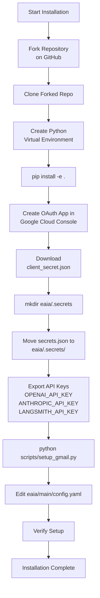
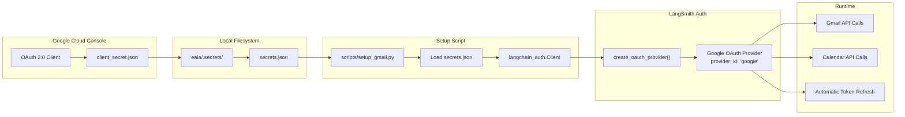
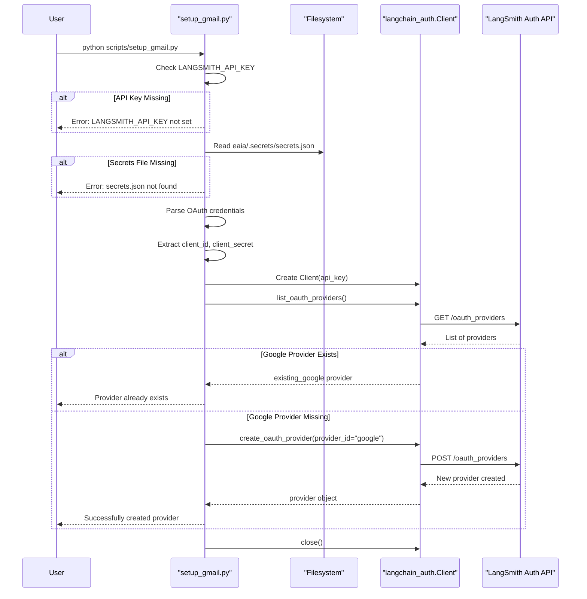
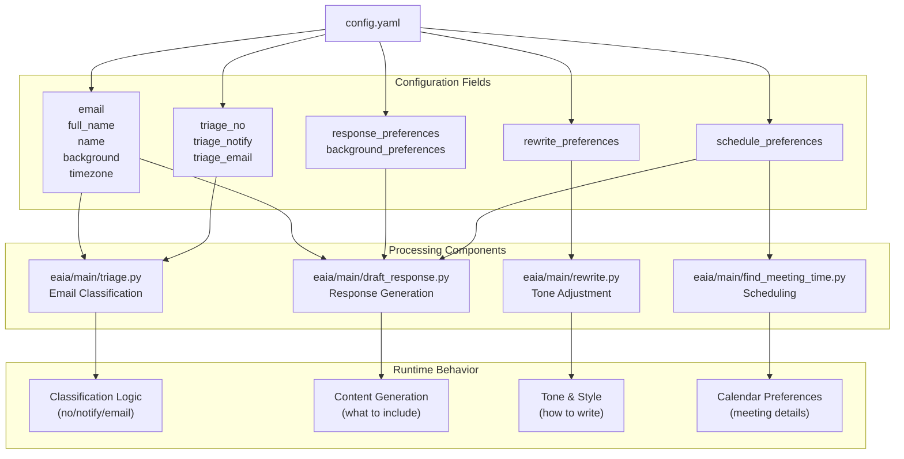

<!-- source: DeepWiki mcp.deepwiki.com · repo langchain-ai/executive-ai-assistant · page 1.1 Installation and Setup · fetched 2026-10-26 -->

# Installation and Setup

<details>
<summary>Relevant source files</summary>

The following files were used as context for generating this wiki page:

- [.env.example](.env.example)
- [README.md](README.md)
- [scripts/setup_gmail.py](scripts/setup_gmail.py)

</details>


This page provides step-by-step instructions for installing and configuring the Executive AI Assistant (EAIA) system. It covers Python environment setup, dependency installation, API key configuration, Google OAuth authentication via `setup_gmail.py`, and user preference customization through `config.yaml`.

For deployment instructions after completing setup, see [Local Development](#6.1) and [LangGraph Platform Deployment](#6.2). For configuration details, see [Email Preferences Configuration](#5.1) and [Environment Variables](#5.2).

## Prerequisites

Before beginning installation, ensure you have:

- Python 3.11 or higher
- A Gmail account (personal or Google Workspace)
- Access to [Google Cloud Console](https://console.cloud.google.com)
- A LangSmith account with API access
- OpenAI and Anthropic API accounts

**Important**: You must fork the repository before cloning, as deployment to LangGraph Platform requires your own repository [README.md:27]().

## Installation Workflow



**Sources**: [README.md:23-65]()

## Step 1: Repository and Environment Setup

### 1.1 Fork and Clone Repository

Fork the repository at https://github.com/langchain-ai/executive-ai-assistant to your GitHub account, then clone your fork:

```bash
git clone https://github.com/YOUR_USERNAME/executive-ai-assistant.git
cd executive-ai-assistant
```

**Sources**: [README.md:27]()

### 1.2 Create Python Virtual Environment

Create and activate a Python virtual environment. The system requires Python 3.11 or higher:

```bash
pyenv virtualenv 3.11.1 eaia
pyenv activate eaia
```

Alternatively, use `venv`:

```bash
python3.11 -m venv eaia-env
source eaia-env/bin/activate  # On Windows: eaia-env\Scripts\activate
```

**Sources**: [README.md:28]()

### 1.3 Install Dependencies

Install the package and all dependencies in editable mode:

```bash
pip install -e .
```

This command installs all dependencies specified in `pyproject.toml`, including:
- `langgraph` - StateGraph orchestration
- `langchain` - LLM abstractions
- `langchain-openai` and `langchain-anthropic` - LLM providers
- `langchain-auth` - OAuth management
- `google-api-python-client` - Gmail and Calendar APIs

**Sources**: [README.md:29]()

## Step 2: Google OAuth Configuration

### 2.1 OAuth Setup Architecture



**Sources**: [README.md:35-48](), [scripts/setup_gmail.py:1-90]()

### 2.2 Enable Gmail API

1. Navigate to [Google Cloud Console](https://console.cloud.google.com)
2. Create a new project or select an existing project
3. Go to [Gmail API Quickstart](https://developers.google.com/gmail/api/quickstart/python#enable_the_api)
4. Click "Enable the API" to activate Gmail API for your project

**Sources**: [README.md:36-37]()

### 2.3 Create OAuth Credentials

1. In Google Cloud Console, navigate to "APIs & Services" > "Credentials"
2. Click "Create Credentials" > "OAuth client ID"
3. Configure OAuth consent screen:
   - **For personal Gmail accounts**: Select "External" as User Type
   - **For Google Workspace accounts**: Select "Internal" as User Type
4. Add your email as a test user (required for "External" type)
5. Configure application type as "Desktop application"
6. Download the credentials JSON file

**Important**: Personal (non-Workspace) Gmail accounts must use "External" User Type and add the account email as a test user to avoid "App has not completed verification" errors [README.md:40]().

**Sources**: [README.md:38-41]()

### 2.4 Store OAuth Secrets

Create the secrets directory and move the downloaded credentials file:

```bash
mkdir -p eaia/.secrets
mv ~/Downloads/client_secret_*.json eaia/.secrets/secrets.json
```

The `setup_gmail.py` script expects the secrets file at this exact location [scripts/setup_gmail.py:22-23]().

**Sources**: [README.md:43-44](), [scripts/setup_gmail.py:22-31]()

## Step 3: API Keys and Environment Variables

### 3.1 Required Environment Variables

The following environment variables must be set before running the setup script:

| Variable | Purpose | Where to Obtain |
|----------|---------|-----------------|
| `LANGSMITH_API_KEY` | LangSmith authentication and OAuth provider management | [LangSmith Settings](https://smith.langchain.com/settings) |
| `OPENAI_API_KEY` | OpenAI API access (GPT-4o, o1 models) | [OpenAI API Keys](https://platform.openai.com/api-keys) |
| `ANTHROPIC_API_KEY` | Anthropic API access (Claude models) | [Anthropic Console](https://console.anthropic.com) |

**Sources**: [README.md:33-34](), [.env.example:1-5]()

### 3.2 Export Environment Variables

Export the API keys in your shell:

```bash
export LANGSMITH_API_KEY="your_langsmith_key"
export OPENAI_API_KEY="your_openai_key"
export ANTHROPIC_API_KEY="your_anthropic_key"
```

For persistent configuration, add these to your shell profile (`.bashrc`, `.zshrc`, etc.) or create a `.env` file using `.env.example` as a template.

**Note**: `GMAIL_TOKEN` and `GMAIL_SECRET` shown in `.env.example` are legacy variables no longer required, as OAuth is now managed by LangSmith Auth [.env.example:3-4]().

**Sources**: [.env.example:1-5](), [README.md:33-34]()

## Step 4: Run OAuth Setup Script

### 4.1 Setup Script Execution

Execute the OAuth setup script to create the Google OAuth provider in LangSmith Auth:

```bash
python scripts/setup_gmail.py
```

**Sources**: [README.md:45](), [scripts/setup_gmail.py:1-90]()

### 4.2 Setup Script Flow



**Sources**: [scripts/setup_gmail.py:13-84]()

### 4.3 What the Script Does

The `setup_gmail.py` script performs the following operations [scripts/setup_gmail.py:13-84]():

1. **Validates Environment** [scripts/setup_gmail.py:17-19]()
   - Checks for `LANGSMITH_API_KEY` environment variable
   - Raises `ValueError` if missing

2. **Loads OAuth Secrets** [scripts/setup_gmail.py:22-46]()
   - Reads `eaia/.secrets/secrets.json`
   - Parses JSON structure (supports both "web" and "installed" types)
   - Extracts `client_id` and `client_secret`

3. **Creates LangSmith Auth Client** [scripts/setup_gmail.py:49]()
   - Initializes `langchain_auth.Client` with API key

4. **Checks for Existing Provider** [scripts/setup_gmail.py:53-62]()
   - Lists existing OAuth providers
   - Searches for provider with `provider_id="google"`
   - If found, exits successfully

5. **Creates Google OAuth Provider** [scripts/setup_gmail.py:66-73]()
   - Calls `create_oauth_provider()` with:
     - `provider_id="google"`
     - `name="Google"`
     - `client_id` and `client_secret` from secrets file
     - `auth_url="https://accounts.google.com/o/oauth2/auth"`
     - `token_url="https://oauth2.googleapis.com/token"`

6. **Persists Configuration** [scripts/setup_gmail.py:75-76]()
   - Provider configuration stored in LangSmith Auth
   - No local credential storage required
   - Tokens automatically refreshed at runtime

**Sources**: [scripts/setup_gmail.py:13-84]()

### 4.4 OAuth Provider Usage

Once created, the OAuth provider is automatically used throughout the system:

- **Token Management**: LangSmith Auth handles token refresh automatically
- **Runtime Authentication**: Gmail and Calendar API calls use the provider for authentication
- **No Manual Token Handling**: Application code does not manage credentials directly

For details on how Gmail and Calendar APIs use this OAuth provider, see [Gmail and Calendar APIs](#7.1).

**Sources**: [README.md:47](), [scripts/setup_gmail.py:1-4]()

## Step 5: Configuration File Setup

### 5.1 Configuration File Location

The main configuration file is located at `eaia/main/config.yaml`. This file defines user-specific preferences and behavior rules for email processing [README.md:51]().

### 5.2 Required Configuration Keys

Every key in `config.yaml` is required. The following table describes each configuration field:

| Field | Type | Description |
|-------|------|-------------|
| `email` | string | Email address to monitor and send from (must match OAuth credentials) |
| `full_name` | string | User's complete name |
| `name` | string | User's first name |
| `background` | string | Basic information about the user |
| `timezone` | string | Default timezone (e.g., "America/New_York") |
| `schedule_preferences` | string | Calendar meeting preferences (length, naming, etc.) |
| `background_preferences` | string | Background information for email responses (coworkers to loop in, etc.) |
| `response_preferences` | string | Preferences for email content (whether to send Calendly links, etc.) |
| `rewrite_preferences` | string | Tone and style preferences for emails |
| `triage_no` | string | Guidelines for emails to ignore |
| `triage_notify` | string | Guidelines for emails requiring notification only (no draft) |
| `triage_email` | string | Guidelines for emails requiring drafted responses |

**Sources**: [README.md:51-64]()

### 5.3 Configuration Usage in System



**Sources**: [README.md:51-64]()

For detailed configuration guidance, see [Email Preferences Configuration](#5.1).

## Step 6: Verification

### 6.1 Verify Python Environment

Confirm Python version and package installation:

```bash
python --version  # Should show 3.11+
pip list | grep langgraph  # Should show langgraph package
pip list | grep langchain-auth  # Should show langchain-auth package
```

### 6.2 Verify OAuth Provider

Test OAuth provider creation by running the setup script again:

```bash
python scripts/setup_gmail.py
```

Expected output [scripts/setup_gmail.py:58-59]():
```
Google OAuth provider already exists: <provider details>
Setup complete! You can now use the executive assistant.
```

### 6.3 Verify Configuration File

Check that `config.yaml` exists and contains all required keys:

```bash
python -c "import yaml; config = yaml.safe_load(open('eaia/main/config.yaml')); print('Keys:', list(config.keys()))"
```

### 6.4 Next Steps

After completing installation and setup:

1. **Local Development**: Run `langgraph dev` to start the local development server. See [Local Development](#6.1) for instructions.
2. **Manual Email Ingestion**: Execute `run_ingest.py` to fetch and process emails. See [Email Ingestion](#2.1) for details.
3. **Agent Inbox Integration**: Connect Agent Inbox to interact with processed emails. See [Agent Inbox Integration](#3.1) for configuration.
4. **Production Deployment**: Deploy to LangGraph Platform for continuous operation. See [LangGraph Platform Deployment](#6.2) for instructions.

**Sources**: [README.md:66-76](), [README.md:106-160]()

## Common Setup Issues

### Issue: "App has not completed verification" Error

**Cause**: Using "External" OAuth consent screen without adding test users.

**Solution**: In Google Cloud Console, navigate to "APIs & Services" > "OAuth consent screen" > "Test users" and add your Gmail address [README.md:40]().

### Issue: setup_gmail.py Cannot Find secrets.json

**Cause**: Client secret file not placed in correct location.

**Solution**: Ensure file is at `eaia/.secrets/secrets.json` (not `eaia/.secrets/client_secret.json` or any other name) [scripts/setup_gmail.py:22-23]().

### Issue: LANGSMITH_API_KEY Error

**Cause**: Environment variable not set.

**Solution**: Export the variable before running setup script [scripts/setup_gmail.py:17-19]():
```bash
export LANGSMITH_API_KEY="your_key_here"
python scripts/setup_gmail.py
```

### Issue: Invalid Google Client Secrets Format

**Cause**: Client secrets JSON file is malformed or not from Google Cloud Console.

**Solution**: Re-download credentials from Google Cloud Console, ensuring you select "Desktop application" type [scripts/setup_gmail.py:38-43]().

**Sources**: [README.md:40](), [scripts/setup_gmail.py:17-43]()

---

**Sources**: [README.md:23-65](), [scripts/setup_gmail.py:1-90](), [.env.example:1-5]()

---

