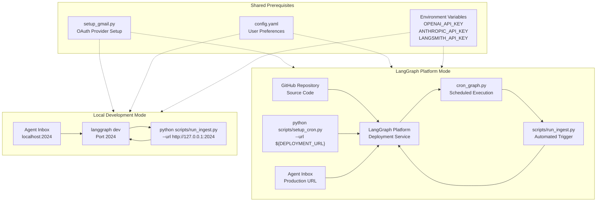
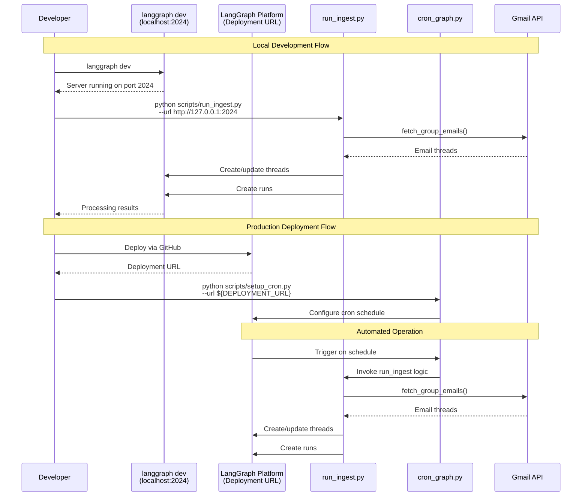
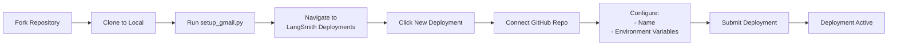
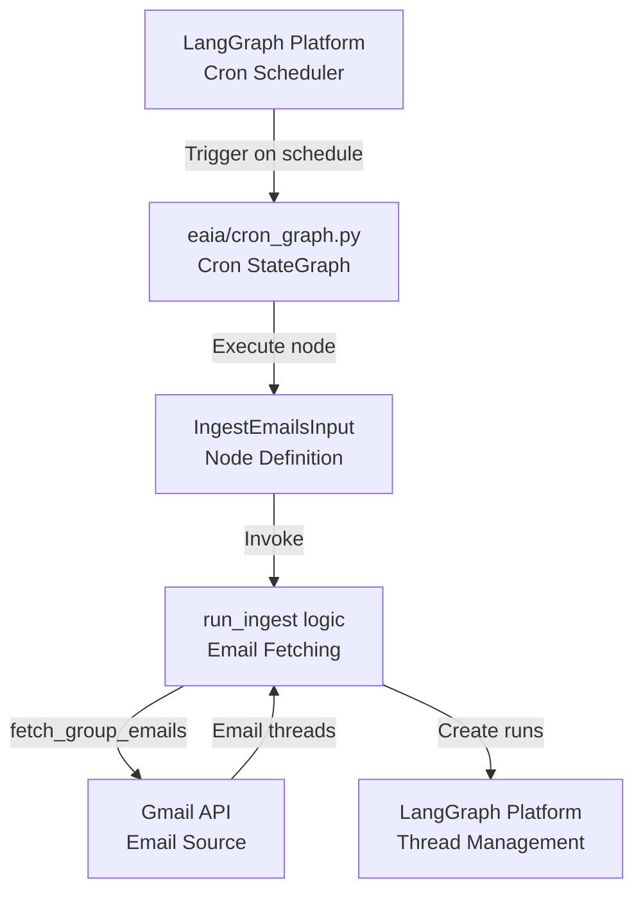
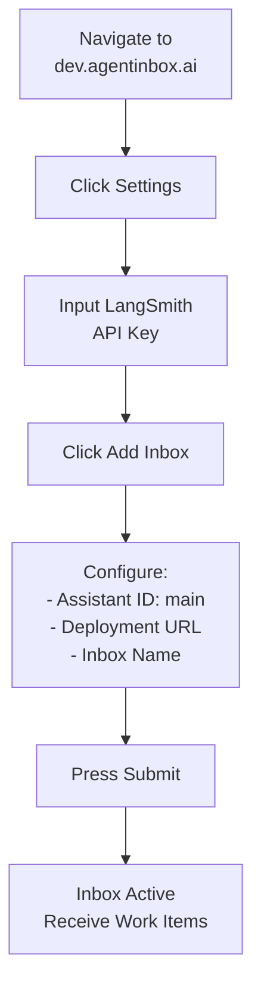

<!-- source: DeepWiki mcp.deepwiki.com · repo langchain-ai/executive-ai-assistant · page 6 Deployment · fetched 2026-10-26 -->

# Deployment

<details>
<summary>Relevant source files</summary>

The following files were used as context for generating this wiki page:

- [README.md](README.md)

</details>


This document provides an overview of deploying the Executive AI Assistant (EAIA) system, covering both local development and production deployment options. EAIA can run either as a local development server for testing and iteration, or as a production deployment on LangGraph Platform for continuous email processing. The deployment architecture is designed to support both manual and automated email ingestion workflows.

For detailed configuration of environment variables and credentials, see [Environment Variables](#5.2). For the initial OAuth setup required before any deployment, see [Installation and Setup](#1.1).

## Deployment Architecture

The EAIA deployment architecture supports two distinct operational modes: local development for testing and iteration, and production deployment on LangGraph Platform for continuous operation. Both modes share common setup requirements but differ in their execution and automation capabilities.

### Deployment Model Comparison



**Deployment Mode Characteristics**

| Aspect | Local Development | LangGraph Platform |
|--------|------------------|-------------------|
| **Server** | `langgraph dev` (port 2024) | LangGraph Platform managed service |
| **Ingestion** | Manual via `run_ingest.py` | Automated via `cron_graph.py` |
| **URL** | `http://127.0.0.1:2024` | Deployment-specific URL |
| **Environment** | Local machine | Cloud-hosted |
| **Use Case** | Testing, debugging, development | Production email processing |
| **Availability** | On-demand (developer starts/stops) | Continuous (always running) |
| **Requirements** | `langgraph-cli[inmem]` package | LangSmith Plus account |

**Sources:** [README.md:66-160]()

### Ingestion Flow Across Deployment Modes



The key architectural difference between deployment modes is the ingestion trigger mechanism. Local development requires manual invocation of [scripts/run_ingest.py]() while production deployment uses [eaia/cron_graph.py]() as a scheduled LangGraph cron job that automatically invokes the ingestion logic at regular intervals.

**Sources:** [README.md:66-160](), Diagram 3 (Deployment and Execution Models)

## Common Prerequisites

All deployment modes share common setup requirements that must be completed before the system can operate. These prerequisites establish authentication, configuration, and dependency foundations.

### Dependency Installation

EAIA requires Python 3.11.1 or later and uses standard Python package management:

```bash
# Create and activate virtual environment
pyenv virtualenv 3.11.1 eaia
pyenv activate eaia

# Install package and dependencies
pip install -e .
```

The [pyproject.toml]() file defines all dependencies including `langgraph`, `langchain`, LLM provider SDKs (`openai`, `anthropic`), and Google API clients. The `-e` flag installs the package in editable mode for development.

**Sources:** [README.md:23-29]()

### OAuth Provider Setup

Before any deployment can access Gmail, the OAuth provider must be created using [scripts/setup_gmail.py](). This one-time setup establishes the LangChain Auth provider that manages token storage and refresh:

```bash
# Download OAuth credentials from Google Cloud Console
# Move to secrets directory
mkdir eaia/.secrets
mv ${PATH_TO_CLIENT_SECRET.JSON} eaia/.secrets/secrets.json

# Create OAuth provider
python scripts/setup_gmail.py
```

The setup script creates a Google OAuth provider in LangSmith Auth. This provider handles authentication tokens centrally, eliminating the need to manage `token.pickle` files manually. Both local and production deployments use this same OAuth provider.

**Important:** For personal Gmail accounts (non-Google Workspace), select "External" as the User Type in the OAuth consent screen and add your email as a test user in Google Cloud Console to avoid verification errors.

**Sources:** [README.md:31-47]()

### Configuration File

The [eaia/main/config.yaml]() file contains user-specific preferences that guide EAIA behavior. This configuration is required in all deployment modes:

```yaml
email: "user@example.com"
full_name: "Full Name"
name: "First"
background: "Basic user information"
timezone: "America/New_York"
schedule_preferences: "Meeting length, naming conventions"
background_preferences: "Coworkers, context information"
response_preferences: "Calendly links, signature style"
rewrite_preferences: "Tone, formality level"
triage_no: "Guidelines for ignored emails"
triage_notify: "Guidelines for notifications only"
triage_email: "Guidelines for drafted responses"
```

All fields are required. The configuration file is read at runtime and affects triage classification, response generation, and tone adjustment.

**Sources:** [README.md:49-64]()

### Environment Variables

Three API keys must be provided as environment variables in all deployment modes:

| Variable | Purpose | Required |
|----------|---------|----------|
| `OPENAI_API_KEY` | OpenAI API access (gpt-4o, o1) | Yes |
| `ANTHROPIC_API_KEY` | Anthropic API access (claude-3-5-sonnet) | Yes |
| `LANGSMITH_API_KEY` | LangSmith tracing and OAuth provider | Yes |

For local development, export these in your shell. For LangGraph Platform deployment, configure them in the deployment settings. See [Environment Variables](#5.2) for detailed configuration.

**Sources:** [README.md:33-34](), [README.md:119-121]()

## Deployment Modes

EAIA supports two deployment modes with different operational characteristics and use cases.

### Local Development

For detailed instructions on local development setup, see [Local Development](#6.1).

Local development mode runs EAIA on the developer's machine using the `langgraph dev` command. This mode is designed for:

- Testing configuration changes
- Debugging processing logic
- Developing new features
- Validating email handling before production deployment

The local development server listens on port 2024 by default and provides the same API as production deployments, enabling consistent testing.

**Key Commands:**

```bash
# Install development server (one-time)
pip install -U "langgraph-cli[inmem]"

# Start development server
langgraph dev

# Manually ingest emails (in separate terminal)
python scripts/run_ingest.py --minutes-since 120 --rerun 1 --early 0
```

The development server must remain running to process emails. Email ingestion is triggered manually by executing [scripts/run_ingest.py]() with the `--url http://127.0.0.1:2024` parameter (defaulted when URL is not specified).

**Sources:** [README.md:66-89]()

### LangGraph Platform Production

For detailed instructions on production deployment, see [LangGraph Platform Deployment](#6.2).

LangGraph Platform provides managed hosting for EAIA, enabling continuous operation without requiring a developer's machine to stay running. This mode is designed for:

- Production email processing
- Automated scheduled ingestion
- Always-available email assistant
- Team or organizational deployments

**Requirements:**

- LangSmith Plus account (provides access to LangGraph Platform)
- GitHub repository (forked from source repository)
- OAuth provider already created via `setup_gmail.py`

**Deployment Process:**



The deployment process connects the GitHub repository to LangGraph Platform, which automatically builds and hosts the EAIA graph. Environment variables (`OPENAI_API_KEY`, `ANTHROPIC_API_KEY`) are configured through the deployment settings interface.

**Sources:** [README.md:106-123]()

## Ingestion Execution

Email ingestion can be triggered either manually or automatically depending on the deployment mode and operational requirements.

### Manual Ingestion

For all deployment modes, emails can be ingested manually using [scripts/run_ingest.py](). This script provides flexible control over ingestion parameters:

```bash
python scripts/run_ingest.py \
  --minutes-since 120 \
  --rerun 1 \
  --early 0 \
  --url ${DEPLOYMENT_URL}
```

**Parameters:**

| Parameter | Description | Default |
|-----------|-------------|---------|
| `--minutes-since` | Fetch emails from last N minutes | 30 |
| `--rerun` | Reprocess previously seen emails (1=yes, 0=no) | 0 |
| `--early` | Stop if already-seen email encountered (1=yes, 0=no) | 1 |
| `--url` | Target deployment URL | http://127.0.0.1:2024 |

For local development, the `--url` parameter defaults to `http://127.0.0.1:2024`. For production, specify the LangGraph Platform deployment URL.

The script uses [eaia/gmail.py:fetch_group_emails()]() to retrieve emails, generates deterministic thread IDs via MD5 hashing, and creates or updates LangGraph threads for each email.

**Sources:** [README.md:77-89](), [README.md:124-137]()

### Automated Ingestion via Cron

For production deployments, automated email processing is enabled through LangGraph Platform's cron functionality. See [Automated Email Processing](#6.3) for detailed information.

The [scripts/setup_cron.py]() script configures a scheduled job:

```bash
python scripts/setup_cron.py --url ${DEPLOYMENT_URL}
```

This creates a cron job that invokes [eaia/cron_graph.py]() on a defined schedule. The cron graph internally calls the ingestion logic to check for new emails, maintaining continuous email monitoring without manual intervention.

**Cron Architecture:**



The cron setup is specific to production deployments on LangGraph Platform. Local development requires manual ingestion triggering.

**Sources:** [README.md:152-159](), Diagram 3 (Deployment and Execution Models)

## Agent Inbox Connection

Agent Inbox (https://dev.agentinbox.ai) provides the human-in-the-loop interface for reviewing and approving EAIA's work. The inbox must be configured to point to the appropriate deployment.

### Configuration Parameters

Agent Inbox requires three configuration parameters for each inbox:

| Parameter | Value for Local | Value for Production |
|-----------|----------------|---------------------|
| **Assistant/Graph ID** | `main` | `main` |
| **Deployment URL** | `http://127.0.0.1:2024` | Deployment-specific URL |
| **LangSmith API Key** | User's API key | User's API key |

### Setup Process



The LangSmith API key authenticates the inbox connection. The Assistant/Graph ID must be `main` (matching the graph defined in [eaia/main/graph.py]()). The Deployment URL determines which EAIA instance the inbox monitors.

Multiple inboxes can be configured, enabling developers to monitor both local and production deployments simultaneously with different inbox names (e.g., "Local EAIA" and "Prod EAIA").

**Sources:** [README.md:90-104](), [README.md:139-150]()

## Deployment Verification

After completing deployment, verify proper operation by triggering ingestion and checking for results in Agent Inbox.

### Verification Checklist

1. **OAuth Verification**: Ensure `setup_gmail.py` completed successfully and OAuth provider exists in LangSmith
2. **Server Running**: Confirm `langgraph dev` (local) or deployment status (production) shows active
3. **Ingestion Test**: Run `run_ingest.py` with appropriate URL and verify no errors
4. **Thread Creation**: Check LangGraph Platform UI for created threads corresponding to emails
5. **Agent Inbox**: Verify work items appear in Agent Inbox for human review
6. **Email Operations**: Test accepting a draft to confirm Gmail API send functionality

### Common Issues

| Issue | Likely Cause | Solution |
|-------|-------------|----------|
| "Authentication failed" | OAuth provider not created | Run `setup_gmail.py` |
| "No emails found" | `--minutes-since` too short | Increase time window |
| "Connection refused" | Server not running | Start `langgraph dev` or verify deployment |
| "Inbox not receiving work" | Wrong Assistant ID or URL | Verify `main` ID and correct deployment URL |
| "Missing API key" | Environment variables not set | Export required API keys |

For local development, the LangGraph Studio interface (automatically opened by `langgraph dev`) provides real-time visibility into graph execution, state, and errors.

**Sources:** [README.md:66-160]()

## Next Steps

After successful deployment:

- **For local development**: Proceed to [Agent Inbox Integration](#3.1) to learn about reviewing agent work
- **For production deployment**: Configure [Automated Email Processing](#6.3) to enable continuous operation
- **For customization**: See [Configuration](#5) and [Customization](#8) to tailor EAIA behavior

The deployment architecture enables rapid iteration in local mode and reliable continuous operation in production mode, with consistent behavior across both environments ensured by shared configuration and OAuth setup.

**Sources:** [README.md:1-179](), Diagram 3 (Deployment and Execution Models)

---

