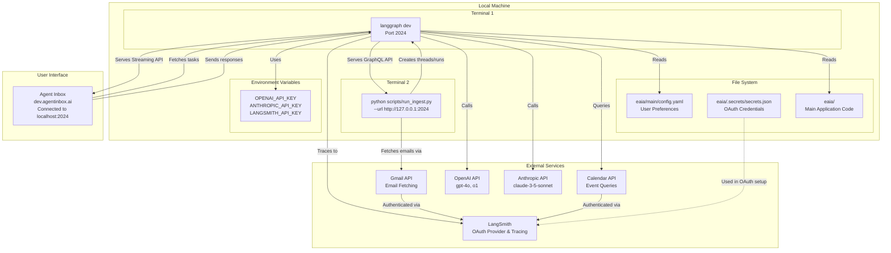
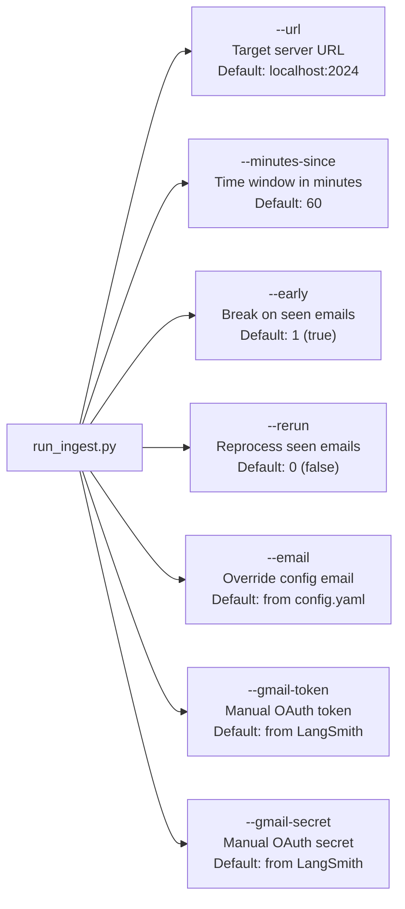
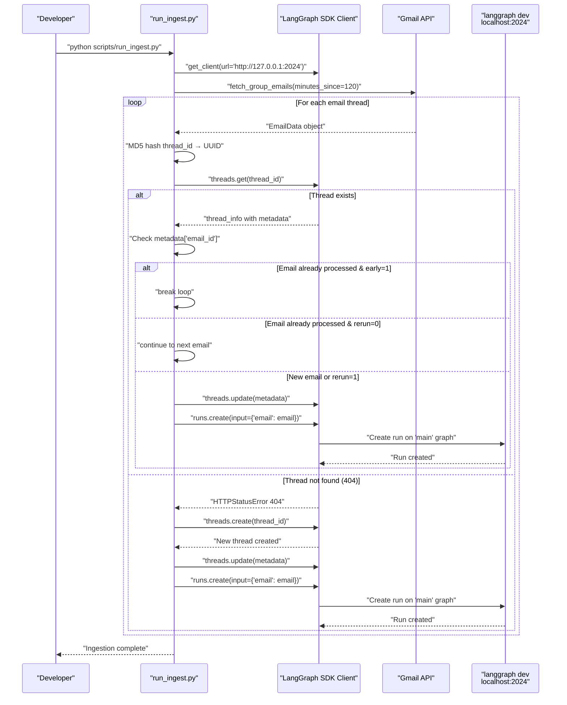
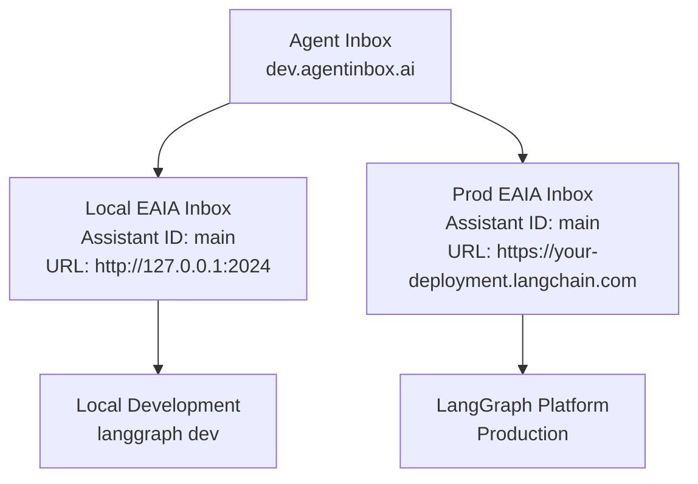
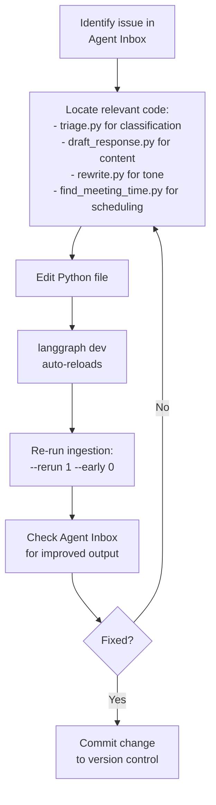

<!-- source: DeepWiki mcp.deepwiki.com · repo langchain-ai/executive-ai-assistant · page 6.1 Local Development · fetched 2026-10-26 -->

# Local Development

<details>
<summary>Relevant source files</summary>

The following files were used as context for generating this wiki page:

- [README.md](README.md)
- [scripts/run_ingest.py](scripts/run_ingest.py)

</details>


This document explains how to run the Executive AI Assistant (EAIA) locally for development and testing purposes. Local development uses the `langgraph dev` command to run a development server on `localhost:2024`, enabling rapid iteration without deploying to production.

For initial installation and credential setup, see [Installation and Setup](#1.1). For production deployment to LangGraph Platform, see [LangGraph Platform Deployment](#6.2).

---

## Overview

Local development mode provides a complete EAIA environment running on your local machine. This configuration is ideal for:

- Testing configuration changes in `config.yaml` before deployment
- Debugging processing logic in individual components
- Validating OAuth authentication setup
- Experimenting with prompt modifications
- Testing email ingestion without affecting production threads

The local environment mirrors production architecture but operates on `http://127.0.0.1:2024` instead of a deployed URL.

**Sources:** [README.md:66-105]()

---

## Local Development Architecture



**Diagram: Local Development Environment**

This architecture shows the complete local development setup. The `langgraph dev` server runs on port 2024, serving both the GraphQL API (for `run_ingest.py`) and the streaming API (for Agent Inbox). The server reads configuration from `config.yaml` and application code from the `eaia/` package, while environment variables provide API keys for external services.

**Sources:** [README.md:66-105](), [scripts/run_ingest.py:21-30]()

---

## Prerequisites

Before starting local development, complete the following setup steps:

| Requirement | Description | Reference |
|------------|-------------|-----------|
| Python Environment | Python 3.11+ with virtualenv activated | [README.md:28-29]() |
| Package Installation | Run `pip install -e .` to install dependencies | [README.md:29]() |
| API Keys | Export `OPENAI_API_KEY`, `ANTHROPIC_API_KEY`, `LANGSMITH_API_KEY` | [README.md:33-34]() |
| OAuth Setup | Run `python scripts/setup_gmail.py` to create OAuth provider | [README.md:45]() |
| Configuration | Customize `eaia/main/config.yaml` with your preferences | [README.md:49-64]() |

The OAuth setup is critical: it creates a Google OAuth provider in LangSmith Auth that handles token storage and automatic refresh. Without this, the local server cannot access Gmail or Calendar APIs.

**Sources:** [README.md:23-48]()

---

## Starting the Development Server

### Installation

Install the LangGraph CLI with in-memory storage support:

```bash
pip install -U "langgraph-cli[inmem]"
```

The `inmem` extra provides an in-memory store implementation suitable for development, avoiding the need for external databases.

**Sources:** [README.md:74]()

### Running the Server

Start the development server:

```bash
langgraph dev
```

This command:
1. Reads `langgraph.json` in the repository root to determine the graph configuration
2. Loads the `main` graph from `eaia/main/graph.py`
3. Starts a development server on `http://127.0.0.1:2024`
4. Enables hot-reloading for code changes
5. Provides a web UI for inspecting threads and runs

The server remains running and logs all graph executions to the console. Leave this terminal open while developing.

**Sources:** [README.md:75]()

### Server Capabilities

The `langgraph dev` server provides:

| Capability | Description |
|-----------|-------------|
| **GraphQL API** | Endpoint at `/graphql` for creating threads and runs |
| **Streaming API** | WebSocket endpoint for real-time state updates |
| **Web UI** | Browser interface at `http://127.0.0.1:2024` for debugging |
| **BaseStore Access** | In-memory store for prompts and email history |
| **Hot Reloading** | Automatic reload when Python files change |

**Sources:** [README.md:74-75]()

---

## Manual Email Ingestion

### Basic Usage

Open a second terminal window (keeping `langgraph dev` running in the first). Activate your virtual environment and run:

```bash
python scripts/run_ingest.py --minutes-since 120 --rerun 1 --early 0
```

This command fetches and processes emails from the configured Gmail account.

**Sources:** [README.md:77-88]()

### run_ingest.py Parameters



**Diagram: run_ingest.py Command-Line Parameters**

**Sources:** [scripts/run_ingest.py:78-121]()

### Parameter Details

| Parameter | Type | Description | Local Development Usage |
|-----------|------|-------------|------------------------|
| `--url` | `str` | Target server URL. Omit for local development. | Defaults to `http://127.0.0.1:2024` when `None` |
| `--minutes-since` | `int` | Fetch emails from the last N minutes | Use `120` or higher for testing to ensure emails are found |
| `--early` | `int` | Break when encountering a previously seen email | Set to `0` for development to process all emails in window |
| `--rerun` | `int` | Reprocess emails even if already seen | Set to `1` for development to re-test processing logic |
| `--email` | `str` | Override the email address from config.yaml | Rarely needed; defaults to config value |
| `--gmail-token` | `str` | Manually provide Gmail OAuth token | Not needed with LangSmith Auth setup |
| `--gmail-secret` | `str` | Manually provide Gmail OAuth credentials | Not needed with LangSmith Auth setup |

**Sources:** [scripts/run_ingest.py:78-121]()

### Ingestion Workflow



**Diagram: Local Email Ingestion Sequence**

**Sources:** [scripts/run_ingest.py:12-76]()

### Thread ID Generation

The script converts Gmail's `thread_id` to a deterministic UUID:

```python
thread_id = str(
    uuid.UUID(hex=hashlib.md5(email["thread_id"].encode("UTF-8")).hexdigest())
)
```

This ensures the same Gmail thread always maps to the same LangGraph thread, enabling state continuity across multiple emails in a conversation.

**Sources:** [scripts/run_ingest.py:44-46]()

### Email Deduplication

The script uses thread metadata to track processed emails:

1. Retrieve thread: `await client.threads.get(thread_id)` [scripts/run_ingest.py:48]()
2. Check last processed email: `thread_info["metadata"].get("email_id")` [scripts/run_ingest.py:59]()
3. Compare with current email ID: `recent_email == email["id"]` [scripts/run_ingest.py:60]()
4. Update metadata: `await client.threads.update(thread_id, metadata={"email_id": email["id"]})` [scripts/run_ingest.py:68]()

The `--early` and `--rerun` flags control behavior when duplicates are found.

**Sources:** [scripts/run_ingest.py:48-68]()

---

## Agent Inbox Integration

Agent Inbox provides a web interface for reviewing and responding to EAIA's work. Configure it to connect to your local development server:

### Configuration Steps

1. Navigate to [https://dev.agentinbox.ai/](https://dev.agentinbox.ai)
2. Click **Settings** in the navigation menu
3. Enter your **LangSmith API Key** (required for authentication)
4. Click **Add Inbox**
5. Configure the inbox connection:

| Field | Value | Description |
|-------|-------|-------------|
| **Assistant/Graph ID** | `main` | The graph name from `langgraph.json` |
| **Deployment URL** | `http://127.0.0.1:2024` | Local development server URL |
| **Name** | `Local EAIA` | Display name for this inbox |

6. Click **Submit** to save the configuration

**Sources:** [README.md:90-103]()

### Inbox Functionality

Once connected, Agent Inbox displays:

- **Email drafts** created by `draft_response.py` and `rewrite.py`
- **Notifications** from emails classified as "notify" by `triage.py`
- **Calendar invites** generated by `find_meeting_time.py`
- **Questions** where EAIA needs user input

Users can:
- **Accept** work to send emails or calendar invites
- **Edit** drafts to provide corrections (triggers reflection learning)
- **Respond** with instructions or feedback (triggers reflection learning)
- **Ignore** work to mark as complete without action

**Sources:** [README.md:104]()

### Local vs. Production Inbox

The same Agent Inbox account can manage multiple inboxes. Create separate configurations for local and production deployments:



**Diagram: Multiple Inbox Configuration**

Switch between inboxes using the dropdown menu in Agent Inbox.

**Sources:** [README.md:90-103](), [README.md:139-150]()

---

## Development Workflow

### Typical Development Cycle

1. **Start the server** in Terminal 1:
   ```bash
   langgraph dev
   ```

2. **Ingest test emails** in Terminal 2:
   ```bash
   python scripts/run_ingest.py --minutes-since 120 --rerun 1 --early 0
   ```

3. **Review in Agent Inbox**: Open browser to dev.agentinbox.ai and check for new tasks

4. **Interact with work**: Accept, edit, or respond to test agent behavior

5. **Modify code**: Edit Python files in `eaia/` directory

6. **Test changes**: The server hot-reloads automatically; re-run ingestion to test

7. **Iterate**: Repeat steps 2-6 until satisfied with behavior

**Sources:** [README.md:66-105]()

### Code Modification Workflow



**Diagram: Code Modification Workflow**

**Sources:** [README.md:161-178]()

### Testing Configuration Changes

To test `config.yaml` modifications:

1. Edit `eaia/main/config.yaml` with new preferences
2. Restart `langgraph dev` (configuration is loaded at startup)
3. Re-ingest emails with `--rerun 1` to reprocess with new config
4. Verify behavior changes in Agent Inbox

Configuration changes do **not** hot-reload; server restart is required.

**Sources:** [README.md:49-64]()

---

## Debugging and Observability

### Console Logging

The `langgraph dev` server logs all graph executions to the console, including:

- Node executions and their outputs
- State updates between nodes
- LLM calls and responses
- Tool invocations
- Errors and exceptions

Monitor Terminal 1 while testing to see real-time execution flow.

### LangSmith Tracing

All LLM calls and graph executions are traced to LangSmith (if `LANGSMITH_API_KEY` is set). View traces at [https://smith.langchain.com](https://smith.langchain.com) to:

- Inspect exact prompts sent to LLMs
- Analyze token usage and costs
- Debug structured output parsing
- Examine tool call sequences
- Investigate errors in production-like environment

### Web UI

The development server provides a web UI at `http://127.0.0.1:2024`. Access it to:

- View all threads and their states
- Inspect individual run histories
- Examine state updates across nodes
- Debug interrupted runs (human-in-the-loop points)

---

## Common Development Scenarios

### Scenario: Testing Triage Classification

**Goal:** Verify emails are classified correctly (no/notify/email)

**Steps:**
1. Modify triage rules in `config.yaml` under `triage_no`, `triage_notify`, `triage_email`
2. Restart `langgraph dev`
3. Run: `python scripts/run_ingest.py --minutes-since 120 --rerun 1 --early 0`
4. Check console logs for triage decisions
5. Verify correct emails appear in Agent Inbox

**Sources:** [README.md:49-64](), [README.md:168-169]()

### Scenario: Testing Draft Generation

**Goal:** Improve email draft quality

**Steps:**
1. Edit `eaia/main/draft_response.py` to modify prompts or tool definitions
2. Server hot-reloads automatically
3. Run: `python scripts/run_ingest.py --minutes-since 120 --rerun 1 --early 0`
4. Review drafts in Agent Inbox
5. Use "Edit" or "Response" actions to provide feedback (triggers reflection)

**Sources:** [README.md:177-178]()

### Scenario: Testing Tone Adjustment

**Goal:** Adjust email tone and style

**Steps:**
1. Modify `rewrite_preferences` in `config.yaml`
2. Restart `langgraph dev`
3. Re-ingest: `python scripts/run_ingest.py --minutes-since 120 --rerun 1 --early 0`
4. Compare tone in Agent Inbox drafts
5. For code-level changes, edit `eaia/main/rewrite.py`

**Sources:** [README.md:61](), [README.md:174-175]()

### Scenario: Testing Calendar Integration

**Goal:** Verify meeting time finding and invite generation

**Steps:**
1. Edit `eaia/main/find_meeting_time.py` for calendar logic changes
2. Server hot-reloads automatically
3. Ingest emails requesting meetings
4. Verify calendar queries in console logs
5. Check meeting invite drafts in Agent Inbox

**Sources:** [README.md:171-172]()

---

## Limitations of Local Development

Local development differs from production in several ways:

| Aspect | Local Development | Production |
|--------|------------------|------------|
| **Email Checking** | Manual via `run_ingest.py` | Automated via cron job |
| **Persistence** | In-memory store (cleared on restart) | Persistent store (retained) |
| **Availability** | Requires developer machine running | Always available |
| **URL Access** | `localhost:2024` only accessible locally | Public URL accessible anywhere |
| **Environment** | Development dependencies included | Production dependencies only |
| **Performance** | Hot-reloading adds overhead | Optimized for performance |

For continuous email monitoring, deploy to LangGraph Platform (see [LangGraph Platform Deployment](#6.2)).

**Sources:** [README.md:68-70](), [README.md:106-159]()

---

## Transitioning to Production

Once local testing is complete, deploy to production:

1. Commit and push code changes to GitHub
2. Follow instructions in [LangGraph Platform Deployment](#6.2)
3. Set up automated ingestion with [Automated Email Processing](#6.3)
4. Configure a production inbox in Agent Inbox pointing to deployment URL

The production environment uses the same code and configuration, ensuring consistency between development and production behavior.

**Sources:** [README.md:106-159]()

---

