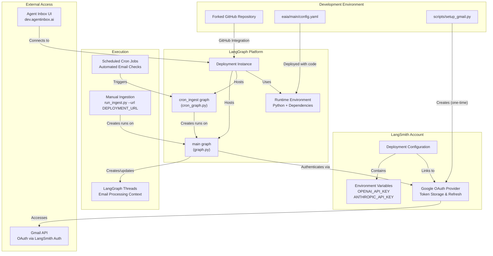
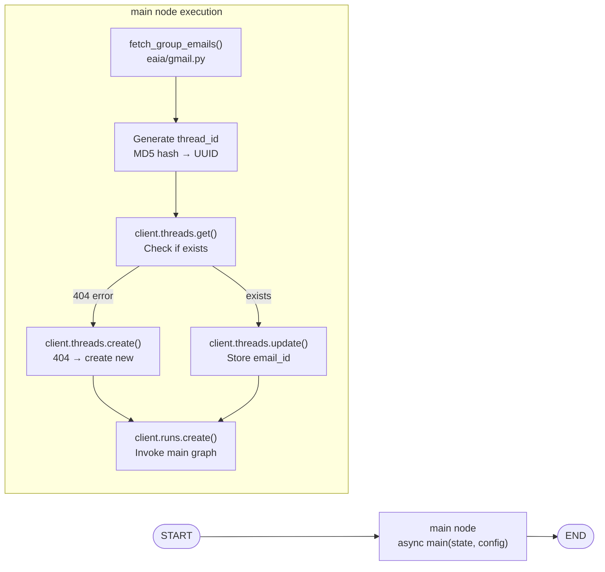

<!-- source: DeepWiki mcp.deepwiki.com · repo langchain-ai/executive-ai-assistant · page 6.2 LangGraph Platform Deployment · fetched 2026-10-26 -->

# LangGraph Platform Deployment

<details>
<summary>Relevant source files</summary>

The following files were used as context for generating this wiki page:

- [README.md](README.md)
- [eaia/cron_graph.py](eaia/cron_graph.py)

</details>


This document covers deploying the Executive AI Assistant (EAIA) to LangGraph Platform for production use. LangGraph Platform is a managed service that hosts LangGraph applications with built-in monitoring, scaling, and persistence. For local development deployment, see [Local Development](#6.1). For configuring automated email processing via cron jobs, see [Automated Email Processing](#6.3).

## Purpose and Scope

LangGraph Platform deployment enables production operation of EAIA with:
- **Continuous availability**: The assistant runs 24/7 without requiring a local machine
- **Managed infrastructure**: LangSmith handles hosting, scaling, and persistence
- **GitHub integration**: Automatic deployment from repository updates
- **LangSmith Auth integration**: OAuth provider configuration is shared across environments
- **Production monitoring**: Full observability through LangSmith tracing

This page documents the deployment process, environment configuration, verification steps, and architectural differences from local development.

**Sources:** [README.md:106-123]()

## Prerequisites

Before deploying to LangGraph Platform, ensure the following requirements are met:

| Requirement | Description | Reference |
|------------|-------------|-----------|
| **LangSmith Plus Account** | Required for LangGraph Platform access | [README.md:109]() |
| **Forked Repository** | Must fork the repository to your own GitHub account for deployment | [README.md:27]() |
| **OAuth Provider Setup** | Must run `python scripts/setup_gmail.py` locally first to create Google OAuth provider | [README.md:114]() |
| **API Keys** | OpenAI and Anthropic API keys for LLM access | See [Environment Variables](#5.2) |
| **Customized Configuration** | `eaia/main/config.yaml` must be configured for your use case | See [Email Preferences Configuration](#5.1) |

**Critical OAuth Setup Note**: The OAuth provider created by `setup_gmail.py` is stored in your LangSmith account and shared across both local and production deployments. This must be completed before deploying to LangGraph Platform.

**Sources:** [README.md:111-122]()

## Deployment Architecture

The following diagram illustrates the deployment architecture on LangGraph Platform:

**Deployment Flow and Runtime Architecture**



**Key Architectural Points:**

1. **GitHub Integration**: LangGraph Platform clones your repository and builds the deployment from the source code, including all Python files and `config.yaml`.

2. **Dual Graph System**: Two graphs are deployed:
   - `main` graph ([eaia/main/graph.py]()):  Handles individual email processing
   - `cron_ingest` graph ([eaia/cron_graph.py:50-54]()): Orchestrates scheduled email ingestion

3. **OAuth Provider Sharing**: The Google OAuth provider created locally via `setup_gmail.py` is stored in LangSmith and automatically available to the deployed instance without re-authentication.

4. **Environment Separation**: Environment variables are configured per-deployment in LangSmith, enabling different API keys or settings between staging and production.

**Sources:** [README.md:111-123](), [eaia/cron_graph.py:1-55]()

## Deployment Process

The deployment process consists of creating a deployment in LangSmith that connects to your GitHub repository:

### Step 1: Navigate to Deployments

1. Log into [LangSmith](https://smith.langchain.com)
2. Navigate to the **Deployments** page
3. Click **New Deployment**

### Step 2: Configure GitHub Integration

The deployment configuration screen requires:

| Field | Value | Notes |
|-------|-------|-------|
| **Repository** | Your forked repository URL | Must be your fork, not the original repo |
| **Branch** | `main` (or your working branch) | Deployment updates automatically on push |
| **Name** | `Executive-AI-Assistant` (or custom name) | Used as the deployment identifier |
| **Git Ref** | Latest commit (auto-detected) | Can be pinned to specific commit |

**Sources:** [README.md:113-118]()

### Step 3: Configure Environment Variables

Add the following environment variables to the deployment:

```
OPENAI_API_KEY=sk-...
ANTHROPIC_API_KEY=sk-ant-...
```

**Note:** `LANGSMITH_API_KEY` is automatically provided by the platform and does not need to be configured manually. The OAuth provider credentials (`GMAIL_TOKEN`, `GMAIL_SECRET`) are also managed automatically through LangSmith Auth.

**Sources:** [README.md:119-121]()

### Step 4: Deploy

1. Click **Submit** to initiate deployment
2. Monitor the build logs for:
   - Dependency installation from `pyproject.toml`
   - Graph compilation and validation
   - Successful deployment confirmation

The deployment process typically completes in 2-3 minutes.

### Step 5: Obtain Deployment URL

After successful deployment, copy the **Deployment URL** from the deployment details page. This URL follows the format:
```
https://[deployment-name]-[org-id].us.langgraph.app
```

This URL is required for:
- Manual ingestion via `run_ingest.py`
- Cron job configuration via `setup_cron.py`
- Agent Inbox connection

**Sources:** [README.md:122-123](), [README.md:128-133]()

## Verification and Testing

After deployment, verify the system is functioning correctly through manual ingestion:

### Manual Ingestion Test

Run the ingestion script targeting your deployment:

```bash
export LANGGRAPH_DEPLOYMENT_URL=https://your-deployment.us.langgraph.app
python scripts/run_ingest.py --minutes-since 120 --rerun 1 --early 0 --url ${LANGGRAPH_DEPLOYMENT_URL}
```

**Parameter Explanation:**

| Parameter | Value | Purpose |
|-----------|-------|---------|
| `--minutes-since` | `120` | Fetch emails from last 120 minutes |
| `--rerun` | `1` | Process emails even if already seen |
| `--early` | `0` | Don't stop early on duplicate emails |
| `--url` | Deployment URL | Target production instead of localhost |

The script will:
1. Fetch emails from Gmail API using OAuth provider
2. Create or update LangGraph threads using deterministic thread IDs
3. Create runs on the `main` graph for each email
4. Output progress and any errors

**Expected Output:**
```
Fetching emails from last 120 minutes...
Found 5 email threads
Creating thread abc123...
Starting run for email xyz789...
Successfully processed 5 emails
```

**Sources:** [README.md:124-137]()

### Connect Agent Inbox to Production

To interact with processed emails:

1. Navigate to [Agent Inbox](https://dev.agentinbox.ai)
2. Click **Settings** → **Add Inbox**
3. Configure the inbox:
   - **Assistant/Graph ID**: `main`
   - **Deployment URL**: Your deployment URL
   - **Name**: `Prod EAIA` (or custom name)
   - **LangSmith API Key**: Your LangSmith API key (if not already configured)
4. Click **Submit**

Agent Inbox will now display all human-in-the-loop interrupts from your production deployment, allowing you to review and approve email drafts, respond to questions, and provide feedback.

**Sources:** [README.md:139-150]()

## Deployment Internals: Cron Graph

The `cron_ingest` graph handles automated email ingestion in production. Understanding its structure helps troubleshoot deployment issues:

**Cron Graph State Flow**



**Code Reference:** [eaia/cron_graph.py:17-48]()

**Key Implementation Details:**

1. **State Schema**: The graph uses `JobKickoff` TypedDict with single field `minutes_since` [eaia/cron_graph.py:13-14]()

2. **Deterministic Thread IDs**: Thread IDs are generated by MD5 hashing the Gmail thread ID and converting to UUID [eaia/cron_graph.py:22-24]():
   ```python
   thread_id = str(uuid.UUID(hex=hashlib.md5(email["thread_id"].encode("UTF-8")).hexdigest()))
   ```

3. **Deduplication Logic**: The graph checks `thread_info["metadata"].get("email_id")` against the current email ID to avoid reprocessing [eaia/cron_graph.py:37-39]()

4. **User Response Handling**: If email contains `user_respond` flag (indicating user already replied), the thread is moved to END state without processing [eaia/cron_graph.py:28-36]()

5. **Rollback Strategy**: Runs are created with `multitask_strategy="rollback"` to handle concurrent modifications safely [eaia/cron_graph.py:42-47]()

**Sources:** [eaia/cron_graph.py:1-55]()

## Production vs Development Comparison

The following table highlights key differences between local development and LangGraph Platform deployment:

| Aspect | Local Development | LangGraph Platform |
|--------|------------------|-------------------|
| **Startup Command** | `langgraph dev` | Automatic via LangSmith |
| **Server Address** | `http://127.0.0.1:2024` | `https://[deployment].us.langgraph.app` |
| **Ingestion Trigger** | Manual (`run_ingest.py --url localhost`) | Manual or automated cron |
| **Availability** | While local machine is running | 24/7 continuous |
| **Code Updates** | Automatic (hot reload) | Via GitHub push + redeploy |
| **Environment Variables** | Local `.env` or shell exports | Configured in LangSmith UI |
| **OAuth Provider** | Shared (created via `setup_gmail.py`) | Shared (same provider) |
| **Monitoring** | LangSmith traces (if configured) | Automatic LangSmith traces |
| **Persistence** | In-memory (lost on restart) | Persistent database |
| **Configuration Source** | Local `config.yaml` | Deployed `config.yaml` from repo |
| **Agent Inbox URL** | `http://127.0.0.1:2024` | Production deployment URL |
| **Cost** | Free (except LLM API calls) | LangSmith Plus subscription |

**Key Architectural Difference**: Local development uses an in-memory database that resets on restart, while LangGraph Platform provides persistent storage for threads, runs, and state. This persistence is critical for production use where email processing context must survive restarts.

**Sources:** [README.md:66-105](), [README.md:106-150]()

## Deployment Best Practices

### Version Control and Branches

- **Main Branch**: Deploy production from a stable `main` branch
- **Feature Branches**: Test changes in separate deployments before merging
- **Configuration in Code**: Keep `config.yaml` in version control for reproducibility
- **Secrets Management**: Never commit API keys; use LangSmith environment variables

### Monitoring and Observability

All deployed graph executions are automatically traced to LangSmith:
- Navigate to **Projects** → Your deployment name to view traces
- Monitor token usage and costs per email processed
- Identify failures through error traces
- Review LLM calls and outputs for debugging

### Deployment Updates

To update a running deployment:
1. Push changes to your GitHub repository
2. Navigate to deployment in LangSmith
3. Click **Redeploy** or configure auto-deploy on push
4. Monitor build logs for successful redeployment
5. Existing threads and state are preserved across updates

### Troubleshooting Common Issues

| Issue | Cause | Solution |
|-------|-------|----------|
| "OAuth provider not found" | `setup_gmail.py` not run | Run locally before deploying |
| "Graph compilation failed" | Syntax error in code | Check build logs for error details |
| "Environment variable missing" | Incomplete deployment config | Add missing variables in LangSmith UI |
| "No emails ingested" | Deployment URL incorrect | Verify URL matches deployment details |
| "Thread creation failed" | Networking issue | Check LangSmith status page |

**Sources:** [README.md:106-159]()

## Next Steps

After successful deployment:
- Configure automated email processing via cron jobs (see [Automated Email Processing](#6.3))
- Connect Agent Inbox for human review workflow (see [Agent Inbox Integration](#3.1))
- Customize processing logic for your use case (see [Customization](#8))
- Monitor and analyze email processing patterns through LangSmith traces

**Sources:** [README.md:152-159]()

---

