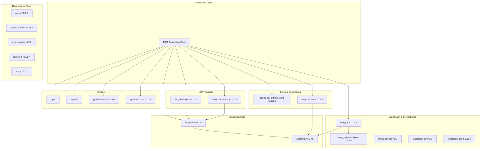
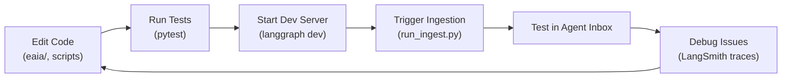

<!-- source: DeepWiki mcp.deepwiki.com · repo langchain-ai/executive-ai-assistant · page 9 Development Guide · fetched 2026-10-26 -->

# Development Guide

<details>
<summary>Relevant source files</summary>

The following files were used as context for generating this wiki page:

- [.gitignore](.gitignore)
- [CONTRIBUTING.md](CONTRIBUTING.md)
- [pyproject.toml](pyproject.toml)

</details>


This guide is intended for developers who want to understand, extend, or contribute to the Executive AI Assistant (EAIA) codebase. It covers the project structure, dependency management, development workflows, and contribution guidelines.

For information about initial setup and configuration, see [Installation and Setup](#1.1). For deployment instructions, see [Deployment](#6). For customization guides, see [Customization](#8).

## Purpose and Scope

This page documents the technical aspects of working with the EAIA codebase as a developer:
- Understanding the project directory structure and file organization
- Managing dependencies using Poetry
- Setting up a local development environment
- Running tests and debugging
- Understanding contribution policies

This guide assumes you have already cloned the repository and have basic familiarity with Python development.

## Project Structure

The EAIA codebase follows a modular organization with clear separation between core logic, scripts, and configuration.

### Directory Layout

```mermaid
graph TB
    root["Repository Root"]
    
    eaia["eaia/<br/>(Core Package)"]
    main["eaia/main/<br/>(Processing Pipeline)"]
    scripts["scripts/<br/>(Utilities)"]
    tests["tests/<br/>(Test Suite)"]
    config_files["Configuration Files"]
    
    root --> eaia
    root --> scripts
    root --> tests
    root --> config_files
    
    eaia --> main
    eaia --> gmail_py["gmail.py<br/>(Gmail/Calendar API)"]
    eaia --> schemas_py["schemas.py<br/>(Data Structures)"]
    eaia --> reflection_py["reflection_graphs.py<br/>(Learning System)"]
    
    main --> graph_py["graph.py<br/>(StateGraph Orchestration)"]
    main --> triage_py["triage.py<br/>(Email Classification)"]
    main --> draft_py["draft_response.py<br/>(Response Generation)"]
    main --> rewrite_py["rewrite.py<br/>(Tone Adjustment)"]
    main --> meeting_py["find_meeting_time.py<br/>(Calendar Logic)"]
    main --> human_py["human_inbox.py<br/>(Human-in-Loop)"]
    main --> config_yaml["config.yaml<br/>(User Preferences)"]
    
    scripts --> run_ingest["run_ingest.py<br/>(Email Fetcher)"]
    scripts --> setup_gmail["setup_gmail.py<br/>(OAuth Setup)"]
    scripts --> setup_cron["setup_cron.py<br/>(Cron Configuration)"]
    scripts --> cron_graph["cron_graph.py<br/>(Scheduled Ingestion)"]
    
    config_files --> pyproject["pyproject.toml<br/>(Dependencies)"]
    config_files --> poetry_lock["poetry.lock<br/>(Lock File)"]
    config_files --> langgraph_json["langgraph.json<br/>(LangGraph Config)"]
    config_files --> gitignore[".gitignore"]
    config_files --> env[".env<br/>(Secrets)"]
```



**Sources:** Project structure inferred from file paths in the repository and typical Python project layouts.

### Core Package: `eaia/`

The `eaia/` directory contains the core application logic organized into modules:

| File/Directory | Purpose | Key Components |
|---------------|---------|----------------|
| `eaia/gmail.py` | Gmail and Calendar API integration | `fetch_group_emails()`, `send_email()`, `mark_as_read()`, `get_events_for_days()`, `send_calendar_invite()` |
| `eaia/schemas.py` | Data structures and state definitions | `State`, `EmailData`, `RespondTo`, `ResponseEmailDraft`, `ReWriteEmail` |
| `eaia/reflection_graphs.py` | Learning and prompt improvement system | `multi_reflection_graph`, `general_reflection_graph`, `determine_what_to_update` |
| `eaia/main/` | Processing pipeline components | Graph nodes and orchestration logic |

### Processing Pipeline: `eaia/main/`

The `eaia/main/` directory contains the email processing pipeline:

| File | Purpose | Key Functions/Classes |
|------|---------|----------------------|
| `graph.py` | StateGraph orchestration and routing | `graph`, `route_after_triage()`, `take_action()`, `enter_after_human()` |
| `triage.py` | Email classification logic | `triage_input()`, `RespondTo` schema |
| `draft_response.py` | Response generation with tools | `draft_response()`, tool binding, LLM invocation |
| `rewrite.py` | Tone adjustment and style refinement | `rewrite()`, `ReWriteEmail` schema |
| `find_meeting_time.py` | Calendar availability agent | `find_meeting_time()`, ReAct agent, `get_events_for_days` tool |
| `human_inbox.py` | Human-in-the-loop interface | `send_message()`, `send_email_draft()`, `notify()`, `send_cal_invite()` |
| `config.yaml` | User-specific configuration | Triage rules, preferences, timezone |

**Sources:** [eaia/main/graph.py](), [eaia/main/triage.py](), [eaia/main/draft_response.py](), [eaia/main/rewrite.py](), [eaia/main/find_meeting_time.py](), [eaia/main/human_inbox.py]()

### Utility Scripts: `scripts/`

The `scripts/` directory contains standalone utilities for setup and ingestion:

| Script | Purpose | Usage |
|--------|---------|-------|
| `setup_gmail.py` | Configure Google OAuth via LangSmith Auth | One-time setup: `python scripts/setup_gmail.py` |
| `run_ingest.py` | Fetch emails and create LangGraph threads | Manual: `python scripts/run_ingest.py --url <deployment_url>` |
| `setup_cron.py` | Configure automated email checks | One-time setup: `python scripts/setup_cron.py` |
| `cron_graph.py` | Scheduled ingestion orchestration | Deployed to LangGraph Platform |

**Sources:** [scripts/setup_gmail.py](), [scripts/run_ingest.py](), [scripts/setup_cron.py](), [scripts/cron_graph.py]()

### Configuration Files

Configuration files at the repository root:

| File | Purpose |
|------|---------|
| `pyproject.toml` | Poetry dependency definitions, project metadata |
| `poetry.lock` | Locked dependency versions for reproducibility |
| `langgraph.json` | LangGraph Platform configuration |
| `.env` | Environment variables (API keys, secrets) - not committed |
| `.gitignore` | Version control exclusions |
| `CONTRIBUTING.md` | Contribution guidelines |

**Sources:** [pyproject.toml:1-46](), [.gitignore:1-163](), [CONTRIBUTING.md:1-8]()

## Dependency Management

EAIA uses Poetry for dependency management, providing deterministic builds and simplified package management.

### Dependency Stack Overview



**Sources:** [pyproject.toml:8-24]() (runtime dependencies), [pyproject.toml:32-38]() (development dependencies)

### Core Dependencies

#### LangGraph Stack
- **`langgraph` (^0.4.5)**: StateGraph orchestration framework for building stateful, multi-step agent workflows
- **`langgraph-checkpoint` (^2.0.0)**: Checkpoint persistence for state recovery
- **`langgraph-sdk` (^0.2)**: Client SDK for interacting with deployed LangGraph applications
- **`langgraph-cli` (^0.3.6)**: Command-line interface for local development (`langgraph dev`)
- **`langgraph-api` (^0.2.134)**: API server for hosting LangGraph applications

#### LangChain Stack
- **`langchain` (^0.3.9)**: Core LangChain framework for LLM application development
- **`langchain-openai` (^0.2)**: OpenAI integration (`ChatOpenAI`, GPT-4o, o1 models)
- **`langchain-anthropic` (^0.3)**: Anthropic integration (`ChatAnthropic`, Claude 3.5 Sonnet)
- **`langsmith` (^0.3.45)**: Tracing, monitoring, and debugging for LLM applications

#### External Integrations
- **`google-api-python-client` (^2.128.0)**: Gmail and Calendar API access
- **`langchain-auth` (^0.1.2)**: OAuth provider management via LangSmith Auth

#### Utilities
- **`pytz`**: Timezone handling for calendar operations
- **`pyyaml`**: YAML configuration file parsing (`config.yaml`)
- **`python-dateutil` (^2.9.0)**: Date/time parsing and manipulation
- **`python-dotenv` (^1.0.1)**: Environment variable loading from `.env` files

**Sources:** [pyproject.toml:8-24]()

### Development Dependencies

Development-only dependencies installed in the `dev` group:

| Package | Version | Purpose |
|---------|---------|---------|
| `pytest` | ^8.2.0 | Test framework |
| `pytest-asyncio` | ^0.23.6 | Async test support |
| `pytest-watch` | ^4.2.0 | Auto-run tests on file changes |
| `ipykernel` | ^6.29.4 | Jupyter notebook support |
| `vcrpy` | ^6.0.1 | HTTP interaction recording for tests |

**Sources:** [pyproject.toml:32-38]()

### Poetry Commands

Common Poetry commands for dependency management:

```bash
# Install all dependencies (runtime + dev)
poetry install

# Install only runtime dependencies
poetry install --only main

# Add a new dependency
poetry add <package-name>

# Add a development dependency
poetry add --group dev <package-name>

# Update dependencies to latest compatible versions
poetry update

# Show dependency tree
poetry show --tree

# Export requirements.txt (if needed)
poetry export -f requirements.txt --output requirements.txt
```

### Python Version Requirements

The project requires Python ^3.12 (Python 3.12 or higher) as specified in [pyproject.toml:9]().

**Sources:** [pyproject.toml:9]()

## Development Environment Setup

### Initial Setup

1. **Clone the repository:**
   ```bash
   git clone https://github.com/langchain-ai/executive-ai-assistant.git
   cd executive-ai-assistant
   ```

2. **Install Poetry** (if not already installed):
   ```bash
   curl -sSL https://install.python-poetry.org | python3 -
   ```

3. **Install dependencies:**
   ```bash
   poetry install
   ```

4. **Create `.env` file** with required environment variables:
   ```bash
   # .env
   OPENAI_API_KEY=sk-...
   ANTHROPIC_API_KEY=sk-ant-...
   LANGSMITH_API_KEY=lsv2_...
   ```

5. **Configure Gmail OAuth** (one-time):
   ```bash
   poetry run python scripts/setup_gmail.py
   ```
   Follow the OAuth flow in your browser.

6. **Customize `config.yaml`** in `eaia/main/config.yaml` with your preferences.

### Local Development Workflow



**Running the development server:**
```bash
poetry run langgraph dev
```
This starts the LangGraph development server on `http://127.0.0.1:2024`.

**Triggering email ingestion manually:**
```bash
poetry run python scripts/run_ingest.py --url http://127.0.0.1:2024
```

**Running tests:**
```bash
# Run all tests
poetry run pytest

# Run tests with output
poetry run pytest -v

# Run specific test file
poetry run pytest tests/test_specific.py

# Run tests in watch mode (auto-rerun on changes)
poetry run pytest-watch
```

**Sources:** Project development practices and Poetry workflow.

## Code Organization Patterns

### Module Responsibilities

```mermaid
graph TB
    subgraph "Data Layer"
        schemas["schemas.py<br/>State, EmailData, RespondTo, etc."]
        gmail["gmail.py<br/>fetch_group_emails, send_email"]
    end
    
    subgraph "Processing Layer"
        triage["triage.py<br/>triage_input() → RespondTo"]
        draft["draft_response.py<br/>draft_response() → messages"]
        rewrite["rewrite.py<br/>rewrite() → ReWriteEmail"]
        meeting["find_meeting_time.py<br/>find_meeting_time() → messages"]
    end
    
    subgraph "Orchestration Layer"
        graph["graph.py<br/>StateGraph definition, routing"]
        human["human_inbox.py<br/>send_message, send_email_draft"]
    end
    
    subgraph "Learning Layer"
        reflection["reflection_graphs.py<br/>multi_reflection_graph"]
    end
    
    subgraph "Ingestion Layer"
        run_ingest["run_ingest.py<br/>fetch + create threads"]
        cron_graph["cron_graph.py<br/>scheduled orchestration"]
    end
    
    schemas -.->|"defines"| triage
    schemas -.->|"defines"| draft
    schemas -.->|"defines"| rewrite
    
    gmail -.->|"used by"| run_ingest
    gmail -.->|"used by"| meeting
    
    triage -->|"updates State"| graph
    draft -->|"updates State"| graph
    rewrite -->|"updates State"| graph
    meeting -->|"updates State"| graph
    
    graph -->|"routes to"| human
    human -->|"triggers"| reflection
    
    run_ingest -->|"creates runs in"| graph
    cron_graph -->|"invokes"| run_ingest
```

**Sources:** [eaia/schemas.py](), [eaia/gmail.py](), [eaia/main/graph.py](), [eaia/main/triage.py](), [eaia/main/draft_response.py](), [eaia/main/rewrite.py](), [eaia/main/find_meeting_time.py](), [eaia/main/human_inbox.py](), [eaia/reflection_graphs.py](), [scripts/run_ingest.py](), [scripts/cron_graph.py]()

### Key Design Patterns

1. **StateGraph Nodes**: Each processing component (`triage_input`, `draft_response`, `rewrite`, etc.) is a function that takes `State` and returns a partial state update.

2. **Schema Enforcement**: All LLM outputs use `with_structured_output()` with Pydantic schemas to ensure type safety.

3. **Reducers**: The `add_messages` reducer accumulates conversation history without duplicates.

4. **Tool Binding**: The `draft_response` function binds multiple tools to the LLM and lets it choose appropriate actions.

5. **Async by Default**: The reflection system uses async invocation via LangGraph SDK to avoid blocking the main processing flow.

6. **Namespace Isolation**: BaseStore uses namespaces to separate prompt storage by user and type.

## Testing Strategy

### Test Organization

Tests are located in the `tests/` directory and use `pytest` as the test framework. The `pytest-asyncio` plugin enables async test execution.

### Running Tests

The project is configured for async testing in [pyproject.toml:44-45]():

```toml
[tool.pytest.ini_options]
asyncio_mode = "auto"
```

This automatically detects and runs async test functions.

### VCR.py Integration

The project includes `vcrpy` ([pyproject.toml:37]()) for recording and replaying HTTP interactions, useful for testing Gmail and Calendar API integrations without making live API calls.

**Sources:** [pyproject.toml:44-45](), [pyproject.toml:32-38]()

## Contribution Guidelines

### Contribution Policy

The EAIA project has a specific contribution policy outlined in [CONTRIBUTING.md:1-8]():

> Since this powers Harrison's real email assistant, only contributions that improve that experience for Harrison will be merged in.

**Key Points:**
- **Accepted contributions**: Changes that improve Harrison Chase's email assistant experience
- **Not accepted**: Alternative LLM providers, email providers, or features not relevant to Harrison's use case
- **Encouraged**: Forking the repository to create customized variants

### Forking and Customization

The project maintainer explicitly encourages developers to fork and customize the codebase:

> Harrison is very supportive of variants of this email assistant popping up. Add in other LLMs - great! Add in other email providers - great! He just doesn't want to maintain them as he's already very busy.

**If you want to:**
- Use different LLM providers (e.g., local models, other commercial APIs)
- Integrate with Outlook, Exchange, or other email services
- Add features not relevant to Harrison's workflow
- Create a general-purpose version

**You should fork the repository** rather than submitting PRs.

**Sources:** [CONTRIBUTING.md:1-8]()

## File Patterns and Conventions

### Excluded Files

The `.gitignore` file defines what should not be committed to version control:

**Key exclusions:**
- Python artifacts: `__pycache__/`, `*.pyc`, `.pytest_cache/`
- Virtual environments: `.venv/`, `venv/`, `ENV/`
- IDE configurations: `.idea/` (PyCharm)
- Secrets: `.env`, `.secrets/` (Google OAuth credentials)
- LangGraph artifacts: `.langgraph_api/` (local server state)
- Build artifacts: `build/`, `dist/`, `*.egg-info/`

The `.secrets/` directory ([.gitignore:162]()) is specifically for Google Workspace (Gmail, Calendar) OAuth credentials and should never be committed.

**Sources:** [.gitignore:1-163]()

### Configuration Management

**Environment variables** (`.env` file):
- Should contain API keys and secrets
- Must not be committed to version control
- Required variables: `OPENAI_API_KEY`, `ANTHROPIC_API_KEY`, `LANGSMITH_API_KEY`

**User preferences** (`config.yaml`):
- Should be customized per user
- Contains no secrets (can be committed if desired)
- Defines triage rules, tone preferences, and behavior settings

**Sources:** [.gitignore:123-129]()

## Debugging and Monitoring

### LangSmith Tracing

All LLM calls are automatically traced to LangSmith, providing:
- Complete execution traces with input/output
- Token usage and cost tracking
- Latency measurements
- Error debugging

Access traces at: https://smith.langchain.com/

### Local Development Server

The `langgraph dev` command starts a development server with:
- **URL**: `http://127.0.0.1:2024`
- **Hot reload**: Automatically restarts on code changes
- **Interactive debugging**: LangGraph Studio integration
- **API access**: Full LangGraph API available locally

### Common Debug Points

| Component | Debug Method |
|-----------|--------------|
| Email ingestion | Check `run_ingest.py` output, verify OAuth credentials |
| Triage classification | Review LangSmith traces for `triage_input` node |
| Draft generation | Inspect `draft_response` traces, check tool calls |
| Calendar queries | Verify `get_events_for_days` tool output |
| Human feedback | Check Agent Inbox connection, inspect HumanResponse events |
| Reflection updates | Review `multi_reflection_graph` traces in LangSmith |

**Sources:** Development practices and LangGraph development server documentation.

## Summary

The EAIA codebase is structured for maintainability and extensibility:

1. **Modular design**: Clear separation between data layer, processing layer, orchestration, and learning
2. **Poetry dependency management**: Reproducible builds with locked dependencies
3. **Type safety**: Pydantic schemas enforce structure throughout the pipeline
4. **Observability**: LangSmith tracing for all LLM interactions
5. **Focused contribution policy**: Improvements for Harrison's use case only; forks encouraged for variants

For extending specific functionality, see [Customization](#8). For deployment instructions, see [Deployment](#6).

---

