# Page: Overview

# Overview

<details>
<summary>Relevant source files</summary>

The following files were used as context for generating this wiki page:

- [CONTRIBUTING.md](CONTRIBUTING.md)
- [README.md](README.md)

</details>


The Executive AI Assistant (EAIA) is an automated email management system that processes incoming Gmail messages, drafts responses, schedules calendar meetings, and routes work to humans for approval. It is built on LangGraph for orchestration, uses OpenAI and Anthropic LLMs for natural language processing, and integrates with Gmail/Calendar APIs via LangChain Auth for OAuth management.

For detailed setup instructions, see page 1.1 (Installation and Setup). For system architecture details, see page 1.2 (Architecture Overview).

## Purpose and Core Functionality

EAIA performs the following automated tasks:

- **Email Triage**: Classifies incoming emails into three categories (ignore, notify, draft response) using few-shot classification
- **Response Drafting**: Generates email replies using LLM-based agents with tool access (meeting scheduling, calendar invites)
- **Tone Adjustment**: Rewrites drafted responses to match user-specified tone and style preferences
- **Calendar Integration**: Queries Google Calendar availability and proposes meeting times
- **Learning System**: Updates prompt templates based on human feedback via reflection graphs

All actions requiring email sends are routed through Agent Inbox (dev.agentinbox.ai) for human approval, ensuring no autonomous email transmission.

Sources: [README.md:1-4](), [README.md:50-65]()

## System Architecture Layers

EAIA is organized into distinct functional layers, each implemented by specific Python modules:

**Diagram: System Architecture with Code Entities**

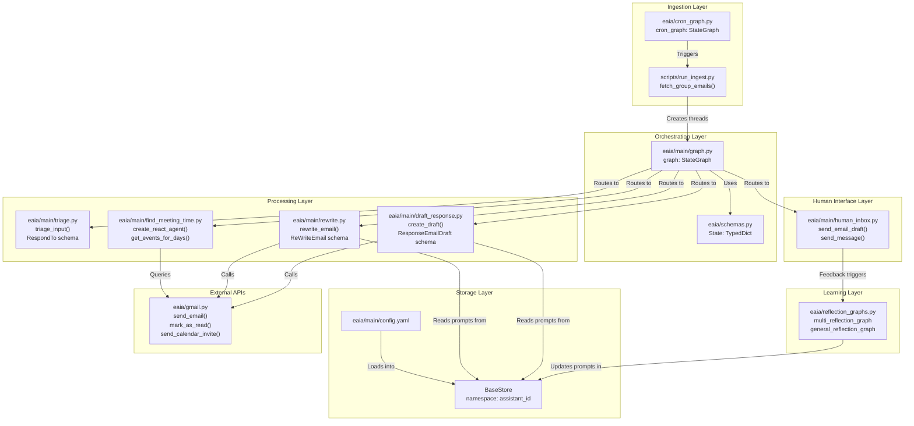

Sources: [README.md:1-4](), [README.md:166-180]()

### Component Reference Table

| Layer | Module | Key Functions/Classes | Purpose |
|-------|--------|----------------------|---------|
| Ingestion | `scripts/run_ingest.py` | `fetch_group_emails()`, `create_thread_id()` | Fetches emails from Gmail API, creates LangGraph threads |
| Ingestion | `eaia/cron_graph.py` | `cron_graph: StateGraph` | Scheduled email checking via cron |
| Orchestration | `eaia/main/graph.py` | `graph: StateGraph`, `route_after_triage()` | Main workflow coordinator |
| State | `eaia/schemas.py` | `State: TypedDict`, `EmailData`, `RespondTo` | State management and data schemas |
| Triage | `eaia/main/triage.py` | `triage_input()`, `RespondTo` | Email classification into 3 categories |
| Drafting | `eaia/main/draft_response.py` | `create_draft()`, `ResponseEmailDraft` | Response generation with tool binding |
| Rewriting | `eaia/main/rewrite.py` | `rewrite_email()`, `ReWriteEmail` | Tone adjustment based on preferences |
| Calendar | `eaia/main/find_meeting_time.py` | `create_react_agent()`, `get_events_for_days()` | Meeting time discovery using ReAct pattern |
| Human Interface | `eaia/main/human_inbox.py` | `send_email_draft()`, `send_message()` | Routes work to Agent Inbox |
| Learning | `eaia/reflection_graphs.py` | `multi_reflection_graph`, `general_reflection_graph` | Prompt improvement from feedback |
| Gmail API | `eaia/gmail.py` | `send_email()`, `mark_as_read()`, `send_calendar_invite()` | Gmail/Calendar API wrapper |

Sources: [README.md:166-180]()

## Email Processing Workflow

**Diagram: Email Processing Flow with Function Calls**

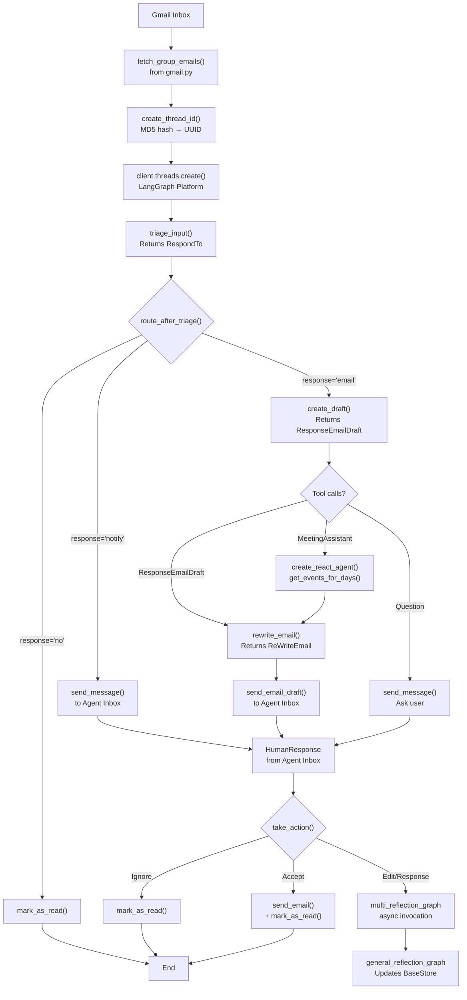

This workflow is implemented in `eaia/main/graph.py` as a `StateGraph` with conditional edges defined by `route_after_triage()`, `take_action()`, and `enter_after_human()` functions.

Sources: [README.md:76-84](), [README.md:166-180]()

## Deployment Models

EAIA supports two deployment environments:

### Local Development

Run EAIA on localhost for testing:

1. Start development server: `langgraph dev` (listens on port 2024)
2. Trigger ingestion manually: `python scripts/run_ingest.py --url http://127.0.0.1:2024`
3. Connect Agent Inbox to `http://127.0.0.1:2024` with `graph_id="main"`

The local server runs `eaia/main/graph.py` as the main graph and `eaia/cron_graph.py` as the cron graph.

Sources: [README.md:65-103]()

### Production Deployment (LangGraph Platform)

Deploy EAIA as a managed service:

1. Deploy via LangSmith UI, connecting to GitHub repository
2. Set environment variables: `OPENAI_API_KEY`, `ANTHROPIC_API_KEY`, `LANGSMITH_API_KEY`
3. Set up cron schedule: `python scripts/setup_cron.py --url ${DEPLOYMENT_URL}`
4. The `cron_graph.py` StateGraph runs on schedule, triggering `run_ingest.py` logic

The ingestion script uses `--minutes-since` to control how far back to check for emails, `--rerun` to control whether to reprocess seen emails, and `--early` to control whether to stop on first seen email.

Sources: [README.md:105-161]()

## External Service Integrations

**Diagram: External API Integration Points**

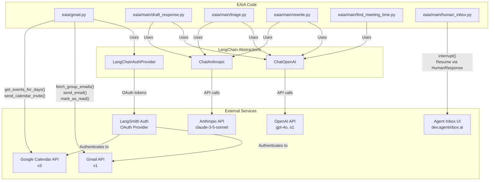

### Authentication

OAuth authentication to Gmail/Calendar is managed by LangChain Auth (LangSmith's OAuth provider service). The `scripts/setup_gmail.py` script creates the OAuth provider by calling LangSmith Auth APIs with client credentials from `eaia/.secrets/secrets.json`. 

The `eaia/gmail.py` module uses `LangChainAuthProvider` to fetch and refresh tokens automatically.

Sources: [README.md:25-46](), [README.md:36-47]()

### LLM Provider Selection

Both `ChatOpenAI` and `ChatAnthropic` interfaces are available. Model selection is done at the module level:
- `triage.py`: Uses both providers
- `draft_response.py`: Uses both providers
- `rewrite.py`: Uses both providers
- `find_meeting_time.py`: Uses OpenAI only
- `reflection_graphs.py`: Uses both providers (o1 for complex reflection)

Sources: [README.md:33-34]()

## Configuration System

EAIA uses a YAML configuration file at `eaia/main/config.yaml` that defines user-specific behavior. The configuration is loaded into `BaseStore` on startup and accessed by processing nodes.

### Configuration Schema

The `config.yaml` file contains these required fields:

| Field | Type | Used By | Purpose |
|-------|------|---------|---------|
| `email` | string | `gmail.py` | User's email address for sending/receiving |
| `full_name` | string | `draft_response.py` | User's full name for email signatures |
| `name` | string | `draft_response.py` | User's first name for responses |
| `timezone` | string | `find_meeting_time.py` | Default timezone for scheduling |
| `background` | string | `draft_response.py` | Context about user for responses |
| `triage_no` | string | `triage.py` | Rules for emails to ignore |
| `triage_notify` | string | `triage.py` | Rules for notification-only emails |
| `triage_email` | string | `triage.py` | Rules for emails requiring response |
| `response_preferences` | string | `draft_response.py` | Content preferences (stored as `response_preferences` in BaseStore) |
| `rewrite_preferences` | string | `rewrite.py` | Tone preferences (stored as `rewrite_instructions` in BaseStore) |
| `schedule_preferences` | string | `find_meeting_time.py` | Calendar preferences (stored as `schedule_preferences` in BaseStore) |
| `background_preferences` | string | `draft_response.py` | Additional context (stored as `random_preferences` in BaseStore) |

These configuration values are read by nodes during execution and can be updated via the reflection system.

For detailed configuration instructions, see page 5 (Configuration) and page 5.1 (Email Preferences Configuration).

Sources: [README.md:48-65]()

## System Requirements

To use EAIA, you need:

1. Python 3.11 or higher
2. API keys for OpenAI and Anthropic
3. Google API credentials for Gmail and Calendar access
4. LangSmith API key for deployment and monitoring

Sources: [README.md:25-47]()

---

# Page: Installation and Setup

# Installation and Setup

<details>
<summary>Relevant source files</summary>

The following files were used as context for generating this wiki page:

- [.env.example](.env.example)
- [README.md](README.md)
- [scripts/setup_gmail.py](scripts/setup_gmail.py)

</details>


This page provides step-by-step instructions for installing and configuring the Executive AI Assistant (EAIA) system. It covers Python environment setup, dependency installation, API key configuration, Google OAuth authentication via `setup_gmail.py`, and user preference customization through `config.yaml`.

For deployment instructions after completing setup, see [Local Development](#6.1) and [LangGraph Platform Deployment](#6.2). For configuration details, see [Email Preferences Configuration](#5.1) and [Environment Variables](#5.2).

## Prerequisites

Before beginning installation, ensure you have:

- Python 3.11 or higher
- A Gmail account (personal or Google Workspace)
- Access to [Google Cloud Console](https://console.cloud.google.com)
- A LangSmith account with API access
- OpenAI and Anthropic API accounts

**Important**: You must fork the repository before cloning, as deployment to LangGraph Platform requires your own repository [README.md:27]().

## Installation Workflow

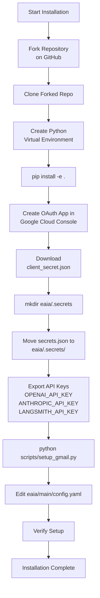

**Sources**: [README.md:23-65]()

## Step 1: Repository and Environment Setup

### 1.1 Fork and Clone Repository

Fork the repository at https://github.com/langchain-ai/executive-ai-assistant to your GitHub account, then clone your fork:

```bash
git clone https://github.com/YOUR_USERNAME/executive-ai-assistant.git
cd executive-ai-assistant
```

**Sources**: [README.md:27]()

### 1.2 Create Python Virtual Environment

Create and activate a Python virtual environment. The system requires Python 3.11 or higher:

```bash
pyenv virtualenv 3.11.1 eaia
pyenv activate eaia
```

Alternatively, use `venv`:

```bash
python3.11 -m venv eaia-env
source eaia-env/bin/activate  # On Windows: eaia-env\Scripts\activate
```

**Sources**: [README.md:28]()

### 1.3 Install Dependencies

Install the package and all dependencies in editable mode:

```bash
pip install -e .
```

This command installs all dependencies specified in `pyproject.toml`, including:
- `langgraph` - StateGraph orchestration
- `langchain` - LLM abstractions
- `langchain-openai` and `langchain-anthropic` - LLM providers
- `langchain-auth` - OAuth management
- `google-api-python-client` - Gmail and Calendar APIs

**Sources**: [README.md:29]()

## Step 2: Google OAuth Configuration

### 2.1 OAuth Setup Architecture

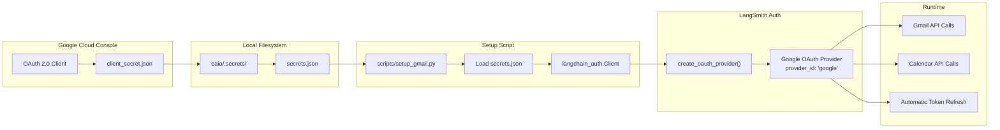

**Sources**: [README.md:35-48](), [scripts/setup_gmail.py:1-90]()

### 2.2 Enable Gmail API

1. Navigate to [Google Cloud Console](https://console.cloud.google.com)
2. Create a new project or select an existing project
3. Go to [Gmail API Quickstart](https://developers.google.com/gmail/api/quickstart/python#enable_the_api)
4. Click "Enable the API" to activate Gmail API for your project

**Sources**: [README.md:36-37]()

### 2.3 Create OAuth Credentials

1. In Google Cloud Console, navigate to "APIs & Services" > "Credentials"
2. Click "Create Credentials" > "OAuth client ID"
3. Configure OAuth consent screen:
   - **For personal Gmail accounts**: Select "External" as User Type
   - **For Google Workspace accounts**: Select "Internal" as User Type
4. Add your email as a test user (required for "External" type)
5. Configure application type as "Desktop application"
6. Download the credentials JSON file

**Important**: Personal (non-Workspace) Gmail accounts must use "External" User Type and add the account email as a test user to avoid "App has not completed verification" errors [README.md:40]().

**Sources**: [README.md:38-41]()

### 2.4 Store OAuth Secrets

Create the secrets directory and move the downloaded credentials file:

```bash
mkdir -p eaia/.secrets
mv ~/Downloads/client_secret_*.json eaia/.secrets/secrets.json
```

The `setup_gmail.py` script expects the secrets file at this exact location [scripts/setup_gmail.py:22-23]().

**Sources**: [README.md:43-44](), [scripts/setup_gmail.py:22-31]()

## Step 3: API Keys and Environment Variables

### 3.1 Required Environment Variables

The following environment variables must be set before running the setup script:

| Variable | Purpose | Where to Obtain |
|----------|---------|-----------------|
| `LANGSMITH_API_KEY` | LangSmith authentication and OAuth provider management | [LangSmith Settings](https://smith.langchain.com/settings) |
| `OPENAI_API_KEY` | OpenAI API access (GPT-4o, o1 models) | [OpenAI API Keys](https://platform.openai.com/api-keys) |
| `ANTHROPIC_API_KEY` | Anthropic API access (Claude models) | [Anthropic Console](https://console.anthropic.com) |

**Sources**: [README.md:33-34](), [.env.example:1-5]()

### 3.2 Export Environment Variables

Export the API keys in your shell:

```bash
export LANGSMITH_API_KEY="your_langsmith_key"
export OPENAI_API_KEY="your_openai_key"
export ANTHROPIC_API_KEY="your_anthropic_key"
```

For persistent configuration, add these to your shell profile (`.bashrc`, `.zshrc`, etc.) or create a `.env` file using `.env.example` as a template.

**Note**: `GMAIL_TOKEN` and `GMAIL_SECRET` shown in `.env.example` are legacy variables no longer required, as OAuth is now managed by LangSmith Auth [.env.example:3-4]().

**Sources**: [.env.example:1-5](), [README.md:33-34]()

## Step 4: Run OAuth Setup Script

### 4.1 Setup Script Execution

Execute the OAuth setup script to create the Google OAuth provider in LangSmith Auth:

```bash
python scripts/setup_gmail.py
```

**Sources**: [README.md:45](), [scripts/setup_gmail.py:1-90]()

### 4.2 Setup Script Flow

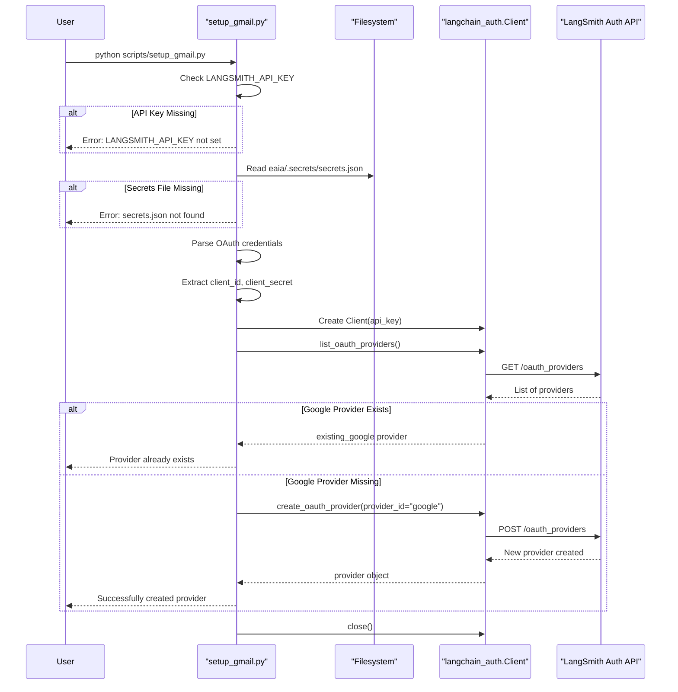

**Sources**: [scripts/setup_gmail.py:13-84]()

### 4.3 What the Script Does

The `setup_gmail.py` script performs the following operations [scripts/setup_gmail.py:13-84]():

1. **Validates Environment** [scripts/setup_gmail.py:17-19]()
   - Checks for `LANGSMITH_API_KEY` environment variable
   - Raises `ValueError` if missing

2. **Loads OAuth Secrets** [scripts/setup_gmail.py:22-46]()
   - Reads `eaia/.secrets/secrets.json`
   - Parses JSON structure (supports both "web" and "installed" types)
   - Extracts `client_id` and `client_secret`

3. **Creates LangSmith Auth Client** [scripts/setup_gmail.py:49]()
   - Initializes `langchain_auth.Client` with API key

4. **Checks for Existing Provider** [scripts/setup_gmail.py:53-62]()
   - Lists existing OAuth providers
   - Searches for provider with `provider_id="google"`
   - If found, exits successfully

5. **Creates Google OAuth Provider** [scripts/setup_gmail.py:66-73]()
   - Calls `create_oauth_provider()` with:
     - `provider_id="google"`
     - `name="Google"`
     - `client_id` and `client_secret` from secrets file
     - `auth_url="https://accounts.google.com/o/oauth2/auth"`
     - `token_url="https://oauth2.googleapis.com/token"`

6. **Persists Configuration** [scripts/setup_gmail.py:75-76]()
   - Provider configuration stored in LangSmith Auth
   - No local credential storage required
   - Tokens automatically refreshed at runtime

**Sources**: [scripts/setup_gmail.py:13-84]()

### 4.4 OAuth Provider Usage

Once created, the OAuth provider is automatically used throughout the system:

- **Token Management**: LangSmith Auth handles token refresh automatically
- **Runtime Authentication**: Gmail and Calendar API calls use the provider for authentication
- **No Manual Token Handling**: Application code does not manage credentials directly

For details on how Gmail and Calendar APIs use this OAuth provider, see [Gmail and Calendar APIs](#7.1).

**Sources**: [README.md:47](), [scripts/setup_gmail.py:1-4]()

## Step 5: Configuration File Setup

### 5.1 Configuration File Location

The main configuration file is located at `eaia/main/config.yaml`. This file defines user-specific preferences and behavior rules for email processing [README.md:51]().

### 5.2 Required Configuration Keys

Every key in `config.yaml` is required. The following table describes each configuration field:

| Field | Type | Description |
|-------|------|-------------|
| `email` | string | Email address to monitor and send from (must match OAuth credentials) |
| `full_name` | string | User's complete name |
| `name` | string | User's first name |
| `background` | string | Basic information about the user |
| `timezone` | string | Default timezone (e.g., "America/New_York") |
| `schedule_preferences` | string | Calendar meeting preferences (length, naming, etc.) |
| `background_preferences` | string | Background information for email responses (coworkers to loop in, etc.) |
| `response_preferences` | string | Preferences for email content (whether to send Calendly links, etc.) |
| `rewrite_preferences` | string | Tone and style preferences for emails |
| `triage_no` | string | Guidelines for emails to ignore |
| `triage_notify` | string | Guidelines for emails requiring notification only (no draft) |
| `triage_email` | string | Guidelines for emails requiring drafted responses |

**Sources**: [README.md:51-64]()

### 5.3 Configuration Usage in System

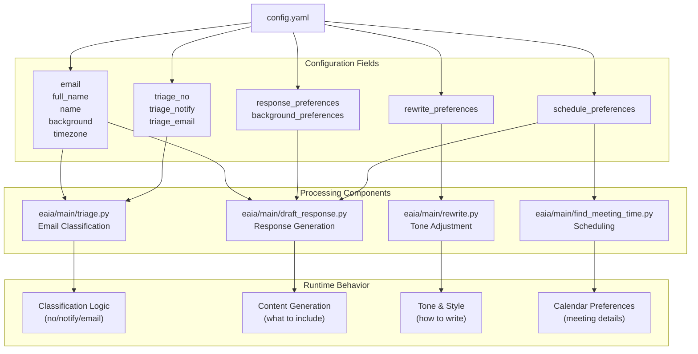

**Sources**: [README.md:51-64]()

For detailed configuration guidance, see [Email Preferences Configuration](#5.1).

## Step 6: Verification

### 6.1 Verify Python Environment

Confirm Python version and package installation:

```bash
python --version  # Should show 3.11+
pip list | grep langgraph  # Should show langgraph package
pip list | grep langchain-auth  # Should show langchain-auth package
```

### 6.2 Verify OAuth Provider

Test OAuth provider creation by running the setup script again:

```bash
python scripts/setup_gmail.py
```

Expected output [scripts/setup_gmail.py:58-59]():
```
Google OAuth provider already exists: <provider details>
Setup complete! You can now use the executive assistant.
```

### 6.3 Verify Configuration File

Check that `config.yaml` exists and contains all required keys:

```bash
python -c "import yaml; config = yaml.safe_load(open('eaia/main/config.yaml')); print('Keys:', list(config.keys()))"
```

### 6.4 Next Steps

After completing installation and setup:

1. **Local Development**: Run `langgraph dev` to start the local development server. See [Local Development](#6.1) for instructions.
2. **Manual Email Ingestion**: Execute `run_ingest.py` to fetch and process emails. See [Email Ingestion](#2.1) for details.
3. **Agent Inbox Integration**: Connect Agent Inbox to interact with processed emails. See [Agent Inbox Integration](#3.1) for configuration.
4. **Production Deployment**: Deploy to LangGraph Platform for continuous operation. See [LangGraph Platform Deployment](#6.2) for instructions.

**Sources**: [README.md:66-76](), [README.md:106-160]()

## Common Setup Issues

### Issue: "App has not completed verification" Error

**Cause**: Using "External" OAuth consent screen without adding test users.

**Solution**: In Google Cloud Console, navigate to "APIs & Services" > "OAuth consent screen" > "Test users" and add your Gmail address [README.md:40]().

### Issue: setup_gmail.py Cannot Find secrets.json

**Cause**: Client secret file not placed in correct location.

**Solution**: Ensure file is at `eaia/.secrets/secrets.json` (not `eaia/.secrets/client_secret.json` or any other name) [scripts/setup_gmail.py:22-23]().

### Issue: LANGSMITH_API_KEY Error

**Cause**: Environment variable not set.

**Solution**: Export the variable before running setup script [scripts/setup_gmail.py:17-19]():
```bash
export LANGSMITH_API_KEY="your_key_here"
python scripts/setup_gmail.py
```

### Issue: Invalid Google Client Secrets Format

**Cause**: Client secrets JSON file is malformed or not from Google Cloud Console.

**Solution**: Re-download credentials from Google Cloud Console, ensuring you select "Desktop application" type [scripts/setup_gmail.py:38-43]().

**Sources**: [README.md:40](), [scripts/setup_gmail.py:17-43]()

---

**Sources**: [README.md:23-65](), [scripts/setup_gmail.py:1-90](), [.env.example:1-5]()

---

# Page: Architecture Overview

# Architecture Overview

<details>
<summary>Relevant source files</summary>

The following files were used as context for generating this wiki page:

- [README.md](README.md)
- [eaia/main/graph.py](eaia/main/graph.py)
- [pyproject.toml](pyproject.toml)

</details>


This document describes the high-level architecture of the Executive AI Assistant (EAIA) system, focusing on its LangGraph-based orchestration, modular component design, and data flow patterns. For specific setup and configuration details, see [Installation and Setup](#1.1). For information about state management and data structures, see [Core Data Structures and State Management](#1.3).

## System Overview

EAIA is built as a **LangGraph StateGraph application** that orchestrates email processing through a series of specialized nodes. The architecture follows a pipeline pattern where emails flow through triage, drafting, rewriting, and human approval stages before final actions are taken.

### Core Architectural Principles

| Principle | Implementation |
|-----------|----------------|
| **Stateful Orchestration** | LangGraph StateGraph manages workflow state across all processing nodes |
| **Modular Components** | Each processing step (triage, draft, rewrite, scheduling) is an independent node |
| **Human-in-the-Loop** | All drafts require human approval before execution |
| **Asynchronous Learning** | Feedback triggers background prompt improvement without blocking execution |
| **External Integrations** | Gmail, Calendar, and LLM providers accessed through abstraction layers |

**Sources:** [README.md:1-179](), [eaia/main/graph.py:1-191]()

## System Layers

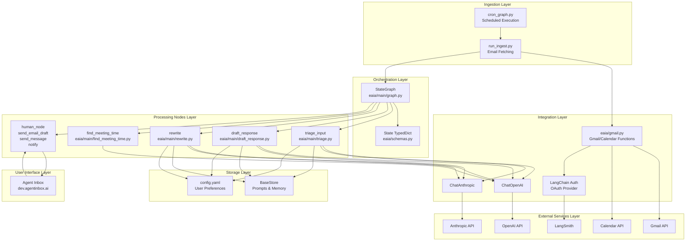

**Architecture Overview: System Layers and Component Relationships**

The architecture is organized into seven distinct layers:

1. **External Services Layer**: Third-party APIs for email, calendar, and LLM capabilities
2. **Integration Layer**: Abstraction modules that wrap external services
3. **Orchestration Layer**: LangGraph StateGraph that coordinates workflow execution
4. **Processing Nodes Layer**: Specialized processing components for triage, drafting, rewriting, and scheduling
5. **Storage Layer**: Persistent storage for prompts, memory, and configuration
6. **Ingestion Layer**: Email fetching and thread creation logic
7. **User Interface Layer**: Human interaction through Agent Inbox

**Sources:** [README.md:1-179](), [eaia/main/graph.py:1-191](), [pyproject.toml:1-46]()

## LangGraph StateGraph Orchestration

The core of EAIA is the `StateGraph` defined in [eaia/main/graph.py:162-191](). This graph orchestrates all email processing through a series of nodes connected by conditional edges.

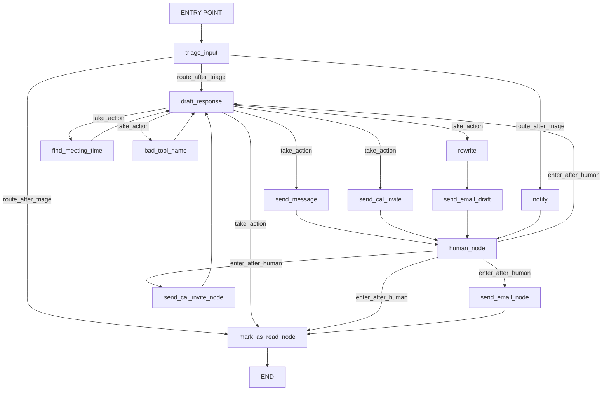

**StateGraph Node Structure and Routing Logic**

### Node Definitions

The graph consists of the following node types ([eaia/main/graph.py:162-174]()):

| Node Name | Function | Purpose |
|-----------|----------|---------|
| `triage_input` | [eaia/main/triage.py]() | Classifies emails into response categories |
| `draft_response` | [eaia/main/draft_response.py]() | Generates initial email responses with tool binding |
| `rewrite` | [eaia/main/rewrite.py]() | Adjusts tone and style of drafts |
| `find_meeting_time` | [eaia/main/find_meeting_time.py]() | Queries calendar for availability |
| `send_message` | [eaia/main/human_inbox.py]() | Sends questions to human via Agent Inbox |
| `send_email_draft` | [eaia/main/human_inbox.py]() | Sends email drafts for human approval |
| `notify` | [eaia/main/human_inbox.py]() | Notifies human of important emails |
| `send_cal_invite` | [eaia/main/human_inbox.py]() | Sends calendar invites for human approval |
| `human_node` | [eaia/main/graph.py:153-154]() | Interrupt point for human interaction |
| `mark_as_read_node` | [eaia/main/graph.py:148-150]() | Marks emails as read in Gmail |
| `send_email_node` | [eaia/main/graph.py:133-145]() | Executes approved email sends |
| `send_cal_invite_node` | [eaia/main/graph.py:115-130]() | Executes approved calendar invites |

### Conditional Routing Logic

Three routing functions control graph traversal ([eaia/main/graph.py:30-113]()):

#### 1. `route_after_triage`

Routes based on triage classification:
- `"email"` or `"question"` → `draft_response` (needs AI response)
- `"no"` → `mark_as_read_node` (ignore email)
- `"notify"` → `notify` (notify human without draft)

#### 2. `take_action`

Routes based on tool call in draft response:
- `"Question"` → `send_message` (AI needs clarification)
- `"ResponseEmailDraft"` → `rewrite` (draft ready for tone adjustment)
- `"Ignore"` → `mark_as_read_node` (AI decides to ignore)
- `"MeetingAssistant"` → `find_meeting_time` (needs calendar lookup)
- `"SendCalendarInvite"` → `send_cal_invite` (ready to send invite)

#### 3. `enter_after_human`

Routes based on human response:
- If no messages or `ToolMessage`/`HumanMessage` → `draft_response` (re-process with feedback)
- If approved `ResponseEmailDraft` → `send_email_node` (execute send)
- If approved `SendCalendarInvite` → `send_cal_invite_node` (execute invite)
- If approved `Ignore` → `mark_as_read_node` (mark read)
- If `"notify"` triage and no messages → `mark_as_read_node` (acknowledge notification)

**Sources:** [eaia/main/graph.py:1-191]()

## Data Flow Through Processing Pipeline

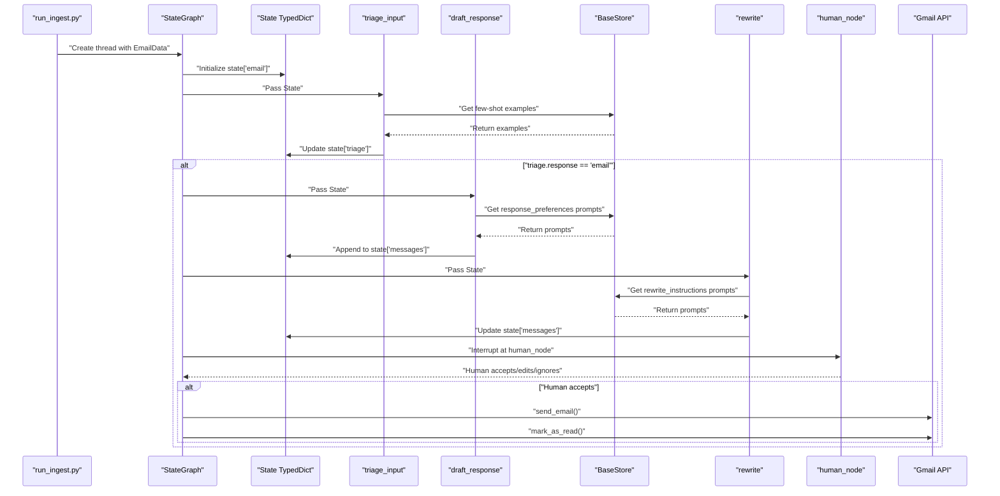

**Email Processing Data Flow Sequence**

### State Propagation

The `State` TypedDict ([eaia/schemas.py]()) is passed through every node in the graph. Each node can:
- **Read** from state fields: `email`, `messages`, `triage`
- **Write** to state fields using return values
- **Append** to `messages` using the `add_messages` reducer

### Storage Interactions

Nodes interact with `BaseStore` at multiple points:

| Node | Storage Operation | Purpose |
|------|------------------|---------|
| `triage_input` | Read few-shot examples | Improve classification accuracy |
| `triage_input` | Write triage status | Track email processing history |
| `draft_response` | Read `response_preferences`, `schedule_preferences`, `random_preferences` | Guide content generation |
| `rewrite` | Read `rewrite_instructions` | Control tone and style |
| Reflection system | Write all prompt types | Update prompts based on feedback |

**Sources:** [eaia/main/graph.py:1-191](), [README.md:49-65]()

## Component Communication Patterns

### LLM Integration Pattern

All LLM-calling nodes follow a consistent pattern:

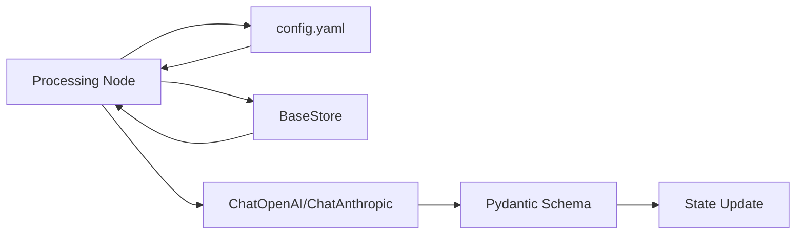

**LLM Integration Pattern Used by Processing Nodes**

1. **Load Configuration**: Read from `config.yaml` for user preferences
2. **Retrieve Prompts**: Fetch specialized prompts from `BaseStore`
3. **Call LLM**: Invoke `ChatOpenAI` or `ChatAnthropic` with structured output
4. **Enforce Schema**: Use `.with_structured_output()` to ensure type safety
5. **Update State**: Return structured data to update `State`

**Sources:** [README.md:49-65]()

### Human-in-the-Loop Pattern

The human interaction model uses LangGraph's interrupt mechanism:

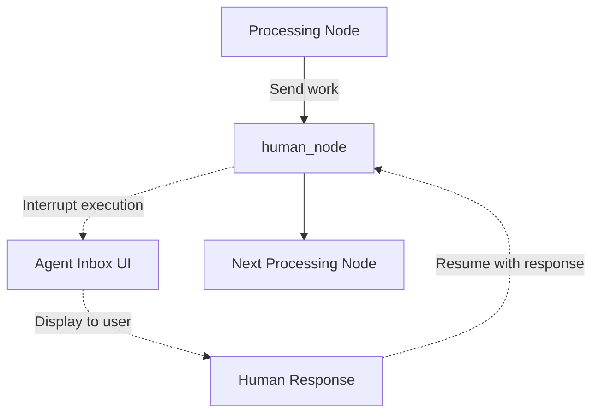

**Human-in-the-Loop Interrupt Pattern**

The `human_node` ([eaia/main/graph.py:153-154]()) is a no-op function that serves as an interrupt point. When execution reaches this node, the graph pauses and waits for human input via Agent Inbox. The `enter_after_human` routing function ([eaia/main/graph.py:88-113]()) determines what happens after human interaction.

**Sources:** [eaia/main/graph.py:88-113](), [eaia/main/graph.py:153-154]()

## External Integration Architecture

### Gmail and Calendar Integration

The [eaia/gmail.py]() module provides abstraction over Google APIs:

| Function | Purpose | Authentication |
|----------|---------|----------------|
| `fetch_group_emails()` | Retrieve emails within time window | LangChain Auth OAuth |
| `send_email()` | Send email reply | LangChain Auth OAuth |
| `mark_as_read()` | Mark email as read | LangChain Auth OAuth |
| `get_events_for_days()` | Query calendar availability | LangChain Auth OAuth |
| `send_calendar_invite()` | Create calendar event | LangChain Auth OAuth |

**Authentication Flow**: OAuth credentials are managed by LangChain Auth ([langchain-auth]()), which stores tokens in LangSmith and handles automatic refresh. The initial setup is performed by [scripts/setup_gmail.py](), which creates a Google OAuth provider.

**Sources:** [README.md:31-47](), [pyproject.toml:16]()

### LLM Provider Integration

EAIA supports dual LLM providers through LangChain abstractions:

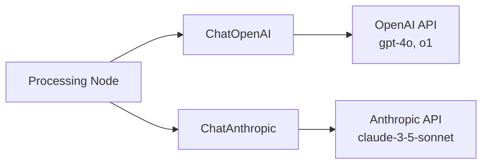

**LLM Provider Abstraction Layer**

Both providers are accessed through LangChain's unified interfaces ([langchain-openai](), [langchain-anthropic]()), enabling:
- **Model swapping** without code changes
- **Structured output** via `.with_structured_output()`
- **Tool binding** via `.bind_tools()`
- **Automatic tracing** to LangSmith

**Sources:** [pyproject.toml:13-14]()

## Deployment Architecture

### Thread and Run Management

EAIA uses LangGraph Platform's thread model for execution:

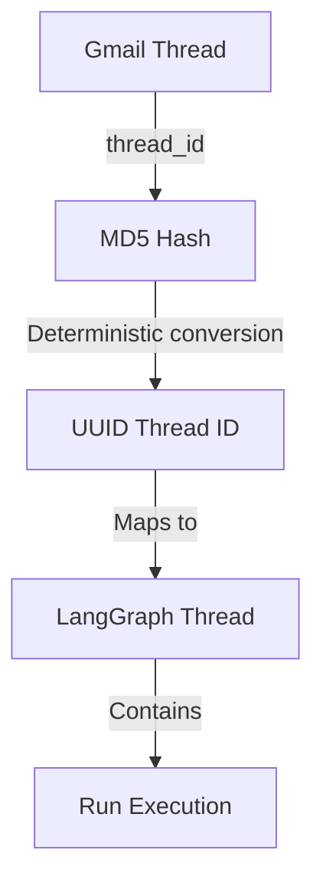

**Thread ID Generation and Mapping**

The [scripts/run_ingest.py]() script converts Gmail thread IDs to LangGraph thread IDs using MD5 hashing, ensuring the same email thread always maps to the same execution context. Each ingestion creates or updates a thread and initiates a new run.

### Execution Modes

| Mode | Entry Point | Trigger | Use Case |
|------|-------------|---------|----------|
| **Local Development** | `langgraph dev` | Manual `run_ingest.py` | Testing and debugging |
| **Production** | LangGraph Platform | `cron_graph.py` scheduled runs | Real-world operation |

In both modes, the same `StateGraph` ([eaia/main/graph.py]()) executes, but production adds automated triggering via [scripts/setup_cron.py]().

**Sources:** [README.md:66-159]()

## Storage Architecture

### BaseStore Organization

The `BaseStore` provides namespaced key-value storage:

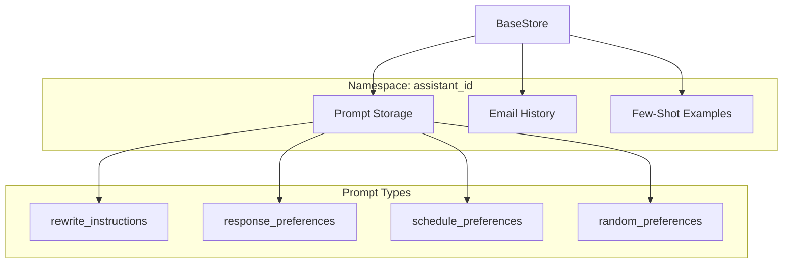

**BaseStore Namespace and Key Structure**

- **Namespace**: Each assistant (user) has isolated storage
- **Prompt Keys**: Four prompt types stored by (assistant_id, prompt_type)
- **History Keys**: Email IDs map to triage decisions for deduplication
- **Example Keys**: Few-shot examples stored for triage improvement

**Sources:** [README.md:49-65]()

## Configuration Management

Configuration is managed through two mechanisms:

### Static Configuration (config.yaml)

Located at [eaia/main/config.yaml](), contains:
- User identity: `email`, `full_name`, `name`, `timezone`
- Background context: `background`, `background_preferences`
- Behavioral rules: `triage_no`, `triage_notify`, `triage_email`
- Style preferences: `response_preferences`, `rewrite_preferences`, `schedule_preferences`

### Dynamic Configuration (BaseStore)

Learned through the reflection system:
- Prompts evolve based on user feedback
- Stored in BaseStore under prompt type keys
- Automatically applied in subsequent processing

**Sources:** [README.md:49-65]()

## Summary

The EAIA architecture demonstrates several key design patterns:

1. **StateGraph Orchestration**: LangGraph provides stateful workflow management with conditional routing
2. **Modular Processing**: Each processing step is an independent, composable node
3. **Human Oversight**: Interrupt mechanism ensures human approval before critical actions
4. **Adaptive Learning**: Asynchronous reflection system improves prompts over time
5. **Clean Abstractions**: External services accessed through well-defined integration layers
6. **Dual Storage**: Static configuration for rules, dynamic storage for learned behavior

This architecture enables EAIA to process emails reliably while continuously adapting to user preferences through feedback.

**Sources:** [README.md:1-179](), [eaia/main/graph.py:1-191](), [pyproject.toml:1-46]()

---

# Page: Core Data Structures and State Management

# Core Data Structures and State Management

<details>
<summary>Relevant source files</summary>

The following files were used as context for generating this wiki page:

- [eaia/main/find_meeting_time.py](eaia/main/find_meeting_time.py)
- [eaia/main/graph.py](eaia/main/graph.py)
- [eaia/schemas.py](eaia/schemas.py)

</details>


This page documents the core data structures used throughout EAIA and how state is managed as emails flow through the processing pipeline. It covers the central `State` TypedDict, the `EmailData` schema for email representation, Pydantic models for LLM outputs, and LangGraph's state reducer patterns (`add_messages` and `convert_obj`).

For information about how state flows through the orchestration graph and node routing, see [StateGraph Orchestration](#2.5). For details on persistent storage of prompts and history, see [Memory and Storage](#4.2).

## State TypedDict

The `State` TypedDict defined in [eaia/schemas.py:91-94]() serves as the canonical representation of processing context throughout the email processing pipeline. It contains three fields:

```python
class State(TypedDict):
    email: EmailData
    triage: Annotated[RespondTo, convert_obj]
    messages: Annotated[List[AnyMessage], add_messages]
```

| Field | Type | Purpose | Reducer |
|-------|------|---------|---------|
| `email` | `EmailData` | The current email being processed | None (immutable) |
| `triage` | `RespondTo` | Classification decision from triage node | `convert_obj` |
| `messages` | `List[AnyMessage]` | Conversation history with the LLM | `add_messages` |

The `email` field is populated during ingestion and remains unchanged throughout processing. The `triage` and `messages` fields are updated by various nodes as the email flows through the graph.

**Sources:** [eaia/schemas.py:91-94]()

## EmailData Schema

`EmailData` is a TypedDict that structures raw email data fetched from Gmail into a consistent format:

```python
class EmailData(TypedDict):
    id: str
    thread_id: str
    from_email: str
    subject: str
    page_content: str
    send_time: str
    to_email: str
```

### Field Descriptions

| Field | Description | Example |
|-------|-------------|---------|
| `id` | Unique Gmail message ID | `"18c5f..."` |
| `thread_id` | Gmail thread ID | `"18c5e..."` |
| `from_email` | Sender's email address | `"sender@example.com"` |
| `subject` | Email subject line | `"Meeting request"` |
| `page_content` | Full email body (plain text or HTML converted to text) | Email content string |
| `send_time` | Timestamp when email was sent | ISO 8601 format |
| `to_email` | Recipient's email address | `"user@example.com"` |

This structure is created during email ingestion (see [Email Ingestion](#2.1)) and populated into the `State.email` field at the start of each processing run.

**Sources:** [eaia/schemas.py:10-17]()

## LLM Output Schemas

EAIA uses Pydantic `BaseModel` classes to enforce structured outputs from LLM calls. Each schema represents a specific type of action or decision the LLM can make.

### Triage Decision Schema

```python
class RespondTo(BaseModel):
    logic: str = Field(
        description="logic on WHY the response choice is the way it is", default=""
    )
    response: Literal["no", "email", "notify", "question"] = "no"
```

The `RespondTo` schema enforces that triage decisions are one of four types:
- `"no"` - Ignore the email (mark as read)
- `"email"` - Draft a response email
- `"notify"` - Send notification without drafting
- `"question"` - Ask user a clarifying question

**Sources:** [eaia/schemas.py:20-24]()

### Email Draft Schemas

Two schemas represent different types of email drafts:

```python
class ResponseEmailDraft(BaseModel):
    """Draft of an email to send as a response."""
    content: str
    new_recipients: List[str]

class NewEmailDraft(BaseModel):
    """Draft of a new email to send."""
    content: str
    recipients: List[str]
```

`ResponseEmailDraft` is used when replying to an existing thread and may add new recipients (CC/BCC). `NewEmailDraft` is used for composing entirely new emails.

**Sources:** [eaia/schemas.py:27-38]()

### Rewrite Schema

```python
class ReWriteEmail(BaseModel):
    """Logic for rewriting an email"""
    tone_logic: str = Field(
        description="Logic for what the tone of the rewritten email should be"
    )
    rewritten_content: str = Field(description="Content rewritten with the new tone")
```

This schema enforces that rewrite operations include both reasoning about tone adjustments and the actual rewritten content.

**Sources:** [eaia/schemas.py:41-47]()

### Tool Schemas

Four schemas represent tools the LLM can invoke during draft generation:

```python
class Question(BaseModel):
    """Question to ask user."""
    content: str

class Ignore(BaseModel):
    """Call this to ignore the email. Only call this if user has said to do so."""
    ignore: bool

class MeetingAssistant(BaseModel):
    """Call this to have user's meeting assistant look at it."""
    call: bool

class SendCalendarInvite(BaseModel):
    """Call this to send a calendar invite."""
    emails: List[str]
    title: str
    start_time: str  # Format: "2024-07-01T14:00:00"
    end_time: str    # Format: "2024-07-01T14:00:00"
```

These schemas are bound to the LLM in `draft_response.py` using tool binding patterns.

**Sources:** [eaia/schemas.py:50-80]()

## State Reducers and Annotations

LangGraph uses annotations to control how state updates are merged. EAIA employs two reducer functions.

### add_messages Reducer

The `messages` field uses LangGraph's built-in `add_messages` reducer:

```python
messages: Annotated[List[AnyMessage], add_messages]
```

This reducer:
- Accumulates messages into a conversation history
- Prevents duplicate messages (based on message ID)
- Handles message updates and deletions via `RemoveMessage`
- Maintains correct ordering of the conversation

Nodes can append messages by returning `{"messages": [new_message]}`, and the reducer automatically merges them with existing messages.

**Sources:** [eaia/schemas.py:7](), [eaia/schemas.py:94]()

### convert_obj Reducer

The `triage` field uses a custom `convert_obj` function:

```python
def convert_obj(o, m):
    if isinstance(m, dict):
        return RespondTo(**m)
    else:
        return m

triage: Annotated[RespondTo, convert_obj]
```

This reducer ensures that triage updates are properly typed. When a node returns a dictionary for the triage field, it's automatically converted to a `RespondTo` instance. This is necessary because Pydantic models cannot be directly mixed with TypedDict without explicit conversion.

**Sources:** [eaia/schemas.py:84-88](), [eaia/schemas.py:93]()

## State Flow Diagram

The following diagram shows how `State` flows through the graph nodes and which nodes update which fields:

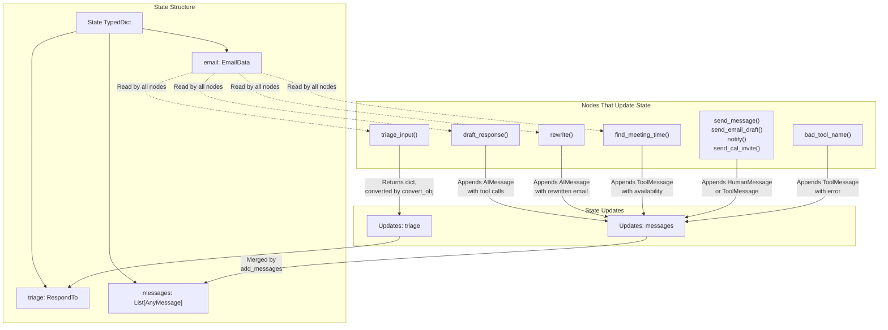

**Sources:** [eaia/schemas.py:91-94](), [eaia/main/graph.py:162-190]()

## State Access Patterns in Nodes

Different nodes access and update state in specific patterns. The table below summarizes common access patterns:

| Node | Reads From State | Updates To State | Return Format |
|------|------------------|------------------|---------------|
| `triage_input` | `email` | `triage` | `{"triage": RespondTo}` or dict |
| `draft_response` | `email`, `messages` | `messages` | `{"messages": [AIMessage]}` |
| `rewrite` | `email`, `messages` | `messages` | `{"messages": [AIMessage]}` |
| `find_meeting_time` | `email`, `messages` | `messages` | `{"messages": [ToolMessage]}` |
| `send_email_draft` | `email`, `messages` | `messages` | `{"messages": [HumanMessage]}` |
| `mark_as_read_node` | `email` | None | `{}` |

### Example: State Access in find_meeting_time

The `find_meeting_time` node demonstrates typical state access patterns:

```python
async def find_meeting_time(state: State, config: RunnableConfig):
    # Read email data
    email_thread = state["email"]["page_content"]
    author = state["email"]["from_email"]
    subject = state["email"]["subject"]
    
    # Read existing messages
    messages = state.get("messages") or []
    messages = messages[:-1]  # Remove last message
    
    # ... processing ...
    
    # Return update to messages field
    prediction = state["messages"][-1]
    tool_call = prediction.tool_calls[0]
    return {
        "messages": [
            ToolMessage(
                content=result["messages"][-1].content, 
                tool_call_id=tool_call["id"]
            )
        ]
    }
```

This pattern shows:
1. Reading from `state["email"]` to access email data
2. Reading from `state["messages"]` to access conversation history
3. Returning a dict with `"messages"` key to append new messages

**Sources:** [eaia/main/find_meeting_time.py:66-96]()

## Schema-to-Code Mapping

The following diagram maps the Pydantic schemas to their usage locations in the codebase:

```mermaid
graph TB
    subgraph "Schemas in eaia/schemas.py"
        EmailData["EmailData<br/>(TypedDict)"]
        State["State<br/>(TypedDict)"]
        RespondTo["RespondTo<br/>(BaseModel)"]
        ResponseEmailDraft["ResponseEmailDraft<br/>(BaseModel)"]
        ReWriteEmail["ReWriteEmail<br/>(BaseModel)"]
        Question["Question<br/>(BaseModel)"]
        MeetingAssistant["MeetingAssistant<br/>(BaseModel)"]
        SendCalendarInvite["SendCalendarInvite<br/>(BaseModel)"]
        Ignore["Ignore<br/>(BaseModel)"]
    end
    
    subgraph "Usage in Processing Nodes"
        TriageNode["triage.py<br/>triage_input()"]
        DraftNode["draft_response.py<br/>draft_response()"]
        RewriteNode["rewrite.py<br/>rewrite()"]
        MeetingNode["find_meeting_time.py<br/>find_meeting_time()"]
        GraphFile["graph.py<br/>route_after_triage()<br/>take_action()<br/>enter_after_human()"]
    end
    
    subgraph "LLM Integration"
        StructuredOutput["with_structured_output()"]
        ToolBinding["bind_tools()"]
    end
    
    State -.->|"Function parameter"| TriageNode
    State -.->|"Function parameter"| DraftNode
    State -.->|"Function parameter"| RewriteNode
    State -.->|"Function parameter"| MeetingNode
    State -.->|"Function parameter"| GraphFile
    
    RespondTo -->|"Enforced by"| StructuredOutput
    StructuredOutput -->|"Used in"| TriageNode
    
    ReWriteEmail -->|"Enforced by"| StructuredOutput
    StructuredOutput -->|"Used in"| RewriteNode
    
    Question -->|"Bound as tool"| ToolBinding
    ResponseEmailDraft -->|"Bound as tool"| ToolBinding
    MeetingAssistant -->|"Bound as tool"| ToolBinding
    SendCalendarInvite -->|"Bound as tool"| ToolBinding
    Ignore -->|"Bound as tool"| ToolBinding
    ToolBinding -->|"Used in"| DraftNode
    
    RespondTo -.->|"Read by"| GraphFile
    Question -.->|"Routing logic"| GraphFile
    ResponseEmailDraft -.->|"Routing logic"| GraphFile
    MeetingAssistant -.->|"Routing logic"| GraphFile
    SendCalendarInvite -.->|"Routing logic"| GraphFile
    Ignore -.->|"Routing logic"| GraphFile
```

**Sources:** [eaia/schemas.py:1-101](), [eaia/main/triage.py](), [eaia/main/draft_response.py](), [eaia/main/rewrite.py](), [eaia/main/find_meeting_time.py:1-96](), [eaia/main/graph.py:1-191]()

## Conditional Routing Based on State

The orchestration graph uses state values to make routing decisions. Three key routing functions examine state to determine the next node:

### route_after_triage

```python
def route_after_triage(
    state: State,
) -> Literal["draft_response", "mark_as_read_node", "notify"]:
    if state["triage"].response == "email":
        return "draft_response"
    elif state["triage"].response == "no":
        return "mark_as_read_node"
    elif state["triage"].response == "notify":
        return "notify"
    elif state["triage"].response == "question":
        return "draft_response"
    else:
        raise ValueError
```

This function reads `state["triage"].response` to route after triage classification.

**Sources:** [eaia/main/graph.py:30-42]()

### take_action

```python
def take_action(
    state: State,
) -> Literal[
    "send_message",
    "rewrite",
    "mark_as_read_node",
    "find_meeting_time",
    "send_cal_invite",
    "bad_tool_name",
]:
    prediction = state["messages"][-1]
    if len(prediction.tool_calls) != 1:
        raise ValueError
    tool_call = prediction.tool_calls[0]
    if tool_call["name"] == "Question":
        return "send_message"
    elif tool_call["name"] == "ResponseEmailDraft":
        return "rewrite"
    elif tool_call["name"] == "Ignore":
        return "mark_as_read_node"
    elif tool_call["name"] == "MeetingAssistant":
        return "find_meeting_time"
    elif tool_call["name"] == "SendCalendarInvite":
        return "send_cal_invite"
    else:
        return "bad_tool_name"
```

This function examines the last message in `state["messages"]` to determine which tool was called by the LLM.

**Sources:** [eaia/main/graph.py:45-70]()

### enter_after_human

```python
def enter_after_human(
    state,
) -> Literal[
    "mark_as_read_node", "draft_response", "send_email_node", "send_cal_invite_node"
]:
    messages = state.get("messages") or []
    if len(messages) == 0:
        if state["triage"].response == "notify":
            return "mark_as_read_node"
        raise ValueError
    else:
        if isinstance(messages[-1], (ToolMessage, HumanMessage)):
            return "draft_response"
        else:
            execute = messages[-1].tool_calls[0]
            if execute["name"] == "ResponseEmailDraft":
                return "send_email_node"
            elif execute["name"] == "SendCalendarInvite":
                return "send_cal_invite_node"
            elif execute["name"] == "Ignore":
                return "mark_as_read_node"
            elif execute["name"] == "Question":
                return "draft_response"
            else:
                raise ValueError
```

This function determines routing after human interaction by examining both `state["triage"]` and `state["messages"]`.

**Sources:** [eaia/main/graph.py:88-112]()

## Email Template Formatting

The `email_template` string defined in [eaia/schemas.py:97-101]() provides a consistent format for displaying email content to LLMs:

```python
email_template = """From: {author}
To: {to}
Subject: {subject}

{email_thread}"""
```

This template is used throughout processing nodes to format email data into a readable string for LLM consumption. For example, in `find_meeting_time.py`, the template is populated with values from `state["email"]`:

```python
input_message = meeting_prompts.format(
    email_thread=state["email"]["page_content"],
    author=state["email"]["from_email"],
    subject=state["email"]["subject"],
    # ... other fields
)
```

**Sources:** [eaia/schemas.py:97-101](), [eaia/main/find_meeting_time.py:73-81]()

## State Lifecycle Summary

The complete lifecycle of state through the system:

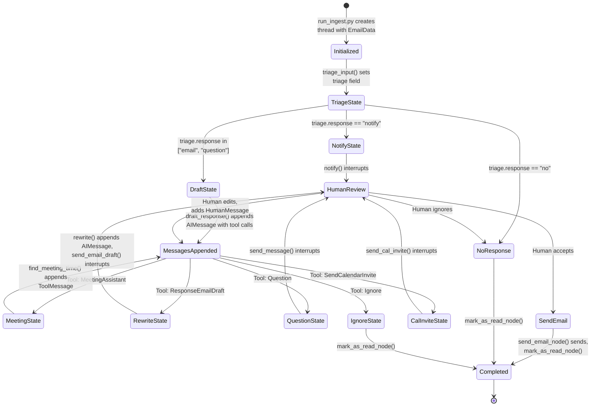

Key transitions:
1. **Initialized**: State contains `email` field populated from Gmail
2. **TriageState**: `triage` field is set with classification decision
3. **MessagesAppended**: `messages` field grows as nodes append to conversation
4. **HumanReview**: State pauses for human input via `HumanInterrupt`
5. **Completed**: State processing finishes, email marked as read

**Sources:** [eaia/main/graph.py:1-191](), [eaia/schemas.py:91-94]()

---

# Page: Email Processing System

# Email Processing System

<details>
<summary>Relevant source files</summary>

The following files were used as context for generating this wiki page:

- [README.md](README.md)
- [eaia/main/graph.py](eaia/main/graph.py)

</details>


This document provides an overview of the complete email processing pipeline in EAIA, from email ingestion through classification, response generation, rewriting, and final actions. It explains how the `StateGraph` orchestrator coordinates processing nodes, manages state flow, and integrates with external services.

For detailed information about specific subsystems:
- Email fetching and thread creation: see [Email Ingestion](#2.1)
- Classification logic and decision-making: see [Email Triage Logic](#2.2)
- Draft generation and tone adjustment: see [Email Response Generation](#2.3)
- Meeting scheduling and calendar queries: see [Calendar Integration](#2.4)
- StateGraph coordination and routing: see [StateGraph Orchestration](#2.5)

For setup and configuration: see [Installation and Setup](#1.1) and [Configuration](#5).

## Pipeline Overview

The email processing pipeline consists of five distinct stages that transform incoming emails into actionable outputs:

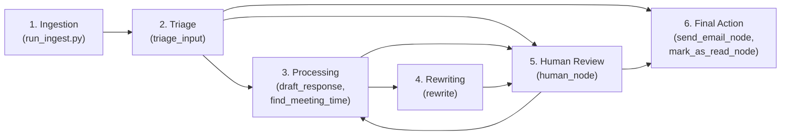

**Sources:** [README.md:1-179](), [eaia/main/graph.py:1-191]()

### Stage Descriptions

| Stage | Purpose | Key Functions | Output |
|-------|---------|---------------|--------|
| **Ingestion** | Fetch emails from Gmail, create LangGraph threads | `fetch_group_emails`, `run_ingest.py` | `EmailData` objects, thread creation |
| **Triage** | Classify emails into response categories | `triage_input` | `RespondTo` with decision: "no", "notify", "email", "question" |
| **Processing** | Generate draft responses, query calendar | `draft_response`, `find_meeting_time` | Tool calls: `ResponseEmailDraft`, `Question`, `MeetingAssistant`, `SendCalendarInvite` |
| **Rewriting** | Adjust tone according to user preferences | `rewrite` | Modified email draft with adjusted tone |
| **Human Review** | Present work to user via Agent Inbox | `send_email_draft`, `notify`, `send_message`, `send_cal_invite` | User action: accept, edit, ignore, response |
| **Final Action** | Execute approved actions | `send_email_node`, `mark_as_read_node`, `send_cal_invite_node` | Gmail API calls to send/mark emails |

**Sources:** [eaia/main/graph.py:1-191](), [README.md:66-104]()

## System Components

The following diagram maps the high-level processing stages to their concrete implementations in the codebase:

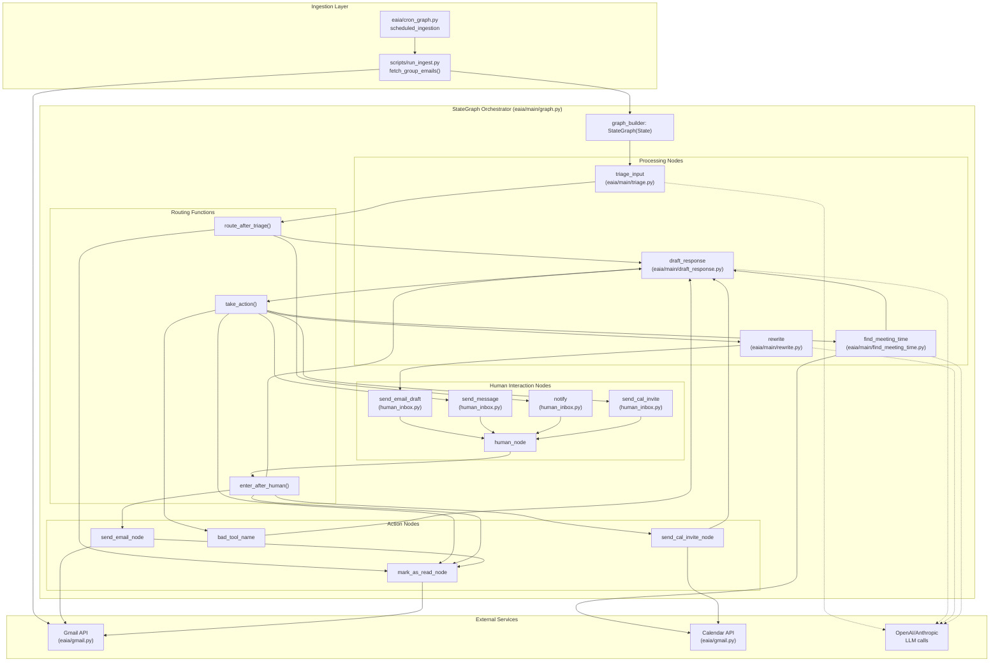

**Sources:** [eaia/main/graph.py:1-191](), [README.md:1-179]()

## Processing Flow

The `StateGraph` in [eaia/main/graph.py:162-190]() defines the complete processing workflow. Each node processes the `State` object and makes routing decisions based on the current state.

### Entry Point and Triage

The graph entry point is the `triage_input` node ([graph.py:176]()):

```mermaid
sequenceDiagram
    participant Ingestion as run_ingest.py
    participant Graph as StateGraph
    participant Triage as triage_input
    participant Router as route_after_triage()
    
    Ingestion->>Graph: Create thread with EmailData
    Graph->>Triage: state["email"] = EmailData
    Triage->>Triage: Classify email
    Triage->>Graph: state["triage"] = RespondTo
    Graph->>Router: Check triage.response
    
    alt response == "no"
        Router->>Graph: Route to mark_as_read_node
    else response == "notify"
        Router->>Graph: Route to notify
    else response == "email" or "question"
        Router->>Graph: Route to draft_response
    end
```

The routing logic in [graph.py:30-42]() implements the three-way classification:

| Triage Response | Route Target | Behavior |
|----------------|--------------|----------|
| `"no"` | `mark_as_read_node` | Mark email as read, end processing |
| `"notify"` | `notify` | Send notification to user, no draft generated |
| `"email"` | `draft_response` | Generate draft response |
| `"question"` | `draft_response` | Ask user for clarification |

**Sources:** [eaia/main/graph.py:30-42](), [eaia/main/graph.py:162-176]()

### Draft Response and Tool Selection

The `draft_response` node ([eaia/main/draft_response.py]()) generates an AI message with tool calls. The `take_action` function ([graph.py:45-70]()) routes based on the selected tool:

```mermaid
graph TB
    DraftResponse["draft_response<br/>AI selects tool"]
    TakeAction["take_action()<br/>Route based on tool_call"]
    
    Question["Tool: Question<br/>Route: send_message"]
    ResponseDraft["Tool: ResponseEmailDraft<br/>Route: rewrite"]
    Ignore["Tool: Ignore<br/>Route: mark_as_read_node"]
    Meeting["Tool: MeetingAssistant<br/>Route: find_meeting_time"]
    CalInvite["Tool: SendCalendarInvite<br/>Route: send_cal_invite"]
    BadTool["Invalid tool<br/>Route: bad_tool_name"]
    
    DraftResponse --> TakeAction
    TakeAction --> Question
    TakeAction --> ResponseDraft
    TakeAction --> Ignore
    TakeAction --> Meeting
    TakeAction --> CalInvite
    TakeAction --> BadTool
    
    Question --> HumanNode["human_node"]
    ResponseDraft --> Rewrite["rewrite"]
    Meeting --> FindMeeting["find_meeting_time"]
    CalInvite --> HumanInvite["send_cal_invite"]
    BadTool --> ErrorMsg["bad_tool_name<br/>ToolMessage with error"]
    
    Rewrite --> SendDraft["send_email_draft"]
    FindMeeting --> BackToDraft["draft_response<br/>(re-enter)"]
    ErrorMsg --> BackToDraft
    SendDraft --> HumanNode
    HumanInvite --> HumanNode
```

The tool call routing in [graph.py:55-70]() checks `tool_calls[0]["name"]` and dispatches accordingly. Invalid tool names route to `bad_tool_name` ([graph.py:73-85]()), which injects an error message and re-enters `draft_response`.

**Sources:** [eaia/main/graph.py:45-85](), [eaia/main/graph.py:177-183]()

### Human Interaction and Final Actions

After processing, work is presented to the user via the `human_node` ([graph.py:153-154]()). The `enter_after_human` function ([graph.py:88-112]()) determines the next action based on user response:

```mermaid
flowchart TD
    Human["human_node<br/>(HumanInterrupt)"]
    Router["enter_after_human()"]
    
    CheckMessages{"Check<br/>state['messages']"}
    CheckType{"Check<br/>message type"}
    CheckToolCall{"Check<br/>tool_call name"}
    
    Human --> Router
    Router --> CheckMessages
    
    CheckMessages -->|"len(messages) == 0"| NotifyCheck{"triage.response<br/>== 'notify'?"}
    NotifyCheck -->|Yes| MarkRead1["mark_as_read_node"]
    NotifyCheck -->|No| Error["ValueError"]
    
    CheckMessages -->|"messages exist"| CheckType
    
    CheckType -->|"ToolMessage or<br/>HumanMessage"| BackToDraft["draft_response<br/>(user edited/responded)"]
    CheckType -->|"AIMessage"| CheckToolCall
    
    CheckToolCall -->|"ResponseEmailDraft"| SendEmail["send_email_node"]
    CheckToolCall -->|"SendCalendarInvite"| SendCal["send_cal_invite_node"]
    CheckToolCall -->|"Ignore"| MarkRead2["mark_as_read_node"]
    CheckToolCall -->|"Question"| BackToDraft2["draft_response<br/>(re-ask)"]
    CheckToolCall -->|"other"| Error2["ValueError"]
    
    SendEmail --> MarkRead3["mark_as_read_node<br/>(after sending)"]
    SendCal --> BackToDraft3["draft_response<br/>(after invite)"]
```

The routing logic handles four scenarios:

1. **No messages + notify triage**: Mark as read without action
2. **User feedback** (`ToolMessage` or `HumanMessage`): Re-enter `draft_response` with feedback
3. **User accepted `ResponseEmailDraft`**: Execute via `send_email_node`
4. **User accepted `SendCalendarInvite`**: Execute via `send_cal_invite_node`

**Sources:** [eaia/main/graph.py:88-112](), [eaia/main/graph.py:186-189]()

## Core Data Structures

The processing pipeline operates on a central `State` TypedDict ([eaia/schemas.py]()) that flows through all nodes:

| Field | Type | Purpose | Updated By |
|-------|------|---------|------------|
| `email` | `EmailData` | Current email being processed | Ingestion (initial) |
| `messages` | `list[AnyMessage]` | Conversation history | `draft_response`, `rewrite`, tool nodes (via `add_messages` reducer) |
| `triage` | `RespondTo` | Classification decision | `triage_input` |

### EmailData Schema

The `EmailData` structure ([eaia/schemas.py]()) represents a Gmail email with fields:

- `id`: Gmail message ID
- `thread_id`: Gmail thread ID  
- `from_email`: Sender email address
- `from_name`: Sender display name
- `to_email`: Recipient email address
- `subject`: Email subject line
- `body`: Email body content
- `date`: Timestamp
- `snippet`: Email preview text

**Sources:** [eaia/schemas.py]()

### RespondTo Schema

The `RespondTo` schema ([eaia/main/triage.py]()) contains the triage classification:

- `response`: One of `"no"`, `"notify"`, `"email"`, `"question"`
- `rationale`: Explanation for the classification decision

**Sources:** [eaia/main/triage.py]()

### Tool Call Schemas

The `draft_response` node uses tool binding with these schemas ([eaia/main/draft_response.py]()):

- `ResponseEmailDraft`: Email draft with `content`, `new_recipients` fields
- `Question`: User query with `question` field
- `MeetingAssistant`: Meeting query with `request` field
- `SendCalendarInvite`: Calendar invite with `emails`, `title`, `start_time`, `end_time` fields

**Sources:** [eaia/main/draft_response.py]()

## Integration Points

The email processing system integrates with external services through well-defined interfaces:

### Gmail API Integration

Functions in [eaia/gmail.py]() provide Gmail operations:

- `fetch_group_emails(minutes_since, email)`: Fetch emails from last N minutes
- `send_email(message_id, content, email, addn_recipients)`: Send reply email
- `mark_as_read(message_id, email)`: Mark email as read
- `get_events_for_days(email, days, start_day)`: Query calendar events
- `send_calendar_invite(emails, title, start_time, end_time, sender_email)`: Create calendar event

These functions use Google OAuth authentication configured via [scripts/setup_gmail.py]().

**Sources:** [eaia/gmail.py](), [README.md:32-47]()

### LLM Integration

Processing nodes call LLM APIs through LangChain abstractions:

- `triage_input` ([eaia/main/triage.py]()): Uses `ChatOpenAI` or `ChatAnthropic` with structured output
- `draft_response` ([eaia/main/draft_response.py]()): Uses tool binding with multiple tools
- `rewrite` ([eaia/main/rewrite.py]()): Uses structured output for tone adjustment
- `find_meeting_time` ([eaia/main/find_meeting_time.py]()): Uses `create_react_agent` with calendar tools

**Sources:** [eaia/main/triage.py](), [eaia/main/draft_response.py](), [eaia/main/rewrite.py](), [eaia/main/find_meeting_time.py]()

### Agent Inbox Integration

Human interaction nodes ([eaia/main/human_inbox.py]()) use `AgentInboxClient` to present work:

- `send_email_draft`: Display draft for review
- `send_message`: Display question for user
- `notify`: Send notification without draft
- `send_cal_invite`: Display calendar invite for approval

These nodes inject `HumanInterrupt` exceptions that pause execution until user response arrives via Agent Inbox.

**Sources:** [eaia/main/human_inbox.py](), [README.md:90-104]()

## Configuration and Customization

The processing pipeline behavior is controlled by [eaia/main/config.yaml]():

| Configuration Key | Used By | Purpose |
|-------------------|---------|---------|
| `triage_no` | `triage_input` | Guidelines for ignoring emails |
| `triage_notify` | `triage_input` | Guidelines for notification-only emails |
| `triage_email` | `triage_input` | Guidelines for drafting responses |
| `response_preferences` | `draft_response` | Content preferences for drafts |
| `rewrite_preferences` | `rewrite` | Tone and style preferences |
| `schedule_preferences` | `draft_response`, `find_meeting_time` | Meeting scheduling preferences |
| `background_preferences` | `draft_response` | Contextual information for drafts |

Configuration is loaded via `get_config(config)` ([eaia/main/config.py]()) and merged with prompts stored in `BaseStore`.

**Sources:** [eaia/main/config.yaml](), [README.md:49-64]()

## Execution Models

The email processing system supports two execution models:

### Local Development

Run locally with [README.md:72-88]():

1. Start development server: `langgraph dev` (port 2024)
2. Trigger ingestion: `python scripts/run_ingest.py --minutes-since 120 --url http://127.0.0.1:2024`
3. Connect Agent Inbox to `http://127.0.0.1:2024` with graph ID `main`

### Production Deployment

Deploy to LangGraph Platform with [README.md:106-159]():

1. Deploy to LangGraph Platform via GitHub integration
2. Set up cron job: `python scripts/setup_cron.py --url ${DEPLOYMENT_URL}`
3. Automated ingestion via [eaia/cron_graph.py]() on schedule
4. Connect Agent Inbox to production deployment URL

The cron graph ([eaia/cron_graph.py]()) calls `run_ingest.py` with configurable parameters (`minutes_since`, `early`, `rerun`) to periodically check for new emails.

**Sources:** [README.md:66-159](), [eaia/cron_graph.py]()

---

# Page: Email Ingestion

# Email Ingestion

<details>
<summary>Relevant source files</summary>

The following files were used as context for generating this wiki page:

- [eaia/cron_graph.py](eaia/cron_graph.py)
- [eaia/gmail.py](eaia/gmail.py)
- [scripts/run_ingest.py](scripts/run_ingest.py)

</details>


## Purpose and Scope

Email ingestion is the entry point for the EAIA system. It fetches emails from Gmail, transforms them into structured `EmailData` objects, and creates or updates LangGraph threads for processing. This document covers the Gmail API integration, thread ID generation logic, and the two ingestion mechanisms (manual and automated).

For information about OAuth setup and credential management, see [Installation and Setup](#1.1). For details on what happens after ingestion (email classification and processing), see [Email Triage Logic](#2.2).

---

## System Overview

The email ingestion system operates through two primary entry points that share common logic:

1. **Manual Ingestion**: The `run_ingest.py` script allows developers to manually trigger email fetching, typically during development or testing
2. **Automated Ingestion**: The `cron_graph.py` StateGraph enables scheduled email checking in production deployments

Both mechanisms use the same core `fetch_group_emails()` function from `gmail.py` to retrieve emails, apply the same thread ID generation algorithm to ensure consistency, and create runs on the main StateGraph for processing.

**Sources:** [scripts/run_ingest.py:1-135](), [eaia/cron_graph.py:1-55](), [eaia/gmail.py:187-286]()

---

## Gmail API Integration

### Authentication and Credentials

The system authenticates with Gmail using OAuth2 credentials managed by LangChain Auth. The `get_credentials()` function retrieves tokens for a specific user email:

```python
async def get_credentials(
    user_email: str,
    langsmith_api_key: str | None = None
) -> Credentials
```

This function:
- Creates a LangChain Auth `Client` using the LangSmith API key
- Authenticates with Google's OAuth provider using the `user_email` as the user ID
- Requests scopes for Gmail modification and Calendar access
- Returns a `Credentials` object suitable for Google API calls

**Sources:** [eaia/gmail.py:30-83]()

### Fetching Emails

The `fetch_group_emails()` function is the core email retrieval mechanism:

```python
async def fetch_group_emails(
    to_email,
    minutes_since: int = 30,
    gmail_token: str | None = None,
    gmail_secret: str | None = None,
) -> Iterable[EmailData]
```

#### Query Construction

The function constructs a Gmail query to find relevant emails:

```
(to:{user_email} OR from:{user_email}) after:{timestamp}
```

This query retrieves:
- Emails sent **to** the user
- Emails sent **from** the user (to detect user responses)
- Only emails received after a specified timestamp (controlled by `minutes_since` parameter)

**Sources:** [eaia/gmail.py:187-198]()

### Email Filtering Logic

The function implements sophisticated filtering to determine which emails require processing:

```mermaid
flowchart TD
    Start["Fetch all messages<br/>matching query"] --> Loop["For each message"]
    Loop --> GetThread["Get thread details"]
    GetThread --> CheckLast["Get last message<br/>in thread"]
    CheckLast --> FromUser{"Last message<br/>from user?"}
    FromUser -->|Yes| YieldUserRespond["Yield with<br/>user_respond: true"]
    FromUser -->|No| CheckCurrent{"Current message<br/>is last in thread?"}
    CheckCurrent -->|Yes| NotFromUser{"Current message<br/>NOT from user?"}
    NotFromUser -->|Yes| Extract["Extract email data<br/>and yield"]
    NotFromUser -->|No| Skip["Skip"]
    CheckCurrent -->|No| Skip
    YieldUserRespond --> Loop
    Extract --> Loop
    Skip --> Loop
```

The logic ensures:
- **User Response Detection**: If the last message in a thread is from the user, it yields a marker indicating the user already responded (preventing duplicate responses)
- **Actionable Emails Only**: Only emails where the current message is the last in the thread and NOT from the user are processed
- **Recent Emails**: Emails are already filtered by timestamp in the query

**Sources:** [eaia/gmail.py:216-281]()

### Email Data Extraction

For each processable email, the function extracts structured data:

| Field | Source | Description |
|-------|--------|-------------|
| `from_email` | `From` header | Sender address (or `Reply-To` if present) |
| `to_email` | `To` header | Recipient address |
| `subject` | `Subject` header | Email subject line |
| `page_content` | Message body | Extracted via `extract_message_part()` |
| `id` | Message ID | Gmail message identifier |
| `thread_id` | Thread ID | Gmail thread identifier |
| `send_time` | `Date` header | ISO format timestamp |

The `extract_message_part()` function recursively walks through MIME parts to find either plain text or HTML content, decoding base64-encoded data.

**Sources:** [eaia/gmail.py:246-280](), [eaia/gmail.py:86-101]()

---

## Thread ID Generation

### Deterministic UUID Generation

A critical component of the ingestion system is generating consistent thread identifiers across runs. Both `run_ingest.py` and `cron_graph.py` use identical logic:

```python
thread_id = str(
    uuid.UUID(hex=hashlib.md5(email["thread_id"].encode("UTF-8")).hexdigest())
)
```

#### Algorithm Steps

```mermaid
flowchart LR
    Gmail["Gmail thread_id<br/>(string)"] --> Encode["UTF-8 encode"]
    Encode --> MD5["MD5 hash"]
    MD5 --> Hex["hexdigest()"]
    Hex --> UUID["Convert to UUID"]
    UUID --> String["String representation"]
    String --> LangGraph["LangGraph thread_id"]
```

This process:
1. Takes Gmail's native `thread_id` (a string identifier)
2. Encodes it as UTF-8 bytes
3. Computes an MD5 hash
4. Converts the hash digest to a UUID format
5. Stringifies the UUID for use as a LangGraph thread ID

#### Why This Matters

- **Consistency**: The same Gmail thread always maps to the same LangGraph thread, regardless of when ingestion runs
- **Idempotency**: Re-running ingestion for the same time period doesn't create duplicate processing threads
- **Thread Continuity**: Multiple emails in the same Gmail conversation are processed in the same LangGraph thread context

**Sources:** [scripts/run_ingest.py:44-46](), [eaia/cron_graph.py:22-24]()

---

## Ingestion Mechanisms

### Manual Ingestion: `run_ingest.py`

The manual ingestion script provides developer control over email fetching:

#### Script Parameters

| Parameter | Type | Default | Description |
|-----------|------|---------|-------------|
| `--url` | string | `http://127.0.0.1:2024` | LangGraph server URL to target |
| `--minutes-since` | int | 60 | Fetch emails from last N minutes |
| `--early` | int | 1 | Break when encountering already-seen emails |
| `--rerun` | int | 0 | Reprocess all emails even if seen |
| `--gmail-token` | string | None | (Deprecated) Gmail OAuth token |
| `--gmail-secret` | string | None | (Deprecated) Gmail OAuth secret |
| `--email` | string | None | Email address to fetch for (overrides config) |

#### Usage Examples

```bash
# Local development - fetch last hour of emails
python scripts/run_ingest.py

# Target production deployment
python scripts/run_ingest.py --url https://your-deployment.langraph.app

# Fetch last 2 hours, process all even if seen
python scripts/run_ingest.py --minutes-since 120 --rerun 1

# Fetch for specific email address
python scripts/run_ingest.py --email user@example.com
```

**Sources:** [scripts/run_ingest.py:78-134]()

### Automated Ingestion: `cron_graph.py`

The automated ingestion system is implemented as a LangGraph StateGraph designed for scheduled execution:

#### State Schema

```python
class JobKickoff(TypedDict):
    minutes_since: int
```

The graph accepts a single parameter controlling the time window for email fetching.

#### Graph Structure

```mermaid
graph LR
    START[START] --> main["main node"]
    main --> END[END]
```

The graph is minimal by design - it contains a single node that performs all ingestion logic.

#### Deployment Pattern

In production, this graph is deployed to LangGraph Platform and triggered by cron jobs (see [Automated Email Processing](#6.3)). The cron scheduler invokes the graph with a specified `minutes_since` value, typically set to match the cron interval to ensure no emails are missed.

**Sources:** [eaia/cron_graph.py:1-55]()

---

## Email Processing Workflow

### Thread Management

Both ingestion mechanisms follow the same workflow for each email:

```mermaid
sequenceDiagram
    participant Script as Ingestion Script
    participant SDK as LangGraph SDK
    participant Platform as LangGraph Platform
    participant Gmail as Gmail API

    Script->>Gmail: fetch_group_emails()
    Gmail-->>Script: Iterator of EmailData

    loop For each email
        Script->>Script: Generate thread_id<br/>(MD5 hash to UUID)
        Script->>SDK: client.threads.get(thread_id)
        
        alt Thread exists
            SDK-->>Script: Thread info with metadata
            Script->>Script: Check email_id in metadata
            
            alt Email already processed
                Script->>Script: Skip or break (based on flags)
            else New email
                Script->>SDK: Update thread metadata
                Script->>SDK: Create run on "main" graph
            end
        else Thread not found (404)
            SDK-->>Script: HTTPStatusError 404
            Script->>SDK: client.threads.create(thread_id)
            Script->>SDK: Update thread metadata
            Script->>SDK: Create run on "main" graph
        end
    end
```

**Sources:** [scripts/run_ingest.py:44-75](), [eaia/cron_graph.py:17-47]()

### Metadata Management

Each LangGraph thread maintains metadata to track processing state:

```python
metadata = {
    "email_id": email["id"]  # Gmail message ID of most recently processed email
}
```

This metadata enables:
- **Deduplication**: Checking if an email has already been processed in this thread
- **State Recovery**: Understanding the last email processed if the system restarts
- **Thread History**: Tracking which emails have been handled for a given conversation

The metadata is updated before creating a new run:

```python
await client.threads.update(thread_id, metadata={"email_id": email["id"]})
```

**Sources:** [scripts/run_ingest.py:59-68](), [eaia/cron_graph.py:37-40]()

### Run Creation

After ensuring the thread exists and is up-to-date, a new run is created on the `main` graph:

```python
await client.runs.create(
    thread_id,
    "main",
    input={"email": email},
    multitask_strategy="rollback",
)
```

Key parameters:
- **thread_id**: The generated UUID linking this run to the email thread
- **"main"**: The graph name to execute (defined in `graph.py`)
- **input**: The `EmailData` object to process
- **multitask_strategy="rollback"**: If a new run is created while one is active, rollback the current run

This invokes the main StateGraph which routes the email through triage, drafting, and other processing nodes (see [StateGraph Orchestration](#2.5)).

**Sources:** [scripts/run_ingest.py:70-75](), [eaia/cron_graph.py:42-47]()

### User Response Handling

When `fetch_group_emails()` detects that the user has already responded (last message in thread is from the user), it yields a special marker:

```python
yield {
    "id": message["id"],
    "thread_id": message["threadId"],
    "user_respond": True,
}
```

The ingestion logic handles this case specially:

```python
if "user_respond" in email:
    await client.threads.update_state(thread_id, None, as_node="__end__")
    continue
```

This immediately moves the thread to the END state, preventing any further processing. This is crucial because:
- The user has already handled the email manually
- No AI response is needed
- The thread should be marked as complete to avoid retriggering

**Sources:** [eaia/gmail.py:239-243](), [scripts/run_ingest.py:50-58](), [eaia/cron_graph.py:28-36]()

---

## Deduplication and Control Flags

### Email Deduplication

The system implements deduplication at the thread level by comparing the current email's ID with the `email_id` stored in thread metadata:

```python
recent_email = thread_info["metadata"].get("email_id")
if recent_email == email["id"]:
    # Email already processed
```

When a duplicate is detected, behavior depends on control flags.

**Sources:** [scripts/run_ingest.py:59-67]()

### Early Termination: `--early` Flag

The `early` flag (default: `1` / `True`) controls behavior when a duplicate email is encountered:

```python
if recent_email == email["id"]:
    if early:
        break  # Stop processing further emails
    else:
        if rerun:
            pass  # Continue to rerun logic
        else:
            continue  # Skip this email, continue to next
```

**When `early=True` (default)**:
- Encountering a previously-seen email terminates the entire ingestion run
- Assumes emails are returned in reverse chronological order
- Optimization: if we've already processed this email, we've processed all earlier emails too

**When `early=False`**:
- The script continues processing all emails in the time window
- Useful for ensuring completeness if email ordering is uncertain
- Required when using `--rerun` flag

**Sources:** [scripts/run_ingest.py:61-67]()

### Reprocessing: `--rerun` Flag

The `rerun` flag (default: `0` / `False`) forces reprocessing of previously-seen emails:

```python
if recent_email == email["id"]:
    if early:
        break
    else:
        if rerun:
            pass  # Allow reprocessing
        else:
            continue  # Skip
```

**When `rerun=True`**:
- Thread metadata is updated with the current email ID
- A new run is created even if this email was previously processed
- Useful for testing changes to processing logic
- **Requires `early=False`** to work properly

**When `rerun=False` (default)**:
- Duplicate emails are skipped
- Prevents redundant processing and duplicate responses

**Sources:** [scripts/run_ingest.py:64-67]()

### Control Flag Combinations

| `early` | `rerun` | Behavior |
|---------|---------|----------|
| True | False | Stop at first seen email (default, most efficient) |
| True | True | Invalid - early termination prevents rerun |
| False | False | Skip seen emails, process all new emails |
| False | True | Reprocess all emails in time window |

---

## Configuration Integration

### Email Address Resolution

Both ingestion mechanisms need to know which email address to fetch for. This is determined in order of precedence:

1. **Command-line argument** (manual ingestion only):
   ```python
   if email is None:
       email_address = get_config({"configurable": {}})["email"]
   else:
       email_address = email
   ```

2. **Configuration file**: Via `get_config()` which loads from `config.yaml`

The automated `cron_graph.py` always uses the config:

```python
email = get_config(config)["email"]
```

**Sources:** [scripts/run_ingest.py:21-24](), [eaia/cron_graph.py:19]()

### LangGraph Client Configuration

The ingestion scripts connect to LangGraph Platform using the SDK client:

**Manual Ingestion**:
```python
if url is None:
    client = get_client(url="http://127.0.0.1:2024")  # Local development
else:
    client = get_client(url=url)  # Specified URL
```

**Automated Ingestion**:
```python
client = get_client()  # Uses environment variables
```

In production deployment on LangGraph Platform, the automated graph inherits connection configuration from the platform environment.

**Sources:** [scripts/run_ingest.py:25-30](), [eaia/cron_graph.py:10]()

---

## Error Handling

### Thread Lookup Failures

The most common error case is when a thread doesn't exist yet. This is handled gracefully:

```python
try:
    thread_info = await client.threads.get(thread_id)
except httpx.HTTPStatusError as e:
    if "user_respond" in email:
        continue  # Skip user responses if thread missing
    if e.response.status_code == 404:
        thread_info = await client.threads.create(thread_id=thread_id)
    else:
        raise e  # Re-raise unexpected errors
```

This pattern:
- Creates threads on-demand when they don't exist
- Gracefully handles user-respond markers even if thread is missing
- Propagates unexpected HTTP errors for debugging

**Sources:** [scripts/run_ingest.py:47-55](), [eaia/cron_graph.py:26-33]()

### Email Parsing Failures

Individual email parsing failures are logged but don't stop the entire ingestion process:

```python
try:
    # Email parsing and processing logic
    yield { ... }
except Exception:
    logger.info(f"Failed on {message}")
```

This ensures one malformed email doesn't prevent processing of other emails in the batch.

**Sources:** [eaia/gmail.py:282-283]()

---

## Summary

The email ingestion system provides a robust foundation for the EAIA pipeline:

- **Gmail Integration**: Uses OAuth2 authentication and queries Gmail API for recent emails
- **Thread Consistency**: MD5-based UUID generation ensures deterministic thread mapping
- **Dual Mechanisms**: Manual script for development, automated graph for production
- **Smart Filtering**: Detects user responses and actionable emails requiring processing
- **Deduplication**: Thread metadata prevents reprocessing the same email
- **Flexible Control**: Flags enable different processing strategies (early termination, rerun)

After ingestion creates a run with `EmailData` input, the main StateGraph takes over to triage and process the email (see [Email Triage Logic](#2.2) and [StateGraph Orchestration](#2.5)).

**Sources:** [eaia/gmail.py:1-450](), [scripts/run_ingest.py:1-135](), [eaia/cron_graph.py:1-55]()

---

# Page: Email Triage Logic

# Email Triage Logic

<details>
<summary>Relevant source files</summary>

The following files were used as context for generating this wiki page:

- [eaia/main/fewshot.py](eaia/main/fewshot.py)
- [eaia/main/triage.py](eaia/main/triage.py)

</details>


This page documents the email triage system implemented in `eaia/main/triage.py`, which performs the initial classification of incoming emails. The triage system determines whether an email should be ignored, requires a drafted response, or needs user notification without a response. For information about what happens after triage (response generation), see [Email Response Generation](#2.3). For configuration of triage rules, see [Email Preferences Configuration](#5.1).

**Sources:** [eaia/main/triage.py:1-73]()

## Three-Way Classification System

The triage system classifies each email into one of three categories, represented by the `RespondTo` schema:

| Response Type | Value | Meaning | Subsequent Action |
|---------------|-------|---------|-------------------|
| **No Response** | `"no"` | Email is not worth responding to or notifying about | Email marked as read, processing ends |
| **Email Response** | `"email"` | Email requires a drafted response | Proceeds to draft_response.py |
| **Notification** | `"notify"` | Important for user to know about, but no response needed | User notified via Agent Inbox |

The classification is driven by user-configured rules defined in `config.yaml`:
- `triage_no`: Description of emails to ignore
- `triage_email`: Description of emails requiring responses
- `triage_notify`: Description of emails requiring notification only

**Sources:** [eaia/main/triage.py:16-43](), [eaia/schemas.py]()

## Triage Workflow

```mermaid
flowchart TB
    StateInput["State Input<br/>(email: EmailData)"]
    TriageInput["triage_input()<br/>eaia/main/triage.py:46"]
    
    GetModel["Get model from config<br/>(default: 'gpt-4o')"]
    CreateLLM["ChatOpenAI(model, temperature=0)"]
    
    GetFewShot["get_few_shot_examples()<br/>eaia/main/fewshot.py:32"]
    BaseStoreSearch["BaseStore.asearch()<br/>namespace: (assistant_id, 'triage_examples')"]
    
    GetConfig["get_config(config)<br/>Load user preferences"]
    
    FormatPrompt["Format triage_prompt<br/>with email data + config"]
    
    StructuredOutput["llm.with_structured_output(RespondTo)<br/>Enforce schema"]
    
    InvokeModel["model.ainvoke(input_message)"]
    
    CheckMessages{"len(state['messages']) > 0?"}
    
    CleanupMessages["Create RemoveMessage<br/>for each existing message"]
    
    ReturnWithCleanup["Return:<br/>{triage: response,<br/>messages: delete_messages}"]
    
    ReturnSimple["Return:<br/>{triage: response}"]
    
    StateInput --> TriageInput
    TriageInput --> GetModel
    GetModel --> CreateLLM
    
    TriageInput --> GetFewShot
    GetFewShot --> BaseStoreSearch
    BaseStoreSearch --> GetFewShot
    
    TriageInput --> GetConfig
    
    CreateLLM --> FormatPrompt
    GetFewShot --> FormatPrompt
    GetConfig --> FormatPrompt
    
    FormatPrompt --> StructuredOutput
    StructuredOutput --> InvokeModel
    
    InvokeModel --> CheckMessages
    
    CheckMessages -->|Yes| CleanupMessages
    CheckMessages -->|No| ReturnSimple
    
    CleanupMessages --> ReturnWithCleanup
```

**Workflow Steps:**

1. **Model Configuration**: Retrieves the LLM model from `config["configurable"]["model"]`, defaulting to `"gpt-4o"` [eaia/main/triage.py:47-48]()

2. **Few-Shot Example Retrieval**: Calls `get_few_shot_examples()` to retrieve up to 5 semantically similar historical triage decisions from BaseStore [eaia/main/triage.py:49]()

3. **User Configuration Loading**: Loads user-specific triage rules and preferences via `get_config()` [eaia/main/triage.py:50]()

4. **Prompt Formatting**: Populates the `triage_prompt` template with:
   - Email metadata (from, to, subject)
   - Email thread content
   - Few-shot examples
   - User configuration (name, background, triage rules)
   [eaia/main/triage.py:51-63]()

5. **Structured Output Binding**: Applies `with_structured_output(RespondTo)` to enforce the response schema and uses `tool_choice` to guarantee the RespondTo function is called [eaia/main/triage.py:64-66]()

6. **LLM Invocation**: Sends the formatted prompt to the LLM [eaia/main/triage.py:67]()

7. **Message Cleanup**: If previous messages exist in state (e.g., from a re-run), creates `RemoveMessage` objects to clear them before returning the triage decision [eaia/main/triage.py:68-70]()

**Sources:** [eaia/main/triage.py:46-72](), [eaia/main/fewshot.py:32-40](), [eaia/main/config.py]()

## Prompt Template Structure

The `triage_prompt` template [eaia/main/triage.py:16-43]() follows a structured format:

### Identity and Context
```
You are {full_name}'s executive assistant. You are a top-notch executive assistant 
who cares about {name} performing as well as possible.

{background}.
```
Establishes the assistant's role and loads user background from configuration.

### Task Description
```
{name} gets lots of emails. Your job is to categorize the below email to see 
whether is it worth responding to.
```

### Classification Rules
Three sections define the classification criteria using user-configured descriptions:

1. **Emails not worth responding to**: `{triage_no}` - Examples of emails to ignore
2. **Emails worth responding to**: `{triage_email}` - Examples requiring draft responses
3. **Emails to notify about**: `{triage_notify}` - Examples requiring notification only

### Decision Instructions
```
For emails not worth responding to, respond `no`. 
For something where {name} should respond over email, respond `email`. 
If it's important to notify {name}, but no email is required, respond `notify`.

If unsure, opt to `notify` {name} - you will learn from this in the future.
```
The prompt explicitly instructs the LLM to prefer `notify` when uncertain, as this triggers user feedback that improves future triage accuracy via the reflection system.

### Few-Shot Examples
```
{fewshotexamples}
```
Inserts 0-5 similar historical triage decisions retrieved from BaseStore.

### Current Email
```
Please determine how to handle the below email thread:

From: {author}
To: {to}
Subject: {subject}

{email_thread}
```
Presents the current email for classification.

**Sources:** [eaia/main/triage.py:16-43]()

## Few-Shot Learning Mechanism

```mermaid
sequenceDiagram
    participant TriageInput as "triage_input()"
    participant GetFewShot as "get_few_shot_examples()"
    participant BaseStore as "BaseStore"
    participant Format as "format_similar_examples_store()"
    
    TriageInput->>GetFewShot: email, store, config
    
    GetFewShot->>GetFewShot: Build namespace:<br/>(assistant_id, "triage_examples")
    
    GetFewShot->>BaseStore: asearch(namespace,<br/>query=str({"input": email}),<br/>limit=5)
    
    BaseStore-->>GetFewShot: List of similar examples<br/>(or None)
    
    alt No examples found
        GetFewShot-->>TriageInput: "" (empty string)
    else Examples found
        GetFewShot->>Format: examples
        Format->>Format: Build formatted string:<br/>"Here are some previous examples:"
        
        loop For each example
            Format->>Format: Add template.format():<br/>- subject<br/>- from_email<br/>- to_email<br/>- content[:400]<br/>- triage result
        end
        
        Format-->>GetFewShot: Formatted string
        GetFewShot-->>TriageInput: Formatted examples
    end
```

The few-shot learning system retrieves similar historical triage decisions to guide the LLM:

### Storage and Retrieval

**Namespace**: Examples are stored in BaseStore under the namespace `(assistant_id, "triage_examples")` [eaia/main/fewshot.py:33-36](), enabling per-user example storage.

**Semantic Search**: The system uses `BaseStore.asearch()` with the email as the query, retrieving up to 5 semantically similar examples [eaia/main/fewshot.py:37](). This leverages embedding-based similarity to find relevant historical decisions.

**Storage Structure**: Each example stored includes:
- `value["input"]`: The original email data (subject, from, to, content)
- `value["triage"]`: The triage decision ("no", "email", or "notify")

### Example Formatting

The `format_similar_examples_store()` function [eaia/main/fewshot.py:17-29]() transforms retrieved examples into a formatted string:

```
Here are some previous examples:

Email Subject: {subject}
Email From: {from_email}
Email To: {to_email}
Email Content: 
```
{content (first 400 chars)}
```
> Triage Result: {result}

------------

[Additional examples follow same format]
```

**Content Truncation**: Email content is truncated to 400 characters [eaia/main/fewshot.py:25]() to keep the prompt concise while providing sufficient context.

**Empty State Handling**: If no examples are found, an empty string is returned [eaia/main/fewshot.py:38-39](), allowing the triage to proceed without few-shot guidance.

### Learning Over Time

Examples are added to BaseStore when users interact with triage decisions via Agent Inbox. The `save_email()` function (documented in [Memory and Storage](#4.2)) persists triage outcomes, gradually building a personalized example database that improves classification accuracy.

**Sources:** [eaia/main/fewshot.py:1-41](), [eaia/main/triage.py:49]()

## Configuration Integration

The triage system integrates with user-specific configuration loaded from `config.yaml`:

| Config Field | Type | Usage in Prompt | Purpose |
|-------------|------|-----------------|---------|
| `name` | string | `{name}` | Short name reference throughout prompt |
| `full_name` | string | `{full_name}` | Formal identity in opening |
| `background` | string | `{background}` | User context and priorities |
| `triage_no` | string | `{triage_no}` | Rules for emails to ignore |
| `triage_email` | string | `{triage_email}` | Rules for emails requiring responses |
| `triage_notify` | string | `{triage_notify}` | Rules for notification-only emails |

### Configuration Loading

The `get_config()` function [eaia/main/triage.py:50]() retrieves configuration from `RunnableConfig`, which is populated from `config.yaml` at graph initialization. This allows the same triage code to work for different users with different preferences.

### Example Configuration Values

From the typical `config.yaml` structure:

```yaml
triage_no: |
  - Newsletters or marketing emails
  - Automated notifications from services
  - Emails already handled by someone else

triage_email: |
  - Direct questions requiring your input
  - Meeting requests
  - Partnership or business opportunities

triage_notify: |
  - FYI emails from team members
  - Status updates on important projects
  - Urgent issues that others are handling
```

These string values are directly inserted into the `triage_prompt` template, making the classification rules fully customizable without code changes.

**Sources:** [eaia/main/triage.py:50-63](), [eaia/main/config.py](), [eaia/main/config.yaml]()

## State Management and Output

### Input State

The `triage_input` function receives `State` containing:
- `email`: EmailData object with all email metadata and content
- `messages`: List of any previous messages in the conversation (may be empty)

### Output State Update

The function returns a dictionary that updates the State:

**Standard Case** (no previous messages):
```python
{"triage": response}
```
Updates only the `triage` field with the `RespondTo` decision [eaia/main/triage.py:72]().

**Cleanup Case** (previous messages exist):
```python
{"triage": response, "messages": delete_messages}
```
Updates `triage` and also removes previous messages using `RemoveMessage` objects [eaia/main/triage.py:68-70](). This cleanup is necessary when re-running triage on the same email thread, ensuring stale messages don't interfere with downstream processing.

### RespondTo Schema

The `RespondTo` schema (defined in `eaia/schemas.py`) enforces the three-way classification:

```python
class RespondTo(BaseModel):
    response: Literal["no", "notify", "email"]
```

By using `with_structured_output(RespondTo)` and setting `tool_choice` [eaia/main/triage.py:64-66](), the system guarantees:
1. The LLM response conforms to the expected schema
2. The `response` field contains exactly one of the three valid values
3. No additional parsing or validation is required

### State Flow After Triage

```mermaid
flowchart LR
    Triage["triage_input()<br/>Updates state.triage"]
    
    RouteAfterTriage["route_after_triage()<br/>in graph.py"]
    
    MarkRead["mark_as_read()<br/>gmail.py"]
    Notify["notify()<br/>human_inbox.py"]
    Draft["draft_response()<br/>draft_response.py"]
    
    Triage --> RouteAfterTriage
    
    RouteAfterTriage -->|response == "no"| MarkRead
    RouteAfterTriage -->|response == "notify"| Notify
    RouteAfterTriage -->|response == "email"| Draft
```

The `route_after_triage` conditional edge in the StateGraph (see [StateGraph Orchestration](#2.5)) reads `state["triage"]["response"]` to determine the next processing node:
- `"no"` → Directly to email marking (no further processing)
- `"notify"` → Human notification without drafting
- `"email"` → Response drafting pipeline

**Sources:** [eaia/main/triage.py:46-72](), [eaia/schemas.py](), [eaia/main/graph.py]()

## Model Configuration

The triage system supports dynamic model selection:

```python
model = config["configurable"].get("model", "gpt-4o")
llm = ChatOpenAI(model=model, temperature=0)
```
[eaia/main/triage.py:47-48]()

**Default Model**: `"gpt-4o"` provides a balance of speed and accuracy for classification tasks.

**Temperature**: Set to `0` for deterministic, consistent classification decisions.

**Runtime Override**: The model can be overridden at runtime via the `config` parameter, enabling:
- Testing with different models
- Per-user model preferences
- Cost optimization strategies

**Supported Models**: Any model supported by `ChatOpenAI`, including:
- `gpt-4o` (default, recommended)
- `gpt-4o-mini` (faster, more cost-effective)
- `o1` series (for more complex reasoning, though overkill for triage)

**Sources:** [eaia/main/triage.py:47-48]()

---

# Page: Email Response Generation

# Email Response Generation

<details>
<summary>Relevant source files</summary>

The following files were used as context for generating this wiki page:

- [eaia/main/draft_response.py](eaia/main/draft_response.py)
- [eaia/main/rewrite.py](eaia/main/rewrite.py)

</details>


## Purpose and Scope

This document covers the email response generation system, which creates draft replies to incoming emails. The system operates in two stages: initial draft generation via `draft_response.py` and tone adjustment via `rewrite.py`. This page focuses on the drafting and rewriting mechanics; for email classification logic that determines whether a draft is needed, see [Email Triage Logic](#2.2). For how drafted emails are presented to users, see [Human-in-the-Loop Interface](#3).

---

## Two-Stage Response Generation

The email response generation system follows a two-stage architecture:

1. **Draft Generation** (`draft_response.py`): An LLM equipped with multiple tools generates an initial response that is factually correct and includes necessary information
2. **Tone Adjustment** (`rewrite.py`): A separate LLM rewrites the draft to match the user's writing style without changing factual content

This separation ensures that content generation (which may require tool calls for information gathering) is independent from style adjustment (which focuses purely on tone and phrasing).

```mermaid
sequenceDiagram
    participant State as "State<br/>(email, messages)"
    participant DraftNode as "draft_response()"
    participant LLM1 as "ChatOpenAI<br/>(with tools)"
    participant Store as "BaseStore"
    participant RewriteNode as "rewrite()"
    participant LLM2 as "ChatOpenAI<br/>(structured output)"
    
    State->>DraftNode: "Invoke with EmailData"
    DraftNode->>Store: "aget(schedule_preferences)"
    Store-->>DraftNode: "User's schedule prefs"
    DraftNode->>Store: "aget(response_preferences)"
    Store-->>DraftNode: "User's response prefs"
    DraftNode->>Store: "aget(random_preferences)"
    Store-->>DraftNode: "User's background info"
    
    DraftNode->>LLM1: "Generate draft with tools bound"
    
    alt "Tool: Question"
        LLM1-->>DraftNode: "Question tool call"
        Note over DraftNode: "Returns to StateGraph<br/>for human input"
    else "Tool: ResponseEmailDraft"
        LLM1-->>DraftNode: "ResponseEmailDraft tool call"
        DraftNode->>State: "Update messages"
        State->>RewriteNode: "Invoke with draft"
        RewriteNode->>Store: "aget(rewrite_instructions)"
        Store-->>RewriteNode: "User's tone prefs"
        RewriteNode->>LLM2: "Rewrite for tone"
        LLM2-->>RewriteNode: "ReWriteEmail response"
        RewriteNode->>State: "Update message with rewritten content"
    else "Tool: MeetingAssistant"
        LLM1-->>DraftNode: "MeetingAssistant tool call"
        Note over DraftNode: "Routes to find_meeting_time"
    end
```

**Sources:**
- [eaia/main/draft_response.py:82-154]()
- [eaia/main/rewrite.py:33-79]()

---

## Draft Generation

### Function Overview

The `draft_response` function [eaia/main/draft_response.py:82-154]() is the core drafting node in the StateGraph. It generates initial email responses by invoking an LLM with multiple tools bound, allowing the assistant to take various actions based on the email context.

**Function Signature:**
```python
async def draft_response(state: State, config: RunnableConfig, store: BaseStore)
```

**Parameters:**
| Parameter | Type | Purpose |
|-----------|------|---------|
| `state` | `State` | Contains `email` (EmailData) and `messages` (conversation history) |
| `config` | `RunnableConfig` | Provides model selection and assistant_id for namespace |
| `store` | `BaseStore` | Persistent storage for user-specific prompts |

**Returns:** Dictionary with keys:
- `draft`: The LLM response containing tool call
- `messages`: List containing the response message (added to state via `add_messages` reducer)

**Sources:**
- [eaia/main/draft_response.py:82-154]()

### Tool Binding Architecture

The draft generation system uses LangChain's tool binding pattern to provide the LLM with five distinct capabilities:

```mermaid
graph TB
    DraftResponse["draft_response()<br/>eaia/main/draft_response.py:82"]
    
    subgraph "LLM Configuration"
        ChatOpenAI["ChatOpenAI<br/>model=gpt-4o<br/>tool_choice=required"]
        BindTools["llm.bind_tools(tools)"]
    end
    
    subgraph "Available Tools"
        ResponseEmailDraft["ResponseEmailDraft<br/>Reply to thread"]
        NewEmailDraft["NewEmailDraft<br/>Start new thread"]
        Question["Question<br/>Ask user for info"]
        MeetingAssistant["MeetingAssistant<br/>Query calendar"]
        SendCalendarInvite["SendCalendarInvite<br/>Schedule meeting"]
        Ignore["Ignore<br/>(only if messages exist)"]
    end
    
    DraftResponse-->ChatOpenAI
    ChatOpenAI-->BindTools
    BindTools-->ResponseEmailDraft
    BindTools-->NewEmailDraft
    BindTools-->Question
    BindTools-->MeetingAssistant
    BindTools-->SendCalendarInvite
    BindTools-->Ignore
    
    ResponseEmailDraft-->StateGraph["StateGraph routes to<br/>rewrite node"]
    NewEmailDraft-->StateGraph
    Question-->HumanInbox["Routes to human_inbox<br/>for user input"]
    MeetingAssistant-->FindMeeting["Routes to<br/>find_meeting_time node"]
    SendCalendarInvite-->CalendarAPI["Calls Gmail Calendar API"]
    Ignore-->NoAction["No further action"]
```

**Tool Selection Logic:**

The system includes all five primary tools [eaia/main/draft_response.py:91-97](), and conditionally adds the `Ignore` tool if there are existing messages in the conversation [eaia/main/draft_response.py:98-100](). This allows the LLM to signal that no further action is needed if a previous exchange has resolved the matter.

The `tool_choice="required"` parameter [eaia/main/draft_response.py:89]() forces the LLM to call exactly one tool, ensuring structured output rather than freeform text.

**Tool Descriptions:**

| Tool Class | Purpose | When Used | Result |
|------------|---------|-----------|--------|
| `ResponseEmailDraft` | Reply to current thread | Most common case for responses | Routes to rewrite node |
| `NewEmailDraft` | Start new email thread | Introductions, follow-ups to different recipients | Routes to rewrite node |
| `Question` | Request information from user | Missing details, unclear preferences | Routes to human_inbox for input |
| `MeetingAssistant` | Get calendar availability | Scheduling meetings, finding times | Routes to find_meeting_time node |
| `SendCalendarInvite` | Send calendar event | When time is confirmed and calendar is free | Sends invite via Gmail API |
| `Ignore` | Take no action | Previous exchange resolved the issue | Marks as complete |

**Sources:**
- [eaia/main/draft_response.py:84-100]()
- [eaia/schemas.py:60-48321]() (tool definitions)

### Prompt Retrieval and Composition

The draft generation system uses a sophisticated prompt composition strategy that retrieves user-specific preferences from BaseStore and combines them with a master template.

**Prompt Retrieval Flow:**

```mermaid
graph TB
    GetNamespace["namespace = (assistant_id,)<br/>eaia/main/draft_response.py:102"]
    
    subgraph "BaseStore Retrieval Pattern (3x)"
        GetSchedule["await store.aget(namespace,<br/>'schedule_preferences')"]
        CheckSchedule{"result exists?"}
        UseSchedule["Use stored value"]
        InitSchedule["await store.aput()<br/>Initialize from config"]
        
        GetRandom["await store.aget(namespace,<br/>'random_preferences')"]
        CheckRandom{"result exists?"}
        UseRandom["Use stored value"]
        InitRandom["await store.aput()<br/>Initialize from config"]
        
        GetResponse["await store.aget(namespace,<br/>'response_preferences')"]
        CheckResponse{"result exists?"}
        UseResponse["Use stored value"]
        InitResponse["await store.aput()<br/>Initialize from config"]
    end
    
    Compose["Compose EMAIL_WRITING_INSTRUCTIONS<br/>with all preferences"]
    FormatDraft["Format draft_prompt<br/>with email content"]
    
    GetNamespace-->GetSchedule
    GetSchedule-->CheckSchedule
    CheckSchedule-- Yes -->UseSchedule
    CheckSchedule-- No -->InitSchedule
    InitSchedule-->Compose
    UseSchedule-->Compose
    
    GetNamespace-->GetRandom
    GetRandom-->CheckRandom
    CheckRandom-- Yes -->UseRandom
    CheckRandom-- No -->InitRandom
    InitRandom-->Compose
    UseRandom-->Compose
    
    GetNamespace-->GetResponse
    GetResponse-->CheckResponse
    CheckResponse-- Yes -->UseResponse
    CheckResponse-- No -->InitResponse
    InitResponse-->Compose
    UseResponse-->Compose
    
    Compose-->FormatDraft
```

**Prompt Types and Storage Keys:**

The system retrieves three types of prompts from BaseStore:

| Storage Key | Config Source | Purpose | Used In Template Section |
|-------------|---------------|---------|--------------------------|
| `schedule_preferences` | `config.yaml:schedule_preferences` | Meeting scheduling guidelines | Line 55 of EMAIL_WRITING_INSTRUCTIONS |
| `random_preferences` | `config.yaml:background_preferences` | Background information about user | Line 72 of EMAIL_WRITING_INSTRUCTIONS |
| `response_preferences` | `config.yaml:response_preferences` | Email content preferences | Line 48 of EMAIL_WRITING_INSTRUCTIONS |

**Retrieval Pattern:**

Each prompt type follows the same lazy initialization pattern [eaia/main/draft_response.py:103-125]():

1. Attempt to retrieve from BaseStore using namespace `(assistant_id,)` and storage key
2. If found and contains `"data"` field, use stored value
3. If not found, initialize with value from `config.yaml` via `get_config()`
4. Store initialized value in BaseStore for future use

This pattern enables the [Learning and Reflection System](#4) to update prompts over time while ensuring they're always available.

**Template Composition:**

The `EMAIL_WRITING_INSTRUCTIONS` template [eaia/main/draft_response.py:19-72]() is formatted with:
- User identification: `name`, `full_name`, `background`
- Retrieved preferences: `schedule_preferences`, `random_preferences`, `response_preferences`

The formatted template is then embedded in `draft_prompt` [eaia/main/draft_response.py:134-142]() along with the email content using `email_template`.

**Sources:**
- [eaia/main/draft_response.py:101-133]()
- [eaia/main/draft_response.py:19-79]()
- [eaia/main/config.py]() (get_config function)

### Iterative Tool Call Validation

The draft generation system implements a validation loop to ensure the LLM produces exactly one valid tool call, preventing malformed responses.

**Validation Loop:**

```python
# From eaia/main/draft_response.py:146-154
while i < 5:
    response = await model.ainvoke(messages)
    if len(response.tool_calls) != 1:
        i += 1
        messages += [{"role": "user", "content": "Please call a valid tool call."}]
    else:
        break
```

**Loop Behavior:**

| Iteration | Condition | Action |
|-----------|-----------|--------|
| Initial | Always runs | Invoke LLM with tools bound |
| Check | `len(response.tool_calls) != 1` | LLM called 0 tools or multiple tools |
| Retry | If check fails | Append correction message and re-invoke |
| Success | Exactly 1 tool call | Break loop and return |
| Max retries | After 5 attempts | Return last response (may be invalid) |

**Why Validation is Needed:**

Despite `tool_choice="required"` [eaia/main/draft_response.py:89](), LLMs occasionally:
- Fail to call any tool
- Attempt to call multiple tools simultaneously (despite `parallel_tool_calls=False`)
- Generate malformed tool calls

The validation loop corrects these issues by providing explicit feedback to the LLM, typically resulting in a valid tool call on the second attempt.

**Return Value:**

The function returns a dictionary [eaia/main/draft_response.py:154]() with:
- `draft`: The full LLM response object (contains tool call)
- `messages`: List containing the response (added to State via `add_messages` reducer)

The `draft` key is temporary state used by subsequent nodes, while `messages` becomes part of the persistent conversation history.

**Sources:**
- [eaia/main/draft_response.py:146-154]()

---

## Tone Adjustment

### Function Overview

The `rewrite` function [eaia/main/rewrite.py:33-79]() adjusts the tone and style of drafted emails to match the user's writing preferences without altering factual content. This node executes after `draft_response` produces a `ResponseEmailDraft` or `NewEmailDraft` tool call.

**Function Signature:**
```python
async def rewrite(state: State, config, store)
```

**Parameters:**
| Parameter | Type | Purpose |
|-----------|------|---------|
| `state` | `State` | Contains `email` and `messages` (including draft) |
| `config` | `RunnableConfig` | Provides model selection and assistant_id |
| `store` | `BaseStore` | Storage for `rewrite_instructions` prompt |

**Returns:** Dictionary with key:
- `messages`: List containing updated message with rewritten content

**Sources:**
- [eaia/main/rewrite.py:33-79]()

### Structured Output Pattern

The rewrite system uses LangChain's `with_structured_output` pattern to enforce schema compliance and extract the rewritten text reliably.

**Structured Output Configuration:**

```mermaid
graph LR
    ChatOpenAI["ChatOpenAI<br/>model=gpt-4o<br/>temperature=0"]
    StructuredOutput["with_structured_output(ReWriteEmail)"]
    ToolChoice["bind(tool_choice={<br/>type: 'function',<br/>function: {name: 'ReWriteEmail'}<br/>})"]
    
    ReWriteEmailSchema["ReWriteEmail Schema<br/>rewritten_content: str"]
    
    ChatOpenAI-->StructuredOutput
    StructuredOutput-->ToolChoice
    ToolChoice-->ReWriteEmailSchema
    
    ReWriteEmailSchema-->Parse["Pydantic parsing<br/>guarantees type safety"]
```

**Implementation:**

```python
# From eaia/main/rewrite.py:59-61
model = llm.with_structured_output(ReWriteEmail).bind(
    tool_choice={"type": "function", "function": {"name": "ReWriteEmail"}}
)
```

**Why This Pattern:**

The structured output pattern [eaia/main/rewrite.py:59-61]() provides three benefits:

1. **Type Safety**: The response is automatically parsed into a `ReWriteEmail` Pydantic model, guaranteeing the `rewritten_content` field exists and is a string
2. **No Parsing Errors**: Unlike string extraction or regex parsing, the LLM is forced to produce valid JSON matching the schema
3. **Tool Choice Enforcement**: The `bind(tool_choice=...)` ensures the LLM cannot refuse to rewrite or generate freeform text

**ReWriteEmail Schema:**

```python
class ReWriteEmail(BaseModel):
    rewritten_content: str
```

The schema is minimal, containing only the rewritten email text. All other fields (recipients, subject, etc.) are preserved from the original draft.

**Sources:**
- [eaia/main/rewrite.py:59-62]()
- [eaia/schemas.py]() (ReWriteEmail definition)

### Draft Rewriting Process

The rewrite process extracts the original draft, retrieves tone instructions, rewrites the content, and updates the conversation state.

**Rewriting Flow:**

```mermaid
sequenceDiagram
    participant State as "State<br/>messages[-1] = draft"
    participant Rewrite as "rewrite()"
    participant Store as "BaseStore"
    participant LLM as "ChatOpenAI<br/>with structured output"
    
    State->>Rewrite: "Invoke with draft message"
    Rewrite->>State: "Extract draft from<br/>messages[-1].tool_calls[0]['args']['content']"
    
    Rewrite->>Store: "aget(namespace, 'rewrite_instructions')"
    
    alt "Instructions exist"
        Store-->>Rewrite: "Return stored instructions"
    else "No instructions"
        Rewrite->>Store: "aput with config.yaml value"
        Store-->>Rewrite: "Return initialized value"
    end
    
    Rewrite->>Rewrite: "Format rewrite_prompt with:<br/>- Draft content<br/>- Email thread<br/>- Tone instructions"
    
    Rewrite->>LLM: "ainvoke(input_message)"
    LLM-->>Rewrite: "ReWriteEmail(rewritten_content)"
    
    Rewrite->>Rewrite: "Create updated tool_call<br/>with rewritten content"
    
    Rewrite->>State: "Return updated message<br/>(same ID, new content)"
```

**Step-by-Step Process:**

1. **Extract Original Draft** [eaia/main/rewrite.py:36-37]():
   ```python
   prev_message = state["messages"][-1]
   draft = prev_message.tool_calls[0]["args"]["content"]
   ```
   The draft content is in the `content` argument of the tool call from `draft_response`.

2. **Retrieve Tone Instructions** [eaia/main/rewrite.py:38-49]():
   - Get namespace from `assistant_id` in config
   - Attempt to retrieve `rewrite_instructions` from BaseStore
   - If not found, initialize with `rewrite_preferences` from `config.yaml`
   - Use stored or initialized instructions

3. **Format Prompt** [eaia/main/rewrite.py:50-58]():
   The `rewrite_prompt` template includes:
   - User's name
   - Tone instructions (from BaseStore)
   - Original draft
   - Full email thread context

4. **Invoke LLM** [eaia/main/rewrite.py:62]():
   ```python
   response = await model.ainvoke(input_message)
   ```
   Returns a `ReWriteEmail` object with `rewritten_content` field.

5. **Update Tool Call** [eaia/main/rewrite.py:63-72]():
   Create a new tool call dictionary that:
   - Preserves the original tool call ID
   - Preserves the tool name (ResponseEmailDraft or NewEmailDraft)
   - Preserves all other arguments (recipients, subject, etc.)
   - Replaces only the `content` field with `response.rewritten_content`

6. **Create Updated Message** [eaia/main/rewrite.py:73-78]():
   Build a new message dictionary with:
   - Same role (`"assistant"`)
   - Same message ID
   - Same content field (empty or descriptive text)
   - Updated `tool_calls` list with rewritten content

7. **Return Updated Message** [eaia/main/rewrite.py:79]():
   The returned message replaces the previous draft message in State via the `add_messages` reducer, which handles message updates based on ID.

**Key Design Decision:**

The rewrite function modifies the existing message rather than appending a new one. This keeps the conversation history clean and ensures the StateGraph sees only the final, rewritten version when routing to `human_inbox`.

**Sources:**
- [eaia/main/rewrite.py:33-79]()
- [eaia/main/rewrite.py:10-30]() (prompt template)

---

## State Updates and Message Flow

The draft and rewrite nodes interact with the StateGraph's `State` object through careful message management and state updates.

**State Fields Used:**

| State Field | Type | Read By | Written By | Purpose |
|-------------|------|---------|------------|---------|
| `email` | `EmailData` | Both nodes | Ingestion | Contains incoming email content |
| `messages` | `List[AnyMessage]` | Both nodes | Both nodes | Conversation history with LLM |
| `draft` | `AIMessage` | - | `draft_response` | Temporary draft storage (not persisted) |

**Message Management Pattern:**

```mermaid
graph TB
    subgraph "draft_response Node"
        DraftInput["Input: email + messages"]
        DraftLLM["LLM invocation<br/>(may iterate 5x)"]
        DraftReturn["Return: {<br/>'draft': response,<br/>'messages': [response]<br/>}"]
    end
    
    subgraph "State Reducer"
        AddMessages["add_messages reducer<br/>(handles deduplication)"]
    end
    
    subgraph "rewrite Node"
        RewriteInput["Input: email + messages<br/>(messages[-1] = draft)"]
        RewriteExtract["Extract draft content<br/>from tool_call"]
        RewriteLLM["LLM invocation<br/>(tone adjustment)"]
        RewriteUpdate["Update tool_call content<br/>(same ID)"]
        RewriteReturn["Return: {<br/>'messages': [updated_message]<br/>}"]
    end
    
    DraftInput-->DraftLLM
    DraftLLM-->DraftReturn
    DraftReturn-->AddMessages
    AddMessages-->RewriteInput
    
    RewriteInput-->RewriteExtract
    RewriteExtract-->RewriteLLM
    RewriteLLM-->RewriteUpdate
    RewriteUpdate-->RewriteReturn
    RewriteReturn-->AddMessages
```

**Message Addition vs. Update:**

The `add_messages` reducer (defined in StateGraph annotations) handles both appending new messages and updating existing ones:

- **Append**: When message ID doesn't exist in current messages list
- **Update**: When message ID matches an existing message (replaces that message)

The `draft_response` node creates a new message with a unique ID, triggering append behavior. The `rewrite` node preserves that ID [eaia/main/rewrite.py:74](), triggering update behavior and replacing the draft with its rewritten version.

**State Flow Example:**

1. **After Triage**: `State.messages = []`, `State.email = EmailData(...)`
2. **After Draft**: `State.messages = [AIMessage(id="123", tool_calls=[ResponseEmailDraft(...)])]`
3. **After Rewrite**: `State.messages = [AIMessage(id="123", tool_calls=[ResponseEmailDraft(content=rewritten)])]`

Note that the list still contains exactly one message, but its content has been updated.

**Question Tool Special Case:**

When `draft_response` returns a `Question` tool call [eaia/main/draft_response.py:94](), the StateGraph routes to `human_inbox` instead of `rewrite`. After the user provides an answer, the graph re-invokes `draft_response` with the updated messages list (now containing the Question and user's response), allowing the LLM to continue with more context.

This enables multi-turn interactions within a single email processing run:
1. Draft generates Question
2. Human provides answer
3. Draft generates ResponseEmailDraft with answer incorporated
4. Rewrite adjusts tone
5. Final draft sent to human for approval

**Sources:**
- [eaia/main/draft_response.py:154]() (return value)
- [eaia/main/rewrite.py:79]() (return value)
- [eaia/schemas.py]() (State definition with add_messages reducer)
- [eaia/main/graph.py]() (StateGraph routing)

---

## Prompt Storage and Learning Integration

Both `draft_response` and `rewrite` retrieve prompts from BaseStore, enabling the [Learning and Reflection System](#4) to improve behavior over time.

**Prompt Storage Schema:**

| Namespace | Key | Initial Source | Used By | Updatable By |
|-----------|-----|----------------|---------|--------------|
| `(assistant_id,)` | `schedule_preferences` | `config.yaml:schedule_preferences` | `draft_response` | Reflection system |
| `(assistant_id,)` | `random_preferences` | `config.yaml:background_preferences` | `draft_response` | Reflection system |
| `(assistant_id,)` | `response_preferences` | `config.yaml:response_preferences` | `draft_response` | Reflection system |
| `(assistant_id,)` | `rewrite_instructions` | `config.yaml:rewrite_preferences` | `rewrite` | Reflection system |

**Read-Update Cycle:**

```mermaid
graph LR
    ConfigYAML["config.yaml<br/>(initial values)"]
    DraftNode["draft_response<br/>or rewrite node"]
    BaseStore[("BaseStore<br/>(persistent)")]
    ReflectionSystem["Reflection System<br/>(learns from feedback)"]
    NextRun["Next email<br/>processing run"]
    
    ConfigYAML-->|"First run"|DraftNode
    DraftNode-->|"aput if not exists"|BaseStore
    BaseStore-->|"aget"|DraftNode
    
    ReflectionSystem-->|"aput (update)"|BaseStore
    BaseStore-->|"aget"|NextRun
    NextRun-->|"Uses updated prompts"|DraftNode
```

**Learning Integration:**

When users edit drafts or provide feedback via [Human Response Types](#3.2), the [Prompt Reflection Mechanism](#4.1) analyzes the corrections and updates the relevant prompts in BaseStore. On the next email processing run, `draft_response` and `rewrite` retrieve the updated prompts, incorporating learned preferences.

For example:
- User edits draft to add more technical detail → `response_preferences` updated to include "provide technical details"
- User edits tone to be more casual → `rewrite_instructions` updated to use more casual language
- User changes meeting duration preferences → `schedule_preferences` updated with new defaults

This creates a continuous improvement loop where the assistant adapts to user preferences without requiring manual configuration changes.

**Sources:**
- [eaia/main/draft_response.py:102-125]() (prompt retrieval)
- [eaia/main/rewrite.py:38-49]() (instruction retrieval)
- [eaia/reflection_graphs.py]() (prompt update mechanism)

---

# Page: Calendar Integration

# Calendar Integration

<details>
<summary>Relevant source files</summary>

The following files were used as context for generating this wiki page:

- [eaia/gmail.py](eaia/gmail.py)
- [eaia/main/find_meeting_time.py](eaia/main/find_meeting_time.py)
- [eaia/schemas.py](eaia/schemas.py)

</details>


The Calendar Integration system enables EAIA to handle meeting scheduling through Google Calendar API integration. The core implementation consists of a ReAct agent in `find_meeting_time.py` that queries calendar availability and two tool schemas (`MeetingAssistant`, `SendCalendarInvite`) that enable LLM-driven scheduling decisions.

For context on how calendar operations fit into the email processing workflow, see [Email Response Generation](#2.3) and [StateGraph Orchestration](#2.5).

## Overview

Calendar functionality is implemented through three primary components:

1. **`find_meeting_time` ReAct Agent** ([eaia/main/find_meeting_time.py:66-96]()): Uses `create_react_agent()` with the `get_events_for_days` tool to query calendar availability and synthesize meeting time recommendations
2. **Tool Schemas** ([eaia/schemas.py:62-81]()): `MeetingAssistant` routes to the agent, `SendCalendarInvite` triggers calendar event creation
3. **Calendar API Functions** ([eaia/gmail.py:309-449]()): `get_events_for_days()` retrieves events, `send_calendar_invite()` creates calendar invites with Google Meet links

**Calendar Integration in Processing Pipeline**

```mermaid
graph TB
    DraftResponse["draft_response.py<br/>LLM with tool binding"]
    MeetingTool["MeetingAssistant tool<br/>schemas.py:62-65"]
    FindMeeting["find_meeting_time()<br/>ReAct agent"]
    GetEvents["get_events_for_days()<br/>gmail.py:309-354"]
    CalendarAPI["Google Calendar API"]
    ToolMessage["ToolMessage<br/>with availability info"]
    SendInvite["SendCalendarInvite tool<br/>schemas.py:68-81"]
    CreateEvent["send_calendar_invite()<br/>gmail.py:402-449"]
    
    DraftResponse -->|"Tool call"| MeetingTool
    MeetingTool -->|"Routes to"| FindMeeting
    FindMeeting -->|"Uses"| GetEvents
    GetEvents -->|"Queries"| CalendarAPI
    CalendarAPI -->|"Returns events"| GetEvents
    GetEvents -->|"Formats"| FindMeeting
    FindMeeting -->|"Returns"| ToolMessage
    ToolMessage -->|"Enables"| DraftResponse
    DraftResponse -->|"Can invoke"| SendInvite
    SendInvite -->|"Triggers"| CreateEvent
    CreateEvent -->|"Creates event"| CalendarAPI
```

Sources: [eaia/main/find_meeting_time.py:66-96](), [eaia/schemas.py:62-81](), [eaia/gmail.py:309-449]()

## Authentication

Calendar access uses the same OAuth 2.0 flow as Gmail access, managed through LangSmith Auth. The `get_credentials()` function ([eaia/gmail.py:30-83]()) authenticates with the required scopes:

```python
_SCOPES = [
    "https://www.googleapis.com/auth/gmail.modify",
    "https://www.googleapis.com/auth/calendar",
]
```

**OAuth Flow via LangSmith Auth**

```mermaid
sequenceDiagram
    participant Code as "Calendar Function"
    participant GetCreds as "get_credentials()"
    participant AuthClient as "LangSmith Auth Client"
    participant Google as "Google OAuth"
    
    Code->>GetCreds: "get_credentials(user_email)"
    GetCreds->>AuthClient: "authenticate(provider='google')"
    
    alt "Token exists and valid"
        AuthClient->>GetCreds: "Return cached token"
    else "Token needs refresh/creation"
        AuthClient->>Google: "OAuth flow"
        Google->>AuthClient: "Access token"
        AuthClient->>GetCreds: "Return new token"
    end
    
    GetCreds->>GetCreds: "Create Credentials object"
    GetCreds->>Code: "Return Credentials"
    Code->>Code: "build('calendar', 'v3', credentials=creds)"
```

The `get_credentials()` function is called by `get_events_for_days()` ([eaia/gmail.py:330]()) and `send_calendar_invite()` ([eaia/gmail.py:406]()) to obtain authenticated Google API credentials. OAuth setup is handled during initial system configuration via `scripts/setup_gmail.py`.

Sources: [eaia/gmail.py:24-83]()

## ReAct Agent: `find_meeting_time`

The `find_meeting_time()` function ([eaia/main/find_meeting_time.py:66-96]()) implements a ReAct agent using LangChain's `create_react_agent()`. This agent is invoked when the `MeetingAssistant` tool is called during email response generation.

**Agent Configuration**

```mermaid
graph LR
    FindMeeting["find_meeting_time()"]
    ReactAgent["create_react_agent()"]
    LLM["ChatOpenAI(model='gpt-4o')"]
    Tool["get_events_for_days tool"]
    Prompt["meeting_prompts template"]
    Config["config.yaml<br/>name, full_name, timezone"]
    
    FindMeeting -->|"Creates"| ReactAgent
    ReactAgent -->|"Uses"| LLM
    ReactAgent -->|"Has access to"| Tool
    FindMeeting -->|"Formats"| Prompt
    Prompt -->|"Uses"| Config
    FindMeeting -->|"Returns"| ToolMessage
```

**Prompt Template Structure**

The `meeting_prompts` template ([eaia/main/find_meeting_time.py:15-63]()) instructs the agent to:
- Survey the user's calendar using available tools
- Check availability for specific times if mentioned in email
- Find valid meeting times if requested
- Return high-density factual responses (e.g., "Harrison is free 9:30-10")
- Suggest time slots in chunks (not split into 15-minute increments)

**Example Invocation Flow**

1. `draft_response.py` LLM calls `MeetingAssistant` tool
2. Graph routes to `find_meeting_time()` node
3. Agent receives formatted prompt with email content and user config
4. Agent uses `get_events_for_days` tool to query calendar
5. Agent synthesizes availability information
6. Returns `ToolMessage` with availability summary
7. Graph routes back to `draft_response.py` with availability context

Sources: [eaia/main/find_meeting_time.py:15-96]()

## Calendar Query Tool: `get_events_for_days`

The `get_events_for_days()` function ([eaia/gmail.py:309-354]()) is a LangChain `@tool` that retrieves calendar events for specified dates.

**Tool Schema**

```python
class CalInput(BaseModel):
    date_strs: list[str] = Field(
        description="The days for which to retrieve events. Each day should be represented by dd-mm-yyyy string."
    )
```

**Implementation Details**

| Component | Description |
|-----------|-------------|
| **Input Format** | List of date strings in `dd-mm-yyyy` format |
| **Authentication** | Retrieves user email from `config` via `get_config()`, calls `get_credentials()` |
| **API Query** | Calls `service.events().list()` with `timeMin`/`timeMax` for each date |
| **Output Format** | Formatted string with events per day via `print_events()` |

**Date Processing**

The tool converts each date string to datetime boundaries:
```python
day = datetime.strptime(date_str, "%d-%m-%Y").date()
start_of_day = datetime.combine(day, time.min).isoformat() + "Z"
end_of_day = datetime.combine(day, time.max).isoformat() + "Z"
```

**Event Formatting**

The `print_events()` helper ([eaia/gmail.py:374-399]()) formats events with:
- Event summary (title)
- Start/end times in user's timezone via `format_datetime_with_timezone()` ([eaia/gmail.py:357-371]())
- Timezone conversion using `pytz` (default: US/Pacific)

Sources: [eaia/gmail.py:303-399]()

## Calendar Invite Tool: `SendCalendarInvite`

The `SendCalendarInvite` schema ([eaia/schemas.py:68-81]()) enables the LLM in `draft_response.py` to trigger calendar event creation.

**Tool Schema Definition**

```python
class SendCalendarInvite(BaseModel):
    """Call this to send a calendar invite."""
    emails: List[str] = Field(
        description="List of emails to send the calendar invitation for. Do NOT make any emails up!"
    )
    title: str = Field(description="Name of the meeting")
    start_time: str = Field(
        description="Start time for the meeting, should be in `2024-07-01T14:00:00` format"
    )
    end_time: str = Field(
        description="End time for the meeting, should be in `2024-07-01T14:00:00` format"
    )
```

**Event Creation via `send_calendar_invite()`**

The `send_calendar_invite()` function ([eaia/gmail.py:402-449]()) creates calendar events with:

| Feature | Implementation |
|---------|----------------|
| **Attendees** | Adds all specified emails plus user's email |
| **Google Meet** | Automatically creates Meet link via `conferenceData` with `hangoutsMeet` type |
| **Reminders** | Email reminder 24 hours before, popup 10 minutes before |
| **Timezone** | Defaults to PST, configurable via `timezone` parameter |
| **Notifications** | Sends notifications to all attendees via `sendNotifications=True` |

**Google Meet Integration**

```python
"conferenceData": {
    "createRequest": {
        "requestId": f"{title}-{start_datetime.isoformat()}",
        "conferenceSolutionKey": {"type": "hangoutsMeet"},
    }
}
```

This automatically generates a unique Google Meet link for the event.

Sources: [eaia/schemas.py:68-81](), [eaia/gmail.py:402-449]()

## Configuration

Calendar behavior is controlled by fields in `config.yaml` that are accessed via `get_config()` ([eaia/main/config.py]()).

**Configuration Fields Used in Calendar Operations**

| Field | Usage | Location |
|-------|-------|----------|
| `name` | Short name used in prompts ("Harrison") | [find_meeting_time.py:78]() |
| `full_name` | Full name in prompts ("Harrison Chase") | [find_meeting_time.py:79]() |
| `timezone` | Timezone for displaying times (e.g., "PST") | [find_meeting_time.py:80]() |
| `email` | User's email for calendar authentication | [get_events_for_days:328]() |
| `schedule_preferences` | Custom scheduling instructions (optional) | Used in `draft_response.py` prompts |

**Timezone Handling**

- `format_datetime_with_timezone()` converts UTC times to specified timezone (default: "US/Pacific")
- The `find_meeting_time` agent prompt includes user's timezone preference
- `send_calendar_invite()` accepts timezone parameter (defaults to "PST")

Sources: [eaia/main/find_meeting_time.py:72-80](), [eaia/gmail.py:328-330](), [eaia/gmail.py:357-371]()

## Integration with Email Processing Pipeline

Calendar functionality integrates with the main processing graph through tool calling in `draft_response.py`.

**Tool Calling Flow**

```mermaid
sequenceDiagram
    participant Graph as "StateGraph"
    participant Draft as "draft_response.py"
    participant LLM as "LLM with tool binding"
    participant FindMeeting as "find_meeting_time()"
    participant CalAPI as "Google Calendar API"
    
    Graph->>Draft: "State with email"
    Draft->>LLM: "Generate response with tools"
    
    alt "Meeting assistance needed"
        LLM->>LLM: "Call MeetingAssistant tool"
        Draft->>Graph: "Return with tool call"
        Graph->>FindMeeting: "Route to node"
        FindMeeting->>CalAPI: "Query events via get_events_for_days"
        CalAPI->>FindMeeting: "Return events"
        FindMeeting->>Graph: "Return ToolMessage with availability"
        Graph->>Draft: "Continue with availability context"
        LLM->>LLM: "Generate response with times"
    end
    
    alt "Send calendar invite"
        LLM->>LLM: "Call SendCalendarInvite tool"
        Draft->>Graph: "Execute tool (not via node)"
        Graph->>CalAPI: "Create event via send_calendar_invite()"
    end
    
    Draft->>Graph: "Return final draft"
```

**Tool Binding in `draft_response.py`**

The draft response LLM has access to multiple tools including:
- `Question`: Ask user for clarification
- `ResponseEmailDraft`: Generate email response
- `MeetingAssistant`: Route to meeting time finder (invokes `find_meeting_time` node)
- `SendCalendarInvite`: Create calendar event directly

When `MeetingAssistant` is called, the graph's conditional routing detects the tool call and routes execution to the `find_meeting_time` node ([eaia/main/find_meeting_time.py:66-96]()). The resulting `ToolMessage` is added to state messages, providing availability context for subsequent LLM calls.

Sources: [eaia/main/find_meeting_time.py:82-96](), [eaia/schemas.py:62-81]()

## Data Flow

**State Management During Calendar Operations**

The `find_meeting_time()` function operates on the `State` object and updates the `messages` field:

1. Receives `State` with email data and existing messages
2. Extracts the previous tool call from messages: `prediction = state["messages"][-1]`
3. Removes the routing tool call: `messages = messages[:-1]`
4. Invokes ReAct agent with formatted prompt + remaining messages
5. Returns `ToolMessage` containing availability information, linked to original tool call ID

**ToolMessage Structure**

```python
return {
    "messages": [
        ToolMessage(
            content=result["messages"][-1].content,  # Agent's availability summary
            tool_call_id=tool_call["id"]  # Links to MeetingAssistant tool call
        )
    ]
}
```

This ToolMessage is appended to state messages via the `add_messages` reducer, enabling the LLM to continue response generation with calendar availability context.

Sources: [eaia/main/find_meeting_time.py:82-96](), [eaia/schemas.py:91-94]()

## Integration with Email Processing

Calendar functionality is tightly integrated with the email processing workflow:

```mermaid
graph TD
    subgraph "Email to Calendar Workflow"
        A["Email Processing"] --> B{"Meeting\nRequest?"}
        B -->|"Yes"| C["Extract Meeting\nDetails"]
        C --> D["Check Calendar\nAvailability"]
        D --> E["Draft Response\nwith Available Times"]
        E --> F["Human Review"]
        F -->|"Approved"| G["Send Email Response"]
        G --> H["Create Calendar\nEvent"]
        H --> I["Send Calendar\nInvitations"]
    end
```

Sources: [eaia/gmail.py:288-325](), [eaia/gmail.py:373-419]()

### Meeting Request Recognition

The system detects meeting requests in emails through the email triage process. When a scheduling request is identified, the system:

1. Checks calendar availability for relevant dates
2. Proposes suitable meeting times based on availability and preferences
3. After human approval, schedules the meeting and sends invitations

## Google Meet Integration

Calendar invites automatically include Google Meet conference links, enabling seamless video conferencing:

```mermaid
flowchart TD
    subgraph "Google Meet Integration"
        A["send_calendar_invite()"] --> B["Create event object"]
        B --> C["Add conferenceData\nwith hangoutsMeet"]
        C --> D["Google Calendar\nAPI call"]
        D --> E["Calendar Invite with\nGoogle Meet Link"]
    end
```

Sources: [eaia/gmail.py:401-407]()

The Google Meet integration is handled through the `conferenceData` parameter in the event creation request, which automatically generates a unique Meet link for each calendar event.

---

# Page: StateGraph Orchestration

# StateGraph Orchestration

<details>
<summary>Relevant source files</summary>

The following files were used as context for generating this wiki page:

- [eaia/main/find_meeting_time.py](eaia/main/find_meeting_time.py)
- [eaia/main/graph.py](eaia/main/graph.py)
- [eaia/schemas.py](eaia/schemas.py)

</details>


## Purpose and Scope

This document provides a detailed explanation of the StateGraph orchestration system implemented in [`eaia/main/graph.py`](). The StateGraph serves as the central coordinator for all email processing operations in the Executive AI Assistant, routing emails through triage, drafting, rewriting, and human approval stages based on conditional logic.

For information about the individual processing nodes (triage, draft, rewrite, meeting), see their respective pages: [Email Triage Logic](#2.2), [Email Response Generation](#2.3), and [Calendar Integration](#2.4). For details on the State data structure, see [Core Data Structures and State Management](#1.3). For human interaction mechanics, see [Human-in-the-Loop Interface](#3).

---

## Graph Architecture Overview

The StateGraph is implemented using LangGraph's `StateGraph` class from `langgraph.graph`. The graph consists of **14 nodes** and **3 conditional routing functions** that determine the execution path based on state values.

### Core Graph Structure

```mermaid
graph TB
    Entry["triage_input<br/>(Entry Point)"]
    
    RouteAfterTriage{"route_after_triage()"}
    
    DraftResponse["draft_response"]
    MarkAsRead1["mark_as_read_node"]
    Notify["notify"]
    
    TakeAction{"take_action()"}
    
    SendMessage["send_message"]
    Rewrite["rewrite"]
    FindMeeting["find_meeting_time"]
    SendCalInvite["send_cal_invite"]
    MarkAsRead2["mark_as_read_node"]
    BadToolName["bad_tool_name"]
    
    SendEmailDraft["send_email_draft"]
    HumanNode["human_node<br/>(Human Review)"]
    
    EnterAfterHuman{"enter_after_human()"}
    
    SendEmailNode["send_email_node"]
    SendCalInviteNode["send_cal_invite_node"]
    MarkAsRead3["mark_as_read_node"]
    
    End["END"]
    
    Entry --> RouteAfterTriage
    
    RouteAfterTriage -->|"response='email'<br/>or 'question'"| DraftResponse
    RouteAfterTriage -->|"response='no'"| MarkAsRead1
    RouteAfterTriage -->|"response='notify'"| Notify
    
    DraftResponse --> TakeAction
    
    TakeAction -->|"Question"| SendMessage
    TakeAction -->|"ResponseEmailDraft"| Rewrite
    TakeAction -->|"Ignore"| MarkAsRead2
    TakeAction -->|"MeetingAssistant"| FindMeeting
    TakeAction -->|"SendCalendarInvite"| SendCalInvite
    TakeAction -->|"Invalid tool"| BadToolName
    
    SendMessage --> HumanNode
    Rewrite --> SendEmailDraft
    SendEmailDraft --> HumanNode
    FindMeeting --> DraftResponse
    SendCalInvite --> HumanNode
    BadToolName --> DraftResponse
    Notify --> HumanNode
    
    HumanNode --> EnterAfterHuman
    
    EnterAfterHuman -->|"User edits<br/>or feedback"| DraftResponse
    EnterAfterHuman -->|"Accept email"| SendEmailNode
    EnterAfterHuman -->|"Accept cal invite"| SendCalInviteNode
    EnterAfterHuman -->|"Ignore or<br/>notify only"| MarkAsRead3
    
    SendEmailNode --> MarkAsRead3
    SendCalInviteNode --> DraftResponse
    
    MarkAsRead1 --> End
    MarkAsRead2 --> End
    MarkAsRead3 --> End
```

**Sources:** [`eaia/main/graph.py:162-190`]()

---

## Node Structure

The StateGraph contains 14 nodes organized into functional categories:

### Processing Nodes

| Node | Function | Purpose |
|------|----------|---------|
| `triage_input` | [`eaia/main/triage.py:triage_input`]() | Classifies incoming email into "no", "notify", "email", or "question" |
| `draft_response` | [`eaia/main/draft_response.py:draft_response`]() | Generates email drafts or asks questions using LLM with tool binding |
| `rewrite` | [`eaia/main/rewrite.py:rewrite`]() | Adjusts tone and style of drafted emails |
| `find_meeting_time` | [`eaia/main/find_meeting_time.py:find_meeting_time`]() | Uses ReAct agent to query calendar and find availability |

### Human Interaction Nodes

| Node | Function | Purpose |
|------|----------|---------|
| `human_node` | [`eaia/main/graph.py:153-154`]() | Interrupts execution for human review (empty pass-through) |
| `send_message` | [`eaia/main/human_inbox.py:send_message`]() | Sends question to Agent Inbox |
| `send_email_draft` | [`eaia/main/human_inbox.py:send_email_draft`]() | Sends email draft to Agent Inbox for approval |
| `notify` | [`eaia/main/human_inbox.py:notify`]() | Sends notification without draft |
| `send_cal_invite` | [`eaia/main/human_inbox.py:send_cal_invite`]() | Sends calendar invite proposal to Agent Inbox |

### Action Execution Nodes

| Node | Function | Purpose |
|------|----------|---------|
| `send_email_node` | [`eaia/main/graph.py:133-145`]() | Executes approved email send via Gmail API |
| `send_cal_invite_node` | [`eaia/main/graph.py:115-130`]() | Executes approved calendar invite send |
| `mark_as_read_node` | [`eaia/main/graph.py:148-150`]() | Marks email as read in Gmail |
| `bad_tool_name` | [`eaia/main/graph.py:73-85`]() | Handles invalid tool name errors from LLM |

**Sources:** [`eaia/main/graph.py:163-174`]()

---

## Conditional Routing Logic

The StateGraph uses three conditional routing functions that inspect state and determine the next node to execute. These functions implement the core decision-making logic of the orchestration system.

### route_after_triage

```python
def route_after_triage(state: State) -> Literal["draft_response", "mark_as_read_node", "notify"]
```

**Location:** [`eaia/main/graph.py:30-42`]()

**Purpose:** Routes emails after triage classification based on the `state["triage"].response` field.

**Routing Logic:**

```mermaid
graph LR
    Triage["triage_input node<br/>completes"]
    
    CheckResponse{"state['triage']<br/>.response"}
    
    Email["draft_response"]
    No["mark_as_read_node"]
    Notify["notify"]
    Question["draft_response"]
    
    Triage --> CheckResponse
    CheckResponse -->|"'email'"| Email
    CheckResponse -->|"'no'"| No
    CheckResponse -->|"'notify'"| Notify
    CheckResponse -->|"'question'"| Question
```

| Response Value | Next Node | Meaning |
|----------------|-----------|---------|
| `"email"` | `draft_response` | Email requires a drafted response |
| `"question"` | `draft_response` | Unclear situation, need to ask user a question |
| `"no"` | `mark_as_read_node` | Email should be ignored and marked as read |
| `"notify"` | `notify` | Important email but no draft needed |

The `RespondTo` schema in [`eaia/schemas.py:20-24`]() defines these response types using a `Literal` type annotation.

**Sources:** [`eaia/main/graph.py:30-42`](), [`eaia/schemas.py:20-24`]()

### take_action

```python
def take_action(state: State) -> Literal["send_message", "rewrite", "mark_as_read_node", "find_meeting_time", "send_cal_invite", "bad_tool_name"]
```

**Location:** [`eaia/main/graph.py:45-70`]()

**Purpose:** Routes based on which tool the `draft_response` node called. The last message in `state["messages"]` contains the LLM's tool call.

**Routing Logic:**

```mermaid
graph TB
    Draft["draft_response node<br/>completes"]
    
    Extract["Extract tool call from<br/>state['messages'][-1].tool_calls[0]"]
    
    CheckTool{"tool_call['name']"}
    
    Question["send_message"]
    ResponseDraft["rewrite"]
    Ignore["mark_as_read_node"]
    Meeting["find_meeting_time"]
    CalInvite["send_cal_invite"]
    BadTool["bad_tool_name"]
    
    Draft --> Extract
    Extract --> CheckTool
    
    CheckTool -->|"'Question'"| Question
    CheckTool -->|"'ResponseEmailDraft'"| ResponseDraft
    CheckTool -->|"'Ignore'"| Ignore
    CheckTool -->|"'MeetingAssistant'"| Meeting
    CheckTool -->|"'SendCalendarInvite'"| CalInvite
    CheckTool -->|"Invalid name"| BadTool
```

| Tool Name | Next Node | Purpose |
|-----------|-----------|---------|
| `"Question"` | `send_message` | LLM needs clarification from user |
| `"ResponseEmailDraft"` | `rewrite` | LLM generated draft, needs tone adjustment |
| `"Ignore"` | `mark_as_read_node` | User instructed to ignore email |
| `"MeetingAssistant"` | `find_meeting_time` | Needs calendar availability lookup |
| `"SendCalendarInvite"` | `send_cal_invite` | Ready to send calendar invite |
| Other | `bad_tool_name` | Invalid tool name, return error to LLM |

The tool schemas are defined in [`eaia/schemas.py:27-80`]().

**Sources:** [`eaia/main/graph.py:45-70`](), [`eaia/schemas.py:27-80`]()

### enter_after_human

```python
def enter_after_human(state) -> Literal["mark_as_read_node", "draft_response", "send_email_node", "send_cal_invite_node"]
```

**Location:** [`eaia/main/graph.py:88-112`]()

**Purpose:** Routes after `human_node` based on user action. This function determines whether to execute the approved action, re-draft with feedback, or mark as read.

**Routing Logic:**

```mermaid
graph TB
    Human["human_node<br/>(user interacts)"]
    
    CheckMessages{"state['messages']<br/>length"}
    
    CheckTriageNotify{"state['triage']<br/>.response == 'notify'"}
    
    CheckLastMsg{"Last message type"}
    
    CheckToolName{"Tool call name"}
    
    MarkAsRead1["mark_as_read_node"]
    DraftResponse1["draft_response"]
    DraftResponse2["draft_response"]
    SendEmail["send_email_node"]
    SendCalInvite["send_cal_invite_node"]
    MarkAsRead2["mark_as_read_node"]
    
    Human --> CheckMessages
    
    CheckMessages -->|"Empty"| CheckTriageNotify
    CheckTriageNotify -->|"Yes"| MarkAsRead1
    
    CheckMessages -->|"Has messages"| CheckLastMsg
    
    CheckLastMsg -->|"ToolMessage or<br/>HumanMessage"| DraftResponse1
    CheckLastMsg -->|"AIMessage with<br/>tool call"| CheckToolName
    
    CheckToolName -->|"'ResponseEmailDraft'"| SendEmail
    CheckToolName -->|"'SendCalendarInvite'"| SendCalInvite
    CheckToolName -->|"'Ignore'"| MarkAsRead2
    CheckToolName -->|"'Question'"| DraftResponse2
```

**Decision Table:**

| Condition | Next Node | User Action |
|-----------|-----------|-------------|
| `messages` is empty AND `triage.response == "notify"` | `mark_as_read_node` | User dismissed notification |
| Last message is `ToolMessage` or `HumanMessage` | `draft_response` | User provided feedback/edits |
| Last message has `ResponseEmailDraft` tool call | `send_email_node` | User accepted email draft |
| Last message has `SendCalendarInvite` tool call | `send_cal_invite_node` | User accepted calendar invite |
| Last message has `Ignore` tool call | `mark_as_read_node` | User chose to ignore |
| Last message has `Question` tool call | `draft_response` | User answered question |

**Sources:** [`eaia/main/graph.py:88-112`]()

---

## State Management

The StateGraph operates on the `State` TypedDict defined in [`eaia/schemas.py:91-94`]():

```python
class State(TypedDict):
    email: EmailData
    triage: Annotated[RespondTo, convert_obj]
    messages: Annotated[List[AnyMessage], add_messages]
```

### State Fields

| Field | Type | Purpose | Reducer |
|-------|------|---------|---------|
| `email` | `EmailData` | Current email being processed | None (replaced) |
| `triage` | `RespondTo` | Classification result from triage | `convert_obj` (converts dict to Pydantic) |
| `messages` | `List[AnyMessage]` | Conversation history with LLM | `add_messages` (accumulates, prevents duplicates) |

### State Flow Through Nodes

```mermaid
graph TB
    subgraph "State Initialization"
        InitEmail["email: EmailData<br/>(from run_ingest.py)"]
        InitTriage["triage: None"]
        InitMessages["messages: []"]
    end
    
    subgraph "After triage_input"
        Email1["email: EmailData<br/>(unchanged)"]
        Triage1["triage: RespondTo<br/>(classification set)"]
        Messages1["messages: []<br/>(unchanged)"]
    end
    
    subgraph "After draft_response"
        Email2["email: EmailData<br/>(unchanged)"]
        Triage2["triage: RespondTo<br/>(unchanged)"]
        Messages2["messages: [AIMessage]<br/>(tool call appended)"]
    end
    
    subgraph "After rewrite"
        Email3["email: EmailData<br/>(unchanged)"]
        Triage3["triage: RespondTo<br/>(unchanged)"]
        Messages3["messages: [AIMessage, AIMessage]<br/>(rewritten content appended)"]
    end
    
    subgraph "After human_node"
        Email4["email: EmailData<br/>(unchanged)"]
        Triage4["triage: RespondTo<br/>(unchanged)"]
        Messages4["messages: [..., HumanMessage]<br/>(user feedback appended)"]
    end
    
    InitEmail --> Email1
    InitTriage --> Triage1
    InitMessages --> Messages1
    
    Email1 --> Email2
    Triage1 --> Triage2
    Messages1 --> Messages2
    
    Email2 --> Email3
    Triage2 --> Triage3
    Messages2 --> Messages3
    
    Email3 --> Email4
    Triage3 --> Triage4
    Messages3 --> Messages4
```

**Key State Management Patterns:**

1. **Email Immutability:** The `email` field is set once at graph entry and never modified
2. **Triage Set-Once:** The `triage` field is set by `triage_input` and used for routing
3. **Message Accumulation:** The `messages` field accumulates via `add_messages` reducer, which:
   - Prevents duplicate messages (same ID)
   - Maintains conversation history
   - Allows nodes to append without overwriting

**Sources:** [`eaia/schemas.py:91-94`](), [`eaia/schemas.py:7`]()

---

## Graph Construction and Compilation

The graph is constructed using the builder pattern in [`eaia/main/graph.py:162-190`]():

### Construction Steps

**1. Initialize Builder with State and Config Schema:**
```python
class ConfigSchema(TypedDict):
    db_id: int
    model: str

graph_builder = StateGraph(State, config_schema=ConfigSchema)
```
[`eaia/main/graph.py:157-162`]()

**2. Add Nodes:**
```python
graph_builder.add_node(human_node)
graph_builder.add_node(triage_input)
graph_builder.add_node(draft_response)
# ... 11 more nodes
```
[`eaia/main/graph.py:163-174`]()

**3. Define Entry Point:**
```python
graph_builder.set_entry_point("triage_input")
```
[`eaia/main/graph.py:176`]()

**4. Add Conditional Edges:**
```python
graph_builder.add_conditional_edges("triage_input", route_after_triage)
graph_builder.add_conditional_edges("draft_response", take_action)
graph_builder.add_conditional_edges("human_node", enter_after_human)
```
[`eaia/main/graph.py:175,177,189`]()

**5. Add Static Edges:**
```python
graph_builder.add_edge("send_message", "human_node")
graph_builder.add_edge("rewrite", "send_email_draft")
graph_builder.add_edge("find_meeting_time", "draft_response")
# ... more edges
```
[`eaia/main/graph.py:178-188`]()

**6. Compile:**
```python
graph = graph_builder.compile()
```
[`eaia/main/graph.py:190`]()

### Edge Types

| Edge Type | Example | Purpose |
|-----------|---------|---------|
| Conditional | `"triage_input" → route_after_triage()` | Dynamic routing based on state |
| Static | `"rewrite" → "send_email_draft"` | Fixed transition |
| Terminal | `"mark_as_read_node" → END` | Ends graph execution |

**Sources:** [`eaia/main/graph.py:157-190`]()

---

## Execution Flow Examples

### Example 1: Simple Email Response

```mermaid
sequenceDiagram
    participant Entry as Graph Entry
    participant Triage as triage_input
    participant Route1 as route_after_triage
    participant Draft as draft_response
    participant Route2 as take_action
    participant Rewrite as rewrite
    participant SendDraft as send_email_draft
    participant Human as human_node
    participant Route3 as enter_after_human
    participant SendEmail as send_email_node
    participant MarkRead as mark_as_read_node
    
    Entry->>Triage: State: {email: EmailData}
    Triage->>Route1: State: {email, triage: {response: "email"}}
    Route1->>Draft: Route to "draft_response"
    Draft->>Route2: State: {messages: [AIMessage with ResponseEmailDraft]}
    Route2->>Rewrite: Route to "rewrite"
    Rewrite->>SendDraft: State: {messages: [..., rewritten email]}
    SendDraft->>Human: Interrupt for human review
    Note over Human: User clicks "Accept"
    Human->>Route3: State: {messages: [..., AI tool call]}
    Route3->>SendEmail: Route to "send_email_node"
    SendEmail->>MarkRead: Email sent
    MarkRead->>Entry: END
```

**Sources:** [`eaia/main/graph.py`]()

### Example 2: Meeting Scheduling

```mermaid
sequenceDiagram
    participant Entry as Graph Entry
    participant Triage as triage_input
    participant Route1 as route_after_triage
    participant Draft as draft_response
    participant Route2 as take_action
    participant Meeting as find_meeting_time
    participant Draft2 as draft_response
    participant Route3 as take_action
    participant SendCal as send_cal_invite
    participant Human as human_node
    participant Route4 as enter_after_human
    participant SendCalNode as send_cal_invite_node
    participant Draft3 as draft_response
    
    Entry->>Triage: State: {email: EmailData}
    Triage->>Route1: State: {triage: {response: "email"}}
    Route1->>Draft: Route to "draft_response"
    Draft->>Route2: State: {messages: [AIMessage with MeetingAssistant]}
    Route2->>Meeting: Route to "find_meeting_time"
    Meeting->>Draft2: State: {messages: [..., ToolMessage with availability]}
    Draft2->>Route3: State: {messages: [..., SendCalendarInvite]}
    Route3->>SendCal: Route to "send_cal_invite"
    SendCal->>Human: Interrupt for human review
    Note over Human: User clicks "Accept"
    Human->>Route4: State unchanged
    Route4->>SendCalNode: Route to "send_cal_invite_node"
    SendCalNode->>Draft3: Calendar invite sent, continue drafting
```

**Sources:** [`eaia/main/graph.py`]()

### Example 3: User Provides Feedback

```mermaid
sequenceDiagram
    participant Entry as Graph Entry
    participant Triage as triage_input
    participant Route1 as route_after_triage
    participant Draft as draft_response
    participant Route2 as take_action
    participant Rewrite as rewrite
    participant SendDraft as send_email_draft
    participant Human as human_node
    participant Route3 as enter_after_human
    participant Draft2 as draft_response
    participant Route4 as take_action
    participant Rewrite2 as rewrite
    participant SendDraft2 as send_email_draft
    participant Human2 as human_node
    participant Route5 as enter_after_human
    participant SendEmail as send_email_node
    
    Entry->>Triage: State: {email: EmailData}
    Triage->>Route1: State: {triage: {response: "email"}}
    Route1->>Draft: Route to "draft_response"
    Draft->>Route2: State: {messages: [AIMessage]}
    Route2->>Rewrite: Route to "rewrite"
    Rewrite->>SendDraft: State: {messages: [..., rewritten]}
    SendDraft->>Human: Interrupt for human review
    Note over Human: User edits and provides feedback
    Human->>Route3: State: {messages: [..., HumanMessage]}
    Route3->>Draft2: Route to "draft_response" (re-draft)
    Draft2->>Route4: State: {messages: [..., new AIMessage]}
    Route4->>Rewrite2: Route to "rewrite"
    Rewrite2->>SendDraft2: State: {messages: [..., rewritten]}
    SendDraft2->>Human2: Interrupt for human review
    Note over Human2: User clicks "Accept"
    Human2->>Route5: State unchanged
    Route5->>SendEmail: Route to "send_email_node"
```

**Sources:** [`eaia/main/graph.py`]()

---

## Error Handling

### bad_tool_name Node

The `bad_tool_name` node handles cases where the LLM calls a tool that doesn't exist, typically due to hallucination or typos.

**Implementation:** [`eaia/main/graph.py:73-85`]()

**Logic:**
1. Extract tool call from `state["messages"][-1].tool_calls[0]`
2. Clean the tool name (remove colons which sometimes appear)
3. Create a `ToolMessage` with error description
4. Return updated state with error message
5. Route back to `draft_response` for retry

**Example Tool Name Errors:**
- `"ResponseEmailDraft:"` (extra colon) → cleaned to `"ResponseEmailDraft"`
- `"SendEmail"` (wrong name) → error message returned

This pattern allows the LLM to self-correct by seeing the error message in context.

**Sources:** [`eaia/main/graph.py:73-85`]()

---

## Configuration Schema

The StateGraph accepts runtime configuration through `ConfigSchema`:

```python
class ConfigSchema(TypedDict):
    db_id: int
    model: str
```
[`eaia/main/graph.py:157-159`]()

This configuration is accessed by nodes via `config["configurable"]`:
- `db_id`: Used for BaseStore namespace selection
- `model`: Selects LLM model (e.g., "gpt-4o", "claude-3-5-sonnet")

The `get_config()` helper function in [`eaia/main/config.py`]() loads user preferences from the BaseStore using `db_id`.

**Sources:** [`eaia/main/graph.py:157-159`](), [`eaia/main/find_meeting_time.py:68`]()

---

## Graph Invocation

The compiled graph is invoked by the LangGraph Platform when a run is created via [`scripts/run_ingest.py`](). The ingestion script:

1. Fetches emails from Gmail
2. Creates/updates LangGraph threads (one per email thread)
3. Invokes the graph with initial state: `{"email": EmailData}`

The graph then executes nodes according to the routing logic until reaching `END` or `human_node` (which interrupts for human review).

**Sources:** [`eaia/main/graph.py:190`]()

---

# Page: Human-in-the-Loop Interface

# Human-in-the-Loop Interface

<details>
<summary>Relevant source files</summary>

The following files were used as context for generating this wiki page:

- [README.md](README.md)
- [eaia/main/human_inbox.py](eaia/main/human_inbox.py)

</details>


## Purpose and Scope

This document describes the Human-in-the-Loop Interface system in the Executive AI Assistant (EAIA). This system enables human oversight of AI-generated content by allowing users to review, edit, approve or reject actions before they're executed. This document focuses specifically on the interrupt mechanisms, decision flows, and Agent Inbox integration. For information about how this system integrates with email processing, see [Email Processing System](#2), and for Agent Inbox specific details, see [Agent Inbox Integration](#3.1).

## Architecture Overview

The Human-in-the-Loop Interface serves as the critical bridge between automated AI processing and human decision-making in the EAIA system.

### System Components

```mermaid
graph TD
    subgraph "AI Processing"
        Triage["Email Triage"]
        Draft["Email Drafting"]
        Calendar["Calendar Processing"]
    end

    subgraph "Human Interface Layer"
        HumanInbox["human_inbox.py Functions"]
        Interrupt["interrupt() Mechanism"]
        AgentInboxUI["Agent Inbox UI"]
    end

    subgraph "Human Actions"
        Accept["Accept"]
        Edit["Edit"]
        Ignore["Ignore"]
        Respond["Respond with Instructions"]
    end

    subgraph "Reflection System"
        Memory["LangSmith Store"]
        Reflection["Reflection Graphs"]
    end

    Triage -->|"notify()"| HumanInbox
    Draft -->|"send_email_draft()"| HumanInbox
    Calendar -->|"send_cal_invite()"| HumanInbox
    
    HumanInbox -->|"Creates"| Interrupt
    Interrupt -->|"Displayed in"| AgentInboxUI
    
    AgentInboxUI -->|"User selects"| Accept
    AgentInboxUI -->|"User selects"| Edit
    AgentInboxUI -->|"User selects"| Ignore
    AgentInboxUI -->|"User selects"| Respond
    
    Accept & Edit & Ignore & Respond --> HumanInbox
    HumanInbox -->|"Creates feedback"| Memory
    Memory --> Reflection
    Reflection -->|"Improves"| Draft
```

Sources: [eaia/main/human_inbox.py:1-396]()

### Core Components

The Human-in-the-Loop system consists of these key elements:

1. **Interrupt Mechanism**: Pauses AI execution to request human input
2. **Human Interface Layer**: Functions that format AI outputs for human review
3. **Agent Inbox UI**: Where humans review and interact with AI-generated content
4. **Human Action Handlers**: Code to process different types of human responses
5. **Reflection System**: Stores and learns from human feedback

## Interrupt Mechanism

The system uses LangGraph's interrupt mechanism to pause execution and wait for human input. The core structures that enable this are:

```mermaid
classDiagram
    class HumanInterruptConfig {
        +allow_ignore: bool
        +allow_respond: bool
        +allow_edit: bool
        +allow_accept: bool
    }
    
    class ActionRequest {
        +action: str
        +args: dict
    }
    
    class HumanInterrupt {
        +action_request: ActionRequest
        +config: HumanInterruptConfig
        +description: Optional[str]
    }
    
    class HumanResponse {
        +type: "accept"|"ignore"|"response"|"edit"
        +args: Union[None, str, ActionRequest]
    }
    
    HumanInterrupt --> HumanInterruptConfig
    HumanInterrupt --> ActionRequest
```

Sources: [eaia/main/human_inbox.py:16-37]()

## Human Decision Flows

The interface supports four main types of human intervention points, each with different available actions.

### Notification Flow

```mermaid
sequenceDiagram
    participant AI as AI System
    participant Human as Human User
    participant Memory as Memory System
    
    AI->>AI: Triage email as "notify"
    AI->>Human: Show email with notify() interrupt
    
    alt Human responds with instructions
        Human->>AI: Provide instructions
        AI->>Memory: Save email and instructions
        AI->>Memory: Trigger reflection for learning
    else Human ignores
        Human->>AI: Choose "ignore"
        AI->>Memory: Save as "no" (ignored)
    end
```

Sources: [eaia/main/human_inbox.py:240-297]()

### Email Draft Review Flow

```mermaid
sequenceDiagram
    participant AI as AI System
    participant Human as Human User
    participant Memory as Memory System
    
    AI->>AI: Generate email draft
    AI->>Human: Present draft with send_email_draft() interrupt
    
    alt Human accepts
        Human->>AI: Choose "accept"
        AI->>Memory: Save as successful email
        AI->>AI: Continue to send email
    else Human edits
        Human->>AI: Edit content
        AI->>Memory: Save original and edited versions
        AI->>Memory: Trigger reflection with corrections
        AI->>AI: Continue with edited content
    else Human responds with feedback
        Human->>AI: Provide feedback
        AI->>Memory: Save feedback
        AI->>Memory: Trigger reflection with feedback
        AI->>AI: Handle based on feedback
    else Human ignores
        Human->>AI: Choose "ignore"
        AI->>Memory: Save as "no" (ignored)
        AI->>AI: Abort email sending
    end
```

Sources: [eaia/main/human_inbox.py:139-237]()

### Calendar Invite Review Flow

```mermaid
sequenceDiagram
    participant AI as AI System
    participant Human as Human User
    participant Memory as Memory System
    
    AI->>AI: Generate calendar invite
    AI->>Human: Present invite with send_cal_invite() interrupt
    
    alt Human accepts
        Human->>AI: Choose "accept"
        AI->>Memory: Save as successful calendar event
        AI->>AI: Send calendar invite
    else Human edits
        Human->>AI: Edit invite details
        AI->>Memory: Save feedback
        AI->>Memory: Trigger reflection
        AI->>AI: Continue with edited invite
    else Human responds with feedback
        Human->>AI: Provide feedback
        AI->>Memory: Save feedback
        AI->>Memory: Trigger reflection
        AI->>AI: Handle based on feedback
    else Human ignores
        Human->>AI: Choose "ignore"
        AI->>Memory: Save as "no" (ignored)
        AI->>AI: Abort invite sending
    end
```

Sources: [eaia/main/human_inbox.py:300-395]()

## Human Response Types

The system supports four types of human responses, each with different implications for workflow:

| Response Type | Description | Available In | Effect on Workflow |
|---------------|-------------|--------------|-------------------|
| `accept` | Accept content as-is | Email drafts, Calendar invites | Proceeds with sending/scheduling |
| `edit` | Modify the content | Email drafts, Calendar invites | Proceeds with modified content |
| `ignore` | Reject the content | All interrupts | Aborts the action, marks as ignored |
| `response` | Provide textual feedback | All interrupts | Varies by context; may restart flow |

Sources: [eaia/main/human_inbox.py:34-37](), [eaia/main/human_inbox.py:146-152](), [eaia/main/human_inbox.py:308-314]()

## Email Visualization

When presenting emails to humans, the system formats them using a consistent Markdown template that includes:

- Email subject as heading
- Link to view the original email in Gmail
- Sender and recipient information
- Email content

The template is rendered using the `_generate_email_markdown` function which creates a standardized view for all email-related interrupts.

Sources: [eaia/main/human_inbox.py:39-58]()

## Feedback and Learning System

The human-in-the-loop system includes a feedback mechanism that enables the AI to learn from human interactions:

```mermaid
graph TD
    subgraph "Human Actions"
        Edit["Human Edits Content"]
        Accept["Human Accepts Content"]
        Feedback["Human Provides Feedback"]
        Ignore["Human Ignores Content"]
    end
    
    subgraph "Memory System"
        Save["save_email() Function"]
        Store["LangSmith Store"]
    end
    
    subgraph "Learning System"
        Reflection["multi_reflection_graph"]
    end
    
    Edit -->|"Creates learning opportunity"| Save
    Feedback -->|"Creates learning opportunity"| Save
    Accept -->|"Saves successful example"| Save
    Ignore -->|"Saves negative example"| Save
    
    Save -->|"Stores examples"| Store
    Edit -->|"Triggers reflection"| Reflection
    Feedback -->|"Triggers reflection"| Reflection
    
    Reflection -->|"Improves future responses"| AI["AI System"]
```

When the human edits content or provides feedback, the system:

1. Saves the original content, the human's feedback/edits, and email metadata
2. Triggers a reflection process via `multi_reflection_graph`
3. Associates feedback with specific prompt types to focus learning
4. Uses these examples to improve future responses

Sources: [eaia/main/human_inbox.py:61-71](), [eaia/main/human_inbox.py:213-230]()

## Agent Inbox Integration

The system integrates with the Agent Inbox UI, which provides the visual interface for human review.

### Local Setup

```mermaid
graph TD
    LocalDev["langgraph dev"]
    LocalRunIngest["run_ingest.py"]
    AgentInboxLocal["Agent Inbox http://127.0.0.1:2024"]
    HumanUser["Human User"]
    
    LocalDev -->|"Runs EAIA system"| HumanInterrupt["Human Interrupt Functions"]
    LocalRunIngest -->|"Triggers"| LocalDev
    HumanInterrupt -->|"Creates interrupts in"| AgentInboxLocal
    AgentInboxLocal -->|"Displays to"| HumanUser
    HumanUser -->|"Interacts with"| AgentInboxLocal
    AgentInboxLocal -->|"Returns response to"| HumanInterrupt
```

### Cloud Setup

```mermaid
graph TD
    CloudDeploy["LangGraph Cloud Deployment"]
    CloudRunIngest["run_ingest.py with --url"]
    AgentInboxCloud["Agent Inbox with Cloud URL"]
    HumanUser["Human User"]
    CronJob["Cron Job (setup_cron.py)"]
    
    CloudDeploy -->|"Runs EAIA system"| HumanInterrupt["Human Interrupt Functions"]
    CloudRunIngest -->|"Triggers"| CloudDeploy
    CronJob -->|"Schedules"| CloudRunIngest
    HumanInterrupt -->|"Creates interrupts in"| AgentInboxCloud
    AgentInboxCloud -->|"Displays to"| HumanUser
    HumanUser -->|"Interacts with"| AgentInboxCloud
    AgentInboxCloud -->|"Returns response to"| HumanInterrupt
```

Sources: [README.md:92-103](), [README.md:145-152]()

## Implementation Details

The human-in-the-loop interface uses several key technical components:

1. **LangGraph's interrupt mechanism**: Used to pause execution and wait for human input
2. **TypedDict classes**: Define the structure of interrupts and responses
3. **Markdown formatting**: For displaying email content
4. **LangSmith integration**: For storing examples and tracking feedback
5. **LangGraph Client**: For triggering reflection runs

The system is designed to work both locally during development and in the cloud for production use.

Sources: [eaia/main/human_inbox.py:4-10](), [eaia/main/human_inbox.py:13]()

---

# Page: Agent Inbox Integration

# Agent Inbox Integration

<details>
<summary>Relevant source files</summary>

The following files were used as context for generating this wiki page:

- [README.md](README.md)
- [eaia/main/human_inbox.py](eaia/main/human_inbox.py)

</details>


## Purpose and Scope

Agent Inbox is the user interface for reviewing and approving EAIA's work. This document covers the technical configuration and integration details for connecting Agent Inbox (hosted at dev.agentinbox.ai) to both local development and production EAIA deployments. For information about the human response types and feedback mechanisms, see [Human Response Types](#3.2). For deployment setup details, see [Local Development](#6.1) and [LangGraph Platform Deployment](#6.2).

---

## Agent Inbox Overview

Agent Inbox is a web-based interface that connects to LangGraph deployments via the LangGraph SDK. It receives work items from EAIA through LangGraph's interrupt mechanism and presents them to users for review, editing, or approval. The interface supports multiple inboxes, allowing users to manage both development and production EAIA instances simultaneously.

**Key Features:**
- Display email context with links to Gmail
- Present agent-generated drafts and notifications
- Provide action buttons based on interrupt configuration
- Submit user responses back to the running graph
- Support multiple concurrent inbox connections

**Sources:** [README.md:94-104](), [README.md:139-150]()

---

## Connection Configuration

### Accessing Agent Inbox

Agent Inbox is hosted at `https://dev.agentinbox.ai/`. Users must provide their LangSmith API key to authenticate and access deployments.

```mermaid
graph TB
    User["User Browser"]
    AgentInbox["Agent Inbox<br/>dev.agentinbox.ai"]
    LangSmith["LangSmith API<br/>Authentication"]
    LocalDev["Local EAIA<br/>localhost:2024"]
    ProdDev["Production EAIA<br/>Deployment URL"]
    
    User -->|"Access"| AgentInbox
    AgentInbox -->|"Authenticate with<br/>LANGSMITH_API_KEY"| LangSmith
    AgentInbox -->|"Connect to inbox 1"| LocalDev
    AgentInbox -->|"Connect to inbox 2"| ProdDev
    
    LocalDev -->|"Send interrupts"| AgentInbox
    ProdDev -->|"Send interrupts"| AgentInbox
    AgentInbox -->|"Submit responses"| LocalDev
    AgentInbox -->|"Submit responses"| ProdDev
```

**Sources:** [README.md:94-104](), [README.md:139-150]()

---

### Adding an Inbox

To configure an inbox connection:

1. Navigate to `Settings` in Agent Inbox
2. Input your LangSmith API key (required for authentication)
3. Click `Add Inbox`
4. Configure the following parameters:

| Parameter | Description | Example Value |
|-----------|-------------|---------------|
| `Assistant/Graph ID` | The graph identifier in the deployment | `main` |
| `Deployment URL` | The URL of the LangGraph deployment | `http://127.0.0.1:2024` or production URL |
| `Name` | A human-readable name for this inbox | `Local EAIA` or `Prod EAIA` |

5. Click `Submit` to save the inbox configuration

**Sources:** [README.md:96-102](), [README.md:145-150]()

---

## Local Development Configuration

For local development using `langgraph dev`, configure Agent Inbox as follows:

```mermaid
flowchart LR
    LangGraphDev["langgraph dev<br/>Running on Port 2024"]
    AgentInbox["Agent Inbox"]
    
    LangGraphDev -->|"Exposes API at<br/>http://127.0.0.1:2024"| AgentInbox
    
    subgraph "Inbox Configuration"
        GraphID["Assistant/Graph ID: main"]
        URL["Deployment URL: http://127.0.0.1:2024"]
        Name["Name: Local EAIA"]
    end
```

**Configuration Values:**
- **Assistant/Graph ID:** `main`
- **Deployment URL:** `http://127.0.0.1:2024`
- **Name:** `Local EAIA` (or any descriptive name)

This configuration allows Agent Inbox to communicate with the local development server started by `langgraph dev`, which runs on port 2024 by default.

**Sources:** [README.md:90-104]()

---

## Production Deployment Configuration

For production deployments on LangGraph Platform:

**Configuration Values:**
- **Assistant/Graph ID:** `main`
- **Deployment URL:** `${LANGGRAPH_DEPLOYMENT_URL}` (obtained from LangGraph Platform)
- **Name:** `Prod EAIA` (or any descriptive name)

The deployment URL is provided by LangGraph Platform after deploying the application. This URL enables Agent Inbox to connect to the production instance and receive work items.

**Sources:** [README.md:139-150]()

---

## Technical Integration Architecture

### Interrupt Mechanism

Agent Inbox integration relies on LangGraph's `interrupt()` function, which pauses graph execution and sends work items to connected clients. EAIA uses this mechanism in [eaia/main/human_inbox.py]() to present four types of work to users.

```mermaid
sequenceDiagram
    participant Graph as "StateGraph"
    participant HumanNode as "Human Node<br/>(send_email_draft, etc.)"
    participant Interrupt as "interrupt()"
    participant AgentInbox as "Agent Inbox"
    participant User as "User"
    
    Graph->>HumanNode: "Route to human node"
    HumanNode->>HumanNode: "Build HumanInterrupt"
    HumanNode->>Interrupt: "interrupt([request])"
    Interrupt->>AgentInbox: "Send work item"
    AgentInbox->>User: "Display in UI"
    User->>AgentInbox: "Submit response"
    AgentInbox->>Interrupt: "Return HumanResponse"
    Interrupt->>HumanNode: "Resume with response"
    HumanNode->>Graph: "Return state update"
```

**Sources:** [eaia/main/human_inbox.py:1-11](), [eaia/main/human_inbox.py:89](), [eaia/main/human_inbox.py:155]()

---

### Data Structures

#### HumanInterrupt Structure

The `HumanInterrupt` TypedDict defines what Agent Inbox receives:

```python
class HumanInterrupt(TypedDict):
    action_request: ActionRequest
    config: HumanInterruptConfig
    description: Optional[str]
```

| Field | Type | Description |
|-------|------|-------------|
| `action_request` | `ActionRequest` | The action being proposed with arguments |
| `config` | `HumanInterruptConfig` | Controls which response types are allowed |
| `description` | `Optional[str]` | Markdown-formatted context (email content) |

**ActionRequest Structure:**

```python
class ActionRequest(TypedDict):
    action: str
    args: dict
```

Contains the tool name (e.g., `"ResponseEmailDraft"`, `"SendCalendarInvite"`) and its arguments.

**Sources:** [eaia/main/human_inbox.py:16-32]()

---

#### HumanInterruptConfig Structure

The `HumanInterruptConfig` controls which response buttons appear in Agent Inbox:

```python
class HumanInterruptConfig(TypedDict):
    allow_ignore: bool
    allow_respond: bool
    allow_edit: bool
    allow_accept: bool
```

Different node types use different configurations:

| Node Type | Ignore | Respond | Edit | Accept |
|-----------|--------|---------|------|--------|
| `send_message` | ✓ | ✓ | ✗ | ✗ |
| `notify` | ✓ | ✓ | ✗ | ✗ |
| `send_email_draft` | ✓ | ✓ | ✓ | ✓ |
| `send_cal_invite` | ✓ | ✓ | ✓ | ✓ |

**Sources:** [eaia/main/human_inbox.py:16-21](), [eaia/main/human_inbox.py:80-86](), [eaia/main/human_inbox.py:146-153]()

---

#### HumanResponse Structure

Agent Inbox returns a `HumanResponse` when users take action:

```python
class HumanResponse(TypedDict):
    type: Literal["accept", "ignore", "response", "edit"]
    args: Union[None, str, ActionRequest]
```

| Response Type | `args` Type | Description |
|---------------|-------------|-------------|
| `accept` | `None` | User approves the action as-is |
| `ignore` | `None` | User rejects the action |
| `response` | `str` | User provides textual feedback/instructions |
| `edit` | `ActionRequest` | User modifies the action arguments |

**Sources:** [eaia/main/human_inbox.py:34-37]()

---

## Work Item Display

### Email Context Rendering

EAIA generates markdown descriptions for each interrupt to provide email context in Agent Inbox. The `_generate_email_markdown()` function creates this content:

```mermaid
graph TD
    State["State Object<br/>Contains EmailData"]
    Function["_generate_email_markdown()"]
    Template["TEMPLATE String"]
    Markdown["Formatted Markdown"]
    AgentInbox["Agent Inbox Display"]
    
    State -->|"Provides email fields"| Function
    Template -->|"Formatting structure"| Function
    Function -->|"Generates"| Markdown
    Markdown -->|"description field in<br/>HumanInterrupt"| AgentInbox
    
    subgraph "Email Fields Used"
        Subject["subject"]
        ID["id (for Gmail link)"]
        To["to_email"]
        From["from_email"]
        Content["page_content"]
    end
    
    Subject --> Function
    ID --> Function
    To --> Function
    From --> Function
    Content --> Function
```

**Template Format:**

```markdown
# {subject}

[Click here to view the email]({url})

**To**: {to}
**From**: {_from}

{page_content}
```

The Gmail URL is constructed as: `https://mail.google.com/mail/u/0/#inbox/{email_id}`

**Sources:** [eaia/main/human_inbox.py:39-58]()

---

## Integration Points by Node Type

EAIA implements four human-in-the-loop nodes, each calling `interrupt()` with different configurations:

### send_message

**Purpose:** Request user feedback on a question or clarification

**Configuration:**
```python
"config": {
    "allow_ignore": True,
    "allow_respond": True,
    "allow_edit": False,
    "allow_accept": False,
}
```

**Tool Call Source:** `Question` tool from [eaia/main/draft_response.py]()

**Sources:** [eaia/main/human_inbox.py:73-88]()

---

### send_email_draft

**Purpose:** Present a drafted email for approval, editing, or feedback

**Configuration:**
```python
"config": {
    "allow_ignore": True,
    "allow_respond": True,
    "allow_edit": True,
    "allow_accept": True,
}
```

**Tool Call Source:** `ResponseEmailDraft` or `NewEmailDraft` from [eaia/main/draft_response.py]()

**Sources:** [eaia/main/human_inbox.py:139-154]()

---

### notify

**Purpose:** Alert user to an important email without drafting a response

**Configuration:**
```python
"config": {
    "allow_ignore": True,
    "allow_respond": True,
    "allow_edit": False,
    "allow_accept": False,
}
```

**Action Request:** `{"action": "Notify", "args": {}}`

**Sources:** [eaia/main/human_inbox.py:240-254]()

---

### send_cal_invite

**Purpose:** Present a calendar invite for approval or editing

**Configuration:**
```python
"config": {
    "allow_ignore": True,
    "allow_respond": True,
    "allow_edit": True,
    "allow_accept": True,
}
```

**Tool Call Source:** `SendCalendarInvite` from [eaia/main/draft_response.py]()

**Sources:** [eaia/main/human_inbox.py:300-315]()

---

## Response Processing Flow

When users take action in Agent Inbox, the response flows back through the interrupted node:

```mermaid
flowchart TD
    AgentInbox["Agent Inbox<br/>User Action"]
    InterruptReturn["interrupt() returns<br/>HumanResponse"]
    
    AgentInbox -->|"Submit response"| InterruptReturn
    
    InterruptReturn --> ResponseType{"response['type']"}
    
    ResponseType -->|"'accept'"| Accept["Return None<br/>(No state update)"]
    ResponseType -->|"'ignore'"| Ignore["Return Ignore tool call<br/>in messages"]
    ResponseType -->|"'response'"| Response["Return tool response<br/>with feedback"]
    ResponseType -->|"'edit'"| Edit["Return modified<br/>tool call"]
    
    Accept --> Memory1["Optional: save_email()"]
    Ignore --> Memory2["Optional: save_email()"]
    Response --> Memory3["Optional: save_email() +<br/>Trigger reflection"]
    Edit --> Memory4["Optional: save_email() +<br/>Trigger reflection"]
    
    Memory1 --> StateUpdate["State update<br/>returned to graph"]
    Memory2 --> StateUpdate
    Memory3 --> StateUpdate
    Memory4 --> StateUpdate
```

**Memory and Reflection:**
- If `memory=true` in config, all responses trigger `save_email()` to record triage status
- `response` and `edit` types additionally trigger asynchronous reflection via `LGC.runs.create(None, "multi_reflection_graph", input=rewrite_state)`

**Sources:** [eaia/main/human_inbox.py:96-136](), [eaia/main/human_inbox.py:162-237](), [eaia/main/human_inbox.py:61-71]()

---

## LangGraph SDK Client

Agent Inbox uses the LangGraph SDK to communicate with EAIA deployments. The SDK client is instantiated in [eaia/main/human_inbox.py:13]():

```python
from langgraph_sdk import get_client

LGC = get_client()
```

This client is used to trigger asynchronous reflection runs when users provide feedback:

```python
await LGC.runs.create(None, "multi_reflection_graph", input=rewrite_state)
```

The client connects to the deployment URL configured in Agent Inbox settings and uses the LangSmith API key for authentication.

**Sources:** [eaia/main/human_inbox.py:10-13](), [eaia/main/human_inbox.py:117]()

---

## Complete Integration Flow

```mermaid
sequenceDiagram
    participant User as "User<br/>(Browser)"
    participant AI as "Agent Inbox<br/>dev.agentinbox.ai"
    participant SDK as "LangGraph SDK"
    participant Deploy as "EAIA Deployment<br/>(Local or Prod)"
    participant Node as "Human Node<br/>(human_inbox.py)"
    participant Store as "BaseStore"
    participant Reflect as "Reflection Graph"
    
    User->>AI: "Access Agent Inbox"
    User->>AI: "Configure inbox<br/>(Graph ID + URL)"
    AI->>SDK: "Authenticate with<br/>LangSmith API key"
    
    Deploy->>Node: "StateGraph routes to<br/>human node"
    Node->>Node: "Build HumanInterrupt<br/>with email context"
    Node->>SDK: "interrupt([request])"
    SDK->>AI: "Send work item"
    AI->>User: "Display email +<br/>action request"
    
    User->>AI: "Take action<br/>(accept/edit/ignore/response)"
    AI->>SDK: "Submit HumanResponse"
    SDK->>Node: "Resume with response"
    
    alt Memory enabled
        Node->>Store: "save_email(status)"
    end
    
    alt Edit or Response
        Node->>Reflect: "LGC.runs.create()<br/>async reflection"
    end
    
    Node->>Deploy: "Return state update"
```

**Sources:** [README.md:94-104](), [eaia/main/human_inbox.py:73-136](), [eaia/main/human_inbox.py:139-237]()

---

# Page: Human Response Types

# Human Response Types

<details>
<summary>Relevant source files</summary>

The following files were used as context for generating this wiki page:

- [eaia/main/human_inbox.py](eaia/main/human_inbox.py)

</details>


This page documents the four human response types that users can provide when reviewing work from the Executive AI Assistant: `accept`, `ignore`, `edit`, and `response`. It explains the `HumanInterrupt` and `HumanResponse` data structures, what each response type triggers, and how different interaction contexts allow different response types.

For information about how these responses are displayed in the Agent Inbox interface, see [Agent Inbox Integration](#3.1). For details on how responses trigger the learning system, see [Prompt Reflection Mechanism](#4.1).

---

## Overview

The human-in-the-loop system presents work to users via the `interrupt()` function from LangGraph. Each interruption packages an action request with configuration specifying which response types are allowed. Users review the work in Agent Inbox and provide one of four response types, which then determines how the system proceeds.

The response types serve different purposes:

| Response Type | Purpose | Triggers Learning | Available In |
|---------------|---------|-------------------|--------------|
| `accept` | Approve and execute the proposed action | No | Email drafts, Calendar invites |
| `ignore` | Reject the action without providing feedback | No | All contexts |
| `response` | Provide textual feedback or instructions | Yes | All contexts |
| `edit` | Modify the action's arguments | Yes | Email drafts, Calendar invites |

**Sources:** [eaia/main/human_inbox.py:34-36]()

---

## Data Structures

### HumanInterrupt

The `HumanInterrupt` TypedDict defines what is sent to the user when work needs review:

```python
class HumanInterrupt(TypedDict):
    action_request: ActionRequest
    config: HumanInterruptConfig
    description: Optional[str]
```

- `action_request`: Contains the action name and arguments that the AI proposes to execute
- `config`: Specifies which response types are allowed for this particular interaction
- `description`: Markdown-formatted context (typically the email being processed)

The `ActionRequest` structure:

```python
class ActionRequest(TypedDict):
    action: str
    args: dict
```

The `HumanInterruptConfig` structure:

```python
class HumanInterruptConfig(TypedDict):
    allow_ignore: bool
    allow_respond: bool
    allow_edit: bool
    allow_accept: bool
```

**Sources:** [eaia/main/human_inbox.py:16-32]()

### HumanResponse

The `HumanResponse` TypedDict defines the structure of user responses:

```python
class HumanResponse(TypedDict):
    type: Literal["accept", "ignore", "response", "edit"]
    args: Union[None, str, ActionRequest]
```

- `type`: The response type selected by the user
- `args`: Payload that varies by type:
  - `None` for `accept` and `ignore`
  - `str` for `response` (the user's feedback text)
  - `ActionRequest` for `edit` (the modified action)

**Sources:** [eaia/main/human_inbox.py:34-36]()

---

## Response Type Details

### Accept

The `accept` response type approves the AI's proposed action without modification. When a user accepts:

1. The action proceeds to execution (email is sent, calendar invite is created)
2. If memory is enabled, the email is saved with status `"email"` via `save_email()`
3. No reflection or learning is triggered (the AI got it right)
4. The function returns `None`, allowing the graph to proceed

**Availability:** Only for email drafts (`send_email_draft`) and calendar invites (`send_cal_invite`)

**Implementation:**

```python
elif response["type"] == "accept":
    if memory:
        await save_email(state, config, store, "email")
    return None
```

**Sources:** [eaia/main/human_inbox.py:231-234](), [eaia/main/human_inbox.py:388-391]()

---

### Ignore

The `ignore` response type rejects the AI's proposed action without providing feedback. When a user ignores:

1. The action is replaced with an `Ignore` tool call with `ignore: True`
2. If memory is enabled, the email is saved with status `"no"` via `save_email()`
3. No reflection or learning is triggered
4. The graph proceeds to the next step, which typically marks the email as read

**Availability:** All contexts (`send_message`, `send_email_draft`, `notify`, `send_cal_invite`)

**Implementation:**

```python
elif response["type"] == "ignore":
    msg = {
        "role": "assistant",
        "content": "",
        "id": state["messages"][-1].id,
        "tool_calls": [
            {
                "id": tool_call["id"],
                "name": "Ignore",
                "args": {"ignore": True},
            }
        ],
    }
    if memory:
        await save_email(state, config, store, "no")
```

**Sources:** [eaia/main/human_inbox.py:118-132](), [eaia/main/human_inbox.py:184-198](), [eaia/main/human_inbox.py:279-293](), [eaia/main/human_inbox.py:345-359]()

---

### Response

The `response` type allows users to provide textual feedback or instructions. When a user provides a response:

1. The feedback is injected into the conversation as a tool result or user message
2. If memory is enabled, the email is saved with status `"email"` via `save_email()`
3. A reflection graph run is triggered asynchronously via `LGC.runs.create(None, "multi_reflection_graph", ...)`
4. The specific prompt types to update vary by context

**Availability:** All contexts (`send_message`, `send_email_draft`, `notify`, `send_cal_invite`)

**Context-Specific Behavior:**

| Context | Prompt Types Updated | Feedback Format |
|---------|---------------------|-----------------|
| `send_message` | `["background"]` | `"{user} responded in this way: {feedback}"` |
| `send_email_draft` | `["tone", "email", "background", "calendar"]` | `"Error, {user} interrupted and gave this feedback: {feedback}"` |
| `notify` | `["email", "background", "calendar"]` | `"{user} gave these instructions: {feedback}"` |
| `send_cal_invite` | `["email", "background", "calendar"]` | `"{user} interrupted gave these instructions: {feedback}"` |

**Implementation Example (send_email_draft):**

```python
if response["type"] == "response":
    msg = {
        "type": "tool",
        "name": tool_call["name"],
        "content": f"Error, {user} interrupted and gave this feedback: {response['args']}",
        "tool_call_id": tool_call["id"],
    }
    if memory:
        await save_email(state, config, store, "email")
        rewrite_state = {
            "messages": [...] + state["messages"],
            "feedback": f"Error, {user} interrupted and gave this feedback: {response['args']}",
            "prompt_types": ["tone", "email", "background", "calendar"],
            "assistant_key": config["configurable"].get("assistant_id", "default"),
        }
        await LGC.runs.create(None, "multi_reflection_graph", input=rewrite_state)
```

**Sources:** [eaia/main/human_inbox.py:96-117](), [eaia/main/human_inbox.py:162-183](), [eaia/main/human_inbox.py:262-278](), [eaia/main/human_inbox.py:323-344]()

---

### Edit

The `edit` response type allows users to modify the AI's proposed action arguments. When a user edits:

1. The modified action replaces the original in the message history
2. If memory is enabled, the email is saved with status `"email"` via `save_email()`
3. A reflection graph run is triggered with both the original draft and the corrected version
4. The feedback message for reflection is `"A better response would have been: {corrected}"`

**Availability:** Only for email drafts (`send_email_draft`) and calendar invites (`send_cal_invite`)

**Implementation (send_email_draft):**

```python
elif response["type"] == "edit":
    msg = {
        "role": "assistant",
        "content": state["messages"][-1].content,
        "id": state["messages"][-1].id,
        "tool_calls": [
            {
                "id": tool_call["id"],
                "name": tool_call["name"],
                "args": response["args"]["args"],
            }
        ],
    }
    if memory:
        corrected = response["args"]["args"]["content"]
        await save_email(state, config, store, "email")
        rewrite_state = {
            "messages": [
                {
                    "role": "user",
                    "content": f"Draft a response to this email:\n\n{_email_template}",
                },
                {
                    "role": "assistant",
                    "content": state["messages"][-1].tool_calls[0]["args"]["content"],
                },
            ],
            "feedback": f"A better response would have been: {corrected}",
            "prompt_types": ["tone", "email", "background", "calendar"],
            "assistant_key": config["configurable"].get("assistant_id", "default"),
        }
        await LGC.runs.create(None, "multi_reflection_graph", input=rewrite_state)
```

**Sources:** [eaia/main/human_inbox.py:199-230](), [eaia/main/human_inbox.py:360-387]()

---

## Interaction Contexts

The system uses four different functions to handle human interaction, each with different allowed response types:

### send_message

**Purpose:** Handles Question tool calls where the AI needs clarification from the user.

**Allowed Response Types:** `ignore`, `response`

**Configuration:**
```python
"config": {
    "allow_ignore": True,
    "allow_respond": True,
    "allow_edit": False,
    "allow_accept": False,
}
```

**Learning:** Updates `["background"]` prompt type when user provides a response.

**Sources:** [eaia/main/human_inbox.py:73-136]()

---

### send_email_draft

**Purpose:** Handles ResponseEmailDraft tool calls where the AI proposes to send an email.

**Allowed Response Types:** `accept`, `ignore`, `response`, `edit`

**Configuration:**
```python
"config": {
    "allow_ignore": True,
    "allow_respond": True,
    "allow_edit": True,
    "allow_accept": True,
}
```

**Learning:** Updates `["tone", "email", "background", "calendar"]` prompt types for `response` or `edit`.

**Sources:** [eaia/main/human_inbox.py:139-237]()

---

### notify

**Purpose:** Handles notification actions where the AI wants to alert the user without proposing a draft.

**Allowed Response Types:** `ignore`, `response`

**Configuration:**
```python
"config": {
    "allow_ignore": True,
    "allow_respond": True,
    "allow_edit": False,
    "allow_accept": False,
}
```

**Learning:** Updates `["email", "background", "calendar"]` prompt types when user provides a response.

**Sources:** [eaia/main/human_inbox.py:240-297]()

---

### send_cal_invite

**Purpose:** Handles SendCalendarInvite tool calls where the AI proposes to create a calendar event.

**Allowed Response Types:** `accept`, `ignore`, `response`, `edit`

**Configuration:**
```python
"config": {
    "allow_ignore": True,
    "allow_respond": True,
    "allow_edit": True,
    "allow_accept": True,
}
```

**Learning:** Updates `["email", "background", "calendar"]` prompt types for `response` or `edit`.

**Sources:** [eaia/main/human_inbox.py:300-395]()

---

## Response Flow Diagram

```mermaid
graph TB
    subgraph "Interaction Functions"
        SendMessage["send_message<br/>(Question tool)"]
        SendEmailDraft["send_email_draft<br/>(ResponseEmailDraft)"]
        Notify["notify<br/>(Notify action)"]
        SendCalInvite["send_cal_invite<br/>(SendCalendarInvite)"]
    end
    
    subgraph "Interrupt Process"
        CreateInterrupt["Create HumanInterrupt"]
        CallInterrupt["interrupt([request])[0]"]
        GetResponse["Get HumanResponse"]
    end
    
    subgraph "Response Types"
        Accept["accept"]
        Ignore["ignore"]
        Response["response"]
        Edit["edit"]
    end
    
    subgraph "Actions"
        Execute["Execute Action<br/>(return None)"]
        ReplaceIgnore["Replace with Ignore tool call"]
        InjectFeedback["Inject feedback as<br/>tool result or user message"]
        ReplaceEdited["Replace with edited action"]
    end
    
    subgraph "Side Effects"
        SaveEmail["save_email()<br/>(if memory enabled)"]
        TriggerReflection["LGC.runs.create()<br/>multi_reflection_graph"]
    end
    
    SendMessage --> CreateInterrupt
    SendEmailDraft --> CreateInterrupt
    Notify --> CreateInterrupt
    SendCalInvite --> CreateInterrupt
    
    CreateInterrupt --> CallInterrupt
    CallInterrupt --> GetResponse
    
    GetResponse --> Accept
    GetResponse --> Ignore
    GetResponse --> Response
    GetResponse --> Edit
    
    Accept --> Execute
    Accept --> SaveEmail
    
    Ignore --> ReplaceIgnore
    Ignore --> SaveEmail
    
    Response --> InjectFeedback
    Response --> SaveEmail
    Response --> TriggerReflection
    
    Edit --> ReplaceEdited
    Edit --> SaveEmail
    Edit --> TriggerReflection
```

**Sources:** [eaia/main/human_inbox.py:73-395]()

---

## Response Type Availability Matrix

The following diagram shows which response types are available in each interaction context:

```mermaid
graph LR
    subgraph "send_message"
        SM_Ignore["ignore ✓"]
        SM_Response["response ✓"]
        SM_Edit["edit ✗"]
        SM_Accept["accept ✗"]
    end
    
    subgraph "send_email_draft"
        SED_Ignore["ignore ✓"]
        SED_Response["response ✓"]
        SED_Edit["edit ✓"]
        SED_Accept["accept ✓"]
    end
    
    subgraph "notify"
        N_Ignore["ignore ✓"]
        N_Response["response ✓"]
        N_Edit["edit ✗"]
        N_Accept["accept ✗"]
    end
    
    subgraph "send_cal_invite"
        SCI_Ignore["ignore ✓"]
        SCI_Response["response ✓"]
        SCI_Edit["edit ✓"]
        SCI_Accept["accept ✓"]
    end
```

**Sources:** [eaia/main/human_inbox.py:81-86](), [eaia/main/human_inbox.py:147-152](), [eaia/main/human_inbox.py:247-252](), [eaia/main/human_inbox.py:308-313]()

---

## Learning Trigger Summary

When memory is enabled in the configuration, certain response types trigger the reflection system to learn from user feedback:

```mermaid
graph TB
    subgraph "Response Types"
        Accept["accept<br/>(no learning)"]
        Ignore["ignore<br/>(no learning)"]
        Response["response<br/>(triggers learning)"]
        Edit["edit<br/>(triggers learning)"]
    end
    
    subgraph "Reflection Input"
        ReflectionState["multi_reflection_graph state"]
        Messages["messages: conversation history"]
        Feedback["feedback: user correction/instruction"]
        PromptTypes["prompt_types: which prompts to update"]
    end
    
    subgraph "Prompt Types by Context"
        SendMessageTypes["send_message<br/>['background']"]
        SendEmailDraftTypes["send_email_draft<br/>['tone', 'email', 'background', 'calendar']"]
        NotifyTypes["notify<br/>['email', 'background', 'calendar']"]
        SendCalInviteTypes["send_cal_invite<br/>['email', 'background', 'calendar']"]
    end
    
    Response --> ReflectionState
    Edit --> ReflectionState
    
    ReflectionState --> Messages
    ReflectionState --> Feedback
    ReflectionState --> PromptTypes
    
    PromptTypes --> SendMessageTypes
    PromptTypes --> SendEmailDraftTypes
    PromptTypes --> NotifyTypes
    PromptTypes --> SendCalInviteTypes
```

The reflection system runs asynchronously via `await LGC.runs.create(None, "multi_reflection_graph", input=rewrite_state)`, meaning the human interaction function returns immediately without waiting for learning to complete.

**Sources:** [eaia/main/human_inbox.py:103-117](), [eaia/main/human_inbox.py:169-183](), [eaia/main/human_inbox.py:212-230](), [eaia/main/human_inbox.py:264-278](), [eaia/main/human_inbox.py:330-344](), [eaia/main/human_inbox.py:373-387]()

---

## Email Status Recording

The `save_email()` function records the triage status to BaseStore when memory is enabled:

| Response Type | Status Recorded | Meaning |
|---------------|-----------------|---------|
| `accept` | `"email"` | Email was engaged with (action approved) |
| `ignore` | `"no"` | Email was dismissed |
| `response` | `"email"` | Email was engaged with (feedback provided) |
| `edit` | `"email"` | Email was engaged with (action edited) |

The status is stored in BaseStore under namespace `(assistant_id, "triage_examples")` with the email ID as the key. This creates a history for:
- Deduplication (avoiding re-processing the same email)
- Analytics (tracking engagement patterns)
- Few-shot examples (improving triage accuracy)

**Implementation:**

```python
async def save_email(state: State, config, store: BaseStore, status: str):
    namespace = (
        config["configurable"].get("assistant_id", "default"),
        "triage_examples",
    )
    key = state["email"]["id"]
    response = await store.aget(namespace, key)
    if response is None:
        data = {"input": state["email"], "triage": status}
        await store.aput(namespace, str(uuid.uuid4()), data)
```

**Sources:** [eaia/main/human_inbox.py:61-70]()

---

# Page: Learning and Reflection System

# Learning and Reflection System

<details>
<summary>Relevant source files</summary>

The following files were used as context for generating this wiki page:

- [eaia/main/human_inbox.py](eaia/main/human_inbox.py)
- [eaia/reflection_graphs.py](eaia/reflection_graphs.py)

</details>


## Purpose and Scope

The Learning and Reflection System enables EAIA to continuously improve its behavior by learning from user feedback. When users interact with the assistant's work through Agent Inbox—accepting, editing, ignoring, or responding to drafts—the system captures this feedback and uses it to update internal prompts that guide future behavior. This creates a personalized assistant that adapts to individual communication styles, preferences, and needs over time.

This page covers the feedback collection mechanism, the two-stage reflection process, the four types of learnable prompts, and how updated prompts affect subsequent email processing. For information about the human interaction interface, see [Human-in-the-Loop Interface](#3). For prompt storage mechanisms, see [Memory and Storage](#4.2).

---

## Feedback Collection Points

The system collects learning signals through four human interaction functions defined in [eaia/main/human_inbox.py:1-396](). Each function presents work to users and captures their response, triggering different learning pathways based on the response type.

### Human Interaction Functions

| Function | Purpose | Tool Presented | Allowed Response Types |
|----------|---------|----------------|----------------------|
| `send_message` | Present questions to user | `Question` tool call | ignore, response |
| `send_email_draft` | Present email drafts | `ResponseEmailDraft` or `NewEmailDraft` | accept, ignore, edit, response |
| `notify` | Notify user without draft | Notification only | ignore, response |
| `send_cal_invite` | Present calendar invites | `SendCalendarInvite` | accept, ignore, edit, response |

**Sources:** [eaia/main/human_inbox.py:74-137](), [eaia/main/human_inbox.py:140-238](), [eaia/main/human_inbox.py:241-297](), [eaia/main/human_inbox.py:301-395]()

### Response Types and Learning Triggers

```mermaid
graph TB
    subgraph "Human Response Types"
        Accept["accept<br/>(HumanResponse)"]
        Ignore["ignore<br/>(HumanResponse)"]
        Edit["edit<br/>(HumanResponse)"]
        Response["response<br/>(HumanResponse)"]
    end
    
    subgraph "Memory Actions"
        SaveEmail["save_email()<br/>Store triage status"]
    end
    
    subgraph "Learning Actions"
        NoLearning["No Learning<br/>Work approved as-is"]
        LogOnly["Log Only<br/>No improvement signal"]
        TriggerReflection["Trigger Reflection<br/>LGC.runs.create()"]
    end
    
    Accept --> SaveEmail
    SaveEmail --> NoLearning
    
    Ignore --> SaveEmail
    SaveEmail --> LogOnly
    
    Edit --> SaveEmail
    Edit --> TriggerReflection
    
    Response --> SaveEmail
    Response --> TriggerReflection
```

**Response Type Behavior:**

- **accept**: User approves the AI's work without changes. Email is saved with triage status "email" but no reflection is triggered since the output was correct. [eaia/main/human_inbox.py:231-234]()

- **ignore**: User rejects the action entirely. Email is saved with triage status "no" but provides no specific feedback for improvement. [eaia/main/human_inbox.py:184-198]()

- **edit**: User modifies the AI's output (only available for drafts and calendar invites). The original and corrected versions are passed to reflection, triggering updates to all relevant prompt types. [eaia/main/human_inbox.py:199-230]()

- **response**: User provides instructions or feedback. This feedback is passed to reflection along with the conversation trajectory. [eaia/main/human_inbox.py:96-117]()

**Sources:** [eaia/main/human_inbox.py:34-37](), [eaia/main/human_inbox.py:16-21]()

### Conditional Reflection Triggering

Reflection only occurs when the `memory` configuration flag is enabled in `config.yaml`. When triggered, the system creates an asynchronous run of `multi_reflection_graph` without blocking the main workflow:

```python
# From send_email_draft when user provides response
await LGC.runs.create(None, "multi_reflection_graph", input=rewrite_state)
```

The `rewrite_state` includes:
- **messages**: The conversation history showing the email and AI's draft
- **feedback**: The user's correction or instructions
- **prompt_types**: Which prompt categories are candidates for update
- **assistant_key**: The user's namespace for storing prompts

Different interaction functions trigger different sets of prompt types based on what was being evaluated:

| Function | Triggered Prompt Types | Rationale |
|----------|----------------------|-----------|
| `send_message` | background | Questions reveal user information |
| `send_email_draft` | tone, email, background, calendar | Drafts exercise all capabilities |
| `notify` | email, background, calendar | Notifications involve response/scheduling preferences |
| `send_cal_invite` | email, background, calendar | Calendar invites involve scheduling logic |

**Sources:** [eaia/main/human_inbox.py:103-117](), [eaia/main/human_inbox.py:169-183](), [eaia/main/human_inbox.py:264-278](), [eaia/main/human_inbox.py:330-344]()

---

## Reflection System Architecture

The reflection system uses a two-stage architecture: a selection stage that determines which prompts are relevant to update, followed by parallel update stages that generate improved prompts.

### Two-Stage Reflection Process

```mermaid
graph TB
    subgraph "Input"
        Feedback["User Feedback<br/>(edit/response)"]
        Messages["Conversation Trajectory<br/>(messages list)"]
        PromptTypes["Candidate Prompt Types<br/>(from trigger)"]
    end
    
    subgraph "Stage 1: Selection"
        MultiReflectionGraph["multi_reflection_graph"]
        DetermineNode["determine_what_to_update<br/>Node"]
        SelectionLLM["ChatAnthropic<br/>claude-3-5-sonnet-latest"]
        ChoosePrompt["CHOOSE_MEMORY_PROMPT<br/>Template"]
    end
    
    subgraph "Stage 2: Parallel Updates"
        Send1["Send to reflection<br/>(tone)"]
        Send2["Send to reflection<br/>(email)"]
        Send3["Send to reflection<br/>(background)"]
        Send4["Send to reflection<br/>(calendar)"]
        GeneralGraph1["general_reflection_graph"]
        GeneralGraph2["general_reflection_graph"]
        GeneralGraph3["general_reflection_graph"]
        GeneralGraph4["general_reflection_graph"]
    end
    
    subgraph "Update Logic"
        UpdateGeneral["update_general<br/>Node"]
        ReflectionLLM["ChatOpenAI<br/>o1 model"]
        GeneralPrompt["general_reflection_prompt<br/>Template"]
        BaseStore["BaseStore<br/>Prompt persistence"]
    end
    
    Feedback --> MultiReflectionGraph
    Messages --> MultiReflectionGraph
    PromptTypes --> MultiReflectionGraph
    
    MultiReflectionGraph --> DetermineNode
    DetermineNode --> SelectionLLM
    DetermineNode --> ChoosePrompt
    SelectionLLM --> Send1
    SelectionLLM --> Send2
    SelectionLLM --> Send3
    SelectionLLM --> Send4
    
    Send1 --> GeneralGraph1
    Send2 --> GeneralGraph2
    Send3 --> GeneralGraph3
    Send4 --> GeneralGraph4
    
    GeneralGraph1 --> UpdateGeneral
    GeneralGraph2 --> UpdateGeneral
    GeneralGraph3 --> UpdateGeneral
    GeneralGraph4 --> UpdateGeneral
    
    UpdateGeneral --> ReflectionLLM
    UpdateGeneral --> GeneralPrompt
    UpdateGeneral --> BaseStore
```

**Sources:** [eaia/reflection_graphs.py:1-191]()

### Selection Stage: `determine_what_to_update`

The selection stage uses an LLM to analyze the feedback and trajectory, deciding which prompt types are actually relevant to update. This prevents unnecessary updates and focuses learning effort.

The `determine_what_to_update` node [eaia/reflection_graphs.py:150-178]():
1. Formats a prompt with the trajectory, feedback, and available prompt type descriptions
2. Uses `ChatAnthropic` with `claude-3-5-sonnet-latest` to analyze relevance
3. Returns a list of prompt types worth updating (can be empty)
4. Creates parallel `Send` commands for each selected type

The prompt template `CHOOSE_MEMORY_PROMPT` [eaia/reflection_graphs.py:122-141]() instructs the LLM to select only prompt types where "the feedback seems like it has info relevant to the prompt."

**Selection Logic:**
```python
class MemoryToUpdate(TypedDict):
    memory_types_to_update: list[str]

response = reflection_model.with_structured_output(MemoryToUpdate).invoke(prompt)
```

For each selected type, a `Send` object is created with:
- The conversation messages
- The user feedback
- The specific `prompt_key` for storage (e.g., "rewrite_instructions")
- Type-specific update `instructions`

**Sources:** [eaia/reflection_graphs.py:150-178](), [eaia/reflection_graphs.py:122-141]()

### Update Stage: `general_reflection_graph`

Each selected prompt type triggers an instance of `general_reflection_graph` [eaia/reflection_graphs.py:97-101](), which runs in parallel with other updates. The graph contains a single `update_general` node [eaia/reflection_graphs.py:64-93]() that:

1. **Retrieves the current prompt** from `BaseStore` using the namespace `(assistant_id,)` and the prompt-type-specific key
2. **Formats the reflection prompt** with:
   - Current prompt text
   - Conversation trajectory (formatted via `get_trajectory_clean`)
   - User feedback
   - Type-specific instructions (e.g., `TONE_INSTRUCTIONS`)
3. **Invokes OpenAI's o1 model** using structured output to get:
   - `logic`: The LLM's reasoning about whether to update
   - `update_prompt`: Boolean flag
   - `new_prompt`: The updated prompt text (if updating)
4. **Persists the new prompt** to `BaseStore` if `update_prompt` is `True`

**The Reflection LLM:** The system uses `ChatOpenAI(model="o1")` [eaia/reflection_graphs.py:65]() for its advanced reasoning capabilities. The o1 model is particularly suited for this meta-reasoning task of analyzing agent behavior and generating improved instructions.

**Sources:** [eaia/reflection_graphs.py:64-93](), [eaia/reflection_graphs.py:97-101]()

### Reflection Prompt Template

The `general_reflection_prompt` [eaia/reflection_graphs.py:34-61]() provides the o1 model with:

```
<current_prompt>
{current_prompt}
</current_prompt>

<trajectory>
{trajectory}
</trajectory>

<feedback>
{feedback}
</feedback>

<instructions>
{instructions}
</instructions>
```

The instructions are prompt-type-specific and constrain what aspects can be updated. For example, `TONE_INSTRUCTIONS` [eaia/reflection_graphs.py:8]() states: "Only update the prompt to include instructions on the **style and tone and format** of the response. Do NOT update the prompt to include anything about the actual content."

The model is explicitly told: "You do not need to update the prompt - if you don't want to, just return `update_prompt = False`", preventing unnecessary changes when feedback isn't relevant.

**Sources:** [eaia/reflection_graphs.py:34-61](), [eaia/reflection_graphs.py:8-11]()

---

## Prompt Types and Storage

The system maintains four distinct prompt types, each controlling different aspects of the assistant's behavior. These prompts are stored in `BaseStore` under user-specific namespaces and are retrieved during email processing.

### Prompt Type Mapping

```mermaid
graph LR
    subgraph "Prompt Types (Reflection Keys)"
        Tone["tone<br/>(reflection key)"]
        Email["email<br/>(reflection key)"]
        Calendar["calendar<br/>(reflection key)"]
        Background["background<br/>(reflection key)"]
    end
    
    subgraph "Storage Keys (BaseStore)"
        RewriteInst["rewrite_instructions<br/>(BaseStore key)"]
        ResponsePref["response_preferences<br/>(BaseStore key)"]
        SchedulePref["schedule_preferences<br/>(BaseStore key)"]
        RandomPref["random_preferences<br/>(BaseStore key)"]
    end
    
    subgraph "Used By (Processing Modules)"
        Rewrite["rewrite.py<br/>Tone adjustment"]
        Draft["draft_response.py<br/>Content generation"]
        FindMeeting["find_meeting_time.py<br/>Scheduling logic"]
    end
    
    Tone --> RewriteInst
    Email --> ResponsePref
    Calendar --> SchedulePref
    Background --> RandomPref
    
    RewriteInst --> Rewrite
    ResponsePref --> Draft
    SchedulePref --> Draft
    SchedulePref --> FindMeeting
    RandomPref --> Draft
```

**Sources:** [eaia/reflection_graphs.py:103-120]()

### Prompt Type Definitions

The mappings between reflection keys, storage keys, and update instructions are defined in three dictionaries [eaia/reflection_graphs.py:103-120]():

**`MEMORY_TO_UPDATE`** - Descriptions used during selection:
```python
{
    "tone": "Instruction about the tone and style and format of the resulting email...",
    "background": "Background information about the user...",
    "email": "Instructions about the type of content to be included in email...",
    "calendar": "Instructions about how to send calendar invites..."
}
```

**`MEMORY_TO_UPDATE_KEYS`** - Storage keys in BaseStore:
```python
{
    "tone": "rewrite_instructions",
    "background": "random_preferences",
    "email": "response_preferences",
    "calendar": "schedule_preferences"
}
```

**`MEMORY_TO_UPDATE_INSTRUCTIONS`** - Update constraints:
```python
{
    "tone": TONE_INSTRUCTIONS,
    "background": BACKGROUND_INSTRUCTIONS,
    "email": RESPONSE_INSTRUCTIONS,
    "calendar": SCHEDULE_INSTRUCTIONS
}
```

**Sources:** [eaia/reflection_graphs.py:103-120]()

### Prompt Type Purposes

| Reflection Key | Storage Key | Scope | Update Constraint | Used In |
|----------------|-------------|-------|-------------------|---------|
| `tone` | `rewrite_instructions` | Style, tone, format of emails | Only style/tone/format, not content | `rewrite.py` |
| `email` | `response_preferences` | Content to include in responses | Only content, not tone/style/format | `draft_response.py` |
| `calendar` | `schedule_preferences` | Calendar invite preferences (title, length, time) | Only scheduling logistics | `draft_response.py`, `find_meeting_time.py` |
| `background` | `random_preferences` | User information, contacts, addresses | General background info, not tone or scheduling | `draft_response.py` |

The strict separation enforced by update instructions ensures that feedback about tone doesn't accidentally modify content preferences, and vice versa. This modularity makes the learning system more robust and predictable.

**Sources:** [eaia/reflection_graphs.py:8-11]()

---

## Reflection State Management

The reflection graphs use dedicated state schemas to manage the multi-stage process.

### `ReflectionState` Schema

Used by `general_reflection_graph` [eaia/reflection_graphs.py:21-25]():

```python
class ReflectionState(MessagesState):
    feedback: Optional[str]      # User's correction or instructions
    prompt_key: str              # Storage key (e.g., "rewrite_instructions")
    assistant_key: str           # User namespace
    instructions: str            # Type-specific update constraints
```

This extends `MessagesState` to include the conversation history plus reflection-specific metadata.

**Sources:** [eaia/reflection_graphs.py:21-25]()

### `MultiMemoryInput` Schema

Used by `multi_reflection_graph` [eaia/reflection_graphs.py:144-147]():

```python
class MultiMemoryInput(MessagesState):
    prompt_types: list[str]      # Candidate types (e.g., ["tone", "email"])
    feedback: str                # User feedback
    assistant_key: str           # User namespace
```

The `prompt_types` list comes from the human interaction function that triggered reflection, indicating which prompts are potentially relevant based on what was being evaluated.

**Sources:** [eaia/reflection_graphs.py:144-147]()

### Parallel Execution Pattern

The `multi_reflection_graph` uses LangGraph's `Send` and `Command` API to execute updates in parallel [eaia/reflection_graphs.py:167-178]():

```python
sends = []
for t in response["memory_types_to_update"]:
    _state = {
        "messages": state["messages"],
        "feedback": state["feedback"],
        "prompt_key": MEMORY_TO_UPDATE_KEYS[t],
        "assistant_key": state["assistant_key"],
        "instructions": MEMORY_TO_UPDATE_INSTRUCTIONS[t],
    }
    send = Send("reflection", _state)
    sends.append(send)
return Command(goto=sends)
```

Each `Send` object routes to the `reflection` node (which calls `general_reflection_graph`) with its own state. All reflection nodes execute concurrently, improving efficiency when multiple prompt types need updates.

**Sources:** [eaia/reflection_graphs.py:167-178](), [eaia/reflection_graphs.py:182-183]()

---

## Storage and Retrieval

### BaseStore Organization

Prompts are stored in `BaseStore` using a namespace structure:

```
(assistant_id,) / prompt_key
```

- **Namespace**: `(assistant_id,)` - A single-element tuple containing the user's identifier from `config["configurable"]["assistant_id"]`
- **Key**: One of the four storage keys (`rewrite_instructions`, `response_preferences`, `schedule_preferences`, `random_preferences`)

The `update_general` function retrieves the current prompt [eaia/reflection_graphs.py:67-69]():

```python
namespace = (state["assistant_key"],)
key = state["prompt_key"]
result = await store.aget(namespace, key)
```

After reflection, if the LLM decides to update, the new prompt is persisted [eaia/reflection_graphs.py:90-93]():

```python
if output["update_prompt"]:
    await store.aput(
        namespace, key, {"data": output["new_prompt"]}, index=False
    )
```

The `index=False` parameter indicates that this data should not be indexed for semantic search—it's retrieved by exact namespace/key lookup.

**Sources:** [eaia/reflection_graphs.py:67-69](), [eaia/reflection_graphs.py:90-93]()

### Triage Example Storage

In addition to prompt storage, the `save_email` function [eaia/main/human_inbox.py:61-70]() persists triage decisions for building few-shot examples:

```python
namespace = (
    config["configurable"].get("assistant_id", "default"),
    "triage_examples",
)
key = state["email"]["id"]
data = {"input": state["email"], "triage": status}
await store.aput(namespace, str(uuid.uuid4()), data)
```

This stores each email with its final triage status ("email", "no", "notify"), which can be retrieved by the triage module to improve classification accuracy over time.

**Sources:** [eaia/main/human_inbox.py:61-70]()

---

## Integration with Processing Pipeline

Updated prompts take effect immediately on the next email processed by the system. Each processing module retrieves relevant prompts from `BaseStore` at runtime.

### Prompt Usage Flow

```mermaid
graph TB
    subgraph "Prompt Updates"
        Reflection["Reflection System<br/>Updates BaseStore"]
    end
    
    subgraph "BaseStore"
        RewriteInst["rewrite_instructions"]
        ResponsePref["response_preferences"]
        SchedulePref["schedule_preferences"]
        RandomPref["random_preferences"]
    end
    
    subgraph "Next Email Processing"
        IncomingEmail["New Email Arrives"]
        Triage["triage.py<br/>Classification"]
        Draft["draft_response.py<br/>Generate draft"]
        Rewrite["rewrite.py<br/>Adjust tone"]
        Meeting["find_meeting_time.py<br/>Schedule"]
    end
    
    subgraph "Output"
        ImprovedDraft["Improved Draft<br/>Reflects learned preferences"]
    end
    
    Reflection --> RewriteInst
    Reflection --> ResponsePref
    Reflection --> SchedulePref
    Reflection --> RandomPref
    
    IncomingEmail --> Triage
    Triage --> Draft
    
    ResponsePref -.->|"Retrieved by"| Draft
    SchedulePref -.->|"Retrieved by"| Draft
    RandomPref -.->|"Retrieved by"| Draft
    
    Draft --> Rewrite
    RewriteInst -.->|"Retrieved by"| Rewrite
    
    Draft -.->|"If scheduling needed"| Meeting
    SchedulePref -.->|"Retrieved by"| Meeting
    
    Rewrite --> ImprovedDraft
    Meeting -.-> ImprovedDraft
```

**Sources:** [eaia/main/draft_response.py](), [eaia/main/rewrite.py](), [eaia/main/find_meeting_time.py]()

### Continuous Improvement Loop

The complete learning cycle:

1. **User interacts** with draft/question/notification/invite in Agent Inbox
2. **Response captured** by `send_email_draft`, `send_message`, `notify`, or `send_cal_invite`
3. **Reflection triggered** (if edit or response, and memory enabled) via `LGC.runs.create()`
4. **Selection phase** determines relevant prompt types via `determine_what_to_update`
5. **Update phase** uses o1 model to generate improved prompts in parallel
6. **Prompts persisted** to `BaseStore` under user's namespace
7. **Next email** retrieves updated prompts during processing
8. **Improved behavior** reflects learned preferences
9. **Cycle repeats** with each user interaction

This creates a personalized assistant that becomes increasingly accurate and aligned with user preferences over time, without requiring manual prompt engineering.

**Sources:** [eaia/main/human_inbox.py:103-117](), [eaia/main/human_inbox.py:169-183](), [eaia/reflection_graphs.py:150-178](), [eaia/reflection_graphs.py:64-93]()

---

## Async Reflection Execution

A critical design decision is that reflection happens **asynchronously** and does not block the main workflow. When reflection is triggered via `LGC.runs.create()`, the call returns immediately without waiting for completion:

```python
# From send_email_draft
await LGC.runs.create(None, "multi_reflection_graph", input=rewrite_state)
# Execution continues immediately; reflection runs in background
```

This ensures:
- **Responsive UI**: Users aren't blocked waiting for reflection to complete
- **Non-blocking workflow**: The main graph can finish and release the thread
- **Eventual consistency**: Updated prompts become available after reflection completes

The tradeoff is that improvements from one interaction won't immediately affect that same thread's continued processing, but will be available for all subsequent emails.

**Sources:** [eaia/main/human_inbox.py:117](), [eaia/main/human_inbox.py:183]()

---

## Reflection Model Selection

The system uses different LLM models for the two reflection stages, optimized for their respective tasks:

| Stage | Model | Rationale |
|-------|-------|-----------|
| Selection (`determine_what_to_update`) | `claude-3-5-sonnet-latest` | Fast, cost-effective for analyzing relevance |
| Update (`update_general`) | `o1` | Advanced reasoning for meta-cognitive task of improving prompts |

The o1 model is particularly well-suited for the update stage because generating improved instructions requires:
- Deep understanding of the user's feedback
- Analysis of what went wrong in the original prompt
- Synthesis of new instructions that address the issue
- Preservation of other prompt aspects that were working well

**Sources:** [eaia/reflection_graphs.py:65](), [eaia/reflection_graphs.py:152]()

---

## Memory Configuration

Reflection is controlled by the `memory` flag in `config.yaml`. When disabled, the system still presents work to users and accepts feedback, but no learning occurs:

```python
# From send_email_draft
prompt_config = get_config(config)
memory = prompt_config["memory"]
# ...
if memory:
    await save_email(state, config, store, "email")
    # ... trigger reflection
```

This allows users to:
- Test the system without accumulating learning data
- Disable learning in production if desired
- Clear separation between feedback collection and learning

**Sources:** [eaia/main/human_inbox.py:141-143](), [eaia/main/human_inbox.py:169-183]()

---

# Page: Prompt Reflection Mechanism

# Prompt Reflection Mechanism

<details>
<summary>Relevant source files</summary>

The following files were used as context for generating this wiki page:

- [eaia/reflection_graphs.py](eaia/reflection_graphs.py)

</details>


## Purpose and Scope

The Prompt Reflection Mechanism enables EAIA to learn from user feedback by automatically updating system prompts. When users edit AI-generated drafts or provide explicit feedback, this system analyzes the corrections and improves the prompts that guide future email processing.

This document covers the reflection system implemented in `eaia/reflection_graphs.py`, including the two-stage reflection process (`multi_reflection_graph` and `general_reflection_graph`), the four prompt types that can be updated, and how these updates are persisted to storage.

For information about how user feedback is collected and triggers reflection, see [Human Response Types](#3.2). For details on how updated prompts are retrieved and used during email processing, see [Memory and Storage](#4.2).

**Sources:** [eaia/reflection_graphs.py:1-191]()

---

## System Architecture

The reflection system operates as a two-stage pipeline that selectively updates relevant prompts based on user feedback:

### Diagram: Two-Stage Reflection Pipeline

```mermaid
graph TB
    subgraph "Input"
        UserFeedback["User Feedback<br/>(edit or response)"]
        Trajectory["Agent Trajectory<br/>(messages)"]
        AssistantID["assistant_key"]
    end
    
    subgraph "Stage 1: Selection"
        DetermineNode["determine_what_to_update()"]
        SelectModel["ChatAnthropic<br/>claude-3-5-sonnet-latest"]
        SelectPrompt["CHOOSE_MEMORY_PROMPT"]
        MemoryTypes["MemoryToUpdate<br/>{memory_types_to_update}"]
    end
    
    subgraph "Stage 2: Parallel Updates"
        ReflectionNode["call_reflection()"]
        UpdateNode["update_general()"]
        UpdateModel["ChatOpenAI<br/>o1"]
        UpdatePrompt["general_reflection_prompt"]
        GeneralResponse["GeneralResponse<br/>{update_prompt, new_prompt}"]
    end
    
    subgraph "Storage"
        BaseStore["BaseStore<br/>namespace: (assistant_key,)<br/>keys: prompt_key"]
    end
    
    UserFeedback --> DetermineNode
    Trajectory --> DetermineNode
    AssistantID --> DetermineNode
    
    DetermineNode --> SelectModel
    SelectModel --> SelectPrompt
    SelectPrompt --> MemoryTypes
    
    MemoryTypes -->|"Send() for each type"| ReflectionNode
    ReflectionNode --> UpdateNode
    UpdateNode --> UpdateModel
    UpdateModel --> UpdatePrompt
    UpdatePrompt --> GeneralResponse
    
    GeneralResponse -->|"if update_prompt=true"| BaseStore
    
    UpdateNode -.->|"reads current prompt"| BaseStore
```

**Sources:** [eaia/reflection_graphs.py:150-190]()

### Stage 1: Selection

The first stage (`determine_what_to_update`) analyzes the user feedback and agent trajectory to identify which prompt types are relevant to update. This prevents unnecessary updates and focuses learning on the specific aspects of behavior that need improvement.

**Input State:**
- `messages`: Agent trajectory showing what the AI did
- `feedback`: User's correction or instruction
- `prompt_types`: Available prompt types to consider
- `assistant_key`: User namespace for storage

**Output:**
- List of `Send()` commands, one per selected prompt type, each containing state for the update stage

**Sources:** [eaia/reflection_graphs.py:150-179]()

### Stage 2: Update

The second stage (`update_general`) executes in parallel for each selected prompt type, generating improved prompts based on:
- Current prompt content
- Agent trajectory
- User feedback
- Type-specific instructions

**Input State (`ReflectionState`):**
- `messages`: Agent trajectory
- `feedback`: User feedback
- `prompt_key`: Storage key for this prompt type
- `assistant_key`: User namespace
- `instructions`: Type-specific update constraints

**Output:**
- Updated prompt stored in BaseStore (if `update_prompt=true`)

**Sources:** [eaia/reflection_graphs.py:64-101]()

---

## Prompt Type Taxonomy

The reflection system manages four distinct prompt types, each controlling different aspects of EAIA's behavior:

| Prompt Type | Storage Key | Used By | Purpose |
|-------------|-------------|---------|---------|
| **tone** | `rewrite_instructions` | `rewrite.py` | Style, tone, and format of emails |
| **background** | `random_preferences` | `draft_response.py` | Background information about the user |
| **email** | `response_preferences` | `draft_response.py` | Content and response strategy |
| **calendar** | `schedule_preferences` | `draft_response.py`, `find_meeting_time.py` | Meeting scheduling preferences |

**Sources:** [eaia/reflection_graphs.py:103-120]()

### Type-Specific Update Constraints

Each prompt type has explicit instructions that constrain what the reflection LLM can modify:

**Tone (`TONE_INSTRUCTIONS`):**
- Updates: Style, tone, and format
- Excludes: Actual content
- Special consideration: Different tones for different people

**Background (`BACKGROUND_INSTRUCTIONS`):**
- Updates: Relevant background information (emails, addresses, etc.)
- Excludes: Tone, style, or calendar instructions

**Email (`RESPONSE_INSTRUCTIONS`):**
- Updates: Content strategy and what to include
- Excludes: Tone, style, or format

**Calendar (`SCHEDULE_INSTRUCTIONS`):**
- Updates: Calendar invite preferences (title, length, timing)
- Excludes: Everything else

**Sources:** [eaia/reflection_graphs.py:8-11]()

### Diagram: Prompt Type to Code Entity Mapping

```mermaid
graph LR
    subgraph "Reflection System"
        ToneType["tone<br/>(MEMORY_TO_UPDATE)"]
        BackgroundType["background<br/>(MEMORY_TO_UPDATE)"]
        EmailType["email<br/>(MEMORY_TO_UPDATE)"]
        CalendarType["calendar<br/>(MEMORY_TO_UPDATE)"]
    end
    
    subgraph "Storage Keys"
        RewriteKey["rewrite_instructions<br/>(MEMORY_TO_UPDATE_KEYS)"]
        RandomKey["random_preferences<br/>(MEMORY_TO_UPDATE_KEYS)"]
        ResponseKey["response_preferences<br/>(MEMORY_TO_UPDATE_KEYS)"]
        ScheduleKey["schedule_preferences<br/>(MEMORY_TO_UPDATE_KEYS)"]
    end
    
    subgraph "Processing Modules"
        Rewrite["rewrite.py"]
        Draft1["draft_response.py"]
        Draft2["draft_response.py"]
        Meeting["find_meeting_time.py"]
        Draft3["draft_response.py"]
    end
    
    ToneType --> RewriteKey
    BackgroundType --> RandomKey
    EmailType --> ResponseKey
    CalendarType --> ScheduleKey
    
    RewriteKey --> Rewrite
    RandomKey --> Draft1
    ResponseKey --> Draft2
    ScheduleKey --> Meeting
    ScheduleKey --> Draft3
```

**Sources:** [eaia/reflection_graphs.py:103-120]()

---

## Selection Stage: `determine_what_to_update`

The selection stage uses an LLM to analyze feedback and decide which prompt types require updates.

### Function Signature

```python
async def determine_what_to_update(state: MultiMemoryInput)
```

**Input State (`MultiMemoryInput`):**
- `messages`: List[BaseMessage] - Agent trajectory
- `prompt_types`: list[str] - Available prompt types
- `feedback`: str - User feedback
- `assistant_key`: str - User namespace

**Sources:** [eaia/reflection_graphs.py:144-179]()

### Selection Logic

1. **Trajectory Formatting**: Converts messages to readable format via `get_trajectory_clean()`
2. **Prompt Construction**: Builds `CHOOSE_MEMORY_PROMPT` with trajectory, feedback, and prompt type descriptions
3. **LLM Invocation**: Calls Claude 3.5 Sonnet with structured output enforcing `MemoryToUpdate` schema
4. **Send Commands**: Creates parallel `Send()` commands for each selected prompt type

### Structured Output Schema

```python
class MemoryToUpdate(TypedDict):
    memory_types_to_update: list[str]
```

The LLM returns a list of prompt type identifiers (e.g., `["tone", "email"]`) that are relevant to the feedback.

**Sources:** [eaia/reflection_graphs.py:163-178]()

### Selection Prompt Template

The `CHOOSE_MEMORY_PROMPT` template provides:
- Agent trajectory context
- User feedback
- Descriptions of each prompt type
- Instructions to select only relevant types
- Explicit permission to select none if feedback is not useful

**Sources:** [eaia/reflection_graphs.py:122-141]()

---

## Update Stage: `update_general`

The update stage generates improved prompts using advanced reasoning capabilities.

### Function Signature

```python
async def update_general(state: ReflectionState, config, store: BaseStore)
```

**Input State (`ReflectionState`):**
- `messages`: List[BaseMessage] - Agent trajectory
- `feedback`: str - User feedback
- `prompt_key`: str - Storage key for this prompt type
- `assistant_key`: str - User namespace
- `instructions`: str - Type-specific update constraints

**Sources:** [eaia/reflection_graphs.py:64-94]()

### Update Logic Flow

```mermaid
graph TD
    Start["Start: ReflectionState"]
    GetCurrent["store.aget()<br/>Retrieve current prompt"]
    FormatTraj["get_trajectory_clean()<br/>Format trajectory"]
    BuildPrompt["Format general_reflection_prompt"]
    Invoke["o1.with_structured_output()<br/>GeneralResponse"]
    CheckUpdate{"update_prompt<br/>= true?"}
    StorePut["store.aput()<br/>Save new prompt"]
    End["End"]
    
    Start --> GetCurrent
    GetCurrent --> FormatTraj
    FormatTraj --> BuildPrompt
    BuildPrompt --> Invoke
    Invoke --> CheckUpdate
    CheckUpdate -->|"Yes"| StorePut
    CheckUpdate -->|"No"| End
    StorePut --> End
```

**Sources:** [eaia/reflection_graphs.py:64-94]()

### Structured Output Schema

```python
class GeneralResponse(TypedDict):
    logic: str
    update_prompt: bool
    new_prompt: str
```

- `logic`: Reasoning about whether/how to update
- `update_prompt`: Boolean decision flag
- `new_prompt`: Complete replacement prompt (if updating)

**Sources:** [eaia/reflection_graphs.py:28-32]()

### Update Prompt Template

The `general_reflection_prompt` template provides:
- Current prompt content
- Agent trajectory showing what went wrong
- User feedback explaining the issue
- Type-specific instructions constraining updates
- Explicit permission to not update if feedback is not applicable

The template emphasizes returning the **full prompt**, allowing the LLM to:
- Preserve relevant existing instructions
- Override or remove irrelevant content
- Add new guidance based on feedback

**Sources:** [eaia/reflection_graphs.py:34-61]()

---

## Parallel Execution Model

The reflection system executes multiple prompt updates concurrently using LangGraph's `Send()` API.

### Multi-Reflection Graph Structure

```mermaid
graph LR
    Start["START"]
    Determine["determine_what_to_update"]
    Reflection1["reflection<br/>(call_reflection)"]
    Reflection2["reflection<br/>(call_reflection)"]
    Reflection3["reflection<br/>(call_reflection)"]
    End["END"]
    
    Start --> Determine
    Determine -->|"Send(tone)"| Reflection1
    Determine -->|"Send(email)"| Reflection2
    Determine -->|"Send(calendar)"| Reflection3
    Reflection1 --> End
    Reflection2 --> End
    Reflection3 --> End
```

**Sources:** [eaia/reflection_graphs.py:186-190]()

### Execution Flow

1. **Selection**: `determine_what_to_update` analyzes feedback and returns `Command(goto=sends)` with multiple `Send()` commands
2. **Parallel Dispatch**: LangGraph routes each `Send()` to a separate `call_reflection` node execution
3. **Independent Updates**: Each `call_reflection` node invokes `general_reflection_graph` with its specific state
4. **Concurrent Execution**: All updates run in parallel, each reading and writing to different prompt keys
5. **Completion**: All parallel executions complete before the graph finishes

### `call_reflection` Wrapper

```python
async def call_reflection(state: ReflectionState):
    await general_reflection_graph.ainvoke(state)
```

This wrapper exists to enable parallel execution of the general reflection graph for multiple prompt types simultaneously.

**Sources:** [eaia/reflection_graphs.py:182-183]()

---

## Storage Integration

The reflection system integrates with BaseStore to persist prompt updates.

### Namespace Structure

```
namespace: (assistant_key,)
```

Each user's prompts are stored in a namespace tuple containing only their `assistant_key`. This isolates prompts per user, enabling personalized learning.

**Sources:** [eaia/reflection_graphs.py:67]()

### Storage Operations

**Read Current Prompt:**
```python
result = await store.aget(namespace, key)
current_prompt = result.value["data"]
```

**Write Updated Prompt:**
```python
await store.aput(
    namespace, key, {"data": output["new_prompt"]}, index=False
)
```

The `index=False` parameter indicates that prompt values should not be indexed for search.

**Sources:** [eaia/reflection_graphs.py:69-93]()

### Storage Key to Prompt Type Mapping

| Storage Key | Prompt Type | Description |
|-------------|-------------|-------------|
| `rewrite_instructions` | tone | Tone and style preferences |
| `random_preferences` | background | User background information |
| `response_preferences` | email | Email content strategy |
| `schedule_preferences` | calendar | Meeting scheduling rules |

**Sources:** [eaia/reflection_graphs.py:109-114]()

---

## LLM Configuration

The reflection system uses different LLM models for different stages, optimizing for capability vs. cost.

### Selection Stage Model

```python
reflection_model = ChatAnthropic(model="claude-3-5-sonnet-latest")
```

**Purpose:** Analyze feedback and select relevant prompt types  
**Rationale:** Fast, cost-effective classification task  
**Location:** `determine_what_to_update`

**Sources:** [eaia/reflection_graphs.py:152]()

### Update Stage Model

```python
reflection_model = ChatOpenAI(model="o1", disable_streaming=True)
```

**Purpose:** Generate improved prompts with deep reasoning  
**Rationale:** OpenAI's o1 provides advanced reasoning capabilities for complex prompt improvement  
**Configuration:** Streaming disabled (o1 does not support streaming)  
**Location:** `update_general`

**Sources:** [eaia/reflection_graphs.py:65]()

### Structured Output Enforcement

Both stages use `with_structured_output()` to enforce schema compliance:

**Selection Stage:**
```python
reflection_model.with_structured_output(MemoryToUpdate).invoke(prompt)
```

**Update Stage:**
```python
reflection_model.with_structured_output(
    GeneralResponse, method="json_schema"
).ainvoke(prompt)
```

The o1 model requires explicit `method="json_schema"` specification.

**Sources:** [eaia/reflection_graphs.py:79-81, 166]()

---

## Graph Compilation

### General Reflection Graph

```python
general_reflection_graph = StateGraph(ReflectionState)
general_reflection_graph.add_node(update_general)
general_reflection_graph.add_edge(START, "update_general")
general_reflection_graph.add_edge("update_general", END)
general_reflection_graph = general_reflection_graph.compile()
```

This simple linear graph executes a single prompt update.

**Sources:** [eaia/reflection_graphs.py:97-101]()

### Multi-Reflection Graph

```python
multi_reflection_graph = StateGraph(MultiMemoryInput)
multi_reflection_graph.add_node(determine_what_to_update)
multi_reflection_graph.add_node("reflection", call_reflection)
multi_reflection_graph.add_edge(START, "determine_what_to_update")
multi_reflection_graph = multi_reflection_graph.compile()
```

This graph uses dynamic routing via `Send()` commands to enable parallel reflection node execution. No explicit edge from `determine_what_to_update` to `reflection` is needed—the `Command(goto=sends)` handles routing.

**Sources:** [eaia/reflection_graphs.py:186-190]()

---

## Integration with Main System

The reflection system is triggered asynchronously after human feedback:

1. User edits draft or provides feedback via Agent Inbox
2. Human inbox node captures feedback and trajectory
3. System invokes `multi_reflection_graph` via LangGraph Client (non-blocking)
4. Reflection completes asynchronously, updating prompts in BaseStore
5. Next email processing run uses updated prompts

This asynchronous design ensures user workflows are not blocked by learning operations.

For details on how feedback triggers reflection, see [Human Response Types](#3.2). For how updated prompts are loaded during processing, see [Email Response Generation](#2.3) and [Memory and Storage](#4.2).

**Sources:** [eaia/reflection_graphs.py:1-191]()

---

# Page: Memory and Storage

# Memory and Storage

<details>
<summary>Relevant source files</summary>

The following files were used as context for generating this wiki page:

- [eaia/main/draft_response.py](eaia/main/draft_response.py)
- [eaia/main/human_inbox.py](eaia/main/human_inbox.py)
- [eaia/reflection_graphs.py](eaia/reflection_graphs.py)

</details>


This document describes the persistent storage layer in the Executive AI Assistant (EAIA) system, focusing on how `BaseStore` is used to persist prompts, email history, and few-shot examples across sessions. This enables the system to learn from user feedback and improve its behavior over time.

For information about how the reflection system updates prompts based on feedback, see [Prompt Reflection Mechanism](#4.1). For configuration of memory behavior, see [Email Preferences Configuration](#5.1).

## Overview

EAIA uses LangGraph's `BaseStore` as its persistence layer to maintain:

1. **User-specific prompts** that guide LLM behavior in drafting and rewriting emails
2. **Email triage history** for deduplication and analytics
3. **Few-shot examples** to improve triage classification accuracy

All storage operations are namespaced by `assistant_id` to support multi-user deployments, and the `memory` configuration flag controls whether data is persisted during human interactions.

**Sources:** [eaia/main/human_inbox.py:1-8](), [eaia/main/draft_response.py:1-6](), [eaia/reflection_graphs.py:1-11]()

## BaseStore Architecture

```mermaid
graph TB
    subgraph "EAIA Components"
        DraftResponse["draft_response<br/>(draft_response.py)"]
        Rewrite["rewrite<br/>(rewrite.py)"]
        SaveEmail["save_email<br/>(human_inbox.py)"]
        Triage["triage<br/>(triage.py)"]
        Reflection["update_general<br/>(reflection_graphs.py)"]
    end
    
    subgraph "BaseStore Interface"
        AGet["store.aget(namespace, key)"]
        APut["store.aput(namespace, key, value)"]
    end
    
    subgraph "Storage Namespaces"
        PromptNS["(assistant_id,)<br/>Prompt Storage"]
        TriageNS["(assistant_id, 'triage_examples')<br/>Email History"]
    end
    
    subgraph "Stored Data"
        SchedulePref["schedule_preferences"]
        RandomPref["random_preferences"]
        ResponsePref["response_preferences"]
        RewriteInst["rewrite_instructions"]
        EmailHistory["Email Records<br/>{input, triage}"]
        FewShot["Few-Shot Examples"]
    end
    
    DraftResponse -->|"Read"| AGet
    DraftResponse -->|"Write (init)"| APut
    Rewrite -->|"Read"| AGet
    Rewrite -->|"Write (init)"| APut
    Reflection -->|"Read"| AGet
    Reflection -->|"Write (update)"| APut
    SaveEmail -->|"Write"| APut
    Triage -->|"Read"| AGet
    
    AGet -->|"Access"| PromptNS
    AGet -->|"Access"| TriageNS
    APut -->|"Update"| PromptNS
    APut -->|"Update"| TriageNS
    
    PromptNS --> SchedulePref
    PromptNS --> RandomPref
    PromptNS --> ResponsePref
    PromptNS --> RewriteInst
    TriageNS --> EmailHistory
    TriageNS --> FewShot
```

**BaseStore Operations**

The system uses two primary `BaseStore` operations:

| Operation | Purpose | Usage Pattern |
|-----------|---------|---------------|
| `store.aget(namespace, key)` | Retrieve stored data | Read prompts before LLM invocation, retrieve email history |
| `store.aput(namespace, key, value, index=False)` | Store or update data | Initialize default prompts, update improved prompts, save email records |

The `BaseStore` is passed to nodes via LangGraph's dependency injection, appearing as the third parameter after `state` and `config` in node functions.

**Sources:** [eaia/main/draft_response.py:82-125](), [eaia/reflection_graphs.py:64-93](), [eaia/main/human_inbox.py:61-70]()

## Namespace Organization

```mermaid
graph TB
    subgraph "Namespace Structure"
        AssistantID["assistant_id<br/>(from config)"]
        
        PromptNamespace["Namespace: (assistant_id,)"]
        TriageNamespace["Namespace: (assistant_id, 'triage_examples')"]
    end
    
    subgraph "Prompt Keys"
        PromptNamespace --> SP["Key: 'schedule_preferences'"]
        PromptNamespace --> RP["Key: 'random_preferences'"]
        PromptNamespace --> RESP["Key: 'response_preferences'"]
        PromptNamespace --> RI["Key: 'rewrite_instructions'"]
    end
    
    subgraph "Triage Keys"
        TriageNamespace --> EmailID["Key: email_id (UUID)"]
    end
    
    subgraph "Data Values"
        SP --> SPData["{'data': <schedule_prefs_text>}"]
        RP --> RPData["{'data': <background_text>}"]
        RESP --> RESPData["{'data': <response_prefs_text>}"]
        RI --> RIData["{'data': <rewrite_instr_text>}"]
        EmailID --> EmailData["{'input': EmailData, 'triage': status}"]
    end
```

All storage is organized using a two-level namespace hierarchy:

1. **Prompt Storage Namespace:** `(assistant_id,)`
   - Contains user-specific prompt customizations
   - Keys: `schedule_preferences`, `random_preferences`, `response_preferences`, `rewrite_instructions`
   - Values: `{"data": <prompt_text>}`

2. **Triage Examples Namespace:** `(assistant_id, "triage_examples")`
   - Contains historical email triage decisions
   - Keys: Individual UUIDs per email
   - Values: `{"input": <EmailData>, "triage": <status>}`

The `assistant_id` is retrieved from `config["configurable"].get("assistant_id", "default")` and defaults to `"default"` for single-user deployments.

**Sources:** [eaia/main/draft_response.py:102-125](), [eaia/main/human_inbox.py:62-65](), [eaia/reflection_graphs.py:67-68]()

## Prompt Storage and Lifecycle

### Prompt Types and Mapping

The system maintains four distinct prompt types, each controlling different aspects of email processing:

| Prompt Type | Storage Key | Used By | Controls | Updated By Reflection |
|-------------|-------------|---------|----------|---------------------|
| **Tone/Style** | `rewrite_instructions` | `rewrite.py` | Email tone, style, format | Yes (via "tone" type) |
| **Response Content** | `response_preferences` | `draft_response.py` | Email content guidance | Yes (via "email" type) |
| **Scheduling** | `schedule_preferences` | `draft_response.py`, `find_meeting_time.py` | Calendar invite preferences | Yes (via "calendar" type) |
| **Background** | `random_preferences` | `draft_response.py` | User context, contact info | Yes (via "background" type) |

**Sources:** [eaia/reflection_graphs.py:103-120](), [eaia/main/draft_response.py:102-125]()

### Prompt Read Pattern

```mermaid
sequenceDiagram
    participant Node as "draft_response / rewrite"
    participant Config as "config.yaml"
    participant Store as "BaseStore"
    participant LLM as "LLM"
    
    Node->>Config: "get_config(config)"
    Config-->>Node: "Initial prompt values"
    
    Node->>Store: "aget((assistant_id,), key)"
    
    alt "Prompt exists in store"
        Store-->>Node: "result.value['data']"
        Node->>Node: "Use stored prompt"
    else "Prompt not found"
        Node->>Store: "aput((assistant_id,), key, config_value)"
        Node->>Node: "Use config default"
    end
    
    Node->>LLM: "Invoke with prompt"
    LLM-->>Node: "Response"
```

When processing nodes need prompts, they follow this pattern:

1. Retrieve prompt from `BaseStore` using `store.aget(namespace, key)`
2. If prompt exists (`result and "data" in result.value`), use `result.value["data"]`
3. If prompt doesn't exist, initialize from `config.yaml` using `store.aput()`
4. Include prompt in LLM system message or instructions

This lazy initialization ensures prompts from `config.yaml` are used on first run, then persisted for future updates via reflection.

**Sources:** [eaia/main/draft_response.py:102-133]()

### Prompt Update Pattern

```mermaid
sequenceDiagram
    participant Human as "Human Response"
    participant SaveEmail as "save_email"
    participant Client as "LangGraph Client"
    participant MultiReflection as "multi_reflection_graph"
    participant Determine as "determine_what_to_update"
    participant General as "general_reflection_graph"
    participant Store as "BaseStore"
    
    Human->>SaveEmail: "Edit/Response action"
    SaveEmail->>Client: "runs.create(multi_reflection_graph)"
    Note over Client: "Async - doesn't block"
    
    Client->>MultiReflection: "Invoke with feedback"
    MultiReflection->>Determine: "Analyze feedback"
    
    Determine->>Determine: "Select prompt types<br/>(tone, email, calendar, background)"
    
    loop "For each selected type"
        Determine->>General: "Send(reflection, state)"
        General->>Store: "aget((assistant_id,), prompt_key)"
        Store-->>General: "Current prompt"
        General->>General: "LLM generates improved prompt"
        General->>Store: "aput((assistant_id,), prompt_key, new_prompt)"
    end
```

The reflection system updates prompts asynchronously:

1. **Trigger:** User provides feedback via "edit" or "response" action in [eaia/main/human_inbox.py:199-230]()
2. **Selection:** `determine_what_to_update` analyzes which prompt types are relevant [eaia/reflection_graphs.py:150-178]()
3. **Parallel Update:** For each selected type, `general_reflection_graph` runs in parallel [eaia/reflection_graphs.py:64-93]()
4. **Storage:** Updated prompts are written back to `BaseStore` with `index=False` [eaia/reflection_graphs.py:90-93]()

The mapping between reflection type and storage key is defined in:

```python
MEMORY_TO_UPDATE_KEYS = {
    "tone": "rewrite_instructions",
    "background": "random_preferences",
    "email": "response_preferences",
    "calendar": "schedule_preferences",
}
```

**Sources:** [eaia/reflection_graphs.py:109-120](), [eaia/reflection_graphs.py:150-178](), [eaia/main/human_inbox.py:212-230]()

## Email History Storage

### save_email Function

The `save_email` function persists email triage decisions for each processed email:

```python
async def save_email(state: State, config, store: BaseStore, status: str):
    namespace = (
        config["configurable"].get("assistant_id", "default"),
        "triage_examples",
    )
    key = state["email"]["id"]
    response = await store.aget(namespace, key)
    if response is None:
        data = {"input": state["email"], "triage": status}
        await store.aput(namespace, str(uuid.uuid4()), data)
```

**Key Behaviors:**

- **Namespace:** `(assistant_id, "triage_examples")` separates email history from prompts
- **Deduplication:** Checks if `email["id"]` already exists before storing [eaia/main/human_inbox.py:67-68]()
- **Status Values:** `"email"` (engaged), `"no"` (ignored) [eaia/main/human_inbox.py:69]()
- **Key Generation:** Uses `str(uuid.uuid4())` for unique record keys [eaia/main/human_inbox.py:70]()

**Sources:** [eaia/main/human_inbox.py:61-70]()

### When Email History is Saved

```mermaid
graph LR
    subgraph "Human Response Types"
        Accept["Accept"]
        Ignore["Ignore"]
        Edit["Edit"]
        Response["Response"]
    end
    
    subgraph "save_email Invocation"
        SaveEmailAction["save_email(state, config, store, status)"]
    end
    
    subgraph "Storage"
        EmailDB["BaseStore<br/>(assistant_id, 'triage_examples')"]
    end
    
    Accept -->|"memory=true<br/>status='email'"| SaveEmailAction
    Ignore -->|"memory=true<br/>status='no'"| SaveEmailAction
    Edit -->|"memory=true<br/>status='email'"| SaveEmailAction
    Response -->|"memory=true<br/>status='email'"| SaveEmailAction
    
    SaveEmailAction --> EmailDB
```

Email history is saved conditionally based on the `memory` configuration flag:

| Response Type | Status Saved | Triggered From | Condition |
|---------------|-------------|----------------|-----------|
| `accept` | `"email"` | [eaia/main/human_inbox.py:232-233]() | `if memory:` |
| `ignore` | `"no"` | [eaia/main/human_inbox.py:131-132](), [eaia/main/human_inbox.py:197-198]() | `if memory:` |
| `edit` | `"email"` | [eaia/main/human_inbox.py:213-214]() | `if memory:` |
| `response` | `"email"` | [eaia/main/human_inbox.py:103-104]() | `if memory:` |

**Note:** The `memory` flag is retrieved from `config.yaml` via `get_config(config)["memory"]` in each human inbox function.

**Sources:** [eaia/main/human_inbox.py:75-76](), [eaia/main/human_inbox.py:141-142](), [eaia/main/human_inbox.py:232-233]()

## Memory Configuration Flag

The `memory` configuration flag controls all storage persistence:

```yaml
# config.yaml
memory: true  # Enable storage of email history and prompt updates
```

**When `memory: true`:**
- Email triage status is saved via `save_email()` after all human responses
- Reflection system is triggered to update prompts based on feedback
- Few-shot examples accumulate for future triage improvements

**When `memory: false`:**
- No email history is saved (all `if memory:` blocks are skipped)
- Reflection system is not triggered
- System uses only initial `config.yaml` prompts without learning

This flag provides a "dry-run" mode where the system can process emails without persisting any data.

**Sources:** [eaia/main/human_inbox.py:75-76](), [eaia/main/human_inbox.py:103-117](), [eaia/main/human_inbox.py:169-183]()

## Storage Access Patterns

### Read-Heavy vs Write-Heavy Components

| Component | Storage Pattern | Frequency | Purpose |
|-----------|----------------|-----------|---------|
| `draft_response.py` | Read (3 keys), Write (init only) | Every email requiring draft | Retrieve prompts for email generation |
| `rewrite.py` | Read (1 key), Write (init only) | Every drafted email | Retrieve tone instructions |
| `triage.py` | Read (few-shot examples) | Every email | Improve classification accuracy |
| `human_inbox.py` | Write (email history) | After human response | Record triage decisions |
| `reflection_graphs.py` | Read + Write (selected prompts) | After edit/response | Update prompts based on feedback |

**Sources:** [eaia/main/draft_response.py:82-154](), [eaia/reflection_graphs.py:64-93](), [eaia/main/human_inbox.py:61-70]()

### Initialization vs Update Pattern

```mermaid
stateDiagram-v2
    [*] --> CheckStore: "Node needs prompt"
    CheckStore --> StoreExists: "store.aget() returns data"
    CheckStore --> StoreEmpty: "store.aget() returns None"
    
    StoreEmpty --> Initialize: "store.aput(namespace, key, config_value)"
    Initialize --> UsePrompt: "Use config.yaml default"
    
    StoreExists --> UsePrompt: "Use stored value"
    
    UsePrompt --> LLMInvoke: "Include in LLM prompt"
    LLMInvoke --> ProcessEmail
    
    ProcessEmail --> HumanFeedback: "Edit/Response"
    HumanFeedback --> ReflectionTrigger: "memory=true"
    ReflectionTrigger --> UpdateStore: "store.aput() with new_prompt"
    UpdateStore --> [*]
    
    ProcessEmail --> [*]: "Accept/Ignore (no update)"
```

The system uses a two-phase storage pattern:

**Phase 1: Initialization** (First Run)
- Nodes check `store.aget()` for existing prompts
- If not found, write defaults from `config.yaml` using `store.aput()`
- This happens in [eaia/main/draft_response.py:102-125]()

**Phase 2: Updates** (Subsequent Runs via Reflection)
- Reflection system reads current prompts with `store.aget()`
- LLM generates improved versions based on feedback
- Writes back with `store.aput()` in [eaia/reflection_graphs.py:90-93]()

This pattern ensures graceful initialization while allowing continuous improvement.

**Sources:** [eaia/main/draft_response.py:102-125](), [eaia/reflection_graphs.py:64-93]()

## Data Persistence and Lifecycle

All data stored in `BaseStore` persists across:
- Individual email processing runs
- Graph executions
- Server restarts (when using persistent store backend)

The lifecycle of stored data:

1. **Initial Setup:** Prompts initialized from `config.yaml` on first use
2. **Runtime Updates:** Prompts updated via reflection after user feedback
3. **Cross-Session:** Same prompts used for all future email processing
4. **Multi-User:** Isolated by `assistant_id` namespace for concurrent users

The `index=False` parameter in `store.aput()` calls indicates data should not be indexed for search, as it's accessed by direct key lookup.

**Sources:** [eaia/reflection_graphs.py:91-93](), [eaia/main/draft_response.py:108-117]()

---

# Page: Configuration

# Configuration

<details>
<summary>Relevant source files</summary>

The following files were used as context for generating this wiki page:

- [eaia/main/config.py](eaia/main/config.py)
- [eaia/main/config.yaml](eaia/main/config.yaml)

</details>


EAIA provides two primary configuration mechanisms: a YAML-based user preferences file (`config.yaml`) and environment variables for API credentials. This page provides an overview of how configuration is loaded and managed throughout the system.

For detailed information on individual configuration fields and email behavior customization, see [Email Preferences Configuration](#5.1). For environment variable setup, see [Environment Variables](#5.2). For initial system setup including OAuth and API key configuration, see [Installation and Setup](#1.1).

## Configuration Loading Architecture

EAIA implements a dual-source configuration system that supports both file-based and runtime configuration. The loading mechanism enforces an "all or nothing" policy to prevent partial configuration states.

```mermaid
graph TB
    subgraph "Configuration Sources"
        ConfigYAML["config.yaml<br/>(File System)"]
        Configurable["config['configurable']<br/>(Runtime Dict)"]
    end
    
    subgraph "Loading Logic"
        GetConfig["get_config(config)<br/>eaia/main/config.py"]
        CheckEmail{"'email' in<br/>config['configurable']?"}
    end
    
    subgraph "Configuration Consumers"
        TriagePy["triage.py<br/>Uses: triage_no, triage_notify,<br/>triage_email"]
        DraftPy["draft_response.py<br/>Uses: response_preferences,<br/>schedule_preferences,<br/>background_preferences"]
        RewritePy["rewrite.py<br/>Uses: rewrite_preferences"]
        HumanInbox["human_inbox.py<br/>Uses: memory"]
    end
    
    subgraph "Output"
        ConfigDict["Configuration Dictionary<br/>{email, full_name, name,<br/>timezone, preferences, memory}"]
    end
    
    ConfigYAML -->|yaml.safe_load| GetConfig
    Configurable -->|Direct return| GetConfig
    GetConfig --> CheckEmail
    CheckEmail -->|"Yes"| Configurable
    CheckEmail -->|"No"| ConfigYAML
    Configurable --> ConfigDict
    ConfigYAML --> ConfigDict
    
    ConfigDict --> TriagePy
    ConfigDict --> DraftPy
    ConfigDict --> RewritePy
    ConfigDict --> HumanInbox
```

**Configuration Loading Flow**

The `get_config()` function [eaia/main/config.py:7-15]() implements the configuration loading logic. It accepts a `config` dictionary parameter and follows this decision flow:

1. **Check for Runtime Configuration**: If the key `"email"` exists in `config["configurable"]`, the entire `configurable` dictionary is returned. This enables dynamic configuration for testing or programmatic invocation.

2. **Load File-Based Configuration**: If `"email"` is not present in `configurable`, the system loads configuration from `config.yaml` located in the same directory as `config.py` using `yaml.safe_load()`.

This "all or nothing" design prevents mixing configuration sources, which could lead to inconsistent behavior or difficult-to-debug issues.

**Sources:** [eaia/main/config.py:1-16]()

## Configuration Structure Overview

The configuration dictionary contains both user identification data and behavioral preferences that guide EAIA's decision-making across all processing components.

| Configuration Key | Type | Purpose | Used By |
|------------------|------|---------|---------|
| `email` | string | User's email address for identification | Ingestion, Gmail API |
| `full_name` | string | User's complete name for email signatures | Draft response generation |
| `name` | string | User's preferred short name | Draft response generation |
| `background` | string | User context and role description | Draft response generation |
| `timezone` | string | User's timezone for scheduling | Meeting time finding |
| `schedule_preferences` | string | Meeting scheduling guidelines | Draft response, meeting finding |
| `background_preferences` | string | Additional context for specific scenarios | Draft response generation |
| `response_preferences` | string | Content guidelines for email responses | Draft response generation |
| `rewrite_preferences` | string | Tone and style adjustment rules | Email rewriting |
| `triage_no` | string | Rules for emails to ignore | Email triage |
| `triage_notify` | string | Rules for notification-only emails | Email triage |
| `triage_email` | string | Rules for emails requiring responses | Email triage |
| `memory` | boolean | Enable/disable persistent memory | Human inbox, reflection |

The preferences fields (`schedule_preferences`, `background_preferences`, `response_preferences`, `rewrite_preferences`) are injected directly into LLM prompts to guide model behavior. The triage fields (`triage_no`, `triage_notify`, `triage_email`) define classification rules for the email triage system.

**Sources:** [eaia/main/config.yaml:1-53]()

## Configuration Consumption Patterns

Different components of EAIA consume specific subsets of the configuration dictionary based on their functional responsibilities.

```mermaid
graph TB
    subgraph "Configuration Dictionary"
        Config["get_config(config)<br/>Returns dict with all keys"]
    end
    
    subgraph "Identity & Context"
        Email["email"]
        FullName["full_name"]
        Name["name"]
        Background["background"]
        Timezone["timezone"]
    end
    
    subgraph "Behavioral Preferences"
        SchedulePref["schedule_preferences"]
        BackgroundPref["background_preferences"]
        ResponsePref["response_preferences"]
        RewritePref["rewrite_preferences"]
    end
    
    subgraph "Triage Rules"
        TriageNo["triage_no"]
        TriageNotify["triage_notify"]
        TriageEmail["triage_email"]
    end
    
    subgraph "System Settings"
        Memory["memory"]
    end
    
    Config --> Email
    Config --> FullName
    Config --> Name
    Config --> Background
    Config --> Timezone
    Config --> SchedulePref
    Config --> BackgroundPref
    Config --> ResponsePref
    Config --> RewritePref
    Config --> TriageNo
    Config --> TriageNotify
    Config --> TriageEmail
    Config --> Memory
    
    subgraph "Component Usage"
        TriageComponent["triage.py<br/>triage_input()"]
        DraftComponent["draft_response.py<br/>draft_email_or_ask_question()"]
        RewriteComponent["rewrite.py<br/>rewrite_email()"]
        MeetingComponent["find_meeting_time.py<br/>find_meeting_time_graph"]
        HumanComponent["human_inbox.py<br/>send_email_draft(), etc."]
    end
    
    TriageNo --> TriageComponent
    TriageNotify --> TriageComponent
    TriageEmail --> TriageComponent
    
    ResponsePref --> DraftComponent
    SchedulePref --> DraftComponent
    BackgroundPref --> DraftComponent
    Name --> DraftComponent
    FullName --> DraftComponent
    Background --> DraftComponent
    
    RewritePref --> RewriteComponent
    FullName --> RewriteComponent
    
    SchedulePref --> MeetingComponent
    Timezone --> MeetingComponent
    
    Memory --> HumanComponent
```

**Component-Specific Configuration Usage**

- **triage.py**: Consumes the three triage rule strings (`triage_no`, `triage_notify`, `triage_email`) to classify incoming emails. These rules are embedded in few-shot examples and system prompts to guide the classification LLM.

- **draft_response.py**: Uses identity fields (`name`, `full_name`, `background`) for context, and behavioral preferences (`response_preferences`, `schedule_preferences`, `background_preferences`) to guide response generation. The LLM prompt construction incorporates these fields to match the user's communication style and preferences.

- **rewrite.py**: Applies `rewrite_preferences` to adjust the tone and style of drafted emails. The `full_name` is used for signature generation.

- **find_meeting_time.py**: References `schedule_preferences` for meeting length defaults and `timezone` for time localization when presenting availability.

- **human_inbox.py**: Checks the `memory` boolean flag to determine whether to persist email interactions to BaseStore for deduplication and reflection learning.

**Sources:** [eaia/main/config.yaml:1-53](), [eaia/main/config.py:7-15]()

## Configuration File Location

The `config.yaml` file must be located at `eaia/main/config.yaml` relative to the project root. The loading logic uses `Path(__file__).absolute().parent` [eaia/main/config.py:4]() to resolve the path relative to the `config.py` module location.

For deployment to LangGraph Platform, the `config.yaml` file must be included in the repository at this exact location. The platform will read the file when initializing the graph.

For local development with `langgraph dev`, the same file location is required. Developers can modify `config.yaml` and restart the development server to apply changes.

**Sources:** [eaia/main/config.py:1-16]()

## Environment Variables

In addition to the YAML configuration file, EAIA requires several environment variables for API authentication and external service integration:

- `OPENAI_API_KEY`: Authentication for OpenAI LLM models (gpt-4o, o1)
- `ANTHROPIC_API_KEY`: Authentication for Anthropic LLM models (claude-3-5-sonnet)
- `LANGSMITH_API_KEY`: Authentication for LangSmith tracing and OAuth provider management

These environment variables must be set in the execution environment before running EAIA. For detailed setup instructions and optional variables, see [Environment Variables](#5.2).

**Sources:** Referenced from system architecture diagrams and README documentation

## Configuration Validation

The current implementation does not perform explicit validation of configuration values. The system assumes:

1. All required fields exist in `config.yaml`
2. String fields contain valid YAML syntax
3. The `memory` field is a boolean value
4. The `email` field contains a valid email address

Missing or malformed configuration values will typically result in runtime errors when components attempt to access them. Developers should ensure `config.yaml` is properly formatted and contains all required fields before deployment.

**Sources:** [eaia/main/config.py:7-15]()

## Configuration Customization

To customize EAIA's behavior, users modify `config.yaml` fields directly. The preference strings (`response_preferences`, `rewrite_preferences`, `schedule_preferences`, `background_preferences`) support natural language descriptions that are interpreted by LLMs during processing.

The triage rule strings (`triage_no`, `triage_notify`, `triage_email`) support multi-line YAML strings using the pipe (`|`) syntax [eaia/main/config.yaml:10-49](), enabling complex, human-readable classification rules with bullet points and detailed examples.

For guidance on customizing specific behaviors, see:
- [Email Preferences Configuration](#5.1) for detailed field descriptions
- [Customizing Triage Logic](#8.1) for modifying classification behavior
- [Customizing Email Response Logic](#8.2) for modifying drafting behavior

**Sources:** [eaia/main/config.yaml:1-53]()

---

# Page: Email Preferences Configuration

# Email Preferences Configuration

<details>
<summary>Relevant source files</summary>

The following files were used as context for generating this wiki page:

- [README.md](README.md)
- [eaia/main/config.yaml](eaia/main/config.yaml)

</details>


## Purpose and Scope

This document details the structure and usage of `eaia/main/config.yaml`, which controls email triage classification, response generation behavior, tone adjustment, and calendar scheduling preferences. The configuration file contains required fields that are loaded at runtime by various processing components. For environment variables and API credentials, see page 5.2.

## Configuration File Location and Loading

Email preferences are defined in `eaia/main/config.yaml`. This file is loaded by processing components that read specific configuration keys to guide their behavior.

```mermaid
graph TD
    ConfigFile["eaia/main/config.yaml"]
    
    subgraph "Processing Nodes"
        TriageInput["triage_input()"]
        DraftResponse["draft_response()"]
        RewriteEmail["rewrite_email()"]
        FindMeetingTime["find_meeting_time()"]
    end
    
    subgraph "Config Keys Read"
        TriageKeys["triage_no\ntriage_notify\ntriage_email"]
        DraftKeys["background\nbackground_preferences\nresponse_preferences\nschedule_preferences"]
        RewriteKeys["rewrite_preferences\nname"]
        CalKeys["timezone\nschedule_preferences"]
    end
    
    ConfigFile --> TriageKeys
    ConfigFile --> DraftKeys
    ConfigFile --> RewriteKeys
    ConfigFile --> CalKeys
    
    TriageKeys --> TriageInput
    DraftKeys --> DraftResponse
    RewriteKeys --> RewriteEmail
    CalKeys --> FindMeetingTime
```

**Configuration Loading by Processing Nodes**

Sources: [eaia/main/config.yaml:1-53](), [README.md:48-64]()

## Required Configuration Parameters

All parameters in `config.yaml` are required. The file structure follows a flat YAML schema with the following top-level keys:

| Parameter | Type | Used By | Purpose |
|-----------|------|---------|---------|
| `email` | String | `scripts/run_ingest.py`, Gmail API calls | Primary email address for monitoring and sending |
| `full_name` | String | Email drafting | Full name for email signatures |
| `name` | String | `rewrite_email()` | First name used in tone adjustment |
| `background` | String | `draft_response()` | User context for response generation |
| `timezone` | String | `find_meeting_time()` | Default timezone (e.g., `"PST"`) |
| `schedule_preferences` | String | `draft_response()`, `find_meeting_time()` | Calendar meeting defaults |
| `background_preferences` | String | `draft_response()` | Context for CC'ing contacts |
| `response_preferences` | String | `draft_response()` | Content guidelines for drafts |
| `rewrite_preferences` | String | `rewrite_email()` | Tone and style rules |
| `triage_no` | String | `triage_input()` | Rules for ignoring emails |
| `triage_notify` | String | `triage_input()` | Rules for notification-only emails |
| `triage_email` | String | `triage_input()` | Rules for drafting responses |
| `memory` | Boolean | `human_inbox.py` | Enable/disable reflection system |

Sources: [eaia/main/config.yaml:1-53](), [README.md:51-64]()

## Triage Configuration Keys

The triage system in `eaia/main/triage.py` classifies incoming emails using three configuration strings. Each string contains multi-line guidelines that are injected into the LLM prompt.

```mermaid
graph TB
    EmailData["EmailData\n(from State)"]
    TriageInput["triage_input() node"]
    ConfigYAML["config.yaml"]
    
    subgraph "Triage Config Keys"
        TriageNo["triage_no\n(line 19-28)"]
        TriageNotify["triage_notify\n(line 29-36)"]
        TriageEmail["triage_email\n(line 37-51)"]
    end
    
    subgraph "LLM Classification"
        ClassifyLLM["ChatOpenAI/ChatAnthropic\nwith_structured_output(RespondTo)"]
    end
    
    subgraph "Output Values"
        ResponseNo["response='no'\n(ignore email)"]
        ResponseNotify["response='notify'\n(notify user only)"]
        ResponseEmail["response='email'\n(draft response)"]
    end
    
    ConfigYAML --> TriageNo
    ConfigYAML --> TriageNotify
    ConfigYAML --> TriageEmail
    
    EmailData --> TriageInput
    TriageNo --> TriageInput
    TriageNotify --> TriageInput
    TriageEmail --> TriageInput
    
    TriageInput --> ClassifyLLM
    
    ClassifyLLM --> ResponseNo
    ClassifyLLM --> ResponseNotify
    ClassifyLLM --> ResponseEmail
```

**Triage Configuration Flow to Classification Output**

### `triage_no` Configuration

String containing guidelines for emails that should be ignored (marked as read with no action). Rules are formatted as bulleted list items. Examples from [eaia/main/config.yaml:19-28]():

- Automated service emails
- Vendor cold outreach
- Thread conversations where others should respond
- Service notifications (Ramp, Rewatch, Stripe)
- Google Docs comment notifications
- Automated calendar invitations

### `triage_notify` Configuration

String containing guidelines for emails requiring user notification without draft generation. Examples from [eaia/main/config.yaml:29-36]():

- Newly shared Google Docs
- DocuSign signature requests (not already completed)
- Technical questions about user's domain expertise
- Emails with clear action items

### `triage_email` Configuration

String containing guidelines for emails where `draft_response()` should generate a draft. Examples from [eaia/main/config.yaml:37-51]():

- Direct questions from clients
- Meeting scheduling requests
- Introduction coordination emails
- First response to new thread participants
- Emails from pre-existing relationships
- Direct emails from lawyers or board members
- Award/event invitations

The `triage_input()` function constructs an LLM prompt containing these three configuration strings and uses `with_structured_output(RespondTo)` to return a structured classification.

Sources: [eaia/main/config.yaml:19-51](), [README.md:62-64]()

## Response Generation Configuration Keys

Four configuration strings control how `draft_response()` and `rewrite_email()` generate and adjust email responses.

### `schedule_preferences`

String defining default calendar meeting parameters. Used by `draft_response()` when constructing meeting proposals and by `find_meeting_time()` when suggesting times.

Example from [eaia/main/config.yaml:5]():
```yaml
schedule_preferences: By default, unless specified otherwise, you should make meetings 30 minutes long.
```

This value is included in the system prompt for the drafting agent and the `MeetingAssistant` tool.

### `background_preferences`

Multi-line string providing contextual information about contacts to CC or involve. Used by `draft_response()` to determine when to add additional recipients to email threads.

Example from [eaia/main/config.yaml:6-7]():
```yaml
background_preferences: |
  LangChain has a product marketer - Linda. For emails where she may be relevant, 
  please loop her in. If possible, just add her to the thread and let her handle 
  any asks (not Harrison).
```

This configuration enables the LLM to recognize scenarios where specific team members should be included.

### `response_preferences`

String defining content guidelines and information to include in responses. Used by `draft_response()` to guide what information should be provided.

Example from [eaia/main/config.yaml:8]():
```yaml
response_preferences:
```

Note: In the example configuration, this field is empty but must be present. Users can add guidelines like "Include Calendly links for external meetings" or "Always mention timezone when discussing schedules."

### `rewrite_preferences`

Multi-line string defining tone, style, and formatting rules. Used by `rewrite_email()` to adjust draft responses before sending to human review.

```mermaid
graph LR
    DraftNode["draft_response()"]
    RewriteNode["rewrite_email()"]
    
    subgraph "Config Keys"
        RewritePrefs["rewrite_preferences\n(line 10-17)"]
        UserName["name\n(line 3)"]
    end
    
    subgraph "LLM Call"
        RewriteLLM["ChatOpenAI/ChatAnthropic\nwith_structured_output(ReWriteEmail)"]
    end
    
    DraftNode -->|"ResponseEmailDraft"| RewriteNode
    RewritePrefs --> RewriteNode
    UserName --> RewriteNode
    
    RewriteNode --> RewriteLLM
    RewriteLLM -->|"tone_adjusted_email: str"| HumanReview["Human Review"]
```

**Rewrite Configuration in Processing Flow**

Example from [eaia/main/config.yaml:10-17]():
```yaml
rewrite_preferences: |
  Harrison has a few rules for how he likes his emails to be written:
  - He generally likes to match their tone. If they write formally, then so will he.
  - If working with an assistant to schedule, then he is usually more formal
  - If conversing with someone he seems to know well, then he is more direct
  - Harrison REALLY does not want anyone to know he is using an assistant
  - When Harrison is casual, he generally does not include greetings or sign offs
```

The `rewrite_email()` function constructs a prompt using these preferences and the user's `name` field to personalize the tone adjustment.

Sources: [eaia/main/config.yaml:5-17](), [README.md:57-61]()

## Configuration Usage in Processing Nodes

The configuration file is loaded and consumed by specific nodes in the StateGraph. Each node reads relevant configuration keys to guide LLM behavior.

### `triage_input()` Node

Located in `eaia/main/triage.py`. Reads:
- `triage_no`
- `triage_notify` 
- `triage_email`

These strings are injected into the classification prompt along with the email content and thread history. The LLM (OpenAI or Anthropic) uses `with_structured_output(RespondTo)` to return a structured classification decision.

### `draft_response()` Node

Located in `eaia/main/draft_response.py`. Reads:
- `background`
- `background_preferences`
- `response_preferences`
- `schedule_preferences`

These values are included in the system prompt for the drafting agent. The node also has access to tools (`Question`, `ResponseEmailDraft`, `MeetingAssistant`, `SendCalendarInvite`) and uses tool binding to generate structured outputs.

### `find_meeting_time()` Agent

Located in `eaia/main/find_meeting_time.py`. Reads:
- `timezone`
- `schedule_preferences`

This ReAct agent uses these values when querying calendar availability via `get_events_for_days` tool and when constructing meeting time suggestions.

### `rewrite_email()` Node

Located in `eaia/main/rewrite.py`. Reads:
- `rewrite_preferences`
- `name`

These values guide the tone adjustment LLM call. The function uses `with_structured_output(ReWriteEmail)` to ensure the output includes the `tone_adjusted_email` field.

```mermaid
sequenceDiagram
    participant ConfigYAML as "config.yaml"
    participant TriageNode as "triage_input()"
    participant DraftNode as "draft_response()"
    participant MeetingAgent as "find_meeting_time()"
    participant RewriteNode as "rewrite_email()"
    
    Note over ConfigYAML: Loaded at runtime
    
    ConfigYAML->>TriageNode: triage_no, triage_notify, triage_email
    Note over TriageNode: LLM classifies email
    
    alt triage decision = "email"
        ConfigYAML->>DraftNode: background, background_preferences,<br/>response_preferences, schedule_preferences
        Note over DraftNode: LLM drafts response
        
        opt Meeting time needed
            ConfigYAML->>MeetingAgent: timezone, schedule_preferences
            MeetingAgent-->>DraftNode: Available time slots
        end
        
        ConfigYAML->>RewriteNode: rewrite_preferences, name
        Note over RewriteNode: LLM adjusts tone
    end
```

**Configuration Flow Through Processing Nodes**

Sources: [eaia/main/triage.py](), [eaia/main/draft_response.py](), [eaia/main/find_meeting_time.py](), [eaia/main/rewrite.py]()

## Memory Configuration

The `memory` boolean field controls whether the reflection system is enabled. When set to `true`, the system triggers reflection after user feedback.

```yaml
memory: true
```

When `memory=true`:
- `human_inbox.py` nodes (`send_email_draft`, `send_message`, etc.) invoke `save_email()` to persist triage decisions to BaseStore
- User edit/response actions trigger `multi_reflection_graph` asynchronously via LangGraph Client
- Reflection updates prompts stored in BaseStore under keys: `rewrite_instructions`, `response_preferences`, `schedule_preferences`, `random_preferences`

When `memory=false`:
- Email processing occurs normally
- User feedback is not used to update prompts
- BaseStore is not updated with triage history

See page 4.1 for detailed reflection system documentation.

Sources: [eaia/main/config.yaml:52](), [eaia/main/human_inbox.py](), [eaia/reflection_graphs.py]()

## Configuration File Structure

The complete `config.yaml` structure with data types:

| Key | Type | Format | Example |
|-----|------|--------|---------|
| `email` | String | Email address | `harrison@langchain.dev` |
| `full_name` | String | Full name | `Harrison Chase` |
| `name` | String | First name | `Harrison` |
| `background` | String | Single line | `CEO and co-founder of LangChain` |
| `timezone` | String | Timezone identifier | `PST` |
| `schedule_preferences` | String | Single or multi-line | `By default, make meetings 30 minutes` |
| `background_preferences` | String (multi-line) | Pipe notation | `\|` for multi-line YAML |
| `response_preferences` | String | Single or multi-line | Can be empty string |
| `rewrite_preferences` | String (multi-line) | Pipe notation | Bulleted list format |
| `triage_no` | String (multi-line) | Pipe notation | Bulleted list of rules |
| `triage_notify` | String (multi-line) | Pipe notation | Bulleted list of rules |
| `triage_email` | String (multi-line) | Pipe notation | Bulleted list of rules |
| `memory` | Boolean | `true` or `false` | `true` |

All fields are required. Missing fields will cause runtime errors when processing nodes attempt to read configuration values.

Sources: [eaia/main/config.yaml:1-53](), [README.md:51-64]()

## Best Practices

1. **Be Specific**: Provide detailed rules for triage categories to ensure accurate classification.

2. **Add Context**: Include relevant background information that helps generate appropriate responses.

3. **Define Style Clearly**: Be explicit about tone, formality, and style preferences.

4. **Maintain Consistency**: Ensure triage rules and response preferences are aligned with each other.

5. **Regular Updates**: Review and update configurations as communication patterns change.

6. **Test Thoroughly**: After configuration changes, review the system's responses to ensure they match expectations.

Sources: [README.md:48-63](), [eaia/main/config.yaml:1-53]()

---

# Page: Environment Variables

# Environment Variables

<details>
<summary>Relevant source files</summary>

The following files were used as context for generating this wiki page:

- [.env.example](.env.example)
- [README.md](README.md)

</details>


This page provides a comprehensive reference for the environment variables required to run the Executive AI Assistant (EAIA). Environment variables are essential for configuring authentication with external services, enabling API access, and ensuring the system runs correctly in both development and production environments.

For information about configuring email preferences and system behavior, see [Email Preferences Configuration](#4.1).

## Overview of Required Environment Variables

The Executive AI Assistant requires several environment variables to function properly:

| Environment Variable | Purpose | Required For |
|---------------------|---------|-------------|
| `OPENAI_API_KEY` | Authentication with OpenAI API | Email drafting, triage, rewriting |
| `ANTHROPIC_API_KEY` | Authentication with Anthropic API | Alternative LLM provider |
| `GMAIL_SECRET` | Gmail API client secret | Email access and sending |
| `GMAIL_TOKEN` | Gmail API auth token | Email access and sending |
| `LANGSMITH_API_KEY` | Authentication with LangSmith | Monitoring, memory, and Agent Inbox integration |

Sources: [README.md:31-47](), [.env.example:1-5]()

## Setting Up Environment Variables

### Local Development

For local development, you can set environment variables in two ways:

1. **Direct export in terminal:**
   ```bash
   export OPENAI_API_KEY=your_key_here
   export ANTHROPIC_API_KEY=your_key_here
   export LANGSMITH_API_KEY=your_key_here
   ```

2. **Using an `.env` file:**
   - Create a `.env` file at the project root based on `.env.example`
   - Fill in the required values
   - Ensure this file is not committed to version control

For Google API credentials specifically:
1. Create a `.secrets` directory: `mkdir eaia/.secrets`
2. Download client secret from Google Cloud Console
3. Move client secret to `.secrets/secrets.json`
4. Generate token with: `python scripts/setup_gmail.py`
5. This creates `eaia/.secrets/token.json`

Sources: [README.md:31-47]()

### LangGraph Cloud Deployment

When deploying to LangGraph Cloud, environment variables are configured during deployment:

1. Navigate to LangSmith deployments page
2. Click "New Deployment" 
3. Connect to your GitHub repo
4. Add environment variables:
   - `OPENAI_API_KEY`
   - `ANTHROPIC_API_KEY` 
   - `GMAIL_SECRET` - Copy content from `eaia/.secrets/secrets.json`
   - `GMAIL_TOKEN` - Copy content from `eaia/.secrets/token.json`

Sources: [README.md:113-124]()

## Authentication Flow

The following diagram illustrates how environment variables are used in the authentication flow for external services:

```mermaid
flowchart LR
    subgraph "Environment Variables"
        OPENAI["OPENAI_API_KEY"]
        ANTHROPIC["ANTHROPIC_API_KEY"]
        GMAIL_S["GMAIL_SECRET"]
        GMAIL_T["GMAIL_TOKEN"]
        LANGSMITH["LANGSMITH_API_KEY"]
    end

    subgraph "Authentication Services"
        OpenAIAuth["OpenAI Authentication"]
        AnthropicAuth["Anthropic Authentication"]
        GoogleAuth["Google Authentication"]
        LangSmithAuth["LangSmith Authentication"]
    end

    subgraph "EAIA Components"
        Triage["Email Triage"]
        Draft["Email Drafting"]
        Rewrite["Email Rewriting"]
        Calendar["Meeting Scheduler"]
        AgentInbox["Agent Inbox Integration"]
        Memory["Memory/Reflection"]
        EmailAccess["Email Access & Sending"]
    end

    OPENAI --> OpenAIAuth
    ANTHROPIC --> AnthropicAuth
    GMAIL_S --> GoogleAuth
    GMAIL_T --> GoogleAuth
    LANGSMITH --> LangSmithAuth

    OpenAIAuth --> Triage
    OpenAIAuth --> Draft
    OpenAIAuth --> Rewrite
    AnthropicAuth --> Triage
    AnthropicAuth --> Draft
    AnthropicAuth --> Rewrite
    GoogleAuth --> EmailAccess
    GoogleAuth --> Calendar
    LangSmithAuth --> AgentInbox
    LangSmithAuth --> Memory
```

Sources: [README.md:31-47](), [README.md:113-124]()

## Environment Variables in System Context

This diagram shows how environment variables relate to the overall system architecture:

```mermaid
graph TD
    subgraph "Development Environment"
        DevEnv["Local Development"]
        EnvFile[".env file"]
        ExportedVars["Exported Variables"]
        Secrets[".secrets directory"]
    end

    subgraph "Production Environment"
        ProdEnv["LangGraph Cloud"]
        CloudSecrets["Environment Variables"]
    end

    subgraph "Environment Variables"
        OPENAI["OPENAI_API_KEY"]
        ANTHROPIC["ANTHROPIC_API_KEY"]
        GMAIL_SECRET["GMAIL_SECRET"]
        GMAIL_TOKEN["GMAIL_TOKEN"]
        LANGSMITH["LANGSMITH_API_KEY"]
    end

    subgraph "External Services"
        OpenAI["OpenAI API"]
        Anthropic["Anthropic API"]
        Gmail["Gmail API"]
        GCalendar["Google Calendar API"]
        LangSmithService["LangSmith/LangGraph"]
    end

    subgraph "System Components"
        Ingest["run_ingest.py"]
        MainGraph["main.py graph"]
        AgentInboxInteg["Agent Inbox"]
    end

    EnvFile --> OPENAI
    EnvFile --> ANTHROPIC
    EnvFile --> LANGSMITH
    ExportedVars --> OPENAI
    ExportedVars --> ANTHROPIC
    ExportedVars --> LANGSMITH
    Secrets --> GMAIL_SECRET
    Secrets --> GMAIL_TOKEN

    CloudSecrets --> OPENAI
    CloudSecrets --> ANTHROPIC
    CloudSecrets --> GMAIL_SECRET
    CloudSecrets --> GMAIL_TOKEN
    CloudSecrets --> LANGSMITH

    OPENAI --> OpenAI
    ANTHROPIC --> Anthropic
    GMAIL_SECRET --> Gmail
    GMAIL_TOKEN --> Gmail
    GMAIL_SECRET --> GCalendar
    GMAIL_TOKEN --> GCalendar
    LANGSMITH --> LangSmithService

    OpenAI --> MainGraph
    Anthropic --> MainGraph
    Gmail --> Ingest
    Gmail --> MainGraph
    GCalendar --> MainGraph
    LangSmithService --> MainGraph
    LangSmithService --> AgentInboxInteg
```

Sources: [README.md:31-47](), [README.md:113-124](), [README.md:165-180]()

## Obtaining API Keys and Credentials

### Google API Setup

1. Enable the Gmail API from [Google Cloud Console](https://developers.google.com/gmail/api/quickstart/python#enable_the_api)
2. Authorize credentials for a desktop application
3. Download the client secret

> **Note**: For personal Gmail accounts (non-Google Workspace), select "External" as the User Type in the OAuth consent screen and add your email as a test user to avoid verification errors.

Sources: [README.md:33-40]()

### LLM API Keys

1. **OpenAI API Key**: Obtain from [OpenAI Platform](https://platform.openai.com)
2. **Anthropic API Key**: Obtain from [Anthropic Console](https://console.anthropic.com)

### LangSmith API Key

Obtain from [LangSmith](https://smith.langchain.com) - requires a LangSmith Plus account for LangGraph Cloud deployments.

## Security Best Practices

When working with environment variables, especially those containing sensitive API keys:

1. Never commit `.env` files or the `.secrets` directory to version control
2. Use appropriate permissions when setting up cloud deployment environment variables
3. Rotate API keys periodically
4. Use separate API keys for development and production environments
5. Consider using a secrets management solution for production deployments

## Troubleshooting

Common issues related to environment variables:

| Issue | Possible Solutions |
|-------|-------------------|
| "Missing API key" errors | Verify environment variables are properly set and accessible to the application |
| Gmail authentication errors | Ensure both `GMAIL_SECRET` and `GMAIL_TOKEN` are correctly set up; may need to regenerate token if expired |
| "App has not completed verification" error | Add your email as a test user in Google Cloud Console for personal Gmail accounts |
| LangGraph Cloud deployment failures | Check that all environment variables are correctly configured in the deployment settings |

Sources: [README.md:39-40]()

---

# Page: Deployment

# Deployment

<details>
<summary>Relevant source files</summary>

The following files were used as context for generating this wiki page:

- [README.md](README.md)

</details>


This document provides an overview of deploying the Executive AI Assistant (EAIA) system, covering both local development and production deployment options. EAIA can run either as a local development server for testing and iteration, or as a production deployment on LangGraph Platform for continuous email processing. The deployment architecture is designed to support both manual and automated email ingestion workflows.

For detailed configuration of environment variables and credentials, see [Environment Variables](#5.2). For the initial OAuth setup required before any deployment, see [Installation and Setup](#1.1).

## Deployment Architecture

The EAIA deployment architecture supports two distinct operational modes: local development for testing and iteration, and production deployment on LangGraph Platform for continuous operation. Both modes share common setup requirements but differ in their execution and automation capabilities.

### Deployment Model Comparison

```mermaid
graph TB
    subgraph Prerequisites["Shared Prerequisites"]
        OAuth["setup_gmail.py<br/>OAuth Provider Setup"]
        Config["config.yaml<br/>User Preferences"]
        EnvVars["Environment Variables<br/>OPENAI_API_KEY<br/>ANTHROPIC_API_KEY<br/>LANGSMITH_API_KEY"]
    end
    
    subgraph LocalDev["Local Development Mode"]
        LangGraphDev["langgraph dev<br/>Port 2024"]
        ManualIngest["python scripts/run_ingest.py<br/>--url http://127.0.0.1:2024"]
        LocalInbox["Agent Inbox<br/>localhost:2024"]
        
        LangGraphDev --> ManualIngest
        ManualIngest --> LangGraphDev
        LocalInbox --> LangGraphDev
    end
    
    subgraph Production["LangGraph Platform Mode"]
        GitHub["GitHub Repository<br/>Source Code"]
        Deployment["LangGraph Platform<br/>Deployment Service"]
        CronSetup["python scripts/setup_cron.py<br/>--url ${DEPLOYMENT_URL}"]
        CronGraph["cron_graph.py<br/>Scheduled Execution"]
        ProdIngest["scripts/run_ingest.py<br/>Automated Trigger"]
        ProdInbox["Agent Inbox<br/>Production URL"]
        
        GitHub --> Deployment
        CronSetup --> Deployment
        Deployment --> CronGraph
        CronGraph --> ProdIngest
        ProdIngest --> Deployment
        ProdInbox --> Deployment
    end
    
    OAuth -.-> LocalDev
    OAuth -.-> Production
    Config -.-> LocalDev
    Config -.-> Production
    EnvVars -.-> LocalDev
    EnvVars -.-> Production
```

**Deployment Mode Characteristics**

| Aspect | Local Development | LangGraph Platform |
|--------|------------------|-------------------|
| **Server** | `langgraph dev` (port 2024) | LangGraph Platform managed service |
| **Ingestion** | Manual via `run_ingest.py` | Automated via `cron_graph.py` |
| **URL** | `http://127.0.0.1:2024` | Deployment-specific URL |
| **Environment** | Local machine | Cloud-hosted |
| **Use Case** | Testing, debugging, development | Production email processing |
| **Availability** | On-demand (developer starts/stops) | Continuous (always running) |
| **Requirements** | `langgraph-cli[inmem]` package | LangSmith Plus account |

**Sources:** [README.md:66-160]()

### Ingestion Flow Across Deployment Modes

```mermaid
sequenceDiagram
    participant Dev as Developer
    participant LocalServer as langgraph dev<br/>(localhost:2024)
    participant ProdServer as LangGraph Platform<br/>(Deployment URL)
    participant Ingest as run_ingest.py
    participant Cron as cron_graph.py
    participant Gmail as Gmail API
    
    Note over Dev,Gmail: Local Development Flow
    Dev->>LocalServer: langgraph dev
    LocalServer-->>Dev: Server running on port 2024
    Dev->>Ingest: python scripts/run_ingest.py<br/>--url http://127.0.0.1:2024
    Ingest->>Gmail: fetch_group_emails()
    Gmail-->>Ingest: Email threads
    Ingest->>LocalServer: Create/update threads
    Ingest->>LocalServer: Create runs
    LocalServer-->>Dev: Processing results
    
    Note over Dev,Gmail: Production Deployment Flow
    Dev->>ProdServer: Deploy via GitHub
    ProdServer-->>Dev: Deployment URL
    Dev->>Cron: python scripts/setup_cron.py<br/>--url ${DEPLOYMENT_URL}
    Cron->>ProdServer: Configure cron schedule
    
    Note over ProdServer,Gmail: Automated Operation
    ProdServer->>Cron: Trigger on schedule
    Cron->>Ingest: Invoke run_ingest logic
    Ingest->>Gmail: fetch_group_emails()
    Gmail-->>Ingest: Email threads
    Ingest->>ProdServer: Create/update threads
    Ingest->>ProdServer: Create runs
```

The key architectural difference between deployment modes is the ingestion trigger mechanism. Local development requires manual invocation of [scripts/run_ingest.py]() while production deployment uses [eaia/cron_graph.py]() as a scheduled LangGraph cron job that automatically invokes the ingestion logic at regular intervals.

**Sources:** [README.md:66-160](), Diagram 3 (Deployment and Execution Models)

## Common Prerequisites

All deployment modes share common setup requirements that must be completed before the system can operate. These prerequisites establish authentication, configuration, and dependency foundations.

### Dependency Installation

EAIA requires Python 3.11.1 or later and uses standard Python package management:

```bash
# Create and activate virtual environment
pyenv virtualenv 3.11.1 eaia
pyenv activate eaia

# Install package and dependencies
pip install -e .
```

The [pyproject.toml]() file defines all dependencies including `langgraph`, `langchain`, LLM provider SDKs (`openai`, `anthropic`), and Google API clients. The `-e` flag installs the package in editable mode for development.

**Sources:** [README.md:23-29]()

### OAuth Provider Setup

Before any deployment can access Gmail, the OAuth provider must be created using [scripts/setup_gmail.py](). This one-time setup establishes the LangChain Auth provider that manages token storage and refresh:

```bash
# Download OAuth credentials from Google Cloud Console
# Move to secrets directory
mkdir eaia/.secrets
mv ${PATH_TO_CLIENT_SECRET.JSON} eaia/.secrets/secrets.json

# Create OAuth provider
python scripts/setup_gmail.py
```

The setup script creates a Google OAuth provider in LangSmith Auth. This provider handles authentication tokens centrally, eliminating the need to manage `token.pickle` files manually. Both local and production deployments use this same OAuth provider.

**Important:** For personal Gmail accounts (non-Google Workspace), select "External" as the User Type in the OAuth consent screen and add your email as a test user in Google Cloud Console to avoid verification errors.

**Sources:** [README.md:31-47]()

### Configuration File

The [eaia/main/config.yaml]() file contains user-specific preferences that guide EAIA behavior. This configuration is required in all deployment modes:

```yaml
email: "user@example.com"
full_name: "Full Name"
name: "First"
background: "Basic user information"
timezone: "America/New_York"
schedule_preferences: "Meeting length, naming conventions"
background_preferences: "Coworkers, context information"
response_preferences: "Calendly links, signature style"
rewrite_preferences: "Tone, formality level"
triage_no: "Guidelines for ignored emails"
triage_notify: "Guidelines for notifications only"
triage_email: "Guidelines for drafted responses"
```

All fields are required. The configuration file is read at runtime and affects triage classification, response generation, and tone adjustment.

**Sources:** [README.md:49-64]()

### Environment Variables

Three API keys must be provided as environment variables in all deployment modes:

| Variable | Purpose | Required |
|----------|---------|----------|
| `OPENAI_API_KEY` | OpenAI API access (gpt-4o, o1) | Yes |
| `ANTHROPIC_API_KEY` | Anthropic API access (claude-3-5-sonnet) | Yes |
| `LANGSMITH_API_KEY` | LangSmith tracing and OAuth provider | Yes |

For local development, export these in your shell. For LangGraph Platform deployment, configure them in the deployment settings. See [Environment Variables](#5.2) for detailed configuration.

**Sources:** [README.md:33-34](), [README.md:119-121]()

## Deployment Modes

EAIA supports two deployment modes with different operational characteristics and use cases.

### Local Development

For detailed instructions on local development setup, see [Local Development](#6.1).

Local development mode runs EAIA on the developer's machine using the `langgraph dev` command. This mode is designed for:

- Testing configuration changes
- Debugging processing logic
- Developing new features
- Validating email handling before production deployment

The local development server listens on port 2024 by default and provides the same API as production deployments, enabling consistent testing.

**Key Commands:**

```bash
# Install development server (one-time)
pip install -U "langgraph-cli[inmem]"

# Start development server
langgraph dev

# Manually ingest emails (in separate terminal)
python scripts/run_ingest.py --minutes-since 120 --rerun 1 --early 0
```

The development server must remain running to process emails. Email ingestion is triggered manually by executing [scripts/run_ingest.py]() with the `--url http://127.0.0.1:2024` parameter (defaulted when URL is not specified).

**Sources:** [README.md:66-89]()

### LangGraph Platform Production

For detailed instructions on production deployment, see [LangGraph Platform Deployment](#6.2).

LangGraph Platform provides managed hosting for EAIA, enabling continuous operation without requiring a developer's machine to stay running. This mode is designed for:

- Production email processing
- Automated scheduled ingestion
- Always-available email assistant
- Team or organizational deployments

**Requirements:**

- LangSmith Plus account (provides access to LangGraph Platform)
- GitHub repository (forked from source repository)
- OAuth provider already created via `setup_gmail.py`

**Deployment Process:**

```mermaid
graph LR
    Fork["Fork Repository"] --> Clone["Clone to Local"]
    Clone --> OAuth["Run setup_gmail.py"]
    OAuth --> Navigate["Navigate to<br/>LangSmith Deployments"]
    Navigate --> NewDeploy["Click New Deployment"]
    NewDeploy --> ConnectGH["Connect GitHub Repo"]
    ConnectGH --> Configure["Configure:<br/>- Name<br/>- Environment Variables"]
    Configure --> Submit["Submit Deployment"]
    Submit --> Deployed["Deployment Active"]
```

The deployment process connects the GitHub repository to LangGraph Platform, which automatically builds and hosts the EAIA graph. Environment variables (`OPENAI_API_KEY`, `ANTHROPIC_API_KEY`) are configured through the deployment settings interface.

**Sources:** [README.md:106-123]()

## Ingestion Execution

Email ingestion can be triggered either manually or automatically depending on the deployment mode and operational requirements.

### Manual Ingestion

For all deployment modes, emails can be ingested manually using [scripts/run_ingest.py](). This script provides flexible control over ingestion parameters:

```bash
python scripts/run_ingest.py \
  --minutes-since 120 \
  --rerun 1 \
  --early 0 \
  --url ${DEPLOYMENT_URL}
```

**Parameters:**

| Parameter | Description | Default |
|-----------|-------------|---------|
| `--minutes-since` | Fetch emails from last N minutes | 30 |
| `--rerun` | Reprocess previously seen emails (1=yes, 0=no) | 0 |
| `--early` | Stop if already-seen email encountered (1=yes, 0=no) | 1 |
| `--url` | Target deployment URL | http://127.0.0.1:2024 |

For local development, the `--url` parameter defaults to `http://127.0.0.1:2024`. For production, specify the LangGraph Platform deployment URL.

The script uses [eaia/gmail.py:fetch_group_emails()]() to retrieve emails, generates deterministic thread IDs via MD5 hashing, and creates or updates LangGraph threads for each email.

**Sources:** [README.md:77-89](), [README.md:124-137]()

### Automated Ingestion via Cron

For production deployments, automated email processing is enabled through LangGraph Platform's cron functionality. See [Automated Email Processing](#6.3) for detailed information.

The [scripts/setup_cron.py]() script configures a scheduled job:

```bash
python scripts/setup_cron.py --url ${DEPLOYMENT_URL}
```

This creates a cron job that invokes [eaia/cron_graph.py]() on a defined schedule. The cron graph internally calls the ingestion logic to check for new emails, maintaining continuous email monitoring without manual intervention.

**Cron Architecture:**

```mermaid
graph TB
    Schedule["LangGraph Platform<br/>Cron Scheduler"]
    CronGraph["eaia/cron_graph.py<br/>Cron StateGraph"]
    IngestNode["IngestEmailsInput<br/>Node Definition"]
    RunIngest["run_ingest logic<br/>Email Fetching"]
    Gmail["Gmail API<br/>Email Source"]
    Platform["LangGraph Platform<br/>Thread Management"]
    
    Schedule -->|"Trigger on schedule"| CronGraph
    CronGraph -->|"Execute node"| IngestNode
    IngestNode -->|"Invoke"| RunIngest
    RunIngest -->|"fetch_group_emails"| Gmail
    Gmail -->|"Email threads"| RunIngest
    RunIngest -->|"Create runs"| Platform
```

The cron setup is specific to production deployments on LangGraph Platform. Local development requires manual ingestion triggering.

**Sources:** [README.md:152-159](), Diagram 3 (Deployment and Execution Models)

## Agent Inbox Connection

Agent Inbox (https://dev.agentinbox.ai) provides the human-in-the-loop interface for reviewing and approving EAIA's work. The inbox must be configured to point to the appropriate deployment.

### Configuration Parameters

Agent Inbox requires three configuration parameters for each inbox:

| Parameter | Value for Local | Value for Production |
|-----------|----------------|---------------------|
| **Assistant/Graph ID** | `main` | `main` |
| **Deployment URL** | `http://127.0.0.1:2024` | Deployment-specific URL |
| **LangSmith API Key** | User's API key | User's API key |

### Setup Process

```mermaid
graph TB
    AgentInbox["Navigate to<br/>dev.agentinbox.ai"]
    Settings["Click Settings"]
    APIKey["Input LangSmith<br/>API Key"]
    AddInbox["Click Add Inbox"]
    Configure["Configure:<br/>- Assistant ID: main<br/>- Deployment URL<br/>- Inbox Name"]
    Submit["Press Submit"]
    Active["Inbox Active<br/>Receive Work Items"]
    
    AgentInbox --> Settings
    Settings --> APIKey
    APIKey --> AddInbox
    AddInbox --> Configure
    Configure --> Submit
    Submit --> Active
```

The LangSmith API key authenticates the inbox connection. The Assistant/Graph ID must be `main` (matching the graph defined in [eaia/main/graph.py]()). The Deployment URL determines which EAIA instance the inbox monitors.

Multiple inboxes can be configured, enabling developers to monitor both local and production deployments simultaneously with different inbox names (e.g., "Local EAIA" and "Prod EAIA").

**Sources:** [README.md:90-104](), [README.md:139-150]()

## Deployment Verification

After completing deployment, verify proper operation by triggering ingestion and checking for results in Agent Inbox.

### Verification Checklist

1. **OAuth Verification**: Ensure `setup_gmail.py` completed successfully and OAuth provider exists in LangSmith
2. **Server Running**: Confirm `langgraph dev` (local) or deployment status (production) shows active
3. **Ingestion Test**: Run `run_ingest.py` with appropriate URL and verify no errors
4. **Thread Creation**: Check LangGraph Platform UI for created threads corresponding to emails
5. **Agent Inbox**: Verify work items appear in Agent Inbox for human review
6. **Email Operations**: Test accepting a draft to confirm Gmail API send functionality

### Common Issues

| Issue | Likely Cause | Solution |
|-------|-------------|----------|
| "Authentication failed" | OAuth provider not created | Run `setup_gmail.py` |
| "No emails found" | `--minutes-since` too short | Increase time window |
| "Connection refused" | Server not running | Start `langgraph dev` or verify deployment |
| "Inbox not receiving work" | Wrong Assistant ID or URL | Verify `main` ID and correct deployment URL |
| "Missing API key" | Environment variables not set | Export required API keys |

For local development, the LangGraph Studio interface (automatically opened by `langgraph dev`) provides real-time visibility into graph execution, state, and errors.

**Sources:** [README.md:66-160]()

## Next Steps

After successful deployment:

- **For local development**: Proceed to [Agent Inbox Integration](#3.1) to learn about reviewing agent work
- **For production deployment**: Configure [Automated Email Processing](#6.3) to enable continuous operation
- **For customization**: See [Configuration](#5) and [Customization](#8) to tailor EAIA behavior

The deployment architecture enables rapid iteration in local mode and reliable continuous operation in production mode, with consistent behavior across both environments ensured by shared configuration and OAuth setup.

**Sources:** [README.md:1-179](), Diagram 3 (Deployment and Execution Models)

---

# Page: Local Development

# Local Development

<details>
<summary>Relevant source files</summary>

The following files were used as context for generating this wiki page:

- [README.md](README.md)
- [scripts/run_ingest.py](scripts/run_ingest.py)

</details>


This document explains how to run the Executive AI Assistant (EAIA) locally for development and testing purposes. Local development uses the `langgraph dev` command to run a development server on `localhost:2024`, enabling rapid iteration without deploying to production.

For initial installation and credential setup, see [Installation and Setup](#1.1). For production deployment to LangGraph Platform, see [LangGraph Platform Deployment](#6.2).

---

## Overview

Local development mode provides a complete EAIA environment running on your local machine. This configuration is ideal for:

- Testing configuration changes in `config.yaml` before deployment
- Debugging processing logic in individual components
- Validating OAuth authentication setup
- Experimenting with prompt modifications
- Testing email ingestion without affecting production threads

The local environment mirrors production architecture but operates on `http://127.0.0.1:2024` instead of a deployed URL.

**Sources:** [README.md:66-105]()

---

## Local Development Architecture

```mermaid
graph TB
    subgraph "Local Machine"
        subgraph "Terminal 1"
            DevServer["langgraph dev<br/>Port 2024"]
        end
        
        subgraph "Terminal 2"
            RunIngest["python scripts/run_ingest.py<br/>--url http://127.0.0.1:2024"]
        end
        
        subgraph "File System"
            ConfigYAML["eaia/main/config.yaml<br/>User Preferences"]
            SecretsJSON["eaia/.secrets/secrets.json<br/>OAuth Credentials"]
            CodeBase["eaia/<br/>Main Application Code"]
        end
        
        subgraph "Environment Variables"
            EnvVars["OPENAI_API_KEY<br/>ANTHROPIC_API_KEY<br/>LANGSMITH_API_KEY"]
        end
    end
    
    subgraph "External Services"
        GmailAPI["Gmail API<br/>Email Fetching"]
        CalendarAPI["Calendar API<br/>Event Queries"]
        OpenAI["OpenAI API<br/>gpt-4o, o1"]
        Anthropic["Anthropic API<br/>claude-3-5-sonnet"]
        LangSmith["LangSmith<br/>OAuth Provider & Tracing"]
    end
    
    subgraph "User Interface"
        AgentInbox["Agent Inbox<br/>dev.agentinbox.ai<br/>Connected to localhost:2024"]
    end
    
    DevServer -->|"Reads"| ConfigYAML
    DevServer -->|"Reads"| CodeBase
    DevServer -->|"Uses"| EnvVars
    DevServer -->|"Serves GraphQL API"| RunIngest
    DevServer -->|"Serves Streaming API"| AgentInbox
    
    RunIngest -->|"Fetches emails via"| GmailAPI
    RunIngest -->|"Creates threads/runs"| DevServer
    
    DevServer -->|"Calls"| OpenAI
    DevServer -->|"Calls"| Anthropic
    DevServer -->|"Queries"| CalendarAPI
    DevServer -->|"Traces to"| LangSmith
    
    GmailAPI -->|"Authenticated via"| LangSmith
    CalendarAPI -->|"Authenticated via"| LangSmith
    
    AgentInbox -->|"Fetches tasks"| DevServer
    AgentInbox -->|"Sends responses"| DevServer
    
    SecretsJSON -.->|"Used in OAuth setup"| LangSmith
```

**Diagram: Local Development Environment**

This architecture shows the complete local development setup. The `langgraph dev` server runs on port 2024, serving both the GraphQL API (for `run_ingest.py`) and the streaming API (for Agent Inbox). The server reads configuration from `config.yaml` and application code from the `eaia/` package, while environment variables provide API keys for external services.

**Sources:** [README.md:66-105](), [scripts/run_ingest.py:21-30]()

---

## Prerequisites

Before starting local development, complete the following setup steps:

| Requirement | Description | Reference |
|------------|-------------|-----------|
| Python Environment | Python 3.11+ with virtualenv activated | [README.md:28-29]() |
| Package Installation | Run `pip install -e .` to install dependencies | [README.md:29]() |
| API Keys | Export `OPENAI_API_KEY`, `ANTHROPIC_API_KEY`, `LANGSMITH_API_KEY` | [README.md:33-34]() |
| OAuth Setup | Run `python scripts/setup_gmail.py` to create OAuth provider | [README.md:45]() |
| Configuration | Customize `eaia/main/config.yaml` with your preferences | [README.md:49-64]() |

The OAuth setup is critical: it creates a Google OAuth provider in LangSmith Auth that handles token storage and automatic refresh. Without this, the local server cannot access Gmail or Calendar APIs.

**Sources:** [README.md:23-48]()

---

## Starting the Development Server

### Installation

Install the LangGraph CLI with in-memory storage support:

```bash
pip install -U "langgraph-cli[inmem]"
```

The `inmem` extra provides an in-memory store implementation suitable for development, avoiding the need for external databases.

**Sources:** [README.md:74]()

### Running the Server

Start the development server:

```bash
langgraph dev
```

This command:
1. Reads `langgraph.json` in the repository root to determine the graph configuration
2. Loads the `main` graph from `eaia/main/graph.py`
3. Starts a development server on `http://127.0.0.1:2024`
4. Enables hot-reloading for code changes
5. Provides a web UI for inspecting threads and runs

The server remains running and logs all graph executions to the console. Leave this terminal open while developing.

**Sources:** [README.md:75]()

### Server Capabilities

The `langgraph dev` server provides:

| Capability | Description |
|-----------|-------------|
| **GraphQL API** | Endpoint at `/graphql` for creating threads and runs |
| **Streaming API** | WebSocket endpoint for real-time state updates |
| **Web UI** | Browser interface at `http://127.0.0.1:2024` for debugging |
| **BaseStore Access** | In-memory store for prompts and email history |
| **Hot Reloading** | Automatic reload when Python files change |

**Sources:** [README.md:74-75]()

---

## Manual Email Ingestion

### Basic Usage

Open a second terminal window (keeping `langgraph dev` running in the first). Activate your virtual environment and run:

```bash
python scripts/run_ingest.py --minutes-since 120 --rerun 1 --early 0
```

This command fetches and processes emails from the configured Gmail account.

**Sources:** [README.md:77-88]()

### run_ingest.py Parameters

```mermaid
graph LR
    RunIngest["run_ingest.py"]
    
    URL["--url<br/>Target server URL<br/>Default: localhost:2024"]
    MinutesSince["--minutes-since<br/>Time window in minutes<br/>Default: 60"]
    Early["--early<br/>Break on seen emails<br/>Default: 1 (true)"]
    Rerun["--rerun<br/>Reprocess seen emails<br/>Default: 0 (false)"]
    Email["--email<br/>Override config email<br/>Default: from config.yaml"]
    GmailToken["--gmail-token<br/>Manual OAuth token<br/>Default: from LangSmith"]
    GmailSecret["--gmail-secret<br/>Manual OAuth secret<br/>Default: from LangSmith"]
    
    RunIngest --> URL
    RunIngest --> MinutesSince
    RunIngest --> Early
    RunIngest --> Rerun
    RunIngest --> Email
    RunIngest --> GmailToken
    RunIngest --> GmailSecret
```

**Diagram: run_ingest.py Command-Line Parameters**

**Sources:** [scripts/run_ingest.py:78-121]()

### Parameter Details

| Parameter | Type | Description | Local Development Usage |
|-----------|------|-------------|------------------------|
| `--url` | `str` | Target server URL. Omit for local development. | Defaults to `http://127.0.0.1:2024` when `None` |
| `--minutes-since` | `int` | Fetch emails from the last N minutes | Use `120` or higher for testing to ensure emails are found |
| `--early` | `int` | Break when encountering a previously seen email | Set to `0` for development to process all emails in window |
| `--rerun` | `int` | Reprocess emails even if already seen | Set to `1` for development to re-test processing logic |
| `--email` | `str` | Override the email address from config.yaml | Rarely needed; defaults to config value |
| `--gmail-token` | `str` | Manually provide Gmail OAuth token | Not needed with LangSmith Auth setup |
| `--gmail-secret` | `str` | Manually provide Gmail OAuth credentials | Not needed with LangSmith Auth setup |

**Sources:** [scripts/run_ingest.py:78-121]()

### Ingestion Workflow

```mermaid
sequenceDiagram
    participant User as "Developer"
    participant Script as "run_ingest.py"
    participant Client as "LangGraph SDK Client"
    participant Gmail as "Gmail API"
    participant DevServer as "langgraph dev<br/>localhost:2024"
    
    User->>Script: "python scripts/run_ingest.py"
    Script->>Client: "get_client(url='http://127.0.0.1:2024')"
    Script->>Gmail: "fetch_group_emails(minutes_since=120)"
    
    loop For each email thread
        Gmail-->>Script: "EmailData object"
        Script->>Script: "MD5 hash thread_id → UUID"
        
        Script->>Client: "threads.get(thread_id)"
        
        alt Thread exists
            Client-->>Script: "thread_info with metadata"
            Script->>Script: "Check metadata['email_id']"
            
            alt Email already processed & early=1
                Script->>Script: "break loop"
            else Email already processed & rerun=0
                Script->>Script: "continue to next email"
            else New email or rerun=1
                Script->>Client: "threads.update(metadata)"
                Script->>Client: "runs.create(input={'email': email})"
                Client->>DevServer: "Create run on 'main' graph"
                DevServer-->>Client: "Run created"
            end
        else Thread not found (404)
            Client-->>Script: "HTTPStatusError 404"
            Script->>Client: "threads.create(thread_id)"
            Client-->>Script: "New thread created"
            Script->>Client: "threads.update(metadata)"
            Script->>Client: "runs.create(input={'email': email})"
            Client->>DevServer: "Create run on 'main' graph"
            DevServer-->>Client: "Run created"
        end
    end
    
    Script-->>User: "Ingestion complete"
```

**Diagram: Local Email Ingestion Sequence**

**Sources:** [scripts/run_ingest.py:12-76]()

### Thread ID Generation

The script converts Gmail's `thread_id` to a deterministic UUID:

```python
thread_id = str(
    uuid.UUID(hex=hashlib.md5(email["thread_id"].encode("UTF-8")).hexdigest())
)
```

This ensures the same Gmail thread always maps to the same LangGraph thread, enabling state continuity across multiple emails in a conversation.

**Sources:** [scripts/run_ingest.py:44-46]()

### Email Deduplication

The script uses thread metadata to track processed emails:

1. Retrieve thread: `await client.threads.get(thread_id)` [scripts/run_ingest.py:48]()
2. Check last processed email: `thread_info["metadata"].get("email_id")` [scripts/run_ingest.py:59]()
3. Compare with current email ID: `recent_email == email["id"]` [scripts/run_ingest.py:60]()
4. Update metadata: `await client.threads.update(thread_id, metadata={"email_id": email["id"]})` [scripts/run_ingest.py:68]()

The `--early` and `--rerun` flags control behavior when duplicates are found.

**Sources:** [scripts/run_ingest.py:48-68]()

---

## Agent Inbox Integration

Agent Inbox provides a web interface for reviewing and responding to EAIA's work. Configure it to connect to your local development server:

### Configuration Steps

1. Navigate to [https://dev.agentinbox.ai/](https://dev.agentinbox.ai)
2. Click **Settings** in the navigation menu
3. Enter your **LangSmith API Key** (required for authentication)
4. Click **Add Inbox**
5. Configure the inbox connection:

| Field | Value | Description |
|-------|-------|-------------|
| **Assistant/Graph ID** | `main` | The graph name from `langgraph.json` |
| **Deployment URL** | `http://127.0.0.1:2024` | Local development server URL |
| **Name** | `Local EAIA` | Display name for this inbox |

6. Click **Submit** to save the configuration

**Sources:** [README.md:90-103]()

### Inbox Functionality

Once connected, Agent Inbox displays:

- **Email drafts** created by `draft_response.py` and `rewrite.py`
- **Notifications** from emails classified as "notify" by `triage.py`
- **Calendar invites** generated by `find_meeting_time.py`
- **Questions** where EAIA needs user input

Users can:
- **Accept** work to send emails or calendar invites
- **Edit** drafts to provide corrections (triggers reflection learning)
- **Respond** with instructions or feedback (triggers reflection learning)
- **Ignore** work to mark as complete without action

**Sources:** [README.md:104]()

### Local vs. Production Inbox

The same Agent Inbox account can manage multiple inboxes. Create separate configurations for local and production deployments:

```mermaid
graph TB
    AgentInbox["Agent Inbox<br/>dev.agentinbox.ai"]
    
    LocalInbox["Local EAIA Inbox<br/>Assistant ID: main<br/>URL: http://127.0.0.1:2024"]
    ProdInbox["Prod EAIA Inbox<br/>Assistant ID: main<br/>URL: https://your-deployment.langchain.com"]
    
    AgentInbox --> LocalInbox
    AgentInbox --> ProdInbox
    
    LocalInbox --> LocalDev["Local Development<br/>langgraph dev"]
    ProdInbox --> LGPlatform["LangGraph Platform<br/>Production"]
```

**Diagram: Multiple Inbox Configuration**

Switch between inboxes using the dropdown menu in Agent Inbox.

**Sources:** [README.md:90-103](), [README.md:139-150]()

---

## Development Workflow

### Typical Development Cycle

1. **Start the server** in Terminal 1:
   ```bash
   langgraph dev
   ```

2. **Ingest test emails** in Terminal 2:
   ```bash
   python scripts/run_ingest.py --minutes-since 120 --rerun 1 --early 0
   ```

3. **Review in Agent Inbox**: Open browser to dev.agentinbox.ai and check for new tasks

4. **Interact with work**: Accept, edit, or respond to test agent behavior

5. **Modify code**: Edit Python files in `eaia/` directory

6. **Test changes**: The server hot-reloads automatically; re-run ingestion to test

7. **Iterate**: Repeat steps 2-6 until satisfied with behavior

**Sources:** [README.md:66-105]()

### Code Modification Workflow

```mermaid
graph TD
    Start["Identify issue in<br/>Agent Inbox"]
    
    LocateCode["Locate relevant code:<br/>- triage.py for classification<br/>- draft_response.py for content<br/>- rewrite.py for tone<br/>- find_meeting_time.py for scheduling"]
    
    EditCode["Edit Python file"]
    
    HotReload["langgraph dev<br/>auto-reloads"]
    
    TestChange["Re-run ingestion:<br/>--rerun 1 --early 0"]
    
    VerifyFix["Check Agent Inbox<br/>for improved output"]
    
    Decision{Fixed?}
    
    CommitChange["Commit change<br/>to version control"]
    
    Start --> LocateCode
    LocateCode --> EditCode
    EditCode --> HotReload
    HotReload --> TestChange
    TestChange --> VerifyFix
    VerifyFix --> Decision
    Decision -->|No| LocateCode
    Decision -->|Yes| CommitChange
```

**Diagram: Code Modification Workflow**

**Sources:** [README.md:161-178]()

### Testing Configuration Changes

To test `config.yaml` modifications:

1. Edit `eaia/main/config.yaml` with new preferences
2. Restart `langgraph dev` (configuration is loaded at startup)
3. Re-ingest emails with `--rerun 1` to reprocess with new config
4. Verify behavior changes in Agent Inbox

Configuration changes do **not** hot-reload; server restart is required.

**Sources:** [README.md:49-64]()

---

## Debugging and Observability

### Console Logging

The `langgraph dev` server logs all graph executions to the console, including:

- Node executions and their outputs
- State updates between nodes
- LLM calls and responses
- Tool invocations
- Errors and exceptions

Monitor Terminal 1 while testing to see real-time execution flow.

### LangSmith Tracing

All LLM calls and graph executions are traced to LangSmith (if `LANGSMITH_API_KEY` is set). View traces at [https://smith.langchain.com](https://smith.langchain.com) to:

- Inspect exact prompts sent to LLMs
- Analyze token usage and costs
- Debug structured output parsing
- Examine tool call sequences
- Investigate errors in production-like environment

### Web UI

The development server provides a web UI at `http://127.0.0.1:2024`. Access it to:

- View all threads and their states
- Inspect individual run histories
- Examine state updates across nodes
- Debug interrupted runs (human-in-the-loop points)

---

## Common Development Scenarios

### Scenario: Testing Triage Classification

**Goal:** Verify emails are classified correctly (no/notify/email)

**Steps:**
1. Modify triage rules in `config.yaml` under `triage_no`, `triage_notify`, `triage_email`
2. Restart `langgraph dev`
3. Run: `python scripts/run_ingest.py --minutes-since 120 --rerun 1 --early 0`
4. Check console logs for triage decisions
5. Verify correct emails appear in Agent Inbox

**Sources:** [README.md:49-64](), [README.md:168-169]()

### Scenario: Testing Draft Generation

**Goal:** Improve email draft quality

**Steps:**
1. Edit `eaia/main/draft_response.py` to modify prompts or tool definitions
2. Server hot-reloads automatically
3. Run: `python scripts/run_ingest.py --minutes-since 120 --rerun 1 --early 0`
4. Review drafts in Agent Inbox
5. Use "Edit" or "Response" actions to provide feedback (triggers reflection)

**Sources:** [README.md:177-178]()

### Scenario: Testing Tone Adjustment

**Goal:** Adjust email tone and style

**Steps:**
1. Modify `rewrite_preferences` in `config.yaml`
2. Restart `langgraph dev`
3. Re-ingest: `python scripts/run_ingest.py --minutes-since 120 --rerun 1 --early 0`
4. Compare tone in Agent Inbox drafts
5. For code-level changes, edit `eaia/main/rewrite.py`

**Sources:** [README.md:61](), [README.md:174-175]()

### Scenario: Testing Calendar Integration

**Goal:** Verify meeting time finding and invite generation

**Steps:**
1. Edit `eaia/main/find_meeting_time.py` for calendar logic changes
2. Server hot-reloads automatically
3. Ingest emails requesting meetings
4. Verify calendar queries in console logs
5. Check meeting invite drafts in Agent Inbox

**Sources:** [README.md:171-172]()

---

## Limitations of Local Development

Local development differs from production in several ways:

| Aspect | Local Development | Production |
|--------|------------------|------------|
| **Email Checking** | Manual via `run_ingest.py` | Automated via cron job |
| **Persistence** | In-memory store (cleared on restart) | Persistent store (retained) |
| **Availability** | Requires developer machine running | Always available |
| **URL Access** | `localhost:2024` only accessible locally | Public URL accessible anywhere |
| **Environment** | Development dependencies included | Production dependencies only |
| **Performance** | Hot-reloading adds overhead | Optimized for performance |

For continuous email monitoring, deploy to LangGraph Platform (see [LangGraph Platform Deployment](#6.2)).

**Sources:** [README.md:68-70](), [README.md:106-159]()

---

## Transitioning to Production

Once local testing is complete, deploy to production:

1. Commit and push code changes to GitHub
2. Follow instructions in [LangGraph Platform Deployment](#6.2)
3. Set up automated ingestion with [Automated Email Processing](#6.3)
4. Configure a production inbox in Agent Inbox pointing to deployment URL

The production environment uses the same code and configuration, ensuring consistency between development and production behavior.

**Sources:** [README.md:106-159]()

---

# Page: LangGraph Platform Deployment

# LangGraph Platform Deployment

<details>
<summary>Relevant source files</summary>

The following files were used as context for generating this wiki page:

- [README.md](README.md)
- [eaia/cron_graph.py](eaia/cron_graph.py)

</details>


This document covers deploying the Executive AI Assistant (EAIA) to LangGraph Platform for production use. LangGraph Platform is a managed service that hosts LangGraph applications with built-in monitoring, scaling, and persistence. For local development deployment, see [Local Development](#6.1). For configuring automated email processing via cron jobs, see [Automated Email Processing](#6.3).

## Purpose and Scope

LangGraph Platform deployment enables production operation of EAIA with:
- **Continuous availability**: The assistant runs 24/7 without requiring a local machine
- **Managed infrastructure**: LangSmith handles hosting, scaling, and persistence
- **GitHub integration**: Automatic deployment from repository updates
- **LangSmith Auth integration**: OAuth provider configuration is shared across environments
- **Production monitoring**: Full observability through LangSmith tracing

This page documents the deployment process, environment configuration, verification steps, and architectural differences from local development.

**Sources:** [README.md:106-123]()

## Prerequisites

Before deploying to LangGraph Platform, ensure the following requirements are met:

| Requirement | Description | Reference |
|------------|-------------|-----------|
| **LangSmith Plus Account** | Required for LangGraph Platform access | [README.md:109]() |
| **Forked Repository** | Must fork the repository to your own GitHub account for deployment | [README.md:27]() |
| **OAuth Provider Setup** | Must run `python scripts/setup_gmail.py` locally first to create Google OAuth provider | [README.md:114]() |
| **API Keys** | OpenAI and Anthropic API keys for LLM access | See [Environment Variables](#5.2) |
| **Customized Configuration** | `eaia/main/config.yaml` must be configured for your use case | See [Email Preferences Configuration](#5.1) |

**Critical OAuth Setup Note**: The OAuth provider created by `setup_gmail.py` is stored in your LangSmith account and shared across both local and production deployments. This must be completed before deploying to LangGraph Platform.

**Sources:** [README.md:111-122]()

## Deployment Architecture

The following diagram illustrates the deployment architecture on LangGraph Platform:

**Deployment Flow and Runtime Architecture**

```mermaid
graph TB
    subgraph "Development Environment"
        LocalRepo["Forked GitHub Repository"]
        ConfigYAML["eaia/main/config.yaml"]
        SetupScript["scripts/setup_gmail.py"]
    end
    
    subgraph "LangSmith Account"
        OAuthProvider["Google OAuth Provider<br/>Token Storage & Refresh"]
        DeploymentConfig["Deployment Configuration"]
        EnvVars["Environment Variables<br/>OPENAI_API_KEY<br/>ANTHROPIC_API_KEY"]
    end
    
    subgraph "LangGraph Platform"
        DeploymentInstance["Deployment Instance"]
        MainGraph["main graph<br/>(graph.py)"]
        CronGraph["cron_ingest graph<br/>(cron_graph.py)"]
        Runtime["Runtime Environment<br/>Python + Dependencies"]
    end
    
    subgraph "Execution"
        ManualIngest["Manual Ingestion<br/>run_ingest.py --url DEPLOYMENT_URL"]
        CronJobs["Scheduled Cron Jobs<br/>Automated Email Checks"]
        Threads["LangGraph Threads<br/>Email Processing Context"]
    end
    
    subgraph "External Access"
        AgentInbox["Agent Inbox UI<br/>dev.agentinbox.ai"]
        GmailAPI["Gmail API<br/>OAuth via LangSmith Auth"]
    end
    
    SetupScript -->|"Creates (one-time)"| OAuthProvider
    LocalRepo -->|"GitHub Integration"| DeploymentInstance
    ConfigYAML -->|"Deployed with code"| Runtime
    DeploymentConfig -->|"Contains"| EnvVars
    DeploymentConfig -->|"Links to"| OAuthProvider
    
    DeploymentInstance -->|"Hosts"| MainGraph
    DeploymentInstance -->|"Hosts"| CronGraph
    DeploymentInstance -->|"Uses"| Runtime
    
    ManualIngest -->|"Creates runs on"| MainGraph
    CronJobs -->|"Triggers"| CronGraph
    CronGraph -->|"Creates runs on"| MainGraph
    MainGraph -->|"Creates/updates"| Threads
    
    AgentInbox -->|"Connects to"| DeploymentInstance
    MainGraph -->|"Authenticates via"| OAuthProvider
    OAuthProvider -->|"Accesses"| GmailAPI
```

**Key Architectural Points:**

1. **GitHub Integration**: LangGraph Platform clones your repository and builds the deployment from the source code, including all Python files and `config.yaml`.

2. **Dual Graph System**: Two graphs are deployed:
   - `main` graph ([eaia/main/graph.py]()):  Handles individual email processing
   - `cron_ingest` graph ([eaia/cron_graph.py:50-54]()): Orchestrates scheduled email ingestion

3. **OAuth Provider Sharing**: The Google OAuth provider created locally via `setup_gmail.py` is stored in LangSmith and automatically available to the deployed instance without re-authentication.

4. **Environment Separation**: Environment variables are configured per-deployment in LangSmith, enabling different API keys or settings between staging and production.

**Sources:** [README.md:111-123](), [eaia/cron_graph.py:1-55]()

## Deployment Process

The deployment process consists of creating a deployment in LangSmith that connects to your GitHub repository:

### Step 1: Navigate to Deployments

1. Log into [LangSmith](https://smith.langchain.com)
2. Navigate to the **Deployments** page
3. Click **New Deployment**

### Step 2: Configure GitHub Integration

The deployment configuration screen requires:

| Field | Value | Notes |
|-------|-------|-------|
| **Repository** | Your forked repository URL | Must be your fork, not the original repo |
| **Branch** | `main` (or your working branch) | Deployment updates automatically on push |
| **Name** | `Executive-AI-Assistant` (or custom name) | Used as the deployment identifier |
| **Git Ref** | Latest commit (auto-detected) | Can be pinned to specific commit |

**Sources:** [README.md:113-118]()

### Step 3: Configure Environment Variables

Add the following environment variables to the deployment:

```
OPENAI_API_KEY=sk-...
ANTHROPIC_API_KEY=sk-ant-...
```

**Note:** `LANGSMITH_API_KEY` is automatically provided by the platform and does not need to be configured manually. The OAuth provider credentials (`GMAIL_TOKEN`, `GMAIL_SECRET`) are also managed automatically through LangSmith Auth.

**Sources:** [README.md:119-121]()

### Step 4: Deploy

1. Click **Submit** to initiate deployment
2. Monitor the build logs for:
   - Dependency installation from `pyproject.toml`
   - Graph compilation and validation
   - Successful deployment confirmation

The deployment process typically completes in 2-3 minutes.

### Step 5: Obtain Deployment URL

After successful deployment, copy the **Deployment URL** from the deployment details page. This URL follows the format:
```
https://[deployment-name]-[org-id].us.langgraph.app
```

This URL is required for:
- Manual ingestion via `run_ingest.py`
- Cron job configuration via `setup_cron.py`
- Agent Inbox connection

**Sources:** [README.md:122-123](), [README.md:128-133]()

## Verification and Testing

After deployment, verify the system is functioning correctly through manual ingestion:

### Manual Ingestion Test

Run the ingestion script targeting your deployment:

```bash
export LANGGRAPH_DEPLOYMENT_URL=https://your-deployment.us.langgraph.app
python scripts/run_ingest.py --minutes-since 120 --rerun 1 --early 0 --url ${LANGGRAPH_DEPLOYMENT_URL}
```

**Parameter Explanation:**

| Parameter | Value | Purpose |
|-----------|-------|---------|
| `--minutes-since` | `120` | Fetch emails from last 120 minutes |
| `--rerun` | `1` | Process emails even if already seen |
| `--early` | `0` | Don't stop early on duplicate emails |
| `--url` | Deployment URL | Target production instead of localhost |

The script will:
1. Fetch emails from Gmail API using OAuth provider
2. Create or update LangGraph threads using deterministic thread IDs
3. Create runs on the `main` graph for each email
4. Output progress and any errors

**Expected Output:**
```
Fetching emails from last 120 minutes...
Found 5 email threads
Creating thread abc123...
Starting run for email xyz789...
Successfully processed 5 emails
```

**Sources:** [README.md:124-137]()

### Connect Agent Inbox to Production

To interact with processed emails:

1. Navigate to [Agent Inbox](https://dev.agentinbox.ai)
2. Click **Settings** → **Add Inbox**
3. Configure the inbox:
   - **Assistant/Graph ID**: `main`
   - **Deployment URL**: Your deployment URL
   - **Name**: `Prod EAIA` (or custom name)
   - **LangSmith API Key**: Your LangSmith API key (if not already configured)
4. Click **Submit**

Agent Inbox will now display all human-in-the-loop interrupts from your production deployment, allowing you to review and approve email drafts, respond to questions, and provide feedback.

**Sources:** [README.md:139-150]()

## Deployment Internals: Cron Graph

The `cron_ingest` graph handles automated email ingestion in production. Understanding its structure helps troubleshoot deployment issues:

**Cron Graph State Flow**

```mermaid
graph LR
    START(["START"])
    MainNode["main node<br/>async main(state, config)"]
    END(["END"])
    
    START --> MainNode
    MainNode --> END
    
    subgraph "main node execution"
        FetchEmails["fetch_group_emails()<br/>eaia/gmail.py"]
        ThreadIDGen["Generate thread_id<br/>MD5 hash → UUID"]
        CheckThread["client.threads.get()<br/>Check if exists"]
        CreateThread["client.threads.create()<br/>404 → create new"]
        UpdateThread["client.threads.update()<br/>Store email_id"]
        CreateRun["client.runs.create()<br/>Invoke main graph"]
        
        FetchEmails --> ThreadIDGen
        ThreadIDGen --> CheckThread
        CheckThread -->|"404 error"| CreateThread
        CheckThread -->|"exists"| UpdateThread
        CreateThread --> CreateRun
        UpdateThread --> CreateRun
    end
```

**Code Reference:** [eaia/cron_graph.py:17-48]()

**Key Implementation Details:**

1. **State Schema**: The graph uses `JobKickoff` TypedDict with single field `minutes_since` [eaia/cron_graph.py:13-14]()

2. **Deterministic Thread IDs**: Thread IDs are generated by MD5 hashing the Gmail thread ID and converting to UUID [eaia/cron_graph.py:22-24]():
   ```python
   thread_id = str(uuid.UUID(hex=hashlib.md5(email["thread_id"].encode("UTF-8")).hexdigest()))
   ```

3. **Deduplication Logic**: The graph checks `thread_info["metadata"].get("email_id")` against the current email ID to avoid reprocessing [eaia/cron_graph.py:37-39]()

4. **User Response Handling**: If email contains `user_respond` flag (indicating user already replied), the thread is moved to END state without processing [eaia/cron_graph.py:28-36]()

5. **Rollback Strategy**: Runs are created with `multitask_strategy="rollback"` to handle concurrent modifications safely [eaia/cron_graph.py:42-47]()

**Sources:** [eaia/cron_graph.py:1-55]()

## Production vs Development Comparison

The following table highlights key differences between local development and LangGraph Platform deployment:

| Aspect | Local Development | LangGraph Platform |
|--------|------------------|-------------------|
| **Startup Command** | `langgraph dev` | Automatic via LangSmith |
| **Server Address** | `http://127.0.0.1:2024` | `https://[deployment].us.langgraph.app` |
| **Ingestion Trigger** | Manual (`run_ingest.py --url localhost`) | Manual or automated cron |
| **Availability** | While local machine is running | 24/7 continuous |
| **Code Updates** | Automatic (hot reload) | Via GitHub push + redeploy |
| **Environment Variables** | Local `.env` or shell exports | Configured in LangSmith UI |
| **OAuth Provider** | Shared (created via `setup_gmail.py`) | Shared (same provider) |
| **Monitoring** | LangSmith traces (if configured) | Automatic LangSmith traces |
| **Persistence** | In-memory (lost on restart) | Persistent database |
| **Configuration Source** | Local `config.yaml` | Deployed `config.yaml` from repo |
| **Agent Inbox URL** | `http://127.0.0.1:2024` | Production deployment URL |
| **Cost** | Free (except LLM API calls) | LangSmith Plus subscription |

**Key Architectural Difference**: Local development uses an in-memory database that resets on restart, while LangGraph Platform provides persistent storage for threads, runs, and state. This persistence is critical for production use where email processing context must survive restarts.

**Sources:** [README.md:66-105](), [README.md:106-150]()

## Deployment Best Practices

### Version Control and Branches

- **Main Branch**: Deploy production from a stable `main` branch
- **Feature Branches**: Test changes in separate deployments before merging
- **Configuration in Code**: Keep `config.yaml` in version control for reproducibility
- **Secrets Management**: Never commit API keys; use LangSmith environment variables

### Monitoring and Observability

All deployed graph executions are automatically traced to LangSmith:
- Navigate to **Projects** → Your deployment name to view traces
- Monitor token usage and costs per email processed
- Identify failures through error traces
- Review LLM calls and outputs for debugging

### Deployment Updates

To update a running deployment:
1. Push changes to your GitHub repository
2. Navigate to deployment in LangSmith
3. Click **Redeploy** or configure auto-deploy on push
4. Monitor build logs for successful redeployment
5. Existing threads and state are preserved across updates

### Troubleshooting Common Issues

| Issue | Cause | Solution |
|-------|-------|----------|
| "OAuth provider not found" | `setup_gmail.py` not run | Run locally before deploying |
| "Graph compilation failed" | Syntax error in code | Check build logs for error details |
| "Environment variable missing" | Incomplete deployment config | Add missing variables in LangSmith UI |
| "No emails ingested" | Deployment URL incorrect | Verify URL matches deployment details |
| "Thread creation failed" | Networking issue | Check LangSmith status page |

**Sources:** [README.md:106-159]()

## Next Steps

After successful deployment:
- Configure automated email processing via cron jobs (see [Automated Email Processing](#6.3))
- Connect Agent Inbox for human review workflow (see [Agent Inbox Integration](#3.1))
- Customize processing logic for your use case (see [Customization](#8))
- Monitor and analyze email processing patterns through LangSmith traces

**Sources:** [README.md:152-159]()

---

# Page: Automated Email Processing

# Automated Email Processing

<details>
<summary>Relevant source files</summary>

The following files were used as context for generating this wiki page:

- [README.md](README.md)
- [eaia/cron_graph.py](eaia/cron_graph.py)
- [scripts/run_ingest.py](scripts/run_ingest.py)

</details>


This document explains how EAIA implements automated, scheduled email processing in production deployments. It covers the three key components that enable periodic email ingestion: `setup_cron.py` for cron job configuration, `cron_graph.py` for scheduled orchestration, and `run_ingest.py` for the core ingestion logic with its various parameters.

For manual email ingestion in development or one-off production runs, see [Email Ingestion](#2.1). For general deployment configuration, see [LangGraph Platform Deployment](#6.2).

## Overview

EAIA supports two ingestion modes:

| Mode | Script | Use Case | Trigger |
|------|--------|----------|---------|
| **Manual** | `run_ingest.py` | Development, testing, one-off production runs | Executed by user |
| **Automated** | `cron_graph.py` | Production continuous operation | LangGraph Platform cron schedule |

The automated mode enables EAIA to continuously monitor a Gmail inbox without manual intervention, processing new emails as they arrive based on a configured schedule.

## System Architecture

```mermaid
graph TB
    subgraph "Setup Phase"
        SetupScript["setup_cron.py<br/>--url DEPLOYMENT_URL"]
    end
    
    subgraph "LangGraph Platform"
        CronScheduler["Cron Scheduler<br/>(LangGraph Platform)"]
        CronGraph["cron_graph.py<br/>StateGraph"]
    end
    
    subgraph "Ingestion Logic"
        MainNode["main() node"]
        FetchEmails["fetch_group_emails()"]
        ThreadManagement["Thread Management<br/>MD5 Hash → UUID"]
        RunCreation["client.runs.create()"]
    end
    
    subgraph "External Services"
        Gmail["Gmail API"]
        MainGraph["Main StateGraph<br/>(Email Processing)"]
    end
    
    SetupScript -->|"Creates cron job"| CronScheduler
    CronScheduler -->|"Invokes periodically"| CronGraph
    CronGraph -->|"Calls"| MainNode
    MainNode -->|"Fetches"| FetchEmails
    FetchEmails -->|"Queries"| Gmail
    FetchEmails -->|"Returns emails"| ThreadManagement
    ThreadManagement -->|"Creates/updates threads"| RunCreation
    RunCreation -->|"Starts processing"| MainGraph
    
    style CronGraph fill:#ffe1e1
    style MainNode fill:#e1f5ff
    style SetupScript fill:#fff4e1
```

**Sources:** [README.md:152-159](), [eaia/cron_graph.py:1-55]()

## Setting Up Automated Processing

### Cron Job Configuration

The `setup_cron.py` script configures a LangGraph Platform cron job to invoke `cron_graph.py` on a regular schedule:

```bash
python scripts/setup_cron.py --url ${LANGGRAPH_DEPLOYMENT_URL}
```

This command creates a cron job in the LangGraph Platform that periodically triggers the `cron_graph` to check for new emails. The cron job configuration is managed entirely by LangGraph Platform.

**Sources:** [README.md:152-159]()

### Cron Graph Structure

The `cron_graph.py` defines a simple StateGraph with a single node that orchestrates email ingestion:

| Component | Type | Purpose |
|-----------|------|---------|
| `JobKickoff` | TypedDict | State schema containing `minutes_since` parameter |
| `main()` | Node function | Fetches emails and creates/updates LangGraph threads |
| StateGraph | Graph | Orchestrates the ingestion workflow |

The graph structure is minimal:

```
START → main → END
```

**Sources:** [eaia/cron_graph.py:1-55]()

## Email Ingestion Flow

```mermaid
sequenceDiagram
    participant Cron as "Cron Scheduler"
    participant CronGraph as "cron_graph.py<br/>main() node"
    participant Gmail as "Gmail API<br/>fetch_group_emails()"
    participant Client as "LangGraph Client"
    participant MainGraph as "Main StateGraph"
    
    Note over Cron,CronGraph: Scheduled Trigger
    Cron->>CronGraph: Invoke with minutes_since
    CronGraph->>CronGraph: Load email from config
    
    Note over CronGraph,Gmail: Email Fetching
    loop For each email in timeframe
        CronGraph->>Gmail: fetch_group_emails(email, minutes_since)
        Gmail-->>CronGraph: Email data
        
        Note over CronGraph: Thread ID Generation
        CronGraph->>CronGraph: MD5(thread_id) → UUID
        
        Note over CronGraph,Client: Thread Management
        CronGraph->>Client: threads.get(thread_id)
        alt Thread exists
            Client-->>CronGraph: thread_info
        else Thread not found (404)
            CronGraph->>Client: threads.create(thread_id)
            Client-->>CronGraph: thread_info
        end
        
        Note over CronGraph: Deduplication Check
        CronGraph->>CronGraph: Check metadata.email_id
        alt New email
            CronGraph->>Client: threads.update(metadata)
            CronGraph->>Client: runs.create("main", email)
            Client->>MainGraph: Start processing
        else Already processed
            CronGraph->>CronGraph: Break (stop iteration)
        end
        
        Note over CronGraph: User Response Check
        alt Email has "user_respond"
            CronGraph->>Client: update_state(as_node="__end__")
            CronGraph->>CronGraph: Continue (skip processing)
        end
    end
```

**Sources:** [eaia/cron_graph.py:17-48]()

## Core Ingestion Logic

### Thread ID Generation

Both `cron_graph.py` and `run_ingest.py` use identical thread ID generation logic to ensure consistent mapping between Gmail threads and LangGraph threads:

```python
thread_id = str(
    uuid.UUID(hex=hashlib.md5(email["thread_id"].encode("UTF-8")).hexdigest())
)
```

This deterministic conversion ensures:
- Same Gmail thread always maps to same LangGraph thread
- Thread IDs are valid UUIDs (required by LangGraph Platform)
- Cross-deployment consistency (same thread ID locally and in production)

**Sources:** [eaia/cron_graph.py:22-24](), [scripts/run_ingest.py:44-46]()

### Deduplication Strategy

The ingestion logic implements deduplication by tracking the most recent email ID in thread metadata:

| Check | Location | Purpose |
|-------|----------|---------|
| `metadata.email_id` | Thread metadata | Stores ID of most recently processed email |
| `email["id"]` comparison | Current email | Determines if email was already processed |
| Early break | Loop control | Stops iteration when duplicate found |

**Deduplication Flow:**

1. Retrieve thread metadata: `recent_email = thread_info["metadata"].get("email_id")`
2. Compare with current email: `if recent_email == email["id"]`
3. If match found, stop processing (assumes emails are ordered newest-first)
4. If new email, update metadata: `threads.update(thread_id, metadata={"email_id": email["id"]})`

**Sources:** [eaia/cron_graph.py:37-41](), [scripts/run_ingest.py:59-68]()

### User Response Handling

Emails containing a `"user_respond"` field are handled specially:

```python
if "user_respond" in email:
    await client.threads.update_state(thread_id, None, as_node="__end__")
    continue
```

This logic:
- Detects emails sent by the user (not received)
- Terminates any active processing on that thread
- Skips creating new runs for user-sent emails

This prevents EAIA from processing its own outbound emails or user responses.

**Sources:** [eaia/cron_graph.py:28-36](), [scripts/run_ingest.py:50-58]()

## run_ingest.py Parameters

The `run_ingest.py` script provides manual control over ingestion behavior through command-line parameters:

### Parameter Reference

| Parameter | Type | Default | Purpose |
|-----------|------|---------|---------|
| `--url` | str | `http://127.0.0.1:2024` | Target deployment URL |
| `--minutes-since` | int | 60 | Fetch emails from last N minutes |
| `--early` | int (bool) | 1 (True) | Break when encountering seen emails |
| `--rerun` | int (bool) | 0 (False) | Reprocess already-seen emails |
| `--gmail-token` | str | None | Override Gmail OAuth token |
| `--gmail-secret` | str | None | Override Gmail OAuth credentials |
| `--email` | str | None | Override email address to monitor |

**Sources:** [scripts/run_ingest.py:78-122]()

### Parameter Behavior Matrix

The `--early` and `--rerun` parameters interact to control duplicate handling:

| early | rerun | Behavior |
|-------|-------|----------|
| 1 | 0 | **Standard**: Stop when duplicate found, skip duplicate |
| 0 | 0 | **Process all**: Don't stop, skip duplicates |
| 0 | 1 | **Reprocess all**: Don't stop, reprocess duplicates |
| 1 | 1 | **Invalid**: Stop when duplicate found, but also reprocess it (illogical) |

**Implementation:**

```python
if recent_email == email["id"]:
    if early:
        break  # Stop iteration
    else:
        if rerun:
            pass  # Continue and reprocess
        else:
            continue  # Skip this email
```

**Sources:** [scripts/run_ingest.py:60-67]()

### Common Usage Patterns

**Development testing** (reprocess recent emails):
```bash
python scripts/run_ingest.py --minutes-since 120 --rerun 1 --early 0
```

**Production manual run** (process new emails only):
```bash
python scripts/run_ingest.py --minutes-since 60 --rerun 0 --early 1 --url ${DEPLOYMENT_URL}
```

**Full reprocessing** (replay all emails in timeframe):
```bash
python scripts/run_ingest.py --minutes-since 1440 --rerun 1 --early 0 --url ${DEPLOYMENT_URL}
```

**Sources:** [README.md:78-89](), [README.md:124-137]()

## Cron Graph Configuration

### State Schema

The `JobKickoff` TypedDict defines the input state for `cron_graph.py`:

```python
class JobKickoff(TypedDict):
    minutes_since: int
```

When the cron job is triggered, LangGraph Platform provides this state. The `minutes_since` value determines the email fetch window.

**Sources:** [eaia/cron_graph.py:13-15]()

### Main Node Implementation

The `main()` node function orchestrates the complete ingestion process:

```python
async def main(state: JobKickoff, config):
    minutes_since: int = state["minutes_since"]
    email = get_config(config)["email"]

    async for email in fetch_group_emails(email, minutes_since=minutes_since):
        # Thread management and run creation logic
```

Key operations:
1. Extract `minutes_since` from state
2. Load email address from configuration
3. Iterate over fetched emails asynchronously
4. For each email: generate thread ID, manage thread state, create run

**Sources:** [eaia/cron_graph.py:17-48]()

### Graph Compilation

The graph is compiled as a standard LangGraph StateGraph:

```python
graph = StateGraph(JobKickoff)
graph.add_node(main)
graph.add_edge(START, "main")
graph.add_edge("main", END)
graph = graph.compile()
```

This creates a simple linear graph suitable for scheduled execution by LangGraph Platform's cron system.

**Sources:** [eaia/cron_graph.py:50-54]()

## Run Creation and Multitasking

### Run Creation Parameters

When creating a new run for email processing, the ingestion logic specifies:

```python
await client.runs.create(
    thread_id,
    "main",
    input={"email": email},
    multitask_strategy="rollback",
)
```

| Parameter | Value | Purpose |
|-----------|-------|---------|
| `thread_id` | UUID | Associates run with LangGraph thread |
| `"main"` | Graph name | Specifies which graph to execute |
| `input` | `{"email": email}` | Provides email data to StateGraph |
| `multitask_strategy` | `"rollback"` | Handles concurrent runs on same thread |

**Sources:** [eaia/cron_graph.py:42-47](), [scripts/run_ingest.py:70-75]()

### Multitask Strategy

The `multitask_strategy="rollback"` parameter ensures safe concurrent processing:

- If a run is already active on the thread, the new run waits
- When the new run starts, it uses the latest state (including any updates from the previous run)
- This prevents conflicting state updates when multiple emails arrive in quick succession

This is critical for production environments where emails may arrive while previous emails are still being processed.

**Sources:** [eaia/cron_graph.py:46](), [scripts/run_ingest.py:74]()

## Deployment Workflow

```mermaid
graph LR
    subgraph "Initial Setup"
        Deploy["Deploy to<br/>LangGraph Platform"]
        SetupCron["run setup_cron.py"]
    end
    
    subgraph "Automated Operation"
        CronTrigger["Cron Trigger<br/>(e.g., every 5 min)"]
        CronGraph["cron_graph.py<br/>executes"]
        EmailProcessing["Emails processed<br/>by main graph"]
    end
    
    subgraph "Manual Override"
        ManualRun["run_ingest.py<br/>with --url"]
        DirectProcessing["Bypasses cron<br/>Direct execution"]
    end
    
    Deploy --> SetupCron
    SetupCron --> CronTrigger
    CronTrigger --> CronGraph
    CronGraph --> EmailProcessing
    
    ManualRun --> DirectProcessing
    DirectProcessing --> EmailProcessing
    
    style CronGraph fill:#ffe1e1
    style ManualRun fill:#fff4e1
```

**Workflow Steps:**

1. **Deploy**: Deploy EAIA to LangGraph Platform via GitHub integration (see [LangGraph Platform Deployment](#6.2))
2. **Setup Cron**: Run `setup_cron.py` to configure scheduled execution
3. **Automated Operation**: LangGraph Platform triggers `cron_graph` on schedule
4. **Manual Override**: Use `run_ingest.py` for immediate ingestion or testing

**Sources:** [README.md:106-159]()

## Monitoring and Debugging

### Email Count Tracking

The `run_ingest.py` script includes built-in monitoring output:

```python
print(f"📧 Fetching emails for {email_address} from last {minutes_since} minutes...")

email_count = 0
async for email in fetch_group_emails(...):
    email_count += 1
    print(f"📬 Email {email_count}: {email.get('subject', 'No Subject')} from {email.get('from_email', 'Unknown')}")
```

This provides visibility into:
- Number of emails fetched
- Email subjects and senders
- Real-time progress during ingestion

**Sources:** [scripts/run_ingest.py:32-42]()

### Thread State Inspection

To debug thread processing, inspect thread metadata via LangGraph Client:

```python
thread_info = await client.threads.get(thread_id)
recent_email = thread_info["metadata"].get("email_id")
```

The `email_id` in metadata indicates the last processed email, useful for:
- Verifying deduplication logic
- Identifying stuck threads
- Understanding processing history

**Sources:** [scripts/run_ingest.py:48-59]()

## Differences: Cron vs Manual Ingestion

| Aspect | cron_graph.py | run_ingest.py |
|--------|---------------|---------------|
| **Execution** | Triggered by LangGraph Platform cron | Manually invoked via CLI |
| **Parameters** | Fixed `minutes_since` from state | Customizable via CLI arguments |
| **Early Break** | Always breaks on duplicate | Configurable with `--early` |
| **Reprocessing** | Never reruns duplicates | Configurable with `--rerun` |
| **Use Case** | Production continuous operation | Development, testing, one-off runs |
| **Configuration** | Deployment-level | Per-invocation |

Both scripts share identical core logic for thread management, deduplication, and run creation, ensuring consistency between automated and manual ingestion modes.

**Sources:** [eaia/cron_graph.py:1-55](), [scripts/run_ingest.py:1-135]()

---

# Page: External Integrations

# External Integrations

<details>
<summary>Relevant source files</summary>

The following files were used as context for generating this wiki page:

- [eaia/gmail.py](eaia/gmail.py)
- [scripts/setup_gmail.py](scripts/setup_gmail.py)

</details>


This document provides an overview of how EAIA integrates with external services to provide email management, calendar scheduling, and AI-powered response generation capabilities. The system relies on three primary categories of external integrations: Google Workspace APIs (Gmail and Calendar), Large Language Model providers (OpenAI and Anthropic), and LangSmith for authentication and observability.

For detailed information about Gmail and Calendar API functions and OAuth setup, see [Gmail and Calendar APIs](#7.1). For LLM integration patterns and model usage, see [LLM Integration](#7.2). For configuration of API keys and credentials, see [Environment Variables](#5.2).

## Integration Architecture Overview

The following diagram illustrates how external services integrate with EAIA's core components and the authentication flows that enable these integrations:

```mermaid
graph TB
    subgraph "External Services"
        GmailAPI["Gmail API<br/>Email Operations"]
        CalendarAPI["Calendar API<br/>Scheduling"]
        OpenAI["OpenAI API<br/>gpt-4o, o1"]
        Anthropic["Anthropic API<br/>claude-3-5-sonnet"]
        LangSmith["LangSmith<br/>Auth & Tracing"]
    end
    
    subgraph "Authentication Layer"
        LangChainAuth["langchain_auth.Client"]
        GetCreds["get_credentials()"]
        OAuthProvider["OAuth Provider<br/>google"]
        GoogleCreds["google.oauth2.credentials.Credentials"]
    end
    
    subgraph "EAIA Components"
        GmailPy["eaia/gmail.py"]
        SetupGmail["scripts/setup_gmail.py"]
        TriagePy["eaia/main/triage.py"]
        DraftPy["eaia/main/draft_response.py"]
        RewritePy["eaia/main/rewrite.py"]
        MeetingPy["eaia/main/find_meeting_time.py"]
    end
    
    subgraph "LangChain Abstractions"
        ChatOpenAI["ChatOpenAI"]
        ChatAnthropic["ChatAnthropic"]
    end
    
    subgraph "Google API Clients"
        GmailService["build('gmail', 'v1')"]
        CalService["build('calendar', 'v3')"]
    end
    
    SetupGmail -->|"create_oauth_provider()"| LangChainAuth
    LangChainAuth -->|"Stores config in"| LangSmith
    
    GmailPy -->|"await get_credentials()"| GetCreds
    GetCreds -->|"client.authenticate()"| LangChainAuth
    LangChainAuth -->|"Uses"| OAuthProvider
    LangChainAuth -->|"Returns token"| GoogleCreds
    
    GoogleCreds -->|"Passed to"| GmailService
    GoogleCreds -->|"Passed to"| CalService
    
    GmailService -->|"API calls"| GmailAPI
    CalService -->|"API calls"| CalendarAPI
    
    TriagePy -->|"Uses"| ChatOpenAI
    TriagePy -->|"Uses"| ChatAnthropic
    DraftPy -->|"Uses"| ChatOpenAI
    DraftPy -->|"Uses"| ChatAnthropic
    RewritePy -->|"Uses"| ChatOpenAI
    RewritePy -->|"Uses"| ChatAnthropic
    MeetingPy -->|"Uses"| ChatOpenAI
    
    ChatOpenAI -->|"Direct API calls"| OpenAI
    ChatAnthropic -->|"Direct API calls"| Anthropic
    
    TriagePy -.->|"Traced to"| LangSmith
    DraftPy -.->|"Traced to"| LangSmith
    RewritePy -.->|"Traced to"| LangSmith
    MeetingPy -.->|"Traced to"| LangSmith
```

**Sources:** `eaia/gmail.py`, `scripts/setup_gmail.py`, Diagram 1 and Diagram 4 from high-level architecture

## Authentication and Credential Management

EAIA uses two distinct authentication mechanisms depending on the external service category:

### OAuth 2.0 for Google Services

Google Workspace APIs (Gmail and Calendar) require OAuth 2.0 authentication managed through LangChain Auth (`langchain_auth`). This approach centralizes credential storage and automatic token refresh in LangSmith.

**Setup Process:**

The `setup_gmail.py` script creates a one-time OAuth provider configuration:

| Step | Function | Purpose |
|------|----------|---------|
| 1 | Load secrets from `eaia/.secrets/secrets.json` | Extract Google OAuth client ID and secret |
| 2 | `Client(api_key)` | Initialize LangChain Auth client |
| 3 | `create_oauth_provider()` | Register Google OAuth provider in LangSmith |
| 4 | Store configuration | Provider config persisted in LangSmith |

**Runtime Authentication:**

The `get_credentials()` function [eaia/gmail.py:30-83]() handles runtime authentication:

1. Creates `langchain_auth.Client` with LangSmith API key
2. Calls `client.authenticate(provider="google", scopes=_SCOPES, user_id=user_email)`
3. If `auth_result.needs_auth` is true, provides OAuth URL for user authorization
4. Waits for completion using `client.wait_for_completion()` with 300s timeout
5. Returns `google.oauth2.credentials.Credentials` object

The scopes requested are defined at [eaia/gmail.py:24-27]():
```python
_SCOPES = [
    "https://www.googleapis.com/auth/gmail.modify",
    "https://www.googleapis.com/auth/calendar",
]
```

**Sources:** `eaia/gmail.py:30-83`, `scripts/setup_gmail.py:13-84`

### API Key Authentication for LLM Providers

OpenAI and Anthropic APIs use simple API key authentication via environment variables:

| Provider | Environment Variable | Usage |
|----------|---------------------|--------|
| OpenAI | `OPENAI_API_KEY` | Passed to `ChatOpenAI` constructor |
| Anthropic | `ANTHROPIC_API_KEY` | Passed to `ChatAnthropic` constructor |
| LangSmith | `LANGSMITH_API_KEY` | Used for tracing and OAuth client |

LangChain's `ChatOpenAI` and `ChatAnthropic` classes automatically read these environment variables, requiring no explicit credential passing in application code.

**Sources:** Diagram 4 from high-level architecture, `pyproject.toml` dependencies

## Integration Categories

### Google Workspace Integration

EAIA integrates with Gmail and Google Calendar through the `eaia/gmail.py` module, which provides a unified interface for email and calendar operations. All functions use the `build()` factory from `googleapiclient.discovery` to create service clients.

**Key Functions:**

```mermaid
graph LR
    subgraph "Email Operations"
        FetchEmails["fetch_group_emails()"]
        SendEmail["send_email()"]
        MarkRead["mark_as_read()"]
    end
    
    subgraph "Calendar Operations"
        GetEvents["get_events_for_days()"]
        SendInvite["send_calendar_invite()"]
    end
    
    subgraph "Shared"
        GetCreds["get_credentials()"]
    end
    
    FetchEmails -->|"Requires"| GetCreds
    SendEmail -->|"Requires"| GetCreds
    MarkRead -->|"Requires"| GetCreds
    GetEvents -->|"Requires"| GetCreds
    SendInvite -->|"Requires"| GetCreds
```

The `get_credentials()` function serves as the central authentication point for all Google API operations. Each operation function calls it to obtain fresh credentials before building the service client.

**Sources:** `eaia/gmail.py:30-450`

### LLM Provider Integration

EAIA integrates with multiple LLM providers through LangChain's unified interfaces, enabling model selection based on task requirements and providing fallback options.

**Model Usage by Component:**

| Component | Models Used | Purpose |
|-----------|------------|---------|
| `triage.py` | gpt-4o, claude-3-5-sonnet | Email classification |
| `draft_response.py` | gpt-4o, claude-3-5-sonnet | Response generation with tools |
| `rewrite.py` | gpt-4o, claude-3-5-sonnet | Tone adjustment |
| `find_meeting_time.py` | gpt-4o | ReAct agent for scheduling |
| `reflection_graphs.py` | o1, gpt-4o | Prompt improvement |

The system uses `with_structured_output()` to enforce Pydantic schema compliance and `bind_tools()` to provide function calling capabilities to the LLMs.

**Sources:** Diagram 4 from high-level architecture, multiple processing component files

### LangSmith Integration

LangSmith serves dual purposes in EAIA:

1. **Authentication Provider**: Stores OAuth credentials and manages token refresh for Google APIs
2. **Observability Platform**: Captures traces of all LLM calls, providing visibility into token usage, latency, and model behavior

All LangGraph execution is automatically traced to LangSmith when `LANGSMITH_API_KEY` is set, requiring no explicit tracing code in application components.

**Sources:** `scripts/setup_gmail.py`, Diagram 1 from high-level architecture

## Data Flow Through External Services

The following sequence diagram illustrates how a typical email processing flow interacts with external services:

```mermaid
sequenceDiagram
    participant Ingest as "run_ingest.py"
    participant Gmail as "Gmail API"
    participant GmailPy as "eaia/gmail.py"
    participant Auth as "LangChain Auth"
    participant Draft as "draft_response.py"
    participant LLM as "OpenAI/Anthropic"
    participant Meeting as "find_meeting_time.py"
    participant Calendar as "Calendar API"
    participant Send as "send_email()"
    
    Note over Ingest,Gmail: Email Ingestion
    Ingest->>GmailPy: "fetch_group_emails()"
    GmailPy->>Auth: "get_credentials()"
    Auth-->>GmailPy: "Credentials object"
    GmailPy->>Gmail: "messages().list()"
    Gmail-->>GmailPy: "Email data"
    GmailPy-->>Ingest: "EmailData objects"
    
    Note over Draft,LLM: Response Generation
    Draft->>LLM: "ChatOpenAI.invoke()"
    LLM-->>Draft: "Structured response"
    
    alt "Meeting scheduling needed"
        Draft->>Meeting: "MeetingAssistant tool"
        Meeting->>GmailPy: "get_events_for_days()"
        GmailPy->>Auth: "get_credentials()"
        Auth-->>GmailPy: "Credentials object"
        GmailPy->>Calendar: "events().list()"
        Calendar-->>GmailPy: "Event data"
        GmailPy-->>Meeting: "Formatted availability"
        Meeting-->>Draft: "Scheduling info"
    end
    
    Note over Send,Gmail: Email Sending
    Send->>GmailPy: "send_email()"
    GmailPy->>Auth: "get_credentials()"
    Auth-->>GmailPy: "Credentials object"
    GmailPy->>Gmail: "messages().send()"
    Gmail-->>GmailPy: "Confirmation"
    
    Send->>GmailPy: "mark_as_read()"
    GmailPy->>Gmail: "messages().modify()"
```

**Sources:** `eaia/gmail.py`, Diagram 2 from high-level architecture, `scripts/run_ingest.py`

## Error Handling and Resilience

The integration layer implements several patterns for handling external service failures:

**Google API Authentication:**
- Token refresh is automatic through LangChain Auth
- `get_credentials()` supports interactive re-authentication if tokens expire
- 300-second timeout for OAuth completion flow [eaia/gmail.py:64]()

**Email Fetching:**
- Pagination support for large result sets [eaia/gmail.py:200-213]()
- Try-catch blocks around individual message processing to prevent batch failures [eaia/gmail.py:217-283]()
- Logging of failed message processing without interrupting the batch

**Calendar Operations:**
- Returns "No events found" message if calendar query returns empty results [eaia/gmail.py:381-382]()
- Timezone-aware datetime formatting with fallback handling [eaia/gmail.py:357-371]()

**LLM Calls:**
- Model selection flexibility allows switching between providers
- LangChain's built-in retry logic handles transient API failures
- Structured output validation ensures response format compliance

**Sources:** `eaia/gmail.py:30-450`, LangChain documentation

## Integration Testing and Development

**Local Development Setup:**

For local testing of Google API integrations:
1. Run `scripts/setup_gmail.py` once to configure OAuth provider
2. First API call will trigger interactive OAuth flow in browser
3. Subsequent calls use cached credentials from LangSmith

**Environment Configuration:**

Required environment variables for all integrations:

| Variable | Purpose | Used By |
|----------|---------|---------|
| `LANGSMITH_API_KEY` | Auth client and tracing | All components |
| `OPENAI_API_KEY` | OpenAI API access | LLM processing components |
| `ANTHROPIC_API_KEY` | Anthropic API access | LLM processing components |

**Testing Individual Integrations:**

Each integration can be tested independently:
- **Gmail**: `fetch_group_emails()` can be called directly with email address
- **Calendar**: `get_events_for_days()` is exposed as a LangChain tool
- **LLMs**: `ChatOpenAI` and `ChatAnthropic` can be instantiated directly

**Sources:** `scripts/setup_gmail.py`, README.md setup instructions, `eaia/gmail.py`

## Rate Limits and Quotas

External services impose rate limits that EAIA must respect:

**Google APIs:**
- Gmail API: 250 quota units per user per second
- Calendar API: 500 queries per 100 seconds per user
- Batch operations reduce quota consumption

**LLM Providers:**
- OpenAI: Varies by tier and model (typically 3,500+ RPM for GPT-4)
- Anthropic: Varies by tier (typically 1,000+ RPM for Claude)

EAIA's architecture naturally respects these limits through:
- Sequential processing of emails rather than parallel requests
- Human-in-the-loop approval creating natural throttling
- Scheduled ingestion intervals (configurable, typically 5-30 minutes)

**Sources:** Google API documentation, OpenAI/Anthropic API documentation, `scripts/setup_cron.py`

---

# Page: Gmail and Calendar APIs

# Gmail and Calendar APIs

<details>
<summary>Relevant source files</summary>

The following files were used as context for generating this wiki page:

- [eaia/gmail.py](eaia/gmail.py)
- [scripts/setup_gmail.py](scripts/setup_gmail.py)

</details>


This document describes how EAIA integrates with Google's Gmail and Calendar APIs, including OAuth authentication via LangChain Auth, email fetching and sending, calendar event querying, and meeting scheduling. 

For information about how emails flow through the processing pipeline after ingestion, see [Email Processing System](#2). For LLM integration details, see [LLM Integration](#7.2). For OAuth setup instructions, see [Installation and Setup](#1.1).

## Overview

EAIA communicates with Gmail and Calendar APIs through the `eaia/gmail.py` module, which provides a set of functions for:

- **Authentication**: OAuth 2.0 credential management via LangSmith Auth
- **Email Operations**: Fetching, sending, and marking emails as read
- **Calendar Operations**: Querying availability and sending calendar invites

All Google API interactions require OAuth credentials with two scopes: `https://www.googleapis.com/auth/gmail.modify` for email operations and `https://www.googleapis.com/auth/calendar` for calendar operations [eaia/gmail.py:24-27]().

**Sources:** eaia/gmail.py, README.md

## OAuth Authentication Architecture

### LangChain Auth Integration

EAIA uses LangChain Auth (via `langchain_auth.Client`) to manage Google OAuth credentials, eliminating the need for local token storage and handling token refresh automatically. The OAuth provider must be configured once using `scripts/setup_gmail.py`.

```mermaid
sequenceDiagram
    participant User
    participant SetupScript as "setup_gmail.py"
    participant AuthClient as "langchain_auth.Client"
    participant LangSmith as "LangSmith Auth Service"
    participant Google as "Google OAuth"
    
    Note over User,SetupScript: One-Time Setup
    User->>SetupScript: Run setup script
    SetupScript->>SetupScript: Load secrets.json<br/>(client_id, client_secret)
    SetupScript->>AuthClient: Create Client(LANGSMITH_API_KEY)
    SetupScript->>AuthClient: create_oauth_provider(<br/>provider_id="google",<br/>client_id, client_secret)
    AuthClient->>LangSmith: Register OAuth provider
    LangSmith-->>AuthClient: Provider created
    AuthClient-->>SetupScript: Success
    
    Note over User,Google: Runtime Authentication
    User->>AuthClient: get_credentials(user_email)
    AuthClient->>LangSmith: authenticate(<br/>provider="google",<br/>scopes=[gmail, calendar],<br/>user_id=user_email)
    
    alt First time or expired
        LangSmith-->>AuthClient: needs_auth=True, auth_url
        AuthClient-->>User: Display auth_url
        User->>Google: Complete OAuth flow
        Google->>LangSmith: OAuth callback with code
        LangSmith->>Google: Exchange code for tokens
        Google-->>LangSmith: Access token + refresh token
        AuthClient->>LangSmith: wait_for_completion(auth_id)
        LangSmith-->>AuthClient: token
    else Valid token exists
        LangSmith-->>AuthClient: needs_auth=False, token
    end
    
    AuthClient->>AuthClient: Create Credentials(token)
    AuthClient-->>User: Return credentials
```

**Sources:** eaia/gmail.py:30-83, scripts/setup_gmail.py

### Provider Setup Process

The `setup_gmail.py` script configures the Google OAuth provider in LangSmith Auth:

| Step | Action | Code Reference |
|------|--------|----------------|
| 1 | Load `secrets.json` from `eaia/.secrets/` | [scripts/setup_gmail.py:22-35]() |
| 2 | Extract `client_id` and `client_secret` | [scripts/setup_gmail.py:38-46]() |
| 3 | Create `langchain_auth.Client` with `LANGSMITH_API_KEY` | [scripts/setup_gmail.py:49]() |
| 4 | Check if provider already exists | [scripts/setup_gmail.py:53-62]() |
| 5 | Call `create_oauth_provider()` with Google endpoints | [scripts/setup_gmail.py:66-73]() |

The provider configuration includes:
- `provider_id`: `"google"`
- `auth_url`: `https://accounts.google.com/o/oauth2/auth`
- `token_url`: `https://oauth2.googleapis.com/token`

**Sources:** scripts/setup_gmail.py:13-84

### Runtime Credential Retrieval

The `get_credentials()` function retrieves valid OAuth credentials at runtime [eaia/gmail.py:30-83]():

```python
async def get_credentials(
    user_email: str,
    langsmith_api_key: str | None = None
) -> Credentials
```

**Process:**
1. Creates `langchain_auth.Client` with `LANGSMITH_API_KEY`
2. Calls `client.authenticate()` with `provider="google"`, scopes, and `user_id=user_email`
3. If `auth_result.needs_auth` is True:
   - Displays `auth_result.auth_url` for user to complete OAuth flow
   - Calls `wait_for_completion()` with 300-second timeout
4. Creates `google.oauth2.credentials.Credentials` object from token
5. Returns credentials for use with Google API clients

The `user_email` serves as the `user_id` in LangSmith Auth, enabling per-user credential storage [eaia/gmail.py:54]().

**Sources:** eaia/gmail.py:30-83

## Gmail API Functions

EAIA provides three core Gmail API functions, all using credentials obtained via `get_credentials()`:

```mermaid
graph TB
    subgraph "Gmail API Module (eaia/gmail.py)"
        FetchEmails["fetch_group_emails()<br/>Lines 187-285"]
        SendEmail["send_email()<br/>Lines 152-184"]
        MarkRead["mark_as_read()<br/>Lines 288-300"]
    end
    
    subgraph "Helper Functions"
        GetCreds["get_credentials()<br/>Lines 30-83"]
        ExtractPart["extract_message_part()<br/>Lines 86-101"]
        CreateMsg["create_message()<br/>Lines 112-124"]
        GetRecipients["get_recipients()<br/>Lines 127-144"]
        ParseTime["parse_time()<br/>Lines 104-109"]
    end
    
    subgraph "Google APIs"
        GmailAPI["Gmail API<br/>messages.list()<br/>messages.get()<br/>threads.get()<br/>messages.send()<br/>messages.modify()"]
    end
    
    subgraph "Output"
        EmailData["EmailData Schema<br/>from_email, to_email<br/>subject, page_content<br/>id, thread_id, send_time"]
    end
    
    FetchEmails-->GetCreds
    SendEmail-->GetCreds
    MarkRead-->GetCreds
    
    GetCreds-->GmailAPI
    
    FetchEmails-->ExtractPart
    FetchEmails-->ParseTime
    FetchEmails-->GmailAPI
    FetchEmails-->EmailData
    
    SendEmail-->CreateMsg
    SendEmail-->GetRecipients
    SendEmail-->GmailAPI
    
    MarkRead-->GmailAPI
```

**Sources:** eaia/gmail.py:86-300

### fetch_group_emails

Fetches emails sent to or from a specified email address within a time window:

```python
async def fetch_group_emails(
    to_email,
    minutes_since: int = 30,
    gmail_token: str | None = None,
    gmail_secret: str | None = None,
) -> Iterable[EmailData]
```

**Parameters:**
- `to_email`: The email address to query (e.g., `harrison@langchain.dev`)
- `minutes_since`: Number of minutes to look back (default: 30)
- `gmail_token`, `gmail_secret`: Deprecated parameters (now unused)

**Process [eaia/gmail.py:187-285]():**

1. **Obtain credentials**: Calls `await get_credentials(to_email)`
2. **Build Gmail service**: `build("gmail", "v1", credentials=creds)`
3. **Calculate timestamp**: `after = int((datetime.now() - timedelta(minutes=minutes_since)).timestamp())`
4. **Query emails**: `query = f"(to:{to_email} OR from:{to_email}) after:{after}"`
5. **Paginate results**: Loops through `messages.list()` pages using `nextPageToken`
6. **Filter threads**: For each message:
   - Gets full message via `messages.get()`
   - Gets thread details via `threads.get()`
   - Checks if last message in thread is from the user (`to_email in last_from_header`)
   - If yes, yields `{"id": ..., "thread_id": ..., "user_respond": True}` (signals no action needed)
   - If last message is NOT from user and current message IS last in thread, processes it
7. **Extract email data**:
   - Subject, From, To headers
   - Reply-To header (overrides From if present) [eaia/gmail.py:257-265]()
   - Send time (parsed via `parse_time()`)
   - Body content (via `extract_message_part()`)
8. **Yield EmailData**: Returns dictionary with fields: `from_email`, `to_email`, `subject`, `page_content`, `id`, `thread_id`, `send_time`

**Key Logic:**
- Only processes emails where the user did NOT send the last message (avoids re-processing own responses)
- Uses pagination to handle large result sets
- Extracts body from MIME parts recursively (handles multipart emails)

**Sources:** eaia/gmail.py:187-285

### send_email

Sends a reply email in an existing thread:

```python
def send_email(
    email_id,
    response_text,
    email_address,
    gmail_token: str | None = None,
    gmail_secret: str | None = None,
    addn_receipients=None,
)
```

**Parameters:**
- `email_id`: ID of the original email to reply to
- `response_text`: Content of the reply
- `email_address`: User's email address
- `addn_receipients`: Additional recipients (optional)

**Process [eaia/gmail.py:152-184]():**

1. **Get credentials**: Synchronously calls `asyncio.run(get_credentials(email_address))`
2. **Build service**: `build("gmail", "v1", credentials=creds)`
3. **Fetch original message**: `messages.get(userId="me", id=email_id)`
4. **Extract metadata**:
   - `Message-ID` header (for threading)
   - `threadId` (to keep reply in same thread)
   - Subject (reused for reply)
5. **Determine recipients**: Calls `get_recipients(headers, email_address, addn_receipients)`
   - Includes all To/CC recipients
   - Includes original sender (From)
   - Excludes user's own email address
6. **Create MIME message**: Calls `create_message()` with:
   - `In-Reply-To` and `References` headers set to original `Message-ID`
   - `threadId` to maintain Gmail thread
7. **Send**: Calls `messages.send(userId="me", body=response_message)`

**Sources:** eaia/gmail.py:152-184, eaia/gmail.py:112-144

### mark_as_read

Marks an email as read by removing the UNREAD label:

```python
def mark_as_read(
    message_id,
    user_email: str,
    gmail_token: str | None = None,
    gmail_secret: str | None = None,
)
```

**Process [eaia/gmail.py:288-300]():**
1. Gets credentials synchronously via `asyncio.run(get_credentials(user_email))`
2. Builds Gmail service
3. Calls `messages.modify(userId="me", id=message_id, body={"removeLabelIds": ["UNREAD"]})`

This function is called when emails are triaged as "no" (ignore) or after successful email send.

**Sources:** eaia/gmail.py:288-300

## Calendar API Functions

EAIA provides two Calendar API functions for meeting scheduling:

```mermaid
graph TB
    subgraph "Calendar API Module (eaia/gmail.py)"
        GetEvents["get_events_for_days()<br/>@tool decorator<br/>Lines 309-354"]
        SendInvite["send_calendar_invite()<br/>Lines 402-449"]
    end
    
    subgraph "Configuration & Auth"
        GetConfig["get_config()<br/>from eaia.main.config"]
        GetCreds["get_credentials()<br/>Lines 30-83"]
    end
    
    subgraph "Google Calendar API"
        CalendarAPI["Calendar API<br/>events.list()<br/>events.insert()"]
    end
    
    subgraph "Usage Context"
        FindMeeting["find_meeting_time.py<br/>ReAct Agent"]
        DraftResponse["draft_response.py<br/>SendCalendarInvite tool"]
    end
    
    subgraph "Data Structures"
        CalInput["CalInput Schema<br/>date_strs: list[str]"]
        EventData["Event Data<br/>summary, start, end<br/>attendees, conferenceData"]
    end
    
    GetEvents-->GetConfig
    GetEvents-->GetCreds
    GetEvents-->CalendarAPI
    GetEvents-->CalInput
    
    SendInvite-->GetCreds
    SendInvite-->CalendarAPI
    SendInvite-->EventData
    
    FindMeeting-->GetEvents
    DraftResponse-->SendInvite
    
    CalendarAPI-->GetEvents
    CalendarAPI-->SendInvite
```

**Sources:** eaia/gmail.py:303-449

### get_events_for_days

A LangChain tool that retrieves calendar events for specified days, used by the ReAct agent in `find_meeting_time.py`:

```python
@tool(args_schema=CalInput)
def get_events_for_days(date_strs: list[str]):
    """
    Retrieves events for a list of days.
    Input in the format of ['dd-mm-yyyy', 'dd-mm-yyyy']
    """
```

**Input Schema [eaia/gmail.py:303-306]():**
```python
class CalInput(BaseModel):
    date_strs: list[str] = Field(
        description="The days for which to retrieve events. Each day should be represented by dd-mm-yyyy string."
    )
```

**Process [eaia/gmail.py:309-354]():**

1. **Get configuration**: Uses `ensure_config()` and `get_config(config)` to retrieve user config
2. **Extract user email**: `user_email = user_config["email"]`
3. **Get credentials**: `asyncio.run(get_credentials(user_email))`
4. **Build service**: `build("calendar", "v3", credentials=creds)`
5. **For each date**:
   - Parse date string via `datetime.strptime(date_str, "%d-%m-%Y")`
   - Calculate start/end of day in ISO format with "Z" suffix
   - Query events: `events.list(calendarId="primary", timeMin=start_of_day, timeMax=end_of_day, singleEvents=True, orderBy="startTime")`
   - Format events via `print_events(events)`
6. **Return formatted string**: Concatenates all days with `***FOR DAY {date_str}***` headers

**Event Formatting [eaia/gmail.py:374-399]():**

The `print_events()` helper function formats each event:
- Uses `format_datetime_with_timezone()` to convert UTC times to user's timezone (default: US/Pacific)
- Displays summary, start time, end time
- Separates events with dashes

Example output:
```
***FOR DAY 15-01-2024***

Event: Team Standup
Starts: 2024-01-15 09:00 AM PST
Ends: 2024-01-15 09:30 AM PST
----------------------------------------
Event: Product Review
Starts: 2024-01-15 02:00 PM PST
Ends: 2024-01-15 03:00 PM PST
----------------------------------------
```

**Sources:** eaia/gmail.py:303-399

### send_calendar_invite

Creates and sends a calendar invite with Google Meet conference:

```python
def send_calendar_invite(
    emails, title, start_time, end_time, email_address, timezone="PST"
)
```

**Parameters:**
- `emails`: List of attendee email addresses
- `title`: Event title/summary
- `start_time`: ISO format datetime string (e.g., `"2024-01-15T14:00:00"`)
- `end_time`: ISO format datetime string
- `email_address`: User's email address (added to attendees)
- `timezone`: Timezone string (default: `"PST"`)

**Process [eaia/gmail.py:402-449]():**

1. **Get credentials**: `asyncio.run(get_credentials(email_address))`
2. **Build service**: `build("calendar", "v3", credentials=creds)`
3. **Parse times**: Convert ISO strings to datetime objects
4. **Ensure user included**: `emails = list(set(emails + [email_address]))`
5. **Build event object**:
   ```python
   event = {
       "summary": title,
       "start": {"dateTime": start_datetime.isoformat(), "timeZone": timezone},
       "end": {"dateTime": end_datetime.isoformat(), "timeZone": timezone},
       "attendees": [{"email": email} for email in emails],
       "reminders": {
           "useDefault": False,
           "overrides": [
               {"method": "email", "minutes": 24 * 60},  # 1 day before
               {"method": "popup", "minutes": 10}
           ]
       },
       "conferenceData": {
           "createRequest": {
               "requestId": f"{title}-{start_datetime.isoformat()}",
               "conferenceSolutionKey": {"type": "hangoutsMeet"}
           }
       }
   }
   ```
6. **Insert event**: `events.insert(calendarId="primary", body=event, sendNotifications=True, conferenceDataVersion=1)`
7. **Return status**: Returns `True` on success, `False` on exception

**Key Features:**
- Automatically creates Google Meet conference link
- Sends email notifications to all attendees
- Sets two reminders (1 day before via email, 10 minutes before via popup)
- Uses unique `requestId` to prevent duplicate conference creation

**Sources:** eaia/gmail.py:402-449

## Email Data Structures and Utilities

### EmailData Schema

The `EmailData` schema (defined in `eaia/schemas.py`) structures email information returned by `fetch_group_emails()`:

| Field | Type | Description | Example |
|-------|------|-------------|---------|
| `from_email` | str | Sender email address | `"sender@example.com"` |
| `to_email` | str | Recipient email address | `"harrison@langchain.dev"` |
| `subject` | str | Email subject line | `"Meeting Request"` |
| `page_content` | str | Email body content | Full text or HTML body |
| `id` | str | Gmail message ID | `"18c1f2b3..."` |
| `thread_id` | str | Gmail thread ID | `"18c1f2b3..."` |
| `send_time` | str | ISO timestamp | `"2024-01-15T14:30:00"` |

Special case: `user_respond=True` flag indicates the user was the last to respond in the thread (no processing needed).

**Sources:** eaia/schemas.py, eaia/gmail.py:272-280

### Helper Functions

#### extract_message_part

Recursively extracts email body from MIME multipart messages [eaia/gmail.py:86-101]():

- Checks `mimeType` for `text/plain` or `text/html`
- Decodes base64-encoded `body.data`
- Recursively processes `parts` array for nested MIME structures
- Returns first non-empty body found or `"No message body available."`

#### create_message

Builds RFC 2822 compliant email message for threading [eaia/gmail.py:112-124]():

- Creates `MIMEMultipart` message
- Sets `In-Reply-To` and `References` headers to original message ID (ensures proper threading)
- Generates new `Message-ID` via `email.utils.make_msgid()`
- Base64-encodes entire message
- Returns dict with `raw` (encoded message) and `threadId`

#### get_recipients

Determines reply recipients from email headers [eaia/gmail.py:127-144]():

- Collects all addresses from `To` and `CC` headers
- Adds `From` address (original sender)
- Removes user's own email address
- Supports additional recipients via parameter
- Returns deduplicated list

#### parse_time

Parses email date headers into datetime objects [eaia/gmail.py:104-109]():

- Uses `dateutil.parser.parse()` for flexible parsing
- Raises `ValueError` with context on parsing errors

**Sources:** eaia/gmail.py:86-144

## API Scopes and Permissions

EAIA requires two Google API scopes, defined as `_SCOPES` [eaia/gmail.py:24-27]():

| Scope | Purpose | Required For |
|-------|---------|--------------|
| `https://www.googleapis.com/auth/gmail.modify` | Read and modify (but not delete) emails | `fetch_group_emails()`, `send_email()`, `mark_as_read()` |
| `https://www.googleapis.com/auth/calendar` | Read and write calendar events | `get_events_for_days()`, `send_calendar_invite()` |

These scopes are passed to `client.authenticate()` during credential retrieval [eaia/gmail.py:53]() and registered during provider setup [scripts/setup_gmail.py:66-73]().

**Note:** The `gmail.modify` scope is used instead of `gmail.send` to enable the `mark_as_read()` functionality (requires modify permission).

**Sources:** eaia/gmail.py:24-27, scripts/setup_gmail.py:66-73

---

# Page: LLM Integration

# LLM Integration

<details>
<summary>Relevant source files</summary>

The following files were used as context for generating this wiki page:

- [eaia/main/draft_response.py](eaia/main/draft_response.py)
- [eaia/main/triage.py](eaia/main/triage.py)
- [pyproject.toml](pyproject.toml)

</details>


## Purpose and Scope

This document explains how EAIA integrates with Large Language Model (LLM) providers to power its intelligent email processing capabilities. It covers the multi-provider architecture supporting OpenAI and Anthropic models, the LangChain abstraction layer, structured output enforcement mechanisms, tool binding patterns, and the ReAct agent implementation. For configuration of LLM API keys, see [Environment Variables](#5.2). For how LLMs are used within specific processing steps, see [Email Triage Logic](#2.2), [Email Response Generation](#2.3), and [Prompt Reflection Mechanism](#4.1).

---

## LLM Provider Architecture

EAIA implements a multi-provider strategy that supports both OpenAI and Anthropic LLMs. This architecture provides flexibility in model selection, enables fallback options, and allows cost optimization by choosing appropriate models for specific tasks.

### Provider Dependencies

The system declares LLM provider dependencies in [pyproject.toml:13-14]():

```
langchain-openai = "^0.2"
langchain-anthropic = "^0.3"
```

These packages provide the unified interfaces `ChatOpenAI` and `ChatAnthropic` that abstract provider-specific implementation details.

### Model Selection

Models are selected at runtime via the `configurable` dictionary in `RunnableConfig`. Each processing component accesses the model configuration as shown in [eaia/main/triage.py:47-48]():

```python
model = config["configurable"].get("model", "gpt-4o")
llm = ChatOpenAI(model=model, temperature=0)
```

The default model is `gpt-4o`, but this can be overridden per-run by setting `configurable["model"]` when invoking the graph.

**Supported Models:**

| Provider | Models | Use Cases |
|----------|--------|-----------|
| OpenAI | `gpt-4o` | General-purpose processing (triage, draft, rewrite) |
| OpenAI | `o1` | Complex reasoning tasks (reflection system) |
| Anthropic | `claude-3-5-sonnet` | Alternative provider for all processing tasks |

### Component-to-Provider Mapping

```mermaid
graph TB
    subgraph "Processing Components"
        Triage["triage.py<br/>triage_input()"]
        Draft["draft_response.py<br/>draft_response()"]
        Rewrite["rewrite.py<br/>rewrite_email()"]
        Meeting["find_meeting_time.py<br/>get_meeting_time()"]
        Reflection["reflection_graphs.py<br/>reflection nodes"]
    end
    
    subgraph "LangChain Abstraction"
        ChatOpenAI["ChatOpenAI"]
        ChatAnthropic["ChatAnthropic"]
        ReactAgent["create_react_agent"]
    end
    
    subgraph "LLM Providers"
        OpenAI["OpenAI API<br/>gpt-4o, o1"]
        Anthropic["Anthropic API<br/>claude-3-5-sonnet"]
    end
    
    Triage -->|"model = config['configurable'].get('model')"| ChatOpenAI
    Triage -->|"alternate provider"| ChatAnthropic
    Draft -->|"model='gpt-4o'"| ChatOpenAI
    Draft -->|"alternate provider"| ChatAnthropic
    Rewrite -->|"model='gpt-4o'"| ChatOpenAI
    Rewrite -->|"alternate provider"| ChatAnthropic
    Meeting -->|"via create_react_agent"| ReactAgent
    Reflection -->|"model='o1' for complex reasoning"| ChatOpenAI
    
    ReactAgent -->|"uses"| ChatOpenAI
    ChatOpenAI -->|"API calls"| OpenAI
    ChatAnthropic -->|"API calls"| Anthropic
```

**Sources:** [eaia/main/triage.py:47-48](), [eaia/main/draft_response.py:84-90](), [pyproject.toml:13-14]()

---

## LangChain Abstraction Layer

EAIA uses LangChain's unified interfaces to interact with LLM providers, providing consistent APIs regardless of the underlying provider.

### ChatOpenAI Interface

The `ChatOpenAI` class provides the primary interface to OpenAI models. Instantiation follows this pattern as seen in [eaia/main/triage.py:48]():

```python
llm = ChatOpenAI(model=model, temperature=0)
```

**Common Configuration Parameters:**

| Parameter | Purpose | Example Values |
|-----------|---------|----------------|
| `model` | Specifies the OpenAI model | `"gpt-4o"`, `"o1"` |
| `temperature` | Controls response randomness | `0` (deterministic), `1` (creative) |
| `parallel_tool_calls` | Enables/disables parallel tool execution | `False` in [draft_response.py:88]() |
| `tool_choice` | Controls tool selection behavior | `"required"` in [draft_response.py:89]() |

### ChatAnthropic Interface

The `ChatAnthropic` class provides equivalent functionality for Anthropic models. The interface is identical to `ChatOpenAI`, enabling easy provider switching:

```python
llm = ChatAnthropic(model="claude-3-5-sonnet", temperature=0)
```

### Model Invocation Patterns

EAIA uses asynchronous invocation throughout for better performance. The standard invocation pattern is:

```python
response = await model.ainvoke(input_message)
```

This pattern appears in [eaia/main/triage.py:67]() for triage classification and [eaia/main/draft_response.py:148]() for draft generation.

**Sources:** [eaia/main/triage.py:4](), [eaia/main/triage.py:48](), [eaia/main/draft_response.py:4](), [eaia/main/draft_response.py:84-90]()

---

## Structured Output Enforcement

A critical architectural pattern in EAIA is the enforcement of structured outputs using Pydantic schemas. This ensures LLM responses conform to expected structures, eliminating parsing errors and enabling type-safe processing.

### Schema Definition

Output schemas are defined as Pydantic models in `eaia/schemas.py`. For example, the triage decision uses the `RespondTo` schema referenced in [eaia/main/triage.py:8-11]():

```python
from eaia.schemas import (
    State,
    RespondTo,
)
```

The `RespondTo` schema defines the three-way classification: `"no"`, `"notify"`, or `"email"`.

### Binding Schemas to Models

The `with_structured_output()` method binds a schema to an LLM, forcing responses to match the schema structure. This is implemented in [eaia/main/triage.py:64-66]():

```python
model = llm.with_structured_output(RespondTo).bind(
    tool_choice={"type": "function", "function": {"name": "RespondTo"}}
)
```

### Structured Output Flow

```mermaid
graph LR
    subgraph "Component Layer"
        Component["Processing Component<br/>(e.g., triage_input)"]
    end
    
    subgraph "Schema Layer"
        PydanticSchema["Pydantic Schema<br/>(e.g., RespondTo)"]
    end
    
    subgraph "LangChain Layer"
        LLM["ChatOpenAI/ChatAnthropic"]
        StructuredOutput["with_structured_output()"]
        ToolChoice["bind(tool_choice)"]
    end
    
    subgraph "LLM Provider"
        Provider["OpenAI/Anthropic API<br/>Function Calling"]
    end
    
    subgraph "Response"
        TypedResponse["Typed Response<br/>Pydantic Instance"]
    end
    
    Component -->|"1. Import schema"| PydanticSchema
    Component -->|"2. Initialize LLM"| LLM
    LLM -->|"3. Bind schema"| StructuredOutput
    StructuredOutput -->|"4. Force tool usage"| ToolChoice
    ToolChoice -->|"5. API call with function definition"| Provider
    Provider -->|"6. Function call response"| ToolChoice
    ToolChoice -->|"7. Parse to schema"| TypedResponse
    TypedResponse -->|"8. Return"| Component
```

**Key Benefits:**
- **Type Safety:** Responses are guaranteed to match the schema structure
- **No Parsing Errors:** LangChain handles parsing from function call format to Pydantic instances
- **Validation:** Pydantic validates all fields according to schema constraints
- **IDE Support:** Type hints enable autocomplete and error detection

### Multiple Schema Types

Different components use different schemas based on their output requirements:

| Component | Schema(s) | Purpose |
|-----------|-----------|---------|
| `triage.py` | `RespondTo` | Three-way classification decision |
| `draft_response.py` | `ResponseEmailDraft`, `NewEmailDraft`, `Question`, etc. | Multiple tool options (see Tool Binding section) |
| `rewrite.py` | `ReWriteEmail` | Rewritten email with tone adjustments |
| `find_meeting_time.py` | Varies | ReAct agent output (see ReAct Agent section) |

**Sources:** [eaia/main/triage.py:8-11](), [eaia/main/triage.py:64-66](), [eaia/main/draft_response.py:7-16]()

---

## Tool Binding Patterns

EAIA extensively uses tool binding to provide LLMs with multiple action options. This pattern is most prominent in `draft_response.py`, where the LLM can choose from several tools based on the email context.

### Tool Definition

Tools are defined as Pydantic models in `eaia/schemas.py`. The draft response component imports multiple tools as shown in [eaia/main/draft_response.py:7-16]():

```python
from eaia.schemas import (
    State,
    NewEmailDraft,
    ResponseEmailDraft,
    Question,
    MeetingAssistant,
    SendCalendarInvite,
    Ignore,
    email_template,
)
```

### Binding Tools to LLM

Tools are bound to the LLM using the `bind_tools()` method as implemented in [eaia/main/draft_response.py:91-100]():

```python
tools = [
    NewEmailDraft,
    ResponseEmailDraft,
    Question,
    MeetingAssistant,
    SendCalendarInvite,
]
messages = state.get("messages") or []
if len(messages) > 0:
    tools.append(Ignore)
```

The tools list is then bound to the model at [eaia/main/draft_response.py:144]():

```python
model = llm.bind_tools(tools)
```

### Tool Selection Control

EAIA uses `tool_choice` parameters to control tool selection behavior:

**Required Tool Call** ([eaia/main/draft_response.py:89]()):
```python
llm = ChatOpenAI(
    model=model,
    temperature=0,
    parallel_tool_calls=False,
    tool_choice="required",
)
```
This forces the LLM to call a tool rather than providing a text response.

**Specific Tool Call** ([eaia/main/triage.py:65]()):
```python
model = llm.with_structured_output(RespondTo).bind(
    tool_choice={"type": "function", "function": {"name": "RespondTo"}}
)
```
This forces the LLM to call a specific tool by name.

### Tool Binding Architecture

```mermaid
graph TB
    subgraph "Tool Definitions"
        NewEmail["NewEmailDraft<br/>Start new thread"]
        ResponseEmail["ResponseEmailDraft<br/>Reply to thread"]
        Question["Question<br/>Ask user for info"]
        MeetingAssist["MeetingAssistant<br/>Query calendar agent"]
        CalInvite["SendCalendarInvite<br/>Schedule meeting"]
        Ignore["Ignore<br/>Cancel action"]
    end
    
    subgraph "draft_response()"
        BuildToolList["Build tools list"]
        ConditionalIgnore{"messages > 0?"}
        BindTools["llm.bind_tools(tools)"]
        Invoke["model.ainvoke(messages)"]
        ValidateToolCall{"len(tool_calls) == 1?"}
    end
    
    subgraph "LLM Response"
        ToolCall["response.tool_calls[0]"]
        ToolName["tool_call.name"]
        ToolArgs["tool_call.args"]
    end
    
    subgraph "State Update"
        UpdateState["{'draft': response, 'messages': [response]}"]
    end
    
    NewEmail --> BuildToolList
    ResponseEmail --> BuildToolList
    Question --> BuildToolList
    MeetingAssist --> BuildToolList
    CalInvite --> BuildToolList
    
    BuildToolList --> ConditionalIgnore
    ConditionalIgnore -->|"Yes"| Ignore
    Ignore --> BindTools
    ConditionalIgnore -->|"No"| BindTools
    
    BindTools --> Invoke
    Invoke --> ValidateToolCall
    ValidateToolCall -->|"Yes"| ToolCall
    ValidateToolCall -->|"No (retry)"| Invoke
    
    ToolCall --> ToolName
    ToolCall --> ToolArgs
    ToolName --> UpdateState
    ToolArgs --> UpdateState
```

### Tool Call Validation

The draft response implementation includes validation logic to ensure exactly one tool is called ([eaia/main/draft_response.py:147-153]()):

```python
i = 0
while i < 5:
    response = await model.ainvoke(messages)
    if len(response.tool_calls) != 1:
        i += 1
        messages += [{"role": "user", "content": "Please call a valid tool call."}]
    else:
        break
```

This retry mechanism handles cases where the LLM doesn't call exactly one tool, with a maximum of 5 attempts.

### Parallel vs Sequential Tool Calls

EAIA disables parallel tool calls ([eaia/main/draft_response.py:88]()):
```python
parallel_tool_calls=False
```

This ensures the LLM calls tools one at a time, which is appropriate for EAIA's workflow where each tool represents a distinct action (draft email, ask question, etc.) that shouldn't happen simultaneously.

**Sources:** [eaia/main/draft_response.py:7-16](), [eaia/main/draft_response.py:85-100](), [eaia/main/draft_response.py:144](), [eaia/main/draft_response.py:147-153]()

---

## ReAct Agent Pattern

The `find_meeting_time.py` component implements the ReAct (Reasoning and Acting) pattern using LangGraph's `create_react_agent` function. This pattern enables multi-step reasoning where the agent can query calendar availability and synthesize information before responding.

### ReAct Agent Construction

The ReAct agent is created by:
1. Initializing an LLM (typically ChatOpenAI)
2. Defining tools (e.g., `get_events_for_days` for calendar queries)
3. Providing a system prompt
4. Calling `create_react_agent(llm, tools, state_modifier=prompt)`

### Reasoning-Action Loop

The ReAct pattern operates in cycles:

```mermaid
graph TB
    Start["Start: Meeting request email"]
    
    subgraph "ReAct Loop"
        Reason["Reason: Analyze requirements<br/>(LLM thinks about problem)"]
        DecideAction{"Decision"}
        QueryCalendar["Action: get_events_for_days<br/>(Query calendar API)"]
        Observation["Observation: Calendar events returned"]
        Synthesize["Reason: Synthesize availability<br/>(LLM analyzes results)"]
        Respond["Action: Return availability info"]
    end
    
    Start --> Reason
    Reason --> DecideAction
    DecideAction -->|"Need calendar info"| QueryCalendar
    QueryCalendar --> Observation
    Observation --> Synthesize
    Synthesize --> Respond
    DecideAction -->|"Have enough info"| Respond
```

### Tools in ReAct Agent

The meeting time agent uses calendar query tools:

| Tool | Purpose | API Called |
|------|---------|------------|
| `get_events_for_days` | Retrieves calendar events for specified date range | Gmail Calendar API |

The agent can call these tools multiple times, reasoning about the results between calls, enabling complex multi-step workflows like:
1. Query this week's calendar
2. If no slots found, query next week
3. Synthesize available time slots
4. Format availability information for email

### ReAct vs Standard Tool Binding

| Pattern | Use Case | Implementation |
|---------|----------|----------------|
| **Standard Tool Binding** | Single-step decision (draft, question, etc.) | `llm.bind_tools()` in `draft_response.py` |
| **ReAct Agent** | Multi-step reasoning with tool calls | `create_react_agent()` in `find_meeting_time.py` |

**Sources:** Based on system architecture diagrams and component descriptions. Specific implementation in `eaia/main/find_meeting_time.py` (not provided in full but referenced in context).

---

## Model Selection Strategy

EAIA employs different models for different tasks based on complexity and cost considerations:

### Task-to-Model Mapping

| Task | Default Model | Rationale |
|------|---------------|-----------|
| Email Triage | `gpt-4o` | Fast classification, cost-effective for high volume |
| Email Drafting | `gpt-4o` | Balanced performance and cost for generation |
| Tone Rewriting | `gpt-4o` | Lightweight style transformation |
| Meeting Scheduling | `gpt-4o` (via ReAct) | Complex multi-step reasoning required |
| Prompt Reflection | `o1` | Advanced reasoning for prompt improvement |

### Runtime Model Override

All components support runtime model override via the `configurable` dictionary:

```python
model = config["configurable"].get("model", "gpt-4o")
```

This enables experimentation with different models without code changes. To use a different model, set it when invoking the graph:

```python
await graph.ainvoke(
    input_data,
    config={"configurable": {"model": "claude-3-5-sonnet"}}
)
```

### Temperature Settings

EAIA consistently uses `temperature=0` across all components for deterministic, reproducible outputs:

```python
llm = ChatOpenAI(model=model, temperature=0)
```

This is appropriate for a production assistant where consistency is valued over creativity.

**Sources:** [eaia/main/triage.py:47-48](), [eaia/main/draft_response.py:85-87]()

---

## Observability and Tracing

LangSmith provides observability for all LLM calls in EAIA, enabling monitoring, debugging, and optimization.

### LangSmith Integration

LangSmith integration is configured via environment variable (see [Environment Variables](#5.2)):
```
LANGSMITH_API_KEY=<your-key>
```

The LangSmith dependency is declared in [pyproject.toml:18]():
```
langsmith = "^0.3.45"
```

### Automatic Tracing

All LLM invocations are automatically traced by LangGraph when LangSmith is configured. This provides visibility into:

- **Input/Output:** Full prompt and response content
- **Token Usage:** Input tokens, output tokens, total tokens
- **Latency:** Time spent in LLM calls
- **Model:** Which model was used (gpt-4o, claude-3-5-sonnet, etc.)
- **Tool Calls:** Which tools were called and with what arguments
- **Errors:** Any failures or retries

### Trace Hierarchy

```mermaid
graph TB
    GraphRun["LangGraph Run<br/>graph.py execution"]
    
    subgraph "Processing Nodes"
        TriageNode["Triage Node<br/>triage_input()"]
        DraftNode["Draft Node<br/>draft_response()"]
        RewriteNode["Rewrite Node<br/>rewrite_email()"]
    end
    
    subgraph "LLM Calls"
        TriageLLM["ChatOpenAI.ainvoke()<br/>RespondTo classification"]
        DraftLLM["ChatOpenAI.ainvoke()<br/>Tool selection loop"]
        RewriteLLM["ChatOpenAI.ainvoke()<br/>ReWriteEmail generation"]
    end
    
    subgraph "Tool Executions"
        QuestionTool["Question tool call"]
        MeetingTool["MeetingAssistant tool call"]
        CalendarTool["get_events_for_days tool call"]
    end
    
    GraphRun --> TriageNode
    GraphRun --> DraftNode
    GraphRun --> RewriteNode
    
    TriageNode --> TriageLLM
    DraftNode --> DraftLLM
    RewriteNode --> RewriteLLM
    
    DraftLLM --> QuestionTool
    DraftLLM --> MeetingTool
    MeetingTool --> CalendarTool
```

### Trace Analysis Use Cases

LangSmith traces enable several operational insights:

1. **Cost Optimization:** Identify high-token-usage prompts for optimization
2. **Performance Tuning:** Find slow LLM calls and optimize retry logic
3. **Quality Monitoring:** Review LLM outputs to identify misclassifications or poor drafts
4. **Debugging:** Trace full execution path when investigating issues
5. **Prompt Engineering:** Compare different prompt versions via A/B testing

**Sources:** [pyproject.toml:18](), system architecture diagrams

---

## Error Handling and Retries

### Tool Call Validation

As described in the Tool Binding section, `draft_response.py` implements retry logic for invalid tool calls ([eaia/main/draft_response.py:147-153]()):

```python
i = 0
while i < 5:
    response = await model.ainvoke(messages)
    if len(response.tool_calls) != 1:
        i += 1
        messages += [{"role": "user", "content": "Please call a valid tool call."}]
    else:
        break
```

This handles cases where:
- No tools are called (LLM returns text instead)
- Multiple tools are called (violates single-action requirement)

### Message Cleanup

Components can clean up previous messages when re-processing using `RemoveMessage`. This is implemented in [eaia/main/triage.py:68-72]():

```python
if len(state["messages"]) > 0:
    delete_messages = [RemoveMessage(id=m.id) for m in state["messages"]]
    return {"triage": response, "messages": delete_messages}
else:
    return {"triage": response}
```

This prevents message accumulation during retries or re-triage operations.

**Sources:** [eaia/main/draft_response.py:147-153](), [eaia/main/triage.py:5](), [eaia/main/triage.py:68-72]()

---

## Configuration and Extension

### Adding New LLM Providers

To add a new LLM provider:

1. **Add dependency** to [pyproject.toml]():
   ```toml
   langchain-newprovider = "^x.x"
   ```

2. **Import the chat model**:
   ```python
   from langchain_newprovider import ChatNewProvider
   ```

3. **Initialize with same interface**:
   ```python
   llm = ChatNewProvider(model="model-name", temperature=0)
   ```

4. **Use existing patterns** (structured output, tool binding, etc.)

### Customizing LLM Configuration

To customize LLM behavior per-component:

1. **Temperature:** Adjust in LLM initialization (currently `temperature=0` everywhere)
2. **Max tokens:** Add `max_tokens` parameter to ChatOpenAI/ChatAnthropic
3. **Model override:** Set `config["configurable"]["model"]` at runtime
4. **Tool behavior:** Modify `tool_choice` parameter in `bind()` calls

### Adding New Tools

To add a new tool to `draft_response.py`:

1. **Define Pydantic schema** in `eaia/schemas.py`
2. **Add to tools list** in [eaia/main/draft_response.py:91-97]()
3. **Update prompt** to explain when to use the new tool
4. **Handle tool response** in the graph

**Sources:** [pyproject.toml:8-24](), [eaia/main/triage.py:4](), [eaia/main/draft_response.py:91-100]()

---

# Page: Customization

# Customization

<details>
<summary>Relevant source files</summary>

The following files were used as context for generating this wiki page:

- [README.md](README.md)

</details>


This document provides a technical guide for customizing and extending the Executive AI Assistant (EAIA) system beyond the standard configuration options. While basic behavior can be controlled through the configuration file, deeper customization requires modifying the underlying code components. For configuration-based customization, see [Configuration](#4).

## Customization Architecture

The EAIA system is designed with modularity in mind, allowing for customization at multiple levels of the architecture. The diagram below shows the main customization points in the system and their relationships.

```mermaid
graph TD
    subgraph "Configuration-Based"
        config["config.yaml"]
    end

    subgraph "Code-Based Customization Points"
        triage["triage.py<br/>Email Classification Logic"]
        draft["draft_response.py<br/>Response Generation Logic"]
        rewrite["rewrite.py<br/>Tone & Style Logic"]
        calendar["find_meeting_time.py<br/>Calendar Logic"]
        reflection["reflection_graphs.py<br/>Reflection Logic"]
    end

    subgraph "Core System"
        main["main/__init__.py<br/>Main Graph"]
        human_inbox["human_inbox.py<br/>User Interface"]
        ingest["run_ingest.py<br/>Email Ingestion"]
    end

    config -->|Configures| triage
    config -->|Configures| draft
    config -->|Configures| rewrite
    config -->|Configures| calendar

    triage -->|Feeds into| main
    draft -->|Feeds into| main
    rewrite -->|Feeds into| main
    calendar -->|Feeds into| main
    reflection -->|Feeds into| main

    main -->|Outputs to| human_inbox
    ingest -->|Initiates| main
```

Sources: [README.md:163-180]()

## Key Customization Points

The system has five primary customization points that can be modified to alter behavior beyond configuration:

| Component | File Path | Purpose | 
|-----------|-----------|---------|
| Triage Logic | `eaia/main/triage.py` | Controls how emails are categorized and prioritized |
| Email Draft Logic | `eaia/main/draft_response.py` | Controls how email responses are generated |
| Tone & Style Logic | `eaia/main/rewrite.py` | Controls the tone and style of generated emails |
| Calendar Logic | `eaia/main/find_meeting_time.py` | Controls how available meeting times are identified |
| Reflection Logic | `eaia/reflection_graphs.py` | Controls how the system learns from past interactions |

Sources: [README.md:167-180]()

## Customization Process Overview

The following diagram illustrates how customizations flow through the system:

```mermaid
flowchart TD
    User["User"] -->|Modifies| CodeFiles["Code Files"]
    User -->|Updates| ConfigYAML["config.yaml"]
    
    subgraph "Customization Entry Points"
        ConfigYAML -->|Influences| TriageConfig["Triage Criteria"]
        ConfigYAML -->|Influences| DraftConfig["Response Preferences"]
        ConfigYAML -->|Influences| RewriteConfig["Style Preferences"]
        ConfigYAML -->|Influences| CalendarConfig["Scheduling Preferences"]
        
        CodeFiles -->|Modifies| TriageLogic["triage.py Logic"]
        CodeFiles -->|Modifies| DraftLogic["draft_response.py Logic"]
        CodeFiles -->|Modifies| RewriteLogic["rewrite.py Logic"]
        CodeFiles -->|Modifies| CalendarLogic["find_meeting_time.py Logic"] 
        CodeFiles -->|Modifies| ReflectionLogic["reflection_graphs.py Logic"]
    end
    
    subgraph "Runtime Effects"
        TriageConfig -->|Configures| TriageLogic
        DraftConfig -->|Configures| DraftLogic
        RewriteConfig -->|Configures| RewriteLogic
        CalendarConfig -->|Configures| CalendarLogic
        
        TriageLogic -->|Affects| EmailClassification["Email Classification"]
        DraftLogic -->|Affects| ResponseGeneration["Response Generation"]
        RewriteLogic -->|Affects| StyleAdaptation["Style Adaptation"]
        CalendarLogic -->|Affects| MeetingScheduling["Meeting Scheduling"]
        ReflectionLogic -->|Affects| SystemLearning["System Learning"]
    end
    
    EmailClassification -->|Feeds into| SystemBehavior["System Behavior"]
    ResponseGeneration -->|Feeds into| SystemBehavior
    StyleAdaptation -->|Feeds into| SystemBehavior
    MeetingScheduling -->|Feeds into| SystemBehavior
    SystemLearning -->|Improves| SystemBehavior
```

Sources: [README.md:163-180]()

## Customizing Triage Logic

The triage component determines how incoming emails are categorized and processed. The system categorizes emails into three primary categories:

1. **Ignore** - Emails that don't require any action
2. **Notify** - Emails that should be brought to the user's attention but don't require an AI-generated response
3. **Email** - Emails that the AI should draft a response for

While basic triage rules can be set in the configuration file, more complex customization requires modifying the triage logic code.

### Triage Logic Customization

To customize the triage logic:

1. Locate the `triage.py` file in the `eaia/main/` directory
2. Modify the classification logic to adjust how emails are categorized
3. The triage function takes email content as input and produces a classification and explanation

The key customization points in the triage logic are:

- Email categorization criteria
- Priority detection for urgent messages
- Identification of emails requiring human intervention
- Pattern recognition for routine emails

For more detailed information about triage customization, see [Customizing Triage Logic](#6.1).

Sources: [README.md:170-171]()

## Customizing Email Draft Logic

The email draft component is responsible for generating appropriate responses to emails. Customizing this component allows you to change how the system crafts responses.

### Email Draft Logic Customization

To customize the email draft logic:

1. Locate the `draft_response.py` file in the `eaia/main/` directory
2. Modify the response generation logic to adjust how responses are crafted
3. Update any prompt templates to guide the LLM in generating specific types of responses

Key areas for customization include:

- Prompt engineering for response generation
- Meeting detection and scheduling logic integration
- Response formatting and structure
- Integration with other components (calendar, style, etc.)

For more detailed information about email draft customization, see [Customizing Email Response Logic](#6.2).

Sources: [README.md:179-180]()

## Customizing Tone & Style Logic

The tone and style component controls how email responses are rewritten to match the desired tone, formality, and style. This component is particularly important for ensuring the AI's responses align with the user's communication style.

### Tone & Style Logic Customization

To customize the tone and style logic:

1. Locate the `rewrite.py` file in the `eaia/main/` directory
2. Modify the rewriting logic to adjust how the system adapts response tone and style
3. Update any prompt templates for style transformation

Key areas for customization include:

- Style parameters and formality levels
- Personality traits to reflect in communication
- Industry-specific communication norms
- Adaptation to different recipient relationships

Sources: [README.md:176-177]()

## Customizing Calendar Logic

The calendar component manages the scheduling of meetings and finding available time slots. Customizing this component allows control over how the system interacts with the user's calendar.

### Calendar Logic Customization

To customize the calendar logic:

1. Locate the `find_meeting_time.py` file in the `eaia/main/` directory
2. Modify the calendar integration logic to adjust how available times are found
3. Update meeting scheduling preferences and constraints

Key areas for customization include:

- Time slot selection algorithms
- Meeting duration and buffer preferences
- Calendar API integration customization
- Meeting invitation formatting

Sources: [README.md:173-174]()

## Customizing Reflection Logic

The reflection component enables the system to learn from past interactions and improve over time. This is a more advanced customization area that affects the system's memory and learning capabilities.

### Reflection Logic Customization

To customize the reflection logic:

1. Locate the `reflection_graphs.py` file in the `eaia/` directory
2. Modify the reflection logic to adjust how the system learns from interactions
3. Update any prompt templates for memory storage and retrieval

Key areas for customization include:

- Memory storage mechanisms
- Learning patterns from past interactions
- Information extraction from email exchanges
- Prioritization of remembered information

Sources: [README.md:167-168]()

## Integration with Other Components

When customizing individual components, it's important to consider how changes will affect the overall system. The following diagram illustrates how customized components integrate with each other and the main system:

```mermaid
graph TD
    subgraph "Email Processing Flow"
        Ingest["run_ingest.py<br/>Email Ingestion"] -->|Passes email| Triage["triage.py<br/>Classification"]
        Triage -->|If classified as 'email'| Draft["draft_response.py<br/>Response Generation"]
        Draft -->|Draft response| Rewrite["rewrite.py<br/>Style Adaptation"]
        Draft -->|If meeting requested| Calendar["find_meeting_time.py<br/>Find Available Times"]
        Calendar -->|Available times| Draft
        
        Triage -->|If classified as 'notify'| HumanInbox["human_inbox.py<br/>Human Interface"]
        Rewrite -->|Styled response| HumanInbox
        
        HumanInbox -->|User feedback| Reflection["reflection_graphs.py<br/>Learning & Memory"]
        Reflection -->|Improved understanding| Draft
    end
    
    Config["config.yaml"] -->|Configures| Triage
    Config -->|Configures| Draft
    Config -->|Configures| Rewrite
    Config -->|Configures| Calendar
    
    CustomTriage["Custom Triage Logic"] -->|Replaces| Triage
    CustomDraft["Custom Draft Logic"] -->|Replaces| Draft
    CustomRewrite["Custom Style Logic"] -->|Replaces| Rewrite
    CustomCalendar["Custom Calendar Logic"] -->|Replaces| Calendar
    CustomReflection["Custom Reflection Logic"] -->|Replaces| Reflection
```

Sources: [README.md:163-180]()

## Best Practices for Customization

When customizing the EAIA system, follow these best practices to ensure stability and maintainability:

1. **Incremental Changes**: Make small, targeted changes and test thoroughly before proceeding
2. **Preserve Interfaces**: Ensure customized components maintain the same input/output interfaces
3. **Configuration First**: Use configuration options when possible before modifying code
4. **Test Thoroughly**: Test customizations with a variety of email scenarios
5. **Document Changes**: Document any code modifications for future reference
6. **Version Control**: Use version control to track changes and allow for rollbacks
7. **Consider LLM Prompts**: Many customizations can be achieved by modifying prompt templates rather than core logic

## Conclusion

The EAIA system offers multiple customization points to adapt its behavior to specific needs. While the configuration file provides a straightforward way to adjust basic behavior, more advanced customization requires modifying the underlying code components. By following the guidelines in this document, you can effectively customize the system while maintaining its overall functionality and stability.

For specific customization guides, refer to:
- [Customizing Triage Logic](#6.1)
- [Customizing Email Response Logic](#6.2)

---

# Page: Customizing Triage Logic

# Customizing Triage Logic

<details>
<summary>Relevant source files</summary>

The following files were used as context for generating this wiki page:

- [README.md](README.md)
- [eaia/main/triage.py](eaia/main/triage.py)

</details>


This document explains how to customize the email triage system in EAIA. Triage is the first processing step that classifies incoming emails into three categories: ignore (`no`), notify only (`notify`), or draft response (`email`). This customization is essential for adapting EAIA to your specific email management needs and workflow preferences.

**Scope**: This page covers modifications to the triage classification logic in [eaia/main/triage.py](). For configuration-only changes using `config.yaml`, see [Email Preferences Configuration](#5.1). For understanding how triage fits into the broader email processing pipeline, see [Email Triage Logic](#2.2).

**Sources:** README.md, eaia/main/triage.py

---

## Triage System Architecture

The triage system serves as the decision gateway in the email processing pipeline. Understanding its role and data flow is essential before making customizations.

```mermaid
graph TB
    subgraph "Input"
        EmailData["EmailData<br/>from State"]
        ConfigYAML["config.yaml<br/>triage rules"]
        FewShot["BaseStore<br/>few-shot examples"]
    end
    
    subgraph "Triage Node (triage.py)"
        TriageFunc["triage_input()<br/>async function"]
        PromptTemplate["triage_prompt<br/>template string"]
        LLMCall["ChatOpenAI<br/>with_structured_output"]
    end
    
    subgraph "Configuration Loading"
        GetConfig["get_config()<br/>loads from config.yaml"]
        GetFewShot["get_few_shot_examples()<br/>loads from BaseStore"]
    end
    
    subgraph "Output Schema"
        RespondTo["RespondTo<br/>Pydantic model"]
        ResponseValues["response: 'no' | 'notify' | 'email'"]
    end
    
    subgraph "State Updates"
        TriageField["state['triage']<br/>updated"]
        RemoveMsg["RemoveMessage<br/>cleanup"]
    end
    
    EmailData --> TriageFunc
    ConfigYAML --> GetConfig
    FewShot --> GetFewShot
    
    GetConfig --> PromptTemplate
    GetFewShot --> PromptTemplate
    TriageFunc --> PromptTemplate
    
    PromptTemplate --> LLMCall
    LLMCall --> RespondTo
    RespondTo --> ResponseValues
    
    ResponseValues --> TriageField
    TriageFunc --> RemoveMsg
    
    TriageField -.-> RouteDecision["route_after_triage()<br/>conditional routing"]
```

**Diagram: Triage Node Data Flow**

The triage node receives `EmailData` from state, loads configuration rules from `config.yaml`, retrieves few-shot examples from `BaseStore`, constructs a prompt using the `triage_prompt` template, invokes an LLM with structured output enforcement, and updates the state with a `RespondTo` object containing the classification decision.

**Sources:** eaia/main/triage.py

---

## Triage Prompt Structure

The triage decision is driven by a prompt template that combines user configuration with email content. Understanding this template structure is key to customizing triage behavior.

### Prompt Template Breakdown

The `triage_prompt` variable [eaia/main/triage.py:16-43]() defines the template structure:

| Section | Purpose | Configuration Source |
|---------|---------|---------------------|
| Identity | Establishes assistant role and context | `full_name`, `name`, `background` |
| Ignore Rules | Defines emails to skip | `triage_no` |
| Response Rules | Defines emails requiring drafts | `triage_email` |
| Notification Rules | Defines emails requiring alerts | `triage_notify` |
| Decision Instructions | Specifies output format | Hard-coded in template |
| Few-Shot Examples | Provides classification examples | `{fewshotexamples}` from BaseStore |
| Email Content | Current email to classify | `email_thread`, `author`, `to`, `subject` |

### Configuration Variables

The prompt is populated with values from `config.yaml` via `get_config()` [eaia/main/triage.py:50]():

- `name`: User's first name
- `full_name`: User's full name
- `background`: User context (e.g., "Harrison is the CEO and co-founder of LangChain")
- `triage_no`: Guidelines for ignoring emails
- `triage_email`: Guidelines for drafting responses
- `triage_notify`: Guidelines for notification-only emails

**Sources:** eaia/main/triage.py:16-43, eaia/main/triage.py:50-63

---

## Modifying Classification Rules via Configuration

The simplest way to customize triage behavior is through `config.yaml` without modifying code. This approach is recommended for most users.

### Triage Rule Fields

Edit `eaia/main/config.yaml` to modify these fields:

**triage_no** - Emails to ignore:
```yaml
triage_no: |
  - Automated notifications (GitHub, JIRA, monitoring alerts)
  - Marketing emails and newsletters
  - Social media notifications
  - Emails already handled by someone else
```

**triage_email** - Emails requiring draft responses:
```yaml
triage_email: |
  - Direct questions that can be answered
  - Meeting requests requiring scheduling
  - Partnership or business inquiries
  - Customer support escalations
```

**triage_notify** - Emails requiring notification only:
```yaml
triage_notify: |
  - Important announcements from leadership
  - Urgent issues requiring immediate attention
  - Emails from VIP contacts
  - Legal or compliance matters
```

### Testing Configuration Changes

After modifying `config.yaml`:

1. Restart the LangGraph server (`langgraph dev` for local)
2. Run test ingestion: `python scripts/run_ingest.py --minutes-since 60 --rerun 1`
3. Review triage decisions in Agent Inbox
4. Iterate on rules based on classification accuracy

**Sources:** README.md:50-64, eaia/main/triage.py:51-63

---

## Customizing the Prompt Template

For more advanced customizations, you can modify the `triage_prompt` template itself in [eaia/main/triage.py:16-43]().

### Adding New Sections

To add custom context or instructions, insert new sections into the template:

```python
triage_prompt = """You are {full_name}'s executive assistant. You are a top-notch executive assistant who cares about {name} performing as well as possible.

{background}.

# NEW SECTION EXAMPLE
Current context: {current_context}
Team availability: {team_status}

{name} gets lots of emails. Your job is to categorize the below email to see whether is it worth responding to.

Emails that are not worth responding to:
{triage_no}

# ... rest of template
"""
```

Then update the `input_message` formatting [eaia/main/triage.py:51-63]() to include new variables:

```python
input_message = triage_prompt.format(
    # ... existing parameters
    current_context=get_current_context(),  # Add custom function
    team_status=get_team_availability(),     # Add custom function
)
```

### Modifying Decision Instructions

The decision instructions [eaia/main/triage.py:31-33]() can be modified to change the classification logic:

```python
# Original
"""For emails not worth responding to, respond `no`. For something where {name} should respond over email, respond `email`. If it's important to notify {name}, but no email is required, respond `notify`. \

If unsure, opt to `notify` {name} - you will learn from this in the future."""

# Modified example - bias toward drafting
"""For emails not worth responding to, respond `no`. For something where {name} should respond over email, respond `email`. If it's important to notify {name}, but no email is required, respond `notify`.

If unsure between `email` and `notify`, prefer `email` to draft a response that can be reviewed."""
```

**Sources:** eaia/main/triage.py:16-43, eaia/main/triage.py:51-63

---

## Adding New Triage Categories

To extend beyond the three-category system (`no`, `notify`, `email`), you must modify both the schema and the routing logic.

```mermaid
graph TB
    subgraph "Step 1: Modify RespondTo Schema"
        CurrentSchema["RespondTo<br/>response: 'no' | 'notify' | 'email'"]
        NewSchema["RespondTo<br/>response: 'no' | 'notify' | 'email' | 'urgent' | 'delegate'"]
    end
    
    subgraph "Step 2: Update Prompt Template"
        PromptInstructions["Add instructions for<br/>new categories"]
        ConfigFields["Add new config fields<br/>e.g., triage_urgent"]
    end
    
    subgraph "Step 3: Modify Routing Logic"
        RouteFunction["route_after_triage()<br/>in graph.py"]
        NewConditions["Add new conditional<br/>branches"]
    end
    
    subgraph "Step 4: Create New Nodes"
        UrgentNode["urgent_handler()<br/>new processing node"]
        DelegateNode["delegate_handler()<br/>new processing node"]
    end
    
    CurrentSchema --> NewSchema
    NewSchema --> PromptInstructions
    PromptInstructions --> ConfigFields
    ConfigFields --> RouteFunction
    RouteFunction --> NewConditions
    NewConditions --> UrgentNode
    NewConditions --> DelegateNode
```

**Diagram: Adding New Triage Categories**

### Step 1: Modify RespondTo Schema

Edit [eaia/schemas.py]() to extend the `RespondTo` model:

```python
# Original
class RespondTo(BaseModel):
    """Respond to user"""
    response: Literal["no", "notify", "email"]

# Extended
class RespondTo(BaseModel):
    """Respond to user"""
    response: Literal["no", "notify", "email", "urgent", "delegate"]
    reason: Optional[str]  # Optional: Add explanation field
```

### Step 2: Update Prompt Template

Add instructions for new categories in [eaia/main/triage.py:16-43]():

```python
triage_prompt = """You are {full_name}'s executive assistant...

Emails that are not worth responding to:
{triage_no}

Emails that are worth responding to:
{triage_email}

Emails that require urgent attention:
{triage_urgent}

Emails that should be delegated:
{triage_delegate}

There are also other things that {name} should know about, but don't require an email response. For these, you should notify {name} (using the `notify` response). Examples of this include:
{triage_notify}

For emails not worth responding to, respond `no`. 
For urgent matters requiring immediate response, respond `urgent`.
For emails that should be delegated to team members, respond `delegate`.
For something where {name} should respond over email, respond `email`. 
If it's important to notify {name}, but no email is required, respond `notify`.
"""
```

Add corresponding fields to `config.yaml`:

```yaml
triage_urgent: |
  - System outages or critical failures
  - Legal or PR crises
  - Executive escalations

triage_delegate: |
  - Customer support issues within team scope
  - Routine operational questions
  - Follow-up tasks for specific team members
```

### Step 3: Update Routing Logic

Modify `route_after_triage()` in [eaia/main/graph.py]() to handle new categories:

```python
def route_after_triage(state: State):
    """Route based on triage decision"""
    response = state["triage"]["response"]
    
    if response == "no":
        return "mark_as_read"
    elif response == "notify":
        return "notify_user"
    elif response == "email":
        return "draft_response"
    elif response == "urgent":
        return "urgent_handler"
    elif response == "delegate":
        return "delegate_handler"
    else:
        return "notify_user"  # Default fallback
```

### Step 4: Implement New Nodes

Create handler functions for new categories:

```python
async def urgent_handler(state: State, config: RunnableConfig):
    """Handle urgent emails with high priority notification"""
    # Custom urgent handling logic
    return {
        "messages": [
            AIMessage(content=f"URGENT: {state['email']['subject']}")
        ]
    }

async def delegate_handler(state: State, config: RunnableConfig):
    """Determine delegation target and notify"""
    # Custom delegation logic
    return {
        "messages": [
            AIMessage(content=f"Delegate to: {determine_delegate(state)}")
        ]
    }
```

Add new nodes to the StateGraph in [eaia/main/graph.py]():

```python
workflow.add_node("urgent_handler", urgent_handler)
workflow.add_node("delegate_handler", delegate_handler)

workflow.add_conditional_edges(
    "triage_input",
    route_after_triage,
    {
        "mark_as_read": "mark_as_read",
        "notify_user": "notify",
        "draft_response": "draft_response_input",
        "urgent_handler": "urgent_handler",
        "delegate_handler": "delegate_handler",
    }
)
```

**Sources:** eaia/main/triage.py:8-11, eaia/main/triage.py:64-66, eaia/main/graph.py

---

## Few-Shot Examples System

The triage system uses few-shot learning to improve classification accuracy by providing examples of previous decisions.

### How Few-Shot Examples Work

The `get_few_shot_examples()` function [eaia/main/triage.py:49]() retrieves stored examples:

```mermaid
graph LR
    subgraph "Example Storage"
        BaseStore[(BaseStore<br/>namespace: assistant_id)]
        EmailHistory["Key: 'email_' + email_id<br/>Value: triage status"]
    end
    
    subgraph "Example Retrieval"
        GetFewShot["get_few_shot_examples()"]
        SearchLogic["Search by similarity<br/>or recency"]
        FormatExamples["Format as prompt text"]
    end
    
    subgraph "Prompt Integration"
        TriagePrompt["triage_prompt<br/>{fewshotexamples}"]
    end
    
    BaseStore --> GetFewShot
    GetFewShot --> SearchLogic
    SearchLogic --> EmailHistory
    SearchLogic --> FormatExamples
    FormatExamples --> TriagePrompt
```

**Diagram: Few-Shot Example Integration**

### Adding Custom Examples

To seed the system with custom examples, add them to BaseStore via the reflection system or directly:

```python
from langgraph.store.base import BaseStore

async def seed_examples(store: BaseStore, assistant_id: str):
    """Seed custom triage examples"""
    examples = [
        {
            "email_id": "example_1",
            "subject": "Weekly newsletter",
            "from": "marketing@company.com",
            "triage": "no",
            "reason": "Automated marketing content"
        },
        {
            "email_id": "example_2", 
            "subject": "Urgent: Production down",
            "from": "ops@company.com",
            "triage": "notify",
            "reason": "Critical system issue"
        }
    ]
    
    for ex in examples:
        await store.aput(
            namespace=(assistant_id, "email"),
            key=f"email_{ex['email_id']}",
            value={"triage_status": ex["triage"]}
        )
```

### Customizing Example Selection

Modify [eaia/main/fewshot.py]() to change how examples are selected:

- Filter by date range (recent examples)
- Filter by sender domain (similar senders)
- Filter by subject keywords (similar topics)
- Limit number of examples (performance vs. accuracy trade-off)

**Sources:** eaia/main/triage.py:49, eaia/main/fewshot.py

---

## Model Selection and Parameters

The triage node uses configurable LLM parameters that can be adjusted for different accuracy/speed trade-offs.

### Model Configuration

The model is selected via the `configurable` parameter [eaia/main/triage.py:47-48]():

```python
async def triage_input(state: State, config: RunnableConfig, store: BaseStore):
    model = config["configurable"].get("model", "gpt-4o")
    llm = ChatOpenAI(model=model, temperature=0)
```

| Model | Speed | Cost | Accuracy | Best For |
|-------|-------|------|----------|----------|
| `gpt-4o` | Fast | Low | High | Production, default |
| `gpt-4o-mini` | Fastest | Lowest | Good | High-volume testing |
| `o1` | Slow | Highest | Highest | Complex triage rules |
| `claude-3-5-sonnet` | Medium | Medium | High | Alternative provider |

### Changing the Default Model

To use a different model by default, modify the default value [eaia/main/triage.py:47]():

```python
model = config["configurable"].get("model", "claude-3-5-sonnet")
```

Or specify at runtime when creating threads:

```python
from langgraph_sdk import get_client

client = get_client()
thread = await client.threads.create()
await client.runs.create(
    thread["thread_id"],
    "main",
    input={"email": email_data},
    config={"configurable": {"model": "o1"}}
)
```

### Temperature and Other Parameters

Temperature is set to `0` [eaia/main/triage.py:48]() for deterministic triage decisions. To experiment with creativity, adjust this parameter:

```python
llm = ChatOpenAI(model=model, temperature=0.3)  # Slightly more varied
```

Other parameters can be added:

```python
llm = ChatOpenAI(
    model=model, 
    temperature=0,
    max_tokens=500,      # Limit response length
    timeout=30.0,        # Request timeout
    max_retries=2        # Retry on failure
)
```

**Sources:** eaia/main/triage.py:47-48

---

## Structured Output Enforcement

The triage node uses LangChain's `with_structured_output()` to enforce response schema compliance.

### RespondTo Schema Binding

The LLM is bound to the `RespondTo` schema [eaia/main/triage.py:64-66]():

```python
model = llm.with_structured_output(RespondTo).bind(
    tool_choice={"type": "function", "function": {"name": "RespondTo"}}
)
response = await model.ainvoke(input_message)
```

This ensures the LLM always returns a valid `RespondTo` object with the `response` field set to one of the allowed literal values.

### Tool Choice Parameter

The `tool_choice` parameter forces the LLM to use the `RespondTo` function, preventing free-form text responses. To allow optional structured output:

```python
model = llm.with_structured_output(RespondTo)
# No tool_choice specified - LLM can choose whether to use schema
```

### Validation and Error Handling

If you extend the schema with additional fields, add validation:

```python
from pydantic import field_validator

class RespondTo(BaseModel):
    response: Literal["no", "notify", "email"]
    confidence: float  # New field
    
    @field_validator('confidence')
    def validate_confidence(cls, v):
        if not 0 <= v <= 1:
            raise ValueError('Confidence must be between 0 and 1')
        return v
```

**Sources:** eaia/main/triage.py:8-11, eaia/main/triage.py:64-67

---

## State Management and Cleanup

The triage node performs state cleanup to prevent message accumulation across re-runs.

### Message Removal Logic

The triage node conditionally removes previous messages [eaia/main/triage.py:68-72]():

```python
if len(state["messages"]) > 0:
    delete_messages = [RemoveMessage(id=m.id) for m in state["messages"]]
    return {"triage": response, "messages": delete_messages}
else:
    return {"triage": response}
```

This cleanup is important when emails are re-triaged (e.g., via `--rerun 1` flag in ingestion).

### Custom State Updates

To add custom state fields during triage:

```python
return {
    "triage": response,
    "triage_timestamp": datetime.now().isoformat(),
    "triage_model": model,
    "messages": delete_messages if state["messages"] else []
}
```

Update the `State` TypedDict in [eaia/schemas.py]() to include new fields:

```python
class State(TypedDict):
    email: EmailData
    messages: Annotated[list[AnyMessage], add_messages]
    triage: RespondTo
    triage_timestamp: str  # New field
    triage_model: str      # New field
```

**Sources:** eaia/main/triage.py:68-72, eaia/schemas.py

---

## Testing and Debugging Triage Changes

After modifying triage logic, systematic testing ensures correct behavior.

### Local Testing Workflow

1. **Start development server**:
   ```bash
   langgraph dev
   ```

2. **Run test ingestion with re-run enabled**:
   ```bash
   python scripts/run_ingest.py --minutes-since 60 --rerun 1 --early 0
   ```

3. **Review results in Agent Inbox**:
   - Connect to `http://127.0.0.1:2024`
   - Check triage decisions
   - Verify new categories appear correctly

4. **Inspect traces in LangSmith**:
   - View full prompt sent to LLM
   - Check structured output response
   - Analyze token usage and latency

### Debugging Common Issues

| Issue | Cause | Solution |
|-------|-------|----------|
| Schema validation errors | RespondTo literal values don't match prompt | Ensure prompt instructions match schema exactly |
| Wrong category selected | Unclear rules in config | Add more specific guidelines and examples |
| Few-shot examples not appearing | BaseStore empty | Seed examples or process emails with memory enabled |
| Model timeout | Complex prompt or slow model | Reduce few-shot examples or use faster model |
| Configuration not loading | config.yaml syntax error | Validate YAML syntax, check indentation |

### Logging Custom Debug Information

Add logging to the triage function for debugging:

```python
import logging

logger = logging.getLogger(__name__)

async def triage_input(state: State, config: RunnableConfig, store: BaseStore):
    model = config["configurable"].get("model", "gpt-4o")
    logger.info(f"Triaging email: {state['email']['subject']}")
    logger.debug(f"Using model: {model}")
    
    # ... existing logic
    
    logger.info(f"Triage decision: {response.response}")
    return {"triage": response}
```

**Sources:** README.md:66-89, README.md:124-137

---

# Page: Customizing Email Response Logic

# Customizing Email Response Logic

<details>
<summary>Relevant source files</summary>

The following files were used as context for generating this wiki page:

- [README.md](README.md)
- [eaia/main/draft_response.py](eaia/main/draft_response.py)
- [eaia/main/rewrite.py](eaia/main/rewrite.py)

</details>


This document explains how to modify email response generation in EAIA by editing `draft_response.py` and `rewrite.py`. It covers configuration-based customization through BaseStore and code-level modifications to prompts, tools, and LLM parameters.

For customizing email classification, see page 8.1.

## Response Generation Components

The response generation system consists of two primary modules that process emails after triage classification:

**Component Interaction Flow**

```mermaid
graph TB
    TriageNode["triage.py\ntriage_input()"] -->|"response='email'"| DraftNode["draft_response.py\ndraft_response()"]
    
    DraftNode -->|"tool_call:\nMeetingAssistant"| MeetingNode["find_meeting_time.py\nfind_meeting_time()"]
    MeetingNode -->|"availability info"| DraftNode
    
    DraftNode -->|"tool_call:\nResponseEmailDraft"| RewriteNode["rewrite.py\nrewrite()"]
    
    RewriteNode -->|"modified draft"| HumanInboxNode["human_inbox.py\nsend_email_draft()"]
    
    ConfigYAML["config.yaml"] -.->|"initial prefs"| BaseStore["BaseStore"]
    BaseStore -->|"retrieve prefs"| DraftNode
    BaseStore -->|"retrieve prefs"| RewriteNode
    
    ChatOpenAI["ChatOpenAI\ngpt-4o"] -->|"generate"| DraftNode
    ChatOpenAI -->|"generate"| RewriteNode
```

Sources: [eaia/main/draft_response.py:82-154](), [eaia/main/rewrite.py:33-79](), [README.md:172-180]()
</thinking>

## Draft Response Function (`draft_response.py`)

The `draft_response()` function [eaia/main/draft_response.py:82-154]() is the core drafting logic that:

1. Retrieves user preferences from BaseStore
2. Constructs prompts with preferences and email context
3. Invokes LLM with tool binding
4. Returns the selected tool call as a draft

**Function Signature and Store Interaction**

```mermaid
sequenceDiagram
    participant StateGraph as StateGraph
    participant DraftFunc as draft_response()
    participant BaseStore as BaseStore
    participant ChatOpenAI as ChatOpenAI
    participant Tools as Tool Classes
    
    StateGraph->>DraftFunc: state, config, store
    
    Note over DraftFunc: Extract namespace from config
    DraftFunc->>BaseStore: aget(namespace, "schedule_preferences")
    BaseStore-->>DraftFunc: stored value or None
    
    DraftFunc->>BaseStore: aget(namespace, "random_preferences")
    BaseStore-->>DraftFunc: stored value or None
    
    DraftFunc->>BaseStore: aget(namespace, "response_preferences")
    BaseStore-->>DraftFunc: stored value or None
    
    Note over DraftFunc: Format EMAIL_WRITING_INSTRUCTIONS
    DraftFunc->>ChatOpenAI: bind_tools([NewEmailDraft, ResponseEmailDraft, ...])
    
    loop Max 5 attempts
        ChatOpenAI-->>DraftFunc: response with tool_calls
        alt Single valid tool call
            DraftFunc->>StateGraph: {"draft": response, "messages": [response]}
        else Invalid or multiple tool calls
            DraftFunc->>ChatOpenAI: "Please call a valid tool call."
        end
    end
```

Sources: [eaia/main/draft_response.py:82-154]()
</old_str>
<new_str>
# Customizing Email Response Logic

This document explains how to modify email response generation in EAIA by editing `draft_response.py` and `rewrite.py`. It covers configuration-based customization through BaseStore and code-level modifications to prompts, tools, and LLM parameters.

For customizing email classification, see page 8.1.

## Response Generation Components

The response generation system consists of two primary modules that process emails after triage classification:

**Component Interaction Flow**

```mermaid
graph TB
    TriageNode["triage.py\ntriage_input()"] -->|"response='email'"| DraftNode["draft_response.py\ndraft_response()"]
    
    DraftNode -->|"tool_call:\nMeetingAssistant"| MeetingNode["find_meeting_time.py\nfind_meeting_time()"]
    MeetingNode -->|"availability info"| DraftNode
    
    DraftNode -->|"tool_call:\nResponseEmailDraft"| RewriteNode["rewrite.py\nrewrite()"]
    
    RewriteNode -->|"modified draft"| HumanInboxNode["human_inbox.py\nsend_email_draft()"]
    
    ConfigYAML["config.yaml"] -.->|"initial prefs"| BaseStore["BaseStore"]
    BaseStore -->|"retrieve prefs"| DraftNode
    BaseStore -->|"retrieve prefs"| RewriteNode
    
    ChatOpenAI["ChatOpenAI\ngpt-4o"] -->|"generate"| DraftNode
    ChatOpenAI -->|"generate"| RewriteNode
```

Sources: [eaia/main/draft_response.py:82-154](), [eaia/main/rewrite.py:33-79](), [README.md:172-180]()

## Draft Response Function (`draft_response.py`)

The `draft_response()` function [eaia/main/draft_response.py:82-154]() is the core drafting logic that:

1. Retrieves user preferences from BaseStore
2. Constructs prompts with preferences and email context
3. Invokes LLM with tool binding
4. Returns the selected tool call as a draft

**Function Signature and Store Interaction**

```mermaid
sequenceDiagram
    participant StateGraph as StateGraph
    participant DraftFunc as draft_response()
    participant BaseStore as BaseStore
    participant ChatOpenAI as ChatOpenAI
    participant Tools as Tool Classes
    
    StateGraph->>DraftFunc: state, config, store
    
    Note over DraftFunc: Extract namespace from config
    DraftFunc->>BaseStore: aget(namespace, "schedule_preferences")
    BaseStore-->>DraftFunc: stored value or None
    
    DraftFunc->>BaseStore: aget(namespace, "random_preferences")
    BaseStore-->>DraftFunc: stored value or None
    
    DraftFunc->>BaseStore: aget(namespace, "response_preferences")
    BaseStore-->>DraftFunc: stored value or None
    
    Note over DraftFunc: Format EMAIL_WRITING_INSTRUCTIONS
    DraftFunc->>ChatOpenAI: bind_tools([NewEmailDraft, ResponseEmailDraft, ...])
    
    loop Max 5 attempts
        ChatOpenAI-->>DraftFunc: response with tool_calls
        alt Single valid tool call
            DraftFunc->>StateGraph: {"draft": response, "messages": [response]}
        else Invalid or multiple tool calls
            DraftFunc->>ChatOpenAI: "Please call a valid tool call."
        end
    end
```

Sources: [eaia/main/draft_response.py:82-154]()

### BaseStore Preference Retrieval

The function retrieves three preference keys from BaseStore [eaia/main/draft_response.py:102-125]():

| Key | Default Source | Purpose |
|-----|----------------|---------|
| `schedule_preferences` | `config["schedule_preferences"]` | Meeting scheduling guidelines |
| `random_preferences` | `config["background_preferences"]` | Background context information |
| `response_preferences` | `config["response_preferences"]` | Content and format preferences |

The namespace is extracted from `config["configurable"]["assistant_id"]` [eaia/main/draft_response.py:102](). If a preference key does not exist in BaseStore, the default value from `config.yaml` is stored via `store.aput()`.

### LLM Configuration

The function configures `ChatOpenAI` [eaia/main/draft_response.py:84-90]() with:

```python
model = config["configurable"].get("model", "gpt-4o")
llm = ChatOpenAI(
    model=model,
    temperature=0,
    parallel_tool_calls=False,
    tool_choice="required",
)
```

- `model`: Configurable via `config["configurable"]["model"]`, defaults to `gpt-4o`
- `temperature=0`: Deterministic output
- `parallel_tool_calls=False`: Forces sequential tool calls
- `tool_choice="required"`: Forces LLM to call a tool

Sources: [eaia/main/draft_response.py:84-90]()

### Tool Binding

The function binds tool classes to the LLM [eaia/main/draft_response.py:91-100]():

```python
tools = [
    NewEmailDraft,
    ResponseEmailDraft,
    Question,
    MeetingAssistant,
    SendCalendarInvite,
]
messages = state.get("messages") or []
if len(messages) > 0:
    tools.append(Ignore)
```

The `Ignore` tool is conditionally added if messages exist in state, allowing the agent to skip drafting on subsequent iterations.

Sources: [eaia/main/draft_response.py:7-16](), [eaia/main/draft_response.py:91-100]()

### Prompt Construction

The function constructs the final prompt by formatting two templates:

1. **`EMAIL_WRITING_INSTRUCTIONS`** [eaia/main/draft_response.py:19-72](): Base instructions template that includes:
   - User context (`full_name`, `name`, `background`)
   - Tool usage instructions (Question, ResponseEmailDraft, SendCalendarInvite, etc.)
   - Retrieved preferences (`schedule_preferences`, `random_preferences`, `response_preferences`)

2. **`draft_prompt`** [eaia/main/draft_response.py:73-79](): Combines instructions with email content using `email_template.format()`.

The final formatted message is passed to the LLM [eaia/main/draft_response.py:134-142]():

```python
input_message = draft_prompt.format(
    instructions=_prompt,
    email=email_template.format(
        email_thread=state["email"]["page_content"],
        author=state["email"]["from_email"],
        subject=state["email"]["subject"],
        to=state["email"].get("to_email", ""),
    ),
)
```

Sources: [eaia/main/draft_response.py:19-79](), [eaia/main/draft_response.py:126-142]()

## Rewrite Function (`rewrite.py`)

The `rewrite()` function [eaia/main/rewrite.py:33-79]() adjusts the tone and style of drafts generated by `draft_response()`:

1. Extracts draft content from previous message tool call
2. Retrieves `rewrite_instructions` from BaseStore
3. Constructs rewrite prompt with draft and context
4. Invokes LLM with structured output schema
5. Updates the tool call with rewritten content

**Rewrite Process Flow**

```mermaid
graph LR
    PrevMessage["state['messages'][-1]"] -->|"extract draft"| ExtractDraft["tool_calls[0]['args']['content']"]
    
    ExtractDraft --> FormatPrompt["Format rewrite_prompt"]
    BaseStore["BaseStore"] -->|"aget('rewrite_instructions')"| FormatPrompt
    ConfigYAML["config.yaml\nrewrite_preferences"] -.->|"default if not found"| BaseStore
    
    FormatPrompt --> LLM["ChatOpenAI\nwith_structured_output(ReWriteEmail)"]
    LLM --> UpdateToolCall["Update tool_call with\nrewritten_content"]
    UpdateToolCall --> Return["Return updated message"]
```

Sources: [eaia/main/rewrite.py:33-79]()

### Rewrite Prompt Template

The `rewrite_prompt` template [eaia/main/rewrite.py:10-30]() instructs the LLM to:

- Maintain factual accuracy (do not add information)
- Adjust tone to match user's style
- Preserve draft structure while modifying language

The template includes the assistant's draft, email thread context, and retrieved `rewrite_instructions` from BaseStore [eaia/main/rewrite.py:38-49]().

### Structured Output

The function uses `with_structured_output(ReWriteEmail)` [eaia/main/rewrite.py:59-61]() to enforce schema compliance:

```python
model = llm.with_structured_output(ReWriteEmail).bind(
    tool_choice={"type": "function", "function": {"name": "ReWriteEmail"}}
)
```

The `ReWriteEmail` schema is defined in `eaia/schemas.py` and contains a `rewritten_content` field.

Sources: [eaia/main/rewrite.py:33-79]()

## Customizing Prompts

### Modifying `EMAIL_WRITING_INSTRUCTIONS`

The `EMAIL_WRITING_INSTRUCTIONS` template [eaia/main/draft_response.py:19-72]() defines the LLM's role and available tools. To customize:

1. Edit the string literal in [eaia/main/draft_response.py:19-72]()
2. Add or modify sections (e.g., new tool usage instructions)
3. Ensure format variables match those passed in `_prompt = EMAIL_WRITING_INSTRUCTIONS.format(...)` [eaia/main/draft_response.py:126-133]()

Example modification: Adding instructions for a new tool type:

```
# Using the `CustomTool` tool

Instructions for when and how to use CustomTool...
```

### Modifying `draft_prompt`

The `draft_prompt` template [eaia/main/draft_response.py:73-79]() combines instructions with email content. To customize:

1. Edit the template string
2. Add additional context fields from `state["email"]`
3. Update the `format()` call [eaia/main/draft_response.py:134-142]() to include new variables

### Modifying `rewrite_prompt`

The `rewrite_prompt` template [eaia/main/rewrite.py:10-30]() controls tone adjustment. To customize:

1. Edit the template string in [eaia/main/rewrite.py:10-30]()
2. Modify tone adjustment guidelines
3. Update the `format()` call [eaia/main/rewrite.py:50-58]() if adding variables

Sources: [eaia/main/draft_response.py:19-79](), [eaia/main/draft_response.py:126-142](), [eaia/main/rewrite.py:10-30](), [eaia/main/rewrite.py:50-58]()

## Customizing Tools

### Available Tool Classes

The tool classes are imported from `eaia.schemas` [eaia/main/draft_response.py:7-16]():

**Tool Class Definitions and Usage**

| Tool Class | Purpose | When Added |
|------------|---------|------------|
| `NewEmailDraft` | Start a new email thread | Always available |
| `ResponseEmailDraft` | Reply to existing thread | Always available |
| `Question` | Ask user for information | Always available |
| `MeetingAssistant` | Invoke calendar agent | Always available |
| `SendCalendarInvite` | Schedule calendar event | Always available |
| `Ignore` | Skip drafting | Only if `len(messages) > 0` |

### Adding New Tools

To add a custom tool:

1. **Define the tool in `eaia/schemas.py`**: Create a Pydantic model with tool call schema
2. **Import in `draft_response.py`**: Add to imports [eaia/main/draft_response.py:7-16]()
3. **Add to tools list**: Include in the `tools` array [eaia/main/draft_response.py:91-100]()
4. **Update `EMAIL_WRITING_INSTRUCTIONS`**: Add usage section describing when and how to use the tool [eaia/main/draft_response.py:19-72]()

Example:
```python
# In eaia/schemas.py
class CustomAction(BaseModel):
    """Description of custom action."""
    action_param: str

# In eaia/main/draft_response.py
from eaia.schemas import CustomAction

tools = [
    NewEmailDraft,
    ResponseEmailDraft,
    Question,
    MeetingAssistant,
    SendCalendarInvite,
    CustomAction,  # Add here
]
```

Sources: [eaia/main/draft_response.py:7-16](), [eaia/main/draft_response.py:91-100]()

## Customizing LLM Parameters

### Model Selection

The model is configurable via `config["configurable"]["model"]` [eaia/main/draft_response.py:84]() and [eaia/main/rewrite.py:34](). To change:

**At runtime (per-invocation):**
```python
config = {
    "configurable": {
        "model": "gpt-4o-mini",  # or "o1", "claude-3-5-sonnet-20241022"
    }
}
```

**By editing code:** Modify the default in `config["configurable"].get("model", "gpt-4o")`.

### Temperature and Sampling

Both functions use `temperature=0` for deterministic output [eaia/main/draft_response.py:87](), [eaia/main/rewrite.py:35](). To enable sampling:

```python
llm = ChatOpenAI(
    model=model,
    temperature=0.7,  # Increase for more creative responses
)
```

### Tool Choice Behavior

The `draft_response()` function enforces tool usage with `tool_choice="required"` [eaia/main/draft_response.py:89](). To allow the LLM to decline tool usage:

```python
llm = ChatOpenAI(
    model=model,
    temperature=0,
    parallel_tool_calls=False,
    tool_choice="auto",  # or specific tool name
)
```

Sources: [eaia/main/draft_response.py:84-90](), [eaia/main/rewrite.py:34-35]()

## Email Response Workflow Customization

The email response process involves several discrete steps that can be customized:

```mermaid
flowchart TD
    Email[("Incoming Email")] --> Triage["Triage Process"]
    
    Triage -->|"Needs Response"| Draft["draft_response.py\nEmail Drafting"]
    
    Draft -->|"Meeting Needed"| Meeting["find_meeting_time.py\nCalendar Logic"]
    Meeting --> Draft
    
    Draft -->|"Draft Generated"| Rewrite["rewrite.py\nTone & Style"]
    
    Rewrite --> HumanReview["human_inbox.py\nHuman Review"]
    
    HumanReview -->|"Approved"| Send["Send Email"]
    HumanReview -->|"Edited"| Send
    HumanReview -->|"Rejected"| Discard["Discard"]
    
    Send --> Reflect["reflection_graphs.py\nReflection Logic"]
    Reflect -->|"Update Preferences"| Store["Memory Store"]
    
    Store -->|"Inform Future Drafts"| Draft
```

To modify this workflow:

1. Adjust the input/output handling in any of these components
2. Change the decision logic within each component
3. Add new steps or bypass existing ones

Sources: [README.md:166-180]()

## Example Customizations

### Example 1: Adding Custom Signature Logic

To add custom signature logic based on email recipient:

1. Modify the `EMAIL_WRITING_INSTRUCTIONS` template to include guidance about when to use different signatures
2. Update the `response_preferences` in your config file with signature options
3. Ensure the prompt includes instructions for selecting the appropriate signature

### Example 2: Adding Support for Follow-up Scheduling

To enhance the system's ability to schedule follow-ups:

1. Add a new tool in `eaia/schemas.py` (e.g., `ScheduleFollowUp`)
2. Import and add this tool to the `tools` list in `draft_response.py`
3. Update the instruction prompts to guide the LLM on when and how to use this new tool
4. Modify the configuration to include preferences for follow-up scheduling

## Best Practices

When customizing email response logic:

1. Test changes with a variety of email types to ensure consistent behavior
2. Start with configuration changes before modifying code
3. Maintain the separation between triage logic and response logic
4. Keep prompt instructions clear and unambiguous for the LLM
5. Review the generated responses to ensure they match your intended changes

Sources: [README.md:166-180]()

---

# Page: Customizing Meeting Logic

# Customizing Meeting Logic

<details>
<summary>Relevant source files</summary>

The following files were used as context for generating this wiki page:

- [README.md](README.md)
- [eaia/main/find_meeting_time.py](eaia/main/find_meeting_time.py)
- [eaia/schemas.py](eaia/schemas.py)

</details>


## Purpose and Scope

This page explains how to customize the meeting scheduling agent in EAIA by modifying `eaia/main/find_meeting_time.py`. The meeting agent uses the ReAct pattern to query calendar availability and provide scheduling information to email recipients.

For information about how meeting logic integrates into the overall email processing pipeline, see [Calendar Integration](#2.4). For customizing email response generation that may trigger meeting assistance, see [Customizing Email Response Logic](#8.2).

**Sources:** [README.md:171-172]()

---

## Meeting Agent Architecture

The meeting scheduling system is implemented as a ReAct agent that can query calendar information and synthesize availability responses.

### Component Overview

```mermaid
graph TB
    State["State<br/>(email, messages)"]
    FindMeeting["find_meeting_time()<br/>async function"]
    ReactAgent["create_react_agent<br/>ReAct Pattern"]
    LLM["ChatOpenAI<br/>Model: gpt-4o"]
    Tool["get_events_for_days<br/>Calendar Query Tool"]
    GmailAPI["Gmail Calendar API"]
    
    State -->|"Input"| FindMeeting
    FindMeeting -->|"Creates"| ReactAgent
    FindMeeting -->|"Configures"| LLM
    ReactAgent -->|"Uses"| LLM
    ReactAgent -->|"Has access to"| Tool
    Tool -->|"Queries"| GmailAPI
    ReactAgent -->|"Returns availability"| FindMeeting
    FindMeeting -->|"Updates messages"| State
```

**Sources:** [eaia/main/find_meeting_time.py:1-97]()

### Invocation Flow

The `find_meeting_time` function is invoked when the draft response agent calls the `MeetingAssistant` tool. The flow proceeds as follows:

| Step | Action | Code Reference |
|------|--------|----------------|
| 1 | Extract email context from state | [eaia/main/find_meeting_time.py:66-82]() |
| 2 | Create ReAct agent with calendar tools | [eaia/main/find_meeting_time.py:70]() |
| 3 | Format prompt with user preferences | [eaia/main/find_meeting_time.py:73-81]() |
| 4 | Remove previous tool call from messages | [eaia/main/find_meeting_time.py:82-84]() |
| 5 | Invoke agent with formatted prompt | [eaia/main/find_meeting_time.py:85-87]() |
| 6 | Return result as ToolMessage | [eaia/main/find_meeting_time.py:88-96]() |

```mermaid
sequenceDiagram
    participant Draft as draft_response.py
    participant Find as find_meeting_time()
    participant Agent as ReAct Agent
    participant Tool as get_events_for_days
    participant Calendar as Gmail Calendar API
    
    Draft->>Find: MeetingAssistant tool call
    Find->>Find: Format meeting_prompts with config
    Find->>Agent: ainvoke with prompt + messages
    Agent->>Tool: Query calendar for date range
    Tool->>Calendar: Fetch events
    Calendar-->>Tool: Return calendar events
    Tool-->>Agent: Availability data
    Agent->>Agent: Reason about time slots
    Agent-->>Find: Synthesized availability response
    Find->>Draft: ToolMessage with availability
```

**Sources:** [eaia/main/find_meeting_time.py:66-97]()

---

## Prompt Structure and Customization

The core behavior of the meeting agent is controlled by the `meeting_prompts` template string at [eaia/main/find_meeting_time.py:15-63]().

### Prompt Template Structure

The prompt is organized into several sections:

| Section | Purpose | Customization Point |
|---------|---------|---------------------|
| Role definition | Sets agent identity and purpose | Modify tone, responsibilities |
| Time slot checking instructions | Guides how to validate suggested times | Add validation rules |
| Time slot presentation rules | Controls formatting of availability | Adjust granularity, chunking logic |
| Response density guidelines | Enforces concise, factual responses | Change verbosity, style |
| Examples | Demonstrates desired output format | Add/modify examples |

```mermaid
graph TB
    Prompt["meeting_prompts template"]
    
    Role["Role Definition<br/>Lines 15-17"]
    Purpose["Purpose Statement<br/>Lines 17-18"]
    Validation["Validation Logic<br/>Lines 19-23"]
    Chunking["Time Slot Chunking<br/>Lines 25-38"]
    MinLength["Minimum Slot Length<br/>Line 40"]
    Density["Response Density<br/>Lines 42-54"]
    Context["Current Date Context<br/>Line 56"]
    Thread["Email Thread Content<br/>Lines 58-63"]
    
    Prompt --> Role
    Prompt --> Purpose
    Prompt --> Validation
    Prompt --> Chunking
    Prompt --> MinLength
    Prompt --> Density
    Prompt --> Context
    Prompt --> Thread
```

**Sources:** [eaia/main/find_meeting_time.py:15-63]()

### Configuration Variables

The prompt is formatted with configuration values from `config.yaml` and state:

```python
# Configuration variables used in prompt formatting
{
    "name": "First name of user",           # Used for referring to user
    "full_name": "Full name of user",       # Used in role definition
    "timezone": "User's timezone",          # Used for time slot formatting
    "email_thread": "Email content",        # From state["email"]["page_content"]
    "author": "Sender email",               # From state["email"]["from_email"]
    "subject": "Email subject",             # From state["email"]["subject"]
    "current_date": "Current date string"   # Generated at runtime
}
```

**Sources:** [eaia/main/find_meeting_time.py:72-81](), [eaia/main/config.py]()

### Customizing Time Slot Presentation

The prompt includes specific instructions for how time slots should be presented [eaia/main/find_meeting_time.py:25-38]():

**Default behavior:** Consolidate adjacent free time into single blocks
```
1pm-3pm          ✓ Good
NOT
1-1:30pm         ✗ Bad (fragmented)
1:30-2pm
2-2:30pm
```

**To customize:**
1. Modify the chunking instructions at [eaia/main/find_meeting_time.py:25-38]()
2. Adjust minimum slot length at [eaia/main/find_meeting_time.py:40]()
3. Change examples to reflect new formatting

**Sources:** [eaia/main/find_meeting_time.py:25-40]()

### Customizing Response Density

The prompt enforces "extremely high density" responses with minimal commentary [eaia/main/find_meeting_time.py:42-54]():

**Current style:**
- Factual statements only
- No direct email responses
- No extra commentary

**Example responses:**
```
"{name} is free 9:30-10"
"{name} is not free then. But he is free at 10:30"
```

**To modify:**
- Change density instructions at [eaia/main/find_meeting_time.py:42]()
- Update examples at [eaia/main/find_meeting_time.py:44-54]() to reflect desired style
- Adjust tone to be more conversational or formal as needed

**Sources:** [eaia/main/find_meeting_time.py:42-54]()

---

## Calendar Query Integration

The meeting agent uses the `get_events_for_days` tool to query calendar availability.

### Tool Binding

```mermaid
graph LR
    Agent["ReAct Agent"]
    ToolList["[get_events_for_days]<br/>Tool Array"]
    GetEvents["get_events_for_days<br/>function"]
    Config["RunnableConfig<br/>(contains credentials)"]
    
    Agent -->|"bind_tools"| ToolList
    ToolList -->|"Contains"| GetEvents
    Agent -->|"Passes"| Config
    GetEvents -->|"Uses"| Config
```

The tool is bound to the agent at [eaia/main/find_meeting_time.py:70]():

```python
agent = create_react_agent(llm, [get_events_for_days])
```

**Sources:** [eaia/main/find_meeting_time.py:70]()

### Tool Interface

The `get_events_for_days` tool accepts:

| Parameter | Type | Description |
|-----------|------|-------------|
| `days` | int | Number of days ahead to query |
| `config` | RunnableConfig | Contains OAuth credentials |

The tool returns structured calendar event data that the agent can reason about to determine availability.

**Sources:** [eaia/gmail.py](), [eaia/main/find_meeting_time.py:70]()

### Message State Management

The function manages conversation state carefully at [eaia/main/find_meeting_time.py:82-84]():

```python
messages = state.get("messages") or []
# we do this because theres currently a tool call just for routing
messages = messages[:-1]
```

**Why this is needed:** The previous message contains the `MeetingAssistant` tool call that triggered this function. This is removed so the agent receives only the email conversation history, not the routing tool call.

**Sources:** [eaia/main/find_meeting_time.py:82-84]()

---

## Common Customizations

### Adjusting Model Selection

**Default model:** `gpt-4o` with `temperature=0` for deterministic responses [eaia/main/find_meeting_time.py:68-69]()

**To change the model:**

1. Modify model selection logic:
```python
# Current implementation
model = config["configurable"].get("model", "gpt-4o")
llm = ChatOpenAI(model=model, temperature=0)
```

2. Consider model characteristics:
   - **gpt-4o**: Balanced performance and cost
   - **o1**: Better reasoning for complex scheduling constraints
   - **gpt-3.5-turbo**: Faster, cheaper for simple availability checks

3. Adjust temperature if non-deterministic responses are desired

**Sources:** [eaia/main/find_meeting_time.py:68-69]()

### Modifying Time Slot Granularity

**Current minimum:** 15 minutes [eaia/main/find_meeting_time.py:40]()

**To customize:**
1. Update the prompt instruction at line 40
2. Adjust chunking logic description if needed
3. Consider adding explicit time slot rounding instructions

**Example modification:**
```python
meeting_prompts = """...
Do not send time slots less than 30 minutes in length.
Round all time slots to the nearest half hour.
..."""
```

**Sources:** [eaia/main/find_meeting_time.py:40]()

### Adding Preference Checking

To incorporate user scheduling preferences more deeply:

1. Add `schedule_preferences` to prompt context:
```python
input_message = meeting_prompts.format(
    # ... existing fields ...
    schedule_preferences=prompt_config["schedule_preferences"],
)
```

2. Update prompt template to reference preferences:
```python
meeting_prompts = """...
When suggesting times, follow these preferences:
{schedule_preferences}
..."""
```

**Sources:** [eaia/main/find_meeting_time.py:72-81](), [eaia/main/config.py]()

### Customizing Availability Logic

To change how the agent determines and presents availability:

1. **Modify calendar query range:** The agent decides how many days to query based on email context. To enforce specific ranges:
```python
# Add explicit guidance in prompt
meeting_prompts = """...
Always check at least 7 days ahead when suggesting times.
If they ask for "next week", check 7-14 days ahead.
..."""
```

2. **Add business hours filtering:** Instruct the agent to only suggest specific hours:
```python
meeting_prompts = """...
Only suggest times between 9am-5pm {tz} on weekdays.
Never suggest weekend times unless explicitly requested.
..."""
```

3. **Add buffer time rules:** Prevent back-to-back meetings:
```python
meeting_prompts = """...
When checking availability, ensure there is at least 15 minutes 
before and after any suggested time slot for transition time.
..."""
```

**Sources:** [eaia/main/find_meeting_time.py:15-63]()

### Changing Response Format

To modify how availability is communicated:

1. **Update examples section** at [eaia/main/find_meeting_time.py:44-54]()
2. **Adjust density instructions** at line 42
3. **Add formatting rules:**
```python
meeting_prompts = """...
Format your response as a bulleted list:
- Monday, Jan 15: 10am-12pm, 2pm-4pm
- Tuesday, Jan 16: 9am-11am

If no times work, suggest the next available day.
..."""
```

**Sources:** [eaia/main/find_meeting_time.py:42-54]()

### Adding Custom Tools

To extend the agent with additional calendar capabilities:

1. **Define new tool function** in `eaia/gmail.py`
2. **Add to tool list:**
```python
agent = create_react_agent(
    llm, 
    [get_events_for_days, your_new_tool]
)
```

3. **Update prompt** to explain when to use the new tool

**Example use cases:**
- Check for conflicts across multiple calendars
- Query specific event types (e.g., "recurring meetings")
- Find optimal meeting times based on travel time
- Check team member availability

**Sources:** [eaia/main/find_meeting_time.py:70]()

---

## Result Integration

The function returns availability information as a `ToolMessage` that flows back to the draft response agent [eaia/main/find_meeting_time.py:88-96]():

```mermaid
graph LR
    Agent["ReAct Agent<br/>result['messages'][-1]"]
    Content["Availability Content<br/>Formatted text"]
    ToolMsg["ToolMessage<br/>tool_call_id"]
    Messages["State messages<br/>Appended"]
    
    Agent -->|"Extract content"| Content
    Content -->|"Wrap in"| ToolMsg
    ToolMsg -->|"Add to"| Messages
```

The availability information is then used by `draft_response.py` to compose the final email response, incorporating the scheduling information naturally into the email body.

**Sources:** [eaia/main/find_meeting_time.py:88-96](), [eaia/main/graph.py]()

---

## Testing Customizations

After modifying meeting logic:

1. **Run local development server:**
```bash
langgraph dev
```

2. **Ingest test emails with meeting requests:**
```bash
python scripts/run_ingest.py --minutes-since 120 --rerun 1
```

3. **Review agent behavior in Agent Inbox** at `dev.agentinbox.ai`

4. **Check LangSmith traces** to observe:
   - Prompt formatting
   - Tool calls to `get_events_for_days`
   - Agent reasoning steps
   - Final availability output

**Sources:** [README.md:66-104]()

---

# Page: Development Guide

# Development Guide

<details>
<summary>Relevant source files</summary>

The following files were used as context for generating this wiki page:

- [.gitignore](.gitignore)
- [CONTRIBUTING.md](CONTRIBUTING.md)
- [pyproject.toml](pyproject.toml)

</details>


This guide is intended for developers who want to understand, extend, or contribute to the Executive AI Assistant (EAIA) codebase. It covers the project structure, dependency management, development workflows, and contribution guidelines.

For information about initial setup and configuration, see [Installation and Setup](#1.1). For deployment instructions, see [Deployment](#6). For customization guides, see [Customization](#8).

## Purpose and Scope

This page documents the technical aspects of working with the EAIA codebase as a developer:
- Understanding the project directory structure and file organization
- Managing dependencies using Poetry
- Setting up a local development environment
- Running tests and debugging
- Understanding contribution policies

This guide assumes you have already cloned the repository and have basic familiarity with Python development.

## Project Structure

The EAIA codebase follows a modular organization with clear separation between core logic, scripts, and configuration.

### Directory Layout

```mermaid
graph TB
    root["Repository Root"]
    
    eaia["eaia/<br/>(Core Package)"]
    main["eaia/main/<br/>(Processing Pipeline)"]
    scripts["scripts/<br/>(Utilities)"]
    tests["tests/<br/>(Test Suite)"]
    config_files["Configuration Files"]
    
    root --> eaia
    root --> scripts
    root --> tests
    root --> config_files
    
    eaia --> main
    eaia --> gmail_py["gmail.py<br/>(Gmail/Calendar API)"]
    eaia --> schemas_py["schemas.py<br/>(Data Structures)"]
    eaia --> reflection_py["reflection_graphs.py<br/>(Learning System)"]
    
    main --> graph_py["graph.py<br/>(StateGraph Orchestration)"]
    main --> triage_py["triage.py<br/>(Email Classification)"]
    main --> draft_py["draft_response.py<br/>(Response Generation)"]
    main --> rewrite_py["rewrite.py<br/>(Tone Adjustment)"]
    main --> meeting_py["find_meeting_time.py<br/>(Calendar Logic)"]
    main --> human_py["human_inbox.py<br/>(Human-in-Loop)"]
    main --> config_yaml["config.yaml<br/>(User Preferences)"]
    
    scripts --> run_ingest["run_ingest.py<br/>(Email Fetcher)"]
    scripts --> setup_gmail["setup_gmail.py<br/>(OAuth Setup)"]
    scripts --> setup_cron["setup_cron.py<br/>(Cron Configuration)"]
    scripts --> cron_graph["cron_graph.py<br/>(Scheduled Ingestion)"]
    
    config_files --> pyproject["pyproject.toml<br/>(Dependencies)"]
    config_files --> poetry_lock["poetry.lock<br/>(Lock File)"]
    config_files --> langgraph_json["langgraph.json<br/>(LangGraph Config)"]
    config_files --> gitignore[".gitignore"]
    config_files --> env[".env<br/>(Secrets)"]
```

**Sources:** Project structure inferred from file paths in the repository and typical Python project layouts.

### Core Package: `eaia/`

The `eaia/` directory contains the core application logic organized into modules:

| File/Directory | Purpose | Key Components |
|---------------|---------|----------------|
| `eaia/gmail.py` | Gmail and Calendar API integration | `fetch_group_emails()`, `send_email()`, `mark_as_read()`, `get_events_for_days()`, `send_calendar_invite()` |
| `eaia/schemas.py` | Data structures and state definitions | `State`, `EmailData`, `RespondTo`, `ResponseEmailDraft`, `ReWriteEmail` |
| `eaia/reflection_graphs.py` | Learning and prompt improvement system | `multi_reflection_graph`, `general_reflection_graph`, `determine_what_to_update` |
| `eaia/main/` | Processing pipeline components | Graph nodes and orchestration logic |

### Processing Pipeline: `eaia/main/`

The `eaia/main/` directory contains the email processing pipeline:

| File | Purpose | Key Functions/Classes |
|------|---------|----------------------|
| `graph.py` | StateGraph orchestration and routing | `graph`, `route_after_triage()`, `take_action()`, `enter_after_human()` |
| `triage.py` | Email classification logic | `triage_input()`, `RespondTo` schema |
| `draft_response.py` | Response generation with tools | `draft_response()`, tool binding, LLM invocation |
| `rewrite.py` | Tone adjustment and style refinement | `rewrite()`, `ReWriteEmail` schema |
| `find_meeting_time.py` | Calendar availability agent | `find_meeting_time()`, ReAct agent, `get_events_for_days` tool |
| `human_inbox.py` | Human-in-the-loop interface | `send_message()`, `send_email_draft()`, `notify()`, `send_cal_invite()` |
| `config.yaml` | User-specific configuration | Triage rules, preferences, timezone |

**Sources:** [eaia/main/graph.py](), [eaia/main/triage.py](), [eaia/main/draft_response.py](), [eaia/main/rewrite.py](), [eaia/main/find_meeting_time.py](), [eaia/main/human_inbox.py]()

### Utility Scripts: `scripts/`

The `scripts/` directory contains standalone utilities for setup and ingestion:

| Script | Purpose | Usage |
|--------|---------|-------|
| `setup_gmail.py` | Configure Google OAuth via LangSmith Auth | One-time setup: `python scripts/setup_gmail.py` |
| `run_ingest.py` | Fetch emails and create LangGraph threads | Manual: `python scripts/run_ingest.py --url <deployment_url>` |
| `setup_cron.py` | Configure automated email checks | One-time setup: `python scripts/setup_cron.py` |
| `cron_graph.py` | Scheduled ingestion orchestration | Deployed to LangGraph Platform |

**Sources:** [scripts/setup_gmail.py](), [scripts/run_ingest.py](), [scripts/setup_cron.py](), [scripts/cron_graph.py]()

### Configuration Files

Configuration files at the repository root:

| File | Purpose |
|------|---------|
| `pyproject.toml` | Poetry dependency definitions, project metadata |
| `poetry.lock` | Locked dependency versions for reproducibility |
| `langgraph.json` | LangGraph Platform configuration |
| `.env` | Environment variables (API keys, secrets) - not committed |
| `.gitignore` | Version control exclusions |
| `CONTRIBUTING.md` | Contribution guidelines |

**Sources:** [pyproject.toml:1-46](), [.gitignore:1-163](), [CONTRIBUTING.md:1-8]()

## Dependency Management

EAIA uses Poetry for dependency management, providing deterministic builds and simplified package management.

### Dependency Stack Overview

```mermaid
graph TB
    subgraph "Application Layer"
        eaia["EAIA Application Code"]
    end
    
    subgraph "LangGraph & Orchestration"
        langgraph["langgraph ^0.4.5"]
        langgraph_checkpoint["langgraph-checkpoint ^2.0.0"]
        langgraph_sdk["langgraph-sdk ^0.2"]
        langgraph_cli["langgraph-cli ^0.3.6"]
        langgraph_api["langgraph-api ^0.2.134"]
    end
    
    subgraph "LangChain Core"
        langchain["langchain ^0.3.9"]
        langsmith["langsmith ^0.3.45"]
    end
    
    subgraph "LLM Providers"
        langchain_openai["langchain-openai ^0.2"]
        langchain_anthropic["langchain-anthropic ^0.3"]
    end
    
    subgraph "External Integrations"
        google_api["google-api-python-client ^2.128.0"]
        langchain_auth["langchain-auth ^0.1.2"]
    end
    
    subgraph "Utilities"
        pytz["pytz"]
        pyyaml["pyyaml"]
        dateutil["python-dateutil ^2.9.0"]
        dotenv["python-dotenv ^1.0.1"]
    end
    
    subgraph "Development Tools"
        pytest["pytest ^8.2.0"]
        pytest_asyncio["pytest-asyncio ^0.23.6"]
        pytest_watch["pytest-watch ^4.2.0"]
        ipykernel["ipykernel ^6.29.4"]
        vcrpy["vcrpy ^6.0.1"]
    end
    
    eaia --> langgraph
    eaia --> langchain
    eaia --> langchain_openai
    eaia --> langchain_anthropic
    eaia --> google_api
    eaia --> langchain_auth
    eaia --> pytz
    eaia --> pyyaml
    eaia --> dateutil
    eaia --> dotenv
    
    langgraph --> langgraph_checkpoint
    langgraph --> langsmith
    
    langchain --> langsmith
    langchain_openai --> langchain
    langchain_anthropic --> langchain
    langchain_auth --> langsmith
```

**Sources:** [pyproject.toml:8-24]() (runtime dependencies), [pyproject.toml:32-38]() (development dependencies)

### Core Dependencies

#### LangGraph Stack
- **`langgraph` (^0.4.5)**: StateGraph orchestration framework for building stateful, multi-step agent workflows
- **`langgraph-checkpoint` (^2.0.0)**: Checkpoint persistence for state recovery
- **`langgraph-sdk` (^0.2)**: Client SDK for interacting with deployed LangGraph applications
- **`langgraph-cli` (^0.3.6)**: Command-line interface for local development (`langgraph dev`)
- **`langgraph-api` (^0.2.134)**: API server for hosting LangGraph applications

#### LangChain Stack
- **`langchain` (^0.3.9)**: Core LangChain framework for LLM application development
- **`langchain-openai` (^0.2)**: OpenAI integration (`ChatOpenAI`, GPT-4o, o1 models)
- **`langchain-anthropic` (^0.3)**: Anthropic integration (`ChatAnthropic`, Claude 3.5 Sonnet)
- **`langsmith` (^0.3.45)**: Tracing, monitoring, and debugging for LLM applications

#### External Integrations
- **`google-api-python-client` (^2.128.0)**: Gmail and Calendar API access
- **`langchain-auth` (^0.1.2)**: OAuth provider management via LangSmith Auth

#### Utilities
- **`pytz`**: Timezone handling for calendar operations
- **`pyyaml`**: YAML configuration file parsing (`config.yaml`)
- **`python-dateutil` (^2.9.0)**: Date/time parsing and manipulation
- **`python-dotenv` (^1.0.1)**: Environment variable loading from `.env` files

**Sources:** [pyproject.toml:8-24]()

### Development Dependencies

Development-only dependencies installed in the `dev` group:

| Package | Version | Purpose |
|---------|---------|---------|
| `pytest` | ^8.2.0 | Test framework |
| `pytest-asyncio` | ^0.23.6 | Async test support |
| `pytest-watch` | ^4.2.0 | Auto-run tests on file changes |
| `ipykernel` | ^6.29.4 | Jupyter notebook support |
| `vcrpy` | ^6.0.1 | HTTP interaction recording for tests |

**Sources:** [pyproject.toml:32-38]()

### Poetry Commands

Common Poetry commands for dependency management:

```bash
# Install all dependencies (runtime + dev)
poetry install

# Install only runtime dependencies
poetry install --only main

# Add a new dependency
poetry add <package-name>

# Add a development dependency
poetry add --group dev <package-name>

# Update dependencies to latest compatible versions
poetry update

# Show dependency tree
poetry show --tree

# Export requirements.txt (if needed)
poetry export -f requirements.txt --output requirements.txt
```

### Python Version Requirements

The project requires Python ^3.12 (Python 3.12 or higher) as specified in [pyproject.toml:9]().

**Sources:** [pyproject.toml:9]()

## Development Environment Setup

### Initial Setup

1. **Clone the repository:**
   ```bash
   git clone https://github.com/langchain-ai/executive-ai-assistant.git
   cd executive-ai-assistant
   ```

2. **Install Poetry** (if not already installed):
   ```bash
   curl -sSL https://install.python-poetry.org | python3 -
   ```

3. **Install dependencies:**
   ```bash
   poetry install
   ```

4. **Create `.env` file** with required environment variables:
   ```bash
   # .env
   OPENAI_API_KEY=sk-...
   ANTHROPIC_API_KEY=sk-ant-...
   LANGSMITH_API_KEY=lsv2_...
   ```

5. **Configure Gmail OAuth** (one-time):
   ```bash
   poetry run python scripts/setup_gmail.py
   ```
   Follow the OAuth flow in your browser.

6. **Customize `config.yaml`** in `eaia/main/config.yaml` with your preferences.

### Local Development Workflow

```mermaid
graph LR
    edit["Edit Code<br/>(eaia/, scripts)"]
    test["Run Tests<br/>(pytest)"]
    dev["Start Dev Server<br/>(langgraph dev)"]
    ingest["Trigger Ingestion<br/>(run_ingest.py)"]
    inbox["Test in Agent Inbox"]
    debug["Debug Issues<br/>(LangSmith traces)"]
    
    edit --> test
    test --> dev
    dev --> ingest
    ingest --> inbox
    inbox --> debug
    debug --> edit
```

**Running the development server:**
```bash
poetry run langgraph dev
```
This starts the LangGraph development server on `http://127.0.0.1:2024`.

**Triggering email ingestion manually:**
```bash
poetry run python scripts/run_ingest.py --url http://127.0.0.1:2024
```

**Running tests:**
```bash
# Run all tests
poetry run pytest

# Run tests with output
poetry run pytest -v

# Run specific test file
poetry run pytest tests/test_specific.py

# Run tests in watch mode (auto-rerun on changes)
poetry run pytest-watch
```

**Sources:** Project development practices and Poetry workflow.

## Code Organization Patterns

### Module Responsibilities

```mermaid
graph TB
    subgraph "Data Layer"
        schemas["schemas.py<br/>State, EmailData, RespondTo, etc."]
        gmail["gmail.py<br/>fetch_group_emails, send_email"]
    end
    
    subgraph "Processing Layer"
        triage["triage.py<br/>triage_input() → RespondTo"]
        draft["draft_response.py<br/>draft_response() → messages"]
        rewrite["rewrite.py<br/>rewrite() → ReWriteEmail"]
        meeting["find_meeting_time.py<br/>find_meeting_time() → messages"]
    end
    
    subgraph "Orchestration Layer"
        graph["graph.py<br/>StateGraph definition, routing"]
        human["human_inbox.py<br/>send_message, send_email_draft"]
    end
    
    subgraph "Learning Layer"
        reflection["reflection_graphs.py<br/>multi_reflection_graph"]
    end
    
    subgraph "Ingestion Layer"
        run_ingest["run_ingest.py<br/>fetch + create threads"]
        cron_graph["cron_graph.py<br/>scheduled orchestration"]
    end
    
    schemas -.->|"defines"| triage
    schemas -.->|"defines"| draft
    schemas -.->|"defines"| rewrite
    
    gmail -.->|"used by"| run_ingest
    gmail -.->|"used by"| meeting
    
    triage -->|"updates State"| graph
    draft -->|"updates State"| graph
    rewrite -->|"updates State"| graph
    meeting -->|"updates State"| graph
    
    graph -->|"routes to"| human
    human -->|"triggers"| reflection
    
    run_ingest -->|"creates runs in"| graph
    cron_graph -->|"invokes"| run_ingest
```

**Sources:** [eaia/schemas.py](), [eaia/gmail.py](), [eaia/main/graph.py](), [eaia/main/triage.py](), [eaia/main/draft_response.py](), [eaia/main/rewrite.py](), [eaia/main/find_meeting_time.py](), [eaia/main/human_inbox.py](), [eaia/reflection_graphs.py](), [scripts/run_ingest.py](), [scripts/cron_graph.py]()

### Key Design Patterns

1. **StateGraph Nodes**: Each processing component (`triage_input`, `draft_response`, `rewrite`, etc.) is a function that takes `State` and returns a partial state update.

2. **Schema Enforcement**: All LLM outputs use `with_structured_output()` with Pydantic schemas to ensure type safety.

3. **Reducers**: The `add_messages` reducer accumulates conversation history without duplicates.

4. **Tool Binding**: The `draft_response` function binds multiple tools to the LLM and lets it choose appropriate actions.

5. **Async by Default**: The reflection system uses async invocation via LangGraph SDK to avoid blocking the main processing flow.

6. **Namespace Isolation**: BaseStore uses namespaces to separate prompt storage by user and type.

## Testing Strategy

### Test Organization

Tests are located in the `tests/` directory and use `pytest` as the test framework. The `pytest-asyncio` plugin enables async test execution.

### Running Tests

The project is configured for async testing in [pyproject.toml:44-45]():

```toml
[tool.pytest.ini_options]
asyncio_mode = "auto"
```

This automatically detects and runs async test functions.

### VCR.py Integration

The project includes `vcrpy` ([pyproject.toml:37]()) for recording and replaying HTTP interactions, useful for testing Gmail and Calendar API integrations without making live API calls.

**Sources:** [pyproject.toml:44-45](), [pyproject.toml:32-38]()

## Contribution Guidelines

### Contribution Policy

The EAIA project has a specific contribution policy outlined in [CONTRIBUTING.md:1-8]():

> Since this powers Harrison's real email assistant, only contributions that improve that experience for Harrison will be merged in.

**Key Points:**
- **Accepted contributions**: Changes that improve Harrison Chase's email assistant experience
- **Not accepted**: Alternative LLM providers, email providers, or features not relevant to Harrison's use case
- **Encouraged**: Forking the repository to create customized variants

### Forking and Customization

The project maintainer explicitly encourages developers to fork and customize the codebase:

> Harrison is very supportive of variants of this email assistant popping up. Add in other LLMs - great! Add in other email providers - great! He just doesn't want to maintain them as he's already very busy.

**If you want to:**
- Use different LLM providers (e.g., local models, other commercial APIs)
- Integrate with Outlook, Exchange, or other email services
- Add features not relevant to Harrison's workflow
- Create a general-purpose version

**You should fork the repository** rather than submitting PRs.

**Sources:** [CONTRIBUTING.md:1-8]()

## File Patterns and Conventions

### Excluded Files

The `.gitignore` file defines what should not be committed to version control:

**Key exclusions:**
- Python artifacts: `__pycache__/`, `*.pyc`, `.pytest_cache/`
- Virtual environments: `.venv/`, `venv/`, `ENV/`
- IDE configurations: `.idea/` (PyCharm)
- Secrets: `.env`, `.secrets/` (Google OAuth credentials)
- LangGraph artifacts: `.langgraph_api/` (local server state)
- Build artifacts: `build/`, `dist/`, `*.egg-info/`

The `.secrets/` directory ([.gitignore:162]()) is specifically for Google Workspace (Gmail, Calendar) OAuth credentials and should never be committed.

**Sources:** [.gitignore:1-163]()

### Configuration Management

**Environment variables** (`.env` file):
- Should contain API keys and secrets
- Must not be committed to version control
- Required variables: `OPENAI_API_KEY`, `ANTHROPIC_API_KEY`, `LANGSMITH_API_KEY`

**User preferences** (`config.yaml`):
- Should be customized per user
- Contains no secrets (can be committed if desired)
- Defines triage rules, tone preferences, and behavior settings

**Sources:** [.gitignore:123-129]()

## Debugging and Monitoring

### LangSmith Tracing

All LLM calls are automatically traced to LangSmith, providing:
- Complete execution traces with input/output
- Token usage and cost tracking
- Latency measurements
- Error debugging

Access traces at: https://smith.langchain.com/

### Local Development Server

The `langgraph dev` command starts a development server with:
- **URL**: `http://127.0.0.1:2024`
- **Hot reload**: Automatically restarts on code changes
- **Interactive debugging**: LangGraph Studio integration
- **API access**: Full LangGraph API available locally

### Common Debug Points

| Component | Debug Method |
|-----------|--------------|
| Email ingestion | Check `run_ingest.py` output, verify OAuth credentials |
| Triage classification | Review LangSmith traces for `triage_input` node |
| Draft generation | Inspect `draft_response` traces, check tool calls |
| Calendar queries | Verify `get_events_for_days` tool output |
| Human feedback | Check Agent Inbox connection, inspect HumanResponse events |
| Reflection updates | Review `multi_reflection_graph` traces in LangSmith |

**Sources:** Development practices and LangGraph development server documentation.

## Summary

The EAIA codebase is structured for maintainability and extensibility:

1. **Modular design**: Clear separation between data layer, processing layer, orchestration, and learning
2. **Poetry dependency management**: Reproducible builds with locked dependencies
3. **Type safety**: Pydantic schemas enforce structure throughout the pipeline
4. **Observability**: LangSmith tracing for all LLM interactions
5. **Focused contribution policy**: Improvements for Harrison's use case only; forks encouraged for variants

For extending specific functionality, see [Customization](#8). For deployment instructions, see [Deployment](#6).

---

# Page: Project Structure

# Project Structure

<details>
<summary>Relevant source files</summary>

The following files were used as context for generating this wiki page:

- [.gitignore](.gitignore)
- [pyproject.toml](pyproject.toml)

</details>


This page documents the directory layout and package organization of the Executive AI Assistant (EAIA) codebase. It explains the purpose of each major directory, key files, and how the code is organized into logical modules. For information about specific dependencies and how they're managed, see [Dependencies](#9.2).

## Overview

The EAIA project follows a standard Python package structure with clear separation between core application code (`eaia/`), utility scripts (`scripts/`), and tests (`tests/`). The project uses Poetry for dependency management and LangGraph for graph-based orchestration.

```mermaid
graph TB
    Root["Root Directory"]
    
    Root --> EAIA["eaia/<br/>(Core Package)"]
    Root --> Scripts["scripts/<br/>(Utility Scripts)"]
    Root --> Tests["tests/<br/>(Test Suite)"]
    Root --> Config["Configuration Files"]
    
    EAIA --> Main["eaia/main/<br/>(Processing Pipeline)"]
    EAIA --> ReflectionGraphs["eaia/reflection_graphs.py<br/>(Learning System)"]
    EAIA --> Gmail["eaia/gmail.py<br/>(Gmail/Calendar API)"]
    EAIA --> Schemas["eaia/schemas.py<br/>(Data Structures)"]
    
    Main --> Graph["graph.py<br/>(StateGraph Orchestrator)"]
    Main --> Triage["triage.py<br/>(Email Classification)"]
    Main --> Draft["draft_response.py<br/>(Response Generation)"]
    Main --> Rewrite["rewrite.py<br/>(Tone Adjustment)"]
    Main --> Meeting["find_meeting_time.py<br/>(Calendar Scheduling)"]
    Main --> HumanInbox["human_inbox.py<br/>(Human-in-the-Loop)"]
    Main --> ConfigYAML["config.yaml<br/>(User Preferences)"]
    
    Scripts --> SetupGmail["setup_gmail.py<br/>(OAuth Setup)"]
    Scripts --> RunIngest["run_ingest.py<br/>(Email Ingestion)"]
    Scripts --> SetupCron["setup_cron.py<br/>(Cron Configuration)"]
    Scripts --> CronGraph["cron_graph.py<br/>(Scheduled Processing)"]
    
    Config --> PyProject["pyproject.toml<br/>(Dependencies)"]
    Config --> LangGraph["langgraph.json<br/>(LangGraph Config)"]
    Config --> Gitignore[".gitignore<br/>(VCS Exclusions)"]
    Config --> Env[".env<br/>(Environment Variables)"]
```

**Sources:** [pyproject.toml:1-46](), [.gitignore:1-163]()

## Directory Structure Table

| Path | Type | Purpose |
|------|------|---------|
| `eaia/` | Package | Core application code, contains all processing logic |
| `eaia/main/` | Sub-package | Email processing pipeline components |
| `scripts/` | Directory | Standalone utility scripts for setup and ingestion |
| `tests/` | Directory | Test suite (pytest-based) |
| `pyproject.toml` | Config | Poetry dependency definitions and project metadata |
| `langgraph.json` | Config | LangGraph server configuration |
| `.env` | Config | Environment variables (not in version control) |
| `.secrets/` | Directory | OAuth credentials (excluded from version control) |
| `.langgraph_api/` | Directory | Local LangGraph server artifacts (excluded from version control) |
| `poetry.lock` | Lock file | Locked dependency versions for reproducibility |

**Sources:** [pyproject.toml:1-46](), [.gitignore:159-162]()

## Core Package: `eaia/`

The `eaia/` directory contains the primary application logic organized into several key modules:

### Module Organization

```mermaid
graph LR
    subgraph "eaia/ Package"
        Schemas["schemas.py<br/>State & EmailData<br/>Tool Schemas"]
        Gmail["gmail.py<br/>fetch_group_emails<br/>send_email<br/>get_events_for_days"]
        Reflection["reflection_graphs.py<br/>multi_reflection_graph<br/>general_reflection_graph"]
        
        subgraph "eaia/main/ Sub-package"
            Graph["graph.py<br/>create_graph()<br/>StateGraph builder"]
            Triage["triage.py<br/>triage_input()<br/>RespondTo schema"]
            Draft["draft_response.py<br/>draft()<br/>Tool binding"]
            Rewrite["rewrite.py<br/>rewrite()<br/>ReWriteEmail schema"]
            Meeting["find_meeting_time.py<br/>meeting_agent_node()<br/>ReAct agent"]
            HumanInbox["human_inbox.py<br/>send_email_draft()<br/>send_message()"]
            ConfigFile["config.yaml<br/>User preferences<br/>Triage rules"]
        end
    end
    
    Graph --> Triage
    Graph --> Draft
    Graph --> Rewrite
    Graph --> Meeting
    Graph --> HumanInbox
    
    Triage --> Schemas
    Draft --> Schemas
    Rewrite --> Schemas
    Meeting --> Schemas
    HumanInbox --> Schemas
    
    Draft --> Gmail
    Meeting --> Gmail
    HumanInbox --> Reflection
    
    Triage --> ConfigFile
    Draft --> ConfigFile
    Rewrite --> ConfigFile
```

**Sources:** Based on high-level system architecture diagrams and file organization patterns

### Key Modules

#### `eaia/schemas.py`

Contains all Pydantic schemas and TypedDict definitions used throughout the system:

- **`State`**: The central TypedDict that flows through the StateGraph, containing `email`, `messages`, and `triage` fields
- **`EmailData`**: Pydantic model representing structured email data (sender, recipient, subject, body, timestamps, IDs)
- **`RespondTo`**: Schema for triage classification decisions (`"no"`, `"notify"`, or `"email"`)
- **`ResponseEmailDraft`**: Schema for drafted email responses
- **`NewEmailDraft`**: Schema for new outbound emails
- **`ReWriteEmail`**: Schema for tone-adjusted emails
- **`Question`**: Schema for asking user clarification questions
- **`MeetingAssistant`**: Tool schema for querying calendar availability
- **`SendCalendarInvite`**: Tool schema for scheduling meetings

**Sources:** High-level system diagrams (Diagram 4, Diagram 6), referenced across all processing components

#### `eaia/gmail.py`

Provides all Gmail and Google Calendar API integration functions:

- **`fetch_group_emails()`**: Retrieves emails from Gmail within a time window
- **`send_email()`**: Sends email messages
- **`mark_as_read()`**: Marks emails as read after processing
- **`get_events_for_days()`**: Queries calendar events for availability checking
- **`send_calendar_invite()`**: Creates calendar events with meeting details

Uses LangChain Auth for OAuth token management via LangSmith.

**Sources:** High-level system diagrams (Diagram 1, Diagram 7.1)

#### `eaia/reflection_graphs.py`

Implements the learning and feedback system:

- **`multi_reflection_graph`**: Orchestrates parallel prompt updates across multiple prompt types
- **`general_reflection_graph`**: Updates individual prompts based on user feedback
- **`determine_what_to_update()`**: Analyzes feedback to select relevant prompt types for updating

Manages four prompt types stored in BaseStore: `rewrite_instructions`, `response_preferences`, `schedule_preferences`, and `random_preferences`.

**Sources:** High-level system diagrams (Diagram 5), feedback loop architecture

### Sub-package: `eaia/main/`

The `main/` sub-package contains the core processing pipeline components:

| File | Primary Functions/Classes | Purpose |
|------|---------------------------|---------|
| `graph.py` | `create_graph()`, `route_after_triage()`, `take_action()` | StateGraph orchestration and routing logic |
| `triage.py` | `triage_input()` | Email classification into no/notify/email categories |
| `draft_response.py` | `draft()` | Response generation with tool binding (Question, ResponseEmailDraft, MeetingAssistant, SendCalendarInvite) |
| `rewrite.py` | `rewrite()` | Tone adjustment based on user preferences |
| `find_meeting_time.py` | `meeting_agent_node()`, `get_events_for_days()` | ReAct agent for calendar scheduling |
| `human_inbox.py` | `send_email_draft()`, `send_message()`, `notify()`, `send_cal_invite()` | Human-in-the-loop interaction points |
| `config.yaml` | N/A | User preferences configuration (triage rules, tone, scheduling) |

**Sources:** High-level system diagrams (Diagram 1, Diagram 2)

#### `eaia/main/graph.py`

Central orchestration module that builds the StateGraph:

- **`create_graph()`**: Constructs the complete StateGraph with all processing nodes
- **Node definitions**: Maps node names to functions (e.g., `"triage"` → `triage_input`, `"draft"` → `draft`)
- **Conditional edges**: Implements routing logic via `route_after_triage()` and `take_action()`
- **Human-in-the-loop integration**: Connects to `send_email_draft`, `send_message`, `notify`, and `send_cal_invite` nodes

**Sources:** [pyproject.toml:10]() (langgraph dependency), high-level system diagrams (Diagram 1, Diagram 2)

#### `eaia/main/config.yaml`

User-specific configuration file defining:

- **Personal information**: User name, email, timezone, bio
- **Triage rules**: Lists for `triage_no`, `triage_notify`, and `triage_email` classification
- **Tone preferences**: `rewrite_preferences` for style adjustment
- **Response preferences**: `response_preferences` for content guidelines
- **Scheduling preferences**: `schedule_preferences` for meeting defaults
- **Background info**: `random_preferences` for additional context

This file is loaded at runtime and some preferences are stored in BaseStore for dynamic updates via the reflection system.

**Sources:** High-level system diagrams (Diagram 5, Diagram 6)

## Scripts Directory: `scripts/`

The `scripts/` directory contains standalone utility scripts that are executed outside the main application flow:

### Script Purpose Mapping

```mermaid
graph TB
    SetupGmail["setup_gmail.py<br/>One-time OAuth setup"]
    RunIngest["run_ingest.py<br/>Email ingestion"]
    SetupCron["setup_cron.py<br/>Cron job configuration"]
    CronGraph["cron_graph.py<br/>Scheduled graph execution"]
    
    LangSmith["LangSmith Auth<br/>OAuth provider"]
    Gmail["Gmail API"]
    LangGraphPlatform["LangGraph Platform<br/>Thread management"]
    
    SetupGmail -->|"Creates OAuth provider"| LangSmith
    SetupGmail -.->|"One-time setup"| Gmail
    
    RunIngest -->|"Fetches emails"| Gmail
    RunIngest -->|"Creates/updates threads<br/>Starts runs"| LangGraphPlatform
    
    SetupCron -->|"Deploys"| CronGraph
    CronGraph -->|"Triggers periodically"| RunIngest
    
    style SetupGmail fill:#f9f9f9
    style RunIngest fill:#f9f9f9
    style SetupCron fill:#f9f9f9
    style CronGraph fill:#f9f9f9
```

**Sources:** High-level system diagrams (Diagram 1, Diagram 3)

### Key Scripts

#### `scripts/setup_gmail.py`

One-time setup script for Google OAuth authentication:

- Creates an OAuth provider in LangSmith Auth
- Configures Gmail and Google Calendar API scopes
- Stores refresh tokens for automated access
- Must be run before any email processing can occur

Usage: `python scripts/setup_gmail.py`

**Sources:** High-level system diagrams (Diagram 1, Diagram 3)

#### `scripts/run_ingest.py`

Email ingestion script that fetches emails and creates LangGraph processing runs:

- **`fetch_group_emails()`**: Retrieves recent emails from Gmail
- **Thread ID generation**: Converts Gmail thread IDs to UUIDs via MD5 hashing
- **Thread management**: Creates or updates LangGraph threads
- **Run initiation**: Starts StateGraph execution for each email thread

Command-line parameters:
- `--url`: LangGraph deployment URL (default: `http://127.0.0.1:2024`)
- `--minutes-since`: Time window for email fetching (default: 60)
- `--early`: Force early execution
- `--rerun`: Force reprocessing of existing threads

Usage: `python scripts/run_ingest.py --url ${DEPLOYMENT_URL} --minutes-since 30`

**Sources:** High-level system diagrams (Diagram 2, Diagram 3, Diagram 6)

#### `scripts/setup_cron.py`

Configures scheduled email ingestion on LangGraph Platform:

- Deploys `cron_graph.py` to LangGraph Platform
- Sets up periodic execution schedule
- Ensures continuous email monitoring in production

**Sources:** High-level system diagrams (Diagram 3)

#### `scripts/cron_graph.py`

LangGraph graph definition for scheduled ingestion:

- Defines a simple graph that triggers `run_ingest.py`
- Executed on a schedule by LangGraph Platform
- Handles periodic email checking without manual intervention

**Sources:** High-level system diagrams (Diagram 1, Diagram 3)

## Configuration Files

### `pyproject.toml`

Poetry configuration file defining project metadata and dependencies:

**Key sections:**

- **`[tool.poetry]`**: Package name (`eaia`), version, and metadata
- **`[tool.poetry.dependencies]`**: Core dependencies including:
  - `langgraph ^0.4.5` - StateGraph orchestration framework
  - `langchain ^0.3.9` - LLM abstraction layer
  - `langchain-openai ^0.2` - OpenAI integration
  - `langchain-anthropic ^0.3` - Anthropic integration
  - `google-api-python-client ^2.128.0` - Gmail/Calendar APIs
  - `langchain-auth ^0.1.2` - OAuth management
  - `langgraph-sdk ^0.2` - LangGraph client
  - `langsmith ^0.3.45` - Observability and tracing
- **`[tool.poetry.group.dev.dependencies]`**: Development tools (pytest, ipykernel, etc.)
- **`[build-system]`**: Poetry build backend configuration

**Sources:** [pyproject.toml:1-46]()

### `langgraph.json`

LangGraph server configuration (not shown in provided files, but referenced in architecture):

- Defines graph entry points
- Configures checkpointing and persistence
- Specifies environment variable requirements

**Sources:** High-level system architecture references

### `.gitignore`

Version control exclusions:

**Key exclusions:**
- **`.langgraph_api/`** (line 159): Local LangGraph server artifacts
- **`.secrets/`** (line 162): OAuth credentials and API tokens
- **`.env`** (line 123): Environment variables with sensitive data
- Standard Python artifacts: `__pycache__/`, `*.pyc`, `.pytest_cache/`, etc.

**Sources:** [.gitignore:159-162](), [.gitignore:123]()

## Tests Directory: `tests/`

Test suite structure (not shown in provided files but referenced in pyproject.toml):

**Testing framework:**
- **pytest** (`^8.2.0`) - Test runner
- **pytest-asyncio** (`^0.23.6`) - Async test support
- **pytest-watch** (`^4.2.0`) - Auto-rerun on file changes
- **vcrpy** (`^6.0.1`) - HTTP interaction recording/replay

**Configuration:**
- `asyncio_mode = "auto"` enables automatic async test detection

**Sources:** [pyproject.toml:32-38](), [pyproject.toml:44-45]()

## Package Organization Patterns

### Import Structure

The codebase follows these import patterns:

1. **Cross-module imports**: Modules in `eaia/main/` import from parent `eaia/` package:
   - `from eaia.schemas import State, EmailData, RespondTo`
   - `from eaia.gmail import send_email, mark_as_read`

2. **Script imports**: Scripts in `scripts/` import from `eaia/` package:
   - `from eaia.gmail import fetch_group_emails`
   - `from eaia.main.graph import create_graph`

3. **Relative imports**: Within `eaia/main/`, modules use relative imports:
   - `from .triage import triage_input`
   - `from .draft_response import draft`

**Sources:** Based on standard Python package organization and high-level architecture

### State Management Pattern

State flows through the system following this pattern:

1. **Initialization**: `EmailData` is created from Gmail API response in `run_ingest.py`
2. **State creation**: `EmailData` is inserted into `State` TypedDict
3. **State flow**: `State` passes through graph nodes via StateGraph edges
4. **State updates**: Nodes update `State` fields using reducers (`add_messages`) or direct assignment
5. **State persistence**: LangGraph checkpointing preserves state between interrupts

**Sources:** High-level system diagrams (Diagram 6), StateGraph architecture

### Storage Access Pattern

BaseStore access follows this pattern:

1. **Namespace**: All storage operations use user-specific namespace (typically assistant_id)
2. **Key structure**: Keys combine entity type and identifier (e.g., `("prompt", "rewrite_instructions")`)
3. **Read pattern**: Check for existing value, use default if not found
4. **Write pattern**: Update via `store.put()` with namespace and key tuple
5. **Async operations**: All BaseStore operations are async

**Sources:** High-level system diagrams (Diagram 5, Diagram 6), reflection system architecture

## Development Workflow

The typical development workflow involves these project components:

1. **Initial setup**: Run `scripts/setup_gmail.py` to configure OAuth
2. **Configuration**: Customize `eaia/main/config.yaml` with user preferences
3. **Local development**: Run `langgraph dev` to start local server
4. **Testing ingestion**: Execute `python scripts/run_ingest.py --url http://127.0.0.1:2024`
5. **Agent Inbox**: Connect to local deployment for human-in-the-loop testing
6. **Deployment**: Push to GitHub, deploy to LangGraph Platform
7. **Production cron**: Run `python scripts/setup_cron.py` to enable scheduled ingestion

**Sources:** High-level system diagrams (Diagram 3), development and deployment architecture

---

# Page: Dependencies

# Dependencies

<details>
<summary>Relevant source files</summary>

The following files were used as context for generating this wiki page:

- [poetry.lock](poetry.lock)
- [pyproject.toml](pyproject.toml)

</details>


## Purpose and Scope

This document explains the complete dependency stack used by the Executive AI Assistant (EAIA), including core runtime dependencies, development dependencies, and how they are managed through Poetry. It provides a technical reference for understanding what external packages EAIA relies on and their specific roles in the system architecture.

For information about environment variables and API keys required to configure these dependencies, see [Environment Variables](#5.2). For detailed integration patterns with external services, see [External Integrations](#7).

## Dependency Management

EAIA uses **Poetry** as its dependency management tool, with all dependencies declared in [`pyproject.toml:8-24`](). Poetry provides:

- **Deterministic builds**: The `poetry.lock` file (not shown but generated by Poetry) ensures consistent dependency versions across all installations
- **Dependency resolution**: Automatically resolves version conflicts and transitive dependencies
- **Virtual environment management**: Isolates project dependencies from system Python packages
- **Build system**: Provides packaging and distribution capabilities through `[build-system]` configuration at [`pyproject.toml:40-42`]()

To install dependencies, run:
```bash
poetry install
```

To add a new dependency:
```bash
poetry add <package-name>
```

To add a development-only dependency:
```bash
poetry add --group dev <package-name>
```

**Sources:** [`pyproject.toml:1-46`]()

---

## Core Runtime Dependencies

### LangGraph Ecosystem

The LangGraph ecosystem forms the architectural backbone of EAIA's orchestration and deployment infrastructure:

| Package | Version | Purpose |
|---------|---------|---------|
| `langgraph` | ^0.4.5 | Core StateGraph orchestration engine for workflow management |
| `langgraph-checkpoint` | ^2.0.0 | Persistence layer for state checkpoints and resumable workflows |
| `langgraph-sdk` | ^0.2 | Client SDK for interacting with LangGraph Platform (used in `run_ingest.py` and `reflection_graphs.py`) |
| `langgraph-cli` | ^0.3.6 | Command-line interface for local development (`langgraph dev`) and deployment |
| `langgraph-api` | ^0.2.134 | API server implementation for LangGraph Platform deployment |

The `langgraph-cli` package includes the `[inmem]` extra at [`pyproject.toml:23`](), which provides an in-memory checkpoint implementation for local development without requiring external storage.

These packages enable:
- **State machine orchestration**: The `StateGraph` from `langgraph` powers the main processing pipeline in `eaia/main/graph.py`
- **Thread management**: Thread creation and run invocation through `langgraph-sdk` in `scripts/run_ingest.py`
- **Human-in-the-loop**: The interrupt/resume mechanism used by `eaia/main/human_inbox.py`
- **Asynchronous learning**: Background reflection invocation via `langgraph-sdk` in `eaia/reflection_graphs.py`

**Sources:** [`pyproject.toml:10-11,17,23-24`]()

### LangChain Framework

LangChain provides the AI/LLM integration layer and abstractions for working with language models:

| Package | Version | Purpose |
|---------|---------|---------|
| `langchain` | ^0.3.9 | Core abstractions including message types, tool binding, and structured output |
| `langchain-openai` | ^0.2 | OpenAI integration providing `ChatOpenAI` class |
| `langchain-anthropic` | ^0.3 | Anthropic integration providing `ChatAnthropic` class |
| `langchain-auth` | ^0.1.2 | OAuth provider abstraction used by `setup_gmail.py` for Google authentication |
| `langsmith` | ^0.3.45 | Observability and tracing for LLM calls and workflows |

These packages are used throughout the processing pipeline:
- **`langchain`**: Base abstractions used in all processing nodes (`triage.py`, `draft_response.py`, `rewrite.py`, `find_meeting_time.py`)
- **`langchain-openai`** and **`langchain-anthropic`**: Provide LLM access with unified interfaces
- **`langchain-auth`**: Enables OAuth setup via `scripts/setup_gmail.py` for Gmail/Calendar access
- **`langsmith`**: Automatic tracing of all LLM calls for monitoring and debugging

**Sources:** [`pyproject.toml:12-14,16,18`]()

### Google Services

| Package | Version | Purpose |
|---------|---------|---------|
| `google-api-python-client` | ^2.128.0 | Official Google API client for Gmail and Calendar operations |

This package provides the low-level Google API access used by `eaia/gmail.py` for:
- Email fetching via Gmail API (`fetch_group_emails`)
- Email sending (`send_email`)
- Calendar event queries (`get_events_for_days`)
- Calendar invitation creation (`send_calendar_invite`)
- Email status management (`mark_as_read`)

Authentication for these APIs is handled via OAuth tokens stored through LangSmith Auth (see `langchain-auth` above).

**Sources:** [`pyproject.toml:15`]()

### Utility Libraries

| Package | Version | Purpose |
|---------|---------|---------|
| `pytz` | * | Timezone handling for calendar operations and timestamp conversions |
| `pyyaml` | * | YAML parsing for `config.yaml` configuration file |
| `python-dateutil` | ^2.9.0.post0 | Date/time parsing and manipulation utilities |
| `python-dotenv` | ^1.0.1 | Environment variable loading from `.env` files |

These utilities support core functionality:
- **`pytz`**: Used in `find_meeting_time.py` for timezone-aware calendar operations
- **`pyyaml`**: Loads user preferences from `eaia/main/config.yaml`
- **`python-dateutil`**: Parses email timestamps and date strings
- **`python-dotenv`**: Enables loading API keys from `.env` files during development

**Sources:** [`pyproject.toml:19-22`]()

---

## Development Dependencies

Development dependencies are specified in the `[tool.poetry.group.dev.dependencies]` section and are only installed in development environments:

| Package | Version | Purpose |
|---------|---------|---------|
| `ipykernel` | ^6.29.4 | Jupyter kernel for interactive development and notebook testing |
| `pytest` | ^8.2.0 | Testing framework for unit and integration tests |
| `pytest-asyncio` | ^0.23.6 | Async test support for testing LangGraph workflows |
| `pytest-watch` | ^4.2.0 | Continuous test execution during development |
| `vcrpy` | ^6.0.1 | HTTP interaction recording/playback for mocking external API calls in tests |
| `langgraph-cli` | ^0.3.6 | Duplicated from main dependencies for development convenience |

The test configuration at [`pyproject.toml:44-45`]() sets `asyncio_mode = "auto"` to enable automatic async test detection by pytest-asyncio.

**Sources:** [`pyproject.toml:32-38,44-45`]()

---

## Dependency Architecture

### Diagram: Dependency Layer Architecture

```mermaid
graph TB
    subgraph "Application Layer"
        EAIA["EAIA Application Code<br/>(eaia/, scripts)"]
    end
    
    subgraph "Orchestration Layer"
        LangGraph["langgraph ^0.4.5<br/>StateGraph, nodes, routing"]
        LGCheckpoint["langgraph-checkpoint ^2.0.0<br/>State persistence"]
        LGSDK["langgraph-sdk ^0.2<br/>Thread/run management"]
    end
    
    subgraph "AI Framework Layer"
        LangChain["langchain ^0.3.9<br/>Message types, tools, structured output"]
        LCOpenAI["langchain-openai ^0.2<br/>ChatOpenAI"]
        LCAnthropic["langchain-anthropic ^0.3<br/>ChatAnthropic"]
        LCAuth["langchain-auth ^0.1.2<br/>OAuth providers"]
        LangSmith["langsmith ^0.3.45<br/>Tracing & monitoring"]
    end
    
    subgraph "External Service Clients"
        GoogleAPI["google-api-python-client ^2.128.0<br/>Gmail & Calendar APIs"]
    end
    
    subgraph "Utility Layer"
        PyTZ["pytz<br/>Timezone handling"]
        PyYAML["pyyaml<br/>Config parsing"]
        DateUtil["python-dateutil ^2.9.0<br/>Date parsing"]
        DotEnv["python-dotenv ^1.0.1<br/>Environment loading"]
    end
    
    subgraph "Deployment & CLI"
        LGCLI["langgraph-cli ^0.3.6<br/>Development server & deployment"]
        LGAPI["langgraph-api ^0.2.134<br/>Production API server"]
    end
    
    subgraph "Development Tools"
        Pytest["pytest ^8.2.0"]
        PytestAsync["pytest-asyncio ^0.23.6"]
        PytestWatch["pytest-watch ^4.2.0"]
        VCRpy["vcrpy ^6.0.1"]
        IPyKernel["ipykernel ^6.29.4"]
    end
    
    EAIA -->|"Uses"| LangGraph
    EAIA -->|"Uses"| LangChain
    EAIA -->|"Uses"| GoogleAPI
    EAIA -->|"Uses"| PyTZ
    EAIA -->|"Uses"| PyYAML
    EAIA -->|"Uses"| DateUtil
    EAIA -->|"Uses"| DotEnv
    
    LangGraph -->|"Depends on"| LGCheckpoint
    LangGraph -->|"Works with"| LangChain
    
    EAIA -->|"Client for"| LGSDK
    LGSDK -->|"Communicates with"| LGAPI
    
    LangChain -->|"Extended by"| LCOpenAI
    LangChain -->|"Extended by"| LCAnthropic
    LangChain -->|"Extended by"| LCAuth
    LangChain -->|"Traced by"| LangSmith
    
    EAIA -->|"Deployed via"| LGCLI
    LGCLI -->|"Starts"| LGAPI
    
    EAIA -->|"Tested with"| Pytest
    Pytest -->|"Extended by"| PytestAsync
    Pytest -->|"Extended by"| PytestWatch
    Pytest -->|"Uses"| VCRpy
    EAIA -->|"Debugged with"| IPyKernel
```

This diagram shows the layered dependency architecture:

- **Application Layer**: EAIA code sits at the top, consuming all lower layers
- **Orchestration Layer**: LangGraph ecosystem manages workflow state and execution
- **AI Framework Layer**: LangChain ecosystem provides LLM abstractions and integrations
- **External Service Clients**: Google API client enables email and calendar operations
- **Utility Layer**: Supporting libraries for common tasks
- **Deployment & CLI**: Tools for development and production deployment
- **Development Tools**: Testing and debugging infrastructure

**Sources:** [`pyproject.toml:8-38`]()

---

## Dependency-to-Component Mapping

### Diagram: Component Dependency Matrix

```mermaid
graph LR
    subgraph "Ingestion Components"
        RunIngest["scripts/run_ingest.py"]
        CronGraph["eaia/cron_graph.py"]
    end
    
    subgraph "Processing Components"
        GraphPy["eaia/main/graph.py"]
        Triage["eaia/main/triage.py"]
        Draft["eaia/main/draft_response.py"]
        Rewrite["eaia/main/rewrite.py"]
        Meeting["eaia/main/find_meeting_time.py"]
    end
    
    subgraph "Support Components"
        GmailPy["eaia/gmail.py"]
        HumanInbox["eaia/main/human_inbox.py"]
        Reflection["eaia/reflection_graphs.py"]
        SetupGmail["scripts/setup_gmail.py"]
    end
    
    subgraph "Dependencies"
        LGSDK["langgraph-sdk"]
        LG["langgraph"]
        LC["langchain"]
        LCOA["langchain-openai"]
        LCA["langchain-anthropic"]
        LCAuth["langchain-auth"]
        GoogleAPI["google-api-python-client"]
        PyYAML["pyyaml"]
        PyTZ["pytz"]
    end
    
    RunIngest -->|"Uses"| LGSDK
    RunIngest -->|"Uses"| GmailPy
    CronGraph -->|"Uses"| LG
    
    GraphPy -->|"Uses"| LG
    
    Triage -->|"Uses"| LC
    Triage -->|"Uses"| LCOA
    Triage -->|"Uses"| LCA
    Triage -->|"Uses"| PyYAML
    
    Draft -->|"Uses"| LC
    Draft -->|"Uses"| LCOA
    Draft -->|"Uses"| LCA
    Draft -->|"Uses"| PyYAML
    
    Rewrite -->|"Uses"| LC
    Rewrite -->|"Uses"| LCOA
    Rewrite -->|"Uses"| LCA
    
    Meeting -->|"Uses"| LC
    Meeting -->|"Uses"| LCOA
    Meeting -->|"Uses"| GmailPy
    Meeting -->|"Uses"| PyTZ
    
    GmailPy -->|"Uses"| GoogleAPI
    GmailPy -->|"Uses"| LCAuth
    
    HumanInbox -->|"Uses"| LG
    
    Reflection -->|"Uses"| LC
    Reflection -->|"Uses"| LCOA
    Reflection -->|"Uses"| LCA
    Reflection -->|"Uses"| LGSDK
    
    SetupGmail -->|"Uses"| LCAuth
```

This diagram maps each major component to its primary dependencies:

| Component | Primary Dependencies | Purpose |
|-----------|---------------------|---------|
| `scripts/run_ingest.py` | `langgraph-sdk`, `eaia/gmail.py` | Thread creation and email ingestion |
| `eaia/cron_graph.py` | `langgraph` | Scheduled ingestion orchestration |
| `eaia/main/graph.py` | `langgraph` | Main StateGraph definition |
| `eaia/main/triage.py` | `langchain`, `langchain-openai`, `langchain-anthropic`, `pyyaml` | Email classification with LLMs |
| `eaia/main/draft_response.py` | `langchain`, `langchain-openai`, `langchain-anthropic`, `pyyaml` | Response generation with tool binding |
| `eaia/main/rewrite.py` | `langchain`, `langchain-openai`, `langchain-anthropic` | Tone adjustment |
| `eaia/main/find_meeting_time.py` | `langchain`, `langchain-openai`, `eaia/gmail.py`, `pytz` | ReAct agent for scheduling |
| `eaia/gmail.py` | `google-api-python-client`, `langchain-auth` | Gmail/Calendar API wrapper |
| `eaia/main/human_inbox.py` | `langgraph` | Human-in-the-loop interaction |
| `eaia/reflection_graphs.py` | `langchain`, `langchain-openai`, `langchain-anthropic`, `langgraph-sdk` | Prompt learning system |
| `scripts/setup_gmail.py` | `langchain-auth` | OAuth setup |

**Sources:** [`pyproject.toml:8-24`]()

---

## Version Constraints and Compatibility

All version constraints use **caret (`^`)** notation, which allows compatible updates according to semantic versioning:

- `^0.4.5` allows `>=0.4.5, <1.0.0`
- `^0.2` allows `>=0.2.0, <1.0.0`
- `^3.12` (for Python) allows `>=3.12.0, <4.0.0`

Notable version constraints:

| Dependency | Constraint | Rationale |
|------------|------------|-----------|
| Python | ^3.12 | Requires Python 3.12+ for modern async features and type hints |
| langgraph | ^0.4.5 | Pins to 0.4.x series for StateGraph API stability |
| langgraph-checkpoint | ^2.0.0 | Major version 2.x for checkpoint interface |
| langchain | ^0.3.9 | Latest 0.3.x series for structured output support |

The `pytz` and `pyyaml` packages use wildcard `*` version constraints at [`pyproject.toml:19-20`](), indicating no specific version requirements and allowing Poetry to select any compatible version.

**Sources:** [`pyproject.toml:9-24`]()

---

## Adding or Updating Dependencies

### Adding a New Runtime Dependency

To add a new runtime dependency, edit [`pyproject.toml:8-24`]() and run:

```bash
poetry add <package-name>
```

This will:
1. Update `pyproject.toml` with the new dependency
2. Resolve version conflicts with existing dependencies
3. Update `poetry.lock` with the exact version and all transitive dependencies
4. Install the package in the Poetry virtual environment

### Adding a Development Dependency

To add a development-only dependency:

```bash
poetry add --group dev <package-name>
```

This adds the package to the `[tool.poetry.group.dev.dependencies]` section at [`pyproject.toml:32-38`]().

### Updating Dependencies

To update all dependencies to their latest compatible versions:

```bash
poetry update
```

To update a specific dependency:

```bash
poetry update <package-name>
```

### Dependency Security and Maintenance

Consider these factors when managing dependencies:

1. **LangGraph Ecosystem**: These packages are tightly coupled and should be updated together to avoid compatibility issues
2. **LangChain Providers**: The `langchain-openai` and `langchain-anthropic` packages should track the `langchain` core version
3. **Google APIs**: The `google-api-python-client` should be updated regularly for security patches and new API features
4. **Security Updates**: Run `poetry update` regularly to receive security patches for transitive dependencies

**Sources:** [`pyproject.toml:1-46`]()

---

## Package-to-Function Mapping

### Diagram: Detailed Function-Level Dependencies

```mermaid
graph TB
    subgraph "langgraph-sdk Usage"
        GetClient["get_client()<br/>run_ingest.py"]
        CreateThread["client.threads.create()<br/>run_ingest.py"]
        CreateRun["client.runs.create()<br/>run_ingest.py"]
        WaitRun["client.runs.wait()<br/>run_ingest.py"]
        StreamRun["client.runs.stream()<br/>reflection_graphs.py"]
    end
    
    subgraph "langgraph Usage"
        StateGraph_["StateGraph<br/>graph.py, cron_graph.py"]
        AddNode["add_node()<br/>graph.py"]
        AddEdge["add_edge()<br/>graph.py"]
        AddConditional["add_conditional_edges()<br/>graph.py"]
        Interrupt["interrupt()<br/>human_inbox.py"]
        Command_["Command()<br/>human_inbox.py"]
    end
    
    subgraph "langchain Usage"
        ChatModel["ChatOpenAI/ChatAnthropic<br/>All processing nodes"]
        WithStructured["with_structured_output()<br/>triage.py, draft_response.py, rewrite.py"]
        BindTools["bind_tools()<br/>draft_response.py"]
        CreateReact["create_react_agent()<br/>find_meeting_time.py"]
        BaseChatModel["BaseChatMessageHistory<br/>BaseStore usage"]
    end
    
    subgraph "google-api-python-client Usage"
        BuildService["build('gmail', 'v1')<br/>gmail.py"]
        BuildCalendar["build('calendar', 'v3')<br/>gmail.py"]
        MessagesList["users().messages().list()<br/>gmail.py"]
        MessagesSend["users().messages().send()<br/>gmail.py"]
        EventsList["events().list()<br/>gmail.py"]
        EventsInsert["events().insert()<br/>gmail.py"]
    end
    
    subgraph "langchain-auth Usage"
        GetOAuth["get_oauth_providers()<br/>setup_gmail.py"]
        CreateOAuth["create_oauth_provider()<br/>setup_gmail.py"]
        OAuthClient["OAuthClient()<br/>gmail.py"]
        GetCredentials["client.get_credentials()<br/>gmail.py"]
    end
    
    subgraph "Utility Usage"
        LoadYAML["yaml.safe_load()<br/>triage.py, draft_response.py"]
        Timezone["pytz.timezone()<br/>find_meeting_time.py"]
        ParseDate["dateutil.parser.parse()<br/>gmail.py"]
        LoadDotenv["load_dotenv()<br/>Multiple files"]
    end
    
    LGSDK["langgraph-sdk ^0.2"] -.->|"Provides"| GetClient
    LGSDK -.->|"Provides"| CreateThread
    LGSDK -.->|"Provides"| CreateRun
    LGSDK -.->|"Provides"| WaitRun
    LGSDK -.->|"Provides"| StreamRun
    
    LG["langgraph ^0.4.5"] -.->|"Provides"| StateGraph_
    LG -.->|"Provides"| AddNode
    LG -.->|"Provides"| AddEdge
    LG -.->|"Provides"| AddConditional
    LG -.->|"Provides"| Interrupt
    LG -.->|"Provides"| Command_
    
    LC["langchain ^0.3.9<br/>langchain-openai ^0.2<br/>langchain-anthropic ^0.3"] -.->|"Provides"| ChatModel
    LC -.->|"Provides"| WithStructured
    LC -.->|"Provides"| BindTools
    LC -.->|"Provides"| CreateReact
    LC -.->|"Provides"| BaseChatModel
    
    GoogleAPI["google-api-python-client ^2.128.0"] -.->|"Provides"| BuildService
    GoogleAPI -.->|"Provides"| BuildCalendar
    GoogleAPI -.->|"Provides"| MessagesList
    GoogleAPI -.->|"Provides"| MessagesSend
    GoogleAPI -.->|"Provides"| EventsList
    GoogleAPI -.->|"Provides"| EventsInsert
    
    LCAuth["langchain-auth ^0.1.2"] -.->|"Provides"| GetOAuth
    LCAuth -.->|"Provides"| CreateOAuth
    LCAuth -.->|"Provides"| OAuthClient
    LCAuth -.->|"Provides"| GetCredentials
    
    Utilities["pytz, pyyaml, python-dateutil, python-dotenv"] -.->|"Provides"| LoadYAML
    Utilities -.->|"Provides"| Timezone
    Utilities -.->|"Provides"| ParseDate
    Utilities -.->|"Provides"| LoadDotenv
```

This diagram maps specific functions and classes from dependencies to their usage locations in the EAIA codebase, bridging the gap between "package names" (Natural Language Space) and "actual code constructs" (Code Entity Space).

**Sources:** [`pyproject.toml:8-24`]()

---

## Summary

The EAIA dependency stack is organized into functional layers:

1. **Orchestration**: LangGraph ecosystem provides the workflow engine
2. **AI Framework**: LangChain ecosystem provides LLM abstractions and integrations
3. **External Services**: Google API client enables email and calendar operations
4. **Utilities**: Supporting libraries for configuration, timezone handling, and date parsing
5. **Development**: Testing and debugging tools for development workflow

All dependencies are managed through Poetry, with deterministic builds via `poetry.lock` and semantic versioning constraints in `pyproject.toml`. The architecture maintains clear separation between production runtime dependencies and development-only tools.

For configuring API keys and credentials for these dependencies, see [Environment Variables](#5.2). For detailed integration patterns and usage examples, see the relevant component documentation in sections [2](#2) through [4](#4).

**Sources:** [`pyproject.toml:1-46`]()