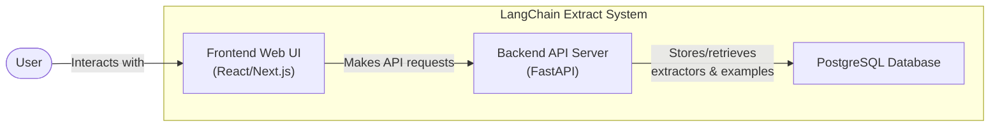
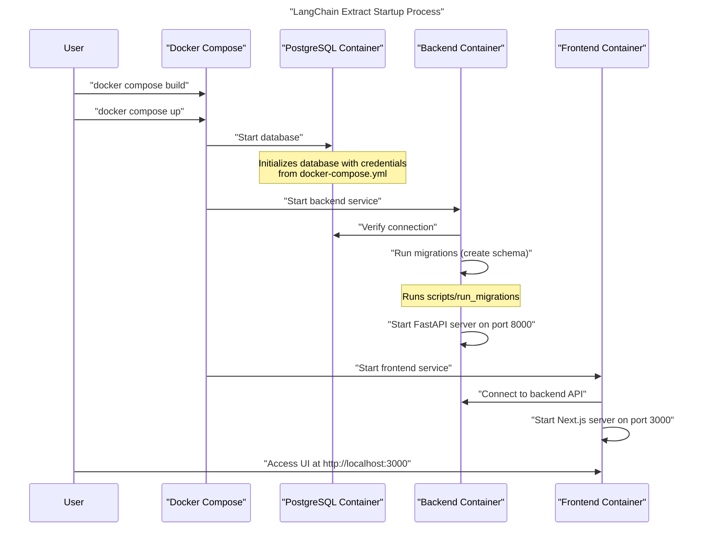

<!-- source: DeepWiki mcp.deepwiki.com · repo langchain-ai/langchain-extract · page 1.1 Getting Started · fetched 2026-10-26 -->

# Getting Started

<details>
<summary>Relevant source files</summary>

The following files were used as context for generating this wiki page:

- [Dockerfile](Dockerfile)
- [README.md](README.md)
- [backend/scripts/prod_entry_point.sh](backend/scripts/prod_entry_point.sh)
- [docker-compose.yml](docker-compose.yml)

</details>


This guide provides instructions for setting up and running LangChain Extract locally. It covers environment configuration, launching the application, and verifying your installation. For information about the system architecture and components, see [Architecture](#2).

## What is LangChain Extract?

LangChain Extract is a web application for extracting structured information from text and documents using Large Language Models (LLMs). It allows you to:

- Define JSON schemas for structured data extraction
- Create and save extractors for reuse
- Process text and files to extract information
- Use examples to improve extraction quality
- Access the functionality through both a web UI and REST API

The system consists of three main components:



Sources: [README.md:19-25](), [docker-compose.yml:3-56]()

## Prerequisites

Before getting started, ensure you have the following installed:

- [Docker](https://www.docker.com/get-started)
- [Docker Compose](https://docs.docker.com/compose/install)
- API key from at least one LLM provider (OpenAI, Fireworks, Together, etc.)

## Environment Setup

1. **Clone the repository**

   ```bash
   git clone https://github.com/langchain-ai/langchain-extract.git
   cd langchain-extract
   ```

2. **Configure environment variables**

   Create a `.local.env` file in the root directory with your API keys:

   ```
   OPENAI_API_KEY=your_openai_api_key
   # Optional additional provider keys
   FIREWORKS_API_KEY=your_fireworks_api_key
   TOGETHER_API_KEY=your_together_api_key
   ```

   The following API keys are supported:

   | Provider | Environment Variable | Required |
   |----------|---------------------|----------|
   | OpenAI   | OPENAI_API_KEY      | Yes      |
   | Fireworks| FIREWORKS_API_KEY   | No       |
   | Together | TOGETHER_API_KEY    | No       |

Sources: [README.md:158-171]()

## Running the System

### Using Docker Compose (Recommended)

1. **Build the Docker images**

   ```bash
   docker compose build
   ```

2. **Start the services**

   ```bash
   docker compose up
   ```

   This command launches three containers:
   - PostgreSQL database
   - Backend API server
   - Frontend web application



Sources: [README.md:172-193](), [docker-compose.yml:3-56](), [backend/scripts/prod_entry_point.sh:1-10]()

## Verifying Installation

1. **Check if the backend server is ready**

   ```bash
   curl -X 'GET' 'http://localhost:8000/ready'
   ```

   You should receive an `ok` response.

2. **Access the web interface**

   Open your browser and navigate to:
   
   ```
   http://localhost:3000
   ```

Sources: [README.md:185-194]()

## Basic Usage Example

Here's a quick example to create an extractor and use it:

1. **Generate a user ID**

   ```bash
   USER_ID=$(uuidgen)
   export USER_ID
   ```

2. **Create an extractor**

   ```bash
   curl -X 'POST' \
     'http://localhost:8000/extractors' \
     -H 'accept: application/json' \
     -H 'Content-Type: application/json' \
     -H "x-key: ${USER_ID}" \
     -d '{
     "name": "Personal Information",
     "description": "Use to extract personal information",
     "schema": {
         "type": "object",
         "title": "Person",
         "required": [
           "name",
           "age"
         ],
         "properties": {
           "age": {
             "type": "integer",
             "title": "Age"
           },
           "name": {
             "type": "string",
             "title": "Name"
           }
         }
       },
     "instruction": "Use information about the person from the given user input."
   }'
   ```

   This will return an extractor ID:
   ```json
   {
     "uuid": "e07f389f-3577-4e94-bd88-6b201d1b10b9"
   }
   ```

3. **Use the extractor**

   ```bash
   curl -s -X 'POST' \
   'http://localhost:8000/extract' \
   -H 'accept: application/json' \
   -H 'Content-Type: multipart/form-data' \
   -H "x-key: ${USER_ID}" \
   -F 'extractor_id=e07f389f-3577-4e94-bd88-6b201d1b10b9' \
   -F 'text=my name is chester and i am 20 years old. My name is eugene and I am 1 year older than chester.' \
   -F 'mode=entire_document' \
   -F 'file='
   ```

   Response:
   ```json
   {
     "data": [
       {
         "name": "chester",
         "age": 20
       },
       {
         "name": "eugene",
         "age": 21
       }
     ]
   }
   ```

Sources: [README.md:49-136]()

## Development Setup

If you prefer to run the system without Docker for development:

1. **Install Poetry**

   First, install [Poetry](https://python-poetry.org) for Python dependency management.

2. **Set up the backend**

   ```bash
   cd backend
   poetry install --with lint,dev,test
   python -m scripts.run_migrations create
   OPENAI_API_KEY=[YOUR API KEY] python -m server.main
   ```

3. **Set up the frontend**

   In a separate terminal:
   ```bash
   cd frontend
   npm install
   npm run dev
   ```

Sources: [README.md:201-228]()

## Next Steps

After successfully setting up LangChain Extract, you might want to:

1. Explore the UI at http://localhost:3000
2. Test creating extractors with different schemas
3. Try processing different document types
4. Review the API documentation at http://localhost:8000/docs
5. Learn more about the [system architecture](#2) and [extraction engine](#4.1)

For more detailed examples and usage patterns, see the [Usage Examples](#6) section.

---

