# Page: Overview

# Overview

<details>
<summary>Relevant source files</summary>

The following files were used as context for generating this wiki page:

- [README.md](README.md)
- [package.json](package.json)

</details>


The LangChain Next.js Template is a demonstration and starter project that integrates LangChain.js with Next.js to build AI-powered applications. This template showcases seven progressively complex example patterns, from basic LLM chat to sophisticated graph-based agent orchestration.

## Purpose and Scope

This template serves as both a learning resource and a starter codebase for developers building AI applications with LangChain.js and Next.js. It demonstrates implementation patterns across seven examples:

1. **Basic Chat** ([/app/page.tsx]()) - Simple LLM prompting with streaming responses
2. **Structured Output** ([/app/structured_output/page.tsx]()) - Schema-enforced JSON responses using Zod
3. **Agents** ([/app/agents/page.tsx]()) - ReAct agents with tool calling (SERP API, Calculator)
4. **Retrieval (RAG)** ([/app/retrieval/page.tsx]()) - Document retrieval with vector similarity search
5. **Retrieval Agents** ([/app/retrieval_agents/page.tsx]()) - Agents with retrieval tool access
6. **AI SDK & React Server Components** ([/app/ai_sdk/page.tsx]()) - Streaming with React Server Actions
7. **LangGraph** ([/app/langgraph/page.tsx]()) - Stateful graph-based agent workflows

Each example has a corresponding API route in [/app/api/chat/]() implementing the backend logic. The template is optimized for deployment on Vercel Edge Functions with a bundle size under 40 KB.

For detailed setup instructions, see [Getting Started](#2).

Sources:
- [README.md:1-24]()
- [package.json:1-15]()
- [README.md:9-17]()

## High-Level System Architecture

The template follows a three-tier architecture: a React/Next.js frontend, API routes implementing LangChain patterns, and external service integrations.

### Application Layer Architecture

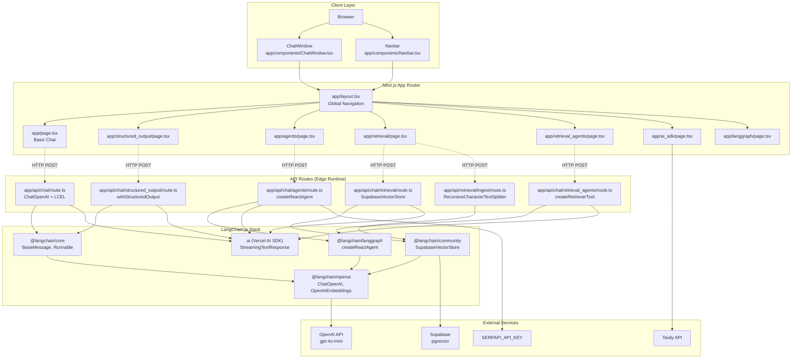

This architecture demonstrates the **separation of concerns**:
- **Client Layer**: React components ([ChatWindow](), [Navbar]()) manage UI state
- **App Router**: Seven page routes demonstrate progressive complexity
- **API Layer**: Six Edge Function routes implement LangChain patterns
- **LangChain Stack**: Modular packages for core abstractions, model integrations, and agent execution
- **External Services**: OpenAI for LLMs/embeddings, Supabase for vector storage, SERP/Tavily for search tools

Sources:
- [package.json:16-48]()
- [README.md:9-17]()

## Seven Example Patterns

The template showcases seven progressively complex AI patterns, each demonstrating specific LangChain.js capabilities:

### Pattern Complexity Progression

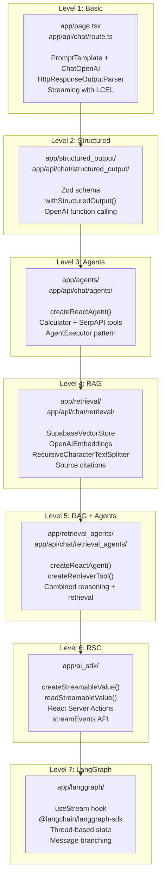

### Pattern-to-Technology Mapping

| Pattern | Page Route | API Route | Key Technologies |
|---------|-----------|-----------|------------------|
| **Basic Chat** | [/app/page.tsx]() | [/app/api/chat/route.ts]() | `ChatOpenAI`, `PromptTemplate`, `HttpResponseOutputParser` |
| **Structured Output** | [/app/structured_output/page.tsx]() | [/app/api/chat/structured_output/route.ts]() | `withStructuredOutput()`, Zod schemas, OpenAI function calling |
| **Agents** | [/app/agents/page.tsx]() | [/app/api/chat/agents/route.ts]() | `createReactAgent()`, `SerpAPI`, `Calculator`, LangGraph |
| **Retrieval (RAG)** | [/app/retrieval/page.tsx]() | [/app/api/chat/retrieval/route.ts]() | `SupabaseVectorStore`, `OpenAIEmbeddings`, `RecursiveCharacterTextSplitter` |
| **Retrieval Agents** | [/app/retrieval_agents/page.tsx]() | [/app/api/chat/retrieval_agents/route.ts]() | `createReactAgent()`, `createRetrieverTool()` |
| **AI SDK (RSC)** | [/app/ai_sdk/page.tsx]() | Server Actions in page | `createStreamableValue()`, `readStreamableValue()`, `streamEvents()` |
| **LangGraph** | [/app/langgraph/page.tsx]() | LangGraph Cloud API | `useStream()` from `@langchain/langgraph-sdk/react`, thread state |

Sources:
- [README.md:9-17]()
- [package.json:16-48]()

### Data Flow: User Query to Streaming Response

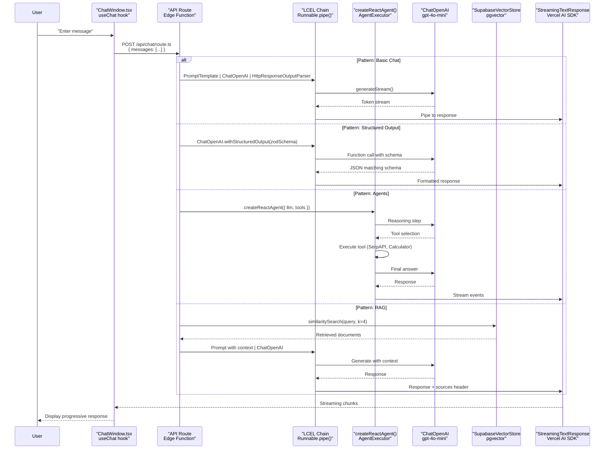

Sources:
- [README.md:15-95]()
- [package.json:16-48]()

## Technology Stack

The template is built on a modern, edge-optimized stack with strong typing and component reusability:

| Category | Package / Technology | Version | Purpose |
|----------|---------------------|---------|---------|
| **Frontend Framework** | `next` | ^15.4.8 | App Router, Server Components, Edge Runtime |
| | `react` | ^18.3.1 | UI component library |
| | `react-dom` | ^18.3.1 | DOM rendering |
| **AI Core** | `@langchain/core` | ^0.3.43 | Base abstractions: `Runnable`, `BaseMessage`, LCEL |
| | `@langchain/openai` | ^0.4.9 | `ChatOpenAI`, `OpenAIEmbeddings` |
| | `@langchain/community` | ^0.3.37 | `SupabaseVectorStore`, tools, integrations |
| | `@langchain/langgraph` | ^0.2.57 | `createReactAgent()`, agent graphs |
| | `@langchain/langgraph-sdk` | ^0.0.60 | `useStream()` hook for graph UI |
| | `langchain` | ^0.3.19 | High-level chains and utilities |
| **Streaming** | `ai` (Vercel AI SDK) | ^3.1.12 | `StreamingTextResponse`, `useChat()`, Server Actions |
| **Validation** | `zod` | ^3.23.8 | Schema validation for structured outputs |
| | `zod-to-json-schema` | ^3.23.2 | Convert Zod to OpenAI function schemas |
| **Vector Store** | `@supabase/supabase-js` | ^2.32.0 | Supabase client for pgvector |
| **UI Components** | `@radix-ui/*` | ^1.x | Headless UI primitives (Dialog, Popover, Checkbox, Slot) |
| | `tailwindcss` | 3.3.3 | Utility-first CSS |
| | `lucide-react` | ^0.473.0 | Icon library |
| | `sonner` | ^1.7.2 | Toast notifications |
| **State Management** | `nuqs` | ^2.3.2 | Type-safe URL state management |
| | `use-stick-to-bottom` | ^1.0.44 | Auto-scroll chat to bottom |
| **Build Tools** | `typescript` | 5.1.6 | Type safety |
| | `eslint` | 8.46.0 | Code linting |
| | `prettier` | ^3.4.2 | Code formatting |
| | `@next/bundle-analyzer` | ^13.4.19 | Bundle size analysis |

Sources:
- [package.json:16-58]()

## Implementation Architecture

Each example follows a consistent implementation pattern:

### Component Architecture

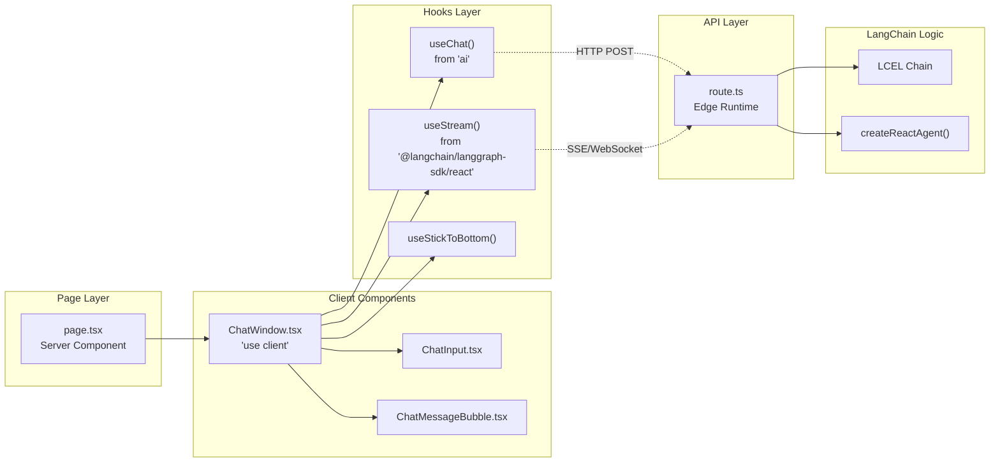

### File Organization

Each example consists of:
- **Page**: [/app/{example}/page.tsx]() - Server Component that renders `ChatWindow`
- **API Route**: [/app/api/chat/{example}/route.ts]() - Edge Function with LangChain logic
- **Shared Components**: [/app/components/ChatWindow.tsx](), [/app/components/ChatMessageBubble.tsx]()
- **Utilities**: [/app/utils/convertVercelMessageToLangChainMessage.ts]() for message format conversion

Sources:
- [README.md:46-48]()

## Key Characteristics

### Edge Function Optimization

The template is optimized for Vercel Edge Functions with strict bundle size constraints:

- **Bundle Size**: LangChain.js core is only **37.32 KB** after compression ([README.md:99]())
- **Edge Runtime**: All API routes configured with `export const runtime = 'edge'`
- **1 MB Limit**: Total Edge Function size must stay under 1 MB
- **Bundle Analysis**: Use `ANALYZE=true yarn build` to inspect bundle composition ([README.md:106]())

### Deployment Requirements

| Environment Variable | Required For | Purpose |
|---------------------|--------------|---------|
| `OPENAI_API_KEY` | All examples | OpenAI API authentication |
| `LANGCHAIN_CALLBACKS_BACKGROUND` | Production (set to `false`) | Ensure LangSmith tracing completes in Edge runtime |
| `SUPABASE_URL` | RAG examples | Supabase vector store connection |
| `SUPABASE_PRIVATE_KEY` | RAG examples | Supabase authentication |
| `SERPAPI_API_KEY` | Agent examples | Web search tool access |

### Pedagogical Design

The template follows a **progressive complexity** approach:

1. Start with [/app/page.tsx]() to understand basic LLM streaming
2. Add schema validation with [/app/structured_output/]()
3. Introduce autonomous reasoning with [/app/agents/]()
4. Add knowledge retrieval with [/app/retrieval/]()
5. Combine patterns in [/app/retrieval_agents/]()
6. Learn advanced streaming with [/app/ai_sdk/]()
7. Master stateful orchestration with [/app/langgraph/]()

Each level builds on previous concepts, making the template an effective learning resource for LangChain.js patterns.

Sources:
- [README.md:21-23]()
- [README.md:98-107]()
- [README.md:32]()

## Getting Started

To start using this template, see the [Getting Started](#2) guide for instructions on setting up the project, configuring environment variables, and running the application.

Sources:
- [README.md:25-49]()

---

# Page: Getting Started

# Getting Started

<details>
<summary>Relevant source files</summary>

The following files were used as context for generating this wiki page:

- [README.md](README.md)
- [package.json](package.json)
- [yarn.lock](yarn.lock)

</details>


This document provides instructions on how to set up, configure, and run the LangChain NextJS Template. For information about system architecture, see [System Architecture](#3), and for details on specific features, see the [Features](#4) section.

## Prerequisites

Before beginning, ensure you have:

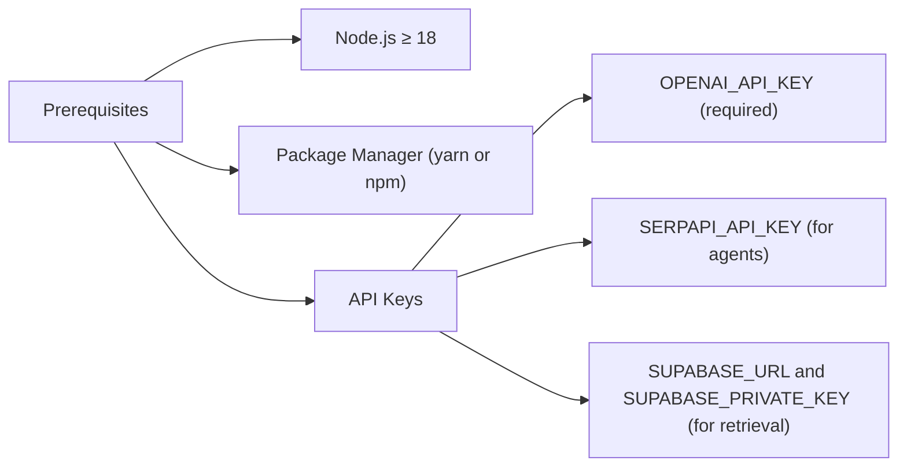

Sources: [package.json:13-16](), [README.md:29-32]()

## Installation

### Clone the Repository

```bash
git clone https://github.com/langchain-ai/langchain-nextjs-template.git
cd langchain-nextjs-template
```

### Set Up Environment Variables

Create a `.env.local` file in the root directory:

```bash
cp .env.example .env.local
```

At minimum, add your OpenAI API key:

```
OPENAI_API_KEY=your_api_key_here
LANGCHAIN_CALLBACKS_BACKGROUND=false  # For tracing to complete in serverless edge functions
```

### Install Dependencies

```bash
# Using yarn
yarn

# Using npm
npm install
```

Sources: [package.json:5-11](), [README.md:25-34]()

## Running the Application

### Development Server

```bash
# Using yarn
yarn dev

# Using npm
npm run dev
```

Access the application at [http://localhost:3000](http://localhost:3000)

### Production Build

```bash
# Using yarn
yarn build
yarn start

# Using npm
npm run build
npm start
```

Sources: [package.json:6-10]()

## Project Structure Overview

The template is organized according to the Next.js App Router pattern:

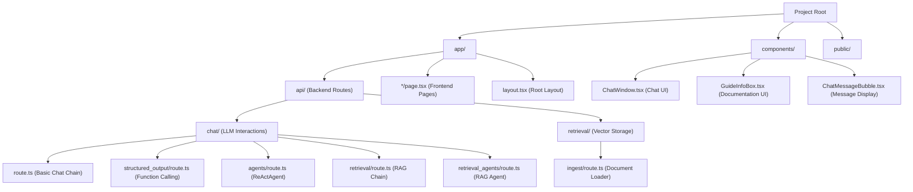

Sources: [app/layout.tsx:33-112](), [README.md:8-14]()

## Data Flow and Components

This diagram shows how user requests flow through the system:

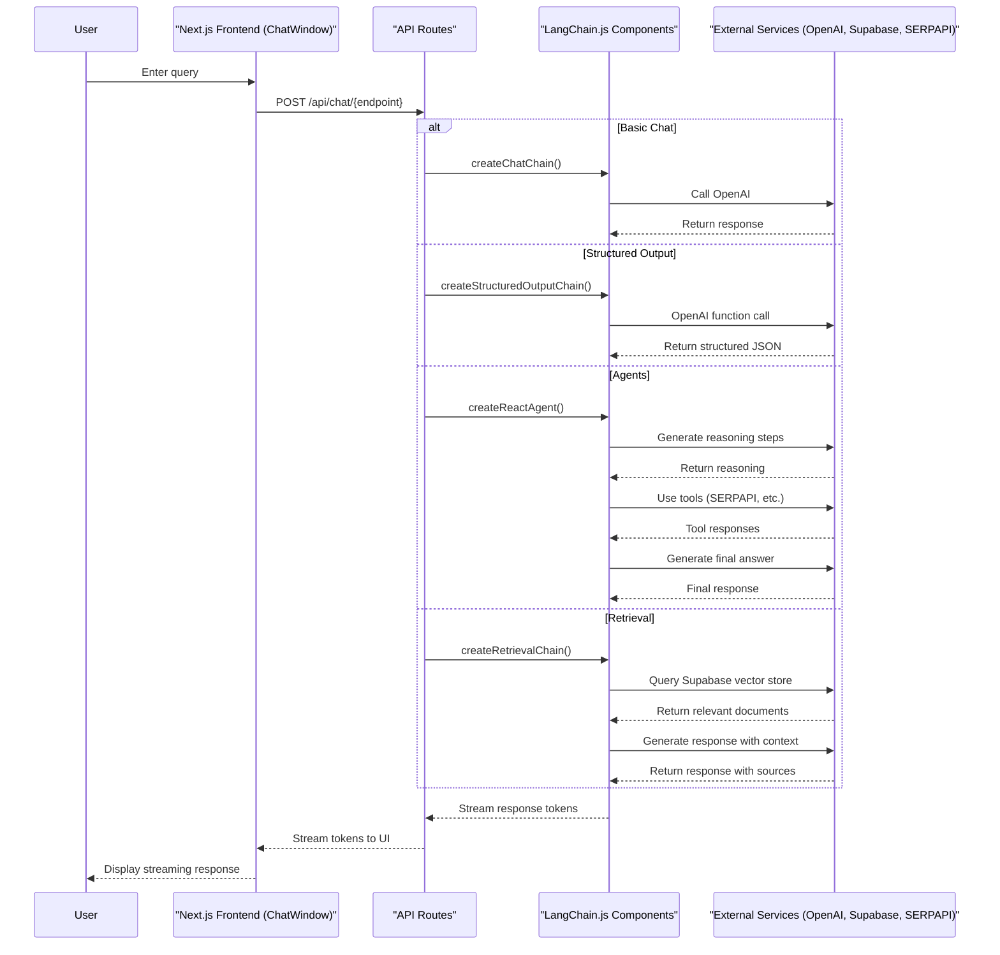

Sources: [README.md:9-14]()

## Core Dependencies

The template relies on several key packages:

| Dependency | Version | Purpose |
|------------|---------|---------|
| @langchain/community | ^0.3.37 | Community-contributed LangChain components |
| @langchain/core | ^0.3.43 | Core LangChain functionality |
| @langchain/langgraph | ^0.2.57 | Framework for building agentic workflows |
| @langchain/openai | ^0.4.9 | OpenAI integration for LangChain |
| @supabase/supabase-js | ^2.32.0 | Vector storage for retrieval examples |
| langchain | ^0.3.19 | Main LangChain library |
| next | ^15.2.4 | Next.js framework |
| ai | ^3.1.12 | Vercel AI SDK for streaming responses |
| react | ^18.3.1 | React framework |
| zod | ^3.23.8 | Schema validation and type generation |

Sources: [package.json:16-47]()

## Feature Examples

The template includes multiple examples demonstrating LangChain capabilities:

| Feature | URL Path | API Route | Description |
|---------|----------|-----------|-------------|
| Basic Chat | / | /api/chat/route.ts | Simple conversation with streaming |
| Structured Output | /structured_output | /api/chat/structured_output/route.ts | Generates structured data using function calling |
| Agents | /agents | /api/chat/agents/route.ts | ReAct agents with web search and calculator tools |
| Retrieval | /retrieval | /api/chat/retrieval/route.ts | RAG with Supabase vector store |
| Retrieval Agents | /retrieval_agents | /api/chat/retrieval_agents/route.ts | Combines agents with document retrieval |
| React Server Components | /ai_sdk | Direct server component integration | Server-side streaming without API routes |
| LangGraph | /langgraph | Custom LangGraph implementation | Complex multi-step agent workflows |

Sources: [app/layout.tsx:74-87](), [README.md:9-17]()

## Environment Configuration

Required environment variables for various features:

```bash
# Required for all examples
OPENAI_API_KEY=sk-...

# For tracing in serverless environments
LANGCHAIN_CALLBACKS_BACKGROUND=false

# For agent examples
SERPAPI_API_KEY=serpapi_...

# For retrieval examples
SUPABASE_URL=https://...
SUPABASE_PRIVATE_KEY=eyJ...

# Optional for tracing and debugging
LANGCHAIN_TRACING_V2=true
LANGCHAIN_API_KEY=ls__...
```

Sources: [README.md:29-32](), [README.md:64-86]()

## Next Steps

Once the application is running, you can:

1. Explore the different examples through the navigation bar
2. Examine the code in each API route to understand implementation details
3. Modify the chains, agents, or retrievers to suit your specific use case
4. Deploy to Vercel or another platform that supports Next.js

For deployment instructions, see [README.md:120-124]().

For more detailed information on specific features, refer to the [Features Overview](#4) section.

---

# Page: System Architecture

# System Architecture

<details>
<summary>Relevant source files</summary>

The following files were used as context for generating this wiki page:

- [README.md](README.md)
- [app/layout.tsx](app/layout.tsx)
- [package.json](package.json)

</details>


## Purpose and Scope

This document provides a comprehensive overview of the application's architectural design, including its multi-layered structure, component organization, and data flow patterns. The architecture is designed around the Next.js App Router and demonstrates seven progressively complex AI patterns using LangChain.js.

For specific details on individual subsystems, see:
- [Project Structure & Dependencies](#3.1) for the technology stack and build system
- [Frontend Architecture](#3.2) for client-side components and state management
- [API Routes Architecture](#3.3) for backend endpoints and streaming patterns
- [External Service Integration](#3.4) for third-party service configuration
- [Features & Examples](#5) for detailed implementation of each AI pattern

**Sources:** [README.md:1-130](), [app/layout.tsx:1-113](), [package.json:1-60]()

---

## Architectural Layers

The application follows a six-layer architecture that separates concerns from user interface to external services. Each layer has distinct responsibilities and interacts with adjacent layers through well-defined interfaces.

### Layer Overview Diagram

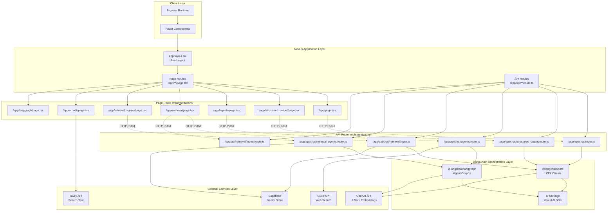

### Layer Responsibilities

| Layer | Primary Responsibility | Key Technologies | Implementation Files |
|-------|----------------------|------------------|---------------------|
| **Client** | User interface rendering and interaction | React 18+, Radix UI, Tailwind CSS | `app/components/**` |
| **Next.js Application** | Routing, layout, and request handling | Next.js 14+ App Router | `app/layout.tsx`, `app/**/page.tsx` |
| **Page Routes** | Frontend page components with chat UIs | React Server Components | Seven page.tsx files |
| **API Routes** | Backend logic and LangChain orchestration | Edge Runtime, streaming responses | Six route.ts files in `app/api/**` |
| **Orchestration** | LLM chain composition and agent execution | LangChain.js, LangGraph, Vercel AI SDK | Imported in API routes |
| **External Services** | LLM inference, vector storage, tool execution | OpenAI, Supabase, SERP, Tavily | Configured via env vars |

**Sources:** [README.md:6-17](), [package.json:16-48](), [app/layout.tsx:33-112]()

---

## Next.js App Router Structure

The application uses Next.js 14+'s App Router with file-system based routing. The structure is organized to demonstrate increasing complexity across examples.

### Routing Structure Diagram

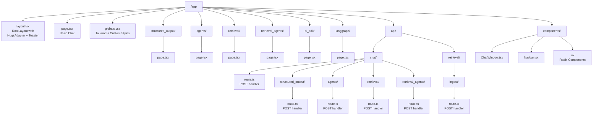

### Route-to-API Mapping

The application follows a consistent pattern where each page route communicates with a corresponding API route:

| Page Route | API Route | Pattern Demonstrated |
|-----------|-----------|---------------------|
| `/` | `/api/chat` | Basic streaming chat with `PromptTemplate` + `ChatOpenAI` |
| `/structured_output` | `/api/chat/structured_output` | Zod schema validation with `withStructuredOutput()` |
| `/agents` | `/api/chat/agents` | ReAct agent with `createReactAgent()` |
| `/retrieval` | `/api/chat/retrieval` | RAG chain with `SupabaseVectorStore` |
| `/retrieval_agents` | `/api/chat/retrieval_agents` | Combined agent + retrieval with `createRetrieverTool()` |
| `/ai_sdk` | Server Actions | React Server Components with `createStreamableValue()` |
| `/langgraph` | LangGraph API | Stateful graph execution with `useStream()` hook |

**Sources:** [app/layout.tsx:33-112](), [README.md:9-13]()

---

## Pedagogical Architecture

The template is designed as a learning resource with seven examples that demonstrate progressively complex AI patterns. Each example builds upon concepts introduced in previous ones.

### Complexity Progression

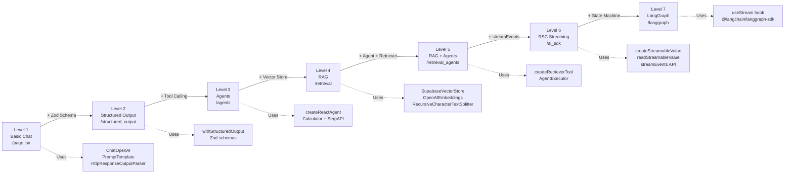

### Conceptual Layering

Each level introduces new architectural concepts:

| Level | Concept Introduced | Key Abstraction | API Implementation |
|-------|-------------------|-----------------|-------------------|
| 1 | **LLM Streaming** | LCEL chain composition | `ChatOpenAI.pipe(HttpResponseOutputParser)` |
| 2 | **Type Safety** | Schema-enforced outputs | `.withStructuredOutput(zodSchema)` |
| 3 | **Autonomous Actions** | Tool selection and execution | `createReactAgent(model, tools)` |
| 4 | **Context Injection** | Vector similarity search | `SupabaseVectorStore.asRetriever()` |
| 5 | **Multi-Modal Reasoning** | Agent with retrieval tool | `createRetrieverTool(retriever, metadata)` |
| 6 | **Transparency** | Stream intermediate events | `streamEvents()` with event filtering |
| 7 | **State Management** | Graph-based workflows | `client.runs.stream()` with checkpoints |

**Sources:** [README.md:6-17](), [README.md:50-95]()

---

## Data Flow Architecture

The application implements multiple data flow patterns depending on the complexity of the interaction. All patterns share common elements but differ in their orchestration logic.

### Request Flow Diagram

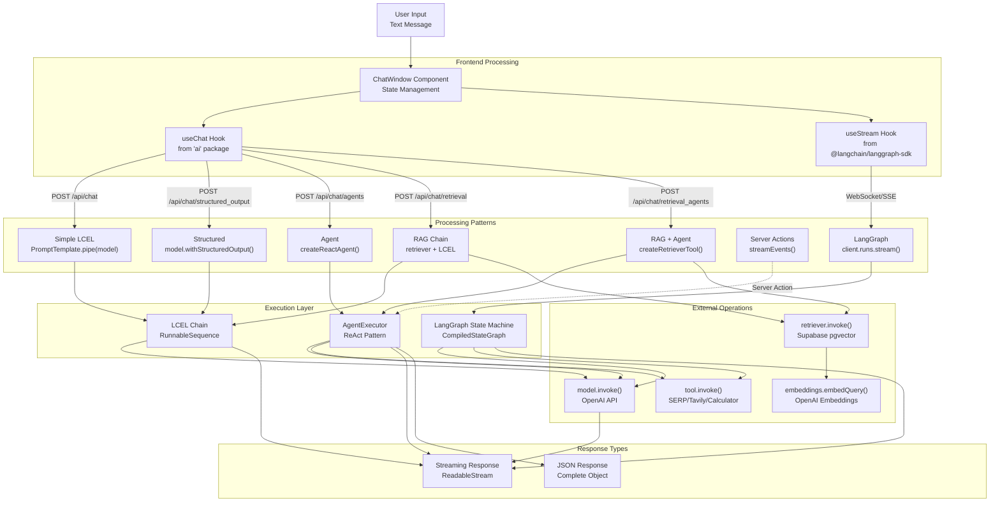

### Hook and API Integration

The frontend uses two primary hooks for API communication:

**`useChat` Hook** (from Vercel AI SDK):
- Used by: `/`, `/structured_output`, `/agents`, `/retrieval`, `/retrieval_agents`
- Communication: HTTP POST with streaming response
- Response format: `ReadableStream` parsed by `HttpResponseOutputParser`
- State management: Automatic message state handling

**`useStream` Hook** (from `@langchain/langgraph-sdk`):
- Used by: `/langgraph`
- Communication: Server-Sent Events (SSE) or WebSocket
- Response format: Streamed graph events with state updates
- State management: Thread-based with checkpoint persistence

**Sources:** [README.md:15-16]()

---

## Runtime Architecture

The application is optimized for deployment on Vercel Edge Functions with specific runtime configurations and bundle size constraints.

### Runtime Configuration

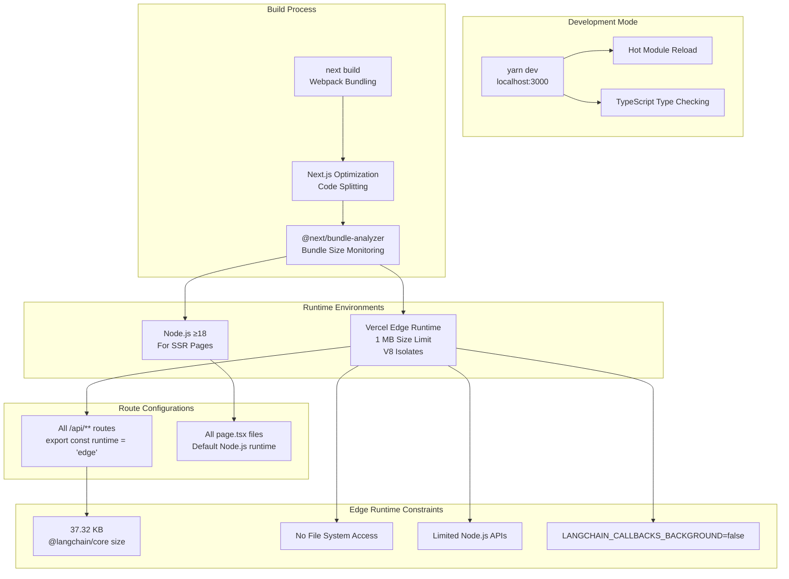

### Edge Function Optimization

All API routes are configured for Edge Runtime deployment:

```typescript
// Pattern used in all /app/api/**/route.ts files
export const runtime = "edge";
```

**Edge Runtime Benefits:**
- **Low Latency**: Functions execute close to users globally
- **Fast Cold Starts**: V8 isolates start in <1ms
- **Automatic Scaling**: No server management required

**Edge Runtime Constraints:**
| Constraint | Impact | Mitigation |
|-----------|--------|------------|
| 1 MB bundle size limit | Must minimize dependencies | LangChain.js uses only 37.32 KB |
| No Node.js file system | Cannot read/write local files | Use external vector stores like Supabase |
| Limited Node.js APIs | Some packages incompatible | Use edge-compatible packages |
| Background tasks restricted | Callbacks must complete in request | Set `LANGCHAIN_CALLBACKS_BACKGROUND=false` |

### Build Configuration

The project uses `yarn@3.5.1` with deterministic dependency resolution:

```bash
# Development
yarn dev          # Start Next.js dev server on port 3000

# Production build
yarn build        # Compile TypeScript and bundle with Webpack

# Bundle analysis
ANALYZE=true yarn build  # Generate interactive bundle size report
```

**Sources:** [package.json:1-60](), [README.md:97-107](), [README.md:32-33]()

---

## Component Interaction Patterns

The application uses several interaction patterns to coordinate between layers.

### Pattern 1: Basic Streaming Chain

Used in `/api/chat/route.ts`:

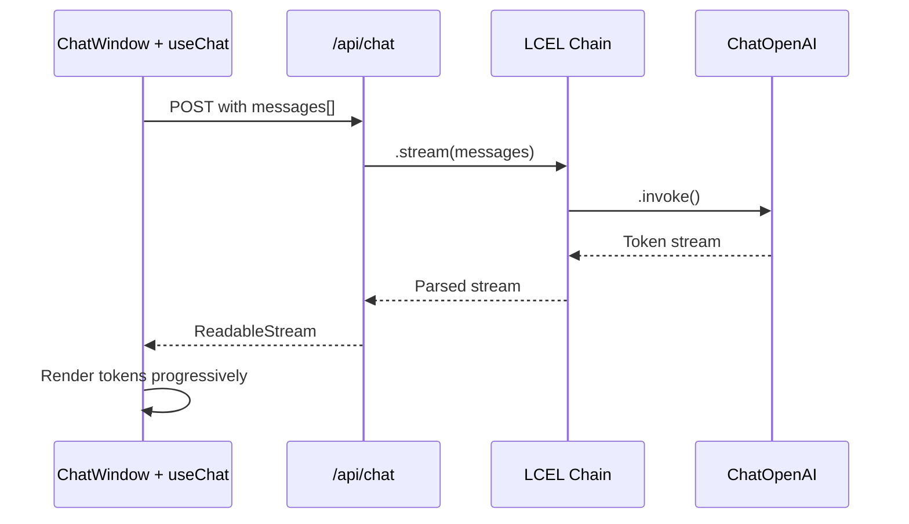

### Pattern 2: Agent with Tools

Used in `/api/chat/agents/route.ts`:

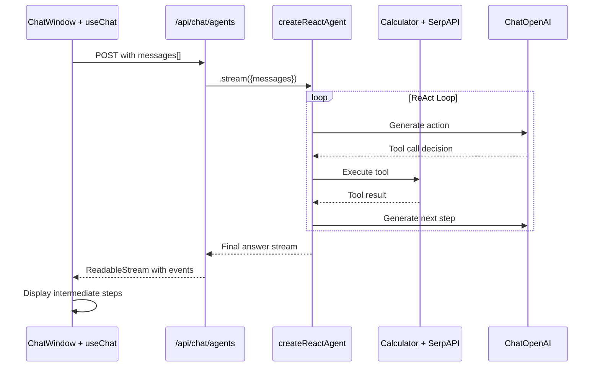

### Pattern 3: RAG with Vector Retrieval

Used in `/api/chat/retrieval/route.ts`:

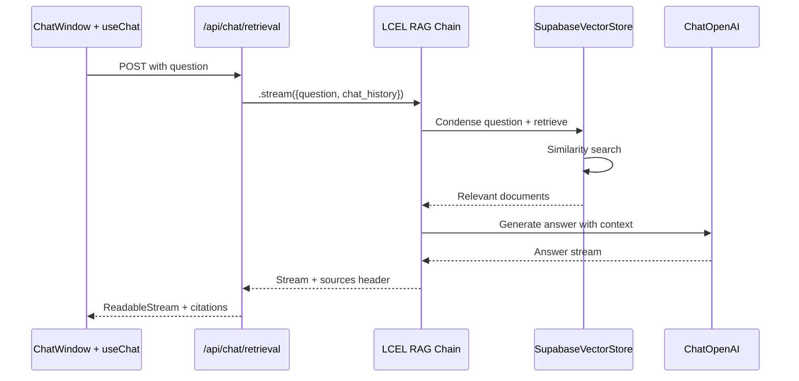

**Sources:** [README.md:111-114]()

---

## Global Layout and Navigation

The `RootLayout` component provides the application shell that wraps all pages.

### Layout Structure

The [app/layout.tsx:33-112]() file implements:

1. **Global Providers**:
   - `NuqsAdapter`: URL state management wrapper
   - `Toaster`: Toast notification system from Sonner

2. **Navigation Bar**:
   - Seven `ActiveLink` components for each example
   - GitHub repository link button
   - LangChain.js logo with external link

3. **Layout Grid**:
   - Two-row grid: `grid-rows-[auto,1fr]`
   - Header row with navigation
   - Content row with rounded container for pages

### Active Link Pattern

Navigation uses the `ActiveLink` component from [app/components/Navbar.tsx]():

```typescript
// Links in layout.tsx:75-87
<ActiveLink href="/">🏴‍☠️ Chat</ActiveLink>
<ActiveLink href="/structured_output">🧱 Structured Output</ActiveLink>
<ActiveLink href="/agents">🦜 Agents</ActiveLink>
<ActiveLink href="/retrieval">🐶 Retrieval</ActiveLink>
<ActiveLink href="/retrieval_agents">🤖 Retrieval Agents</ActiveLink>
<ActiveLink href="/ai_sdk">🌊 React Server Components</ActiveLink>
<ActiveLink href="/langgraph">🕸️ LangGraph</ActiveLink>
```

Each link includes an emoji for visual identification and highlights the active route.

**Sources:** [app/layout.tsx:33-112]()

---

## Environment Configuration

The application requires environment variables for external service authentication. Configuration is managed through `.env.local`:

| Variable | Required By | Purpose |
|----------|------------|---------|
| `OPENAI_API_KEY` | All examples | OpenAI LLM and embeddings API access |
| `SUPABASE_URL` | `/retrieval`, `/retrieval_agents` | Supabase database endpoint |
| `SUPABASE_PRIVATE_KEY` | `/retrieval`, `/retrieval_agents` | Supabase service role key |
| `SERPAPI_API_KEY` | `/agents` | SERP API web search tool |
| `LANGCHAIN_CALLBACKS_BACKGROUND` | All API routes | Must be `false` for Edge Runtime tracing |

### Minimal Configuration

To run the basic examples, only `OPENAI_API_KEY` is required:

```bash
# .env.local
OPENAI_API_KEY=sk-...
LANGCHAIN_CALLBACKS_BACKGROUND=false
```

Full retrieval and agent examples require additional keys.

**Sources:** [README.md:29-33](), [README.md:64-66](), [README.md:79-81]()

---

## Deployment Architecture

The application is optimized for deployment on Vercel with automatic CI/CD from GitHub.

### Deployment Flow

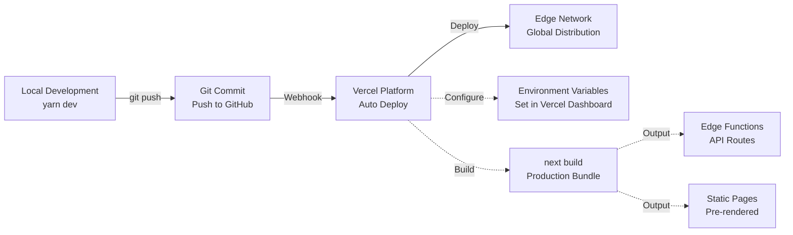

### Production Considerations

**Bundle Size**: The template tracks bundle size using `@next/bundle-analyzer`. Run `ANALYZE=true yarn build` to generate an interactive report showing that `@langchain/core` contributes only 37.32 KB to the bundle.

**Environment Variables**: Configure all required environment variables in the Vercel dashboard under Project Settings → Environment Variables. These are encrypted at rest and available to Edge Functions at runtime.

**Edge Function Limits**: Each Edge Function has a 1 MB bundle size limit and 30-second execution timeout. The template is designed to operate well within these constraints.

**Sources:** [package.json:50](), [README.md:97-107](), [README.md:120-124]()

---

## Summary

The system architecture demonstrates a modern, edge-optimized Next.js application built around the App Router with seven progressively complex AI patterns. Key architectural characteristics include:

1. **Layer Separation**: Clean separation between client, routing, API, orchestration, and external service layers
2. **Edge-First Design**: All API routes run on Vercel Edge Runtime with <1ms cold starts
3. **Pedagogical Structure**: Seven examples progressing from basic chat to stateful graph execution
4. **Streaming-Native**: All patterns support token streaming for responsive UIs
5. **Type Safety**: TypeScript throughout with Zod schema validation for structured outputs
6. **Modular Orchestration**: LangChain.js LCEL chains and LangGraph for composable AI workflows

The architecture serves as both a production-ready starter template and an educational resource for learning LangChain.js patterns in Next.js applications.

**Sources:** [README.md:1-130](), [package.json:1-60](), [app/layout.tsx:1-113]()

---

# Page: Project Structure & Dependencies

# Project Structure & Dependencies

<details>
<summary>Relevant source files</summary>

The following files were used as context for generating this wiki page:

- [package.json](package.json)
- [yarn.lock](yarn.lock)

</details>


## Purpose and Scope

This document details the technical foundation of the LangChain + Next.js template, including the complete dependency stack, build system configuration, and deployment constraints. It covers package management with Yarn, TypeScript configuration, the LangChain.js ecosystem integration, UI library composition, and bundle size optimization for Vercel Edge Functions.

For information about the frontend component architecture, see [Frontend Architecture](#3.2). For API route implementation patterns, see [API Routes Architecture](#3.3).

**Sources:** [package.json:1-59]()

---

## Dependency Architecture

The project organizes dependencies into six functional groups: AI/LLM frameworks, Next.js/React ecosystem, UI components, data validation, development tooling, and deployment optimization.

### Dependency Layer Diagram

```mermaid
graph TB
    subgraph Foundation["Foundation Layer"]
        next["next<br/>v15.4.8"]
        react["react<br/>v18.3.1"]
        typescript["typescript<br/>v5.1.6"]
        nodejs["Node.js<br/>≥18"]
    end
    
    subgraph AIFrameworks["AI/LLM Layer"]
        lccore["@langchain/core<br/>v0.3.43"]
        lcopenai["@langchain/openai<br/>v0.4.9"]
        lccommunity["@langchain/community<br/>v0.3.37"]
        lclanggraph["@langchain/langgraph<br/>v0.2.57"]
        lcsdk["@langchain/langgraph-sdk<br/>v0.0.60"]
        langchain["langchain<br/>v0.3.19"]
        ai["ai<br/>v3.1.12"]
    end
    
    subgraph DataLayer["Data & Validation Layer"]
        zod["zod<br/>v3.23.8"]
        zodschema["zod-to-json-schema<br/>v3.23.2"]
        supabase["@supabase/supabase-js<br/>v2.32.0"]
    end
    
    subgraph UILayer["UI Component Layer"]
        radixcheckbox["@radix-ui/react-checkbox"]
        radixdialog["@radix-ui/react-dialog"]
        radixpopover["@radix-ui/react-popover"]
        radixslot["@radix-ui/react-slot"]
        lucide["lucide-react<br/>v0.473.0"]
        sonner["sonner<br/>v1.7.2"]
        vaul["vaul<br/>v1.1.2"]
        nextthemes["next-themes<br/>v0.4.4"]
    end
    
    subgraph StateUtilities["State & Utilities Layer"]
        nuqs["nuqs<br/>v2.3.2"]
        stick["use-stick-to-bottom<br/>v1.0.44"]
        clsx["clsx<br/>v2.1.1"]
        cva["class-variance-authority<br/>v0.7.1"]
        tailwindmerge["tailwind-merge<br/>v2.6.0"]
    end
    
    subgraph DevTools["Development Tooling"]
        eslint["eslint<br/>v8.46.0"]
        prettier["prettier<br/>v3.4.2"]
        bundleanalyzer["@next/bundle-analyzer<br/>v13.4.19"]
        tailwindcss["tailwindcss<br/>v3.3.3"]
    end
    
    nodejs --> next
    nodejs --> typescript
    next --> react
    
    lccore --> lcopenai
    lccore --> lccommunity
    lccore --> lclanggraph
    lclanggraph --> lcsdk
    langchain --> lccore
    ai --> react
    
    zod --> zodschema
    zod --> lccore
    supabase --> lccommunity
    
    react --> radixcheckbox
    react --> radixdialog
    react --> radixpopover
    react --> radixslot
    react --> lucide
    react --> sonner
    react --> vaul
    next --> nextthemes
    
    next --> nuqs
    react --> stick
    tailwindcss --> clsx
    tailwindcss --> cva
    tailwindcss --> tailwindmerge
    
    next --> eslint
    next --> prettier
    next --> bundleanalyzer
    next --> tailwindcss
```

**Sources:** [package.json:16-58]()

---

## Core Dependency Groups

### LangChain.js Ecosystem

The template uses five separate LangChain packages, each serving a distinct role in the AI application stack:

| Package | Version | Purpose | Key Exports |
|---------|---------|---------|-------------|
| `@langchain/core` | 0.3.43 | Base abstractions and interfaces | `Runnable`, `BaseMessage`, `PromptTemplate`, `OutputParser` |
| `@langchain/openai` | 0.4.9 | OpenAI model integration | `ChatOpenAI`, `OpenAIEmbeddings` |
| `@langchain/community` | 0.3.37 | Community integrations and tools | `SupabaseVectorStore`, `Calculator`, `SerpAPI` |
| `@langchain/langgraph` | 0.2.57 | Graph-based agent orchestration | `createReactAgent`, `StateGraph`, `MemorySaver` |
| `@langchain/langgraph-sdk` | 0.0.60 | LangGraph client SDK | `useStream` hook for React |
| `langchain` | 0.3.19 | Meta-package (convenience imports) | Re-exports from core packages |

The `@langchain/core` package provides the foundational `Runnable` interface that all chains and agents implement. Specific integrations like `@langchain/openai` extend these base classes. The `langchain` meta-package is included for backward compatibility but the template primarily uses direct imports from scoped packages.

**Sources:** [package.json:17-21,33]()

### Next.js and React Ecosystem

| Package | Version | Purpose |
|---------|---------|---------|
| `next` | 15.4.8 | App Router framework, Edge Functions, API routes |
| `react` | 18.3.1 | UI library with Server Components support |
| `react-dom` | 18.3.1 | React rendering for web |
| `@types/react` | 18.3.2 | TypeScript definitions for React |
| `@types/react-dom` | 18.3.0 | TypeScript definitions for ReactDOM |

The project requires Node.js version 18 or higher ([package.json:13-15]()) and uses Next.js 15's App Router architecture with React 18's Server Components.

**Sources:** [package.json:13-15,27-29,35,38-39]()

### UI Component Libraries

The UI layer combines Radix UI primitives with Tailwind CSS for styling:

**Radix UI Primitives** (headless, accessible components):
- `@radix-ui/react-checkbox` - Checkbox input component
- `@radix-ui/react-dialog` - Modal dialog primitives  
- `@radix-ui/react-popover` - Popover overlay primitives
- `@radix-ui/react-slot` - Component composition utility

**Styling and Icons**:
- `tailwindcss` (3.3.3) - Utility-first CSS framework
- `tailwind-merge` (2.6.0) - Utility for merging Tailwind classes
- `tailwindcss-animate` (1.0.7) - Animation utilities
- `lucide-react` (0.473.0) - Icon library
- `next-themes` (0.4.4) - Dark mode theme management

**Notification and Layout**:
- `sonner` (1.7.2) - Toast notification system
- `vaul` (1.1.2) - Drawer component
- `class-variance-authority` (0.7.1) - Component variant styling
- `clsx` (2.1.1) - Class name composition utility

**Sources:** [package.json:22-26,31-32,34,36,40-46,51-56]()

### Data Validation and External Services

| Package | Version | Purpose |
|---------|---------|---------|
| `zod` | 3.23.8 | Runtime schema validation and TypeScript type inference |
| `zod-to-json-schema` | 3.23.2 | Convert Zod schemas to JSON Schema format for OpenAI function calling |
| `@supabase/supabase-js` | 2.32.0 | Supabase client for vector store operations |
| `ai` | 3.1.12 | Vercel AI SDK for streaming and Server Actions |

The `zod` library serves dual purposes: runtime validation of structured outputs and compile-time TypeScript type generation. The `ai` package from Vercel provides React hooks (`useChat`) and Server Action utilities (`createStreamableValue`, `readStreamableValue`).

**Sources:** [package.json:26,30,46-47]()

### State Management Utilities

| Package | Version | Purpose |
|---------|---------|---------|
| `nuqs` | 2.3.2 | Type-safe URL query parameter state management |
| `use-stick-to-bottom` | 1.0.44 | Auto-scroll hook for chat interfaces |

The `nuqs` library manages URL-based state, particularly for thread IDs in the LangGraph example ([see LangGraph Integration](#5.7)). The `use-stick-to-bottom` hook keeps chat windows scrolled to the latest message during streaming.

**Sources:** [package.json:37,44]()

---

## Build System Configuration

### Package Manager: Yarn 3.5.1

The project uses Yarn version 3.5.1 with Plug'n'Play (PnP) enabled, specified in [package.json:5]():

```json
"packageManager": "yarn@3.5.1"
```

Yarn 3.x provides:
- **Deterministic dependency resolution** via `yarn.lock` committed to the repository
- **Faster installs** through Plug'n'Play (no `node_modules` extraction)
- **Strict version control** - all developers and CI use identical package versions

The `yarn.lock` file ensures that `yarn install` produces identical dependency trees across environments, critical for reproducible builds and consistent Edge Function bundles.

**Sources:** [package.json:5]()

### TypeScript Configuration

TypeScript 5.1.6 provides static type checking across the entire codebase. The compiler enforces strict type safety for:
- LangChain chain and agent types
- React component props
- API route request/response types
- Zod schema inference

Type definitions are provided for Node.js ([package.json:27]()) and React ([package.json:28-29]()).

**Sources:** [package.json:27-29,57]()

### Code Quality Tools

| Tool | Version | Purpose | Script |
|------|---------|---------|--------|
| `eslint` | 8.46.0 | JavaScript/TypeScript linting | `yarn lint` |
| `eslint-config-next` | 13.4.12 | Next.js-specific ESLint rules | (extends base config) |
| `prettier` | 3.4.2 | Code formatting | `yarn format` |

The ESLint configuration includes Next.js-specific rules for proper App Router usage, Server Component validation, and Edge runtime compatibility. Prettier enforces consistent code style across the `app/` directory ([package.json:11]()).

**Sources:** [package.json:10-11,49,52-53,55]()

### Available Scripts

```bash
yarn dev      # Start development server (localhost:3000)
yarn build    # Production build with TypeScript checking
yarn start    # Serve production build
yarn lint     # Run ESLint on codebase
yarn format   # Format code with Prettier
```

**Sources:** [package.json:6-11]()

---

## Bundle Size Optimization

### Edge Function Constraints

All API routes in this template target the Vercel Edge Runtime, which imposes a **1 MB compressed bundle size limit** per function. This constraint drives several architectural decisions:

1. **Scoped LangChain imports** - Import from `@langchain/core`, `@langchain/openai` rather than the `langchain` meta-package to tree-shake unused code
2. **Minimal dependencies** - Each API route includes only necessary packages
3. **Bundle analysis** - The `@next/bundle-analyzer` package monitors bundle sizes

### Bundle Analyzer Configuration

The `@next/bundle-analyzer` dev dependency (v13.4.19) enables bundle size inspection:

```bash
# Enable bundle analysis
ANALYZE=true yarn build
```

This generates a visual report showing which dependencies contribute to bundle size, critical for staying under the Edge Function 1 MB limit. According to the system diagrams, the LangChain core bundle is approximately 37.32 KB, well within limits.

**Sources:** [package.json:50]()

### Edge Runtime Compatibility

The following dependencies are Edge-compatible (no Node.js-specific APIs):
- All `@langchain/*` packages
- `zod` and `zod-to-json-schema`
- `ai` (Vercel AI SDK)
- `@supabase/supabase-js` (uses `fetch` API)

The `LANGCHAIN_CALLBACKS_BACKGROUND=false` environment variable must be set for LangSmith tracing in Edge Functions, as Edge runtime does not support background tasks.

**Sources:** [package.json:16-21,26,30,46-47]()

---

## Dependency Installation Flow

### Initial Setup

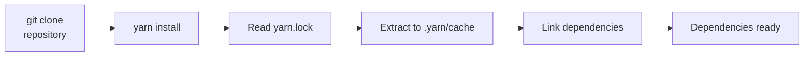

### Dependency Resolution Diagram

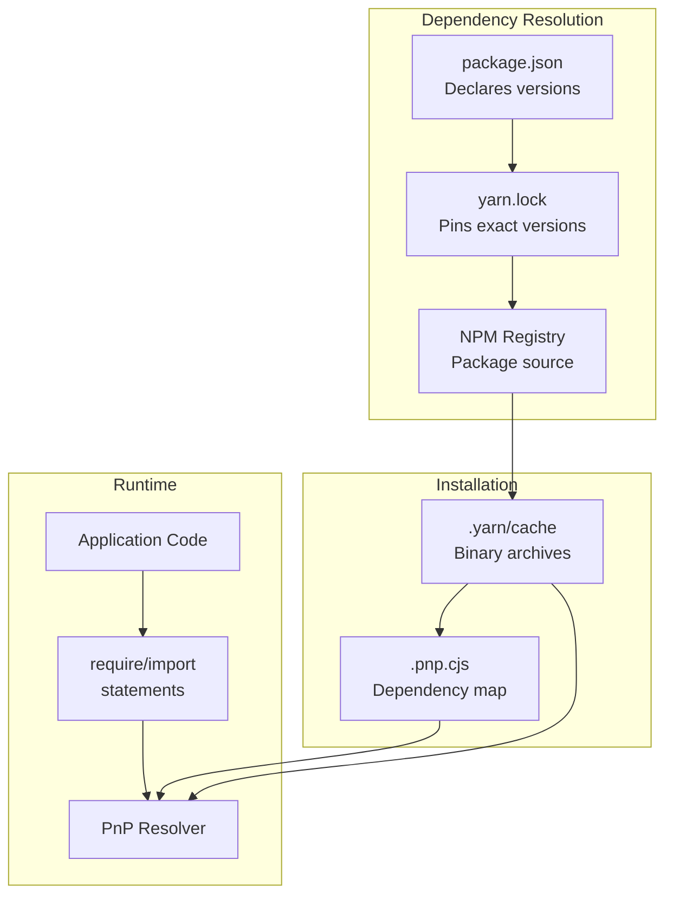

The `yarn.lock` file contains exact version numbers and integrity hashes for every transitive dependency. When developers run `yarn install`, Yarn reads this lockfile to ensure identical dependency versions across all environments, preventing "works on my machine" issues.

**Sources:** [package.json:1-59]()

---

## Development Dependencies

Development-only packages not included in production bundles:

| Package | Version | Purpose |
|---------|---------|---------|
| `@next/bundle-analyzer` | 13.4.19 | Bundle size visualization |
| `autoprefixer` | 10.4.14 | PostCSS plugin for CSS vendor prefixes |
| `postcss` | 8.4.27 | CSS transformation tool (required by Tailwind) |
| `tailwindcss` | 3.3.3 | CSS framework (build-time utility generation) |

These tools run during the build process but do not contribute to runtime bundle size. The `tailwindcss` compiler generates static CSS based on class names found in source files, producing a single compiled stylesheet.

**Sources:** [package.json:49-56]()

---

## Version Pinning Strategy

The project uses caret (`^`) version ranges for dependencies, allowing minor and patch updates:

- `^0.3.43` allows `0.3.x` and `0.4.x` (minor versions)
- `^3.1.12` allows `3.x.x` (major version 3)

This strategy balances stability with security updates. The `yarn.lock` file pins exact versions, so updates only occur when explicitly running `yarn upgrade`.

**Critical version constraints**:
- Node.js ≥18 required ([package.json:13-15]())
- Next.js 15.4.8+ for App Router stability
- React 18.3.1+ for Server Components

**Sources:** [package.json:13-47]()

---

## Summary

The LangChain + Next.js template's dependency architecture prioritizes:

1. **Modularity** - Scoped `@langchain/*` packages enable tree-shaking
2. **Type Safety** - TypeScript 5.1.6 with strict checking across the stack
3. **Edge Compatibility** - All production dependencies work in Vercel Edge Functions
4. **Deterministic Builds** - Yarn 3.5.1 with `yarn.lock` ensures reproducible installs
5. **Bundle Efficiency** - Bundle analyzer monitors the 1 MB Edge Function limit
6. **Developer Experience** - ESLint and Prettier enforce code quality standards

The 59-line `package.json` orchestrates a sophisticated stack of 47 dependencies (26 production, 21 development) that together enable serverless LLM application development with streaming, agents, and vector retrieval.

**Sources:** [package.json:1-59]()

---

# Page: Frontend Architecture

# Frontend Architecture

<details>
<summary>Relevant source files</summary>

The following files were used as context for generating this wiki page:

- [app/layout.tsx](app/layout.tsx)
- [app/retrieval/page.tsx](app/retrieval/page.tsx)
- [app/retrieval_agents/page.tsx](app/retrieval_agents/page.tsx)
- [app/structured_output/page.tsx](app/structured_output/page.tsx)
- [components/ChatMessageBubble.tsx](components/ChatMessageBubble.tsx)
- [components/ChatWindow.tsx](components/ChatWindow.tsx)
- [components/Navbar.tsx](components/Navbar.tsx)

</details>


This page documents the frontend architecture of the LangChain Next.js template, explaining the component hierarchy, layout structure, state management patterns, and how React components integrate with the backend API layer. For backend API implementation details, see page 3.3.

## Architecture Overview

The frontend architecture follows a hierarchical structure starting from `RootLayout` as the root component. All page routes are wrapped in this layout, which provides global navigation and styling. Individual feature pages then instantiate the reusable `ChatWindow` component, configuring it via props to connect to different API endpoints.

**Frontend Architecture Hierarchy**

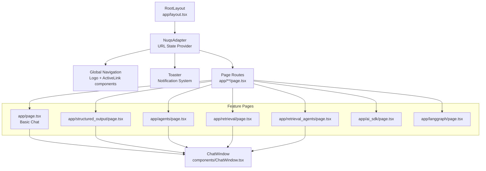

Sources: [app/layout.tsx:1-112](), [components/ChatWindow.tsx:168-356](), [app/retrieval_agents/page.tsx:1-86](), [app/retrieval/page.tsx:1-96](), [app/structured_output/page.tsx:1-85]()

## Root Layout & Global Navigation

The `RootLayout` component at [app/layout.tsx:33-112]() serves as the application shell, providing:

| Feature | Implementation | Purpose |
|---------|---------------|---------|
| HTML Structure | Standard `<html>` and `<body>` tags | SEO metadata, viewport configuration |
| NuqsAdapter | Wraps entire application | URL-based state management provider |
| Global Navigation | Logo + 7 `ActiveLink` components | Navigation between feature pages |
| Layout Grid | `grid-rows-[auto,1fr]` | Fixed header, flexible content area |
| Toast Notifications | `Toaster` component from Sonner | Error and status messages |

**Navigation Implementation**

The navigation bar at [app/layout.tsx:64-89]() uses the `ActiveLink` component ([components/Navbar.tsx:8-21]()) which:
- Reads current pathname via `usePathname()` hook
- Applies `bg-primary` styling to active route
- Provides visual feedback for current page location

```mermaid
graph LR
    usePathname["usePathname()<br/>Next.js Hook"]
    ActiveLink["ActiveLink Component<br/>components/Navbar.tsx"]
    Styling["Conditional Styling<br/>bg-primary if active"]
    
    usePathname -->|"Returns current path"| ActiveLink
    ActiveLink -->|"Applies"| Styling
```

Sources: [app/layout.tsx:33-112](), [components/Navbar.tsx:1-22]()

## Component Hierarchy

The `ChatWindow` component provides a consistent chat interface across all feature pages. It orchestrates multiple sub-components in a defined hierarchy:

**ChatWindow Component Tree**

```mermaid
graph TB
    ChatWindow["ChatWindow<br/>Main Container<br/>lines 168-356"]
    ChatLayout["ChatLayout<br/>Sticky Scroll Layout<br/>lines 150-166"]
    
    ChatWindow -->|"content prop"| ChatLayout
    ChatWindow -->|"footer prop"| ChatLayout
    
    Content["Content Area"]
    Footer["Footer Area"]
    
    ChatLayout -->|"Renders"| Content
    ChatLayout -->|"Renders"| Footer
    
    EmptyState["EmptyState Component<br/>Passed via props"]
    ChatMessages["ChatMessages<br/>Message List<br/>lines 26-52"]
    
    Content --> EmptyState
    Content --> ChatMessages
    
    ChatMessageBubble["ChatMessageBubble<br/>Individual Message<br/>components/ChatMessageBubble.tsx"]
    IntermediateStep["IntermediateStep<br/>Agent Reasoning Display<br/>components/IntermediateStep.tsx"]
    
    ChatMessages -->|"User/Assistant messages"| ChatMessageBubble
    ChatMessages -->|"System messages"| IntermediateStep
    
    ChatInput["ChatInput<br/>Input Field + Actions<br/>lines 54-108"]
    ScrollToBottom["ScrollToBottom Button<br/>lines 110-124"]
    
    Footer --> ScrollToBottom
    Footer --> ChatInput
    
    UploadDialog["UploadDocumentsForm<br/>Dialog for RAG features"]
    StepsCheckbox["Checkbox<br/>Toggle intermediate steps"]
    
    ChatInput -->|"Optional"| UploadDialog
    ChatInput -->|"Optional"| StepsCheckbox
```

Sources: [components/ChatWindow.tsx:1-356](), [components/ChatMessageBubble.tsx:1-54]()

## State Management Patterns

The frontend employs four distinct state management strategies depending on the scope and persistence requirements:

### useChat Hook (Vercel AI SDK)

The primary state management for chat interactions is handled by the `useChat` hook from `ai/react` ([components/ChatWindow.tsx:186-207]()):

| State Property | Type | Purpose |
|---------------|------|---------|
| `messages` | `Message[]` | Array of chat messages (user, assistant, system) |
| `input` | `string` | Current value of input field |
| `isLoading` | `boolean` | Whether API request is in progress |
| `handleSubmit` | `function` | Submits message to API endpoint |
| `handleInputChange` | `function` | Updates input field value |
| `setMessages` | `function` | Manually update message array |
| `setInput` | `function` | Manually update input value |

**useChat Data Flow**

```mermaid
sequenceDiagram
    participant User
    participant ChatInput
    participant useChat["useChat Hook<br/>lines 186-207"]
    participant APIRoute["API Route<br/>/api/chat/*"]
    participant ChatMessages
    
    User->>ChatInput: Types message
    ChatInput->>useChat: handleInputChange(e)
    useChat->>useChat: Updates input state
    
    User->>ChatInput: Clicks Send
    ChatInput->>useChat: handleSubmit(e)
    useChat->>useChat: Adds user message to messages[]
    useChat->>APIRoute: POST request with messages
    
    APIRoute-->>useChat: Streams response chunks
    useChat->>useChat: Appends chunks to assistant message
    useChat->>ChatMessages: Re-renders with updated messages
    ChatMessages-->>User: Displays streaming response
    
    Note over APIRoute,useChat: Headers: x-sources, x-message-index<br/>for retrieval citations
```

Sources: [components/ChatWindow.tsx:186-207]()

### useStream Hook (LangGraph SDK)

For the LangGraph feature at `/langgraph`, the application uses `useStream` from `@langchain/langgraph-sdk/react` instead of `useChat`. This hook provides:
- Stateful graph execution with checkpoints
- Message branching and time-travel debugging
- Thread persistence via URL parameters

The `useStream` hook is referenced in the high-level architecture diagrams but the implementation is in pages not included in the provided files. See page 5.7 for LangGraph integration details.

### nuqs (URL State Management)

The `NuqsAdapter` component ([app/layout.tsx:62]()) wraps the entire application, enabling URL-based state persistence. This allows:
- Sharing specific application states via URL
- Browser back/forward navigation preserving state
- Deep linking to specific configurations

Example usage pattern:
```typescript
// URL: /langgraph?threadId=abc123
const [threadId, setThreadId] = useQueryState('threadId');
```

Sources: [app/layout.tsx:7,62]()

### use-stick-to-bottom (Scroll State)

The `ChatLayout` component uses the `use-stick-to-bottom` library ([components/ChatWindow.tsx:8,152]()) to manage automatic scrolling behavior:

| Context Value | Purpose |
|--------------|---------|
| `scrollRef` | Reference to scrollable container |
| `contentRef` | Reference to content that grows |
| `isAtBottom` | Boolean indicating if scrolled to bottom |
| `scrollToBottom` | Function to manually scroll to bottom |

When `isAtBottom` is `false`, a "Scroll to bottom" button appears ([components/ChatWindow.tsx:110-124]()).

Sources: [components/ChatWindow.tsx:8,110-166]()

## Message Rendering Architecture

Messages are rendered differently based on their `role` property:

**Message Type Routing**

```mermaid
graph TB
    messages["messages: Message[]<br/>From useChat hook"]
    ChatMessages["ChatMessages Component<br/>lines 26-52"]
    
    messages --> ChatMessages
    
    RoleCheck{"message.role === ?"}
    
    ChatMessages --> RoleCheck
    
    System["'system'<br/>Agent intermediate steps"]
    User["'user'<br/>User input"]
    Assistant["'assistant'<br/>AI response"]
    
    RoleCheck -->|"system"| System
    RoleCheck -->|"user"| User
    RoleCheck -->|"assistant"| Assistant
    
    IntermediateStep["IntermediateStep Component<br/>Displays tool calls + observations"]
    ChatMessageBubble["ChatMessageBubble Component<br/>Displays message content"]
    
    System --> IntermediateStep
    User --> ChatMessageBubble
    Assistant --> ChatMessageBubble
    
    Sources["sources[] prop<br/>From x-sources header"]
    
    Assistant --> Sources
    Sources -->|"If present"| ChatMessageBubble
```

### ChatMessageBubble

The `ChatMessageBubble` component ([components/ChatMessageBubble.tsx:4-54]()) renders messages with role-based styling:

- **User messages**: Right-aligned, `bg-secondary` background
- **Assistant messages**: Left-aligned, includes emoji avatar, optional sources display

Sources are passed via the `sources` prop, populated from the `x-sources` response header ([components/ChatWindow.tsx:189-200]()).

### IntermediateStep

System messages with `role: "system"` represent agent intermediate steps. The `IntermediateStep` component (imported at [components/ChatWindow.tsx:11]()) parses the JSON content containing:
```typescript
{
  action: ToolCall,      // Tool selection by agent
  observation: string    // Tool execution result
}
```

Sources: [components/ChatWindow.tsx:26-52,260-272](), [components/ChatMessageBubble.tsx:1-54]()

## ChatWindow Configuration

The `ChatWindow` component accepts props that configure its behavior for different feature pages:

| Prop | Type | Usage |
|------|------|-------|
| `endpoint` | `string` | API route path (e.g., `"api/chat/agents"`) |
| `emptyStateComponent` | `ReactNode` | Component shown when no messages exist |
| `placeholder` | `string` | Input field placeholder text |
| `emoji` | `string` | Avatar emoji for AI messages |
| `showIngestForm` | `boolean` | Shows document upload dialog for RAG features |
| `showIntermediateStepsToggle` | `boolean` | Shows checkbox to enable agent step visibility |

**Feature Page Configuration Pattern**

```mermaid
graph LR
    Page["Feature Page<br/>app/**/page.tsx"]
    InfoCard["InfoCard<br/>GuideInfoBox with instructions"]
    ChatWindow["ChatWindow<br/>Configured via props"]
    APIEndpoint["API Endpoint<br/>/api/chat/**"]
    
    Page -->|"Creates"| InfoCard
    Page -->|"Instantiates"| ChatWindow
    InfoCard -->|"emptyStateComponent prop"| ChatWindow
    ChatWindow -->|"endpoint prop"| APIEndpoint
```

### Example: Basic Chat Page

```typescript
// app/page.tsx excerpt
<ChatWindow
  endpoint="api/chat"
  emoji="🏴‍☠️"
  placeholder="I'm an LLM pretending to be a pirate!"
  emptyStateComponent={InfoCard}
/>
```

### Example: Retrieval Agents Page

```typescript
// app/retrieval_agents/page.tsx excerpt
<ChatWindow
  endpoint="api/chat/retrieval_agents"
  emoji="🤖"
  placeholder="Beep boop! I'm a robot retrieval-focused agent!"
  emptyStateComponent={InfoCard}
  showIngestForm={true}
  showIntermediateStepsToggle={true}
/>
```

Sources: [components/ChatWindow.tsx:168-175](), [app/retrieval_agents/page.tsx:75-85](), [app/retrieval/page.tsx:86-95]()

## Intermediate Steps Handling

When `showIntermediateStepsToggle` is enabled and the user checks the box ([components/ChatWindow.tsx:338-351]()), the component switches from streaming mode to JSON mode for agent responses:

**Intermediate Steps Processing Flow**

```mermaid
sequenceDiagram
    participant User
    participant ChatWindow["ChatWindow<br/>sendMessage function<br/>lines 209-290"]
    participant APIRoute["API Route<br/>e.g. /api/chat/agents"]
    participant ChatMessages
    
    User->>ChatWindow: Submits message with checkbox enabled
    
    Note over ChatWindow: Sets intermediateStepsLoading = true<br/>Manually adds user message to state
    
    ChatWindow->>APIRoute: POST with show_intermediate_steps: true
    
    Note over APIRoute: Returns full JSON response<br/>instead of streaming
    
    APIRoute-->>ChatWindow: JSON with messages[] array
    
    Note over ChatWindow: Filters for tool_calls and tool messages<br/>lines 250-258
    
    loop For each tool call pair
        ChatWindow->>ChatWindow: Creates system message<br/>with action + observation
        ChatWindow->>ChatMessages: Adds message with delay
        Note over ChatMessages: Animated display<br/>1-2 second delay per step
    end
    
    ChatWindow->>ChatMessages: Adds final assistant message
    ChatWindow->>ChatWindow: Sets intermediateStepsLoading = false
```

The component transforms tool messages into system messages with this structure:
```typescript
{
  id: string,
  role: "system",
  content: JSON.stringify({
    action: {
      name: string,        // Tool name (e.g., "calculator")
      args: object,        // Tool arguments
      id: string
    },
    observation: string    // Tool execution result
  })
}
```

Sources: [components/ChatWindow.tsx:209-290]()

## Special Features

### Document Upload

When `showIngestForm` is enabled, the `ChatWindow` component displays a document upload button that opens a dialog with the `UploadDocumentsForm` component, allowing users to upload documents for retrieval-based features.

Sources: [components/ChatWindow.tsx:314-336]()

### Intermediate Steps Display

When `showIntermediateStepsToggle` is enabled, the `ChatWindow` component displays a checkbox that toggles the display of intermediate reasoning steps for agent-based features. This provides transparency into the agent's thought process.

Sources: [components/ChatWindow.tsx:338-351](), [components/ChatWindow.tsx:176-181](), [components/ChatWindow.tsx:209-290]()

### Citation Sources

For retrieval-based responses, the `ChatMessageBubble` component can display the source documents that were used to generate the response, providing attribution and context for the information.

Sources: [components/ChatMessageBubble.tsx:28-50]()

## Summary

The frontend components of the LangChain NextJS Template provide a flexible and modular architecture for building AI-powered chat interfaces. The `ChatWindow` component serves as the central building block, adaptable to different use cases through configuration. Each feature page implements this component with specific settings to showcase different LangChain capabilities, while maintaining a consistent user experience.

---

# Page: API Routes Architecture

# API Routes

<details>
<summary>Relevant source files</summary>

The following files were used as context for generating this wiki page:

- [app/api/chat/agents/route.ts](app/api/chat/agents/route.ts)
- [app/api/chat/retrieval/route.ts](app/api/chat/retrieval/route.ts)
- [app/api/chat/route.ts](app/api/chat/route.ts)

</details>


This document explains the backend API routes in the LangChain NextJS Template. These routes implement different AI capabilities using LangChain.js and serve as the connection points between the frontend UI components and the underlying AI functionality.

For information about frontend components that communicate with these routes, see [Frontend Components](#3.1).

## Overview of API Routes

The LangChain NextJS Template provides several API routes that implement different LangChain features, from basic chat to complex retrieval agents. All routes are implemented as Next.js API routes using the App Router pattern, with the Edge Runtime for optimal performance.

```mermaid
flowchart TD
    subgraph "API Routes"
        direction LR
        Chat["/api/chat"] 
        StructuredOutput["/api/chat/structured_output"]
        Agents["/api/chat/agents"]
        Retrieval["/api/chat/retrieval"]
        RetrievalAgents["/api/chat/retrieval_agents"]
        Ingest["/api/retrieval/ingest"]
    end

    subgraph "LangChain Features"
        SimpleChain["Simple LLM Chain"]
        FunctionCalling["Structured Output (Function Calling)"]
        ToolAgent["Tool-using Agent"]
        RAG["Retrieval Augmented Generation"]
        RAGAgent["Retrieval Agent"]
        Embedding["Document Embedding"]
    end

    Chat --> SimpleChain
    StructuredOutput --> FunctionCalling
    Agents --> ToolAgent
    Retrieval --> RAG
    RetrievalAgents --> RAGAgent
    Ingest --> Embedding
```

Sources: [app/api/chat/route.ts](), [app/api/chat/structured_output/route.ts](), [app/api/chat/agents/route.ts](), [app/api/chat/retrieval/route.ts](), [app/api/chat/retrieval_agents/route.ts](), [app/api/retrieval/ingest/route.ts]()

## Common Patterns

All API routes in the template share common patterns and principles:

1. **Edge Runtime** - All routes use `export const runtime = "edge"` for optimal performance and streaming capabilities
2. **Error Handling** - Try/catch blocks with standardized error responses
3. **Request/Response Format** - JSON for input, streaming or JSON for output
4. **LangChain Integration** - Each route demonstrates a different LangChain functionality

### API Route Structure

```mermaid
sequenceDiagram
    participant Client as "Client Browser"
    participant NextAPI as "Next.js API Route"
    participant LangChain as "LangChain Components"
    participant LLM as "OpenAI LLM"
    
    Client->>NextAPI: POST request with messages
    Note over NextAPI: Parse request body
    NextAPI->>LangChain: Initialize LangChain components
    LangChain->>LLM: Make LLM API calls
    LLM-->>LangChain: Return response
    alt Streaming Response
        LangChain-->>NextAPI: Stream tokens
        NextAPI-->>Client: StreamingTextResponse
    else JSON Response
        LangChain-->>NextAPI: Return complete response
        NextAPI-->>Client: NextResponse.json()
    end
```

Sources: [app/api/chat/route.ts:28-73](), [app/api/chat/structured_output/route.ts:24-80]()

## Basic Chat API Route

The simplest API route is `/api/chat`, which implements a straightforward conversation with an LLM without any advanced features.

### Implementation Details

- **Path**: `/api/chat`
- **Model**: `ChatOpenAI` (OpenAI's chat models)
- **Key Components**:
  - `PromptTemplate` for formatting messages with a pirate persona
  - `HttpResponseOutputParser` for handling streaming responses
  - Simple LCEL chain pattern: `prompt.pipe(model).pipe(outputParser)`
  - Streaming response using `StreamingTextResponse`

```mermaid
flowchart LR
    Request["Client Request"] --> Parse["Parse Request"]
    Parse --> FormatMessages["Format Previous Messages"]
    FormatMessages --> PromptTemplate["Create Prompt from Template"]
    PromptTemplate --> Chain["Create Chain: prompt → model → outputParser"]
    Chain --> Stream["Stream Response"]
    Stream --> Response["StreamingTextResponse to Client"]
```

Sources: [app/api/chat/route.ts:1-73]()

## Structured Output API Route

The `/api/chat/structured_output` route demonstrates how to generate structured, schema-conformant outputs from an LLM using OpenAI's function calling capability.

### Implementation Details

- **Path**: `/api/chat/structured_output`
- **Model**: `ChatOpenAI` with function calling
- **Key Components**:
  - `zod` library for schema definition
  - `withStructuredOutput` to bind schema to model
  - Returns JSON instead of streaming

```mermaid
flowchart LR
    Request["Client Request"] --> Parse["Parse Request"]
    Parse --> Template["Create Prompt Template"]
    Template --> Schema["Define Output Schema with Zod"]
    Schema --> BindSchema["Bind Schema to Model with withStructuredOutput"]
    BindSchema --> Chain["Create Chain: prompt → functionCallingModel"]
    Chain --> Invoke["Invoke Chain"]
    Invoke --> Response["JSON Response to Client"]
```

Sources: [app/api/chat/structured_output/route.ts:1-80]()

## Agents API Route

The `/api/chat/agents` route implements a ReAct agent that can use external tools to solve complex problems.

### Implementation Details

- **Path**: `/api/chat/agents`
- **Model**: `ChatOpenAI`
- **Key Components**:
  - `createReactAgent` from LangGraph
  - Tools: `SerpAPI` (search) and `Calculator`
  - Message conversion between Vercel and LangChain formats
  - Option to show intermediate steps or stream final output

```mermaid
flowchart LR
    Request["Client Request"] --> Parse["Parse Request"]
    Parse --> ConvertMessages["Convert Messages to LangChain Format"]
    ConvertMessages --> Tools["Initialize Tools (SerpAPI, Calculator)"]
    Tools --> CreateAgent["Create ReAct Agent with LangGraph"]
    CreateAgent --> AgentMode{"Return Intermediate Steps?"}
    AgentMode -->|Yes| FullInvoke["Full Invoke with Steps"]
    AgentMode -->|No| StreamEvents["Stream Events"]
    FullInvoke --> ConvertBack["Convert Results to Vercel Format"]
    ConvertBack --> JSONResponse["JSON Response"]
    StreamEvents --> FilterContent["Filter for Content"]
    FilterContent --> StreamResponse["StreamingTextResponse"]
```

Sources: [app/api/chat/agents/route.ts:1-140]()

## Retrieval API Route

The `/api/chat/retrieval` route implements Retrieval Augmented Generation (RAG) to answer questions based on a knowledge base stored in Supabase.

### Implementation Details

- **Path**: `/api/chat/retrieval`
- **Model**: `ChatOpenAI`
- **Key Components**:
  - `SupabaseVectorStore` for document retrieval
  - Two-step process: condense question, then answer with context
  - `RunnableSequence` for composing the retrieval chain
  - Streaming with source document metadata

```mermaid
flowchart TD
    Request["Client Request"] --> Parse["Parse Request"]
    Parse --> Messages["Extract Messages & Current Question"]
    Messages --> InitModel["Initialize ChatOpenAI"]
    InitModel --> InitVectorStore["Initialize Supabase Vector Store"]
    InitVectorStore --> StandaloneQ["Create Standalone Question Chain"]
    StandaloneQ --> Retriever["Create Retriever"]
    Retriever --> AnswerChain["Create Answer Chain"]
    AnswerChain --> CombineChains["Combine into Conversational RAG Chain"]
    CombineChains --> Stream["Stream Response"]
    Stream --> ProcessSources["Process Source Documents"]
    ProcessSources --> Response["StreamingTextResponse with Source Headers"]
```

Sources: [app/api/chat/retrieval/route.ts:1-172]()

## Retrieval Agents API Route

The `/api/chat/retrieval_agents` route combines agent capabilities with retrieval, allowing an agent to use a retriever as a tool.

### Implementation Details

- **Path**: `/api/chat/retrieval_agents`
- **Model**: `ChatOpenAI`
- **Key Components**:
  - `SupabaseVectorStore` for document retrieval
  - `createRetrieverTool` to create a tool from the retriever
  - `createReactAgent` for the agent with tools
  - Robot persona implemented via system message

```mermaid
flowchart TD
    Request["Client Request"] --> Parse["Parse Request"]
    Parse --> ConvertMessages["Convert Messages to LangChain Format"]
    ConvertMessages --> InitChat["Initialize ChatOpenAI"]
    InitChat --> InitVectorStore["Initialize Supabase Vector Store"]
    InitVectorStore --> CreateRetriever["Create Retriever"]
    CreateRetriever --> CreateTool["Create Retriever Tool"]
    CreateTool --> CreateAgent["Create ReAct Agent with Tool"]
    CreateAgent --> AgentMode{"Return Intermediate Steps?"}
    AgentMode -->|Yes| FullInvoke["Full Invoke with Steps"]
    AgentMode -->|No| StreamEvents["Stream Events"]
    FullInvoke --> ConvertBack["Convert Results to Vercel Format"]
    ConvertBack --> JSONResponse["JSON Response"]
    StreamEvents --> FilterContent["Filter for Content"]
    FilterContent --> StreamResponse["StreamingTextResponse"]
```

Sources: [app/api/chat/retrieval_agents/route.ts:1-164]()

## Ingest API Route

The `/api/retrieval/ingest` route handles ingestion of text data into the vector store for later retrieval.

### Implementation Details

- **Path**: `/api/retrieval/ingest`
- **Model**: Uses OpenAI embeddings, but no LLM directly
- **Key Components**:
  - `RecursiveCharacterTextSplitter` for chunking text
  - `SupabaseVectorStore` for storing embedded chunks
  - Simple POST endpoint that returns success status

```mermaid
flowchart LR
    Request["Client Request"] --> Parse["Parse Request"]
    Parse --> ExtractText["Extract Text"]
    ExtractText --> CreateClient["Create Supabase Client"]
    CreateClient --> CreateSplitter["Create Text Splitter"]
    CreateSplitter --> SplitDocs["Split Text into Chunks"]
    SplitDocs --> Embed["Embed Documents with OpenAI"]
    Embed --> Store["Store in Supabase"]
    Store --> Response["JSON Response (Success)"]
```

Sources: [app/api/retrieval/ingest/route.ts:1-63]()

## API/UI Integration

The API routes integrate with the frontend UI components primarily through the ChatWindow component. Here's how the data flows between them:

```mermaid
sequenceDiagram
    participant User
    participant ChatWindow as "ChatWindow Component"
    participant APIRoute as "API Route"
    participant LangChain as "LangChain.js"
    participant OpenAI as "OpenAI API"
    
    User->>ChatWindow: Types message
    ChatWindow->>APIRoute: POST with messages array
    APIRoute->>LangChain: Initialize components
    LangChain->>OpenAI: Make API call
    
    alt Streaming Response
        OpenAI-->>LangChain: Stream tokens
        LangChain-->>APIRoute: Stream processed tokens
        APIRoute-->>ChatWindow: Stream via StreamingTextResponse
        ChatWindow-->>User: Display tokens as they arrive
    else With Intermediate Steps
        OpenAI-->>LangChain: Complete response with steps
        LangChain-->>APIRoute: Return with intermediate steps
        APIRoute-->>ChatWindow: JSON with messages and steps
        ChatWindow-->>User: Display message and IntermediateSteps
    end
```

Sources: [app/api/chat/agents/route.ts:88-136](), [components/IntermediateStep.tsx:1-60]()

## Implementation Best Practices

The API routes in this template demonstrate several best practices:

1. **Edge Runtime** - All routes use the Edge Runtime for better performance and streaming capabilities
2. **Error Handling** - Consistent error handling pattern with try/catch and status codes
3. **Message Conversion** - Utilities to convert between Vercel and LangChain message formats
4. **Streaming** - Efficient streaming of responses from LLMs
5. **LCEL** - Use of LangChain Expression Language for composing chains
6. **Personality** - Demonstration of giving AI assistants distinct personalities through system prompts

### Code Structure Example:
```
1. Import dependencies
2. Set runtime to "edge"
3. Define helper functions (e.g., message conversion)
4. Export POST handler that:
   - Parses request
   - Initializes LangChain components
   - Processes the request using LangChain
   - Streams or returns the response
   - Handles errors
```

Sources: [app/api/chat/route.ts:1-73](), [app/api/chat/structured_output/route.ts:1-80](), [app/api/chat/agents/route.ts:1-140]()

## Extension Points

The API routes in this template are designed to be extended in several ways:

1. **New Models**: Replace OpenAI with other LLM providers
2. **Custom Tools**: Add new tools to the agents
3. **Different Vector Stores**: Replace Supabase with other vector databases
4. **Custom Prompts**: Modify the system prompts and templates
5. **New Routes**: Add entirely new capabilities by creating new routes

When adding new routes, follow the established patterns for consistency and maintainability.

---

# Page: External Service Integration

# External Service Integration

<details>
<summary>Relevant source files</summary>

The following files were used as context for generating this wiki page:

- [README.md](README.md)
- [app/api/chat/retrieval/route.ts](app/api/chat/retrieval/route.ts)
- [package.json](package.json)

</details>


## Purpose and Scope

This document details the integration with external third-party services used throughout the LangChain + Next.js template. It covers the four primary service integrations (OpenAI, Supabase, SERP API, and Tavily API), their configuration requirements, initialization patterns, and usage across different API routes. For information about how these services are used within specific features, see the Features & Examples section starting at [5](#5). For environment setup instructions, see [Getting Started](#2).

## External Service Architecture

The template integrates with four external services, each serving a distinct role in the AI application stack:

```mermaid
graph TB
    subgraph "Environment Configuration"
        EnvFile[".env.local<br/>Environment Variables"]
        EnvOpenAI["OPENAI_API_KEY"]
        EnvSupabaseURL["SUPABASE_URL"]
        EnvSupabaseKey["SUPABASE_PRIVATE_KEY"]
        EnvSerp["SERPAPI_API_KEY"]
        EnvLangSmith["LANGCHAIN_CALLBACKS_BACKGROUND"]
    end
    
    subgraph "Service Clients"
        OpenAIClient["ChatOpenAI<br/>@langchain/openai"]
        EmbeddingsClient["OpenAIEmbeddings<br/>@langchain/openai"]
        SupabaseClient["createClient<br/>@supabase/supabase-js"]
        SerpTool["SerpAPI<br/>@langchain/community"]
        TavilyTool["TavilySearchResults<br/>@langchain/community"]
    end
    
    subgraph "API Routes"
        ChatRoute["/api/chat/route.ts"]
        StructRoute["/api/chat/structured_output/route.ts"]
        AgentRoute["/api/chat/agents/route.ts"]
        RetrievalRoute["/api/chat/retrieval/route.ts"]
        RetAgentRoute["/api/chat/retrieval_agents/route.ts"]
        IngestRoute["/api/retrieval/ingest/route.ts"]
    end
    
    subgraph "External APIs"
        OpenAIAPI["OpenAI API<br/>api.openai.com"]
        SupabaseAPI["Supabase API<br/>*.supabase.co"]
        SerpAPI["SERP API<br/>serpapi.com"]
        TavilyAPI["Tavily API<br/>tavily.com"]
    end
    
    EnvFile --> EnvOpenAI
    EnvFile --> EnvSupabaseURL
    EnvFile --> EnvSupabaseKey
    EnvFile --> EnvSerp
    EnvFile --> EnvLangSmith
    
    EnvOpenAI --> OpenAIClient
    EnvOpenAI --> EmbeddingsClient
    EnvSupabaseURL --> SupabaseClient
    EnvSupabaseKey --> SupabaseClient
    EnvSerp --> SerpTool
    
    OpenAIClient --> ChatRoute
    OpenAIClient --> StructRoute
    OpenAIClient --> AgentRoute
    OpenAIClient --> RetrievalRoute
    OpenAIClient --> RetAgentRoute
    
    EmbeddingsClient --> RetrievalRoute
    EmbeddingsClient --> RetAgentRoute
    EmbeddingsClient --> IngestRoute
    
    SupabaseClient --> RetrievalRoute
    SupabaseClient --> RetAgentRoute
    SupabaseClient --> IngestRoute
    
    SerpTool --> AgentRoute
    SerpTool --> RetAgentRoute
    
    TavilyTool -.->|Alternative| AgentRoute
    
    ChatRoute --> OpenAIAPI
    StructRoute --> OpenAIAPI
    AgentRoute --> OpenAIAPI
    RetrievalRoute --> OpenAIAPI
    RetAgentRoute --> OpenAIAPI
    
    RetrievalRoute --> SupabaseAPI
    RetAgentRoute --> SupabaseAPI
    IngestRoute --> SupabaseAPI
    
    AgentRoute --> SerpAPI
    RetAgentRoute --> SerpAPI
    
    AgentRoute -.-> TavilyAPI
```

**Service Integration Flow**: Environment variables are loaded from `.env.local` and used to initialize service clients. Each API route instantiates the clients it needs, which then make requests to external APIs. All routes use `ChatOpenAI`, while only retrieval routes use embeddings and vector store clients, and only agent routes use search tools.

**Sources:** [package.json:16-47](), [README.md:29-32](), [README.md:64-65](), [README.md:79-80]()

---

## OpenAI Integration

### LLM Client Configuration

The `ChatOpenAI` client from `@langchain/openai` is the primary language model interface used across all API routes. It provides access to OpenAI's GPT models with streaming capabilities.

| Configuration Parameter | Default Value | Used In Routes |
|------------------------|---------------|----------------|
| `model` | `"gpt-4o-mini"` | All chat routes |
| `temperature` | Varies (0.2-1.0) | All chat routes |
| `streaming` | Implicit | All routes (via streaming parsers) |
| API Key Source | `process.env.OPENAI_API_KEY` | All routes |

**Initialization Pattern:**

The `ChatOpenAI` client is instantiated within each API route handler using this pattern:

```typescript
const model = new ChatOpenAI({
  model: "gpt-4o-mini",
  temperature: 0.2,
});
```

**Sources:** [app/api/chat/retrieval/route.ts:77-80](), [package.json:21]()

### Embeddings Client Configuration

The `OpenAIEmbeddings` client generates vector embeddings for documents and queries in RAG (Retrieval-Augmented Generation) implementations.

```mermaid
graph LR
    subgraph "Retrieval Routes"
        RetrievalRoute["/api/chat/retrieval"]
        RetAgentRoute["/api/chat/retrieval_agents"]
        IngestRoute["/api/retrieval/ingest"]
    end
    
    subgraph "Embeddings Client"
        EmbeddingsClient["OpenAIEmbeddings<br/>Default Configuration"]
        ModelText["text-embedding-ada-002<br/>1536 dimensions"]
    end
    
    subgraph "Vector Store"
        VectorStore["SupabaseVectorStore"]
        SimilaritySearch["similaritySearch<br/>match_documents"]
    end
    
    subgraph "OpenAI API"
        EmbeddingsEndpoint["/v1/embeddings"]
    end
    
    RetrievalRoute --> EmbeddingsClient
    RetAgentRoute --> EmbeddingsClient
    IngestRoute --> EmbeddingsClient
    
    EmbeddingsClient --> ModelText
    EmbeddingsClient --> EmbeddingsEndpoint
    
    EmbeddingsClient --> VectorStore
    VectorStore --> SimilaritySearch
```

**Embeddings Usage Pattern**: The `OpenAIEmbeddings` client is passed to `SupabaseVectorStore` constructor, which automatically handles embedding generation for both document ingestion and query processing. The embeddings model uses OpenAI's `text-embedding-ada-002` by default.

**Sources:** [app/api/chat/retrieval/route.ts:6](), [app/api/chat/retrieval/route.ts:86-90]()

### Model Selection and Temperature Settings

Different routes use different temperature settings to control output randomness:

| Route | Model | Temperature | Rationale |
|-------|-------|-------------|-----------|
| Basic Chat | `gpt-4o-mini` | Higher (0.8-1.0) | Creative, conversational responses |
| Structured Output | `gpt-4o-mini` | Low (0.2) | Consistent schema adherence |
| Agents | `gpt-4o-mini` | Medium (0.5-0.7) | Balanced reasoning and creativity |
| Retrieval | `gpt-4o-mini` | Low (0.2) | Factual responses based on context |

**Sources:** [app/api/chat/retrieval/route.ts:77-80]()

---

## Supabase Vector Store Integration

### Client Initialization

Supabase serves as the vector database for storing and retrieving document embeddings. The integration requires two environment variables and uses a specific table schema.

```mermaid
graph TB
    subgraph "Configuration"
        SupabaseURL["process.env.SUPABASE_URL"]
        SupabaseKey["process.env.SUPABASE_PRIVATE_KEY"]
    end
    
    subgraph "Client Creation"
        CreateClient["createClient<br/>@supabase/supabase-js"]
        ClientInstance["Supabase Client Instance"]
    end
    
    subgraph "Vector Store Setup"
        VectorStore["SupabaseVectorStore"]
        Config["Configuration Object"]
        TableName["tableName: 'documents'"]
        QueryName["queryName: 'match_documents'"]
        Embeddings["embeddings: OpenAIEmbeddings"]
    end
    
    subgraph "Database Schema"
        DocumentsTable["documents table"]
        MatchFunction["match_documents()<br/>pgvector function"]
    end
    
    subgraph "Operations"
        AddDocuments["addDocuments()<br/>Insert vectors"]
        AsRetriever["asRetriever()<br/>Similarity search"]
    end
    
    SupabaseURL --> CreateClient
    SupabaseKey --> CreateClient
    CreateClient --> ClientInstance
    
    ClientInstance --> Config
    Embeddings --> Config
    TableName --> Config
    QueryName --> Config
    
    Config --> VectorStore
    
    VectorStore --> DocumentsTable
    VectorStore --> MatchFunction
    
    VectorStore --> AddDocuments
    VectorStore --> AsRetriever
```

**Client Creation Pattern**: The Supabase client is created using `createClient()` with URL and private key from environment variables, then passed to `SupabaseVectorStore` constructor along with embeddings client.

**Sources:** [app/api/chat/retrieval/route.ts:4](), [app/api/chat/retrieval/route.ts:82-90](), [package.json:26]()

### Vector Store Configuration

The `SupabaseVectorStore` requires specific configuration to match the database schema:

| Configuration Key | Value | Purpose |
|------------------|-------|---------|
| `client` | Supabase client instance | Database connection |
| `tableName` | `"documents"` | Table storing vectors |
| `queryName` | `"match_documents"` | pgvector similarity function |
| Embeddings | `OpenAIEmbeddings` instance | Vector generation |

**Initialization Pattern:**

```typescript
const client = createClient(
  process.env.SUPABASE_URL!,
  process.env.SUPABASE_PRIVATE_KEY!,
);
const vectorstore = new SupabaseVectorStore(new OpenAIEmbeddings(), {
  client,
  tableName: "documents",
  queryName: "match_documents",
});
```

**Sources:** [app/api/chat/retrieval/route.ts:82-90]()

### Retriever Configuration

The vector store is converted to a retriever with callbacks for tracking retrieved documents:

```typescript
const retriever = vectorstore.asRetriever({
  callbacks: [
    {
      handleRetrieverEnd(documents) {
        resolveWithDocuments(documents);
      },
    },
  ],
});
```

This pattern uses a callback to capture retrieved documents for returning as source citations in the response headers.

**Sources:** [app/api/chat/retrieval/route.ts:112-120]()

### Document Ingestion Flow

Document ingestion follows this sequence:

1. Text splitting (via `RecursiveCharacterTextSplitter`)
2. Embedding generation (via `OpenAIEmbeddings`)
3. Vector storage (via `SupabaseVectorStore.addDocuments()`)

The ingestion is handled by the `/api/retrieval/ingest` route and only needs to be performed once per document set. Repeated ingestion creates duplicates.

**Sources:** [README.md:85-86]()

---

## Search Tool Integration

### SERP API Configuration

The SERP API tool provides web search capabilities to agents. It is implemented using `SerpAPI` from `@langchain/community`.

```mermaid
graph TB
    subgraph "Environment"
        SerpKey["SERPAPI_API_KEY"]
    end
    
    subgraph "Tool Creation"
        SerpTool["SerpAPI Tool"]
        ToolConfig["Configuration"]
        ToolName["name: 'search'"]
        ToolDesc["description: 'useful for...'"]
    end
    
    subgraph "Agent Integration"
        AgentRoute["/api/chat/agents"]
        RetAgentRoute["/api/chat/retrieval_agents"]
        CreateReactAgent["createReactAgent()"]
        ToolArray["tools: Tool[]"]
    end
    
    subgraph "External Service"
        SerpAPI["SERP API<br/>serpapi.com"]
        GoogleSearch["Google Search Results"]
    end
    
    SerpKey --> SerpTool
    ToolName --> ToolConfig
    ToolDesc --> ToolConfig
    ToolConfig --> SerpTool
    
    SerpTool --> ToolArray
    ToolArray --> CreateReactAgent
    
    AgentRoute --> CreateReactAgent
    RetAgentRoute --> CreateReactAgent
    
    SerpTool --> SerpAPI
    SerpAPI --> GoogleSearch
```

**SERP API Tool Usage**: The tool is only initialized when `SERPAPI_API_KEY` is present in environment variables. It provides agents with the ability to search the web for current information.

**Sources:** [README.md:64-65](), [package.json:17]()

### Tavily API Alternative

Tavily API serves as an alternative search tool, mentioned in the template but primarily used in AI SDK examples. It provides similar web search functionality with a different API interface.

| Feature | SERP API | Tavily API |
|---------|----------|------------|
| Package | `@langchain/community` | `@langchain/community` |
| Primary Use | Agent routes | AI SDK routes |
| Configuration | `SERPAPI_API_KEY` | Tavily API key |
| Tool Name | `"search"` | Configurable |

**Sources:** High-level architecture diagram

### Calculator Tool

In addition to search tools, agent examples include a basic calculator tool for mathematical operations. This tool is implemented locally without external API dependencies.

**Sources:** [README.md:69]()

---

## Environment Variable Configuration

### Required Variables by Feature

```mermaid
graph TB
    subgraph "Basic Features"
        BasicChat["Basic Chat<br/>Structured Output"]
        OpenAIKey["OPENAI_API_KEY<br/>Required"]
    end
    
    subgraph "Agent Features"
        Agents["Agents<br/>Retrieval Agents"]
        OpenAIKeyAgent["OPENAI_API_KEY<br/>Required"]
        SerpKey["SERPAPI_API_KEY<br/>Optional"]
    end
    
    subgraph "Retrieval Features"
        Retrieval["Retrieval<br/>Retrieval Agents<br/>Ingest"]
        OpenAIKeyRetr["OPENAI_API_KEY<br/>Required"]
        SupaURL["SUPABASE_URL<br/>Required"]
        SupaKey["SUPABASE_PRIVATE_KEY<br/>Required"]
    end
    
    subgraph "Optional Configuration"
        Tracing["LangSmith Tracing"]
        LangSmithBG["LANGCHAIN_CALLBACKS_BACKGROUND<br/>Must be 'false' for Edge"]
    end
    
    BasicChat --> OpenAIKey
    Agents --> OpenAIKeyAgent
    Agents --> SerpKey
    Retrieval --> OpenAIKeyRetr
    Retrieval --> SupaURL
    Retrieval --> SupaKey
    
    BasicChat -.-> Tracing
    Agents -.-> Tracing
    Retrieval -.-> Tracing
    Tracing --> LangSmithBG
```

**Feature-Based Configuration**: Different features require different subsets of environment variables. Basic chat only needs OpenAI, agents optionally use SERP API, and retrieval features require both OpenAI and Supabase.

**Sources:** [README.md:29-32](), [README.md:64-65](), [README.md:79-80]()

### Configuration File Structure

The template uses `.env.local` for environment variables, with `.env.example` serving as a template:

| File | Purpose | Version Control |
|------|---------|----------------|
| `.env.example` | Template with variable names | Committed to repo |
| `.env.local` | Actual values | Gitignored |

**Setup Process:**
1. Copy `.env.example` to `.env.local`
2. Fill in API keys for desired features
3. Ensure `LANGCHAIN_CALLBACKS_BACKGROUND=false` for Edge runtime

**Sources:** [README.md:29]()

### Edge Runtime Constraints

The `LANGCHAIN_CALLBACKS_BACKGROUND` variable is critical for Edge runtime compatibility:

```typescript
// Must be set in .env.local
LANGCHAIN_CALLBACKS_BACKGROUND=false
```

This ensures that LangSmith tracing (if enabled) completes synchronously before the Edge function terminates, as Edge Functions cannot maintain background processes.

**Sources:** [README.md:32]()

---

## Service Client Lifecycle

### Per-Request Initialization

All external service clients are instantiated on a per-request basis within API route handlers:

```mermaid
sequenceDiagram
    participant Request as "HTTP Request"
    participant Handler as "API Route Handler"
    participant OpenAI as "ChatOpenAI Client"
    participant Supabase as "Supabase Client"
    participant VectorStore as "SupabaseVectorStore"
    
    Request->>Handler: POST /api/chat/retrieval
    Handler->>OpenAI: new ChatOpenAI({...})
    Handler->>Supabase: createClient(url, key)
    Handler->>VectorStore: new SupabaseVectorStore(embeddings, {...})
    VectorStore->>Supabase: Store client reference
    Handler->>VectorStore: asRetriever()
    Handler->>OpenAI: Stream response
    OpenAI-->>Request: Streaming tokens
```

**No Connection Pooling**: Each request creates fresh client instances. This is compatible with serverless Edge Functions which are stateless and short-lived.

**Sources:** [app/api/chat/retrieval/route.ts:70-91]()

### Error Handling

API routes implement try-catch blocks to handle external service errors:

```typescript
try {
  // Service initialization and usage
} catch (e: any) {
  return NextResponse.json(
    { error: e.message }, 
    { status: e.status ?? 500 }
  );
}
```

This pattern returns error messages to the client while preserving HTTP status codes from external services.

**Sources:** [app/api/chat/retrieval/route.ts:169-172]()

---

## Service-Specific Configuration Tables

### OpenAI Service Configuration

| Configuration Aspect | Details |
|---------------------|---------|
| Package | `@langchain/openai` version ^0.4.9 |
| Classes Used | `ChatOpenAI`, `OpenAIEmbeddings` |
| Default LLM Model | `gpt-4o-mini` |
| Default Embeddings Model | `text-embedding-ada-002` (implicit) |
| API Key Variable | `OPENAI_API_KEY` |
| Rate Limiting | Handled by OpenAI API |
| Streaming Support | Yes, via `BytesOutputParser` |

**Sources:** [package.json:21](), [app/api/chat/retrieval/route.ts:77-80]()

### Supabase Service Configuration

| Configuration Aspect | Details |
|---------------------|---------|
| Package | `@supabase/supabase-js` version ^2.32.0 |
| LangChain Integration | `SupabaseVectorStore` from `@langchain/community` |
| Required Variables | `SUPABASE_URL`, `SUPABASE_PRIVATE_KEY` |
| Table Name | `documents` |
| Query Function | `match_documents` |
| Vector Dimensions | 1536 (matching OpenAI embeddings) |
| Setup Required | Yes, see [LangChain.js Supabase docs](https://js.langchain.com/docs/integrations/vectorstores/supabase) |

**Sources:** [package.json:26](), [app/api/chat/retrieval/route.ts:82-90](), [README.md:79]()

### SERP API Service Configuration

| Configuration Aspect | Details |
|---------------------|---------|
| Package | `@langchain/community` (includes SerpAPI tool) |
| Tool Class | `SerpAPI` |
| API Key Variable | `SERPAPI_API_KEY` |
| Usage Scope | Agent routes only |
| Requirement Level | Optional (agents work without it) |
| Signup Location | serpapi.com |
| Free Tier | Available |

**Sources:** [README.md:64-65](), [package.json:17]()

---

## Deployment Considerations

### Vercel Environment Variables

When deploying to Vercel, environment variables must be configured through the Vercel dashboard or CLI:

1. Navigate to Project Settings → Environment Variables
2. Add each required variable for the desired feature set
3. Ensure variables are available in all environments (Production, Preview, Development)

**Edge Function Compatibility**: All API routes use `export const runtime = "edge"` and are deployed as Edge Functions, requiring the `LANGCHAIN_CALLBACKS_BACKGROUND=false` setting for proper LangSmith tracing behavior.

**Sources:** [README.md:120-124](), [app/api/chat/retrieval/route.ts:16]()

### Bundle Size Impact

External service clients contribute to the overall bundle size:

| Service Integration | Approximate Size Contribution |
|--------------------|------------------------------|
| `@langchain/core` | 37.32 KB (compressed) |
| `@langchain/openai` | Included in core metrics |
| `@supabase/supabase-js` | Additional overhead |
| `@langchain/community` | Only used modules included |

The template stays well within Vercel's 1 MB Edge Function limit. Bundle analysis can be performed with `ANALYZE=true yarn build`.

**Sources:** [README.md:99-107]()

---

## Security Considerations

### API Key Protection

API keys are:
- Never committed to version control (`.env.local` is gitignored)
- Accessed via `process.env` at runtime
- Only available server-side (API routes)
- Protected by Next.js automatic environment variable handling

### Private Key vs. Public Key

Supabase integration uses the **private key** (`SUPABASE_PRIVATE_KEY`), not the public anon key, because:
- Vector operations require service role permissions
- API routes run server-side where private keys are safe
- Bypasses Row Level Security (RLS) for vector operations

**Sources:** [app/api/chat/retrieval/route.ts:82-85](), [README.md:80]()

---

# Page: Core UI Components

# Core UI Components

<details>
<summary>Relevant source files</summary>

The following files were used as context for generating this wiki page:

- [app/layout.tsx](app/layout.tsx)
- [app/retrieval/page.tsx](app/retrieval/page.tsx)
- [app/retrieval_agents/page.tsx](app/retrieval_agents/page.tsx)
- [app/structured_output/page.tsx](app/structured_output/page.tsx)
- [components/ChatMessageBubble.tsx](components/ChatMessageBubble.tsx)
- [components/ChatWindow.tsx](components/ChatWindow.tsx)
- [components/Navbar.tsx](components/Navbar.tsx)

</details>


## Purpose and Scope

This page documents the reusable UI components that form the foundation of all chat interfaces in the template. These components handle message display, user input, layout structure, navigation, and scroll management. They are shared across all seven example implementations (Basic Chat, Structured Output, Agents, Retrieval, Retrieval Agents, AI SDK, and LangGraph).

For information about the specific example implementations that use these components, see the Features & Examples section ([#5](#5)). For the overall frontend architecture, see [Frontend Architecture](#3.2). For the backend API routes these components communicate with, see [API Routes Architecture](#3.3).

---

## Component Architecture Overview

The core UI layer is organized around a main container component (`ChatWindow`) that orchestrates several specialized sub-components. The architecture follows a component composition pattern where layout, input, and display concerns are separated.

```mermaid
graph TB
    subgraph "App Layer"
        RootLayout["RootLayout<br/>(app/layout.tsx)"]
        PageRoutes["Page Routes<br/>(/page.tsx, /agents/page.tsx, etc)"]
    end
    
    subgraph "Navigation"
        ActiveLink["ActiveLink<br/>(Navbar.tsx)"]
    end
    
    subgraph "Chat Container"
        ChatWindow["ChatWindow<br/>(ChatWindow.tsx:168-356)"]
    end
    
    subgraph "Layout Components"
        ChatLayout["ChatLayout<br/>(ChatWindow.tsx:150-166)"]
        StickyToBottomContent["StickyToBottomContent<br/>(ChatWindow.tsx:126-148)"]
        ScrollToBottom["ScrollToBottom<br/>(ChatWindow.tsx:110-124)"]
    end
    
    subgraph "Display Components"
        ChatMessages["ChatMessages<br/>(ChatWindow.tsx:26-52)"]
        ChatMessageBubble["ChatMessageBubble<br/>(ChatMessageBubble.tsx:4-54)"]
        IntermediateStep["IntermediateStep<br/>(IntermediateStep.tsx)"]
    end
    
    subgraph "Input Components"
        ChatInput["ChatInput<br/>(ChatWindow.tsx:54-108)"]
        UploadDocumentsForm["UploadDocumentsForm<br/>(UploadDocumentsForm.tsx)"]
    end
    
    subgraph "External Hooks"
        useChat["useChat<br/>(ai/react)"]
        useStickToBottom["useStickToBottom<br/>(use-stick-to-bottom)"]
    end
    
    RootLayout --> ActiveLink
    RootLayout --> PageRoutes
    PageRoutes --> ChatWindow
    
    ChatWindow --> ChatLayout
    ChatWindow --> ChatMessages
    ChatWindow --> ChatInput
    ChatWindow --> useChat
    
    ChatLayout --> StickyToBottomContent
    ChatLayout --> ScrollToBottom
    StickyToBottomContent --> useStickToBottom
    ScrollToBottom --> useStickToBottom
    
    ChatMessages --> ChatMessageBubble
    ChatMessages --> IntermediateStep
    
    ChatInput --> UploadDocumentsForm
```

**Sources:** [components/ChatWindow.tsx:1-357](), [components/ChatMessageBubble.tsx:1-54](), [components/Navbar.tsx:1-22](), [app/layout.tsx:1-112]()

---

## ChatWindow Component

The `ChatWindow` component is the primary entry point for all chat interfaces. It manages message state, handles API communication, processes intermediate steps, and coordinates document sources.

### Props Interface

| Prop | Type | Required | Purpose |
|------|------|----------|---------|
| `endpoint` | `string` | Yes | API endpoint URL (e.g., `"api/chat/retrieval"`) |
| `emptyStateComponent` | `ReactNode` | Yes | Component displayed when no messages exist |
| `placeholder` | `string` | No | Input placeholder text |
| `emoji` | `string` | No | Emoji for AI message avatar |
| `showIngestForm` | `boolean` | No | Enable document upload dialog |
| `showIntermediateStepsToggle` | `boolean` | No | Enable agent intermediate steps display |

### Core State Management

```mermaid
graph LR
    subgraph "ChatWindow State"
        showIntermediateSteps["showIntermediateSteps<br/>(boolean)"]
        intermediateStepsLoading["intermediateStepsLoading<br/>(boolean)"]
        sourcesForMessages["sourcesForMessages<br/>(Record&lt;string, any&gt;)"]
    end
    
    subgraph "useChat Hook State"
        messages["messages<br/>(Message[])"]
        input["input<br/>(string)"]
        isLoading["isLoading<br/>(boolean)"]
        handleSubmit["handleSubmit<br/>(function)"]
    end
    
    subgraph "API Communication"
        endpoint["API Endpoint<br/>(props.endpoint)"]
        onResponse["onResponse<br/>callback"]
    end
    
    showIntermediateSteps --> sendMessage
    intermediateStepsLoading --> sendMessage
    messages --> ChatMessages
    input --> ChatInput
    
    sendMessage --> endpoint
    endpoint --> onResponse
    onResponse --> sourcesForMessages
    sourcesForMessages --> ChatMessages
```

The component uses the `useChat` hook from Vercel AI SDK [components/ChatWindow.tsx:186-207]() to manage message state and API communication. When `showIntermediateSteps` is enabled, it performs additional processing to display agent tool calls as system messages [components/ChatWindow.tsx:218-290]().

### Source Attribution Flow

When API responses include source documents (for RAG implementations), the component extracts them from response headers and associates them with specific messages:

1. **Header Extraction**: Sources are Base64-encoded in the `x-sources` header [components/ChatWindow.tsx:189-192]()
2. **Message Indexing**: The `x-message-index` header identifies which message the sources belong to [components/ChatWindow.tsx:194-200]()
3. **State Storage**: Sources are stored in the `sourcesForMessages` Record keyed by message index
4. **Display**: `ChatMessageBubble` receives sources via props and renders them below the message content

**Sources:** [components/ChatWindow.tsx:168-356]()

---

## ChatLayout Component

The `ChatLayout` component provides the structural foundation for the chat interface, implementing a sticky footer pattern with automatic scroll-to-bottom functionality.

### Layout Structure

```mermaid
graph TB
    StickToBottom["StickToBottom<br/>Context Provider"]
    StickyToBottomContent["StickyToBottomContent<br/>(grid: rows 1fr,auto)"]
    contentRef["Content Area<br/>(messages)"]
    footerArea["Footer Area<br/>(sticky input)"]
    ScrollToBottomButton["ScrollToBottom<br/>Button"]
    
    StickToBottom --> StickyToBottomContent
    StickyToBottomContent --> contentRef
    StickyToBottomContent --> footerArea
    footerArea --> ScrollToBottomButton
    
    style StickToBottom fill:#f9f9f9
    style StickyToBottomContent fill:#f0f0f0
```

The component uses the `use-stick-to-bottom` library to manage scroll behavior [components/ChatWindow.tsx:152-164](). It provides two ref attachments:
- `scrollRef`: Applied to the scrollable container, toggles between `overflow: unset` and `overflow: auto` [components/ChatWindow.tsx:137-139]()
- `contentRef`: Applied to the content area for measuring scroll position [components/ChatWindow.tsx:141-143]()

### Props Interface

| Prop | Type | Purpose |
|------|------|---------|
| `content` | `ReactNode` | Main chat message area |
| `footer` | `ReactNode` | Sticky footer content (usually `ChatInput`) |

**Sources:** [components/ChatWindow.tsx:150-166](), [components/ChatWindow.tsx:126-148]()

---

## ChatInput Component

The `ChatInput` component handles user input with support for loading states, custom actions, and flexible child content.

### Component Structure

```mermaid
graph LR
    form["form element<br/>(onSubmit handler)"]
    container["Flex container<br/>(border, rounded, bg-secondary)"]
    input["input element<br/>(borderless, transparent)"]
    leftActions["Left actions<br/>(props.children)"]
    rightActions["Right actions<br/>(props.actions)"]
    submitButton["Submit Button<br/>(Loading | Send)"]
    
    form --> container
    container --> input
    container --> leftActions
    container --> rightActions
    container --> submitButton
```

### Props Interface

| Prop | Type | Purpose |
|------|------|---------|
| `onSubmit` | `(e: FormEvent) => void` | Form submission handler |
| `onStop` | `() => void` | Optional stop handler for streaming |
| `value` | `string` | Controlled input value |
| `onChange` | `(e: ChangeEvent) => void` | Input change handler |
| `loading` | `boolean` | Loading state indicator |
| `placeholder` | `string` | Input placeholder text |
| `children` | `ReactNode` | Left-side action elements |
| `actions` | `ReactNode` | Right-side action elements |
| `className` | `string` | Additional CSS classes |

### Loading State Behavior

The component implements smart button behavior [components/ChatWindow.tsx:65-76]():
- When `loading` is `true` AND `onStop` is provided: Button calls `onStop()` (stop streaming)
- When `loading` is `true` AND `onStop` is `null`: Button is disabled
- When `loading` is `false`: Button calls `onSubmit()` (send message)

The loading UI displays a spinning `LoaderCircle` icon from Lucide React [components/ChatWindow.tsx:94-98]().

**Sources:** [components/ChatWindow.tsx:54-108]()

---

## ChatMessages Component

The `ChatMessages` component renders the list of messages and handles conditional rendering for system messages (intermediate steps).

### Message Rendering Logic

```mermaid
graph TB
    messages["messages: Message[]"]
    emptyState["emptyStateComponent"]
    
    subgraph "Message Processing"
        map["messages.map((m, i) => ...)"]
        roleCheck{"m.role === 'system'?"}
        IntermediateStep["IntermediateStep<br/>component"]
        ChatMessageBubble["ChatMessageBubble<br/>component"]
        sourceKey["sourceKey calculation<br/>(messages.length - 1 - i)"]
    end
    
    messages --> map
    map --> roleCheck
    roleCheck -->|Yes| IntermediateStep
    roleCheck -->|No| sourceKey
    sourceKey --> ChatMessageBubble
```

### Source Indexing

The component uses reverse indexing for sources [components/ChatWindow.tsx:40](). The most recent message has index `0`, calculated as:
```
sourceKey = (messages.length - 1 - currentIndex).toString()
```

This matches the indexing scheme used in the `x-message-index` header from API responses.

### Props Interface

| Prop | Type | Purpose |
|------|------|---------|
| `messages` | `Message[]` | Array of chat messages |
| `emptyStateComponent` | `ReactNode` | Displayed when messages array is empty |
| `sourcesForMessages` | `Record<string, any>` | Map of message indices to source documents |
| `aiEmoji` | `string` | Optional emoji for AI avatar |
| `className` | `string` | Additional CSS classes |

**Sources:** [components/ChatWindow.tsx:26-52]()

---

## ChatMessageBubble Component

The `ChatMessageBubble` component renders individual messages with role-based styling and optional source citations.

### Visual Structure

```mermaid
graph LR
    container["Message Container<br/>(rounded-[24px], max-w-80%)"]
    
    subgraph "AI Message Layout"
        avatar["Avatar Circle<br/>(emoji, 40x40px)"]
        content1["Content Column"]
        messageText1["Message Text<br/>(whitespace-pre-wrap)"]
        sources["Sources Section<br/>(if present)"]
    end
    
    subgraph "User Message Layout"
        content2["Content Column<br/>(bg-secondary)"]
        messageText2["Message Text"]
    end
    
    container -->|role !== 'user'| avatar
    avatar --> content1
    content1 --> messageText1
    content1 --> sources
    
    container -->|role === 'user'| content2
    content2 --> messageText2
```

### Styling Patterns

The component uses conditional styling based on message role [components/ChatMessageBubble.tsx:11-17]():

- **User messages**: 
  - Background: `bg-secondary`
  - Alignment: `ml-auto` (right-aligned)
  - Max width: 80% of container
  
- **AI messages**:
  - No background (transparent)
  - Alignment: `mr-auto` (left-aligned)
  - Avatar displayed with emoji

### Source Citation Rendering

When sources are present, they are displayed below the message content [components/ChatMessageBubble.tsx:28-49]():
1. Header: "🔍 Sources:" in a code block
2. Numbered list of source documents
3. Each source shows:
   - Sequential number
   - Page content (quoted)
   - Optional line number range (for code files)

**Sources:** [components/ChatMessageBubble.tsx:1-54]()

---

## Navigation Components

### ActiveLink Component

The `ActiveLink` component provides navigation links with active state indication using Next.js's `usePathname` hook.

```mermaid
graph LR
    ActiveLink["ActiveLink Component"]
    usePathname["usePathname()<br/>Next.js hook"]
    Link["Next.js Link"]
    
    subgraph "Conditional Styling"
        pathname["Current pathname"]
        propsHref["props.href"]
        matchCheck{"pathname === href?"}
        activeStyle["bg-primary<br/>text-primary-foreground"]
        inactiveStyle["Default styling"]
    end
    
    ActiveLink --> usePathname
    usePathname --> pathname
    ActiveLink --> Link
    pathname --> matchCheck
    propsHref --> matchCheck
    matchCheck -->|Yes| activeStyle
    matchCheck -->|No| inactiveStyle
    activeStyle --> Link
    inactiveStyle --> Link
```

### Props Interface

| Prop | Type | Purpose |
|------|------|---------|
| `href` | `string` | Navigation target URL |
| `children` | `ReactNode` | Link content (typically icon + text) |

The component applies the `bg-primary text-primary-foreground` classes when the current pathname matches the link's href [components/Navbar.tsx:13-16]().

**Sources:** [components/Navbar.tsx:1-22](), [app/layout.tsx:74-88]()

---

## Scroll Management System

The template implements automatic scroll-to-bottom behavior using the `use-stick-to-bottom` library, ensuring users always see the latest messages unless they've scrolled up to review history.

### ScrollToBottom Component

```mermaid
graph TB
    useStickToBottomContext["useStickToBottomContext()"]
    isAtBottom{"isAtBottom?"}
    Button["Scroll to bottom<br/>Button"]
    scrollToBottom["scrollToBottom()<br/>function"]
    noRender["null<br/>(hidden)"]
    
    useStickToBottomContext --> isAtBottom
    isAtBottom -->|Yes| noRender
    isAtBottom -->|No| Button
    Button -->|onClick| scrollToBottom
```

The component conditionally renders based on scroll position [components/ChatWindow.tsx:113-123]():
- When `isAtBottom` is `true`: Returns `null` (button hidden)
- When `isAtBottom` is `false`: Displays button with `ArrowDown` icon

### Context Integration

The `StickToBottom` context provider wraps the entire chat layout [components/ChatWindow.tsx:152-164]() and provides:

| Context Property | Type | Purpose |
|-----------------|------|---------|
| `scrollRef` | `RefObject` | Applied to scrollable container |
| `contentRef` | `RefObject` | Applied to content area |
| `isAtBottom` | `boolean` | Current scroll position state |
| `scrollToBottom` | `() => void` | Function to scroll to bottom |

**Sources:** [components/ChatWindow.tsx:110-124](), [components/ChatWindow.tsx:126-148]()

---

## State Management Patterns

### useChat Hook Integration

The `ChatWindow` component integrates with Vercel AI SDK's `useChat` hook [components/ChatWindow.tsx:186-207]() with the following configuration:

```typescript
const chat = useChat({
  api: props.endpoint,           // API endpoint URL
  onResponse(response) { ... },  // Extract sources from headers
  streamMode: "text",            // Text streaming mode
  onError: (e) => { ... },       // Toast error notifications
});
```

### Intermediate Steps Processing

When `showIntermediateSteps` is enabled [components/ChatWindow.tsx:213-290](), the component implements a custom flow:

1. **Manual API Call**: Uses `fetch()` instead of `useChat.handleSubmit()` to get full response
2. **Message Filtering**: Extracts tool call messages (role: "assistant" with tool_calls) and tool result messages (role: "tool")
3. **Step Pairing**: Groups tool calls and results into pairs
4. **System Message Conversion**: Converts pairs to system messages with action/observation structure
5. **Progressive Display**: Adds messages incrementally with staggered timing (1-2 seconds between steps)

This creates a visual representation of the agent's reasoning process [components/ChatWindow.tsx:260-280]().

**Sources:** [components/ChatWindow.tsx:186-290]()

---

## UI Library Integration

### Radix UI Components

The template uses Radix UI primitives for accessible, unstyled component foundations. Key integrations include:

| Radix Component | Usage Location | Purpose |
|----------------|----------------|---------|
| `Dialog` | [components/ChatWindow.tsx:15-23]() | Document upload modal |
| `Checkbox` | [components/ChatWindow.tsx:14]() | Intermediate steps toggle |
| `Button` | [components/ChatWindow.tsx:12]() | All button elements |

### Tailwind CSS Styling

The application uses Tailwind CSS for utility-first styling [app/layout.tsx:1](). Key patterns include:

- **Grid Layouts**: Used for overall page structure [app/layout.tsx:63]()
- **Flexbox Layouts**: Used for chat message layout [components/ChatWindow.tsx:34]()
- **Responsive Design**: Media query classes (e.g., `md:block`, `md:flex-row`) [app/layout.tsx:65,74]()
- **Design Tokens**: Semantic color variables (`bg-primary`, `text-secondary-foreground`) [components/ChatMessageBubble.tsx:14]()

### Utility Function: cn

The `cn` utility function from `@/utils/cn` is used throughout to conditionally merge Tailwind classes [components/ChatMessageBubble.tsx:1](), enabling clean conditional styling patterns.

**Sources:** [components/ChatWindow.tsx:14-24](), [components/ChatMessageBubble.tsx:1-2](), [app/layout.tsx:1-112]()

---

## Toast Notifications

The template uses Sonner for toast notifications [components/ChatWindow.tsx:7](), configured via the `Toaster` component in the root layout [app/layout.tsx:107]().

### Error Handling

API errors trigger toast notifications in two locations:

1. **useChat onError**: For streaming errors [components/ChatWindow.tsx:203-206]()
   ```typescript
   onError: (e) => toast.error(`Error while processing your request`, {
     description: e.message,
   })
   ```

2. **Manual API calls**: For intermediate steps errors [components/ChatWindow.tsx:239-244]()
   ```typescript
   if (!response.ok) {
     toast.error(`Error while processing your request`, {
       description: json.error,
     });
   }
   ```

**Sources:** [components/ChatWindow.tsx:7,203-206,239-244](), [app/layout.tsx:107]()

---

## Example Usage Patterns

### Basic Chat Implementation

```typescript
// app/page.tsx
<ChatWindow
  endpoint="api/chat"
  emptyStateComponent={InfoCard}
  placeholder="What's it like to be a pirate?"
  emoji="🏴‍☠️"
/>
```

### Retrieval with Document Upload

```typescript
// app/retrieval/page.tsx
<ChatWindow
  endpoint="api/chat/retrieval"
  emptyStateComponent={InfoCard}
  showIngestForm={true}
  placeholder="I've got a nose for finding the right documents!"
  emoji="🐶"
/>
```

### Agent with Intermediate Steps

```typescript
// app/retrieval_agents/page.tsx
<ChatWindow
  endpoint="api/chat/retrieval_agents"
  emptyStateComponent={InfoCard}
  showIngestForm={true}
  showIntermediateStepsToggle={true}
  placeholder="Beep boop! I'm a robot retrieval-focused agent!"
  emoji="🤖"
/>
```

**Sources:** [app/retrieval/page.tsx:85-95](), [app/retrieval_agents/page.tsx:74-85](), [app/structured_output/page.tsx:77-84]()

---

# Page: Features & Examples

# Features & Examples

<details>
<summary>Relevant source files</summary>

The following files were used as context for generating this wiki page:

- [README.md](README.md)
- [app/agents/page.tsx](app/agents/page.tsx)
- [app/page.tsx](app/page.tsx)

</details>


The LangChain Next.js template demonstrates seven progressively complex AI patterns, each building upon the concepts introduced in previous examples. This pedagogical structure allows developers to learn LangChain.js integration incrementally, starting with basic LLM interactions and advancing to sophisticated graph-based orchestration.

Each example is implemented as a complete feature with:
- A dedicated page component under `app/` 
- An API route handler under `app/api/chat/`
- Integration with the shared `ChatWindow` component

The examples progress from simple streaming chat to complex agent workflows, demonstrating different LangChain.js capabilities at each level.

For detailed documentation of each feature, see the respective sub-pages:
- [Basic Chat](#5.1)
- [Structured Output](#5.2)
- [Agents](#5.3)
- [Retrieval (RAG)](#5.4)
- [Retrieval Agents](#5.5)
- [AI SDK & React Server Components](#5.6)
- [LangGraph Integration](#5.7)

For information about the overall system architecture, see [System Architecture](#3).

## Pedagogical Progression

The template is structured as a learning path, with each example introducing new concepts while building on previous ones:

### Complexity Progression Diagram

```mermaid
graph TB
    L1["Level 1: Basic Chat<br/>app/page.tsx<br/>api/chat/route.ts"]
    L2["Level 2: Structured Output<br/>app/structured_output/page.tsx<br/>api/chat/structured_output/route.ts"]
    L3["Level 3: Agents<br/>app/agents/page.tsx<br/>api/chat/agents/route.ts"]
    L4["Level 4: RAG<br/>app/retrieval/page.tsx<br/>api/chat/retrieval/route.ts"]
    L5["Level 5: RAG + Agents<br/>app/retrieval_agents/page.tsx<br/>api/chat/retrieval_agents/route.ts"]
    L6["Level 6: AI SDK<br/>app/ai_sdk/page.tsx"]
    L7["Level 7: LangGraph<br/>app/langgraph/page.tsx"]
    
    L1 -->|"Add Zod schema"| L2
    L2 -->|"Add tools + ReAct"| L3
    L3 -->|"Add vector store"| L4
    L4 -->|"Combine patterns"| L5
    L5 -->|"RSC streaming"| L6
    L6 -->|"State graphs"| L7
    
    L1 -.->|"ChatOpenAI"| D1["PromptTemplate<br/>StreamingTextResponse"]
    L2 -.->|"withStructuredOutput"| D2["Zod schemas<br/>JsonOutputFunctionsParser"]
    L3 -.->|"createReactAgent"| D3["Tool executors<br/>SerpAPI"]
    L4 -.->|"SupabaseVectorStore"| D4["OpenAIEmbeddings<br/>RecursiveCharacterTextSplitter"]
    L5 -.->|"createRetrieverTool"| D5["Agent + retriever<br/>tool composition"]
    L6 -.->|"createStreamableValue"| D6["Server Actions<br/>streamEvents"]
    L7 -.->|"useStream"| D7["LangGraph SDK<br/>State machines"]
```

Sources: [README.md:6-17](). [app/page.tsx](). [app/agents/page.tsx]()

## Implementation Patterns

Each feature demonstrates a specific LangChain.js pattern:

| Level | Feature | Page Component | API Route | Core Pattern | Key Technologies |
|-------|---------|----------------|-----------|--------------|------------------|
| 1 | Basic Chat | `app/page.tsx` | `api/chat/route.ts` | LCEL chain | `ChatOpenAI`, `PromptTemplate`, `HttpResponseOutputParser` |
| 2 | Structured Output | `app/structured_output/page.tsx` | `api/chat/structured_output/route.ts` | Schema enforcement | `Zod`, `withStructuredOutput()`, OpenAI function calling |
| 3 | Agents | `app/agents/page.tsx` | `api/chat/agents/route.ts` | ReAct agent | `createReactAgent()`, `SerpAPI`, Calculator tool |
| 4 | RAG | `app/retrieval/page.tsx` | `api/chat/retrieval/route.ts` | Vector retrieval | `SupabaseVectorStore`, `OpenAIEmbeddings`, retrieval chain |
| 5 | RAG + Agents | `app/retrieval_agents/page.tsx` | `api/chat/retrieval_agents/route.ts` | Combined pattern | `createRetrieverTool()`, agent with memory |
| 6 | AI SDK | `app/ai_sdk/page.tsx` | Server Actions | RSC streaming | `createStreamableValue()`, `streamEvents` API |
| 7 | LangGraph | `app/langgraph/page.tsx` | LangGraph backend | State graphs | `useStream` hook, `@langchain/langgraph-sdk` |

Sources: [README.md:9-17]()

## Data Flow Patterns

The examples demonstrate three main data flow patterns:

### Pattern 1: Simple LCEL Chains (Levels 1-2, 4)

```mermaid
flowchart LR
    Input["User Input"] --> Prompt["PromptTemplate"]
    Prompt --> LLM["ChatOpenAI"]
    LLM --> Parser["Output Parser"]
    Parser --> Stream["StreamingTextResponse"]
    
    VectorStore["SupabaseVectorStore"] -.->|"RAG only"| Prompt
```

Used by:
- `api/chat/route.ts` - Basic chat with system prompt
- `api/chat/structured_output/route.ts` - Schema-validated output
- `api/chat/retrieval/route.ts` - RAG chain with context injection

### Pattern 2: Agent Execution (Levels 3, 5)

```mermaid
flowchart LR
    Input["User Input"] --> Agent["createReactAgent()"]
    Agent --> Think["Reasoning Step"]
    Think --> Tool["Tool Selection"]
    Tool --> Execute["Tool Execution"]
    Execute --> Observe["Observation"]
    Observe -->|"Continue loop"| Think
    Observe -->|"Final answer"| Response["Streaming Response"]
    
    Tools["Calculator<br/>SerpAPI<br/>RetrieverTool"] -.-> Tool
```

Used by:
- `api/chat/agents/route.ts` - Agent with search and calculator tools
- `api/chat/retrieval_agents/route.ts` - Agent with retriever tool

### Pattern 3: Server Actions (Level 6)

```mermaid
flowchart LR
    Client["Client Component"] --> Action["Server Action"]
    Action --> Stream["createStreamableValue()"]
    Stream --> Events["streamEvents()"]
    Events --> UI["readStreamableValue()"]
    UI --> Client
```

Used by:
- `app/ai_sdk/page.tsx` - React Server Components with progressive streaming

Sources: [README.md:9-17]()

## Feature Capabilities Matrix

| Capability | Basic | Structured | Agents | RAG | RAG+Agents | AI SDK | LangGraph |
|------------|-------|------------|--------|-----|------------|--------|-----------|
| Streaming responses | ✓ | ✓ | ✓ | ✓ | ✓ | ✓ | ✓ |
| Typed outputs | - | ✓ | - | - | - | - | - |
| Tool use | - | - | ✓ | - | ✓ | ✓ | ✓ |
| Vector search | - | - | - | ✓ | ✓ | - | - |
| Memory/history | ✓ | ✓ | ✓ | ✓ | ✓ | ✓ | ✓ |
| Multi-step reasoning | - | - | ✓ | - | ✓ | ✓ | ✓ |
| Intermediate steps | - | - | ✓ | - | ✓ | ✓ | ✓ |
| Source citations | - | - | - | ✓ | ✓ | - | - |
| State management | - | - | - | - | - | - | ✓ |
| Branch/edit history | - | - | - | - | - | - | ✓ |

Sources: [README.md:6-17]()

## Feature Comparison

| Feature | Key Files | Main Technologies | Use Case |
|---------|-----------|-------------------|----------|
| Basic Chat | `/api/chat/route.ts` | ChatOpenAI, LCEL, StreamingTextResponse | Simple conversational AI |
| Structured Output | `/api/chat/structured_output/route.ts` | Zod schema, OpenAI function calling, JsonOutputFunctionsParser | Getting structured data from LLMs |
| Agents | `/api/chat/agents/route.ts` | LangGraph.js, SERP API, Calculator tool | Solving complex, multi-step problems |
| Retrieval | `/api/chat/retrieval/route.ts`, `/api/retrieval/ingest/route.ts` | SupabaseVectorStore, OpenAIEmbeddings, RecursiveCharacterTextSplitter | Enhancing responses with document context |
| Retrieval Agents | `/api/chat/retrieval_agents/route.ts` | Combination of retrieval and agent capabilities | Domain-specific QA with tool use capability |
| AI SDK | `/app/ai_sdk/page.tsx` | Vercel AI SDK, React Server Components | Streamlined AI UX in React applications |
| LangGraph | `/api/chat/langgraph/route.ts` | StateGraph, Agent nodes, Tool nodes | Complex, multi-turn conversational agents |

This table provides a quick reference to compare the different features demonstrated in the template, their implementation files, main technologies used, and target use cases.

Sources: [README.md](). [app/layout.tsx:75-87]()

---

# Page: Basic Chat

# Basic Chat

<details>
<summary>Relevant source files</summary>

The following files were used as context for generating this wiki page:

- [app/agents/page.tsx](app/agents/page.tsx)
- [app/api/chat/route.ts](app/api/chat/route.ts)
- [app/page.tsx](app/page.tsx)

</details>


The Basic Chat feature demonstrates a simple but powerful implementation of a conversational AI interface using LangChain.js and Next.js. This document explains how the basic chat system works, its architecture, and how it serves as the foundation for more advanced features in the LangChain NextJS Template.

For more advanced chatbot implementations, see [Structured Output](#4.2), [Agents](#4.3), or [Retrieval](#4.4).

## Overview

The Basic Chat feature implements a streaming chat interface where users can interact with an OpenAI language model in real-time. By default, it's configured as a pirate-themed chatbot, but the prompt can be easily modified to create different personalities or capabilities.

```mermaid
flowchart TD
    subgraph "Basic Chat Architecture"
        User["User"] -->|"Sends message"| ChatWindow["ChatWindow Component"]
        ChatWindow -->|"POST request"| ChatAPI["/api/chat Endpoint"]
        ChatAPI -->|"Formats prompt"| LangChain["LangChain Chain"]
        LangChain -->|"Sends prompt"| OpenAI["ChatOpenAI Model"]
        OpenAI -->|"Streams tokens"| LangChain
        LangChain -->|"Parses response"| ChatAPI
        ChatAPI -->|"Streams text"| ChatWindow
        ChatWindow -->|"Displays response"| User
    end
```

Sources: [components/ChatWindow.tsx:186-207](), [app/api/chat/route.ts:28-72]()

## Key Components

### Frontend Implementation

The frontend of the Basic Chat feature consists of two primary components:

1. **Page Component**: Configures and renders the chat window
2. **ChatWindow Component**: Handles chat state and user interaction

```mermaid
flowchart TD
    subgraph "Frontend Components"
        Page["app/page.tsx"] -->|"configures"| ChatWindow["ChatWindow"]
        ChatWindow -->|"uses"| useChat["useChat hook (Vercel AI SDK)"]
        ChatWindow -->|"renders"| ChatMessages["ChatMessages"]
        ChatWindow -->|"renders"| ChatInput["ChatInput"]
        ChatMessages -->|"renders"| ChatMessageBubble["ChatMessageBubble"]
        ChatInput -->|"handles"| UserInput["User Input"]
    end
```

The main page (`app/page.tsx`) configures the `ChatWindow` component with:
- The API endpoint (`api/chat`)
- An emoji for the AI messages (`🏴‍☠️`)
- A placeholder for the input field
- An information component to display when the chat is empty

Sources: [app/page.tsx:4-63](), [components/ChatWindow.tsx:168-356]()

### Backend Implementation

The backend of the Basic Chat feature is a Next.js API route that processes chat messages using LangChain.js:

```mermaid
flowchart LR
    subgraph "Backend Chain"
        Request["HTTP Request"] -->|"extracts"| Messages["Chat Messages"]
        Messages -->|"formats"| PromptTemplate["PromptTemplate"]
        PromptTemplate -->|"sends to"| ChatModel["ChatOpenAI"]
        ChatModel -->|"generates"| Response["Response"]
        Response -->|"parses"| OutputParser["HttpResponseOutputParser"]
        OutputParser -->|"streams"| StreamingResponse["StreamingTextResponse"]
    end
```

Sources: [app/api/chat/route.ts:10-72]()

## Data Flow

The data flow in the Basic Chat system follows these steps:

1. User submits a message through the ChatInput component
2. ChatWindow sends the message to the `/api/chat` endpoint
3. The API route formats the message history and current message
4. A LangChain prompt template structures the input for the model
5. The ChatOpenAI model generates a response
6. The response is streamed back to the frontend
7. ChatWindow displays the streamed response in real-time

Sources: [components/ChatWindow.tsx:209-216](), [app/api/chat/route.ts:28-69]()

## Implementation Details

### Chat Interface

The chat interface is implemented through the `ChatWindow` component, which:
- Manages chat state using the Vercel AI SDK's `useChat` hook
- Renders chat messages with the `ChatMessages` component
- Handles user input with the `ChatInput` component
- Supports streaming responses
- Has a "stick to bottom" behavior for better UX

Sources: [components/ChatWindow.tsx:168-356]()

### API Route

The `/api/chat` API route handles chat requests by:

1. Extracting messages from the request body
2. Formatting previous messages and the current message
3. Creating a prompt template with the pirate-themed prompt
4. Initializing a ChatOpenAI model
5. Setting up an output parser for streaming responses
6. Creating a chain with the prompt, model, and parser
7. Streaming the response back to the client

The most notable part is the prompt template, which defines the chatbot's personality:

```
You are a pirate named Patchy. All responses must be extremely verbose and in pirate dialect.

Current conversation:
{chat_history}

User: {input}
AI:
```

Sources: [app/api/chat/route.ts:14-20](), [app/api/chat/route.ts:28-72]()

### LangChain Chain Construction

The LangChain chain is constructed using the pipe operator:

```javascript
const chain = prompt.pipe(model).pipe(outputParser);
```

This creates a processing pipeline that:
1. Takes the input and formats it using the prompt template
2. Passes the formatted prompt to the language model
3. Parses the model output for streaming

Sources: [app/api/chat/route.ts:62]()

## Configuration Table

The Basic Chat feature can be configured through these parameters:

| Component | Parameter | Default Value | Description |
|-----------|-----------|---------------|-------------|
| ChatOpenAI | model | "gpt-4o-mini" | The OpenAI model to use |
| ChatOpenAI | temperature | 0.8 | Controls randomness (0.0-1.0) |
| PromptTemplate | template | Pirate prompt | The prompt defining the AI's behavior |
| ChatWindow | endpoint | "api/chat" | API endpoint to send messages to |
| ChatWindow | emoji | "🏴‍☠️" | Emoji displayed with AI messages |

Sources: [app/api/chat/route.ts:45-48](), [app/page.tsx:56-61]()

## Customization Opportunities

The Basic Chat feature can be easily customized by:

1. **Changing the prompt**: Modify the template in `route.ts` to create different personalities
2. **Using different models**: Change the model parameter in the ChatOpenAI initialization
3. **Adjusting response style**: Modify the temperature parameter (higher for more creative responses)
4. **Frontend appearance**: Customize through the ChatWindow props in `page.tsx`

Sources: [app/api/chat/route.ts:14-20](), [app/api/chat/route.ts:45-48]()

## System Integration

The Basic Chat system integrates these technologies:

- **Next.js**: Provides the frontend framework and API routes
- **Vercel AI SDK**: Manages chat state and streaming
- **LangChain.js**: Orchestrates the language model interaction
- **OpenAI API**: Provides the underlying language model

```mermaid
flowchart LR
    subgraph "Technology Stack"
        NextJS["Next.js"]
        VercalAI["Vercel AI SDK"]
        LangChain["LangChain.js"]
        OpenAI["OpenAI API"]
        
        NextJS -->|"provides framework for"| Frontend["Frontend"]
        NextJS -->|"provides"| APIRoutes["API Routes"]
        VercalAI -->|"provides"| useChat["useChat Hook"]
        LangChain -->|"provides"| Chains["Chain Construction"]
        LangChain -->|"provides"| Prompts["Prompt Templates"]
        LangChain -->|"integrates with"| OpenAI
        
        Frontend -->|"uses"| useChat
        APIRoutes -->|"use"| Chains
        Chains -->|"use"| Prompts
    end
```

Sources: [app/page.tsx:4-63](), [components/ChatWindow.tsx:186-207](), [app/api/chat/route.ts:4-7]()

## Limitations and Extensions

While the Basic Chat feature provides a solid foundation, it has some limitations:

1. No access to external tools or information beyond the model's training
2. No conversation persistence between sessions
3. Limited to text-only interactions

These limitations are addressed by other features in the template:
- [Structured Output](#4.2): For generating data in specific formats
- [Agents](#4.3): For giving the AI access to tools like search and calculators
- [Retrieval](#4.4): For augmenting the AI with external knowledge

Sources: [app/api/chat/route.ts:28-72]()

## Summary

The Basic Chat feature demonstrates the fundamental patterns for building AI-powered chat interfaces with LangChain.js and Next.js. It showcases:

1. Using the Vercel AI SDK for frontend chat state management
2. Implementing streaming responses for a better user experience
3. Constructing simple LangChain chains with prompt templates
4. Configuring language models for different personalities

This feature serves as the foundation for more advanced applications in the template while providing a complete, working example of a conversational AI interface.

Sources: [app/page.tsx:4-63](), [components/ChatWindow.tsx:168-356](), [app/api/chat/route.ts:28-72]()

---

# Page: Structured Output

# Structured Output

<details>
<summary>Relevant source files</summary>

The following files were used as context for generating this wiki page:

- [app/api/chat/structured_output/route.ts](app/api/chat/structured_output/route.ts)
- [app/retrieval/page.tsx](app/retrieval/page.tsx)
- [app/retrieval_agents/page.tsx](app/retrieval_agents/page.tsx)
- [app/structured_output/page.tsx](app/structured_output/page.tsx)
- [components/ChatMessageBubble.tsx](components/ChatMessageBubble.tsx)

</details>


## Purpose and Scope

This document covers the **Structured Output** feature, which demonstrates how to enforce schema-validated JSON responses from LLM calls using Zod schemas and OpenAI function calling. This is the second feature in the pedagogical progression (Level 2), building upon the basic chat pattern by adding type safety and data validation.

For basic LLM interaction without structured output, see [Basic Chat](#5.1). For autonomous agents with tools, see [Agents](#5.3).

**Sources:** [app/structured_output/page.tsx:1-85](), [app/api/chat/structured_output/route.ts:1-81]()

---

## What is Structured Output?

Structured output refers to the capability of forcing an LLM to return responses in a predefined, validated format rather than free-form text. This implementation uses **OpenAI function calling** under the hood to guarantee that responses match a Zod schema, making the output programmatically consumable and type-safe.

The structured output chain in this template:
- Accepts arbitrary user input
- Extracts specific fields according to a schema
- Returns a JSON object with guaranteed structure
- Validates the output against the Zod schema

**Key difference from basic chat:** Instead of streaming unstructured text, this pattern returns a complete JSON response with typed fields.

**Sources:** [app/api/chat/structured_output/route.ts:18-23](), [app/structured_output/page.tsx:26-31]()

---

## Data Flow Architecture

The following diagram illustrates how user input flows through the structured output chain to produce validated JSON output:

```mermaid
flowchart TB
    UserInput["User Input<br/>(String)"]
    ChatWindow["ChatWindow Component<br/>app/structured_output/page.tsx"]
    APIRoute["POST /api/chat/structured_output<br/>route.ts"]
    
    subgraph "Chain Construction"
        PromptTemplate["PromptTemplate.fromTemplate<br/>TEMPLATE variable"]
        ChatOpenAI["ChatOpenAI Model<br/>gpt-4o-mini<br/>temperature: 0.8"]
        Schema["Zod Schema Definition<br/>z.object()"]
        WithStructured["model.withStructuredOutput()<br/>Binds schema to model"]
        Chain["LCEL Chain<br/>prompt.pipe(functionCallingModel)"]
    end
    
    subgraph "Execution"
        ChainInvoke["chain.invoke()<br/>{input: currentMessageContent}"]
        OpenAIFunctionCall["OpenAI Function Calling<br/>Tool: output_formatter"]
        Validation["Zod Schema Validation"]
    end
    
    JSONResponse["JSON Response<br/>NextResponse.json()"]
    Frontend["Frontend Display<br/>ChatMessageBubble"]
    
    UserInput --> ChatWindow
    ChatWindow -->|"HTTP POST"| APIRoute
    APIRoute --> PromptTemplate
    PromptTemplate --> ChatOpenAI
    APIRoute --> Schema
    Schema --> WithStructured
    ChatOpenAI --> WithStructured
    WithStructured --> Chain
    
    Chain --> ChainInvoke
    ChainInvoke --> OpenAIFunctionCall
    OpenAIFunctionCall --> Validation
    
    Validation --> JSONResponse
    JSONResponse --> Frontend
```

**Sources:** [app/api/chat/structured_output/route.ts:24-80](), [app/structured_output/page.tsx:78-84]()

---

## Schema Definition with Zod

The schema defines the exact structure of the output using the **Zod** validation library. The template defines five fields that are extracted from any user input.

### Schema Structure

| Field | Type | Required | Description |
|-------|------|----------|-------------|
| `tone` | `enum` | Yes | One of: "positive", "negative", "neutral" |
| `entity` | `string` | Yes | The first mentioned entity in the input |
| `word_count` | `number` | Yes | Total number of words in the input |
| `chat_response` | `string` | Yes | A conversational response to the user |
| `final_punctuation` | `string` | No | The final punctuation mark, if any |

### Schema Implementation

The schema is defined at [app/api/chat/structured_output/route.ts:43-55]():

```typescript
const schema = z
  .object({
    tone: z
      .enum(["positive", "negative", "neutral"])
      .describe("The overall tone of the input"),
    entity: z.string().describe("The entity mentioned in the input"),
    word_count: z.number().describe("The number of words in the input"),
    chat_response: z.string().describe("A response to the human's input"),
    final_punctuation: z
      .optional(z.string())
      .describe("The final punctuation mark in the input, if any."),
  })
  .describe("Should always be used to properly format output");
```

The `.describe()` methods provide semantic hints to the LLM about what each field should contain.

**Sources:** [app/api/chat/structured_output/route.ts:43-55](), [app/structured_output/page.tsx:43-48]()

---

## Chain Architecture

The structured output implementation uses the **LCEL (LangChain Expression Language)** pattern to compose a chain that processes input and returns structured data.

```mermaid
graph LR
    Input["Input Text<br/>{input: string}"]
    Prompt["PromptTemplate<br/>TEMPLATE"]
    Model["functionCallingModel<br/>ChatOpenAI + withStructuredOutput"]
    Output["Structured Output<br/>Zod-validated Object"]
    
    Input --> Prompt
    Prompt -->|"pipe()"| Model
    Model --> Output
    
    subgraph "Under the Hood"
        FunctionCall["OpenAI Function<br/>name: output_formatter"]
        Parser["Automatic Parser<br/>JSON → Zod Object"]
    end
    
    Model -.->|"uses"| FunctionCall
    FunctionCall -.->|"returns"| Parser
    Parser -.->|"validates"| Output
```

### Chain Components

1. **PromptTemplate**: Formats the extraction instruction with user input
   - Template defined at [app/api/chat/structured_output/route.ts:10-16]()
   - Instructs the model to extract fields from input

2. **ChatOpenAI Model**: Standard GPT-4o-mini model instance
   - Configured at [app/api/chat/structured_output/route.ts:34-37]()
   - Temperature set to 0.8 for creative responses

3. **withStructuredOutput**: Binds the Zod schema to the model
   - Applied at [app/api/chat/structured_output/route.ts:63-65]()
   - Creates `functionCallingModel` that enforces the schema
   - Names the function "output_formatter" for OpenAI

4. **LCEL Pipe**: Chains the components together
   - Defined at [app/api/chat/structured_output/route.ts:70]()
   - Syntax: `prompt.pipe(functionCallingModel)`

**Sources:** [app/api/chat/structured_output/route.ts:30-70]()

---

## OpenAI Function Calling Mechanism

The `withStructuredOutput` method leverages **OpenAI function calling** (also known as tool calling) to enforce the schema. This mechanism works by:

1. Converting the Zod schema into an OpenAI function/tool definition
2. Instructing the model to always call the "output_formatter" function
3. Parsing the function call arguments as the structured output
4. Validating the result against the original Zod schema

```mermaid
sequenceDiagram
    participant Chain as LCEL Chain
    participant OpenAI as OpenAI API
    participant Parser as Schema Parser
    
    Chain->>OpenAI: Prompt + Function Definition<br/>(output_formatter)
    Note over OpenAI: Model generates response<br/>as function call arguments
    OpenAI->>Parser: Function call JSON
    Parser->>Parser: Validate against Zod schema
    alt Validation Success
        Parser->>Chain: Typed Object
    else Validation Failure
        Parser->>Chain: Error thrown
    end
```

The function is named "output_formatter" at [app/api/chat/structured_output/route.ts:64]().

**Important Note:** Function calling is currently only supported with ChatOpenAI models, as noted in the comment at [app/api/chat/structured_output/route.ts:32-33]().

**Sources:** [app/api/chat/structured_output/route.ts:58-65]()

---

## API Route Implementation

The API route at [app/api/chat/structured_output/route.ts]() implements the complete structured output handler.

### Runtime Configuration

The route uses the **Edge runtime** for low latency and small bundle size:
```typescript
export const runtime = "edge";
```
Defined at [app/api/chat/structured_output/route.ts:8]().

### Request Handler

The `POST` handler at [app/api/chat/structured_output/route.ts:24-80]() performs the following steps:

1. **Parse request body** - Extracts messages array from request
   - [app/api/chat/structured_output/route.ts:26-28]()

2. **Extract latest message** - Gets the most recent user input
   - [app/api/chat/structured_output/route.ts:28]()

3. **Initialize chain components** - Creates prompt, model, and schema
   - [app/api/chat/structured_output/route.ts:30-70]()

4. **Invoke chain** - Executes the structured output chain
   - [app/api/chat/structured_output/route.ts:72-74]()

5. **Return JSON response** - Sends validated object to frontend
   - [app/api/chat/structured_output/route.ts:76]()

### Error Handling

The route includes try-catch error handling at [app/api/chat/structured_output/route.ts:77-79](), returning error messages with appropriate HTTP status codes.

**Sources:** [app/api/chat/structured_output/route.ts:24-80]()

---

## Prompt Template

The extraction prompt is minimal and focused on the task:

```
Extract the requested fields from the input.

The field "entity" refers to the first mentioned entity in the input.

Input:

{input}
```

Defined at [app/api/chat/structured_output/route.ts:10-16]().

The prompt provides:
- Clear extraction instruction
- Specific guidance for the "entity" field
- Placeholder for user input (`{input}`)

The schema descriptions (via `.describe()`) provide additional semantic information to guide extraction.

**Sources:** [app/api/chat/structured_output/route.ts:10-16]()

---

## Frontend Integration

The frontend page at [app/structured_output/page.tsx]() integrates with the API route using the standard `ChatWindow` component pattern.

### Page Configuration

```typescript
<ChatWindow
  endpoint="api/chat/structured_output"
  emptyStateComponent={InfoCard}
  placeholder="No matter what you type here, I'll always return the same JSON object with the same structure!"
  emoji="🧱"
/>
```

Configured at [app/structured_output/page.tsx:78-84]().

### Key Configuration Properties

| Property | Value | Purpose |
|----------|-------|---------|
| `endpoint` | "api/chat/structured_output" | API route to call |
| `emptyStateComponent` | `InfoCard` | Informational guide display |
| `placeholder` | Descriptive text | User input guidance |
| `emoji` | "🧱" | Visual identifier (building blocks) |

**Note:** This implementation does **not** use streaming. The response is a complete JSON object returned via `NextResponse.json()`, unlike the basic chat which streams tokens progressively.

**Sources:** [app/structured_output/page.tsx:78-84](), [app/api/chat/structured_output/route.ts:76]()

---

## Response Rendering

The structured output is rendered by the `ChatWindow` component, which uses `ChatMessageBubble` internally. However, because the response is a JSON object rather than a string, the frontend displays it as formatted JSON.

```mermaid
graph TB
    APIResponse["API Response<br/>JSON Object"]
    ChatWindow["ChatWindow Component"]
    MessageBubble["ChatMessageBubble<br/>Renders message.content"]
    Display["Browser Display<br/>Formatted JSON"]
    
    APIResponse --> ChatWindow
    ChatWindow --> MessageBubble
    MessageBubble --> Display
```

The message content is displayed at [components/ChatMessageBubble.tsx:26]() using `whitespace-pre-wrap` styling to preserve JSON formatting.

**Sources:** [components/ChatMessageBubble.tsx:4-54](), [app/structured_output/page.tsx:78-84]()

---

## Example Walkthrough

### Input Example
User types: `"What a beautiful day!"`

### Execution Flow

1. **Frontend** sends POST request to `/api/chat/structured_output`
2. **Prompt** is formatted with the user input
3. **Model** processes the input using function calling
4. **Parser** validates the function call result against the schema
5. **API** returns JSON response

### Expected Output Structure

```json
{
  "tone": "positive",
  "entity": "day",
  "word_count": 4,
  "chat_response": "It certainly sounds like you're enjoying the weather!",
  "final_punctuation": "!"
}
```

Each field is guaranteed to:
- Exist (except `final_punctuation` which is optional)
- Match the defined type
- Be validated by Zod

**Sources:** [app/structured_output/page.tsx:71](), [app/api/chat/structured_output/route.ts:43-55]()

---

## Key Differences from Other Patterns

| Aspect | Structured Output | Basic Chat | Agents |
|--------|------------------|------------|---------|
| **Response Type** | JSON Object | Streaming Text | Mixed (JSON/Stream) |
| **Schema Enforcement** | Yes (Zod) | No | Tool-specific |
| **OpenAI Features** | Function Calling | Standard Chat | Tool Calling |
| **Output Validation** | Automatic | None | Tool-specific |
| **Use Case** | Data extraction | Conversation | Task execution |

For basic conversational chat without schemas, see [Basic Chat](#5.1).  
For tool-using agents that can perform actions, see [Agents](#5.3).

**Sources:** [app/api/chat/structured_output/route.ts:1-81](), [app/structured_output/page.tsx:1-85]()

---

## Technical Considerations

### Alternative Schema Formats

While this implementation uses Zod, the `withStructuredOutput` method also accepts raw JSON Schema definitions. The comment at [app/api/chat/structured_output/route.ts:40-42]() notes this flexibility:

```
We use Zod (https://zod.dev) to define our schema for convenience,
but you can pass JSON schema if desired.
```

### Model Compatibility

Function calling is **currently only supported with ChatOpenAI models**, as documented at [app/api/chat/structured_output/route.ts:32-33](). Other providers may require different structured output approaches.

### Edge Runtime Constraints

The route runs on Vercel Edge Functions, which has a **1MB bundle size limit**. The structured output implementation is lightweight and suitable for edge deployment.

**Sources:** [app/api/chat/structured_output/route.ts:8](), [app/api/chat/structured_output/route.ts:32-42]()

---

## Related Documentation

- **LangChain Structured Output Guide**: [https://js.langchain.com/v0.2/docs/how_to/structured_output](https://js.langchain.com/v0.2/docs/how_to/structured_output) (referenced at [app/api/chat/structured_output/route.ts:22]())
- **Zod Documentation**: [https://zod.dev/](https://zod.dev) (referenced at [app/structured_output/page.tsx:54-56]())

**Sources:** [app/api/chat/structured_output/route.ts:18-23](), [app/structured_output/page.tsx:53-59]()

---

# Page: Agents

# Agents

<details>
<summary>Relevant source files</summary>

The following files were used as context for generating this wiki page:

- [app/agents/page.tsx](app/agents/page.tsx)
- [app/api/chat/agents/route.ts](app/api/chat/agents/route.ts)
- [app/page.tsx](app/page.tsx)

</details>


## Purpose and Scope

This page documents the agent implementation showcased at `/agents`, which demonstrates autonomous tool-calling capabilities using the ReAct (Reasoning and Acting) pattern. The agent can select and execute tools dynamically based on user queries, implementing a think → act → observe loop powered by LangChain's `createReactAgent` function from LangGraph.

The implementation supports two execution modes: streaming responses for real-time feedback, and invoke mode for inspecting intermediate reasoning steps. The agent is configured with two tools: a calculator for mathematical operations and SerpAPI for web search capabilities.

For information about agents combined with retrieval capabilities, see [Retrieval Agents](#5.5). For advanced streaming of agent events using React Server Components, see [AI SDK & React Server Components](#5.6). For stateful graph-based agent orchestration, see [LangGraph Integration](#5.7).

---

## Agent Architecture

The agent system consists of three primary layers: the frontend interface at `/agents/page.tsx`, the API endpoint at `/api/chat/agents/route.ts`, and the underlying LangGraph agent created by `createReactAgent`.

```mermaid
graph TB
    subgraph "Frontend Layer"
        AgentPage["app/agents/page.tsx<br/>ChatWindow Component"]
        ToggleUI["Intermediate Steps Toggle<br/>showIntermediateStepsToggle=true"]
    end
    
    subgraph "API Layer"
        AgentRoute["app/api/chat/agents/route.ts<br/>POST Handler"]
        MsgConvert["Message Conversion<br/>convertVercelMessageToLangChainMessage"]
        ModeSwitch["Execution Mode Switch<br/>returnIntermediateSteps"]
    end
    
    subgraph "LangGraph Agent"
        CreateAgent["createReactAgent()<br/>from @langchain/langgraph/prebuilt"]
        SystemMod["messageModifier<br/>SystemMessage with AGENT_SYSTEM_TEMPLATE"]
        AgentLoop["ReAct Loop<br/>Reason → Tool Selection → Execution"]
    end
    
    subgraph "Tools"
        Calculator["Calculator<br/>@langchain/community/tools/calculator"]
        SerpAPI["SerpAPI<br/>@langchain/community/tools/serpapi"]
    end
    
    subgraph "LLM"
        ChatOpenAI["ChatOpenAI<br/>gpt-4o-mini<br/>temperature=0"]
    end
    
    subgraph "Execution Modes"
        StreamMode["Streaming Mode<br/>agent.streamEvents()<br/>version=v2"]
        InvokeMode["Invoke Mode<br/>agent.invoke()<br/>Returns full result"]
    end
    
    AgentPage -->|"POST /api/chat/agents"| AgentRoute
    ToggleUI -.->|"body.show_intermediate_steps"| AgentRoute
    
    AgentRoute --> MsgConvert
    MsgConvert --> ModeSwitch
    
    ModeSwitch -->|"false"| StreamMode
    ModeSwitch -->|"true"| InvokeMode
    
    AgentRoute --> CreateAgent
    CreateAgent --> SystemMod
    CreateAgent --> AgentLoop
    CreateAgent --> Calculator
    CreateAgent --> SerpAPI
    CreateAgent --> ChatOpenAI
    
    StreamMode --> AgentLoop
    InvokeMode --> AgentLoop
    
    AgentLoop --> ChatOpenAI
    AgentLoop --> Calculator
    AgentLoop --> SerpAPI
```

**Sources:** [app/agents/page.tsx](), [app/api/chat/agents/route.ts:1-140]()

---

## ReAct Pattern Implementation

The ReAct (Reasoning and Acting) pattern enables the agent to iteratively reason about a problem, select appropriate tools, execute them, and observe results before generating a final response. This pattern is implemented using LangGraph's prebuilt `createReactAgent` function.

### Agent Initialization

The agent is initialized with three key components:

```mermaid
graph LR
    CreateAgent["createReactAgent({<br/>llm, tools, messageModifier<br/>})"]
    
    LLM["llm:<br/>ChatOpenAI<br/>model: gpt-4o-mini<br/>temperature: 0"]
    
    Tools["tools:<br/>[Calculator(), SerpAPI()]"]
    
    Modifier["messageModifier:<br/>SystemMessage<br/>AGENT_SYSTEM_TEMPLATE"]
    
    LLM --> CreateAgent
    Tools --> CreateAgent
    Modifier --> CreateAgent
    
    CreateAgent --> Agent["Configured Agent<br/>Ready for Execution"]
```

**Configuration Details:**

| Parameter | Value | Purpose |
|-----------|-------|---------|
| `llm` | `ChatOpenAI({ model: "gpt-4o-mini", temperature: 0 })` | Language model for reasoning and response generation |
| `tools` | `[new Calculator(), new SerpAPI()]` | Available tools for the agent to call |
| `messageModifier` | `new SystemMessage(AGENT_SYSTEM_TEMPLATE)` | System prompt defining agent persona |

**Sources:** [app/api/chat/agents/route.ts:68-86]()

### System Prompt and Persona

The agent uses a custom system prompt to define its persona as "Polly," a talking parrot:

```
You are a talking parrot named Polly. All final responses must be how a talking parrot 
would respond. Squawk often!
```

This persona is applied via the `messageModifier` parameter, which injects the system message into the agent's prompt template. The parrot theme demonstrates how to customize agent behavior while maintaining tool-calling capabilities.

**Sources:** [app/api/chat/agents/route.ts:42](), [app/agents/page.tsx:40-45]()

---

## ReAct Execution Loop

The ReAct agent follows an iterative execution pattern where it reasons about the task, decides whether to use a tool, executes it if necessary, and observes the results before either continuing iteration or producing a final answer.

```mermaid
graph TB
    Start["User Message<br/>Input"]
    
    Reason["Agent Reasoning<br/>Analyze query and decide action"]
    
    Decision{"Need Tool?"}
    
    SelectTool["Tool Selection<br/>Choose Calculator or SerpAPI"]
    
    ExecuteTool["Tool Execution<br/>Run selected tool with arguments"]
    
    Observe["Observe Results<br/>Process tool output"]
    
    Continue{"Task Complete?"}
    
    FinalAnswer["Generate Final Response<br/>Format as parrot would respond"]
    
    Stream["Stream to Client<br/>or Return Full Result"]
    
    Start --> Reason
    Reason --> Decision
    
    Decision -->|Yes| SelectTool
    Decision -->|No| FinalAnswer
    
    SelectTool --> ExecuteTool
    ExecuteTool --> Observe
    Observe --> Continue
    
    Continue -->|No| Reason
    Continue -->|Yes| FinalAnswer
    
    FinalAnswer --> Stream
```

**Example Execution Trace:**

For the query "What is the weather in Honolulu?":

1. **Reason**: Agent determines it needs to search for current weather information
2. **Select Tool**: Chooses `SerpAPI` over `Calculator` since it's a search query
3. **Execute**: Calls SerpAPI with search query "weather Honolulu"
4. **Observe**: Receives search results from SerpAPI
5. **Reason**: Determines the information is sufficient
6. **Final Answer**: Formats response in parrot persona: "Squawk! The weather in Honolulu is..."

**Sources:** [app/api/chat/agents/route.ts:76-86](), [app/agents/page.tsx:56]()

---

## Execution Modes

The agent API supports two execution modes controlled by the `show_intermediate_steps` request parameter. Each mode serves different use cases: streaming for real-time user experience, and invoke for debugging and inspection.

### Streaming Mode

When `returnIntermediateSteps` is `false`, the agent uses `streamEvents()` to stream only the final response tokens as they're generated. This mode filters out tool calls and intermediate reasoning steps.

```mermaid
graph LR
    Input["{ messages }<br/>User Messages"]
    
    StreamEvents["agent.streamEvents(<br/>{ messages },<br/>{ version: 'v2' }<br/>)"]
    
    EventFilter["Event Filter<br/>event === 'on_chat_model_stream'<br/>AND data.chunk.content exists"]
    
    Transform["ReadableStream<br/>TextEncoder Transform"]
    
    Response["StreamingTextResponse<br/>Progressive Tokens"]
    
    Input --> StreamEvents
    StreamEvents -->|"for await (event)"| EventFilter
    EventFilter -->|"content chunks only"| Transform
    Transform --> Response
```

**Implementation Details:**

The streaming filter specifically checks for:
- Event type `"on_chat_model_stream"` to capture model output
- Presence of `data.chunk.content` to exclude tool calls (which have no content)

This ensures that only the final answer is streamed, not the intermediate tool invocations.

**Sources:** [app/api/chat/agents/route.ts:88-121]()

### Invoke Mode with Intermediate Steps

When `returnIntermediateSteps` is `true`, the agent uses `invoke()` to return the complete execution history including all intermediate reasoning steps and tool calls.

```mermaid
graph LR
    Input["{ messages }<br/>User Messages"]
    
    Invoke["agent.invoke(<br/>{ messages }<br/>)"]
    
    Result["result.messages<br/>Complete Message Array"]
    
    Convert["convertLangChainMessageToVercelMessage<br/>Transform to Vercel Format"]
    
    Response["NextResponse.json()<br/>Full Conversation History"]
    
    Input --> Invoke
    Invoke --> Result
    Result -->|"map()"| Convert
    Convert --> Response
```

**Message Types in Result:**

The returned `messages` array contains:
- `HumanMessage`: User input
- `AIMessage`: Agent reasoning and tool call decisions
- `ToolMessage`: Results from tool executions
- `AIMessage` (final): Final response in parrot persona

**Sources:** [app/api/chat/agents/route.ts:122-136]()

---

## Message Format Conversion

The API implements bidirectional message format conversion between Vercel AI SDK's message format and LangChain's `BaseMessage` types. This conversion is critical for integrating the LangChain agent with the Vercel AI SDK frontend.

### Conversion Functions

```mermaid
graph TB
    subgraph "Vercel → LangChain"
        VMsg["VercelChatMessage<br/>{ role, content }"]
        
        CheckRole{"message.role"}
        
        Human["new HumanMessage<br/>content"]
        AI["new AIMessage<br/>content"]
        Other["new ChatMessage<br/>content, role"]
        
        VMsg --> CheckRole
        CheckRole -->|"'user'"| Human
        CheckRole -->|"'assistant'"| AI
        CheckRole -->|"other"| Other
    end
    
    subgraph "LangChain → Vercel"
        LCMsg["BaseMessage<br/>LangChain Message"]
        
        CheckType{"message._getType()"}
        
        UserRole["{ content, role: 'user' }"]
        AssistantRole["{ content, role: 'assistant',<br/>tool_calls }"]
        OtherRole["{ content, role: _getType() }"]
        
        LCMsg --> CheckType
        CheckType -->|"'human'"| UserRole
        CheckType -->|"'ai'"| AssistantRole
        CheckType -->|"other"| OtherRole
    end
```

**Function Signatures and Usage:**

| Function | Input Type | Output Type | Purpose |
|----------|------------|-------------|---------|
| `convertVercelMessageToLangChainMessage` | `VercelChatMessage` | `HumanMessage \| AIMessage \| ChatMessage` | Convert request messages for agent input |
| `convertLangChainMessageToVercelMessage` | `BaseMessage` | `{ content, role, tool_calls? }` | Convert agent response for client display |

**Tool Calls Handling:**

When converting `AIMessage` to Vercel format, the function extracts `tool_calls` from the message. This allows the frontend to display which tools the agent decided to use during its reasoning process.

**Sources:** [app/api/chat/agents/route.ts:18-40](), [app/api/chat/agents/route.ts:58-63](), [app/api/chat/agents/route.ts:132]()

---

## Tools Configuration

The agent has access to two tools that expand its capabilities beyond pure language model reasoning. Tools are configured as instances passed to the `tools` array parameter of `createReactAgent`.

### Available Tools

```mermaid
graph TB
    Agent["ReAct Agent<br/>Polly the Parrot"]
    
    subgraph "Tool Suite"
        Calc["Calculator<br/>@langchain/community/tools/calculator"]
        Serp["SerpAPI<br/>@langchain/community/tools/serpapi"]
    end
    
    subgraph "Calculator Capabilities"
        Math["Mathematical Expressions<br/>Addition, Subtraction<br/>Multiplication, Division<br/>Complex Calculations"]
    end
    
    subgraph "SerpAPI Capabilities"
        Search["Web Search<br/>Current Information<br/>Real-time Data<br/>General Knowledge"]
    end
    
    Agent --> Calc
    Agent --> Serp
    
    Calc --> Math
    Serp --> Search
```

**Tool Details:**

| Tool | Import Path | Configuration | Typical Use Cases |
|------|-------------|---------------|-------------------|
| `Calculator` | `@langchain/community/tools/calculator` | Default constructor | Mathematical calculations, unit conversions, arithmetic operations |
| `SerpAPI` | `@langchain/community/tools/serpapi` | Requires `SERPAPI_API_KEY` env var | Weather queries, current events, fact checking, general web search |

**Tool Selection Logic:**

The agent autonomously selects which tool to use based on the query content. The LLM receives descriptions of each tool's capabilities and decides:
- Use `Calculator` for queries requiring numerical computation
- Use `SerpAPI` for queries requiring up-to-date information from the web
- Use neither for queries answerable from the model's training data

**Sources:** [app/api/chat/agents/route.ts:6-7](), [app/api/chat/agents/route.ts:67](), [app/agents/page.tsx:28-30]()

### SerpAPI Integration

SerpAPI requires an API key configured in environment variables. The route includes a comment indicating this requirement.

**Environment Variable:**
```
SERPAPI_API_KEY=your_serpapi_key_here
```

If this variable is not set, the SerpAPI tool will fail when invoked. The Calculator tool has no external dependencies.

**Sources:** [app/api/chat/agents/route.ts:65-66]()

---

## Frontend Integration

The agent's frontend page at `/agents` uses the reusable `ChatWindow` component with specific configuration for agent interactions.

### Page Configuration

```mermaid
graph TB
    AgentPage["app/agents/page.tsx<br/>AgentsPage Component"]
    
    ChatWindow["ChatWindow Component<br/>Reusable Chat Interface"]
    
    InfoCard["GuideInfoBox<br/>Instructional Content"]
    
    subgraph "ChatWindow Props"
        Endpoint["endpoint:<br/>'api/chat/agents'"]
        Emoji["emoji:<br/>'🦜'"]
        Placeholder["placeholder:<br/>Parrot persona message"]
        EmptyState["emptyStateComponent:<br/>InfoCard"]
        Toggle["showIntermediateStepsToggle:<br/>true"]
    end
    
    AgentPage --> ChatWindow
    AgentPage --> InfoCard
    
    ChatWindow --> Endpoint
    ChatWindow --> Emoji
    ChatWindow --> Placeholder
    ChatWindow --> EmptyState
    ChatWindow --> Toggle
```

**Props Configuration:**

| Prop | Value | Purpose |
|------|-------|---------|
| `endpoint` | `"api/chat/agents"` | API route for agent requests |
| `emoji` | `"🦜"` | Display icon matching parrot persona |
| `placeholder` | `"Squawk! I'm a conversational agent! Ask me about the current weather in Honolulu!"` | User input placeholder text |
| `emptyStateComponent` | `InfoCard` | Instructional content shown before first message |
| `showIntermediateStepsToggle` | `true` | Enable toggle for intermediate steps display |

**Sources:** [app/agents/page.tsx:64-71]()

### Intermediate Steps Toggle

The `showIntermediateStepsToggle` prop is unique to the agents page. When enabled, it adds a UI toggle that allows users to switch between:
- **Streaming mode**: Real-time response generation
- **Invoke mode**: Full conversation history with intermediate reasoning steps

This toggle controls the `show_intermediate_steps` parameter sent in the API request body.

**Sources:** [app/agents/page.tsx:69](), [app/api/chat/agents/route.ts:53]()

---

## Runtime Configuration

The agent API route runs on the Vercel Edge Runtime, which imposes specific constraints and optimizations.

### Edge Runtime

```typescript
export const runtime = "edge";
```

This configuration enables:
- **Low latency**: Execution at edge locations near users
- **Global distribution**: Automatic deployment to edge network
- **Bundle size limit**: 1 MB maximum bundle size
- **Cold start optimization**: Faster initialization than traditional serverless

**Implications:**

The Edge runtime restricts certain Node.js APIs. All dependencies (LangChain, OpenAI SDK, tools) must be compatible with the Edge environment. The template's careful dependency selection ensures edge compatibility.

**Sources:** [app/api/chat/agents/route.ts:16]()

---

## Error Handling

The API implements try-catch error handling that returns appropriate HTTP status codes and error messages.

**Error Response Format:**

```typescript
{
  error: string,  // Error message
  status: number  // HTTP status code (default 500)
}
```

Errors may occur from:
- Missing environment variables (SERPAPI_API_KEY, OPENAI_API_KEY)
- Invalid message format
- Tool execution failures
- LLM API errors
- Network timeouts

**Sources:** [app/api/chat/agents/route.ts:137-139]()

---

## Usage Examples

### Example 1: Weather Query (Uses SerpAPI)

**User Input:**
```
What is the weather in Honolulu?
```

**Agent Execution:**
1. Reason: Needs current weather information
2. Select: SerpAPI (search capability)
3. Execute: Search for "weather Honolulu"
4. Observe: Process search results
5. Respond: "Squawk! The weather in Honolulu is sunny and 82°F! Perfect beach weather! Squawk!"

### Example 2: Calculation (Uses Calculator)

**User Input:**
```
What is 1234 * 5678?
```

**Agent Execution:**
1. Reason: Needs mathematical calculation
2. Select: Calculator (arithmetic capability)
3. Execute: Calculate 1234 * 5678
4. Observe: Result is 7006652
5. Respond: "Squawk! The answer is 7,006,652! I counted all the crackers! Squawk!"

### Example 3: No Tool Required

**User Input:**
```
Tell me a joke about parrots.
```

**Agent Execution:**
1. Reason: Can answer from training data, no tools needed
2. Respond directly: "Squawk! Why did the parrot wear a raincoat? Because it wanted to be a polytalkest! Squawk squawk!"

**Sources:** [app/agents/page.tsx:56](), [app/agents/page.tsx:40-44]()

---

## Summary

The agents implementation demonstrates autonomous tool-calling using the ReAct pattern via LangGraph's `createReactAgent`. Key characteristics:

- **Two execution modes**: Streaming for real-time responses, invoke for debugging
- **Tool suite**: Calculator and SerpAPI for expanded capabilities
- **Message conversion**: Bidirectional format translation between Vercel AI SDK and LangChain
- **Custom persona**: System prompt modification for personality injection
- **Edge runtime**: Optimized for low-latency global deployment
- **Frontend integration**: Reusable ChatWindow with intermediate steps toggle

The implementation serves as a foundation for building autonomous AI agents that can reason about tasks and select appropriate tools to accomplish goals.

**Sources:** [app/api/chat/agents/route.ts:1-140](), [app/agents/page.tsx:1-72]()

---

# Page: Retrieval (RAG)

# Retrieval (RAG)

<details>
<summary>Relevant source files</summary>

The following files were used as context for generating this wiki page:

- [app/api/chat/retrieval/route.ts](app/api/chat/retrieval/route.ts)
- [app/api/retrieval/ingest/route.ts](app/api/retrieval/ingest/route.ts)
- [app/retrieval/page.tsx](app/retrieval/page.tsx)
- [app/retrieval_agents/page.tsx](app/retrieval_agents/page.tsx)
- [app/structured_output/page.tsx](app/structured_output/page.tsx)
- [components/ChatMessageBubble.tsx](components/ChatMessageBubble.tsx)
- [components/IntermediateStep.tsx](components/IntermediateStep.tsx)
- [data/DefaultRetrievalText.ts](data/DefaultRetrievalText.ts)

</details>


## Purpose and Scope

This document explains the Retrieval-Augmented Generation (RAG) implementation in the template, which demonstrates how to perform question-answering over custom documents using vector similarity search. The RAG pattern combines document retrieval with LLM generation to produce answers grounded in a knowledge base.

This page covers the standalone RAG chain implementation. For the combined pattern of agents with retrieval capabilities, see [Retrieval Agents](#5.5). For basic chat without retrieval, see [Basic Chat](#5.1).

---

## System Overview

The RAG implementation consists of two primary operations: **document ingestion** (uploading and indexing documents into a vector store) and **retrieval-augmented answering** (retrieving relevant documents and generating answers based on them).

### RAG Architecture Diagram

```mermaid
graph TB
    subgraph "Frontend: /retrieval"
        RetrievalPage["app/retrieval/page.tsx<br/>ChatWindow Component"]
        IngestForm["ChatWindow<br/>showIngestForm=true"]
    end
    
    subgraph "API Endpoints"
        IngestAPI["POST /api/retrieval/ingest<br/>Document Upload"]
        RetrievalAPI["POST /api/chat/retrieval<br/>Conversational RAG"]
    end
    
    subgraph "Ingestion Pipeline"
        TextSplitter["RecursiveCharacterTextSplitter<br/>chunkSize: 256"]
        Embeddings["OpenAIEmbeddings<br/>text-embedding-ada-002"]
        VectorStore["SupabaseVectorStore<br/>table: documents"]
    end
    
    subgraph "Retrieval Chain"
        CondenseQ["standaloneQuestionChain<br/>Rephrase with history"]
        Retriever["vectorstore.asRetriever()<br/>Similarity search"]
        AnswerChain["answerChain<br/>Context + Question → Answer"]
    end
    
    subgraph "External Services"
        Supabase[("Supabase pgvector<br/>documents table")]
        OpenAI["OpenAI API<br/>gpt-4o-mini"]
    end
    
    IngestForm -->|"POST text"| IngestAPI
    RetrievalPage -->|"POST messages"| RetrievalAPI
    
    IngestAPI --> TextSplitter
    TextSplitter --> Embeddings
    Embeddings --> VectorStore
    VectorStore --> Supabase
    
    RetrievalAPI --> CondenseQ
    CondenseQ --> Retriever
    Retriever --> Supabase
    Retriever --> AnswerChain
    AnswerChain --> OpenAI
```

**Sources:** [app/retrieval/page.tsx](), [app/api/chat/retrieval/route.ts](), [app/api/retrieval/ingest/route.ts]()

---

## Document Ingestion Process

The ingestion endpoint at `/api/retrieval/ingest` processes raw text and stores it in a vector database for later retrieval.

### Ingestion Pipeline Components

| Component | Configuration | Purpose |
|-----------|--------------|---------|
| `RecursiveCharacterTextSplitter` | `chunkSize: 256`<br/>`chunkOverlap: 20` | Splits text into overlapping chunks |
| `OpenAIEmbeddings` | Default model | Generates vector embeddings |
| `SupabaseVectorStore` | `tableName: "documents"`<br/>`queryName: "match_documents"` | Stores vectors with pgvector |

### Ingestion Flow

```mermaid
sequenceDiagram
    participant User
    participant IngestForm
    participant IngestRoute as "/api/retrieval/ingest"
    participant Splitter as "RecursiveCharacterTextSplitter"
    participant Embedder as "OpenAIEmbeddings"
    participant VS as "SupabaseVectorStore"
    participant DB as "Supabase pgvector"
    
    User->>IngestForm: "Paste text & submit"
    IngestForm->>IngestRoute: "POST {text: string}"
    
    IngestRoute->>Splitter: "createDocuments([text])"
    Splitter-->>IngestRoute: "Document[] (256 char chunks)"
    
    IngestRoute->>VS: "fromDocuments(splitDocuments)"
    VS->>Embedder: "embedDocuments(chunks)"
    Embedder->>OpenAI: "Generate embeddings"
    OpenAI-->>Embedder: "number[][]"
    Embedder-->>VS: "embeddings"
    
    VS->>DB: "INSERT INTO documents"
    DB-->>VS: "Success"
    VS-->>IngestRoute: "VectorStore instance"
    IngestRoute-->>IngestForm: "{ok: true}"
```

**Sources:** [app/api/retrieval/ingest/route.ts:20-63]()

### Text Splitting Configuration

The template uses `RecursiveCharacterTextSplitter` configured for markdown:

```typescript
// app/api/retrieval/ingest/route.ts:42-45
const splitter = RecursiveCharacterTextSplitter.fromLanguage("markdown", {
  chunkSize: 256,
  chunkOverlap: 20,
});
```

The small `chunkSize` of 256 characters ensures fine-grained retrieval, while the 20-character overlap maintains context across chunk boundaries.

**Sources:** [app/api/retrieval/ingest/route.ts:42-45]()

### Supabase Vector Store Setup

The vector store is initialized with specific table and query function names:

```typescript
// app/api/retrieval/ingest/route.ts:49-56
const vectorstore = await SupabaseVectorStore.fromDocuments(
  splitDocuments,
  new OpenAIEmbeddings(),
  {
    client,
    tableName: "documents",
    queryName: "match_documents",
  },
);
```

The `match_documents` query function must be created in Supabase as documented in the [LangChain.js Supabase integration guide](https://js.langchain.com/v0.2/docs/integrations/vectorstores/supabase).

**Sources:** [app/api/retrieval/ingest/route.ts:49-57]()

---

## Retrieval Chain Architecture

The retrieval endpoint at `/api/chat/retrieval` implements a conversational RAG chain that handles multi-turn conversations with context from retrieved documents.

### Two-Stage Chain Design

The chain operates in two sequential stages:

```mermaid
graph LR
    subgraph "Stage 1: Question Condensation"
        Input["Current question +<br/>Chat history"]
        CondensePrompt["condenseQuestionPrompt<br/>CONDENSE_QUESTION_TEMPLATE"]
        CondenseModel["ChatOpenAI<br/>gpt-4o-mini"]
        StandaloneQ["Standalone question<br/>(dereferenced)"]
        
        Input --> CondensePrompt
        CondensePrompt --> CondenseModel
        CondenseModel --> StandaloneQ
    end
    
    subgraph "Stage 2: Retrieval & Answer"
        StandaloneQ2["Standalone question"]
        VectorRetrieval["vectorstore.asRetriever()"]
        CombineDocs["combineDocumentsFn"]
        AnswerPrompt["answerPrompt<br/>ANSWER_TEMPLATE"]
        AnswerModel["ChatOpenAI<br/>gpt-4o-mini"]
        StreamOut["BytesOutputParser<br/>Streaming response"]
        
        StandaloneQ2 --> VectorRetrieval
        VectorRetrieval --> CombineDocs
        CombineDocs --> AnswerPrompt
        AnswerPrompt --> AnswerModel
        AnswerModel --> StreamOut
    end
    
    StandaloneQ -.->|"Passes to"| StandaloneQ2
```

**Sources:** [app/api/chat/retrieval/route.ts:101-144]()

### Stage 1: Standalone Question Chain

The first chain converts a follow-up question into a standalone question by dereferencing pronouns based on chat history:

```typescript
// app/api/chat/retrieval/route.ts:101-105
const standaloneQuestionChain = RunnableSequence.from([
  condenseQuestionPrompt,
  model,
  new StringOutputParser(),
]);
```

The prompt template at [app/api/chat/retrieval/route.ts:36-46]() instructs the model to rephrase questions like "What does it do?" into "What does task decomposition do?" by referencing the conversation context.

**Sources:** [app/api/chat/retrieval/route.ts:36-46](), [app/api/chat/retrieval/route.ts:101-105]()

### Stage 2: Answer Generation Chain

The second chain retrieves relevant documents and generates an answer:

```typescript
// app/api/chat/retrieval/route.ts:124-135
const answerChain = RunnableSequence.from([
  {
    context: RunnableSequence.from([
      (input) => input.question,
      retrievalChain,
    ]),
    chat_history: (input) => input.chat_history,
    question: (input) => input.question,
  },
  answerPrompt,
  model,
]);
```

The chain constructs three parallel inputs:
- `context`: Retrieved documents combined into a single string
- `chat_history`: Formatted conversation history
- `question`: The standalone question from stage 1

**Sources:** [app/api/chat/retrieval/route.ts:124-135]()

### Persona: Dana the Puppy

The answer prompt at [app/api/chat/retrieval/route.ts:48-62]() instructs the model to respond as "Dana, an energetic talking puppy" who uses lots of puns. This demonstrates how persona can be injected into RAG systems.

**Sources:** [app/api/chat/retrieval/route.ts:48-62]()

---

## Query Processing Pipeline

### Complete LCEL Chain Composition

The final conversational retrieval chain combines both stages:

```typescript
// app/api/chat/retrieval/route.ts:137-144
const conversationalRetrievalQAChain = RunnableSequence.from([
  {
    question: standaloneQuestionChain,
    chat_history: (input) => input.chat_history,
  },
  answerChain,
  new BytesOutputParser(),
]);
```

This creates the full pipeline: `question → standalone question → retrieval → answer → streaming bytes`.

**Sources:** [app/api/chat/retrieval/route.ts:137-144]()

### Message Format Conversion

The utility function `formatVercelMessages` converts Vercel AI SDK message format to a simple text format for the LLM:

```typescript
// app/api/chat/retrieval/route.ts:23-34
const formatVercelMessages = (chatHistory: VercelChatMessage[]) => {
  const formattedDialogueTurns = chatHistory.map((message) => {
    if (message.role === "user") {
      return `Human: ${message.content}`;
    } else if (message.role === "assistant") {
      return `Assistant: ${message.content}`;
    } else {
      return `${message.role}: ${message.content}`;
    }
  });
  return formattedDialogueTurns.join("\n");
};
```

This produces a format like:
```
Human: What is task decomposition?
Assistant: Task decomposition is...
Human: How does it work?
```

**Sources:** [app/api/chat/retrieval/route.ts:23-34]()

### Retriever Callback Pattern

The implementation uses a Promise-based callback to capture retrieved documents:

```typescript
// app/api/chat/retrieval/route.ts:107-120
let resolveWithDocuments: (value: Document[]) => void;
const documentPromise = new Promise<Document[]>((resolve) => {
  resolveWithDocuments = resolve;
});

const retriever = vectorstore.asRetriever({
  callbacks: [
    {
      handleRetrieverEnd(documents) {
        resolveWithDocuments(documents);
      },
    },
  ],
});
```

This allows the handler to await the documents after streaming begins, enabling source citation in response headers.

**Sources:** [app/api/chat/retrieval/route.ts:107-120]()

---

## Source Citation System

### Embedding Sources in Response Headers

Retrieved documents are serialized and sent via the `x-sources` header:

```typescript
// app/api/chat/retrieval/route.ts:151-168
const documents = await documentPromise;
const serializedSources = Buffer.from(
  JSON.stringify(
    documents.map((doc) => {
      return {
        pageContent: doc.pageContent.slice(0, 50) + "...",
        metadata: doc.metadata,
      };
    }),
  ),
).toString("base64");

return new StreamingTextResponse(stream, {
  headers: {
    "x-message-index": (previousMessages.length + 1).toString(),
    "x-sources": serializedSources,
  },
});
```

The sources are base64-encoded JSON containing truncated page content (first 50 characters) and full metadata.

**Sources:** [app/api/chat/retrieval/route.ts:151-168]()

### Source Display in UI

The `ChatMessageBubble` component renders sources below assistant messages:

```typescript
// components/ChatMessageBubble.tsx:28-50
{props.sources && props.sources.length ? (
  <>
    <code className="mt-4 mr-auto bg-primary px-2 py-1 rounded">
      <h2>🔍 Sources:</h2>
    </code>
    <code className="mt-1 mr-2 bg-primary px-2 py-1 rounded text-xs">
      {props.sources?.map((source, i) => (
        <div className="mt-2" key={"source:" + i}>
          {i + 1}. &quot;{source.pageContent}&quot;
          {source.metadata?.loc?.lines !== undefined ? (
            <div>
              <br />
              Lines {source.metadata?.loc?.lines?.from} to{" "}
              {source.metadata?.loc?.lines?.to}
            </div>
          ) : (
            ""
          )}
        </div>
      ))}
    </code>
  </>
) : null}
```

This displays each source with:
- Numbered list (1, 2, 3...)
- Truncated page content in quotes
- Line numbers if available in metadata

**Sources:** [components/ChatMessageBubble.tsx:28-50]()

---

## Frontend Integration

### ChatWindow Configuration

The retrieval page configures `ChatWindow` with ingestion and source display enabled:

```typescript
// app/retrieval/page.tsx:86-95
<ChatWindow
  endpoint="api/chat/retrieval"
  emptyStateComponent={InfoCard}
  showIngestForm={true}
  placeholder={
    'I\'ve got a nose for finding the right documents! Ask, "What is a document loader?"'
  }
  emoji="🐶"
/>
```

Key props:
- `endpoint`: Routes to `/api/chat/retrieval`
- `showIngestForm={true}`: Displays document upload form
- `emoji="🐶"`: Shows puppy emoji matching Dana persona

**Sources:** [app/retrieval/page.tsx:86-95]()

### Default Ingestion Text

The template includes comprehensive example text about RAG systems in [data/DefaultRetrievalText.ts](), covering topics like:
- Document loaders and text splitters
- Vector stores and embeddings
- RetrievalQA chains
- Conversational retrieval agents

This text can be used to test the retrieval system immediately after setup.

**Sources:** [data/DefaultRetrievalText.ts:1-540]()

---

## Configuration Requirements

### Environment Variables

The RAG implementation requires:

| Variable | Purpose | Used By |
|----------|---------|---------|
| `SUPABASE_URL` | Supabase project URL | Ingestion & Retrieval |
| `SUPABASE_PRIVATE_KEY` | Service role key | Ingestion & Retrieval |
| `OPENAI_API_KEY` | OpenAI API access | Embeddings & LLM |

**Sources:** [app/api/chat/retrieval/route.ts:82-85](), [app/api/retrieval/ingest/route.ts:37-40]()

### Supabase Database Setup

Before using the RAG feature, you must:

1. Create a `documents` table in Supabase with pgvector extension
2. Create a `match_documents` function for similarity search
3. Configure appropriate indexes for vector operations

See the LangChain.js documentation for detailed setup instructions.

**Sources:** [app/api/retrieval/ingest/route.ts:10-11](), [app/retrieval/page.tsx:68-73]()

### Edge Runtime Configuration

Both API routes are configured for Edge runtime:

```typescript
// app/api/chat/retrieval/route.ts:16
export const runtime = "edge";

// app/api/retrieval/ingest/route.ts:8
export const runtime = "edge";
```

This ensures low-latency responses but imposes a 1MB bundle size limit.

**Sources:** [app/api/chat/retrieval/route.ts:16](), [app/api/retrieval/ingest/route.ts:8]()

---

## Key Implementation Details

### Document Combination Function

Retrieved documents are combined into a single context string:

```typescript
// app/api/chat/retrieval/route.ts:18-21
const combineDocumentsFn = (docs: Document[]) => {
  const serializedDocs = docs.map((doc) => doc.pageContent);
  return serializedDocs.join("\n\n");
};
```

Documents are separated by double newlines to maintain clear boundaries.

**Sources:** [app/api/chat/retrieval/route.ts:18-21]()

### Model Configuration

The retrieval chain uses `gpt-4o-mini` with reduced temperature for more consistent responses:

```typescript
// app/api/chat/retrieval/route.ts:77-80
const model = new ChatOpenAI({
  model: "gpt-4o-mini",
  temperature: 0.2,
});
```

The lower temperature (0.2 vs default 0.7) reduces creativity in favor of factual consistency when answering from documents.

**Sources:** [app/api/chat/retrieval/route.ts:77-80]()

### Demo Mode Protection

The ingestion endpoint blocks uploads in demo mode:

```typescript
// app/api/retrieval/ingest/route.ts:24-34
if (process.env.NEXT_PUBLIC_DEMO === "true") {
  return NextResponse.json(
    {
      error: [
        "Ingest is not supported in demo mode.",
        "Please set up your own version of the repo here: https://github.com/langchain-ai/langchain-nextjs-template",
      ].join("\n"),
    },
    { status: 403 },
  );
}
```

This prevents abuse of the hosted demo while allowing local development.

**Sources:** [app/api/retrieval/ingest/route.ts:24-34]()

---

# Page: Retrieval Agents

# Retrieval Agents

<details>
<summary>Relevant source files</summary>

The following files were used as context for generating this wiki page:

- [app/api/chat/retrieval_agents/route.ts](app/api/chat/retrieval_agents/route.ts)
- [app/retrieval/page.tsx](app/retrieval/page.tsx)
- [app/retrieval_agents/page.tsx](app/retrieval_agents/page.tsx)
- [app/structured_output/page.tsx](app/structured_output/page.tsx)
- [components/ChatMessageBubble.tsx](components/ChatMessageBubble.tsx)

</details>


This page documents the Retrieval Agents implementation, which combines autonomous agent capabilities with vector store retrieval. This pattern allows agents to dynamically access a knowledge base through tool calling while maintaining multi-step reasoning capabilities.

For pure retrieval without agent reasoning, see [Retrieval (RAG)](#5.4). For agent capabilities without retrieval, see [Agents](#5.3).

---

## Overview

The Retrieval Agents pattern integrates two powerful capabilities:
1. **Agent reasoning**: Multi-step decision making using the ReAct pattern (Reason + Act)
2. **Knowledge retrieval**: Access to a Supabase vector store through a retriever tool

The implementation creates an agent that can autonomously decide when to query the knowledge base, making it particularly effective for questions that require both reasoning and factual information from documents.

**Sources:** [app/api/chat/retrieval_agents/route.ts:1-164](), [app/retrieval_agents/page.tsx:1-87]()

---

## Architecture Overview

```mermaid
graph TB
    subgraph Frontend["Frontend Layer"]
        Page["app/retrieval_agents/page.tsx<br/>ChatWindow Component"]
        InfoBox["GuideInfoBox<br/>Instructions"]
    end
    
    subgraph API["API Route"]
        Route["app/api/chat/retrieval_agents/route.ts<br/>POST handler"]
        MessageConv["convertVercelMessageToLangChainMessage<br/>convertLangChainMessageToVercelMessage"]
    end
    
    subgraph VectorStore["Vector Store Layer"]
        SupabaseClient["createClient<br/>Supabase connection"]
        VectorStore["SupabaseVectorStore<br/>tableName: documents"]
        Embeddings["OpenAIEmbeddings"]
        Retriever["vectorstore.asRetriever()"]
    end
    
    subgraph AgentLayer["Agent Layer"]
        RetrieverTool["createRetrieverTool<br/>name: search_latest_knowledge"]
        ReactAgent["createReactAgent<br/>LangGraph prebuilt"]
        SystemMsg["SystemMessage<br/>AGENT_SYSTEM_TEMPLATE<br/>Robbie persona"]
        ChatModel["ChatOpenAI<br/>gpt-4o-mini"]
    end
    
    subgraph Execution["Execution Modes"]
        StreamMode["streamEvents<br/>v2 API"]
        InvokeMode["agent.invoke<br/>JSON response"]
    end
    
    Page -->|"HTTP POST"| Route
    Route --> MessageConv
    Route --> SupabaseClient
    Route --> ChatModel
    
    SupabaseClient --> VectorStore
    Embeddings --> VectorStore
    VectorStore --> Retriever
    Retriever --> RetrieverTool
    
    RetrieverTool --> ReactAgent
    ChatModel --> ReactAgent
    SystemMsg --> ReactAgent
    
    ReactAgent -->|"returnIntermediateSteps=false"| StreamMode
    ReactAgent -->|"returnIntermediateSteps=true"| InvokeMode
    
    StreamMode -->|"StreamingTextResponse"| Page
    InvokeMode -->|"NextResponse.json"| Page
```

**Component Hierarchy**: The architecture separates concerns into four layers - frontend presentation, API routing, vector store management, and agent orchestration with dual execution modes.

**Sources:** [app/api/chat/retrieval_agents/route.ts:55-164](), [app/retrieval_agents/page.tsx:74-86]()

---

## Agent Configuration

### System Prompt

The agent uses the "Robbie" robot persona defined in `AGENT_SYSTEM_TEMPLATE`:

| Aspect | Configuration |
|--------|---------------|
| **Persona** | Stereotypical robot named "Robbie" |
| **Speech Pattern** | Uses interjections like "BEEP" and "BOOP" |
| **Tool Usage** | Instructed to use retrieval for unknown information |
| **Specialization** | Particularly focused on LangChain questions |
| **Implementation** | [route.ts:44-46]() |

The system prompt is passed to `createReactAgent` via the `messageModifier` parameter as a `SystemMessage` object at [route.ts:108]().

**Sources:** [app/api/chat/retrieval_agents/route.ts:44-109]()

### Model Configuration

```typescript
// Configuration at route.ts:70-73
const chatModel = new ChatOpenAI({
  model: "gpt-4o-mini",
  temperature: 0.2,
});
```

| Parameter | Value | Purpose |
|-----------|-------|---------|
| `model` | `gpt-4o-mini` | Lightweight, fast model for agent reasoning |
| `temperature` | `0.2` | Low temperature for consistent, factual responses |

**Sources:** [app/api/chat/retrieval_agents/route.ts:70-73]()

---

## Vector Store Integration

### Retriever Tool Creation

```mermaid
sequenceDiagram
    participant Route as "POST handler"
    participant Client as "createClient"
    participant VS as "SupabaseVectorStore"
    participant Ret as "retriever"
    participant Tool as "createRetrieverTool"
    participant Agent as "createReactAgent"
    
    Route->>Client: "Create Supabase client"
    Note over Client: "process.env.SUPABASE_URL<br/>process.env.SUPABASE_PRIVATE_KEY"
    
    Route->>VS: "new SupabaseVectorStore(embeddings, config)"
    Note over VS: "tableName: documents<br/>queryName: match_documents"
    
    Route->>Ret: "vectorstore.asRetriever()"
    
    Route->>Tool: "createRetrieverTool(retriever, metadata)"
    Note over Tool: "name: search_latest_knowledge<br/>description: Searches general info"
    
    Route->>Agent: "createReactAgent({ llm, tools })"
    Note over Agent: "Tool array: [retrieverTool]"
```

**Process Flow**: The vector store is initialized and wrapped in a tool interface before being passed to the agent.

**Sources:** [app/api/chat/retrieval_agents/route.ts:75-109]()

### Retriever Tool Metadata

The retriever is wrapped with specific metadata that the agent uses to decide when to invoke it:

| Property | Value | Purpose |
|----------|-------|---------|
| `name` | `"search_latest_knowledge"` | Identifier for the agent's tool selection |
| `description` | `"Searches and returns up-to-date general information."` | Helps agent understand when to use this tool |

Implementation: [app/api/chat/retrieval_agents/route.ts:91-94]()

**Sources:** [app/api/chat/retrieval_agents/route.ts:85-94]()

---

## Execution Flow

### Dual Execution Modes

The route supports two execution modes controlled by the `show_intermediate_steps` body parameter:

```mermaid
graph LR
    Request["POST request<br/>body.show_intermediate_steps"]
    
    StreamingPath["Streaming Mode<br/>returnIntermediateSteps=false"]
    JsonPath["JSON Mode<br/>returnIntermediateSteps=true"]
    
    StreamEvents["agent.streamEvents<br/>version: v2"]
    Invoke["agent.invoke"]
    
    FilterStream["Filter on_chat_model_stream<br/>Extract data.chunk.content"]
    ConvertMessages["Convert BaseMessage array<br/>Include tool_calls"]
    
    StreamResponse["StreamingTextResponse<br/>Progressive tokens"]
    JsonResponse["NextResponse.json<br/>Complete messages"]
    
    Request -->|"false"| StreamingPath
    Request -->|"true"| JsonPath
    
    StreamingPath --> StreamEvents
    JsonPath --> Invoke
    
    StreamEvents --> FilterStream
    Invoke --> ConvertMessages
    
    FilterStream --> StreamResponse
    ConvertMessages --> JsonResponse
```

**Mode Selection**: The execution path diverges based on whether intermediate steps (tool calls, reasoning) should be displayed.

**Sources:** [app/api/chat/retrieval_agents/route.ts:111-160]()

### Streaming Mode Implementation

When `returnIntermediateSteps` is `false`, the route uses `streamEvents` to stream only the final output:

```typescript
// Implementation at route.ts:124-146
const eventStream = await agent.streamEvents(
  { messages },
  { version: "v2" },
);

// Filter events to only stream final content
for await (const { event, data } of eventStream) {
  if (event === "on_chat_model_stream") {
    if (!!data.chunk.content) {
      controller.enqueue(textEncoder.encode(data.chunk.content));
    }
  }
}
```

**Filtering Logic**: The `on_chat_model_stream` events are filtered to exclude intermediate tool calls (which have no `content`) and only stream final response content.

**Sources:** [app/api/chat/retrieval_agents/route.ts:111-146]()

### JSON Mode Implementation

When `returnIntermediateSteps` is `true`, the route invokes the agent and returns the complete message history:

```typescript
// Implementation at route.ts:153-159
const result = await agent.invoke({ messages });
return NextResponse.json(
  {
    messages: result.messages.map(convertLangChainMessageToVercelMessage),
  },
  { status: 200 },
);
```

The returned messages include:
- User messages
- Assistant messages
- Tool call messages with `tool_calls` property
- Tool response messages

**Sources:** [app/api/chat/retrieval_agents/route.ts:147-160]()

---

## Message Conversion

### Vercel to LangChain Conversion

```mermaid
graph TD
    VercelMsg["VercelChatMessage<br/>role + content"]
    
    UserCheck{"role === 'user'"}
    AssistantCheck{"role === 'assistant'"}
    
    HumanMsg["new HumanMessage(content)"]
    AIMsg["new AIMessage(content)"]
    ChatMsg["new ChatMessage(content, role)"]
    
    VercelMsg --> UserCheck
    UserCheck -->|"true"| HumanMsg
    UserCheck -->|"false"| AssistantCheck
    AssistantCheck -->|"true"| AIMsg
    AssistantCheck -->|"false"| ChatMsg
```

Implementation: [app/api/chat/retrieval_agents/route.ts:20-28]()

**Sources:** [app/api/chat/retrieval_agents/route.ts:20-28]()

### LangChain to Vercel Conversion

```mermaid
graph TD
    BaseMsg["BaseMessage<br/>_getType() method"]
    
    TypeCheck{"message._getType()"}
    
    HumanType["'human'"]
    AIType["'ai'"]
    OtherType["other"]
    
    UserRole["role: 'user'<br/>content: message.content"]
    AssistantRole["role: 'assistant'<br/>content: message.content<br/>tool_calls: AIMessage.tool_calls"]
    GenericRole["role: message._getType()<br/>content: message.content"]
    
    BaseMsg --> TypeCheck
    TypeCheck --> HumanType
    TypeCheck --> AIType
    TypeCheck --> OtherType
    
    HumanType --> UserRole
    AIType --> AssistantRole
    OtherType --> GenericRole
```

**Special Handling**: AI messages include the `tool_calls` property to preserve agent reasoning steps.

Implementation: [app/api/chat/retrieval_agents/route.ts:30-42]()

**Sources:** [app/api/chat/retrieval_agents/route.ts:30-42]()

---

## Frontend Configuration

### ChatWindow Component Props

The frontend page at [app/retrieval_agents/page.tsx]() configures the `ChatWindow` component with retrieval-agent-specific settings:

| Prop | Value | Purpose |
|------|-------|---------|
| `endpoint` | `"api/chat/retrieval_agents"` | Routes requests to the retrieval agents API |
| `showIngestForm` | `true` | Displays document upload form |
| `showIntermediateStepsToggle` | `true` | Enables toggle for tool call visibility |
| `placeholder` | Robot greeting with example query | Suggests appropriate questions |
| `emoji` | `"🤖"` | Robot emoji for agent messages |

**Sources:** [app/retrieval_agents/page.tsx:74-86]()

### Information Display

The page includes a `GuideInfoBox` with implementation details:

```mermaid
graph LR
    InfoBox["GuideInfoBox Component"]
    
    ListItems["7 Information Items"]
    
    Tech["Technology stack<br/>LangChain.js + Vercel AI SDK"]
    Features["Agent capabilities<br/>Vector store + memory"]
    Backend["Backend location<br/>route.ts"]
    Persona["Robbie robot persona<br/>Customizable prompt"]
    Frontend["Frontend location<br/>page.tsx"]
    Setup["Supabase requirement<br/>Vector store setup"]
    Example["Example query<br/>LangChain retrieval methods"]
    
    InfoBox --> ListItems
    ListItems --> Tech
    ListItems --> Features
    ListItems --> Backend
    ListItems --> Persona
    ListItems --> Frontend
    ListItems --> Setup
    ListItems --> Example
```

**Sources:** [app/retrieval_agents/page.tsx:5-72]()

---

## Agent Execution Pattern

### ReAct Loop

The `createReactAgent` function from `@langchain/langgraph/prebuilt` implements the ReAct (Reasoning + Acting) pattern:

```mermaid
stateDiagram-v2
    [*] --> ReceiveMessage
    ReceiveMessage --> Reason: "Agent analyzes question"
    
    Reason --> DecideAction: "Determine if tool needed"
    
    DecideAction --> UseTool: "Needs knowledge"
    DecideAction --> Respond: "Can answer directly"
    
    UseTool --> RetrieveDocs: "search_latest_knowledge"
    RetrieveDocs --> Observe: "Tool returns documents"
    
    Observe --> Reason: "Re-evaluate with context"
    
    Respond --> FormatOutput: "Generate final answer"
    FormatOutput --> [*]
```

**Loop Mechanics**: The agent can perform multiple reasoning-action cycles until it has sufficient information to provide a final answer.

**Sources:** [app/api/chat/retrieval_agents/route.ts:99-109]()

### Tool Invocation

When the agent decides to use the retriever tool, the following sequence occurs:

```mermaid
sequenceDiagram
    participant Agent as "createReactAgent"
    participant LLM as "ChatOpenAI"
    participant Tool as "search_latest_knowledge"
    participant Retriever as "vectorstore.asRetriever()"
    participant Supabase as "Supabase Vector Store"
    
    Agent->>LLM: "User question + tool descriptions"
    LLM->>Agent: "Tool call decision<br/>{name: search_latest_knowledge, args}"
    
    Agent->>Tool: "Invoke with query"
    Tool->>Retriever: "Retrieve similar documents"
    Retriever->>Supabase: "Vector similarity search"
    Supabase->>Retriever: "Document results"
    Retriever->>Tool: "Retrieved documents"
    Tool->>Agent: "Tool response<br/>Document content"
    
    Agent->>LLM: "Original question + tool results"
    LLM->>Agent: "Final answer with citations"
```

**Search Mechanism**: The retriever performs vector similarity search in Supabase using embeddings from the user's query.

**Sources:** [app/api/chat/retrieval_agents/route.ts:85-109]()

---

## Environment Requirements

The Retrieval Agents implementation requires the following environment variables:

| Variable | Purpose | Used At |
|----------|---------|---------|
| `SUPABASE_URL` | Supabase project URL | [route.ts:76]() |
| `SUPABASE_PRIVATE_KEY` | Supabase service role key | [route.ts:77]() |
| `OPENAI_API_KEY` | OpenAI API authentication | Implicit in ChatOpenAI/Embeddings |

**Note**: The Supabase vector store must be pre-configured with the `documents` table and `match_documents` query function. See [Retrieval (RAG)](#5.4) for vector store setup details.

**Sources:** [app/api/chat/retrieval_agents/route.ts:75-83]()

---

## Edge Runtime Configuration

The route is configured for Vercel Edge runtime:

```typescript
export const runtime = "edge";
```

Implementation: [app/api/chat/retrieval_agents/route.ts:18]()

**Implications**:
- 1 MB bundle size limit
- Lower latency due to global distribution
- No Node.js-specific APIs available
- Cold start optimization critical

**Sources:** [app/api/chat/retrieval_agents/route.ts:18]()

---

## Comparison with Related Patterns

| Feature | Agents [5.3](#5.3) | Retrieval [5.4](#5.4) | Retrieval Agents [5.5](#5.5) |
|---------|-----------|-----------|------------------|
| **Tool Calling** | ✅ SERP/Calculator | ❌ | ✅ Retriever |
| **Vector Store** | ❌ | ✅ | ✅ |
| **Multi-step Reasoning** | ✅ | ❌ | ✅ |
| **Autonomous Decisions** | ✅ | ❌ | ✅ |
| **Orchestration** | LangGraph createReactAgent | LCEL Chain | LangGraph createReactAgent |
| **Use Case** | General reasoning + web search | Document QA | Knowledge-augmented reasoning |

**Architecture Choice**: Retrieval Agents combines the strengths of both patterns, enabling autonomous decision-making with access to a knowledge base.

**Sources:** [app/api/chat/retrieval_agents/route.ts:1-164](), [app/retrieval_agents/page.tsx:1-87]()

---

# Page: AI SDK & React Server Components

# AI SDK & React Server Components

<details>
<summary>Relevant source files</summary>

The following files were used as context for generating this wiki page:

- [app/ai_sdk/agent/README.md](app/ai_sdk/agent/README.md)
- [app/ai_sdk/agent/action.ts](app/ai_sdk/agent/action.ts)
- [app/ai_sdk/page.tsx](app/ai_sdk/page.tsx)
- [app/ai_sdk/tools/README.md](app/ai_sdk/tools/README.md)
- [app/ai_sdk/tools/action.ts](app/ai_sdk/tools/action.ts)

</details>


This document explains how the LangChain NextJS Template integrates Vercel's AI SDK with React Server Components (RSC) to create seamless, streaming AI experiences. The integration enables complex AI operations to run on the server while efficiently streaming results back to the client.

## Overview

The AI SDK & React Server Components integration in this codebase demonstrates how to:

1. Execute complex LangChain.js operations server-side using React Server Actions
2. Stream AI responses, including intermediate steps and structured data, back to the client
3. Build responsive UIs that display real-time agent reasoning and tool usage

This page covers two main implementation examples: streaming agent execution and structured output with tool calling.

Sources: [app/ai_sdk/page.tsx:38-88]()

## System Architecture

The integration of AI SDK with React Server Components follows a particular architecture pattern that enables efficient streaming of AI data:

```mermaid
flowchart TD
    subgraph "Client Components"
        ClientComponent["Client Component"]
        UIElements["UI Elements"]
        StreamReader["readStreamableValue()"]
    end

    subgraph "Server Components"
        ServerAction["Server Action ('use server')"]
        StreamableValue["createStreamableValue()"]
        LangChainRunnables["LangChain Runnables"]
    end

    subgraph "LangChain Framework"
        Agent["LangChain Agent"]
        Tools["Tool Definitions"]
        LLM["Chat Models (OpenAI)"]
        StreamingAPIs["streamEvents/stream APIs"]
    end

    ClientComponent --> |"1. Call server action"| ServerAction
    ServerAction --> |"2. Create streamable"| StreamableValue
    ServerAction --> |"3. Execute"| LangChainRunnables
    LangChainRunnables --> |"4. Use"| Agent
    LangChainRunnables --> |"Use"| Tools
    LangChainRunnables --> |"Use"| LLM
    Agent & Tools & LLM --> |"Generate data"| StreamingAPIs
    StreamingAPIs --> |"5. Update stream"| StreamableValue
    StreamableValue --> |"6. Return value"| ServerAction
    ServerAction --> |"7. Return streamable"| ClientComponent
    ClientComponent --> |"8. Read stream"| StreamReader
    StreamReader --> |"9. Update state"| UIElements
```

The architecture leverages several key components:

1. **Server Actions**: JavaScript functions with the `"use server"` directive that can be called directly from client components
2. **Streamable Values**: Created with `createStreamableValue()` from the AI SDK to enable streaming from server to client
3. **LangChain Runnables**: Chains, agents, and tools configured for streaming responses
4. **Client Readers**: Uses `readStreamableValue()` to progressively process streamed data

Sources: [app/ai_sdk/agent/action.ts:1-43](), [app/ai_sdk/tools/action.ts:1-102]()

## AI SDK Integration Points

The AI SDK integration centers around two key functions that enable streaming:

```mermaid
flowchart LR
    subgraph "Server Side"
        createStreamableValue["createStreamableValue()"]
        stream["stream object"]
        streamUpdate["stream.update()"]
        streamDone["stream.done()"]
    end

    subgraph "Client Side"
        readStreamableValue["readStreamableValue()"]
        streamIteration["for await (const item of ...)"]
        setState["setState()"]
    end

    createStreamableValue --> |"creates"| stream
    stream --> |"returns"| streamValue["stream.value"]
    streamUpdate --> |"updates"| stream
    streamDone --> |"completes"| stream
    
    streamValue --> |"passed to"| readStreamableValue
    readStreamableValue --> |"yields items through"| streamIteration
    streamIteration --> |"updates UI with"| setState
```

This pattern enables progressive rendering of AI outputs without waiting for the entire response to complete.

Sources: [app/ai_sdk/agent/README.md:64-71](), [app/ai_sdk/agent/README.md:149-154]()

## Agent Example Implementation

The Agent example demonstrates how to stream the full execution trace of a LangChain agent back to the client.

### Server-Side Implementation

The server-side code creates an agent that uses the Tavily search tool to answer user queries:

```mermaid
sequenceDiagram
    participant Client as Client Component
    participant Action as runAgent Action
    participant Agent as AgentExecutor
    participant LLM as ChatOpenAI
    participant Tool as TavilySearchResults

    Client->>Action: Call runAgent(input)
    Action->>Action: Create streamable value
    Action->>Agent: Configure agent with tools & prompt
    Action->>Agent: Call streamEvents({input})
    
    loop For each event
        Agent->>LLM: Generate reasoning steps
        LLM-->>Agent: Return reasoning
        opt If tool is called
            Agent->>Tool: Execute tool
            Tool-->>Agent: Return results
        end
        Agent-->>Action: Yield event
        Action-->>Action: stream.update(event)
    end
    
    Action-->>Action: stream.done()
    Action-->>Client: Return {streamData: stream.value}
```

The server code initializes tools, retrieves a prompt from LangChain Hub, creates an agent, and streams execution events back to the client.

Sources: [app/ai_sdk/agent/action.ts:1-43](), [app/ai_sdk/agent/README.md:35-125]()

### Client-Side Implementation

The client component renders a form for user input and displays streamed events:

```mermaid
flowchart TD
    Form["Form Component"]
    Input["Input Element"]
    SubmitButton["Submit Button"]
    StreamDisplay["Event Display"]
    ResultDisplay["Final Result Display"]

    Form --> Input
    Form --> SubmitButton
    Form --> |"On Submit"| handleSubmit["handleSubmit()"]
    
    handleSubmit --> |"1. Call"| runAgent["runAgent(input)"]
    runAgent --> |"2. Return"| streamData["{ streamData }"]
    streamData --> |"3. Read with"| readStream["readStreamableValue()"]
    
    readStream --> |"4. For each event"| updateState["setData([...prev, item])"]
    updateState --> |"5. Updates"| StreamDisplay
    updateState --> |"6. When complete"| ResultDisplay
```

The client code uses the `readStreamableValue` function to process the stream and update the UI as new events arrive.

Sources: [app/ai_sdk/agent/page.tsx:1-86](), [app/ai_sdk/agent/README.md:130-153]()

## Structured Output Example

The Tools example demonstrates how to stream structured data from a model using tool calling:

### Server-Side Implementation

The server code defines a schema for weather data and streams tool calling results:

```mermaid
flowchart TD
    subgraph "Schema Definition"
        WeatherSchema["Weather Schema (zod)"]
    end

    subgraph "Chain Configuration"
        Prompt["ChatPromptTemplate"]
        ModelWithTools["LLM with Tools"]
        OutputParser["JsonOutputKeyToolsParser"]
    end

    subgraph "Execution & Streaming"
        ChainStream["chain.stream() or chain.streamEvents()"]
        StreamUpdater["stream.update()"]
    end

    WeatherSchema --> |"Converted to"| JsonSchema["JSON Schema"]
    JsonSchema --> |"Attached to"| ModelWithTools
    
    Prompt --> |"Piped to"| ModelWithTools
    ModelWithTools --> |"Piped to"| OutputParser
    
    Prompt & ModelWithTools & OutputParser --> |"Combined into"| Chain["LCEL Chain"]
    Chain --> |"Called with"| ChainStream
    ChainStream --> |"Updates"| StreamUpdater
```

The implementation supports two streaming modes:
1. Basic streaming with `chain.stream()`
2. Detailed event streaming with `chain.streamEvents()`

Sources: [app/ai_sdk/tools/action.ts:1-102](), [app/ai_sdk/tools/README.md:28-130]()

### Client-Side Implementation

The client component provides options for different streaming modes:

```mermaid
flowchart TD
    Form["Form Component"]
    Input["Input Field"]
    WSOCheckbox["withStructuredOutput Checkbox"]
    StreamEventsCheckbox["streamEvents Checkbox"]
    SubmitButton["Submit Button"]
    
    StreamDisplay["Stream Display"]
    ResultDisplay["Final Result Display"]
    
    Form --> Input
    Form --> WSOCheckbox
    Form --> StreamEventsCheckbox
    Form --> SubmitButton
    
    Form --> |"On Submit"| handleSubmit["handleSubmit()"]
    handleSubmit --> |"Call with options"| executeTool["executeTool(input, options)"]
    executeTool --> |"Return"| streamData["{ streamData }"]
    streamData --> |"Read with"| readStreamableValue["readStreamableValue()"]
    
    readStreamableValue --> |"For each item"| updateState["setData([...prev, item])"]
    updateState --> |"Updates"| StreamDisplay
    updateState --> |"When complete"| ResultDisplay
```

The client can toggle between different modes of structured output streaming.

Sources: [app/ai_sdk/tools/page.tsx:1-114](), [app/ai_sdk/tools/README.md:131-]()

## Implementation Details

### Key Components

| Component | Purpose | Usage |
|-----------|---------|-------|
| `createStreamableValue()` | Creates a streamable value on the server | Used in server actions to create a stream for updates |
| `stream.update()` | Updates the streamable value with new data | Called for each new piece of data from LangChain |
| `stream.done()` | Signals the end of the stream | Called when all data has been processed |
| `readStreamableValue()` | Reads from a streamable value on the client | Used in client components to process the stream |
| `AgentExecutor.streamEvents()` | Streams detailed agent execution events | Used to send the full agent trace to the client |
| `chain.stream()` | Streams the output of a LangChain chain | Used for simpler streaming scenarios |

Sources: [app/ai_sdk/agent/action.ts:13-43](), [app/ai_sdk/tools/action.ts:27-101]()

### Server Actions

Server Actions are a key part of the implementation, denoted by the `"use server"` directive:

```typescript
export async function runAgent(input: string) {
  "use server";
  
  // Server-side code here
  
  return { streamData: stream.value };
}
```

These functions can be imported and called directly from client components, providing a seamless bridge between client and server code.

Sources: [app/ai_sdk/agent/action.ts:10-43](), [app/ai_sdk/tools/action.ts:18-102]()

## Best Practices

When working with AI SDK and React Server Components:

1. **Handle JSON Serialization Properly**
   - Use `JSON.parse(JSON.stringify(item))` when sending data through the stream to avoid issues with non-serializable objects
   - This pattern is used to work around a bug in RSC streaming

2. **Manage Loading States**
   - Set loading states to give users feedback during processing
   - Clear previous data when starting a new request

3. **Use Async Code Pattern**
   - Wrap long-running operations in an immediately invoked async function
   - This allows returning the stream value immediately while continuing to update it

4. **Stream Progressive Results**
   - Use streaming APIs (`stream()` or `streamEvents()`) rather than awaiting the full result
   - This provides a more responsive user experience

Sources: [app/ai_sdk/agent/README.md:110-116](), [app/ai_sdk/agent/page.tsx:23-39](), [app/ai_sdk/tools/page.tsx:27-38]()

## Conclusion

The AI SDK & React Server Components integration provides a powerful framework for building AI applications with streaming capabilities. By leveraging server-side processing and efficient streaming, complex AI operations can be performed without blocking the UI, resulting in a more responsive user experience.

The examples provided in the codebase demonstrate patterns that can be extended to build sophisticated AI applications with real-time feedback and progressive rendering.

---

# Page: LangGraph Integration

# LangGraph Integration

<details>
<summary>Relevant source files</summary>

The following files were used as context for generating this wiki page:

- [app/langgraph/agent/.gitignore](app/langgraph/agent/.gitignore)
- [app/langgraph/agent/agent.ts](app/langgraph/agent/agent.ts)
- [app/langgraph/agent/langgraph.json](app/langgraph/agent/langgraph.json)
- [app/langgraph/page.tsx](app/langgraph/page.tsx)

</details>


This document describes the LangGraph integration implementation, which represents the most advanced example in the template. This feature demonstrates stateful graph execution with checkpoint-based branching, time-travel debugging, and persistent thread management. Unlike the simpler agent examples (see [Agents](#5.3) and [Retrieval Agents](#5.5)), this implementation uses LangGraph's dedicated server architecture and React SDK for full state graph capabilities.

The implementation consists of three key components:
1. A **LangGraph server** running the agent graph
2. A **frontend page** using the `useStream` hook from `@langchain/langgraph-sdk/react`
3. A **stateful agent graph** with checkpoint persistence

---

## Architecture Overview

The LangGraph integration follows a client-server architecture where a dedicated LangGraph API server runs the stateful graph, while the Next.js frontend connects via the `useStream` hook. This enables advanced features like checkpoint-based branching and persistent thread state.

```mermaid
graph TB
    subgraph "Next.js Frontend"
        Page["app/langgraph/page.tsx<br/>ClientLanggraphPage"]
        useStream["useStream Hook<br/>@langchain/langgraph-sdk/react"]
        ThreadState["Thread State<br/>messages + metadata"]
        URLState["nuqs URL State<br/>threadId parameter"]
    end
    
    subgraph "LangGraph Server"
        API["LangGraph API<br/>localhost:2024"]
        GraphConfig["langgraph.json<br/>graph configuration"]
        AgentGraph["agent.ts<br/>StateGraph"]
    end
    
    subgraph "Graph Execution"
        StateAnnotation["Annotation.Root<br/>messages + timestamp"]
        AgentNode["agent Node<br/>LLM invocation"]
        Checkpoint["Checkpoint System<br/>parent_checkpoint"]
    end
    
    subgraph "LLM Layer"
        ChatOpenAI["ChatOpenAI<br/>gpt-4o-mini"]
        PirateSystem["System Prompt<br/>Pirate Patchy persona"]
    end
    
    Page --> useStream
    useStream -->|"WebSocket/SSE"| API
    useStream --> ThreadState
    useStream --> URLState
    
    API --> GraphConfig
    GraphConfig --> AgentGraph
    
    AgentGraph --> StateAnnotation
    AgentGraph --> AgentNode
    AgentNode --> Checkpoint
    
    AgentNode --> ChatOpenAI
    ChatOpenAI --> PirateSystem
    
    ThreadState -->|"submit()"| useStream
    ThreadState -->|"getMessagesMetadata()"| Checkpoint
    ThreadState -->|"setBranch()"| Checkpoint
```

**Sources:** [app/langgraph/page.tsx:1-280](), [app/langgraph/agent/langgraph.json:1-6](), [app/langgraph/agent/agent.ts:1-33]()

---

## LangGraph Server Configuration

The LangGraph server is configured through `langgraph.json`, which specifies the graph exports and environment file location. The server must be started separately from the Next.js development server.

### Configuration File

| Property | Value | Purpose |
|----------|-------|---------|
| `graphs.agent` | `./agent.ts:graph` | Exports the compiled graph as the "agent" assistant |
| `env` | `.env` | Environment variables file for API keys |

**Server Start Command:**
```bash
# Run from app/langgraph/agent directory
langgraph dev
```

The server runs on `localhost:2024` by default and provides a WebSocket/SSE interface for streaming graph execution.

**Sources:** [app/langgraph/agent/langgraph.json:1-6]()

---

## Agent Graph Definition

The agent is defined as a `StateGraph` with custom state annotation containing messages and a timestamp field. The graph implements a single-node execution pattern with a pirate-themed system prompt.

```mermaid
stateDiagram-v2
    [*] --> START
    START --> agent
    agent --> [*]
    
    state agent {
        [*] --> InvokeOpenAI
        InvokeOpenAI --> UpdateState
        UpdateState --> [*]
    }
    
    note right of agent
        State: messages + timestamp
        System: Pirate Patchy persona
        Model: gpt-4o-mini
    end note
```

### State Annotation

The graph uses `Annotation.Root` to define custom state beyond the default `MessagesAnnotation`:

| Field | Type | Source | Purpose |
|-------|------|--------|---------|
| `messages` | `MessagesAnnotation.spec["messages"]` | LangGraph | Message history array |
| `timestamp` | `number` | Custom | Millisecond timestamp of execution |

### Agent Node Implementation

The `agent` node performs the following operations:

1. **System Prompt Injection** - Prepends a pirate persona system message [app/langgraph/agent/agent.ts:21-24]()
2. **LLM Invocation** - Calls `ChatOpenAI` with message history [app/langgraph/agent/agent.ts:18-26]()
3. **State Update** - Returns new message and timestamp [app/langgraph/agent/agent.ts:28]()

**Sources:** [app/langgraph/agent/agent.ts:1-33]()

---

## Frontend Integration with useStream Hook

The frontend uses the `useStream` hook from `@langchain/langgraph-sdk/react` to establish a connection to the LangGraph server. This hook provides real-time state synchronization and checkpoint management.

### Hook Configuration

```mermaid
graph LR
    Config["useStream Config"] --> AssistantId["assistantId: 'agent'"]
    Config --> ApiUrl["apiUrl: 'localhost:2024'"]
    Config --> ThreadId["threadId from URL"]
    Config --> Callbacks["onThreadId + onError"]
    
    Hook["useStream Hook"] --> State["State Object"]
    State --> Messages["messages array"]
    State --> Values["values: timestamp"]
    State --> Methods["submit/stop/setBranch"]
    State --> Meta["getMessagesMetadata()"]
```

### useStream Return Object

The hook returns an object with the following interface:

| Property | Type | Description |
|----------|------|-------------|
| `messages` | `Message[]` | Array of conversation messages |
| `values` | `{ timestamp?: number }` | Custom state values from graph |
| `isLoading` | `boolean` | Whether graph is executing |
| `error` | `Error \| null` | Error if execution failed |
| `submit()` | `function` | Submit new input or checkpoint |
| `stop()` | `function` | Stop current execution |
| `setBranch()` | `function` | Switch between branches |
| `getMessagesMetadata()` | `function` | Get checkpoint metadata for message |

**Sources:** [app/langgraph/page.tsx:183-190]()

---

## Thread and State Management

Thread persistence is achieved through URL parameter synchronization using the `nuqs` library. This enables sharing conversations via URL and maintains state across page refreshes.

### Thread ID Synchronization

```mermaid
sequenceDiagram
    participant User
    participant Page
    participant nuqs
    participant URL
    participant useStream
    participant LangGraph
    
    User->>Page: Load /langgraph
    Page->>nuqs: useQueryState("threadId")
    nuqs->>URL: Read ?threadId param
    URL-->>nuqs: threadId or null
    nuqs-->>Page: threadId state
    
    Page->>useStream: Configure with threadId
    useStream->>LangGraph: Connect to thread
    LangGraph-->>useStream: Load thread state
    
    useStream->>Page: onThreadId callback
    Page->>nuqs: setThreadId(newId)
    nuqs->>URL: Update ?threadId param
```

### New Thread Creation

The UI provides a "New thread" button that clears the thread ID, causing the server to create a new thread on the next submission:

**Sources:** [app/langgraph/page.tsx:181](), [app/langgraph/page.tsx:203-209]()

---

## Checkpoint-Based Operations

Checkpoints are immutable snapshots of graph state that enable time-travel debugging and branching. Each message has associated checkpoint metadata retrieved via `getMessagesMetadata()`.

### Checkpoint Metadata Structure

```mermaid
graph TB
    Message["Message Object"] --> Meta["getMessagesMetadata()"]
    Meta --> FirstSeen["firstSeenState"]
    FirstSeen --> ParentCheckpoint["parent_checkpoint"]
    Meta --> Branch["branch identifier"]
    Meta --> BranchOptions["branchOptions array"]
    
    ParentCheckpoint --> EditOperation["Edit Message Operation"]
    ParentCheckpoint --> RegenOperation["Regenerate Operation"]
    Branch --> BranchPicker["BranchPicker UI"]
```

### Edit Message Operation

When editing a message, the system submits the edited content along with the parent checkpoint, creating a new branch from that point:

**Message Edit Flow:**

| Step | Code Reference | Action |
|------|----------------|--------|
| 1. Get metadata | `thread.getMessagesMetadata(message, index)` | Retrieve checkpoint info |
| 2. Extract checkpoint | `meta?.firstSeenState?.parent_checkpoint` | Get parent checkpoint |
| 3. Submit edit | `thread.submit({ messages: [message] }, { checkpoint })` | Create new branch |

### Regenerate Operation

Regeneration resubmits without new messages, causing the graph to re-execute from the checkpoint:

**Sources:** [app/langgraph/page.tsx:213-223]()

---

## Message Branching System

When messages are edited or regenerated, the graph creates branches. The `BranchPicker` component allows navigation between these alternative conversation paths.

### Branch Navigation UI

```mermaid
graph LR
    subgraph "BranchPicker Component"
        Left["ChevronLeft Button"] --> Prev["index - 1"]
        Display["Branch X / Y"] --> Current["Current branch"]
        Right["ChevronRight Button"] --> Next["index + 1"]
    end
    
    Prev --> SetBranch["thread.setBranch()"]
    Next --> SetBranch
    SetBranch --> UpdateUI["Re-render with branch"]
```

### BranchPicker Implementation

The component receives:
- `current`: Current branch identifier string
- `branches`: Array of all branch identifiers
- `onSelect`: Callback to switch branches (bound to `thread.setBranch`)

Navigation logic:
- **Previous**: `Math.max(0, index - 1)` prevents going below first branch
- **Next**: `Math.min(branches.length - 1, index + 1)` prevents exceeding last branch

**Sources:** [app/langgraph/page.tsx:118-156](), [app/langgraph/page.tsx:225-232]()

---

## UI Component Architecture

The page implements three specialized components for stateful chat interactions: `EditMessage`, `Message`, and `StatefulChatInput`.

### Component Hierarchy

```mermaid
graph TB
    ClientPage["ClientLanggraphPage"] --> ChatLayout["ChatLayout"]
    ChatLayout --> Content["content prop"]
    ChatLayout --> Footer["footer prop"]
    
    Content --> ThreadInfo["Thread Info Display"]
    Content --> MessageList["Message List"]
    MessageList --> MessageComp["Message Component"]
    
    MessageComp --> Display["Message Display"]
    MessageComp --> EditMsg["EditMessage"]
    MessageComp --> Actions["Action Buttons"]
    
    Actions --> EditBtn["Edit Button"]
    Actions --> RegenBtn["Regenerate Button"]
    Actions --> BranchPick["BranchPicker"]
    
    Footer --> StatefulInput["StatefulChatInput"]
    StatefulInput --> ChatInput["ChatInput"]
```

### Message Component State Machine

The `Message` component switches between display and edit modes:

| State | Condition | Rendered Component | Actions |
|-------|-----------|-------------------|---------|
| **Display** | `!isEditing` | Standard bubble | Edit, Regenerate, Branch picker |
| **Edit** | `isEditing` | `EditMessage` | Submit, Cancel |

### Optimistic Updates

When submitting a new message, the system uses optimistic updates to immediately show the user's message before graph execution completes:

**Sources:** [app/langgraph/page.tsx:20-116](), [app/langgraph/page.tsx:158-178](), [app/langgraph/page.tsx:252-268]()

---

## State Flow Diagram

The complete state flow from user input to graph execution and UI update:

```mermaid
sequenceDiagram
    participant User
    participant StatefulInput
    participant useStream
    participant LangGraph
    participant UI
    
    User->>StatefulInput: Type message + submit
    StatefulInput->>useStream: submit({ messages: [...] })
    Note over useStream: Optimistic update
    useStream->>UI: Add human message
    UI->>User: Display message immediately
    
    useStream->>LangGraph: POST /threads/{threadId}/runs
    LangGraph->>LangGraph: Execute graph
    LangGraph->>LangGraph: Create checkpoint
    
    loop Streaming tokens
        LangGraph-->>useStream: Stream AI response
        useStream-->>UI: Update message
        UI-->>User: Display partial response
    end
    
    LangGraph-->>useStream: Final state + checkpoint
    useStream-->>UI: Complete message + metadata
    
    alt User clicks Edit
        User->>UI: Click edit button
        UI->>UI: Switch to EditMessage
        User->>UI: Submit edited text
        UI->>useStream: submit(message, { checkpoint })
        useStream->>LangGraph: Create new branch
    end
    
    alt User clicks Regenerate
        User->>UI: Click regenerate
        UI->>useStream: submit(undefined, { checkpoint })
        useStream->>LangGraph: Re-execute from checkpoint
    end
```

**Sources:** [app/langgraph/page.tsx:183-272]()

---

## Key Differences from Other Agent Examples

| Feature | Basic Agents (5.3) | Retrieval Agents (5.5) | LangGraph Integration (5.7) |
|---------|-------------------|------------------------|----------------------------|
| **Execution** | Single invocation | Single invocation | Stateful stream |
| **State** | In-memory only | In-memory only | Persistent checkpoints |
| **Editing** | Not supported | Not supported | Full edit/regenerate |
| **Branching** | Not supported | Not supported | Multi-branch navigation |
| **Server** | Next.js API route | Next.js API route | Dedicated LangGraph server |
| **Protocol** | HTTP POST | HTTP POST | WebSocket/SSE streaming |
| **Thread persistence** | None | None | URL parameter + server storage |

**Sources:** [app/langgraph/page.tsx:1-280]()

---

# Page: Development Guide

# Development Guide

<details>
<summary>Relevant source files</summary>

The following files were used as context for generating this wiki page:

- [README.md](README.md)
- [package.json](package.json)
- [yarn.lock](yarn.lock)

</details>


This guide provides essential information for developers working on or extending the [LangChain NextJS Template](https://github.com/langchain-ai/langchain-nextjs-template). It covers development setup, project architecture, and guidelines for implementing new features.

## Purpose and Scope

This guide provides practical instructions for developers extending the LangChain NextJS Template. It covers:

- Adding new API routes and features
- Creating custom tools for agents
- Modifying agent personas and behavior
- Configuring alternative vector stores
- Monitoring and optimizing bundle size
- Deploying to Vercel with proper configuration

For general architecture and feature documentation, see [System Architecture](#3) and [Features & Examples](#5).

## Development Environment Setup

### Prerequisites and Dependencies

The project requires:

| Requirement | Version | Notes |
|-------------|---------|-------|
| Node.js | ≥ 18.0.0 | Specified in package.json engines |
| Yarn | 3.5.1 | Used as package manager |

Key dependencies include:

| Dependency | Purpose |
|------------|---------|
| Next.js | React framework |
| @langchain/core | Core LangChain functionality |
| @langchain/openai | OpenAI integration |
| @langchain/community | Community components |
| @langchain/langgraph | For complex agent workflows |
| @supabase/supabase-js | Vector storage for retrieval |

Sources:
- [package.json:13-15]()
- [package.json:16-47]()

### Development Commands

```bash
# Install dependencies
yarn install

# Start development server
yarn dev

# Build for production
yarn build

# Start production server
yarn start

# Format code
yarn format

# Lint code
yarn lint
```

Sources:
- [package.json:6-11]()

## Project Architecture

### High-Level Architecture

```mermaid
graph TD
    subgraph "Project Architecture"
        Client["Browser Client"] --> NextJS["Next.js App"]
        NextJS --> UILayer["UI Components"]
        NextJS --> APILayer["API Routes"]
        
        APILayer --> LangChainJS["LangChain.js"]
        LangChainJS --> ExternalAPIs["External APIs"]
        
        UILayer --> ChatWindow["ChatWindow Component"]
        UILayer --> GuideBox["GuideInfoBox Component"]
        
        APILayer --> ChatRoutes["api/chat/* Routes"]
        APILayer --> RetrievalRoutes["api/retrieval/* Routes"]
        
        LangChainJS --> LLMs["Language Models"]
        LangChainJS --> VectorStores["Vector Stores"]
        LangChainJS --> Tools["Tools"]
        
        ExternalAPIs --> OpenAI["OpenAI API"]
        ExternalAPIs --> Supabase["Supabase"]
        ExternalAPIs --> SerpAPI["SERP API"]
    end
```

Sources:
- [package.json:16-47]()

### Core Components and Files

```mermaid
graph TD
    subgraph "Core Components"
        App["app/"] --> APIRoutes["api/"]
        App --> Pages["Feature Pages"]
        
        APIRoutes --> ChatAPI["chat/"]
        APIRoutes --> RetrievalAPI["retrieval/"]
        
        ChatAPI --> BasicChatRoute["route.ts"]
        ChatAPI --> StructuredOutputRoute["structured_output/route.ts"]
        ChatAPI --> AgentsRoute["agents/route.ts"]
        ChatAPI --> RetrievalRoute["retrieval/route.ts"]
        ChatAPI --> RetrievalAgentsRoute["retrieval_agents/route.ts"]
        
        RetrievalAPI --> IngestRoute["ingest/route.ts"]
        
        Pages --> HomePage["page.tsx"]
        Pages --> StructuredPage["structured_output/page.tsx"]
        Pages --> AgentsPage["agents/page.tsx"]
        Pages --> RetrievalPage["retrieval/page.tsx"]
        Pages --> RetrievalAgentsPage["retrieval_agents/page.tsx"]
        
        Components["components/"] --> ChatWindowComponent["ChatWindow.tsx"]
        Components --> MessageBubbleComponent["ChatMessageBubble.tsx"]
        Components --> InputComponent["ChatInput.tsx"]
        Components --> GuideBoxComponent["GuideInfoBox.tsx"]
    end
```

## Data Flow and Component Interaction

Understanding how data flows through the application is critical for development:

```mermaid
sequenceDiagram
    participant User
    participant UIComponents as "UI Components (ChatWindow)"
    participant APIRoute as "API Route"
    participant LangChain as "LangChain Components"
    participant ExternalAPI as "External APIs"
    
    User->>UIComponents: Enter prompt
    UIComponents->>APIRoute: POST /api/chat/[endpoint]
    APIRoute->>LangChain: Initialize chain/agent
    APIRoute->>LangChain: Invoke with streaming
    LangChain->>ExternalAPI: Make API calls (OpenAI, etc.)
    ExternalAPI-->>LangChain: Stream tokens/responses
    LangChain-->>APIRoute: Stream processed results
    APIRoute-->>UIComponents: Stream response via StreamingTextResponse
    UIComponents-->>User: Display streaming results
```

## Implementation Patterns

### API Route Pattern

All API routes follow a consistent pattern:

```typescript
// /app/api/chat/[feature]/route.ts
import { StreamingTextResponse } from 'ai';
import { LangChainStream } from 'ai/langchain';
import { ChatOpenAI } from '@langchain/openai';

export async function POST(req: Request) {
  // 1. Parse request body
  const { messages } = await req.json();
  
  // 2. Set up streaming
  const { stream, handlers } = LangChainStream();
  
  // 3. Initialize language model
  const llm = new ChatOpenAI({
    streaming: true,
  });
  
  // 4. Set up chain or agent
  const chain = /* create your LangChain implementation */;
  
  // 5. Execute chain (non-blocking)
  chain.invoke(
    { messages },
    { callbacks: [handlers] }
  ).catch(console.error);
  
  // 6. Return streaming response
  return new StreamingTextResponse(stream);
}
```

### Page Implementation Pattern

All feature pages follow this structure:

```typescript
// /app/[feature]/page.tsx
import { ChatWindow } from '@/components/ChatWindow';
import { GuideInfoBox } from '@/components/GuideInfoBox';

export default function FeaturePage() {
  // 1. Define constants
  const API_ENDPOINT = "/api/chat/[feature]";
  const examples = ["Example prompt 1", "Example prompt 2"];
  
  // 2. Return UI
  return (
    <div className="flex flex-col justify-center pb-20">
      <div className="flex flex-col items-center p-4 md:p-8">
        <h1 className="text-2xl font-bold">Feature Title</h1>
        
        {/* 3. Add documentation */}
        <GuideInfoBox
          title="Feature Title"
          description="Feature description"
        />
        
        {/* 4. Add chat interface */}
        <div className="w-full max-w-4xl">
          <ChatWindow
            endpoint={API_ENDPOINT}
            examples={examples}
            showIntermediateSteps={true}
          />
        </div>
      </div>
    </div>
  );
}
```

## Adding New API Routes

### Creating a New Chat Endpoint

Follow the established pattern in existing routes:

**File Structure:**
```
app/api/chat/
├── route.ts                    # Basic chat
├── structured_output/route.ts  # With Zod schema
├── agents/route.ts            # ReAct agent
├── retrieval/route.ts         # RAG chain
├── retrieval_agents/route.ts  # RAG + agent
└── [your-feature]/route.ts    # Your new route
```

**Implementation Steps:**

1. **Create Route File**: `app/api/chat/[your-feature]/route.ts`

2. **Import Dependencies**:
```typescript
import { NextRequest, NextResponse } from "next/server";
import { Message as VercelChatMessage } from "ai";
import { ChatOpenAI } from "@langchain/openai";
import { AIMessage, HumanMessage } from "@langchain/core/messages";
```

3. **Implement POST Handler**:
```typescript
export async function POST(req: NextRequest) {
  try {
    const body = await req.json();
    const messages = (body.messages ?? []).filter(
      (message: VercelChatMessage) =>
        message.role === "user" || message.role === "assistant",
    );
    
    // Convert to LangChain message format
    const previousMessages = messages.map((message: VercelChatMessage) => {
      if (message.role === "user") {
        return new HumanMessage(message.content);
      } else {
        return new AIMessage(message.content);
      }
    });
    
    // Your LangChain logic here
    // ...
    
    return NextResponse.json({ /* response */ });
  } catch (e: any) {
    return NextResponse.json({ error: e.message }, { status: 500 });
  }
}
```

4. **Configure Edge Runtime** (optional for faster cold starts):
```typescript
export const runtime = "edge";
```

**Title: API Route Implementation Pattern**
```mermaid
graph TD
    POST["POST /api/chat/your-feature/route.ts"] --> ParseBody["Parse Request Body"]
    ParseBody --> ConvertMessages["Convert to LangChain Messages"]
    ConvertMessages --> InitModel["Initialize ChatOpenAI"]
    InitModel --> BuildChain["Build LCEL Chain or Agent"]
    BuildChain --> ExecuteChain["Execute with .stream() or .invoke()"]
    ExecuteChain --> StreamResponse["Return StreamingTextResponse"]
    
    BuildChain -.-> PromptTemplate["PromptTemplate"]
    BuildChain -.-> OutputParser["OutputParser"]
    BuildChain -.-> Retriever["Retriever (optional)"]
```

Sources:
- [app/api/chat/route.ts:1-100]()
- [app/api/chat/agents/route.ts:1-150]()
- [app/api/chat/retrieval/route.ts:1-200]()

### Creating a Page for Your Feature

1. **Create Page File**: `app/[your-feature]/page.tsx`

2. **Basic Page Template**:
```typescript
import { ChatWindow } from "@/components/ChatWindow";

export default function YourFeaturePage() {
  const InfoCard = (
    <div className="p-4 md:p-8 rounded bg-[#25252d] w-full max-h-[85%] overflow-hidden">
      <h1 className="text-3xl md:text-4xl mb-4">Your Feature Name</h1>
      <p>Description of what this feature does...</p>
    </div>
  );
  
  return (
    <ChatWindow
      endpoint="api/chat/your-feature"
      emptyStateComponent={InfoCard}
      placeholder="Ask me anything..."
      titleText="Your Feature"
      emoji="🎯"
      showIngestForm={false}
      showIntermediateStepsToggle={true}
    ></ChatWindow>
  );
}
```

3. **Update Navigation**: Add link in `app/components/Navbar.tsx`

Sources:
- [app/page.tsx:1-50]()
- [app/agents/page.tsx:1-50]()
- [app/structured_output/page.tsx:1-50]()

## Creating Custom Tools

Tools extend agent capabilities by providing access to external APIs, databases, or computation.

### Tool Implementation Pattern

**Title: Custom Tool Architecture**
```mermaid
graph TD
    AgentExecutor["AgentExecutor or createReactAgent"] --> ToolCall["Tool Selection & Invocation"]
    ToolCall --> CustomTool["Custom Tool Instance"]
    CustomTool --> ToolLogic["_call() Method"]
    ToolLogic --> ExternalAPI["External API/Service"]
    ExternalAPI --> ToolResult["Return Result"]
    ToolResult --> AgentExecutor
    
    CustomTool --> ToolConfig["Tool Configuration"]
    ToolConfig --> ToolName["name: string"]
    ToolConfig --> ToolDescription["description: string"]
    ToolConfig --> ToolSchema["schema: Zod object"]
```

Sources:
- [app/api/chat/agents/route.ts:1-150]()

### Example: Creating a Calculator Tool

```typescript
import { DynamicStructuredTool } from "@langchain/core/tools";
import { z } from "zod";

const calculatorTool = new DynamicStructuredTool({
  name: "calculator",
  description: "Performs basic arithmetic operations. Use this when you need to calculate numbers.",
  schema: z.object({
    operation: z.enum(["add", "subtract", "multiply", "divide"]),
    a: z.number().describe("First number"),
    b: z.number().describe("Second number"),
  }),
  func: async ({ operation, a, b }) => {
    let result: number;
    switch (operation) {
      case "add":
        result = a + b;
        break;
      case "subtract":
        result = a - b;
        break;
      case "multiply":
        result = a * b;
        break;
      case "divide":
        if (b === 0) throw new Error("Cannot divide by zero");
        result = a / b;
        break;
    }
    return `The result is ${result}`;
  },
});
```

### Example: Creating a Web Search Tool

```typescript
import { DynamicStructuredTool } from "@langchain/core/tools";
import { z } from "zod";

const searchTool = new DynamicStructuredTool({
  name: "web_search",
  description: "Search the web for current information. Use this when you need up-to-date information.",
  schema: z.object({
    query: z.string().describe("The search query"),
  }),
  func: async ({ query }) => {
    // Use SERP API or similar
    const response = await fetch(
      `https://serpapi.com/search?q=${encodeURIComponent(query)}&api_key=${process.env.SERPAPI_API_KEY}`
    );
    const data = await response.json();
    return JSON.stringify(data.organic_results.slice(0, 3));
  },
});
```

### Integrating Tools with Agents

**In `app/api/chat/agents/route.ts`:**

```typescript
import { createReactAgent } from "@langchain/langgraph/prebuilt";
import { ChatOpenAI } from "@langchain/openai";

const tools = [calculatorTool, searchTool];

const model = new ChatOpenAI({
  modelName: "gpt-4o-mini",
  temperature: 0,
});

const agent = createReactAgent({
  llm: model,
  tools: tools,
});

// Use agent.stream() to execute
```

Sources:
- [app/api/chat/agents/route.ts:50-100]()

## Modifying Agent Personas

Agent personas control the behavior, tone, and capabilities of your agents.

### System Message Configuration

**Title: Agent Persona Configuration Flow**
```mermaid
graph LR
    SystemMessage["System Message Definition"] --> AgentConfig["Agent Configuration"]
    AgentConfig --> createReactAgent["createReactAgent()"]
    createReactAgent --> AgentBehavior["Agent Behavior"]
    
    SystemMessage --> Personality["Personality & Tone"]
    SystemMessage --> Instructions["Instructions & Rules"]
    SystemMessage --> Constraints["Constraints & Limitations"]
```

### Example: Basic Persona

```typescript
const agent = createReactAgent({
  llm: model,
  tools: tools,
  messageModifier: `You are a helpful assistant that answers questions accurately and concisely.
  
Always:
- Provide clear, direct answers
- Use tools when you need current information
- Admit when you don't know something

Never:
- Make up information
- Provide advice on illegal activities
`,
});
```

### Example: Specialized Persona (from retrieval_agents)

```typescript
const agent = createReactAgent({
  llm: model,
  tools: [retrieverTool],
  messageModifier: `You are Robbie the Retrieval Robot, a helpful assistant.
  
Your personality:
- Friendly and enthusiastic about helping
- Clear communicator
- Always cites sources from your knowledge base

When answering:
1. Always check the knowledge base first using the retriever tool
2. Cite specific sources in your response
3. If information isn't in the knowledge base, say so clearly
`,
});
```

Sources:
- [app/api/chat/retrieval_agents/route.ts:80-120]()

### Persona Design Guidelines

| Aspect | Consideration |
|--------|--------------|
| **Tone** | Professional, casual, playful, formal |
| **Verbosity** | Concise vs detailed responses |
| **Tool Usage** | When to use tools vs rely on training |
| **Safety** | Constraints on harmful content |
| **Domain** | Area of expertise (medical, legal, technical) |

## Configuring Alternative Vector Stores

The template uses Supabase by default, but supports multiple vector stores.

### Supported Vector Stores

**Title: Vector Store Integration Options**
```mermaid
graph TD
    VectorStore["Vector Store Interface"] --> Supabase["SupabaseVectorStore<br/>(default)"]
    VectorStore --> Pinecone["PineconeStore"]
    VectorStore --> Chroma["Chroma"]
    VectorStore --> Weaviate["WeaviateStore"]
    VectorStore --> FAISS["FaissStore"]
    
    Supabase --> PostgreSQL["PostgreSQL + pgvector"]
    Pinecone --> PineconeAPI["Pinecone API"]
    Chroma --> ChromaDB["Chroma Database"]
```

Sources:
- [app/api/chat/retrieval/route.ts:1-50]()
- [app/api/retrieval/ingest/route.ts:1-100]()

### Example: Switching to Pinecone

1. **Install Dependency**:
```bash
yarn add @langchain/pinecone @pinecone-database/pinecone
```

2. **Update Environment Variables** (`.env.local`):
```
PINECONE_API_KEY=your_key_here
PINECONE_INDEX=your_index_name
```

3. **Modify Ingestion Route** (`app/api/retrieval/ingest/route.ts`):
```typescript
import { PineconeStore } from "@langchain/pinecone";
import { Pinecone } from "@pinecone-database/pinecone";
import { OpenAIEmbeddings } from "@langchain/openai";

export async function POST(req: Request) {
  const body = await req.json();
  const text = body.text;
  
  // Split text into chunks
  const splitter = new RecursiveCharacterTextSplitter({
    chunkSize: 1000,
    chunkOverlap: 200,
  });
  const splitDocuments = await splitter.createDocuments([text]);
  
  // Initialize Pinecone
  const pinecone = new Pinecone({
    apiKey: process.env.PINECONE_API_KEY!,
  });
  const pineconeIndex = pinecone.Index(process.env.PINECONE_INDEX!);
  
  // Create embeddings and store
  await PineconeStore.fromDocuments(
    splitDocuments,
    new OpenAIEmbeddings(),
    { pineconeIndex }
  );
  
  return NextResponse.json({ success: true });
}
```

4. **Modify Retrieval Route** (`app/api/chat/retrieval/route.ts`):
```typescript
const pinecone = new Pinecone({
  apiKey: process.env.PINECONE_API_KEY!,
});
const pineconeIndex = pinecone.Index(process.env.PINECONE_INDEX!);

const vectorstore = await PineconeStore.fromExistingIndex(
  new OpenAIEmbeddings(),
  { pineconeIndex }
);

const retriever = vectorstore.asRetriever();
```

### Vector Store Comparison

| Store | Hosting | Scalability | Cost | Setup Complexity |
|-------|---------|-------------|------|-----------------|
| **Supabase** | Managed | High | Free tier available | Low |
| **Pinecone** | Managed | Very High | Free tier limited | Low |
| **Chroma** | Self-hosted | Medium | Free | Medium |
| **FAISS** | Local/Memory | Low | Free | Low |

Sources:
- [app/api/retrieval/ingest/route.ts:1-100]()
- [app/api/chat/retrieval/route.ts:40-80]()

## Monitoring Bundle Size

The template includes `@next/bundle-analyzer` for monitoring JavaScript bundle sizes.

### Running Bundle Analysis

**Using the Analyzer:**

```bash
ANALYZE=true yarn build
```

This generates an interactive visualization showing:
- Size of each package
- Size of each route/page
- Gzip and parsed sizes
- Unused code

**Title: Bundle Analysis Workflow**
```mermaid
graph LR
    BuildCommand["ANALYZE=true yarn build"] --> NextBuild["Next.js Build Process"]
    NextBuild --> BundleAnalyzer["@next/bundle-analyzer"]
    BundleAnalyzer --> ServerReport["server.html"]
    BundleAnalyzer --> ClientReport["client.html"]
    
    ServerReport --> BrowserView["Open in Browser"]
    ClientReport --> BrowserView
    BrowserView --> Optimization["Identify Optimization Targets"]
```

Sources:
- [package.json:50]()
- [README.md:99-107]()

### Bundle Size Targets

The Edge Function limit on Vercel is **1 MB compressed**. Current sizes:

| Component | Size (Compressed) | % of Limit |
|-----------|------------------|------------|
| @langchain/core | 37.32 KB | 3.6% |
| Next.js runtime | ~200 KB | 19.5% |
| Available | ~760 KB | 74% |

### Optimization Strategies

1. **Lazy Loading**:
```typescript
// Instead of:
import { HeavyComponent } from './HeavyComponent';

// Use:
const HeavyComponent = dynamic(() => import('./HeavyComponent'), {
  loading: () => <p>Loading...</p>,
});
```

2. **Tree Shaking**: Ensure imports are specific
```typescript
// Good:
import { ChatOpenAI } from "@langchain/openai";

// Bad (imports everything):
import * as langchain from "langchain";
```

3. **Edge-Compatible Packages**: Use edge-compatible versions
```typescript
// For edge runtime, avoid Node.js-specific packages
export const runtime = "edge";
```

Sources:
- [README.md:97-107]()
- [package.json:50]()

## Deploying to Vercel

### Prerequisites

1. **Vercel Account**: Sign up at [vercel.com](https://vercel.com)
2. **GitHub Repository**: Push your code to GitHub
3. **Environment Variables**: Prepare your API keys

### Deployment Process

**Title: Vercel Deployment Flow**
```mermaid
graph TD
    GitHubRepo["GitHub Repository"] --> VercelImport["Import to Vercel"]
    VercelImport --> ConfigureProject["Configure Project"]
    ConfigureProject --> SetEnvVars["Set Environment Variables"]
    SetEnvVars --> Deploy["Deploy"]
    Deploy --> VercelURL["Live at vercel.app"]
    
    GitHubRepo --> AutoDeploy["Automatic Deployments<br/>on git push"]
    AutoDeploy --> Deploy
```

### Step-by-Step Deployment

1. **Push to GitHub**:
```bash
git init
git add .
git commit -m "Initial commit"
git branch -M main
git remote add origin https://github.com/yourusername/your-repo.git
git push -u origin main
```

2. **Import to Vercel**:
   - Go to [vercel.com/new](https://vercel.com/new)
   - Click "Import" next to your repository
   - Select the repository

3. **Configure Environment Variables**:

**Required Variables:**

| Variable | Purpose | Where to Get |
|----------|---------|--------------|
| `OPENAI_API_KEY` | OpenAI API access | [platform.openai.com](https://platform.openai.com) |
| `LANGCHAIN_CALLBACKS_BACKGROUND` | Set to `false` for Edge runtime | N/A - set to `false` |

**Optional Variables:**

| Variable | Purpose | Required For |
|----------|---------|--------------|
| `SUPABASE_PRIVATE_KEY` | Supabase access | Retrieval features |
| `SUPABASE_URL` | Supabase endpoint | Retrieval features |
| `SERPAPI_API_KEY` | Web search | Agent features |
| `TAVILY_API_KEY` | Alternative search | Agent features |
| `LANGCHAIN_TRACING_V2` | LangSmith tracing | Debugging (optional) |
| `LANGCHAIN_API_KEY` | LangSmith access | Debugging (optional) |

4. **Deploy**:
   - Click "Deploy"
   - Wait for build to complete (~2-3 minutes)
   - Access your app at `your-project.vercel.app`

Sources:
- [README.md:29-32]()
- [README.md:120-124]()

### Post-Deployment Configuration

**Adding Environment Variables After Deployment:**

1. Go to your project in Vercel Dashboard
2. Navigate to Settings → Environment Variables
3. Add variables for Production, Preview, and Development environments
4. Redeploy for changes to take effect

**Triggering Redeployment:**
- Push to main branch (automatic)
- Or: Vercel Dashboard → Deployments → Redeploy

### Edge Runtime Considerations

When deploying to Edge Functions:

1. **Bundle Size**: Must be under 1 MB compressed
2. **Runtime APIs**: Only Edge-compatible APIs work
3. **Background Callbacks**: Set `LANGCHAIN_CALLBACKS_BACKGROUND=false`

```typescript
// In your API routes
export const runtime = "edge";
```

Sources:
- [app/api/chat/route.ts:80-82]()
- [README.md:32]()

### Monitoring Deployments

**Check Deployment Status:**
- View logs in Vercel Dashboard
- Monitor Edge Function execution time
- Track error rates in Analytics tab

**Common Deployment Issues:**

| Issue | Solution |
|-------|----------|
| Environment variables not working | Verify they're set for correct environment (Production/Preview) |
| Bundle size too large | Run bundle analyzer and optimize |
| Edge Function timeout | Optimize chain execution, add streaming |
| API errors | Check environment variables and API key validity |

Sources:
- [README.md:120-124]()

## Styling and UI Customization

The template uses TailwindCSS for styling. Global styles are defined in `globals.css`:

```mermaid
graph TD
    subgraph "Styling System"
        GlobalCSS["globals.css"] --> TailwindBase["Tailwind Base Styles"]
        GlobalCSS --> CustomTheme["Custom Theme Variables"]
        GlobalCSS --> Utilities["Custom Utilities"]
        
        CustomTheme --> LightTheme["Light Theme Variables"]
        CustomTheme --> DarkTheme["Dark Theme Variables"]
        
        TailwindBase --> Components["Component Styling"]
        CustomTheme --> Components
    end
```

Sources:
- [app/globals.css:1-82]()

### Theme Customization

The application uses CSS variables for theming, defined in `globals.css`:

```css
:root {
  --background: 0 0% 100%;
  --foreground: 222.2 47.4% 11.2%;
  /* More theme variables */
}

@media (prefers-color-scheme: dark) {
  :root {
    --background: 224 71% 4%;
    --foreground: 213 31% 91%;
    /* Dark theme variables */
  }
}
```

Sources:
- [app/globals.css:5-51]()

## Best Practices

### LangChain Implementation

1. **Chain Construction**: Separate chain/agent construction from the API route handler
2. **Error Handling**: Implement robust error handling for API and model errors
3. **Streaming**: Always use streaming for better user experience
4. **Modular Design**: Break down complex chains into manageable components

### UI Development

1. **Reuse Components**: Leverage existing components like ChatWindow
2. **Consistent Styling**: Use TailwindCSS classes consistently
3. **Responsive Design**: Ensure UI works well on different screen sizes
4. **Error States**: Always handle loading and error states

## Troubleshooting

Common issues and solutions:

| Issue | Solution |
|-------|----------|
| API key errors | Ensure environment variables are set correctly |
| Streaming not working | Check stream setup in API route |
| UI not updating | Verify React state management |
| LangChain errors | Check console for detailed error messages |

## Further Development Resources

- [LangChain.js Documentation](https://js.langchain.com/docs)
- [Next.js Documentation](https://nextjs.org/docs)
- [OpenAI API Documentation](https://platform.openai.com/docs/api-reference)
- [Supabase Documentation](https://supabase.com/docs)

Sources:
- [package.json:16-47]()