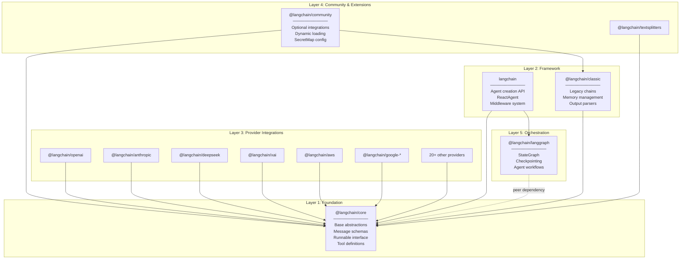
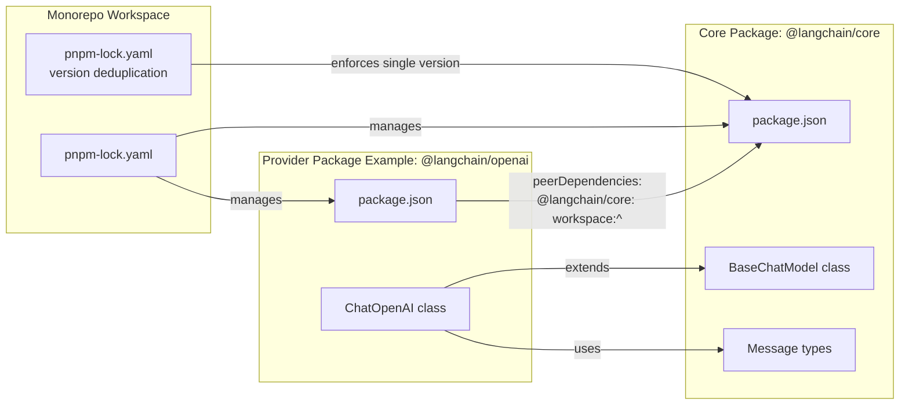
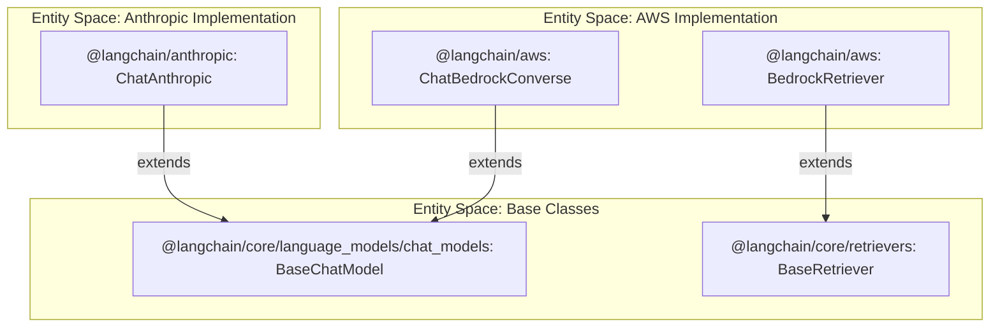

<!-- source: DeepWiki mcp.deepwiki.com · repo langchain-ai/langchainjs · page 1.1 Package Architecture · fetched 2026-10-26 -->

# Package Architecture

<details>
<summary>Relevant source files</summary>

The following files were used as context for generating this wiki page:

- [examples/package.json](examples/package.json)
- [internal/model-profiles/package.json](internal/model-profiles/package.json)
- [libs/langchain-classic/CHANGELOG.md](libs/langchain-classic/CHANGELOG.md)
- [libs/langchain-classic/package.json](libs/langchain-classic/package.json)
- [libs/langchain-core/CHANGELOG.md](libs/langchain-core/CHANGELOG.md)
- [libs/langchain-core/package.json](libs/langchain-core/package.json)
- [libs/langchain-mcp-adapters/package.json](libs/langchain-mcp-adapters/package.json)
- [libs/langchain/CHANGELOG.md](libs/langchain/CHANGELOG.md)
- [libs/langchain/package.json](libs/langchain/package.json)
- [libs/providers/langchain-anthropic/CHANGELOG.md](libs/providers/langchain-anthropic/CHANGELOG.md)
- [libs/providers/langchain-anthropic/package.json](libs/providers/langchain-anthropic/package.json)
- [libs/providers/langchain-aws/CHANGELOG.md](libs/providers/langchain-aws/CHANGELOG.md)
- [libs/providers/langchain-aws/package.json](libs/providers/langchain-aws/package.json)
- [libs/providers/langchain-deepseek/CHANGELOG.md](libs/providers/langchain-deepseek/CHANGELOG.md)
- [libs/providers/langchain-deepseek/package.json](libs/providers/langchain-deepseek/package.json)
- [libs/providers/langchain-fireworks/CHANGELOG.md](libs/providers/langchain-fireworks/CHANGELOG.md)
- [libs/providers/langchain-fireworks/package.json](libs/providers/langchain-fireworks/package.json)
- [libs/providers/langchain-ibm/package.json](libs/providers/langchain-ibm/package.json)
- [libs/providers/langchain-neo4j/CHANGELOG.md](libs/providers/langchain-neo4j/CHANGELOG.md)
- [libs/providers/langchain-neo4j/package.json](libs/providers/langchain-neo4j/package.json)
- [libs/providers/langchain-openai/CHANGELOG.md](libs/providers/langchain-openai/CHANGELOG.md)
- [libs/providers/langchain-openai/package.json](libs/providers/langchain-openai/package.json)
- [libs/providers/langchain-openrouter/CHANGELOG.md](libs/providers/langchain-openrouter/CHANGELOG.md)
- [libs/providers/langchain-openrouter/package.json](libs/providers/langchain-openrouter/package.json)
- [libs/providers/langchain-together-ai/CHANGELOG.md](libs/providers/langchain-together-ai/CHANGELOG.md)
- [libs/providers/langchain-together-ai/package.json](libs/providers/langchain-together-ai/package.json)
- [libs/providers/langchain-xai/CHANGELOG.md](libs/providers/langchain-xai/CHANGELOG.md)
- [libs/providers/langchain-xai/package.json](libs/providers/langchain-xai/package.json)
- [package.json](package.json)
- [pnpm-lock.yaml](pnpm-lock.yaml)

</details>


This document explains the hierarchical package structure of LangChain.js, the dependency relationships between packages, and the role of `@langchain/core` as the foundational layer. It covers the monorepo organization, package dependency patterns, and how different layers of the ecosystem interact.

---

## Package Hierarchy

LangChain.js is organized as a layered architecture with `@langchain/core` at the foundation. Each layer depends on the layer below it, creating a strict dependency hierarchy that ensures consistency and type safety across the ecosystem.

### Architectural Layers



**Sources:** [libs/langchain-core/package.json:2-4](), [libs/langchain/package.json:2-4](), [libs/langchain-classic/package.json:2-4](), [libs/langchain/package.json:73-75]()

---

## Core Package: @langchain/core

The `@langchain/core` package is the single source of truth for all base abstractions, schemas, and interfaces. Every other package in the ecosystem depends on it, making it the foundation that ensures type compatibility and interface consistency.

### Core Package Structure

| Export Path | Purpose | Key Classes/Interfaces |
|-------------|---------|------------------------|
| `@langchain/core` | Main entry point | All base abstractions |
| `@langchain/core/messages` | Message types | `AIMessage`, `HumanMessage`, `SystemMessage`, `ToolMessage` |
| `@langchain/core/language_models/chat_models` | Chat model base | `BaseChatModel` |
| `@langchain/core/tools` | Tool definitions | `DynamicTool`, `DynamicStructuredTool` |
| `@langchain/core/runnables` | Execution interface | `Runnable`, `RunnableSequence` |
| `@langchain/core/retrievers` | Retriever interface | `BaseRetriever` |
| `@langchain/core/vectorstores` | Vector store base | `VectorStore` |

**Sources:** [libs/langchain-core/package.json:65-229]()

### Core Dependencies

The `@langchain/core` package maintains a minimal dependency footprint to ensure stability:

```json
{
  "dependencies": {
    "@cfworker/json-schema": "^4.0.2",
    "@standard-schema/spec": "^1.1.0",
    "js-tiktoken": "^1.0.12",
    "langsmith": ">=0.5.0 <1.0.0",
    "mustache": "^4.2.0",
    "p-queue": "^6.6.2",
    "zod": "^3.25.76 || ^4"
  }
}
```

**Sources:** [libs/langchain-core/package.json:26-34]()

---

## Dependency Management Pattern

LangChain.js uses a **peer dependency pattern** with the `workspace:^` protocol to ensure all packages use the same version of `@langchain/core`. This prevents type incompatibilities and ensures interface consistency across the ecosystem.

### Peer Dependency Flow



**Sources:** [pnpm-lock.yaml:7-9](), [libs/langchain/package.json:73-75](), [libs/providers/langchain-anthropic/package.json:33-35]()

### Example: Anthropic Package Dependencies

```json
{
  "name": "@langchain/anthropic",
  "version": "1.5.10",
  "peerDependencies": {
    "@langchain/core": "workspace:^"
  },
  "dependencies": {
    "@anthropic-ai/sdk": "^0.122.0",
    "zod": "^3.25.76 || ^4"
  }
}
```

The `workspace:^` protocol tells `pnpm` to resolve `@langchain/core` from the local monorepo workspace, ensuring development occurs against the latest local core code.

**Sources:** [libs/providers/langchain-anthropic/package.json:2-4](), [libs/providers/langchain-anthropic/package.json:33-35]()

---

## Monorepo Structure

LangChain.js is organized as a **pnpm workspace monorepo**. This enables coordinated releases, shared tooling, and strict dependency version consistency.

### Workspace Organization

```mermaid
graph TB
    subgraph "Root Workspace"
        Root["package.json<br/>────────────<br/>pnpm overrides<br/>turbo scripts"]
        PnpmLock["pnpm-lock.yaml<br/>────────────<br/>Dependency resolution<br/>Version deduplication"]
    end
    
    subgraph "Core Libraries (libs)"
        CoreLib["langchain-core/"]
        LangChainLib["langchain/"]
        ClassicLib["langchain-classic/"]
        TextSplittersLib["langchain-textsplitters/"]
        MCPAdaptersLib["langchain-mcp-adapters/"]
    end
    
    subgraph "Provider Packages (libs/providers)"
        OpenAIProvider["langchain-openai/"]
        AnthropicProvider["langchain-anthropic/"]
        AWSProvider["langchain-aws/"]
        DeepseekProvider["langchain-deepseek/"]
        XAIProvider["langchain-xai/"]
        Neo4jProvider["langchain-neo4j/"]
        IBMProvider["langchain-ibm/"]
        OpenRouterProvider["langchain-openrouter/"]
        FireworksProvider["langchain-fireworks/"]
        TogetherAIProvider["langchain-together-ai/"]
    end
    
    subgraph "Internal Tooling (internal)"
        Build["build/"]
        TSConfig["tsconfig/"]
        ModelProfiles["model-profiles/"]
    end
    
    subgraph "Examples & Development"
        Examples["examples/"]
    end
    
    Root --> CoreLib
    Root --> LangChainLib
    Root --> OpenAIProvider
    Root --> Build
    Root --> Examples
```



**Sources:** [pnpm-lock.yaml:74-76](), [package.json:36-54](), [examples/package.json:1-4]()

### Version Override Enforcement

The root `package.json` contains `pnpm.overrides` that enforce consistent versions of critical packages across the entire workspace:

```json
"pnpm": {
  "overrides": {
    "@langchain/core": "workspace:^",
    "langchain": "workspace:^",
    "protobufjs": ">=7.6.3 <8",
    "form-data": ">=4.0.6"
  }
}
```

This ensures that even transitive dependencies resolve to the correct workspace version of core, preventing "multiple core versions" bugs.

**Sources:** [package.json:55-60]()

---

## Package Categories

### Framework Packages

The main framework packages build on `@langchain/core` to provide high-level APIs:

| Package | Purpose | Key Features |
|---------|---------|--------------|
| `langchain` | Modern agent framework | `createAgent`, `initChatModel`, middleware system, LangGraph integration |
| `@langchain/classic` | Legacy abstractions | Old chains, memory, classic agents, output parsers |
| `@langchain/mcp-adapters` | Model Context Protocol adapters | `MultiServerMCPClient`, transport types, tool loading |

**Sources:** [libs/langchain/package.json:76-81](), [libs/langchain-classic/package.json:11-90](), [libs/langchain-mcp-adapters/package.json:2-4]()

### Provider Packages

Provider packages implement integrations with specific LLM vendors. They follow a consistent pattern, extending base classes from core.



**Sources:** [libs/providers/langchain-anthropic/package.json:2-4](), [libs/providers/langchain-aws/package.json:2-4]()

---

## Module Export Pattern

All packages use **dual CJS/ESM exports** with TypeScript type definitions for both formats. This is managed by `tsdown` during the build process.

### Export Configuration (langchain-core)

```json
"exports": {
  ".": {
    "input": "./src/index.ts",
    "require": {
      "types": "./dist/index.d.cts",
      "default": "./dist/index.cjs"
    },
    "import": {
      "types": "./dist/index.d.ts",
      "default": "./dist/index.js"
    }
  },
  "./agents": {
    "input": "./src/agents.ts",
    "require": {
      "types": "./dist/agents.d.cts",
      "default": "./dist/agents.cjs"
    },
    "import": {
      "types": "./dist/agents.d.ts",
      "default": "./dist/agents.js"
    }
  }
}
```

This structure:
- Supports both `require()` (CommonJS) and `import` (ES Modules).
- Provides TypeScript types for both formats (`.d.cts` for CJS, `.d.ts` for ESM).
- Enables subpath exports for granular imports (e.g., `@langchain/core/agents`).

**Sources:** [libs/langchain-core/package.json:65-91](), [libs/langchain/package.json:101-113]()

---

## Build and Release Orchestration

The monorepo uses **Turborepo** for build orchestration and **Changesets** for version management.

### Build Pipeline

The `turbo.json` file defines the dependency graph for builds. The `build:compile` task ensures that a package's dependencies are built before the package itself.

**Sources:** [package.json:13-16](), [libs/langchain/package.json:35-36]()

### Release Coordination

Releases are managed via the `changeset` CLI. When a change is made to `@langchain/core`, Changesets identifies all dependent packages (like `langchain` or `@langchain/openai`) and coordinates their version bumps to maintain compatibility.

**Sources:** [package.json:33-34](), [libs/langchain/CHANGELOG.md:15-17]()

---

