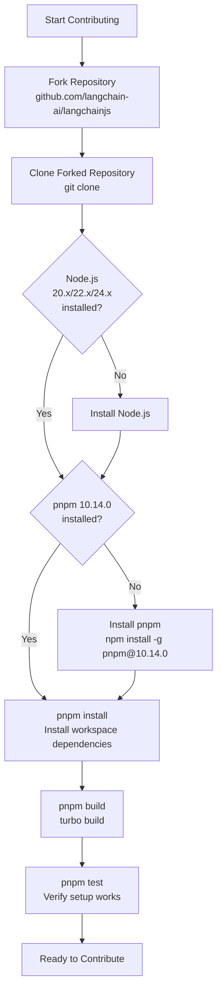
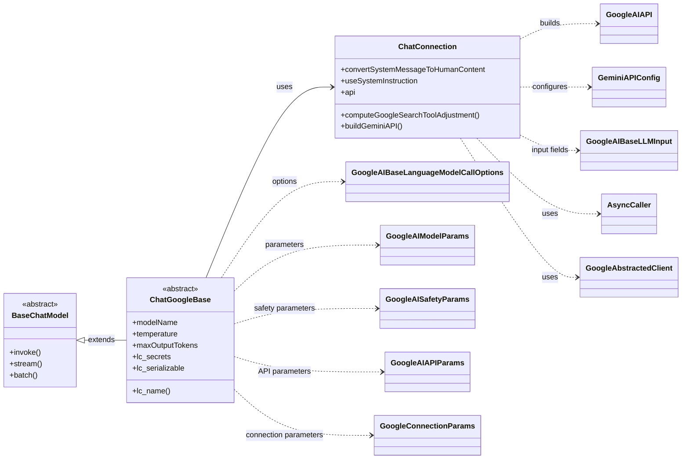

<!-- source: DeepWiki mcp.deepwiki.com · repo langchain-ai/langchainjs · page 8.2 Contribution Workflow · fetched 2026-10-26 -->

# Contribution Workflow

<details>
<summary>Relevant source files</summary>

The following files were used as context for generating this wiki page:

- [.changeset/README.md](.changeset/README.md)
- [.changeset/config.json](.changeset/config.json)
- [.github/ISSUE_TEMPLATE/bug-report.yml](.github/ISSUE_TEMPLATE/bug-report.yml)
- [.github/ISSUE_TEMPLATE/config.yml](.github/ISSUE_TEMPLATE/config.yml)
- [.github/ISSUE_TEMPLATE/documentation.yml](.github/ISSUE_TEMPLATE/documentation.yml)
- [.github/ISSUE_TEMPLATE/privileged.yml](.github/ISSUE_TEMPLATE/privileged.yml)
- [.github/pull_request_template.md](.github/pull_request_template.md)
- [CONTRIBUTING.md](CONTRIBUTING.md)
- [libs/providers/langchain-google-common/README.md](libs/providers/langchain-google-common/README.md)
- [libs/providers/langchain-google-common/src/chat_models.ts](libs/providers/langchain-google-common/src/chat_models.ts)
- [libs/providers/langchain-google-common/src/tests/data/chat-json-schema-mock.json](libs/providers/langchain-google-common/src/tests/data/chat-json-schema-mock.json)
- [libs/providers/langchain-google-common/src/tests/data/chat-stream-usage-cache-mock.json](libs/providers/langchain-google-common/src/tests/data/chat-stream-usage-cache-mock.json)
- [libs/providers/langchain-google-common/src/tests/data/chat-usage-metadata-mock.json](libs/providers/langchain-google-common/src/tests/data/chat-usage-metadata-mock.json)
- [libs/providers/langchain-google-common/src/tests/zod_to_gemini_parameters.test.ts](libs/providers/langchain-google-common/src/tests/zod_to_gemini_parameters.test.ts)
- [libs/providers/langchain-google-common/src/utils/common.ts](libs/providers/langchain-google-common/src/utils/common.ts)
- [libs/providers/langchain-google-common/src/utils/zod_to_gemini_parameters.ts](libs/providers/langchain-google-common/src/utils/zod_to_gemini_parameters.ts)
- [libs/providers/langchain-google-vertexai/README.md](libs/providers/langchain-google-vertexai/README.md)
- [libs/providers/langchain-ollama/README.md](libs/providers/langchain-ollama/README.md)

</details>


This document provides comprehensive guidance for contributing code, documentation, and integrations to the LangChain.js repository. It covers prerequisites, development setup, code quality standards, testing requirements, and the CI/CD pipeline that validates all contributions.

---

## Prerequisites and Environment Setup

### Required Tools

LangChain.js requires specific versions of development tools for consistency across the monorepo:

| Tool | Version | Purpose |
|------|---------|---------|
| **Node.js** | 20.x, 22.x, or 24.x | JavaScript runtime [CONTRIBUTING.md:64-74]() |
| **pnpm** | 10.14.0 | Package manager [CONTRIBUTING.md:64]() |
| **Turbo** | Latest | Monorepo build orchestration [CONTRIBUTING.md:64]() |
| **Git** | Latest | Version control [CONTRIBUTING.md:5]() |

**Sources:** [CONTRIBUTING.md:5-74]()

### Initial Setup Workflow



**Repository Setup Commands:**

```bash
# Clone your fork
git clone https://github.com/YOUR_USERNAME/langchainjs.git
cd langchainjs

# Install dependencies
pnpm install

# Build all packages
pnpm build

# Verify setup by running unit tests
pnpm test
```

**Sources:** [CONTRIBUTING.md:5-85]()

---

## Monorepo Structure and Workspace Dependencies

### Package Organization

```mermaid
graph TB
    subgraph "Workspace Root"
        Root["langchainjs/"]
    end
    
    subgraph "Core & Main"
        Core["libs/langchain-core/<br/>@langchain/core"]
        LangChain["libs/langchain/<br/>langchain"]
        TextSplitters["libs/langchain-textsplitters/<br/>@langchain/textsplitters"]
    end
    
    subgraph "Community"
        Community["libs/community/langchain-community/<br/>@langchain/community"]
    end
    
    subgraph "Provider Packages"
        OpenAI["libs/providers/langchain-openai/"]
        Anthropic["libs/providers/langchain-anthropic/"]
    end
    
    Root -.->|"pnpm workspace"| Core
    Root -.->|"pnpm workspace"| LangChain
    Root -.->|"pnpm workspace"| Community
    Root -.->|"pnpm workspace"| OpenAI
    
    LangChain -->|"dependency"| Core
    Community -->|"dependency"| Core
    OpenAI -->|"dependency"| Core
```

**Package Roles:**
*   `@langchain/core`: Foundation containing base classes and interfaces [CONTRIBUTING.md:69]().
*   `langchain`: Main package for agents, prompts, and orchestration [CONTRIBUTING.md:68]().
*   `@langchain/textsplitters`: Text splitting utilities [CONTRIBUTING.md:70]().
*   `@langchain/openai`: OpenAI integration [CONTRIBUTING.md:71]().
*   `@langchain/anthropic`: Anthropic integration [CONTRIBUTING.md:72]().
*   Other providers: First-party provider integrations [CONTRIBUTING.md:73]().

**Sources:** [CONTRIBUTING.md:62-74]()

---

## Development Workflow

### Making Changes

1.  **Fork and Branch**: Follow the "fork and pull request" workflow [CONTRIBUTING.md:5]().
2.  **Issue Assignment**: Assign issues to yourself to avoid duplicate work [CONTRIBUTING.md:37]().
3.  **Implementation**: Modify source files in the relevant `libs/` directory.
4.  **Code Quality**: Ensure code adheres to style guidelines by running `pnpm lint` and `pnpm format:check` [CONTRIBUTING.md:84]().
5.  **Testing**: Run `pnpm test` to ensure all tests pass before pushing [CONTRIBUTING.md:84]().

### Code Quality and Security

The project uses GitHub Actions to maintain code quality:
*   **CodeQL**: Performs static analysis to find security vulnerabilities.
*   **Linting**: Ensures code adheres to style guidelines [CONTRIBUTING.md:84]().
*   **Formatting**: Automatically formats code to maintain consistency [CONTRIBUTING.md:84]().

**Sources:** [CONTRIBUTING.md:5-85]()

---

## Adding an Integration

### Integration Architecture

New integrations **must** be published as standalone packages outside of this repository [CONTRIBUTING.md:54-60](). This means creating your own repository, publishing to npm, and then notifying the LangChain team so it can be added to the list of recommended integrations [CONTRIBUTING.md:58-60]().

For existing integrations within the monorepo, the following patterns apply:

1.  **Entrypoints**: Integrations typically have dedicated entrypoints. For example, `@langchain/ollama` has its own `src/index.ts` and `package.json` exports [libs/providers/langchain-ollama/README.md:73-75]().
2.  **Dependencies**: Third-party SDKs should be managed as `dependencies` in the integration's `package.json`. For example, `@langchain/ollama` depends on `@langchain/core` [libs/providers/langchain-ollama/README.md:8]().
3.  **Base Classes**: Integrations extend base classes from `@langchain/core`. For instance, `ChatGoogleBase` extends `BaseChatModel` [libs/providers/langchain-google-common/src/chat_models.ts:183-186]().

### Implementation Pattern (Google Common Example)



**Key Implementation Details:**
*   **Model Parameters**: `ChatGoogleBase` defines common parameters like `modelName`, `temperature`, `maxOutputTokens`, etc., which are shared across Google chat models [libs/providers/langchain-google-common/src/chat_models.ts:203-219]().
*   **Tool Conversion**: The `convertToGeminiTools` function handles converting various tool formats (LangChain tools, OpenAI tools) into `GeminiTool` objects, including schema transformations using `schemaToGeminiParameters` [libs/providers/langchain-google-common/src/utils/common.ts:83-134]().
*   **Schema Limitations**: When converting Zod schemas to Gemini parameters, certain features like discriminated unions and complex union types are not supported and will throw errors. Simple nullable types are handled by setting a `nullable: true` property [libs/providers/langchain-google-common/src/utils/zod_to_gemini_parameters.ts:65-98](), [libs/providers/langchain-google-common/src/tests/zod_to_gemini_parameters.test.ts:6-30]().
*   **`AsyncCaller`**: External API requests are typically wrapped in `AsyncCaller` for retry and timeout logic [libs/providers/langchain-google-common/src/chat_models.ts:21]().

**Sources:** [CONTRIBUTING.md:54-60](), [libs/providers/langchain-google-common/src/chat_models.ts:1-220](), [libs/providers/langchain-google-common/src/utils/common.ts:1-134](), [libs/providers/langchain-google-common/src/utils/zod_to_gemini_parameters.ts:1-150](), [libs/providers/langchain-google-common/src/tests/zod_to_gemini_parameters.test.ts:1-181](), [libs/providers/langchain-ollama/README.md:73-75]()

---

## Pull Request Guidelines

1.  **Template**: Use the provided PR template to describe changes and link related issues (e.g., `Fixes #123`) [.github/pull_request_template.md:1-17]().
2.  **Focus**: Keep PRs focused on a single feature or fix to speed up review [CONTRIBUTING.md:81]().
3.  **Tests**: Include unit tests for new logic and integration tests for external APIs [CONTRIBUTING.md:82]().
4.  **Documentation**: Update public API documentation if changes affect usage [CONTRIBUTING.md:83]().
5.  **Local Checks**: Ensure `pnpm lint`, `pnpm format:check`, and `pnpm test` pass locally before pushing [CONTRIBUTING.md:84]().

### Review Process

*   A maintainer will review your PR and may request changes [CONTRIBUTING.md:88]().
*   Respond to feedback in a timely manner [CONTRIBUTING.md:89]().
*   Once approved, a maintainer will merge your PR [CONTRIBUTING.md:90]().

### Changesets

This repository uses [Changesets](https://github.com/changesets/changesets) for versioning and release management. When you make a change that should be included in a release (e.g., a bug fix, new feature, or breaking change), you need to add a changeset.

**How to add a changeset:**

1.  Run `pnpm changeset` in your terminal.
2.  Follow the prompts to select the packages affected by your change and specify the type of version bump (patch, minor, major).
3.  Write a concise summary of your change. This summary will be included in the release notes.
4.  A new markdown file will be created in the `.changeset/` directory. Commit this file along with your code changes.

The `.changeset/config.json` file defines the configuration for Changesets, including the changelog format, base branch, and packages to ignore (e.g., `examples`) [.changeset/config.json:1-25]().

**Sources:** [CONTRIBUTING.md:75-93](), [.github/pull_request_template.md:1-17](), [.changeset/config.json:1-29]()

### Issue Reporting

*   **Bugs**: Found a bug? Search existing [GitHub Issues](https://github.com/langchain-ai/langchainjs/issues) first. If it doesn't exist, create a new issue following the provided template, including a [minimal, reproducible example](https://stackoverflow.com/help/minimal-reproducible-example) [CONTRIBUTING.md:9-14](). Use the `bug-report.yml` template for detailed bug submissions [.github/ISSUE_TEMPLATE/bug-report.yml:1-115]().
*   **Feature Requests**: Search existing [issues](https://github.com/langchain-ai/langchainjs/issues) for feature requests. If none exist, start a new discussion, describing the use case and potential value [CONTRIBUTING.md:24-28]().
*   **Documentation**: Report issues related to documentation (missing topics, mistakes) using the `documentation.yml` template [.github/ISSUE_TEMPLATE/documentation.yml:1-52](). For general discussions, support, and feature requests, the [LangChain Forum](https://forum.langchain.com) is recommended [.github/ISSUE_TEMPLATE/config.yml:4-6]().

**Sources:** [CONTRIBUTING.md:9-28](), [.github/ISSUE_TEMPLATE/bug-report.yml:1-115](), [.github/ISSUE_TEMPLATE/documentation.yml:1-52](), [.github/ISSUE_TEMPLATE/config.yml:4-6]()

---

