# Page: Overview

# Overview

<details>
<summary>Relevant source files</summary>

The following files were used as context for generating this wiki page:

- [AGENTS.md](AGENTS.md)
- [CLAUDE.md](CLAUDE.md)
- [README.md](README.md)
- [libs/checkpoint-conformance/uv.lock](libs/checkpoint-conformance/uv.lock)
- [libs/checkpoint-postgres/pyproject.toml](libs/checkpoint-postgres/pyproject.toml)
- [libs/checkpoint-postgres/uv.lock](libs/checkpoint-postgres/uv.lock)
- [libs/checkpoint-sqlite/pyproject.toml](libs/checkpoint-sqlite/pyproject.toml)
- [libs/checkpoint-sqlite/uv.lock](libs/checkpoint-sqlite/uv.lock)
- [libs/checkpoint/pyproject.toml](libs/checkpoint/pyproject.toml)
- [libs/checkpoint/uv.lock](libs/checkpoint/uv.lock)
- [libs/langgraph/README.md](libs/langgraph/README.md)
- [libs/langgraph/pyproject.toml](libs/langgraph/pyproject.toml)
- [libs/langgraph/uv.lock](libs/langgraph/uv.lock)
- [libs/prebuilt/pyproject.toml](libs/prebuilt/pyproject.toml)
- [libs/prebuilt/uv.lock](libs/prebuilt/uv.lock)
- [libs/sdk-js/README.md](libs/sdk-js/README.md)
- [libs/sdk-py/MIGRATION.md](libs/sdk-py/MIGRATION.md)
- [libs/sdk-py/README.md](libs/sdk-py/README.md)
- [libs/sdk-py/uv.lock](libs/sdk-py/uv.lock)

</details>


## Purpose and Scope

LangGraph is a low-level orchestration framework for building stateful, multi-actor applications with Large Language Models (LLMs). Unlike high-level abstractions, LangGraph provides infrastructure without abstracting prompts or architecture, giving developers full control over their application logic [libs/langgraph/pyproject.toml:5-8](). It is specifically designed to handle the unique challenges of long-running agentic workflows, such as persistence, cycle management, and human intervention [README.md:22-24]().

### Core Capabilities

LangGraph provides foundational infrastructure for production-grade agents:

| Capability | Description | Implementation |
|------------|-------------|----------------|
| **Durable Execution** | Agents persist through failures and resume from exact state | Build agents that persist through failures and resume from exactly where they left off [README.md:39](). |
| **Human-in-the-Loop** | Inspect and modify agent state at any execution point | Incorporate human oversight by inspecting and modifying agent state during execution [README.md:40](). |
| **Comprehensive Memory** | Short-term working memory and long-term persistent storage | Short-term working memory for ongoing reasoning and long-term persistent memory across sessions [README.md:41](). |

The framework is built on a Bulk Synchronous Parallel (BSP) execution model inspired by Google's Pregel paper [README.md:82](), [libs/langgraph/README.md:46]().

Sources: [README.md:12-43](), [libs/langgraph/pyproject.toml:5-8](), [README.md:80-82](), [libs/langgraph/README.md:20-28]()

## Core Concepts

LangGraph centers on a stateful graph abstraction where execution is managed through discrete supersteps.

### Core Abstractions

| Concept | Description | Primary Implementation |
|---------|-------------|----------------------|
| **Graph** | Computational structure with nodes (functions) and edges (control flow) | `StateGraph` class [libs/langgraph/README.md:24-28]() |
| **State** | Shared data structure managed through typed channels | `TypedDict` schemas [libs/langgraph/README.md:24-26]() |
| **Checkpoint** | Serialized snapshot containing state and execution metadata | `BaseCheckpointSaver` interface [libs/checkpoint/pyproject.toml:8]() |

### Graph Definition Approaches

**Declarative API** (`StateGraph`):
Developers define nodes as Python functions and use the `StateGraph` builder to specify the workflow and state schema [libs/langgraph/README.md:24-28]().

```python
from langgraph.graph import START, StateGraph
from typing_extensions import TypedDict

class State(TypedDict):
    text: str

def node_a(state: State) -> dict:
    return {"text": state["text"] + "a"}

graph = StateGraph(State)
graph.add_node("node_a", node_a)
graph.add_edge(START, "node_a")
```
[libs/langgraph/README.md:24-28]()

### Execution Model

At runtime, the execution engine orchestrates execution:
1. **Durable Execution**: Automatically resumes from the last successful step [README.md:39]().
2. **State Management**: Uses reducers to apply updates to the shared state [libs/langgraph/README.md:22-24]().
3. **Persistence**: Saves state snapshots via a `BaseCheckpointSaver` [libs/checkpoint/pyproject.toml:8]().

Sources: [libs/langgraph/README.md:20-46](), [README.md:80-82](), [libs/checkpoint/pyproject.toml:5-17]()

## Architectural Components

The LangGraph system comprises major subsystems organized as a monorepo, managed with the `uv` build tool [libs/langgraph/pyproject.toml:83-90]().

### High-Level System Architecture

```mermaid
graph TB
    subgraph "CoreExecution [libs/langgraph]"
        "StateGraph[StateGraph]"
        "Pregel[Pregel Engine]"
    end
    
    subgraph "Persistence [libs/checkpoint-*]"
        "BaseCheckpointSaver[BaseCheckpointSaver Interface]"
        "SqliteSaver[SqliteSaver (libs/checkpoint-sqlite)]"
        "PostgresSaver[PostgresSaver (libs/checkpoint-postgres)]"
    end
    
    subgraph "ClientSDKs [libs/sdk-py]"
        "LangGraphClient[LangGraphClient]"
    end
    
    subgraph "Prebuilt [libs/prebuilt]"
        "create_react_agent[create_react_agent()]"
        "ToolNode[ToolNode]"
    end
    
    "StateGraph" -->|"compile()"| "Pregel"
    "Pregel" -->|"save()"| "BaseCheckpointSaver"
    
    "LangGraphClient" -->|"HTTP API"| "Pregel"
    
    "create_react_agent" -->|"returns"| "StateGraph"
    "ToolNode" -->|"used in"| "StateGraph"
```

**Code Entity Mapping:**

1. **Core Execution Engine**: 
   - `StateGraph` at [libs/langgraph/README.md:24-28](): The primary builder for defining application logic.
   - `Pregel`: The underlying internal execution engine inspired by Google Pregel [README.md:82]().

2. **Persistence Layer**: 
   - `BaseCheckpointSaver` at [libs/checkpoint/pyproject.toml:8](): Base interface for persisting graph state.
   - `PostgresSaver` at [libs/checkpoint-postgres/pyproject.toml:8](): Production-grade PostgreSQL persistence.
   - `SqliteSaver` at [libs/checkpoint-sqlite/pyproject.toml:13-17](): Local SQLite persistence via `aiosqlite`.

3. **Client SDKs**: 
   - `LangGraphClient` at [libs/sdk-py/README.md:30](): Python SDK for interacting with deployed LangGraph servers.

4. **Prebuilt Components**: 
   - `create_react_agent()` at [libs/langgraph/pyproject.toml:30](): Pre-configured ReAct agent factory.
   - `ToolNode` at [libs/prebuilt/pyproject.toml:8](): Standardized node for executing tool calls.

Sources: [libs/langgraph/pyproject.toml:26-33](), [libs/langgraph/README.md:20-46](), [README.md:80-82](), [libs/checkpoint/pyproject.toml:5-17](), [libs/checkpoint-postgres/pyproject.toml:5-19]()

## Package Ecosystem

LangGraph uses a modular architecture where the `langgraph` core package coordinates several specialized libraries [libs/langgraph/pyproject.toml:26-33]().

```mermaid
graph LR
    "langgraph[langgraph]"
    "checkpoint[langgraph-checkpoint]"
    "cp_postgres[langgraph-checkpoint-postgres]"
    "cp_sqlite[langgraph-checkpoint-sqlite]"
    "prebuilt[langgraph-prebuilt]"
    "sdk[langgraph-sdk]"
    
    "langgraph" --> "checkpoint"
    "langgraph" --> "prebuilt"
    "langgraph" --> "sdk"
    
    "prebuilt" --> "checkpoint"
    
    "cp_postgres" --> "checkpoint"
    "cp_sqlite" --> "checkpoint"
```

**Package Descriptions:**

| Package | Purpose | Key Dependencies |
|---------|---------|------------------|
| `langgraph` | Core framework for stateful graph execution | `langgraph-checkpoint`, `langgraph-sdk`, `langgraph-prebuilt` [libs/langgraph/pyproject.toml:26-30]() |
| `langgraph-checkpoint` | Base interfaces for durable execution and serialization | `langchain-core`, `ormsgpack` [libs/checkpoint/pyproject.toml:14-17]() |
| `langgraph-prebuilt` | High-level APIs for agents and tool execution | `langgraph-checkpoint`, `langchain-core` [libs/prebuilt/pyproject.toml:26-29]() |
| `langgraph-sdk` | Python client for remote execution and management | `pydantic`, `httpx` [libs/langgraph/pyproject.toml:29-33]() |

Sources: [libs/langgraph/pyproject.toml:26-33](), [libs/prebuilt/pyproject.toml:26-29](), [libs/checkpoint/pyproject.toml:5-17](), [libs/checkpoint-postgres/pyproject.toml:14-19]()

## Integration with LangChain Ecosystem

LangGraph is built by the LangChain team and integrates deeply with its products while remaining usable as a standalone framework [README.md:82]().

- **LangChain**: Provides composable components (models, tools, prompts) used within graph nodes [README.md:55]().
- **LangSmith**: Used for tracing, observability, and debugging complex agent trajectories [README.md:42](), [README.md:56]().
- **LangSmith Deployment**: Purpose-built infrastructure for hosting and scaling LangGraph applications [README.md:57]().

Sources: [README.md:42-57](), [libs/langgraph/README.md:20-28]()

## System Requirements

**Python Version**: `>=3.10` [libs/langgraph/pyproject.toml:10]()

**Build System**: `hatchling` is used as the build backend across all packages [libs/langgraph/pyproject.toml:1-3](), [libs/checkpoint/pyproject.toml:1-3]().

**Core Dependencies**:
- `langchain-core>=1.4.7,<2` [libs/langgraph/pyproject.toml:27]()
- `langgraph-checkpoint>=4.1.0,<5.0.0` [libs/langgraph/pyproject.toml:28]()
- `pydantic>=2.7.4` [libs/langgraph/pyproject.toml:32]()
- `xxhash>=3.5.0` [libs/langgraph/pyproject.toml:31]()

Sources: [libs/langgraph/pyproject.toml:1-33](), [libs/checkpoint/pyproject.toml:1-17]()

---

# Page: Package Structure and Dependencies

# Package Structure and Dependencies

<details>
<summary>Relevant source files</summary>

The following files were used as context for generating this wiki page:

- [AGENTS.md](AGENTS.md)
- [CLAUDE.md](CLAUDE.md)
- [libs/checkpoint-conformance/uv.lock](libs/checkpoint-conformance/uv.lock)
- [libs/checkpoint-postgres/pyproject.toml](libs/checkpoint-postgres/pyproject.toml)
- [libs/checkpoint-postgres/uv.lock](libs/checkpoint-postgres/uv.lock)
- [libs/checkpoint-sqlite/pyproject.toml](libs/checkpoint-sqlite/pyproject.toml)
- [libs/checkpoint-sqlite/uv.lock](libs/checkpoint-sqlite/uv.lock)
- [libs/checkpoint/pyproject.toml](libs/checkpoint/pyproject.toml)
- [libs/checkpoint/uv.lock](libs/checkpoint/uv.lock)
- [libs/langgraph/pyproject.toml](libs/langgraph/pyproject.toml)
- [libs/langgraph/uv.lock](libs/langgraph/uv.lock)
- [libs/prebuilt/pyproject.toml](libs/prebuilt/pyproject.toml)
- [libs/prebuilt/uv.lock](libs/prebuilt/uv.lock)
- [libs/sdk-py/uv.lock](libs/sdk-py/uv.lock)

</details>


This page enumerates every package in the LangGraph monorepo, describes what each package is responsible for, and documents the inter-package dependency graph. It covers the source layout under `libs/` and the declared runtime dependencies of each package.

For details on the monorepo's build and dependency management system, see [Monorepo Structure and Build System](#2.1). For details on the persistence interfaces, see [Persistence and Memory](#4). For CLI and deployment specifics, see [CLI and Deployment](#6).

---

## Repository Layout

The monorepo organizes all Python packages under the `libs/` directory. Each subdirectory is an independently installable Python package with its own `pyproject.toml` and `uv.lock` file.

```
libs/
├── langgraph/              # Core graph execution library
├── checkpoint/             # Base persistence interfaces
├── checkpoint-postgres/    # PostgreSQL checkpoint/store implementations
├── checkpoint-sqlite/      # SQLite checkpoint implementation
├── prebuilt/               # High-level agent APIs
├── sdk-py/                 # Python client SDK
├── cli/                    # langgraph CLI tool
└── scheduler-kafka/        # Distributed Kafka-based scheduler
```

The root `Makefile` provides targets to orchestrate tasks across all packages, such as `lint`, `format`, and `test`.

Sources: [libs/langgraph/pyproject.toml:83-89](), [libs/checkpoint/pyproject.toml:1-17](), [libs/prebuilt/pyproject.toml:1-29]()

---

## Package Inventory

| Package Name | Directory | Current Version | Primary Role |
|---|---|---|---|
| `langgraph` | `libs/langgraph/` | 1.2.11 | Core graph construction and execution |
| `langgraph-checkpoint` | `libs/checkpoint/` | 4.2.0 | Abstract checkpoint and store interfaces |
| `langgraph-checkpoint-postgres` | `libs/checkpoint-postgres/` | 3.1.2 | PostgreSQL-backed checkpoint and store |
| `langgraph-checkpoint-sqlite` | `libs/checkpoint-sqlite/` | 3.1.1 | SQLite-backed checkpoint implementation |
| `langgraph-prebuilt` | `libs/prebuilt/` | 1.1.0 | Pre-built agent graphs (`create_react_agent`, `ToolNode`) |
| `langgraph-sdk` | `libs/sdk-py/` | ≥0.4.2,<0.5.0 | Python client for the LangGraph API server |
| `langgraph-cli` | `libs/cli/` | — | `langgraph` CLI command group |

Sources: [libs/langgraph/pyproject.toml:6-33](), [libs/checkpoint/pyproject.toml:6-17](), [libs/checkpoint-postgres/pyproject.toml:6-19](), [libs/checkpoint-sqlite/pyproject.toml:6-18](), [libs/prebuilt/pyproject.toml:6-7]()

---

## Package Descriptions

### `langgraph`

The central user-facing library. It provides the `StateGraph` builder, the functional API (`@task`, `@entrypoint`), and the `Pregel` execution engine. It pulls in the SDK and prebuilt components as transitive dependencies to ensure a complete runtime environment.

**Runtime dependencies** declared in [libs/langgraph/pyproject.toml:26-33]():
- `langchain-core>=1.4.7,<2`
- `langgraph-checkpoint>=4.1.0,<5.0.0`
- `langgraph-sdk>=0.4.2,<0.5.0`
- `langgraph-prebuilt>=1.1.0,<1.2.0`
- `xxhash>=3.5.0`
- `pydantic>=2.7.4`

---

### `langgraph-checkpoint`

The abstract persistence layer. It defines the base interfaces that all checkpointers must implement, such as `BaseCheckpointSaver`. It is kept minimal to avoid forcing specific database drivers on users.

**Runtime dependencies** declared in [libs/checkpoint/pyproject.toml:14-17]():
- `langchain-core>=0.2.38`
- `ormsgpack>=1.12.0` (Used for binary serialization via `JsonPlusSerializer`)

---

### `langgraph-checkpoint-postgres`

Implements persistence against PostgreSQL. It provides `PostgresSaver` and `PostgresStore` for state and cross-thread memory.

**Runtime dependencies** declared in [libs/checkpoint-postgres/pyproject.toml:14-19]():
- `langgraph-checkpoint>=4.1.0,<5.0.0`
- `orjson>=3.11.5`
- `psycopg>=3.2.0` (Async-capable PostgreSQL driver)
- `psycopg-pool>=3.2.0`

---

### `langgraph-checkpoint-sqlite`

Implements persistence against SQLite. It provides `SqliteSaver` for local development and lightweight production use cases.

**Runtime dependencies** declared in [libs/checkpoint-sqlite/pyproject.toml:14-18]():
- `langgraph-checkpoint>=4.1.0,<5.0.0`
- `aiosqlite>=0.20`
- `sqlite-vec>=0.1.6`

---

### `langgraph-prebuilt`

Contains high-level agentic patterns like `create_react_agent` and infrastructure components like `ToolNode`.

**Runtime dependencies** declared in [libs/prebuilt/pyproject.toml:26-29]():
- `langgraph-checkpoint>=2.1.0,<5.0.0`
- `langchain-core>=1.3.1`

Note: `langgraph-prebuilt` does **not** depend on `langgraph` at runtime to avoid circularity. `langgraph` depends on `prebuilt`.

---

## Dependency Graph

The following diagrams illustrate how core packages and their corresponding code entities relate to one another.

**Diagram: System Components to Code Entities**

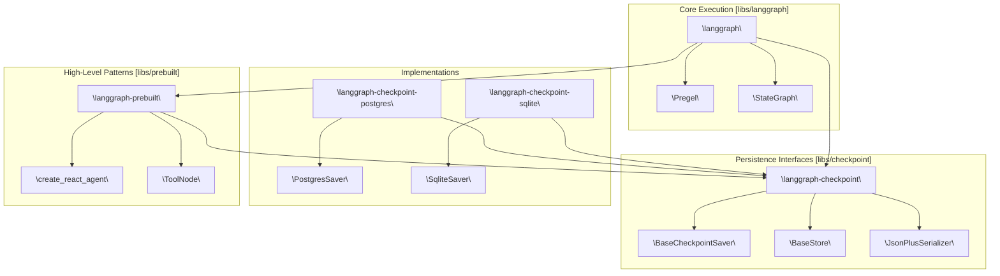

Sources: [libs/langgraph/pyproject.toml:26-33](), [libs/checkpoint/pyproject.toml:14-17](), [libs/prebuilt/pyproject.toml:26-29]()

---

## Development Dependency Management

During development, the monorepo uses `uv` workspace features to resolve internal dependencies to local file paths rather than PyPI versions.

**Diagram: Local Path Resolution**

```mermaid
graph LR
    subgraph "libs/langgraph/pyproject.toml"
        UV["\"[tool.uv.sources]\""]
    end

    UV -->|"path = ../prebuilt"| P_DIR["\"libs/prebuilt/\""]
    UV -->|"path = ../checkpoint"| C_DIR["\"libs/checkpoint/\""]
    UV -->|"path = ../sdk-py"| S_DIR["\"libs/sdk-py/\""]
    UV -->|"path = ../cli"| CL_DIR["\"libs/cli/\""]
    UV -->|"path = ../checkpoint-sqlite"| CS_DIR["\"libs/checkpoint-sqlite/\""]
    UV -->|"path = ../checkpoint-postgres"| CP_DIR["\"libs/checkpoint-postgres/\""]
```

Sources: [libs/langgraph/pyproject.toml:83-89](), [libs/checkpoint-postgres/pyproject.toml:51-53](), [libs/prebuilt/pyproject.toml:64-68]()

---

## Python Version Support

All packages in the monorepo target Python `>=3.10`. The project is tested against CPython 3.10 through 3.13 and PyPy.

Sources: [libs/langgraph/pyproject.toml:10-25](), [libs/prebuilt/pyproject.toml:10-25](), [libs/checkpoint/pyproject.toml:10]()

---

## Key External Dependencies

| Package | Used By | Role |
|---|---|---|
| `langchain-core` | Most packages | Message types and Runnable protocol |
| `ormsgpack` | `langgraph-checkpoint` | High-performance binary serialization |
| `psycopg` | `langgraph-checkpoint-postgres` | Non-blocking PostgreSQL communication |
| `aiosqlite` | `langgraph-checkpoint-sqlite` | Async wrapper for SQLite |
| `pydantic` | `langgraph` | Data validation and settings management |
| `xxhash` | `langgraph` | Fast non-cryptographic hashing for state tracking |
| `anyio` | `sdk-py`, `checkpoint-postgres` | Asynchronous I/O support |

Sources: [libs/langgraph/pyproject.toml:26-33](), [libs/checkpoint/pyproject.toml:14-17](), [libs/checkpoint-postgres/pyproject.toml:14-19](), [libs/sdk-py/uv.lock:19-30](), [libs/checkpoint-sqlite/pyproject.toml:14-18]()

---

# Page: Monorepo Structure and Build System

# Monorepo Structure and Build System

<details>
<summary>Relevant source files</summary>

The following files were used as context for generating this wiki page:

- [libs/checkpoint-conformance/uv.lock](libs/checkpoint-conformance/uv.lock)
- [libs/checkpoint-postgres/pyproject.toml](libs/checkpoint-postgres/pyproject.toml)
- [libs/checkpoint-postgres/uv.lock](libs/checkpoint-postgres/uv.lock)
- [libs/checkpoint-sqlite/Makefile](libs/checkpoint-sqlite/Makefile)
- [libs/checkpoint-sqlite/pyproject.toml](libs/checkpoint-sqlite/pyproject.toml)
- [libs/checkpoint-sqlite/uv.lock](libs/checkpoint-sqlite/uv.lock)
- [libs/checkpoint/Makefile](libs/checkpoint/Makefile)
- [libs/checkpoint/pyproject.toml](libs/checkpoint/pyproject.toml)
- [libs/checkpoint/uv.lock](libs/checkpoint/uv.lock)
- [libs/cli/Makefile](libs/cli/Makefile)
- [libs/langgraph/Makefile](libs/langgraph/Makefile)
- [libs/langgraph/pyproject.toml](libs/langgraph/pyproject.toml)
- [libs/langgraph/tests/conftest.py](libs/langgraph/tests/conftest.py)
- [libs/langgraph/uv.lock](libs/langgraph/uv.lock)
- [libs/prebuilt/pyproject.toml](libs/prebuilt/pyproject.toml)
- [libs/prebuilt/uv.lock](libs/prebuilt/uv.lock)
- [libs/sdk-py/Makefile](libs/sdk-py/Makefile)
- [libs/sdk-py/uv.lock](libs/sdk-py/uv.lock)

</details>


This document describes the organization of the LangGraph repository as a Python monorepo, including the package structure, build system configuration, workspace dependency management, and the role of the `uv` package manager.

---

## Overview

The LangGraph repository is structured as a **monorepo** with multiple independent but related Python packages located in the `libs/` directory. Each package is independently versioned and published to PyPI, but they share a common development environment and build infrastructure. The monorepo uses `uv` as the package manager and supports editable workspace dependencies for efficient local development.

---

## Directory Structure

The repository organizes packages in a flat hierarchy under `libs/`:

**Monorepo Hierarchy and Code Entities**
```mermaid
graph TB
    [Root] --> [libs/]
    
    [libs/] --> [langgraph]
    [libs/] --> [checkpoint]
    [libs/] --> [checkpoint-postgres]
    [libs/] --> [checkpoint-sqlite]
    [libs/] --> [checkpoint-conformance]
    [libs/] --> [prebuilt]
    [libs/] --> [sdk-py]
    [libs/] --> [cli]
    
    subgraph "Core Execution"
    [langgraph]
    end

    subgraph "Persistence Layers"
    [checkpoint]
    [checkpoint-postgres]
    [checkpoint-sqlite]
    [checkpoint-conformance]
    end

    subgraph "Clients & Tooling"
    [sdk-py]
    [cli]
    [prebuilt]
    end
```

**Sources:** [libs/langgraph/pyproject.toml:5-7](), [libs/checkpoint/pyproject.toml:5-7](), [libs/checkpoint-postgres/pyproject.toml:5-7](), [libs/checkpoint-sqlite/pyproject.toml:5-7](), [libs/prebuilt/pyproject.toml:5-7]()

Each package directory contains:
- `pyproject.toml` — Package metadata, dependencies, and build configuration.
- `uv.lock` — Locked dependency versions (in packages with dev dependencies).
- Package source code in a subdirectory matching the package name (e.g., `libs/langgraph/langgraph`).
- `README.md` — Package-specific documentation.
- `Makefile` — Local task runner for linting, testing, and formatting.

---

## Makefile Build System

Each package ships a `Makefile` with a consistent set of targets. The repository root also has a `Makefile` that orchestrates targets across all packages.

### Root Makefile Orchestration

The root `Makefile` discovers all packages by globbing `libs/*` and delegates to each package's own `Makefile`.

**Root Makefile target dispatch**
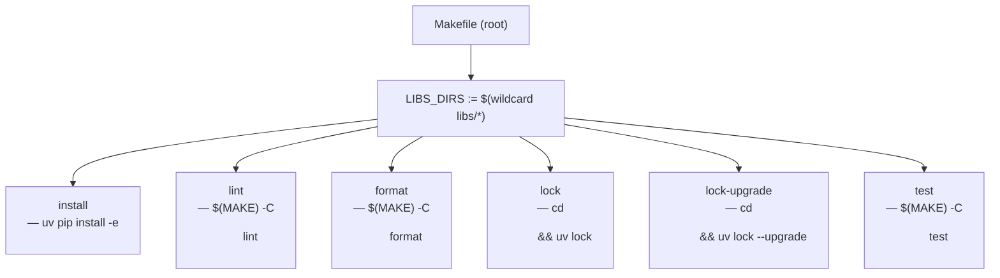

- `install` — creates a virtual environment via `uv venv` and iterates every `libs/*/pyproject.toml` to run `uv pip install -e <dir>`, creating editable installs in the root virtual environment [libs/langgraph/Makefile:9-18]().
- `lock` — runs `uv lock` in each package directory to regenerate `uv.lock` against current constraints [libs/langgraph/Makefile:42-48]().
- `lock-upgrade` — same as `lock` but passes `--upgrade` to pull latest compatible versions [libs/langgraph/Makefile:52-58]().
- `lint`, `format`, `test` — delegates to each package's own `Makefile` via `$(MAKE) -C <dir> <target>` [libs/langgraph/Makefile:21-38, 61-67]().

### Per-Package Makefiles

Standard targets are maintained across per-package Makefiles to ensure a uniform developer experience.

| Target | What it runs | Notes |
|---|---|---|
| `lint` | `uv run ruff check .`, `uv run ruff format --diff`, `uv run ty` | Fails on any issue. [libs/langgraph/Makefile:121-127]() |
| `format` | `uv run ruff format`, `uv run ruff check --fix` | Modifies files in-place. [libs/langgraph/Makefile:131-133]() |
| `type` | `uv run ty langgraph` | Standalone type check using `ty`. [libs/langgraph/Makefile:128-129]() |
| `test` | `uv run pytest` | Orchestrates Docker services if available. [libs/langgraph/Makefile:61-74]() |
| `test_watch` | `uv run ptw` | Re-runs tests on file save using `pytest-watcher`. [libs/langgraph/Makefile:95-102]() |
| `integration_tests` | `uv run pytest integration_tests` | Long-running / external deps. [libs/langgraph/Makefile:85-86]() |
| `coverage` | `uv run pytest --cov` | Generates XML + terminal report. [libs/langgraph/Makefile:34-38]() |
| `spell_check` / `spell_fix` | `uv run codespell --toml pyproject.toml` | Typo detection. [libs/langgraph/Makefile:135-139]() |

**Sources:** [libs/langgraph/Makefile:1-157](), [libs/prebuilt/Makefile:1-83](), [libs/cli/Makefile:1-41](), [libs/sdk-py/Makefile:1-26]()

### Service Management for Tests

Packages whose tests require PostgreSQL or Redis include `start-services` and `stop-services` targets backed by Docker Compose files.

**Service lifecycle in `test` targets**
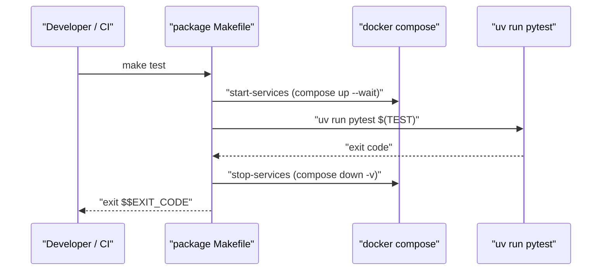

**Sources:** [libs/langgraph/Makefile:40-44](), [libs/langgraph/Makefile:61-74]()

The `langgraph` package's `test` target also manages a local `langgraph dev` server during execution [libs/langgraph/Makefile:46-56](). The `NO_DOCKER` environment variable allows skipping external services when Docker is unavailable [libs/langgraph/Makefile:59-74]().

---

## Package Dependency Graph

The packages have a clear dependency hierarchy designed to minimize coupling:

**Dependency Flow and System Names**
```mermaid
graph TB
    subgraph "Published Packages"
        [langgraph]
        [langgraph-checkpoint]
        [langgraph-checkpoint-postgres]
        [langgraph-checkpoint-sqlite]
        [langgraph-prebuilt]
        [langgraph-sdk]
    end
    
    subgraph "External Dependencies"
        [langchain-core]
        [pydantic]
        [xxhash]
    end
    
    [langgraph] --> [langgraph-checkpoint]
    [langgraph] --> [langgraph-sdk]
    [langgraph] --> [langgraph-prebuilt]
    [langgraph] --> [langchain-core]
    [langgraph] --> [pydantic]
    [langgraph] --> [xxhash]
    
    [langgraph-prebuilt] --> [langgraph-checkpoint]
    [langgraph-prebuilt] --> [langchain-core]
    
    [langgraph-checkpoint-postgres] --> [langgraph-checkpoint]
    [langgraph-checkpoint-sqlite] --> [langgraph-checkpoint]
```

**Sources:** [libs/langgraph/pyproject.toml:26-33](), [libs/prebuilt/pyproject.toml:26-29](), [libs/checkpoint-postgres/pyproject.toml:15-19](), [libs/checkpoint-sqlite/pyproject.toml:15-18]()

### Dependency Constraints

Internal package dependencies use version ranges to allow flexibility:

| Package | Checkpoint Version | SDK Version | Prebuilt Version |
|---------|-------------------|-------------|------------------|
| `langgraph` | `>=4.1.0,<5.0.0` | `>=0.4.2,<0.5.0` | `>=1.1.0,<1.2.0` |
| `langgraph-prebuilt` | `>=2.1.0,<5.0.0` | - | - |
| `langgraph-checkpoint-postgres` | `>=4.1.0,<5.0.0` | - | - |
| `langgraph-checkpoint-sqlite` | `>=4.1.0,<5.0.0` | - | - |

**Sources:** [libs/langgraph/pyproject.toml:28-30](), [libs/prebuilt/pyproject.toml:27](), [libs/checkpoint-postgres/pyproject.toml:15](), [libs/checkpoint-sqlite/pyproject.toml:15]()

---

## Build System Architecture

### Build Backend: Hatchling

All packages use `hatchling` as their build backend, configured via `pyproject.toml`:

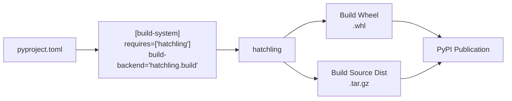

**Sources:** [libs/langgraph/pyproject.toml:1-3](), [libs/prebuilt/pyproject.toml:1-3](), [libs/checkpoint/pyproject.toml:1-3]()

### Wheel Configuration

Each package specifies which directories to include in the built wheel. For example, `langgraph` includes the `langgraph` package [libs/langgraph/pyproject.toml:134](), while `langgraph-prebuilt` also targets the `langgraph` namespace for inclusion [libs/prebuilt/pyproject.toml:71](). Checkpoint implementations similarly include the `langgraph` namespace [libs/checkpoint-postgres/pyproject.toml:56]().

---

## Package Manager: uv

The repository uses `uv` for fast dependency resolution and cross-platform lock files.

### UV Lock Files

Each package maintains a `uv.lock` file that pins exact versions of all transitive dependencies. These lock files include SHA256 hashes and platform-specific wheels to ensure reproducible environments. The `uv.lock` files include resolution markers for different Python versions [libs/langgraph/uv.lock:4-9]().

**Sources:** [libs/langgraph/uv.lock:1-9](), [libs/prebuilt/uv.lock:1-7](), [libs/sdk-py/uv.lock:1-7](), [libs/checkpoint-postgres/uv.lock:1-7]()

---

## Workspace Dependencies and Editable Installs

### Workspace Sources Configuration

For local development, packages reference each other as editable workspace dependencies using `[tool.uv.sources]`. This allows changes in a dependency (like `langgraph-checkpoint`) to be immediately reflected in a dependent package (like `langgraph`) without a re-install.

```toml
[tool.uv.sources]
langgraph-prebuilt = { path = "../prebuilt", editable = true }
langgraph-checkpoint = { path = "../checkpoint", editable = true }
langgraph-checkpoint-sqlite = { path = "../checkpoint-sqlite", editable = true }
langgraph-checkpoint-postgres = { path = "../checkpoint-postgres", editable = true }
langgraph-sdk = { path = "../sdk-py", editable = true }
langgraph-cli = { path = "../cli", editable = true }
```

**Sources:** [libs/langgraph/pyproject.toml:83-89](), [libs/prebuilt/pyproject.toml:64-68](), [libs/checkpoint-postgres/pyproject.toml:51-53]()

---

## Dependency Groups

Packages define sets of dependencies for various purposes using `[dependency-groups]`.

| Group | Purpose | Key Dependencies |
|-------|---------|------------------|
| `test` | Testing infrastructure | `pytest`, `pytest-cov`, `syrupy`, `httpx`, `pytest-xdist`, `langgraph-checkpoint-sqlite`, `langgraph-checkpoint-postgres` |
| `lint` | Code quality | `ruff`, `ty`, `types-requests` |
| `dev` | Complete environment | Includes `test` and `lint` groups, plus `jupyter` |

**Sources:** [libs/langgraph/pyproject.toml:45-80](), [libs/prebuilt/pyproject.toml:37-59](), [libs/checkpoint/pyproject.toml:25-46]()

---

## Development Tools Configuration

### Ruff (Linting and Formatting)

Linting rules are standardized across packages, selecting for errors (`E`), pyflakes (`F`), isort (`I`), tidy-imports (`TID251`), and pyupgrade (`UP`). Specific file ignores are applied for `import-outside-top-level` (`PLC0415`) in library code [libs/langgraph/pyproject.toml:97]().

**Sources:** [libs/langgraph/pyproject.toml:91-97](), [libs/prebuilt/pyproject.toml:78-84](), [libs/checkpoint/pyproject.toml:55-70]()

### Ty (Type Checking)

Type checking rules are managed via the `ty` tool, with extensive "ignore" rules for various invalid type forms to maintain build stability while migrating [libs/langgraph/pyproject.toml:106-124]().

**Sources:** [libs/langgraph/pyproject.toml:106-124](), [libs/prebuilt/pyproject.toml:86-97](), [libs/checkpoint/pyproject.toml:73-85]()

### Pytest Configuration

Test execution settings emphasize strict configuration and timing. `langgraph` uses `--full-trace` and `--durations=5` [libs/langgraph/pyproject.toml:137](). Checkpoint packages use `asyncio_mode = "auto"` [libs/checkpoint/pyproject.toml:53]().

**Sources:** [libs/langgraph/pyproject.toml:136-137](), [libs/prebuilt/pyproject.toml:73-75](), [libs/checkpoint/pyproject.toml:51-53]()

---

## Python Version Support

All packages require Python 3.10 or higher [libs/langgraph/pyproject.toml:10](), [libs/checkpoint/pyproject.toml:10]() and explicitly support Python 3.10 through 3.13 via classifiers [libs/langgraph/pyproject.toml:21-24](). `langgraph-cli` has specific markers to exclude it from Python 3.14+ environments in the current lock configuration [libs/langgraph/pyproject.toml:67-68]().

**Sources:** [libs/langgraph/pyproject.toml:10-24](), [libs/langgraph/pyproject.toml:67-68](), [libs/checkpoint/pyproject.toml:10]()

---

# Page: Testing Infrastructure

# Testing Infrastructure

<details>
<summary>Relevant source files</summary>

The following files were used as context for generating this wiki page:

- [libs/checkpoint-sqlite/Makefile](libs/checkpoint-sqlite/Makefile)
- [libs/checkpoint/Makefile](libs/checkpoint/Makefile)
- [libs/cli/Makefile](libs/cli/Makefile)
- [libs/langgraph/Makefile](libs/langgraph/Makefile)
- [libs/langgraph/bench/__main__.py](libs/langgraph/bench/__main__.py)
- [libs/langgraph/bench/fanout_to_subgraph.py](libs/langgraph/bench/fanout_to_subgraph.py)
- [libs/langgraph/bench/pydantic_state.py](libs/langgraph/bench/pydantic_state.py)
- [libs/langgraph/bench/react_agent.py](libs/langgraph/bench/react_agent.py)
- [libs/langgraph/bench/sequential.py](libs/langgraph/bench/sequential.py)
- [libs/langgraph/bench/wide_dict.py](libs/langgraph/bench/wide_dict.py)
- [libs/langgraph/bench/wide_state.py](libs/langgraph/bench/wide_state.py)
- [libs/langgraph/tests/conftest.py](libs/langgraph/tests/conftest.py)
- [libs/langgraph/tests/conftest_checkpointer.py](libs/langgraph/tests/conftest_checkpointer.py)
- [libs/langgraph/tests/test_interruption.py](libs/langgraph/tests/test_interruption.py)
- [libs/prebuilt/Makefile](libs/prebuilt/Makefile)
- [libs/prebuilt/tests/any_str.py](libs/prebuilt/tests/any_str.py)
- [libs/prebuilt/tests/conftest.py](libs/prebuilt/tests/conftest.py)
- [libs/prebuilt/tests/memory_assert.py](libs/prebuilt/tests/memory_assert.py)
- [libs/prebuilt/tests/messages.py](libs/prebuilt/tests/messages.py)
- [libs/sdk-py/Makefile](libs/sdk-py/Makefile)

</details>


This page documents the testing setup, pytest configuration, test matrices, integration tests, benchmarking, and test helper utilities used across the LangGraph monorepo. The infrastructure is designed to validate the core graph engine, persistence layers, and prebuilt components across multiple Python versions and database backends.

---

## Overview

The test suite is built around a parameterized pytest fixture system that runs the same test against multiple backend implementations (in-memory, SQLite, PostgreSQL). Fixtures are conditionally parameterized at collection time based on the `NO_DOCKER` environment variable, which determines whether Docker-dependent backends like PostgreSQL and Redis are included in the test matrix.

The central configuration resides in `libs/langgraph/tests/conftest.py`, which wires together checkpointer, store, and cache fixtures.

---

## Fixture Architecture

The testing infrastructure uses a layered fixture approach to provide interchangeable components for graphs.

**Fixture Dependency and Data Flow**

```mermaid
graph TD
    subgraph "pytest_Fixtures [libs/langgraph/tests/conftest.py]"
        SC["sync_checkpointer"]
        AC["async_checkpointer"]
        SS["sync_store"]
        AS["async_store"]
        CF["cache"]
        DU["durability"]
        DUUID["deterministic_uuids"]
    end

    subgraph "Checkpointer_Factories [tests/conftest_checkpointer.py]"
        CM["_checkpointer_memory()"]
        CMS["_checkpointer_memory_migrate_sends()"]
        CS["_checkpointer_sqlite()"]
        CSA["_checkpointer_sqlite_aes()"]
        CSAI["_checkpointer_sqlite_aio()"]
        CP["_checkpointer_postgres()"]
        CPP["_checkpointer_postgres_pipe()"]
        CPAIO["_checkpointer_postgres_aio()"]
    end

    subgraph "Store_Factories [tests/conftest_store.py]"
        SM["_store_memory()"]
        SP["_store_postgres()"]
        SPAIO["_store_postgres_aio()"]
    end

    SC --> CM
    SC --> CMS
    SC --> CS
    SC --> CP
    AC --> CM
    AC --> CSAI
    AC --> CPAIO
    SS --> SM
    SS --> SP
    AS --> SM
    AS --> SPAIO
```

Sources: [libs/langgraph/tests/conftest.py:42-226](), [libs/langgraph/tests/conftest.py:16-37]()

---

## The `NO_DOCKER` Environment Variable

A critical control for the testing environment is the `NO_DOCKER` flag. It determines if the test runner expects external services (Postgres, Redis) to be available via Docker.

[libs/langgraph/tests/conftest.py:39]() defines:
```python
NO_DOCKER = os.getenv("NO_DOCKER", "false") == "true"
```

When `NO_DOCKER=true`, fixtures fall back to in-process or file-based backends (SQLite/Memory) to allow testing in restricted environments or for fast local iterations.

**Fixture Parameterization Matrix**

| Fixture | `NO_DOCKER=false` (Default) | `NO_DOCKER=true` |
|---|---|---|
| `sync_checkpointer` | memory, memory_migrate_sends, sqlite, sqlite_aes, postgres, postgres_pipe, postgres_pool | memory, sqlite, sqlite_aes |
| `async_checkpointer` | memory, sqlite_aio, postgres_aio, postgres_aio_pipe, postgres_aio_pool | memory, sqlite_aio |
| `sync_store` | in_memory, postgres, postgres_pipe, postgres_pool | in_memory |
| `async_store` | in_memory, postgres_aio, postgres_aio_pipe, postgres_aio_pool | in_memory |
| `cache` | sqlite, memory, redis | sqlite, memory |

Sources: [libs/langgraph/tests/conftest.py:60-63](), [libs/langgraph/tests/conftest.py:92-96](), [libs/langgraph/tests/conftest.py:120-123](), [libs/langgraph/tests/conftest.py:144-161](), [libs/langgraph/tests/conftest.py:191-205]()

---

## Checkpointer and Store Fixtures

### Checkpointer Implementation Testing
The `sync_checkpointer` and `async_checkpointer` fixtures ensure that `StateGraph` persistence works identically across all supported `BaseCheckpointSaver` implementations.

- **Sync variants**: Include `SqliteSaver`, `PostgresSaver` (with pipeline and pool variants), and `InMemorySaver` [libs/langgraph/tests/conftest.py:165-186]().
- **Async variants**: Include `AsyncSqliteSaver` and `AsyncPostgresSaver` [libs/langgraph/tests/conftest.py:209-225]().

### Store Implementation Testing
The `sync_store` and `async_store` fixtures provide instances of `BaseStore` (e.g., `InMemoryStore`, `PostgresStore`) to test cross-thread memory and semantic search capabilities [libs/langgraph/tests/conftest.py:98-141]().

---

## Cache Fixture and Parallelism

The `cache` fixture [libs/langgraph/tests/conftest.py:60-89]() yields `BaseCache` implementations. For `RedisCache`, the infrastructure handles parallel test isolation using `pytest-xdist`.

- **Isolation**: It retrieves the `workerid` from the pytest config [libs/langgraph/tests/conftest.py:71]().
- **Prefixing**: It applies a worker-specific prefix `test:cache:{worker_id}:` to avoid key collisions between parallel processes [libs/langgraph/tests/conftest.py:77]().
- **Cleanup**: Teardown logic ensures only keys with the worker's specific prefix are deleted [libs/langgraph/tests/conftest.py:81-87]().

---

## Benchmarking Infrastructure

LangGraph includes a dedicated benchmarking suite in `libs/langgraph/bench/` to track execution performance, latency, and serialization overhead.

**Benchmarking Components**

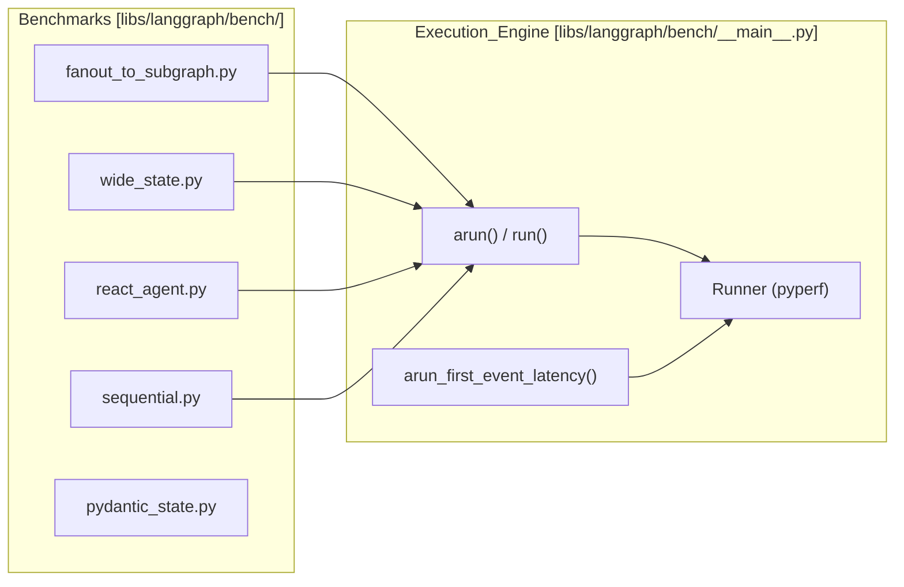

### Key Benchmarks
- **Fanout to Subgraph**: Measures performance of `Send` operations and nested graph execution [libs/langgraph/bench/fanout_to_subgraph.py:11-108]().
- **Wide State**: Tests overhead of managing large state objects with many fields and frequent updates [libs/langgraph/bench/wide_state.py:12-135]().
- **Sequential**: Measures the overhead of a graph with thousands of no-op nodes [libs/langgraph/bench/sequential.py:7-28]().
- **Latency**: Measures "Time to First Event" using `arun_first_event_latency` and `run_first_event_latency` [libs/langgraph/bench/__main__.py:36-55](), [libs/langgraph/bench/__main__.py:73-92]().

### Running Benchmarks
Benchmarks are executed via the `Makefile`:
- `make benchmark`: Runs the suite rigorously using `pyperf` and `uv run python -m bench` [libs/langgraph/Makefile:17-20]().
- `make profile`: Generates a flamegraph using `py-spy` for a specific graph [libs/langgraph/Makefile:29-31]().

Sources: [libs/langgraph/bench/__main__.py:99-238](), [libs/langgraph/Makefile:10-31]()

---

## Test Utilities and Helpers

### Deterministic UUIDs
The `deterministic_uuids` fixture [libs/langgraph/tests/conftest.py:47-52]() patches `uuid.uuid4` to return a predictable sequence. This is essential for tests that compare full state snapshots where internal task IDs must be stable.

### Memory Assertion Helpers
Specialized checkpointer wrappers are used to assert internal behaviors during tests:
- `MemorySaverAssertImmutable`: Extends `InMemorySaver` to verify that checkpoints are not mutated after being written.
- `MemorySaverNeedsPendingSendsMigration`: Simulates older checkpoint versions to test migration logic for `pending_sends`.

### Interruption Testing
Tests in `libs/langgraph/tests/test_interruption.py` validate that the graph correctly handles `interrupt_after` and `interrupt_before` configurations, ensuring state is persisted even when no keys are updated in a step [libs/langgraph/tests/test_interruption.py:11-51]().

---

## Service Management (Docker)

External services required for integration tests (Postgres, Redis) are managed via Docker Compose.

**Service Topology**
| Service | Image | Configuration File |
|---|---|---|
| PostgreSQL | `pgvector/pgvector:pg16` | `libs/langgraph/tests/compose-postgres.yml` |
| Redis | `redis:alpine` | `libs/langgraph/tests/compose-redis.yml` |

The `Makefile` provides targets to orchestrate these:
- `make start-services`: Starts Postgres and Redis with `--wait` to ensure they are ready [libs/langgraph/Makefile:40-41]().
- `make stop-services`: Shuts down services and removes volumes [libs/langgraph/Makefile:43-44]().

Sources: [libs/langgraph/Makefile:40-45](), [libs/prebuilt/Makefile:10-14]()

---

## Test Execution Summary

| Command | Scope | Features |
|---|---|---|
| `uv run pytest` | Unit Tests | Core logic, Pregel algo, StateGraph builder |
| `make integration_tests` | Integration | End-to-end flows, external service connectivity [libs/langgraph/Makefile:85-86]() |
| `make test_parallel` | All | Uses `pytest-xdist` with `worksteal` distribution [libs/langgraph/Makefile:76-83]() |
| `make coverage` | Unit/Int | Generates XML reports for CI and terminal summaries [libs/langgraph/Makefile:34-38]() |
| `make test-fast` | Prebuilt | Runs tests with `LANGGRAPH_TEST_FAST=1` [libs/prebuilt/Makefile:18-19]() |

Sources: [libs/langgraph/Makefile:61-106](), [libs/cli/Makefile:8-11](), [libs/sdk-py/Makefile:3-4](), [libs/prebuilt/Makefile:18-25]()

---

# Page: CI/CD Workflows

# CI/CD Workflows

<details>
<summary>Relevant source files</summary>

The following files were used as context for generating this wiki page:

- [.github/dependabot.yml](.github/dependabot.yml)
- [.github/workflows/_integration_test.yml](.github/workflows/_integration_test.yml)
- [.github/workflows/_lint.yml](.github/workflows/_lint.yml)
- [.github/workflows/_sdk_integration_test.yml](.github/workflows/_sdk_integration_test.yml)
- [.github/workflows/_test.yml](.github/workflows/_test.yml)
- [.github/workflows/_test_langgraph.yml](.github/workflows/_test_langgraph.yml)
- [.github/workflows/_test_release.yml](.github/workflows/_test_release.yml)
- [.github/workflows/baseline.yml](.github/workflows/baseline.yml)
- [.github/workflows/bench.yml](.github/workflows/bench.yml)
- [.github/workflows/ci.yml](.github/workflows/ci.yml)
- [.github/workflows/deploy-redirects.yml](.github/workflows/deploy-redirects.yml)
- [.github/workflows/release.yml](.github/workflows/release.yml)
- [.github/workflows/reopen_on_assignment.yml](.github/workflows/reopen_on_assignment.yml)
- [.github/workflows/require_issue_link.yml](.github/workflows/require_issue_link.yml)
- [.github/workflows/tag-external-issues.yml](.github/workflows/tag-external-issues.yml)
- [.github/workflows/tag-external-prs.yml](.github/workflows/tag-external-prs.yml)
- [.github/workflows/uv_lock_ugprade.yml](.github/workflows/uv_lock_ugprade.yml)
- [libs/checkpoint-conformance/Makefile](libs/checkpoint-conformance/Makefile)
- [libs/checkpoint-conformance/langgraph/checkpoint/conformance/__init__.py](libs/checkpoint-conformance/langgraph/checkpoint/conformance/__init__.py)
- [libs/checkpoint-conformance/langgraph/checkpoint/conformance/initializer.py](libs/checkpoint-conformance/langgraph/checkpoint/conformance/initializer.py)
- [libs/checkpoint-conformance/langgraph/checkpoint/conformance/report.py](libs/checkpoint-conformance/langgraph/checkpoint/conformance/report.py)
- [libs/checkpoint-conformance/langgraph/checkpoint/conformance/spec/test_copy_thread.py](libs/checkpoint-conformance/langgraph/checkpoint/conformance/spec/test_copy_thread.py)
- [libs/checkpoint-conformance/langgraph/checkpoint/conformance/spec/test_delete_for_runs.py](libs/checkpoint-conformance/langgraph/checkpoint/conformance/spec/test_delete_for_runs.py)

</details>


This page documents all GitHub Actions workflows in the LangGraph monorepo: the main CI pipeline, reusable job workflows, benchmarking pipelines, the weekly dependency lock upgrade, and the release workflow. For the release process itself (PyPI publishing, tagging, and release notes), see [9.4](). For test infrastructure details (fixtures, Docker services, conftest setup), see [9.2](). For the monorepo build system and `make` targets that these workflows invoke, see [9.1]().

---

## Workflow Inventory

All workflow files live under `.github/workflows/`. Filenames prefixed with `_` are reusable workflows, invoked via `workflow_call` from other workflows.

| File | Name | Trigger | Purpose |
|---|---|---|---|
| `ci.yml` | CI | `push` to `main`, `pull_request` | Orchestrates lint, test, schema and integration checks |
| `_lint.yml` | lint | `workflow_call` | Runs ruff and mypy per package |
| `_test.yml` | test | `workflow_call` | Runs `make test` per package across Python versions |
| `_test_langgraph.yml` | test | `workflow_call` | Runs `make test_parallel` for `libs/langgraph` specifically |
| `_integration_test.yml` | CLI integration test | `workflow_call` | Builds and smoke-tests Docker images via `langgraph build` |
| `_sdk_integration_test.yml` | sdk-py integration test | `workflow_call` | Exercises the Python SDK against the server |
| `bench.yml` | bench | `pull_request` on `libs/**` | Runs benchmarks and compares to baseline |
| `baseline.yml` | baseline | `push` to `main`, `workflow_dispatch` | Saves benchmark baseline to cache |
| `uv_lock_ugprade.yml` | UV Lock Upgrade | Weekly cron, `workflow_dispatch` | Runs `make lock-upgrade` and opens a PR |
| `release.yml` | release | `workflow_dispatch` | Full release pipeline (build → test PyPI → pre-check → publish → tag) |
| `_test_release.yml` | test-release | `workflow_call` | Builds and publishes to test PyPI |
| `deploy-redirects.yml` | Deploy Redirects | `push` to `main` on `docs/**` | Generates and deploys documentation redirects to GitHub Pages |
| `require_issue_link.yml` | Require Issue Link | `pull_request_target` (labeled, edited, etc.) | Enforces issue references for external PRs |

Sources: [.github/workflows/ci.yml:2-10](), [.github/workflows/_lint.yml:1-10](), [.github/workflows/_test.yml:1-10](), [.github/workflows/_test_langgraph.yml:1-5](), [.github/workflows/_integration_test.yml:1-8](), [.github/workflows/bench.yml:1-6](), [.github/workflows/baseline.yml:1-9](), [.github/workflows/uv_lock_ugprade.yml:4-8](), [.github/workflows/release.yml:1-9](), [.github/workflows/deploy-redirects.yml:1-10](), [.github/workflows/require_issue_link.yml:12-19]()

---

## Main CI Pipeline (`ci.yml`)

The CI workflow is the primary gate on all pull requests and pushes to `main`.

### Concurrency

A concurrency group keyed on `${{ github.workflow }}-${{ github.ref }}` ensures that if a new push arrives while CI is still running for the same branch, the older run is cancelled [.github/workflows/ci.yml:21-23]().

### Path Filtering (`changes` job)

The first job uses the `dorny/paths-filter` action to determine which areas of the repository changed [.github/workflows/ci.yml:26-57](). Three output flags control downstream jobs:

| Flag | Paths Watched |
|---|---|
| `python` | `libs/langgraph/**`, `libs/sdk-py/**`, `libs/cli/**`, `libs/checkpoint/**`, `libs/checkpoint-sqlite/**`, `libs/checkpoint-postgres/**`, `libs/checkpoint-conformance/**`, `libs/prebuilt/**` |
| `deps` | `**/pyproject.toml`, `**/uv.lock` |
| `sdk_py` | `libs/sdk-py/**`, `libs/langgraph/**` |

Downstream jobs only run if the relevant flags are `true`, which prevents unnecessary work on documentation-only changes [.github/workflows/ci.yml:74]().

### Job Graph

**CI pipeline job dependency diagram:**

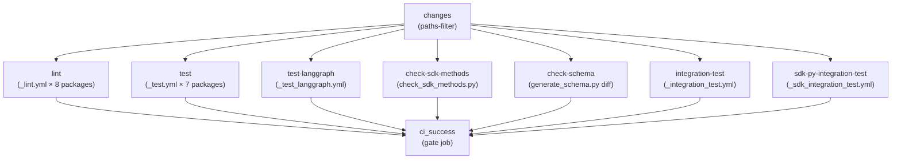

Sources: [.github/workflows/ci.yml:26-172]()

### `ci_success` Gate Job

The final `ci_success` job [.github/workflows/ci.yml:173-198]() always runs (via `if: always()`) and exits non-zero if any upstream job resulted in `failure` or `cancelled` [.github/workflows/ci.yml:191](). This provides a single required status check that branch protection rules can target, regardless of which jobs were skipped due to path filtering.

---

## Reusable Workflows

### `_lint.yml` — Per-Package Linting

Triggered via `workflow_call` with a `working-directory` input. Runs on Python 3.12 only [.github/workflows/_lint.yml:19-32]().

Steps:

1. **Changed-file detection** — uses `Ana06/get-changed-files` filtered to `${{ inputs.working-directory }}/**` [.github/workflows/_lint.yml:35-40](). Remaining steps are skipped if no files changed.
2. **Install lint deps** — `uv sync --frozen --group lint` [.github/workflows/_lint.yml:52]().
3. **`lint_package`** — runs `make lint_package` (falls back to `make lint` if target absent) [.github/workflows/_lint.yml:58-63]().
4. **Install test lint deps** — `uv sync --group lint` [.github/workflows/_lint.yml:68]().
5. **`lint_tests`** — runs `make lint_tests` (skipped if target absent) [.github/workflows/_lint.yml:74-78]().

The `RUFF_OUTPUT_FORMAT: github` environment variable causes ruff to emit inline PR annotations [.github/workflows/_lint.yml:16]().

Sources: [.github/workflows/_lint.yml:1-78]()

### `_test.yml` — Per-Package Tests

Triggered via `workflow_call` with a `working-directory` input. Runs a matrix across **Python 3.10, 3.11, 3.12, 3.13, 3.14** [.github/workflows/_test.yml:17-24]().

Steps:

1. **Docker Hub login** — authenticates to avoid pull rate limits (skipped on fork PRs) [.github/workflows/_test.yml:35-40]().
2. **Install deps** — `uv sync --frozen --group test --no-dev` [.github/workflows/_test.yml:45]().
3. **Run tests** — `make test` [.github/workflows/_test.yml:50]().
4. **Clean working tree check** — fails if tests created untracked files [.github/workflows/_test.yml:52-63]().

Sources: [.github/workflows/_test.yml:1-63]()

### `_test_langgraph.yml` — LangGraph-Specific Tests

Hardcoded to `libs/langgraph` and invokes `make test_parallel` instead of `make test` [.github/workflows/_test_langgraph.yml:46](). It also includes a specific run for strict `msgpack` pregel tests on Python 3.13 when `LANGGRAPH_STRICT_MSGPACK` is enabled [.github/workflows/_test_langgraph.yml:48-53]().

Sources: [.github/workflows/_test_langgraph.yml:1-65]()

---

## Schema and SDK Consistency Checks

### `check-sdk-methods`

Runs the script `.github/scripts/check_sdk_methods.py` [.github/workflows/ci.yml:121](). This verifies that methods defined in the SDK match those expected by the server API.

### `check-schema`

Generates the `langgraph.json` configuration schema via `uv run python generate_schema.py` inside `libs/cli`, then diffs the result against the committed `schemas/schema.json` [.github/workflows/ci.yml:148-155]().

Sources: [.github/workflows/ci.yml:109-158]()

---

## CLI Integration Tests (`_integration_test.yml`)

This reusable workflow builds real Docker images using `langgraph build` and, when a `LANGSMITH_API_KEY` is available, runs the built containers using `run_langgraph_cli_test.py`.

### Matrix

The matrix is two-dimensional: Python versions (3.10, 3.14) × example directories [.github/workflows/_integration_test.yml:16-32]():

| Example | Working Dir | Tag |
|---|---|---|
| A | `libs/cli/examples` | `langgraph-test-a` |
| B | `libs/cli/examples/graphs` | `langgraph-test-b` |
| C | `libs/cli/examples/graphs_reqs_a` | `langgraph-test-c` |
| D | `libs/cli/examples/graphs_reqs_b` | `langgraph-test-d` |

The test runner script is `.github/scripts/run_langgraph_cli_test.py`, wrapped in a 60-second timeout [.github/workflows/_integration_test.yml:74]().

Sources: [.github/workflows/_integration_test.yml:1-146]()

---

## Benchmarking Workflows

### `baseline.yml` — Save Baseline

**Trigger:** Push to `main` or `workflow_dispatch`, when `libs/**` changes [.github/workflows/baseline.yml:3-9]().

Runs `make benchmark` in `libs/langgraph` and saves the output as `out/benchmark-baseline.json` to the Actions cache under a key of the form `${{ runner.os }}-benchmark-baseline-${{ env.SHA }}` [.github/workflows/baseline.yml:31-37]().

### `bench.yml` — PR Comparison

**Trigger:** Pull requests touching `libs/**` [.github/workflows/bench.yml:4-6]().

**Benchmark comparison diagram:**

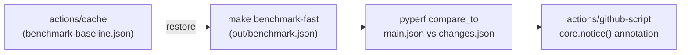

Steps [.github/workflows/bench.yml:17-71]():

1. Restore baseline from cache [.github/workflows/bench.yml:33-40]().
2. Run `make benchmark-fast` → writes `out/benchmark.json` [.github/workflows/bench.yml:46]().
3. Rename files and run `uv run pyperf compare_to out/main.json out/changes.json --table --group-by-speed` [.github/workflows/bench.yml:54-56]().
4. Post both raw results and the comparison table as PR annotations via `core.notice()` [.github/workflows/bench.yml:62-71]().

Sources: [.github/workflows/bench.yml:1-71](), [.github/workflows/baseline.yml:1-37]()

---

## External Contributor Controls (`require_issue_link.yml`)

For PRs from external contributors (labeled `external`), the repository enforces that the PR references an approved issue (e.g., "Fixes #NNN").

**Process Flow:**
1. **Gate:** Checks if PR is labeled `external` and lacks `trusted-contributor` or `bypass-issue-check` [.github/workflows/require_issue_link.yml:37-44]().
2. **Action:** If no valid issue reference is found in the PR body, the workflow:
    - Labels the PR `missing-issue-link` [.github/workflows/require_issue_link.yml:61-77]().
    - Comments on the PR requiring an issue reference.
    - Closes the PR (if `ENFORCE_ISSUE_LINK` is "true") [.github/workflows/require_issue_link.yml:25-26]().
3. **Override:** A maintainer can override this by manually adding the `bypass-issue-check` label or removing `missing-issue-link` [.github/workflows/require_issue_link.yml:114-145]().

Sources: [.github/workflows/require_issue_link.yml:1-154]()

---

## Weekly Dependency Lock Upgrade (`uv_lock_ugprade.yml`)

**Trigger:** Cron at `0 0 * * 0` [.github/workflows/uv_lock_ugprade.yml:4-8]().

Runs `make lock-upgrade` at the repo root [.github/workflows/uv_lock_ugprade.yml:28](), which calls `uv lock --upgrade` across all packages. Then uses `peter-evans/create-pull-request` to open a PR on branch `deps/uv-lock-upgrade` [.github/workflows/uv_lock_ugprade.yml:30-43]().

Sources: [.github/workflows/uv_lock_ugprade.yml:1-43]()

---

## Release Pipeline

### Permission Isolation

The `build` job runs with only `contents: read` [.github/workflows/release.yml:11-12](). The `test-pypi-publish` job requires `id-token: write` (for PyPI trusted publishing) [.github/workflows/release.yml:146-148](). These permissions are intentionally kept in separate jobs so that a compromised build step cannot access publishing credentials [.github/workflows/release.yml:38-48]().

### `_test_release.yml` Reusable Workflow

Called by the `test-pypi-publish` job in `release.yml` [.github/workflows/release.yml:149-152](). It builds the package with `uv build` [.github/workflows/_test_release.yml:47](), and uploads to test PyPI using `pypa/gh-action-pypi-publish` [.github/workflows/_test_release.yml:85-90]().

### Version Extraction Logic

The `Check Version` step in `release.yml` handles both standard and dynamic versioning by checking for `dynamic` fields in `pyproject.toml` and falling back to `__init__.py` if necessary [.github/workflows/release.yml:59-81]().

Sources: [.github/workflows/release.yml:1-158](), [.github/workflows/_test_release.yml:1-97]()

---

## Python Version Coverage Summary

| Workflow | Python Versions |
|---|---|
| `_lint.yml` | 3.12 only |
| `_test.yml` | 3.10, 3.11, 3.12, 3.13, 3.14 |
| `_test_langgraph.yml` | 3.10, 3.11, 3.12, 3.13, 3.14 |
| `_integration_test.yml` | 3.10, 3.14 |
| `bench.yml` | 3.11 |
| `baseline.yml` | 3.11 |
| `release.yml` | 3.11 |
| `_test_release.yml` | 3.10 |
| `uv_lock_ugprade.yml` | 3.10 |

Sources: [.github/workflows/_lint.yml:31](), [.github/workflows/_test.yml:20-24](), [.github/workflows/_test_langgraph.yml:15-19](), [.github/workflows/_integration_test.yml:18-19](), [.github/workflows/bench.yml:24](), [.github/workflows/baseline.yml:22](), [.github/workflows/release.yml:15](), [.github/workflows/_test_release.yml:12](), [.github/workflows/uv_lock_ugprade.yml:24]()

---

# Page: Release Process

# Release Process

<details>
<summary>Relevant source files</summary>

The following files were used as context for generating this wiki page:

- [.github/workflows/_integration_test.yml](.github/workflows/_integration_test.yml)
- [.github/workflows/_lint.yml](.github/workflows/_lint.yml)
- [.github/workflows/_sdk_integration_test.yml](.github/workflows/_sdk_integration_test.yml)
- [.github/workflows/_test.yml](.github/workflows/_test.yml)
- [.github/workflows/_test_langgraph.yml](.github/workflows/_test_langgraph.yml)
- [.github/workflows/_test_release.yml](.github/workflows/_test_release.yml)
- [.github/workflows/baseline.yml](.github/workflows/baseline.yml)
- [.github/workflows/bench.yml](.github/workflows/bench.yml)
- [.github/workflows/ci.yml](.github/workflows/ci.yml)
- [.github/workflows/deploy-redirects.yml](.github/workflows/deploy-redirects.yml)
- [.github/workflows/release.yml](.github/workflows/release.yml)
- [.github/workflows/uv_lock_ugprade.yml](.github/workflows/uv_lock_ugprade.yml)

</details>


The LangGraph release process is implemented as a manually-triggered GitHub Actions workflow ([.github/workflows/release.yml:1-328]()) that publishes packages to PyPI. The workflow enforces permission isolation between build and publish stages, validates packages on TestPyPI before production release, and creates GitHub releases with git-based changelogs.

## Workflow Jobs

The `release.yml` workflow executes six jobs with strict dependency ordering:

| Job Name | Depends On | Purpose |
|----------|------------|---------|
| `build` | - | Execute `uv build` and extract `pkg-name`, `version`, `tag` outputs |
| `release-notes` | `build` | Compare git tags and generate changelog via `git log` |
| `test-pypi-publish` | `build`, `release-notes` | Invoke `.github/workflows/_test_release.yml` to publish to test.pypi.org |
| `pre-release-checks` | `build`, `release-notes`, `test-pypi-publish` | Install from TestPyPI with `--extra-index-url` and run `make test` |
| `publish` | `build`, `release-notes`, `test-pypi-publish`, `pre-release-checks` | Publish to pypi.org via `pypa/gh-action-pypi-publish@release/v1` |
| `mark-release` | `build`, `release-notes`, `test-pypi-publish`, `pre-release-checks`, `publish` | Create GitHub release via `ncipollo/release-action@v1` |

Sources: [.github/workflows/release.yml:17-328]()

## Job Dependency Graph

Title: "GitHub Actions Release Job Dependencies"
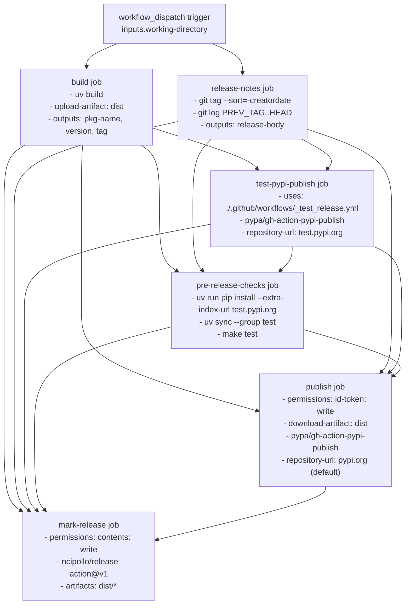

**Purpose**: Maps GitHub Actions workflow job dependencies with key actions and permissions used in each job.

Sources: [.github/workflows/release.yml:17-328]()

## Trigger and Inputs

The release workflow is triggered manually via `workflow_dispatch` ([.github/workflows/release.yml:4-5]()) with a single required input:

| Input | Type | Default | Description |
|-------|------|---------|-------------|
| `working-directory` | string | `libs/langgraph` | Package directory to release |

**Supported packages** (as defined in the monorepo structure):

| Package | Directory |
|---------|-----------|
| `langgraph` | `libs/langgraph` |
| `langgraph-checkpoint` | `libs/checkpoint` |
| `langgraph-checkpoint-sqlite` | `libs/checkpoint-sqlite` |
| `langgraph-checkpoint-postgres` | `libs/checkpoint-postgres` |
| `langgraph-prebuilt` | `libs/prebuilt` |
| `langgraph-cli` | `libs/cli` |
| `langgraph-sdk` | `libs/sdk-py` |

Sources: [.github/workflows/release.yml:3-9](), [.github/workflows/ci.yml:63-73]()

## Build Stage

The `build` job extracts version information and creates distribution artifacts using `uv build` ([.github/workflows/release.yml:49-50]()).

### Version Detection

Title: "Version Extraction and Tag Generation Logic"
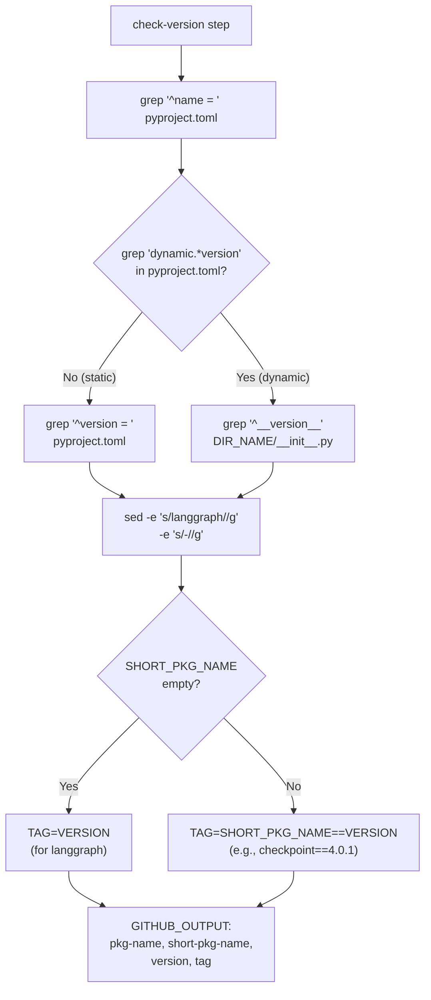

**Purpose**: Shows bash script logic for extracting version information from `pyproject.toml` or `__init__.py`.

The version detection script performs the following ([.github/workflows/release.yml:58-81]()):

1. **Extract package name**: `PKG_NAME=$(grep -m 1 "^name = " pyproject.toml | cut -d '"' -f 2)`
2. **Check for dynamic versioning**: `grep -q 'dynamic.*=.*\[.*"version".*\]' pyproject.toml`
3. **Extract version**:
   - **Static (standard)**: `VERSION=$(grep -m 1 "^version = " pyproject.toml | cut -d '"' -f 2)`
   - **Dynamic**: `DIR_NAME=$(echo "$PKG_NAME" | tr '-' '_')` then `VERSION=$(grep -m 1 '^__version__' "${DIR_NAME}/__init__.py" | cut -d '"' -f 2)`
4. **Generate short name**: `SHORT_PKG_NAME="$(echo "$PKG_NAME" | sed -e 's/langgraph//g' -e 's/-//g')"` → e.g., `checkpoint` for `langgraph-checkpoint`.
5. **Create tag**:
   - **langgraph package**: `TAG="$VERSION"`
   - **Other packages**: `TAG="${SHORT_PKG_NAME}==${VERSION}"` → `checkpoint==4.0.1`

### Build Artifacts

The build step uses `uv build` at [.github/workflows/release.yml:49-51]() to create source and wheel distributions. Artifacts are uploaded via `actions/upload-artifact@v7` at [.github/workflows/release.yml:53-57]() with artifact name `dist`.

Build output uses `hatchling` as the build backend, which is configured in the respective `pyproject.toml` files of the libraries.

Sources: [.github/workflows/release.yml:49-81]()

## Release Notes Generation

The `release-notes` job creates a changelog by comparing the current version tag against the most recent previous tag using `git log` ([.github/workflows/release.yml:137]()).

### Tag Comparison Logic

Title: "Git Tag Comparison and Validation"
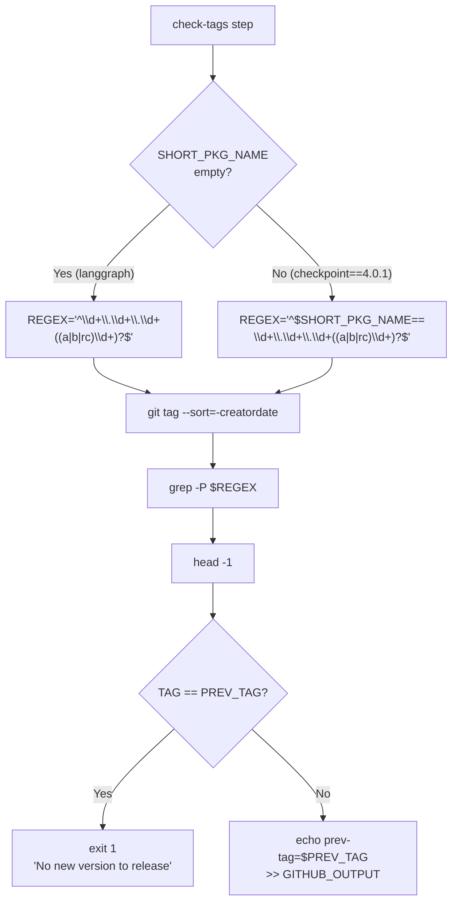

**Purpose**: Shows bash script logic for finding the previous version tag and validating the new release.

The tag comparison at [.github/workflows/release.yml:98-120]() filters existing tags using regex patterns based on whether the package is the core `langgraph` package or a sub-package.

### Changelog Generation

The `generate-release-body` step ([.github/workflows/release.yml:121-140]()) creates release notes by extracting commit subjects since the last tag. If no previous tag is found, it defaults to "Initial release" ([.github/workflows/release.yml:132-138]()).

Sources: [.github/workflows/release.yml:83-141]()

## TestPyPI Publishing

The `test-pypi-publish` job ([.github/workflows/release.yml:142-152]()) uses the reusable workflow `_test_release.yml` to publish the package to TestPyPI.

### TestPyPI Workflow

Title: "TestPyPI Validation Flow"
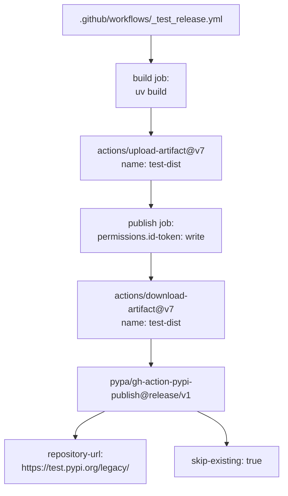

**Purpose**: Shows the TestPyPI release workflow structure and artifact flow.

The workflow uses Trusted Publishing with OIDC, requiring `id-token: write` permissions ([.github/workflows/_test_release.yml:68-74]()).

Sources: [.github/workflows/_test_release.yml:1-97]()

## Pre-Release Checks

The `pre-release-checks` job ([.github/workflows/release.yml:154-242]()) verifies the published TestPyPI package by installing it in a fresh environment and running the test suite.

### Package Installation from TestPyPI

The installation logic at [.github/workflows/release.yml:183-221]() performs a `pip install` using `test.pypi.org` as an extra index URL. It includes a retry mechanism with a 5-second sleep to account for TestPyPI indexing delays ([.github/workflows/release.yml:189-200]()).

**Cache Exclusion**: Caching is explicitly disabled for this job ([.github/workflows/release.yml:180]()) to ensure tests are sensitive to missing dependencies that might otherwise be satisfied by a cached environment ([.github/workflows/release.yml:163-174]()).

Sources: [.github/workflows/release.yml:154-242]()

## PyPI Publishing

The `publish` job ([.github/workflows/release.yml:243-285]()) performs the final production release to PyPI.

### Production Publishing Workflow

Title: "PyPI Production Release Workflow"
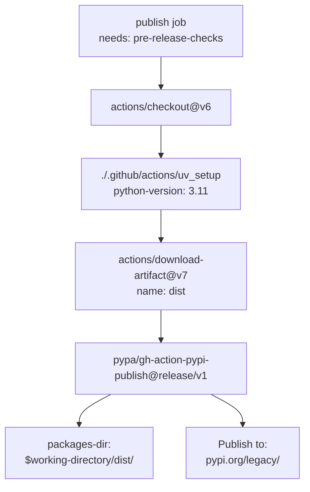

**Purpose**: Shows the production publish job steps and `pypa/gh-action-pypi-publish` configuration.

The job uses Trusted Publishing via `id-token: write` permissions ([.github/workflows/release.yml:256]()) and points to the `dist/` directory containing artifacts from the `build` job ([.github/workflows/release.yml:280]()).

Sources: [.github/workflows/release.yml:243-285]()

## GitHub Release Creation

The `mark-release` job ([.github/workflows/release.yml:286-328]()) creates the final GitHub release.

### Release Creation Workflow

Title: "GitHub Release and Artifact Attachment"
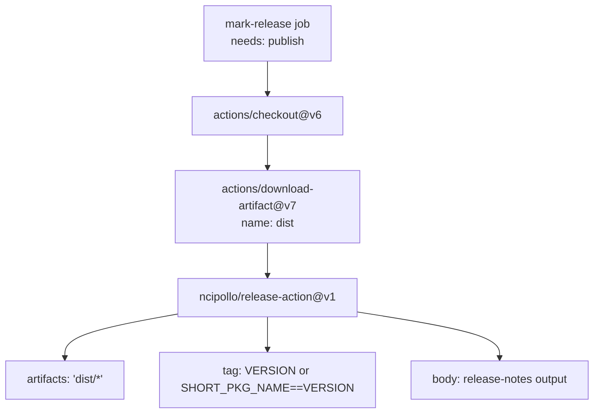

**Purpose**: Shows the `ncipollo/release-action` configuration for creating the GitHub Release.

The release is created using the `GITHUB_TOKEN` with `contents: write` permissions ([.github/workflows/release.yml:297]()). It uploads all artifacts from the `dist/` directory ([.github/workflows/release.yml:321]()) and uses the body generated by the `release-notes` job ([.github/workflows/release.yml:326]()).

Sources: [.github/workflows/release.yml:286-328]()

---

# Page: Core Execution System

# Core Execution System

<details>
<summary>Relevant source files</summary>

The following files were used as context for generating this wiki page:

- [libs/langgraph/langgraph/channels/delta.py](libs/langgraph/langgraph/channels/delta.py)
- [libs/langgraph/langgraph/func/__init__.py](libs/langgraph/langgraph/func/__init__.py)
- [libs/langgraph/langgraph/graph/state.py](libs/langgraph/langgraph/graph/state.py)
- [libs/langgraph/langgraph/pregel/__init__.py](libs/langgraph/langgraph/pregel/__init__.py)
- [libs/langgraph/langgraph/pregel/_checkpoint.py](libs/langgraph/langgraph/pregel/_checkpoint.py)
- [libs/langgraph/langgraph/pregel/_loop.py](libs/langgraph/langgraph/pregel/_loop.py)
- [libs/langgraph/langgraph/pregel/main.py](libs/langgraph/langgraph/pregel/main.py)
- [libs/langgraph/langgraph/types.py](libs/langgraph/langgraph/types.py)
- [libs/langgraph/tests/test_channels.py](libs/langgraph/tests/test_channels.py)
- [libs/langgraph/tests/test_delta_channel_exit_mode.py](libs/langgraph/tests/test_delta_channel_exit_mode.py)
- [libs/langgraph/tests/test_delta_channel_supersteps_bound.py](libs/langgraph/tests/test_delta_channel_supersteps_bound.py)
- [libs/langgraph/tests/test_delta_channel_update_state.py](libs/langgraph/tests/test_delta_channel_update_state.py)
- [libs/langgraph/tests/test_pregel.py](libs/langgraph/tests/test_pregel.py)
- [libs/langgraph/tests/test_pregel_async.py](libs/langgraph/tests/test_pregel_async.py)
- [libs/langgraph/tests/test_state.py](libs/langgraph/tests/test_state.py)

</details>


This page describes the architecture of the LangGraph core execution engine: the Pregel computational model, the user-facing graph definition APIs, and how each internal component participates in running a graph. It covers the **what** and **why** at the system level.

For full API details on each subsystem, see the child pages:
- State schemas, `add_node`, `compile()` → [StateGraph API](#3.1)
- `@task` and `@entrypoint` → [Functional API (@task and @entrypoint)](#3.2)
- Superstep cycle internals → [Pregel Execution Engine](#3.3)
- Channel types and reducers → [State Management and Channels](#3.4)
- `Send`, `Command`, conditional edges → [Control Flow Primitives](#3.5)
- Graph composition and nested structures → [Graph Composition and Nested Graphs](#3.6)
- Interrupts and human-in-the-loop → [Human-in-the-Loop and Interrupts](#3.7)
- `RetryPolicy`, `CachePolicy` → [Error Handling and Retry Policies](#3.8), [Caching System](#3.10)
- Runtime and Dependency Injection → [Runtime and Dependency Injection](#3.9)
- Streaming architecture and modes → [Streaming Architecture](#3.11)

---

## Computational Model

LangGraph's execution engine is an implementation of the **Pregel / Bulk Synchronous Parallel (BSP)** model. In this model, a graph is composed of **actors** (nodes) that communicate exclusively through **channels** (shared state slots). Execution is divided into discrete **supersteps**. Within each superstep, no actor can observe another actor's writes — all writes from one superstep become visible at the start of the next.

Each superstep runs three sequential phases:

| Phase | Description | Key code |
|---|---|---|
| **Plan** | Determine which actors are eligible to run based on which channels were updated in the previous superstep. | `prepare_next_tasks()` in [libs/langgraph/langgraph/pregel/_algo.py:127-128]() |
| **Execute** | Run all selected actors concurrently. Each actor reads from its subscribed channels and writes its outputs. | `PregelRunner` in [libs/langgraph/langgraph/pregel/_runner.py:74-74]() |
| **Update** | Commit the actors' writes to channels, applying any reducers. | `apply_writes()` in [libs/langgraph/langgraph/pregel/_algo.py:125-125]() |

The loop continues until no actors are eligible (graph is drained), a recursion limit is reached, or an interrupt occurs.

**Sources:** [libs/langgraph/langgraph/pregel/main.py:122-128](), [libs/langgraph/langgraph/pregel/_loop.py:85-98](), [libs/langgraph/langgraph/pregel/_algo.py:122-127]()

---

## Two Entry Points, One Runtime

Users can define graphs in two ways. Both ultimately produce a `Pregel` instance, which is the actual runtime object that supports `invoke`, `stream`, `ainvoke`, and `astream`.

**Diagram: Graph Definition APIs and Their Compiled Output**

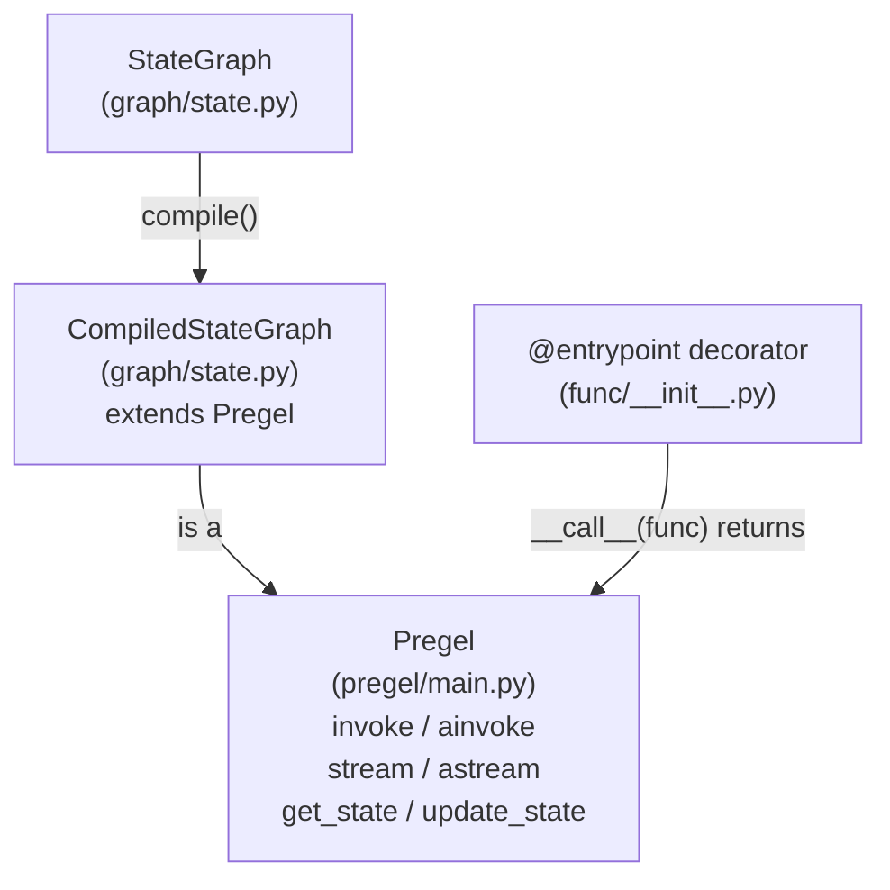

**Sources:** [libs/langgraph/langgraph/graph/state.py:131-200](), [libs/langgraph/langgraph/func/__init__.py:144-190](), [libs/langgraph/langgraph/pregel/main.py:1-3](), [libs/langgraph/langgraph/graph/state.py:73-74]()

### StateGraph Path

`StateGraph` is a **builder** — it holds node and edge declarations but cannot execute anything directly. Calling `.compile()` validates the graph structure and returns a `CompiledStateGraph`, which subclasses `Pregel`. During compilation, `StateGraph` converts its nodes and channels into the internal `PregelNode` and `BaseChannel` objects that `Pregel` uses at runtime.

```python
# Example: StateGraph -> CompiledStateGraph (Pregel)
builder = StateGraph(State)
builder.add_node("my_node", my_func)
builder.add_edge(START, "my_node")
graph = builder.compile()        # returns CompiledStateGraph
graph.invoke({"key": "value"})   # runs via Pregel
```

**Sources:** [libs/langgraph/langgraph/graph/state.py:131-200](), [libs/langgraph/tests/test_pregel.py:104-134](), [libs/langgraph/langgraph/graph/state.py:94-94]()

### Functional API Path

The `@entrypoint` decorator wraps a Python function and directly constructs a `Pregel` instance. No explicit `StateGraph` construction is needed. Tasks declared with `@task` become `PregelNode` actors inside the Pregel graph created by `@entrypoint`.

```python
# Example: @entrypoint -> Pregel
@task
def fetch_data(url: str) -> str: ...

@entrypoint(checkpointer=InMemorySaver())
def my_workflow(input: str) -> str:
    result = fetch_data(input).result()
    return result

my_workflow.invoke("http://...")   # my_workflow IS a Pregel instance
```

The `entrypoint` decorator internally uses `get_runnable_for_entrypoint` to map the function to the underlying Pregel structure.

**Sources:** [libs/langgraph/langgraph/func/__init__.py:144-190](), [libs/langgraph/langgraph/func/__init__.py:56-56](), [libs/langgraph/langgraph/pregel/_call.py:41-41]()

---

## The Pregel Runtime

`Pregel` in [libs/langgraph/langgraph/pregel/main.py:1-3]() is the central runtime class. It holds:

| Attribute | Type | Purpose |
|---|---|---|
| `nodes` | `Mapping[str, PregelNode]` | All actor definitions |
| `channels` | `Mapping[str, BaseChannel]` | All communication channels |
| `input_channels` | `str \| Sequence[str]` | Which channels accept external input |
| `output_channels` | `str \| Sequence[str]` | Which channels produce final output |
| `checkpointer` | `BaseCheckpointSaver \| None` | Persistence layer |
| `interrupt_before` | `Sequence[str] \| All` | Node names to interrupt before |
| `interrupt_after` | `Sequence[str] \| All` | Node names to interrupt after |
| `retry_policy` | `RetryPolicy \| None` | Default retry behavior |
| `cache_policy` | `CachePolicy \| None` | Default caching behavior |

`Pregel` exposes the public execution interface: `invoke`, `ainvoke`, `stream`, `astream`, `batch`, `get_state`, `update_state`, `get_state_history`.

### NodeBuilder

`NodeBuilder` in [libs/langgraph/langgraph/pregel/main.py:206-230]() is a fluent builder for creating low-level `PregelNode` actors directly — used primarily in tests and advanced scenarios where a `StateGraph` is unnecessary.

```python
node = (
    NodeBuilder()
    .subscribe_only("input")   # read from channel "input"
    .do(my_func)               # run my_func
    .write_to("output")        # write result to channel "output"
    .build()                   # returns PregelNode
)
```

`StateGraph` creates `PregelNode` instances internally during `compile()`, so most users never use `NodeBuilder` directly.

**Sources:** [libs/langgraph/langgraph/pregel/main.py:206-230](), [libs/langgraph/langgraph/pregel/__init__.py:1-3]()

---

## Internal Execution Components

**Diagram: Runtime Component Relationships**

```mermaid
graph TD
    subgraph "pregel/main.py"
        P["Pregel.invoke()\nPregel.stream()"]
    end

    subgraph "pregel/_loop.py"
        SLOOP["SyncPregelLoop"]
        ALOOP["AsyncPregelLoop"]
        LOOP["PregelLoop (base)"]
        SLOOP -->|"extends"| LOOP
        ALOOP -->|"extends"| LOOP
    end

    subgraph "pregel/_algo.py"
        PNT["prepare_next_tasks()"]
        AW["apply_writes()"]
    end

    subgraph "pregel/_runner.py"
        RUNNER["PregelRunner"]
    end

    subgraph "channels/"
        LV["LastValue"]
        BO["BinaryOperatorAggregate"]
        TP["Topic"]
        EV["EphemeralValue"]
        DC["DeltaChannel"]
    end

    subgraph "checkpoint/"
        CP["BaseCheckpointSaver"]
    end

    P -->|"creates SyncPregelLoop\nor AsyncPregelLoop"| LOOP
    LOOP -->|"Plan: calls"| PNT
    LOOP -->|"Execute: delegates to"| RUNNER
    LOOP -->|"Update: calls"| AW
    PNT -->|"reads versions from"| LV
    PNT -->|"reads versions from"| BO
    AW -->|"writes to"| LV
    AW -->|"writes to"| BO
    AW -->|"writes to"| TP
    AW -->|"writes to"| DC
    LOOP -->|"persists checkpoints via"| CP
```

**Sources:** [libs/langgraph/langgraph/pregel/_loop.py:158-223](), [libs/langgraph/langgraph/pregel/_runner.py:74-74](), [libs/langgraph/langgraph/pregel/main.py:141-144](), [libs/langgraph/langgraph/pregel/_algo.py:122-128](), [libs/langgraph/langgraph/pregel/_algo.py:125-125]()

### PregelLoop

`PregelLoop` is the superstep controller. There are two concrete subclasses:

- `SyncPregelLoop` — used by `invoke` and `stream` [libs/langgraph/langgraph/pregel/_loop.py:158]()
- `AsyncPregelLoop` — used by `ainvoke` and `astream` [libs/langgraph/langgraph/pregel/_loop.py:73]()

The loop tracks:
- `step` — current superstep index [libs/langgraph/langgraph/pregel/_loop.py:162]()
- `stop` — maximum allowed step (recursion limit) [libs/langgraph/langgraph/pregel/_loop.py:163]()
- `channels` — the hydrated state channels for the current superstep [libs/langgraph/langgraph/pregel/_loop.py:200]()
- checkpoint management (reading initial state, writing after each step)
- interrupt handling (`interrupt_before`, `interrupt_after`) [libs/langgraph/langgraph/pregel/_loop.py:176-177]()
- durability modes (`sync`, `async`, `exit`) [libs/langgraph/langgraph/pregel/_loop.py:178]()

**Sources:** [libs/langgraph/langgraph/pregel/_loop.py:158-223](), [libs/langgraph/tests/test_pregel.py:73-73]()

### prepare_next_tasks

`prepare_next_tasks()` is called at the start of each superstep (Plan phase). It inspects which channels were updated in the previous superstep and returns the set of `PregelExecutableTask` objects whose trigger conditions are satisfied.

A `PregelExecutableTask` carries:
- `name` — node name [libs/langgraph/langgraph/types.py:149]()
- `input` — the channel values the node receives [libs/langgraph/langgraph/types.py:151]()
- `proc` — the `Runnable` to execute
- `writes` — a `deque` for collecting outputs
- `config` — `RunnableConfig` with injected context

**Sources:** [libs/langgraph/langgraph/types.py:76-76](), [libs/langgraph/langgraph/pregel/_algo.py:127-128](), [libs/langgraph/langgraph/types.py:142-163]()

### PregelRunner

`PregelRunner` executes a set of `PregelExecutableTask` objects concurrently (Execute phase). It:

- Runs sync tasks using the loop's submit mechanism [libs/langgraph/langgraph/pregel/_runner.py:74-74]()
- Applies retry logic from each task's `retry_policy` [libs/langgraph/langgraph/types.py:82-83]()
- Checks the cache (via `CachePolicy`) before executing [libs/langgraph/langgraph/types.py:72-72]()
- Handles task completion and error propagation

**Sources:** [libs/langgraph/langgraph/pregel/_runner.py:74-74](), [libs/langgraph/langgraph/pregel/_loop.py:179-180]()

### apply_writes

`apply_writes()` processes all the writes accumulated in `PregelExecutableTask.writes` (Update phase). It calls each channel's `update()` method with the new values, applying reducers where applicable. Conflicts (e.g., two nodes writing to the same `LastValue` channel in one superstep without a reducer) raise `InvalidUpdateError`.

**Sources:** [libs/langgraph/langgraph/errors.py:63-66](), [libs/langgraph/langgraph/pregel/_algo.py:125-125]()

---

## Channels

Channels are the shared state mechanism between nodes. Each state field maps to exactly one channel instance. Channels manage their own values across supersteps.

**Diagram: Channel Types and Their Semantics**

```mermaid
graph TD
    subgraph "channels/"
        LV["LastValue\n(last_value.py)\nStores the most recent write.\nRaises EmptyChannelError if never written."]
        BO["BinaryOperatorAggregate\n(binop.py)\nApplies a reducer: (old, new) -> new.\nUsed for Annotated[T, reducer]."]
        TP["Topic\n(topic.py)\nAccumulates all writes into a list.\nClears after each superstep."]
        EV["EphemeralValue\n(ephemeral_value.py)\nHolds a value for one superstep only.\nNot persisted to checkpoints."]
        DC["DeltaChannel\n(delta.py)\nOptimized message reducer.\nStores only writes since last snapshot."]
    end

    SG["StateGraph field\n(no annotation)"] -->|"maps to"| LV
    SGA["StateGraph field\n(Annotated[T, reducer])"] -->|"maps to"| BO
    SEND["Send / fan-out targets"] -->|"use"| TP
    RUNTIME["runtime context injection"] -->|"uses"| EV
    MSG["MessagesState / add_messages"] -->|"uses"| DC
```

**Sources:** [libs/langgraph/langgraph/graph/state.py:51-55](), [libs/langgraph/langgraph/channels/last_value.py:55-55](), [libs/langgraph/langgraph/channels/binop.py:52-52](), [libs/langgraph/langgraph/channels/topic.py:48-48](), [libs/langgraph/langgraph/channels/ephemeral_value.py:54-54](), [libs/langgraph/langgraph/channels/delta.py:15-15]()

---

## Key Types

These types from [libs/langgraph/langgraph/types.py]() appear throughout the execution system:

| Type | Purpose |
|---|---|
| `PregelExecutableTask` | Fully-constructed task ready for execution in one superstep. |
| `StateSnapshot` | The state of the graph at a given checkpoint (values, next nodes, tasks, interrupts). |
| `Send` | Routes to a node with custom input; enables dynamic fan-out. |
| `Command` | Combines a state update with a routing directive (`goto`) or an interrupt resume value. |
| `Interrupt` | Payload produced by the `interrupt()` function; surfaced to the caller. |
| `RetryPolicy` | Configures retry behavior: `max_attempts`, `backoff_factor`, `retry_on`. |
| `Durability` | Controls when checkpoints are written: `"sync"`, `"async"`, or `"exit"`. |
| `StreamMode` | Selects what the stream emits: `"values"`, `"updates"`, `"messages"`, `"debug"`, etc. |

**Sources:** [libs/langgraph/langgraph/types.py:52-85](), [libs/langgraph/langgraph/types.py:89-95]()

---

## Constants

`START` and `END` are special sentinel node names defined in [libs/langgraph/langgraph/constants.py:60-60]():

- `START = "__start__"` — the virtual entry node. Edges from `START` specify which real nodes run first.
- `END = "__end__"` — the virtual exit node. Edges to `END` mark a termination path.

Both are interned strings, safe to use in `add_edge(START, "my_node")` and `add_edge("my_node", END)`.

**Sources:** [libs/langgraph/langgraph/constants.py:60-60]()

---

## Relationship to the Persistence Layer

`Pregel` accepts an optional `checkpointer: BaseCheckpointSaver`. When present:

1. At the start of `invoke`/`stream`, `PregelLoop` restores previous state from the checkpointer via `channels_from_checkpoint` or `achannels_from_checkpoint` [libs/langgraph/langgraph/pregel/_loop.py:100-101]().
2. After each superstep, the loop persists a new checkpoint via `create_checkpoint` if the step was not interrupted [libs/langgraph/langgraph/pregel/_checkpoint.py:149-158]().
3. The `durability` parameter on `invoke`/`stream` controls how eagerly checkpoints are flushed: `"sync"` (before next step), `"async"` (in background), or `"exit"` (only when the graph exits) [libs/langgraph/langgraph/types.py:89-95]().

**Sources:** [libs/langgraph/langgraph/types.py:89-95](), [libs/langgraph/tests/test_pregel.py:197-217](), [libs/langgraph/tests/test_pregel_async.py:109-130]()

---

# Page: StateGraph API

# StateGraph API

<details>
<summary>Relevant source files</summary>

The following files were used as context for generating this wiki page:

- [libs/langgraph/langgraph/func/__init__.py](libs/langgraph/langgraph/func/__init__.py)
- [libs/langgraph/langgraph/graph/state.py](libs/langgraph/langgraph/graph/state.py)
- [libs/langgraph/langgraph/pregel/__init__.py](libs/langgraph/langgraph/pregel/__init__.py)
- [libs/langgraph/langgraph/types.py](libs/langgraph/langgraph/types.py)
- [libs/langgraph/tests/__snapshots__/test_large_cases.ambr](libs/langgraph/tests/__snapshots__/test_large_cases.ambr)
- [libs/langgraph/tests/__snapshots__/test_pregel.ambr](libs/langgraph/tests/__snapshots__/test_pregel.ambr)
- [libs/langgraph/tests/__snapshots__/test_pregel_async.ambr](libs/langgraph/tests/__snapshots__/test_pregel_async.ambr)
- [libs/langgraph/tests/test_checkpoint_migration.py](libs/langgraph/tests/test_checkpoint_migration.py)
- [libs/langgraph/tests/test_large_cases.py](libs/langgraph/tests/test_large_cases.py)
- [libs/langgraph/tests/test_large_cases_async.py](libs/langgraph/tests/test_large_cases_async.py)
- [libs/langgraph/tests/test_pregel.py](libs/langgraph/tests/test_pregel.py)
- [libs/langgraph/tests/test_pregel_async.py](libs/langgraph/tests/test_pregel_async.py)
- [libs/langgraph/tests/test_state.py](libs/langgraph/tests/test_state.py)

</details>


The `StateGraph` API provides a declarative interface for defining workflows where nodes communicate through a shared state. Each node reads from and writes to state channels, with optional reducer functions controlling how updates are aggregated. This API is the primary entry point for building LangGraph applications.

For information about the compiled graph execution, see [Pregel Execution Engine](3.3). For control flow mechanisms like `Command` and `Send`, see [Control Flow Primitives](3.5). For the functional API alternative using `@task` and `@entrypoint` decorators, see [Functional API (@task and @entrypoint)](3.2).

## Overview

`StateGraph` is a builder class that constructs a graph by:
1. Defining a state schema with optional reducer functions. [libs/langgraph/langgraph/graph/state.py:130-199]()
2. Adding nodes (computation units) that transform state via `add_node`. [libs/langgraph/langgraph/graph/state.py:359-572]()
3. Adding edges (routing) between nodes via `add_edge` and `add_conditional_edges`. [libs/langgraph/langgraph/graph/state.py:574-715]()
4. Compiling to a `CompiledStateGraph` (which wraps a `Pregel` instance) for execution. [libs/langgraph/langgraph/graph/state.py:782-1107]()

The graph communicates through channels derived from the state schema, with each state key mapping to a `BaseChannel` implementation that handles value storage and updates. [libs/langgraph/langgraph/graph/state.py:882-967]()

Sources: [libs/langgraph/langgraph/graph/state.py:130-199](), [libs/langgraph/langgraph/graph/state.py:782-1107]()

## StateGraph Lifecycle

The lifecycle involves transitioning from a builder state to an executable `Pregel` instance.

Title: "StateGraph construction and execution flow"
```mermaid
graph LR
    Define["Define StateGraph<br/>state_schema, context_schema"]
    AddNodes["Add Nodes<br/>add_node()"]
    AddEdges["Add Edges<br/>add_edge(), add_conditional_edges()"]
    Compile["Compile<br/>compile(checkpointer, store)"]
    Execute["Execute<br/>invoke(), stream(), astream()"]
    
    Define --> AddNodes
    AddNodes --> AddEdges
    AddEdges --> Compile
    Compile --> Execute
```

Sources: [libs/langgraph/langgraph/graph/state.py:115-687](), [libs/langgraph/tests/test_pregel.py:104-139]()

## State Schema and Channels

The state schema defines the structure of shared state and how updates are aggregated. Each key in the schema maps to a `BaseChannel` implementation:

| Channel Type | Usage | Reducer Behavior |
|-------------|-------|-----------------|
| `LastValue` | Single value keys without reducers | Replaces previous value [libs/langgraph/langgraph/channels/last_value.py:1-55]() |
| `BinaryOperatorAggregate` | Keys with reducers (e.g., `operator.add`) | Aggregates values using reducer [libs/langgraph/langgraph/channels/binop.py:1-57]() |
| `Topic` | Multi-writer channels | Accumulates updates in sequence [libs/langgraph/langgraph/channels/topic.py:1-62]() |
| `EphemeralValue` | Temporary data | Not persisted to checkpoints [libs/langgraph/langgraph/channels/ephemeral_value.py:1-60]() |
| `UntrackedValue` | Non-snapshot data | Excluded from state snapshots [libs/langgraph/langgraph/channels/untracked_value.py:1-63]() |

Title: "State schema to channel mapping"
```mermaid
graph TD
    Schema["State Schema<br/>(TypedDict or Pydantic)"]
    GetChannels["StateGraph._get_channels()"]
    LastValue["LastValue Channel<br/>(no reducer)"]
    BinOp["BinaryOperatorAggregate<br/>(with reducer)"]
    Managed["Managed Channels<br/>(is_managed_value)"]
    
    Schema --> GetChannels
    GetChannels --> LastValue
    GetChannels --> BinOp
    GetChannels --> Managed
    
    LastValue --> |"Stores in"| ChannelsDict["channels: dict[str, BaseChannel]"]
    BinOp --> ChannelsDict
    Managed --> |"Stores in"| ManagedDict["managed: dict[str, ManagedValueSpec]"]
```

Sources: [libs/langgraph/langgraph/graph/state.py:205-207](), [libs/langgraph/langgraph/graph/state.py:882-967]()

## Class Definition

The `StateGraph` class maintains internal registries for nodes, edges, and branches before they are finalized during compilation.

```python
class StateGraph(Generic[StateT, ContextT, InputT, OutputT]):
    nodes: dict[str, StateNodeSpec[Any, ContextT]]
    edges: set[tuple[str, str]]
    branches: defaultdict[str, dict[str, BranchSpec]]
    channels: dict[str, BaseChannel]
    managed: dict[str, ManagedValueSpec]
    waiting_edges: set[tuple[tuple[str, ...], str]]
    
    def __init__(
        self,
        state_schema: type[StateT],
        context_schema: type[ContextT] | None = None,
        *,
        input_schema: type[InputT] | None = None,
        output_schema: type[OutputT] | None = None,
    )
```

**Type Parameters:**
- `StateT`: The state schema (TypedDict, Pydantic model, or dataclass) [libs/langgraph/langgraph/graph/state.py:211]()
- `ContextT`: Runtime context schema for run-scoped immutable data [libs/langgraph/langgraph/graph/state.py:212]()
- `InputT`: Input schema (defaults to `StateT`) [libs/langgraph/langgraph/graph/state.py:213]()
- `OutputT`: Output schema (defaults to `StateT`) [libs/langgraph/langgraph/graph/state.py:214]()

Sources: [libs/langgraph/langgraph/graph/state.py:130-250]()

## Adding Nodes

Nodes are computation units that receive state as input and return partial state updates. The `add_node` method handles registration of functions or `Runnable` objects into the graph's `nodes` dictionary. [libs/langgraph/langgraph/graph/state.py:359-572]()

**Input Schema Inference:**
If a node function has type hints, `StateGraph` attempts to infer the input schema from the first parameter using `get_type_hints`. [libs/langgraph/langgraph/graph/state.py:441-445]()

Title: "Node input schema resolution"
```mermaid
graph TD
    AddNode["StateGraph.add_node(node, action)"]
    HasInputSchema{input_schema<br/>provided?}
    HasTypeHints{Type hints<br/>on function?}
    InferSchema["Infer from first param"]
    UseProvided["Use provided schema"]
    UseState["Use state_schema"]
    CreateSpec["StateNodeSpec"]
    
    AddNode --> HasInputSchema
    HasInputSchema -->|Yes| UseProvided
    HasInputSchema -->|No| HasTypeHints
    HasTypeHints -->|Yes| InferSchema
    HasTypeHints -->|No| UseState
    UseProvided --> CreateSpec
    InferSchema --> CreateSpec
    UseState --> CreateSpec
```

Sources: [libs/langgraph/langgraph/graph/state.py:359-572](), [libs/langgraph/tests/test_state.py:64-115]()

## Adding Edges

### Regular Edges
Regular edges define transitions between nodes. They are stored in the `edges` set or `waiting_edges` if multiple source nodes are provided. [libs/langgraph/langgraph/graph/state.py:574-626]()

**Edge Constraints:**
- `START` and `END` are virtual nodes used to mark boundaries. [libs/langgraph/langgraph/constants.py:60]()
- All referenced nodes must exist, which is validated during `compile()`. [libs/langgraph/langgraph/graph/state.py:804-814]()

### Conditional Edges
Conditional edges enable dynamic routing based on state or node output. They use `BranchSpec` to manage routing logic. [libs/langgraph/langgraph/graph/state.py:628-715]()

Sources: [libs/langgraph/langgraph/graph/state.py:574-715]()

## Compilation

The `compile` method transforms the builder into a `CompiledStateGraph`, which inherits from `Pregel`. [libs/langgraph/langgraph/graph/state.py:782-1107]()

Title: "Compilation stages in Code Entity Space"
```mermaid
graph TD
    Validate["StateGraph.compile() Validation"]
    CreateChannels["StateGraph._get_channels()"]
    WrapNodes["PregelNode Construction"]
    CreateBranches["BranchSpec to ChannelWrite"]
    CreatePregelInstance["Pregel Class Instance"]
    
    Validate --> CreateChannels
    CreateChannels --> WrapNodes
    WrapNodes --> CreateBranches
    CreateBranches --> CreatePregelInstance
    
    subgraph "Internal Logic"
        Validate
        CreateChannels
        WrapNodes
        CreateBranches
    end
```

**Compilation Parameters:**

| Parameter | Type | Description |
|-----------|------|-------------|
| `checkpointer` | `Checkpointer` | Enables state persistence (e.g., `InMemorySaver`). [libs/langgraph/langgraph/graph/state.py:793]() |
| `store` | `BaseStore` | Cross-thread persistent memory. [libs/langgraph/langgraph/graph/state.py:794]() |
| `interrupt_before` | `list[str] \| All` | Nodes to interrupt before execution. [libs/langgraph/langgraph/graph/state.py:795]() |
| `interrupt_after` | `list[str] \| All` | Nodes to interrupt after execution. [libs/langgraph/langgraph/graph/state.py:796]() |

Sources: [libs/langgraph/langgraph/graph/state.py:782-1107](), [libs/langgraph/tests/test_pregel.py:104-139]()

## State Reducers

Reducers control how multiple updates to the same state key are aggregated. If a key is `Annotated` with a function, `StateGraph` creates a `BinaryOperatorAggregate` channel. [libs/langgraph/langgraph/graph/state.py:882-967]()

**Special Reducers:**
- `add_messages`: Merges message lists, handling ID deduplication and `RemoveMessage` objects. [libs/langgraph/langgraph/graph/message.py:68-186]()
- `operator.add`: Used for simple accumulation (e.g., list appending). [libs/langgraph/tests/test_pregel.py:225]()

Title: "Channel selection logic in Code Entity Space"
```mermaid
graph LR
    StateKey["State Schema Key"]
    HasAnnotated{Is Annotated?}
    IsManagedValue{is_managed_value()?}
    
    LastValueChan["LastValue"]
    BinOpChan["BinaryOperatorAggregate"]
    ManagedSpec["ManagedValueSpec"]
    
    StateKey --> HasAnnotated
    HasAnnotated -->|No| IsManagedValue
    HasAnnotated -->|Yes| BinOpChan
    IsManagedValue -->|No| LastValueChan
    IsManagedValue -->|Yes| ManagedSpec
```

Sources: [libs/langgraph/langgraph/graph/state.py:882-967]()

## Graph Validation

Validation occurs during `compile()` to ensure structural integrity. [libs/langgraph/langgraph/graph/state.py:782-860]()

Title: "Compilation validation flow"
```mermaid
graph TD
    CompileStart["compile()"]
    ValidateEdges["Validate Node Existence"]
    ValidateReducers["Validate Reducer Signatures"]
    ValidateManagedIO["Check Managed Channels in IO"]
    BuildChannels["_get_channels()"]
    BuildNodes["PregelNode generation"]
    
    CompileStart --> ValidateEdges
    ValidateEdges --> ValidateReducers
    ValidateReducers --> ValidateManagedIO
    ValidateManagedIO --> BuildChannels
    BuildChannels --> BuildNodes
    
    ValidateEdges -->|Missing Node| RaiseValueError["ValueError"]
    ValidateReducers -->|Invalid Sig| RaiseValueError
```

Sources: [libs/langgraph/langgraph/graph/state.py:782-860](), [libs/langgraph/tests/test_pregel.py:104-139]()

## Graph Visualization

`CompiledStateGraph` provides visualization through the `get_graph()` method, which returns a `langchain_core.runnables.graph.Graph` object. [libs/langgraph/langgraph/graph/state.py:1109-1193]()

- `draw_mermaid()`: Generates Mermaid string.
- `draw_mermaid_png()`: Generates PNG via Mermaid.
- `to_json()`: Returns JSON representation.

Sources: [libs/langgraph/langgraph/graph/state.py:1109-1193]()

---

# Page: Functional API (@task and @entrypoint)

# Functional API (@task and @entrypoint)

<details>
<summary>Relevant source files</summary>

The following files were used as context for generating this wiki page:

- [libs/langgraph/langgraph/func/__init__.py](libs/langgraph/langgraph/func/__init__.py)
- [libs/langgraph/langgraph/graph/state.py](libs/langgraph/langgraph/graph/state.py)
- [libs/langgraph/langgraph/pregel/__init__.py](libs/langgraph/langgraph/pregel/__init__.py)
- [libs/langgraph/langgraph/types.py](libs/langgraph/langgraph/types.py)
- [libs/langgraph/tests/test_pregel.py](libs/langgraph/tests/test_pregel.py)
- [libs/langgraph/tests/test_pregel_async.py](libs/langgraph/tests/test_pregel_async.py)
- [libs/langgraph/tests/test_state.py](libs/langgraph/tests/test_state.py)

</details>


This page documents the `@task` and `@entrypoint` decorators from `langgraph.func`, which allow composing LangGraph workflows entirely in Python without explicitly constructing a `StateGraph`. Like `StateGraph`, both decorators ultimately compile down to a `Pregel` instance—the same core execution engine that powers all LangGraph graphs.

For the explicit graph builder pattern, see [StateGraph API (3.1)](). For the Pregel execution engine that runs both models, see [Pregel Execution Engine (3.3)]().

---

## Overview

Both decorators are defined in `langgraph.func` [libs/langgraph/langgraph/func/__init__.py:56](). They provide a functional interface to the underlying Pregel orchestration system, enabling developers to use native Python control flow (loops, conditionals) while retaining LangGraph's persistence and parallelization features.

| Decorator | Role | Returns |
|-----------|------|---------|
| `@task` | Unit of work, schedulable as a concurrent future | `_TaskFunction[P, T]` wrapping a `SyncAsyncFuture[T]` [libs/langgraph/langgraph/func/__init__.py:59-86]() |
| `@entrypoint` | Top-level workflow; the graph's entry and exit point | `Pregel` instance [libs/langgraph/langgraph/func/__init__.py:471-492]() |

**Comparison with `StateGraph`:**

| Aspect | `StateGraph` | Functional API |
|--------|-------------|----------------|
| Structure definition | Explicit nodes + edges [libs/langgraph/langgraph/graph/state.py:201-207]() | Python control flow (loops, if/else) |
| State | Typed dict / schema channels [libs/langgraph/langgraph/graph/state.py:131-138]() | Function arguments and return values |
| Parallelism | Multiple nodes in same superstep | Multiple `@task` futures dispatched before `.result()` [libs/langgraph/langgraph/func/__init__.py:180-188]() |
| Default stream mode | `"updates"` [libs/langgraph/langgraph/types.py:125]() | `"updates"` [libs/langgraph/langgraph/types.py:125]() |
| Compilation | `builder.compile()` [libs/langgraph/langgraph/graph/state.py:93]() | Automatic via decorator [libs/langgraph/langgraph/func/__init__.py:471]() |

Sources: [libs/langgraph/langgraph/func/__init__.py:56-86](), [libs/langgraph/langgraph/graph/state.py:131-207](), [libs/langgraph/langgraph/types.py:120-132]()

---

## Key Code Entities

The functional API maps Python functions to `Pregel` nodes and channels.

### Class Relationships

```mermaid
classDiagram
    class entrypoint {
        +checkpointer: BaseCheckpointSaver
        +store: BaseStore
        +context_schema: type
        +__call__(func) Pregel
    }
    class final["entrypoint.final[R, S]"] {
        +value: R
        +save: S
    }
    class _TaskFunction {
        +func: Callable
        +retry_policy: Sequence[RetryPolicy]
        +cache_policy: CachePolicy
        +__call__(*args) SyncAsyncFuture
    }
    class SyncAsyncFuture {
        +result() T
    }
    class Pregel {
        +invoke()
        +ainvoke()
        +stream()
        +astream()
    }

    entrypoint --> final : "nested class defined in [libs/langgraph/langgraph/func/__init__.py:430]"
    entrypoint ..> Pregel : "compiles to via __call__ in [libs/langgraph/langgraph/func/__init__.py:471]"
    _TaskFunction ..> SyncAsyncFuture : "returns on call in [libs/langgraph/langgraph/func/__init__.py:86]"
    Pregel ..> SyncAsyncFuture : "managed by PregelRunner in [libs/langgraph/langgraph/pregel/_runner.py:59]"
```

Sources: [libs/langgraph/langgraph/func/__init__.py:47-492](), [libs/langgraph/langgraph/pregel/__init__.py:1-2](), [libs/langgraph/langgraph/pregel/_runner.py:59-60]()

---

## `@task` Decorator

**Source:** [libs/langgraph/langgraph/func/__init__.py:132-217]()

`@task` wraps a sync or async function in a `_TaskFunction`. Calling the wrapped function schedules execution within the current Pregel superstep and returns a `SyncAsyncFuture[T]`.

### Parameters

| Parameter | Type | Default | Description |
|-----------|------|---------|-------------|
| `name` | `str \| None` | `None` | Override task name; defaults to `func.__name__` [libs/langgraph/langgraph/func/__init__.py:67-79]() |
| `retry_policy` | `RetryPolicy \| Sequence[RetryPolicy] \| None` | `None` | Retry configuration on failure [libs/langgraph/langgraph/func/__init__.py:160]() |
| `cache_policy` | `CachePolicy \| None` | `None` | Cache configuration for results [libs/langgraph/langgraph/func/__init__.py:161]() |
| `timeout` | `float \| timedelta \| TimeoutPolicy \| None` | `None` | Execution timeout; supported for async tasks [libs/langgraph/langgraph/func/__init__.py:162-168]() |

### Execution and Parallelism

Calling a task returns a future. To run tasks in parallel, dispatch them and then collect results:

```python
# Dispatched in parallel
futures = [my_task(i) for i in range(3)]
# Block/Await for results
results = [f.result() for f in futures] 
```

Tasks can only be called from inside an `@entrypoint` or a `StateGraph` node [libs/langgraph/langgraph/func/__init__.py:150-156]().

---

## `@entrypoint` Decorator

**Source:** [libs/langgraph/langgraph/func/__init__.py:228-492]()

The `@entrypoint` decorator transforms a Python function into a `Pregel` instance. It manages the lifecycle of the workflow, including checkpointing and dependency injection.

### Parameters

| Parameter | Type | Description |
|-----------|------|-------------|
| `checkpointer` | `Checkpointer` | Enables persistence across invocations [libs/langgraph/langgraph/func/__init__.py:255]() |
| `store` | `BaseStore \| None` | Cross-thread key-value store [libs/langgraph/langgraph/func/__init__.py:256]() |
| `context_schema` | `type[ContextT] \| None` | Schema for run-scoped context [libs/langgraph/langgraph/func/__init__.py:258]() |

### Runtime Injection and Special Arguments

Entrypoints can receive injected parameters by including them in the function signature:

- `config`: The `RunnableConfig` for the current run.
- `previous`: The return value from the prior invocation (requires a checkpointer) [libs/langgraph/langgraph/func/__init__.py:25]().
- `runtime`: A `Runtime` object containing `context`, `store`, and `stream_writer`.

Sources: [libs/langgraph/langgraph/func/__init__.py:278-310]()

---

## Compilation to Pregel

When `@entrypoint` is applied to a function, it compiles it into a `Pregel` object by mapping the function logic to a `PregelNode` and setting up appropriate channels.

### Compilation Flow

```mermaid
flowchart TD
    FUNC["User Function\n(decorated with @entrypoint)"] -->|"entrypoint.__call__\n[libs/langgraph/langgraph/func/__init__.py:471]"| GRFE["get_runnable_for_entrypoint\n[libs/langgraph/langgraph/pregel/_call.py:41]"]
    GRFE -->|"Wraps logic"| RUNNABLE["Runnable\n(Handles injection)"]
    RUNNABLE --> PN["PregelNode\n[libs/langgraph/langgraph/pregel/_read.py:74]"]
    PN --> PREGEL["Pregel Instance\n[libs/langgraph/langgraph/pregel/main.py:1]"]
    
    subgraph Channels
        INPUT["EphemeralValue\n(Input)\n[libs/langgraph/langgraph/channels/ephemeral_value.py:1]"]
        PREV["LastValue\n(PREVIOUS)\n[libs/langgraph/langgraph/channels/last_value.py:1]"]
        OUTPUT["LastValue\n(Output)\n[libs/langgraph/langgraph/channels/last_value.py:1]"]
    end
    
    INPUT --> PREGEL
    PREV --> PREGEL
    OUTPUT --> PREGEL
```

Sources: [libs/langgraph/langgraph/func/__init__.py:471-492](), [libs/langgraph/langgraph/pregel/_call.py:41](), [libs/langgraph/langgraph/pregel/_read.py:74]()

### Task Scheduling Sequence

```mermaid
sequenceDiagram
    participant EP as "@entrypoint Function"
    participant TF as "_TaskFunction\n[libs/langgraph/langgraph/func/__init__.py:59]"
    participant CALL as "_call_with_options\n[libs/langgraph/langgraph/pregel/_call.py:40]"
    participant RUNNER as "PregelRunner\n[libs/langgraph/langgraph/pregel/_runner.py:59]"

    EP->>TF: my_task(data)
    TF->>CALL: call(func, args)
    CALL->>RUNNER: submit task
    CALL-->>EP: SyncAsyncFuture
    note over EP: Work continues...
    EP->>EP: future.result()
    RUNNER-->>EP: return T
```

Sources: [libs/langgraph/langgraph/func/__init__.py:86-94](), [libs/langgraph/langgraph/pregel/_runner.py:59-60](), [libs/langgraph/langgraph/pregel/_call.py:40]()

---

## State and Persistence

### `entrypoint.final`

To decouple the value returned to the user from the value saved for the next invocation (the `previous` parameter), use `entrypoint.final` [libs/langgraph/langgraph/func/__init__.py:430-469]().

| Field | Description |
|-------|-------------|
| `value` | The result returned by `invoke()` or `stream()` |
| `save` | The value persisted to the checkpoint as `PREVIOUS` |

### Channel Layout

The functional API uses a specific channel layout to mimic standard function behavior:

| Channel | Type | Role |
|---------|------|------|
| Input | `EphemeralValue` | Holds the input for the current superstep [libs/langgraph/langgraph/func/__init__.py:32]() |
| `PREVIOUS` | `LastValue` | Persists state across threads/checkpoints [libs/langgraph/langgraph/func/__init__.py:25]() |
| Output | `LastValue` | Captures the final return value [libs/langgraph/langgraph/func/__init__.py:33]() |

Sources: [libs/langgraph/langgraph/func/__init__.py:25-33](), [libs/langgraph/langgraph/channels/ephemeral_value.py:1-5](), [libs/langgraph/langgraph/channels/last_value.py:1-5]()

---

## Streaming and Interrupts

- **Streaming**: Functional API supports all `StreamMode` values. `"values"` mode emits the final result, while `"updates"` emits individual task results [libs/langgraph/langgraph/types.py:120-134]().
- **Interrupts**: The `interrupt()` function can be used within tasks or entrypoints to pause execution. Resuming triggers a replay of completed tasks from the checkpoint [libs/langgraph/langgraph/types.py:81](), [libs/langgraph/langgraph/func/__init__.py:312-325]().
- **Drain Requests**: The `RunControl.request_drain()` method can be used within an entrypoint to request a graceful stop while allowing currently scheduled tasks to finish [libs/langgraph/langgraph/runtime.py:75](). This allows inflight call scheduling to complete before the graph exits [libs/langgraph/tests/test_pregel.py:140-160]().

Sources: [libs/langgraph/langgraph/types.py:81-134](), [libs/langgraph/langgraph/func/__init__.py:312-325](), [libs/langgraph/tests/test_pregel.py:140-160](), [libs/langgraph/langgraph/runtime.py:75]()

---

# Page: Pregel Execution Engine

# Pregel Execution Engine

<details>
<summary>Relevant source files</summary>

The following files were used as context for generating this wiki page:

- [libs/langgraph/langgraph/_internal/_constants.py](libs/langgraph/langgraph/_internal/_constants.py)
- [libs/langgraph/langgraph/_internal/_runnable.py](libs/langgraph/langgraph/_internal/_runnable.py)
- [libs/langgraph/langgraph/channels/delta.py](libs/langgraph/langgraph/channels/delta.py)
- [libs/langgraph/langgraph/constants.py](libs/langgraph/langgraph/constants.py)
- [libs/langgraph/langgraph/graph/_node.py](libs/langgraph/langgraph/graph/_node.py)
- [libs/langgraph/langgraph/pregel/_algo.py](libs/langgraph/langgraph/pregel/_algo.py)
- [libs/langgraph/langgraph/pregel/_checkpoint.py](libs/langgraph/langgraph/pregel/_checkpoint.py)
- [libs/langgraph/langgraph/pregel/_loop.py](libs/langgraph/langgraph/pregel/_loop.py)
- [libs/langgraph/langgraph/pregel/_read.py](libs/langgraph/langgraph/pregel/_read.py)
- [libs/langgraph/langgraph/pregel/_runner.py](libs/langgraph/langgraph/pregel/_runner.py)
- [libs/langgraph/langgraph/pregel/debug.py](libs/langgraph/langgraph/pregel/debug.py)
- [libs/langgraph/langgraph/pregel/main.py](libs/langgraph/langgraph/pregel/main.py)
- [libs/langgraph/langgraph/pregel/protocol.py](libs/langgraph/langgraph/pregel/protocol.py)
- [libs/langgraph/langgraph/pregel/types.py](libs/langgraph/langgraph/pregel/types.py)
- [libs/langgraph/langgraph/typing.py](libs/langgraph/langgraph/typing.py)
- [libs/langgraph/langgraph/warnings.py](libs/langgraph/langgraph/warnings.py)
- [libs/langgraph/tests/test_channels.py](libs/langgraph/tests/test_channels.py)
- [libs/langgraph/tests/test_delta_channel_exit_mode.py](libs/langgraph/tests/test_delta_channel_exit_mode.py)
- [libs/langgraph/tests/test_delta_channel_supersteps_bound.py](libs/langgraph/tests/test_delta_channel_supersteps_bound.py)
- [libs/langgraph/tests/test_delta_channel_update_state.py](libs/langgraph/tests/test_delta_channel_update_state.py)
- [libs/langgraph/tests/test_deprecation.py](libs/langgraph/tests/test_deprecation.py)
- [libs/langgraph/tests/test_trace_policy.py](libs/langgraph/tests/test_trace_policy.py)
- [libs/langgraph/tests/test_type_checking.py](libs/langgraph/tests/test_type_checking.py)

</details>


The Pregel execution engine is the core runtime that orchestrates graph execution in LangGraph. It implements a **Bulk Synchronous Parallel (BSP)** model inspired by Google's Pregel algorithm, managing the step-by-step execution of nodes, task scheduling, parallel execution, and state synchronization through channels.

For information about building graphs using the StateGraph API, see [StateGraph API](). For information about the functional API, see [Functional API (@task and @entrypoint)](). For information about state management and channels, see [State Management and Channels]().

## Purpose and Scope

This document covers the internal execution mechanics of the Pregel engine:
- The Bulk Synchronous Parallel execution model.
- The `Pregel` class and `PregelLoop` execution lifecycle.
- Task scheduling and preparation (`prepare_next_tasks`).
- Parallel task execution via `PregelRunner` and `PregelRunner.tick`.
- Runtime state injection via the `Runtime` and `ExecutionInfo` classes.
- Integration with checkpointing and durability modes, including the `DeltaChannel` optimization.

## Execution Model Overview

The Pregel engine follows the **Bulk Synchronous Parallel (BSP)** model, where execution proceeds in discrete steps (supersteps). Each step consists of three phases:

**Phase 1: Plan** — Determines which nodes to execute by examining channel updates from the previous step. The `prepare_next_tasks` function selects nodes whose trigger channels were updated [[libs/langgraph/langgraph/pregel/_algo.py:92-92]]().

**Phase 2: Execute** — Runs all selected tasks in parallel using `PregelRunner`. Tasks execute concurrently but cannot see each other's writes until the next step [[libs/langgraph/langgraph/pregel/_runner.py:188-190]]().

**Phase 3: Update** — Applies all writes from completed tasks to channels using `apply_writes`. Updates are atomic within a step [[libs/langgraph/langgraph/pregel/_algo.py:232-235]]().

### Pregel Execution Loop Diagram

```mermaid
graph TB
    Start["Start Step N"]
    Plan["Phase 1: Plan<br/>prepare_next_tasks() [langgraph/pregel/_algo.py]"]
    Execute["Phase 2: Execute<br/>PregelRunner.tick() [langgraph/pregel/_runner.py]"]
    Update["Phase 3: Update<br/>apply_writes() [langgraph/pregel/_algo.py]"]
    Checkpoint["Save Checkpoint<br/>create_checkpoint() [langgraph/pregel/_checkpoint.py]"]
    NextStep{"More tasks?"}
    Done["Execution Complete"]
    
    Start --> Plan
    Plan --> Execute
    Execute --> Update
    Update --> Checkpoint
    Checkpoint --> NextStep
    NextStep -->|Yes| Plan
    NextStep -->|No| Done
```
Sources: [[libs/langgraph/langgraph/pregel/main.py:122-128]](), [[libs/langgraph/langgraph/pregel/_loop.py:158-223]](), [[libs/langgraph/langgraph/pregel/_algo.py:92-92]](), [[libs/langgraph/langgraph/pregel/_runner.py:135-188]]()

## Core Components

### Pregel Class

The `Pregel` class is the main entry point for graph execution. It extends `PregelProtocol` and manages the overall execution lifecycle [[libs/langgraph/langgraph/pregel/main.py:441-445]]().

**Pregel System Components**
```mermaid
graph LR
    subgraph "Pregel Instance [langgraph/pregel/main.py]"
        Nodes["nodes: Mapping[str, PregelNode]"]
        Channels["channels: Mapping[str, BaseChannel]"]
        Specs["specs: Mapping[str, BaseChannel | ManagedValueSpec]"]
    end
    
    subgraph "Execution Methods"
        Invoke["invoke()"]
        Stream["stream()"]
        AInvoke["ainvoke()"]
        AStream["astream()"]
    end
    
    subgraph "State Management"
        GetState["get_state()"]
        UpdateState["update_state()"]
        GetHistory["get_state_history()"]
    end
    
    Invoke --> Loop["SyncPregelLoop [langgraph/pregel/_loop.py]"]
    Stream --> Loop
    AInvoke --> AsyncLoop["AsyncPregelLoop [langgraph/pregel/_loop.py]"]
    AStream --> AsyncLoop
    
    GetState --> Checkpointer["BaseCheckpointSaver"]
    UpdateState --> Checkpointer
    GetHistory --> Checkpointer
```

Key attributes:
- `nodes` — Map of node names to `PregelNode` instances [[libs/langgraph/langgraph/pregel/main.py:456-456]]().
- `channels` — Map of channel names to `BaseChannel` instances [[libs/langgraph/langgraph/pregel/_loop.py:200-200]]().
- `checkpointer` — Optional `BaseCheckpointSaver` for persistence [[libs/langgraph/langgraph/pregel/_loop.py:167-167]]().
- `retry_policy` — Default retry configuration for all nodes [[libs/langgraph/langgraph/pregel/_loop.py:179-179]]().

Sources: [[libs/langgraph/langgraph/pregel/main.py:441-460]](), [[libs/langgraph/langgraph/pregel/_loop.py:158-223]]()

### PregelLoop and Execution Variants

Execution is delegated to either `SyncPregelLoop` or `AsyncPregelLoop` depending on the invocation method. These classes manage the state machine of the BSP loop [[libs/langgraph/langgraph/pregel/_loop.py:158-223]]().

```mermaid
graph TB
    PregelLoop["PregelLoop [langgraph/pregel/_loop.py]<br/>(base class)"]
    SyncLoop["SyncPregelLoop"]
    AsyncLoop["AsyncPregelLoop"]
    
    PregelLoop --> SyncLoop
    PregelLoop --> AsyncLoop
    
    subgraph "Shared State [langgraph/pregel/_loop.py]"
        Config["config: RunnableConfig"]
        Step["step: int"]
        Channels2["channels: Mapping[str, BaseChannel]"]
        Tasks["tasks: dict[str, PregelExecutableTask]"]
        CheckpointObj["checkpoint: Checkpoint"]
    end
    
    SyncLoop --> Execute["Execute via<br/>PregelRunner.tick() [langgraph/pregel/_runner.py]"]
    AsyncLoop --> Execute2["Execute via<br/>PregelRunner.atick() [langgraph/pregel/_runner.py]"]
```

The `PregelLoop` manages:
- **Step tracking** — Current step number and maximum steps (`recursion_limit`) [[libs/langgraph/langgraph/pregel/_loop.py:162-163]]().
- **Channel state** — Current values in all channels [[libs/langgraph/langgraph/pregel/_loop.py:200-200]]().
- **Checkpoint state** — Management of `Checkpoint` and `CheckpointMetadata` during the loop [[libs/langgraph/langgraph/pregel/_loop.py:31-33]]().

Sources: [[libs/langgraph/langgraph/pregel/_loop.py:158-223]](), [[libs/langgraph/langgraph/pregel/_algo.py:232-320]]()

## Runtime and Execution Metadata

The `Runtime` class provides nodes with access to execution-scoped metadata and utilities [[libs/langgraph/langgraph/runtime.py:160-166]]().

| Class | Purpose | Key Fields |
|-------|---------|------------|
| `Runtime` | Bundles run-scoped context | `store`, `execution_info` [[libs/langgraph/langgraph/runtime.py:160-166]]() |
| `ExecutionInfo` | Read-only execution metadata | `checkpoint_id`, `task_id` [[libs/langgraph/langgraph/runtime.py:52-56]]() |

Nodes can access this by adding a `runtime: Runtime` parameter or using the `CONFIG_KEY_RUNTIME` in the configuration [[libs/langgraph/langgraph/_internal/_constants.py:70-70]]().

Sources: [[libs/langgraph/langgraph/runtime.py:52-166]](), [[libs/langgraph/langgraph/_internal/_constants.py:70-70]]()

## Task Preparation and Scheduling

### prepare_next_tasks Function

The `prepare_next_tasks` function determines which nodes to execute in the current step by building a list of `PregelExecutableTask` objects [[libs/langgraph/langgraph/pregel/_algo.py:92-92]]().

```mermaid
graph TB
    Input["Channel Updates<br/>from Previous Step"]
    TriggerMap["trigger_to_nodes:<br/>Map channel -> nodes"]
    
    Input --> CheckTriggers["For each updated channel,<br/>find subscribed nodes"]
    CheckTriggers --> TriggerMap
    TriggerMap --> NodeList["List of triggered nodes"]
    
    NodeList --> CreateTasks["For each node:<br/>create PregelExecutableTask [langgraph/types.py]"]
    
    CreateTasks --> TaskConfig["Build task config<br/>with task_id, checkpoint_ns"]
    TaskConfig --> PrepareInput["Prepare node input<br/>by reading channels"]
    PrepareInput --> TaskObject["PregelExecutableTask<br/>(id, name, input, proc, config, ...)"]
```

**PregelExecutableTask Structure:**

| Field | Type | Description |
|-------|------|-------------|
| `id` | `str` | Unique task identifier |
| `name` | `str` | Node name |
| `input` | `Any` | Input data for the node |
| `proc` | `Runnable` | The actual node to execute |
| `writes` | `deque` | Queue to collect writes |

Sources: [[libs/langgraph/langgraph/pregel/_algo.py:92-92]](), [[libs/langgraph/langgraph/pregel/_read.py:97-148]]()

## Parallel Execution and Retries

### PregelRunner and tick()

The `PregelRunner` executes tasks concurrently [[libs/langgraph/langgraph/pregel/_runner.py:135-138]](). The `tick()` method manages the execution of a batch of tasks, yielding control back to the loop when results are ready [[libs/langgraph/langgraph/pregel/_runner.py:176-188]]().

**Execution Flow:**
1. **Submit tasks** — Tasks are tracked in `FuturesDict` which monitors completion [[libs/langgraph/langgraph/pregel/_runner.py:75-134]]().
2. **Parallel execution** — Tasks run concurrently using `run_with_retry` [[libs/langgraph/langgraph/pregel/_runner.py:207-210]]().
3. **Commit writes** — Once a task completes, its writes are committed via `self.commit()` [[libs/langgraph/langgraph/pregel/_runner.py:191-191]]().

Sources: [[libs/langgraph/langgraph/pregel/_runner.py:75-210]](), [[libs/langgraph/langgraph/pregel/_retry.py:47-47]]()

### Retry Logic

`run_with_retry` implements the retry logic for individual nodes [[libs/langgraph/langgraph/pregel/_retry.py:47-47]]().

- **Exception Filtering**: Uses `_should_retry_on` to check if an exception matches the `RetryPolicy` [[libs/langgraph/langgraph/pregel/_retry.py:53-53]]().
- **Scope Management**: Uses `_TimedAttemptScope` to track execution timing and timeouts [[libs/langgraph/langgraph/pregel/_retry.py:128-128]]().

Sources: [[libs/langgraph/langgraph/pregel/_retry.py:47-193]]()

## State Updates and Channel Synchronization

### apply_writes Function

After all tasks complete, `apply_writes` applies their writes to channels atomically [[libs/langgraph/langgraph/pregel/_algo.py:232-235]]().

**Write Application Rules:**
1. **Checkpointing** — Writes are applied to the `Checkpoint` object's `channel_values` [[libs/langgraph/langgraph/pregel/_algo.py:232-235]]().
2. **Versioning** — Channel versions are incremented using the `increment` function [[libs/langgraph/langgraph/pregel/_algo.py:227-230]]().

Sources: [[libs/langgraph/langgraph/pregel/_algo.py:227-320]](), [[libs/langgraph/langgraph/pregel/_checkpoint.py:149-158]]()

### DeltaChannel Optimization

`DeltaChannel` is a specialized reducer channel that optimizes checkpoint size by storing only a sentinel (`_DeltaSnapshot`) in checkpoint blobs [[libs/langgraph/langgraph/channels/delta.py:25-36]]().

- **State Reconstruction**: Reconstructs state by replaying ancestor writes from `checkpoint_writes` [[libs/langgraph/langgraph/channels/delta.py:139-145]]().
- **Snapshot Cadence**: A full snapshot is written only when update counts reach `snapshot_frequency` or supersteps reach `DELTA_MAX_SUPERSTEPS_SINCE_SNAPSHOT` [[libs/langgraph/langgraph/channels/delta.py:50-55]]().
- **Update State API**: `create_checkpoint_plan_for_update_state_api` determines if an `update_state` call should trigger a snapshot or remain a delta [[libs/langgraph/langgraph/pregel/_checkpoint.py:117-126]]().

Sources: [[libs/langgraph/langgraph/channels/delta.py:25-158]](), [[libs/langgraph/langgraph/pregel/_checkpoint.py:50-71]](), [[libs/langgraph/langgraph/pregel/_checkpoint.py:117-146]]()

### Checkpoint Durability

The loop saves checkpoints between steps based on `Durability` [[libs/langgraph/langgraph/pregel/_loop.py:178-178]]():
- `sync`: Blocks until checkpoint is saved.
- `async`: Continues execution while checkpoint saves in the background.
- `exit`: Accumulates writes in `_exit_delta_writes` and only persists them when the graph exits [[libs/langgraph/langgraph/pregel/_loop.py:215-223]]().

Sources: [[libs/langgraph/langgraph/pregel/_loop.py:158-223]](), [[libs/langgraph/langgraph/pregel/_checkpoint.py:149-168]]()

---

# Page: State Management and Channels

# State Management and Channels

<details>
<summary>Relevant source files</summary>

The following files were used as context for generating this wiki page:

- [libs/langgraph/langgraph/channels/__init__.py](libs/langgraph/langgraph/channels/__init__.py)
- [libs/langgraph/langgraph/channels/any_value.py](libs/langgraph/langgraph/channels/any_value.py)
- [libs/langgraph/langgraph/channels/base.py](libs/langgraph/langgraph/channels/base.py)
- [libs/langgraph/langgraph/channels/binop.py](libs/langgraph/langgraph/channels/binop.py)
- [libs/langgraph/langgraph/channels/delta.py](libs/langgraph/langgraph/channels/delta.py)
- [libs/langgraph/langgraph/channels/ephemeral_value.py](libs/langgraph/langgraph/channels/ephemeral_value.py)
- [libs/langgraph/langgraph/channels/last_value.py](libs/langgraph/langgraph/channels/last_value.py)
- [libs/langgraph/langgraph/channels/named_barrier_value.py](libs/langgraph/langgraph/channels/named_barrier_value.py)
- [libs/langgraph/langgraph/channels/topic.py](libs/langgraph/langgraph/channels/topic.py)
- [libs/langgraph/langgraph/channels/untracked_value.py](libs/langgraph/langgraph/channels/untracked_value.py)
- [libs/langgraph/langgraph/managed/base.py](libs/langgraph/langgraph/managed/base.py)
- [libs/langgraph/langgraph/managed/is_last_step.py](libs/langgraph/langgraph/managed/is_last_step.py)
- [libs/langgraph/langgraph/pregel/_checkpoint.py](libs/langgraph/langgraph/pregel/_checkpoint.py)
- [libs/langgraph/langgraph/pregel/_loop.py](libs/langgraph/langgraph/pregel/_loop.py)
- [libs/langgraph/langgraph/pregel/main.py](libs/langgraph/langgraph/pregel/main.py)
- [libs/langgraph/tests/test_channels.py](libs/langgraph/tests/test_channels.py)
- [libs/langgraph/tests/test_delta_channel_exit_mode.py](libs/langgraph/tests/test_delta_channel_exit_mode.py)
- [libs/langgraph/tests/test_delta_channel_supersteps_bound.py](libs/langgraph/tests/test_delta_channel_supersteps_bound.py)
- [libs/langgraph/tests/test_delta_channel_update_state.py](libs/langgraph/tests/test_delta_channel_update_state.py)

</details>


## Purpose and Scope

This document describes LangGraph's channel system, which provides the core state management primitives for graphs. Channels control how state flows between nodes, how concurrent updates are resolved, and how state persists across graph executions.

For information about the StateGraph API that uses channels, see [StateGraph API](3.1). For information about checkpointing and state persistence, see [Checkpointing Architecture](4.1). For control flow primitives that interact with state, see [Control Flow Primitives](3.5).

## Channel System Overview

Channels are the fundamental abstraction for state management in LangGraph. Each key in a graph's state schema maps to a channel that governs how that key's value is read, updated, and persisted.

### Channels in the Execution Architecture

The diagram below illustrates how state defined in a schema is transformed into runtime `BaseChannel` instances and managed by the `Pregel` loop.

```mermaid
graph TB
    StateSchema["State Schema<br/>(TypedDict with Annotated fields)"]
    ChannelMap["StateGraph.channels"]
    Channels["BaseChannel Instances<br/>LastValue, BinaryOperatorAggregate, etc."]
    
    NodeExecution["PregelNode / Task"]
    ChannelRead["read_channels()"]
    ChannelWrite["ChannelWrite.do_write()"]
    ChannelUpdate["BaseChannel.update()"]
    
    Checkpointer["BaseCheckpointSaver"]
    ChannelValues["Checkpoint.channel_values"]
    ChannelVersions["Checkpoint.channel_versions"]
    
    StateSchema -->|compiled to| ChannelMap
    ChannelMap -->|creates| Channels
    
    Channels -->|provides values to| ChannelRead
    ChannelRead -->|supplies input to| NodeExecution
    NodeExecution -->|produces writes for| ChannelWrite
    ChannelWrite -->|applies via| ChannelUpdate
    
    ChannelUpdate -->|updates| Channels
    Channels -->|serialized to| ChannelValues
    Channels -->|versioned in| ChannelVersions
    ChannelValues -->|persisted by| Checkpointer
    ChannelVersions -->|persisted by| Checkpointer
```

**Sources:** [libs/langgraph/langgraph/pregel/_io.py:113-119](), [libs/langgraph/langgraph/pregel/_write.py:1-50](), [libs/langgraph/langgraph/checkpoint/base.py:28-32]()

### Channel Interface

All channels implement the `BaseChannel` interface, which defines the lifecycle of state within a single superstep and across checkpoints.

- **`update(values)`**: Applies a sequence of updates to the channel [libs/langgraph/langgraph/channels/base.py:90-99]().
- **`get()`**: Retrieves the current value [libs/langgraph/langgraph/channels/base.py:70-73]().
- **`checkpoint()`**: Returns a serializable representation [libs/langgraph/langgraph/channels/base.py:49-59]().
- **`from_checkpoint(checkpoint)`**: Restores a new channel instance from a checkpoint [libs/langgraph/langgraph/channels/base.py:61-65]().

```mermaid
classDiagram
    class BaseChannel {
        <<interface>>
        +update(values: Sequence) bool
        +get() Value
        +checkpoint() Any
        +from_checkpoint(checkpoint) Self
        +consume() bool
        +finish() bool
    }
    
    class LastValue {
        -value: Any
        +update(values: Sequence) bool
    }
    
    class BinaryOperatorAggregate {
        -operator: Callable
        -value: Any
        +update(values: Sequence) bool
    }

    class DeltaChannel {
        -reducer: Callable
        -value: Any
        +update(values: Sequence) bool
        +replay_writes(writes)
    }
    
    class Topic {
        -accumulate: bool
        -values: list
        +update(values: Sequence) bool
    }
    
    class EphemeralValue {
        -guard: bool
        +update(values: Sequence) bool
    }
    
    class UntrackedValue {
        -guard: bool
        +update(values: Sequence) bool
    }

    BaseChannel <|-- LastValue
    BaseChannel <|-- BinaryOperatorAggregate
    BaseChannel <|-- DeltaChannel
    BaseChannel <|-- Topic
    BaseChannel <|-- EphemeralValue
    BaseChannel <|-- UntrackedValue
```

**Sources:** [libs/langgraph/langgraph/channels/base.py:19-121](), [libs/langgraph/langgraph/channels/last_value.py:20-25](), [libs/langgraph/langgraph/channels/binop.py:65-73](), [libs/langgraph/langgraph/channels/delta.py:25-66](), [libs/langgraph/langgraph/channels/topic.py:23-32](), [libs/langgraph/langgraph/channels/untracked_value.py:15-25]()

## State Schema to Channel Mapping

`StateGraph` automatically converts state schemas into channels during compilation. It analyzes type hints and annotations to determine which channel type to use for each field.

### Mapping Rules

| State Schema Type | Channel Type | Behavior |
|-------------------|--------------|----------|
| `str`, `int`, `SomeClass` | `LastValue` | Replaces value on each update. Multiple writes in one step cause an error [libs/langgraph/langgraph/channels/last_value.py:56-67](). |
| `Annotated[T, reducer]` | `BinaryOperatorAggregate` | Applies the reducer function to merge updates [libs/langgraph/langgraph/channels/binop.py:123-144](). |
| `list` without annotation | `LastValue` | Replaces entire list. |
| `Annotated[list, operator.add]` | `BinaryOperatorAggregate` | Appends to list using `operator.add` [libs/langgraph/langgraph/channels/binop.py:77-93](). |
| `Annotated[list, add_messages]` | `DeltaChannel` | Specialized channel for message history that optimizes persistence by storing deltas [libs/langgraph/langgraph/channels/delta.py:25-64](). |

**Sources:** [libs/langgraph/langgraph/channels/last_value.py:56-67](), [libs/langgraph/langgraph/channels/binop.py:65-93](), [libs/langgraph/langgraph/channels/delta.py:25-64]()

## Channel Types

### LastValue
Stores the most recent value. It raises an `InvalidUpdateError` if multiple nodes write to the same `LastValue` channel in a single step [libs/langgraph/langgraph/channels/last_value.py:59-64](). `LastValueAfterFinish` is a variant that only makes the value available after the graph step finishes [libs/langgraph/langgraph/channels/last_value.py:81-85]().

### BinaryOperatorAggregate (Reducers)
Uses a binary operator to combine the current value with new updates. It supports the `Overwrite` primitive to bypass the reducer [libs/langgraph/langgraph/channels/binop.py:123-144]().

### DeltaChannel
A specialized reducer channel designed for large state like message histories. Instead of storing the full value in every checkpoint, it stores a sentinel and reconstructs state by replaying ancestor writes through the reducer [libs/langgraph/langgraph/channels/delta.py:25-55](). It writes full `_DeltaSnapshot` blobs periodically based on `snapshot_frequency` or the system-wide `DELTA_MAX_SUPERSTEPS_SINCE_SNAPSHOT` bound [libs/langgraph/langgraph/channels/delta.py:50-55](), [libs/langgraph/langgraph/pregel/_checkpoint.py:50-71]().

### Topic
A PubSub topic that accumulates values received into a list. If `accumulate=False` (default), the channel is emptied after each step. If `accumulate=True`, it persists values across steps [libs/langgraph/langgraph/channels/topic.py:27-32]().

### EphemeralValue
Values are cleared after being consumed or after the superstep ends. It can be configured with a `guard` to prevent multiple updates in a single step [libs/langgraph/langgraph/channels/ephemeral_value.py:12-25]().

### UntrackedValue
Stores the last value received but returns `MISSING` during `checkpoint()`, preventing persistence in the checkpointer [libs/langgraph/langgraph/channels/untracked_value.py:48-50]().

### DynamicBarrierValue and NamedBarrierValue
Specialized channels used for synchronization. `NamedBarrierValue` waits for a specific set of names to be provided before releasing the state, often used to implement "wait for all" logic in parallel execution branches.

**Sources:** [libs/langgraph/langgraph/channels/last_value.py:20-25](), [libs/langgraph/langgraph/channels/binop.py:65-73](), [libs/langgraph/langgraph/channels/delta.py:25-66](), [libs/langgraph/langgraph/channels/topic.py:23-32](), [libs/langgraph/langgraph/channels/untracked_value.py:15-25](), [libs/langgraph/langgraph/channels/named_barrier_value.py:1-20]()

## Concurrent Updates and Reducers

Channels handle concurrent updates based on their internal logic:

```mermaid
graph TB
    MultipleWrites["Multiple Nodes Write<br/>to Same Channel"]
    
    CheckChannelType{"Channel Type?"}
    
    LastValuePath["LastValue"]
    InvalidError["Raise InvalidUpdateError"]
    
    ReducerPath["BinaryOperatorAggregate / DeltaChannel"]
    CheckOverwrite{"Is Overwrite?"}
    ApplyReducer["Apply Reducer Function<br/>(Value, Update) -> Value"]
    
    TopicPath["Topic"]
    Accumulate["Append to Sequence"]
    
    MultipleWrites --> CheckChannelType
    CheckChannelType -->|LastValue| LastValuePath
    LastValuePath --> InvalidError
    
    CheckChannelType -->|Reducer| ReducerPath
    ReducerPath --> CheckOverwrite
    CheckOverwrite -->|No| ApplyReducer
    CheckOverwrite -->|Yes| SetValue["Set to Overwrite.value"]
    
    CheckChannelType -->|Topic| TopicPath
    TopicPath --> Accumulate
```

**Sources:** [libs/langgraph/langgraph/channels/last_value.py:59-64](), [libs/langgraph/langgraph/channels/binop.py:123-144](), [libs/langgraph/langgraph/channels/delta.py:159-183]()

## The Overwrite Primitive

The `Overwrite` class allows a node to explicitly replace the state in a reducer-based channel, ignoring the reducer [libs/langgraph/langgraph/channels/binop.py:16-16]().

- **Recognition**: LangGraph recognizes the `Overwrite` dataclass, the sentinel-keyed `{"__overwrite__": value}` dict form, and the dataclass-erased `{"value": ..., "type": "__overwrite__"}` form that results from JSON-serialisation [libs/langgraph/langgraph/channels/binop.py:31-51]().
- **Validation**: Reducer channels like `BinaryOperatorAggregate` and `DeltaChannel` enforce that only one `Overwrite` value can be received per super-step [libs/langgraph/langgraph/channels/binop.py:133-138](), [libs/langgraph/langgraph/channels/delta.py:166-172]().

**Sources:** [libs/langgraph/langgraph/channels/binop.py:31-51](), [libs/langgraph/langgraph/channels/binop.py:123-144](), [libs/langgraph/langgraph/channels/delta.py:162-172]()

## Channel Versioning and State Propagation

LangGraph tracks state changes using versioning to orchestrate the Pregel execution loop.

- **`ChannelVersions`**: A mapping of channel names to their current version [libs/langgraph/langgraph/checkpoint/base.py:30-30]().
- **Version Bumping**: When `BaseChannel.update()` returns `True`, the execution engine bumps the channel's version using `increment` [libs/langgraph/langgraph/pregel/_algo.py:89-91]().
- **Triggering**: Nodes are scheduled for the next superstep if any of their subscribed channels have a version newer than what the node has "seen" [libs/langgraph/langgraph/pregel/_algo.py:127-128]().
- **Managed Values**: In addition to standard channels, `ManagedValue` provides a way to inject system state (like `IsLastStep`) into nodes without persisting it as part of the graph state [libs/langgraph/langgraph/managed/base.py:18-24]().

**Sources:** [libs/langgraph/langgraph/checkpoint/base.py:30-30](), [libs/langgraph/langgraph/pregel/_algo.py:89-91](), [libs/langgraph/langgraph/pregel/_loop.py:182-184](), [libs/langgraph/langgraph/managed/base.py:18-24]()

---

# Page: Control Flow Primitives

# Control Flow Primitives

<details>
<summary>Relevant source files</summary>

The following files were used as context for generating this wiki page:

- [libs/langgraph/langgraph/constants.py](libs/langgraph/langgraph/constants.py)
- [libs/langgraph/langgraph/func/__init__.py](libs/langgraph/langgraph/func/__init__.py)
- [libs/langgraph/langgraph/graph/state.py](libs/langgraph/langgraph/graph/state.py)
- [libs/langgraph/langgraph/pregel/__init__.py](libs/langgraph/langgraph/pregel/__init__.py)
- [libs/langgraph/langgraph/pregel/debug.py](libs/langgraph/langgraph/pregel/debug.py)
- [libs/langgraph/langgraph/pregel/protocol.py](libs/langgraph/langgraph/pregel/protocol.py)
- [libs/langgraph/langgraph/pregel/types.py](libs/langgraph/langgraph/pregel/types.py)
- [libs/langgraph/langgraph/types.py](libs/langgraph/langgraph/types.py)
- [libs/langgraph/langgraph/typing.py](libs/langgraph/langgraph/typing.py)
- [libs/langgraph/langgraph/warnings.py](libs/langgraph/langgraph/warnings.py)
- [libs/langgraph/tests/test_deprecation.py](libs/langgraph/tests/test_deprecation.py)
- [libs/langgraph/tests/test_pregel.py](libs/langgraph/tests/test_pregel.py)
- [libs/langgraph/tests/test_pregel_async.py](libs/langgraph/tests/test_pregel_async.py)
- [libs/langgraph/tests/test_state.py](libs/langgraph/tests/test_state.py)
- [libs/langgraph/tests/test_type_checking.py](libs/langgraph/tests/test_type_checking.py)

</details>


This page documents the mechanisms that control execution order in LangGraph graphs: the `START`/`END` constants, static and conditional edges, the `Send` API for dynamic fan-out, and the `Command` type for combined routing and state updates. For how nodes are executed once routing is resolved, see [3.3 Pregel Execution Engine](). For human-in-the-loop patterns that use `interrupt()` and `Command(resume=...)`, see [3.7 Human-in-the-Loop and Interrupts]().

---

## START and END Constants

`START` and `END` are interned string sentinels that represent the graph's virtual entry and exit points. They are never executed as nodes; they are only used as endpoints in edge declarations.

| Constant | Value | Purpose |
|---|---|---|
| `START` | `"__start__"` | Virtual entry node; source of edges from the graph's input |
| `END` | `"__end__"` | Virtual exit node; any edge to `END` terminates that execution path |

**Sources:** [libs/langgraph/langgraph/constants.py:28-31]()

Nodes and edges are always declared relative to these sentinels:

```python
from langgraph.graph import START, END, StateGraph

builder = StateGraph(State)
builder.add_edge(START, "my_node")
builder.add_edge("my_node", END)
```

---

## Static Edges

`StateGraph.add_edge(source, dest)` declares an unconditional dependency: after `source` completes, `dest` is always scheduled. Multiple outgoing static edges from the same node cause the targets to run in the same superstep (in parallel).

```python
builder.add_edge(START, "a")   # run "a" first
builder.add_edge("a", "b")     # run "b" after "a"
builder.add_edge("a", "c")     # also run "c" after "a" (parallel with "b")
```

Running two nodes with a static edge from the same source means both will execute in the same superstep. If both write to the same state key without a reducer, an `InvalidUpdateError` is raised [libs/langgraph/langgraph/graph/state.py:136-137]() — use a `BinaryOperatorAggregate` channel or `Topic` channel if multiple writers are expected (see [3.4 State Management and Channels]()).

**Sources:** [libs/langgraph/langgraph/graph/state.py:201-208](), [libs/langgraph/langgraph/errors.py:90-99]()

---

## Conditional Edges

`StateGraph.add_conditional_edges(source, path, path_map=None)` allows routing decisions to be made at runtime. The `path` argument is a callable that receives the current graph state and returns one of:

- A single node name string
- A list of node name strings (fan-out)
- A `Send` object
- A list of `Send` objects
- A mixed list of strings and `Send` objects

**Diagram: Conditional Edge Resolution**

```mermaid
flowchart TD
    NodeA["node_a (runs)"]
    PathFn["path_fn(state)\ncallable"]
    Decision{"return type?"}
    StrDest["string: schedule named node"]
    ListDest["list of strings: schedule multiple nodes"]
    SendObj["Send objects: schedule node with custom state"]
    PathMap["path_map applies: map return value to node name"]

    NodeA --> PathFn
    PathFn --> Decision
    Decision -->|"str"| StrDest
    Decision -->|"list[str]"| ListDest
    Decision -->|"list[Send]"| SendObj
    PathFn --> PathMap
    PathMap -->|"remaps labels to node names"| StrDest
```

**Sources:** [libs/langgraph/langgraph/graph/state.py:67-68](), [libs/langgraph/langgraph/types.py:80-81](), [libs/langgraph/tests/test_pregel.py:183-194]()

### Path Functions

The path function receives the full graph state and returns a routing decision. The return value is matched against node names registered in the graph.

```python
def route(state: State) -> Literal["node_b", "node_c"]:
    if state["condition"]:
        return "node_b"
    return "node_c"

builder.add_conditional_edges("node_a", route)
```

### Path Maps (Labeled Edges)

`path_map` provides a mapping from the function's return values to actual node names. This is useful for labeled edges in graph visualizations, or when the return values are symbolic rather than exact node names.

```python
builder.add_conditional_edges(
    "agent",
    route,
    path_map={"continue": "tools", "exit": END}
)
```

In the rendered graph, the edge labels (`"continue"`, `"exit"`) appear as dashed arrow annotations.

### Conditional Entry Point

`StateGraph.set_conditional_entry_point(path, path_map=None)` is equivalent to `add_conditional_edges(START, path, path_map)`. It defines routing from the graph's input to its first node(s).

**Sources:** [libs/langgraph/langgraph/graph/state.py:201-208]()

---

## The Send API

`Send` allows a conditional edge function to schedule a node with a *custom state* that differs from the current graph state. This is the primary mechanism for dynamic fan-out (the "map" step in map-reduce workflows).

**Class definition:** [libs/langgraph/langgraph/types.py:448-460]() 

| Attribute | Type | Description |
|---|---|---|
| `node` | `str` | Name of the target node to schedule |
| `arg` | `Any` | The state value to pass to that node invocation |

```python
from langgraph.types import Send

def fan_out(state: OverallState):
    return [Send("worker", {"item": x}) for x in state["items"]]

builder.add_conditional_edges(START, fan_out)
```

Each `Send` creates an independent task. Multiple `Send` objects returned from the same edge function execute concurrently in the next superstep.

**Diagram: Map-Reduce with Send API**

```mermaid
flowchart TD
    INPUT["START"]
    FANOUT["fan_out(state)\nadd_conditional_edges(START, fan_out)"]
    W1["worker task\nSend(\"worker\", {\"item\": items[0]})"]
    W2["worker task\nSend(\"worker\", {\"item\": items[1]})"]
    W3["worker task\nSend(\"worker\", {\"item\": items[2]})"]
    REDUCE["aggregate node\nadd_edge(\"worker\", \"aggregate\")"]
    OUTPUT["END"]

    INPUT --> FANOUT
    FANOUT -->|"Send"| W1
    FANOUT -->|"Send"| W2
    FANOUT -->|"Send"| W3
    W1 --> REDUCE
    W2 --> REDUCE
    W3 --> REDUCE
    REDUCE --> OUTPUT
```

**Sources:** [libs/langgraph/langgraph/types.py:80-81](), [libs/langgraph/langgraph/pregel/debug.py:41-71]()

---

## The Command Type

`Command` is a dataclass that allows a node to simultaneously update graph state **and** specify the next node(s) to run. This eliminates the need for a separate conditional edge when the routing decision is made inside the node itself.

**Class definition:** [libs/langgraph/langgraph/types.py:463-546]()

| Field | Type | Description |
|---|---|---|
| `goto` | `str \| Send \| Sequence[str \| Send]` | Node(s) to route to next |
| `update` | `Any \| None` | State update to apply (same format as a normal node return) |
| `resume` | `Any \| None` | Value to inject when resuming a paused `interrupt()` |
| `graph` | `str \| None` | Target graph (`None` = current, `Command.PARENT` = nearest parent) |

**Diagram: Command Type Fields and Their Effects**

```mermaid
flowchart LR
    NodeReturn["node returns\nCommand(...)"]
    GotoField["goto field\nroutes execution"]
    UpdateField["update field\napplied to state channels"]
    ResumeField["resume field\nprovides interrupt resume value"]
    GraphField["graph field\ntarget graph scope"]

    NodeReturn --> GotoField
    NodeReturn --> UpdateField
    NodeReturn --> ResumeField
    NodeReturn --> GraphField

    GotoField -->|"str"| NamedNode["schedule named node"]
    GotoField -->|"Send"| DynamicNode["schedule node with custom state"]
    GotoField -->|"END"| TermPath["terminate execution path"]
    UpdateField -->|"dict"| ChannelWrite["ChannelWrite applies reducer or LastValue"]
    ResumeField -->|"matches interrupt id"| InterruptResume["interrupt() returns this value"]
    GraphField -->|"Command.PARENT"| ParentGraph["ParentCommand bubbles up to parent graph"]
```

**Sources:** [libs/langgraph/langgraph/types.py:463-546](), [libs/langgraph/langgraph/errors.py:64-65]()

### goto: Routing

```python
def node_a(state: State):
    return Command(goto="b", update={"foo": "bar"})

def node_b(state: State):
    return Command(goto=END, update={"bar": "baz"} )
```

**Sources:** [libs/langgraph/tests/test_pregel.py:183-194]()

### update: State Updates

`update` supports the same formats as a regular node return value: a `dict` keyed by state field names, or a list of `(field_name, value)` tuples. The update is processed by each field's reducer before the next superstep begins.

### resume: Resuming Interrupts

When `Command` is passed as the graph's *input*, the `resume` field is used to provide values for pending `interrupt()` calls. The runtime matches resume values to interrupts by ID or order.

**Sources:** [libs/langgraph/langgraph/types.py:535-540](), [libs/langgraph/langgraph/types.py:81-81](), [libs/langgraph/langgraph/types.py:83-83]()

### graph: Cross-Graph Routing

When a node inside a subgraph needs to update the *parent* graph's state or route within the parent, set `graph=Command.PARENT`. This causes the subgraph to raise a `ParentCommand` exception which the parent graph catches.

**Sources:** [libs/langgraph/langgraph/types.py:546-546](), [libs/langgraph/langgraph/errors.py:64-65]()

---

## The Overwrite Type

`Overwrite` bypasses the reducer on a `BinaryOperatorAggregate` channel and replaces the channel value directly. Without `Overwrite`, returning a value for an annotated field always invokes its reducer (e.g. `operator.add`).

**Class definition:** [libs/langgraph/langgraph/types.py:675-687]()

```python
from langgraph.types import Overwrite

def node_b(state: State):
    # Bypasses operator.add reducer; replaces list entirely
    return {"messages": Overwrite(value=["b"])}
```

---

## Common Routing Patterns

**Diagram: Control Flow Primitives and Code Entities**

```mermaid
flowchart TD
    subgraph "StateGraph Builder API"
        AE["add_edge(src, dst)\nstatic dependency"]
        ACE["add_conditional_edges(src, path_fn)\nruntime routing"]
        SCEP["set_conditional_entry_point(path_fn)\nalias for add_conditional_edges(START, ...)"]
    end

    subgraph "Runtime Routing Types (langgraph.types)"
        SEND["Send(node, arg)\ndynamic fan-out with custom state"]
        CMD["Command(goto, update, resume, graph)\ncombined routing + state update"]
        OW["Overwrite(value)\nbypass reducer on BinaryOperatorAggregate"]
    end

    subgraph "Virtual Nodes (langgraph.constants)"
        START_N["START = '__start__'"]
        END_N["END = '__end__'"]
    end

    ACE -->|"path_fn returns"| SEND
    ACE -->|"path_fn returns"| NODESTR["node name str"]
    CMD -->|"goto field accepts"| SEND
    CMD -->|"goto field accepts"| END_N
    AE -->|"connects"| START_N
    AE -->|"connects"| END_N
    SCEP -->|"wraps"| ACE
```

**Sources:** [libs/langgraph/langgraph/constants.py:28-31](), [libs/langgraph/langgraph/types.py:80-82](), [libs/langgraph/langgraph/graph/state.py:201-208]()

### Interaction Summary

| Primitive | Defined in | When to use |
|---|---|---|
| `START` | `langgraph.constants` | Source of all entry edges |
| `END` | `langgraph.constants` | Termination of any execution path |
| `add_edge` | `StateGraph` | Unconditional, always-on connection |
| `add_conditional_edges` | `StateGraph` | Runtime routing decided by a function |
| `Send` | `langgraph.types` | Fan-out with per-item custom state |
| `Command` | `langgraph.types` | Node controls both its update and next node |
| `Command.PARENT` | `langgraph.types` | Subgraph communicates with its parent graph |
| `Overwrite` | `langgraph.types` | Replace a reducer channel's value entirely |

**Sources:** [libs/langgraph/langgraph/constants.py:28-31](), [libs/langgraph/langgraph/types.py:80-82](), [libs/langgraph/langgraph/errors.py:64-65]()

---

# Page: Graph Composition and Nested Graphs

# Graph Composition and Nested Graphs

<details>
<summary>Relevant source files</summary>

The following files were used as context for generating this wiki page:

- [libs/langgraph/tests/__snapshots__/test_large_cases.ambr](libs/langgraph/tests/__snapshots__/test_large_cases.ambr)
- [libs/langgraph/tests/__snapshots__/test_pregel.ambr](libs/langgraph/tests/__snapshots__/test_pregel.ambr)
- [libs/langgraph/tests/__snapshots__/test_pregel_async.ambr](libs/langgraph/tests/__snapshots__/test_pregel_async.ambr)
- [libs/langgraph/tests/test_checkpoint_migration.py](libs/langgraph/tests/test_checkpoint_migration.py)
- [libs/langgraph/tests/test_large_cases.py](libs/langgraph/tests/test_large_cases.py)
- [libs/langgraph/tests/test_large_cases_async.py](libs/langgraph/tests/test_large_cases_async.py)
- [libs/langgraph/tests/test_subgraph_persistence.py](libs/langgraph/tests/test_subgraph_persistence.py)
- [libs/langgraph/tests/test_subgraph_persistence_async.py](libs/langgraph/tests/test_subgraph_persistence_async.py)

</details>


This page covers how compiled LangGraph graphs can be embedded as nodes inside other graphs, how state is transferred between parent and child scopes, how checkpointing is namespaced for nested execution, and how to inspect the hierarchical structure of composed graphs.

For background on how the Pregel execution engine works, see [Pregel Execution Engine](#3.3). For the `StateGraph` builder API, see [StateGraph API](#3.1). For human-in-the-loop interrupt handling within nested graphs, see [Human-in-the-Loop and Interrupts](#3.7).

---

## Subgraph Basics

A `CompiledStateGraph` produced by `StateGraph.compile()` implements the `PregelProtocol` and can be passed directly as a node to `StateGraph.add_node()`. The parent graph then treats the subgraph as an opaque node: it calls the subgraph's `invoke`/`ainvoke` during execution, and the subgraph runs its own full `Pregel` loop.

[libs/langgraph/langgraph/graph/state.py:93-93]()
[libs/langgraph/langgraph/graph/state.py:202-202]()
[libs/langgraph/langgraph/pregel/main.py:101-105]()

**Basic pattern:**

```python
# Define and compile the child graph
child_graph = StateGraph(ChildState)
child_graph.add_node("child_node", ...)
compiled_child = child_graph.compile()

# Add it as a node in the parent graph
parent_graph = StateGraph(ParentState)
parent_graph.add_node("subgraph_node", compiled_child)
parent_graph.add_edge(START, "subgraph_node")
parent_graph.add_edge("subgraph_node", END)
parent = parent_graph.compile()
```

The subgraph name used in `add_node` becomes its node identifier in the parent's graph topology.

**Subgraph node type in graph data:**
When `get_graph()` is called on a parent, subgraph nodes are identified by their underlying `Pregel` implementation.

[libs/langgraph/langgraph/pregel/main.py:42-42]()

Sources: [libs/langgraph/langgraph/graph/state.py:93-93](), [libs/langgraph/langgraph/pregel/main.py:101-105]()

---

## State Mapping Between Parent and Child

When the parent invokes the subgraph node, state is not passed as a whole; it is projected through schema matching.

**Input projection (parent → child):**
The parent passes a dict of all its current state keys that also appear in the subgraph's `input_schema` (or `state_schema` if no separate `input_schema` is defined).

**Output application (child → parent):**
The subgraph returns values from its `output_schema`. Each returned key is written back into the parent state using **the parent's** channel reducers.

This means the parent and child can have different reducer annotations for the same key. For example, a parent might use `operator.add` to accumulate messages, while the child treats the message list as a simple replacement field.

[libs/langgraph/tests/test_subgraph_persistence.py:85-144]()
[libs/langgraph/langgraph/graph/state.py:130-199]()

**State mapping diagram:**

Title: Parent-Child State Data Flow
```mermaid
graph TD
    subgraph "Parent_Pregel [Pregel]"
        PS["ParentState [TypedDict]\n(my_key: Annotated[str, operator.add]\nmarket: str)"]
        PN["parent_node"]
        SN["subgraph_node\n(CompiledStateGraph)"]
    end
    subgraph "Child_Pregel [Pregel]"
        CS["ChildState [TypedDict]\n(my_key: str\nmarket: str)"]
        CN["child_node"]
    end
    PS -->|"_io.read_channels()"| CS
    CS -->|"PregelLoop._run_tasks()"| CN
    CN -->|"PregelLoop._apply_writes()"| CS
    CS -->|"Pregel._apply_writes()"| PS
```

Sources: [libs/langgraph/langgraph/pregel/_io.py:28-28](), [libs/langgraph/langgraph/graph/state.py:130-199](), [libs/langgraph/tests/test_subgraph_persistence.py:85-144]()

---

## Checkpoint Namespacing

When a parent graph has a checkpointer enabled, each subgraph invocation gets its own checkpoint namespace (`checkpoint_ns`). This allows independent state history for each nested execution.

**Namespace format:**

```
{node_name}:{task_id}
```

For nested subgraphs (depth > 1):

```
{parent_node}:{parent_task_id}|{child_node}:{child_task_id}
```

The separator (`|`) is `NS_SEP` and the delimiter (`:`) is `NS_END`, both defined in `langgraph._internal._constants`.

[libs/langgraph/langgraph/_internal/_constants.py:38-39]()
[libs/langgraph/langgraph/pregel/debug.py:156-166]()

**How it is assembled:**

```python
# From map_debug_checkpoint in debug.py
task_ns = f"{task.name}{NS_END}{task.id}"
if parent_ns:
    task_ns = f"{parent_ns}{NS_SEP}{task_ns}"
```

All checkpoints for both the parent and all subgraphs share the same `thread_id` but differ in `checkpoint_ns`.

**Namespace structure diagram:**

Title: Hierarchical Checkpoint Namespacing
```mermaid
graph TD
    R["root_checkpoint\ncheckpoint_ns = ''"]
    C1["subgraph_node_task\ncheckpoint_ns = 'subgraph_node:{task_id}'"]
    C2["nested_subgraph_task\ncheckpoint_ns = 'subgraph_node:{task_id}|nested:{task_id}'"]
    R -->|"NS_SEP (|)"| C1
    C1 -->|"NS_SEP (|)"| C2
```

Sources: [libs/langgraph/langgraph/pregel/debug.py:156-166](), [libs/langgraph/langgraph/_internal/_constants.py:38-39]()

---

## Subgraph Checkpointer Configuration

The `compile()` method accepts a `checkpointer` parameter of type `Checkpointer` (defined in `langgraph.types`):

[libs/langgraph/langgraph/types.py:98-104]()

| Value | Behavior |
|-------|----------|
| `None` (default) | Inherit the parent graph's checkpointer. This is the "stateless" pattern where state resets each invocation but supports interrupts. |
| `True` | Enable independent persistent checkpointing for this subgraph (stateful). |
| `False` | Disable checkpointing for this subgraph even if parent has one. |
| `BaseCheckpointSaver` instance | Use this specific saver for the subgraph. |

[libs/langgraph/tests/test_subgraph_persistence.py:3-9]()

When `checkpointer=None`, the subgraph checkpoint writes go through the same `BaseCheckpointSaver` as the parent, distinguished by `checkpoint_ns`. This allows the subgraph to support `interrupt()` and resume via the parent's thread ID.

[libs/langgraph/tests/test_subgraph_persistence.py:43-69]()
[libs/langgraph/tests/test_subgraph_persistence_async.py:43-69]()

Sources: [libs/langgraph/langgraph/types.py:98-104](), [libs/langgraph/tests/test_subgraph_persistence.py:30-39](), [libs/langgraph/tests/test_subgraph_persistence.py:43-69]()

---

## Accessing Subgraph State and X-Ray Mode

When a parent graph has checkpointing and a subgraph is interrupted or running, `get_state()` / `aget_state()` on the parent returns a `StateSnapshot` whose `tasks` field contains `PregelTask` instances.

For tasks that wrap a subgraph, `PregelTask.state` is set to a `RunnableConfig` pointing to the subgraph's checkpoint namespace:

[libs/langgraph/langgraph/types.py:200-203]()

```python
parent_snapshot = parent.get_state(config)
for task in parent_snapshot.tasks:
    if task.state is not None:
        # task.state is a RunnableConfig with checkpoint_ns set
        subgraph_snapshot = parent.get_state(task.state)
```

**X-Ray Mode:**
When calling `get_graph()`, passing `xray=True` (or an integer for depth) allows the caller to see inside subgraphs. The engine recursively traverses the nested `Pregel` instances to build a unified graph representation.

[libs/langgraph/langgraph/pregel/main.py:410-415]()

**State access flow diagram:**

Title: Cross-Namespace State Retrieval
```mermaid
sequenceDiagram
    participant C as "Caller"
    participant P as "Pregel.get_state(config)"
    participant CP as "BaseCheckpointSaver\n(checkpoint_ns='')"
    participant SCP as "BaseCheckpointSaver\n(checkpoint_ns='node:id')"
    C->>P: get_state(config)
    P->>CP: get_tuple(config)
    CP-->>P: CheckpointTuple
    P-->>C: StateSnapshot(tasks=[PregelTask(state=subgraph_config)])
    C->>P: get_state(task.state)
    P->>SCP: get_tuple(subgraph_config)
    SCP-->>P: CheckpointTuple
    P-->>C: subgraph StateSnapshot
```

Sources: [libs/langgraph/langgraph/types.py:200-203](), [libs/langgraph/langgraph/pregel/main.py:410-415]()

---

## Interrupt Propagation

Interrupts raised inside a subgraph via `interrupt()` bubble up to the parent graph. The parent captures them and surfaces them in its own `StateSnapshot.interrupts` and in the relevant `PregelTask.interrupts` list.

[libs/langgraph/langgraph/types.py:73-81]()
[libs/langgraph/langgraph/types.py:88-88]()
[libs/langgraph/tests/test_subgraph_persistence.py:73-83]()

The parent does **not** need to know that the interrupt originated in a subgraph; it handles it identically to a top-level interrupt. Resumption is done by passing `Command(resume=value)` to the parent, which routes it down to the correct subgraph task via the checkpoint namespace.

```python
# Subgraph interrupt bubbles up to parent
result = parent.invoke({"input": "v"}, config)
# result contains interrupts if subgraph called interrupt()

# Resume by passing Command to parent
result = parent.invoke(Command(resume="my answer"), config)
```

Sources: [libs/langgraph/langgraph/types.py:73-81](), [libs/langgraph/tests/test_subgraph_persistence.py:30-39](), [libs/langgraph/tests/test_subgraph_persistence.py:73-83]()

---

## Cross-Graph Commands: `Command.PARENT`

A subgraph node can direct updates and routing decisions to its **parent** graph by returning a `Command` with `graph="parent"`.

[libs/langgraph/langgraph/types.py:79-79]()

```python
# Inside a node that is itself inside a subgraph
def my_subgraph_node(state: SubgraphState):
    return Command(
        graph="parent",  # Directing to parent
        update={"parent_key": "new_value"},
        goto="some_parent_node",
    )
```

Internally, the subgraph node raises a `ParentCommand` exception which the parent execution loop catches and processes as a `Command` against its own state and routing table.

[libs/langgraph/langgraph/errors.py:64-64]()

**Command routing diagram:**

Title: Subgraph to Parent Command Routing
```mermaid
graph TD
    PN["parent_node"]
    SG["subgraph_node\n(CompiledStateGraph)"]
    SN["subgraph_internal_node"]
    PC["ParentCommand raised\n(errors.py)"]
    PH["PregelLoop._run_tasks\ncatches ParentCommand"]
    PS["parent state update\n+ goto applied"]
    PN --> SG
    SG --> SN
    SN -->|"Command(graph='parent', ...)"| PC
    PC --> PH
    PH --> PS
```

Sources: [libs/langgraph/langgraph/types.py:79-79](), [libs/langgraph/langgraph/errors.py:64-64]()

---

## Summary Reference

| Concept | Type / Symbol | Location |
|---------|--------------|----------|
| Compiled subgraph type | `CompiledStateGraph` | `langgraph/graph/state.py` |
| Subgraph checkpointer config | `Checkpointer` | `langgraph/types.py` |
| Subgraph state in task | `PregelTask.state` | `langgraph/types.py` |
| Cross-graph command | `Command(graph='parent', ...)` | `langgraph/types.py` |
| Internal cross-graph exception | `ParentCommand` | `langgraph/errors.py` |
| Checkpoint namespace separator | `NS_SEP` (`|`) | `langgraph/_internal/_constants.py` |
| Checkpoint namespace task delimiter | `NS_END` (`:`) | `langgraph/_internal/_constants.py` |

Sources: [libs/langgraph/langgraph/graph/state.py:93-93](), [libs/langgraph/langgraph/types.py:98-104](), [libs/langgraph/langgraph/errors.py:64-64](), [libs/langgraph/langgraph/_internal/_constants.py:38-39]()

---

# Page: Human-in-the-Loop and Interrupts

# Human-in-the-Loop and Interrupts

<details>
<summary>Relevant source files</summary>

The following files were used as context for generating this wiki page:

- [libs/langgraph/bench/__main__.py](libs/langgraph/bench/__main__.py)
- [libs/langgraph/bench/fanout_to_subgraph.py](libs/langgraph/bench/fanout_to_subgraph.py)
- [libs/langgraph/bench/pydantic_state.py](libs/langgraph/bench/pydantic_state.py)
- [libs/langgraph/bench/react_agent.py](libs/langgraph/bench/react_agent.py)
- [libs/langgraph/bench/sequential.py](libs/langgraph/bench/sequential.py)
- [libs/langgraph/bench/wide_dict.py](libs/langgraph/bench/wide_dict.py)
- [libs/langgraph/bench/wide_state.py](libs/langgraph/bench/wide_state.py)
- [libs/langgraph/langgraph/func/__init__.py](libs/langgraph/langgraph/func/__init__.py)
- [libs/langgraph/langgraph/graph/state.py](libs/langgraph/langgraph/graph/state.py)
- [libs/langgraph/langgraph/pregel/__init__.py](libs/langgraph/langgraph/pregel/__init__.py)
- [libs/langgraph/langgraph/types.py](libs/langgraph/langgraph/types.py)
- [libs/langgraph/tests/test_interruption.py](libs/langgraph/tests/test_interruption.py)
- [libs/langgraph/tests/test_pregel.py](libs/langgraph/tests/test_pregel.py)
- [libs/langgraph/tests/test_pregel_async.py](libs/langgraph/tests/test_pregel_async.py)
- [libs/langgraph/tests/test_state.py](libs/langgraph/tests/test_state.py)
- [libs/prebuilt/langgraph/prebuilt/interrupt.py](libs/prebuilt/langgraph/prebuilt/interrupt.py)

</details>


**Purpose**: This document explains how to pause graph execution at specific points to enable human review, input, or decision-making. Interrupts allow graphs to stop at designated nodes or from within node logic, then resume with human-provided input or state modifications.

**Scope**: Covers static interrupts (configured at compile time), dynamic interrupts (triggered via the `interrupt()` function), resume mechanisms, and interrupt storage in checkpoints. For related topics on state persistence, see [4.1 Checkpointing Architecture](). For control flow without human interaction, see [3.5 Control Flow Primitives]().

## Overview

Interrupts enable human-in-the-loop workflows by pausing graph execution and surfacing information to users. LangGraph supports two primary interrupt mechanisms:

| Interrupt Type | Configuration | Trigger Point | Resume Method |
|---------------|---------------|---------------|---------------|
| **Static** | `interrupt_before` / `interrupt_after` on `compile()` | Before or after specific nodes execute | Invoke with `None` or new input |
| **Dynamic** | `interrupt()` function call inside a node | Within node execution logic | `Command(resume=value)` |

Both mechanisms require a checkpointer to persist state across execution boundaries. When an interrupt occurs, the graph saves its current state and returns control to the caller. Execution resumes from the same checkpoint when invoked again.

Sources: [libs/langgraph/langgraph/types.py:75-84](), [libs/langgraph/langgraph/graph/state.py:834-855](), [libs/langgraph/langgraph/types.py:420-543]()

---

## Static Interrupts

### Configuration at Compile Time

Static interrupts are configured when compiling a graph using the `interrupt_before` or `interrupt_after` parameters in `StateGraph.compile()` [libs/langgraph/langgraph/graph/state.py:834-855](). Setting these to `"*"` (the `All` literal) will interrupt on every node [libs/langgraph/langgraph/types.py:97-98]().

```python
# Example configuration in StateGraph
builder = StateGraph(State)
builder.add_node("step_1", logic)
# ...
graph = builder.compile(
    checkpointer=memory_saver,
    interrupt_after=["step_1"]  # Pause after step_1 finishes
)
```

The configuration maps to the underlying `Pregel` engine's `interrupt_before` and `interrupt_after` properties [libs/langgraph/langgraph/graph/state.py:834-855]().

**Static Interrupt Configuration Model**

```mermaid
graph LR
    subgraph "Builder Space [StateGraph]"
        Compile["StateGraph.compile(interrupt_before, interrupt_after)"]
    end

    subgraph "Execution Space [Pregel]"
        PregelObj["langgraph.pregel.main.Pregel"]
        IntBefore["interrupt_before: list[str] | All"]
        IntAfter["interrupt_after: list[str] | All"]
    end

    Compile -->|Initializes| PregelObj
    PregelObj --> IntBefore
    PregelObj --> IntAfter

    Note1["Checks node names<br/>against these lists<br/>during the PregelLoop"]
    IntBefore -.-> Note1
    IntAfter -.-> Note1
```

**Execution Flow with Static Interrupts**

```mermaid
sequenceDiagram
    participant User
    participant Loop as Pregel Loop (_loop.py)
    participant Checkpointer as BaseCheckpointSaver
    participant Node
    
    User->>Loop: invoke(input, config)
    Loop->>Checkpointer: get_tuple(config)
    
    Note over Loop: Check interrupt_before
    alt Node in interrupt_before
        Loop->>Checkpointer: put(config, checkpoint, metadata)
        Loop-->>User: Return (Interrupted)
    else Proceed
        Loop->>Node: Execute node
        Node-->>Loop: Return update
    end
    
    Note over Loop: Check interrupt_after
    alt Node in interrupt_after
        Loop->>Checkpointer: put(config, checkpoint, metadata)
        Loop-->>User: Return (Interrupted)
    end
```

Sources: [libs/langgraph/langgraph/graph/state.py:834-855](), [libs/langgraph/langgraph/types.py:97-98](), [libs/langgraph/tests/test_interruption.py:11-32](), [libs/langgraph/langgraph/pregel/_loop.py:73-73]()

### State Inspection at Interrupts

When a graph is interrupted, its state can be inspected using `get_state()` [libs/langgraph/langgraph/graph/state.py:1020-1040]().

| StateSnapshot Field | Description | Code Entity |
|---------------------|-------------|-------------|
| `values` | Current channel values | `StateSnapshot.values` |
| `next` | Tuple of next node(s) to execute | `StateSnapshot.next` |
| `tasks` | Tasks pending execution | `StateSnapshot.tasks` |
| `interrupts` | Tuple of active dynamic interrupts | `StateSnapshot.interrupts` |

Static interrupts result in an empty `interrupts` tuple because the graph pauses at a boundary without an explicit `Interrupt` object being raised by a node [libs/langgraph/tests/test_interruption.py:38-40]().

Sources: [libs/langgraph/langgraph/types.py:218-243](), [libs/langgraph/tests/test_interruption.py:38-40]()

---

## Dynamic Interrupts

### The interrupt() Function

The `interrupt()` function allows nodes to pause execution from within their logic and request specific input from users [libs/langgraph/langgraph/types.py:420-543]().

```python
from langgraph.types import interrupt

def human_node(state: State):
    # This call raises GraphInterrupt on first execution
    user_provided = interrupt("Please approve the budget")
    # This code only runs after the graph is resumed
    return {"approval": user_provided}
```

**Internal Logic of interrupt()**

```mermaid
graph TD
    Call["langgraph.types.interrupt(value)"]
    GetConfig["langchain_core.runnables.config.get_runnable_config()"]
    CheckScratchpad["Check CONFIG_KEY_SCRATCHPAD<br/>for resume values"]
    
    HasResume{"Resume value<br/>available?"}
    
    Raise["Raise GraphInterrupt"]
    ReturnVal["Return resume value"]
    
    Call --> GetConfig
    GetConfig --> CheckScratchpad
    CheckScratchpad --> HasResume
    HasResume -->|No| Raise
    HasResume -->|Yes| ReturnVal

    subgraph "GraphInterrupt Payload"
        Value["value: Any (User prompt)"]
        ID["id: str (Deterministic hash)"]
    end
    
    Raise --> Value
    Raise --> ID
```

**Key Characteristics**:
1. **First call raises exception**: On the first invocation within a task, `interrupt()` raises a `GraphInterrupt` exception [libs/langgraph/langgraph/types.py:483-485]().
2. **Deterministic IDs**: Interrupt IDs are generated based on the checkpoint namespace and a counter to ensure consistency across retries [libs/langgraph/langgraph/types.py:465-475]().
3. **Re-execution on resume**: When resumed, the node re-executes from the beginning. The `interrupt()` call then finds the resume value in the scratchpad and returns it instead of raising an exception [libs/langgraph/langgraph/types.py:455-463]().

Sources: [libs/langgraph/langgraph/types.py:420-543](), [libs/langgraph/tests/test_pregel_async.py:568-716]()

---

## The Interrupt Data Structure

### Interrupt Class

The `Interrupt` class represents a suspended execution point [libs/langgraph/langgraph/types.py:159-214]().

| Field | Type | Description |
|-------|------|-------------|
| `value` | `Any` | The information passed to `interrupt()`, typically a prompt or data for the user. |
| `id` | `str` | A unique identifier for this specific interrupt instance. |
| `ns` | `list[str]` | The checkpoint namespace where the interrupt occurred. |

Sources: [libs/langgraph/langgraph/types.py:159-170]()

### Storage in Checkpoints

Interrupts are stored as pending writes in the checkpoint under the special `INTERRUPT` channel key [libs/langgraph/langgraph/graph/state.py:36-40]().

```mermaid
graph LR
    subgraph "Pregel Engine"
        RunTask["PregelRunner.run()"]
        Catch["Catch GraphInterrupt"]
        Write["ChannelWrite.do(INTERRUPT, interrupt_obj)"]
    end

    subgraph "Persistence Layer"
        Checkpointer["langgraph.checkpoint.base.BaseCheckpointSaver.put()"]
        PendingWrites["pending_writes: list[tuple[str, Any]]"]
    end

    RunTask --> Catch
    Catch --> Write
    Write --> Checkpointer
    Checkpointer --> PendingWrites
```

Sources: [libs/langgraph/langgraph/graph/state.py:36-40](), [libs/langgraph/langgraph/pregel/_runner.py:1-60](), [libs/langgraph/langgraph/pregel/_loop.py:1-60]()

---

## Resuming Execution

### Resume Mechanisms

Interrupted graphs are resumed by providing a `Command` object with a `resume` value [libs/langgraph/langgraph/types.py:289-323]().

| Resume Method | Code Example |
|---------------|--------------|
| **Standard Resume** | `graph.invoke(Command(resume="approved"), config)` |
| **Dictionary Resume** | `graph.invoke(Command(resume={"id_1": "val1"}), config)` |
| **Static Resume** | `graph.invoke(None, config)` (for static interrupts) |

**Resume Data Flow**

```mermaid
sequenceDiagram
    participant User
    participant Loop as Pregel Loop
    participant Node
    
    User->>Loop: invoke(Command(resume="yes"), config)
    Loop->>Loop: Load Checkpoint
    Loop->>Loop: Update CONFIG_KEY_SCRATCHPAD with resume value
    Loop->>Node: Execute Node (Retry)
    Note over Node: Node calls interrupt()
    Node->>Loop: interrupt() looks up scratchpad
    Loop-->>Node: Returns "yes"
    Node-->>Loop: Completes execution
```

Sources: [libs/langgraph/langgraph/types.py:315-323](), [libs/langgraph/tests/test_pregel_async.py:616-636](), [libs/langgraph/langgraph/pregel/_runner.py:1-60]()

### Clearing Interrupts

To clear interrupts without completing the logic that triggered them, a state update can be applied to the thread using `update_state` with `as_node` or by providing a specific `checkpoint_id` [libs/langgraph/langgraph/graph/state.py:1050-1070]().

Sources: [libs/langgraph/tests/test_pregel_async.py:697-715](), [libs/langgraph/langgraph/graph/state.py:1050-1070]()

---

## Subgraph Interrupts

When a node is a subgraph (e.g., another compiled LangGraph), interrupts within the subgraph bubble up to the parent. The parent's `StateSnapshot` will contain the interrupt, and the `tasks` entry for the subgraph node will include a `state` field (a `StateSnapshot` or `RunnableConfig`) that points to the subgraph's specific checkpoint namespace [libs/langgraph/langgraph/types.py:180-200]().

```mermaid
graph TD
    Parent["Parent Graph"]
    SubNode["Node: 'subgraph_worker'"]
    SubGraph["Nested Pregel Instance"]
    IntCall["interrupt() in SubGraph"]

    Parent --> SubNode
    SubNode --> SubGraph
    SubGraph --> IntCall

    IntCall -->|Raises| GraphInterrupt
    GraphInterrupt -->|Bubbles to| Parent
    Parent -->|Saves| ParentCheckpoint

    subgraph "Parent StateSnapshot"
        Ints["snapshot.interrupts"]
        TState["snapshot.tasks[0].state"]
    end

    ParentCheckpoint -.-> Ints
    ParentCheckpoint -.-> TState
```

Sources: [libs/langgraph/langgraph/types.py:180-205](), [libs/langgraph/tests/test_pregel_async.py:718-890]()

---

# Page: Error Handling and Retry Policies

# Error Handling and Retry Policies

<details>
<summary>Relevant source files</summary>

The following files were used as context for generating this wiki page:

- [libs/langgraph/langgraph/errors.py](libs/langgraph/langgraph/errors.py)
- [libs/langgraph/langgraph/pregel/_call.py](libs/langgraph/langgraph/pregel/_call.py)
- [libs/langgraph/langgraph/pregel/_retry.py](libs/langgraph/langgraph/pregel/_retry.py)
- [libs/langgraph/tests/test_retry.py](libs/langgraph/tests/test_retry.py)

</details>


This page documents how LangGraph handles node-level errors, configures automatic retry behavior, and preserves partial execution state when failures occur. The focus is on the `RetryPolicy` type, how it attaches to nodes and tasks, the mechanics of backoff and retry execution, and the relationship between errors and checkpointing.

For human-in-the-loop interrupts (which use `GraphInterrupt` but are not errors), see [3.7](). For the checkpointing system that enables execution resumption, see [4.1]().

---

## RetryPolicy

`RetryPolicy` is a configuration object defined in [libs/langgraph/langgraph/types.py:63-84]() that controls automatic retry behavior for a node or task.

| Field | Type | Default | Description |
|---|---|---|---|
| `initial_interval` | `float` | `0.5` | Seconds to wait before the first retry. |
| `backoff_factor` | `float` | `2.0` | Multiplier applied to the interval after each retry. |
| `max_interval` | `float` | `128.0` | Maximum seconds between retries. |
| `max_attempts` | `int` | `3` | Total attempts, including the first. |
| `jitter` | `bool` | `True` | Add random noise to the computed interval. |
| `retry_on` | `type[Exception] | Sequence[type[Exception]] | Callable[[Exception], bool]` | `default_retry_on` | Filter determining which exceptions should trigger a retry. |

The computed delay for attempt `n` (where `n` is the attempt count) is implemented in `run_with_retry` [libs/langgraph/langgraph/pregel/_retry.py:273-282]():

```python
interval = min(
    policy.max_interval,
    policy.initial_interval * (policy.backoff_factor ** (attempts - 1)),
)
if policy.jitter:
    sleep_time = interval + random.uniform(0, 1)
```

### `retry_on` and Exception Filtering

The `retry_on` field controls which exceptions are retried. The logic for evaluating this is handled by `_should_retry_on` [libs/langgraph/langgraph/pregel/_retry.py:89-158](). 

By default, the system retries transient errors like `ConnectionError` and 5xx HTTP status codes from `httpx` or `requests` [libs/langgraph/tests/test_retry.py:181-183](). It explicitly ignores common programming errors like `ValueError`, `TypeError`, or `SyntaxError` [libs/langgraph/tests/test_retry.py:184-192](). 

**Note:** Control-flow signals like `GraphBubbleUp`, `GraphInterrupt`, and `ParentCommand` are never retried regardless of policy [libs/langgraph/langgraph/pregel/_retry.py:304-320]().

### Multiple Policies

Both `StateGraph.add_node` and `@task` accept `retry_policy: RetryPolicy | Sequence[RetryPolicy]`. When a sequence is provided, the execution loop applies the **first policy whose `retry_on` matches the exception** [libs/langgraph/langgraph/pregel/_retry.py:299-303]().

**Sources:** [libs/langgraph/langgraph/types.py:63-84](), [libs/langgraph/langgraph/pregel/_retry.py:89-320](), [libs/langgraph/tests/test_retry.py:89-192]()

---

## Attaching Retry Policies

**RetryPolicy** can be attached at the graph level via node definitions or the task (functional API) level.

### Diagram: RetryPolicy Attachment Points

```mermaid
graph TD
    subgraph "StateGraph_API"
        A["StateGraph.add_node(..., retry_policy=)\n[graph/state.py]"]
    end
    subgraph "Functional_API"
        B["@task(retry_policy=...)\n[func/__init__.py]"]
        C["@entrypoint(retry_policy=...)\n[func/__init__.py]"]
    end
    subgraph "Low_Level_Execution_Entities"
        D["StateNodeSpec.retry_policy\n[graph/_node.py]"]
        E["PregelNode.retry_policy\n[pregel/_read.py]"]
        F["PregelExecutableTask.retry_policy\n[types.py]"]
    end
    subgraph "Runtime_Execution"
        G["PregelRunner\n[pregel/_runner.py]"]
        H["run_with_retry()\n[pregel/_retry.py]"]
    end

    A -->|"configures"| D
    B -->|"configures"| F
    C -->|"configures"| F
    D -->|"instantiates"| E
    E -->|"populates"| F
    F --> G
    G --> H
```
**Sources:** [libs/langgraph/langgraph/graph/_node.py:89-96](), [libs/langgraph/langgraph/pregel/_read.py:122-123](), [libs/langgraph/langgraph/types.py:84](), [libs/langgraph/langgraph/pregel/_runner.py:182]()

#### PregelNode and StateNodeSpec
The `StateNodeSpec` dataclass holds the `retry_policy` for a node [libs/langgraph/langgraph/graph/_node.py:89](). During graph construction, these are converted into `PregelNode` attributes [libs/langgraph/langgraph/pregel/_read.py:173-176](). At runtime, the `PregelRunner` uses these to populate the `retry_policy` of a `PregelExecutableTask` [libs/langgraph/langgraph/pregel/_runner.py:182]().

---

## Retry Execution Mechanics

`PregelRunner` orchestrates task execution. It calls `run_with_retry` (sync) or `arun_with_retry` (async) for each task [libs/langgraph/langgraph/pregel/_runner.py:207-213]().

### Execution Context and ExecutionInfo
Before a retry attempt, the system ensures `ExecutionInfo` is available in the `Runtime` object to track the attempt number (1-indexed) [libs/langgraph/langgraph/pregel/_retry.py:448-451](). This allows nodes to check their own retry state via `runtime.execution_info.node_attempt`.

### Diagram: Retry Decision Flow

```mermaid
flowchart TD
    A["run_with_retry() called"] --> B["task.proc.invoke()"]
    B -- "Success" --> C["Return Result"]
    B -- "Exception" --> D{"Is exception\nGraphBubbleUp\nor ParentCommand?"}
    D -->|"Yes"| E["Raise immediately\n(No Retry)"]
    D -->|"No"| F{"Does any policy\nmatch via _should_retry_on?"}
    F -->|"No"| G["Raise Exception"]
    F -->|"Yes"| H{"attempts <\nmax_attempts?"}
    H -->|"No"| G
    H -->|"Yes"| I["attempts += 1"]
    I --> J["Calculate delay with backoff\nand optional jitter"]
    J --> K["time.sleep(delay)"]
    K --> L["Clear task.writes"]
    L --> B
```
**Sources:** [libs/langgraph/langgraph/pregel/_retry.py:265-343](), [libs/langgraph/langgraph/errors.py:50-135]()

### State Isolation during Retries
A critical feature is that `run_with_retry` calls `task.writes.clear()` before every retry attempt [libs/langgraph/langgraph/pregel/_retry.py:292](). This ensures that partial writes from a failed attempt do not pollute the state when the node is re-run.

---

## Error Handling and Propagation

When a node fails (after all retries are exhausted), the error is captured by the `PregelRunner` and committed via `self.commit(task, exception)` [libs/langgraph/langgraph/pregel/_runner.py:124]().

### Error Recording
The error is recorded as a write to the reserved `ERROR` channel [libs/langgraph/langgraph/_internal/_constants.py:13](). 
- If a checkpointer is present, the error is stored in `pending_writes` [libs/langgraph/langgraph/checkpoint/base.py:28]().
- The checkpoint version is **not advanced**; the state remains at the beginning of the superstep that failed.

### Node-Level Error Handlers
Users can register a specific node as an error handler for another node using `StateGraph.add_node(..., error_handler="handler_node_name")` [libs/langgraph/langgraph/graph/_node.py:92]().
- When the source node fails, the runner routes the failure to the handler node if configured [libs/langgraph/langgraph/pregel/_runner.py:171-174]().
- The handler node can inject the error context by defining a parameter typed as `NodeError` [libs/langgraph/langgraph/errors.py:149-166]().

---

## Timeouts

LangGraph supports `TimeoutPolicy` [libs/langgraph/langgraph/types.py:67-77]() for async nodes.
- **run_timeout**: Total time allowed for the node execution [libs/langgraph/langgraph/errors.py:203]().
- **idle_timeout**: Time allowed without the node making observable progress (e.g., emitting a stream event or a write) [libs/langgraph/langgraph/errors.py:204]().

If a timeout is exceeded, the system raises a `NodeTimeoutError` [libs/langgraph/langgraph/errors.py:190-207](). Because this does not inherit from the built-in `TimeoutError`, it is treated as retryable by the default `RetryPolicy` [libs/langgraph/langgraph/errors.py:193-194]().

### Diagram: Timeout Observation and Progress

```mermaid
sequenceDiagram
    participant Runner as "PregelRunner"
    participant Scope as "_TimedAttemptScope"
    participant Node as "User Node"
    participant Obs as "TimedAttemptObserver"

    Runner->>Scope: "wrap_config(config)"
    Scope->>Obs: "emit('start')"
    Runner->>Node: "invoke(config)"
    loop Progress Tracking
        Node->>Scope: "touch() / stream write"
        Scope->>Obs: "emit('progress')"
    end
    Node-->>Runner: "Success / NodeTimeoutError"
    Scope->>Obs: "emit('finish')"
```
**Sources:** [libs/langgraph/langgraph/pregel/_retry.py:128-193](), [libs/langgraph/langgraph/errors.py:190-212]()

---

## Error Types Reference

| Class | Definition | Description |
|---|---|---|
| `GraphRecursionError` | [libs/langgraph/langgraph/errors.py:67-87]() | Raised when the number of supersteps exceeds `recursion_limit`. |
| `InvalidUpdateError` | [libs/langgraph/langgraph/errors.py:90-99]() | Raised when multiple nodes write to the same channel without a reducer. |
| `NodeTimeoutError` | [libs/langgraph/langgraph/errors.py:190-227]() | Raised when a node exceeds `run_timeout` or `idle_timeout`. |
| `ParentCommand` | [libs/langgraph/langgraph/errors.py:129-135]() | Special exception used to bubble a `Command` up to a parent graph. |
| `NodeCancelledError` | [libs/langgraph/langgraph/errors.py:168-188]() | Raised when a node body raises `asyncio.CancelledError` itself. |
| `GraphDrained` | [libs/langgraph/langgraph/errors.py:54-66]() | Raised when a graph run exits early due to a drain request (e.g., SIGTERM). |

**Sources:** [libs/langgraph/langgraph/errors.py](), [libs/langgraph/langgraph/pregel/_retry.py](), [libs/langgraph/langgraph/pregel/_runner.py](), [libs/langgraph/langgraph/pregel/_algo.py]()

---

# Page: Runtime and Dependency Injection

# Runtime and Dependency Injection

<details>
<summary>Relevant source files</summary>

The following files were used as context for generating this wiki page:

- [libs/langgraph/langgraph/runtime.py](libs/langgraph/langgraph/runtime.py)
- [libs/langgraph/langgraph/utils/__init__.py](libs/langgraph/langgraph/utils/__init__.py)
- [libs/langgraph/langgraph/utils/config.py](libs/langgraph/langgraph/utils/config.py)
- [libs/langgraph/langgraph/utils/runnable.py](libs/langgraph/langgraph/utils/runnable.py)
- [libs/langgraph/tests/test_runtime.py](libs/langgraph/tests/test_runtime.py)
- [libs/sdk-py/integration/Dockerfile](libs/sdk-py/integration/Dockerfile)
- [libs/sdk-py/integration/docker-compose.yml](libs/sdk-py/integration/docker-compose.yml)
- [libs/sdk-py/integration/graph/factory_graph.py](libs/sdk-py/integration/graph/factory_graph.py)
- [libs/sdk-py/integration/langgraph.json](libs/sdk-py/integration/langgraph.json)
- [libs/sdk-py/tests/integration/conftest.py](libs/sdk-py/tests/integration/conftest.py)
- [libs/sdk-py/tests/integration/test_factory_graph.py](libs/sdk-py/tests/integration/test_factory_graph.py)

</details>


## Purpose and Scope

This document explains LangGraph's runtime dependency injection system (v0.6.0+). This system enables nodes and tools to receive execution-scoped dependencies—such as context, stores, stream writers, and execution metadata—without manual parameter passing. The `Runtime` class bundles these dependencies and makes them available to node functions through automatic parameter injection based on type annotations and function signatures. It also introduces `RunControl` for cooperative draining of graph runs and `ManagedValue` for automatic step-level state injection.

---

## Runtime Class Structure

The `Runtime` class is a generic dataclass that bundles run-scoped dependencies and utilities available to nodes during graph execution. It is designed to be injected into graph nodes and middleware.

### Runtime and Execution Entities

The following diagram associates the natural language concepts of execution context with the specific code entities used in the LangGraph runtime.

```mermaid
graph TB
    subgraph RuntimeEntities["Runtime Entities"]
        RuntimeClass["Runtime[ContextT] (langgraph.runtime)"]
        ExecutionInfoClass["ExecutionInfo (langgraph.runtime)"]
        ServerInfoClass["ServerInfo (langgraph.runtime)"]
        RunControlClass["RunControl (langgraph.runtime)"]
    end

    subgraph RuntimeAttributes["Runtime Attributes"]
        context["context: ContextT<br/>User-defined run context"]
        store["store: BaseStore | None<br/>Persistence and memory"]
        stream_writer["stream_writer: StreamWriter<br/>Custom stream output"]
        exec_info["execution_info: ExecutionInfo<br/>Metadata (attempts, timing)"]
        server_info["server_info: ServerInfo | None<br/>LangGraph Server metadata"]
        control["control: RunControl | None<br/>Drain signal control"]
        heartbeat["heartbeat: Callable[[], None]<br/>Idle timeout progress signal"]
    end
    
    RuntimeClass --> context
    RuntimeClass --> store
    RuntimeClass --> stream_writer
    RuntimeClass --> exec_info
    RuntimeClass --> server_info
    RuntimeClass --> control
    RuntimeClass --> heartbeat
    
    exec_info --> ExecutionInfoClass
    server_info --> ServerInfoClass
    control --> RunControlClass
    
    get_runtime["get_runtime(context_schema)<br/>Retrieve current runtime"]
    get_runtime -.->|returns| RuntimeClass
```

**Sources:** [libs/langgraph/langgraph/runtime.py:26-125](), [libs/langgraph/langgraph/runtime.py:198-223]()

### Runtime Attributes and Execution Info

| Attribute | Type | Purpose |
|-----------|------|---------|
| `context` | `ContextT` | Static context for the graph run (e.g., `user_id`, `db_conn`), defined by `context_schema`. [libs/langgraph/langgraph/runtime.py:198-201]() |
| `store` | `BaseStore \| None` | Key-value store for persistence and long-term memory. [libs/langgraph/langgraph/runtime.py:203-204]() |
| `stream_writer` | `StreamWriter` | Function for writing to the custom stream mode. [libs/langgraph/langgraph/runtime.py:206-207]() |
| `execution_info` | `ExecutionInfo` | Read-only metadata about the current execution (checkpoint IDs, task IDs). [libs/langgraph/langgraph/runtime.py:217-218]() |
| `server_info` | `ServerInfo \| None` | Metadata injected by LangGraph Server (assistant ID, graph ID, user). [libs/langgraph/langgraph/runtime.py:219-220]() |
| `control` | `RunControl \| None` | Surface for cooperative draining (e.g., shutdown signals). [libs/langgraph/langgraph/runtime.py:222-223]() |
| `previous` | `Any` | Previous return value for the thread (functional API with checkpointer only). [libs/langgraph/langgraph/runtime.py:214-215]() |
| `heartbeat` | `Callable[[], None]` | Progress signal for `idle_timeout` monitoring. [libs/langgraph/langgraph/runtime.py:209-212]() |

The `ExecutionInfo` class provides specific tracking data for the current node execution:
*   `node_attempt`: Current node execution attempt number (1-indexed). [libs/langgraph/langgraph/runtime.py:49-50]()
*   `node_first_attempt_time`: Unix timestamp for when the first attempt started. [libs/langgraph/langgraph/runtime.py:52-53]()
*   `checkpoint_id` / `checkpoint_ns`: Identifiers for the current state snapshot. [libs/langgraph/langgraph/runtime.py:30-34]()
*   `task_id`: The specific task ID for the current execution. [libs/langgraph/langgraph/runtime.py:36-37]()

**Sources:** [libs/langgraph/langgraph/runtime.py:26-59](), [libs/langgraph/langgraph/runtime.py:198-223]()

---

## Injectable Dependencies

LangGraph supports automatic injection of multiple dependencies into node functions and tools. This is managed via the internal configuration and the `Runtime` dataclass.

### Injection Association Diagram

This diagram maps the internal configuration keys and the `Runtime` class to the parameters available in a user's node function.

```mermaid
graph LR
    subgraph InternalConfig["Internal Configuration"]
        config_key["CONFIG_KEY_RUNTIME<br/>'__pregel_runtime'"]
        CONF_KEY["CONF<br/>'configurable'"]
    end

    subgraph UserCode["User Node Function Signature"]
        func_node["def my_node(state, runtime: Runtime):"]
        p_runtime["runtime: Runtime<br/>(Injected from config)"]
        p_store["store: BaseStore<br/>(Injected from runtime.store)"]
    end

    config_key -.->|stored in| CONF_KEY
    CONF_KEY -.->|extracted for| p_runtime
    p_runtime -.->|provides| p_store
```

**Sources:** [libs/langgraph/langgraph/_internal/_constants.py:11](), [libs/langgraph/langgraph/runtime.py:125-141]()

### Supported Injectable Parameters

The system recognizes the following parameters in node signatures:

1.  **`runtime: Runtime[Context]`**: The complete runtime object, providing access to `execution_info`, `server_info`, and `context`. [libs/langgraph/langgraph/runtime.py:125-141]()
2.  **`store: BaseStore`**: Direct access to the cross-thread memory store (available via `runtime.store`). [libs/langgraph/langgraph/runtime.py:203-204]()
3.  **`writer: StreamWriter`**: Function for writing custom data to the stream (available via `runtime.stream_writer`). [libs/langgraph/langgraph/runtime.py:206-207]()
4.  **`config: RunnableConfig`**: The standard LangChain configuration object. [libs/langgraph/langgraph/runtime.py:131-135]()

**Sources:** [libs/langgraph/langgraph/runtime.py:125-141](), [libs/langgraph/langgraph/config.py:1-5]()

---

## Managed Values

Managed values are a specific type of dependency injection where values are computed dynamically by the Pregel engine based on the current execution state (the `PregelScratchpad`).

*   **`IsLastStep`**: Injects a boolean indicating if the current step is the last one allowed by the `recursion_limit`. [libs/langgraph/langgraph/managed/is_last_step.py:9-15]()
*   **`RemainingSteps`**: Injects an integer representing how many steps are left before reaching the `recursion_limit`. [libs/langgraph/langgraph/managed/is_last_step.py:18-24]()

**Sources:** [libs/langgraph/langgraph/managed/is_last_step.py:1-24]()

---

## Run Control and Draining

The `RunControl` class provides a mechanism for cooperative draining of a graph run. This is particularly useful for handling shutdown signals (e.g., `SIGTERM`) or pre-empting execution gracefully.

*   **`request_drain(reason)`**: Signals that the run should stop after the current step. [libs/langgraph/langgraph/runtime.py:95-96]()
*   **`drain_requested`**: A boolean flag checked by the execution engine between steps. [libs/langgraph/langgraph/runtime.py:99-100]()

If `request_drain()` is called during a node's execution, the graph will complete the current step and then raise a `GraphDrained` exception instead of proceeding to the next step. This allows for durability on exit where the state is saved so it can be resumed later. [libs/langgraph/tests/test_runtime.py:102-125](), [libs/langgraph/tests/test_runtime.py:172-203]()

**Sources:** [libs/langgraph/langgraph/runtime.py:79-106](), [libs/langgraph/tests/test_runtime.py:102-170]()

---

## Server Runtime and Factory Injection

When graphs are created via a factory function (e.g., in LangGraph Server), the server injects a `ServerRuntime` into the factory. This allows the factory to be aware of the `access_context` (the API endpoint triggering the build) and whether it is being built for execution or just for inspection.

The `ServerRuntime` is represented internally by `_ExecutionRuntime` or `_ReadRuntime`. It provides access to the `BaseStore` even before the graph is fully compiled. [libs/sdk-py/integration/graph/factory_graph.py:32-57]()

**Sources:** [libs/sdk-py/integration/graph/factory_graph.py:1-70](), [libs/sdk-py/tests/integration/test_factory_graph.py:1-9]()

---

## Runtime and Tool Injection

In the `langgraph.prebuilt` module, specialized injection markers are used to pass context into tools. This allows tools to access the graph state, the specific `tool_call_id`, and the runtime store without needing to be passed these values manually by the LLM.

*   **`InjectedState`**: Used to inject the full graph state or a specific key into a tool argument.
*   **`InjectedStore`**: Used to inject the `BaseStore` into a tool.
*   **`InjectedToolCallId`**: Used to inject the ID of the current tool call.

**Sources:** [libs/langgraph/langgraph/runtime.py:137-141]()

---

## Implementation Details

### Runtime Retrieval
While parameter injection is the preferred method, the `get_runtime` function allows retrieving the current `Runtime` instance from within a function using the `RunnableConfig`.

```python
def my_node(state: State, config: RunnableConfig):
    runtime = get_runtime(Context, config)
    # ...
```

**Sources:** [libs/langgraph/langgraph/runtime.py:233-241](), [libs/langgraph/tests/test_runtime.py:47-67]()

### Runtime Merging and Overriding
The `Runtime` class supports functional updates:
*   **`patch(**overrides)`**: Returns a new `Runtime` instance with specific fields updated. [libs/langgraph/langgraph/runtime.py:243-245]()
*   **`merge(other)`**: Combines two runtime objects, where the `other` object's non-null values take precedence. [libs/langgraph/langgraph/runtime.py:247-259]()

**Sources:** [libs/langgraph/langgraph/runtime.py:243-259](), [libs/langgraph/tests/test_runtime.py:70-99]()

---

## Configuration Summary

The runtime system relies on internal configuration keys to pass the `Runtime` object through the `RunnableConfig`.

| Constant | Value | Description |
|----------|-------|-------------|
| `CONFIG_KEY_RUNTIME` | `"__pregel_runtime"` | Key in `configurable` for the `Runtime` instance. [libs/langgraph/langgraph/_internal/_constants.py:11]() |
| `CONF` | `"configurable"` | The key in `RunnableConfig` containing the runtime metadata. [libs/langgraph/langgraph/_internal/_constants.py:11]() |

**Sources:** [libs/langgraph/langgraph/_internal/_constants.py:11](), [libs/langgraph/langgraph/runtime.py:11-12]()

---

# Page: Caching System

# Caching System

<details>
<summary>Relevant source files</summary>

The following files were used as context for generating this wiki page:

- [libs/checkpoint-sqlite/langgraph/cache/sqlite/__init__.py](libs/checkpoint-sqlite/langgraph/cache/sqlite/__init__.py)
- [libs/checkpoint/langgraph/cache/base/__init__.py](libs/checkpoint/langgraph/cache/base/__init__.py)
- [libs/checkpoint/langgraph/cache/memory/__init__.py](libs/checkpoint/langgraph/cache/memory/__init__.py)
- [libs/sdk-py/langgraph_sdk/_async/client.py](libs/sdk-py/langgraph_sdk/_async/client.py)
- [libs/sdk-py/langgraph_sdk/_sync/client.py](libs/sdk-py/langgraph_sdk/_sync/client.py)
- [libs/sdk-py/langgraph_sdk/cache.py](libs/sdk-py/langgraph_sdk/cache.py)
- [libs/sdk-py/langgraph_sdk/runtime.py](libs/sdk-py/langgraph_sdk/runtime.py)
- [libs/sdk-py/tests/test_cache.py](libs/sdk-py/tests/test_cache.py)

</details>


This page documents the LangGraph caching system, which provides result memoization for nodes and tasks to avoid redundant re-execution. It covers the `CachePolicy` configuration, the `BaseCache` interface, specific backend implementations (Memory, SQLite, and Server-side), and how the system integrates with the execution engine.

---

## Overview

The caching system allows individual nodes in a `StateGraph` or tasks in the Functional API to skip execution if their inputs have been processed previously. This is distinct from checkpointing, which persists the entire graph state for recovery and time travel.

| Component | Responsibility |
|:---|:---|
| **`CachePolicy`** | Defines *how* a node should be cached (TTL, key generation function). |
| **`BaseCache`** | Abstract interface for cache storage backends. |
| **`FullKey`** | A unique identifier for a specific execution attempt, consisting of a `Namespace` (tuple of strings) and a string key. |
| **`swr`** | Server-side helper for stale-while-revalidate semantics. |

Sources: [libs/checkpoint/langgraph/cache/base/__init__.py:11-16](), [libs/sdk-py/langgraph_sdk/cache.py:93-131]()

---

## Cache Configuration

### CachePolicy
`CachePolicy` is a configuration object used to define caching behavior. In the Functional API, it is passed to the `@task` decorator. In `StateGraph`, it can be applied as a default policy to nodes.

| Field | Type | Description |
|:---|:---|:---|
| `key_func` | `Callable` | Function to generate a string/byte key from node inputs. |
| `ttl` | `int | None` | Time-to-live in seconds. `None` indicates no expiration. |

Sources: [libs/checkpoint/langgraph/cache/base/__init__.py:33-34](), [libs/sdk-py/langgraph_sdk/cache.py:74-80]()

### Cache Key Generation
The execution engine uses a `FullKey` to perform lookups. It combines a namespace with the specific key generated by the policy.
* **`Namespace`**: A tuple of strings used to isolate cache entries. [libs/checkpoint/langgraph/cache/base/__init__.py:11-11]()
* **`FullKey`**: A composite identifier of `(Namespace, str)`. [libs/checkpoint/langgraph/cache/base/__init__.py:12-12]()

---

## Cache Backend Interface

All caching backends must implement the `BaseCache` interface. This interface supports both synchronous and asynchronous operations and uses a `SerializerProtocol` (defaulting to `JsonPlusSerializer`) to handle data conversion.

**Core Interface Methods:**
* `get(keys: Sequence[FullKey]) -> dict[FullKey, ValueT]` [libs/checkpoint/langgraph/cache/base/__init__.py:25-27]()
* `set(pairs: Mapping[FullKey, tuple[ValueT, int | None]])` [libs/checkpoint/langgraph/cache/base/__init__.py:33-35]()
* `clear(namespaces: Sequence[Namespace] | None)` [libs/checkpoint/langgraph/cache/base/__init__.py:41-43]()

### Implementations

#### 1. InMemoryCache
A thread-safe, non-persistent cache stored in a nested Python dictionary.
* **File:** `libs/checkpoint/langgraph/cache/memory/__init__.py` [libs/checkpoint/langgraph/cache/memory/__init__.py:11-15]()
* **Storage:** `dict[Namespace, dict[str, tuple[str, bytes, float | None]]]` [libs/checkpoint/langgraph/cache/memory/__init__.py:14-14]()
* **Concurrency:** Uses `threading.RLock` to manage concurrent access. [libs/checkpoint/langgraph/cache/memory/__init__.py:15-15]()

#### 2. SqliteCache
A persistent, file-based cache using SQLite.
* **File:** `libs/checkpoint-sqlite/langgraph/cache/sqlite/__init__.py` [libs/checkpoint-sqlite/langgraph/cache/sqlite/__init__.py:13-15]()
* **Schema:** A `cache` table with columns `ns`, `key`, `expiry`, `encoding`, and `val`. [libs/checkpoint-sqlite/langgraph/cache/sqlite/__init__.py:35-42]()
* **Concurrency:** Enables WAL (Write-Ahead Logging) mode and uses `threading.RLock` to serialize access to the shared connection across threads. [libs/checkpoint-sqlite/langgraph/cache/sqlite/__init__.py:30-32]()

---

## Server-Side Caching (LangGraph SDK)

For deployments within the LangGraph Agent Server, the SDK provides a specialized caching API via `langgraph_sdk.cache`. This is intended for internal async dependencies like auth or metadata lookups.

### Stale-While-Revalidate (SWR)
The `swr` function implements semantics where stale data is returned immediately while a background refresh is triggered.

* **`fresh_for`**: Duration the value is considered fresh (defaults to 0). [libs/sdk-py/langgraph_sdk/cache.py:137-138]()
* **`max_age`**: Total lifetime before the next access blocks on the loader (defaults to 24h). [libs/sdk-py/langgraph_sdk/cache.py:139-140]()
* **`SWRResult`**: Contains the `.value`, `.status` (`miss`, `fresh`, `stale`, `expired`), and a `.mutate()` method to manually update the cache. [libs/sdk-py/langgraph_sdk/cache.py:37-49]()

Sources: [libs/sdk-py/langgraph_sdk/cache.py:93-143]()

---

## Execution Integration

Caching is integrated into the node execution lifecycle. The following diagram illustrates how the execution loop interacts with the `BaseCache`.

**Pregel Execution and Cache Lookup**

```mermaid
sequenceDiagram
    participant PR as "PregelRunner"
    participant AL as "_algo.py / _runner.py"
    participant BC as "BaseCache (SqliteCache/InMemoryCache)"
    participant SDK as "langgraph_sdk.cache (Server-side)"

    PR->>AL: "Invoke task execution"
    alt "Local Caching"
        AL->>BC: "aget([FullKey])"
        BC-->>AL: "Return cached ValueT"
    else "Server-side Caching"
        AL->>SDK: "cache_get(key)"
        SDK-->>AL: "Return deserialized value"
    end
    
    alt "Cache Hit"
        AL-->>PR: "Return (Execution Skipped)"
    else "Cache Miss"
        AL->>AL: "Execute node procedure"
        AL->>BC: "aset({FullKey: (Result, TTL)})"
        AL-->>PR: "Return Result"
    end
```

Sources: [libs/checkpoint/langgraph/cache/base/__init__.py:25-38](), [libs/sdk-py/langgraph_sdk/cache.py:59-90]()

---

## Code Entity Mapping

This diagram bridges the conceptual "Cache System" with the specific classes and files in the codebase.

**Caching System Code Map**

```mermaid
graph TD
    subgraph "Public SDK Space"
        SWR["swr (langgraph_sdk.cache)"]
        CG["cache_get (langgraph_sdk.cache)"]
        CS["cache_set (langgraph_sdk.cache)"]
    end

    subgraph "Core Interface Space"
        BC["BaseCache (langgraph.cache.base)"]
        FK["FullKey (tuple[Namespace, str])"]
    end

    subgraph "Implementations"
        IMC["InMemoryCache (langgraph.cache.memory)"]
        SQC["SqliteCache (langgraph.cache.sqlite)"]
        API["langgraph_api.cache (Internal Server Impl)"]
    end

    SWR --> API
    CG --> API
    CS --> API
    BC --> IMC
    BC --> SQC
    FK -.-> BC
```

Sources: [libs/checkpoint/langgraph/cache/base/__init__.py:11-15](), [libs/sdk-py/langgraph_sdk/cache.py:18-35](), [libs/checkpoint-sqlite/langgraph/cache/sqlite/__init__.py:13-15]()

---

## Key Functions and Classes

### `BaseCache.get` / `BaseCache.set`
These methods handle the serialization and TTL logic.
* In `SqliteCache.get`, expired entries are automatically purged if the current timestamp exceeds the `expiry` value. [libs/checkpoint-sqlite/langgraph/cache/sqlite/__init__.py:62-68]()
* In `InMemoryCache.get`, the lock ensures that reading and purging expired entries is atomic. [libs/checkpoint/langgraph/cache/memory/__init__.py:19-31]()

### `ServerRuntime`
In the Agent Server, the `ServerRuntime` provides the `store` and `access_context`, which can be used in conjunction with the caching system to conditionally set up expensive resources. It allows distinguishing between full graph execution (`threads.create_run`) and introspection contexts like `assistants.read`.
* **File:** `libs/sdk-py/langgraph_sdk/runtime.py` [libs/sdk-py/langgraph_sdk/runtime.py:179-183]()

### `JsonPlusSerializer`
The default serializer for all cache implementations. It handles complex Python types and integrates with the LangGraph serialization ecosystem.
* **File:** `libs/checkpoint/langgraph/cache/base/__init__.py` [libs/checkpoint/langgraph/cache/base/__init__.py:18-18]()

Sources: [libs/checkpoint-sqlite/langgraph/cache/sqlite/__init__.py:46-96](), [libs/checkpoint/langgraph/cache/memory/__init__.py:17-58](), [libs/sdk-py/langgraph_sdk/runtime.py:94-96](), [libs/sdk-py/langgraph_sdk/runtime.py:44-90]()

---

# Page: Streaming Architecture

# Streaming Architecture

<details>
<summary>Relevant source files</summary>

The following files were used as context for generating this wiki page:

- [libs/langgraph/langgraph/pregel/_messages.py](libs/langgraph/langgraph/pregel/_messages.py)
- [libs/langgraph/langgraph/stream/__init__.py](libs/langgraph/langgraph/stream/__init__.py)
- [libs/langgraph/langgraph/stream/_mux.py](libs/langgraph/langgraph/stream/_mux.py)
- [libs/langgraph/langgraph/stream/_types.py](libs/langgraph/langgraph/stream/_types.py)
- [libs/langgraph/langgraph/stream/run_stream.py](libs/langgraph/langgraph/stream/run_stream.py)
- [libs/langgraph/langgraph/stream/stream_channel.py](libs/langgraph/langgraph/stream/stream_channel.py)
- [libs/langgraph/langgraph/stream/transformers.py](libs/langgraph/langgraph/stream/transformers.py)
- [libs/langgraph/tests/test_delta_channel_id_stability.py](libs/langgraph/tests/test_delta_channel_id_stability.py)
- [libs/langgraph/tests/test_interleave_arrival_order.py](libs/langgraph/tests/test_interleave_arrival_order.py)
- [libs/langgraph/tests/test_pregel_stream_events_v3.py](libs/langgraph/tests/test_pregel_stream_events_v3.py)
- [libs/langgraph/tests/test_stream_before_builtins.py](libs/langgraph/tests/test_stream_before_builtins.py)
- [libs/langgraph/tests/test_stream_data_transformers.py](libs/langgraph/tests/test_stream_data_transformers.py)
- [libs/langgraph/tests/test_stream_events_v3.py](libs/langgraph/tests/test_stream_events_v3.py)
- [libs/langgraph/tests/test_stream_lifecycle_transformer.py](libs/langgraph/tests/test_stream_lifecycle_transformer.py)
- [libs/langgraph/tests/test_stream_messages_transformer.py](libs/langgraph/tests/test_stream_messages_transformer.py)
- [libs/langgraph/tests/test_stream_subgraph_transformer.py](libs/langgraph/tests/test_stream_subgraph_transformer.py)
- [libs/prebuilt/langgraph/prebuilt/_tool_call_transformer.py](libs/prebuilt/langgraph/prebuilt/_tool_call_transformer.py)
- [libs/prebuilt/tests/test_tool_call_transformer.py](libs/prebuilt/tests/test_tool_call_transformer.py)

</details>


The streaming architecture in LangGraph (introduced in v3) is built around a pull-based, reactive pipeline that transforms raw graph execution events into ergonomic, typed projections. Unlike previous versions that relied on a fixed set of stream modes, the v3 architecture uses a **Transformer-Mux** pattern that allows for extensible, nested, and granular streaming of state, messages, tool calls, and subgraph lifecycles.

## Core Components

### StreamMux
The `StreamMux` is the central dispatcher. It owns the main event log and routes `ProtocolEvent` objects through a pipeline of registered `StreamTransformer` instances. [`libs/langgraph/langgraph/stream/_mux.py:26-46`]().

*   **Sequencing**: It assigns a monotonic `seq` number to every event to ensure total ordering across different stream modes. [`libs/langgraph/langgraph/stream/_mux.py:39-41`]().
*   **Nesting**: It supports creating child muxes via `_make_child(scope)`, which is critical for streaming nested subgraphs while maintaining the correct namespace context. [`libs/langgraph/langgraph/stream/_mux.py:175-188`]().
*   **Registration**: It handles the ordering of transformers, ensuring those with `before_builtins = True` run first to allow for mutations like PII redaction. [`libs/langgraph/langgraph/stream/_mux.py:123-148`]().

### StreamTransformer
An abstract base class for defining how raw events should be projected. Transformers can be "native" (exposed as direct attributes on the run stream) or "extensions". [`libs/langgraph/langgraph/stream/_types.py:44-52`]().

Key methods:
*   `init()`: Returns the projection dictionary (e.g., `{"values": StreamChannel()}`). [`libs/langgraph/langgraph/stream/_types.py:127-138`]().
*   `process(event)`: Synchronous observation/mutation of events. Returning `False` suppresses the event from the main log. [`libs/langgraph/langgraph/stream/_types.py:148-161`]().
*   `aprocess(event)`: Async counterpart for transformers requiring I/O (e.g., PII redaction). [`libs/langgraph/langgraph/stream/_types.py:166-167`]().

### StreamChannel
A generic, drainable buffer that powers individual projections. It supports both sync and async iteration and can be "wired" to a pump that pulls more data from the graph execution loop when the buffer is empty. [`libs/langgraph/langgraph/stream/stream_channel.py:1-20`]().

**Sources**: [`libs/langgraph/langgraph/stream/_mux.py:26-150`](), [`libs/langgraph/langgraph/stream/_types.py:44-140`](), [`libs/langgraph/langgraph/stream/stream_channel.py:1-20`]()

---

## Data Flow: From Pregel to Projections

The following diagram illustrates how a raw event generated by the Pregel execution loop travels through the streaming subsystem to reach the end-user.

### Event Propagation Diagram
```mermaid
graph TD
    subgraph "Pregel Loop (_loop.py / _algo.py)"
        Node["Node Execution"] --> Part["StreamChunk (Tuple)"]
    end

    subgraph "Stream Infrastructure"
        Part --> Conv["_convert.convert_to_protocol_event"]
        Conv --> PE["ProtocolEvent (TypedDict)"]
        PE --> Mux["StreamMux.push()"]
        
        subgraph "Transformers"
            Mux --> VT["ValuesTransformer"]
            Mux --> MT["MessagesTransformer"]
            Mux --> UT["UpdatesTransformer"]
            Mux --> LT["LifecycleTransformer"]
        end
        
        VT --> VLog["run.values (StreamChannel)"]
        MT --> MLog["run.messages (StreamChannel)"]
        UT --> ULog["run.updates (StreamChannel)"]
        LT --> LLog["run.lifecycle (StreamChannel)"]
    end

    VLog --> User["User Loop: 'for val in run.values'"]
    User --> Pump["run._pump_next()"]
    Pump --> Node
```
**Sources**: [`libs/langgraph/langgraph/stream/run_stream.py:123-147`](), [`libs/langgraph/langgraph/stream/_mux.py:230-250`](), [`libs/langgraph/langgraph/stream/transformers.py:28-154`]()

---

## StreamMode Transformers

LangGraph provides several built-in transformers that map to specific `StreamMode` options.

| Transformer | Mode | Projection | Description |
| :--- | :--- | :--- | :--- |
| `ValuesTransformer` | `values` | `run.values` | Full state snapshots after each step. [`libs/langgraph/langgraph/stream/transformers.py:28-44`]() |
| `UpdatesTransformer` | `updates` | `run.updates` | Dict of `{node_name: output}` for the current step. [`libs/langgraph/langgraph/stream/transformers.py:120-135`]() |
| `MessagesTransformer` | `messages` | `run.messages` | Yields `ChatModelStream` objects for LLM calls. [`libs/langgraph/langgraph/stream/transformers.py:155-182`]() |
| `CustomTransformer` | `custom` | `run.custom` | Payloads emitted via `get_stream_writer()`. [`libs/langgraph/langgraph/stream/transformers.py:85-97`]() |
| `LifecycleTransformer`| `tasks` | `run.lifecycle` | Emits `started`/`completed` events for subgraphs. [`libs/langgraph/langgraph/stream/transformers.py:441-455`]() |
| `ToolCallTransformer`| `tools` | `run.tool_calls` | (Prebuilt) Yields `ToolCallStream` for tool execution. [`libs/prebuilt/langgraph/prebuilt/_tool_call_transformer.py:44-64`]() |

### Subgraph Streaming Architecture
When a graph contains a subgraph, the `SubgraphTransformer` detects `tasks` events indicating a subgraph start. It uses `StreamMux._make_child(scope)` to create a nested streaming context. This allows users to iterate over `run.subgraphs` and get a `SubgraphRunStream` handle that has its own scoped projections (`.values`, `.messages`, etc.). [`libs/langgraph/langgraph/stream/transformers.py:315-340`](), [`libs/langgraph/langgraph/stream/run_stream.py:65-66`]().

---

## The V3 Protocol and Run Streams

The `GraphRunStream` implements a **pull-based** streaming model. The graph does not run in a background thread; instead, the act of iterating over a projection drives the execution loop.

### Code Entity Association
This diagram maps high-level streaming concepts to specific classes and functions.

```mermaid
classDiagram
    class Pregel {
        +stream_events(version="v3")
    }
    class GraphRunStream {
        +values: StreamChannel
        +messages: StreamChannel
        +lifecycle: StreamChannel
        +subgraphs: StreamChannel
        -_pump_next()
    }
    class StreamMux {
        +push(event: ProtocolEvent)
        +bind_pump(fn: Callable)
        +_make_child(scope)
    }
    class StreamChannel {
        +push(item)
        +__iter__()
    }
    class ProtocolEvent {
        +method: str
        +params: dict
        +seq: int
    }

    Pregel ..> GraphRunStream : creates
    GraphRunStream *-- StreamMux : owns
    StreamMux *-- StreamChannel : manages
    GraphRunStream --|> StreamChannel : exposes as attrs
    GraphRunStream ..> ProtocolEvent : consumes
```
**Sources**: [`libs/langgraph/langgraph/stream/run_stream.py:37-98`](), [`libs/langgraph/langgraph/stream/_mux.py:26-46`](), [`libs/langgraph/langgraph/stream/stream_channel.py:22-40`]()

### Pumping Mechanism
1.  User calls `for event in run.values:`.
2.  `StreamChannel.__iter__` finds its buffer empty and calls the `_request_more` callback.
3.  The callback triggers `GraphRunStream._pump_next`, which calls `next(self._graph_iter)` to execute one step of the Pregel loop. [`libs/langgraph/langgraph/stream/run_stream.py:123-138`]().
4.  The resulting chunk is converted to a `ProtocolEvent` and pushed into the `StreamMux`. [`libs/langgraph/langgraph/stream/run_stream.py:134-137`]().
5.  `StreamMux` distributes the event to transformers, which populate their respective `StreamChannel` buffers. [`libs/langgraph/langgraph/stream/_mux.py:230-245`]().

---

## Message and Tool Streaming Details

### MessagesTransformer
The `MessagesTransformer` provides a unified `run.messages` stream by handling two data shapes via `StreamMessagesHandler`:
1.  **Protocol Events**: Captures `message-start`, `content-block-delta`, etc., emitted by LLMs via the `on_stream_event` callback. [`libs/langgraph/langgraph/stream/transformers.py:167-171`]().
2.  **Finalized Messages**: Captures `AIMessage` objects from `on_chain_end` when a node returns a finalized message. These are replayed as synthetic protocol events via `message_to_events`. [`libs/langgraph/langgraph/stream/transformers.py:172-175`]().

### ToolCallTransformer
Located in `langgraph-prebuilt`, this transformer projects `tools` channel events into `ToolCallStream` handles. Each `tool-started` event spawns a new stream pushed onto `run.tool_calls`. [`libs/prebuilt/langgraph/prebuilt/_tool_call_transformer.py:44-52`](). It Accumulates `tool-output-delta` events into the active stream's log until `tool-finished` or `tool-error` is received. [`libs/prebuilt/langgraph/prebuilt/_tool_call_transformer.py:135-146`]().

**Sources**: [`libs/langgraph/langgraph/stream/transformers.py:155-268`](), [`libs/langgraph/langgraph/pregel/_messages.py:49-105`](), [`libs/prebuilt/langgraph/prebuilt/_tool_call_transformer.py:44-165`]()

---

# Page: Persistence and Memory

# Persistence and Memory

<details>
<summary>Relevant source files</summary>

The following files were used as context for generating this wiki page:

- [libs/checkpoint-postgres/langgraph/checkpoint/postgres/__init__.py](libs/checkpoint-postgres/langgraph/checkpoint/postgres/__init__.py)
- [libs/checkpoint-postgres/langgraph/checkpoint/postgres/aio.py](libs/checkpoint-postgres/langgraph/checkpoint/postgres/aio.py)
- [libs/checkpoint-postgres/langgraph/checkpoint/postgres/base.py](libs/checkpoint-postgres/langgraph/checkpoint/postgres/base.py)
- [libs/checkpoint-postgres/langgraph/checkpoint/postgres/shallow.py](libs/checkpoint-postgres/langgraph/checkpoint/postgres/shallow.py)
- [libs/checkpoint-postgres/tests/test_async.py](libs/checkpoint-postgres/tests/test_async.py)
- [libs/checkpoint-postgres/tests/test_sync.py](libs/checkpoint-postgres/tests/test_sync.py)
- [libs/checkpoint-sqlite/langgraph/checkpoint/sqlite/__init__.py](libs/checkpoint-sqlite/langgraph/checkpoint/sqlite/__init__.py)
- [libs/checkpoint-sqlite/langgraph/checkpoint/sqlite/aio.py](libs/checkpoint-sqlite/langgraph/checkpoint/sqlite/aio.py)
- [libs/checkpoint/langgraph/checkpoint/base/__init__.py](libs/checkpoint/langgraph/checkpoint/base/__init__.py)
- [libs/checkpoint/langgraph/checkpoint/memory/__init__.py](libs/checkpoint/langgraph/checkpoint/memory/__init__.py)
- [libs/checkpoint/langgraph/checkpoint/serde/jsonplus.py](libs/checkpoint/langgraph/checkpoint/serde/jsonplus.py)
- [libs/checkpoint/langgraph/checkpoint/serde/types.py](libs/checkpoint/langgraph/checkpoint/serde/types.py)
- [libs/checkpoint/tests/test_encrypted.py](libs/checkpoint/tests/test_encrypted.py)
- [libs/checkpoint/tests/test_jsonplus.py](libs/checkpoint/tests/test_jsonplus.py)
- [libs/checkpoint/tests/test_memory.py](libs/checkpoint/tests/test_memory.py)
- [libs/langgraph/tests/test_serde_allowlist.py](libs/langgraph/tests/test_serde_allowlist.py)

</details>


LangGraph's persistence and memory system is divided into two distinct layers that serve complementary purposes for stateful applications.

| Layer | Interface | Scope | Primary Purpose |
|-------|-----------|-------|-----------------|
| **Checkpointer** | `BaseCheckpointSaver` | Per-thread | Durable execution, error recovery, and "Time Travel" (state replay) |
| **Store** | `BaseStore` | Cross-thread | Long-term memory, shared knowledge, user profiles, and global state |

**Checkpointers** save a full snapshot of the graph state after every superstep. They are indexed by a `thread_id`, allowing a specific conversation or workflow to be paused and resumed [libs/checkpoint/langgraph/checkpoint/base/__init__.py:182-192](). **Stores** provide a global, namespace-keyed document store that any thread can access, making them ideal for information that must persist across different conversations (e.g., remembering a user's name across multiple independent threads).

### System Architecture

The following diagram illustrates how these two systems interact with graph execution threads.

**Persistence Architecture Overview**
```mermaid
graph TD
    subgraph "Execution_Contexts"
        [T1]Thread_A["Thread_A_(thread_id='A')"]
        [T2]Thread_B["Thread_B_(thread_id='B')"]
    end

    subgraph "Checkpointer_Layer_(Per-Thread)"
        [CP_A]CP_History_A["Checkpoint_History_for_A"]
        [CP_B]CP_History_B["Checkpoint_History_for_B"]
    end

    subgraph "Store_Layer_(Cross-Thread)"
        [NS_USER]NS_User_123["Namespace:_('users',_'123')"]
        [NS_GLOBAL]NS_Memories["Namespace:_('memories',)"]
    end

    [T1]Thread_A -->|"read/write"| [CP_A]CP_History_A
    [T2]Thread_B -->|"read/write"| [CP_B]CP_History_B
    
    [T1]Thread_A -->|"InjectedStore"| [NS_USER]NS_User_123
    [T2]Thread_B -->|"InjectedStore"| [NS_USER]NS_User_123
    [T1]Thread_A -->|"InjectedStore"| [NS_GLOBAL]NS_Memories

    [CP_A]CP_History_A -.["BaseCheckpointSaver"]-> [BACKEND_CP]Checkpointer_Impls["PostgresSaver\nSqliteSaver\nInMemorySaver"]
    [NS_USER]NS_User_123 -.["BaseStore"]-> [BACKEND_STORE]Store_Impls["PostgresStore\nSqliteStore"]
```
Sources: [libs/checkpoint/langgraph/checkpoint/memory/__init__.py:33-46](), [libs/checkpoint-postgres/langgraph/checkpoint/postgres/aio.py:40-41](), [libs/checkpoint/langgraph/checkpoint/base/__init__.py:176-180]()

---

## The Checkpointer Layer

The checkpointer is responsible for the durability of the graph's execution state. It captures the values of all channels (state variables) at the end of every superstep. Recent updates introduce support for `DeltaChannel`, allowing for more efficient reconstruction of history for specific channel types [libs/checkpoint/langgraph/checkpoint/base/__init__.py:149-174]().

### Key Data Models
- **`Checkpoint`**: A `TypedDict` containing the raw state, including `channel_values`, `channel_versions`, and `versions_seen` [libs/checkpoint/langgraph/checkpoint/base/__init__.py:92-123]().
- **`CheckpointTuple`**: A container returned by the saver that bundles the `Checkpoint` with its `config`, `metadata`, and any `pending_writes` [libs/checkpoint/langgraph/checkpoint/base/__init__.py:139-146]().
- **`CheckpointMetadata`**: Metadata about the step, such as the `source` (e.g., "loop", "input", "update", "fork") and `step` number [libs/checkpoint/langgraph/checkpoint/base/__init__.py:38-62]().

### Implementations
LangGraph provides several concrete implementations of checkpointers:
- **`PostgresSaver` / `AsyncPostgresSaver`**: Recommended for production. Supports high-concurrency, migrations, and robust persistence using `psycopg` [libs/checkpoint-postgres/langgraph/checkpoint/postgres/aio.py:40-62]().
- **`ShallowPostgresSaver`**: A specialized Postgres implementation that optimizes storage by not keeping full history of all channel blobs. Note: This class is deprecated in favor of `PostgresSaver` with specific durability settings [libs/checkpoint-postgres/langgraph/checkpoint/postgres/shallow.py:169-197]().
- **`SqliteSaver` / `AsyncSqliteSaver`**: Ideal for local development. `AsyncSqliteSaver` provides an asynchronous interface using `aiosqlite` [libs/checkpoint-sqlite/langgraph/checkpoint/sqlite/aio.py:38-51]().
- **`InMemorySaver`**: Volatile storage used primarily for testing and ephemeral sessions. It uses `defaultdict` to store checkpoints, writes, and blobs in memory [libs/checkpoint/langgraph/checkpoint/memory/__init__.py:33-84]().

For more details on the architecture and lifecycle, see [Checkpointing Architecture](#4.1) and [Checkpoint Implementations](#4.2).

---

## The Store System

The `BaseStore` interface provides a hierarchical, document-style storage system. Unlike checkpointers, which are tied to a specific `thread_id`, the Store allows nodes to share data across different threads using **Namespaces**.

### Features
- **Namespacing**: Data is organized by a hierarchy, allowing for scoped access (e.g., per-user or per-organization).
- **Persistence**: Store implementations (Postgres, SQLite) ensure that memories survive across application restarts.
- **Search**: Supports listing and searching for items within specific namespaces.

For more details on cross-thread memory, see [Store System](#4.3).

---

## Serialization and Security

LangGraph uses a specialized serialization protocol to convert complex Python objects into storable formats.

- **`JsonPlusSerializer`**: The default serializer. It uses `ormsgpack` for high-performance binary encoding and handles extended types like Pydantic models, LangChain objects, and datetimes [libs/checkpoint/langgraph/checkpoint/serde/jsonplus.py:82-106]().
- **`EncryptedSerializer`**: A wrapper that provides a layer for encrypting sensitive state at rest [libs/checkpoint/langgraph/checkpoint/base/__init__.py:20-20]().
- **`SerializerProtocol`**: Defines the interface for implementing custom serialization logic, including `loads_typed` and `dumps_typed` [libs/checkpoint-postgres/langgraph/checkpoint/postgres/aio.py:20-20]().
- **Strict Mode**: The environment variable `LANGGRAPH_STRICT_MSGPACK=true` can be set to restrict deserialization to a built-in allowlist of safe types [libs/checkpoint/langgraph/checkpoint/serde/jsonplus.py:85-94]().

For more details on how data is encoded, see [Serialization](#4.4).

---

## Time Travel and State Forking

Because every superstep is persisted as a unique checkpoint, LangGraph supports "Time Travel." This allows developers to:
1. **View State History**: Re-examine what the graph looked like at any previous step using `list` or `alist` [libs/checkpoint-postgres/langgraph/checkpoint/postgres/aio.py:119-126]().
2. **Replay**: Resume execution from a past checkpoint by specifying a `checkpoint_id` in the `RunnableConfig` [libs/checkpoint/langgraph/checkpoint/base/__init__.py:182-192]().
3. **Fork**: Create a new execution branch by updating the state of a past checkpoint and resuming from there [libs/checkpoint/langgraph/checkpoint/base/__init__.py:41-48]().

This is managed via the `configurable` fields in `RunnableConfig`. If a `checkpoint_id` is provided, the checkpointer retrieves that specific snapshot [libs/checkpoint-postgres/langgraph/checkpoint/postgres/aio.py:181-182]().

For more details on these capabilities, see [Time Travel and State Forking](#4.5).

---

## Summary of Core Entities

The following diagram maps the conceptual persistence entities to their specific code implementations.

**Entity to Code Mapping**
```mermaid
classDiagram
    class BaseCheckpointSaver {
        <<interface>>
        +get_tuple(config)
        +put(config, checkpoint, metadata, new_versions)
        +list(config, filter, before, limit)
    }
    class AsyncPostgresSaver {
        +conn AsyncConnection
        +pipe AsyncPipeline
        +setup()
        +aget_tuple(config)
    }
    class InMemorySaver {
        +storage defaultdict
        +writes defaultdict
        +blobs dict
    }
    class SerializerProtocol {
        <<interface>>
        +loads_typed(data)
        +dumps_typed(obj)
    }
    class JsonPlusSerializer {
        +pickle_fallback bool
        +allowed_msgpack_modules list
        +loads_typed(data)
        +dumps_typed(obj)
    }
    
    BaseCheckpointSaver <|-- AsyncPostgresSaver : libs/checkpoint-postgres/langgraph/checkpoint/postgres/aio.py
    BaseCheckpointSaver <|-- InMemorySaver : libs/checkpoint/langgraph/checkpoint/memory/__init__.py
    AsyncPostgresSaver o-- SerializerProtocol : uses_for_serde
    InMemorySaver o-- SerializerProtocol : uses_for_serde
    SerializerProtocol <|-- JsonPlusSerializer : libs/checkpoint/langgraph/checkpoint/serde/jsonplus.py
```
Sources: [libs/checkpoint-postgres/langgraph/checkpoint/postgres/aio.py:40-50](), [libs/checkpoint/langgraph/checkpoint/memory/__init__.py:33-46](), [libs/checkpoint/langgraph/checkpoint/base/__init__.py:176-200](), [libs/checkpoint/langgraph/checkpoint/serde/jsonplus.py:82-95]()

**Sources**:
- [libs/checkpoint/langgraph/checkpoint/base/__init__.py]()
- [libs/checkpoint/langgraph/checkpoint/memory/__init__.py]()
- [libs/checkpoint-postgres/langgraph/checkpoint/postgres/aio.py]()
- [libs/checkpoint-postgres/langgraph/checkpoint/postgres/base.py]()
- [libs/checkpoint-postgres/langgraph/checkpoint/postgres/shallow.py]()
- [libs/checkpoint-sqlite/langgraph/checkpoint/sqlite/aio.py]()
- [libs/checkpoint/langgraph/checkpoint/serde/jsonplus.py]()

---

# Page: Checkpointing Architecture

# Checkpointing Architecture

<details>
<summary>Relevant source files</summary>

The following files were used as context for generating this wiki page:

- [libs/checkpoint-postgres/langgraph/checkpoint/postgres/__init__.py](libs/checkpoint-postgres/langgraph/checkpoint/postgres/__init__.py)
- [libs/checkpoint-postgres/langgraph/checkpoint/postgres/aio.py](libs/checkpoint-postgres/langgraph/checkpoint/postgres/aio.py)
- [libs/checkpoint-postgres/langgraph/checkpoint/postgres/base.py](libs/checkpoint-postgres/langgraph/checkpoint/postgres/base.py)
- [libs/checkpoint-postgres/langgraph/checkpoint/postgres/shallow.py](libs/checkpoint-postgres/langgraph/checkpoint/postgres/shallow.py)
- [libs/checkpoint-postgres/tests/test_async.py](libs/checkpoint-postgres/tests/test_async.py)
- [libs/checkpoint-postgres/tests/test_sync.py](libs/checkpoint-postgres/tests/test_sync.py)
- [libs/checkpoint-sqlite/langgraph/checkpoint/sqlite/__init__.py](libs/checkpoint-sqlite/langgraph/checkpoint/sqlite/__init__.py)
- [libs/checkpoint-sqlite/langgraph/checkpoint/sqlite/aio.py](libs/checkpoint-sqlite/langgraph/checkpoint/sqlite/aio.py)
- [libs/checkpoint/langgraph/checkpoint/base/__init__.py](libs/checkpoint/langgraph/checkpoint/base/__init__.py)
- [libs/checkpoint/langgraph/checkpoint/memory/__init__.py](libs/checkpoint/langgraph/checkpoint/memory/__init__.py)
- [libs/langgraph/langgraph/channels/delta.py](libs/langgraph/langgraph/channels/delta.py)
- [libs/langgraph/langgraph/pregel/_checkpoint.py](libs/langgraph/langgraph/pregel/_checkpoint.py)
- [libs/langgraph/langgraph/pregel/_loop.py](libs/langgraph/langgraph/pregel/_loop.py)
- [libs/langgraph/langgraph/pregel/main.py](libs/langgraph/langgraph/pregel/main.py)
- [libs/langgraph/tests/test_channels.py](libs/langgraph/tests/test_channels.py)
- [libs/langgraph/tests/test_delta_channel_exit_mode.py](libs/langgraph/tests/test_delta_channel_exit_mode.py)
- [libs/langgraph/tests/test_delta_channel_supersteps_bound.py](libs/langgraph/tests/test_delta_channel_supersteps_bound.py)
- [libs/langgraph/tests/test_delta_channel_update_state.py](libs/langgraph/tests/test_delta_channel_update_state.py)

</details>


## Purpose and Scope

This document describes the checkpointing architecture that enables LangGraph's durable, stateful execution. Checkpoints capture the complete state of a graph at specific points in time, enabling persistence, resumability, time-travel debugging, and human-in-the-loop workflows.

This page covers the checkpoint data model (`Checkpoint`, `CheckpointTuple`, `CheckpointMetadata`), the `BaseCheckpointSaver` abstract interface, and how the Pregel execution loop interacts with the checkpointer. It also documents the **DeltaChannel** system, which optimizes storage by replaying writes instead of snapshotting full state.

---

## Core Data Structures

The checkpoint system is built around several primary data structures that capture and restore graph state.

### Checkpoint TypedDict

The `Checkpoint` TypedDict [[libs/checkpoint/langgraph/checkpoint/base/__init__.py:92-125]]() represents a complete snapshot of graph state at a specific point in time.

**Checkpoint Structure Diagram**:
```mermaid
graph TB
    Checkpoint["Checkpoint [libs/checkpoint/langgraph/checkpoint/base/__init__.py:92]"]
    
    Checkpoint --> v["v: int<br/>Format version (currently 1)"]
    Checkpoint --> id["id: str<br/>UUID v6, monotonically increasing"]
    Checkpoint --> ts["ts: str<br/>ISO 8601 timestamp"]
    Checkpoint --> channel_values["channel_values: dict[str, Any]<br/>Deserialized channel state"]
    Checkpoint --> channel_versions["channel_versions: ChannelVersions<br/>dict[str, str | int | float]"]
    Checkpoint --> versions_seen["versions_seen: dict[str, ChannelVersions]<br/>Node ID → channel versions map"]
    Checkpoint --> updated_channels["updated_channels: list[str] | None<br/>Channels modified in this checkpoint"]
```
Sources: [[libs/checkpoint/langgraph/checkpoint/base/__init__.py:92-125]]()

**Checkpoint Structure Fields**:

| Field | Type | Description |
|-------|------|-------------|
| `v` | `int` | Checkpoint format version (currently `1`) [[libs/checkpoint/langgraph/checkpoint/base/__init__.py:95-96]]() |
| `id` | `str` | Unique identifier generated via `uuid6`, monotonically increasing [[libs/checkpoint/langgraph/checkpoint/base/__init__.py:97-101]]() |
| `ts` | `str` | Creation timestamp in ISO 8601 format [[libs/checkpoint/langgraph/checkpoint/base/__init__.py:102-103]]() |
| `channel_values` | `dict[str, Any]` | Deserialized state values indexed by channel name [[libs/checkpoint/langgraph/checkpoint/base/__init__.py:104-108]]() |
| `channel_versions` | `ChannelVersions` | Version identifier for each channel (str/int/float) [[libs/checkpoint/langgraph/checkpoint/base/__init__.py:109-114]]() |
| `versions_seen` | `dict[str, ChannelVersions]` | Maps node ID to channel versions that node has processed [[libs/checkpoint/langgraph/checkpoint/base/__init__.py:115-120]]() |
| `updated_channels` | `list[str] \| None` | List of channel names modified in this checkpoint [[libs/checkpoint/langgraph/checkpoint/base/__init__.py:121-123]]() |

Sources: [[libs/checkpoint/langgraph/checkpoint/base/__init__.py:92-125]]()

### CheckpointTuple NamedTuple

`CheckpointTuple` [[libs/checkpoint/langgraph/checkpoint/base/__init__.py:139-147]]() wraps a `Checkpoint` with its associated metadata and configuration.

**CheckpointTuple Relationship Diagram**:
```mermaid
graph LR
    CheckpointTuple["CheckpointTuple [libs/checkpoint/langgraph/checkpoint/base/__init__.py:139]"]
    
    CheckpointTuple --> config["config: RunnableConfig<br/>{'configurable': {'thread_id', 'checkpoint_id', 'checkpoint_ns'}}"]
    CheckpointTuple --> checkpoint["checkpoint: Checkpoint<br/>State snapshot TypedDict"]
    CheckpointTuple --> metadata["metadata: CheckpointMetadata<br/>TypedDict with source, step, parents"]
    CheckpointTuple --> parent_config["parent_config: RunnableConfig | None<br/>Config pointing to parent checkpoint"]
    CheckpointTuple --> pending_writes["pending_writes: list[PendingWrite] | None<br/>list[tuple[str, str, Any]]"]
```
Sources: [[libs/checkpoint/langgraph/checkpoint/base/__init__.py:139-147]]()

### CheckpointMetadata TypedDict

`CheckpointMetadata` [[libs/checkpoint/langgraph/checkpoint/base/__init__.py:38-86]]() stores contextual information about how and why a checkpoint was created.

| Field | Type | Description |
|-------|------|-------------|
| `source` | `"input" \| "loop" \| "update" \| "fork"` | How the checkpoint was created [[libs/checkpoint/langgraph/checkpoint/base/__init__.py:41-48]]() |
| `step` | `int` | Step number (-1 for initial input, 0+ for execution steps) [[libs/checkpoint/langgraph/checkpoint/base/__init__.py:49-55]]() |
| `parents` | `dict[str, str]` | Parent checkpoint IDs by namespace [[libs/checkpoint/langgraph/checkpoint/base/__init__.py:56-60]]() |
| `run_id` | `str` | The ID of the run that created this checkpoint [[libs/checkpoint/langgraph/checkpoint/base/__init__.py:61-62]]() |
| `counters_since_delta_snapshot` | `dict[str, tuple[int, int]]` | **(Beta)** Tracks updates and supersteps for `DeltaChannel` snapshot logic [[libs/checkpoint/langgraph/checkpoint/base/__init__.py:63-86]]() |

Sources: [[libs/checkpoint/langgraph/checkpoint/base/__init__.py:38-86]]()

---

## BaseCheckpointSaver Interface

The `BaseCheckpointSaver` abstract class [[libs/checkpoint/langgraph/checkpoint/base/__init__.py:176]]() defines the contract that all checkpoint implementations must fulfill.

### Core Methods

**BaseCheckpointSaver Functional Map**:
```mermaid
graph TB
    subgraph "ReadOps[Read Operations]"
        get_tuple["get_tuple(config)\nRetrieve single CheckpointTuple"]
        list["list(config, filter, before, limit)\nQuery CheckpointTuple iterator"]
        aget_tuple["aget_tuple(config)\nAsync get_tuple"]
        alist["alist(config, filter, before, limit)\nAsync list"]
        get_delta_history["get_delta_channel_history(config, channels)\nRetrieve writes for DeltaChannels"]
    end

    subgraph "WriteOps[Write Operations]"
        put["put(config, checkpoint, metadata, new_versions)\nSave Checkpoint"]
        put_writes["put_writes(config, writes, task_id, task_path)\nSave PendingWrite list"]
        aput["aput(...)\nAsync put"]
        aput_writes["aput_writes(...)\nAsync put_writes"]
    end
```
Sources: [[libs/checkpoint/langgraph/checkpoint/base/__init__.py:176-396]]()

#### Delta Channel Support

A significant extension to the checkpointer interface is `get_delta_channel_history` [[libs/checkpoint/langgraph/checkpoint/base/__init__.py:317]](). This method allows `DeltaChannel` types to reconstruct their state by walking the ancestor chain and retrieving `PendingWrite` records that haven't been snapshotted yet. This is implemented by implementations like `InMemorySaver` [[libs/checkpoint/langgraph/checkpoint/memory/__init__.py:142-230]](), `AsyncPostgresSaver` [[libs/checkpoint-postgres/langgraph/checkpoint/postgres/aio.py:270-366]](), and `AsyncSqliteSaver` [[libs/checkpoint-sqlite/langgraph/checkpoint/sqlite/aio.py:255-300]]().

The system uses `_DeltaSnapshot` blobs to terminate the ancestor walk [[libs/checkpoint/langgraph/checkpoint/memory/__init__.py:151-157]](). A snapshot is triggered when a channel's update count reaches `snapshot_frequency` or a superstep limit is hit [[libs/langgraph/langgraph/pregel/_checkpoint.py:50-71]]().

Sources: [[libs/checkpoint/langgraph/checkpoint/base/__init__.py:317-342]](), [[libs/checkpoint/langgraph/checkpoint/memory/__init__.py:142-230]](), [[libs/checkpoint-postgres/langgraph/checkpoint/postgres/aio.py:270-366]](), [[libs/checkpoint-sqlite/langgraph/checkpoint/sqlite/aio.py:255-300]](), [[libs/langgraph/langgraph/pregel/_checkpoint.py:50-71]]()

---

## Checkpoint Lifecycle and Persistence

Checkpointers allow LangGraph agents to persist their state across multiple interactions. The primary key for retrieval is the `thread_id` provided in the `RunnableConfig` [[libs/checkpoint/langgraph/checkpoint/base/__init__.py:182-193]]().

### Implementation Variations

LangGraph provides several implementations of the checkpointer interface:

1.  **InMemorySaver**: Stores checkpoints in memory using `defaultdict`. It maintains `storage`, `writes`, and `blobs` maps [[libs/checkpoint/langgraph/checkpoint/memory/__init__.py:33-94]]().
2.  **PostgresSaver / AsyncPostgresSaver**: Stores checkpoints in a PostgreSQL database [[libs/checkpoint-postgres/langgraph/checkpoint/postgres/__init__.py:40]]() [[libs/checkpoint-postgres/langgraph/checkpoint/postgres/aio.py:40]](). Supports connection pooling [[libs/checkpoint-postgres/langgraph/checkpoint/postgres/aio.py:52-55]]() and pipelining [[libs/checkpoint-postgres/langgraph/checkpoint/postgres/aio.py:58-61]]().
3.  **SqliteSaver / AsyncSqliteSaver**: Stores checkpoints in a SQLite database [[libs/checkpoint-sqlite/langgraph/checkpoint/sqlite/__init__.py:45]]() [[libs/checkpoint-sqlite/langgraph/checkpoint/sqlite/aio.py:38]](). `AsyncSqliteSaver` uses `aiosqlite` for non-blocking I/O [[libs/checkpoint-sqlite/langgraph/checkpoint/sqlite/aio.py:11-51]]().
4.  **ShallowPostgresSaver**: A version that only stores the most recent checkpoint, effectively disabling time-travel history [[libs/checkpoint-postgres/langgraph/checkpoint/postgres/shallow.py:169-175]]().

### Database Schema (Postgres)

The Postgres implementation uses several tables to manage the checkpoint lifecycle:
- `checkpoints`: Stores the main `Checkpoint` JSONB and metadata [[libs/checkpoint-postgres/langgraph/checkpoint/postgres/base.py:47-56]]().
- `checkpoint_blobs`: Stores the actual binary data (serialized channel values) indexed by version [[libs/checkpoint-postgres/langgraph/checkpoint/postgres/base.py:57-65]]().
- `checkpoint_writes`: Stores intermediate writes between checkpoints, including `task_path` for ordered execution [[libs/checkpoint-postgres/langgraph/checkpoint/postgres/base.py:66-76]]() [[libs/checkpoint-postgres/langgraph/checkpoint/postgres/base.py:90]]().
- `checkpoint_migrations`: Tracks schema versioning [[libs/checkpoint-postgres/langgraph/checkpoint/postgres/base.py:43-46]]().

Sources: [[libs/checkpoint-postgres/langgraph/checkpoint/postgres/base.py:43-91]]()

---

## Pregel Loop Interaction

The `PregelLoop` (sync and async) orchestrates checkpointing during graph execution.

**Checkpoint Lifecycle in PregelLoop**:
```mermaid
graph TD
    subgraph "PregelLoop Execution [libs/langgraph/langgraph/pregel/_loop.py]"
        Start["Start Superstep"] --> Load["Load Checkpoint (aget_tuple)"]
        Load --> Run["Execute Tasks"]
        Run --> Writes["Collect Writes"]
        Writes --> Checkpoint["Create New Checkpoint [libs/langgraph/langgraph/pregel/_checkpoint.py:149]"]
        Checkpoint --> Save["Persist Checkpoint (aput)"]
        Save --> End["End Superstep"]
    end
```
Sources: [[libs/langgraph/langgraph/pregel/_loop.py:158]](), [[libs/langgraph/langgraph/pregel/_checkpoint.py:149-218]]()

### Checkpoint Creation
The `create_checkpoint` function [[libs/langgraph/langgraph/pregel/_checkpoint.py:149]]() builds a new `Checkpoint` by:
1.  Copying versions from the previous checkpoint [[libs/langgraph/langgraph/pregel/_checkpoint.py:175]]().
2.  Determining which channels need full snapshots (via `delta_channels_to_snapshot`) [[libs/langgraph/langgraph/pregel/_checkpoint.py:169]]().
3.  Updating `channel_versions` and `versions_seen` based on node execution [[libs/langgraph/langgraph/pregel/_checkpoint.py:180-217]]().

---

## Replay and Time Travel

During replay or "time travel", LangGraph uses the `ReplayState` [[libs/langgraph/langgraph/_internal/_replay.py:14]]() to track which subgraphs have already loaded their pre-replay checkpoint.

**Replay Checkpoint Selection**:
```mermaid
sequenceDiagram
    participant Engine as "Execution Engine"
    participant RS as "ReplayState [libs/langgraph/langgraph/_internal/_replay.py]"
    participant Saver as "BaseCheckpointSaver"

    Engine->>RS: "get_checkpoint(ns, saver, config)"
    RS->>RS: "is_first_visit(ns)?"
    alt "First Visit"
        RS->>Saver: "list(before=replay_id, limit=1)"
        Saver-->>RS: "CheckpointTuple (ancestor)"
    else "Subsequent Visit"
        RS->>Saver: "get_tuple(config)"
        Saver-->>RS: "CheckpointTuple (latest)"
    end
    RS-->>Engine: "CheckpointTuple"
```
Sources: [[libs/langgraph/langgraph/_internal/_replay.py:52-90]]()

---

## Summary of Special Write Markers

When storing writes via `put_writes`, LangGraph uses specific index values in the storage backend to distinguish between different types of execution data. These are defined in `WRITES_IDX_MAP` and related constants.

| Constant | Value | Purpose |
|----------|-------|---------|
| `ERROR` | `-1` | Marks a node execution as failed [[libs/checkpoint/langgraph/checkpoint/serde/types.py:23]]() |
| `SCHEDULED` | `-2` | Marks a task as scheduled for execution [[libs/checkpoint/langgraph/checkpoint/serde/types.py:26]]() |
| `INTERRUPT` | `-3` | Stores an interrupt payload [[libs/checkpoint/langgraph/checkpoint/serde/types.py:24]]() |
| `RESUME` | `-4` | Stores a value provided to resume an interrupt [[libs/checkpoint/langgraph/checkpoint/serde/types.py:25]]() |

Sources: [[libs/checkpoint/langgraph/checkpoint/serde/types.py:22-27]]()

---

# Page: Checkpoint Implementations

# Checkpoint Implementations

<details>
<summary>Relevant source files</summary>

The following files were used as context for generating this wiki page:

- [libs/checkpoint-conformance/README.md](libs/checkpoint-conformance/README.md)
- [libs/checkpoint-conformance/langgraph/checkpoint/conformance/capabilities.py](libs/checkpoint-conformance/langgraph/checkpoint/conformance/capabilities.py)
- [libs/checkpoint-conformance/langgraph/checkpoint/conformance/spec/__init__.py](libs/checkpoint-conformance/langgraph/checkpoint/conformance/spec/__init__.py)
- [libs/checkpoint-conformance/langgraph/checkpoint/conformance/spec/test_list.py](libs/checkpoint-conformance/langgraph/checkpoint/conformance/spec/test_list.py)
- [libs/checkpoint-conformance/langgraph/checkpoint/conformance/validate.py](libs/checkpoint-conformance/langgraph/checkpoint/conformance/validate.py)
- [libs/checkpoint-conformance/pyproject.toml](libs/checkpoint-conformance/pyproject.toml)
- [libs/checkpoint-postgres/langgraph/checkpoint/postgres/__init__.py](libs/checkpoint-postgres/langgraph/checkpoint/postgres/__init__.py)
- [libs/checkpoint-postgres/langgraph/checkpoint/postgres/aio.py](libs/checkpoint-postgres/langgraph/checkpoint/postgres/aio.py)
- [libs/checkpoint-postgres/langgraph/checkpoint/postgres/base.py](libs/checkpoint-postgres/langgraph/checkpoint/postgres/base.py)
- [libs/checkpoint-postgres/langgraph/checkpoint/postgres/shallow.py](libs/checkpoint-postgres/langgraph/checkpoint/postgres/shallow.py)
- [libs/checkpoint-postgres/tests/test_async.py](libs/checkpoint-postgres/tests/test_async.py)
- [libs/checkpoint-postgres/tests/test_sync.py](libs/checkpoint-postgres/tests/test_sync.py)
- [libs/checkpoint-sqlite/langgraph/checkpoint/sqlite/__init__.py](libs/checkpoint-sqlite/langgraph/checkpoint/sqlite/__init__.py)
- [libs/checkpoint-sqlite/langgraph/checkpoint/sqlite/aio.py](libs/checkpoint-sqlite/langgraph/checkpoint/sqlite/aio.py)
- [libs/checkpoint-sqlite/tests/test_aiosqlite.py](libs/checkpoint-sqlite/tests/test_aiosqlite.py)
- [libs/checkpoint-sqlite/tests/test_conformance_delta.py](libs/checkpoint-sqlite/tests/test_conformance_delta.py)
- [libs/checkpoint-sqlite/tests/test_sqlite.py](libs/checkpoint-sqlite/tests/test_sqlite.py)
- [libs/checkpoint/langgraph/checkpoint/base/__init__.py](libs/checkpoint/langgraph/checkpoint/base/__init__.py)
- [libs/checkpoint/langgraph/checkpoint/memory/__init__.py](libs/checkpoint/langgraph/checkpoint/memory/__init__.py)
- [libs/checkpoint/tests/test_conformance_delta.py](libs/checkpoint/tests/test_conformance_delta.py)

</details>


This document describes the concrete implementations of the checkpoint persistence layer. These implementations provide different storage backends for saving and retrieving graph execution state, including PostgreSQL, SQLite, and in-memory options.

For the abstract checkpoint interface and base concepts, see page **4.1** (Checkpointing Architecture). For serialization of checkpoint data, see page **4.4** (Serialization).

---

## Overview

LangGraph provides multiple checkpoint saver implementations, each suited for different use cases:

| Implementation | Module | Async Support | Production Ready | Use Case |
|---|---|---|---|---|
| `PostgresSaver` | `langgraph.checkpoint.postgres` | Yes (`AsyncPostgresSaver`) | ✓ | Production workloads, full history |
| `SqliteSaver` | `langgraph.checkpoint.sqlite` | Yes (`AsyncSqliteSaver`) | Limited | Local development, small projects |
| `InMemorySaver` | `langgraph.checkpoint.memory` | Yes (native async) | ✗ | Testing, debugging |
| `ShallowPostgresSaver` | `langgraph.checkpoint.postgres.shallow` | Yes | Deprecated | Replaced by `durability='exit'` mode |

All implementations inherit from `BaseCheckpointSaver` [libs/checkpoint/langgraph/checkpoint/base/__init__.py:176-176]() and must implement the following core methods:
- `get_tuple()` / `aget_tuple()` - Retrieve a checkpoint [libs/checkpoint/langgraph/checkpoint/base/__init__.py:181-197]()
- `list()` / `alist()` - List checkpoints with filtering [libs/checkpoint/langgraph/checkpoint/base/__init__.py:199-231]()
- `put()` / `aput()` - Save a checkpoint [libs/checkpoint/langgraph/checkpoint/base/__init__.py:233-261]()
- `put_writes()` / `aput_writes()` - Save intermediate writes [libs/checkpoint/langgraph/checkpoint/base/__init__.py:263-286]()

**Sources:** [libs/checkpoint/langgraph/checkpoint/base/__init__.py:176-286](), [libs/checkpoint-postgres/langgraph/checkpoint/postgres/__init__.py:40-41](), [libs/checkpoint-sqlite/langgraph/checkpoint/sqlite/__init__.py:45-46](), [libs/checkpoint/langgraph/checkpoint/memory/__init__.py:33-35]()

---

## PostgreSQL Implementation

### Class Hierarchy

```mermaid
graph TD
    "BaseCheckpointSaver[V]"["BaseCheckpointSaver[V]"]
    "BasePostgresSaver"["BasePostgresSaver"]
    "PostgresSaver"["PostgresSaver"]
    "AsyncPostgresSaver"["AsyncPostgresSaver"]
    "ShallowPostgresSaver"["ShallowPostgresSaver"]
    "AsyncShallowPostgresSaver"["AsyncShallowPostgresSaver"]
    
    "BaseCheckpointSaver[V]" --> "BasePostgresSaver"
    "BasePostgresSaver" --> "PostgresSaver"
    "BasePostgresSaver" --> "AsyncPostgresSaver"
    "BasePostgresSaver" --> "ShallowPostgresSaver"
    "BasePostgresSaver" --> "AsyncShallowPostgresSaver"
    
    "PostgresSaver" -.->|"uses"| "psycopg.Connection"
    "PostgresSaver" -.->|"optional"| "psycopg.Pipeline"
    
    "AsyncPostgresSaver" -.->|"uses"| "psycopg.AsyncConnection"
    "AsyncPostgresSaver" -.->|"optional"| "psycopg.AsyncPipeline"
```

**Sources:** [libs/checkpoint-postgres/langgraph/checkpoint/postgres/base.py:12-17](), [libs/checkpoint-postgres/langgraph/checkpoint/postgres/__init__.py:40-50](), [libs/checkpoint-postgres/langgraph/checkpoint/postgres/aio.py:40-50](), [libs/checkpoint-postgres/langgraph/checkpoint/postgres/shallow.py:169-191]()

### Database Schema

The PostgreSQL implementation uses several tables to store checkpoint data, optimized for performance and storage efficiency:

```mermaid
erDiagram
    "checkpoints" {
        TEXT thread_id PK
        TEXT checkpoint_ns PK
        TEXT checkpoint_id PK
        TEXT parent_checkpoint_id
        TEXT type
        JSONB checkpoint
        JSONB metadata
    }
    
    "checkpoint_blobs" {
        TEXT thread_id PK
        TEXT checkpoint_ns PK
        TEXT channel PK
        TEXT version PK
        TEXT type
        BYTEA blob
    }
    
    "checkpoint_writes" {
        TEXT thread_id PK
        TEXT checkpoint_ns PK
        TEXT checkpoint_id PK
        TEXT task_id PK
        INTEGER idx PK
        TEXT channel
        TEXT type
        BYTEA blob
        TEXT task_path
    }
    
    "checkpoint_migrations" {
        INTEGER v PK
    }
    
    "checkpoints" ||--o{ "checkpoint_blobs" : "references"
    "checkpoints" ||--o{ "checkpoint_writes" : "references"
```

The schema is defined in the `MIGRATIONS` list [libs/checkpoint-postgres/langgraph/checkpoint/postgres/base.py:43-91](). Key design points include:
1. **Blob Separation**: Complex channel values are stored in `checkpoint_blobs` [libs/checkpoint-postgres/langgraph/checkpoint/postgres/base.py:57-65]().
2. **Write Tracking**: Intermediate outputs are persisted in `checkpoint_writes` [libs/checkpoint-postgres/langgraph/checkpoint/postgres/base.py:66-76]().
3. **Optimized Reads**: `get_delta_channel_history` uses a two-stage reconstruction strategy to minimize wire payload and JSONB lookups [libs/checkpoint-postgres/langgraph/checkpoint/postgres/base.py:175-195]().

**Sources:** [libs/checkpoint-postgres/langgraph/checkpoint/postgres/base.py:43-91](), [libs/checkpoint-postgres/langgraph/checkpoint/postgres/base.py:175-195]()

### PostgresSaver and AsyncPostgresSaver

The implementation supports synchronous and asynchronous modes via `PostgresSaver` [libs/checkpoint-postgres/langgraph/checkpoint/postgres/__init__.py:40-40]() and `AsyncPostgresSaver` [libs/checkpoint-postgres/langgraph/checkpoint/postgres/aio.py:40-40]().

#### Connection Modes
Both savers support single connections, connection pools, and PostgreSQL's Pipeline mode for batching operations [libs/checkpoint-postgres/langgraph/checkpoint/postgres/__init__.py:47-60](), [libs/checkpoint-postgres/langgraph/checkpoint/postgres/aio.py:47-61]().

#### Migration System
The `setup()` method [libs/checkpoint-postgres/langgraph/checkpoint/postgres/__init__.py:85-111]() checks the `checkpoint_migrations` table and applies any missing scripts from the `MIGRATIONS` list in order.

**Sources:** [libs/checkpoint-postgres/langgraph/checkpoint/postgres/__init__.py:85-111](), [libs/checkpoint-postgres/langgraph/checkpoint/postgres/aio.py:90-118]()

---

## SQLite Implementation

### SqliteSaver and AsyncSqliteSaver

SQLite savers are designed for lightweight use cases. `SqliteSaver` [libs/checkpoint-sqlite/langgraph/checkpoint/sqlite/__init__.py:45-45]() uses `sqlite3`, while `AsyncSqliteSaver` [libs/checkpoint-sqlite/langgraph/checkpoint/sqlite/aio.py:38-38]() utilizes `aiosqlite`.

#### Schema
The SQLite implementation uses a two-table schema: `checkpoints` and `writes` [libs/checkpoint-sqlite/langgraph/checkpoint/sqlite/__init__.py:142-162]().

```mermaid
erDiagram
    "checkpoints" {
        TEXT thread_id PK
        TEXT checkpoint_ns PK
        TEXT checkpoint_id PK
        TEXT parent_checkpoint_id
        TEXT type
        BLOB checkpoint
        BLOB metadata
    }
    
    "writes" {
        TEXT thread_id PK
        TEXT checkpoint_ns PK
        TEXT checkpoint_id PK
        TEXT task_id PK
        INTEGER idx PK
        TEXT channel
        TEXT type
        BLOB value
    }
```

#### Thread Safety
Because SQLite has limited write concurrency, `SqliteSaver` uses a `threading.Lock` [libs/checkpoint-sqlite/langgraph/checkpoint/sqlite/__init__.py:95]() and `AsyncSqliteSaver` uses an `asyncio.Lock` [libs/checkpoint-sqlite/langgraph/checkpoint/sqlite/aio.py:127]() to serialize database access.

**Sources:** [libs/checkpoint-sqlite/langgraph/checkpoint/sqlite/__init__.py:139-163](), [libs/checkpoint-sqlite/langgraph/checkpoint/sqlite/aio.py:115-130]()

---

## InMemory Implementation

### InMemorySaver

`InMemorySaver` [libs/checkpoint/langgraph/checkpoint/memory/__init__.py:33-35]() is a transient checkpointer that stores all data in memory. It is the default for testing but does not persist across process restarts.

#### Storage Internals
It uses three primary `defaultdict` structures to simulate a database:
- `storage`: Maps `thread_id` -> `checkpoint_ns` -> `checkpoint_id` -> checkpoint mapping [libs/checkpoint/langgraph/checkpoint/memory/__init__.py:69-72]().
- `writes`: Maps `(thread_id, checkpoint_ns, checkpoint_id)` -> `(task_id, write_idx)` -> write tuple [libs/checkpoint/langgraph/checkpoint/memory/__init__.py:74-77]().
- `blobs`: Maps `(thread_id, checkpoint_ns, channel, version)` -> serialized bytes [libs/checkpoint/langgraph/checkpoint/memory/__init__.py:78-83]().

#### Delta History Reconstruction
The `get_delta_channel_history` method [libs/checkpoint/langgraph/checkpoint/memory/__init__.py:142-208]() implements a walk up the parent checkpoint chain to reconstruct state for `DeltaChannel` types.

**Sources:** [libs/checkpoint/langgraph/checkpoint/memory/__init__.py:69-83](), [libs/checkpoint/langgraph/checkpoint/memory/__init__.py:142-208]()

---

## Summary and Usage Patterns

### Implementation Association

```mermaid
graph LR
    subgraph "Natural Language Space"
        "Postgres Checkpointer"
        "SQLite Checkpointer"
        "In-Memory Checkpointer"
    end
    
    subgraph "Code Entity Space"
        "AsyncPostgresSaver"["AsyncPostgresSaver<br/>(langgraph.checkpoint.postgres.aio)"]
        "AsyncSqliteSaver"["AsyncSqliteSaver<br/>(langgraph.checkpoint.sqlite.aio)"]
        "InMemorySaver"["InMemorySaver<br/>(langgraph.checkpoint.memory)"]
    end
    
    "Postgres Checkpointer" --- "AsyncPostgresSaver"
    "SQLite Checkpointer" --- "AsyncSqliteSaver"
    "In-Memory Checkpointer" --- "InMemorySaver"
```

**Sources:** [libs/checkpoint-postgres/langgraph/checkpoint/postgres/aio.py:40-41](), [libs/checkpoint-sqlite/langgraph/checkpoint/sqlite/aio.py:38-39](), [libs/checkpoint/langgraph/checkpoint/memory/__init__.py:33-35]()

### Deprecation Note
`ShallowPostgresSaver` and `AsyncShallowPostgresSaver` are deprecated as of version 2.0.20 and will be removed in 3.0.0 [libs/checkpoint-postgres/langgraph/checkpoint/postgres/shallow.py:192-197](). Users should transition to `PostgresSaver` and use the `durability='exit'` flag in graph invocation for similar behavior.

**Sources:** [libs/checkpoint-postgres/langgraph/checkpoint/postgres/shallow.py:192-197]()

---

# Page: Store System

# Store System

<details>
<summary>Relevant source files</summary>

The following files were used as context for generating this wiki page:

- [libs/checkpoint-postgres/langgraph/store/postgres/aio.py](libs/checkpoint-postgres/langgraph/store/postgres/aio.py)
- [libs/checkpoint-postgres/langgraph/store/postgres/base.py](libs/checkpoint-postgres/langgraph/store/postgres/base.py)
- [libs/checkpoint-postgres/tests/conftest.py](libs/checkpoint-postgres/tests/conftest.py)
- [libs/checkpoint-postgres/tests/test_async_store.py](libs/checkpoint-postgres/tests/test_async_store.py)
- [libs/checkpoint-postgres/tests/test_store.py](libs/checkpoint-postgres/tests/test_store.py)
- [libs/checkpoint-sqlite/langgraph/store/sqlite/__init__.py](libs/checkpoint-sqlite/langgraph/store/sqlite/__init__.py)
- [libs/checkpoint-sqlite/langgraph/store/sqlite/aio.py](libs/checkpoint-sqlite/langgraph/store/sqlite/aio.py)
- [libs/checkpoint-sqlite/langgraph/store/sqlite/base.py](libs/checkpoint-sqlite/langgraph/store/sqlite/base.py)
- [libs/checkpoint-sqlite/tests/test_async_store.py](libs/checkpoint-sqlite/tests/test_async_store.py)
- [libs/checkpoint-sqlite/tests/test_store.py](libs/checkpoint-sqlite/tests/test_store.py)
- [libs/checkpoint-sqlite/tests/test_ttl.py](libs/checkpoint-sqlite/tests/test_ttl.py)
- [libs/checkpoint/langgraph/store/base/__init__.py](libs/checkpoint/langgraph/store/base/__init__.py)
- [libs/checkpoint/langgraph/store/base/batch.py](libs/checkpoint/langgraph/store/base/batch.py)
- [libs/checkpoint/langgraph/store/base/embed.py](libs/checkpoint/langgraph/store/base/embed.py)
- [libs/checkpoint/langgraph/store/memory/__init__.py](libs/checkpoint/langgraph/store/memory/__init__.py)
- [libs/checkpoint/tests/test_store.py](libs/checkpoint/tests/test_store.py)

</details>


The Store System provides persistent key-value storage with hierarchical namespaces for LangGraph applications. It enables long-term memory that persists across threads and conversations, with optional vector search and TTL (time-to-live) capabilities.

**Scope**: This page covers the Store interface, operations, implementations, and data model. For graph state persistence via checkpointing, see [Checkpointing Architecture](4.1). For checkpoint implementations, see [Checkpoint Implementations](4.2). For serialization mechanisms, see [Serialization](4.4).

---

## Core Architecture

The Store System is built around a base interface with pluggable implementations supporting different storage backends, including PostgreSQL, SQLite, and In-Memory variants.

### Store System Overview

```mermaid
graph TB
    subgraph "Store_Interface"
        BaseStore["BaseStore<br/>Abstract Interface"]
        Operations["Operations:<br/>GetOp, PutOp, SearchOp,<br/>ListNamespacesOp"]
        Item["Item<br/>namespace, key, value,<br/>created_at, updated_at"]
    end
    
    subgraph "Implementations"
        InMemoryStore["InMemoryStore<br/>libs/checkpoint/langgraph/<br/>store/memory"]
        PostgresStore["PostgresStore<br/>libs/checkpoint-postgres/<br/>langgraph/store/postgres"]
        SqliteStore["SqliteStore<br/>libs/checkpoint-sqlite/<br/>langgraph/store/sqlite"]
        AsyncPostgresStore["AsyncPostgresStore<br/>libs/checkpoint-postgres/<br/>langgraph/store/postgres/aio"]
        AsyncSqliteStore["AsyncSqliteStore<br/>libs/checkpoint-sqlite/<br/>langgraph/store/sqlite/aio"]
    end
    
    subgraph "Features"
        Namespaces["Hierarchical Namespaces<br/>tuple[str, ...]"]
        VectorSearch["Vector Search<br/>pgvector / sqlite-vec"]
        TTL["TTL Support<br/>TTLConfig + Sweeper"]
        Batching["Batch Operations<br/>AsyncBatchedBaseStore"]
    end
    
    BaseStore --> Operations
    BaseStore --> Item
    
    BaseStore --> InMemoryStore
    BaseStore --> PostgresStore
    BaseStore --> SqliteStore
    BaseStore --> AsyncPostgresStore
    BaseStore --> AsyncSqliteStore
    
    InMemoryStore --> Namespaces
    PostgresStore --> Namespaces
    SqliteStore --> Namespaces
    
    InMemoryStore --> VectorSearch
    PostgresStore --> VectorSearch
    SqliteStore --> VectorSearch
    
    PostgresStore --> TTL
    SqliteStore --> TTL
    
    AsyncPostgresStore --> Batching
    AsyncSqliteStore --> Batching
```

**Code Entity Mapping**:
- `BaseStore`: Abstract interface at [libs/checkpoint/langgraph/store/base/__init__.py:700-721]()
- `InMemoryStore`: In-memory implementation at [libs/checkpoint/langgraph/store/memory/__init__.py:136-174]()
- `PostgresStore`: PostgreSQL sync implementation at [libs/checkpoint-postgres/langgraph/store/postgres/base.py:640-716]()
- `SqliteStore`: SQLite sync implementation at [libs/checkpoint-sqlite/langgraph/store/sqlite/base.py:211-218]()
- `AsyncPostgresStore`: PostgreSQL async implementation with batching at [libs/checkpoint-postgres/langgraph/store/postgres/aio.py:42-118]()
- `AsyncSqliteStore`: SQLite async implementation with batching at [libs/checkpoint-sqlite/langgraph/store/sqlite/aio.py:41-89]()

**Sources**: [libs/checkpoint/langgraph/store/base/__init__.py:700-721](), [libs/checkpoint-postgres/langgraph/store/postgres/base.py:640-716](), [libs/checkpoint-sqlite/langgraph/store/sqlite/base.py:211-218](), [libs/checkpoint/langgraph/store/memory/__init__.py:136-174](), [libs/checkpoint-postgres/langgraph/store/postgres/aio.py:42-118](), [libs/checkpoint-sqlite/langgraph/store/sqlite/aio.py:41-89]()

---

## Base Store Interface

### BaseStore Class

The `BaseStore` abstract class defines the storage interface with both synchronous and asynchronous methods.

| Method | Description | Returns |
|--------|-------------|---------|
| `batch(ops)` | Execute multiple operations synchronously | `list[Result]` |
| `abatch(ops)` | Execute multiple operations asynchronously | `list[Result]` |
| `get(namespace, key)` | Retrieve a single item | `Item \| None` |
| `put(namespace, key, value)` | Store or update an item | `None` |
| `search(namespace_prefix, ...)` | Search items with filters | `list[SearchItem]` |
| `delete(namespace, key)` | Delete an item | `None` |
| `list_namespaces(...)` | List namespaces with filters | `list[tuple[str, ...]]` |

**Sources**: [libs/checkpoint/langgraph/store/base/__init__.py:700-995]()

### Item Data Model

The `Item` class represents a stored document with metadata.

```mermaid
classDiagram
    class Item {
        +namespace: tuple[str, ...]
        +key: str
        +value: dict[str, Any]
        +created_at: datetime
        +updated_at: datetime
        +dict() dict
    }
    
    class SearchItem {
        <<extends Item>>
        +score: float | None
    }
    
    SearchItem --|> Item
```

**Sources**: [libs/checkpoint/langgraph/store/base/__init__.py:51-116](), [libs/checkpoint/langgraph/store/base/__init__.py:118-155]()

---

## Operations

### Operation Types

The Store System uses typed operations for batch processing:

```mermaid
graph LR
    Op["Op<br/>(Union Type)"]
    
    GetOp["GetOp<br/>namespace, key, refresh_ttl"]
    PutOp["PutOp<br/>namespace, key, value,<br/>index, ttl"]
    SearchOp["SearchOp<br/>namespace_prefix, filter,<br/>limit, offset, query,<br/>refresh_ttl"]
    ListNamespacesOp["ListNamespacesOp<br/>match_conditions,<br/>max_depth, limit, offset"]
    
    Op --> GetOp
    Op --> PutOp
    Op --> SearchOp
    Op --> ListNamespacesOp
```

**Sources**: [libs/checkpoint/langgraph/store/base/__init__.py:157-201](), [libs/checkpoint/langgraph/store/base/__init__.py:203-308](), [libs/checkpoint/langgraph/store/base/__init__.py:431-535](), [libs/checkpoint/langgraph/store/base/__init__.py:368-429]()

### PutOp - Store Items

Stores or updates an item. Setting `value=None` deletes the item.

**Parameters**:
- `namespace`: Hierarchical path as tuple
- `key`: Unique identifier
- `value`: Dictionary data or `None` for deletion
- `index`: Field paths to index for search (default: uses store config)
- `ttl`: Time-to-live in minutes (optional)

**Sources**: [libs/checkpoint/langgraph/store/base/__init__.py:431-535]()

---

## Hierarchical Namespaces

Namespaces organize data in a hierarchical structure similar to file system paths.

### Namespace Structure

**Namespace Rules**:
1. Represented as tuples of strings [libs/checkpoint/langgraph/store/base/__init__.py:57-59]()
2. Cannot be empty tuple `()` [libs/checkpoint/langgraph/store/base/batch.py:141]()
3. Individual components cannot contain dots (`.`) in certain implementations (Postgres/SQLite) [libs/checkpoint-postgres/langgraph/store/postgres/base.py:7]() (Regex patterns), [libs/checkpoint-sqlite/langgraph/store/sqlite/base.py:162-170]()

**Sources**: [libs/checkpoint/langgraph/store/base/__init__.py:57-59](), [libs/checkpoint/langgraph/store/base/batch.py:141]()

---

## Vector Search

Vector search enables semantic similarity queries using embeddings.

### Vector Search Configuration

```mermaid
graph TB
    subgraph "IndexConfig"
        Dims["dims: int<br/>Embedding dimensions"]
        Embed["embed: Embeddings | Func<br/>Embedding function"]
        Fields["fields: list[str]<br/>JSON paths to index"]
    end
    
    subgraph "PostgresIndexConfig"
        ANNConfig["ann_index_config:<br/>HNSWConfig | IVFFlatConfig"]
        DistanceType["distance_type:<br/>l2 | inner_product | cosine"]
    end
    
    subgraph "SqliteIndexConfig"
        SqliteNote["Uses sqlite-vec<br/>Cosine similarity only"]
    end
    
    IndexConfig --> PostgresIndexConfig
    IndexConfig --> SqliteIndexConfig
```

**Sources**: [libs/checkpoint/langgraph/store/base/__init__.py:570-698](), [libs/checkpoint-postgres/langgraph/store/postgres/base.py:177-233](), [libs/checkpoint-sqlite/langgraph/store/sqlite/base.py:90-93]()

---

## TTL Support

Time-to-live (TTL) enables automatic expiration of store items.

### TTL Configuration

The `TTLConfig` controls expiration behavior [libs/checkpoint/langgraph/store/base/__init__.py:545-568]().

| Field | Description |
|-------|-------------|
| `default_ttl` | Default minutes until expiration |
| `refresh_on_read` | Whether to refresh TTL on get/search |
| `sweep_interval_minutes` | How often to delete expired items |

**Sources**: [libs/checkpoint/langgraph/store/base/__init__.py:545-568]()

---

## Store Implementations

### InMemoryStore

Non-persistent dictionary-backed store for development and testing.

**Implementation Details**:
- Data stored in: `_data: dict[tuple[str, ...], dict[str, Item]]` [libs/checkpoint/langgraph/store/memory/__init__.py:186]()
- Vectors stored in: `_vectors: dict[tuple[str, ...], dict[str, dict[str, list[float]]]]` [libs/checkpoint/langgraph/store/memory/__init__.py:188-190]()

**Sources**: [libs/checkpoint/langgraph/store/memory/__init__.py:136-190]()

### PostgresStore & AsyncPostgresStore

Production-ready PostgreSQL-backed store using `pgvector`.

**Key Features**:
- Sync version uses `psycopg` connection/pool [libs/checkpoint-postgres/langgraph/store/postgres/base.py:640-650]()
- Async version supports `AsyncPipeline` and `AsyncConnectionPool` [libs/checkpoint-postgres/langgraph/store/postgres/aio.py:142-152]()
- Supports HNSW and IVFFlat index types [libs/checkpoint-postgres/langgraph/store/postgres/base.py:177-218]()

**Sources**: [libs/checkpoint-postgres/langgraph/store/postgres/base.py:640-650](), [libs/checkpoint-postgres/langgraph/store/postgres/aio.py:42-161]()

### SqliteStore & AsyncSqliteStore

SQLite-backed store using `sqlite-vec` for vector search.

**Key Features**:
- Sync version uses `sqlite3` [libs/checkpoint-sqlite/langgraph/store/sqlite/base.py:211-218]()
- Async version uses `aiosqlite` [libs/checkpoint-sqlite/langgraph/store/sqlite/aio.py:91-122]()
- Requires `sqlite-vec` extension for vector search [libs/checkpoint-sqlite/langgraph/store/sqlite/aio.py:191-193]()

**Sources**: [libs/checkpoint-sqlite/langgraph/store/sqlite/base.py:211-218](), [libs/checkpoint-sqlite/langgraph/store/sqlite/aio.py:41-111]()

---

## Batching and Async Processing

The `AsyncBatchedBaseStore` class provides an efficient background task for batching store operations. It uses an `asyncio.Queue` to collect operations and processes them in a background loop.

```mermaid
sequenceDiagram
    participant App as "Application Code"
    participant Store as "AsyncBatchedBaseStore"
    participant Queue as "asyncio.Queue"
    participant Task as "_run (Background Task)"
    participant DB as "Storage Backend"
    
    App->>Store: aget(ns, key)
    Store->>Queue: put_nowait(Future, GetOp)
    Task->>Queue: get_batch()
    Task->>DB: abatch([Ops...])
    DB-->>Task: [Results...]
    Task-->>App: resolve(Future)
```

**Implementation Details**:
- Background task initialization: `_ensure_task()` [libs/checkpoint/langgraph/store/base/batch.py:77-80]()
- Operation queuing: `put_nowait()` in methods like `aget`, `aput`, `asearch` [libs/checkpoint/langgraph/store/base/batch.py:91-100](), [libs/checkpoint/langgraph/store/base/batch.py:143-150]()
- Sync compatibility: `batch()` and `get()` use `asyncio.run_coroutine_threadsafe` to interact with the async loop [libs/checkpoint/langgraph/store/base/batch.py:190-191](), [libs/checkpoint/langgraph/store/base/batch.py:194-203]()

**Sources**: [libs/checkpoint/langgraph/store/base/batch.py:58-203](), [libs/checkpoint/tests/test_store.py:25-72]()

---

## Database Schemas

### PostgreSQL Schema
The PostgreSQL implementation uses `psycopg` to manage the schema and migrations.

- `store` table: Primary storage for key-value pairs [libs/checkpoint-postgres/langgraph/store/postgres/base.py:64-72]()
- `store_vectors` table: Storage for vector embeddings, linked via foreign key to the `store` table [libs/checkpoint-postgres/langgraph/store/postgres/base.py:104-114]()
- Indices: B-tree for prefixes [libs/checkpoint-postgres/langgraph/store/postgres/base.py:76]() and HNSW/IVFFlat for embeddings [libs/checkpoint-postgres/langgraph/store/postgres/base.py:126-128]().

### SQLite Schema
The SQLite implementation utilizes standard SQL for core storage and `sqlite-vec` for vector operations.

- `store` table: Primary storage [libs/checkpoint-sqlite/langgraph/store/sqlite/base.py:43-51]()
- `store_vectors` table: Storage for vector embeddings [libs/checkpoint-sqlite/langgraph/store/sqlite/base.py:76-85]()

**Sources**: [libs/checkpoint-postgres/langgraph/store/postgres/base.py:62-144](), [libs/checkpoint-sqlite/langgraph/store/sqlite/base.py:41-87]()

---

# Page: Serialization

# Serialization

<details>
<summary>Relevant source files</summary>

The following files were used as context for generating this wiki page:

- [libs/checkpoint/langgraph/checkpoint/serde/_msgpack.py](libs/checkpoint/langgraph/checkpoint/serde/_msgpack.py)
- [libs/checkpoint/langgraph/checkpoint/serde/base.py](libs/checkpoint/langgraph/checkpoint/serde/base.py)
- [libs/checkpoint/langgraph/checkpoint/serde/encrypted.py](libs/checkpoint/langgraph/checkpoint/serde/encrypted.py)
- [libs/checkpoint/langgraph/checkpoint/serde/jsonplus.py](libs/checkpoint/langgraph/checkpoint/serde/jsonplus.py)
- [libs/checkpoint/langgraph/checkpoint/serde/types.py](libs/checkpoint/langgraph/checkpoint/serde/types.py)
- [libs/checkpoint/tests/test_encrypted.py](libs/checkpoint/tests/test_encrypted.py)
- [libs/checkpoint/tests/test_jsonplus.py](libs/checkpoint/tests/test_jsonplus.py)
- [libs/checkpoint/tests/test_memory.py](libs/checkpoint/tests/test_memory.py)
- [libs/langgraph/tests/test_serde_allowlist.py](libs/langgraph/tests/test_serde_allowlist.py)

</details>


This page covers the serialization layer used by checkpointers and stores to encode and decode Python objects to and from bytes. The primary implementation is `JsonPlusSerializer`, which lives in `libs/checkpoint/langgraph/checkpoint/serde/`. This layer is internal to the persistence subsystem — for how checkpointers use it during the execution loop, see [4.1 Checkpointing Architecture](). For how stores persist items, see [4.3 Store System]().

---

## Overview

Checkpointers must serialize arbitrary Python objects (graph state, channel values, metadata) to bytes for storage in SQLite, Postgres, or other backends. The serialization layer provides:

- A **protocol interface** (`SerializerProtocol`) that any serializer must implement [[libs/checkpoint/langgraph/checkpoint/serde/base.py:15-27]]().
- A **default implementation** (`JsonPlusSerializer`) backed by `ormsgpack` with a rich set of natively supported types [[libs/checkpoint/langgraph/checkpoint/serde/jsonplus.py:82-95]]().
- A **pickle fallback** for types not handled natively, disabled by default for security [[libs/checkpoint/langgraph/checkpoint/serde/jsonplus.py:115-115]]().
- A **security allowlist mechanism** (`allowed_msgpack_modules`) to restrict deserialization to known-safe types [[libs/checkpoint/langgraph/checkpoint/serde/jsonplus.py:102-104]]().
- An **encryption wrapper** (`EncryptedSerializer`) that transparently encrypts serialized bytes [[libs/checkpoint/langgraph/checkpoint/serde/encrypted.py:8-10]]().

---

## Serializer Interfaces

**Module:** `libs/checkpoint/langgraph/checkpoint/serde/base.py`

### `SerializerProtocol`

The central protocol that all serializers must satisfy. It uses typed pairs `(type_tag: str, payload: bytes)` rather than raw bytes so that the deserializer can dispatch on format [[libs/checkpoint/langgraph/checkpoint/serde/base.py:15-27]]().

| Method | Signature | Description |
|---|---|---|
| `dumps_typed` | `(obj: Any) → tuple[str, bytes]` | Serialize an object; returns `(type_tag, bytes)` |
| `loads_typed` | `(data: tuple[str, bytes]) → Any` | Deserialize from `(type_tag, bytes)` |

### `UntypedSerializerProtocol`

A simpler protocol for legacy serializers with only `dumps(obj) → bytes` / `loads(data) → Any` [[libs/checkpoint/langgraph/checkpoint/serde/base.py:6-12]](). The adapter `SerializerCompat` wraps these to satisfy `SerializerProtocol` [[libs/checkpoint/langgraph/checkpoint/serde/base.py:29-38]]().

### `CipherProtocol`

Protocol for encryption backends used by `EncryptedSerializer` [[libs/checkpoint/langgraph/checkpoint/serde/base.py:51-65]]().

| Method | Signature | Description |
|---|---|---|
| `encrypt` | `(plaintext: bytes) → tuple[str, bytes]` | Returns `(cipher_name, ciphertext)` |
| `decrypt` | `(ciphername: str, ciphertext: bytes) → bytes` | Returns decrypted plaintext |

---

**Protocol hierarchy diagram:**

```mermaid
classDiagram
    class SerializerProtocol {
        <<Protocol>>
        +dumps_typed(obj) tuple~str, bytes~
        +loads_typed(data) Any
    }
    class UntypedSerializerProtocol {
        <<Protocol>>
        +dumps(obj) bytes
        +loads(data) Any
    }
    class SerializerCompat {
        +serde: UntypedSerializerProtocol
        +dumps_typed(obj) tuple~str, bytes~
        +loads_typed(data) Any
    }
    class JsonPlusSerializer {
        +pickle_fallback: bool
        +_allowed_json_modules
        +_allowed_msgpack_modules
        +dumps_typed(obj) tuple~str, bytes~
        +loads_typed(data) Any
    }
    class EncryptedSerializer {
        +cipher: CipherProtocol
        +serde: SerializerProtocol
        +dumps_typed(obj) tuple~str, bytes~
        +loads_typed(data) Any
    }
    class CipherProtocol {
        <<Protocol>>
        +encrypt(plaintext) tuple~str, bytes~
        +decrypt(ciphername, ciphertext) bytes
    }

    SerializerCompat ..|> SerializerProtocol
    JsonPlusSerializer ..|> SerializerProtocol
    EncryptedSerializer ..|> SerializerProtocol
    SerializerCompat --> UntypedSerializerProtocol
    EncryptedSerializer --> CipherProtocol
    EncryptedSerializer --> SerializerProtocol
```
Sources: [[libs/checkpoint/langgraph/checkpoint/serde/base.py:6-65]](), [[libs/checkpoint/langgraph/checkpoint/serde/jsonplus.py:82-127]](), [[libs/checkpoint/langgraph/checkpoint/serde/encrypted.py:8-36]]()

---

## `JsonPlusSerializer`

**File:** `libs/checkpoint/langgraph/checkpoint/serde/jsonplus.py`

`JsonPlusSerializer` is the default serializer. It uses `ormsgpack` for performance and supports a wide variety of Python types [[libs/checkpoint/langgraph/checkpoint/serde/jsonplus.py:82-95]]().

| Parameter | Type | Default | Description |
|---|---|---|---|
| `pickle_fallback` | `bool` | `False` | Enable `pickle` for types not otherwise supported |
| `allowed_json_modules` | `Iterable[tuple[str,...]] \| True \| None` | `None` | Allowlist for legacy JSON constructor deserialization |
| `allowed_msgpack_modules` | `AllowedMsgpackModules \| True \| None` | `_SENTINEL` | Allowlist for msgpack extension deserialization. Defaults to `STRICT_MSGPACK_ENABLED` check [[libs/checkpoint/langgraph/checkpoint/serde/jsonplus.py:107-114]]() |

### `dumps_typed` dispatch

`dumps_typed` inspects the object type and returns a tagged byte payload [[libs/checkpoint/langgraph/checkpoint/serde/jsonplus.py:228-256]]().

| Type tag | Condition | Payload |
|---|---|---|
| `"null"` | `obj is None` | `b""` (empty) |
| `"bytes"` | `isinstance(obj, bytes)` | raw bytes |
| `"bytearray"` | `isinstance(obj, bytearray)` | raw bytearray |
| `"msgpack"` | all other types | `ormsgpack.packb(...)` result |
| `"pickle"` | msgpack fails and `pickle_fallback=True` | `pickle.dumps(obj)` |

### `loads_typed` dispatch

`loads_typed` dispatches on the type tag to reconstruct the object [[libs/checkpoint/langgraph/checkpoint/serde/jsonplus.py:258-278]]().

| Type tag | Deserialization |
|---|---|
| `"null"` | returns `None` |
| `"bytes"` | returns raw bytes |
| `"bytearray"` | returns `bytearray(data)` |
| `"json"` | `json.loads` with `_reviver` as the `object_hook` (legacy) |
| `"msgpack"` | `ormsgpack.unpackb` with the `_unpack_ext_hook` |
| `"pickle"` | `pickle.loads` (only if `pickle_fallback=True`) |

---

## msgpack Extension Type System

`JsonPlusSerializer` uses `ormsgpack` extension codes to handle complex Python objects that msgpack does not support natively [[libs/checkpoint/langgraph/checkpoint/serde/jsonplus.py:316-322]]().

### Extension Codes

Defined as integer constants in `jsonplus.py`:

| Constant | Value | Used for |
|---|---|---|
| `EXT_CONSTRUCTOR_SINGLE_ARG` | `0` | Reconstructed with `Cls(arg)` (UUID, Decimal, Enum, set, deque, ZoneInfo) |
| `EXT_CONSTRUCTOR_POS_ARGS` | `1` | Reconstructed with `Cls(*args)` (Path, Pattern, timedelta, date, timezone) |
| `EXT_CONSTRUCTOR_KW_ARGS` | `2` | Reconstructed with `Cls(**kwargs)` (namedtuple, time, dataclass, Item) |
| `EXT_METHOD_SINGLE_ARG` | `3` | Reconstructed via `Cls.method(arg)` (e.g., `datetime.fromisoformat`) |
| `EXT_PYDANTIC_V1` | `4` | Pydantic v1 `BaseModel` |
| `EXT_PYDANTIC_V2` | `5` | Pydantic v2 `BaseModel` |
| `EXT_NUMPY_ARRAY` | `6` | `numpy.ndarray` |
| `EXT_DELTA_SNAPSHOT` | `7` | `_DeltaSnapshot` for DeltaChannel state [[libs/checkpoint/langgraph/checkpoint/serde/types.py:19-29]]() |

### Supported Type Summary

The serializer handles a broad range of types including `pydantic.BaseModel` (v1 and v2), `uuid.UUID`, `decimal.Decimal`, `datetime.datetime`, and `numpy.ndarray`. For example, `datetime.datetime` is serialized using `.isoformat()` and reconstructed via `EXT_METHOD_SINGLE_ARG` calling `fromisoformat` [[libs/checkpoint/langgraph/checkpoint/serde/_msgpack.py:90-94]]().

---

## Encoding / Decoding Flow

**Diagram: Data flow from Python Space to Serialized Space**

```mermaid
flowchart TD
    subgraph "Natural Language / Python Space"
        obj["Python Object (e.g., MyPydantic, UUID)"]
    end

    subgraph "Code Entity Space: JsonPlusSerializer"
        dumps["JsonPlusSerializer.dumps_typed(obj)"]
        packb["ormsgpack.packb"]
        def_hook["_msgpack_default(obj)"]
        enc_func["_msgpack_enc(obj)"]
    end

    subgraph "Storage Space"
        tagged["(type_tag, bytes_payload)"]
    end

    obj --> dumps
    dumps --> packb
    packb -- "Custom Type Encountered" --> def_hook
    def_hook -- "Calls" --> enc_func
    enc_func -- "Returns Ext(code, data)" --> packb
    packb --> tagged
```
Sources: [[libs/checkpoint/langgraph/checkpoint/serde/jsonplus.py:228-256]](), [[libs/checkpoint/langgraph/checkpoint/serde/jsonplus.py:325-341]](), [[libs/checkpoint/langgraph/checkpoint/serde/jsonplus.py:344-460]]()

---

## Security and Allowlists

Security is managed via `STRICT_MSGPACK_ENABLED` (environment variable `LANGGRAPH_STRICT_MSGPACK`) and explicit allowlists [[libs/checkpoint/langgraph/checkpoint/serde/_msgpack.py:12-16]]().

### `SAFE_MSGPACK_TYPES`

The framework provides a built-in list of safe types in `libs/checkpoint/langgraph/checkpoint/serde/_msgpack.py` [[libs/checkpoint/langgraph/checkpoint/serde/_msgpack.py:21-84]](). This includes:
- Standard library types (`datetime`, `uuid`, `decimal`, `ipaddress`, `pathlib`, `zoneinfo`).
- LangChain primitives (`BaseMessage`, `HumanMessage`, `Document`).
- LangGraph internal types (`Send`, `Interrupt`, `Command`, `Item`, `PregelTask`).

### Deserialization Enforcement

During msgpack deserialization, the `_unpack_ext_hook` validates incoming extension data [[libs/checkpoint/langgraph/checkpoint/serde/jsonplus.py:122-126]]().

- If strict mode is enabled, only types in `SAFE_MSGPACK_TYPES` or the user-provided `allowed_msgpack_modules` are allowed [[libs/checkpoint/langgraph/checkpoint/serde/jsonplus.py:107-114]]().
- If a type is blocked, it logs a warning via `_warn_once` to prevent code execution while avoiding log spam [[libs/checkpoint/langgraph/checkpoint/serde/jsonplus.py:73-79]]().

### Allowlist Collection
LangGraph provides utilities to automatically generate allowlists from graph schemas using `collect_allowlist_from_schemas` [[libs/langgraph/tests/test_serde_allowlist.py:89-96]]().

---

## `EncryptedSerializer`

**File:** `libs/checkpoint/langgraph/checkpoint/serde/encrypted.py`

`EncryptedSerializer` wraps another serializer (typically `JsonPlusSerializer`) and a cipher to provide transparent at-rest encryption [[libs/checkpoint/langgraph/checkpoint/serde/encrypted.py:8-15]]().

**Diagram: Encrypted Data Flow**

```mermaid
flowchart LR
    subgraph "Python Space"
        obj["Python Object"]
    end

    subgraph "Code Entity Space: EncryptedSerializer"
        ES_dump["EncryptedSerializer.dumps_typed"]
        inner_serde["JsonPlusSerializer.dumps_typed"]
        cipher["CipherProtocol.encrypt"]
    end

    subgraph "Database Space"
        db["(typ+ciphername, ciphertext)"]
    end

    obj --> ES_dump
    ES_dump --> inner_serde
    inner_serde -- "(typ, data)" --> cipher
    cipher -- "(ciphername, encrypted_data)" --> ES_dump
    ES_dump --> db
```
Sources: [[libs/checkpoint/langgraph/checkpoint/serde/encrypted.py:17-36]](), [[libs/checkpoint/langgraph/checkpoint/serde/base.py:51-65]]()

### AES Implementation

The factory method `from_pycryptodome_aes` configures an AES cipher using the `pycryptodome` library [[libs/checkpoint/langgraph/checkpoint/serde/encrypted.py:39-44]](). 

- **Key Management:** Reads from `LANGGRAPH_AES_KEY` environment variable if not provided in `kwargs` [[libs/checkpoint/langgraph/checkpoint/serde/encrypted.py:51-57]]().
- **Format:** Uses `AES.MODE_EAX` by default [[libs/checkpoint/langgraph/checkpoint/serde/encrypted.py:61-63]](). The stored ciphertext format is `nonce + tag + actual_ciphertext` [[libs/checkpoint/langgraph/checkpoint/serde/encrypted.py:66-69]]().

Sources: [[libs/checkpoint/langgraph/checkpoint/serde/encrypted.py:39-80]]()

---

# Page: Time Travel and State Forking

# Time Travel and State Forking

<details>
<summary>Relevant source files</summary>

The following files were used as context for generating this wiki page:

- [libs/checkpoint-conformance/langgraph/checkpoint/conformance/spec/_delta_fixtures.py](libs/checkpoint-conformance/langgraph/checkpoint/conformance/spec/_delta_fixtures.py)
- [libs/checkpoint-conformance/langgraph/checkpoint/conformance/spec/test_delta_channel_history.py](libs/checkpoint-conformance/langgraph/checkpoint/conformance/spec/test_delta_channel_history.py)
- [libs/langgraph/langgraph/_internal/_replay.py](libs/langgraph/langgraph/_internal/_replay.py)
- [libs/langgraph/tests/__snapshots__/test_large_cases.ambr](libs/langgraph/tests/__snapshots__/test_large_cases.ambr)
- [libs/langgraph/tests/__snapshots__/test_pregel.ambr](libs/langgraph/tests/__snapshots__/test_pregel.ambr)
- [libs/langgraph/tests/__snapshots__/test_pregel_async.ambr](libs/langgraph/tests/__snapshots__/test_pregel_async.ambr)
- [libs/langgraph/tests/test_checkpoint_migration.py](libs/langgraph/tests/test_checkpoint_migration.py)
- [libs/langgraph/tests/test_delta_channel_migration.py](libs/langgraph/tests/test_delta_channel_migration.py)
- [libs/langgraph/tests/test_large_cases.py](libs/langgraph/tests/test_large_cases.py)
- [libs/langgraph/tests/test_large_cases_async.py](libs/langgraph/tests/test_large_cases_async.py)
- [libs/langgraph/tests/test_time_travel.py](libs/langgraph/tests/test_time_travel.py)
- [libs/langgraph/tests/test_time_travel_async.py](libs/langgraph/tests/test_time_travel_async.py)

</details>


This document explains LangGraph's time travel and state forking capabilities, which enable replaying graph execution from historical checkpoints and creating alternate execution branches. These features allow you to navigate checkpoint history, re-execute nodes from any point in time, and explore alternative execution paths.

**Scope**: This page covers the mechanics of replaying from checkpoints and forking execution state. For information about the checkpoint data structures and persistence layer, see [Checkpointing Architecture](4.1). For interrupt handling during execution, see [Human-in-the-Loop and Interrupts](3.7).

## Core Concepts

### Checkpoints and State History

Every step in a LangGraph execution creates a `Checkpoint` [libs/langgraph/langgraph/types.py:34-37]() that captures `channel_values` (state), `versions_seen`, and metadata. Checkpoints form a linked list through `parent_config`, creating an execution history. The `get_state_history` method (and its async counterpart `aget_state_history`) traverses this chain in reverse chronological order to yield `StateSnapshot` objects [libs/langgraph/langgraph/types.py:34-37]().

Sources: [libs/langgraph/langgraph/types.py:34-37](), [libs/langgraph/tests/test_time_travel.py:34-61]()

### Replay vs Fork

LangGraph supports two distinct time-travel operations defined by how they interact with the checkpointer:

| Operation | Mechanism | Checkpoint Lineage | Use Case |
|-----------|-----------|-------------------|----------|
| **Replay** | Invoke with `checkpoint_id` in config | Continues same lineage | Re-execute from a point, interrupts re-fire |
| **Fork** | `update_state()` then invoke | Creates new branch | Explore alternative execution paths |

**Replay**: Re-executes nodes that come after the specified checkpoint. Nodes before the checkpoint are not re-run [libs/langgraph/tests/test_time_travel.py:69-110](). Interrupts encountered during the original execution will re-fire during replay because pending tasks are recreated [libs/langgraph/tests/test_time_travel.py:13-17]().

**Fork**: Creates a new checkpoint via `update_state()` or `aupdate_state()` [libs/langgraph/tests/test_large_cases.py:122-122](). This new checkpoint typically has a `source` metadata value of `"update"` or `"fork"` [libs/langgraph/tests/test_large_cases.py:146-146](). It does not contain the cached pending writes of the original unless specified, forcing nodes to re-execute and creating a separate execution branch [libs/langgraph/tests/test_time_travel.py:143-180]().

Sources: [libs/langgraph/tests/test_time_travel.py:1-17](), [libs/langgraph/tests/test_time_travel.py:143-180](), [libs/langgraph/tests/test_large_cases.py:122-146]()

## Replay Mechanism

### Basic Replay Flow

The following diagram illustrates how the system transitions from a historical state to a replayed execution.

**Replay Execution Data Flow**
```mermaid
graph TD
    A["Pregel.get_state_history()"] --> B["Select StateSnapshot"]
    B --> C["Extract checkpoint_id from snapshot.config"]
    C --> D["Pregel.invoke(None, config_with_id)"]
    D --> E["PregelLoop initialization"]
    E --> F["PregelLoop loads Checkpoint via BaseCheckpointSaver"]
    F --> G["_algo.prepare_next_tasks() recreates tasks"]
    G --> H["Nodes after checkpoint re-execute"]
```

When replaying, the `PregelLoop` detects the `checkpoint_id` in the `RunnableConfig` via `CONFIG_KEY_CHECKPOINT_ID` [libs/langgraph/langgraph/_internal/_constants.py:42-42](). It uses the checkpointer to load the specific state at that point in time.

Sources: [libs/langgraph/langgraph/_internal/_constants.py:40-63](), [libs/langgraph/tests/test_time_travel.py:69-110]()

### ReplayState for Subgraphs

When replaying a parent graph that contains subgraphs, the `ReplayState` class [libs/langgraph/langgraph/_internal/_replay.py:14-24]() ensures subgraphs load the correct checkpoints relative to the parent's replay point.

**Subgraph Checkpoint Resolution**
```mermaid
graph TD
    A["Parent Replay (checkpoint_id=XYZ)"] --> B["ReplayState(checkpoint_id=XYZ)"]
    B --> C["Subgraph Entry"]
    C --> D{"ReplayState._is_first_visit(ns)?"}
    D -- "Yes" --> E["Load checkpoint before XYZ via checkpointer.list()"]
    D -- "No" --> F["Load latest checkpoint via checkpointer.get_tuple()"]
    E --> G["Subgraph Execution"]
    F --> G
```

The `ReplayState` tracks visited namespaces [libs/langgraph/langgraph/_internal/_replay.py:32-32](). On the first visit to a subgraph during a replay, it searches for the checkpoint immediately preceding the parent's replay point using the checkpointer's listing capabilities [libs/langgraph/langgraph/_internal/_replay.py:65-71](). Subsequent visits within the same replay (e.g., in a loop) fall back to normal latest-checkpoint loading [libs/langgraph/langgraph/_internal/_replay.py:73-73]().

Sources: [libs/langgraph/langgraph/_internal/_replay.py:14-90](), [libs/langgraph/langgraph/_internal/_constants.py:45-45]()

## State Forking

### Fork Creation with update_state

Forking creates a new checkpoint branch. Calling `update_state()` followed by `invoke()` results in a fork:

```python
# Fork by updating state at a specific checkpoint
fork_config = graph.update_state(before_node_b_config, {"value": ["modified"]})

# Then invoke - creates new branch starting from modified state
graph.invoke(None, fork_config)
```

The `update_state` call creates a new checkpoint whose `parent_config` points to the historical checkpoint [libs/langgraph/tests/test_large_cases.py:150-150](). Crucially, it clears pending writes (unless explicitly preserved), forcing the graph to re-evaluate the next steps based on the new state values [libs/langgraph/tests/test_time_travel.py:143-180]().

Sources: [libs/langgraph/tests/test_large_cases.py:122-150](), [libs/langgraph/tests/test_time_travel.py:143-180]()

### Fork as Copy Pattern

A "pure" fork can be created by calling `update_state(config, None)`. This creates a new checkpoint with the exact same values as the parent but with metadata source set to `"update"` [libs/langgraph/tests/test_large_cases.py:146-146](), allowing for a fresh execution branch from that state without modifying the original path [libs/langgraph/tests/test_time_travel.py:9-9]().

Sources: [libs/langgraph/tests/test_large_cases.py:144-147](), [libs/langgraph/tests/test_time_travel.py:9-9]()

## State History and Snapshots

### StateSnapshot Structure

The history API yields `StateSnapshot` objects [libs/langgraph/langgraph/types.py:34-37]().

| Field | Description |
|-------|-------------|
| `values` | The state (channel values) at this checkpoint [libs/langgraph/langgraph/types.py:34-34](). |
| `next` | Tuple of node names that are scheduled to run next [libs/langgraph/langgraph/types.py:34-34](). |
| `config` | The `RunnableConfig` containing `checkpoint_id` for this snapshot [libs/langgraph/langgraph/types.py:34-34](). |
| `parent_config` | The config of the checkpoint that preceded this one [libs/langgraph/langgraph/types.py:34-34](). |
| `tasks` | The `PregelTask` objects representing pending or executable work [libs/langgraph/langgraph/types.py:34-34](). |
| `metadata` | Metadata associated with the checkpoint, such as `step` and `source` [libs/langgraph/tests/test_large_cases.py:144-148](). |

Sources: [libs/langgraph/langgraph/types.py:34-37](), [libs/langgraph/tests/test_large_cases.py:133-152]()

## Implementation Details

### Configuration Keys for Time Travel

The following internal keys in `configurable` drive the time travel logic:

*   `CONFIG_KEY_CHECKPOINT_ID` (`checkpoint_id`): The ID of the specific checkpoint to load [libs/langgraph/langgraph/_internal/_constants.py:42-42]().
*   `CONFIG_KEY_REPLAY_STATE` (`__pregel_replay_state`): Holds the `ReplayState` object used to coordinate subgraph checkpoint loading [libs/langgraph/langgraph/_internal/_constants.py:45-45]().
*   `CONFIG_KEY_CHECKPOINT_NS` (`checkpoint_ns`): Identifies the current subgraph namespace for correct checkpoint scoping [libs/langgraph/langgraph/_internal/_constants.py:44-44]().

Sources: [libs/langgraph/langgraph/_internal/_constants.py:40-63]()

### Delta Channel Migration

When migrating threads from `BinaryOperatorAggregate` to `DeltaChannel`, LangGraph uses `get_delta_channel_history` to walk the parent chain [libs/langgraph/tests/test_delta_channel_migration.py:9-17](). If it finds an ancestor checkpoint where the channel is stored as a plain value (the "seed"), it treats that as the base and folds subsequent deltas on top [libs/langgraph/checkpoint-conformance/langgraph/checkpoint/conformance/spec/test_delta_channel_history.py:150-159](). This allows time travel into pre-migration checkpoints to remain consistent [libs/langgraph/tests/test_delta_channel_migration.py:25-27]().

Sources: [libs/langgraph/tests/test_delta_channel_migration.py:1-44](), [libs/langgraph/checkpoint-conformance/langgraph/checkpoint/conformance/spec/test_delta_channel_history.py:150-159]()

---

# Page: Client SDKs and Remote Execution

# Client SDKs and Remote Execution

<details>
<summary>Relevant source files</summary>

The following files were used as context for generating this wiki page:

- [README.md](README.md)
- [libs/langgraph/README.md](libs/langgraph/README.md)
- [libs/sdk-js/README.md](libs/sdk-js/README.md)
- [libs/sdk-py/MIGRATION.md](libs/sdk-py/MIGRATION.md)
- [libs/sdk-py/README.md](libs/sdk-py/README.md)
- [libs/sdk-py/langgraph_sdk/__init__.py](libs/sdk-py/langgraph_sdk/__init__.py)
- [libs/sdk-py/langgraph_sdk/auth/__init__.py](libs/sdk-py/langgraph_sdk/auth/__init__.py)
- [libs/sdk-py/langgraph_sdk/auth/exceptions.py](libs/sdk-py/langgraph_sdk/auth/exceptions.py)
- [libs/sdk-py/langgraph_sdk/auth/types.py](libs/sdk-py/langgraph_sdk/auth/types.py)
- [libs/sdk-py/langgraph_sdk/client.py](libs/sdk-py/langgraph_sdk/client.py)
- [libs/sdk-py/langgraph_sdk/schema.py](libs/sdk-py/langgraph_sdk/schema.py)
- [libs/sdk-py/pyproject.toml](libs/sdk-py/pyproject.toml)

</details>


## Purpose and Scope

This document provides an overview of the client libraries for interacting with deployed LangGraph applications via HTTP APIs. The SDKs enable programmatic access to remote graph deployments from both Python and JavaScript/TypeScript applications. Key capabilities include:

- Creating and managing assistants, threads, runs, and cron jobs.
- Streaming execution results via Server-Sent Events (SSE) and WebSockets.
- Using remote graphs as nodes within local graphs via `RemoteGraph`.
- Custom authentication and authorization management.
- Cross-thread persistent storage via the Store API.

For deployment information, see [CLI and Deployment](#6). For API endpoint details, see [Server API](#7).

**Related Pages:**
- [Python SDK](#5.1) - Python client implementation details (`LangGraphClient`, `SyncLangGraphClient`).
- [JavaScript/TypeScript SDK](#5.2) - JavaScript client implementation and React hooks.
- [HTTP Client and Streaming](#5.3) - HTTP layer, SSE protocol, and v3 thread-centric streaming.
- [Authentication and Authorization](#5.4) - Custom auth handlers, `@auth.authenticate`, and `AuthContext`.
- [Data Models and Schemas](#5.5) - `TypedDict` schemas for API resources (Assistants, Threads, Runs).
- [RemoteGraph](#5.6) - Using remote graphs as local nodes.

**Sources:** [libs/sdk-py/langgraph_sdk/client.py:1-8](), [libs/sdk-py/README.md:17-26]()

---

## Architecture Overview

The LangGraph SDK architecture provides client libraries in multiple languages that communicate with deployed LangGraph applications via HTTP APIs. Each SDK provides typed interfaces for resource management, streaming execution, and authentication.

### Multi-Language Client Architecture

```mermaid
graph TB
    subgraph ClientApplications["Client Applications"]
        PythonApp["Python Application"]
        JSApp["JavaScript/TypeScript Application"]
        ReactApp["React Application"]
    end
    
    subgraph PythonSDK["Python SDK (langgraph-sdk)"]
        PyFactory["get_client()<br/>get_sync_client()"]
        PyClient["LangGraphClient<br/>SyncLangGraphClient"]
        PySubClients["AssistantsClient<br/>ThreadsClient<br/>RunsClient<br/>CronClient<br/>StoreClient"]
        PyHttp["HttpClient<br/>SyncHttpClient"]
    end
    
    subgraph JSSDK["JavaScript SDK (@langchain/langgraph-sdk)"]
        JSClient["Client"]
        JSSubClients["assistants<br/>threads<br/>runs<br/>crons<br/>store"]
        JSHttp["HTTPClient"]
    end
    
    subgraph ReactSDK["React SDK (@langchain/langgraph-sdk-react)"]
        UIComponents["useStream()<br/>useGraph()<br/>useThreadState()"]
    end
    
    subgraph Shared["Common Protocols"]
        HTTPAPI["HTTP/REST API"]
        SSE["Server-Sent Events (SSE)"]
        WS["WebSockets (v3)"]
        JSON["JSON (orjson)"]
    end
    
    subgraph Server["LangGraph Server"]
        APIServer["API Server"]
        GraphExec["Pregel Engine"]
        Persistence["Checkpoints & Store"]
    end
    
    PythonApp --> PyFactory
    JSApp --> JSClient
    ReactApp --> UIComponents
    
    PyFactory --> PyClient
    PyClient --> PySubClients
    PySubClients --> PyHttp
    
    JSClient --> JSSubClients
    JSSubClients --> JSHttp
    UIComponents --> JSClient
    
    PyHttp --> HTTPAPI
    JSHttp --> HTTPAPI
    
    PyHttp --> SSE
    JSHttp --> SSE
    
    PyHttp --> WS
    
    HTTPAPI --> APIServer
    SSE --> APIServer
    WS --> APIServer
    APIServer --> GraphExec
    APIServer --> Persistence
```

**Sources:** [libs/sdk-py/langgraph_sdk/client.py:12-31](), [libs/sdk-py/langgraph_sdk/__init__.py:1-8](), [libs/sdk-py/pyproject.toml:15-20](), [libs/sdk-js/README.md:1-11]()

---

## Client Factory Functions

The SDK provides factory functions that create configured client instances with automatic authentication and connection handling.

### get_client() - Async Client

```python
def get_client(
    *,
    url: str | None = None,
    api_key: str | None = NOT_PROVIDED,
    headers: Mapping[str, str] | None = None,
    timeout: TimeoutTypes | None = None,
) -> LangGraphClient
```

Creates an async `LangGraphClient` instance [libs/sdk-py/langgraph_sdk/client.py:16](). It resolves API keys from environment variables: `LANGGRAPH_API_KEY`, `LANGSMITH_API_KEY`, or `LANGCHAIN_API_KEY`. It supports loopback transports for optimized in-process communication [libs/sdk-py/langgraph_sdk/client.py:52-53]().

**Sources:** [libs/sdk-py/langgraph_sdk/client.py:16](), [libs/sdk-py/langgraph_sdk/__init__.py:2](), [libs/sdk-py/langgraph_sdk/client.py:52-53]()

### get_sync_client() - Synchronous Client

```python
def get_sync_client(
    *,
    url: str | None = None,
    api_key: str | None = NOT_PROVIDED,
    headers: Mapping[str, str] | None = None,
    timeout: TimeoutTypes | None = None,
) -> SyncLangGraphClient
```

Creates a synchronous `SyncLangGraphClient` [libs/sdk-py/langgraph_sdk/client.py:26]() with identical configuration options as the async version.

**Sources:** [libs/sdk-py/langgraph_sdk/client.py:26](), [libs/sdk-py/langgraph_sdk/__init__.py:2]()

---

## Top-Level Client Classes

### LangGraphClient (Async)

The async top-level client exposes resource-specific sub-clients for interacting with the server's lifecycle.

| Sub-Client | Class | Purpose |
|------------|-------|---------|
| `assistants` | `AssistantsClient` | Manage graph configurations and metadata [libs/sdk-py/langgraph_sdk/client.py:12](). |
| `threads` | `ThreadsClient` | Manage conversation state and history [libs/sdk-py/langgraph_sdk/client.py:21](). |
| `runs` | `RunsClient` | Execute graphs and stream results [libs/sdk-py/langgraph_sdk/client.py:19](). |
| `cron` | `CronClient` | Schedule periodic graph executions [libs/sdk-py/langgraph_sdk/client.py:17](). |
| `store` | `StoreClient` | Cross-thread key-value storage [libs/sdk-py/langgraph_sdk/client.py:20](). |

**Sources:** [libs/sdk-py/langgraph_sdk/client.py:12-21]()

### SyncLangGraphClient

The synchronous equivalent provides the same sub-clients with blocking I/O: `SyncAssistantsClient`, `SyncThreadsClient`, `SyncRunsClient`, `SyncCronClient`, and `SyncStoreClient`.

**Sources:** [libs/sdk-py/langgraph_sdk/client.py:23-31]()

---

## RemoteGraph - Remote Execution as Local Nodes

The `RemoteGraph` class (documented in detail in [RemoteGraph](#5.6)) allows remote graphs to be used as nodes within local graphs. This enables complex, distributed graph architectures.

### RemoteGraph System Integration

```mermaid
graph TB
    subgraph LocalContext["Local Execution (libs/langgraph)"]
        Graph["Pregel"]
        RemoteNode["RemoteGraph Node"]
    end
    
    subgraph RemoteGraphEntity["RemoteGraph (langgraph.pregel.remote)"]
        RG["RemoteGraph<br/>assistant_id: str"]
        RG_Invoke["RemoteGraph.invoke()"]
        RG_Stream["RemoteGraph.stream()"]
    end
    
    subgraph SDKLayer["SDK Client (libs/sdk-py)"]
        PyClient["LangGraphClient"]
        RunsAPI["RunsClient.stream()"]
    end
    
    subgraph RemoteDeployment["Remote LangGraph Server"]
        ServerAPI["API Endpoint"]
        RemotePregel["Pregel Engine"]
    end
    
    Graph --> RemoteNode
    RemoteNode --> RG
    RG --> RG_Invoke
    RG --> RG_Stream
    
    RG_Invoke --> PyClient
    RG_Stream --> PyClient
    PyClient --> RunsAPI
    RunsAPI --> ServerAPI
    ServerAPI --> RemotePregel
```

**Sources:** [libs/sdk-py/langgraph_sdk/client.py:19](), [libs/sdk-py/README.md:19-22]()

---

## Data Models and Schemas

The SDK uses `TypedDict` classes for type-safe data structures. All schemas are defined in `langgraph_sdk.schema`.

- **Resource Status**: `RunStatus` ("pending", "running", "error", etc.) [libs/sdk-py/langgraph_sdk/schema.py:23-32]() and `ThreadStatus` ("idle", "busy", etc.) [libs/sdk-py/langgraph_sdk/schema.py:34-41]().
- **Streaming Modes**: `StreamMode` defines the granularity of updates ("values", "messages", "updates", "events", "debug", etc.) [libs/sdk-py/langgraph_sdk/schema.py:51-72]().
- **Execution Strategies**: `MultitaskStrategy` defines behavior when multiple tasks target the same thread ("reject", "interrupt", "rollback", "enqueue") [libs/sdk-py/langgraph_sdk/schema.py:81-88]().
- **Authentication Types**: `AuthContext` and `MinimalUserDict` define the structure for user identity and permissions [libs/sdk-py/langgraph_sdk/auth/types.py:164-180]().

**Sources:** [libs/sdk-py/langgraph_sdk/schema.py:1-237](), [libs/sdk-py/langgraph_sdk/auth/types.py:1-180]()

---

## Authentication and Authorization

The SDK provides a framework for custom authentication and authorization via the `Auth` class [libs/sdk-py/langgraph_sdk/auth/__init__.py:13]().

- **Authentication**: Custom `@auth.authenticate` handlers verify credentials (e.g., tokens) and return user identities [libs/sdk-py/langgraph_sdk/auth/__init__.py:49-59]().
- **Authorization**: Fine-grained `@auth.on` handlers control access to resources like threads and assistants based on the `AuthContext` [libs/sdk-py/langgraph_sdk/auth/__init__.py:62-94]().
- **Encryption**: The `Encryption` class handles at-rest data protection [libs/sdk-py/langgraph_sdk/__init__.py:3]().
- **Studio Access**: `StudioUser` allows specialized access control for developers using LangGraph Studio [libs/sdk-py/langgraph_sdk/auth/types.py:218-245]().

**Sources:** [libs/sdk-py/langgraph_sdk/auth/__init__.py:13-107](), [libs/sdk-py/langgraph_sdk/auth/types.py:218-245]()

---

## Package Structure

The SDK is distributed as the `langgraph-sdk` package. It uses `httpx` for networking, `orjson` for high-performance JSON encoding, and `websockets` for real-time communication [libs/sdk-py/pyproject.toml:14-20]().

**Sources:** [libs/sdk-py/pyproject.toml:6-20](), [libs/sdk-py/langgraph_sdk/client.py:1-8]()

---

# Page: Python SDK

# Python SDK

<details>
<summary>Relevant source files</summary>

The following files were used as context for generating this wiki page:

- [libs/sdk-py/langgraph_sdk/__init__.py](libs/sdk-py/langgraph_sdk/__init__.py)
- [libs/sdk-py/langgraph_sdk/_async/assistants.py](libs/sdk-py/langgraph_sdk/_async/assistants.py)
- [libs/sdk-py/langgraph_sdk/_async/cron.py](libs/sdk-py/langgraph_sdk/_async/cron.py)
- [libs/sdk-py/langgraph_sdk/_async/runs.py](libs/sdk-py/langgraph_sdk/_async/runs.py)
- [libs/sdk-py/langgraph_sdk/_shared/utilities.py](libs/sdk-py/langgraph_sdk/_shared/utilities.py)
- [libs/sdk-py/langgraph_sdk/_sync/assistants.py](libs/sdk-py/langgraph_sdk/_sync/assistants.py)
- [libs/sdk-py/langgraph_sdk/_sync/cron.py](libs/sdk-py/langgraph_sdk/_sync/cron.py)
- [libs/sdk-py/langgraph_sdk/_sync/runs.py](libs/sdk-py/langgraph_sdk/_sync/runs.py)
- [libs/sdk-py/langgraph_sdk/auth/__init__.py](libs/sdk-py/langgraph_sdk/auth/__init__.py)
- [libs/sdk-py/langgraph_sdk/auth/exceptions.py](libs/sdk-py/langgraph_sdk/auth/exceptions.py)
- [libs/sdk-py/langgraph_sdk/auth/types.py](libs/sdk-py/langgraph_sdk/auth/types.py)
- [libs/sdk-py/langgraph_sdk/client.py](libs/sdk-py/langgraph_sdk/client.py)
- [libs/sdk-py/langgraph_sdk/schema.py](libs/sdk-py/langgraph_sdk/schema.py)
- [libs/sdk-py/pyproject.toml](libs/sdk-py/pyproject.toml)
- [libs/sdk-py/tests/test_crons_client.py](libs/sdk-py/tests/test_crons_client.py)
- [libs/sdk-py/tests/test_langsmith_tracing.py](libs/sdk-py/tests/test_langsmith_tracing.py)
- [libs/sdk-py/tests/test_path_encoding.py](libs/sdk-py/tests/test_path_encoding.py)

</details>


The Python SDK provides client libraries for interacting with LangGraph API servers. It offers both asynchronous and synchronous clients for managing assistants, threads, runs, cron jobs, and persistent storage. The SDK handles HTTP communication, Server-Sent Events (SSE) streaming with automatic reconnection, and provides strongly-typed data models for all API resources.

For information about the JavaScript/TypeScript SDK, see [JavaScript/TypeScript SDK](5.2). For details on authentication and authorization configuration (server-side), see [Authentication and Authorization](5.4). For RemoteGraph usage (using deployed graphs as nodes), see [RemoteGraph](5.6).

---

## Package Structure and Dependencies

The SDK is a standalone package located at `libs/sdk-py` with minimal dependencies. It uses `hatchling` as its build backend [libs/sdk-py/pyproject.toml:1-3]() and `uv` for dependency management [libs/sdk-py/pyproject.toml:61-62]().

**Core Dependencies**:
- `httpx>=0.25.2` - HTTP client with async support. [libs/sdk-py/pyproject.toml:15-15]()
- `orjson>=3.11.5` - Fast JSON serialization. [libs/sdk-py/pyproject.toml:16-16]()
- `langchain-protocol>=0.0.15` and `langchain-core>=1.4.0` [libs/sdk-py/pyproject.toml:17-18]()
- `websockets>=14,<17` [libs/sdk-py/pyproject.toml:19-19]()
- Python 3.10+ [libs/sdk-py/pyproject.toml:10-10]()

**Installation**:
```bash
pip install langgraph-sdk
```

Sources: [libs/sdk-py/pyproject.toml:1-20](), [libs/sdk-py/langgraph_sdk/__init__.py:1-9]()

---

## Client Architecture

The SDK is organized into resource-specific clients that wrap an underlying HTTP client. It supports both `asyncio` and synchronous execution patterns.

### Code Entity Space to System Names

This diagram maps the Python classes to the logical resources they manage within the LangGraph ecosystem.

Title: Python SDK Resource Mapping
```mermaid
graph TB
    subgraph "Python SDK Entry Points"
        LGClient["LangGraphClient<br/>(langgraph_sdk._async.client.LangGraphClient)"]
        SyncLGClient["SyncLangGraphClient<br/>(langgraph_sdk._sync.client.SyncLangGraphClient)"]
    end
    
    subgraph "Resource Clients (Async/Sync Pairs)"
        AsstClient["AssistantsClient / SyncAssistantsClient<br/>(manages Assistant resources)"]
        ThrClient["ThreadsClient / SyncThreadsClient<br/>(manages Thread resources)"]
        RunClient["RunsClient / SyncRunsClient<br/>(manages Run resources)"]
        CrClient["CronClient / SyncCronClient<br/>(manages Cron resources)"]
        StClient["StoreClient / SyncStoreClient<br/>(manages Store Item resources)"]
    end

    LGClient --> AsstClient
    LGClient --> ThrClient
    LGClient --> RunClient
    LGClient --> CrClient
    LGClient --> StClient

    SyncLGClient --> AsstClient
    SyncLGClient --> ThrClient
    SyncLGClient --> RunClient
    SyncLGClient --> CrClient
    SyncLGClient --> StClient
```
Sources: [libs/sdk-py/langgraph_sdk/client.py:12-31](), [libs/sdk-py/langgraph_sdk/_async/runs.py:56-70](), [libs/sdk-py/langgraph_sdk/_sync/runs.py:56-70]()

### Client Factory and Hierarchy

The main entry points are factory functions `get_client` and `get_sync_client` that instantiate the primary client classes. [libs/sdk-py/langgraph_sdk/client.py:16-26]()

Title: SDK Client Factory Hierarchy
```mermaid
graph TB
    subgraph "Factory Functions"
        GetClient["get_client()<br/>→ LangGraphClient"]
        GetSyncClient["get_sync_client()<br/>→ SyncLangGraphClient"]
    end
    
    subgraph "Main Clients"
        AsyncClient["LangGraphClient<br/>(async)"]
        SyncClient["SyncLangGraphClient<br/>(sync)"]
    end
    
    subgraph "Resource Clients - Async"
        AssistantsAsync["AssistantsClient<br/>.assistants"]
        ThreadsAsync["ThreadsClient<br/>.threads"]
        RunsAsync["RunsClient<br/>.runs"]
        CronsAsync["CronClient<br/>.crons"]
        StoreAsync["StoreClient<br/>.store"]
    end
    
    subgraph "Resource Clients - Sync"
        AssistantsSync["SyncAssistantsClient<br/>.assistants"]
        ThreadsSync["SyncThreadsClient<br/>.threads"]
        RunsSync["SyncRunsClient<br/>.runs"]
        CronsSync["SyncCronClient<br/>.crons"]
        StoreSync["SyncStoreClient<br/>.store"]
    end
    
    subgraph "HTTP Layer"
        HttpAsync["HttpClient<br/>(httpx.AsyncClient)"]
        HttpSync["SyncHttpClient<br/>(httpx.Client)"]
    end
    
    GetClient --> AsyncClient
    GetSyncClient --> SyncClient
    
    AsyncClient --> AssistantsAsync
    AsyncClient --> ThreadsAsync
    AsyncClient --> RunsAsync
    AsyncClient --> CronsAsync
    AsyncClient --> StoreAsync
    
    SyncClient --> AssistantsSync
    SyncClient --> ThreadsSync
    SyncClient --> RunsSync
    SyncClient --> CronsSync
    SyncClient --> StoreSync
    
    AssistantsAsync --> HttpAsync
    ThreadsAsync --> HttpAsync
    RunsAsync --> HttpAsync
    CronsAsync --> HttpAsync
    StoreAsync --> HttpAsync
    
    AssistantsSync --> HttpSync
    ThreadsSync --> HttpSync
    RunsSync --> HttpSync
    CronsSync --> HttpSync
    StoreSync --> HttpSync
```

**Main Client Structure**

The SDK provides two main client classes that serve as entry points:

| Client | Purpose | Import Path |
|--------|---------|-------------|
| `LangGraphClient` | Async operations | `from langgraph_sdk import get_client` |
| `SyncLangGraphClient` | Synchronous operations | `from langgraph_sdk import get_sync_client` |

Each main client provides access to resource-specific sub-clients through properties (`.assistants`, `.threads`, `.runs`, `.crons`, `.store`). [libs/sdk-py/langgraph_sdk/client.py:12-31]()

Sources: [libs/sdk-py/langgraph_sdk/client.py:1-55](), [libs/sdk-py/langgraph_sdk/__init__.py:1-9]()

---

## Resource Client APIs

### AssistantsClient / SyncAssistantsClient

Manages `Assistant` resources, which are versioned configurations of a graph (linking a `graph_id` to specific `config`, `metadata`, and `context`). [libs/sdk-py/langgraph_sdk/schema.py:221-236]()

**Key Methods**:

| Method | Description | Returns |
|--------|-------------|---------|
| `create(graph_id, ...)` | Create new assistant. | `Assistant` |
| `get(assistant_id)` | Retrieve assistant by ID. | `Assistant` |
| `update(assistant_id, ...)` | Update assistant properties. | `Assistant` |
| `delete(assistant_id)` | Delete assistant. | `None` |
| `search(metadata=None, ...)` | Search assistants with filters. | `list[Assistant]` |
| `get_graph(assistant_id)` | Get graph structure (nodes/edges). | `dict` |
| `get_schemas(assistant_id)` | Get input/output/state schemas. | `GraphSchema` |

Sources: [libs/sdk-py/langgraph_sdk/_async/assistants.py:1-100](), [libs/sdk-py/langgraph_sdk/_sync/assistants.py:1-100]()

---

### ThreadsClient / SyncThreadsClient

Manages `Thread` resources, which maintain the state of a graph across multiple interactions. [libs/sdk-py/langgraph_sdk/_async/threads.py:30-43]()

**Key Methods**:

| Method | Description | Returns |
|--------|-------------|---------|
| `create(metadata=None, ...)` | Create new thread. [libs/sdk-py/langgraph_sdk/_async/threads.py:101-112]() | `Thread` |
| `get(thread_id)` | Retrieve thread by ID. [libs/sdk-py/langgraph_sdk/_async/threads.py:48-65]() | `Thread` |
| `update(thread_id, metadata)` | Update thread metadata or TTL. [libs/sdk-py/langgraph_sdk/_async/threads.py:214-222]() | `Thread` |
| `get_state(thread_id, ...)` | Get current thread state. | `ThreadState` |
| `update_state(thread_id, values, ...)` | Manually update thread state. | `ThreadUpdateStateResponse` |
| `get_history(thread_id, ...)` | Get state history (checkpoints). | `list[ThreadState]` |

Sources: [libs/sdk-py/langgraph_sdk/_async/threads.py:1-250](), [libs/sdk-py/langgraph_sdk/_sync/threads.py:1-250]()

---

### RunsClient / SyncRunsClient

Manages the execution of an assistant on a thread. A `Run` represents a single invocation. [libs/sdk-py/langgraph_sdk/_async/runs.py:56-68]()

**Key Methods**:

| Method | Description | Returns |
|--------|-------------|---------|
| `stream(thread_id, assistant_id, ...)` | Stream execution events (SSE). [libs/sdk-py/langgraph_sdk/_async/runs.py:195-210]() | `AsyncIterator[StreamPart]` |
| `create(thread_id, assistant_id, ...)` | Start a background run. | `Run` |
| `wait(thread_id, assistant_id, ...)` | Start run and block for result. | `dict` |
| `cancel(thread_id, run_id, action=None)` | Cancel a running execution. | `None` |

**Streaming Modes**: The `stream_mode` parameter determines what data is yielded: `values`, `messages`, `updates`, `events`, `tasks`, `checkpoints`, `debug`, `custom`, `messages-tuple`. [libs/sdk-py/langgraph_sdk/schema.py:51-61]()

Sources: [libs/sdk-py/langgraph_sdk/_async/runs.py:56-250](), [libs/sdk-py/langgraph_sdk/_sync/runs.py:56-250]()

---

### CronClient / SyncCronClient

Manages recurring runs scheduled via cron syntax. [libs/sdk-py/langgraph_sdk/_sync/cron.py:30-47]()

**Key Methods**:

| Method | Description | Returns |
|--------|-------------|---------|
| `create_for_thread(thread_id, assistant_id, schedule, ...)` | Schedule recurring run on thread. [libs/sdk-py/langgraph_sdk/_sync/cron.py:52-76]() | `Run` |
| `create(assistant_id, schedule, ...)` | Schedule stateless recurring run. [libs/sdk-py/langgraph_sdk/_sync/cron.py:165-180]() | `Run` |

Sources: [libs/sdk-py/langgraph_sdk/_async/cron.py:1-200](), [libs/sdk-py/langgraph_sdk/_sync/cron.py:1-200]()

---

## Authentication and Authorization

The SDK provides an `Auth` class for defining server-side authentication and authorization logic. This logic is loaded by the LangGraph server to secure API endpoints. [libs/sdk-py/langgraph_sdk/auth/__init__.py:13-41]()

**Request Processing Flow**:
1. **Authentication**: The `@auth.authenticate` handler is executed for every request to verify identity. [libs/sdk-py/langgraph_sdk/auth/__init__.py:98-98]()
2. **Authorization**: The most specific matching handler is called based on the resource and action. [libs/sdk-py/langgraph_sdk/auth/__init__.py:99-103]()

**Handler Precedence**:
- Exact resource and action (e.g., `@auth.on.threads.create`) [libs/sdk-py/langgraph_sdk/auth/__init__.py:100-100]()
- Resource-wide (e.g., `@auth.on.threads`) [libs/sdk-py/langgraph_sdk/auth/__init__.py:101-101]()
- Global handler (e.g., `@auth.on`) [libs/sdk-py/langgraph_sdk/auth/__init__.py:102-102]()

Sources: [libs/sdk-py/langgraph_sdk/auth/__init__.py:13-180](), [libs/sdk-py/langgraph_sdk/auth/types.py:1-200]()

---

## Data Models and Schemas

The SDK uses `TypedDict` and `Literal` types to provide static type checking for API resources.

**Common Enums**:
- `RunStatus`: `pending`, `running`, `error`, `success`, `timeout`, `interrupted`. [libs/sdk-py/langgraph_sdk/schema.py:23-32]()
- `ThreadStatus`: `idle`, `busy`, `interrupted`, `error`. [libs/sdk-py/langgraph_sdk/schema.py:34-41]()
- `MultitaskStrategy`: `reject`, `interrupt`, `rollback`, `enqueue`. [libs/sdk-py/langgraph_sdk/schema.py:81-88]()
- `Durability`: `sync`, `async`, `exit`. [libs/sdk-py/langgraph_sdk/schema.py:104-109]()

**Resource Schemas**:
- `Assistant`: Represents a configured graph instance. [libs/sdk-py/langgraph_sdk/schema.py:221-236]()
- `Thread`: Represents a stateful conversation. [libs/sdk-py/langgraph_sdk/schema.py:20-20]()
- `Checkpoint`: Represents a saved state snapshot. [libs/sdk-py/langgraph_sdk/schema.py:208-219]()

Sources: [libs/sdk-py/langgraph_sdk/schema.py:1-300]()

---

## RemoteGraph Integration

`RemoteGraph` allows using a deployed LangGraph API as if it were a local `Pregel` graph. It implements the `PregelProtocol`.

Title: RemoteGraph Data Flow
```mermaid
graph LR
    subgraph "Local Graph Environment"
        NodeA["Node A"]
        RemoteNode["RemoteGraph Node<br/>(PregelProtocol)"]
        NodeA --> RemoteNode
    end

    subgraph "LangGraph Server Environment"
        DeployedGraph["Deployed Graph Execution"]
    end

    RemoteNode -- "HTTP/SSE API Call" --> DeployedGraph
```

**Configuration**:
When initializing `RemoteGraph`, you provide an `assistant_id` and either a `url` or pre-configured clients. It automatically handles the translation between local `Pregel` calls and remote API requests, including support for V3 streaming protocols.

Sources: [libs/sdk-py/langgraph_sdk/client.py:1-55](), [libs/sdk-py/langgraph_sdk/_async/runs.py:195-210]()

---

## Usage Examples

### Async Client Initialization
```python
from langgraph_sdk import get_client

# Uses environment variables like LANGGRAPH_API_KEY by default
async with get_client(url="http://localhost:2024") as client:
    assistants = await client.assistants.search()
```
Sources: [libs/sdk-py/langgraph_sdk/client.py:16-16](), [libs/sdk-py/langgraph_sdk/_shared/utilities.py:26-48]()

### Streaming a Run
```python
async for chunk in client.runs.stream(
    thread_id=None, # Stateless run
    assistant_id="agent",
    input={"messages": [{"role": "user", "content": "hello"}]},
    stream_mode="values"
):
    print(f"Event: {chunk['event']}, Data: {chunk['data']}")
```
Sources: [libs/sdk-py/langgraph_sdk/_async/runs.py:195-210]()

---

# Page: JavaScript/TypeScript SDK

# JavaScript/TypeScript SDK

<details>
<summary>Relevant source files</summary>

The following files were used as context for generating this wiki page:

- [README.md](README.md)
- [libs/cli/js-examples/package.json](libs/cli/js-examples/package.json)
- [libs/cli/js-examples/yarn.lock](libs/cli/js-examples/yarn.lock)
- [libs/cli/js-monorepo-example/apps/agent/package.json](libs/cli/js-monorepo-example/apps/agent/package.json)
- [libs/cli/js-monorepo-example/libs/shared/package.json](libs/cli/js-monorepo-example/libs/shared/package.json)
- [libs/cli/js-monorepo-example/package.json](libs/cli/js-monorepo-example/package.json)
- [libs/cli/js-monorepo-example/tsconfig.json](libs/cli/js-monorepo-example/tsconfig.json)
- [libs/cli/js-monorepo-example/yarn.lock](libs/cli/js-monorepo-example/yarn.lock)
- [libs/langgraph/README.md](libs/langgraph/README.md)
- [libs/sdk-js/README.md](libs/sdk-js/README.md)
- [libs/sdk-py/MIGRATION.md](libs/sdk-py/MIGRATION.md)
- [libs/sdk-py/README.md](libs/sdk-py/README.md)

</details>


This page documents the JavaScript/TypeScript SDK for interacting with a deployed LangGraph API server. It covers the client class structure, available resource sub-clients, and integration patterns for JavaScript-based applications.

For the Python counterpart to this SDK, see page [5.1](). For the HTTP transport and streaming internals shared across both SDKs, see page [5.3](). For the server-side data models that both SDKs operate on, see page [5.5]().

---

## Overview

The JS/TS SDK (available via the `@langchain/langgraph-sdk` package) provides a client for communicating with the LangGraph API server over HTTP and SSE [libs/cli/js-monorepo-example/yarn.lock:126-129](). The SDK mirrors the Python SDK's resource sub-client model, providing a consistent interface for managing Assistants, Threads, Runs, and the Store.

The SDK is designed to work in both Node.js and browser environments, often paired with React hooks or other frontend frameworks to manage streaming state [libs/cli/js-examples/package.json:23-26]().

**Diagram: JS/TS SDK Ecosystem Role**

```mermaid
graph TD
    subgraph "Client Space (JavaScript/TypeScript)"
        [JS_SDK]:::code -- "@langchain/langgraph-sdk" --> [Client_Instance]:::code
        [UI_APP]:::code -- "React/Next.js/Node.js" --> [JS_SDK]
    end

    subgraph "Server Space (LangGraph API)"
        [API_ENDPOINT]:::code -- "REST / SSE" --> [JS_SDK]
        [PREGEL_ENGINE]:::code -- "Graph Execution" --> [API_ENDPOINT]
    end

    classDef code font-family:monospace,font-weight:bold;
```
Sources: [libs/cli/js-monorepo-example/yarn.lock:126-135](), [libs/cli/js-examples/package.json:23-26]()

---

## Package Structure and Dependencies

The JavaScript SDK is part of a larger ecosystem of packages that provide the necessary primitives for building and interacting with stateful graphs in JS/TS.

### Key Packages
- **`@langchain/langgraph`**: The core library for defining graphs using `StateGraph` [libs/cli/js-monorepo-example/yarn.lock:137-140]().
- **`@langchain/langgraph-sdk`**: The client library for interacting with LangGraph Cloud or self-hosted LangGraph API [libs/cli/js-monorepo-example/yarn.lock:126-129]().
- **`@langchain/langgraph-checkpoint`**: Provides the interfaces and implementations for state persistence [libs/cli/js-monorepo-example/yarn.lock:119-122]().

### Dependency Graph
The SDK depends on `@langchain/protocol` for standardized message formats and `p-queue` for managing concurrent requests [libs/cli/js-monorepo-example/yarn.lock:130-135]().

**Diagram: JS Code Entity Relationships**

```mermaid
graph LR
    subgraph "langgraph-sdk"
        [Client]:::code --> [AssistantsClient]:::code
        [Client]:::code --> [ThreadsClient]:::code
        [Client]:::code --> [RunsClient]:::code
    end

    subgraph "langgraph-core"
        [StateGraph]:::code --> [Pregel]:::code
    end

    subgraph "External Dependencies"
        [Client]:::code -- "uses" --> [uuid]:::code
        [Client]:::code -- "uses" --> [p-retry]:::code
    end

    classDef code font-family:monospace,font-weight:bold;
```
Sources: [libs/cli/js-monorepo-example/yarn.lock:126-147]()

---

## Client Structure

The JS/TS SDK exposes a top-level `Client` class. After construction, the client provides typed sub-clients for each API resource as properties.

| Sub-Client | Role |
|---|---|
| `AssistantsClient` | Manage graph configurations, metadata, and schemas. |
| `ThreadsClient` | Manage stateful sessions, history, and state snapshots. |
| `RunsClient` | Trigger graph execution, streaming, and run cancellation. |
| `StoreClient` | Cross-thread persistent storage for long-term memory. |

### Configuration and Setup
The SDK supports modern JavaScript environments using ESM (`"type": "module"`) [libs/cli/js-examples/package.json:10-10](). It is typically configured with a `baseURL` pointing to the LangGraph server.

Sources: [libs/cli/js-examples/package.json:1-10](), [libs/cli/js-monorepo-example/yarn.lock:126-135]()

---

## UI Integration and Message Handling

The SDK facilitates "Generative UI" patterns by handling specific message types designed for frontend rendering. While the core SDK is platform-agnostic, it is often paired with React hooks to manage streaming state.

### Message State Management
The SDK handles complex message state updates. This is critical for chat-based UIs where messages might be appended or updated (e.g., streaming LLM responses). The underlying `langgraph` library provides reducers like `addMessages` to manage these transitions [libs/cli/js-monorepo-example/yarn.lock:137-140]().

### Generative UI Logic
1. **Streaming**: The `RunsClient.stream()` method consumes Server-Sent Events (SSE) from the LangGraph server.
2. **State Reduction**: The client-side logic handles merging new messages and applying updates to the UI state.
3. **Component Mapping**: The UI layer maps message types (like `AIMessage`) to specific React components.

Sources: [libs/cli/js-monorepo-example/yarn.lock:126-147](), [libs/cli/js-examples/package.json:23-26]()

---

## Development and Tooling

The SDK ecosystem includes templates and examples for both simple and monorepo setups.

### Project Templates
- **Standard Example**: A basic template for creating a LangGraph workflow in TypeScript [libs/cli/js-examples/package.json:1-4]().
- **Monorepo Example**: Demonstrates how to organize a project with shared libraries and multiple agent applications using `turbo` [libs/cli/js-monorepo-example/package.json:1-20]().
- **Shared Libraries**: The monorepo pattern allows defining shared logic in a `libs/shared` package that is consumed by agent applications [libs/cli/js-monorepo-example/libs/shared/package.json:1-5]().

### Build and Test Commands
Common scripts found in JS SDK projects include:
- `yarn build`: Compiles TypeScript to JavaScript using `tsc` [libs/cli/js-examples/package.json:12-12]().
- `yarn test`: Runs unit tests using `jest` [libs/cli/js-examples/package.json:14-14]().
- `yarn lint:langgraph-json`: A specific check for `langgraph.json` paths to ensure server compatibility [libs/cli/js-examples/package.json:19-19]().

Sources: [libs/cli/js-examples/package.json:11-22](), [libs/cli/js-monorepo-example/package.json:12-18](), [libs/cli/js-monorepo-example/libs/shared/package.json:7-10]()

---

# Page: HTTP Client and Streaming

# HTTP Client and Streaming

<details>
<summary>Relevant source files</summary>

The following files were used as context for generating this wiki page:

- [libs/sdk-py/langgraph_sdk/_async/stream.py](libs/sdk-py/langgraph_sdk/_async/stream.py)
- [libs/sdk-py/langgraph_sdk/_async/threads.py](libs/sdk-py/langgraph_sdk/_async/threads.py)
- [libs/sdk-py/langgraph_sdk/_sync/stream.py](libs/sdk-py/langgraph_sdk/_sync/stream.py)
- [libs/sdk-py/langgraph_sdk/_sync/threads.py](libs/sdk-py/langgraph_sdk/_sync/threads.py)
- [libs/sdk-py/langgraph_sdk/errors.py](libs/sdk-py/langgraph_sdk/errors.py)
- [libs/sdk-py/langgraph_sdk/sse.py](libs/sdk-py/langgraph_sdk/sse.py)
- [libs/sdk-py/langgraph_sdk/stream/controller.py](libs/sdk-py/langgraph_sdk/stream/controller.py)
- [libs/sdk-py/langgraph_sdk/stream/decoders.py](libs/sdk-py/langgraph_sdk/stream/decoders.py)
- [libs/sdk-py/langgraph_sdk/stream/sync_controller.py](libs/sdk-py/langgraph_sdk/stream/sync_controller.py)
- [libs/sdk-py/langgraph_sdk/stream/transport/__init__.py](libs/sdk-py/langgraph_sdk/stream/transport/__init__.py)
- [libs/sdk-py/langgraph_sdk/stream/transport/base.py](libs/sdk-py/langgraph_sdk/stream/transport/base.py)
- [libs/sdk-py/langgraph_sdk/stream/transport/http.py](libs/sdk-py/langgraph_sdk/stream/transport/http.py)
- [libs/sdk-py/langgraph_sdk/stream/transport/sync_http.py](libs/sdk-py/langgraph_sdk/stream/transport/sync_http.py)
- [libs/sdk-py/langgraph_sdk/stream/transport/sync_ws.py](libs/sdk-py/langgraph_sdk/stream/transport/sync_ws.py)
- [libs/sdk-py/langgraph_sdk/stream/transport/ws.py](libs/sdk-py/langgraph_sdk/stream/transport/ws.py)
- [libs/sdk-py/tests/streaming/_events.py](libs/sdk-py/tests/streaming/_events.py)
- [libs/sdk-py/tests/streaming/_fake_server.py](libs/sdk-py/tests/streaming/_fake_server.py)
- [libs/sdk-py/tests/streaming/test_controller.py](libs/sdk-py/tests/streaming/test_controller.py)
- [libs/sdk-py/tests/streaming/test_decoders.py](libs/sdk-py/tests/streaming/test_decoders.py)
- [libs/sdk-py/tests/streaming/test_lifecycle_watcher.py](libs/sdk-py/tests/streaming/test_lifecycle_watcher.py)
- [libs/sdk-py/tests/streaming/test_scoped_handles.py](libs/sdk-py/tests/streaming/test_scoped_handles.py)
- [libs/sdk-py/tests/streaming/test_shared_stream.py](libs/sdk-py/tests/streaming/test_shared_stream.py)
- [libs/sdk-py/tests/streaming/test_sync_projections.py](libs/sdk-py/tests/streaming/test_sync_projections.py)
- [libs/sdk-py/tests/streaming/test_sync_scoped_handles.py](libs/sdk-py/tests/streaming/test_sync_scoped_handles.py)
- [libs/sdk-py/tests/streaming/test_sync_shared_stream.py](libs/sdk-py/tests/streaming/test_sync_shared_stream.py)
- [libs/sdk-py/tests/streaming/test_sync_thread_stream.py](libs/sdk-py/tests/streaming/test_sync_thread_stream.py)
- [libs/sdk-py/tests/streaming/test_sync_transport_ws.py](libs/sdk-py/tests/streaming/test_sync_transport_ws.py)
- [libs/sdk-py/tests/streaming/test_thread_stream.py](libs/sdk-py/tests/streaming/test_thread_stream.py)
- [libs/sdk-py/tests/streaming/test_transport_http.py](libs/sdk-py/tests/streaming/test_transport_http.py)
- [libs/sdk-py/tests/streaming/test_transport_path_encoding.py](libs/sdk-py/tests/streaming/test_transport_path_encoding.py)
- [libs/sdk-py/tests/streaming/test_transport_ws.py](libs/sdk-py/tests/streaming/test_transport_ws.py)
- [libs/sdk-py/tests/test_api_parity.py](libs/sdk-py/tests/test_api_parity.py)
- [libs/sdk-py/tests/test_client_stream.py](libs/sdk-py/tests/test_client_stream.py)
- [libs/sdk-py/tests/test_errors.py](libs/sdk-py/tests/test_errors.py)

</details>


This document describes the underlying HTTP client layer and streaming protocol implementation in the LangGraph Python SDK. It covers the core `HttpClient` abstractions, the Server-Sent Events (SSE) decoding logic, the v3 thread-centric streaming protocol, and the typed error handling system.

## HTTP Client Architecture

The SDK provides two primary HTTP client implementations: `HttpClient` for asynchronous operations and `SyncHttpClient` for synchronous operations. These classes wrap `httpx.AsyncClient` and `httpx.Client` respectively, adding LangGraph-specific features like automatic reconnection, typed error mapping, and specialized SSE streaming.

### HttpClient and SyncHttpClient

The clients serve as the foundational transport layer for all resource-specific clients (Assistants, Threads, Runs, etc.).

**Code Entity Mapping: HTTP Client Hierarchy**
```mermaid
graph TD
    subgraph "Async Space"
        HttpClient["HttpClient [libs/sdk-py/langgraph_sdk/_async/http.py]"]
        AsyncClient["httpx.AsyncClient"]
        HttpClient --> AsyncClient
    end

    subgraph "Sync Space"
        SyncHttpClient["SyncHttpClient [libs/sdk-py/langgraph_sdk/_sync/http.py]"]
        SyncClient["httpx.Client"]
        SyncHttpClient --> SyncClient
    end

    subgraph "Resource Clients"
        Assistants["AssistantsClient [libs/sdk-py/langgraph_sdk/_async/assistants.py]"]
        Threads["ThreadsClient [libs/sdk-py/langgraph_sdk/_async/threads.py]"]
        Runs["RunsClient [libs/sdk-py/langgraph_sdk/_async/runs.py]"]
    end

    HttpClient -.-> Assistants
    HttpClient -.-> Threads
    HttpClient -.-> Runs
    SyncHttpClient -.-> Assistants
    SyncHttpClient -.-> Threads
    SyncHttpClient -.-> Runs
```
Sources: [libs/sdk-py/langgraph_sdk/_async/http.py:26-37](), [libs/sdk-py/langgraph_sdk/_sync/http.py:25-37](), [libs/sdk-py/langgraph_sdk/client.py:12-31]()

### Request Lifecycle and Methods

Both clients implement a standard set of HTTP methods. Each method performs encoding, execution, validation, and decoding steps.

| Method | Purpose | Implementation Details |
| :--- | :--- | :--- |
| `get` | Fetch resources | Supports query params and custom headers [libs/sdk-py/langgraph_sdk/_async/http.py:39-52]() |
| `post` | Create resources | Handles JSON encoding and merges runtime headers [libs/sdk-py/langgraph_sdk/_async/http.py:54-77]() |
| `put` | Replace resources | Encodes body and performs standard update [libs/sdk-py/langgraph_sdk/_async/http.py:79-98]() |
| `patch` | Partial update | Merges updates into existing resources [libs/sdk-py/langgraph_sdk/_async/http.py:100-119]() |
| `delete` | Remove resources | Standard deletion with optional body [libs/sdk-py/langgraph_sdk/_async/http.py:121-137]() |
| `stream` | SSE Streaming | Returns an iterator of `StreamPart` [libs/sdk-py/langgraph_sdk/_async/http.py:187-210]() |

Sources: [libs/sdk-py/langgraph_sdk/_async/http.py:39-137](), [libs/sdk-py/langgraph_sdk/_sync/http.py:39-137]()

## v3 Thread-Centric Streaming

The v3 protocol introduces a thread-centric streaming surface implemented via `AsyncThreadStream` and `SyncThreadStream`. This protocol manages multiple filtered subscriptions over a shared transport, surfaces lifecycle state, and provides typed projections for graph data.

### Architecture and Data Flow

The `AsyncThreadStream` manages a `ProtocolSseTransport` bound to a specific `thread_id` [libs/sdk-py/langgraph_sdk/_async/stream.py:39-50](). It uses a `StreamController` to multiplex events from a single SSE connection to multiple typed subscribers.

**Code Entity Mapping: v3 Streaming Controller**
```mermaid
graph TD
    ThreadStream["AsyncThreadStream [libs/sdk-py/langgraph_sdk/_async/stream.py]"]
    Controller["StreamController [libs/sdk-py/langgraph_sdk/stream/controller.py]"]
    Transport["ProtocolSseTransport [libs/sdk-py/langgraph_sdk/stream/transport/http.py]"]
    Subscription["_Subscription [libs/sdk-py/langgraph_sdk/_async/stream.py]"]

    ThreadStream --> Controller
    Controller --> Transport
    ThreadStream --> Subscription
    Transport -->|"SSE Events"| Controller
    Controller -->|"Filtered Events"| Subscription
```
Sources: [libs/sdk-py/langgraph_sdk/_async/stream.py:3-12](), [libs/sdk-py/langgraph_sdk/stream/transport/http.py:33-58](), [libs/sdk-py/langgraph_sdk/stream/controller.py:28-40]()

### Key Streaming Components

1.  **ProtocolSseTransport**: Bound to a `thread_id`. Commands go to `POST /threads/{thread_id}/commands` [libs/sdk-py/langgraph_sdk/stream/transport/http.py:64-70](), while `open_event_stream` opens SSE connections at `POST /threads/{thread_id}/stream/events` [libs/sdk-py/langgraph_sdk/stream/transport/http.py:96-106]().
2.  **Projections**: The stream exposes specialized iterators like `thread.values`, `thread.messages`, `thread.tool_calls`, and `thread.extensions` [libs/sdk-py/langgraph_sdk/_async/stream.py:7-9]().
3.  **Run Lifecycle**: A dedicated "lifecycle watcher" monitors the run status. Terminal states (completed/errored) are resolved into `_run_done` to signal the end of the stream [libs/sdk-py/langgraph_sdk/_async/stream.py:55-61]().
4.  **Fanout and Dedup**: The `StreamController` handles fanning out events to all matching subscriptions and uses `_SeenEventIds` to deduplicate events during reconnections [libs/sdk-py/langgraph_sdk/stream/controller.py:28-35]().
5.  **Run Start Gate**: A synchronization mechanism (`_run_start_ready` in async, `_run_start_gate` in sync) ensures that subscriptions issued before a run starts block until the transport is initialized [libs/sdk-py/langgraph_sdk/_async/stream.py:185-192](), [libs/sdk-py/langgraph_sdk/stream/sync_controller.py:64-80]().

Sources: [libs/sdk-py/langgraph_sdk/_async/stream.py:3-12](), [libs/sdk-py/langgraph_sdk/stream/transport/http.py:33-58](), [libs/sdk-py/langgraph_sdk/stream/controller.py:28-40](), [libs/sdk-py/tests/streaming/test_sync_thread_stream.py:49-86]()

## Server-Sent Events (SSE) Protocol

LangGraph uses SSE to stream graph execution updates. The SDK implements a custom decoder to handle specific protocol requirements.

### BytesLineDecoder

The `BytesLineDecoder` incrementally reads bytes and splits them into lines per the SSE spec, handling `\n`, `\r`, and `\r\n` [libs/sdk-py/langgraph_sdk/sse.py:17-31](). It manages a buffer for partial lines [libs/sdk-py/langgraph_sdk/sse.py:54-66]().

### SSEDecoder and StreamPart

The `SSEDecoder` parses raw SSE fields:
-   **Accumulation**: It parses `event`, `data`, `id`, and `retry` fields [libs/sdk-py/langgraph_sdk/sse.py:119-137]().
-   **StreamPart**: When an empty line signals event completion, it returns a `StreamPart` containing the event name and the `orjson`-parsed payload [libs/sdk-py/langgraph_sdk/sse.py:103-114]().

Sources: [libs/sdk-py/langgraph_sdk/sse.py:78-139](), [libs/sdk-py/langgraph_sdk/schema.py:12-12]()

## Error Handling

The SDK provides a typed exception hierarchy mapping HTTP status codes to Python classes.

### APIStatusError Hierarchy

When a request returns a status code >= 400, `_raise_for_status_typed` is triggered [libs/sdk-py/langgraph_sdk/errors.py:213-231]().

| HTTP Status | Exception Class | Description |
| :--- | :--- | :--- |
| 400 | `BadRequestError` | Invalid request parameters [libs/sdk-py/langgraph_sdk/errors.py:108-109]() |
| 401 | `AuthenticationError` | Invalid API key [libs/sdk-py/langgraph_sdk/errors.py:112-113]() |
| 403 | `PermissionDeniedError` | Unauthorized for the resource [libs/sdk-py/langgraph_sdk/errors.py:116-117]() |
| 404 | `NotFoundError` | Resource does not exist [libs/sdk-py/langgraph_sdk/errors.py:120-121]() |
| 409 | `ConflictError` | Resource state conflict [libs/sdk-py/langgraph_sdk/errors.py:124-125]() |
| 422 | `UnprocessableEntityError` | Validation error [libs/sdk-py/langgraph_sdk/errors.py:128-129]() |
| 429 | `RateLimitError` | Too many requests [libs/sdk-py/langgraph_sdk/errors.py:132-133]() |
| 5xx | `InternalServerError` | Server-side failures [libs/sdk-py/langgraph_sdk/errors.py:136-137]() |

Sources: [libs/sdk-py/langgraph_sdk/errors.py:108-137](), [libs/sdk-py/langgraph_sdk/errors.py:190-210]()

### Reconnection and Backoff

For streaming connections, the `SyncStreamController` (and its async counterpart) implements exponential backoff with jitter between reconnection attempts [libs/sdk-py/langgraph_sdk/stream/sync_controller.py:148-157](). 

**Reconnection Logic:**
- **Shared Stream Filter**: The controller reconciles active subscriptions into a union filter [libs/sdk-py/langgraph_sdk/stream/subscription.py:38-39]().
- **Cursor Tracking**: It tracks the last successful sequence ID to resume the stream without data loss by passing `since` in the request body [libs/sdk-py/langgraph_sdk/stream/transport/http.py:104-106]().
- **Rotation**: When filters change, the controller rotates to a new stream, ensuring buffered events from the old stream are drained before closing [libs/sdk-py/tests/streaming/test_sync_thread_stream.py:130-191]().

Sources: [libs/sdk-py/langgraph_sdk/stream/sync_controller.py:148-157](), [libs/sdk-py/langgraph_sdk/stream/transport/http.py:96-106](), [libs/sdk-py/tests/streaming/test_sync_thread_stream.py:93-122]()

---

# Page: Authentication and Authorization

# Authentication and Authorization

<details>
<summary>Relevant source files</summary>

The following files were used as context for generating this wiki page:

- [.gitignore](.gitignore)
- [Makefile](Makefile)
- [docs/.gitignore](docs/.gitignore)
- [libs/sdk-py/langgraph_sdk/__init__.py](libs/sdk-py/langgraph_sdk/__init__.py)
- [libs/sdk-py/langgraph_sdk/auth/__init__.py](libs/sdk-py/langgraph_sdk/auth/__init__.py)
- [libs/sdk-py/langgraph_sdk/auth/exceptions.py](libs/sdk-py/langgraph_sdk/auth/exceptions.py)
- [libs/sdk-py/langgraph_sdk/auth/types.py](libs/sdk-py/langgraph_sdk/auth/types.py)
- [libs/sdk-py/langgraph_sdk/client.py](libs/sdk-py/langgraph_sdk/client.py)
- [libs/sdk-py/langgraph_sdk/encryption/__init__.py](libs/sdk-py/langgraph_sdk/encryption/__init__.py)
- [libs/sdk-py/langgraph_sdk/encryption/types.py](libs/sdk-py/langgraph_sdk/encryption/types.py)
- [libs/sdk-py/langgraph_sdk/schema.py](libs/sdk-py/langgraph_sdk/schema.py)
- [libs/sdk-py/pyproject.toml](libs/sdk-py/pyproject.toml)
- [libs/sdk-py/tests/test_encryption.py](libs/sdk-py/tests/test_encryption.py)

</details>


This page documents the authentication and authorization system available in the `langgraph-sdk` Python package. It covers the `Auth` class, how to register authentication and authorization handlers, the `FilterType` for server-side query filtering, the Encryption API for at-rest security, and the `ServerRuntime` for graph factory context.

For information about the HTTP client layer and error types (including `AuthenticationError`, `PermissionDeniedError`) raised when auth fails on the client side, see [HTTP Client and Streaming](). For the `langgraph.json` `auth` configuration block, see [Configuration System (langgraph.json)]().

---

## Overview

The auth system has two distinct stages that run server-side on every incoming request to the LangGraph API server:

1. **Authentication** — verifies the caller's identity and produces a user object.
2. **Authorization** — decides whether the authenticated user may perform the requested action on the requested resource, and optionally injects filters to limit what data is returned.

Both stages are configured by creating an `Auth` instance in a Python module, registering handlers on it with decorators, and pointing `langgraph.json` at that module.

**Request processing flow:**

```mermaid
flowchart TD
    R["Incoming HTTP Request"] --> A["@auth.authenticate handler\n(runs on every request)"]
    A -->|"raises HTTPException"| E1["401 Unauthorized"]
    A -->|"returns user"| B["Resolve authorization handler\n(most-specific match wins)"]
    B --> C1["@auth.on.resource.action\n(e.g. threads.create)"]
    B --> C2["@auth.on.resource\n(e.g. threads)"]
    B --> C3["@auth.on\n(global)"]
    B --> C4["No handler registered\n(accept by default)"]
    C1 & C2 & C3 -->|"returns False"| E2["403 Forbidden"]
    C1 & C2 & C3 -->|"returns None or True"| OK["Request accepted"]
    C1 & C2 & C3 -->|"returns FilterType"| F["Filtered query applied\nto DB before returning data"]
```

Sources: [libs/sdk-py/langgraph_sdk/auth/__init__.py:96-107]()

---

## The `Auth` Class

`Auth` is defined in [libs/sdk-py/langgraph_sdk/auth/__init__.py:13-107]() and exported from `langgraph_sdk` directly [libs/sdk-py/langgraph_sdk/__init__.py:1-15]().

```python
from langgraph_sdk import Auth
```

Instantiate once per module; then use its decorators to register handlers.

| Attribute / Method | Type | Purpose |
|---|---|---|
| `authenticate` | decorator | Registers the single authentication handler [libs/sdk-py/langgraph_sdk/auth/__init__.py:225-231]() |
| `on` | `_On` instance | Entry point for all authorization handler registration [libs/sdk-py/langgraph_sdk/auth/__init__.py:130-182]() |
| `types` | module reference | Shortcut to `langgraph_sdk.auth.types` [libs/sdk-py/langgraph_sdk/auth/__init__.py:116-121]() |
| `exceptions` | module reference | Shortcut to `langgraph_sdk.auth.exceptions` [libs/sdk-py/langgraph_sdk/auth/__init__.py:122-127]() |

**Internal state** (accessed by the API server at runtime):

| Slot | Type | Purpose |
|---|---|---|
| `_authenticate_handler` | `Authenticator \| None` | The single registered auth function [libs/sdk-py/langgraph_sdk/auth/__init__.py:110-110]() |
| `_handlers` | `dict[tuple[str,str], list[Handler]]` | Per `(resource, action)` handler lists [libs/sdk-py/langgraph_sdk/auth/__init__.py:113-113]() |
| `_global_handlers` | `list[Handler]` | Handlers registered on `@auth.on` with no resource/action [libs/sdk-py/langgraph_sdk/auth/__init__.py:111-111]() |
| `_handler_cache` | `dict[tuple[str,str], Handler]` | Resolved handler cache [libs/sdk-py/langgraph_sdk/auth/__init__.py:112-112]() |

Sources: [libs/sdk-py/langgraph_sdk/auth/__init__.py:109-127]()

---

## Authentication — `@auth.authenticate`

Registers one async function as the credential verifier. Only one authenticator may be registered per `Auth` instance [libs/sdk-py/langgraph_sdk/auth/__init__.py:225-231]().

The server injects parameters by name into the handler. The handler must return one of:
- A `str` (treated as `identity`)
- A `MinimalUserDict` (TypedDict with `identity` required) [libs/sdk-py/langgraph_sdk/auth/types.py:164-179]()
- Any object implementing `MinimalUser` or `BaseUser` [libs/sdk-py/langgraph_sdk/auth/types.py:151-217]()
- Any `Mapping[str, Any]` with at least an `"identity"` key

If authentication fails, raise `Auth.exceptions.HTTPException(status_code=401, ...)` [libs/sdk-py/langgraph_sdk/auth/exceptions.py:9-57]().

**Usage example:**

```python
@auth.authenticate
async def authenticate(authorization: str) -> Auth.types.MinimalUserDict:
    user = await verify_token(authorization)
    if not user:
        raise Auth.exceptions.HTTPException(status_code=401, detail="Unauthorized")
    return {"identity": user["id"], "permissions": user.get("permissions", []), "display_name": user.get("name")}
```

Sources: [libs/sdk-py/langgraph_sdk/auth/__init__.py:49-59](), [libs/sdk-py/langgraph_sdk/auth/types.py:164-217]()

---

## Authorization — `auth.on`

`auth.on` is an instance of `_On` [libs/sdk-py/langgraph_sdk/auth/__init__.py:130](). It serves as the root for registering authorization handlers at three levels of specificity.

**Authorization handler class structure:**

```mermaid
classDiagram
    class Auth {
        +on: _On
        +authenticate(fn)
        -_handlers: dict
        -_global_handlers: list
        -_handler_cache: dict
    }
    class _On {
        +threads: _ThreadsOn
        +assistants: _AssistantsOn
        +crons: _CronsOn
        +store: _StoreOn
        +__call__(fn)
    }
    class _ResourceOn {
        +create: _ResourceActionOn
        +read: _ResourceActionOn
        +update: _ResourceActionOn
        +delete: _ResourceActionOn
        +search: _ResourceActionOn
        +__call__(fn)
    }
    class _ThreadsOn {
        +create_run: _ResourceActionOn
    }
    class _ResourceActionOn {
        +__call__(fn)
    }
    class _StoreOn {
        +put: _StoreActionOn
        +get: _StoreActionOn
        +search: _StoreActionOn
        +delete: _StoreActionOn
        +list_namespaces: _StoreActionOn
        +__call__(fn)
    }
    class _StoreActionOn {
        +__call__(fn)
    }
    Auth --> _On
    _On --> _ResourceOn
    _On --> _StoreOn
    _ResourceOn <|-- _ThreadsOn
    _ResourceOn <|-- _AssistantsOn
    _ResourceOn <|-- _CronsOn
    _ResourceOn --> _ResourceActionOn
    _StoreOn --> _StoreActionOn
```

Sources: [libs/sdk-py/langgraph_sdk/auth/__init__.py:318-744]()

### Handler Levels

**Global handler** — runs for all resources and actions not matched by a more specific handler [libs/sdk-py/langgraph_sdk/auth/__init__.py:157-160]():

```python
@auth.on
async def deny_all(ctx: Auth.types.AuthContext, value: Any) -> bool:
    return False
```

**Resource-level handler** — runs for all actions on the specified resource [libs/sdk-py/langgraph_sdk/auth/__init__.py:166-170]():

```python
@auth.on.threads
async def allow_threads(ctx: Auth.types.AuthContext, value: Any) -> Auth.types.FilterType:
    return {"owner": ctx.user.identity}
```

**Resource + action handler** — most specific; overrides both of the above [libs/sdk-py/langgraph_sdk/auth/__init__.py:175-179]():

```python
@auth.on.threads.delete
async def allow_admin_thread_deletion(ctx: AuthContext, value: Any) -> bool:
    return "admin" in ctx.user.permissions
```

### Handler Precedence

When a request arrives, the server selects the most specific registered handler:

```
(resource, action)  →  (resource, "*")  →  global  →  accept (no handler)
```

Only one handler is invoked per request. The first matching level wins [libs/sdk-py/langgraph_sdk/auth/__init__.py:99-106]().

---

## Handler Return Values

| Return value | Meaning |
|---|---|
| `None` or `True` | Accept the request |
| `False` | Reject with HTTP 403 |
| `FilterType` | Apply the filter to the database query before returning data |

`HandlerResult` is defined as `None | bool | FilterType` in [libs/sdk-py/langgraph_sdk/auth/types.py:138-143]().

---

## `FilterType`

`FilterType` [libs/sdk-py/langgraph_sdk/auth/types.py:58-66]() is a `dict` returned by authorization handlers to restrict which records the server returns.

**Supported operators:**

| Syntax | Meaning |
|---|---|
| `{"field": "value"}` | Exact match (shorthand) [libs/sdk-py/langgraph_sdk/auth/types.py:83-83]() |
| `{"field": {"$eq": "value"}}` | Exact match (explicit) [libs/sdk-py/langgraph_sdk/auth/types.py:89-89]() |
| `{"field": {"$contains": "value"}}` | Field list/set contains `value` [libs/sdk-py/langgraph_sdk/auth/types.py:95-95]() |
| `{"field": {"$contains": ["v1", "v2"]}}` | Field list/set contains all of `v1`, `v2` [libs/sdk-py/langgraph_sdk/auth/types.py:101-101]() |

Sources: [libs/sdk-py/langgraph_sdk/auth/types.py:58-109]()

---

## User Types and Server Injection

LangGraph Server propagates user identity from the auth layer into the graph execution runtime.

| Type | Location | Purpose |
|---|---|---|
| `MinimalUser` | [libs/sdk-py/langgraph_sdk/auth/types.py:151-161]() | Protocol: requires `identity` property |
| `MinimalUserDict` | [libs/sdk-py/langgraph_sdk/auth/types.py:164-179]() | TypedDict for authenticators |
| `BaseUser` | [libs/sdk-py/langgraph_sdk/auth/types.py:182-217]() | Full ASGI user protocol |
| `StudioUser` | [libs/sdk-py/langgraph_sdk/auth/types.py:218-275]() | Populated for requests from LangGraph Studio UI |

### `StudioUser`

`StudioUser` is set as `ctx.user` when a request originates from LangGraph Studio. Studio auth can be disabled in `langgraph.json` [libs/sdk-py/langgraph_sdk/auth/types.py:223-229](). Use `isinstance(ctx.user, Auth.types.StudioUser)` to grant developers pass-through access [libs/sdk-py/langgraph_sdk/auth/types.py:239-244]().

---

## `AuthContext`

`AuthContext` [libs/sdk-py/langgraph_sdk/auth/types.py:388-426]() is the `ctx` object injected into every authorization handler.

| Field | Type | Description |
|---|---|---|
| `user` | `BaseUser` | The authenticated user object |
| `permissions` | `Sequence[str]` | The user's permissions list |
| `resource` | `Literal` | "runs", "threads", "crons", "assistants", "store" |
| `action` | `Literal` | e.g., "read", "create", "delete" |

Sources: [libs/sdk-py/langgraph_sdk/auth/types.py:373-426]()

---

## Encryption API

The `Encryption` class [libs/sdk-py/langgraph_sdk/encryption/__init__.py:208-220]() provides a framework for implementing custom at-rest encryption for opaque blobs (checkpoints) and structured JSON data (metadata, state values).

### `EncryptionContext`
Handlers receive an `EncryptionContext` [libs/sdk-py/langgraph_sdk/encryption/types.py:17-43]() containing:
- `model`: The entity type (e.g., "assistant", "thread").
- `field`: The specific field (e.g., "metadata", "values").
- `metadata`: Arbitrary non-secret data used for key selection.

### Registration Decorators
- `@encryption.encrypt.blob` / `@encryption.decrypt.blob`: For `bytes` data [libs/sdk-py/langgraph_sdk/encryption/__init__.py:80-107](), [libs/sdk-py/langgraph_sdk/encryption/__init__.py:147-176]().
- `@encryption.encrypt.json` / `@encryption.decrypt.json`: For `dict` data [libs/sdk-py/langgraph_sdk/encryption/__init__.py:109-135](), [libs/sdk-py/langgraph_sdk/encryption/__init__.py:178-206]().

**Validation Rules:**
- Handlers must be `async` [libs/sdk-py/langgraph_sdk/encryption/__init__.py:54-55]().
- Handlers must accept exactly 2 parameters: `(ctx, data)` [libs/sdk-py/langgraph_sdk/encryption/__init__.py:63-67]().
- Duplicate handlers for the same type (e.g., two `blob` encryptors) will raise `DuplicateHandlerError` [libs/sdk-py/tests/test_encryption.py:41-85]().

Sources: [libs/sdk-py/langgraph_sdk/encryption/__init__.py:1-220](), [libs/sdk-py/langgraph_sdk/encryption/types.py:1-43](), [libs/sdk-py/tests/test_encryption.py:1-104]()

---

## Wiring into `langgraph.json`

The LangGraph server loads custom auth and encryption logic via the configuration file.

```json
{
  "auth": {
    "path": "./auth.py:my_auth"
  },
  "encryption": {
    "path": "./security.py:my_encryption"
  }
}
```

Sources: [libs/sdk-py/langgraph_sdk/auth/__init__.py:26-40](), [libs/sdk-py/langgraph_sdk/encryption/__init__.py:6-10]()

---

## Exceptions

Use `Auth.exceptions.HTTPException` to return structured errors [libs/sdk-py/langgraph_sdk/auth/exceptions.py:9-57]().

```python
raise Auth.exceptions.HTTPException(status_code=401, detail="Invalid token")
```

Sources: [libs/sdk-py/langgraph_sdk/auth/exceptions.py:1-59]()

---

# Page: Data Models and Schemas

# Data Models and Schemas

<details>
<summary>Relevant source files</summary>

The following files were used as context for generating this wiki page:

- [libs/sdk-py/langgraph_sdk/__init__.py](libs/sdk-py/langgraph_sdk/__init__.py)
- [libs/sdk-py/langgraph_sdk/auth/__init__.py](libs/sdk-py/langgraph_sdk/auth/__init__.py)
- [libs/sdk-py/langgraph_sdk/auth/exceptions.py](libs/sdk-py/langgraph_sdk/auth/exceptions.py)
- [libs/sdk-py/langgraph_sdk/auth/types.py](libs/sdk-py/langgraph_sdk/auth/types.py)
- [libs/sdk-py/langgraph_sdk/client.py](libs/sdk-py/langgraph_sdk/client.py)
- [libs/sdk-py/langgraph_sdk/schema.py](libs/sdk-py/langgraph_sdk/schema.py)
- [libs/sdk-py/langgraph_sdk/stream/__init__.py](libs/sdk-py/langgraph_sdk/stream/__init__.py)
- [libs/sdk-py/langgraph_sdk/stream/multi_cursor_buffer.py](libs/sdk-py/langgraph_sdk/stream/multi_cursor_buffer.py)
- [libs/sdk-py/pyproject.toml](libs/sdk-py/pyproject.toml)
- [libs/sdk-py/tests/streaming/__init__.py](libs/sdk-py/tests/streaming/__init__.py)
- [libs/sdk-py/tests/streaming/test_messages_projection.py](libs/sdk-py/tests/streaming/test_messages_projection.py)
- [libs/sdk-py/tests/streaming/test_subscription.py](libs/sdk-py/tests/streaming/test_subscription.py)
- [libs/sdk-py/tests/streaming/test_tool_calls_projection.py](libs/sdk-py/tests/streaming/test_tool_calls_projection.py)

</details>


This document describes the data models and type definitions in the LangGraph SDK's schema module. These types define the contract between client and server, providing structured representations of resources (Assistants, Threads, Runs, Crons), execution state, requests/responses, and streaming events.

---

## Overview

The schema module serves as the single source of truth for all data structures exchanged between the LangGraph SDK client and the LangGraph API server [libs/sdk-py/langgraph_sdk/schema.py:1-2](). It defines:

- **Resource types**: Persistent entities like `Assistant`, `Thread`, `Run`, `Cron` [libs/sdk-py/langgraph_sdk/schema.py:208-237]()
- **State types**: Execution state representations like `ThreadState`, `Checkpoint` [libs/sdk-py/langgraph_sdk/schema.py:208-219]()
- **Streaming types**: Real-time event representations and modes [libs/sdk-py/langgraph_sdk/schema.py:43-72]()
- **Type aliases**: Constrained values like `RunStatus`, `StreamMode`, `MultitaskStrategy`, `PruneStrategy`, `BulkCancelRunsStatus`, `Durability` [libs/sdk-py/langgraph_sdk/schema.py:23-149]()

All types are defined using Python's `TypedDict`, `NamedTuple`, or type literals, providing static type checking while maintaining JSON serialization compatibility [libs/sdk-py/langgraph_sdk/schema.py:18-20]().

Sources: [libs/sdk-py/langgraph_sdk/schema.py:1-21]()

---

## Type System Architecture

### Natural Language to Code Entity Mapping: Core Resources
This diagram maps abstract system concepts to their specific `TypedDict` or `Literal` implementations in the codebase.

#### Core Resources Mapping Diagram
```mermaid
graph TB
    subgraph "Natural Language Concepts"
        [Concept_Agent] ["Agent Definition"]
        [Concept_Conversation] ["Conversation Context"]
        [Concept_Execution] ["Active Execution"]
        [Concept_Schedule] ["Recurring Task"]
        [Concept_Memory] ["Long-term Memory"]
    end

    subgraph "Code Entity Space (langgraph_sdk.schema)"
        [Assistant] ["Assistant (TypedDict)"]
        [Thread] ["Thread (TypedDict)"]
        [Run] ["Run (TypedDict)"]
        [Cron] ["Cron (TypedDict)"]
        [Item] ["Item (TypedDict)"]
    end

    [Concept_Agent] --> [Assistant]
    [Concept_Conversation] --> [Thread]
    [Concept_Execution] --> [Run]
    [Concept_Schedule] --> [Cron]
    [Concept_Memory] --> [Item]
```
Sources: [libs/sdk-py/langgraph_sdk/schema.py:208-237]()

### Natural Language to Code Entity Mapping: Streaming Protocol
This diagram maps real-time execution concepts to the protocol event channels and wire methods utilized by the streaming system.

#### Streaming Protocol Mapping Diagram
```mermaid
graph TB
    subgraph "Natural Language Concepts"
        [Concept_Lifecycle] ["Execution Lifecycle"]
        [Concept_State] ["State Snapshot"]
        [Concept_Delta] ["Incremental Updates"]
        [Concept_Generation] ["Model Generation"]
        [Concept_Tool] ["Tool Invocation"]
    end

    subgraph "Code Entity Space (Protocol Channels)"
        [Method_Lifecycle] ["lifecycle (Event Method)"]
        [Method_Values] ["values (Event Method)"]
        [Method_Updates] ["updates (Event Method)"]
        [Method_Messages] ["messages (Event Method)"]
        [Method_Tools] ["tools (Event Method)"]
    end

    [Concept_Lifecycle] --> [Method_Lifecycle]
    [Concept_State] --> [Method_Values]
    [Concept_Delta] --> [Method_Updates]
    [Concept_Generation] --> [Method_Messages]
    [Concept_Tool] --> [Method_Tools]
```
Sources: [libs/sdk-py/langgraph_sdk/schema.py:43-72](), [libs/sdk-py/tests/streaming/test_subscription.py:79-92]()

### Internal Data Flow
The following diagram illustrates how core data structures relate to one another during graph execution.

#### Data Structure Relationships Diagram
```mermaid
graph TB
    subgraph "Core Resources"
        [Assistant] ["Assistant (TypedDict)"]
        [Thread] ["Thread (TypedDict)"]
        [Run] ["Run (TypedDict)"]
        [Cron] ["Cron (TypedDict)"]
    end
    
    subgraph "Execution State"
        [ThreadState] ["ThreadState (TypedDict)"]
        [ThreadTask] ["ThreadTask (TypedDict)"]
        [Checkpoint] ["Checkpoint (TypedDict)"]
        [Interrupt] ["Interrupt (TypedDict)"]
    end
    
    subgraph "Store Models"
        [Item] ["Item (TypedDict)"]
        [SearchItem] ["SearchItem (TypedDict)"]
    end
    
    subgraph "Streaming"
        [StreamPart] ["StreamPart (NamedTuple)"]
        [StreamMode] ["StreamMode (Literal)"]
    end
    
    [Thread] -->|contains| [ThreadState]
    [Thread] -->|contains| [Interrupt]
    [ThreadState] -->|contains| [ThreadTask]
    [ThreadState] -->|contains| [Checkpoint]
    
    [Run] -->|uses| [RunStatus] ["RunStatus (Literal)"]
    [Thread] -->|uses| [ThreadStatus] ["ThreadStatus (Literal)"]
    [Run] -->|uses| [MultitaskStrategy] ["MultitaskStrategy (Literal)"]
    
    [SearchItem] -.->|extends| [Item]
```
Sources: [libs/sdk-py/langgraph_sdk/schema.py:23-235]()

---

## Core Resource Models

### Assistant
The `Assistant` type represents a versioned configuration for a graph. It encapsulates the graph to execute, runtime configuration, static context, and metadata.

| Field | Type | Description |
|-------|------|-------------|
| `assistant_id` | `str` | Unique identifier |
| `graph_id` | `str` | Reference to the graph definition |
| `config` | `Config` | Runtime configuration including tags and recursion limits [libs/sdk-py/langgraph_sdk/schema.py:185-206]() |
| `context` | `Context` | Static context passed to the graph |
| `metadata` | `Json` | Arbitrary metadata dictionary [libs/sdk-py/langgraph_sdk/schema.py:20-21]() |
| `version` | `int` | Auto-incrementing version number |

Sources: [libs/sdk-py/langgraph_sdk/schema.py:185-206]()

### Thread
The `Thread` type represents a conversation or execution context. It maintains current state, status, and any pending interrupts.

| Field | Type | Description |
|-------|------|-------------|
| `thread_id` | `str` | Unique identifier |
| `status` | `ThreadStatus` | Current status: `"idle"`, `"busy"`, `"interrupted"`, or `"error"` [libs/sdk-py/langgraph_sdk/schema.py:34-41]() |
| `values` | `Json` | Current state values [libs/sdk-py/langgraph_sdk/schema.py:20-21]() |
| `interrupts` | `dict[str, list[Interrupt]]` | Map of task IDs to interrupts |

Sources: [libs/sdk-py/langgraph_sdk/schema.py:20-41]()

### Run
The `Run` type represents a single execution of a graph on a thread. It tracks execution status and defines behavior for concurrent runs.

| Field | Type | Description |
|-------|------|-------------|
| `run_id` | `str` | Unique identifier |
| `status` | `RunStatus` | `"pending"`, `"running"`, `"error"`, `"success"`, `"timeout"`, `"interrupted"` [libs/sdk-py/langgraph_sdk/schema.py:23-32]() |
| `multitask_strategy` | `MultitaskStrategy` | `"reject"`, `"interrupt"`, `"rollback"`, `"enqueue"` [libs/sdk-py/langgraph_sdk/schema.py:81-88]() |

Sources: [libs/sdk-py/langgraph_sdk/schema.py:23-32](), [libs/sdk-py/langgraph_sdk/schema.py:81-88]()

### Cron
The `Cron` type represents a scheduled task that creates runs at specified intervals.

| Field | Type | Description |
|-------|------|-------------|
| `cron_id` | `str` | Unique identifier |
| `schedule` | `str` | Cron schedule expression (e.g., "0 0 * * *") |
| `next_run_date` | `datetime \| None` | Next scheduled execution time |
| `enabled` | `bool` | Whether the cron job is active |

Sources: [libs/sdk-py/langgraph_sdk/schema.py:152-174]()

---

## State and Execution Models

### ThreadState
The `ThreadState` type represents a snapshot of graph execution state at a specific point in time.

| Field | Type | Description |
|-------|------|-------------|
| `values` | `list[dict] \| dict[str, Any]` | Current state values |
| `next` | `Sequence[str]` | Node names to execute next |
| `checkpoint` | `Checkpoint` | Checkpoint identifier [libs/sdk-py/langgraph_sdk/schema.py:208-219]() |
| `tasks` | `Sequence[ThreadTask]` | Tasks scheduled for this step |

Sources: [libs/sdk-py/langgraph_sdk/schema.py:208-219]()

### Checkpoint
Represents a specific point in the execution process, primarily used for persistence and time travel.

| Field | Type | Description |
|-------|------|-------------|
| `thread_id` | `str` | ID of the thread [libs/sdk-py/langgraph_sdk/schema.py:211]() |
| `checkpoint_ns` | `str` | Namespace for managing subgraph state [libs/sdk-py/langgraph_sdk/schema.py:213]() |
| `checkpoint_id` | `str \| None` | Unique identifier for the checkpoint [libs/sdk-py/langgraph_sdk/schema.py:215]() |
| `checkpoint_map` | `dict[str, Any] \| None` | Checkpoint-specific data [libs/sdk-py/langgraph_sdk/schema.py:217]() |

Sources: [libs/sdk-py/langgraph_sdk/schema.py:208-219]()

---

## Authentication and Authorization Models

The authentication subsystem defines specialized schemas for users, handlers, and security filters.

### MinimalUserDict
The dictionary representation of an authenticated user entity within the system.

| Field | Type | Description |
|-------|------|-------------|
| `identity` | `Required[str]` | Unique identifier for the user [libs/sdk-py/langgraph_sdk/auth/types.py:167-168]() |
| `display_name` | `str` | Optional display name for the user [libs/sdk-py/langgraph_sdk/auth/types.py:169-170]() |
| `is_authenticated` | `bool` | Authentication status flag [libs/sdk-py/langgraph_sdk/auth/types.py:171-172]() |
| `permissions` | `Sequence[str]` | List of permissions assigned to the user [libs/sdk-py/langgraph_sdk/auth/types.py:173-178]() |

Sources: [libs/sdk-py/langgraph_sdk/auth/types.py:164-179]()

### FilterType
Defines data structures for enforcing data isolation or multi-tenancy constraints via authorization filters.

```python
FilterType = (
    dict[
        str,
        str
        | dict[typing.Literal["$eq", "$contains"], str]
        | dict[typing.Literal["$contains"], list[str]],
    ]
    | dict[str, str]
)
```
It supports exact matches (`$eq`) and containment operators (`$contains`) to selectively filter response sets based on fields like resource ownership [libs/sdk-py/langgraph_sdk/auth/types.py:58-109]().

Sources: [libs/sdk-py/langgraph_sdk/auth/types.py:58-109]()

---

## Streaming Models

### StreamPart
The `StreamPart` type represents a parsed single Server-Sent Event (SSE) packet received from a streaming run execution.

```python
class StreamPart(NamedTuple):
    event: str
    data: Any
```

Common event types include `"values"`, `"messages"`, `"updates"`, and `"debug"`. The internal `infer_channel` utility maps protocol event methods to these internal channel identifiers [libs/sdk-py/tests/streaming/test_subscription.py:79-110]().

Sources: [libs/sdk-py/langgraph_sdk/schema.py:51-72](), [libs/sdk-py/tests/streaming/test_subscription.py:79-110]()

### StreamMode
The `StreamMode` literal type defines available streaming granularities and subscription capabilities.

| Mode | Description |
|------|-------------|
| `"values"` | Stream complete state values after each node execution step [libs/sdk-py/langgraph_sdk/schema.py:52-63]() |
| `"updates"` | Stream incremental state updates emitted by individual nodes [libs/sdk-py/langgraph_sdk/schema.py:54-66]() |
| `"messages"` | Stream complete chat model messages or content tokens [libs/sdk-py/langgraph_sdk/schema.py:53-65]() |
| `"events"` | Stream execution events occurring during the engine lifecycle [libs/sdk-py/langgraph_sdk/schema.py:55-67]() |
| `"checkpoints"`| Stream checkpoints as they are committed to persistence [libs/sdk-py/langgraph_sdk/schema.py:57-68]() |
| `"tasks"` | Stream task scheduling, start, and finish boundaries [libs/sdk-py/langgraph_sdk/schema.py:56-69]() |
| `"debug"` | Stream comprehensive internal engine debug information [libs/sdk-py/langgraph_sdk/schema.py:58-70]() |

Sources: [libs/sdk-py/langgraph_sdk/schema.py:51-72]()

---

## Summary of Schema Types

| Category | Key Types |
|----------|-----------|
| **Resources** | `Assistant`, `Thread`, `Run`, `Cron` [libs/sdk-py/langgraph_sdk/schema.py:208-237]() |
| **State** | `ThreadState`, `Checkpoint`, `ThreadTask`, `Interrupt` [libs/sdk-py/langgraph_sdk/schema.py:208-219]() |
| **Store** | `Item`, `SearchItem`, `ListNamespaceResponse` |
| **Streaming** | `StreamPart`, `StreamMode`, `ThreadStreamMode`, `Channel`, `Event`, `Namespace` [libs/sdk-py/langgraph_sdk/schema.py:43-72](), [libs/sdk-py/langgraph_sdk/stream/__init__.py:3-15]() |
| **Security / Auth** | `MinimalUserDict`, `FilterType`, `AuthContext` [libs/sdk-py/langgraph_sdk/auth/types.py:58-179]() |
| **Literals** | `RunStatus`, `ThreadStatus`, `MultitaskStrategy`, `Durability` [libs/sdk-py/langgraph_sdk/schema.py:23-108]() |

Sources: [libs/sdk-py/langgraph_sdk/schema.py:1-235](), [libs/sdk-py/langgraph_sdk/auth/types.py:21-180](), [libs/sdk-py/langgraph_sdk/stream/__init__.py:1-15]()

---

# Page: RemoteGraph

# RemoteGraph

<details>
<summary>Relevant source files</summary>

The following files were used as context for generating this wiki page:

- [libs/langgraph/langgraph/pregel/_remote_run_stream.py](libs/langgraph/langgraph/pregel/_remote_run_stream.py)
- [libs/langgraph/langgraph/pregel/remote.py](libs/langgraph/langgraph/pregel/remote.py)
- [libs/langgraph/tests/test_remote_graph.py](libs/langgraph/tests/test_remote_graph.py)
- [libs/langgraph/tests/test_remote_graph_v3.py](libs/langgraph/tests/test_remote_graph_v3.py)
- [libs/sdk-py/tests/integration/test_remote_graph_v3.py](libs/sdk-py/tests/integration/test_remote_graph_v3.py)

</details>


`RemoteGraph` is a client implementation for calling remote LangGraph APIs that conform to the LangGraph Server API specification. It implements the `PregelProtocol` interface [[libs/langgraph/langgraph/pregel/protocol.py:62-62]()] and behaves identically to a local `Graph`, enabling it to be used as a node in another graph for building distributed, multi-tier LangGraph applications.

For information about the LangGraph Server API endpoints, see **Server API (7)**. For details on the Python SDK client classes used internally, see **Python SDK (5.1)**. For information on using graphs as subgraphs locally, see **Graph Composition and Nested Graphs (3.6)**.

## Class Structure

The `RemoteGraph` class is located in [[libs/langgraph/langgraph/pregel/remote.py:118-1002]()] and implements the `PregelProtocol` interface. This enables it to be used interchangeably with locally-compiled `Pregel` instances.

### Entity Relationship Diagram

```mermaid
graph TB
    subgraph "Core Protocols"
        [PregelProtocol]
    end

    subgraph "Remote Execution"
        [RemoteGraph]
        [RemoteException]
        [_RemoteGraphRunStream]
    end

    subgraph "SDK Clients"
        [LangGraphClient]
        [SyncLangGraphClient]
        [SyncThreadStream]
    end
    
    [PregelProtocol] -->|implements| [RemoteGraph]
    [RemoteGraph] -->|uses| [LangGraphClient]
    [RemoteGraph] -->|uses| [SyncLangGraphClient]
    [RemoteGraph] -->|creates| [_RemoteGraphRunStream]
    [_RemoteGraphRunStream] -->|wraps| [SyncThreadStream]
    
    [RemoteGraph] -->|"get_graph()"| AssistantsAPI["AssistantsClient.get_graph()"]
    [RemoteGraph] -->|"get_state()"| ThreadsAPI["ThreadsClient.get_state()"]
    [RemoteGraph] -->|"stream_events(version='v3')"| RunsAPI["RunsClient.threads.stream()"]
    
    [LangGraphClient] --> AssistantsAPI
    [LangGraphClient] --> ThreadsAPI
```
Sources: [[libs/langgraph/langgraph/pregel/remote.py:118-121](), [libs/langgraph/langgraph/pregel/protocol.py:62-62](), [libs/langgraph/langgraph/pregel/remote.py:26-31](), [libs/langgraph/langgraph/pregel/_remote_run_stream.py:126-148]()]

## Initialization and Configuration

The `RemoteGraph` constructor [[libs/langgraph/langgraph/pregel/remote.py:132-180]()] accepts either client instances or connection parameters to create default clients.

### Constructor Parameters

| Parameter | Type | Description |
|-----------|------|-------------|
| `assistant_id` | `str` | The assistant ID or graph name of the remote graph (positional) [[libs/langgraph/langgraph/pregel/remote.py:134]()] |
| `url` | `str \| None` | The URL of the remote API server [[libs/langgraph/langgraph/pregel/remote.py:137]()] |
| `api_key` | `str \| None` | Authentication API key [[libs/langgraph/langgraph/pregel/remote.py:138]()] |
| `headers` | `dict[str, str] \| None` | Additional HTTP headers [[libs/langgraph/langgraph/pregel/remote.py:139]()] |
| `client` | `LangGraphClient \| None` | Pre-configured async client [[libs/langgraph/langgraph/pregel/remote.py:140]()] |
| `sync_client` | `SyncLangGraphClient \| None` | Pre-configured sync client [[libs/langgraph/langgraph/pregel/remote.py:141]()] |
| `config` | `RunnableConfig \| None` | Default configuration [[libs/langgraph/langgraph/pregel/remote.py:142]()] |
| `name` | `str \| None` | Human-readable name (defaults to `assistant_id`) [[libs/langgraph/langgraph/pregel/remote.py:143]()] |
| `distributed_tracing` | `bool` | Enable LangSmith distributed tracing headers [[libs/langgraph/langgraph/pregel/remote.py:144]()] |

At least one of `url`, `client`, or `sync_client` must be provided. If `url` is provided, default clients are created using `get_client()` and `get_sync_client()` from `langgraph_sdk` [[libs/langgraph/langgraph/pregel/remote.py:173-179]()].

Sources: [[libs/langgraph/langgraph/pregel/remote.py:132-180]()]

## Configuration Sanitization

Before sending configuration to the remote API, `RemoteGraph` sanitizes it to remove non-serializable fields and internal checkpoint state.

### Configuration Droplist
The constant `_CONF_DROPLIST` [[libs/langgraph/langgraph/pregel/remote.py:78-85]()] defines fields removed from `config["configurable"]`:
- `CONFIG_KEY_CHECKPOINT_MAP` [[libs/langgraph/langgraph/pregel/remote.py:80]()]
- `CONFIG_KEY_CHECKPOINT_ID` [[libs/langgraph/langgraph/pregel/remote.py:81]()]
- `CONFIG_KEY_CHECKPOINT_NS` [[libs/langgraph/langgraph/pregel/remote.py:82]()]
- `CONFIG_KEY_TASK_ID` [[libs/langgraph/langgraph/pregel/remote.py:83]()]

### Implementation
The `_sanitize_config()` method [[libs/langgraph/langgraph/pregel/remote.py:369-396]()] processes:
1. **recursion_limit**: Copied directly if present [[libs/langgraph/langgraph/pregel/remote.py:372]()].
2. **tags**: Filters to include only string values [[libs/langgraph/langgraph/pregel/remote.py:374-377]()].
3. **metadata**: Recursively sanitizes values using `_sanitize_config_value()` [[libs/langgraph/langgraph/pregel/remote.py:378-380]()].
4. **configurable**: Filters droplist keys and recursively sanitizes values [[libs/langgraph/langgraph/pregel/remote.py:381-394]()].

The `_sanitize_config_value()` helper [[libs/langgraph/langgraph/pregel/remote.py:90-109]()] ensures only primitives (str, int, float, bool, UUID), dicts, and lists/tuples containing primitives are passed.

Sources: [[libs/langgraph/langgraph/pregel/remote.py:78-109](), [libs/langgraph/langgraph/pregel/remote.py:369-396]()]

## State Management

`RemoteGraph` provides methods to read and write thread state on the remote graph by wrapping SDK calls.

### get_state() / aget_state()
[[libs/langgraph/langgraph/pregel/remote.py:398-468]()]
Retrieves the current or historical state of a thread. It calls `ThreadsClient.get_state()` or `ThreadsClient.get_state_checkpoint()` depending on whether a specific checkpoint ID is provided in the config [[libs/langgraph/langgraph/pregel/remote.py:448-464]()].

### update_state() / aupdate_state()
[[libs/langgraph/langgraph/pregel/remote.py:564-632]()]
Updates thread state on the remote graph. It calls `ThreadsClient.update_state()` [[libs/langgraph/langgraph/pregel/remote.py:613]()] and returns a `RunnableConfig` representing the new checkpoint [[libs/langgraph/langgraph/pregel/remote.py:623-632]()].

### Data Model Mapping

| SDK Schema (`ThreadState`) | Pregel Model (`StateSnapshot`) | Source |
|-------------------|---------------------|--------|
| `values` | `values` | [[libs/langgraph/langgraph/pregel/remote.py:304]()] |
| `next` | `next` (as tuple) | [[libs/langgraph/langgraph/pregel/remote.py:305]()] |
| `checkpoint` | `config["configurable"]` | [[libs/langgraph/langgraph/pregel/remote.py:308-315]()] |
| `tasks` | `tasks` (as `PregelTask`) | [[libs/langgraph/langgraph/pregel/remote.py:321-337]()] |

Sources: [[libs/langgraph/langgraph/pregel/remote.py:284-340]()]

## V3 Streaming Support

`RemoteGraph` supports the v3 streaming protocol via the `stream_events` and `astream_events` methods when `version="v3"` is passed [[libs/langgraph/langgraph/pregel/remote.py:905-950]()]. This path utilizes the `_RemoteGraphRunStream` and `_AsyncRemoteGraphRunStream` adapters [[libs/langgraph/langgraph/pregel/_remote_run_stream.py:126-258]()].

### _RemoteGraphRunStream Adapter
This class wraps the SDK's `SyncThreadStream` to provide a surface area compatible with LangGraph's local `GraphRunStream` [[libs/langgraph/langgraph/pregel/_remote_run_stream.py:126-127]()].

- **Input Translation**: Uses `_translate_command_input` to convert local `Command(resume=...)` into the wire format expected by the v3 server [[libs/langgraph/langgraph/pregel/_remote_run_stream.py:21-41]()].
- **Projection Registry**: The `_ProjectionRegistry` class [[libs/langgraph/langgraph/pregel/_remote_run_stream.py:80-125]()] mirrors local `extensions`. It maps standard channels (`values`, `messages`, `tool_calls`, `subgraphs`) to the SDK's typed projections [[libs/langgraph/langgraph/pregel/_remote_run_stream.py:113-114]()] and wraps others in `_ChannelProjection` [[libs/langgraph/langgraph/pregel/_remote_run_stream.py:115-116]()].
- **Data Decoding**: `_ChannelProjection` decodes raw wire events using the SDK's `DataDecoder` to ensure the item shape matches local expectations [[libs/langgraph/langgraph/pregel/_remote_run_stream.py:44-78]()].

### Subgraph Execution Data Flow (v3)

```mermaid
sequenceDiagram
    participant Local as Local Graph Node
    participant RG as RemoteGraph
    participant Adapter as _RemoteGraphRunStream
    participant SDK as SyncThreadStream
    participant Srv as Remote Server

    Local->>RG: stream_events(input, version="v3")
    RG->>Adapter: __init__(sync_client, sdk_thread, input)
    Local->>Adapter: __enter__()
    Adapter->>SDK: __enter__()
    Adapter->>SDK: run.start(input)
    SDK->>Srv: POST /threads/{id}/runs/stream
    Srv-->>SDK: SSE Stream
    
    Local->>Adapter: stream.values
    Adapter->>SDK: .values
    SDK-->>Local: Decoded Values
```
Sources: [[libs/langgraph/langgraph/pregel/_remote_run_stream.py:126-159](), [libs/langgraph/langgraph/pregel/remote.py:905-950]()]

## Integration Features

### Interrupt Propagation
When `RemoteGraph` is used as a node in a local graph, it monitors the remote stream for the `__interrupt__` key [[libs/langgraph/langgraph/pregel/remote.py:764-769]()]. If found, it raises a `GraphInterrupt` [[libs/langgraph/langgraph/pregel/remote.py:767]()] locally, effectively pausing the local graph execution at that node.

### Parent Command Support
Remote graphs can issue commands to the local parent graph. If a stream event has mode `"command"` and the target is `Command.PARENT`, `RemoteGraph` raises a `ParentCommand` exception [[libs/langgraph/langgraph/pregel/remote.py:754-755]()].

### Distributed Tracing
If `distributed_tracing=True` is set, `RemoteGraph` uses `langsmith.get_current_run_tree()` to extract tracing headers and injects them into the remote API request [[libs/langgraph/langgraph/pregel/remote.py:1004-1015]()]. This ensures trace continuity between the local orchestrator and remote executors.

Sources: [[libs/langgraph/langgraph/pregel/remote.py:144](), [libs/langgraph/langgraph/pregel/remote.py:754-769](), [libs/langgraph/langgraph/pregel/remote.py:1004-1015]()]

---

# Page: CLI and Deployment

# CLI and Deployment

<details>
<summary>Relevant source files</summary>

The following files were used as context for generating this wiki page:

- [libs/cli/langgraph_cli/__init__.py](libs/cli/langgraph_cli/__init__.py)
- [libs/cli/langgraph_cli/cli.py](libs/cli/langgraph_cli/cli.py)
- [libs/cli/langgraph_cli/config.py](libs/cli/langgraph_cli/config.py)
- [libs/cli/pyproject.toml](libs/cli/pyproject.toml)
- [libs/cli/tests/unit_tests/cli/test_cli.py](libs/cli/tests/unit_tests/cli/test_cli.py)
- [libs/cli/tests/unit_tests/test_config.py](libs/cli/tests/unit_tests/test_config.py)
- [libs/cli/uv.lock](libs/cli/uv.lock)

</details>


This page covers the `langgraph-cli` package: its purpose, the commands it exposes, how it reads a `langgraph.json` configuration file, and how it translates that configuration into Docker-based deployments or a local development server.

- For detailed documentation of each CLI command and its flags, see [CLI Commands](#6.1).
- For the full `langgraph.json` schema reference, see [Configuration System (langgraph.json)](#6.2).
- For Dockerfile generation internals, see [Docker Image Generation](#6.3).
- For Docker Compose orchestration, see [Multi-Service Orchestration](#6.4).
- For the `langgraph dev` server and hot reloading, see [Local Development Server](#6.5).
- For the Kafka-based distributed executor, see [Distributed Execution with Kafka](#6.6).
- For programmatic access to a deployed server, see [Client SDKs and Remote Execution](#5).

---

## Package Overview

The `langgraph-cli` package lives at `libs/cli/` and is installed as the `langgraph` command-line tool. Its entry point is declared in `libs/cli/pyproject.toml` [libs/cli/pyproject.toml:36-37]().

It depends on `click>=8.1.7`, `httpx>=0.24.0`, and `langgraph-sdk>=0.1.0` (for Python ≥ 3.11) [libs/cli/pyproject.toml:14-21](). For the in-memory development server, it requires the `[inmem]` extras group which pulls in `langgraph-api` and `langgraph-runtime-inmem` [libs/cli/pyproject.toml:24-28]().

| Extra group | Additional dependencies |
|---|---|
| *(none)* | `click`, `httpx`, `langgraph-sdk`, `pathspec`, `python-dotenv` |
| `[inmem]` | `langgraph-api>=0.5.35`, `langgraph-runtime-inmem>=0.7` |

Sources: [libs/cli/pyproject.toml:5-37]()

---

## Architectural Position

The CLI bridges local development and production deployment. It reads a `langgraph.json` file, validates it, and either launches a Docker Compose stack (for `up`/`build`/`dockerfile`) or starts an in-process server (for `dev`). It also facilitates deployments to LangSmith via the `deploy` command [libs/cli/langgraph_cli/cli.py:17-18]().

**CLI System Relationships**

```mermaid
graph TD
    user["Developer"]
    cfg["langgraph.json"]
    cli["langgraph_cli.cli:cli"]
    validator["langgraph_cli.config:validate_config"]
    docker_gen["langgraph_cli.docker:build_docker_image"]
    runner["langgraph_cli.exec:Runner"]
    deploy_mod["langgraph_cli.deploy:deploy"]
    docker["Docker / Docker Compose"]
    inmem["langgraph_api.cli:run_server\n(langgraph-api package)"]
    langsmith["LangSmith / Host Backend"]

    user -->|"writes"| cfg
    user -->|"runs commands"| cli
    cli -->|"reads & validates"| validator
    validator -->|"validated Config"| docker_gen
    cli -->|"deploy command"| deploy_mod
    deploy_mod -->|"API requests"| langsmith
    docker_gen -->|"Docker API / CLI"| docker
    cli -->|"up command"| runner
    runner -->|"subp_exec"| docker
    cli -->|"dev command"| inmem
```

Sources: [libs/cli/langgraph_cli/cli.py:1-23](), [libs/cli/langgraph_cli/config.py:14-23](), [libs/cli/langgraph_cli/exec.py:19-20]()

---

## Commands at a Glance

The `cli` group is the root Click group defined in `langgraph_cli/cli.py` [libs/cli/langgraph_cli/cli.py:37](). It uses a `NestedHelpGroup` to display subcommands clearly [libs/cli/langgraph_cli/cli.py:185-210]().

| Command | Implementation Function | What it does |
|---|---|---|
| `langgraph new` | `create_new()` | Scaffold a new project from a template [libs/cli/langgraph_cli/cli.py:21]() |
| `langgraph dev` | `dev()` | Start a local dev server with hot reload [libs/cli/langgraph_cli/cli.py:142]() |
| `langgraph up` | `up()` | Build and launch full Docker Compose stack [libs/cli/langgraph_cli/cli.py:61]() |
| `langgraph build` | `build_docker_image()` | Build a tagged Docker image [libs/cli/langgraph_cli/cli.py:18]() |
| `langgraph dockerfile` | `dockerfile()` | Generate a Dockerfile for custom deployments [libs/cli/langgraph_cli/cli.py:13]() |
| `langgraph deploy` | `deploy()` | Deploy the project to LangSmith [libs/cli/langgraph_cli/cli.py:17]() |

Sources: [libs/cli/langgraph_cli/cli.py:17-23](), [libs/cli/langgraph_cli/config.py:14-16]()

---

## Configuration File (`langgraph.json`)

Every command requires a configuration file (default: `./langgraph.json`). The file is loaded and validated by `validate_config()` in `config.py` [libs/cli/langgraph_cli/config.py:12-22]().

### Key Top-Level Fields

| Field | Type | Required | Description |
|---|---|---|---|
| `graphs` | `dict` | **Yes** | Mapping from graph ID to implementation path [libs/cli/langgraph_cli/cli.py:70-71]() |
| `dependencies` | `list[str]` | **Yes** | Array of dependencies for the server [libs/cli/langgraph_cli/cli.py:48]() |
| `python_version` | `str` | No | Defaults to `3.11` [libs/cli/langgraph_cli/config.py:82]() |
| `node_version` | `str` | No | Required for JS/TS graphs; defaults to `20` [libs/cli/langgraph_cli/config.py:18]() |
| `image_distro` | `str` | No | Distro for the base image (e.g., `debian`, `wolfi`) [libs/cli/langgraph_cli/config.py:84]() |
| `env` | `str \| dict` | No | Path to `.env` file or inline key-value mapping [libs/cli/langgraph_cli/cli.py:73]() |
| `dockerfile_lines` | `list[str]` | No | Additional lines to append to the generated Dockerfile [libs/cli/langgraph_cli/cli.py:57]() |
| `pip_installer` | `str` | No | One of `auto`, `pip`, or `uv` [libs/cli/tests/unit_tests/test_config.py:150]() |

Sources: [libs/cli/langgraph_cli/config.py:17-18, 81-84](), [libs/cli/langgraph_cli/cli.py:41-101](), [libs/cli/tests/unit_tests/test_config.py:136-166]()

---

## Config Validation Flow

The validation logic ensures that the specified Python or Node versions meet minimum requirements and that mandatory fields like `graphs` and `dependencies` are present [libs/cli/tests/unit_tests/test_config.py:136-213](). It also enforces version constraints such as `MIN_PYTHON_VERSION` (3.11) and `MIN_NODE_VERSION` (20) [libs/cli/langgraph_cli/config.py:17, 81]().

**Config Validation Pipeline**

```mermaid
flowchart TD
    A["langgraph.json file"] --> B["langgraph_cli.config:validate_config"]
    B --> E{"Version Check"}
    E -->|"python"| F["enforce MIN_PYTHON_VERSION=3.11"]
    E -->|"node"| G["enforce MIN_NODE_VERSION=20"]
    B --> H["validate image_distro\n(debian/wolfi)"]
    B --> I["Set defaults for\npip_installer, python_version"]
    I --> J["Return validated Config"]
```

Sources: [libs/cli/langgraph_cli/config.py:17-18, 81-84](), [libs/cli/tests/unit_tests/test_config.py:136-238]()

---

## Docker Image Generation

The CLI generates Dockerfiles that include a cleanup phase to remove build tools like `pip`, `setuptools`, and `wheel` unless explicitly kept [libs/cli/langgraph_cli/config.py:90-133](). It also supports `uv` as a high-performance installer for faster builds [libs/cli/langgraph_cli/config.py:124-127]().

**Dockerfile Generation Data Flow**

```mermaid
flowchart LR
    cfg["Config dict"]
    installer["pip_installer\n(uv/pip)"]
    base["default_base_image()"]
    cleanup["_get_pip_cleanup_lines()"]
    df["Dockerfile text"]

    cfg --> installer
    cfg --> base
    installer --> cleanup
    cleanup --> df
```

Sources: [libs/cli/langgraph_cli/config.py:90-133](), [libs/cli/tests/unit_tests/test_config.py:25-29]()

---

## Multi-Service Orchestration

The `langgraph up` command supports an `engine-runtime-mode` option, which can be `combined_queue_worker` (default) or `distributed` [libs/cli/langgraph_cli/cli.py:172-177](). In `distributed` mode, the system can utilize separate executor and orchestrator containers to scale graph execution [libs/cli/langgraph_cli/cli.py:176]().

Users can also provide a custom `docker-compose.yml` via the `--docker-compose` flag to launch additional services (like custom databases or caches) alongside the LangGraph API [libs/cli/langgraph_cli/cli.py:29-40]().

Sources: [libs/cli/langgraph_cli/cli.py:29-40](), [libs/cli/langgraph_cli/cli.py:172-177]()

---

# Page: CLI Commands

# CLI Commands

<details>
<summary>Relevant source files</summary>

The following files were used as context for generating this wiki page:

- [libs/cli/langgraph_cli/__init__.py](libs/cli/langgraph_cli/__init__.py)
- [libs/cli/langgraph_cli/cli.py](libs/cli/langgraph_cli/cli.py)
- [libs/cli/langgraph_cli/config.py](libs/cli/langgraph_cli/config.py)
- [libs/cli/langgraph_cli/deploy.py](libs/cli/langgraph_cli/deploy.py)
- [libs/cli/langgraph_cli/host_backend.py](libs/cli/langgraph_cli/host_backend.py)
- [libs/cli/langgraph_cli/progress.py](libs/cli/langgraph_cli/progress.py)
- [libs/cli/langgraph_cli/util.py](libs/cli/langgraph_cli/util.py)
- [libs/cli/pyproject.toml](libs/cli/pyproject.toml)
- [libs/cli/tests/unit_tests/cli/test_cli.py](libs/cli/tests/unit_tests/cli/test_cli.py)
- [libs/cli/tests/unit_tests/test_config.py](libs/cli/tests/unit_tests/test_config.py)
- [libs/cli/tests/unit_tests/test_deploy_helpers.py](libs/cli/tests/unit_tests/test_deploy_helpers.py)
- [libs/cli/tests/unit_tests/test_host_backend.py](libs/cli/tests/unit_tests/test_host_backend.py)
- [libs/cli/tests/unit_tests/test_logs_helpers.py](libs/cli/tests/unit_tests/test_logs_helpers.py)
- [libs/cli/tests/unit_tests/test_util.py](libs/cli/tests/unit_tests/test_util.py)
- [libs/cli/uv.lock](libs/cli/uv.lock)

</details>


This page documents all commands provided by the `langgraph-cli` package, covering their options, arguments, and typical usage. The CLI is the primary interface for running, building, and scaffolding LangGraph deployments.

For the `langgraph.json` configuration format consumed by these commands, see page [6.2](). For how the Dockerfile is generated from configuration, see page [6.3](). For the Docker Compose multi-service orchestration behavior, see page [6.4](). For the in-memory development server internals, see page [6.5]().

---

## Overview

The `langgraph` CLI is installed as a script entry point from the `langgraph-cli` package [libs/cli/pyproject.toml:36-37](). It is implemented as a Click group defined in `langgraph_cli.cli:cli` [libs/cli/langgraph_cli/cli.py:214-215](). The CLI utilizes `click.Group` with a custom `NestedHelpGroup` class to format nested subcommands in the top-level help output [libs/cli/langgraph_cli/cli.py:185-210]().

The CLI supports the following primary commands:

| Command | Purpose |
|---|---|
| `langgraph new` | Scaffold a new project from a template |
| `langgraph dev` | Run API server locally with hot reloading (no Docker) |
| `langgraph up` | Launch full Docker Compose stack |
| `langgraph build` | Build a Docker image for deployment |
| `langgraph dockerfile` | Write a Dockerfile (and optionally docker-compose.yml) to disk |
| `langgraph deploy` | Deploy a project to LangGraph Cloud/Host Backend |

**Installation:**

```bash
pip install langgraph-cli          # up/build/dockerfile/new only
pip install "langgraph-cli[inmem]" # also enables: langgraph dev
```

The `inmem` extras group adds `langgraph-api` and `langgraph-runtime-inmem` as dependencies [libs/cli/pyproject.toml:24-28]().

---

## Command Flow Diagram

**CLI Command Dispatch and Data Flow**

```mermaid
graph TD
    E["langgraph (cli entrypoint)"]

    E --> new["new\n(create_new)"]
    E --> dev["dev\n(run_server via langgraph_api.cli)"]
    E --> up["up\n(docker compose up)"]
    E --> build["build\n(docker build)"]
    E --> dockerfile["dockerfile\n(write Dockerfile to disk)"]
    E --> deploy["deploy\n(HostBackendClient)"]

    up -->|"calls"| prepare["prepare()\nprepare_args_and_stdin()"]
    up -->|"docker compose"| DC["Docker Compose stack"]

    build -->|"calls"| _build["_build()"]
    _build -->|"docker build"| IMG["Docker Image"]

    dockerfile -->|"calls"| config_to_docker["config_to_docker()"]
    dockerfile -->|"writes"| DF["Dockerfile on disk"]

    deploy -->|"uses"| HBC["HostBackendClient\n(libs/cli/langgraph_cli/host_backend.py)"]
    
    dev -->|"imports"| run_server["run_server()\n(langgraph_api.cli)"]
```

Sources: [libs/cli/langgraph_cli/cli.py:214-220](), [libs/cli/langgraph_cli/host_backend.py:19-43](), [libs/cli/langgraph_cli/cli.py:17-21]()

---

## `langgraph new`

Creates a new project directory from a template.

```bash
langgraph new [PATH] [--template TEMPLATE]
```

**Arguments and Options:**

| Parameter | Type | Description |
|---|---|---|
| `PATH` | argument (optional) | Target directory for the new project |
| `--template` | string option | Template name (see `TEMPLATE_HELP_STRING`) |

Implemented by the `new` function, which delegates to `create_new` from `langgraph_cli.templates` [libs/cli/langgraph_cli/cli.py:21]().

Sources: [libs/cli/langgraph_cli/cli.py:21]()

---

## `langgraph dev`

Runs the LangGraph API server in-process (no Docker) with hot reloading. Requires the `inmem` extras [libs/cli/pyproject.toml:24-28]().

**Behavior:**
1. Validates the config file via `validate_config_file` [libs/cli/langgraph_cli/cli.py:1003-1004]().
2. Raises an error if the config specifies a `node_version` as JS graphs are not supported in the in-memory server [libs/cli/langgraph_cli/cli.py:1008-1011]().
3. Adds the current working directory and local dependency paths to `sys.path` to ensure graph code is importable [libs/cli/langgraph_cli/cli.py:1016-1020]().
4. Calls `run_server` imported from `langgraph_api.cli` [libs/cli/langgraph_cli/cli.py:1024-1025]().

Sources: [libs/cli/pyproject.toml:24-28](), [libs/cli/langgraph_cli/cli.py:1003-1025]()

---

## `langgraph deploy`

Deploys the project to a remote LangGraph host backend (e.g., LangGraph Cloud).

```bash
langgraph deploy [DEPLOYMENT_NAME] [OPTIONS]
```

**Key Features:**
- **Deployment Resolution:** Resolves existing deployments by name or ID using `list_deployments` [libs/cli/langgraph_cli/host_backend.py:94-99]().
- **Environment Management:** Resolves secrets from `.env` or `langgraph.json`, filtering out reserved variables defined in `RESERVED_ENV_VARS` [libs/cli/langgraph_cli/deploy.py:34-79]().
- **Push Token Auth:** Requests a temporary push token to authenticate with the registry via `request_push_token` [libs/cli/langgraph_cli/host_backend.py:107-111]().
- **Log Streaming:** Monitors build and deployment logs in real-time using `get_build_logs` and `get_deploy_logs` [libs/cli/langgraph_cli/host_backend.py:186-205]().
- **Internal Source Support:** Can trigger remote builds using uploaded tarballs via `update_deployment_internal_source` [libs/cli/langgraph_cli/host_backend.py:141-172]().

**Host Backend Interaction**

```mermaid
sequenceDiagram
    participant CLI as LangGraph CLI
    participant HBC as "HostBackendClient (libs/cli/langgraph_cli/host_backend.py)"
    participant API as Host Backend API
    participant Docker as Docker Engine

    CLI->>HBC: list_deployments(name)
    HBC->>API: GET /v2/deployments
    API-->>CLI: Deployment Metadata
    CLI->>HBC: request_push_token(id)
    HBC->>API: POST /v2/deployments/{id}/push-token
    API-->>CLI: Push Token
    CLI->>Docker: docker push (with token)
    CLI->>HBC: update_deployment(id, image_uri)
    HBC->>API: PATCH /v2/deployments/{id}
```

Sources: [libs/cli/langgraph_cli/host_backend.py:73-136](), [libs/cli/langgraph_cli/host_backend.py:19-43](), [libs/cli/langgraph_cli/deploy.py:17]()

---

## `langgraph up`

Launches the full production-like Docker Compose stack: the LangGraph API service, a PostgreSQL database (with `pgvector`), and Redis.

**Behavior:**
1. Calls `prepare()`, which validates the config and generates Docker Compose YAML via `prepare_args_and_stdin()` [libs/cli/langgraph_cli/cli.py:461-490]().
2. Generates an inline Dockerfile if no image is provided, including automatic installation of local dependencies [libs/cli/tests/unit_tests/cli/test_cli.py:141-158]().
3. Configures healthchecks for services like `langgraph-postgres` and `langgraph-redis` to ensure dependencies are ready before the API starts [libs/cli/tests/unit_tests/cli/test_cli.py:87-112]().
4. Monitors the startup sequence and prints the ready URL once the API reports "Application startup complete".

Sources: [libs/cli/langgraph_cli/cli.py:29-170](), [libs/cli/tests/unit_tests/cli/test_cli.py:52-172]()

---

## Config File Validation

All commands that accept `--config` call `validate_config()` from `langgraph_cli.config` [libs/cli/langgraph_cli/config.py:170](). This function enforces strict schema rules:

- **Python Version:** Must be `>=3.11`. Defaults to `3.11` [libs/cli/langgraph_cli/config.py:81-82]().
- **Node Version:** Must be major version only (e.g., "20"). Defaults to `20` [libs/cli/langgraph_cli/config.py:17-18, 145-155]().
- **Distro:** Supports `debian` (default) and `wolfi` [libs/cli/langgraph_cli/config.py:84]().
- **Security Warning:** If `image_distro` is not `wolfi`, the CLI issues a security recommendation via `warn_non_wolfi_distro` [libs/cli/langgraph_cli/util.py:12-50]().
- **Build Commands:** Validates `build_command` to block disallowed characters like backticks or single ampersands via `has_disallowed_build_command_content` [libs/cli/langgraph_cli/config.py:72-78]().

Sources: [libs/cli/langgraph_cli/config.py:170-212](), [libs/cli/langgraph_cli/util.py:12-50]()

---

## Internal Helper Functions

### `prepare_args_and_stdin()`
This function is the core of the `up` command. It constructs the Docker Compose arguments and the dynamic YAML configuration passed via stdin.

- **Service Mapping:** Configures `langgraph-api`, `langgraph-postgres`, and `langgraph-redis` [libs/cli/tests/unit_tests/cli/test_cli.py:84-133]().
- **Volume Management:** Sets up `langgraph-data` for persistent PostgreSQL storage [libs/cli/tests/unit_tests/cli/test_cli.py:81-83]().
- **Debugger Integration:** Optionally injects the `langgraph-debugger` service if a port is provided [libs/cli/tests/unit_tests/cli/test_cli.py:113-122]().

Sources: [libs/cli/tests/unit_tests/cli/test_cli.py:52-172]()

### `HostBackendClient`
A minimal JSON HTTP client used for remote deployment operations.

- **Authentication:** Uses `X-Api-Key` and optional `X-Tenant-ID` headers [libs/cli/langgraph_cli/host_backend.py:31-36]().
- **Retries:** Implements automatic retries via `httpx.HTTPTransport(retries=3)` [libs/cli/langgraph_cli/host_backend.py:30]().
- **Logging:** Provides methods to fetch build logs (`get_build_logs`) and deployment logs (`get_deploy_logs`) [libs/cli/langgraph_cli/host_backend.py:186-205]().

Sources: [libs/cli/langgraph_cli/host_backend.py:19-43](), [libs/cli/langgraph_cli/host_backend.py:186-205]()

---

# Page: Configuration System (langgraph.json)

# Configuration System (langgraph.json)

<details>
<summary>Relevant source files</summary>

The following files were used as context for generating this wiki page:

- [libs/cli/generate_schema.py](libs/cli/generate_schema.py)
- [libs/cli/langgraph_cli/__init__.py](libs/cli/langgraph_cli/__init__.py)
- [libs/cli/langgraph_cli/cli.py](libs/cli/langgraph_cli/cli.py)
- [libs/cli/langgraph_cli/config.py](libs/cli/langgraph_cli/config.py)
- [libs/cli/langgraph_cli/schemas.py](libs/cli/langgraph_cli/schemas.py)
- [libs/cli/pyproject.toml](libs/cli/pyproject.toml)
- [libs/cli/schemas/schema.json](libs/cli/schemas/schema.json)
- [libs/cli/schemas/schema.v0.json](libs/cli/schemas/schema.v0.json)
- [libs/cli/tests/unit_tests/cli/test_cli.py](libs/cli/tests/unit_tests/cli/test_cli.py)
- [libs/cli/tests/unit_tests/test_config.py](libs/cli/tests/unit_tests/test_config.py)
- [libs/cli/uv.lock](libs/cli/uv.lock)

</details>


The `langgraph.json` configuration file is the central control mechanism for LangGraph CLI commands. It declares dependencies, graph definitions, runtime settings, and deployment parameters used by `langgraph build`, `langgraph up`, `langgraph dev`, and `langgraph deploy` to construct Docker images and configure the LangGraph API server.

For information about CLI commands that consume this configuration, see [6.1](). For information about the Dockerfile generation process, see [6.3]().

---

## Configuration File Structure

The `langgraph.json` file uses a JSON structure with required and optional fields. The configuration is loaded and validated by the `validate_config_file()` and `validate_config()` functions in `langgraph_cli/config.py` [libs/cli/langgraph_cli/config.py:20-22]().

### Required Fields

| Field | Type | Description |
|-------|------|-------------|
| `dependencies` | `array[string]` | Package dependencies. Can be PyPI names (e.g., `"langchain_openai"`) or local paths starting with `"."` (e.g., `"./my_package"`). Required unless `source` is provided [libs/cli/langgraph_cli/cli.py:48-51](). |
| `graphs` | `object` | Mapping from graph ID to graph location. Values are strings in format `"./path/to/file.py:attribute"` or objects with a `path` key [libs/cli/langgraph_cli/cli.py:52-53](). |

### Optional Fields

| Field | Type | Default | Description |
|-------|------|---------|-------------|
| `python_version` | `string` | `"3.11"` | Python version: `"3.11"`, `"3.12"`, or `"3.13"`. Must be `major.minor` [libs/cli/langgraph_cli/config.py:81-82](). |
| `node_version` | `string` | `"20"` | Node.js major version (e.g., `"20"`). Detected if `.ts`/`.js` files are used [libs/cli/langgraph_cli/config.py:17-18](). |
| `pip_installer` | `string` | `"auto"` | Package installer: `"auto"`, `"pip"`, or `"uv"` [libs/cli/tests/unit_tests/test_config.py:150](). |
| `pip_config_file` | `string` | `null` | Path to pip configuration file [libs/cli/langgraph_cli/cli.py:56](). |
| `base_image` | `string` | `null` | Custom base Docker image [libs/cli/schemas/schema.json:66-76](). |
| `image_distro` | `string` | `"debian"` | Base image distribution: `"debian"`, `"wolfi"`, or `"bookworm"` [libs/cli/langgraph_cli/config.py:84](). |
| `dockerfile_lines` | `array[string]` | `[]` | Additional Dockerfile instructions [libs/cli/langgraph_cli/cli.py:57](). |
| `env` | `string \| object` | `{}` | Path to `.env` file or object mapping env vars [libs/cli/langgraph_cli/cli.py:54](). |
| `auth` | `object` | `null` | Authentication configuration [libs/cli/schemas/schema.json:55-65](). |
| `encryption` | `object` | `null` | Encryption configuration [libs/cli/schemas/schema.json:102-112](). |
| `checkpointer` | `object` | `null` | Checkpointer configuration [libs/cli/schemas/schema.json:77-87](). |
| `store` | `object` | `null` | Store configuration (TTL, indexing) [libs/cli/langgraph_cli/schemas.py:83-108](). |
| `http` | `object` | `null` | HTTP app configuration (custom routes, CORS) [libs/cli/langgraph_cli/schemas.py:228-232](). |
| `keep_pkg_tools` | `bool \| array` | `null` | Retain packaging tools (`pip`, `setuptools`, `wheel`) in final image [libs/cli/schemas/schema.json:167-183](). |

**Sources:** [libs/cli/langgraph_cli/config.py:16-155](), [libs/cli/langgraph_cli/cli.py:41-101](), [libs/cli/schemas/schema.json:12-195](), [libs/cli/langgraph_cli/schemas.py:83-200]()

---

## Configuration Loading and Validation Flow

The CLI validates the configuration to ensure compatibility with the LangGraph API server. This process is handled primarily by `validate_config` which normalizes the input dictionary into a standard `Config` TypedDict [libs/cli/langgraph_cli/config.py:20-22]().

### Validation Sequence

Title: Configuration Validation Data Flow
```mermaid
graph TD
    ConfigFile["langgraph.json"]
    ValidateFile["validate_config_file()"]
    ValidateDict["validate_config()"]
    
    ConfigFile --> ValidateFile
    ValidateFile --> ValidateDict
    
    subgraph "Validation Logic (langgraph_cli/config.py)"
        ValidateDict --> CheckLang["Detect Language:<br/>_is_node_graph()"]
        CheckLang --> CheckVersions["Validate Versions:<br/>_parse_version()<br/>_parse_node_version()"]
        CheckVersions --> CheckDistro["Validate image_distro"]
        CheckDistro --> CheckRequired["Check Required:<br/>'graphs' & ('dependencies' or 'source')"]
        CheckRequired --> Normalize["Fill Defaults"]
    end
    
    Normalize --> ValidatedConfig["Validated Config Dict"]
```

**Validation Rules:**
1. **Python Version:** Must be `major.minor` format and ≥ 3.11 [libs/cli/langgraph_cli/config.py:136-143]().
2. **Node Version:** Must be major version only (e.g., `"20"`) [libs/cli/langgraph_cli/config.py:145-155]().
3. **Bullseye Deprecation:** The CLI explicitly blocks `bullseye` images as they are deprecated [libs/cli/tests/unit_tests/test_config.py:230-238]().
4. **Language Detection:** If any graph path ends in `.ts`, `.js`, etc., via `_is_node_graph`, the `node_version` logic is triggered [libs/cli/langgraph_cli/config.py:144-160]().

**Sources:** [libs/cli/langgraph_cli/config.py:110-235](), [libs/cli/tests/unit_tests/test_config.py:136-238]()

---

## Dependency Management

The `dependencies` field determines how local code and external packages are bundled into the container.

### Dependency Types

Title: Dependency Resolution to Code Entities
```mermaid
graph LR
    DepArray["dependencies: []"]
    
    DepArray --> PyPI["PyPI Package<br/>'langchain-openai'"]
    DepArray --> LocalReal["Local Package<br/>(has pyproject.toml)"]
    DepArray --> LocalFaux["Local Directory<br/>(no pyproject.toml)"]
    
    LocalReal --> RealInstall["pip install -e /deps/{name}"]
    LocalFaux --> FauxInstall["Generate pyproject.toml<br/>pip install -e /deps/outer-{name}"]
```

### Build Tool Management
The CLI provides specific logic to handle the lifecycle of build tools like `pip`, `setuptools`, and `wheel`. The function `_get_pip_cleanup_lines` generates the shell commands required to ensure the final production image is lean by removing these tools unless `keep_pkg_tools` is specified [libs/cli/langgraph_cli/config.py:90-133]().

**Sources:** [libs/cli/langgraph_cli/config.py:87-133](), [libs/cli/langgraph_cli/schemas.py:167-183]()

---

## Graph Specification

Graphs are the primary entry points for the application. The configuration maps a user-defined ID to a code entity.

### Code Entity Association

Title: Graph ID to CompiledGraph Mapping
```mermaid
graph TD
    JSON["langgraph.json"]
    Graphs["'graphs' mapping"]
    Entity["Code Entity Space"]
    
    JSON --> Graphs
    Graphs -- "ID: 'agent'" --> EntityPath["./my_code/graph.py:graph_obj"]
    EntityPath -- "Imported by Server" --> CompiledGraph["langgraph.graph.graph.CompiledGraph"]
    
    subgraph "Code Entity Space"
        CompiledGraph["CompiledGraph"]
        EntryPoint["@entrypoint"]
    end
```

**String Format:**
```json
{
  "graphs": {
    "agent": "./src/my_agent.py:graph"
  }
}
```

**Object Format:**
```json
{
  "graphs": {
    "agent": {
      "path": "./src/my_agent.py:graph",
      "description": "Multi-agent supervisor"
    }
  }
}
```

The format `<file_path>:<attribute>` allows the server to import the compiled `StateGraph` or `@entrypoint` object [libs/cli/langgraph_cli/cli.py:52-53]().

**Sources:** [libs/cli/langgraph_cli/config.py:144-160](), [libs/cli/langgraph_cli/cli.py:41-92]()

---

## JSON Schema and IDE Support

The CLI includes a schema generator `generate_schema.py` that produces `schema.json`. This script uses `msgspec` to introspect the `Config` TypedDict and its nested components [libs/cli/generate_schema.py:135-145]().

### Configuration Entity Mapping

Title: Schema Generation from TypedDicts
```mermaid
graph TD
    ConfigClass["TypedDict: Config"]
    SchemaGen["generate_schema.py"]
    JSONSchema["schema.json"]
    
    ConfigClass -- "Introspected by" --> SchemaGen
    SchemaGen -- "Produces" --> JSONSchema
    
    subgraph "langgraph_cli/schemas.py"
        StoreConfig["StoreConfig"]
        CheckpointerConfig["CheckpointerConfig"]
        AuthConfig["AuthConfig"]
    end
    
    StoreConfig -- "Defines" --> StoreSchema["$defs/StoreConfig"]
    CheckpointerConfig -- "Defines" --> CheckSchema["$defs/CheckpointerConfig"]
    StoreSchema --> JSONSchema
    CheckSchema --> JSONSchema
```

**Key Schema Definitions:**
- **`StoreConfig`**: Configures long-term memory, including `IndexConfig` for semantic search [libs/cli/langgraph_cli/schemas.py:83-108]().
- **`CheckpointerConfig`**: Configures state persistence and `SerdeConfig` for serialization [libs/cli/langgraph_cli/schemas.py:193-200]().
- **`HttpConfig`**: Configures custom routes and `CorsConfig` [libs/cli/langgraph_cli/schemas.py:228-232]().

**Sources:** [libs/cli/schemas/schema.json:1-195](), [libs/cli/generate_schema.py:135-199](), [libs/cli/langgraph_cli/schemas.py:9-232]()

---

## Build Customization

The configuration allows fine-grained control over the Docker build process.

### Build Tool Cleanup
By default, the CLI removes build dependencies (`pip`, `setuptools`, `wheel`) from the final image to minimize size and attack surface [libs/cli/langgraph_cli/config.py:87-88]().
- **`keep_pkg_tools: true`**: Retains all tools.
- **`keep_pkg_tools: ["pip"]`**: Retains only `pip`.

### Custom Docker Instructions
The `dockerfile_lines` array allows injecting raw Dockerfile commands (e.g., `RUN apt-get update && apt-get install -y ffmpeg`) immediately after the base image import [libs/cli/langgraph_cli/cli.py:57]().

**Sources:** [libs/cli/langgraph_cli/config.py:90-133](), [libs/cli/langgraph_cli/cli.py:41-92]()

---

# Page: Docker Image Generation

# Docker Image Generation

<details>
<summary>Relevant source files</summary>

The following files were used as context for generating this wiki page:

- [libs/cli/examples/my_app.py](libs/cli/examples/my_app.py)
- [libs/cli/langgraph_cli/__init__.py](libs/cli/langgraph_cli/__init__.py)
- [libs/cli/langgraph_cli/cli.py](libs/cli/langgraph_cli/cli.py)
- [libs/cli/langgraph_cli/config.py](libs/cli/langgraph_cli/config.py)
- [libs/cli/langgraph_cli/docker.py](libs/cli/langgraph_cli/docker.py)
- [libs/cli/langgraph_cli/exec.py](libs/cli/langgraph_cli/exec.py)
- [libs/cli/pyproject.toml](libs/cli/pyproject.toml)
- [libs/cli/tests/unit_tests/cli/test_cli.py](libs/cli/tests/unit_tests/cli/test_cli.py)
- [libs/cli/tests/unit_tests/graphs/agent.py](libs/cli/tests/unit_tests/graphs/agent.py)
- [libs/cli/tests/unit_tests/test_config.json](libs/cli/tests/unit_tests/test_config.json)
- [libs/cli/tests/unit_tests/test_config.py](libs/cli/tests/unit_tests/test_config.py)
- [libs/cli/tests/unit_tests/test_docker.py](libs/cli/tests/unit_tests/test_docker.py)
- [libs/cli/uv.lock](libs/cli/uv.lock)

</details>


This document covers the Dockerfile generation system in the LangGraph CLI, which transforms a `langgraph.json` configuration into a deployable Docker image. The system analyzes local dependencies, generates appropriate build instructions, and produces a Dockerfile that can be used with `langgraph build` or `langgraph dockerfile` commands.

For information about the overall CLI command structure, see [CLI Commands (6.1)](). For configuration schema and validation, see [Configuration System (6.2)](). For local development workflows, see [Local Development Server (6.5)]().

## Overview

The Docker image generation system converts declarative configuration into imperative Docker build instructions. It handles several complex scenarios:

- **Local dependency packaging**: Distinguishes between Python packages with metadata (`pyproject.toml`/`setup.py`) and directories without, generating minimal packaging metadata for the latter.
- **Path rewriting**: Transforms host filesystem paths to container paths for graph definitions, authentication modules, and encryption handlers.
- **Multi-context builds**: Manages Docker build contexts when dependencies exist outside the configuration directory.
- **Package installer selection**: Chooses between `pip` and `uv` based on base image capabilities.
- **Cleanup optimization**: Removes build tools from final images to reduce size.

The primary entry point is `config_to_docker()` which orchestrates the entire generation process.

**Sources**: [libs/cli/langgraph_cli/config.py:1077-1077]()

## Configuration-to-Dockerfile Flow

The following diagram maps the natural language requirements of a build process to the specific code entities responsible for execution.

### Logic Flow: Natural Language to Code Entity Space

```mermaid
graph TB
    subgraph "Natural Language Space"
        Input["User Configuration"]
        Analysis["Dependency Analysis"]
        Rewriting["Path Translation"]
        Generation["Dockerfile Construction"]
    end

    subgraph "Code Entity Space"
        ConfigDict["langgraph_cli.schemas.Config"]
        ValidateFunc["validate_config()"]
        AssembleFunc["_assemble_local_deps()"]
        LocalDepsType["LocalDeps NamedTuple"]
        UpdateGraphs["_update_graph_paths()"]
        UpdateAuth["_update_auth_path()"]
        ConfigToDocker["config_to_docker()"]
    end

    Input -.-> ConfigDict
    ConfigDict --> ValidateFunc
    Analysis -.-> AssembleFunc
    AssembleFunc --> LocalDepsType
    Rewriting -.-> UpdateGraphs
    UpdateGraphs --> UpdateAuth
    Generation -.-> ConfigToDocker
    
    LocalDepsType --> ConfigToDocker
    UpdateAuth --> ConfigToDocker
```

**Sources**: [libs/cli/langgraph_cli/config.py:170-209](), [libs/cli/langgraph_cli/config.py:311-317](), [libs/cli/langgraph_cli/config.py:487-510](), [libs/cli/langgraph_cli/config.py:1077-1077](), [libs/cli/langgraph_cli/schemas.py:114-142]()

## Local Dependency Classification

The system categorizes local dependencies (those starting with `.`) into three types:

| Type | Detection | Treatment | Container Path |
|------|-----------|-----------|----------------|
| **Real Package** | Contains `pyproject.toml` or `setup.py` | Direct pip install | `/deps/<name>` |
| **Faux Package** | No metadata files, has Python files | Generate minimal `pyproject.toml` | `/deps/outer-<name>/<name>` or `/deps/outer-<name>/src` |
| **Requirements File** | `requirements.txt` in faux package | Install before package | Copied alongside package |

### LocalDeps Structure

The `LocalDeps` NamedTuple encapsulates dependency analysis results:

```python
class LocalDeps(NamedTuple):
    pip_reqs: list[tuple[pathlib.Path, str]]  # (host_path, container_path)
    real_pkgs: dict[pathlib.Path, tuple[str, str]]  # host_path -> (dep_string, container_name)
    faux_pkgs: dict[pathlib.Path, tuple[str, str]]  # host_path -> (dep_string, container_path)
    working_dir: str | None  # If "." in dependencies
    additional_contexts: list[pathlib.Path]  # Dirs in parent directories
```

**Sources**: [libs/cli/langgraph_cli/config.py:311-317]()

### Real Package Handling

Real packages are copied directly and installed with pip/uv in editable mode. The CLI iterates through the `/deps` directory in the container to perform these installs.

**Sources**: [libs/cli/langgraph_cli/config.py:913-922]()

### Faux Package Handling

Faux packages require synthetic packaging metadata. The system generates a minimal `pyproject.toml` using `setuptools` as the backend.

**Flat vs Src Layout**: If `__init__.py` exists at the root, flat layout is used (`/deps/outer-<name>/<name>`). Otherwise, src layout is assumed (`/deps/outer-<name>/src`).

**Sources**: [libs/cli/langgraph_cli/config.py:441-483](), [libs/cli/langgraph_cli/config.py:893-913]()

## Path Rewriting System

Host filesystem paths in `langgraph.json` must be translated to container paths. The system rewrites four categories of paths to ensure the API server can locate code inside the image.

### Path Translation Mapping

| Source Config Key | Transformation Function | Code Pointer |
|-------------------|-------------------------|--------------|
| `graphs` | `_update_graph_paths()` | [libs/cli/langgraph_cli/config.py:487]() |
| `auth` | `_update_auth_path()` | [libs/cli/langgraph_cli/config.py:587]() |
| `encryption` | `_update_encryption_path()` | [libs/cli/langgraph_cli/config.py:628]() |
| `http.app` | `_update_http_app_path()` | [libs/cli/langgraph_cli/config.py:671]() |

### Path Resolution Logic

```mermaid
graph LR
    HostPath["Host Path: ./agent/graph.py:agent"]
    Resolve["Resolve Absolute Path"]
    Match["Match against LocalDeps"]
    ContainerPath["Container Path: /deps/outer-agent/src/graph.py:agent"]

    HostPath --> Resolve
    Resolve --> Match
    Match --> ContainerPath
```

**Sources**: [libs/cli/langgraph_cli/config.py:487-722]()

## Package Installer Selection

The system supports `pip` and `uv` with automatic selection based on the base image version.

| Mode | Behavior |
|------|----------|
| `auto` | Use `uv` if base image version ≥ `0.2.47`, else `pip`. |
| `pip` | Force traditional `pip` installer. |
| `uv` | Force `uv` installer. |

The `_image_supports_uv` function performs regex matching on the base image tag to determine version compatibility.

**Sources**: [libs/cli/langgraph_cli/config.py:787-799](), [libs/cli/langgraph_cli/config.py:829-841]()

## Build Tool Cleanup

To minimize image size, the system removes build dependencies (pip, setuptools, wheel) unless explicitly kept via `keep_pkg_tools`.

### Cleanup Implementation

The `_get_pip_cleanup_lines` function generates the `RUN` commands for uninstallation. It specifically targets both standard Python site-packages and Wolfi-specific paths (`/usr/lib/python*/site-packages/`).

```python
def _get_pip_cleanup_lines(
    install_cmd: str,
    to_uninstall: tuple[str] | None,
    pip_installer: Literal["uv", "pip"],
) -> str:
    # ... logic to generate RUN pip uninstall and rm -rf ...
```

**Sources**: [libs/cli/langgraph_cli/config.py:90-133]()

## Multi-Platform and Distro Selection

The CLI supports generating images for different Linux distributions, with a default for Debian.

- **Default Distro**: `debian` [libs/cli/langgraph_cli/config.py:84]().
- **Python Versions**: Supports `3.11`, `3.12`, and `3.13` [libs/cli/langgraph_cli/config.py:81-82]().
- **Architecture**: For non-`x86_64` machines, the CLI requires Docker Buildx to cross-compile images for `linux/amd64` [libs/cli/langgraph_cli/docker.py:80-94]().

### Tag Generation Logic

The `docker_tag()` function constructs the final image tag based on the language runtime (Python vs Node.js), version, and distribution.

**Sources**: [libs/cli/langgraph_cli/config.py:1443-1480]()

## Node.js Support

If the `graphs` configuration points to `.js` or `.ts` files, the CLI switches to Node.js image generation.

- **Base Image**: `langchain/langgraphjs-api` [libs/cli/langgraph_cli/config.py:1127]().
- **Package Managers**: Supports `npm`, `yarn`, `pnpm`, and `bun` by detecting corresponding lock files [libs/cli/langgraph_cli/config.py:724-782]().

**Sources**: [libs/cli/langgraph_cli/config.py:145-156](), [libs/cli/langgraph_cli/config.py:1079-1257]()

## Docker Capabilities and Compose Generation

The CLI verifies Docker environment capabilities before proceeding with builds.

### Capability Detection
The `check_capabilities()` function uses `docker info` to determine the server version and the availability of the `compose` plugin. It identifies whether to use the standalone `docker-compose` binary or the `docker compose` plugin [libs/cli/langgraph_cli/docker.py:100-142]().

### Compose Orchestration
The `compose_as_dict()` function generates the service definitions for `langgraph-api`, `langgraph-redis`, and `langgraph-postgres`. It handles:
- **Healthchecks**: Configures intervals based on Docker version support (e.g., `start_interval` for version >= 25.0.0) [libs/cli/langgraph_cli/docker.py:140-141]().
- **Volumes**: Sets up local driver volumes for Postgres persistence [libs/cli/langgraph_cli/docker.py:204-206]().
- **Debugger**: Optionally includes the `langgraph-debugger` service if a port is specified [libs/cli/langgraph_cli/docker.py:145-165]().

**Sources**: [libs/cli/langgraph_cli/docker.py:100-142](), [libs/cli/langgraph_cli/docker.py:205-280]()

---

# Page: Multi-Service Orchestration

# Multi-Service Orchestration

<details>
<summary>Relevant source files</summary>

The following files were used as context for generating this wiki page:

- [libs/cli/examples/my_app.py](libs/cli/examples/my_app.py)
- [libs/cli/langgraph_cli/deploy.py](libs/cli/langgraph_cli/deploy.py)
- [libs/cli/langgraph_cli/docker.py](libs/cli/langgraph_cli/docker.py)
- [libs/cli/langgraph_cli/exec.py](libs/cli/langgraph_cli/exec.py)
- [libs/cli/langgraph_cli/host_backend.py](libs/cli/langgraph_cli/host_backend.py)
- [libs/cli/langgraph_cli/progress.py](libs/cli/langgraph_cli/progress.py)
- [libs/cli/langgraph_cli/util.py](libs/cli/langgraph_cli/util.py)
- [libs/cli/tests/unit_tests/graphs/agent.py](libs/cli/tests/unit_tests/graphs/agent.py)
- [libs/cli/tests/unit_tests/test_config.json](libs/cli/tests/unit_tests/test_config.json)
- [libs/cli/tests/unit_tests/test_deploy_helpers.py](libs/cli/tests/unit_tests/test_deploy_helpers.py)
- [libs/cli/tests/unit_tests/test_docker.py](libs/cli/tests/unit_tests/test_docker.py)
- [libs/cli/tests/unit_tests/test_host_backend.py](libs/cli/tests/unit_tests/test_host_backend.py)
- [libs/cli/tests/unit_tests/test_logs_helpers.py](libs/cli/tests/unit_tests/test_logs_helpers.py)
- [libs/cli/tests/unit_tests/test_util.py](libs/cli/tests/unit_tests/test_util.py)

</details>


## Purpose and Scope

This document describes how the LangGraph CLI generates and orchestrates multi-service Docker Compose configurations for local development and deployment. The system automatically provisions dependent services (Redis, PostgreSQL, debugger UI) alongside the LangGraph API server, handling service dependencies, health checks, networking, and volume persistence.

For building single Docker images (without orchestration), see [6.3 Docker Image Generation](). For the development server that runs without Docker, see [6.5 Local Development Server]().

## Service Architecture

The CLI generates a multi-service stack with four primary components, each running in its own container with defined health checks and dependencies.

Title: LangGraph Multi-Service Stack Architecture
```mermaid
graph TB
    subgraph "Docker_Compose_Stack"
        API["langgraph-api<br/>Port 8000<br/>Main API Server"]
        Redis["langgraph-redis<br/>redis:6<br/>Task Queue"]
        Postgres["langgraph-postgres<br/>pgvector/pgvector:pg16<br/>Checkpoints + Store"]
        Debugger["langgraph-debugger<br/>langchain/langgraph-debugger<br/>Port 3968<br/>Studio UI"]
        Volume["langgraph-data<br/>Persistent Volume"]
    end
    
    API -->|"REDIS_URI"| Redis
    API -->|"POSTGRES_URI"| Postgres
    API -->|"Mounts"| Volume
    Debugger -->|"VITE_STUDIO_LOCAL_GRAPH_URL"| API
    Debugger -->|"depends_on: healthy"| Postgres
    API -->|"depends_on: healthy"| Redis
    API -->|"depends_on: healthy"| Postgres
    Postgres -->|"Stores data in"| Volume
```

Sources: [libs/cli/langgraph_cli/docker.py:219-270](), [libs/cli/langgraph_cli/docker.py:150-165]()

## Docker Compose Generation Flow

The CLI generates Docker Compose configurations by combining infrastructure definitions with application-specific settings.

Title: CLI Docker Compose Generation Pipeline
```mermaid
graph LR
    Config["langgraph.json<br/>Config File"]
    Compose["compose()<br/>docker.py"]
    ComposeAsDict["compose_as_dict()<br/>Infrastructure Services"]
    DictToYAML["dict_to_yaml()<br/>YAML Serializer"]
    
    SubpExec["subp_exec()<br/>exec.py"]
    DockerCompose["docker compose up"]
    
    Config --> Compose
    Compose --> ComposeAsDict
    ComposeAsDict --> DictToYAML
    DictToYAML --> SubpExec
    SubpExec --> DockerCompose
```

The `compose` function in `docker.py` serves as the entry point, calling `compose_as_dict` to build a Python dictionary representing the YAML structure [libs/cli/langgraph_cli/docker.py:206-215](). This dictionary is then converted to a YAML string using `dict_to_yaml` [libs/cli/langgraph_cli/docker.py:169-187]().

Sources: [libs/cli/langgraph_cli/docker.py:206-270](), [libs/cli/langgraph_cli/docker.py:169-187](), [libs/cli/langgraph_cli/exec.py:31-39]()

## Infrastructure Services

### Redis Service

The Redis service provides task queue and caching functionality with automatic health checking.

| Property | Value |
|----------|-------|
| Image | `redis:6` |
| Healthcheck | `redis-cli ping` |
| Interval | 5s |
| Timeout | 1s |
| Retries | 5 |

The API server connects via `REDIS_URI=redis://langgraph-redis:6379` [libs/cli/langgraph_cli/docker.py:265-265]().

Sources: [libs/cli/langgraph_cli/docker.py:220-229](), [libs/cli/tests/unit_tests/test_docker.py:26-32]()

### PostgreSQL Service

PostgreSQL with the `pgvector` extension stores checkpoints and provides the `BaseStore` backend.

| Property | Value |
|----------|-------|
| Image | `pgvector/pgvector:pg16` |
| Port | 5433:5432 (host:container) |
| Environment | `POSTGRES_DB=postgres`<br/>`POSTGRES_USER=postgres`<br/>`POSTGRES_PASSWORD=postgres` |
| Command | `postgres -c shared_preload_libraries=vector` |
| Volume | `langgraph-data:/var/lib/postgresql/data` |
| Healthcheck | `pg_isready -U postgres` |

The default connection string is defined as `DEFAULT_POSTGRES_URI` [libs/cli/langgraph_cli/docker.py:15-17](), and is configurable via the `postgres_uri` parameter in `compose_as_dict` [libs/cli/langgraph_cli/docker.py:197-197]().

Sources: [libs/cli/langgraph_cli/docker.py:230-252](), [libs/cli/tests/unit_tests/test_docker.py:120-139]()

### Debugger Service (Optional)

When a `debugger_port` is specified, the CLI includes the LangGraph Studio debugger UI via `debugger_compose` [libs/cli/langgraph_cli/docker.py:145-165]().

| Property | Value |
|----------|-------|
| Image | `langchain/langgraph-debugger` |
| Port | User-specified (mapped to 3968) |
| Restart Policy | `on-failure` |
| Environment | `VITE_STUDIO_LOCAL_GRAPH_URL` set to `base_url` |
| Dependencies | Waits for `langgraph-postgres` to be healthy |

Sources: [libs/cli/langgraph_cli/docker.py:150-163]()

## Deployment Orchestration

The CLI handles remote deployment through the `HostBackendClient`, which communicates with a deployment service to manage images and revisions.

Title: Remote Deployment Flow
```mermaid
graph TB
    CLI["LangGraph CLI<br/>deploy.py"]
    Backend["HostBackendClient<br/>host_backend.py"]
    API["Host Backend API<br/>/v2/deployments"]
    
    CLI -->|"create_deployment()"| Backend
    Backend -->|"POST /v2/deployments"| API
    CLI -->|"update_deployment()"| Backend
    Backend -->|"PATCH /v2/deployments/{id}"| API
    CLI -->|"request_push_token()"| Backend
    Backend -->|"POST /push-token"| API
```

### Build and Update Logic
During `langgraph deploy`, the CLI:
1. Validates local Docker capabilities using `can_build_locally` [libs/cli/langgraph_cli/docker.py:52-98]().
2. Builds the image using `build_docker_image` [libs/cli/langgraph_cli/deploy.py:24-24]().
3. Updates the remote deployment with the new `image_uri` and any `tracked_packages` via `HostBackendClient.update_deployment` [libs/cli/langgraph_cli/host_backend.py:120-139]().

Sources: [libs/cli/langgraph_cli/deploy.py:104-117](), [libs/cli/langgraph_cli/host_backend.py:73-92](), [libs/cli/langgraph_cli/host_backend.py:120-139]()

## Configuration and Environment

### Environment Variable Resolution
The CLI resolves environment variables from multiple sources during orchestration:
- **langgraph.json**: The `env` key can point to a `.env` file or a dictionary of variables [libs/cli/tests/unit_tests/test_config.json:15-15]().
- **Default Fallback**: If no environment is specified, it defaults to looking for a `.env` file in the current directory [libs/cli/tests/unit_tests/test_deploy_helpers.py:176-183]().
- **Reserved Variables**: The CLI maintains a list of `RESERVED_ENV_VARS` that are protected during deployment to ensure system stability [libs/cli/langgraph_cli/deploy.py:34-79]().

### Docker Capabilities Detection
Before running `docker compose`, the CLI executes `check_capabilities` to determine the environment's support for modern features [libs/cli/langgraph_cli/docker.py:100-142]().
- **Compose Type**: Detects if `docker compose` (plugin) or `docker-compose` (standalone) should be used [libs/cli/langgraph_cli/docker.py:116-130]().
- **Healthcheck Support**: Enables `start_interval` only if the Docker version is `>= 25.0.0` [libs/cli/langgraph_cli/docker.py:140-140]().

Sources: [libs/cli/langgraph_cli/docker.py:100-142](), [libs/cli/langgraph_cli/deploy.py:34-79](), [libs/cli/tests/unit_tests/test_deploy_helpers.py:161-183]()

## Execution Utilities

The `subp_exec` function in `exec.py` provides a robust wrapper for running Docker and Docker Compose commands asynchronously [libs/cli/langgraph_cli/exec.py:31-108]().
- **Signal Handling**: Correctly propagates `SIGINT` and `SIGTERM` to the underlying subprocess to ensure clean shutdown of the service stack [libs/cli/langgraph_cli/exec.py:58-75]().
- **Stream Monitoring**: Uses `monitor_stream` to capture and optionally display `stdout` and `stderr` in real-time [libs/cli/langgraph_cli/exec.py:126-174]().
- **Progress Tracking**: The `Progress` class provides a spinning cursor and elapsed time tracking for long-running build or deployment tasks [libs/cli/langgraph_cli/progress.py:7-45]().

Sources: [libs/cli/langgraph_cli/exec.py:31-108](), [libs/cli/langgraph_cli/progress.py:7-86]()

---

# Page: Local Development Server

# Local Development Server

<details>
<summary>Relevant source files</summary>

The following files were used as context for generating this wiki page:

- [libs/cli/langgraph_cli/__init__.py](libs/cli/langgraph_cli/__init__.py)
- [libs/cli/langgraph_cli/_ignore.py](libs/cli/langgraph_cli/_ignore.py)
- [libs/cli/langgraph_cli/archive.py](libs/cli/langgraph_cli/archive.py)
- [libs/cli/langgraph_cli/cli.py](libs/cli/langgraph_cli/cli.py)
- [libs/cli/langgraph_cli/config.py](libs/cli/langgraph_cli/config.py)
- [libs/cli/langgraph_cli/uv_lock.py](libs/cli/langgraph_cli/uv_lock.py)
- [libs/cli/pyproject.toml](libs/cli/pyproject.toml)
- [libs/cli/tests/unit_tests/cli/test_cli.py](libs/cli/tests/unit_tests/cli/test_cli.py)
- [libs/cli/tests/unit_tests/test_archive.py](libs/cli/tests/unit_tests/test_archive.py)
- [libs/cli/tests/unit_tests/test_config.py](libs/cli/tests/unit_tests/test_config.py)
- [libs/cli/uv-examples/monorepo/apps/agent/pyproject.toml](libs/cli/uv-examples/monorepo/apps/agent/pyproject.toml)
- [libs/cli/uv-examples/monorepo/pyproject.toml](libs/cli/uv-examples/monorepo/pyproject.toml)
- [libs/cli/uv-examples/monorepo/uv.lock](libs/cli/uv-examples/monorepo/uv.lock)
- [libs/cli/uv-examples/simple/pyproject.toml](libs/cli/uv-examples/simple/pyproject.toml)
- [libs/cli/uv-examples/simple/uv.lock](libs/cli/uv-examples/simple/uv.lock)
- [libs/cli/uv.lock](libs/cli/uv.lock)

</details>


This page covers `langgraph dev`, the in-memory development server mode provided by `langgraph-cli`. It is intended for rapid local iteration without Docker. For the Docker-based production-oriented server (using Postgres and Redis), see [Multi-Service Orchestration](6.4). For all CLI commands at a summary level, see [CLI Commands](6.1). For the `langgraph.json` configuration file, see [Configuration System (langgraph.json)](6.2).

---

## Overview

`langgraph dev` starts the LangGraph API server as a native Python process in the current shell, loading graphs directly from source. It does not require Docker. The server uses an in-memory checkpointer and store rather than Postgres, which makes it unsuitable for production but fast to start.

The command is implemented in `langgraph_cli/cli.py` as the `dev` Click command [libs/cli/langgraph_cli/cli.py:609-768]().

---

## Installation Requirements

`langgraph dev` depends on two optional packages that are not installed by default. They are available via the `inmem` extras group declared in `pyproject.toml` [libs/cli/pyproject.toml:24-28]():

| Package | Minimum Version | Python Constraint | Role |
|---|---|---|---|
| `langgraph-api` | `>=0.5.35,<1.0.0` | `>= 3.11` | Provides `run_server` function and HTTP API layer |
| `langgraph-runtime-inmem` | `>=0.7` | `>= 3.11` | Provides in-memory checkpointer and store |
| `python-dotenv` | `>=0.8.0` | `>= 3.10` | `.env` file loading support |

Install with:

```bash
pip install -U "langgraph-cli[inmem]"
```

**Python version requirement:** The `inmem` extras are only installed for Python 3.11 or higher [libs/cli/pyproject.toml:26-27](). The `dev` command will emit a descriptive error if Python < 3.11 is detected [libs/cli/langgraph_cli/cli.py:703-710]().

**JS graphs are not supported.** If the validated config includes `node_version`, the command immediately raises a `UsageError` [libs/cli/langgraph_cli/cli.py:733-736]().

Sources: [libs/cli/pyproject.toml:24-28](), [libs/cli/langgraph_cli/cli.py:703-736]()

---

## Architecture

The following diagram shows how `langgraph dev` relates to the packages it depends on.

**Dependency and call flow for `langgraph dev`**

```mermaid
graph TD
    CLI["langgraph_cli.cli:dev"]
    VAL["langgraph_cli.config:validate_config"]
    RS["langgraph_api.cli:run_server"]
    INMEM["langgraph-runtime-inmem\n(in-memory checkpointer + store)"]
    API["langgraph-api\n(HTTP API layer, FastAPI app)"]
    SDK["langgraph-sdk\n(LangGraphClient, Python)"]

    CLI -->|"validates config"| VAL
    CLI -->|"imports and calls"| RS
    RS -->|"starts"| API
    API -->|"uses"| INMEM
    SDK -->|"connects to"| API

    style CLI stroke-width:2px
```

Sources: [libs/cli/langgraph_cli/cli.py:700-768](), [libs/cli/pyproject.toml:24-28]()

---

## Command Options

The `dev` command is registered as `langgraph dev` via the Click group [libs/cli/langgraph_cli/cli.py:609-679]().

| Option | Type | Default | Description |
|---|---|---|---|
| `--host` | `str` | `127.0.0.1` | Network interface to bind |
| `--port` | `int` | `2024` | Port to listen on |
| `--no-reload` | flag | off | Disables hot reloading |
| `--config` | path | `langgraph.json` | Config file path |
| `--n-jobs-per-worker` | `int` | `None` | Max concurrent jobs per worker |
| `--no-browser` | flag | off | Skips auto-opening LangGraph Studio |
| `--debug-port` | `int` | `None` | Enables `debugpy` remote debugging on this port |
| `--wait-for-client` | flag | off | Blocks startup until a debugger connects |
| `--studio-url` | `str` | `None` | Override Studio URL (default: `https://smith.langchain.com`) |
| `--allow-blocking` | flag | off | Suppresses errors for synchronous blocking I/O |
| `--tunnel` | flag | off | Expose server via Cloudflare tunnel |

Sources: [libs/cli/langgraph_cli/cli.py:609-679]()

---

## Execution Flow

The following diagram maps the `dev` function's internal execution sequence to the actual code constructs involved.

**`dev` function execution sequence**

```mermaid
sequenceDiagram
    participant U as "User Shell"
    participant dev as "cli.py:dev()"
    participant val as "config.py:validate_config()"
    participant api as "langgraph_api.cli:run_server()"

    U->>dev: "langgraph dev [options]"
    dev->>dev: "import langgraph_api.cli.run_server"
    Note over dev: "ImportError → UsageError with install hint"
    dev->>val: "validate_config(config)"
    val-->>dev: "config_json (validated dict)"
    dev->>dev: "check node_version → UsageError if set"
    dev->>dev: "sys.path.append(cwd, dep_paths)"
    dev->>api: "run_server(host, port, reload, graphs, ...)"
    api-->>U: "HTTP API listening"
```

Sources: [libs/cli/langgraph_cli/cli.py:698-768](), [libs/cli/langgraph_cli/config.py:136-238]()

---

## Config Propagation

After validation via `validate_config` [libs/cli/langgraph_cli/config.py:136-238](), config fields are extracted and forwarded directly to `run_server`. The mapping includes:

| `langgraph.json` field | Forwarded as `run_server` argument |
|---|---|
| `graphs` | `graphs` |
| `env` | `env` |
| `store` | `store` |
| `auth` | `auth` |
| `http` | `http` |
| `ui` | `ui` |
| `ui_config` | `ui_config` |
| `webhooks` | `webhooks` |

The `dependencies` list is used locally to extend `sys.path` before calling `run_server` [libs/cli/langgraph_cli/cli.py:740-744](). This ensures that relative local packages declared as `"."` or `"./some_dir"` are importable when the graph modules are loaded.

Sources: [libs/cli/langgraph_cli/cli.py:738-768](), [libs/cli/langgraph_cli/config.py:136-238]()

---

## Hot Reloading

Hot reloading is enabled by default (the `--no-reload` flag disables it). When enabled, `run_server` is called with `reload=True` [libs/cli/langgraph_cli/cli.py:748-752]():

```python
run_server(
    host,
    port,
    not no_reload,   # reload=True unless --no-reload
    graphs,
    ...
)
```

The actual file-watching and process restarting is implemented inside `langgraph-api` (not in `langgraph-cli`). The `langgraph-cli` side only passes the boolean flag.

Sources: [libs/cli/langgraph_cli/cli.py:748-768]()

---

## Remote Debugging

When `--debug-port` is specified, the `run_server` function is expected to call `debugpy.listen()` on the given port. The `--wait-for-client` flag causes the server to block until a debugger IDE (e.g., VS Code) attaches before beginning graph execution.

Both `debug_port` and `wait_for_client` are passed directly to `run_server` [libs/cli/langgraph_cli/cli.py:754-755]().

Sources: [libs/cli/langgraph_cli/cli.py:643-655](), [libs/cli/langgraph_cli/cli.py:754-755]()

---

## LangGraph Studio Integration

When the server starts (and `--no-browser` is not set), `run_server` opens a browser to connect LangGraph Studio to the local server. The Studio URL defaults to `https://smith.langchain.com` but can be overridden with `--studio-url` [libs/cli/langgraph_cli/cli.py:656-664]().

When using `--tunnel`, the server is additionally exposed via a Cloudflare tunnel so that remote Studio instances or browsers that block `localhost` can reach the local API [libs/cli/langgraph_cli/cli.py:665-673]().

Sources: [libs/cli/langgraph_cli/cli.py:656-673](), [libs/cli/langgraph_cli/cli.py:762-763]()

---

## Error Handling for Missing Dependencies

If `langgraph-api` is not installed (i.e., `langgraph-cli` was installed without the `inmem` extra), the `dev` command produces a structured error message rather than a raw `ImportError`. The check also detects whether Python is below 3.11 and appends a version-specific note to the error [libs/cli/langgraph_cli/cli.py:703-730]().

Sources: [libs/cli/langgraph_cli/cli.py:700-730]()

---

## Comparison: `langgraph dev` vs `langgraph up`

| Aspect | `langgraph dev` | `langgraph up` |
|---|---|---|
| Requires Docker | No | Yes |
| Persistence backend | In-memory (SQLite) | Postgres |
| Hot reload mechanism | In-process Python reload | Docker Compose `watch` |
| JS graph support | No [libs/cli/langgraph_cli/cli.py:733]() | Yes |
| Config validated by | `validate_config` | `validate_config` |
| Runtime packages | `langgraph-api` [libs/cli/pyproject.toml:26]() | `langchain/langgraph-api` image |
| Default port | `2024` | `8123` [libs/cli/langgraph_cli/constants.py:4]() |

Sources: [libs/cli/langgraph_cli/cli.py:609-768](), [libs/cli/pyproject.toml:24-28](), [libs/cli/langgraph_cli/constants.py:1-6]()

---

# Page: Distributed Execution with Kafka

# Distributed Execution with Kafka

<details>
<summary>Relevant source files</summary>

The following files were used as context for generating this wiki page:

- [libs/cli/langgraph_cli/__init__.py](libs/cli/langgraph_cli/__init__.py)
- [libs/cli/langgraph_cli/cli.py](libs/cli/langgraph_cli/cli.py)
- [libs/cli/langgraph_cli/config.py](libs/cli/langgraph_cli/config.py)
- [libs/cli/langgraph_cli/deploy.py](libs/cli/langgraph_cli/deploy.py)
- [libs/cli/langgraph_cli/host_backend.py](libs/cli/langgraph_cli/host_backend.py)
- [libs/cli/langgraph_cli/progress.py](libs/cli/langgraph_cli/progress.py)
- [libs/cli/langgraph_cli/util.py](libs/cli/langgraph_cli/util.py)
- [libs/cli/pyproject.toml](libs/cli/pyproject.toml)
- [libs/cli/tests/unit_tests/cli/test_cli.py](libs/cli/tests/unit_tests/cli/test_cli.py)
- [libs/cli/tests/unit_tests/test_config.py](libs/cli/tests/unit_tests/test_config.py)
- [libs/cli/tests/unit_tests/test_deploy_helpers.py](libs/cli/tests/unit_tests/test_deploy_helpers.py)
- [libs/cli/tests/unit_tests/test_host_backend.py](libs/cli/tests/unit_tests/test_host_backend.py)
- [libs/cli/tests/unit_tests/test_logs_helpers.py](libs/cli/tests/unit_tests/test_logs_helpers.py)
- [libs/cli/tests/unit_tests/test_util.py](libs/cli/tests/unit_tests/test_util.py)
- [libs/cli/uv.lock](libs/cli/uv.lock)

</details>


## Purpose and Scope

This document describes the Kafka-based distributed execution system for LangGraph graphs. This system enables horizontal scaling of graph execution across multiple worker processes or machines, allowing workloads to be distributed beyond a single process.

The distributed execution system builds on top of the checkpoint persistence layer to orchestrate work across multiple executors. While the core logic of graph traversal resides in the Pregel engine, the Kafka scheduler provides the transport and coordination layer required for multi-node deployments.

The LangGraph CLI supports this mode via the `--engine-runtime-mode distributed` option [libs/cli/langgraph_cli/cli.py:172-177](), which configures the environment to use separate executor and orchestrator containers rather than the default `combined_queue_worker` mode.

## Architecture Overview

The Kafka scheduler implements an orchestrator-executor pattern. In this architecture, the **Orchestrator** manages the state machine and graph topology, while **Executors** handle the actual execution of node functions.

The CLI's `langgraph up` command orchestrates these components using Docker Compose [libs/cli/langgraph_cli/cli.py:29-40](), often pulling specific base images defined by the `api-version` [libs/cli/langgraph_cli/cli.py:159-170]().

### Distributed Component Interaction
Title: Orchestrator-Executor Pattern for Distributed Graph Execution
```mermaid
graph TB
    subgraph "Orchestrator Process [langgraph-api]"
        ORCH["Orchestrator"]
        READ["Read Checkpoint<br/>BaseCheckpointSaver.get_tuple()"]
        PREPARE["Prepare Next Tasks<br/>PregelLoop._prepare_next_tasks()"]
        PUBLISH["Publish to Kafka<br/>Task Messages"]
    end
    
    subgraph "Kafka Cluster"
        TASKS["tasks topic"]
        RESULTS["results topic"]
    end
    
    subgraph "Executor Process 1 [langgraph-executor]"
        EXEC1["Executor"]
        CONSUME1["Consume from Kafka"]
        EXECUTE1["Execute Node<br/>_execute_task_async()"]
        WRITE1["Apply Channel Writes<br/>_apply_writes()"]
        SAVE1["Save Checkpoint<br/>BaseCheckpointSaver.put()"]
        ACK1["Acknowledge Message"]
    end
    
    subgraph "Executor Process 2 [langgraph-executor]"
        EXEC2["Executor"]
        CONSUME2["Consume from Kafka"]
        EXECUTE2["Execute Node"]
        WRITE2["Apply Channel Writes"]
        SAVE2["Save Checkpoint"]
        ACK2["Acknowledge Message"]
    end
    
    ORCH --> READ
    READ --> PREPARE
    PREPARE --> PUBLISH
    PUBLISH --> TASKS
    
    TASKS --> CONSUME1
    TASKS --> CONSUME2
    
    CONSUME1 --> EXECUTE1
    EXECUTE1 --> WRITE1
    WRITE1 --> SAVE1
    SAVE1 --> ACK1
    ACK1 --> RESULTS
    
    CONSUME2 --> EXECUTE2
    EXECUTE2 --> WRITE2
    WRITE2 --> SAVE2
    SAVE2 --> ACK2
    ACK2 --> RESULTS
    
    RESULTS --> ORCH
```

The separation of concerns allows:
- **Orchestrators** to remain lightweight and handle coordination for many graphs.
- **Executors** to scale independently based on compute workload.
- **Work distribution** across heterogeneous machines (e.g., GPU executors for ML nodes).

Sources: [libs/cli/langgraph_cli/cli.py:172-177](), [libs/cli/langgraph_cli/config.py:136-166]().

## Integration with Checkpointing

The distributed execution system relies heavily on the checkpoint persistence layer to maintain consistency across distributed workers. Each step in the execution lifecycle involves checkpoint operations to ensure that state is never lost if a worker fails.

### Distributed State Lifecycle
Title: Checkpoint Lifecycle in Distributed Execution
```mermaid
graph TB
    subgraph "Checkpoint Storage"
        SAVER["BaseCheckpointSaver<br/>(PostgresSaver, SqliteSaver)"]
        DB[("Database<br/>checkpoints table")]
    end
    
    subgraph "Step 1: Orchestrator Prepares Work"
        O1["Get current checkpoint"]
        O2["Calculate next tasks<br/>from channel state"]
        O3["Publish tasks to Kafka<br/>with checkpoint_id"]
    end
    
    subgraph "Step 2: Executor Processes Task"
        E1["Consume task message"]
        E2["Load checkpoint by ID<br/>BaseCheckpointSaver.get_tuple()"]
        E3["Execute node with<br/>channel values"]
        E4["Collect writes"]
    end
    
    subgraph "Step 3: Write Results"
        W1["Apply channel writes<br/>_apply_writes()"]
        W2["Create new checkpoint<br/>CheckpointTuple"]
        W3["Save checkpoint<br/>BaseCheckpointSaver.put()"]
        W4["Send ACK to Kafka"]
    end
    
    SAVER --> DB
    
    O1 --> SAVER
    O2 --> O3
    
    E1 --> E2
    E2 --> SAVER
    E2 --> E3
    E3 --> E4
    
    E4 --> W1
    W1 --> W2
    W2 --> W3
    W3 --> SAVER
    W3 --> W4
```

Key aspects of checkpoint integration:
1. **Checkpoint ID in Messages**: Each task message includes the `checkpoint_id` of the state from which it was derived, ensuring executors load the correct state.
2. **Atomic Checkpoint Writes**: Executors must write both channel updates and the new checkpoint.
3. **Version Conflict Resolution**: If multiple executors attempt to process the same task (due to retries or consumer rebalancing), the checkpoint system's version tracking detects conflicts. Only the first checkpoint write succeeds.

The CLI manages the configuration for these checkpointers via the `checkpointer` key in `langgraph.json` [libs/cli/langgraph_cli/config.py:159-166]().

Sources: [libs/cli/langgraph_cli/config.py:136-166](), [libs/cli/langgraph_cli/cli.py:154-157]().

## Scaling and Deployment Patterns

### Horizontal Scaling

Executors can be scaled horizontally by increasing consumer instances within a Kafka consumer group. Kafka's partition assignment ensures that work is distributed evenly while maintaining ordering guarantees for specific threads.

Title: Kafka Partition Assignment for Parallel Execution
```mermaid
graph LR
    subgraph "Kafka Topic Partitions"
        P0["tasks-0"]
        P1["tasks-1"]
        P2["tasks-2"]
        P3["tasks-3"]
    end
    
    subgraph "Executor Pool"
        E1["Executor 1<br/>Group: executors"]
        E2["Executor 2<br/>Group: executors"]
        E3["Executor 3<br/>Group: executors"]
        E4["Executor 4<br/>Group: executors"]
    end
    
    P0 --> E1
    P1 --> E2
    P2 --> E3
    P3 --> E4
```

### Resource-Specific Executors

Nodes can be annotated with resource requirements, allowing orchestrators to route tasks to appropriate executor pools via specialized Kafka topics. The CLI supports building these specialized images by injecting custom `dockerfile_lines` [libs/cli/langgraph_cli/config.py:153-166]().

Title: Resource-Aware Task Routing
```mermaid
graph TB
    subgraph "Orchestrator"
        ORCH["Orchestrator"]
    end
    
    subgraph "Task Routing"
        ROUTE["Topic Selection<br/>Based on node metadata"]
    end
    
    subgraph "CPU Executors"
        CPU_TOPIC["tasks-cpu topic"]
        CPU1["CPU Executor 1"]
    end
    
    subgraph "GPU Executors"
        GPU_TOPIC["tasks-gpu topic"]
        GPU1["GPU Executor 1<br/>(CUDA)"]
    end
    
    ORCH --> ROUTE
    ROUTE --> CPU_TOPIC
    ROUTE --> GPU_TOPIC
    
    CPU_TOPIC --> CPU1
    GPU_TOPIC --> GPU1
```

## Comparison with Local Execution

The distributed execution system differs from local execution in its handling of the Pregel loop.

| Aspect | Local Execution | Distributed Execution |
| :--- | :--- | :--- |
| **Orchestration** | Single `PregelLoop` in-process | Orchestrator process + Kafka |
| **Task Execution** | Direct function calls | Executors consume from Kafka |
| **State Persistence** | Optional (can use `InMemorySaver`) | Required (PostgreSQL) |
| **CLI Mode** | Default (`combined_queue_worker`) | `distributed` [libs/cli/langgraph_cli/cli.py:172-177]() |
| **Fault Tolerance** | Process crash loses in-flight work | Kafka retries + checkpoint recovery |

### Execution Flow Comparison

**Local Execution:**
The loop is managed entirely within the Pregel class.
`Pregel.stream()` → `PregelLoop` → `_execute_task_async()` → `_apply_writes()` → `BaseCheckpointSaver.put()`

**Distributed Execution:**
The loop is broken across the network.
`Orchestrator` → `_prepare_next_tasks()` → Kafka Publish → `Executor` → `_execute_task_async()` → `_apply_writes()` → `BaseCheckpointSaver.put()` → Kafka ACK → `Orchestrator`

Sources: [libs/cli/langgraph_cli/cli.py:172-177](), [libs/cli/langgraph_cli/config.py:136-166]().

## Error Handling and Recovery

The distributed system must handle failures at multiple levels:

1. **Executor Failures**: If an executor crashes mid-execution, the Kafka consumer group rebalances. Unacknowledged messages are redelivered to another executor.
2. **Orchestrator Failures**: If an orchestrator crashes, new instances pick up from the last committed offset in the results topic.
3. **Configuration Validation**: The CLI performs strict validation of the `langgraph.json` config to prevent runtime failures in distributed environments [libs/cli/langgraph_cli/config.py:136-238](). The `validate_config` function ensures mandatory keys like `dependencies` and `graphs` are present and that `python_version` meets the minimum requirement of 3.11 [libs/cli/langgraph_cli/config.py:81-82](), [libs/cli/langgraph_cli/config.py:136-166]().

Sources: [libs/cli/langgraph_cli/config.py:81-82](), [libs/cli/langgraph_cli/config.py:136-238]().

## Infrastructure Requirements

To run the distributed system, a persistent backend is required. The CLI allows specifying an external Postgres URI via `--postgres-uri` [libs/cli/langgraph_cli/cli.py:154-157]().

```yaml
# Example service configuration for distributed testing
services:
  postgres-test:
    image: pgvector/pgvector:pg16
    ports:
      - "5433:5432"
    environment:
      POSTGRES_DB: postgres
      POSTGRES_USER: postgres
      POSTGRES_PASSWORD: postgres
```

The CLI also manages dependency installation for these environments, supporting both `pip` and `uv` installers. It generates Dockerfile commands to install local packages and cleanup build tools to minimize image size [libs/cli/langgraph_cli/config.py:90-133](), [libs/cli/langgraph_cli/config.py:150-166]().

Sources: [libs/cli/langgraph_cli/cli.py:154-157](), [libs/cli/langgraph_cli/config.py:90-133](), [libs/cli/langgraph_cli/config.py:150-166]().

---

# Page: Server API

# Server API

<details>
<summary>Relevant source files</summary>

The following files were used as context for generating this wiki page:

- [libs/sdk-py/langgraph_sdk/__init__.py](libs/sdk-py/langgraph_sdk/__init__.py)
- [libs/sdk-py/langgraph_sdk/auth/__init__.py](libs/sdk-py/langgraph_sdk/auth/__init__.py)
- [libs/sdk-py/langgraph_sdk/auth/exceptions.py](libs/sdk-py/langgraph_sdk/auth/exceptions.py)
- [libs/sdk-py/langgraph_sdk/auth/types.py](libs/sdk-py/langgraph_sdk/auth/types.py)
- [libs/sdk-py/langgraph_sdk/client.py](libs/sdk-py/langgraph_sdk/client.py)
- [libs/sdk-py/langgraph_sdk/schema.py](libs/sdk-py/langgraph_sdk/schema.py)
- [libs/sdk-py/pyproject.toml](libs/sdk-py/pyproject.toml)

</details>


The LangGraph Server API provides a structured interface for deploying, managing, and executing stateful multi-actor applications. It abstracts the underlying graph execution engine into a set of RESTful resources: **Assistants**, **Threads**, **Runs**, **Cron Jobs**, and a persistent **Store**.

This API is designed to handle the complexities of long-running agentic workflows, including state persistence, human-in-the-loop interactions, and background scheduling.

## API Resource Overview

The Server API is organized around five primary resource types, each managed by dedicated clients in the `langgraph-sdk` package [libs/sdk-py/langgraph_sdk/client.py:1-8]().

| Resource | Purpose | Code Entity |
| :--- | :--- | :--- |
| **Assistant** | Versioned configurations of a graph, including specific parameters and metadata. | `AssistantsClient` [libs/sdk-py/langgraph_sdk/client.py:12-12]() |
| **Thread** | Stateful sessions that persist the progress of a conversation or task across multiple runs. | `ThreadsClient` [libs/sdk-py/langgraph_sdk/client.py:21-21]() |
| **Run** | An individual execution of an Assistant on a Thread, supporting various streaming modes. | `RunsClient` [libs/sdk-py/langgraph_sdk/client.py:19-19]() |
| **Cron** | Scheduled triggers that initiate Runs based on a defined frequency. | `CronClient` [libs/sdk-py/langgraph_sdk/client.py:17-17]() |
| **Store** | A cross-thread persistent document store for long-term memory and shared state. | `StoreClient` [libs/sdk-py/langgraph_sdk/client.py:20-20]() |

**Sources:**
- [libs/sdk-py/langgraph_sdk/client.py:1-55]()
- [libs/sdk-py/langgraph_sdk/schema.py:1-109]()

## Lifecycle and Execution Flow

The following diagram illustrates how natural language interactions map to the underlying code entities and API resources during a typical execution lifecycle.

### From Interaction to Execution
```mermaid
graph TD
    "UserInteraction" -- "POST /threads/{id}/runs" --> "RunsClient.stream()/.create()"
    subgraph "Code Entity Space"
        "RunsClient" -- "loads" --> "Assistant[GraphSchema]"
        "RunsClient" -- "binds to" --> "Thread[thread_id]"
        "Assistant[GraphSchema]" -- "references" --> "PregelGraph"
    end
    "PregelGraph" -- "executes step" --> "BaseCheckpointSaver"
    "BaseCheckpointSaver" -- "persists" --> "DB[(State Storage)]"
```
**Sources:**
- [libs/sdk-py/langgraph_sdk/client.py:12-31]()
- [libs/sdk-py/langgraph_sdk/schema.py:208-220]()
- [libs/sdk-py/langgraph_sdk/schema.py:221-245]()
- [libs/sdk-py/langgraph_sdk/schema.py:246-261]()

## Core Resources

### Assistants and Threads
**Assistants** act as templates or deployments. They wrap a specific `graph_id` with a set of `config` parameters and `metadata` [libs/sdk-py/langgraph_sdk/schema.py:246-261](). This allows developers to deploy multiple "personalities" or configurations of the same underlying graph.

**Threads** provide the context for stateful execution. A thread maintains a history of checkpoints, allowing an agent to "remember" previous interactions. The status of a thread can be `idle`, `busy`, `interrupted`, or `error` [libs/sdk-py/langgraph_sdk/schema.py:34-41]().

For details, see [Assistants and Threads](#7.1).

### Runs
A **Run** is the active execution of an assistant. The API supports both stateful runs (associated with a thread) and stateless runs. Execution can be monitored via streaming using various `StreamMode` options such as `values`, `updates`, `messages`, or `debug` [libs/sdk-py/langgraph_sdk/schema.py:51-72]().

Runs follow a status lifecycle: `pending` -> `running` -> `success`/`error`/`timeout`/`interrupted` [libs/sdk-py/langgraph_sdk/schema.py:23-32]().

For details, see [Runs](#7.2).

### Cron Jobs
**Cron Jobs** automate graph execution. They allow users to schedule runs on a specific thread or for a specific assistant using standard cron syntax. The `CronSortBy` enum defines how these resources can be organized, including `next_run_date` and `end_time` [libs/sdk-py/langgraph_sdk/schema.py:166-177]().

For details, see [Cron Jobs](#7.3).

### Store API
The **Store** is a specialized resource for persistent, cross-thread memory. Unlike Thread state, which is local to a specific conversation, the Store allows agents to persist information (like user preferences or global knowledge) that can be accessed across different threads and assistants via `StoreClient` [libs/sdk-py/langgraph_sdk/client.py:20-20]().

For details, see [Store API](#7.4).

## Authentication and Security
The Server API includes a robust authentication and authorization system via the `Auth` class [libs/sdk-py/langgraph_sdk/auth/__init__.py:13-107](). Developers can register custom `@auth.authenticate` handlers [libs/sdk-py/langgraph_sdk/auth/__init__.py:49-60]() and fine-grained `@auth.on` authorization rules [libs/sdk-py/langgraph_sdk/auth/__init__.py:62-94]() to control access to resources based on user identity and permissions [libs/sdk-py/langgraph_sdk/auth/types.py:164-179](). The system supports `MinimalUser` protocols and `AuthContext` for request-level security [libs/sdk-py/langgraph_sdk/auth/types.py:151-162]().

## System Architecture Mapping

The following diagram bridges high-level API concepts to the internal client components used to communicate with the server.

### API to System Mapping
```mermaid
graph LR
    subgraph "Natural Language Space"
        "Schedule['Every Monday at 9AM']"
        "Memory['Remember my name is Alice']"
        "Task['Process this document']"
    end

    subgraph "Code Entity Space"
        "Schedule['Every Monday at 9AM']" -- "maps to" --> "SyncCronClient.create(schedule='0 9 * * 1')"
        "Memory['Remember my name is Alice']" -- "maps to" --> "SyncStoreClient.put(namespace, key, value)"
        "Task['Process this document']" -- "maps to" --> "SyncRunsClient.create(input={...})"
        
        "SyncCronClient.create(schedule='0 9 * * 1')" -- "triggers" --> "SyncRunsClient.create(input={...})"
        "SyncRunsClient.create(input={...})" -- "executes on" --> "Thread[thread_id]"
    end
```
**Sources:**
- [libs/sdk-py/langgraph_sdk/client.py:25-31]()
- [libs/sdk-py/langgraph_sdk/schema.py:166-178]()
- [libs/sdk-py/langgraph_sdk/schema.py:81-88]()
- [libs/sdk-py/langgraph_sdk/auth/types.py:111-120]()

---

# Page: Assistants and Threads

# Assistants and Threads

<details>
<summary>Relevant source files</summary>

The following files were used as context for generating this wiki page:

- [libs/sdk-py/langgraph_sdk/__init__.py](libs/sdk-py/langgraph_sdk/__init__.py)
- [libs/sdk-py/langgraph_sdk/_async/assistants.py](libs/sdk-py/langgraph_sdk/_async/assistants.py)
- [libs/sdk-py/langgraph_sdk/_async/runs.py](libs/sdk-py/langgraph_sdk/_async/runs.py)
- [libs/sdk-py/langgraph_sdk/_shared/utilities.py](libs/sdk-py/langgraph_sdk/_shared/utilities.py)
- [libs/sdk-py/langgraph_sdk/_sync/assistants.py](libs/sdk-py/langgraph_sdk/_sync/assistants.py)
- [libs/sdk-py/langgraph_sdk/_sync/runs.py](libs/sdk-py/langgraph_sdk/_sync/runs.py)
- [libs/sdk-py/langgraph_sdk/auth/__init__.py](libs/sdk-py/langgraph_sdk/auth/__init__.py)
- [libs/sdk-py/langgraph_sdk/auth/exceptions.py](libs/sdk-py/langgraph_sdk/auth/exceptions.py)
- [libs/sdk-py/langgraph_sdk/auth/types.py](libs/sdk-py/langgraph_sdk/auth/types.py)
- [libs/sdk-py/langgraph_sdk/client.py](libs/sdk-py/langgraph_sdk/client.py)
- [libs/sdk-py/langgraph_sdk/schema.py](libs/sdk-py/langgraph_sdk/schema.py)
- [libs/sdk-py/pyproject.toml](libs/sdk-py/pyproject.toml)
- [libs/sdk-py/tests/test_langsmith_tracing.py](libs/sdk-py/tests/test_langsmith_tracing.py)
- [libs/sdk-py/tests/test_path_encoding.py](libs/sdk-py/tests/test_path_encoding.py)

</details>


The LangGraph API organizes stateful agentic workflows around two primary resources: **Assistants** and **Threads**. Assistants represent reusable, versioned configurations of a graph (including its logic and parameters), while Threads represent specific stateful sessions or conversations that persist over time.

## Assistants

An **Assistant** is a resource that binds a specific graph (identified by `graph_id`) with a set of configurations, metadata, and optional specialized instructions. In the LangGraph ecosystem, the "Assistant" is the entity that a user interacts with.

### Assistant Resource Structure
The `Assistant` object contains the following key fields:
- `assistant_id`: The unique identifier for the assistant [libs/sdk-py/langgraph_sdk/schema.py:252-253]().
- `graph_id`: The identifier of the underlying compiled graph [libs/sdk-py/langgraph_sdk/schema.py:254-255]().
- `config`: A `Config` object containing `configurable` values used during graph execution [libs/sdk-py/langgraph_sdk/schema.py:185-206]().
- `metadata`: Key-value pairs for categorization or filtering [libs/sdk-py/langgraph_sdk/schema.py:261-262]().
- `version`: The version number of the assistant configuration [libs/sdk-py/langgraph_sdk/schema.py:263-264]().

### Managing Assistants
The `AssistantsClient` [libs/sdk-py/langgraph_sdk/_async/assistants.py:29-41]() (and its synchronous counterpart `SyncAssistantsClient` [libs/sdk-py/langgraph_sdk/_sync/assistants.py:29-40]()) provides methods to manage these resources:
- **Get/Search**: Retrieve assistant details or search based on metadata and graph IDs [libs/sdk-py/langgraph_sdk/_async/assistants.py:46-91]().
- **Graph Inspection**: Retrieve the visual representation of the graph using `get_graph`, with support for `xray` mode to inspect subgraphs [libs/sdk-py/langgraph_sdk/_async/assistants.py:93-151]().
- **Schema Access**: Retrieve the input, output, and state schemas defined for the graph via `get_schemas` [libs/sdk-py/langgraph_sdk/_async/assistants.py:153-178]().

### Assistant Logic Flow
The following diagram illustrates how an Assistant acts as a configured instance of a Graph.

**Assistant to Code Entity Mapping**
```mermaid
graph TD
    subgraph "Natural_Language_Space"
        User["User Request"]
    end

    subgraph "Code_Entity_Space"
        Client["LangGraphClient"]
        AsstClient["AssistantsClient"]
        AsstObj["Assistant_TypedDict"]
        GraphID["graph_id_e.g._'agent'"]
        Config["Config_TypedDict"]
        
        Client --> AsstClient
        AsstClient -- "get(assistant_id)" --> AsstObj
        AsstObj --> GraphID
        AsstObj --> Config
    end

    User --> Client
```
Sources: [libs/sdk-py/langgraph_sdk/_async/assistants.py:29-41](), [libs/sdk-py/langgraph_sdk/schema.py:251-264](), [libs/sdk-py/langgraph_sdk/client.py:12-16]()

---

## Threads

A **Thread** represents a stateful session. It is the primary mechanism for persistence, allowing a graph to maintain its state (via checkpoints) across multiple separate requests.

### Thread State and Status
Threads transition through various statuses during their lifecycle [libs/sdk-py/langgraph_sdk/schema.py:34-41]():
- `"idle"`: The thread is not currently processing any task [libs/sdk-py/langgraph_sdk/schema.py:37]().
- `"busy"`: The thread is actively processing a task [libs/sdk-py/langgraph_sdk/schema.py:38]().
- `"interrupted"`: The thread's execution was interrupted [libs/sdk-py/langgraph_sdk/schema.py:39]().
- `"error"`: An exception occurred during task processing [libs/sdk-py/langgraph_sdk/schema.py:40]().

### Thread Management Operations
The `ThreadsClient` [libs/sdk-py/langgraph_sdk/_async/threads.py:30-43]() handles the lifecycle of these sessions:
- **Creation**: Threads can be created with specific `thread_id` or metadata. They can also be initialized with `if_not_exists` behavior [libs/sdk-py/langgraph_sdk/schema.py:123-128]().
- **TTL (Time-to-Live)**: Threads can be configured with a TTL to automatically delete or prune old state using `PruneStrategy` [libs/sdk-py/langgraph_sdk/schema.py:130-135]().
- **State Updates**: Users can manually update the state of a thread using `update_state`, which creates a new checkpoint [libs/sdk-py/langgraph_sdk/_async/threads.py:240-285]().

### Checkpoint History
Every transition in a thread's state is captured as a checkpoint.
- `get_history`: Returns an async iterator of `ThreadState` objects representing the timeline of the thread [libs/sdk-py/langgraph_sdk/_async/threads.py:314-350]().
- `get_state`: Retrieves the current state or state at a specific `checkpoint_id` [libs/sdk-py/langgraph_sdk/_async/threads.py:195-236]().

**Thread Persistence and Checkpointing**
```mermaid
graph LR
    subgraph "Thread_Lifecycle"
        T["Thread_TypedDict"]
        Check["Checkpoint_TypedDict"]
        State["ThreadState_TypedDict"]
        
        T -- "history" --> Check
        Check -- "resolves_to" --> State
    end

    subgraph "API_Client_Entities"
        TC["ThreadsClient"]
        HTTP["HttpClient"]
        Route["/threads/{thread_id}/state"]
        
        TC -- "get_state()" --> HTTP
        HTTP -- "GET" --> Route
        Route --> State
    end
```
Sources: [libs/sdk-py/langgraph_sdk/_async/threads.py:30-43](), [libs/sdk-py/langgraph_sdk/schema.py:208-220](), [libs/sdk-py/langgraph_sdk/schema.py:285-305]()

---

## Data Models and Schemas

The interaction between Assistants and Threads is governed by several key `TypedDict` models defined in `langgraph_sdk.schema`.

| Class | Description | Key Fields |
| :--- | :--- | :--- |
| `Assistant` | Configured graph instance [libs/sdk-py/langgraph_sdk/schema.py:251]() | `assistant_id`, `graph_id`, `config`, `metadata` |
| `Thread` | Stateful session [libs/sdk-py/langgraph_sdk/schema.py:270]() | `thread_id`, `status`, `metadata`, `created_at` |
| `ThreadState` | Snapshot of thread state [libs/sdk-py/langgraph_sdk/schema.py:285]() | `values`, `next`, `checkpoint_id`, `metadata` |
| `Checkpoint` | Internal persistence marker [libs/sdk-py/langgraph_sdk/schema.py:208]() | `thread_id`, `checkpoint_ns`, `checkpoint_id` |

Sources: [libs/sdk-py/langgraph_sdk/schema.py:185-305]()

## Interaction Flow: Runs on Threads

While Assistants and Threads define the configuration and the session, a **Run** defines the execution. To execute logic, a client creates a run by providing an `assistant_id` and a `thread_id`.

1.  **Selection**: The system fetches the graph and configuration from the **Assistant** resource.
2.  **Context**: The system loads the latest `Checkpoint` from the **Thread**.
3.  **Execution**: The graph processes the input and updates the state. Execution status is tracked via `RunStatus` [libs/sdk-py/langgraph_sdk/schema.py:23-32]().
4.  **Persistence**: A new checkpoint is saved back to the thread upon completion or interruption.

Sources: [libs/sdk-py/langgraph_sdk/_async/runs.py:56-68](), [libs/sdk-py/langgraph_sdk/schema.py:208-220](), [libs/sdk-py/langgraph_sdk/schema.py:23-32]()

## Remote Execution and Protocol

The `RemoteGraph` class acts as a bridge, allowing a remote LangGraph API deployment to be treated as a local graph instance. It utilizes the `LangGraphClient` to communicate with the server-side Pregel engine.

### Configuration and Sanitization
When calling a remote graph, the configuration is merged and sanitized to ensure only primitives are sent over the wire. Certain internal keys like `checkpoint_map` and `checkpoint_id` are managed by the server to prevent state conflicts during remote execution.

### Distributed Tracing
Remote execution supports LangSmith distributed tracing, allowing traces to be linked across the client and the remote server using `LangSmithTracing` configurations [libs/sdk-py/langgraph_sdk/schema.py:111-118]().

**Remote Execution Flow**
```mermaid
graph TD
    subgraph "Local_Process"
        RG["RemoteGraph"]
        SDK["LangGraphClient"]
    end

    subgraph "LangGraph_Server"
        API["API_Endpoint"]
        Engine["Pregel_Engine"]
        DB[("Checkpoint_Store")]
    end

    RG -- "stream/invoke" --> SDK
    SDK -- "HTTP_POST_/runs" --> API
    API --> Engine
    Engine -- "save_checkpoint" --> DB
```
Sources: [libs/sdk-py/langgraph_sdk/client.py:1-8](), [libs/sdk-py/langgraph_sdk/_async/runs.py:56-68](), [libs/sdk-py/langgraph_sdk/schema.py:111-118]()

---

# Page: Runs

# Runs

<details>
<summary>Relevant source files</summary>

The following files were used as context for generating this wiki page:

- [libs/sdk-py/langgraph_sdk/_async/assistants.py](libs/sdk-py/langgraph_sdk/_async/assistants.py)
- [libs/sdk-py/langgraph_sdk/_async/runs.py](libs/sdk-py/langgraph_sdk/_async/runs.py)
- [libs/sdk-py/langgraph_sdk/_shared/utilities.py](libs/sdk-py/langgraph_sdk/_shared/utilities.py)
- [libs/sdk-py/langgraph_sdk/_sync/assistants.py](libs/sdk-py/langgraph_sdk/_sync/assistants.py)
- [libs/sdk-py/langgraph_sdk/_sync/runs.py](libs/sdk-py/langgraph_sdk/_sync/runs.py)
- [libs/sdk-py/tests/integration/test_assistants.py](libs/sdk-py/tests/integration/test_assistants.py)
- [libs/sdk-py/tests/integration/test_cancel.py](libs/sdk-py/tests/integration/test_cancel.py)
- [libs/sdk-py/tests/integration/test_crons.py](libs/sdk-py/tests/integration/test_crons.py)
- [libs/sdk-py/tests/integration/test_runs.py](libs/sdk-py/tests/integration/test_runs.py)
- [libs/sdk-py/tests/integration/test_store.py](libs/sdk-py/tests/integration/test_store.py)
- [libs/sdk-py/tests/integration/test_websocket.py](libs/sdk-py/tests/integration/test_websocket.py)
- [libs/sdk-py/tests/streaming/test_extensions_projection.py](libs/sdk-py/tests/streaming/test_extensions_projection.py)
- [libs/sdk-py/tests/streaming/test_sync_extensions_projection.py](libs/sdk-py/tests/streaming/test_sync_extensions_projection.py)
- [libs/sdk-py/tests/test_langsmith_tracing.py](libs/sdk-py/tests/test_langsmith_tracing.py)
- [libs/sdk-py/tests/test_path_encoding.py](libs/sdk-py/tests/test_path_encoding.py)

</details>


A **Run** represents a single invocation of a LangGraph assistant. It is the primary resource for executing graph logic, whether statefully (associated with a `Thread`) or statelessly. Runs provide the interface for streaming execution data, managing lifecycle states, and handling concurrent execution strategies.

## Overview of Run Execution

Runs are managed via the `RunsClient` (async) or `SyncRunsClient` (sync) [libs/sdk-py/langgraph_sdk/_async/runs.py:56-57](), [libs/sdk-py/langgraph_sdk/_sync/runs.py:56-57](). A run can be triggered as a background task, a blocking wait, or a streaming response. When a run is created, it executes the graph associated with an `Assistant` using the provided input, configuration, and optional control commands.

### Data Flow: Triggering a Run

The following diagram illustrates the flow from a client request to the initialization of a run.

**Run Initialization Flow**
```mermaid
graph TD
    Client["LangGraphClient"] -- "runs.create() / runs.stream()" --> RunsClient["RunsClient / SyncRunsClient"]
    RunsClient -- "HTTP POST /threads/{id}/runs" --> API["LangGraph API Endpoint"]
    API -- "Validate Schema" --> RunCreate["langgraph_sdk.schema.RunCreate"]
    RunCreate -- "Initialize Task" --> Execution["Pregel Execution Engine"]
    Execution -- "Update Status" --> RunObj["langgraph_sdk.schema.Run"]
    
    subgraph "Code Entities"
        RunsClient["langgraph_sdk._async.runs.RunsClient"]
        RunCreate["langgraph_sdk.schema.RunCreate"]
        RunObj["langgraph_sdk.schema.Run"]
    end
```
Sources: [libs/sdk-py/langgraph_sdk/_async/runs.py:56-71](), [libs/sdk-py/langgraph_sdk/schema.py:34-38]()

## Streaming Modes

LangGraph supports multiple streaming modes that determine what data is pushed to the client during execution. These are defined by the `StreamMode` type [libs/sdk-py/langgraph_sdk/schema.py:39]().

| Mode | Description |
| :--- | :--- |
| `values` | Streams the full state of the graph after each step. |
| `updates` | Streams only the incremental updates applied to the state in the current step. |
| `messages` | Streams message objects, often used for chat interfaces. |
| `events` | Streams fine-grained events occurring during execution (v2 events). |
| `debug` | Streams detailed internal execution information for troubleshooting. |
| `custom` | Streams user-defined custom events. |

### SSE Protocol and Decoding
Streaming is implemented using Server-Sent Events (SSE). The SDK provides a `version="v2"` option in the `stream` method which wraps the raw SSE stream to provide a standardized dictionary format via `_sse_to_v2_dict` [libs/sdk-py/langgraph_sdk/_shared/utilities.py:115-130](). This conversion handles namespaces (`ns`) and extracts interrupts from the data payload [libs/sdk-py/langgraph_sdk/_shared/utilities.py:122-129]().

**Streaming Data Logic**
```mermaid
sequenceDiagram
    participant S as Server
    participant U as _shared.utilities
    participant C as RunsClient.stream
    S->>C: SSE (event="values|ns", data="{...}")
    C->>U: _sse_to_v2_dict(event, data)
    Note over U: Split event by "|" for ns
    Note over U: Extract __interrupt__ from data
    U->>C: dict(type="values", ns=["ns"], data="{...}", interrupts=[])
    C->>Client: Yield StreamPartV2
```
Sources: [libs/sdk-py/langgraph_sdk/_async/runs.py:46-54](), [libs/sdk-py/langgraph_sdk/_shared/utilities.py:115-130]()

## Run Status Lifecycle

A run transitions through several statuses defined by the `RunStatus` literal [libs/sdk-py/langgraph_sdk/schema.py:38]().

**Run State Transitions**
```mermaid
stateDiagram-v2
    [*] --> pending: Run Created
    pending --> running: Execution Starts
    running --> success: Execution Completes
    running --> error: Exception Raised
    running --> interrupted: Manual Stop / Breakpoint
    running --> timeout: Max Duration Exceeded
    interrupted --> running: Resume with Command
    error --> [*]
    success --> [*]
```

### Lifecycle Details
- **pending**: The run is queued and waiting for an executor.
- **running**: The graph is currently processing steps.
- **interrupted**: The run encountered an `interrupt` (human-in-the-loop) or a breakpoint.
- **CancelAction**: Runs can be cancelled using `interrupt` (stops at next step) or `rollback` (reverts to state before run started) [libs/sdk-py/langgraph_sdk/schema.py:21]().

Sources: [libs/sdk-py/langgraph_sdk/schema.py:21-38](), [libs/sdk-py/langgraph_sdk/_async/runs.py:447-456]()

## Multitask Strategies

When multiple runs are triggered on the same `Thread`, the server applies a `MultitaskStrategy` to handle the concurrency [libs/sdk-py/langgraph_sdk/schema.py:31]().

| Strategy | Behavior |
| :--- | :--- |
| `reject` | Reject new tasks when the thread is busy. |
| `interrupt` | Interrupt current task to start the new one. |
| `rollback` | Roll back current task and start the new one. |
| `enqueue` | Queue the new task to run after the current one finishes. |

Sources: [libs/sdk-py/langgraph_sdk/schema.py:31](), [libs/sdk-py/langgraph_sdk/_async/runs.py:95]()

## Key Functions and Classes

### `RunsClient` / `SyncRunsClient`
The primary interface for run operations. Key methods include:
- `create`: Triggers a run and returns the `Run` object metadata immediately [libs/sdk-py/langgraph_sdk/_async/runs.py:313]().
- `stream`: Returns an `AsyncIterator` or `Iterator` of `StreamPart` objects. Supports `v1` (raw SSE) and `v2` (wrapped dicts) [libs/sdk-py/langgraph_sdk/_async/runs.py:74-135]().
- `wait`: Blocks until the run reaches a terminal state and returns the final state/messages [libs/sdk-py/langgraph_sdk/_async/runs.py:387]().
- `cancel`: Sends a cancellation request with a specific `CancelAction` [libs/sdk-py/langgraph_sdk/_async/runs.py:447]().

### Path Encoding and Security
The SDK uses `_quote_path_param` to ensure that user-supplied identifiers (like `thread_id` or `run_id`) do not contain special characters that could allow path traversal or API pivot attacks [libs/sdk-py/langgraph_sdk/_shared/utilities.py:201-218](). This is critical when identifiers are interpolated into URL paths [libs/sdk-py/tests/test_path_encoding.py:31-61]().

### LangSmith Tracing
Runs can be automatically traced to LangSmith by providing a `langsmith_tracing` configuration, which is mapped to the `langsmith_tracer` field in the request payload [libs/sdk-py/tests/test_langsmith_tracing.py:27-50]().

Sources: [libs/sdk-py/langgraph_sdk/_async/runs.py:56-71](), [libs/sdk-py/langgraph_sdk/_shared/utilities.py:201-218](), [libs/sdk-py/tests/test_langsmith_tracing.py:27-50]()

---

# Page: Cron Jobs

# Cron Jobs

<details>
<summary>Relevant source files</summary>

The following files were used as context for generating this wiki page:

- [libs/sdk-py/langgraph_sdk/_async/cron.py](libs/sdk-py/langgraph_sdk/_async/cron.py)
- [libs/sdk-py/langgraph_sdk/_sync/cron.py](libs/sdk-py/langgraph_sdk/_sync/cron.py)
- [libs/sdk-py/tests/test_crons_client.py](libs/sdk-py/tests/test_crons_client.py)

</details>


## Purpose and Scope

Cron jobs in LangGraph provide scheduled, recurring execution of assistants. This page documents the cron job data model, API operations, and SDK client methods for managing scheduled tasks via the `CronClient` and `SyncCronClient`. Cron jobs allow for both stateful execution (within a persistent thread) and stateless execution (creating a new thread per run).

**Sources**: [libs/sdk-py/langgraph_sdk/_async/cron.py:34-57](), [libs/sdk-py/langgraph_sdk/_sync/cron.py:34-51]()

---

## Cron Data Model

The `Cron` resource represents a scheduled task. Key fields include:

| Field | Type | Description |
|-------|------|-------------|
| `cron_id` | `str` | Unique identifier for the cron job. |
| `assistant_id` | `str` | ID of the assistant to execute. |
| `thread_id` | `str \| None` | Optional thread ID for stateful execution. |
| `schedule` | `str` | Cron expression (e.g., `0 0 * * *`) defining the schedule. |
| `payload` | `dict` | Run parameters (input, config, etc.) passed to each execution. |
| `on_run_completed` | `OnCompletionBehavior \| None` | Action after completion (stateless only): `"delete"` or `"keep"`. |
| `end_time` | `datetime \| None` | Optional date to stop the recurring execution. |
| `next_run_date` | `datetime \| None` | The next scheduled execution timestamp. |
| `enabled` | `bool` | Whether the cron job is currently active. |
| `timezone` | `str \| None` | IANA timezone for the cron schedule. |

**Sources**: [libs/sdk-py/langgraph_sdk/schema.py:383-411](), [libs/sdk-py/langgraph_sdk/_async/cron.py:108-109]()

---

## Cron Job Execution Model

The following diagram illustrates how the `CronClient` interacts with the LangGraph API to manage the lifecycle of scheduled runs.

### Natural Language to Code Entity Space: Execution Flow

```mermaid
graph TB
    subgraph "Client Space (langgraph-sdk)"
        CC["CronClient (langgraph_sdk._async.cron.CronClient)"]
        SCC["SyncCronClient (langgraph_sdk._sync.cron.SyncCronClient)"]
        HC["HttpClient / SyncHttpClient"]
    end

    subgraph "API Space (langgraph-api)"
        Endpoint["POST /runs/crons"]
        ThreadEndpoint["POST /threads/{thread_id}/runs/crons"]
        Scheduler["Scheduler Service"]
    end

    subgraph "Resource Space"
        Asst["Assistant (schema.Assistant)"]
        Thread["Thread (schema.Thread)"]
        CronRec["Cron Record (schema.Cron)"]
    end

    CC -->|".create()"| HC
    SCC -->|".create()"| HC
    HC -->| "HTTP POST" | Endpoint
    HC -->| "HTTP POST" | ThreadEndpoint
    
    Endpoint --> CronRec
    ThreadEndpoint --> CronRec
    
    CronRec -->| "references" | Asst
    CronRec -->| "references" | Thread
    
    Scheduler -->| "watches" | CronRec
    Scheduler -->| "triggers" | Run["Run Execution (schema.Run)"]
```

**Sources**: [libs/sdk-py/langgraph_sdk/_async/cron.py:172-177](), [libs/sdk-py/langgraph_sdk/_async/cron.py:279-284](), [libs/sdk-py/tests/test_crons_client.py:34-62](), [libs/sdk-py/tests/test_crons_client.py:100-128]()

---

## Stateful vs Stateless Crons

### Stateful Crons
Stateful crons execute within a persistent thread. This is useful for periodic check-ins or tasks that require historical context.
- **`thread_id`**: Must be provided during creation [libs/sdk-py/langgraph_sdk/_async/cron.py:65-65]().
- **API Route**: `/threads/{thread_id}/runs/crons` [libs/sdk-py/langgraph_sdk/_async/cron.py:173-173]().
- **Method**: `CronClient.create_for_thread` [libs/sdk-py/langgraph_sdk/_async/cron.py:62-177]().

### Stateless Crons
Stateless crons trigger a run that is independent of a specific persistent thread (though a thread is created for the duration of the run).
- **`thread_id`**: Omitted.
- **`on_run_completed`**: Determines if the temporary thread is kept or deleted [libs/sdk-py/langgraph_sdk/_async/cron.py:202-202]().
- **API Route**: `/runs/crons` [libs/sdk-py/langgraph_sdk/_async/cron.py:280-280]().
- **Method**: `CronClient.create` [libs/sdk-py/langgraph_sdk/_async/cron.py:179-284]().

**Sources**: [libs/sdk-py/tests/test_crons_client.py:40-40](), [libs/sdk-py/tests/test_crons_client.py:106-106](), [libs/sdk-py/langgraph_sdk/_async/cron.py:173-173](), [libs/sdk-py/langgraph_sdk/_async/cron.py:280-280]()

---

## Schedule and Timezone Management

The `schedule` string follows standard cron syntax:
`minute hour day-of-month month day-of-week`

Schedules are interpreted in UTC by default unless a `timezone` is specified [libs/sdk-py/langgraph_sdk/_async/cron.py:93-94](). The `timezone` parameter accepts IANA timezone strings (e.g., `'America/New_York'`) or `datetime.tzinfo` instances, which are resolved using the `_resolve_timezone` utility [libs/sdk-py/langgraph_sdk/_shared/utilities.py:13-15]().

| Example | Meaning |
|---------|---------|
| `0 0 * * *` | Every day at midnight |
| `0 9 * * 1-5` | Every weekday at 9:00 AM |
| `*/15 * * * *` | Every 15 minutes |

**Sources**: [libs/sdk-py/langgraph_sdk/_async/cron.py:93-94](), [libs/sdk-py/langgraph_sdk/_async/cron.py:110-110](), [libs/sdk-py/langgraph_sdk/_async/cron.py:163-163]()

---

## CronClient SDK Interface

The `CronClient` (async) and `SyncCronClient` (sync) provide the primary interface for managing these resources.

### Class Association Diagram

```mermaid
classDiagram
    class LangGraphClient {
        +CronClient crons
        +AssistantsClient assistants
        +ThreadsClient threads
    }
    class CronClient {
        +create(assistant_id, schedule, ...)
        +create_for_thread(thread_id, assistant_id, schedule, ...)
        +get(cron_id)
        +update(cron_id, ...)
        +delete(cron_id)
        +search(assistant_id, thread_id, ...)
    }
    class SyncCronClient {
        +create(assistant_id, schedule, ...)
        +create_for_thread(thread_id, assistant_id, schedule, ...)
        +get(cron_id)
        +update(cron_id, ...)
        +delete(cron_id)
        +search(assistant_id, thread_id, ...)
    }
    LangGraphClient *-- CronClient
    CronClient ..> HttpClient : uses
    SyncCronClient ..> SyncHttpClient : uses
```

**Sources**: [libs/sdk-py/langgraph_sdk/_async/cron.py:34-60](), [libs/sdk-py/langgraph_sdk/_sync/cron.py:34-54]()

### Key Methods

#### Create Cron
Creates a cron job for an assistant.
```python
# Async
cron = await client.crons.create(
    assistant_id="asst_123",
    schedule="0 12 * * *",
    input={"query": "Daily summary"},
    end_time=datetime(2025, 1, 1, tzinfo=timezone.utc),
    timezone="America/Los_Angeles"
)
```
**Sources**: [libs/sdk-py/tests/test_crons_client.py:122-126](), [libs/sdk-py/tests/test_crons_client.py:154-159]()

#### Create Cron for Thread
Creates a cron job specifically for a thread (stateful).
```python
# Sync
cron = client.crons.create_for_thread(
    thread_id="thread_123",
    assistant_id="asst_123",
    schedule="0 0 * * *",
    multitask_strategy="enqueue"
)
```
**Sources**: [libs/sdk-py/tests/test_crons_client.py:183-187](), [libs/sdk-py/tests/test_crons_client.py:56-60]()

---

## Payload and Execution Control

The `payload` of a cron job contains the execution parameters used for every triggered run.

- **`input`**: The initial state or message for the graph [libs/sdk-py/langgraph_sdk/_async/cron.py:95-95]().
- **`config`**: Configuration for the assistant, including tags and recursion limits [libs/sdk-py/langgraph_sdk/_async/cron.py:70-70]().
- **`context`**: Static context to add to the assistant (Added in version 0.6.0) [libs/sdk-py/langgraph_sdk/_async/cron.py:98-99]().
- **`durability`**: Level for the run (`'sync'`, `'async'`, or `'exit'`), replacing the deprecated `checkpoint_during` [libs/sdk-py/langgraph_sdk/_async/cron.py:114-117]().
- **`multitask_strategy`**: Defines how to handle multiple tasks (`'reject'`, `'interrupt'`, `'rollback'`, or `'enqueue'`) [libs/sdk-py/langgraph_sdk/_async/cron.py:106-107]().

The `end_time` parameter ensures that the cron job automatically stops triggering after a certain date [libs/sdk-py/langgraph_sdk/_async/cron.py:108-108]().

**Sources**: [libs/sdk-py/langgraph_sdk/_async/cron.py:143-148](), [libs/sdk-py/langgraph_sdk/_async/cron.py:167-167](), [libs/sdk-py/tests/test_crons_client.py:66-80]()

---

# Page: Store API

# Store API

<details>
<summary>Relevant source files</summary>

The following files were used as context for generating this wiki page:

- [libs/checkpoint-postgres/langgraph/store/postgres/aio.py](libs/checkpoint-postgres/langgraph/store/postgres/aio.py)
- [libs/checkpoint-postgres/langgraph/store/postgres/base.py](libs/checkpoint-postgres/langgraph/store/postgres/base.py)
- [libs/checkpoint-postgres/tests/conftest.py](libs/checkpoint-postgres/tests/conftest.py)
- [libs/checkpoint-postgres/tests/test_async_store.py](libs/checkpoint-postgres/tests/test_async_store.py)
- [libs/checkpoint-postgres/tests/test_store.py](libs/checkpoint-postgres/tests/test_store.py)
- [libs/checkpoint/langgraph/store/base/__init__.py](libs/checkpoint/langgraph/store/base/__init__.py)
- [libs/checkpoint/langgraph/store/base/batch.py](libs/checkpoint/langgraph/store/base/batch.py)
- [libs/checkpoint/langgraph/store/base/embed.py](libs/checkpoint/langgraph/store/base/embed.py)
- [libs/checkpoint/langgraph/store/memory/__init__.py](libs/checkpoint/langgraph/store/memory/__init__.py)
- [libs/checkpoint/tests/test_store.py](libs/checkpoint/tests/test_store.py)

</details>


This page documents the Store API for cross-thread persistent storage. It covers the namespace model, core operations (`put`, `get`, `search`, `delete`, `list_namespaces`), data types, and implementation details for both synchronous and asynchronous backends, including authorization patterns and PostgreSQL-specific features.

---

## Architecture Overview

The Store system provides a unified interface for long-term memory that persists across different threads and conversations [libs/checkpoint/langgraph/store/base/__init__.py:1-10](). It supports hierarchical namespaces, key-value storage, and optional vector search [libs/checkpoint/langgraph/store/base/__init__.py:1-10]().

**Store Entity Relationship Diagram**

```mermaid
classDiagram
    class BaseStore {
        <<interface>>
        +batch(ops: Iterable[Op]) list[Result]
        +abatch(ops: Iterable[Op]) list[Result]
    }
    class AsyncBatchedBaseStore {
        -_loop: AbstractEventLoop
        -_aqueue: asyncio.Queue
        -_task: asyncio.Task
        +aget(namespace, key) Item
        +aput(namespace, key, value)
        +asearch(namespace_prefix)
    }
    class AsyncPostgresStore {
        -conn: AsyncConnection
        -index_config: PostgresIndexConfig
        +setup()
        +abatch(ops)
    }
    class InMemoryStore {
        -_data: dict
        -_vectors: dict
        +batch(ops)
    }

    BaseStore <|-- AsyncBatchedBaseStore
    AsyncBatchedBaseStore <|-- AsyncPostgresStore
    BaseStore <|-- InMemoryStore
```
Sources: [libs/checkpoint/langgraph/store/base/__init__.py:7-10](), [libs/checkpoint/langgraph/store/base/batch.py:58-68](), [libs/checkpoint-postgres/langgraph/store/postgres/aio.py:42-45](), [libs/checkpoint/langgraph/store/memory/__init__.py:136-181]()

---

## Namespace Model

Items are organized into **namespaces**: ordered tuples of strings forming a hierarchical path [libs/checkpoint/langgraph/store/base/__init__.py:57-59]().

| Concept | Representation | Example |
|---|---|---|
| **Namespace** | `tuple[str, ...]` | `("documents", "user123")` [libs/checkpoint/langgraph/store/base/__init__.py:59]() |
| **Key** | `str` | `"profile_prefs"` [libs/checkpoint/langgraph/store/base/__init__.py:56]() |
| **Item** | `Item` object | Contains `value` (dict), `key`, and `namespace` [libs/checkpoint/langgraph/store/base/__init__.py:64]() |

Namespaces allow for nested categorization. For example, `("users", "123", "settings")` is distinct from `("users", "456", "settings")` [libs/checkpoint/langgraph/store/base/__init__.py:57-60](). The `list_namespaces` operation allows discovery via prefix/suffix matching [libs/checkpoint/langgraph/store/base/batch.py:174-187]().

Sources: [libs/checkpoint/langgraph/store/base/__init__.py:51-115](), [libs/checkpoint/langgraph/store/base/batch.py:141-151, 163-187]()

---

## Data Models

### Item and SearchItem
The `Item` class represents a stored document with its metadata [libs/checkpoint/langgraph/store/base/__init__.py:51-52]().

| Field | Type | Description |
|---|---|---|
| `value` | `dict[str, Any]` | The actual stored data. Keys are filterable [libs/checkpoint/langgraph/store/base/__init__.py:69](). |
| `key` | `str` | Unique identifier within the namespace [libs/checkpoint/langgraph/store/base/__init__.py:70](). |
| `namespace` | `tuple[str, ...]` | Hierarchical path as a tuple of strings [libs/checkpoint/langgraph/store/base/__init__.py:71, 79](). |
| `created_at` | `datetime` | Timestamp of creation [libs/checkpoint/langgraph/store/base/__init__.py:72](). |
| `updated_at` | `datetime` | Timestamp of last update [libs/checkpoint/langgraph/store/base/__init__.py:73](). |

`SearchItem` extends `Item` by adding a `score` field for relevance/similarity in ranked operations (like vector search) [libs/checkpoint/langgraph/store/base/__init__.py:118-121, 149]().

Sources: [libs/checkpoint/langgraph/store/base/__init__.py:51-155]()

---

## Core Operations

The API utilizes a batching pattern where operations are encapsulated as `Op` objects and processed together via `batch` or `abatch` [libs/checkpoint/langgraph/store/base/__init__.py:9, 157-236]().

### Operation Types

| Operation | Code Entity | Description |
|---|---|---|
| **Get** | `GetOp` | Retrieve an item by namespace and key [libs/checkpoint/langgraph/store/base/__init__.py:157-161](). |
| **Put** | `PutOp` | Create or update an item [libs/checkpoint/langgraph/store/base/batch.py:146](). |
| **Delete** | `PutOp` | A `PutOp` with `value=None` performs a delete [libs/checkpoint/langgraph/store/base/batch.py:160](). |
| **Search** | `SearchOp` | Query items using filters or natural language (vector search) [libs/checkpoint/langgraph/store/base/__init__.py:203-208](). |
| **List** | `ListNamespacesOp` | List available namespaces with `MatchCondition` [libs/checkpoint/langgraph/store/base/batch.py:180](). |

**Data Flow: Async Batched Operations**

```mermaid
sequenceDiagram
    participant User
    participant ABS as "AsyncBatchedBaseStore"
    participant Queue as "asyncio.Queue"
    participant Task as "Background Task (_run)"
    participant Backend as "AsyncPostgresStore"

    User->>ABS: "aget(ns, key)"
    ABS->>ABS: "_ensure_task()"
    ABS->>Queue: "put_nowait((Future, GetOp))"
    Note over ABS, Task: "Background loop processes queue"
    Task->>Queue: "get()"
    Task->>Backend: "abatch([ops])"
    Backend-->>Task: "[results]"
    Task-->>User: "set_result(Item)"
```
Sources: [libs/checkpoint/langgraph/store/base/batch.py:58-101](), [libs/checkpoint/langgraph/store/base/batch.py:113-129](), [libs/checkpoint/langgraph/store/base/batch.py:189-230](), [libs/checkpoint/langgraph/store/base/batch.py:65-81]()

---

## Vector Search and Indexing

Store implementations can optionally support semantic search using embeddings [libs/checkpoint/langgraph/store/base/embed.py:1-7]().

### Configuration
The `IndexConfig` defines how fields are embedded [libs/checkpoint/langgraph/store/base/__init__.py:27](). PostgreSQL-specific options are handled via `PostgresIndexConfig` [libs/checkpoint-postgres/langgraph/store/postgres/base.py:220]().

- **`dims`**: Dimensionality of the vector [libs/checkpoint-postgres/langgraph/store/postgres/base.py:117]().
- **`embed`**: Embedding function (sync `EmbeddingsFunc` or async `AEmbeddingsFunc`) [libs/checkpoint/langgraph/store/base/embed.py:19-31]().
- **`fields`**: List of JSON paths in the `value` dict to index. Defaults to `["$"]` (the entire document) [libs/checkpoint/langgraph/store/memory/__init__.py:197-199]().

### PostgreSQL Vector Support
The `AsyncPostgresStore` leverages `pgvector` for efficient similarity search [libs/checkpoint-postgres/langgraph/store/postgres/base.py:92-102]().

- **`ANNIndexConfig`**: Supports `hnsw`, `ivfflat`, and `flat` index types [libs/checkpoint-postgres/langgraph/store/postgres/base.py:181-182]().
- **`vector_type`**: Can be `vector` (default) or `halfvec` for reduced memory usage [libs/checkpoint-postgres/langgraph/store/postgres/base.py:183-188]().

Sources: [libs/checkpoint/langgraph/store/base/embed.py:19-106](), [libs/checkpoint-postgres/langgraph/store/postgres/base.py:178-220](), [libs/checkpoint-postgres/langgraph/store/postgres/aio.py:60-84]()

---

## Implementation Details

### PostgreSQL Store (`AsyncPostgresStore` / `PostgresStore`)
A Postgres-backed store using `psycopg` and `pgvector` [libs/checkpoint-postgres/langgraph/store/postgres/aio.py:42-43]().

- **Schema**: Data is stored in a `store` table with `prefix` (namespace), `key`, and `value` (jsonb) [libs/checkpoint-postgres/langgraph/store/postgres/base.py:65-74]().
- **Vector Storage**: Embeddings are stored in a separate `store_vectors` table linked via foreign key on `(prefix, key)` with `ON DELETE CASCADE` [libs/checkpoint-postgres/langgraph/store/postgres/base.py:105-114]().
- **Connection Pooling**: Supports `AsyncConnectionPool` or `ConnectionPool` for high-concurrency workloads via `PoolConfig` [libs/checkpoint-postgres/langgraph/store/postgres/base.py:151-176]().

### In-Memory Store (`InMemoryStore`)
A dictionary-backed store suitable for testing or transient data [libs/checkpoint/langgraph/store/memory/__init__.py:1-10]().

- **Storage**: Uses a `defaultdict(dict)` mapping `tuple[str, ...]` to keys and `Item` objects [libs/checkpoint/langgraph/store/memory/__init__.py:186]().
- **Vectors**: Managed in a separate nested dictionary structure `_vectors` [libs/checkpoint/langgraph/store/memory/__init__.py:188-190]().
- **Search**: Implements cosine similarity search (often using `numpy` if available for performance) [libs/checkpoint/langgraph/store/memory/__init__.py:170-173]().

Sources: [libs/checkpoint-postgres/langgraph/store/postgres/aio.py:42-118](), [libs/checkpoint-postgres/langgraph/store/postgres/base.py:63-145](), [libs/checkpoint/langgraph/store/memory/__init__.py:136-224]()

---

## TTL (Time-to-Live) Management

The Store API supports expiring items after a specific duration.

1. **Setting TTL**: When calling `put` or `aput`, a `ttl` value (in minutes) can be provided. This is stored in `PutOp` [libs/checkpoint/langgraph/store/base/batch.py:148]().
2. **Refresh on Read**: `GetOp` and `SearchOp` include a `refresh_ttl` flag [libs/checkpoint/langgraph/store/base/__init__.py:194, 215](). If `True`, accessing the item resets its expiration timer [libs/checkpoint/langgraph/store/base/batch.py:97, 125]().
3. **Postgres Implementation**: `AsyncPostgresStore` uses an `expires_at` column and `ttl_minutes` column [libs/checkpoint-postgres/langgraph/store/postgres/base.py:80-84](). It provides a `start_ttl_sweeper()` background task to periodically vacuum expired rows [libs/checkpoint-postgres/langgraph/store/postgres/aio.py:115-117]().

Sources: [libs/checkpoint/langgraph/store/base/__init__.py:194-215](), [libs/checkpoint/langgraph/store/base/batch.py:97, 148](), [libs/checkpoint-postgres/langgraph/store/postgres/base.py:80-90](), [libs/checkpoint-postgres/langgraph/store/postgres/aio.py:159-162]()

---

# Page: Prebuilt Components

# Prebuilt Components

<details>
<summary>Relevant source files</summary>

The following files were used as context for generating this wiki page:

- [libs/langgraph/langgraph/graph/__init__.py](libs/langgraph/langgraph/graph/__init__.py)
- [libs/prebuilt/langgraph/prebuilt/chat_agent_executor.py](libs/prebuilt/langgraph/prebuilt/chat_agent_executor.py)
- [libs/prebuilt/langgraph/prebuilt/tool_node.py](libs/prebuilt/langgraph/prebuilt/tool_node.py)
- [libs/prebuilt/langgraph/prebuilt/tool_validator.py](libs/prebuilt/langgraph/prebuilt/tool_validator.py)
- [libs/prebuilt/tests/test_deprecation.py](libs/prebuilt/tests/test_deprecation.py)
- [libs/prebuilt/tests/test_injected_state_not_required.py](libs/prebuilt/tests/test_injected_state_not_required.py)
- [libs/prebuilt/tests/test_on_tool_call.py](libs/prebuilt/tests/test_on_tool_call.py)
- [libs/prebuilt/tests/test_react_agent.py](libs/prebuilt/tests/test_react_agent.py)
- [libs/prebuilt/tests/test_tool_node.py](libs/prebuilt/tests/test_tool_node.py)

</details>


Prebuilt components provide high-level abstractions for common LangGraph patterns, primarily focusing on tool-using agents and tool execution infrastructure. These components abstract away graph construction details while remaining fully customizable through parameters and hooks.

For low-level graph construction APIs, see [StateGraph API](#3.1) and [Functional API (@task and @entrypoint)](#3.2). For deployment of prebuilt agents, see [CLI and Deployment](#6).

**Sources:** [libs/prebuilt/langgraph/prebuilt/__init__.py:1-23]()

## Overview

The prebuilt components module exports the following components from [libs/prebuilt/langgraph/prebuilt/__init__.py:1-23]():

| Component | Status | Purpose |
|-----------|--------|---------|
| `ToolNode` | Active | Execute tool calls with parallel execution, error handling, and injection |
| `tools_condition` | Active | Utility function for conditional routing based on tool calls |
| `InjectedState` | Active | Annotation for injecting graph state into tools |
| `InjectedStore` | Active | Annotation for injecting persistent store into tools |
| `ToolRuntime` | Active | Bundle of runtime context for tools |
| `create_react_agent` | **Deprecated** | Build ReAct agents — use `langchain.agents.create_agent` instead |
| `ValidationNode` | **Deprecated** | Validate tool calls against schemas — use `create_agent` with custom error handling |

> **Migration note:** `create_react_agent` and several related types (`AgentState`, `AgentStatePydantic`, `AgentStateWithStructuredResponse`) were moved to the `langchain` package as of `LangGraphDeprecatedSinceV10`. See the [Deprecated Components](#deprecated-components) section for details. [libs/prebuilt/langgraph/prebuilt/chat_agent_executor.py:53-116](), [libs/prebuilt/langgraph/prebuilt/tool_validator.py:43-47]()

**Sources:** [libs/prebuilt/langgraph/prebuilt/__init__.py:1-23](), [libs/prebuilt/langgraph/prebuilt/chat_agent_executor.py:53-116](), [libs/prebuilt/langgraph/prebuilt/tool_validator.py:43-47]()

## Architecture: Prebuilt Components in Execution Pipeline

The following diagram bridges the gap between high-level prebuilt abstractions and the underlying graph execution engine by mapping prebuilt classes to their runtime execution entities.

**Prebuilt to Code Entity Mapping**
```mermaid
graph TB
    User["User Code"]
    
    subgraph "Prebuilt Components Layer"
        CreateReactAgent["create_react_agent()"]
        ToolNode["ToolNode"]
        ToolsCondition["tools_condition()"]
        InjectedTypes["InjectedState<br/>InjectedStore<br/>ToolRuntime"]
    end
    
    subgraph "Graph Construction Space"
        StateGraph["StateGraph"]
        AddNode["add_node()"]
        AddEdge["add_edge()"]
        Compile["compile()"]
    end
    
    subgraph "Code Entity Space (Runtime)"
        Pregel["Pregel"]
        PregelRuntime["Runtime (internal)"]
        ToolRuntimeObj["ToolRuntime (dataclass)"]
    end
    
    User -->|"calls"| CreateReactAgent
    User -->|"instantiates"| ToolNode
    User -->|"uses for routing"| ToolsCondition
    User -->|"annotates tool params"| InjectedTypes
    
    CreateReactAgent -->|"constructs"| StateGraph
    StateGraph -->|"uses"| AddNode
    StateGraph -->|"uses"| AddEdge
    AddNode -->|"adds"| ToolNode
    StateGraph -->|"calls"| Compile
    Compile -->|"produces"| Pregel
    
    ToolNode -->|"executes via"| PregelRuntime
    ToolsCondition -->|"evaluates during step"| Pregel
    InjectedTypes -->|"values extracted from"| ToolRuntimeObj
```

**Sources:** [libs/prebuilt/langgraph/prebuilt/chat_agent_executor.py:1-116](), [libs/prebuilt/langgraph/prebuilt/tool_node.py:1-38](), [libs/prebuilt/langgraph/prebuilt/tool_node.py:1691-1710]()

## create_react_agent Function

> **Deprecated since `LangGraphDeprecatedSinceV10`.** Use `create_agent` from `langchain.agents` instead. The function remains available for backwards compatibility but will be removed in a future version. [libs/prebuilt/langgraph/prebuilt/chat_agent_executor.py:274-278]()

The `create_react_agent` function constructs a `CompiledStateGraph` that implements the ReAct (Reasoning and Acting) pattern. It creates a graph with an agent node that calls an LLM and a tools node that executes tool calls. It supports both standard message-based state and structured response generation. [libs/prebuilt/langgraph/prebuilt/chat_agent_executor.py:274-320]()

For details, see [ReAct Agent (create_react_agent)](#8.1).

### Graph Structure

The compiled graph differs based on the `version` parameter. In `v1`, a single `ToolNode` receives all tool calls. In `v2` (default), each individual tool call is dispatched to a separate node instance using the `Send` API (`ToolCallWithContext`), enabling parallel execution and correct pause/resume semantics. [libs/prebuilt/langgraph/prebuilt/chat_agent_executor.py:843-853]()

**`create_react_agent` v2 graph topology**

```mermaid
graph LR
    START(["START"])
    pre_model_hook["pre_model_hook"]
    agent["agent\n(call_model)"]
    post_model_hook["post_model_hook"]
    tools["tools\n(ToolNode per Send)"]
    END(["END"])

    START --> pre_model_hook
    pre_model_hook --> agent
    agent --> post_model_hook
    post_model_hook -->|"Send(ToolCallWithContext)"| tools
    tools --> agent
    agent -->|"no tool_calls"| END
```

**Sources:** [libs/prebuilt/langgraph/prebuilt/chat_agent_executor.py:843-853](), [libs/prebuilt/langgraph/prebuilt/tool_node.py:282-303]()

## ToolNode Class

`ToolNode` is a `RunnableCallable` that executes tool calls from language model outputs. It handles parallel execution, robust error handling with customizable templates, and argument injection. [libs/prebuilt/langgraph/prebuilt/tool_node.py:18-38]()

For details, see [ToolNode and Tool Execution](#8.2).

### Tool Execution Pipeline

`ToolNode` processes inputs (either as graph state or direct tool call lists) through an execution loop that supports interceptors via `wrap_tool_call`. [libs/prebuilt/langgraph/prebuilt/tool_node.py:786-847]()

**Tool Execution Logic**
```mermaid
graph TB
    Input["Input (State or ToolCall List)"]
    _parse_input["_parse_input()"]
    
    subgraph "Execution Loop"
        _run_one["_run_one()"]
        interceptor["wrap_tool_call()"]
        _execute_one["_execute_one_tool_call()"]
        _inject["_inject_tool_args()"]
        invoke["BaseTool.invoke()"]
    end
    
    _combine["_combine_tool_outputs()"]
    Output["ToolMessage or Command"]

    Input --> _parse_input
    _parse_input --> _run_one
    _run_one --> interceptor
    interceptor --> _execute_one
    _execute_one --> _inject
    _inject --> invoke
    invoke --> _combine
    _combine --> Output
```

**Sources:** [libs/prebuilt/langgraph/prebuilt/tool_node.py:786-847](), [libs/prebuilt/langgraph/prebuilt/tool_node.py:1029-1163]()

## Dependency Injection System

`ToolNode` provides injection annotations that allow tools to receive system-provided values without the LLM needing to supply them. These are identified at initialization time. [libs/prebuilt/langgraph/prebuilt/tool_node.py:12-14]()

| Annotation | Code Entity | Purpose |
|------------|-------------|---------|
| `InjectedState` | `langgraph.prebuilt.InjectedState` | Inject specific fields or the entire graph state into a tool parameter [libs/prebuilt/langgraph/prebuilt/tool_node.py:1495-1601]() |
| `InjectedStore` | `langgraph.prebuilt.InjectedStore` | Inject the `BaseStore` instance for cross-thread persistent storage [libs/prebuilt/langgraph/prebuilt/tool_node.py:1604-1688]() |
| `ToolRuntime` | `langgraph.prebuilt.ToolRuntime` | Inject a bundle containing `state`, `config`, `store`, and `stream_writer` [libs/prebuilt/langgraph/prebuilt/tool_node.py:1691-1834]() |

**Sources:** [libs/prebuilt/langgraph/prebuilt/tool_node.py:1495-1834](), [libs/prebuilt/tests/test_injected_state_not_required.py:26-45]()

## UI Integration

LangGraph supports UI-specific messaging patterns via `UIMessage` and `RemoveUIMessage`. These are integrated into the prebuilt components to allow tools to push transient updates to the front-end without polluting the model's chat history. [libs/prebuilt/langgraph/prebuilt/tool_node.py:63-70]()

For details, see [UI Integration](#8.3).

**Sources:** [libs/prebuilt/langgraph/prebuilt/tool_node.py:63-70]()

## Deprecated Components

Several components in this module are deprecated as of `LangGraphDeprecatedSinceV10` and will be removed in a future major version.

### create_react_agent

Deprecated in favor of `create_agent` from `langchain.agents`. The underlying graph construction logic and `ToolNode` integration remain in this package for compatibility. [libs/prebuilt/langgraph/prebuilt/chat_agent_executor.py:274-278]()

**Sources:** [libs/prebuilt/langgraph/prebuilt/chat_agent_executor.py:274-278]()

### AgentState / AgentStatePydantic

The default state schemas used by `create_react_agent` define `messages` (with `add_messages` reducer) and `remaining_steps` fields. Both moved to `langchain.agents`. [libs/prebuilt/langgraph/prebuilt/chat_agent_executor.py:53-116]()

**Sources:** [libs/prebuilt/langgraph/prebuilt/chat_agent_executor.py:53-116]()

### ValidationNode

`ValidationNode` validates tool calls against Pydantic schemas without executing them. Deprecated in favor of using `create_agent` with custom tool error handling. [libs/prebuilt/langgraph/prebuilt/tool_validator.py:43-47]()

**Sources:** [libs/prebuilt/langgraph/prebuilt/tool_validator.py:43-114]()

## Testing Utilities

Test files demonstrate common patterns for using prebuilt components outside graph context, specifically requiring a mock `Runtime` or `ToolRuntime` to be provided in the `RunnableConfig`'s `configurable` dictionary under `__pregel_runtime`. [libs/prebuilt/tests/test_tool_node.py:55-81]()

```python
def _create_mock_runtime(store: BaseStore | None = None) -> Mock:
    mock_runtime = Mock()
    mock_runtime.store = store
    mock_runtime.context = None
    mock_runtime.stream_writer = lambda *args, **kwargs: None
    return mock_runtime

def _create_config_with_runtime(store: BaseStore | None = None) -> RunnableConfig:
    return {"configurable": {"__pregel_runtime": _create_mock_runtime(store)}}
```

**Sources:** [libs/prebuilt/tests/test_react_agent.py:67-87](), [libs/prebuilt/tests/test_tool_node.py:55-81](), [libs/prebuilt/tests/test_injected_state_not_required.py:48-80]()

---

# Page: ReAct Agent (create_react_agent)

# ReAct Agent (create_react_agent)

<details>
<summary>Relevant source files</summary>

The following files were used as context for generating this wiki page:

- [libs/langgraph/langgraph/graph/__init__.py](libs/langgraph/langgraph/graph/__init__.py)
- [libs/prebuilt/langgraph/prebuilt/chat_agent_executor.py](libs/prebuilt/langgraph/prebuilt/chat_agent_executor.py)
- [libs/prebuilt/langgraph/prebuilt/tool_node.py](libs/prebuilt/langgraph/prebuilt/tool_node.py)
- [libs/prebuilt/langgraph/prebuilt/tool_validator.py](libs/prebuilt/langgraph/prebuilt/tool_validator.py)
- [libs/prebuilt/tests/test_deprecation.py](libs/prebuilt/tests/test_deprecation.py)
- [libs/prebuilt/tests/test_injected_state_not_required.py](libs/prebuilt/tests/test_injected_state_not_required.py)
- [libs/prebuilt/tests/test_on_tool_call.py](libs/prebuilt/tests/test_on_tool_call.py)
- [libs/prebuilt/tests/test_react_agent.py](libs/prebuilt/tests/test_react_agent.py)
- [libs/prebuilt/tests/test_tool_node.py](libs/prebuilt/tests/test_tool_node.py)

</details>


This page documents the `create_react_agent` factory function, which constructs a prebuilt ReAct (Reasoning and Acting) agent graph. This function provides a high-level API for creating agents that loop between calling a language model and executing tools until a stopping condition is met.

**Scope**: This page covers the `create_react_agent` factory function, its parameters, the generated graph structure, and execution patterns. For details on tool execution mechanics, see [8.2 ToolNode and Tool Execution]().

**Note**: `create_react_agent` is part of the `langgraph-prebuilt` package. It utilizes the `StateGraph` API to orchestrate interactions between LLMs and tools. [[libs/prebuilt/langgraph/prebuilt/chat_agent_executor.py:787-828]()]

---

## Factory Function Overview

The `create_react_agent` function signature:

```python
def create_react_agent(
    model: LanguageModelLike | Callable,
    tools: Sequence[BaseTool | Callable] | ToolNode,
    *,
    prompt: Prompt | None = None,
    response_format: StructuredResponseSchema | tuple[str, StructuredResponseSchema] | None = None,
    pre_model_hook: RunnableLike | None = None,
    post_model_hook: RunnableLike | None = None,
    state_schema: StateSchemaType | None = None,
    context_schema: type[Any] | None = None,
    checkpointer: Checkpointer | None = None,
    store: BaseStore | None = None,
    interrupt_before: list[str] | None = None,
    interrupt_after: list[str] | None = None,
    debug: bool = False,
    version: Literal["v1", "v2"] = "v2",
    name: str | None = None,
) -> CompiledStateGraph
```

**Sources**: [[libs/prebuilt/langgraph/prebuilt/chat_agent_executor.py:278-308]()]

---

## Graph Architecture

### Basic Graph Structure

The `create_react_agent` function constructs a `StateGraph` with the following node structure:

```mermaid
graph TB
    START(("START"))
    PRE["pre_model_hook<br/>(optional)"]
    AGENT["agent<br/>call_model/acall_model"]
    POST["post_model_hook<br/>(optional)"]
    TOOLS["tools<br/>ToolNode"]
    STRUCT["generate_structured_response<br/>(optional)"]
    END_(("END"))
    
    START --> PRE
    PRE --> AGENT
    AGENT --> POST
    POST --> TOOLS
    TOOLS --> AGENT
    POST --> STRUCT
    STRUCT --> END_
    POST --> END_
    
    style AGENT fill:#f9f9f9
    style TOOLS fill:#f9f9f9
```

**Diagram: Generated Graph Node Structure**

The actual edges depend on optional parameters:
- `pre_model_hook`: If provided, becomes the entry point; otherwise `agent` is the entry point. [[libs/prebuilt/langgraph/prebuilt/chat_agent_executor.py:876-881]()]
- `post_model_hook`: If provided, inserted after `agent` node. [[libs/prebuilt/langgraph/prebuilt/chat_agent_executor.py:890-895]()]
- `response_format`: If provided, adds `generate_structured_response` node as terminal node. [[libs/prebuilt/langgraph/prebuilt/chat_agent_executor.py:898-910]()]

**Sources**: [[libs/prebuilt/langgraph/prebuilt/chat_agent_executor.py:787-828, 861-915]()]

### Execution Flow with Conditionals

```mermaid
graph TB
    START(("START"))
    ENTRY{{"Entry Point"}}
    PRE["pre_model_hook"]
    AGENT["agent"]
    POST["post_model_hook"]
    COND{{"should_continue<br/>tools_condition"}}
    POST_COND{{"post_model_hook_router"}}
    TOOLS["tools (ToolNode)"]
    STRUCT["generate_structured_response"]
    END_(("END"))
    
    START --> ENTRY
    ENTRY -->|"pre_model_hook exists"| PRE
    ENTRY -->|"no pre_model_hook"| AGENT
    PRE --> AGENT
    AGENT --> COND
    COND -->|"tool_calls present<br/>version=v1"| TOOLS
    COND -->|"tool_calls present<br/>version=v2<br/>post_model_hook exists"| POST
    COND -->|"tool_calls present<br/>version=v2<br/>no post_model_hook"| TOOLS
    COND -->|"no tool_calls<br/>response_format exists"| STRUCT
    COND -->|"no tool_calls<br/>no response_format"| END_
    POST --> POST_COND
    POST_COND -->|"pending tool calls"| TOOLS
    POST_COND -->|"response_format exists"| STRUCT
    POST_COND -->|"otherwise"| END_
    TOOLS --> AGENT
    STRUCT --> END_
    
    style AGENT fill:#f9f9f9
    style TOOLS fill:#f9f9f9
```

**Diagram: ReAct Agent Execution Flow with Routing Logic**

The `should_continue` function routes execution based on the last message's `tool_calls` attribute:
- If tool calls exist → route to tools. [[libs/prebuilt/langgraph/prebuilt/chat_agent_executor.py:843-859]()]
- If no tool calls and `response_format` provided → route to structured response generation. [[libs/prebuilt/langgraph/prebuilt/chat_agent_executor.py:837-839]()]
- Otherwise → `END`. [[libs/prebuilt/langgraph/prebuilt/chat_agent_executor.py:841]()]

**Sources**: [[libs/prebuilt/langgraph/prebuilt/chat_agent_executor.py:831-860, 917-943]()]

---

## Agent State Schema

### Default State: AgentState

The default state schema used when `state_schema` is not provided:

```python
class AgentState(TypedDict):
    messages: Annotated[Sequence[BaseMessage], add_messages]
    remaining_steps: NotRequired[RemainingSteps]
```

- **`messages`**: Message list with `add_messages` reducer for automatic message aggregation. [[libs/prebuilt/langgraph/prebuilt/chat_agent_executor.py:60]()]
- **`remaining_steps`**: Managed channel that tracks remaining execution steps. [[libs/prebuilt/langgraph/prebuilt/chat_agent_executor.py:62]()]

**Sources**: [[libs/prebuilt/langgraph/prebuilt/chat_agent_executor.py:53-62]()]

### Custom State Schemas

Custom state schemas must include `messages` and `remaining_steps` keys. Both `TypedDict` and Pydantic `BaseModel` schemas are supported. [[libs/prebuilt/langgraph/prebuilt/chat_agent_executor.py:538-552]()]

```python
# TypedDict example
class CustomState(AgentState):
    user_id: str
    context: dict

# Pydantic example  
class CustomStatePydantic(AgentStatePydantic):
    user_id: str
    context: dict = {}
```

The function validates that required keys exist when `state_schema` is provided, raising `ValueError` if keys are missing. [[libs/prebuilt/langgraph/prebuilt/chat_agent_executor.py:548-552]()]

**InjectedState Handling**: When using `InjectedState` on tool parameters with `NotRequired` fields in a `TypedDict` state, `ToolNode` handles missing fields by injecting `None` instead of raising a `KeyError`. [[libs/prebuilt/tests/test_injected_state_not_required.py:87-116]()]

**Sources**: [[libs/prebuilt/langgraph/prebuilt/chat_agent_executor.py:538-552](), [libs/prebuilt/tests/test_react_agent.py:525-596](), [libs/prebuilt/tests/test_injected_state_not_required.py:1-46]()]

---

## Model Configuration

### Static Model

A static model is provided directly as a `BaseChatModel` instance or string identifier. [[libs/prebuilt/langgraph/prebuilt/chat_agent_executor.py:568-588]()]

```python
# ChatModel instance
agent = create_react_agent(ChatOpenAI(model="gpt-4"), tools)

# String identifier (requires langchain package)
agent = create_react_agent("openai:gpt-4", tools)
```

The function automatically binds tools to the model unless already bound via `model.bind_tools()`. [[libs/prebuilt/langgraph/prebuilt/chat_agent_executor.py:587-588]()]

**Sources**: [[libs/prebuilt/langgraph/prebuilt/chat_agent_executor.py:568-588]()]

### Dynamic Model Selection

A callable can be provided that returns a model based on runtime state and context:

```python
def select_model(state: AgentState, runtime: Runtime[ModelContext]) -> BaseChatModel:
    model_name = runtime.context.model_name
    if model_name == "gpt-4":
        return ChatOpenAI(model="gpt-4").bind_tools(tools)
    else:
        return ChatOpenAI(model="gpt-3.5-turbo").bind_tools(tools)

agent = create_react_agent(select_model, tools, context_schema=ModelContext)
```

The callable receives `state` and `runtime`. [[libs/prebuilt/langgraph/prebuilt/chat_agent_executor.py:563-567]()] Both sync and async callables are supported. The function detects async callables via `inspect.iscoroutinefunction()` and uses appropriate async resolution. [[libs/prebuilt/langgraph/prebuilt/chat_agent_executor.py:599-618]()]

**Sources**: [[libs/prebuilt/langgraph/prebuilt/chat_agent_executor.py:563-618]()]

### Model Resolution Flow

```mermaid
graph TB
    INPUT{{"model parameter"}}
    STR["String identifier"]
    INIT["init_chat_model"]
    STATIC["Static ChatModel"]
    BIND["Bind tools if needed"]
    DYN["Dynamic callable"]
    DETECT{{"Async callable?"}}
    SYNC_RES["Sync resolution<br/>_resolve_model"]
    ASYNC_RES["Async resolution<br/>_aresolve_model"]
    PROMPT["Apply prompt<br/>_get_prompt_runnable"]
    
    INPUT -->|"str"| STR
    INPUT -->|"ChatModel/Runnable"| STATIC
    INPUT -->|"callable"| DYN
    
    STR --> INIT
    INIT --> BIND
    STATIC --> BIND
    BIND --> PROMPT
    
    DYN --> DETECT
    DETECT -->|"Yes"| ASYNC_RES
    DETECT -->|"No"| SYNC_RES
    SYNC_RES --> PROMPT
    ASYNC_RES --> PROMPT
    
    style BIND fill:#f9f9f9
    style PROMPT fill:#f9f9f9
```

**Diagram: Model Resolution and Binding Process**

**Sources**: [[libs/prebuilt/langgraph/prebuilt/chat_agent_executor.py:599-618]()]

---

## Prompt Configuration

The `prompt` parameter supports multiple formats:

### Prompt Format Types

| Format | Type | Behavior |
|--------|------|----------|
| `None` | Default | Passes `state["messages"]` directly to model. [[libs/prebuilt/langgraph/prebuilt/chat_agent_executor.py:139-142]()] |
| `str` | String | Converted to `SystemMessage` and prepended to messages. [[libs/prebuilt/langgraph/prebuilt/chat_agent_executor.py:143-148]()] |
| `SystemMessage` | Message | Prepended to messages list. [[libs/prebuilt/langgraph/prebuilt/chat_agent_executor.py:149-153]()] |
| `Callable` | Function | Called with state, returns `LanguageModelInput`. [[libs/prebuilt/langgraph/prebuilt/chat_agent_executor.py:160-164]()] |
| `Runnable` | Runnable | Invoked with state, returns `LanguageModelInput`. [[libs/prebuilt/langgraph/prebuilt/chat_agent_executor.py:165-166]()] |

**Sources**: [[libs/prebuilt/langgraph/prebuilt/chat_agent_executor.py:119-127, 137-170]()]

### Prompt with Store Access

Prompts can access the persistent store for user-specific context:

```python
def prompt_with_store(state, config, *, store):
    user_id = config["configurable"]["user_id"]
    user_data = store.get(("memories", user_id), "user_name")
    system_msg = SystemMessage(user_data.value["data"])
    return [system_msg] + state["messages"]

agent = create_react_agent(
    model,
    tools,
    prompt=prompt_with_store,
    store=InMemoryStore()
)
```

The store parameter is injected via runtime dependency injection when the prompt callable signature includes `store`. [[libs/prebuilt/tests/test_react_agent.py:207-251]()]

**Sources**: [[libs/prebuilt/tests/test_react_agent.py:207-251]()]

---

## Agent Node Implementation

### call_model and acall_model Functions

The `agent` node executes one of two functions:

```mermaid
graph TB
    INVOKE{{"Invocation type"}}
    SYNC["call_model<br/>(sync)"]
    ASYNC["acall_model<br/>(async)"]
    CHECK_ASYNC{{"is_async_dynamic_model"}}
    ERROR["Raise RuntimeError"]
    GET_INPUT["_get_model_input_state"]
    VALIDATE["_validate_chat_history"]
    RESOLVE{{"is_dynamic_model"}}
    STATIC_INV["static_model.invoke"]
    DYN_INV["dynamic_model.invoke"]
    CHECK_STEPS["_are_more_steps_needed"]
    INSUFFICIENT{{"steps < threshold"}}
    ERR_MSG["Return 'need more steps'"]
    SUCCESS["Return messages update"]
    
    INVOKE -->|"sync"| SYNC
    INVOKE -->|"async"| ASYNC
    
    SYNC --> CHECK_ASYNC
    CHECK_ASYNC -->|"Yes"| ERROR
    CHECK_ASYNC -->|"No"| GET_INPUT
    
    ASYNC --> GET_INPUT
    
    GET_INPUT --> VALIDATE
    VALIDATE --> RESOLVE
    
    RESOLVE -->|"static"| STATIC_INV
    RESOLVE -->|"dynamic"| DYN_INV
    
    STATIC_INV --> CHECK_STEPS
    DYN_INV --> CHECK_STEPS
    
    CHECK_STEPS --> INSUFFICIENT
    INSUFFICIENT -->|"Yes"| ERR_MSG
    INSUFFICIENT -->|"No"| SUCCESS
    
    style GET_INPUT fill:#f9f9f9
    style VALIDATE fill:#f9f9f9
```

**Diagram: Agent Node Execution Logic**

The `call_model` function performs input validation via `_get_model_input_state` [[libs/prebuilt/langgraph/prebuilt/chat_agent_executor.py:636-659]()] and `_validate_chat_history`. [[libs/prebuilt/langgraph/prebuilt/chat_agent_executor.py:672]()] It then invokes the model and performs a step limit check via `_are_more_steps_needed`. [[libs/prebuilt/langgraph/prebuilt/chat_agent_executor.py:684-692]()]

**Sources**: [[libs/prebuilt/langgraph/prebuilt/chat_agent_executor.py:661-721]()]

### Message History Validation

The `_validate_chat_history` function ensures all tool calls have corresponding tool messages. [[libs/prebuilt/langgraph/prebuilt/chat_agent_executor.py:243-271]()]

```python
def _validate_chat_history(messages: Sequence[BaseMessage]) -> None:
    """Validate that all tool calls in AIMessages have a corresponding ToolMessage."""
    all_tool_calls = [
        tool_call
        for message in messages
        if isinstance(message, AIMessage)
        for tool_call in message.tool_calls
    ]
    tool_call_ids_with_results = {
        message.tool_call_id for message in messages if isinstance(message, ToolMessage)
    }
    tool_calls_without_results = [
        tool_call
        for tool_call in all_tool_calls
        if tool_call["id"] not in tool_call_ids_with_results
    ]
    if tool_calls_without_results:
        # Raises ValueError with error code INVALID_CHAT_HISTORY
```

**Sources**: [[libs/prebuilt/langgraph/prebuilt/chat_agent_executor.py:243-271]()]

### Remaining Steps Check

The `_are_more_steps_needed` function prevents infinite loops by checking `remaining_steps`. [[libs/prebuilt/langgraph/prebuilt/chat_agent_executor.py:620-634]()]

```python
def _are_more_steps_needed(state: StateSchema, response: BaseMessage) -> bool:
    has_tool_calls = isinstance(response, AIMessage) and response.tool_calls
    all_tools_return_direct = (
        all(call["name"] in should_return_direct for call in response.tool_calls)
        if isinstance(response, AIMessage)
        else False
    )
    remaining_steps = _get_state_value(state, "remaining_steps", None)
    if remaining_steps is not None:
        if remaining_steps < 1 and all_tools_return_direct:
            return True
        elif remaining_steps < 2 and has_tool_calls:
            return True
    return False
```

When remaining steps are insufficient, the agent returns a message: `"Sorry, need more steps to process this request."` [[libs/prebuilt/langgraph/prebuilt/chat_agent_executor.py:688]()]

**Sources**: [[libs/prebuilt/langgraph/prebuilt/chat_agent_executor.py:620-634, 684-692]()]

---

## Pre-Model and Post-Model Hooks

### Pre-Model Hook

The `pre_model_hook` executes before the agent node on every iteration. [[libs/prebuilt/langgraph/prebuilt/chat_agent_executor.py:876-881]()] Common use cases include message trimming or context injection. [[libs/prebuilt/langgraph/prebuilt/chat_agent_executor.py:396-424]()]

```python
def trim_messages(state):
    messages = state["messages"]
    # Keep only last 10 messages
    return {
        "messages": [RemoveMessage(id=REMOVE_ALL_MESSAGES)] + messages[-10:],
    }

agent = create_react_agent(model, tools, pre_model_hook=trim_messages)
```

**Sources**: [[libs/prebuilt/langgraph/prebuilt/chat_agent_executor.py:396-424, 724-742, 876-881]()]

### Post-Model Hook

The `post_model_hook` executes after the agent node. [[libs/prebuilt/langgraph/prebuilt/chat_agent_executor.py:890-895]()] Use cases include human-in-the-loop approval or response validation. Available only with `version="v2"`. [[libs/prebuilt/langgraph/prebuilt/chat_agent_executor.py:425-430]()]

```python
def require_approval(state):
    last_message = state["messages"][-1]
    if last_message.tool_calls:
        # Pause for approval
        approved = interrupt("Approve tool calls?")
        if not approved:
            return Command(goto=END)
    return state

agent = create_react_agent(
    model, 
    tools, 
    post_model_hook=require_approval,
    version="v2"
)
```

**Sources**: [[libs/prebuilt/langgraph/prebuilt/chat_agent_executor.py:425-430, 890-895]()]

### Hook Routing Logic

When `post_model_hook` is present, routing becomes more complex:

```mermaid
graph TB
    AGENT["agent node"]
    POST_HOOK{{"post_model_hook exists?"}}
    DIRECT_COND["Direct to should_continue"]
    POST_NODE["post_model_hook node"]
    POST_ROUTER["post_model_hook_router"]
    CHECK_PENDING{{"Pending tool calls?"}}
    CHECK_FORMAT{{"response_format exists?"}}
    TOOLS["tools"]
    STRUCT["generate_structured_response"]
    END_(("END"))
    
    AGENT --> POST_HOOK
    POST_HOOK -->|"No"| DIRECT_COND
    POST_HOOK -->|"Yes"| POST_NODE
    
    POST_NODE --> POST_ROUTER
    POST_ROUTER --> CHECK_PENDING
    
    CHECK_PENDING -->|"Yes"| TOOLS
    CHECK_PENDING -->|"No"| CHECK_FORMAT
    
    CHECK_FORMAT -->|"Yes"| STRUCT
    CHECK_FORMAT -->|"No"| END_
    
    TOOLS --> AGENT
    STRUCT --> END_
    
    style POST_NODE fill:#f9f9f9
    style POST_ROUTER fill:#f9f9f9
```

**Diagram: Post-Model Hook Routing Flow**

The `post_model_hook_router` checks for pending tool calls by comparing tool call IDs in AI messages against existing tool messages. [[libs/prebuilt/langgraph/prebuilt/chat_agent_executor.py:917-943]()]

**Sources**: [[libs/prebuilt/langgraph/prebuilt/chat_agent_executor.py:917-943]()]

---

## Structured Response Generation

When `response_format` is provided, the agent generates structured output after the agent loop completes. [[libs/prebuilt/langgraph/prebuilt/chat_agent_executor.py:744-786]()]

### Generation Process

```python
def generate_structured_response(
    state: StateSchema, runtime: Runtime[ContextT], config: RunnableConfig
) -> StateSchema:
    messages = _get_state_value(state, "messages")
    structured_response_schema = response_format
    if isinstance(response_format, tuple):
        system_prompt, structured_response_schema = response_format
        messages = [SystemMessage(content=system_prompt)] + list(messages)

    resolved_model = _resolve_model(state, runtime)
    model_with_structured_output = _get_model(
        resolved_model
    ).with_structured_output(structured_response_schema)
    response = model_with_structured_output.invoke(messages, config)
    return {"structured_response": response}
```

The structured response is stored in `state["structured_response"]`. [[libs/prebuilt/langgraph/prebuilt/chat_agent_executor.py:785]()]

**Sources**: [[libs/prebuilt/langgraph/prebuilt/chat_agent_executor.py:744-786, 898-910]()]

### State Schema Requirements

When using `response_format`, the state schema must include a `structured_response` key. [[libs/prebuilt/langgraph/prebuilt/chat_agent_executor.py:538-552]()]

```python
class AgentStateWithStructuredResponse(AgentState):
    structured_response: StructuredResponse  # dict | BaseModel
```

**Sources**: [[libs/prebuilt/langgraph/prebuilt/chat_agent_executor.py:88-91, 538-552]()]

---

## Version Differences: v1 vs v2

### Version 1: Batch Tool Execution

In `version="v1"`, the `ToolNode` receives a single message containing all tool calls and executes them in parallel within one node invocation. [[libs/prebuilt/langgraph/prebuilt/chat_agent_executor.py:844-845]()]

```mermaid
graph LR
    AGENT["agent"]
    COND{{"should_continue"}}
    TOOLS["tools<br/>(processes all tool calls)"]
    END_(("END"))
    
    AGENT --> COND
    COND -->|"tool_calls present"| TOOLS
    COND -->|"no tool_calls"| END_
    TOOLS --> AGENT
    
    style TOOLS fill:#f9f9f9
```

**Diagram: Version 1 Tool Execution Flow**

**Sources**: [[libs/prebuilt/langgraph/prebuilt/chat_agent_executor.py:844-845]()]

### Version 2: Distributed Tool Execution

In `version="v2"`, each tool call is distributed to a separate `ToolNode` instance using the `Send` API. [[libs/prebuilt/langgraph/prebuilt/chat_agent_executor.py:846-859]()]

```mermaid
graph LR
    AGENT["agent"]
    COND{{"should_continue"}}
    SEND["Send API<br/>(one per tool_call)"]
    TOOLS1["tools instance 1"]
    TOOLS2["tools instance 2"]
    TOOLSN["tools instance N"]
    END_(("END"))
    
    AGENT --> COND
    COND -->|"tool_calls present"| SEND
    COND -->|"no tool_calls"| END_
    
    SEND -.-> TOOLS1
    SEND -.-> TOOLS2
    SEND -.-> TOOLSN
    
    TOOLS1 --> AGENT
    TOOLS2 --> AGENT
    TOOLSN --> AGENT
    
    style SEND fill:#f9f9f9
```

**Diagram: Version 2 Tool Execution with Send API**

The `should_continue` function returns a list of `Send` objects. [[libs/prebuilt/langgraph/prebuilt/chat_agent_executor.py:853-858]()]

**Sources**: [[libs/prebuilt/langgraph/prebuilt/chat_agent_executor.py:846-859]()]

---

## Tool Binding and Validation

### Tool Binding Logic

The `_should_bind_tools` function determines whether to bind tools to the model by checking existing `RunnableBinding` kwargs. [[libs/prebuilt/langgraph/prebuilt/chat_agent_executor.py:173-217]()]

**Sources**: [[libs/prebuilt/langgraph/prebuilt/chat_agent_executor.py:173-217]()]

### Built-in Tools

The factory supports built-in tools (e.g., MCP tools) passed as dicts. [[libs/prebuilt/langgraph/prebuilt/chat_agent_executor.py:554-561]()]

**Sources**: [[libs/prebuilt/langgraph/prebuilt/chat_agent_executor.py:554-561](), [libs/prebuilt/tests/test_react_agent.py:312-327]()]

---

## Execution Patterns

### Basic Invocation

```python
agent = create_react_agent(model, [tool1, tool2])
result = agent.invoke({"messages": [HumanMessage("What's the weather?")]})
```

**Sources**: [[libs/prebuilt/tests/test_react_agent.py:91-104]()]

### Human-in-the-Loop with Interrupts

```python
@dec_tool
def sensitive_action(x: int) -> Command:
    approval = interrupt("Approve this action?")
    if approval:
        return Command(update={"messages": [ToolMessage("Done", tool_call_id=...)]})
    else:
        return Command(goto=END)

agent = create_react_agent(model, [sensitive_action], checkpointer=checkpointer)
agent.invoke({"messages": [("user", "do action")]}, config)
agent.invoke(Command(resume=True), config)
```

**Sources**: [[libs/prebuilt/tests/test_react_agent.py:533-596]()]

---

## Graph Construction Code Mapping

| Concept | Code Entity | Location |
|---------|-------------|----------|
| Factory function | `create_react_agent()` | [[libs/prebuilt/langgraph/prebuilt/chat_agent_executor.py:278]()] |
| Default state | `AgentState` TypedDict | [[libs/prebuilt/langgraph/prebuilt/chat_agent_executor.py:57]()] |
| Agent node function | `call_model()` / `acall_model()` | [[libs/prebuilt/langgraph/prebuilt/chat_agent_executor.py:661, 696]()] |
| Tool routing | `should_continue()` | [[libs/prebuilt/langgraph/prebuilt/chat_agent_executor.py:831]()] |
| Prompt processing | `_get_prompt_runnable()` | [[libs/prebuilt/langgraph/prebuilt/chat_agent_executor.py:137]()] |
| Message validation | `_validate_chat_history()` | [[libs/prebuilt/langgraph/prebuilt/chat_agent_executor.py:243]()] |
| Step limit check | `_are_more_steps_needed()` | [[libs/prebuilt/langgraph/prebuilt/chat_agent_executor.py:620]()] |
| Structured output | `generate_structured_response()` | [[libs/prebuilt/langgraph/prebuilt/chat_agent_executor.py:744]()] |
| Graph builder | `StateGraph` | [[libs/prebuilt/langgraph/prebuilt/chat_agent_executor.py:789, 862]()] |

**Sources**: [[libs/prebuilt/langgraph/prebuilt/chat_agent_executor.py:1-943]()]

---

# Page: ToolNode and Tool Execution

# ToolNode and Tool Execution

<details>
<summary>Relevant source files</summary>

The following files were used as context for generating this wiki page:

- [libs/langgraph/langgraph/graph/__init__.py](libs/langgraph/langgraph/graph/__init__.py)
- [libs/prebuilt/langgraph/prebuilt/__init__.py](libs/prebuilt/langgraph/prebuilt/__init__.py)
- [libs/prebuilt/langgraph/prebuilt/chat_agent_executor.py](libs/prebuilt/langgraph/prebuilt/chat_agent_executor.py)
- [libs/prebuilt/langgraph/prebuilt/tool_node.py](libs/prebuilt/langgraph/prebuilt/tool_node.py)
- [libs/prebuilt/langgraph/prebuilt/tool_validator.py](libs/prebuilt/langgraph/prebuilt/tool_validator.py)
- [libs/prebuilt/tests/test_deprecation.py](libs/prebuilt/tests/test_deprecation.py)
- [libs/prebuilt/tests/test_injected_state_not_required.py](libs/prebuilt/tests/test_injected_state_not_required.py)
- [libs/prebuilt/tests/test_on_tool_call.py](libs/prebuilt/tests/test_on_tool_call.py)
- [libs/prebuilt/tests/test_react_agent.py](libs/prebuilt/tests/test_react_agent.py)
- [libs/prebuilt/tests/test_tool_node.py](libs/prebuilt/tests/test_tool_node.py)
- [libs/prebuilt/tests/test_tool_node_interceptor_unregistered.py](libs/prebuilt/tests/test_tool_node_interceptor_unregistered.py)
- [libs/prebuilt/tests/test_tool_node_validation_error_filtering.py](libs/prebuilt/tests/test_tool_node_validation_error_filtering.py)

</details>


## Purpose and Scope

This page documents the `ToolNode` class and the tool execution system in LangGraph's prebuilt components. `ToolNode` is a sophisticated execution engine that handles tool invocation, dependency injection, error handling, and control flow for agent workflows.

`ToolNode` provides the low-level tool execution machinery used by higher-level components. For information about building complete ReAct-style agents that use `ToolNode` internally, see [ReAct Agent (create_react_agent)](8.1). For UI-related tool patterns, see [UI Integration](8.3).

**Sources:** [libs/prebuilt/langgraph/prebuilt/tool_node.py:1-38]()

---

## Core Components

### ToolNode Class

`ToolNode` extends `RunnableCallable` to execute tools in LangGraph workflows with parallel execution, dependency injection, and configurable error handling.

**Constructor signature:**
```python
ToolNode(
    tools: Sequence[BaseTool | Callable],
    name: str = "tools",
    tags: list[str] | None = None,
    handle_tool_errors: bool | str | Callable | type[Exception] | tuple = _default_handle_tool_errors,
    messages_key: str = "messages",
    wrap_tool_call: ToolCallWrapper | None = None,
    awrap_tool_call: AsyncToolCallWrapper | None = None,
)
```

**Key attributes:**
- `_tools_by_name: dict[str, BaseTool]` - Maps tool names to tool instances [[libs/prebuilt/langgraph/prebuilt/tool_node.py:773-781]()]
- `_injected_args: dict[str, _InjectedArgs]` - Cached injection metadata per tool [[libs/prebuilt/langgraph/prebuilt/tool_node.py:773-781]()]
- `_handle_tool_errors` - Error handling configuration [[libs/prebuilt/langgraph/prebuilt/tool_node.py:769-769]()]
- `_messages_key` - State key for message list (default: `"messages"`) [[libs/prebuilt/langgraph/prebuilt/tool_node.py:770-770]()]
- `_wrap_tool_call` / `_awrap_tool_call` - Optional interceptor functions [[libs/prebuilt/langgraph/prebuilt/tool_node.py:771-772]()]

**Key methods:**
- `_func(input, config, runtime)` - Synchronous execution entry point [[libs/prebuilt/langgraph/prebuilt/tool_node.py:787-817]()]
- `_afunc(input, config, runtime)` - Asynchronous execution entry point [[libs/prebuilt/langgraph/prebuilt/tool_node.py:819-848]()]
- `_parse_input(input)` - Extracts tool calls from input (dict/list/ToolCall[]) [[libs/prebuilt/langgraph/prebuilt/tool_node.py:916-976]()]
- `_run_one(call, input_type, tool_runtime)` - Executes single tool call [[libs/prebuilt/langgraph/prebuilt/tool_node.py:978-1001]()]
- `_execute_tool_call(request)` - Core execution logic with validation and injection [[libs/prebuilt/langgraph/prebuilt/tool_node.py:1059-1130]()]
- `_combine_tool_outputs(outputs, input_type)` - Formats results by input type [[libs/prebuilt/langgraph/prebuilt/tool_node.py:850-914]()]

**Sources:** [libs/prebuilt/langgraph/prebuilt/tool_node.py:616-1130]()

### ToolRuntime

`ToolRuntime` is a dataclass that bundles runtime context for injection into tools. It provides access to state, tool call metadata, and graph utilities.

**ToolRuntime Structure:**

```mermaid
classDiagram
    class ToolRuntime {
        +Any state
        +str tool_call_id
        +RunnableConfig config
        +ContextT context
        +BaseStore store
        +StreamWriter stream_writer
    }
    class Runtime {
        +ContextT context
        +BaseStore store
        +StreamWriter stream_writer
    }
    class ToolNode {
        -_func()
        -_afunc()
        creates ToolRuntime instances
    }
    
    ToolNode ..> ToolRuntime : "creates"
    Runtime ..> ToolRuntime : "provides context/store/stream_writer"
```

**Sources:** [libs/prebuilt/langgraph/prebuilt/tool_node.py:21-22](), [libs/prebuilt/langgraph/prebuilt/tool_node.py:796-808](), [libs/prebuilt/langgraph/prebuilt/tool_node.py:829-840]()

### Dependency Injection Annotations

Three primary annotations enable dependency injection into tool arguments:

| Annotation | Purpose | Example |
|------------|---------|---------|
| `InjectedState` | Inject entire state or specific field | `state: Annotated[dict, InjectedState]` |
| `InjectedStore` | Inject persistent store | `store: Annotated[BaseStore, InjectedStore()]` |
| `ToolRuntime` | Inject complete runtime bundle | `runtime: ToolRuntime` |

`InjectedState` also supports `NotRequired` fields in state schemas, injecting `None` instead of raising a `KeyError` if the field is missing [[libs/prebuilt/tests/test_injected_state_not_required.py:86-115]()].

**Sources:** [libs/prebuilt/langgraph/prebuilt/__init__.py:1-22](), [libs/prebuilt/langgraph/prebuilt/tool_node.py:562-614](), [libs/prebuilt/tests/test_injected_state_not_required.py:1-20]()

### tools_condition

`tools_condition` is a utility function for conditional routing based on whether the last message contains tool calls. It returns `"tools"` if tool calls are present, otherwise `END`.

**Sources:** [libs/prebuilt/langgraph/prebuilt/tool_node.py:1230-1254]()

---

## Tool Execution Architecture

The following diagram illustrates how tool calls flow through the `ToolNode` execution pipeline:

**Tool Execution Flow**

```mermaid
graph TB
    Input["Input<br/>(dict/list/ToolCall[])"]
    Parse["ToolNode._parse_input()<br/>Extracts tool_calls, input_type"]
    ConfigList["get_config_list(config, len)<br/>RunnableConfig per call"]
    CreateRuntime["ToolRuntime instances:<br/>state, tool_call_id, config,<br/>context, store, stream_writer"]
    Executor["get_executor_for_config()<br/>ThreadPoolExecutor or asyncio.gather"]
    CheckWrapper{"self._wrap_tool_call<br/>or _awrap_tool_call?"}
    DirectRun["ToolNode._run_one() or<br/>ToolNode._arun_one()"]
    WrapperCall["_wrap_tool_call(request, execute_fn)<br/>User interceptor logic"]
    ExecuteFn["execute_fn = lambda req:<br/>self._execute_tool_call(req)"]
    ValidateTool["Check tool_call[name]<br/>in self._tools_by_name"]
    ErrorInvalid["Return ToolMessage<br/>status=error, INVALID_TOOL_NAME"]
    GetInjected["injected_args =<br/>self._injected_args[tool.name]"]
    InjectArgs["_inject_tool_args(call[args],<br/>injected_args, tool_runtime, state)"]
    InvokeTool["tool.invoke(kwargs, config) or<br/>tool.ainvoke(kwargs, config)"]
    CatchException["Exception caught"]
    CheckBubbleUp{"GraphBubbleUp?"}
    Reraise["Re-raise"]
    HandleErr["_handle_tool_error(e, flag)<br/>Returns error content string"]
    CreateErrMsg["ToolMessage(content,<br/>tool_call_id, status=error)"]
    CheckCmd{"isinstance(result,<br/>Command)?"}
    CreateToolMsg["ToolMessage(msg_content_output(result),<br/>tool_call_id, name)"]
    CombineOutputs["ToolNode._combine_tool_outputs()<br/>Format by input_type"]
    Output["Dict or List output"]
    
    Input --> Parse
    Parse --> ConfigList
    ConfigList --> CreateRuntime
    CreateRuntime --> Executor
    Executor --> CheckWrapper
    CheckWrapper -->|"No"| DirectRun
    CheckWrapper -->|"Yes"| ExecuteFn
    ExecuteFn --> WrapperCall
    WrapperCall --> DirectRun
    DirectRun --> ValidateTool
    ValidateTool -->|"Invalid"| ErrorInvalid
    ValidateTool -->|"Valid"| GetInjected
    ErrorInvalid --> CombineOutputs
    GetInjected --> InjectArgs
    InjectArgs --> InvokeTool
    InvokeTool --> CatchException
    InvokeTool --> CheckCmd
    CatchException --> CheckBubbleUp
    CheckBubbleUp -->|"Yes"| Reraise
    CheckBubbleUp -->|"No"| HandleErr
    HandleErr --> CreateErrMsg
    CreateErrMsg --> CombineOutputs
    CheckCmd -->|"Yes"| CombineOutputs
    CheckCmd -->|"No"| CreateToolMsg
    CreateToolMsg --> CombineOutputs
    CombineOutputs --> Output
```

**Sources:** [libs/prebuilt/langgraph/prebuilt/tool_node.py:787-848](), [libs/prebuilt/langgraph/prebuilt/tool_node.py:916-1057]()

---

## Input and Output Formats

### Input Formats

`ToolNode` handles three primary input formats via `_parse_input()`:

**1. Graph State Dictionary**
```python
{
    "messages": [
        AIMessage("", tool_calls=[
            {"name": "tool1", "args": {"x": 1}, "id": "call_1"}
        ])
    ]
}
```

**2. Message List**
```python
[
    AIMessage("", tool_calls=[
        {"name": "tool1", "args": {"x": 1}, "id": "call_1"}
    ])
]
```

**3. Direct Tool Calls**
```python
[
    {"name": "tool1", "args": {"x": 1}, "id": "call_1", "type": "tool_call"}
]
```

**Sources:** [libs/prebuilt/langgraph/prebuilt/tool_node.py:631-656](), [libs/prebuilt/langgraph/prebuilt/tool_node.py:916-976]()

### Output Formats

Output is formatted by `_combine_tool_outputs()` based on the detected `input_type`:

- **Dict input:** Returns `{"messages": [ToolMessage(...)]}` [[libs/prebuilt/langgraph/prebuilt/tool_node.py:850-865]()]
- **List input:** Returns `[ToolMessage(...)]` [[libs/prebuilt/langgraph/prebuilt/tool_node.py:866-871]()]
- **Command output:** If tools return `Command` objects, they are returned directly in the list [[libs/prebuilt/langgraph/prebuilt/tool_node.py:850-914]()]

**Sources:** [libs/prebuilt/langgraph/prebuilt/tool_node.py:850-914]()

---

## Dependency Injection System

### Architecture

The injection system analyzes tool signatures during initialization and stores metadata in `_injected_args`.

**Dependency Injection Flow**

```mermaid
graph TB
    ToolInit["ToolNode.__init__(tools)"]
    LoopTools["for tool in tools:"]
    ConvertTool["create_tool(tool) if not BaseTool<br/>else tool"]
    StoreToolRef["self._tools_by_name[tool.name] = tool"]
    AnalyzeInjection["_get_all_injected_args(tool)"]
    CheckSchema{"tool.args_schema<br/>exists?"}
    GetAnnotations["get_all_basemodel_annotations()<br/>from tool.args_schema"]
    ParseAnnotations["Check each field for:<br/>InjectedState, InjectedStore,<br/>ToolRuntime"]
    BuildInjectedArgs["_InjectedArgs(<br/>  state={field: key or None},<br/>  store=param_name or None,<br/>  runtime=param_name or None<br/>)"]
    CacheInjected["self._injected_args[tool.name]<br/>= _InjectedArgs"]
    
    Execution["ToolNode._run_one(call, input_type, tool_runtime)"]
    LookupTool["tool = self._tools_by_name[call[name]]"]
    LookupInjected["injected_args =<br/>self._injected_args.get(tool.name,<br/>  _InjectedArgs({}, None, None))"]
    ExtractState["state = tool_runtime.state"]
    CallInject["_inject_tool_args(<br/>  call[args],<br/>  injected_args,<br/>  tool_runtime,<br/>  state<br/>)"]
    BuildKwargs["kwargs = {<br/>  **call[args],  # LLM args<br/>  **injected_state_fields,<br/>  store: tool_runtime.store,<br/>  runtime: tool_runtime<br/>}"]
    InvokeTool["tool.invoke(kwargs, config) or<br/>tool.ainvoke(kwargs, config)"]
    
    ToolInit --> LoopTools
    LoopTools --> ConvertTool
    ConvertTool --> StoreToolRef
    StoreToolRef --> AnalyzeInjection
    AnalyzeInjection --> CheckSchema
    CheckSchema -->|"Yes"| GetAnnotations
    CheckSchema -->|"No"| BuildInjectedArgs
    GetAnnotations --> ParseAnnotations
    ParseAnnotations --> BuildInjectedArgs
    BuildInjectedArgs --> CacheInjected
    CacheInjected -.->|"cached mapping"| LookupInjected
    
    Execution --> LookupTool
    LookupTool --> LookupInjected
    LookupInjected --> ExtractState
    ExtractState --> CallInject
    CallInject --> BuildKwargs
    BuildKwargs --> InvokeTool
```

**Sources:** [libs/prebuilt/langgraph/prebuilt/tool_node.py:737-781](), [libs/prebuilt/langgraph/prebuilt/tool_node.py:1132-1228](), [libs/prebuilt/langgraph/prebuilt/tool_node.py:562-614](), [libs/prebuilt/langgraph/prebuilt/tool_node.py:1059-1130]()

### Validation Error Filtering

`ToolNode` implements `_filter_validation_errors()` to remove injected arguments from Pydantic `ValidationError` messages. This ensures the LLM only receives feedback about parameters it controls [[libs/prebuilt/langgraph/prebuilt/tool_node.py:506-560]()].

**Validation Error Processing:**

```mermaid
graph TB
    Validation["Pydantic ValidationError<br/>from tool.invoke()"]
    GetInjected["Get _InjectedArgs<br/>for tool"]
    CollectNames["Collect injected_arg_names:<br/>state keys + store param<br/>+ runtime param"]
    
    IterateErrors["For each error<br/>in validation_error.errors()"]
    CheckLoc["error[loc][0]<br/>in injected_arg_names?"]
    
    Include["Include in filtered_errors"]
    RemoveInput["Remove injected args<br/>from error[input]"]
    
    Exclude["Exclude from<br/>filtered_errors"]
    
    CreateError["ToolInvocationError(tool_name,<br/>source, tool_kwargs,<br/>filtered_errors)"]
    
    Validation --> GetInjected
    GetInjected --> CollectNames
    CollectNames --> IterateErrors
    IterateErrors --> CheckLoc
    CheckLoc -->|"No"| Include
    CheckLoc -->|"Yes"| Exclude
    Include --> RemoveInput
    RemoveInput --> CreateError
```

**Sources:** [libs/prebuilt/langgraph/prebuilt/tool_node.py:506-560](), [libs/prebuilt/tests/test_tool_node_validation_error_filtering.py:1-470]()

---

## Error Handling

### Configuration Strategies

The `handle_tool_errors` parameter supports several modes [[libs/prebuilt/langgraph/prebuilt/tool_node.py:668-690]()]:

- **`True`**: Catches all exceptions and returns a default error template [[libs/prebuilt/langgraph/prebuilt/tool_node.py:423-426]()].
- **`str`**: Catches all exceptions and returns the provided string [[libs/prebuilt/langgraph/prebuilt/tool_node.py:421-422]()].
- **`Callable`**: Invokes the function with the exception and returns the result [[libs/prebuilt/langgraph/prebuilt/tool_node.py:419-420]()].
- **`type[Exception]`**: Only catches specific exception types [[libs/prebuilt/langgraph/prebuilt/tool_node.py:423-426]()].

### Error Handler Implementation

**Error Handling Architecture:**

```mermaid
graph TD
    Invoke["tool.invoke(kwargs, config) or<br/>tool.ainvoke(kwargs, config)"]
    Success["Return result"]
    Exception["Exception e raised"]
    
    CheckBubble{"isinstance(e,<br/>GraphBubbleUp)?"}
    Reraise1["Re-raise<br/>(GraphInterrupt/GraphBubbleUp<br/>must propagate)"]
    
    CheckValidation{"isinstance(e,<br/>ValidationError)?"}
    CallFilter["_filter_validation_errors(<br/>  validation_error,<br/>  injected_args<br/>)"]
    CreateInvErr["raise ToolInvocationError(<br/>  tool_name,<br/>  source=e,<br/>  tool_kwargs,<br/>  filtered_errors<br/>)"]
    
    GetConfig["self._handle_tool_errors<br/>(bool/str/callable/tuple/False)"]
    InferTypes{"callable?"}
    CallInfer["_infer_handled_types(handler)<br/>Parse signature annotations"]
    CheckMatch{"isinstance(e,<br/>handled_types)?"}
    CallHandleError["_handle_tool_error(e, flag)"]
    Reraise2["Re-raise exception<br/>(unhandled type)"]
    
    ReturnContent["Return content string"]
    CreateErrMsg["ToolMessage(<br/>  content,<br/>  tool_call_id=call[id],<br/>  name=call[name],<br/>  status=error<br/>)"]
    
    Invoke --> Success
    Invoke --> Exception
    
    Exception --> CheckBubble
    CheckBubble -->|"Yes"| Reraise1
    CheckBubble -->|"No"| CheckValidation
    
    CheckValidation -->|"Yes"| CallFilter
    CallFilter --> CreateInvErr
    CreateInvErr --> GetConfig
    
    CheckValidation -->|"No"| GetConfig
    
    GetConfig --> InferTypes
    InferTypes -->|"Yes"| CallInfer
    InferTypes -->|"No"| CheckMatch
    CallInfer --> CheckMatch
    CheckMatch -->|"Yes"| CallHandleError
    CheckMatch -->|"No"| Reraise2
    
    CallHandleError --> ReturnContent
    ReturnContent --> CreateErrMsg
```

**Sources:** [libs/prebuilt/langgraph/prebuilt/tool_node.py:379-438](), [libs/prebuilt/langgraph/prebuilt/tool_node.py:978-1057](), [libs/prebuilt/langgraph/prebuilt/tool_node.py:440-504]()

---

## Tool Call Interceptors

### ToolCallRequest and Interceptors

Interceptors (`wrap_tool_call`) allow wrapping tool execution with custom logic [[libs/prebuilt/langgraph/prebuilt/tool_node.py:198-273]()]. They receive a `ToolCallRequest` which can be modified using `override()` [[libs/prebuilt/langgraph/prebuilt/tool_node.py:166-196]()].

**ToolCallRequest Class Diagram:**

```mermaid
classDiagram
    class ToolCallRequest {
        +ToolCall tool_call
        +BaseTool|None tool
        +Any state
        +ToolRuntime runtime
        +override(**overrides) ToolCallRequest
    }
    class ToolCall {
        +str name
        +dict args
        +str id
        +str type
    }
    class ToolRuntime {
        +Any state
        +str tool_call_id
        +RunnableConfig config
        +BaseStore store
        +StreamWriter stream_writer
    }
    
    ToolCallRequest --> ToolCall
    ToolCallRequest --> ToolRuntime
```

**Sources:** [libs/prebuilt/langgraph/prebuilt/tool_node.py:128-196](), [libs/prebuilt/langgraph/prebuilt/tool_node.py:198-280]()

### Interceptor Execution Flow

```mermaid
graph TB
    ToolCall["ToolCall from LLM"]
    CreateRequest["ToolCallRequest(tool_call,<br/>tool, state, runtime)"]
    WrapperCheck{"_wrap_tool_call<br/>defined?"}
    DirectExecute["_execute_tool_call(request)"]
    CallWrapper["_wrap_tool_call(request,<br/>execute_fn)"]
    
    ExecuteFn["execute_fn = lambda req:<br/>_execute_tool_call(req)"]
    
    UserLogic["Interceptor user logic:<br/>- Modify request<br/>- Retry logic<br/>- Handle unregistered"]
    
    CallExecute["execute(request)<br/>or execute(modified_request)"]
    ActualExecute["_execute_tool_call():<br/>validate, inject, invoke"]
    
    Result["ToolMessage | Command"]
    
    ToolCall --> CreateRequest
    CreateRequest --> WrapperCheck
    WrapperCheck -->|"No"| DirectExecute
    WrapperCheck -->|"Yes"| ExecuteFn
    ExecuteFn --> CallWrapper
    CallWrapper --> UserLogic
    UserLogic --> CallExecute
    CallExecute --> ActualExecute
    DirectExecute --> Result
    ActualExecute --> Result
```

**Sources:** [libs/prebuilt/langgraph/prebuilt/tool_node.py:749-751](), [libs/prebuilt/langgraph/prebuilt/tool_node.py:978-1001](), [libs/prebuilt/tests/test_on_tool_call.py:1-556]()

---

## Command-Based Control Flow

Tools can return `Command` objects to update state or route the graph [[libs/prebuilt/langgraph/prebuilt/tool_node.py:1003-1057]()].

**Command Handling Flow:**

```mermaid
graph TB
    ToolInvoke["tool.invoke(kwargs)"]
    Result["result"]
    
    CheckCommand{"isinstance(result,<br/>Command)?"}
    ReturnCommand["return result<br/>(Command object)"]
    
    CheckContent["msg_content_output(result)"]
    CreateToolMsg["ToolMessage(content,<br/>name=tool.name,<br/>tool_call_id=call[id])"]
    
    CombineOutputs["_combine_tool_outputs(outputs,<br/>input_type)"]
    
    ToolInvoke --> Result
    Result --> CheckCommand
    CheckCommand -->|"Yes"| ReturnCommand
    CheckCommand -->|"No"| CheckContent
    CheckContent --> CreateToolMsg
    
    ReturnCommand --> CombineOutputs
    CreateToolMsg --> CombineOutputs
```

**Sources:** [libs/prebuilt/langgraph/prebuilt/tool_node.py:850-914](), [libs/prebuilt/langgraph/prebuilt/tool_node.py:1003-1057]()

---

## Integration with ReAct Agent

`create_react_agent` uses `ToolNode` to execute tool calls. In `version="v2"`, it uses `Send` to distribute tool calls to the `ToolNode` individually [[libs/prebuilt/langgraph/prebuilt/chat_agent_executor.py:844-860]()].

**ReAct Agent Tool Flow:**

```mermaid
graph TB
    InvokeModel["model.invoke(state)"]
    CheckToolCalls{"last_message.tool_calls?"}
    VersionCheck{"version == v2?"}
    
    V1Route["Return 'tools'"]
    V1ToolNode["ToolNode(input=state)"]
    
    V2Route["Return [Send('tools',<br/>ToolCallWithContext)]"]
    V2ToolNode["ToolNode(input=TCWithContext)"]
    V2Parse["_parse_input() extracts<br/>tool_call and state"]
    
    InvokeModel --> CheckToolCalls
    CheckToolCalls -->|"Yes"| VersionCheck
    VersionCheck -->|"v1"| V1Route
    VersionCheck -->|"v2"| V2Route
    
    V1Route --> V1ToolNode
    V2Route --> V2ToolNode
    V2ToolNode --> V2Parse
```

**Sources:** [libs/prebuilt/langgraph/prebuilt/chat_agent_executor.py:787-953](), [libs/prebuilt/langgraph/prebuilt/tool_node.py:282-303](), [libs/prebuilt/langgraph/prebuilt/tool_node.py:916-976]()

---

# Page: UI Integration

# UI Integration

<details>
<summary>Relevant source files</summary>

The following files were used as context for generating this wiki page:

- [libs/langgraph/langgraph/graph/message.py](libs/langgraph/langgraph/graph/message.py)
- [libs/langgraph/langgraph/graph/ui.py](libs/langgraph/langgraph/graph/ui.py)
- [libs/langgraph/langgraph/pregel/_messages.py](libs/langgraph/langgraph/pregel/_messages.py)
- [libs/langgraph/langgraph/stream/run_stream.py](libs/langgraph/langgraph/stream/run_stream.py)
- [libs/langgraph/langgraph/stream/transformers.py](libs/langgraph/langgraph/stream/transformers.py)
- [libs/langgraph/tests/test_delta_channel_id_stability.py](libs/langgraph/tests/test_delta_channel_id_stability.py)
- [libs/langgraph/tests/test_messages_state.py](libs/langgraph/tests/test_messages_state.py)
- [libs/langgraph/tests/test_pregel_stream_events_v3.py](libs/langgraph/tests/test_pregel_stream_events_v3.py)
- [libs/langgraph/tests/test_stream_events_v3.py](libs/langgraph/tests/test_stream_events_v3.py)
- [libs/langgraph/tests/test_stream_lifecycle_transformer.py](libs/langgraph/tests/test_stream_lifecycle_transformer.py)
- [libs/langgraph/tests/test_stream_messages_transformer.py](libs/langgraph/tests/test_stream_messages_transformer.py)
- [libs/langgraph/tests/test_stream_subgraph_transformer.py](libs/langgraph/tests/test_stream_subgraph_transformer.py)
- [libs/prebuilt/langgraph/prebuilt/_tool_call_transformer.py](libs/prebuilt/langgraph/prebuilt/_tool_call_transformer.py)
- [libs/prebuilt/tests/test_tool_call_transformer.py](libs/prebuilt/tests/test_tool_call_transformer.py)

</details>


This page documents the generative UI system in LangGraph: the server-side Python API for emitting UI component messages from within graph nodes (`push_ui_message`, `delete_ui_message`, `UIMessage`, `RemoveUIMessage`, `ui_message_reducer`), and the streaming utilities for handling tool call events (`ToolCallStream`, `ToolCallTransformer`). The JavaScript/TypeScript `useStream` React hook for consuming these messages on the frontend is documented in the JavaScript SDK page (see [5.2]()). For general streaming event modes, see [7.2]().

---

## Purpose

Generative UI allows graph nodes to emit structured UI component descriptors while they execute. The frontend consumes these descriptors in real time and renders React components. This enables patterns like streaming progress indicators, rich result cards, and interactive elements that update as the graph runs — without the frontend needing to know about the internal logic of the graph.

---

## Core Data Types

All types are defined in `libs/langgraph/langgraph/graph/ui.py` [libs/langgraph/langgraph/graph/ui.py:1-58]().

### `UIMessage`

Represents a UI component that should be rendered.

[libs/langgraph/langgraph/graph/ui.py:22-41]()

| Field | Type | Description |
|---|---|---|
| `type` | `Literal["ui"]` | Discriminator field. Always `"ui"`. |
| `id` | `str` | Unique identifier for this UI message. Used for updates and deletion. |
| `name` | `str` | Name of the React component to render on the frontend. |
| `props` | `dict[str, Any]` | Properties passed to the component. |
| `metadata` | `dict[str, Any]` | Internal metadata: `run_id`, `tags`, `name`, `merge`, `message_id`. |

### `RemoveUIMessage`

Signals that a previously emitted UI component should be removed.

[libs/langgraph/langgraph/graph/ui.py:43-56]()

| Field | Type | Description |
|---|---|---|
| `type` | `Literal["remove-ui"]` | Discriminator field. Always `"remove-ui"`. |
| `id` | `str` | ID of the `UIMessage` to remove. |

### `AnyUIMessage`

A type alias: `UIMessage | RemoveUIMessage`.

[libs/langgraph/langgraph/graph/ui.py:58]()

---

## Backend API

### `push_ui_message`

[libs/langgraph/langgraph/graph/ui.py:61-130]()

Called from inside a graph node to emit a UI component. This function has two effects simultaneously:

1. **Streams** the `UIMessage` to connected clients via the current `StreamWriter` obtained from `get_stream_writer()` [libs/langgraph/langgraph/graph/ui.py:101-126]().
2. **Updates** the graph state by injecting the `UIMessage` under `state_key` using the internal `CONFIG_KEY_SEND` mechanism [libs/langgraph/langgraph/graph/ui.py:128-129]().

**Signature:**

```python
push_ui_message(
    name: str,
    props: dict[str, Any],
    *,
    id: str | None = None,
    metadata: dict[str, Any] | None = None,
    message: AnyMessage | None = None,
    state_key: str | None = "ui",
    merge: bool = False,
) -> UIMessage
```

**Parameters:**

| Parameter | Default | Description |
|---|---|---|
| `name` | required | The React component name to render on the frontend. |
| `props` | required | Props dictionary passed to the component. |
| `id` | `None` | Explicit ID. If `None`, a `uuid4()` is generated [libs/langgraph/langgraph/graph/ui.py:113](). |
| `metadata` | `None` | Extra metadata merged into the message's `metadata` field. |
| `message` | `None` | An associated `AnyMessage`; its `.id` is recorded as `message_id` in metadata [libs/langgraph/langgraph/graph/ui.py:105-123](). |
| `state_key` | `"ui"` | The graph state key under which the message is stored. Set to `None` to skip state update. |
| `merge` | `False` | If `True`, instructs the reducer to merge `props` with existing props rather than replace [libs/langgraph/langgraph/graph/ui.py:117](). |

**Returns:** The created `UIMessage` dict [libs/langgraph/langgraph/graph/ui.py:130]().

When `state_key` is `None`, the message is streamed to the client but **not** persisted into graph state [libs/langgraph/langgraph/graph/ui.py:127-128]().

---

### `delete_ui_message`

[libs/langgraph/langgraph/graph/ui.py:133-162]()

Called from inside a graph node to remove a previously emitted UI component.

**Signature:**

```python
delete_ui_message(id: str, *, state_key: str = "ui") -> RemoveUIMessage
```

| Parameter | Default | Description |
|---|---|---|
| `id` | required | ID of the `UIMessage` to remove. |
| `state_key` | `"ui"` | The graph state key from which to remove the message. |

This function streams a `RemoveUIMessage` to clients via `writer(evt)` and applies the deletion to graph state via `CONFIG_KEY_SEND` [libs/langgraph/langgraph/graph/ui.py:159-160]().

Sources: [libs/langgraph/langgraph/graph/ui.py:133-162]()

---

## Tool Call Streaming

For complex UI integrations, specifically those involving tool execution, LangGraph provides specialized transformers to project raw tool call events into structured streams.

### `ToolCallTransformer`
Located in `libs/prebuilt/langgraph/prebuilt/_tool_call_transformer.py`, this transformer captures `tools` channel events. It is a native transformer, meaning it exposes a direct `run.tool_calls` attribute on the stream handle [libs/prebuilt/langgraph/prebuilt/_tool_call_transformer.py:44-67]().

### `ToolCallStream`
Each `tool-started` event spawns a `ToolCallStream`, pushed onto `run.tool_calls`. This class provides typed projections for tool call events, allowing the UI to react to incremental argument streaming via `_output_deltas` [libs/prebuilt/langgraph/prebuilt/_tool_call_transformer.py:127-138]().

Sources: [libs/prebuilt/langgraph/prebuilt/_tool_call_transformer.py:1-67](), [libs/prebuilt/langgraph/prebuilt/_tool_call_transformer.py:127-147]()

---

## State Integration

### `ui_message_reducer`

[libs/langgraph/langgraph/graph/ui.py:165-227]()

A reducer function used as the annotation for the `ui` field in a graph's `TypedDict` state schema. It handles both normal additions and `remove-ui` deletions.

```python
def ui_message_reducer(
    left: list[AnyUIMessage] | AnyUIMessage,
    right: list[AnyUIMessage] | AnyUIMessage,
) -> list[AnyUIMessage]
```

**Behavior:**

| Case | Action |
|---|---|
| `right` contains a new `UIMessage` (id not in `left`) | Appended to the list [libs/langgraph/langgraph/graph/ui.py:224](). |
| `right` contains a `UIMessage` with an existing id, `merge=False` | Replaces the existing message [libs/langgraph/langgraph/graph/ui.py:216](). |
| `right` contains a `UIMessage` with an existing id, `merge=True` | Merges `props` via `{**prev_props, **new_props}` [libs/langgraph/langgraph/graph/ui.py:211-214](). |
| `right` contains a `RemoveUIMessage` with a known id | Removes the matching entry [libs/langgraph/langgraph/graph/ui.py:206-207](). |
| `right` contains a `RemoveUIMessage` with an unknown id | Raises `ValueError` [libs/langgraph/langgraph/graph/ui.py:219-221](). |

### The `state_key` Convention

The `state_key` parameter in `push_ui_message` and `delete_ui_message` names the graph state field where the reducer is applied. By default it is `"ui"`.

To store UI messages in graph state, declare the field in your state schema:

```python
from typing import Annotated, TypedDict
from langgraph.graph.ui import AnyUIMessage, ui_message_reducer

class MyState(TypedDict):
    # Standard message list
    messages: Annotated[list, add_messages]
    # UI message list with specialized reducer
    ui: Annotated[list[AnyUIMessage], ui_message_reducer]
```

Sources: [libs/langgraph/langgraph/graph/ui.py:165-227](), [libs/langgraph/langgraph/graph/message.py:30-36]()

---

## Data Flow

The following diagram shows how a call to `push_ui_message` inside a node propagates in two directions simultaneously.

**Diagram: push_ui_message data flow**

```mermaid
flowchart TD
    N["node_function\n(user_code)"] -->|"calls"| PUM["push_ui_message(name, props)"]
    PUM -->|"get_stream_writer()"| SW["get_stream_writer()"]
    PUM -->|"get_config()\n→ CONFIG_KEY_SEND"| SEND["CONFIG_KEY_SEND"]

    SW -->|"writes UIMessage\nas stream event"| CLIENT["client_stream\n(SSE / useStream)"]

    SEND -->|"injects UIMessage\ninto state_key channel"| REDUCER["ui_message_reducer\n(graph state)"]
    REDUCER -->|"persisted in"| CP["Checkpoint\n(BaseCheckpointSaver)"]
```

Sources: [libs/langgraph/langgraph/graph/ui.py:61-130](), [libs/langgraph/langgraph/config.py:9-10]()

---

## Entity Map

**Diagram: UI integration code entities**

```mermaid
graph LR
    subgraph "libs/langgraph/langgraph/graph/ui.py"
        UIMessage["UIMessage\n(TypedDict)"]
        RemoveUIMessage["RemoveUIMessage\n(TypedDict)"]
        AnyUIMessage["AnyUIMessage\n(type alias)"]
        push_ui_message["push_ui_message()"]
        delete_ui_message["delete_ui_message()"]
        ui_message_reducer["ui_message_reducer()"]
    end

    subgraph "Graph State Schema"
        StateField["ui: Annotated[list[AnyUIMessage], ui_message_reducer]"]
    end

    subgraph "langgraph-sdk JS"
        useStream["useStream() hook"]
    end

    push_ui_message -->|"produces"| UIMessage
    delete_ui_message -->|"produces"| RemoveUIMessage
    UIMessage --> AnyUIMessage
    RemoveUIMessage --> AnyUIMessage
    AnyUIMessage -->|"element type of"| StateField
    ui_message_reducer -->|"annotates"| StateField
    push_ui_message -->|"streams to"| useStream
    delete_ui_message -->|"streams to"| useStream
```

Sources: [libs/langgraph/langgraph/graph/ui.py:1-58](), [libs/langgraph/langgraph/graph/ui.py:165-188]()

---

## Lifecycle of a UI Message

The sequence below shows a full round-trip from node execution through frontend rendering and optional deletion.

**Diagram: Full UI message lifecycle**

```mermaid
sequenceDiagram
    participant N as "node function"
    participant PUM as "push_ui_message()"
    participant STREAM as "StreamWriter"
    participant STATE as "graph state (ui key)"
    participant FE as "frontend (useStream)"

    N->>PUM: "push_ui_message(name='MyCard', props={...})"
    PUM->>STREAM: "write UIMessage {id, name, props, metadata}"
    PUM->>STATE: "send UIMessage to ui_message_reducer"
    STREAM-->>FE: "SSE event: UIMessage"
    FE->>FE: "render <MyCard {...props} />"

    N->>PUM: "push_ui_message(..., id=same_id, props={updated}, merge=True)"
    PUM->>STATE: "reducer merges props"
    STREAM-->>FE: "SSE event: UIMessage (update)"
    FE->>FE: "re-render <MyCard> with new props"

    N->>PUM: "delete_ui_message(id=same_id)"
    PUM->>STREAM: "write RemoveUIMessage"
    PUM->>STATE: "reducer removes entry"
    STREAM-->>FE: "SSE event: RemoveUIMessage"
    FE->>FE: "unmount <MyCard />"
```

Sources: [libs/langgraph/langgraph/graph/ui.py:61-162](), [libs/langgraph/langgraph/graph/ui.py:211-216]()

---

## Frontend Consumption

The JavaScript SDK exposes a `useStream` React hook that parses the SSE stream and accumulates `UIMessage` events. For full documentation, see [5.2]().

Key behavior from the frontend perspective:

- The hook receives streamed `UIMessage` events keyed by `id`.
- When a `RemoveUIMessage` arrives, the component is removed from the rendered set.
- When `metadata.merge` is `true`, the hook can incrementally update `props` (e.g., for streaming text blocks).
- `metadata.message_id` allows UI components to be associated with specific LangChain messages [libs/langgraph/langgraph/graph/ui.py:122-123]().

---

## Export Surface

`UIMessage`, `RemoveUIMessage`, `AnyUIMessage`, `push_ui_message`, `delete_ui_message`, and `ui_message_reducer` are all exported from `langgraph.graph.ui`:

[libs/langgraph/langgraph/graph/ui.py:12-19]()

The import path is:

```python
from langgraph.graph.ui import push_ui_message, delete_ui_message, ui_message_reducer
from langgraph.graph.ui import UIMessage, RemoveUIMessage, AnyUIMessage
```

Sources: [libs/langgraph/langgraph/graph/ui.py:12-19]()

---

# Page: Development Infrastructure

# Development Infrastructure

<details>
<summary>Relevant source files</summary>

The following files were used as context for generating this wiki page:

- [.github/workflows/_integration_test.yml](.github/workflows/_integration_test.yml)
- [.github/workflows/_lint.yml](.github/workflows/_lint.yml)
- [.github/workflows/_sdk_integration_test.yml](.github/workflows/_sdk_integration_test.yml)
- [.github/workflows/_test.yml](.github/workflows/_test.yml)
- [.github/workflows/_test_langgraph.yml](.github/workflows/_test_langgraph.yml)
- [.github/workflows/_test_release.yml](.github/workflows/_test_release.yml)
- [.github/workflows/baseline.yml](.github/workflows/baseline.yml)
- [.github/workflows/bench.yml](.github/workflows/bench.yml)
- [.github/workflows/ci.yml](.github/workflows/ci.yml)
- [.github/workflows/deploy-redirects.yml](.github/workflows/deploy-redirects.yml)
- [.github/workflows/release.yml](.github/workflows/release.yml)
- [.github/workflows/uv_lock_ugprade.yml](.github/workflows/uv_lock_ugprade.yml)
- [libs/checkpoint-conformance/uv.lock](libs/checkpoint-conformance/uv.lock)
- [libs/checkpoint-postgres/pyproject.toml](libs/checkpoint-postgres/pyproject.toml)
- [libs/checkpoint-postgres/uv.lock](libs/checkpoint-postgres/uv.lock)
- [libs/checkpoint-sqlite/pyproject.toml](libs/checkpoint-sqlite/pyproject.toml)
- [libs/checkpoint-sqlite/uv.lock](libs/checkpoint-sqlite/uv.lock)
- [libs/checkpoint/pyproject.toml](libs/checkpoint/pyproject.toml)
- [libs/checkpoint/uv.lock](libs/checkpoint/uv.lock)
- [libs/langgraph/pyproject.toml](libs/langgraph/pyproject.toml)
- [libs/langgraph/uv.lock](libs/langgraph/uv.lock)
- [libs/prebuilt/pyproject.toml](libs/prebuilt/pyproject.toml)
- [libs/prebuilt/uv.lock](libs/prebuilt/uv.lock)
- [libs/sdk-py/uv.lock](libs/sdk-py/uv.lock)

</details>


This page provides an overview of the tooling and automation that supports development across the LangGraph monorepo. It covers the monorepo organization, dependency management with `uv`, testing infrastructure, and the automated CI/CD pipelines.

For detailed information on individual topics, see:
- [Monorepo Structure and Build System](#9.1)
- [Testing Infrastructure](#9.2)
- [CI/CD Workflows](#9.3)
- [Release Process](#9.4)

---

## Repository Layout

All publishable packages live under the `libs/` directory. The root of the repository contains a top-level `Makefile` that orchestrates operations across every package.

```
langgraph/               ← repository root
├── Makefile             ← root orchestrator
└── libs/
    ├── langgraph/       ← core library [libs/langgraph/pyproject.toml:6]()
    ├── checkpoint/      ← base checkpoint interfaces [libs/checkpoint/pyproject.toml:6]()
    ├── checkpoint-postgres/ ← Postgres implementation [libs/checkpoint-postgres/pyproject.toml:6]()
    ├── checkpoint-sqlite/   ← SQLite implementation [libs/checkpoint-sqlite/pyproject.toml:6]()
    ├── checkpoint-conformance/ ← interface compliance tests [/.github/workflows/ci.yml:71]()
    ├── prebuilt/        ← prebuilt nodes and agents [libs/prebuilt/pyproject.toml:6]()
    ├── sdk-py/          ← Python SDK client [libs/sdk-py/pyproject.toml:6]()
    └── cli/             ← Command line interface [libs/cli/pyproject.toml:6]()
```

Each package under `libs/` owns its own `Makefile`, `pyproject.toml`, and `uv.lock`. The root `Makefile` iterates over `libs/*` and delegates to each package's `Makefile`.

Sources: [libs/langgraph/pyproject.toml:1-33](), [libs/prebuilt/pyproject.toml:1-29](), [libs/langgraph/uv.lock:1](), [libs/prebuilt/uv.lock:1](), [libs/checkpoint/pyproject.toml:5-17](), [libs/checkpoint-postgres/pyproject.toml:5-19]()

---

## Build System Overview

LangGraph uses [hatchling](https://hatch.pypa.io/latest) as the build backend for its Python packages [libs/langgraph/pyproject.toml:1-3]().

**Build System Orchestration**

```mermaid
graph TD
    subgraph "Natural Language Space"
        User["Developer"]
    end

    subgraph "Code Entity Space"
        Makefile_root["Makefile (root)"]
        Makefile_pkg["libs/{pkg}/Makefile"]
        Uv_build["uv build"]
        Hatch["hatchling.build"]
        Wheel["dist/*.whl"]
    end

    User -->|"make test"| Makefile_root
    Makefile_root -->|"$(MAKE) -C libs/{pkg} test"| Makefile_pkg
    Makefile_pkg -->|"pytest"| Pytest["pytest"]
    
    User -->|"make build"| Makefile_root
    Makefile_root -->|"cd libs/{pkg} && uv build"| Uv_build
    Uv_build --> Hatch
    Hatch --> Wheel
```

Sources: [libs/langgraph/pyproject.toml:1-3](), [libs/prebuilt/pyproject.toml:1-3](), [/.github/workflows/_test.yml:50]()

### Dependency Management

The monorepo leverages [`uv`](https://github.com/astral-sh/uv) for fast, reproducible dependency resolution.

- **Lock Files**: Each package maintains a standalone `uv.lock` file to ensure consistent environments [libs/langgraph/uv.lock:1](), [libs/prebuilt/uv.lock:1](), [libs/sdk-py/uv.lock:1](), [libs/checkpoint/uv.lock:1]().
- **Local Sources**: Packages reference each other using relative paths in the `[tool.uv.sources]` section, enabling seamless local development. For example, `langgraph` uses local paths for `langgraph-checkpoint` and `langgraph-sdk` [libs/langgraph/pyproject.toml:83-89]().
- **Dependency Groups**: Development tools are organized into `test`, `lint`, and `dev` groups to minimize production environment size [libs/langgraph/pyproject.toml:45-80](), [libs/prebuilt/pyproject.toml:37-59](), [libs/checkpoint/pyproject.toml:25-46]().

---

## Testing Infrastructure

LangGraph employs a comprehensive testing strategy using `pytest` and specialized fixtures to handle multiple persistence backends.

### Test Matrix and Fixtures

The testing infrastructure runs logic against various state managers and environment configurations. The `langgraph` package specifically tests against multiple Python versions from 3.10 to 3.14 [/.github/workflows/_test_langgraph.yml:14-19]().

| Component | Implementations Tested |
|---|---|
| **Checkpointers** | Memory, SQLite, Postgres [libs/langgraph/pyproject.toml:58-60]() |
| **SDK/CLI** | Python SDK, CLI integration [libs/langgraph/pyproject.toml:61-68]() |
| **Special Modes** | Strict Msgpack Pregel tests [/.github/workflows/_test_langgraph.yml:48-53]() |

### Benchmarking

Performance is tracked via `pyperf` to prevent regressions in core graph execution logic.

- **Baseline**: A baseline is maintained and restored from the GHA cache [/.github/workflows/bench.yml:32-40]().
- **Comparison**: PRs trigger `make benchmark-fast`, which compares current performance against `benchmark-baseline.json` using `pyperf compare_to` [/.github/workflows/bench.yml:41-58]().

Sources: [libs/langgraph/pyproject.toml:46-70](), [/.github/workflows/bench.yml:12-58](), [libs/checkpoint/pyproject.toml:51-54]()

---

## CI/CD Workflows

Automation is handled via GitHub Actions, focusing on change detection and cross-package validation.

**CI Entity Mapping**

```mermaid
graph TD
    subgraph "Natural Language Space"
        PR["Pull Request"]
        Success["Merge Readiness"]
    end

    subgraph "Code Entity Space"
        PathsFilter["dorny/paths-filter"]
        LintJob["_lint.yml"]
        TestJob["_test.yml"]
        IntegJob["_integration_test.yml"]
        CiSuccess["ci_success (Job)"]
    end

    PR --> PathsFilter
    PathsFilter -->|"libs/langgraph/**"| LintJob
    PathsFilter -->|"libs/cli/**"| IntegJob
    
    LintJob --> CiSuccess
    TestJob --> CiSuccess
    IntegJob --> CiSuccess
    CiSuccess --> Success
```

Sources: [/.github/workflows/ci.yml:26-50](), [/.github/workflows/ci.yml:173-198]()

### Key Workflow Features
- **Path Filtering**: The `changes` job uses `dorny/paths-filter` to ensure only modified packages are re-tested [/.github/workflows/ci.yml:31-50]().
- **Integration Testing**: The `_integration_test.yml` workflow builds Docker images and verifies them against a live LangSmith environment [/.github/workflows/_integration_test.yml:57-74]().
- **Schema Validation**: CI verifies that `langgraph.json` configuration schemas haven't drifted by running `generate_schema.py` in the `libs/cli` directory [/.github/workflows/ci.yml:144-157]().
- **SDK Consistency**: The `check-sdk-methods` job ensures that the SDK implementation matches the expected API surface [/.github/workflows/ci.yml:109-122]().

---

## Release Process

Releases are triggered manually via `workflow_dispatch` and follow a strict security-first "Trusted Publishing" model [/.github/workflows/release.yml:4-9]().

1. **Build**: Distribution files are built in an isolated job using `uv build` [/.github/workflows/release.yml:48-50]().
2. **TestPyPI**: Packages are published to TestPyPI first for validation [/.github/workflows/release.yml:142-152]().
3. **Validation**: The `pre-release-checks` job installs the package from TestPyPI to ensure no missing dependencies exist in the published artifact [/.github/workflows/release.yml:183-193]().
4. **Trusted Publishing**: Final release to PyPI uses OIDC tokens (`id-token: write`), removing the need for long-lived repository secrets [/.github/workflows/release.yml:148]().

Sources: [/.github/workflows/release.yml:1-11](), [/.github/workflows/release.yml:142-152](), [/.github/workflows/release.yml:183-193]()

---

# Page: Monorepo Structure and Build System

# Monorepo Structure and Build System

<details>
<summary>Relevant source files</summary>

The following files were used as context for generating this wiki page:

- [libs/checkpoint-conformance/uv.lock](libs/checkpoint-conformance/uv.lock)
- [libs/checkpoint-postgres/pyproject.toml](libs/checkpoint-postgres/pyproject.toml)
- [libs/checkpoint-postgres/uv.lock](libs/checkpoint-postgres/uv.lock)
- [libs/checkpoint-sqlite/Makefile](libs/checkpoint-sqlite/Makefile)
- [libs/checkpoint-sqlite/pyproject.toml](libs/checkpoint-sqlite/pyproject.toml)
- [libs/checkpoint-sqlite/uv.lock](libs/checkpoint-sqlite/uv.lock)
- [libs/checkpoint/Makefile](libs/checkpoint/Makefile)
- [libs/checkpoint/pyproject.toml](libs/checkpoint/pyproject.toml)
- [libs/checkpoint/uv.lock](libs/checkpoint/uv.lock)
- [libs/cli/Makefile](libs/cli/Makefile)
- [libs/langgraph/Makefile](libs/langgraph/Makefile)
- [libs/langgraph/pyproject.toml](libs/langgraph/pyproject.toml)
- [libs/langgraph/tests/conftest.py](libs/langgraph/tests/conftest.py)
- [libs/langgraph/uv.lock](libs/langgraph/uv.lock)
- [libs/prebuilt/pyproject.toml](libs/prebuilt/pyproject.toml)
- [libs/prebuilt/uv.lock](libs/prebuilt/uv.lock)
- [libs/sdk-py/Makefile](libs/sdk-py/Makefile)
- [libs/sdk-py/uv.lock](libs/sdk-py/uv.lock)

</details>


This document describes the organization of the LangGraph repository as a Python monorepo, including the package structure, build system configuration, workspace dependency management, and the role of the `uv` package manager.

---

## Overview

The LangGraph repository is structured as a **monorepo** with multiple independent but related Python packages located in the `libs/` directory. Each package is independently versioned and published to PyPI, but they share a common development environment and build infrastructure. The monorepo uses `uv` as the package manager and supports editable workspace dependencies for efficient local development.

---

## Directory Structure

The repository organizes packages in a flat hierarchy under `libs/`:

**Monorepo Hierarchy and Code Entities**
```mermaid
graph TB
    Root["Repository Root"]
    Libs["libs/"]
    
    Root --> Libs
    
    Libs --> LangGraph["langgraph/<br/>v1.2.11<br/>Core Framework"]
    Libs --> Checkpoint["checkpoint/<br/>v4.2.0<br/>Base Interfaces"]
    Libs --> CheckpointPG["checkpoint-postgres/<br/>v3.1.2<br/>PostgreSQL Implementation"]
    Libs --> CheckpointSQ["checkpoint-sqlite/<br/>v3.1.1<br/>SQLite Implementation"]
    Libs --> Prebuilt["prebuilt/<br/>v1.1.0<br/>High-level APIs"]
    Libs --> SDK["sdk-py/<br/>Client SDK"]
    Libs --> CLI["cli/<br/>CLI Tools"]
    
    LangGraph --> PyProject1["pyproject.toml<br/>uv.lock"]
    Prebuilt --> PyProject5["pyproject.toml<br/>uv.lock"]
    SDK --> PyProject6["pyproject.toml<br/>uv.lock"]
    
    style LangGraph stroke-width:2px
    style Prebuilt stroke-width:2px
    style SDK stroke-width:2px
```

**Sources:** [libs/langgraph/pyproject.toml:1-13](), [libs/prebuilt/pyproject.toml:1-13](), [libs/checkpoint/pyproject.toml:1-13](), [libs/checkpoint-postgres/pyproject.toml:1-13](), [libs/checkpoint-sqlite/pyproject.toml:1-13]()

Each package directory contains:
- `pyproject.toml` — Package metadata, dependencies, and build configuration.
- `uv.lock` — Locked dependency versions (in packages with dev dependencies).
- Package source code in a subdirectory matching the package name (e.g., `libs/langgraph/langgraph`).
- `README.md` — Package-specific documentation.
- `Makefile` — Local task runner for linting, testing, and formatting.

---

## Makefile Build System

Each package ships a `Makefile` with a consistent set of targets. The repository root also has a `Makefile` that orchestrates targets across all packages.

### Root Makefile Orchestration

The root `Makefile` discovers all packages by globbing `libs/*` and delegates to each package's own `Makefile`.

**Root Makefile target dispatch**
```mermaid
graph TD
    RootMakefile["Makefile (root)"]
    LIBSDirs["LIBS_DIRS := $(wildcard libs/*)"]

    RootMakefile --> LIBSDirs

    LIBSDirs --> install_t["install\n— uv pip install -e <dir>"]
    LIBSDirs --> lint_t["lint\n— $(MAKE) -C <dir> lint"]
    LIBSDirs --> format_t["format\n— $(MAKE) -C <dir> format"]
    LIBSDirs --> lock_t["lock\n— cd <dir> && uv lock"]
    LIBSDirs --> lock_upgrade_t["lock-upgrade\n— cd <dir> && uv lock --upgrade"]
    LIBSDirs --> test_t["test\n— $(MAKE) -C <dir> test"]
```

- `install` — creates a virtual environment via `uv venv` and iterates every `libs/*/pyproject.toml` to run `uv pip install -e <dir>`, creating editable installs in the root virtual environment.
- `lock` — runs `uv lock` in each package directory to regenerate `uv.lock` against current constraints.
- `lock-upgrade` — same as `lock` but passes `--upgrade` to pull latest compatible versions.
- `lint`, `format`, `test` — delegates to each package's own `Makefile` via `$(MAKE) -C <dir> <target>`.

### Per-Package Makefiles

Standard targets are maintained across per-package Makefiles to ensure a uniform developer experience.

| Target | What it runs | Notes |
|---|---|---|
| `lint` | `uv run ruff check .`, `uv run ruff format --diff`, `uv run ty` | Fails on any issue. [libs/langgraph/Makefile:121-127]() |
| `format` | `uv run ruff format`, `uv run ruff check --fix` | Modifies files in-place. [libs/langgraph/Makefile:131-133]() |
| `type` | `uv run ty langgraph` | Standalone type check using `ty`. [libs/langgraph/Makefile:128-129]() |
| `test` | `uv run pytest` | Orchestrates Docker services if available. [libs/langgraph/Makefile:61-74]() |
| `test_watch` | `uv run ptw` | Re-runs tests on file save using `pytest-watcher`. [libs/langgraph/Makefile:95-102]() |
| `integration_tests` | `uv run pytest integration_tests` | Long-running / external deps. [libs/langgraph/Makefile:85-86]() |
| `coverage` | `uv run pytest --cov` | Generates XML + terminal report. [libs/langgraph/Makefile:34-38]() |
| `spell_check` / `spell_fix` | `uv run codespell --toml pyproject.toml` | Typo detection. [libs/langgraph/Makefile:135-139]() |

**Sources:** [libs/langgraph/Makefile:1-157](), [libs/prebuilt/Makefile:1-83](), [libs/cli/Makefile:1-41](), [libs/sdk-py/Makefile:1-26]()

### Service Management for Tests

Packages whose tests require PostgreSQL or Redis include `start-services` and `stop-services` targets backed by Docker Compose files.

**Service lifecycle in `test` targets**
```mermaid
sequenceDiagram
    participant Dev as "Developer / CI"
    participant Make as "package Makefile"
    participant Docker as "docker compose"
    participant Pytest as "uv run pytest"

    Dev->>Make: make test
    Make->>Docker: "start-services (compose up --wait)"
    Make->>Pytest: "uv run pytest $(TEST)"
    Pytest-->>Make: "exit code"
    Make->>Docker: "stop-services (compose down -v)"
    Make-->>Dev: "exit $$EXIT_CODE"
```

**Sources:** [libs/langgraph/Makefile:40-44](), [libs/langgraph/Makefile:61-74]()

The `langgraph` package's `test` target also manages a local `langgraph dev` server during execution [libs/langgraph/Makefile:46-56](). The `NO_DOCKER` environment variable allows skipping external services when Docker is unavailable [libs/langgraph/Makefile:59-74]().

---

## Package Dependency Graph

The packages have a clear dependency hierarchy designed to minimize coupling:

**Dependency Flow and System Names**
```mermaid
graph TB
    subgraph "Published Packages"
        LangGraph["langgraph"]
        Checkpoint["langgraph-checkpoint"]
        CheckpointPG["langgraph-checkpoint-postgres"]
        CheckpointSQ["langgraph-checkpoint-sqlite"]
        Prebuilt["langgraph-prebuilt"]
        SDK["langgraph-sdk"]
    end
    
    subgraph "External Dependencies"
        LangChainCore["langchain-core>=1.4.7"]
        Pydantic["pydantic>=2.7.4"]
        XXHash["xxhash>=3.5.0"]
        HTTPX["httpx"]
    end
    
    LangGraph --> Checkpoint
    LangGraph --> SDK
    LangGraph --> Prebuilt
    LangGraph --> LangChainCore
    LangGraph --> Pydantic
    LangGraph --> XXHash
    
    Prebuilt --> Checkpoint
    Prebuilt --> LangChainCore
    
    CheckpointPG --> Checkpoint
    CheckpointSQ --> Checkpoint
```

**Sources:** [libs/langgraph/pyproject.toml:26-33](), [libs/prebuilt/pyproject.toml:26-29](), [libs/checkpoint-postgres/pyproject.toml:15-19](), [libs/checkpoint-sqlite/pyproject.toml:15-18]()

### Dependency Constraints

Internal package dependencies use version ranges to allow flexibility:

| Package | Checkpoint Version | SDK Version | Prebuilt Version |
|---------|-------------------|-------------|------------------|
| `langgraph` | `>=4.1.0,<5.0.0` | `>=0.4.2,<0.5.0` | `>=1.1.0,<1.2.0` |
| `langgraph-prebuilt` | `>=2.1.0,<5.0.0` | - | - |
| `langgraph-checkpoint-postgres` | `>=4.1.0,<5.0.0` | - | - |
| `langgraph-checkpoint-sqlite` | `>=4.1.0,<5.0.0` | - | - |

**Sources:** [libs/langgraph/pyproject.toml:28-30](), [libs/prebuilt/pyproject.toml:27](), [libs/checkpoint-postgres/pyproject.toml:15](), [libs/checkpoint-sqlite/pyproject.toml:15]()

---

## Build System Architecture

### Build Backend: Hatchling

All packages use `hatchling` as their build backend, configured via `pyproject.toml`:

```mermaid
graph LR
    PyProjectToml["pyproject.toml"]
    BuildSystem["[build-system]<br/>requires=['hatchling']<br/>build-backend='hatchling.build'"]
    Hatchling["hatchling"]
    
    PyProjectToml --> BuildSystem
    BuildSystem --> Hatchling
    
    Hatchling --> Wheel["Build Wheel<br/>.whl"]
    Hatchling --> SDist["Build Source Dist<br/>.tar.gz"]
    
    Wheel --> PyPI["PyPI Publication"]
    SDist --> PyPI
```

**Sources:** [libs/langgraph/pyproject.toml:1-3](), [libs/prebuilt/pyproject.toml:1-3](), [libs/checkpoint/pyproject.toml:1-3]()

### Wheel Configuration

Each package specifies which directories to include in the built wheel. For example, `langgraph` includes the `langgraph` package [libs/langgraph/pyproject.toml:134](), while `langgraph-prebuilt` also targets the `langgraph` namespace for inclusion [libs/prebuilt/pyproject.toml:71](). Checkpoint implementations similarly include the `langgraph` namespace [libs/checkpoint-postgres/pyproject.toml:56]().

---

## Package Manager: uv

The repository uses `uv` for fast dependency resolution and cross-platform lock files.

### UV Lock Files

Each package maintains a `uv.lock` file that pins exact versions of all transitive dependencies. These lock files include SHA256 hashes and platform-specific wheels to ensure reproducible environments. The `uv.lock` files include resolution markers for different Python versions [libs/langgraph/uv.lock:4-9]().

**Sources:** [libs/langgraph/uv.lock:1-9](), [libs/prebuilt/uv.lock:1-7](), [libs/sdk-py/uv.lock:1-7](), [libs/checkpoint-postgres/uv.lock:1-7]()

---

## Workspace Dependencies and Editable Installs

### Workspace Sources Configuration

For local development, packages reference each other as editable workspace dependencies using `[tool.uv.sources]`. This allows changes in a dependency (like `langgraph-checkpoint`) to be immediately reflected in a dependent package (like `langgraph`) without a re-install.

```toml
[tool.uv.sources]
langgraph-prebuilt = { path = "../prebuilt", editable = true }
langgraph-checkpoint = { path = "../checkpoint", editable = true }
langgraph-checkpoint-sqlite = { path = "../checkpoint-sqlite", editable = true }
langgraph-checkpoint-postgres = { path = "../checkpoint-postgres", editable = true }
langgraph-sdk = { path = "../sdk-py", editable = true }
langgraph-cli = { path = "../cli", editable = true }
```

**Sources:** [libs/langgraph/pyproject.toml:83-89](), [libs/prebuilt/pyproject.toml:64-68](), [libs/checkpoint-postgres/pyproject.toml:51-53]()

---

## Dependency Groups

Packages define sets of dependencies for various purposes using `[dependency-groups]`.

| Group | Purpose | Key Dependencies |
|-------|---------|------------------|
| `test` | Testing infrastructure | `pytest`, `pytest-cov`, `syrupy`, `httpx`, `pytest-xdist`, `langgraph-checkpoint-sqlite`, `langgraph-checkpoint-postgres` |
| `lint` | Code quality | `ruff`, `ty`, `types-requests` |
| `dev` | Complete environment | Includes `test` and `lint` groups, plus `jupyter` |

**Sources:** [libs/langgraph/pyproject.toml:45-80](), [libs/prebuilt/pyproject.toml:37-59](), [libs/checkpoint/pyproject.toml:25-46]()

---

## Development Tools Configuration

### Ruff (Linting and Formatting)

Linting rules are standardized across packages, selecting for errors (`E`), pyflakes (`F`), isort (`I`), tidy-imports (`TID251`), and pyupgrade (`UP`). Specific file ignores are applied for `import-outside-top-level` (`PLC0415`) in library code [libs/langgraph/pyproject.toml:97]().

**Sources:** [libs/langgraph/pyproject.toml:91-97](), [libs/prebuilt/pyproject.toml:78-84](), [libs/checkpoint/pyproject.toml:55-70]()

### Ty (Type Checking)

Type checking rules are managed via the `ty` tool, with extensive "ignore" rules for various invalid type forms to maintain build stability while migrating [libs/langgraph/pyproject.toml:106-124]().

**Sources:** [libs/langgraph/pyproject.toml:106-124](), [libs/prebuilt/pyproject.toml:86-97](), [libs/checkpoint/pyproject.toml:73-85]()

### Pytest Configuration

Test execution settings emphasize strict configuration and timing. `langgraph` uses `--full-trace` and `--durations=5` [libs/langgraph/pyproject.toml:137](). Checkpoint packages use `asyncio_mode = "auto"` [libs/checkpoint/pyproject.toml:53]().

**Sources:** [libs/langgraph/pyproject.toml:136-137](), [libs/prebuilt/pyproject.toml:73-75](), [libs/checkpoint/pyproject.toml:51-53]()

---

## Python Version Support

All packages require Python 3.10 or higher [libs/langgraph/pyproject.toml:10](), [libs/checkpoint/pyproject.toml:10]() and explicitly support Python 3.10 through 3.13 via classifiers [libs/langgraph/pyproject.toml:21-24](). `langgraph-cli` has specific markers to exclude it from Python 3.14+ environments in the current lock configuration [libs/langgraph/pyproject.toml:67-68]().

**Sources:** [libs/langgraph/pyproject.toml:10-24](), [libs/langgraph/pyproject.toml:67-68](), [libs/checkpoint/pyproject.toml:10]()

---

# Page: Testing Infrastructure

# Testing Infrastructure

<details>
<summary>Relevant source files</summary>

The following files were used as context for generating this wiki page:

- [libs/checkpoint-sqlite/Makefile](libs/checkpoint-sqlite/Makefile)
- [libs/checkpoint/Makefile](libs/checkpoint/Makefile)
- [libs/cli/Makefile](libs/cli/Makefile)
- [libs/langgraph/Makefile](libs/langgraph/Makefile)
- [libs/langgraph/bench/__main__.py](libs/langgraph/bench/__main__.py)
- [libs/langgraph/bench/fanout_to_subgraph.py](libs/langgraph/bench/fanout_to_subgraph.py)
- [libs/langgraph/bench/pydantic_state.py](libs/langgraph/bench/pydantic_state.py)
- [libs/langgraph/bench/react_agent.py](libs/langgraph/bench/react_agent.py)
- [libs/langgraph/bench/sequential.py](libs/langgraph/bench/sequential.py)
- [libs/langgraph/bench/wide_dict.py](libs/langgraph/bench/wide_dict.py)
- [libs/langgraph/bench/wide_state.py](libs/langgraph/bench/wide_state.py)
- [libs/langgraph/tests/conftest.py](libs/langgraph/tests/conftest.py)
- [libs/langgraph/tests/conftest_checkpointer.py](libs/langgraph/tests/conftest_checkpointer.py)
- [libs/langgraph/tests/test_interruption.py](libs/langgraph/tests/test_interruption.py)
- [libs/prebuilt/Makefile](libs/prebuilt/Makefile)
- [libs/prebuilt/tests/any_str.py](libs/prebuilt/tests/any_str.py)
- [libs/prebuilt/tests/conftest.py](libs/prebuilt/tests/conftest.py)
- [libs/prebuilt/tests/memory_assert.py](libs/prebuilt/tests/memory_assert.py)
- [libs/prebuilt/tests/messages.py](libs/prebuilt/tests/messages.py)
- [libs/sdk-py/Makefile](libs/sdk-py/Makefile)

</details>


This page documents the testing setup, pytest configuration, test matrices, integration tests, benchmarking, and test helper utilities used across the LangGraph monorepo. The infrastructure is designed to validate the core graph engine, persistence layers, and prebuilt components across multiple Python versions and database backends.

---

## Overview

The test suite is built around a parameterized pytest fixture system that runs the same test against multiple backend implementations (in-memory, SQLite, PostgreSQL). Fixtures are conditionally parameterized at collection time based on the `NO_DOCKER` environment variable, which determines whether Docker-dependent backends like PostgreSQL and Redis are included in the test matrix.

The central configuration resides in `libs/langgraph/tests/conftest.py`, which wires together checkpointer, store, and cache fixtures.

---

## Fixture Architecture

The testing infrastructure uses a layered fixture approach to provide interchangeable components for graphs.

**Fixture Dependency and Data Flow**

```mermaid
graph TD
    subgraph "pytest_Fixtures [libs/langgraph/tests/conftest.py]"
        SC["sync_checkpointer"]
        AC["async_checkpointer"]
        SS["sync_store"]
        AS["async_store"]
        CF["cache"]
        DU["durability"]
        DUUID["deterministic_uuids"]
    end

    subgraph "Checkpointer_Factories [tests/conftest_checkpointer.py]"
        CM["_checkpointer_memory()"]
        CMS["_checkpointer_memory_migrate_sends()"]
        CS["_checkpointer_sqlite()"]
        CSA["_checkpointer_sqlite_aes()"]
        CSAI["_checkpointer_sqlite_aio()"]
        CP["_checkpointer_postgres()"]
        CPP["_checkpointer_postgres_pipe()"]
        CPAIO["_checkpointer_postgres_aio()"]
    end

    subgraph "Store_Factories [tests/conftest_store.py]"
        SM["_store_memory()"]
        SP["_store_postgres()"]
        SPAIO["_store_postgres_aio()"]
    end

    SC --> CM
    SC --> CMS
    SC --> CS
    SC --> CP
    AC --> CM
    AC --> CSAI
    AC --> CPAIO
    SS --> SM
    SS --> SP
    AS --> SM
    AS --> SPAIO
```

Sources: [libs/langgraph/tests/conftest.py:42-226](), [libs/langgraph/tests/conftest.py:16-37]()

---

## The `NO_DOCKER` Environment Variable

A critical control for the testing environment is the `NO_DOCKER` flag. It determines if the test runner expects external services (Postgres, Redis) to be available via Docker.

[libs/langgraph/tests/conftest.py:39]() defines:
```python
NO_DOCKER = os.getenv("NO_DOCKER", "false") == "true"
```

When `NO_DOCKER=true`, fixtures fall back to in-process or file-based backends (SQLite/Memory) to allow testing in restricted environments or for fast local iterations.

**Fixture Parameterization Matrix**

| Fixture | `NO_DOCKER=false` (Default) | `NO_DOCKER=true` |
|---|---|---|
| `sync_checkpointer` | memory, memory_migrate_sends, sqlite, sqlite_aes, postgres, postgres_pipe, postgres_pool | memory, sqlite, sqlite_aes |
| `async_checkpointer` | memory, sqlite_aio, postgres_aio, postgres_aio_pipe, postgres_aio_pool | memory, sqlite_aio |
| `sync_store` | in_memory, postgres, postgres_pipe, postgres_pool | in_memory |
| `async_store` | in_memory, postgres_aio, postgres_aio_pipe, postgres_aio_pool | in_memory |
| `cache` | sqlite, memory, redis | sqlite, memory |

Sources: [libs/langgraph/tests/conftest.py:60-63](), [libs/langgraph/tests/conftest.py:92-96](), [libs/langgraph/tests/conftest.py:120-123](), [libs/langgraph/tests/conftest.py:144-161](), [libs/langgraph/tests/conftest.py:191-205]()

---

## Checkpointer and Store Fixtures

### Checkpointer Implementation Testing
The `sync_checkpointer` and `async_checkpointer` fixtures ensure that `StateGraph` persistence works identically across all supported `BaseCheckpointSaver` implementations.

- **Sync variants**: Include `SqliteSaver`, `PostgresSaver` (with pipeline and pool variants), and `InMemorySaver` [libs/langgraph/tests/conftest.py:165-186]().
- **Async variants**: Include `AsyncSqliteSaver` and `AsyncPostgresSaver` [libs/langgraph/tests/conftest.py:209-225]().

### Store Implementation Testing
The `sync_store` and `async_store` fixtures provide instances of `BaseStore` (e.g., `InMemoryStore`, `PostgresStore`) to test cross-thread memory and semantic search capabilities [libs/langgraph/tests/conftest.py:98-141]().

---

## Cache Fixture and Parallelism

The `cache` fixture [libs/langgraph/tests/conftest.py:60-89]() yields `BaseCache` implementations. For `RedisCache`, the infrastructure handles parallel test isolation using `pytest-xdist`.

- **Isolation**: It retrieves the `workerid` from the pytest config [libs/langgraph/tests/conftest.py:71]().
- **Prefixing**: It applies a worker-specific prefix `test:cache:{worker_id}:` to avoid key collisions between parallel processes [libs/langgraph/tests/conftest.py:77]().
- **Cleanup**: Teardown logic ensures only keys with the worker's specific prefix are deleted [libs/langgraph/tests/conftest.py:81-87]().

---

## Benchmarking Infrastructure

LangGraph includes a dedicated benchmarking suite in `libs/langgraph/bench/` to track execution performance, latency, and serialization overhead.

**Benchmarking Components**

```mermaid
graph LR
    subgraph "Benchmarks [libs/langgraph/bench/]"
        FS["fanout_to_subgraph.py"]
        WS["wide_state.py"]
        RA["react_agent.py"]
        SQ["sequential.py"]
        PS["pydantic_state.py"]
    end

    subgraph "Execution_Engine [libs/langgraph/bench/__main__.py]"
        R["Runner (pyperf)"]
        AR["arun() / run()"]
        LAT["arun_first_event_latency()"]
    end

    FS --> AR
    WS --> AR
    RA --> AR
    SQ --> AR
    AR --> R
    LAT --> R
```

### Key Benchmarks
- **Fanout to Subgraph**: Measures performance of `Send` operations and nested graph execution [libs/langgraph/bench/fanout_to_subgraph.py:11-108]().
- **Wide State**: Tests overhead of managing large state objects with many fields and frequent updates [libs/langgraph/bench/wide_state.py:12-135]().
- **Sequential**: Measures the overhead of a graph with thousands of no-op nodes [libs/langgraph/bench/sequential.py:7-28]().
- **Latency**: Measures "Time to First Event" using `arun_first_event_latency` and `run_first_event_latency` [libs/langgraph/bench/__main__.py:36-55](), [libs/langgraph/bench/__main__.py:73-92]().

### Running Benchmarks
Benchmarks are executed via the `Makefile`:
- `make benchmark`: Runs the suite rigorously using `pyperf` and `uv run python -m bench` [libs/langgraph/Makefile:17-20]().
- `make profile`: Generates a flamegraph using `py-spy` for a specific graph [libs/langgraph/Makefile:29-31]().

Sources: [libs/langgraph/bench/__main__.py:99-238](), [libs/langgraph/Makefile:10-31]()

---

## Test Utilities and Helpers

### Deterministic UUIDs
The `deterministic_uuids` fixture [libs/langgraph/tests/conftest.py:47-52]() patches `uuid.uuid4` to return a predictable sequence. This is essential for tests that compare full state snapshots where internal task IDs must be stable.

### Memory Assertion Helpers
Specialized checkpointer wrappers are used to assert internal behaviors during tests:
- `MemorySaverAssertImmutable`: Extends `InMemorySaver` to verify that checkpoints are not mutated after being written [libs/prebuilt/tests/memory_assert.py:52-57]().
- `MemorySaverNeedsPendingSendsMigration`: Simulates older checkpoint versions to test migration logic for `pending_sends` [libs/prebuilt/tests/memory_assert.py:30-50]().

### Interruption Testing
Tests in `libs/langgraph/tests/test_interruption.py` validate that the graph correctly handles `interrupt_after` and `interrupt_before` configurations, ensuring state is persisted even when no keys are updated in a step [libs/langgraph/tests/test_interruption.py:11-51]().

---

## Service Management (Docker)

External services required for integration tests (Postgres, Redis) are managed via Docker Compose.

**Service Topology**
| Service | Image | Configuration File |
|---|---|---|
| PostgreSQL | `pgvector/pgvector:pg16` | `libs/langgraph/tests/compose-postgres.yml` |
| Redis | `redis:alpine` | `libs/langgraph/tests/compose-redis.yml` |

The `Makefile` provides targets to orchestrate these:
- `make start-services`: Starts Postgres and Redis with `--wait` to ensure they are ready [libs/langgraph/Makefile:40-41]().
- `make stop-services`: Shuts down services and removes volumes [libs/langgraph/Makefile:43-44]().

Sources: [libs/langgraph/Makefile:40-45](), [libs/prebuilt/Makefile:10-14]()

---

## Test Execution Summary

| Command | Scope | Features |
|---|---|---|
| `uv run pytest` | Unit Tests | Core logic, Pregel algo, StateGraph builder |
| `make integration_tests` | Integration | End-to-end flows, external service connectivity [libs/langgraph/Makefile:85-86]() |
| `make test_parallel` | All | Uses `pytest-xdist` with `worksteal` distribution [libs/langgraph/Makefile:76-83]() |
| `make coverage` | Unit/Int | Generates XML reports for CI and terminal summaries [libs/langgraph/Makefile:34-38]() |
| `make test-fast` | Prebuilt | Runs tests with `LANGGRAPH_TEST_FAST=1` [libs/prebuilt/Makefile:18-19]() |

Sources: [libs/langgraph/Makefile:61-106](), [libs/cli/Makefile:8-11](), [libs/sdk-py/Makefile:3-4](), [libs/prebuilt/Makefile:18-25]()

---

# Page: CI/CD Workflows

# CI/CD Workflows

<details>
<summary>Relevant source files</summary>

The following files were used as context for generating this wiki page:

- [.github/workflows/_integration_test.yml](.github/workflows/_integration_test.yml)
- [.github/workflows/_lint.yml](.github/workflows/_lint.yml)
- [.github/workflows/_sdk_integration_test.yml](.github/workflows/_sdk_integration_test.yml)
- [.github/workflows/_test.yml](.github/workflows/_test.yml)
- [.github/workflows/_test_langgraph.yml](.github/workflows/_test_langgraph.yml)
- [.github/workflows/_test_release.yml](.github/workflows/_test_release.yml)
- [.github/workflows/baseline.yml](.github/workflows/baseline.yml)
- [.github/workflows/bench.yml](.github/workflows/bench.yml)
- [.github/workflows/ci.yml](.github/workflows/ci.yml)
- [.github/workflows/deploy-redirects.yml](.github/workflows/deploy-redirects.yml)
- [.github/workflows/release.yml](.github/workflows/release.yml)
- [.github/workflows/reopen_on_assignment.yml](.github/workflows/reopen_on_assignment.yml)
- [.github/workflows/require_issue_link.yml](.github/workflows/require_issue_link.yml)
- [.github/workflows/tag-external-issues.yml](.github/workflows/tag-external-issues.yml)
- [.github/workflows/tag-external-prs.yml](.github/workflows/tag-external-prs.yml)
- [.github/workflows/uv_lock_ugprade.yml](.github/workflows/uv_lock_ugprade.yml)

</details>


This page documents all GitHub Actions workflows in the LangGraph monorepo: the main CI pipeline, reusable job workflows, benchmarking pipelines, the weekly dependency lock upgrade, and the release workflow. For the release process itself (PyPI publishing, tagging, and release notes), see [9.4](). For test infrastructure details (fixtures, Docker services, conftest setup), see [9.2](). For the monorepo build system and `make` targets that these workflows invoke, see [9.1]().

---

## Workflow Inventory

All workflow files live under `.github/workflows/`. Filenames prefixed with `_` are reusable workflows, invoked via `workflow_call` from other workflows.

| File | Name | Trigger | Purpose |
|---|---|---|---|
| `ci.yml` | CI | `push` to `main`, `pull_request` | Orchestrates lint, test, schema and integration checks |
| `_lint.yml` | lint | `workflow_call` | Runs ruff and mypy per package |
| `_test.yml` | test | `workflow_call` | Runs `make test` per package across Python versions |
| `_test_langgraph.yml` | test | `workflow_call` | Runs `make test_parallel` for `libs/langgraph` specifically |
| `_integration_test.yml` | CLI integration test | `workflow_call` | Builds and smoke-tests Docker images via `langgraph build` |
| `_sdk_integration_test.yml` | sdk-py integration test | `workflow_call` | Exercises the Python SDK against the server |
| `bench.yml` | bench | `pull_request` on `libs/**` | Runs benchmarks and compares to baseline |
| `baseline.yml` | baseline | `push` to `main`, `workflow_dispatch` | Saves benchmark baseline to cache |
| `uv_lock_ugprade.yml` | UV Lock Upgrade | Weekly cron, `workflow_dispatch` | Runs `make lock-upgrade` and opens a PR |
| `release.yml` | release | `workflow_dispatch` | Full release pipeline (build → test PyPI → pre-check → publish → tag) |
| `_test_release.yml` | test-release | `workflow_call` | Builds and publishes to test PyPI |
| `deploy-redirects.yml` | Deploy Redirects | `push` to `main` on `docs/**` | Generates and deploys documentation redirects to GitHub Pages |
| `require_issue_link.yml` | Require Issue Link | PR `labeled`, `edited`, `reopened` | Enforces issue references for external contributors |

Sources: [.github/workflows/ci.yml:2-10](), [.github/workflows/_lint.yml:1-10](), [.github/workflows/_test.yml:1-10](), [.github/workflows/_test_langgraph.yml:1-5](), [.github/workflows/_integration_test.yml:1-8](), [.github/workflows/bench.yml:1-6](), [.github/workflows/baseline.yml:1-9](), [.github/workflows/uv_lock_ugprade.yml:4-8](), [.github/workflows/release.yml:1-9](), [.github/workflows/deploy-redirects.yml:1-10](), [.github/workflows/require_issue_link.yml:12-19]()

---

## Main CI Pipeline (`ci.yml`)

The CI workflow is the primary gate on all pull requests and pushes to `main`.

### Concurrency

A concurrency group keyed on `${{ github.workflow }}-${{ github.ref }}` ensures that if a new push arrives while CI is still running for the same branch, the older run is cancelled [.github/workflows/ci.yml:21-23]().

### Path Filtering (`changes` job)

The first job uses the `dorny/paths-filter` action to determine which areas of the repository changed [.github/workflows/ci.yml:26-57](). Three output flags control downstream jobs:

| Flag | Paths Watched |
|---|---|
| `python` | `libs/langgraph/**`, `libs/sdk-py/**`, `libs/cli/**`, `libs/checkpoint/**`, `libs/checkpoint-sqlite/**`, `libs/checkpoint-postgres/**`, `libs/checkpoint-conformance/**`, `libs/prebuilt/**` |
| `deps` | `**/pyproject.toml`, `**/uv.lock` |
| `sdk_py` | `libs/sdk-py/**`, `libs/langgraph/**` |

Downstream jobs only run if the relevant flags are `true`, which prevents unnecessary work on documentation-only changes [.github/workflows/ci.yml:74]().

### Job Graph

**CI pipeline job dependency diagram:**

```mermaid
graph TD
    changes["changes\n(paths-filter)"]

    changes --> lint["lint\n(_lint.yml × 8 packages)"]
    changes --> test["test\n(_test.yml × 7 packages)"]
    changes --> testlg["test-langgraph\n(_test_langgraph.yml)"]
    changes --> checksdkmethods["check-sdk-methods\n(check_sdk_methods.py)"]
    changes --> checkschema["check-schema\n(generate_schema.py diff)"]
    changes --> integrationtest["integration-test\n(_integration_test.yml)"]
    changes --> sdkpyintegration["sdk-py-integration-test\n(_sdk_integration_test.yml)"]

    lint --> ci_success["ci_success\n(gate job)"]
    test --> ci_success
    testlg --> ci_success
    checksdkmethods --> ci_success
    checkschema --> ci_success
    integrationtest --> ci_success
    sdkpyintegration --> ci_success
```

Sources: [.github/workflows/ci.yml:26-172]()

### `ci_success` Gate Job

The final `ci_success` job [.github/workflows/ci.yml:173-198]() always runs (via `if: always()`) and exits non-zero if any upstream job resulted in `failure` or `cancelled` [.github/workflows/ci.yml:191](). This provides a single required status check that branch protection rules can target, regardless of which jobs were skipped due to path filtering.

---

## Reusable Workflows

### `_lint.yml` — Per-Package Linting

Triggered via `workflow_call` with a `working-directory` input. Runs on Python 3.12 only [.github/workflows/_lint.yml:19-32]().

Steps:

1. **Changed-file detection** — uses `Ana06/get-changed-files` filtered to `${{ inputs.working-directory }}/**` [.github/workflows/_lint.yml:35-40](). Remaining steps are skipped if no files changed.
2. **Install lint deps** — `uv sync --frozen --group lint` [.github/workflows/_lint.yml:52]().
3. **`lint_package`** — runs `make lint_package` (falls back to `make lint` if target absent) [.github/workflows/_lint.yml:58-63]().
4. **Install test lint deps** — `uv sync --group lint` [.github/workflows/_lint.yml:68]().
5. **`lint_tests`** — runs `make lint_tests` (skipped if target absent) [.github/workflows/_lint.yml:74-78]().

The `RUFF_OUTPUT_FORMAT: github` environment variable causes ruff to emit inline PR annotations [.github/workflows/_lint.yml:16]().

Sources: [.github/workflows/_lint.yml:1-78]()

### `_test.yml` — Per-Package Tests

Triggered via `workflow_call` with a `working-directory` input. Runs a matrix across **Python 3.10, 3.11, 3.12, 3.13, 3.14** [.github/workflows/_test.yml:17-24]().

Steps:

1. **Docker Hub login** — authenticates to avoid pull rate limits (skipped on fork PRs) [.github/workflows/_test.yml:35-40]().
2. **Install deps** — `uv sync --frozen --group test --no-dev` [.github/workflows/_test.yml:45]().
3. **Run tests** — `make test` [.github/workflows/_test.yml:50]().
4. **Clean working tree check** — fails if tests created untracked files [.github/workflows/_test.yml:52-63]().

Sources: [.github/workflows/_test.yml:1-63]()

### `_test_langgraph.yml` — LangGraph-Specific Tests

Hardcoded to `libs/langgraph` and invokes `make test_parallel` instead of `make test` [.github/workflows/_test_langgraph.yml:46](). It also includes a specific run for strict msgpack pregel tests on Python 3.13 when `LANGGRAPH_STRICT_MSGPACK` is enabled [.github/workflows/_test_langgraph.yml:48-53]().

Sources: [.github/workflows/_test_langgraph.yml:1-65]()

---

## Schema and SDK Consistency Checks

### `check-sdk-methods`

Runs the script `.github/scripts/check_sdk_methods.py` [.github/workflows/ci.yml:121](). This verifies that methods defined in the SDK match those expected by the server API.

### `check-schema`

Generates the `langgraph.json` configuration schema via `uv run python generate_schema.py` inside `libs/cli`, then diffs the result against the committed `schemas/schema.json` [.github/workflows/ci.yml:148-155]().

Sources: [.github/workflows/ci.yml:109-158]()

---

## CLI Integration Tests (`_integration_test.yml`)

This reusable workflow builds real Docker images using `langgraph build` and, when a `LANGSMITH_API_KEY` is available, runs the built containers using `run_langgraph_cli_test.py`.

### Matrix

The matrix is two-dimensional: Python versions (3.10, 3.14) × example directories [.github/workflows/_integration_test.yml:16-32]():

| Example | Working Dir | Tag |
|---|---|---|
| A | `libs/cli/examples` | `langgraph-test-a` |
| B | `libs/cli/examples/graphs` | `langgraph-test-b` |
| C | `libs/cli/examples/graphs_reqs_a` | `langgraph-test-c` |
| D | `libs/cli/examples/graphs_reqs_b` | `langgraph-test-d` |

The test runner script is `.github/scripts/run_langgraph_cli_test.py`, wrapped in a 60-second timeout [.github/workflows/_integration_test.yml:74]().

Sources: [.github/workflows/_integration_test.yml:1-146]()

---

## Benchmarking Workflows

### `baseline.yml` — Save Baseline

**Trigger:** Push to `main` or `workflow_dispatch`, when `libs/**` changes [.github/workflows/baseline.yml:3-9]().

Runs `make benchmark` in `libs/langgraph` and saves the output as `out/benchmark-baseline.json` to the Actions cache under a key of the form `${{ runner.os }}-benchmark-baseline-${{ env.SHA }}` [.github/workflows/baseline.yml:31-37]().

### `bench.yml` — PR Comparison

**Trigger:** Pull requests touching `libs/**` [.github/workflows/bench.yml:4-6]().

**Benchmark comparison diagram:**

```mermaid
flowchart LR
    cache["actions/cache\n(benchmark-baseline.json)"]
    bench["make benchmark-fast\n(out/benchmark.json)"]
    compare["pyperf compare_to\nmain.json vs changes.json"]
    annotation["actions/github-script\ncore.notice() annotation"]

    cache -->|"restore"| bench
    bench --> compare
    compare --> annotation
```

Steps [.github/workflows/bench.yml:17-71]():

1. Restore baseline from cache [.github/workflows/bench.yml:33-40]().
2. Run `make benchmark-fast` → writes `out/benchmark.json` [.github/workflows/bench.yml:46]().
3. Rename files and run `uv run pyperf compare_to out/main.json out/changes.json --table --group-by-speed` [.github/workflows/bench.yml:54-56]().
4. Post both raw results and the comparison table as PR annotations via `core.notice()` [.github/workflows/bench.yml:62-71]().

Sources: [.github/workflows/bench.yml:1-71](), [.github/workflows/baseline.yml:1-37]()

---

## Weekly Dependency Lock Upgrade (`uv_lock_ugprade.yml`)

**Trigger:** Cron at `0 0 * * 0` [.github/workflows/uv_lock_ugprade.yml:4-8]().

Runs `make lock-upgrade` at the repo root [.github/workflows/uv_lock_ugprade.yml:28](), which calls `uv lock --upgrade` across all packages. Then uses `peter-evans/create-pull-request` to open a PR on branch `deps/uv-lock-upgrade` [.github/workflows/uv_lock_ugprade.yml:30-43]().

Sources: [.github/workflows/uv_lock_ugprade.yml:1-43]()

---

## Release Pipeline

### Permission Isolation

The `build` job runs with only `contents: read` [.github/workflows/release.yml:11-12](). The `test-pypi-publish` job requires `id-token: write` (for PyPI trusted publishing) [.github/workflows/release.yml:146-148](). These permissions are intentionally kept in separate jobs so that a compromised build step cannot access publishing credentials [.github/workflows/release.yml:38-48]().

### `_test_release.yml` Reusable Workflow

Called by the `test-pypi-publish` job in `release.yml` [.github/workflows/release.yml:149-152](). It builds the package with `uv build` [.github/workflows/_test_release.yml:47](), and uploads to test PyPI using `pypa/gh-action-pypi-publish` [.github/workflows/_test_release.yml:85-90]().

Sources: [.github/workflows/release.yml:1-158](), [.github/workflows/_test_release.yml:1-97]()

---

## External Contributor Controls

LangGraph implements strict checks for external PRs to ensure contributions are linked to approved issues.

### `require_issue_link.yml`

This workflow enforces that external PRs reference an issue (e.g., "Fixes #NNN") and that the author is assigned to that issue [.github/workflows/require_issue_link.yml:1-3](). If the check fails, the PR is labeled `missing-issue-link` and closed [.github/workflows/require_issue_link.yml:3](). Maintainers can override this by removing the label or adding `bypass-issue-check` [.github/workflows/require_issue_link.yml:5-6]().

**External PR Validation Flow:**

```mermaid
graph TD
    PR["External PR Event\n(labeled, edited, reopened)"]
    Gate{"Trusted Contributor\nor Bypass Label?"}
    CheckLink["check-issue-link\n(github-script)"]
    LinkFound{"Issue Link Found\n& Author Assigned?"}
    Fail["Label 'missing-issue-link'\nComment & Close"]
    Pass["Allow CI to proceed"]

    PR --> Gate
    Gate -- No --> CheckLink
    Gate -- Yes --> Pass
    CheckLink --> LinkFound
    LinkFound -- No --> Fail
    LinkFound -- Yes --> Pass
```

Sources: [.github/workflows/require_issue_link.yml:12-111](), [.github/workflows/tag-external-prs.yml:1-10]()

---

## Python Version Coverage Summary

| Workflow | Python Versions |
|---|---|
| `_lint.yml` | 3.12 only |
| `_test.yml` | 3.10, 3.11, 3.12, 3.13, 3.14 |
| `_test_langgraph.yml` | 3.10, 3.11, 3.12, 3.13, 3.14 |
| `_integration_test.yml` | 3.10, 3.14 |
| `bench.yml` | 3.11 |
| `baseline.yml` | 3.11 |
| `release.yml` | 3.11 |
| `_test_release.yml` | 3.10 |
| `uv_lock_ugprade.yml` | 3.10 |

Sources: [.github/workflows/_lint.yml:31](), [.github/workflows/_test.yml:20-24](), [.github/workflows/_test_langgraph.yml:15-19](), [.github/workflows/_integration_test.yml:18-19](), [.github/workflows/bench.yml:24](), [.github/workflows/baseline.yml:22](), [.github/workflows/release.yml:15](), [.github/workflows/_test_release.yml:12](), [.github/workflows/uv_lock_ugprade.yml:24]()

---

# Page: Release Process

# Release Process

<details>
<summary>Relevant source files</summary>

The following files were used as context for generating this wiki page:

- [.github/workflows/_integration_test.yml](.github/workflows/_integration_test.yml)
- [.github/workflows/_lint.yml](.github/workflows/_lint.yml)
- [.github/workflows/_sdk_integration_test.yml](.github/workflows/_sdk_integration_test.yml)
- [.github/workflows/_test.yml](.github/workflows/_test.yml)
- [.github/workflows/_test_langgraph.yml](.github/workflows/_test_langgraph.yml)
- [.github/workflows/_test_release.yml](.github/workflows/_test_release.yml)
- [.github/workflows/baseline.yml](.github/workflows/baseline.yml)
- [.github/workflows/bench.yml](.github/workflows/bench.yml)
- [.github/workflows/ci.yml](.github/workflows/ci.yml)
- [.github/workflows/deploy-redirects.yml](.github/workflows/deploy-redirects.yml)
- [.github/workflows/release.yml](.github/workflows/release.yml)
- [.github/workflows/uv_lock_ugprade.yml](.github/workflows/uv_lock_ugprade.yml)

</details>


The LangGraph release process is implemented as a manually-triggered GitHub Actions workflow ([.github/workflows/release.yml:1-328]()) that publishes packages to PyPI. The workflow enforces permission isolation between build and publish stages, validates packages on TestPyPI before production release, and creates GitHub releases with git-based changelogs.

## Workflow Jobs

The `release.yml` workflow executes six jobs with strict dependency ordering:

| Job Name | Depends On | Purpose |
|----------|------------|---------|
| `build` | - | Execute `uv build` and extract `pkg-name`, `version`, `tag` outputs |
| `release-notes` | `build` | Compare git tags and generate changelog via `git log` |
| `test-pypi-publish` | `build`, `release-notes` | Invoke `.github/workflows/_test_release.yml` to publish to test.pypi.org |
| `pre-release-checks` | `build`, `release-notes`, `test-pypi-publish` | Install from TestPyPI with `--extra-index-url` and run `make test` |
| `publish` | `build`, `release-notes`, `test-pypi-publish`, `pre-release-checks` | Publish to pypi.org via `pypa/gh-action-pypi-publish@release/v1` |
| `mark-release` | `build`, `release-notes`, `test-pypi-publish`, `pre-release-checks`, `publish` | Create GitHub release via `ncipollo/release-action@v1` |

Sources: [.github/workflows/release.yml:17-328]()

## Job Dependency Graph

Title: "GitHub Actions Release Job Dependencies"
```mermaid
graph TB
    Trigger["workflow_dispatch trigger<br/>inputs.working-directory"]
    
    Build["build job<br/>- uv build<br/>- upload-artifact: dist<br/>- outputs: pkg-name, version, tag"]
    
    ReleaseNotes["release-notes job<br/>- git tag --sort=-creatordate<br/>- git log PREV_TAG..HEAD<br/>- outputs: release-body"]
    
    TestPyPI["test-pypi-publish job<br/>- uses: ./.github/workflows/_test_release.yml<br/>- pypa/gh-action-pypi-publish<br/>- repository-url: test.pypi.org"]
    
    PreCheck["pre-release-checks job<br/>- uv run pip install --extra-index-url test.pypi.org<br/>- uv sync --group test<br/>- make test"]
    
    Publish["publish job<br/>- permissions: id-token: write<br/>- download-artifact: dist<br/>- pypa/gh-action-pypi-publish<br/>- repository-url: pypi.org (default)"]
    
    MarkRelease["mark-release job<br/>- permissions: contents: write<br/>- ncipollo/release-action@v1<br/>- artifacts: dist/*"]
    
    Trigger --> Build
    Trigger --> ReleaseNotes
    
    Build --> TestPyPI
    ReleaseNotes --> TestPyPI
    
    Build --> PreCheck
    ReleaseNotes --> PreCheck
    TestPyPI --> PreCheck
    
    Build --> Publish
    ReleaseNotes --> Publish
    TestPyPI --> Publish
    PreCheck --> Publish
    
    Build --> MarkRelease
    ReleaseNotes --> MarkRelease
    TestPyPI --> MarkRelease
    PreCheck --> MarkRelease
    Publish --> MarkRelease
```

**Purpose**: Maps GitHub Actions workflow job dependencies with key actions and permissions used in each job.

Sources: [.github/workflows/release.yml:17-328]()

## Trigger and Inputs

The release workflow is triggered manually via `workflow_dispatch` ([.github/workflows/release.yml:4-5]()) with a single required input:

| Input | Type | Default | Description |
|-------|------|---------|-------------|
| `working-directory` | string | `libs/langgraph` | Package directory to release |

**Supported packages** (as defined in the monorepo structure):

| Package | Directory |
|---------|-----------|
| `langgraph` | `libs/langgraph` |
| `langgraph-checkpoint` | `libs/checkpoint` |
| `langgraph-checkpoint-sqlite` | `libs/checkpoint-sqlite` |
| `langgraph-checkpoint-postgres` | `libs/checkpoint-postgres` |
| `langgraph-prebuilt` | `libs/prebuilt` |
| `langgraph-cli` | `libs/cli` |
| `langgraph-sdk` | `libs/sdk-py` |

Sources: [.github/workflows/release.yml:3-9](), [.github/workflows/ci.yml:58-65]()

## Build Stage

The `build` job extracts version information and creates distribution artifacts using `uv build` ([.github/workflows/release.yml:49-50]()).

### Version Detection

Title: "Version Extraction and Tag Generation Logic"
```mermaid
graph TB
    CheckVersion["check-version step"]
    
    GrepName["grep '^name = ' pyproject.toml"]
    
    CheckDynamic{"grep 'dynamic.*version'<br/>in pyproject.toml?"}
    
    GrepVersion["grep '^version = '<br/>pyproject.toml"]
    GrepInit["grep '^__version__'<br/>DIR_NAME/__init__.py"]
    
    SedShort["sed -e 's/langgraph//g'<br/>-e 's/-//g'"]
    
    FormatTag{"SHORT_PKG_NAME<br/>empty?"}
    
    TagVersion["TAG=VERSION<br/>(for langgraph)"]
    TagPrefixed["TAG=SHORT_PKG_NAME==VERSION<br/>(e.g., checkpoint==4.0.1)"]
    
    SetOutputs["GITHUB_OUTPUT:<br/>pkg-name, short-pkg-name,<br/>version, tag"]
    
    CheckVersion --> GrepName
    GrepName --> CheckDynamic
    
    CheckDynamic -->|"No (static)"| GrepVersion
    CheckDynamic -->|"Yes (dynamic)"| GrepInit
    
    GrepVersion --> SedShort
    GrepInit --> SedShort
    
    SedShort --> FormatTag
    
    FormatTag -->|"Yes"| TagVersion
    FormatTag -->|"No"| TagPrefixed
    
    TagVersion --> SetOutputs
    TagPrefixed --> SetOutputs
```

**Purpose**: Shows bash script logic for extracting version information from `pyproject.toml` or `__init__.py`.

The version detection script performs the following ([.github/workflows/release.yml:58-81]()):

1. **Extract package name**: `PKG_NAME=$(grep -m 1 "^name = " pyproject.toml | cut -d '"' -f 2)`
2. **Check for dynamic versioning**: `grep -q 'dynamic.*=.*\[.*"version".*\]' pyproject.toml`
3. **Extract version**:
   - **Static (standard)**: `VERSION=$(grep -m 1 "^version = " pyproject.toml | cut -d '"' -f 2)`
   - **Dynamic**: `DIR_NAME=$(echo "$PKG_NAME" | tr '-' '_')` then `VERSION=$(grep -m 1 '^__version__' "${DIR_NAME}/__init__.py" | cut -d '"' -f 2)`
4. **Generate short name**: `SHORT_PKG_NAME="$(echo "$PKG_NAME" | sed -e 's/langgraph//g' -e 's/-//g')"` → e.g., `checkpoint` for `langgraph-checkpoint`.
5. **Create tag**:
   - **langgraph package**: `TAG="$VERSION"`
   - **Other packages**: `TAG="${SHORT_PKG_NAME}==${VERSION}"` → `checkpoint==4.0.1`

### Build Artifacts

The build step uses `uv build` at [.github/workflows/release.yml:49-51]() to create source and wheel distributions. Artifacts are uploaded via `actions/upload-artifact@v7` at [.github/workflows/release.yml:53-57]() with artifact name `dist`.

Build output uses `hatchling` as the build backend, which is configured in the respective `pyproject.toml` files of the libraries.

Sources: [.github/workflows/release.yml:49-81]()

## Release Notes Generation

The `release-notes` job creates a changelog by comparing the current version tag against the most recent previous tag using `git log` ([.github/workflows/release.yml:137]()).

### Tag Comparison Logic

Title: "Git Tag Comparison and Validation"
```mermaid
graph TB
    CheckTags["check-tags step"]
    
    TestEmpty{"SHORT_PKG_NAME<br/>empty?"}
    
    RegexCore["REGEX='^\\d+\\.\\d+\\.\\d+<br/>((a|b|rc)\\d+)?$'"]
    RegexPkg["REGEX='^$SHORT_PKG_NAME==<br/>\\d+\\.\\d+\\.\\d+((a|b|rc)\\d+)?$'"]
    
    GitTag["git tag --sort=-creatordate"]
    
    GrepP["grep -P $REGEX"]
    
    Head["head -1"]
    
    Compare{"TAG == PREV_TAG?"}
    
    ExitOne["exit 1<br/>'No new version to release'"]
    
    SetPrevTag["echo prev-tag=$PREV_TAG<br/>>> GITHUB_OUTPUT"]
    
    CheckTags --> TestEmpty
    
    TestEmpty -->|"Yes (langgraph)"| RegexCore
    TestEmpty -->|"No (checkpoint==4.0.1)"| RegexPkg
    
    RegexCore --> GitTag
    RegexPkg --> GitTag
    
    GitTag --> GrepP
    GrepP --> Head
    Head --> Compare
    
    Compare -->|"Yes"| ExitOne
    Compare -->|"No"| SetPrevTag
```

**Purpose**: Shows bash script logic for finding the previous version tag and validating the new release.

The tag comparison at [.github/workflows/release.yml:98-120]() filters existing tags using regex patterns based on whether the package is the core `langgraph` package or a sub-package.

### Changelog Generation

The `generate-release-body` step ([.github/workflows/release.yml:121-140]()) creates release notes by extracting commit subjects since the last tag. If no previous tag is found, it defaults to "Initial release" ([.github/workflows/release.yml:132-138]()).

Sources: [.github/workflows/release.yml:83-141]()

## TestPyPI Publishing

The `test-pypi-publish` job ([.github/workflows/release.yml:142-152]()) uses the reusable workflow `_test_release.yml` to publish the package to TestPyPI.

### TestPyPI Workflow

Title: "TestPyPI Validation Flow"
```mermaid
graph TB
    TestRelease[".github/workflows/_test_release.yml"]
    
    BuildJob["build job:<br/>uv build"]
    
    UploadArtifact["actions/upload-artifact@v7<br/>name: test-dist"]
    
    PublishJob["publish job:<br/>permissions.id-token: write"]
    
    DownloadArtifact["actions/download-artifact@v7<br/>name: test-dist"]
    
    PyPIPublish["pypa/gh-action-pypi-publish@release/v1"]
    
    RepoURL["repository-url:<br/>https://test.pypi.org/legacy/"]
    
    SkipExisting["skip-existing: true"]
    
    TestRelease --> BuildJob
    BuildJob --> UploadArtifact
    UploadArtifact --> PublishJob
    
    PublishJob --> DownloadArtifact
    DownloadArtifact --> PyPIPublish
    
    PyPIPublish --> RepoURL
    PyPIPublish --> SkipExisting
```

**Purpose**: Shows the TestPyPI release workflow structure and artifact flow.

The workflow uses Trusted Publishing with OIDC, requiring `id-token: write` permissions ([.github/workflows/_test_release.yml:68-74]()).

Sources: [.github/workflows/_test_release.yml:1-97]()

## Pre-Release Checks

The `pre-release-checks` job ([.github/workflows/release.yml:154-242]()) verifies the published TestPyPI package by installing it in a fresh environment and running the test suite.

### Package Installation from TestPyPI

The installation logic at [.github/workflows/release.yml:183-221]() performs a `pip install` using `test.pypi.org` as an extra index URL. It includes a retry mechanism with a 5-second sleep to account for TestPyPI indexing delays ([.github/workflows/release.yml:189-200]()).

**Cache Exclusion**: Caching is explicitly disabled for this job ([.github/workflows/release.yml:180]()) to ensure tests are sensitive to missing dependencies that might otherwise be satisfied by a cached environment ([.github/workflows/release.yml:163-174]()).

Sources: [.github/workflows/release.yml:154-242]()

## PyPI Publishing

The `publish` job ([.github/workflows/release.yml:243-285]()) performs the final production release to PyPI.

### Production Publishing Workflow

Title: "PyPI Production Release Workflow"
```mermaid
graph TB
    Publish["publish job<br/>needs: pre-release-checks"]
    
    Checkout["actions/checkout@v6"]
    
    SetupUV["./.github/actions/uv_setup<br/>python-version: 3.11"]
    
    DownloadArtifact["actions/download-artifact@v7<br/>name: dist"]
    
    PyPIAction["pypa/gh-action-pypi-publish@release/v1"]
    
    PackagesDir["packages-dir:<br/>$working-directory/dist/"]
    
    PyPIOrgLegacy["Publish to:<br/>pypi.org/legacy/"]
    
    Publish --> Checkout
    Checkout --> SetupUV
    SetupUV --> DownloadArtifact
    DownloadArtifact --> PyPIAction
    
    PyPIAction --> PackagesDir
    PyPIAction --> PyPIOrgLegacy
```

**Purpose**: Shows the production publish job steps and `pypa/gh-action-pypi-publish` configuration.

The job uses Trusted Publishing via `id-token: write` permissions ([.github/workflows/release.yml:256]()) and points to the `dist/` directory containing artifacts from the `build` job ([.github/workflows/release.yml:280]()).

Sources: [.github/workflows/release.yml:243-285]()

## GitHub Release Creation

The `mark-release` job ([.github/workflows/release.yml:286-328]()) creates the final GitHub release.

### Release Creation Workflow

Title: "GitHub Release and Artifact Attachment"
```mermaid
graph TB
    MarkRelease["mark-release job<br/>needs: publish"]
    
    Checkout["actions/checkout@v6"]
    
    DownloadArtifact["actions/download-artifact@v7<br/>name: dist"]
    
    CreateTag["ncipollo/release-action@v1"]
    
    Artifacts["artifacts: 'dist/*'"]
    
    TagFormat["tag: VERSION or SHORT_PKG_NAME==VERSION"]
    
    Body["body: release-notes output"]
    
    MarkRelease --> Checkout
    Checkout --> DownloadArtifact
    DownloadArtifact --> CreateTag
    
    CreateTag --> Artifacts
    CreateTag --> TagFormat
    CreateTag --> Body
```

**Purpose**: Shows the `ncipollo/release-action` configuration for creating the GitHub Release.

The release is created using the `GITHUB_TOKEN` with `contents: write` permissions ([.github/workflows/release.yml:297]()). It uploads all artifacts from the `dist/` directory ([.github/workflows/release.yml:321]()) and uses the body generated by the `release-notes` job ([.github/workflows/release.yml:326]()).

Sources: [.github/workflows/release.yml:286-328]()

---

# Page: Glossary

# Glossary

<details>
<summary>Relevant source files</summary>

The following files were used as context for generating this wiki page:

- [libs/checkpoint-conformance/uv.lock](libs/checkpoint-conformance/uv.lock)
- [libs/checkpoint-postgres/langgraph/checkpoint/postgres/__init__.py](libs/checkpoint-postgres/langgraph/checkpoint/postgres/__init__.py)
- [libs/checkpoint-postgres/langgraph/checkpoint/postgres/aio.py](libs/checkpoint-postgres/langgraph/checkpoint/postgres/aio.py)
- [libs/checkpoint-postgres/langgraph/checkpoint/postgres/base.py](libs/checkpoint-postgres/langgraph/checkpoint/postgres/base.py)
- [libs/checkpoint-postgres/langgraph/checkpoint/postgres/shallow.py](libs/checkpoint-postgres/langgraph/checkpoint/postgres/shallow.py)
- [libs/checkpoint-postgres/pyproject.toml](libs/checkpoint-postgres/pyproject.toml)
- [libs/checkpoint-postgres/tests/test_async.py](libs/checkpoint-postgres/tests/test_async.py)
- [libs/checkpoint-postgres/tests/test_sync.py](libs/checkpoint-postgres/tests/test_sync.py)
- [libs/checkpoint-postgres/uv.lock](libs/checkpoint-postgres/uv.lock)
- [libs/checkpoint-sqlite/langgraph/checkpoint/sqlite/__init__.py](libs/checkpoint-sqlite/langgraph/checkpoint/sqlite/__init__.py)
- [libs/checkpoint-sqlite/langgraph/checkpoint/sqlite/aio.py](libs/checkpoint-sqlite/langgraph/checkpoint/sqlite/aio.py)
- [libs/checkpoint-sqlite/pyproject.toml](libs/checkpoint-sqlite/pyproject.toml)
- [libs/checkpoint-sqlite/uv.lock](libs/checkpoint-sqlite/uv.lock)
- [libs/checkpoint/langgraph/checkpoint/base/__init__.py](libs/checkpoint/langgraph/checkpoint/base/__init__.py)
- [libs/checkpoint/langgraph/checkpoint/memory/__init__.py](libs/checkpoint/langgraph/checkpoint/memory/__init__.py)
- [libs/checkpoint/pyproject.toml](libs/checkpoint/pyproject.toml)
- [libs/checkpoint/uv.lock](libs/checkpoint/uv.lock)
- [libs/cli/langgraph_cli/__init__.py](libs/cli/langgraph_cli/__init__.py)
- [libs/cli/langgraph_cli/cli.py](libs/cli/langgraph_cli/cli.py)
- [libs/cli/langgraph_cli/config.py](libs/cli/langgraph_cli/config.py)
- [libs/cli/pyproject.toml](libs/cli/pyproject.toml)
- [libs/cli/tests/unit_tests/cli/test_cli.py](libs/cli/tests/unit_tests/cli/test_cli.py)
- [libs/cli/tests/unit_tests/test_config.py](libs/cli/tests/unit_tests/test_config.py)
- [libs/cli/uv.lock](libs/cli/uv.lock)
- [libs/langgraph/langgraph/func/__init__.py](libs/langgraph/langgraph/func/__init__.py)
- [libs/langgraph/langgraph/graph/__init__.py](libs/langgraph/langgraph/graph/__init__.py)
- [libs/langgraph/langgraph/graph/state.py](libs/langgraph/langgraph/graph/state.py)
- [libs/langgraph/langgraph/pregel/__init__.py](libs/langgraph/langgraph/pregel/__init__.py)
- [libs/langgraph/langgraph/types.py](libs/langgraph/langgraph/types.py)
- [libs/langgraph/pyproject.toml](libs/langgraph/pyproject.toml)
- [libs/langgraph/tests/test_pregel.py](libs/langgraph/tests/test_pregel.py)
- [libs/langgraph/tests/test_pregel_async.py](libs/langgraph/tests/test_pregel_async.py)
- [libs/langgraph/tests/test_state.py](libs/langgraph/tests/test_state.py)
- [libs/langgraph/uv.lock](libs/langgraph/uv.lock)
- [libs/prebuilt/langgraph/prebuilt/chat_agent_executor.py](libs/prebuilt/langgraph/prebuilt/chat_agent_executor.py)
- [libs/prebuilt/langgraph/prebuilt/tool_node.py](libs/prebuilt/langgraph/prebuilt/tool_node.py)
- [libs/prebuilt/langgraph/prebuilt/tool_validator.py](libs/prebuilt/langgraph/prebuilt/tool_validator.py)
- [libs/prebuilt/pyproject.toml](libs/prebuilt/pyproject.toml)
- [libs/prebuilt/tests/test_deprecation.py](libs/prebuilt/tests/test_deprecation.py)
- [libs/prebuilt/tests/test_injected_state_not_required.py](libs/prebuilt/tests/test_injected_state_not_required.py)
- [libs/prebuilt/tests/test_on_tool_call.py](libs/prebuilt/tests/test_on_tool_call.py)
- [libs/prebuilt/tests/test_react_agent.py](libs/prebuilt/tests/test_react_agent.py)
- [libs/prebuilt/tests/test_tool_node.py](libs/prebuilt/tests/test_tool_node.py)
- [libs/prebuilt/uv.lock](libs/prebuilt/uv.lock)
- [libs/sdk-py/langgraph_sdk/__init__.py](libs/sdk-py/langgraph_sdk/__init__.py)
- [libs/sdk-py/langgraph_sdk/auth/__init__.py](libs/sdk-py/langgraph_sdk/auth/__init__.py)
- [libs/sdk-py/langgraph_sdk/auth/exceptions.py](libs/sdk-py/langgraph_sdk/auth/exceptions.py)
- [libs/sdk-py/langgraph_sdk/auth/types.py](libs/sdk-py/langgraph_sdk/auth/types.py)
- [libs/sdk-py/langgraph_sdk/client.py](libs/sdk-py/langgraph_sdk/client.py)
- [libs/sdk-py/langgraph_sdk/schema.py](libs/sdk-py/langgraph_sdk/schema.py)
- [libs/sdk-py/pyproject.toml](libs/sdk-py/pyproject.toml)
- [libs/sdk-py/uv.lock](libs/sdk-py/uv.lock)

</details>


This glossary defines codebase-specific terms, jargon, and domain concepts used throughout the LangGraph repository. It serves as a technical reference for onboarding engineers to understand the implementation details and data flow of the framework.

## Core Concepts

### Pregel
The underlying execution engine for LangGraph. It is based on the Pregel graph processing model, where nodes execute in "supersteps." In each step, nodes that have received updates (triggers) execute in parallel and write updates to shared state (channels), which then trigger subsequent nodes.

*   **Implementation**: The main loop is managed by `SyncPregelLoop` and `AsyncPregelLoop` in [libs/langgraph/langgraph/pregel/_loop.py:73-73]().
*   **Task Orchestration**: `PregelRunner` handles the actual execution of node logic [libs/langgraph/langgraph/pregel/_runner.py:74-74]().
*   **Entry Point**: The `Pregel` class is the compiled executable form of a graph [libs/langgraph/langgraph/pregel/main.py:1-1]().

### Channel
A state container within a graph. Channels are not just variables; they have specific behaviors for how they handle updates (e.g., overwriting, appending, or aggregating).

| Channel Type | Code Entity | Description |
| :--- | :--- | :--- |
| **LastValue** | `LastValue` [libs/langgraph/langgraph/channels/last_value.py:61-61]() | Stores only the most recent value written to it. |
| **Topic** | `Topic` [libs/langgraph/langgraph/channels/topic.py:62-62]() | A queue-like channel that accumulates values until they are consumed. |
| **BinaryOperatorAggregate** | `BinaryOperatorAggregate` [libs/langgraph/langgraph/channels/binop.py:58-58]() | Applies a reducer function (e.g., `operator.add`) to aggregate new values with existing ones. |
| **EphemeralValue** | `EphemeralValue` [libs/langgraph/langgraph/channels/ephemeral_value.py:60-60]() | Values that exist only for the duration of a single step. |
| **UntrackedValue** | `UntrackedValue` [libs/langgraph/langgraph/channels/untracked_value.py:63-63]() | Values that are not tracked in checkpoints. |
| **DeltaChannel** | `DeltaChannel` [libs/langgraph/langgraph/channels/delta.py:59-60]() | Specialized channel for accumulating incremental updates. |

### Checkpoint
A persisted snapshot of the graph's state at a specific point in time (a "thread"). Checkpoints allow for "Time Travel," error recovery, and human-in-the-loop interactions.

*   **Data Model**: Defined by the `Checkpoint` TypedDict [libs/langgraph/langgraph/checkpoint/base.py:44-44]().
*   **Interface**: All savers must implement `BaseCheckpointSaver` [libs/langgraph/langgraph/checkpoint/base.py:43-43]().
*   **Validation**: The system ensures valid checkpointer types using `ensure_valid_checkpointer` [libs/langgraph/langgraph/types.py:109-119]().

### Thread
A unique identifier for a specific instance of a graph execution. All checkpoints within the same `thread_id` share a history.

### Reducer
A function used by a `BinaryOperatorAggregate` channel to combine a new update with the current state.
*   **Signature**: `(current_state, update) -> new_state`.
*   **Usage**: Defined via `Annotated[Type, reducer_function]` in a `TypedDict` state schema [libs/langgraph/langgraph/graph/state.py:135-138]().

---

## Control Flow Primitives

### Command
A control object returned by a node to dynamically influence graph execution. It can update state, route to a specific node, or trigger an interrupt.

*   **Definition**: `Command` dataclass [libs/langgraph/langgraph/types.py:81-81]().
*   **Usage**: Used to specify `goto` targets and `update` state keys [libs/langgraph/tests/test_pregel.py:184-187]().

### Send
A primitive used for dynamic fan-out (map-reduce patterns). It allows a node to schedule multiple instances of another node with different inputs.

*   **Definition**: `Send` class [libs/langgraph/langgraph/types.py:80-80]().
*   **Implementation**: Handled by the graph builder during compilation to manage branching [libs/langgraph/langgraph/graph/state.py:86-86]().

### Interrupt
A mechanism to pause graph execution and wait for external input.

*   **Function**: `interrupt()` used within a node to halt and return a value to the caller [libs/langgraph/langgraph/types.py:88-88]().
*   **Types**: Represented by the `Interrupt` dataclass [libs/langgraph/langgraph/types.py:75-75]().

---

## Code Mapping Diagrams

### Execution Flow: From User Call to Pregel Loop
This diagram maps high-level API calls to the internal classes handling the Pregel execution loop, specifically showing the association between user-facing `StateGraph` and internal `Pregel` entities.

```mermaid
graph TD
    User["User Code"] -- "graph.compile()" --> Compiled["CompiledStateGraph"]
    Compiled -- "inherits from" --> Pregel["Pregel (libs/langgraph/langgraph/pregel/main.py)"]
    
    subgraph "Pregel Engine"
        Pregel -- "instantiates" --> Loop["SyncPregelLoop / AsyncPregelLoop (libs/langgraph/langgraph/pregel/_loop.py)"]
        Loop -- "manages steps via" --> Runner["PregelRunner (libs/langgraph/langgraph/pregel/_runner.py)"]
        Runner -- "executes tasks" --> ExecTask["PregelExecutableTask (libs/langgraph/langgraph/types.py)"]
    end
    
    subgraph "State & Persistence"
        Loop -- "reads/writes" --> Saver["BaseCheckpointSaver (libs/langgraph/langgraph/checkpoint/base.py)"]
        ExecTask -- "updates" --> Channels["BaseChannel (libs/langgraph/langgraph/channels/base.py)"]
    end

    style User stroke-dasharray: 5 5
```
**Sources**: [libs/langgraph/langgraph/pregel/main.py:1-1](), [libs/langgraph/langgraph/pregel/_loop.py:73-73](), [libs/langgraph/langgraph/graph/state.py:131-210]()

### Remote Execution: SDK to API Server
This diagram shows how the `LangGraphClient` interacts with remote resources and how the CLI facilitates local development of these services.

```mermaid
graph LR
    subgraph "Client SDK (libs/sdk-py/langgraph_sdk)"
        Client["LangGraphClient (client.py)"]
        Client --> Runs["RunsClient (_async/runs.py)"]
        Client --> Threads["ThreadsClient (_async/threads.py)"]
        Client --> Assistants["AssistantsClient (_async/assistants.py)"]
    end

    subgraph "Remote Infrastructure"
        Runs -- "HTTP Request" --> API["LangGraph Server API"]
        API -- "runs" --> Graph["Pregel Graph Instance"]
        Graph -- "persists to" --> DB[("Postgres / SQLite Saver")]
    end

    subgraph "CLI Tool (libs/cli/langgraph_cli)"
        CLI["langgraph (cli.py)"] -- "up / dev" --> API
        CLI -- "configures via" --> LGJson["langgraph.json (config.py)"]
    end
```
**Sources**: [libs/sdk-py/langgraph_sdk/client.py:16-55](), [libs/cli/langgraph_cli/cli.py:37-37](), [libs/cli/langgraph_cli/config.py:1-20]()

---

## Technical Abbreviations & Jargon

| Term | Full Name | Context |
| :--- | :--- | :--- |
| **Durability** | Execution Durability | Controls when changes are persisted (`sync`, `async`, `exit`) [libs/langgraph/langgraph/types.py:89-95](). |
| **StreamMode** | Streaming Mode | Determines output format (`values`, `updates`, `messages`, etc.) [libs/langgraph/langgraph/types.py:122-136](). |
| **HIL** | Human-in-the-Loop | Patterns involving `interrupt` and state snapshots for manual approval [libs/langgraph/langgraph/types.py:75-85](). |
| **Managed Value** | Managed Value | Values provided by the framework like `BaseStore` or `BaseCache` [libs/langgraph/langgraph/graph/state.py:69-72](). |
| **Checkpointer** | Checkpoint Saver | Interface for persisting graph state across steps [libs/langgraph/langgraph/types.py:100-106](). |

## Deployment & CLI Jargon

*   **langgraph.json**: The primary configuration file for the LangGraph CLI, defining dependencies, graphs, and environment variables [libs/cli/langgraph_cli/cli.py:37-37]().
*   **Functional API**: The `@task` and `@entrypoint` decorators used to define workflows without a class-based graph builder [libs/langgraph/langgraph/func/__init__.py:1-1]().
*   **RemoteGraph**: A proxy class that allows interacting with a graph hosted on a remote LangGraph server as if it were a local graph [libs/langgraph/langgraph/types.py:41-41]().

**Sources**:
*   `Pregel` imports: [libs/langgraph/langgraph/pregel/__init__.py:1-3]()
*   `StateGraph` definition: [libs/langgraph/langgraph/graph/state.py:131-210]()
*   `task` and `entrypoint` decorators: [libs/langgraph/langgraph/func/__init__.py:1-1]()
*   `LangGraphClient` exports: [libs/sdk-py/langgraph_sdk/client.py:16-55]()
*   CLI command structure: [libs/cli/langgraph_cli/cli.py:37-37]()
*   Pregel Loop: [libs/langgraph/langgraph/pregel/_loop.py:73-73]()
*   Pregel Runner: [libs/langgraph/langgraph/pregel/_runner.py:74-74]()