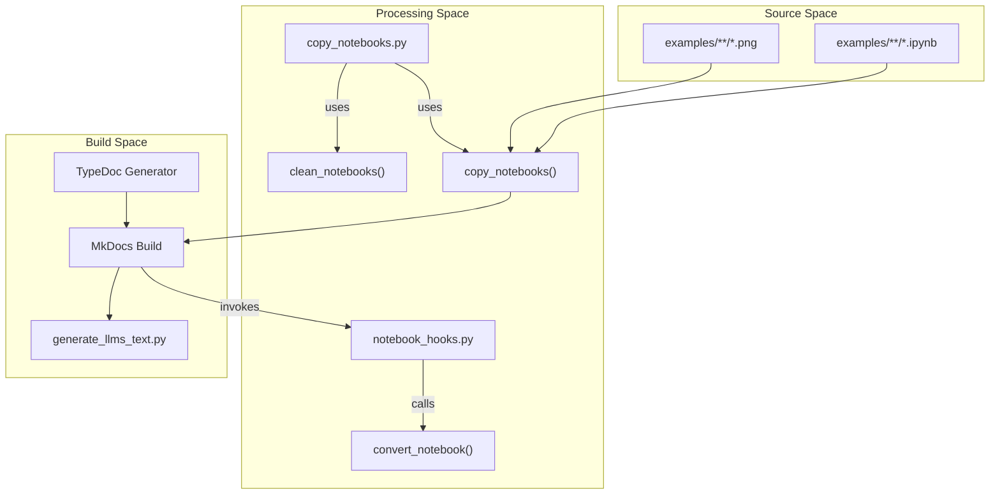
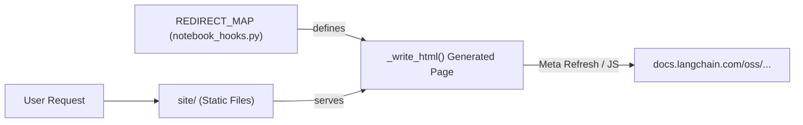

<!-- source: DeepWiki mcp.deepwiki.com · repo langchain-ai/langgraphjs · page 7.4 Documentation System · fetched 2026-10-26 -->

# Documentation System

<details>
<summary>Relevant source files</summary>

The following files were used as context for generating this wiki page:

- [docs/.gitignore](docs/.gitignore)
- [docs/Makefile](docs/Makefile)
- [docs/_scripts/copy_notebooks.py](docs/_scripts/copy_notebooks.py)
- [docs/_scripts/generate_llms_text.py](docs/_scripts/generate_llms_text.py)
- [docs/_scripts/notebook_hooks.py](docs/_scripts/notebook_hooks.py)
- [docs/_scripts/third_party/__init__.py](docs/_scripts/third_party/__init__.py)
- [docs/_scripts/third_party/create_third_party_page.py](docs/_scripts/third_party/create_third_party_page.py)
- [docs/_scripts/third_party/get_download_stats.py](docs/_scripts/third_party/get_download_stats.py)
- [docs/_scripts/third_party/packages.yml](docs/_scripts/third_party/packages.yml)
- [docs/docs-requirements.txt](docs/docs-requirements.txt)
- [docs/docs/concepts/index.md](docs/docs/concepts/index.md)
- [docs/docs/how-tos/index.md](docs/docs/how-tos/index.md)
- [docs/docs/index.md](docs/docs/index.md)
- [docs/docs/llms-txt-overview.md](docs/docs/llms-txt-overview.md)
- [docs/mkdocs.yml](docs/mkdocs.yml)
- [docs/overrides/main.html](docs/overrides/main.html)
- [docs/plugins/typedoc/google_analytics/index.js](docs/plugins/typedoc/google_analytics/index.js)
- [tsconfig.json](tsconfig.json)

</details>


This document describes the documentation infrastructure for LangGraph.js, including the MkDocs-based website, Jupyter notebook integration, automated redirection system, and the generation of LLM-optimized documentation formats. The documentation system converts source materials (Markdown, Jupyter notebooks, TypeScript) into the published documentation site at [https://langchain-ai.github.io/langgraphjs/](https://langchain-ai.github.io/langgraphjs).

## Overview

The documentation system consists of five primary components:

| Component | Purpose | Technology |
|-----------|---------|------------|
| **Content Source** | Example notebooks, markdown guides | Jupyter notebooks (`.ipynb`), Markdown (`.md`) |
| **Static Site Generator** | Builds HTML site from source | MkDocs with Material theme |
| **API Documentation** | TypeScript API reference | TypeDoc (via `mkdocs-typedoc`) |
| **LLM Optimization** | Machine-readable documentation | `llms.txt` and `llms-full.txt` |
| **Deployment** | Hosts and serves documentation | GitHub Pages |

The documentation source files reside in `docs/` and example notebooks in `examples/`. The build process transforms these into a static website.

Sources: [docs/mkdocs.yml:1-4]()

## MkDocs Configuration

### Site Configuration and Branding

The documentation site is configured via [docs/mkdocs.yml:1-440](). Key configuration:

```yaml
site_name: ""
site_description: Build language agents as graphs
site_url: https://langchain-ai.github.io/langgraphjs/
repo_url: https://github.com/langchain-ai/langgraphjs
```

The site uses the Material for MkDocs theme with custom branding:

- **Logo variants**: [docs/mkdocs.yml:8-9]() defines `logo_dark_mode` and `logo_light_mode` pointing to SVG wordmarks.
- **Favicon**: [docs/mkdocs.yml:10]() specifies the site favicon.
- **Font families**: "Public Sans" for text, "Roboto Mono" for code [docs/mkdocs.yml:48-50]().
- **Color schemes**: Default (light) and slate (dark) [docs/mkdocs.yml:35-47]().

Sources: [docs/mkdocs.yml:1-50]()

### Navigation and Search

The navigation hierarchy is defined in [docs/mkdocs.yml:57-349](). The structure is organized into top-level tabs: Introduction, Get started, Guides, Resources, and API Reference.

The search functionality is powered by the `search` plugin with a custom separator regex to handle technical terms and CamelCase:
[docs/mkdocs.yml:52-53]()
```yaml
- search:
    separator: '[\s\u200b\-_,:!=\[\]()"`/]+|\.(?!\d)|&[lg]t;|(?!\b)(?=[A-Z][a-z])'
```

Specific notebooks and pages are excluded from search to avoid indexing redundant or deprecated content [docs/mkdocs.yml:56-193]().

Sources: [docs/mkdocs.yml:51-349]()

## Jupyter Notebook Integration

### Notebook Processing Pipeline

The documentation build utilizes a sophisticated pipeline to convert interactive notebooks into static documentation while maintaining code highlighting and image paths.

Documentation build data flow:

Sources: [docs/_scripts/copy_notebooks.py:1-124](), [docs/_scripts/notebook_hooks.py:1-18]()

### Notebook Copying and Routing

The `copy_notebooks.py` script manages the migration of notebooks from the root `examples/` directory into the `docs/docs/` structure [docs/_scripts/copy_notebooks.py:5-10]().

- **Routing Logic**: Notebooks are sorted into `how-tos` or `tutorials` based on the source directory name [docs/_scripts/copy_notebooks.py:73-76]().
- **Manual Overrides**: The `_MANUAL` dictionary allows forcing specific notebooks into certain categories [docs/_scripts/copy_notebooks.py:12-28]().
- **Path Correction**: The script automatically converts image paths from `./img/` to `../img/` to ensure they render correctly within the documentation hierarchy [docs/_scripts/copy_notebooks.py:103-109]().

Sources: [docs/_scripts/copy_notebooks.py:1-124]()

### MkDocs Hooks

The `notebook_hooks.py` script provides event hooks for the MkDocs build process:

- **`on_files`**: Identifies `.ipynb` files and ensures they are treated as documentation pages [docs/_scripts/notebook_hooks.py:46-61]().
- **`on_page_markdown`**: Converts notebooks to Markdown using `convert_notebook` [docs/_scripts/notebook_hooks.py:189-190](). It also handles custom code highlighting by detecting comments like `# highlight-next-line` and converting them to MkDocs `hl_lines` syntax [docs/_scripts/notebook_hooks.py:64-129]().

Sources: [docs/_scripts/notebook_hooks.py:46-207]()

## Documentation for LLMs

LangGraph.js provides documentation specifically formatted for Large Language Models (LLMs) to use in IDEs like Cursor or Windsurf [docs/docs/llms-txt-overview.md:1-6]().

- **`llms.txt`**: An index file containing links and brief descriptions [docs/docs/llms-txt-overview.md:21]().
- **`llms-full.txt`**: A single file containing the complete documentation content, useful for RAG (Retrieval-Augmented Generation) indexing [docs/docs/llms-txt-overview.md:23-26]().

The generation of these files is handled by `generate_llms_text.py`, which is invoked via the `llms-text` target in the Makefile [docs/Makefile:40-42]().

Sources: [docs/docs/llms-txt-overview.md:1-52](), [docs/Makefile:40-42]()

## Redirection System

The system includes a robust redirect mechanism to handle content migration to `docs.langchain.com`.

Redirection flow for deprecated pages:

Sources: [docs/_scripts/notebook_hooks.py:19-40](), [docs/_scripts/notebook_hooks.py:230-243]()

The `REDIRECT_MAP` in `notebook_hooks.py` maps legacy internal paths to new external documentation URLs [docs/_scripts/notebook_hooks.py:19-162](). During the `on_post_build` event, the system iterates through this map and generates static HTML files containing `<meta http-equiv="refresh">` tags and JavaScript redirects to preserve URL hash fragments [docs/_scripts/notebook_hooks.py:230-262]().

Sources: [docs/_scripts/notebook_hooks.py:19-262]()

## Custom HTML and Analytics

The documentation uses a custom template in `docs/overrides/main.html` to inject styles and tracking scripts.

- **Google Tag Manager**: Integrated into the `analytics` block [docs/overrides/main.html:3-11]().
- **Styling**: Extensive CSS overrides for both light and dark (slate) modes, including specific adjustments for Jupyter notebook cell rendering (hiding input/output prompts) [docs/overrides/main.html:14-201]().
- **Deprecation Notice**: A site-wide banner alerting users to the upcoming v1.0 release and documentation migration [docs/overrides/main.html:228-230]().

Sources: [docs/overrides/main.html:1-231]()

## Build System Integration

The documentation build is orchestrated via a `Makefile`.

| Command | Action |
|---------|--------|
| `make build-docs` | Copies notebooks, fetches cloud docs from the Python repo, and runs `mkdocs build` [docs/Makefile:3-18](). |
| `make serve-docs` | Runs a local development server with live reload [docs/Makefile:27-29](). |
| `make llms-text` | Generates the `llms-full.txt` documentation for AI agents [docs/Makefile:40-42](). |
| `make clean` | Removes generated notebooks, cloud docs, and the `site/` directory [docs/Makefile:35-38](). |

Sources: [docs/Makefile:1-42]()

---

