# Page: LangGraph.js Overview

# LangGraph.js Overview

<details>
<summary>Relevant source files</summary>

The following files were used as context for generating this wiki page:

- [.gitignore](.gitignore)
- [README.md](README.md)
- [deno.json](deno.json)
- [docs/docs/concepts/agentic_concepts.md](docs/docs/concepts/agentic_concepts.md)
- [docs/docs/concepts/img/multi_agent/architectures.png](docs/docs/concepts/img/multi_agent/architectures.png)
- [docs/docs/concepts/img/multi_agent/request.png](docs/docs/concepts/img/multi_agent/request.png)
- [docs/docs/concepts/img/multi_agent/response.png](docs/docs/concepts/img/multi_agent/response.png)
- [docs/docs/concepts/low_level.md](docs/docs/concepts/low_level.md)
- [docs/docs/concepts/multi_agent.md](docs/docs/concepts/multi_agent.md)
- [examples/how-tos/define-state.ipynb](examples/how-tos/define-state.ipynb)
- [examples/ui-react-transport/package.json](examples/ui-react-transport/package.json)
- [examples/ui-svelte/package.json](examples/ui-svelte/package.json)
- [examples/ui-vue/package.json](examples/ui-vue/package.json)
- [libs/checkpoint-validation/README.md](libs/checkpoint-validation/README.md)
- [libs/checkpoint-validation/bin/cli.js](libs/checkpoint-validation/bin/cli.js)
- [libs/langgraph-api/CHANGELOG.md](libs/langgraph-api/CHANGELOG.md)
- [libs/langgraph-api/package.json](libs/langgraph-api/package.json)
- [libs/langgraph-cli/CHANGELOG.md](libs/langgraph-cli/CHANGELOG.md)
- [libs/langgraph-cli/package.json](libs/langgraph-cli/package.json)
- [libs/langgraph-core/CHANGELOG.md](libs/langgraph-core/CHANGELOG.md)
- [libs/langgraph-core/package.json](libs/langgraph-core/package.json)
- [libs/langgraph-ui/CHANGELOG.md](libs/langgraph-ui/CHANGELOG.md)
- [libs/langgraph-ui/package.json](libs/langgraph-ui/package.json)
- [libs/langgraph/CHANGELOG.md](libs/langgraph/CHANGELOG.md)
- [libs/langgraph/README.md](libs/langgraph/README.md)
- [libs/langgraph/package.json](libs/langgraph/package.json)
- [libs/sdk/CHANGELOG.md](libs/sdk/CHANGELOG.md)
- [libs/sdk/package.json](libs/sdk/package.json)
- [package.json](package.json)
- [pnpm-lock.yaml](pnpm-lock.yaml)

</details>


## Purpose and Scope

This document provides a high-level introduction to LangGraph.js, an orchestration framework for building stateful, multi-actor LLM applications with built-in persistence, streaming, and human-in-the-loop capabilities. It covers the overall system architecture, package ecosystem, core execution model, and key subsystems.

For detailed information on specific subsystems, see:
- Package ecosystem details: [Package Ecosystem](#1.1)
- Architecture deep dive: [Architecture Overview](#1.2)
- Core framework implementation: [Core Framework](#2)
- Persistence mechanisms: [Persistence and Checkpointing](#3)
- Multi-agent patterns: [Multi-Agent Systems](#4)
- API server and deployment: [LangGraph Platform](#5)
- Client libraries: [Client SDK](#6)

## What is LangGraph.js?

LangGraph.js is a low-level orchestration framework for building controllable AI agents. It enables developers to construct graph-based workflows where nodes represent computation (LLM calls, tool executions, custom logic) and edges define control flow. The framework maintains state across execution steps through a checkpointing system, enabling features like fault tolerance, human-in-the-loop workflows, and time-travel debugging. [README.md:22-41]().

The framework is built around three key abstractions:
- **`StateGraph`**: A graph builder API for defining nodes, edges, and state schemas. [libs/langgraph/package.json:123-146]().
- **`Pregel`**: A Pregel-inspired execution engine that runs compiled graphs. [libs/langgraph/package.json:87-98]().
- **`BaseCheckpointSaver`**: A persistence interface for storing and retrieving execution state. [libs/langgraph-core/package.json:32]().

LangGraph.js is designed to be used either standalone or deployed as a service via LangGraph Platform, with full support for streaming, multiple LLM providers, and integration with the broader LangChain ecosystem. [README.md:48-60]().

Sources: [README.md:1-65](), [libs/langgraph/package.json:1-152](), [libs/langgraph-core/package.json:1-194]()

## Package Ecosystem

The LangGraph.js repository is organized as a monorepo containing multiple packages serving different purposes:

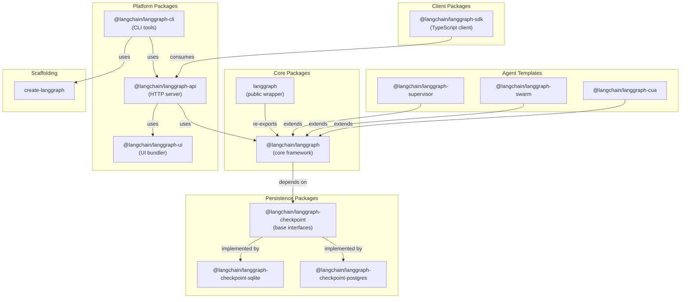

**Core Framework Layer:**
- `langgraph`: Public-facing package that re-exports from `@langchain/langgraph`. [libs/langgraph/package.json:28]().
- `@langchain/langgraph`: Core framework containing `StateGraph`, `Pregel`, channels, and control flow primitives. [libs/langgraph-core/package.json:2]().

**Platform Layer:**
- `@langchain/langgraph-api`: Hono-based HTTP server implementing REST endpoints for assistants, threads, runs, and store. [libs/langgraph-api/package.json:75]().
- `@langchain/langgraph-cli`: CLI providing `dev`, `build`, `new`, and `deploy` commands. [libs/langgraph-cli/package.json:11-13]().
- `@langchain/langgraph-ui`: UI bundler for generative UI components and LangGraph Studio integration. [libs/langgraph-ui/package.json:11]().

**Client Layer:**
- `@langchain/langgraph-sdk`: TypeScript client with `AssistantsClient`, `ThreadsClient`, `RunsClient`, `CronsClient`, and React hooks. [libs/sdk/package.json:95-130]().

**Persistence Layer:**
- `@langchain/langgraph-checkpoint`: Base interfaces for state persistence. [libs/langgraph-core/package.json:32]().
- Implementations include SQLite and PostgreSQL. [libs/langgraph-core/package.json:50-51]().

Sources: [libs/langgraph/package.json:1-152](), [libs/langgraph-core/package.json:1-194](), [libs/langgraph-api/package.json:1-121](), [libs/langgraph-cli/package.json:1-63](), [libs/sdk/package.json:1-196](), [libs/langgraph-ui/package.json:1-43]()

## Core Execution Model

LangGraph.js uses a graph-based execution model where developers define workflows using `StateGraph` and the framework compiles them into `Pregel` instances for execution.

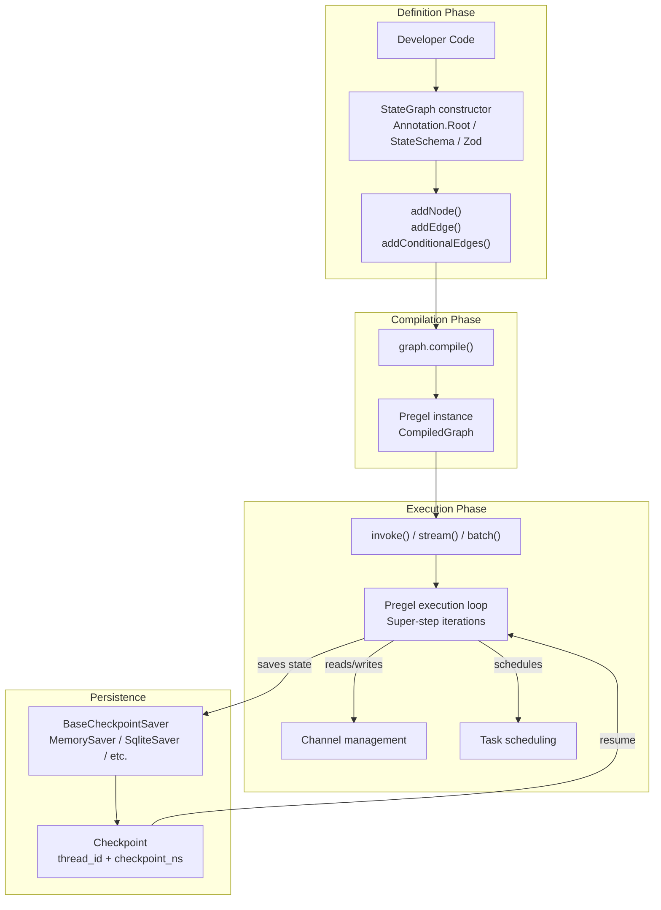

**Definition Phase:**
- Developers create a `StateGraph` instance with a state schema (using `Annotation.Root` or Zod schemas). [libs/langgraph/package.json:123-134]().
- Nodes are added where functions receive state and return state updates.
- Edges define control flow via static routing or conditional routing.

**Compilation Phase:**
- `graph.compile()` validates the graph structure and returns a `Pregel` instance. [libs/langgraph/package.json:87-98]().
- The `Pregel` instance implements the `Runnable` interface from `@langchain/core`. [libs/langgraph-core/package.json:38]().

**Execution Phase:**
- `invoke()`, `stream()`, or `batch()` methods start execution.
- The Pregel loop iterates through "super-steps", executing nodes that have pending tasks.
- Channels manage state with custom reducers. [libs/langgraph/package.json:75-86]().

Sources: [libs/langgraph/package.json:1-152](), [libs/langgraph-core/package.json:1-194]()

## State Management Architecture

State in LangGraph.js flows through a channel-based system where each state key corresponds to a channel with a reducer function that controls how updates are merged.

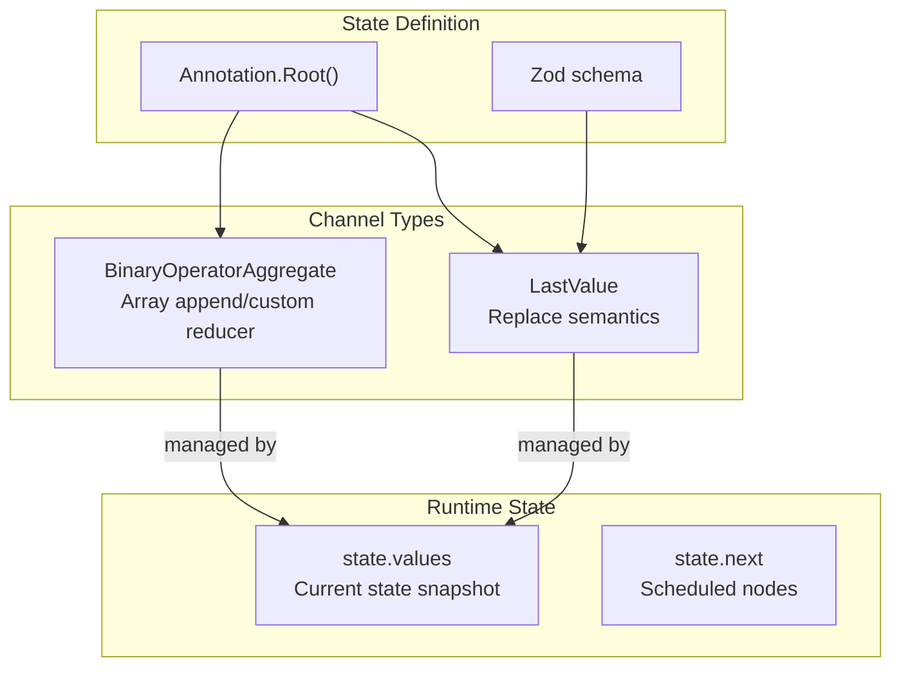

**State Schema Options:**
- **`Annotation.Root()`**: TypeScript-first approach for field definition.
- **Zod schemas**: Direct Zod object schema support. [libs/langgraph/package.json:123-146]().

**Channel Types:**
- **`LastValue`**: Default channel that replaces the previous value.
- **`BinaryOperatorAggregate`**: Accumulates values using a reducer (e.g., array concatenation).

Sources: [libs/langgraph/package.json:75-86](), [libs/langgraph/package.json:123-146]()

## API Server Architecture

The LangGraph API server (`@langchain/langgraph-api`) provides HTTP endpoints for deploying and managing graph execution as a service using the Hono framework. [libs/langgraph-api/package.json:75]().

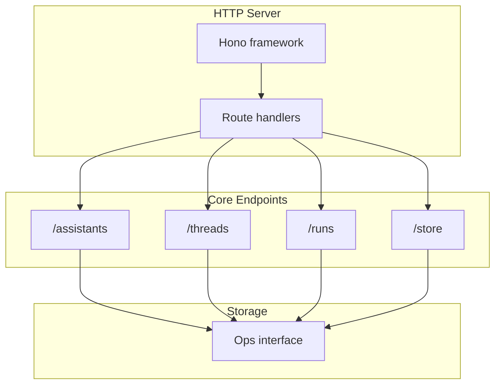

**Server Components:**
- **Hono HTTP framework**: Lightweight, fast HTTP server. [libs/langgraph-api/package.json:75]().
- **Route handlers**: REST endpoints for CRUD operations on resources. [libs/langgraph-api/package.json:18-46]().

Sources: [libs/langgraph-api/package.json:1-121]()

## Client SDK and React Integration

The SDK (`@langchain/langgraph-sdk`) provides programmatic access to the API server with TypeScript type safety and React integration. [libs/sdk/package.json:95-130]().

**Client API:**
- **`Client`**: Base class with HTTP/SSE methods. [libs/sdk/package.json:95-106]().
- **React Integration**: `useStream()` hook for streaming graph execution. [libs/sdk/package.json:119-130]().
- **Auto-reconnect**: SSE and WebSocket streams reconnect after disconnects. [libs/sdk/CHANGELOG.md:78-80]().

Sources: [libs/sdk/package.json:1-196](), [libs/sdk/CHANGELOG.md:1-42]()

## Development Workflow

LangGraph.js supports local development with hot reload and production deployment via the CLI. [libs/langgraph-cli/package.json:11-13]().

- **`langgraphjs dev`**: Starts development server with file watching. [libs/langgraph-cli/package.json:28-29]().
- **`langgraphjs build`**: Prepares artifacts for deployment. [libs/langgraph-cli/package.json:24-25]().
- **`langgraphjs deploy`**: Deploys to LangSmith Deployment. [libs/langgraph-cli/CHANGELOG.md:18-21]().

Sources: [libs/langgraph-cli/package.json:1-63](), [libs/langgraph-cli/CHANGELOG.md:1-135]()

---

# Page: Package Ecosystem

# Package Ecosystem

<details>
<summary>Relevant source files</summary>

The following files were used as context for generating this wiki page:

- [examples/ai-elements/CHANGELOG.md](examples/ai-elements/CHANGELOG.md)
- [examples/ai-elements/package.json](examples/ai-elements/package.json)
- [examples/assistant-ui-claude/CHANGELOG.md](examples/assistant-ui-claude/CHANGELOG.md)
- [examples/assistant-ui-claude/package.json](examples/assistant-ui-claude/package.json)
- [examples/ui-angular/CHANGELOG.md](examples/ui-angular/CHANGELOG.md)
- [examples/ui-angular/package.json](examples/ui-angular/package.json)
- [libs/checkpoint-mongodb/CHANGELOG.md](libs/checkpoint-mongodb/CHANGELOG.md)
- [libs/checkpoint-mongodb/package.json](libs/checkpoint-mongodb/package.json)
- [libs/checkpoint-postgres/package.json](libs/checkpoint-postgres/package.json)
- [libs/checkpoint-redis/CHANGELOG.md](libs/checkpoint-redis/CHANGELOG.md)
- [libs/checkpoint-redis/package.json](libs/checkpoint-redis/package.json)
- [libs/checkpoint-sqlite/package.json](libs/checkpoint-sqlite/package.json)
- [libs/checkpoint-validation/package.json](libs/checkpoint-validation/package.json)
- [libs/checkpoint/package.json](libs/checkpoint/package.json)
- [libs/create-langgraph/package.json](libs/create-langgraph/package.json)
- [libs/langgraph-api/CHANGELOG.md](libs/langgraph-api/CHANGELOG.md)
- [libs/langgraph-api/package.json](libs/langgraph-api/package.json)
- [libs/langgraph-cli/CHANGELOG.md](libs/langgraph-cli/CHANGELOG.md)
- [libs/langgraph-cli/package.json](libs/langgraph-cli/package.json)
- [libs/langgraph-core/CHANGELOG.md](libs/langgraph-core/CHANGELOG.md)
- [libs/langgraph-core/package.json](libs/langgraph-core/package.json)
- [libs/langgraph-cua/package.json](libs/langgraph-cua/package.json)
- [libs/langgraph-supervisor/CHANGELOG.md](libs/langgraph-supervisor/CHANGELOG.md)
- [libs/langgraph-supervisor/package.json](libs/langgraph-supervisor/package.json)
- [libs/langgraph-swarm/package.json](libs/langgraph-swarm/package.json)
- [libs/langgraph-ui/CHANGELOG.md](libs/langgraph-ui/CHANGELOG.md)
- [libs/langgraph-ui/package.json](libs/langgraph-ui/package.json)
- [libs/langgraph/CHANGELOG.md](libs/langgraph/CHANGELOG.md)
- [libs/langgraph/package.json](libs/langgraph/package.json)
- [libs/sdk-angular/CHANGELOG.md](libs/sdk-angular/CHANGELOG.md)
- [libs/sdk-angular/package.json](libs/sdk-angular/package.json)
- [libs/sdk-react/CHANGELOG.md](libs/sdk-react/CHANGELOG.md)
- [libs/sdk-react/package.json](libs/sdk-react/package.json)
- [libs/sdk-svelte/CHANGELOG.md](libs/sdk-svelte/CHANGELOG.md)
- [libs/sdk-svelte/package.json](libs/sdk-svelte/package.json)
- [libs/sdk-vue/CHANGELOG.md](libs/sdk-vue/CHANGELOG.md)
- [libs/sdk-vue/package.json](libs/sdk-vue/package.json)
- [libs/sdk/CHANGELOG.md](libs/sdk/CHANGELOG.md)
- [libs/sdk/package.json](libs/sdk/package.json)

</details>


This document details the package structure and interdependencies within the LangGraph.js monorepo. It covers the core packages, their relationships, specialized extensions, and how they work together to provide a complete graph-based AI application development platform.

## Monorepo Structure

The LangGraph.js project is organized as a pnpm workspace monorepo with multiple interconnected packages. The workspace configuration defines the package locations and build orchestration across core libraries, persistence implementations, multi-agent patterns, tooling, and framework-specific SDKs.

**Workspace Organization**

```mermaid
graph TB
    subgraph "Monorepo Root"
        ROOT["package.json<br/>pnpm workspaces config"]
        TURBO["turbo.json<br/>Build orchestration"]
    end
    
    subgraph "Package Directories"
        LIBS["libs/*"]
        EXAMPLES["examples/*"]
    end
    
    subgraph "Core Runtime & Platform"
        LANGGRAPH_CORE["libs/langgraph-core/<br/>@langchain/langgraph<br/>StateGraph, Pregel"]
        LANGGRAPH_ALIAS["libs/langgraph/<br/>langgraph<br/>Canonical alias package"]
        API["libs/langgraph-api/<br/>@langchain/langgraph-api<br/>Hono server"]
        CLI["libs/langgraph-cli/<br/>@langchain/langgraph-cli<br/>CLI commands"]
        SDK["libs/sdk/<br/>@langchain/langgraph-sdk<br/>Client library"]
        UI["libs/langgraph-ui/<br/>@langchain/langgraph-ui<br/>React components"]
    end
    
    subgraph "Persistence Layer"
        CHECKPOINT["libs/checkpoint/<br/>@langchain/langgraph-checkpoint<br/>BaseCheckpointSaver"]
        SQLITE["libs/checkpoint-sqlite/<br/>SQLiteSaver"]
        MONGODB["libs/checkpoint-mongodb/<br/>MongoDBSaver"]
        POSTGRES["libs/checkpoint-postgres/<br/>PostgresSaver"]
        REDIS["libs/checkpoint-redis/<br/>RedisSaver"]
    end
    
    subgraph "Framework SDKs"
        SDK_REACT["libs/sdk-react/<br/>@langchain/react"]
        SDK_ANGULAR["libs/sdk-angular/<br/>@langchain/angular"]
        SDK_VUE["libs/sdk-vue/<br/>@langchain/vue"]
        SDK_SVELTE["libs/sdk-svelte/<br/>@langchain/svelte"]
    end
    
    subgraph "Multi-Agent Patterns"
        SUPERVISOR["libs/langgraph-supervisor/<br/>Supervisor pattern"]
        SWARM["libs/langgraph-swarm/<br/>Swarm coordination"]
        CUA["libs/langgraph-cua/<br/>Computer use agent"]
    end
    
    subgraph "Development Tools"
        CREATE["libs/create-langgraph/<br/>create-langgraph<br/>Project scaffolder"]
    end
    
    ROOT --> LIBS
    ROOT --> EXAMPLES
    LIBS --> LANGGRAPH_CORE
    LIBS --> LANGGRAPH_ALIAS
    LIBS --> API
    LIBS --> CLI
    LIBS --> SDK
    LIBS --> UI
    LIBS --> CHECKPOINT
    LIBS --> SDK_REACT
    LIBS --> SDK_ANGULAR
    LIBS --> SDK_VUE
    LIBS --> SDK_SVELTE
    LIBS --> SUPERVISOR
    LIBS --> SWARM
    LIBS --> CUA
    LIBS --> CREATE
```

Sources: [libs/langgraph/package.json:12-16](), [libs/langgraph-core/package.json:11-15](), [libs/langgraph-api/package.json:48-52](), [libs/langgraph-cli/package.json:17-21](), [libs/sdk/package.json:6-10](), [libs/sdk-angular/package.json:15-19](), [libs/sdk-vue/package.json:14-19](), [libs/sdk-svelte/package.json:14-19]()

## Core Package Architecture

The core packages form a layered architecture. The `@langchain/langgraph` package (found in `libs/langgraph-core`) is the engine, while the `langgraph` package (found in `libs/langgraph`) acts as a canonical alias for simplified imports.

**Package Dependency Layers**

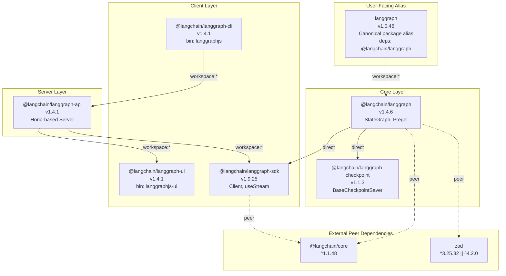

The `langgraph` alias package re-exports functionality from `@langchain/langgraph` [libs/langgraph/package.json:27-29](). The core runtime depends on the checkpointing system [libs/langgraph-core/package.json:32]() and the SDK [libs/langgraph-core/package.json:33]().

Sources: [libs/langgraph/package.json:2-3](), [libs/langgraph/package.json:27-29](), [libs/langgraph-core/package.json:2-3](), [libs/langgraph-core/package.json:31-41](), [libs/langgraph-api/package.json:2-3](), [libs/langgraph-api/package.json:63-90](), [libs/sdk/package.json:2-3](), [libs/sdk/package.json:47-53](), [libs/checkpoint/package.json:2-3]()

## Core Package Exports

Each package provides specific entry points through well-defined exports.

### @langchain/langgraph (Core) Exports

The main runtime package provides multiple entry points for different environments and use cases.

| Export Path | Input Source | Purpose | Key Components |
|-------------|--------------|---------|----------------|
| `.` | `./src/index.ts` | Main entry point | `StateGraph`, `Pregel`, `Command` |
| `./web` | `./src/web.ts` | Browser entry point | [libs/langgraph-core/package.json:81]() |
| `./channels` | `./src/channels/index.ts` | State channels | [libs/langgraph-core/package.json:106]() |
| `./pregel` | `./src/pregel/index.ts` | Runtime engine | [libs/langgraph-core/package.json:117]() |
| `./prebuilt` | `./src/prebuilt/index.ts` | Pre-built nodes | `ToolNode`, `createReactAgent` |
| `./remote` | `./src/remote.ts` | Remote Graph | [libs/langgraph-core/package.json:141]() |
| `./stream` | `./src/stream.ts` | Streaming utils | [libs/langgraph-core/package.json:153]() |

Sources: [libs/langgraph-core/package.json:79-188]()

### @langchain/langgraph-api Exports

The API server package provides the infrastructure for deploying graphs as REST services.

| Export Path | Types Path | Purpose | Key Components |
|-------------|-----------|---------|----------------|
| `.` | `./dist/cli/spawn.d.mts` | CLI spawn logic | [libs/langgraph-api/package.json:14]() |
| `./server` | `./dist/server.d.mts` | Hono server | `startServer` |
| `./auth` | `./dist/auth/index.d.mts` | Auth handlers | `AuthContext` |
| `./graph` | `./dist/graph/api.d.mts` | Graph loading | [libs/langgraph-api/package.json:26]() |
| `./storage` | `./dist/storage/types.d.mts`| Ops interface | `FileSystemOps` |

Sources: [libs/langgraph-api/package.json:13-47]()

### @langchain/langgraph-sdk Exports

The SDK provides client-side interaction with the API and framework-agnostic streaming logic.

| Export Path | Input Source | Purpose | Key Components |
|-------------|--------------|---------|----------------|
| `.` | `./src/index.ts` | Main SDK | `Client` |
| `./client` | `./src/client.ts` | Client classes | `ThreadsClient`, `RunsClient` |
| `./react` | `./src/react/index.ts` | React integration| `useStream` |
| `./stream` | `./src/stream/index.ts` | Protocol logic | `StreamController` |

Sources: [libs/sdk/package.json:70-192]()

## Framework SDK Integrations

LangGraph.js provides dedicated packages for major frontend frameworks, wrapping the core SDK streaming logic into framework-native reactive primitives.

| Package | Purpose | Key Reactive Primitive |
|---------|---------|------------------------|
| `@langchain/angular` | Angular integration | `injectStream` [libs/sdk-angular/package.json:2]() |
| `@langchain/vue` | Vue integration | `useStream` [libs/sdk-vue/package.json:2]() |
| `@langchain/svelte` | Svelte integration | `useStream` [libs/sdk-svelte/package.json:2]() |

These packages depend on `@langchain/langgraph-sdk` [libs/sdk-angular/package.json:21](), [libs/sdk-vue/package.json:21](), [libs/sdk-svelte/package.json:21]().

## Specialized Extension Packages

### Checkpoint Implementations
Implement the `BaseCheckpointSaver` interface for state persistence.
- `@langchain/langgraph-checkpoint-sqlite`: Local development [libs/langgraph-core/package.json:51]().
- `@langchain/langgraph-checkpoint-postgres`: Production relational storage [libs/langgraph-core/package.json:50]().
- `@langchain/langgraph-checkpoint-mongodb`: Document-based storage.
- `@langchain/langgraph-checkpoint-redis`: In-memory storage with persistence.

### Agent Patterns
Pre-built coordination patterns.
- `@langchain/langgraph-supervisor`: Centralized LLM supervisor [libs/langgraph-supervisor/package.json:2]().
- `@langchain/langgraph-swarm`: Decentralized handoffs [libs/langgraph-swarm/package.json:2]().
- `@langchain/langgraph-cua`: Computer Use Agent [libs/langgraph-cua/package.json:2]().

## Build and Release Infrastructure

The monorepo uses `pnpm turbo` for task execution [libs/langgraph/package.json:18](). Build outputs are generated in both ESM and CJS formats using a shared internal build tool [libs/langgraph/package.json:19]().

**Release Coordination**
- Versions are managed via Changesets.
- Core packages are on the `1.4.x` branch [libs/langgraph-core/package.json:3]().
- SDK and platform tools are on the `1.9.x` / `1.4.x` branches [libs/sdk/package.json:3](), [libs/langgraph-api/package.json:3]().

Sources: [libs/langgraph/package.json:17-24](), [libs/langgraph-core/package.json:16-28](), [libs/sdk/package.json:11-19]()

---

# Page: Architecture Overview

# Architecture Overview

<details>
<summary>Relevant source files</summary>

The following files were used as context for generating this wiki page:

- [libs/langgraph-api/CHANGELOG.md](libs/langgraph-api/CHANGELOG.md)
- [libs/langgraph-api/package.json](libs/langgraph-api/package.json)
- [libs/langgraph-cli/CHANGELOG.md](libs/langgraph-cli/CHANGELOG.md)
- [libs/langgraph-cli/package.json](libs/langgraph-cli/package.json)
- [libs/langgraph-core/CHANGELOG.md](libs/langgraph-core/CHANGELOG.md)
- [libs/langgraph-core/package.json](libs/langgraph-core/package.json)
- [libs/langgraph-core/src/constants.ts](libs/langgraph-core/src/constants.ts)
- [libs/langgraph-core/src/graph/index.ts](libs/langgraph-core/src/graph/index.ts)
- [libs/langgraph-core/src/graph/state.test.ts](libs/langgraph-core/src/graph/state.test.ts)
- [libs/langgraph-core/src/graph/state.ts](libs/langgraph-core/src/graph/state.ts)
- [libs/langgraph-core/src/graph/types.ts](libs/langgraph-core/src/graph/types.ts)
- [libs/langgraph-core/src/tests/constants.test.ts](libs/langgraph-core/src/tests/constants.test.ts)
- [libs/langgraph-core/src/tests/run_control.test.ts](libs/langgraph-core/src/tests/run_control.test.ts)
- [libs/langgraph-core/src/tests/set_node_defaults.test.ts](libs/langgraph-core/src/tests/set_node_defaults.test.ts)
- [libs/langgraph-core/src/tests/state_graph_compat.test-d.ts](libs/langgraph-core/src/tests/state_graph_compat.test-d.ts)
- [libs/langgraph-core/src/tests/types.test-d.ts](libs/langgraph-core/src/tests/types.test-d.ts)
- [libs/langgraph-core/src/tests/zod_state.test.ts](libs/langgraph-core/src/tests/zod_state.test.ts)
- [libs/langgraph-core/src/web.ts](libs/langgraph-core/src/web.ts)
- [libs/langgraph-core/tsconfig.json](libs/langgraph-core/tsconfig.json)
- [libs/langgraph-ui/CHANGELOG.md](libs/langgraph-ui/CHANGELOG.md)
- [libs/langgraph-ui/package.json](libs/langgraph-ui/package.json)
- [libs/langgraph/CHANGELOG.md](libs/langgraph/CHANGELOG.md)
- [libs/langgraph/package.json](libs/langgraph/package.json)
- [libs/langgraph/src/pregel/index.ts](libs/langgraph/src/pregel/index.ts)
- [libs/langgraph/src/web.ts](libs/langgraph/src/web.ts)
- [libs/sdk/CHANGELOG.md](libs/sdk/CHANGELOG.md)
- [libs/sdk/package.json](libs/sdk/package.json)

</details>


This document provides a high-level view of the LangGraph.js system architecture, describing how the core framework, persistence layer, platform services, and client libraries interact to enable building and deploying stateful multi-actor LLM applications. This overview focuses on the structural organization of packages, execution flow, and deployment architecture.

For detailed information about graph construction and state management, see [Core Framework](#2). For persistence implementation details, see [Persistence and Checkpointing](#3). For API server endpoints and authentication, see [LangGraph Platform](#5).

---

## System Layers

LangGraph.js is structured as a layered monorepo with clear separation of concerns:

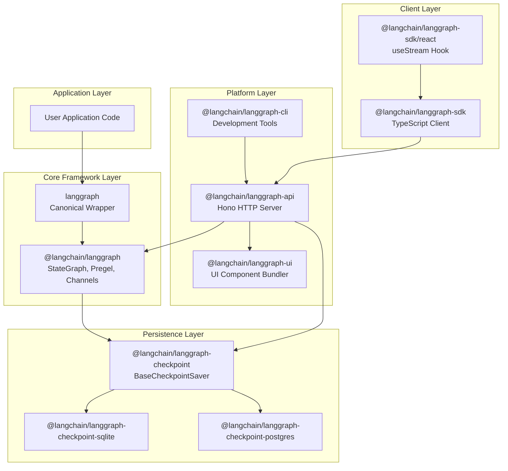

**Sources:** [libs/langgraph/package.json:1-152](), [libs/langgraph-core/package.json:1-194](), [libs/langgraph-api/package.json:1-121](), [libs/sdk/package.json:1-196]()

### Core Framework Layer

The **Core Framework Layer** provides the execution engine for building graph-based LLM applications:

| Package | Purpose | Key Exports |
|---------|---------|-------------|
| `@langchain/langgraph` | Execution engine with `StateGraph`, `Pregel` runtime, and `Channels` | `StateGraph`, `Pregel`, `Annotation`, `Command`, `Send` |
| `langgraph` | Convenience wrapper that re-exports the core package | Identical to `@langchain/langgraph` |

The `langgraph` package serves as a canonical wrapper for those who prefer the simpler package name, while the core logic resides in `@langchain/langgraph`.

**Sources:** [libs/langgraph/package.json:27-29](), [libs/langgraph/src/pregel/index.ts:1-11](), [libs/langgraph-core/package.json:1-10]()

### Persistence Layer

The **Persistence Layer** provides pluggable checkpoint storage. All implementations conform to the `BaseCheckpointSaver` interface, enabling fault tolerance and human-in-the-loop workflows.

| Package | Storage Backend | Use Case |
|---------|----------------|----------|
| `@langchain/langgraph-checkpoint` | Base interface | Defines `BaseCheckpointSaver` and `BaseStore` |
| `@langchain/langgraph-checkpoint-sqlite` | SQLite | Local development and lightweight file storage |
| `@langchain/langgraph-checkpoint-postgres` | PostgreSQL | Production-grade relational storage |

**Sources:** [libs/langgraph-core/package.json:31-33](), [libs/langgraph-core/package.json:50-51]()

### Platform Layer

The **Platform Layer** provides development tools and production deployment infrastructure:

| Package | Purpose | Main Components |
|---------|---------|-----------------|
| `@langchain/langgraph-api` | HTTP API server | `Hono` server, route handlers, `AuthContext` |
| `@langchain/langgraph-cli` | Development CLI | `langgraphjs dev`, `langgraphjs build`, `langgraphjs deploy` |
| `@langchain/langgraph-ui` | UI component bundler | `esbuild`-based bundling, `langgraphjs-ui` CLI |

**Sources:** [libs/langgraph-api/package.json:13-47](), [libs/langgraph-cli/package.json:11-13](), [libs/langgraph-ui/package.json:9-12]()

### Client Layer

The **Client Layer** provides programmatic access to deployed graphs through the `@langchain/langgraph-sdk`.

| Package Export | Purpose | Key Classes/Hooks |
|---------------|---------|-----------|
| `@langchain/langgraph-sdk/client` | API Client | `Client`, `ThreadsClient`, `RunsClient` |
| `@langchain/langgraph-sdk/react` | React integration | `useStream`, `useChannel` |
| `@langchain/langgraph-sdk/stream` | Stream processing | `StreamController`, `acquireChannelEffect` |

**Sources:** [libs/sdk/package.json:95-130](), [libs/sdk/CHANGELOG.md:70-73]()

---

## Core Execution Architecture

The execution flow follows a compilation and runtime model based on the Pregel execution engine.

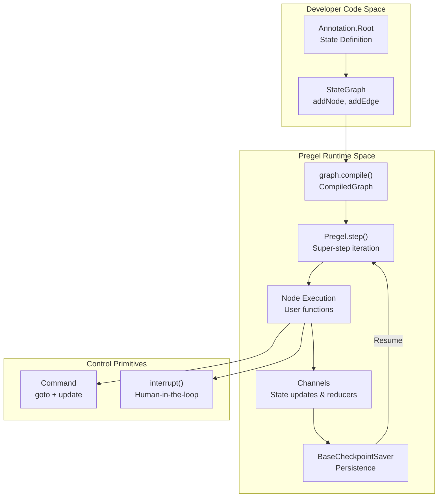

### Execution Flow Details

1.  **State Definition**: Developers define state using `Annotation.Root` which specifies how values are reduced and stored in `Channels`.
2.  **Graph Construction**: Nodes and edges are added to a `StateGraph`.
3.  **Compilation**: `compile()` converts the graph into a `CompiledGraph` (a `Pregel` instance) capable of execution.
4.  **Runtime Execution**: The `Pregel` engine iterates through "super-steps":
    *   Executes nodes whose input channels have updated.
    *   Applies updates to `Channels` via defined reducers.
    *   Saves a checkpoint via the `BaseCheckpointSaver` after each step.
    *   Handles `Command` for dynamic routing or `interrupt()` for pausing execution.

**Sources:** [libs/langgraph-core/package.json:117-128](), [libs/sdk/CHANGELOG.md:15-24]()

---

## API Server Architecture

The `@langchain/langgraph-api` package implements a `Hono`-based server that exposes graph execution over HTTP and WebSockets.

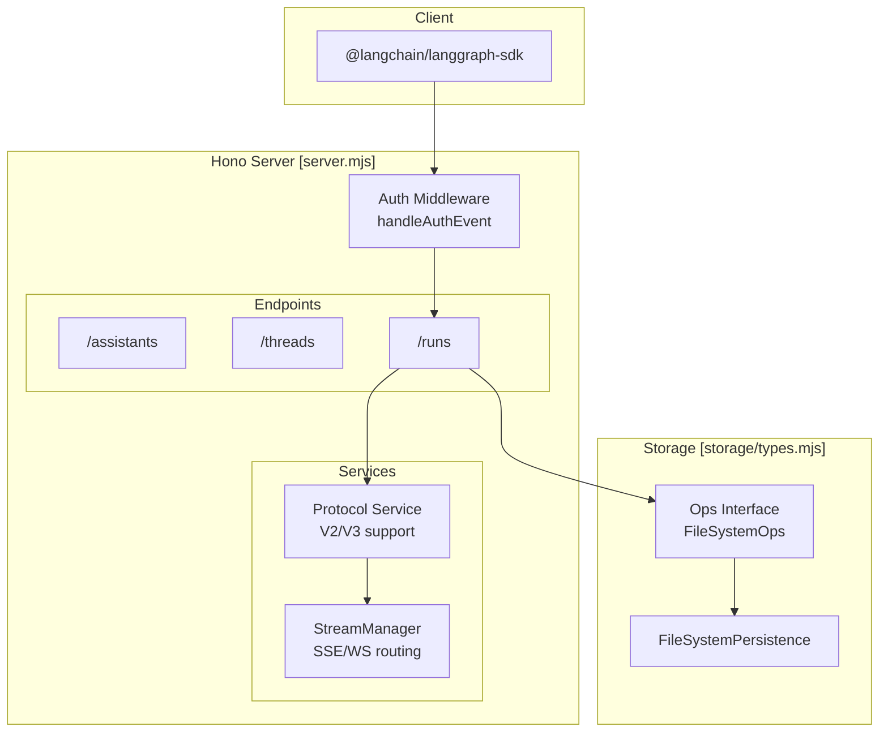

### API Server Components

| Component | Code Entity | Purpose |
|-----------|-------------|---------|
| HTTP Server | `hono` | Lightweight server handling REST and WebSocket traffic |
| Storage Ops | `Ops` interface | Abstraction for managing assistants, threads, and runs |
| Auth | `handleAuthEvent` | Extensible authentication and authorization system |
| Streaming | `ProtocolSseTransportAdapter` | Handles real-time SSE streaming of graph events |

**Sources:** [libs/langgraph-api/package.json:18-41](), [libs/langgraph-api/package.json:75-84](), [libs/sdk/CHANGELOG.md:58-58]()

---

## Client SDK and Streaming

The `@langchain/langgraph-sdk` facilitates interaction with the API server, providing high-level abstractions for streaming.

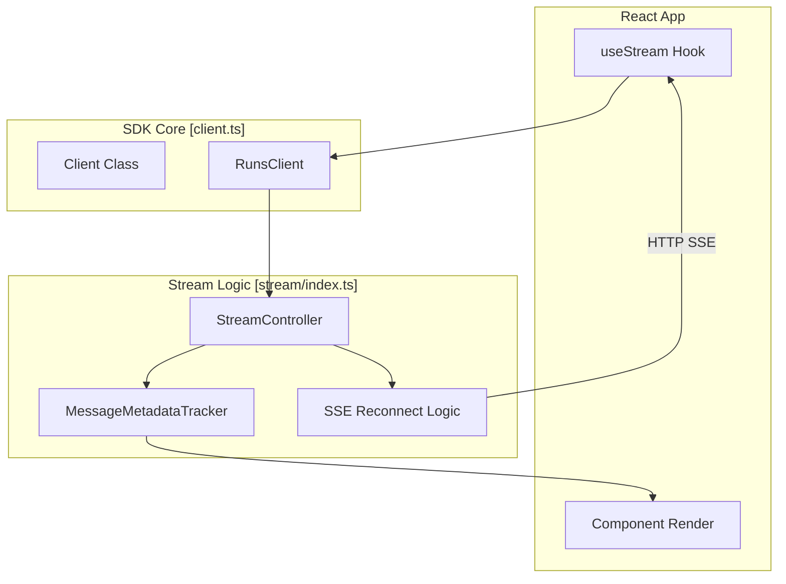

### SDK Streaming Features
*   **Automatic Reconnection**: Detects half-open SSE connections via heartbeats and reconnects with `Last-Event-ID`.
*   **Optimistic Updates**: `respond()` applies state updates synchronously in the same tick as the event to prevent UI flicker.
*   **Message Tracking**: `MessageMetadataTracker` reconciles server-side message deltas with local optimistic state.

**Sources:** [libs/sdk/package.json:95-106](), [libs/sdk/package.json:179-190](), [libs/sdk/CHANGELOG.md:15-40](), [libs/sdk/CHANGELOG.md:54-56]()

---

## Summary

LangGraph.js architecture is designed for scalability and flexibility across the full stack:
1.  **Core**: A Pregel-based execution engine (`@langchain/langgraph`).
2.  **Persistence**: Pluggable checkpointers for state durability.
3.  **Platform**: A robust API server (`@langchain/langgraph-api`) and CLI (`@langchain/langgraph-cli`) for deployment.
4.  **Client**: A reactive SDK (`@langchain/langgraph-sdk`) for seamless frontend integration.

---

# Page: Core Framework

# Core Framework

<details>
<summary>Relevant source files</summary>

The following files were used as context for generating this wiki page:

- [libs/langgraph-core/src/channels/base.ts](libs/langgraph-core/src/channels/base.ts)
- [libs/langgraph-core/src/channels/index.ts](libs/langgraph-core/src/channels/index.ts)
- [libs/langgraph-core/src/constants.ts](libs/langgraph-core/src/constants.ts)
- [libs/langgraph-core/src/graph/index.ts](libs/langgraph-core/src/graph/index.ts)
- [libs/langgraph-core/src/graph/state.test.ts](libs/langgraph-core/src/graph/state.test.ts)
- [libs/langgraph-core/src/graph/state.ts](libs/langgraph-core/src/graph/state.ts)
- [libs/langgraph-core/src/graph/types.ts](libs/langgraph-core/src/graph/types.ts)
- [libs/langgraph-core/src/pregel/algo.ts](libs/langgraph-core/src/pregel/algo.ts)
- [libs/langgraph-core/src/pregel/index.ts](libs/langgraph-core/src/pregel/index.ts)
- [libs/langgraph-core/src/pregel/loop.ts](libs/langgraph-core/src/pregel/loop.ts)
- [libs/langgraph-core/src/pregel/utils/config.test.ts](libs/langgraph-core/src/pregel/utils/config.test.ts)
- [libs/langgraph-core/src/pregel/utils/config.ts](libs/langgraph-core/src/pregel/utils/config.ts)
- [libs/langgraph-core/src/tests/concurrent-thread-isolation.test.ts](libs/langgraph-core/src/tests/concurrent-thread-isolation.test.ts)
- [libs/langgraph-core/src/tests/constants.test.ts](libs/langgraph-core/src/tests/constants.test.ts)
- [libs/langgraph-core/src/tests/delta_channel.test.ts](libs/langgraph-core/src/tests/delta_channel.test.ts)
- [libs/langgraph-core/src/tests/execution_info.test.ts](libs/langgraph-core/src/tests/execution_info.test.ts)
- [libs/langgraph-core/src/tests/pregel.test.ts](libs/langgraph-core/src/tests/pregel.test.ts)
- [libs/langgraph-core/src/tests/run_control.test.ts](libs/langgraph-core/src/tests/run_control.test.ts)
- [libs/langgraph-core/src/tests/set_node_defaults.test.ts](libs/langgraph-core/src/tests/set_node_defaults.test.ts)
- [libs/langgraph-core/src/tests/state_graph_compat.test-d.ts](libs/langgraph-core/src/tests/state_graph_compat.test-d.ts)
- [libs/langgraph-core/src/tests/tracing.test.ts](libs/langgraph-core/src/tests/tracing.test.ts)
- [libs/langgraph-core/src/tests/types.test-d.ts](libs/langgraph-core/src/tests/types.test-d.ts)
- [libs/langgraph-core/src/tests/zod_state.test.ts](libs/langgraph-core/src/tests/zod_state.test.ts)
- [libs/langgraph-core/src/web.ts](libs/langgraph-core/src/web.ts)
- [libs/langgraph-core/tsconfig.json](libs/langgraph-core/tsconfig.json)

</details>


The Core Framework is the foundation for building stateful, graph-based agent workflows in LangGraph.js. At its core, LangGraph models agent behavior as directed graphs where **nodes** represent computations and **edges** define control flow. The framework handles state persistence, parallel execution, and coordination between nodes through a Pregel-inspired runtime engine.

The Core Framework consists of several primary components:

1.  **StateGraph** - A declarative API for defining graph topology and state management (see [StateGraph and Graph Building](#2.1)).
2.  **Pregel Runtime** - The execution engine that orchestrates node execution and state updates (see [Pregel Runtime Engine](#2.2)).
3.  **State Management System** - Channels and reducers that control how state flows and merges (see [State Management](#2.3)).
4.  **Control Flow and Commands** - Primitives for routing, dynamic fan-out, and interrupts (see [Control Flow and Commands](#2.4)).
5.  **Functional API** - A task-based alternative to the graph API (see [Functional API and Tasks](#2.5)).

## System Architecture

The Core Framework is organized into definition, compilation, and execution layers. This separation enables flexibility in how workflows are defined while maintaining a consistent execution model.

### Core Framework Architecture

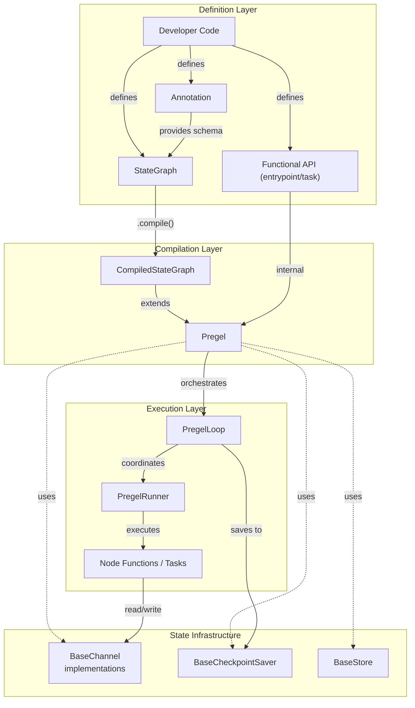

**Layer Responsibilities:**

| Layer | Component | Responsibility | Key Files |
| :--- | :--- | :--- | :--- |
| **Definition** | `StateGraph` | Graph topology and node registration | [libs/langgraph-core/src/graph/state.ts:121-127]() |
| **Definition** | `Annotation` | State schema and reducer definitions | [libs/langgraph-core/src/graph/annotation.ts:1-74]() |
| **Compilation** | `CompiledStateGraph` | Converts graph definition to executable form | [libs/langgraph-core/src/graph/state.ts:22-29]() |
| **Execution** | `Pregel` | Main runtime orchestrator | [libs/langgraph-core/src/pregel/index.ts:196-240]() |
| **Execution** | `PregelLoop` | Superstep coordination and checkpointing | [libs/langgraph-core/src/pregel/loop.ts:241-280]() |
| **Execution** | `PregelRunner` | Parallel task execution | [libs/langgraph-core/src/pregel/runner.ts:1-50]() |

Sources: [libs/langgraph-core/src/graph/state.ts:121-232](), [libs/langgraph-core/src/pregel/index.ts:196-240](), [libs/langgraph-core/src/pregel/loop.ts:136-187]()

### Execution Flow

The typical execution flow from graph definition to completion:

```mermaid
sequenceDiagram
    participant DEV as Developer
    participant SG as StateGraph
    participant COMP as CompiledStateGraph
    participant PREG as Pregel
    participant LOOP as PregelLoop
    
    DEV->>SG: new StateGraph(annotation)
    DEV->>SG: .addNode(name, fn)
    DEV->>SG: .addEdge(from, to)
    DEV->>SG: .compile(options)
    SG->>COMP: Create CompiledStateGraph
    
    DEV->>COMP: .invoke(input, config)
    COMP->>PREG: delegate to Pregel._invoke()
    PREG->>LOOP: PregelLoop.initialize()
    
    loop For each superstep
        LOOP->>LOOP: _prepareNextTasks()
        LOOP->>LOOP: PregelRunner.tick()
        LOOP->>LOOP: _applyWrites()
        LOOP->>LOOP: Save checkpoint
    end
    
    LOOP->>PREG: Return final state
    PREG->>DEV: Output
```

Sources: [libs/langgraph-core/src/pregel/index.ts:89-120](), [libs/langgraph-core/src/pregel/loop.ts:77-100](), [libs/langgraph-core/src/pregel/algo.ts:98-125]()

## Core Concepts

### Graphs and Supersteps

LangGraph models agent workflows as directed graphs where execution proceeds in discrete steps called **supersteps**. In each superstep, all nodes that have received new input are executed in parallel.

*   **Nodes**: JavaScript/TypeScript functions that process state.
*   **Edges**: Connections that define control flow between nodes.
*   **State**: Shared data structure that flows through the graph.
*   **Channels**: Communication pathways that control how state updates are merged.

Sources: [libs/langgraph-core/src/pregel/index.ts:196-240](), [libs/langgraph-core/src/pregel/loop.ts:113-113]()

### StateGraph and Graph Building

The `StateGraph` class is the primary API for defining graphs. It uses a builder pattern to construct graph topology and associate it with a state schema defined via `Annotation`.

*   **Nodes**: Registered via `.addNode()`.
*   **Edges**: Defined via `.addEdge()` (static) or `.addConditionalEdges()` (dynamic).
*   **Compilation**: The `.compile()` method transforms the graph into an executable `CompiledStateGraph`.

For details, see [StateGraph and Graph Building](#2.1).

Sources: [libs/langgraph-core/src/graph/state.ts:22-29](), [libs/langgraph-core/src/graph/index.ts:1-29]()

### Pregel Runtime Engine

The runtime engine implements a message-passing model where nodes communicate via channels. The engine coordinates the execution loop, manages task scheduling, and handles parallel execution via `PregelRunner`.

*   **Supersteps**: Discrete execution rounds.
*   **Task Preparation**: Identifying nodes ready to run based on channel updates.
*   **Write Application**: Merging node outputs back into the graph state.

For details, see [Pregel Runtime Engine](#2.2).

Sources: [libs/langgraph-core/src/pregel/index.ts:83-88](), [libs/langgraph-core/src/pregel/loop.ts:136-187](), [libs/langgraph-core/src/pregel/algo.ts:98-109]()

### State Management

State is managed through **Channels**. Each field in the graph state corresponds to a channel, which may have a **Reducer** function to determine how new updates are merged with the existing value.

*   **Annotation**: Used to define state schemas with custom reducers and default values.
*   **Reducers**: Functions like `messagesStateReducer` that handle complex state merging (e.g., appending to a message history).
*   **Persistence**: The state is automatically saved to a checkpointer after each superstep.

For details, see [State Management](#2.3).

Sources: [libs/langgraph-core/src/graph/annotation.ts:1-9](), [libs/langgraph-core/src/graph/messages_reducer.ts:31-35](), [libs/langgraph-core/src/pregel/loop.ts:160-165]()

### Control Flow and Commands

LangGraph provides several primitives for controlling the flow of execution beyond simple edges:

*   **Command**: A special return value that allows a node to update state and route to the next node simultaneously.
*   **Send**: Enables dynamic fan-out (map-reduce patterns) by sending multiple inputs to the same node.
*   **interrupt()**: Pauses graph execution to wait for human-in-the-loop input.

For details, see [Control Flow and Commands](#2.4).

Sources: [libs/langgraph-core/src/constants.ts:119-133](), [libs/langgraph-core/src/constants.ts:195-204](), [libs/langgraph-core/src/interrupt.ts:1-18]()

### Functional API and Tasks

The Functional API provides an alternative way to build stateful workflows using `entrypoint` and `task` decorators. This API is built on top of the same Pregel runtime but offers a more imperative coding style compared to the declarative `StateGraph`.

For details, see [Functional API and Tasks](#2.5).

Sources: [libs/langgraph-core/src/func/index.ts:157-162](), [libs/langgraph-core/src/web.ts:157-162]()

---

# Page: StateGraph and Graph Building

# StateGraph and Graph Building

<details>
<summary>Relevant source files</summary>

The following files were used as context for generating this wiki page:

- [docs/docs/versions/.meta.yml](docs/docs/versions/.meta.yml)
- [docs/docs/versions/index.md](docs/docs/versions/index.md)
- [examples/how-tos/create-react-agent.ipynb](examples/how-tos/create-react-agent.ipynb)
- [examples/how-tos/react-human-in-the-loop.ipynb](examples/how-tos/react-human-in-the-loop.ipynb)
- [examples/how-tos/react-memory.ipynb](examples/how-tos/react-memory.ipynb)
- [examples/how-tos/react-system-prompt.ipynb](examples/how-tos/react-system-prompt.ipynb)
- [libs/langgraph-core/src/constants.ts](libs/langgraph-core/src/constants.ts)
- [libs/langgraph-core/src/graph/graph.ts](libs/langgraph-core/src/graph/graph.ts)
- [libs/langgraph-core/src/graph/index.ts](libs/langgraph-core/src/graph/index.ts)
- [libs/langgraph-core/src/graph/state.test.ts](libs/langgraph-core/src/graph/state.test.ts)
- [libs/langgraph-core/src/graph/state.ts](libs/langgraph-core/src/graph/state.ts)
- [libs/langgraph-core/src/graph/types.ts](libs/langgraph-core/src/graph/types.ts)
- [libs/langgraph-core/src/pregel/read.ts](libs/langgraph-core/src/pregel/read.ts)
- [libs/langgraph-core/src/pregel/retry.ts](libs/langgraph-core/src/pregel/retry.ts)
- [libs/langgraph-core/src/pregel/utils/index.ts](libs/langgraph-core/src/pregel/utils/index.ts)
- [libs/langgraph-core/src/tests/constants.test.ts](libs/langgraph-core/src/tests/constants.test.ts)
- [libs/langgraph-core/src/tests/run_control.test.ts](libs/langgraph-core/src/tests/run_control.test.ts)
- [libs/langgraph-core/src/tests/set_node_defaults.test.ts](libs/langgraph-core/src/tests/set_node_defaults.test.ts)
- [libs/langgraph-core/src/tests/state_graph_compat.test-d.ts](libs/langgraph-core/src/tests/state_graph_compat.test-d.ts)
- [libs/langgraph-core/src/tests/types.test-d.ts](libs/langgraph-core/src/tests/types.test-d.ts)
- [libs/langgraph-core/src/tests/zod_state.test.ts](libs/langgraph-core/src/tests/zod_state.test.ts)
- [libs/langgraph-core/src/web.ts](libs/langgraph-core/src/web.ts)
- [libs/langgraph-core/tsconfig.json](libs/langgraph-core/tsconfig.json)
- [libs/langgraph/src/prebuilt/index.ts](libs/langgraph/src/prebuilt/index.ts)

</details>


This document explains how to construct graph-based applications using the `StateGraph` class. It covers state schema definition, adding nodes and edges, routing logic, and graph compilation.

For information about graph execution after compilation, see [Pregel Runtime Engine](#2.2). For details on state management patterns and reducers, see [State Management](#2.3). For advanced control flow primitives like `Command` and `Send`, see [Control Flow and Commands](#2.4).

## StateGraph Overview

The `StateGraph` class is the primary interface for building stateful, graph-based applications in LangGraph. A graph consists of:

- **State Schema**: Defines the structure of data that flows through the graph.
- **Nodes**: Functions that process the state and return updates.
- **Edges**: Define the execution flow between nodes.
- **Compilation**: Transforms the graph definition into an executable `CompiledStateGraph` (a specialized `Pregel` instance).

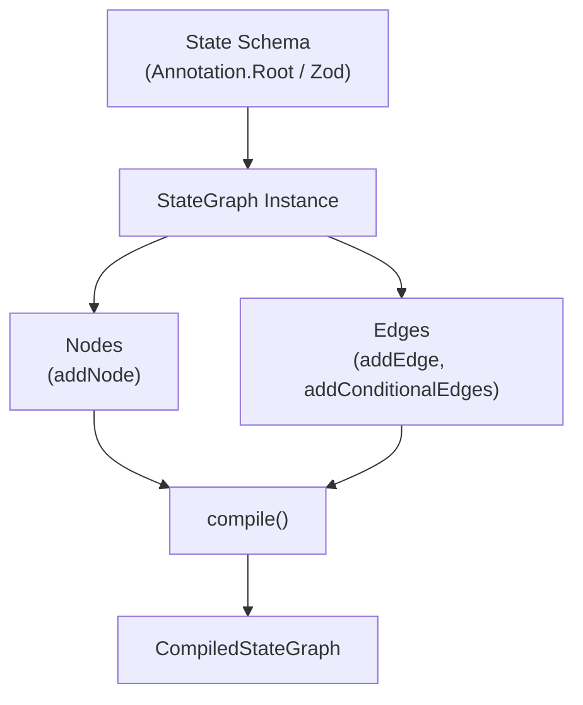

**Graph Construction Flow**

Sources: [libs/langgraph-core/src/graph/state.ts:4-5](), [libs/langgraph-core/src/graph/index.ts:20-22]()

## State Schema Definition

State schemas define the "channels" through which data flows. LangGraph supports multiple ways to define these schemas: `Annotation.Root`, Zod objects, or internal `StateSchema` classes.

### Schema Initialization Patterns

The `StateGraph` constructor is highly flexible, supporting both direct schema arguments and configuration objects [libs/langgraph-core/src/graph/state.ts:121-127]().

| Pattern | Code Entity | Description |
| :--- | :--- | :--- |
| **Annotation** | `Annotation.Root` | Recommended for complex state with custom reducers [libs/langgraph-core/src/graph/annotation.ts:69-74]() |
| **Zod** | `z.object({})` | Familiar validation-first approach [libs/langgraph-core/src/tests/zod_state.test.ts:18-23]() |
| **StateSchema** | `new StateSchema()` | Internal low-level schema definition [libs/langgraph-core/src/state/schema.ts:17-20]() |

### Using Annotation.Root

```typescript
import { Annotation } from "@langchain/langgraph";

const StateAnnotation = Annotation.Root({
  messages: Annotation<BaseMessage[]>({
    reducer: (current, update) => current.concat(update),
    default: () => [],
  }),
  count: Annotation<number>({
    default: () => 0,
  }),
});
```

### Using Zod for State

LangGraph.js provides deep integration with Zod (v3 and v4). You can pass a Zod object directly to the `StateGraph` constructor [libs/langgraph-core/src/tests/zod_state.test.ts:69-73]().

```typescript
import { z } from "zod";
const stateSchema = z.object({
  messages: z.array(z.string()),
  count: z.number(),
});
const graph = new StateGraph(stateSchema);
```

Sources: [libs/langgraph-core/src/graph/types.ts:49-53](), [libs/langgraph-core/src/tests/zod_state.test.ts:18-33]()

## Adding Nodes

Nodes are the computational units of the graph. They are added using `addNode(name, action, options)`.

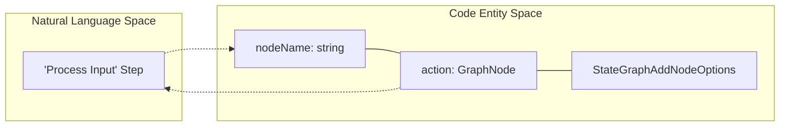

**Bridging Logic to Code Entities**

### Node Configuration and Policies

When adding a node, you can specify `NodePolicyOptions` to control its runtime behavior [libs/langgraph-core/src/graph/state.ts:138-167]():

- **`retryPolicy`**: Configures backoff and max attempts for failed nodes [libs/langgraph-core/src/pregel/utils/index.ts:56-92]().
- **`cachePolicy`**: Controls how results are keyed and persisted [libs/langgraph-core/src/pregel/utils/index.ts:100-112]().
- **`timeout`**: Hard wall-clock cap on node execution [libs/langgraph-core/src/graph/state.ts:159-166]().
- **`errorHandler`**: A specific function to run after a node's retry policy is exhausted [libs/langgraph-core/src/graph/state.ts:225-230]().

### Node Input Validation

Nodes can define their own `input` schema, which may be a subset of the global state [libs/langgraph-core/src/graph/state.ts:198-204]().

```typescript
graph.addNode("myNode", myHandler, {
  input: z.object({ query: z.string() }), // Node only sees 'query'
  retryPolicy: { maxAttempts: 3 }
});
```

Sources: [libs/langgraph-core/src/graph/state.ts:198-230](), [libs/langgraph-core/src/graph/graph.ts:26-29]()

## Adding Edges

Edges define the control flow. LangGraph uses reserved constants `START` and `END` to manage entry and exit [libs/langgraph-core/src/constants.ts:8-10]().

### Normal Edges
Direct transitions between two nodes:
```typescript
graph.addEdge("nodeA", "nodeB");
```

### Conditional Edges
Dynamic routing based on state values:
```typescript
graph.addConditionalEdges(
  "nodeA",
  (state) => state.score > 0.5 ? "nodeB" : "nodeC"
);
```

### Dynamic Fan-out (Send)
To trigger multiple nodes in parallel with different states, nodes or conditional edges can return `Send` objects [libs/langgraph-core/src/constants.ts:119-121]().

```typescript
// Inside a conditional edge router
return [new Send("worker", { task: 1 }), new Send("worker", { task: 2 })];
```

Sources: [libs/langgraph-core/src/graph/graph.ts:25](), [libs/langgraph-core/src/constants.ts:195-204]()

## Compilation

The `compile()` method converts the `StateGraph` builder into a `CompiledStateGraph` [libs/langgraph-core/src/graph/state.ts:22-23](). This process validates the graph structure and attaches the execution runtime (`Pregel`).

### Checkpointing and Persistence
To enable "Time Travel" and persistence, provide a `checkpointer` during compilation [libs/langgraph-core/src/graph/state.ts:464-467]().

```typescript
const app = graph.compile({
  checkpointer: new MemorySaver(),
  interruptBefore: ["human_review_node"]
});
```

### Run Control and Draining
The `RunControl` class allows managing the lifecycle of a graph run, such as requesting a "drain" (graceful shutdown) [libs/langgraph-core/src/pregel/runtime.ts:175](). Nodes can access this via `runtime.control` to signal the graph should stop after the current step [libs/langgraph-core/src/tests/run_control.test.ts:109-113]().

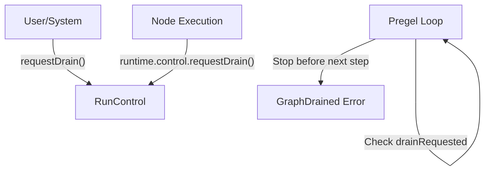

**RunControl and Draining Flow**

Sources: [libs/langgraph-core/src/tests/run_control.test.ts:28-40](), [libs/langgraph-core/src/graph/state.ts:464-480]()

## Input and Output Schemas

Graphs often have different requirements for what they accept as input versus what they return as a final result. `StateGraph` supports defining these boundaries explicitly [libs/langgraph-core/src/graph/types.ts:122-141]().

```typescript
const graph = new StateGraph({
  state: FullStateAnnotation,
  input: InputSchema,   // Only these keys required to start
  output: OutputSchema  // Only these keys returned on finish
});
```

If only `input` is provided, it defaults to being the `state` schema as well [libs/langgraph-core/src/graph/types.ts:184-186]().

Sources: [libs/langgraph-core/src/graph/types.ts:122-148](), [libs/langgraph-core/src/graph/state.test.ts:93-108]()

---

# Page: Pregel Runtime Engine

# Pregel Runtime Engine

<details>
<summary>Relevant source files</summary>

The following files were used as context for generating this wiki page:

- [libs/langgraph-core/src/channels/base.ts](libs/langgraph-core/src/channels/base.ts)
- [libs/langgraph-core/src/channels/index.ts](libs/langgraph-core/src/channels/index.ts)
- [libs/langgraph-core/src/errors.ts](libs/langgraph-core/src/errors.ts)
- [libs/langgraph-core/src/pregel/algo.ts](libs/langgraph-core/src/pregel/algo.ts)
- [libs/langgraph-core/src/pregel/index.ts](libs/langgraph-core/src/pregel/index.ts)
- [libs/langgraph-core/src/pregel/loop.ts](libs/langgraph-core/src/pregel/loop.ts)
- [libs/langgraph-core/src/pregel/runnable_types.ts](libs/langgraph-core/src/pregel/runnable_types.ts)
- [libs/langgraph-core/src/pregel/runner.ts](libs/langgraph-core/src/pregel/runner.ts)
- [libs/langgraph-core/src/pregel/runtime.ts](libs/langgraph-core/src/pregel/runtime.ts)
- [libs/langgraph-core/src/pregel/stream.test.ts](libs/langgraph-core/src/pregel/stream.test.ts)
- [libs/langgraph-core/src/pregel/stream.ts](libs/langgraph-core/src/pregel/stream.ts)
- [libs/langgraph-core/src/pregel/types.ts](libs/langgraph-core/src/pregel/types.ts)
- [libs/langgraph-core/src/pregel/utils/config.test.ts](libs/langgraph-core/src/pregel/utils/config.test.ts)
- [libs/langgraph-core/src/pregel/utils/config.ts](libs/langgraph-core/src/pregel/utils/config.ts)
- [libs/langgraph-core/src/stream/convert.test.ts](libs/langgraph-core/src/stream/convert.test.ts)
- [libs/langgraph-core/src/stream/convert.ts](libs/langgraph-core/src/stream/convert.ts)
- [libs/langgraph-core/src/stream/index.ts](libs/langgraph-core/src/stream/index.ts)
- [libs/langgraph-core/src/stream/mux.ts](libs/langgraph-core/src/stream/mux.ts)
- [libs/langgraph-core/src/tests/concurrent-thread-isolation.test.ts](libs/langgraph-core/src/tests/concurrent-thread-isolation.test.ts)
- [libs/langgraph-core/src/tests/delta_channel.test.ts](libs/langgraph-core/src/tests/delta_channel.test.ts)
- [libs/langgraph-core/src/tests/execution_info.test.ts](libs/langgraph-core/src/tests/execution_info.test.ts)
- [libs/langgraph-core/src/tests/pregel.test.ts](libs/langgraph-core/src/tests/pregel.test.ts)
- [libs/langgraph-core/src/tests/tracing.test.ts](libs/langgraph-core/src/tests/tracing.test.ts)

</details>


The Pregel runtime engine is the core execution system that powers LangGraph.js. It implements a message-passing graph computation model inspired by [Google's Pregel system](https://research.google/pubs/pregel-a-system-for-large-scale-graph-processing), providing the foundation for reliable, controllable agent workflows that can evolve state over time.

The Pregel engine is responsible for:
- Executing graph nodes in discrete "supersteps"
- Managing message passing between nodes via channels
- Handling state persistence through checkpointing
- Supporting real-time streaming of execution progress
- Enabling human-in-the-loop workflows via interrupts

## Architecture Overview

The Pregel runtime engine consists of several key components that work together to execute graph-based workflows in discrete "supersteps" with message-passing between nodes.

### Core Components Diagram

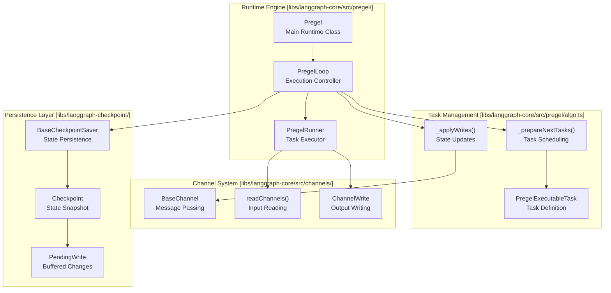

Sources: [libs/langgraph-core/src/pregel/index.ts:294-457](), [libs/langgraph-core/src/pregel/loop.ts:238-371](), [libs/langgraph-core/src/pregel/algo.ts:87-122]()

### Class Hierarchy and Responsibilities

The `Pregel` class serves as the main runtime engine, extending `Runnable` to integrate with LangChain's execution model while providing graph-specific functionality:

```mermaid
classDiagram
    class Runnable {
        +invoke(input, options)
        +stream(input, options)
    }
    
    class Pregel {
        +nodes: Record~string, PregelNode~
        +channels: Record~string, BaseChannel~
        +inputChannels: string[]
        +outputChannels: string[]
        +checkpointer: BaseCheckpointSaver
        +interruptBefore: string[] | All
        +interruptAfter: string[] | All
        +invoke(input, config): Promise
        +stream(input, config): Promise
        +getState(config): Promise~StateSnapshot~
    }
    
    class PregelLoop {
        +step: number
        +checkpoint: Checkpoint
        +channels: Record~string, BaseChannel~
        +tasks: Record~string, PregelExecutableTask~
        +tick(params): Promise~boolean~
        +putWrites(taskId, writes): void
        -_prepareNextTasks(): void
        -_applyWrites(): void
    }
    
    class PregelExecutableTask {
        +id: string
        +name: string
        +input: any
        +proc: Runnable
        +writes: PendingWrite[]
        +config: RunnableConfig
    }
    
    Runnable <|-- Pregel
    Pregel --> PregelLoop : "instantiates in [libs/langgraph-core/src/pregel/index.ts:1210]"
    PregelLoop --> PregelExecutableTask : "manages in [libs/langgraph-core/src/pregel/loop.ts:718]"
```

Sources: [libs/langgraph-core/src/pregel/index.ts:294-322](), [libs/langgraph-core/src/pregel/loop.ts:238-371](), [libs/langgraph-core/src/pregel/types.ts:110-120]()

## Execution Model - Supersteps

The Pregel engine executes graphs in discrete "supersteps" where all ready tasks run in parallel. Their outputs are buffered and then applied atomically to the channels before the next superstep begins.

### Superstep Execution Flow

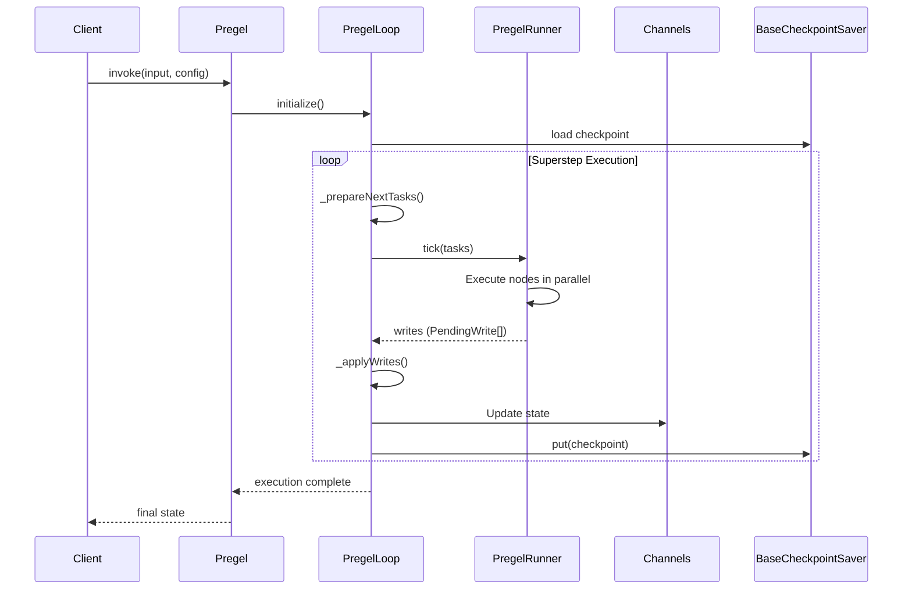

Sources: [libs/langgraph-core/src/pregel/loop.ts:696-797](), [libs/langgraph-core/src/pregel/algo.ts:394-512](), [libs/langgraph-core/src/pregel/index.ts:1204-1258]()

### Task Preparation Algorithm

The `_prepareNextTasks` function determines which nodes should execute in the current superstep based on channel updates and triggers.

| Step | Function | Purpose |
|------|----------|---------|
| 1 | Channel Version Check | Compare current `channel_versions` with `versions_seen` in the checkpoint [libs/langgraph-core/src/pregel/algo.ts:127-163](). |
| 2 | Trigger Evaluation | Identify nodes triggered by updated channels based on `triggerToNodes` mapping [libs/langgraph-core/src/pregel/algo.ts:98-109](). |
| 3 | Input Preparation | Read values from channels using `readChannels` [libs/langgraph-core/src/pregel/io.ts:212-250](). |
| 4 | Task Creation | Instantiate `PregelExecutableTask` with stable IDs [libs/langgraph-core/src/pregel/algo.ts:394-512](). |

Sources: [libs/langgraph-core/src/pregel/algo.ts:394-512](), [libs/langgraph-core/src/pregel/loop.ts:696-797]()

## Task Management and Scheduling

Tasks represent individual node executions. The `PregelRunner` manages the concurrent execution of these tasks while adhering to `maxConcurrency` limits.

### Task Lifecycle and Retries

The engine uses `_runWithRetry` to execute tasks. This function handles exponential backoff and classifying errors as retryable or fatal.

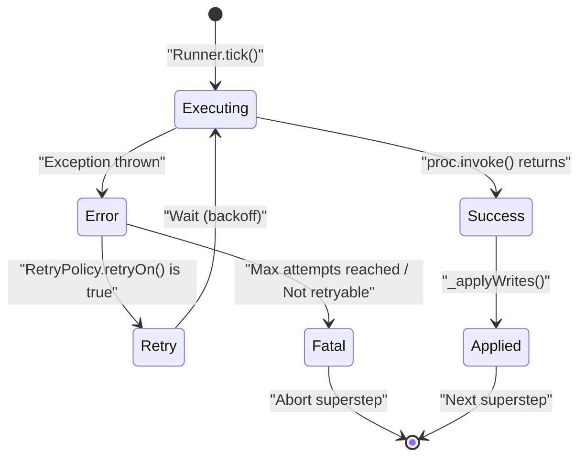

Sources: [libs/langgraph-core/src/pregel/retry.ts:64-178](), [libs/langgraph-core/src/pregel/runner.ts:122-178](), [libs/langgraph-core/src/errors.ts:134-162]()

## Channel System Integration

Channels are the communication pathways. Nodes do not talk to each other directly; they read from and write to channels.

### Version Management

The engine tracks channel versions to ensure "exactly-once" triggering logic within the superstep model.

- **`channel_versions`**: Monotonically increasing versions for each channel in the checkpoint [libs/langgraph-checkpoint/src/index.ts]().
- **`versions_seen`**: A map within the checkpoint tracking which version of a channel a specific node has already consumed [libs/langgraph-core/src/pregel/algo.ts:133-154]().
- **`increment()`**: A helper to advance versions during `_applyWrites` [libs/langgraph-core/src/pregel/algo.ts:94-96]().

Sources: [libs/langgraph-core/src/pregel/algo.ts:127-163](), [libs/langgraph-core/src/pregel/loop.ts:539-591]()

## Checkpointing and State Management

Persistence is achieved by snapshotting the entire state (channels + versions) into a `Checkpoint` at the end of every superstep.

### State Snapshot Preparation

The `getState` method calls `_prepareStateSnapshot` to provide a user-facing view of the graph state, including pending tasks.

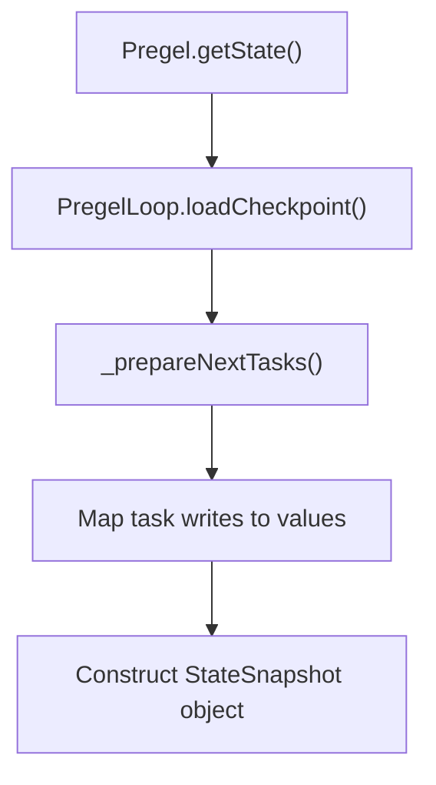

Sources: [libs/langgraph-core/src/pregel/index.ts:725-901](), [libs/langgraph-core/src/pregel/loop.ts:373-505]()

## Streaming System

Pregel supports real-time streaming of execution data via `IterableReadableWritableStream`.

### Stream Modes

The runtime supports multiple `StreamMode` values simultaneously:
- **`values`**: Emits the full state of the graph after each superstep [libs/langgraph-core/src/pregel/io.ts:173-210]().
- **`updates`**: Emits only the updates produced by nodes in the current superstep [libs/langgraph-core/src/pregel/io.ts:252-294]().
- **`debug`**: Emits internal execution events (task start/end, writes) [libs/langgraph-core/src/pregel/debug.ts:90-147]().
- **`messages`**: Emits message-level deltas for chat-based applications [libs/langgraph-core/src/pregel/messages.ts]().

Sources: [libs/langgraph-core/src/pregel/stream.ts:122-198](), [libs/langgraph-core/src/pregel/types.ts:37-38]()

## Error Handling and Interrupts

Errors in Pregel are categorized to support complex control flows like "Human-in-the-loop".

- **`GraphInterrupt`**: Raised when a node hits a breakpoint or `interrupt()` is called. It stops execution and saves the checkpoint so it can be resumed later [libs/langgraph-core/src/errors.ts:85-97]().
- **`NodeError`**: Wraps an error from a node, providing context for node-level error handlers [libs/langgraph-core/src/errors.ts:134-149]().
- **`GraphRecursionError`**: Raised if the superstep count exceeds the `recursionLimit` [libs/langgraph-core/src/errors.ts:36-45]().

Sources: [libs/langgraph-core/src/errors.ts:1-214](), [libs/langgraph-core/src/pregel/runner.ts:156-178]()

---

# Page: State Management

# State Management

<details>
<summary>Relevant source files</summary>

The following files were used as context for generating this wiki page:

- [libs/checkpoint-validation/src/index.ts](libs/checkpoint-validation/src/index.ts)
- [libs/checkpoint-validation/src/spec/delta_channel_history.ts](libs/checkpoint-validation/src/spec/delta_channel_history.ts)
- [libs/checkpoint-validation/src/spec/index.ts](libs/checkpoint-validation/src/spec/index.ts)
- [libs/checkpoint-validation/src/tests/memory.spec.ts](libs/checkpoint-validation/src/tests/memory.spec.ts)
- [libs/checkpoint-validation/src/tests/mongodb.spec.ts](libs/checkpoint-validation/src/tests/mongodb.spec.ts)
- [libs/checkpoint-validation/src/tests/postgres.spec.ts](libs/checkpoint-validation/src/tests/postgres.spec.ts)
- [libs/checkpoint-validation/src/tests/redis.spec.ts](libs/checkpoint-validation/src/tests/redis.spec.ts)
- [libs/checkpoint-validation/src/tests/sqlite.spec.ts](libs/checkpoint-validation/src/tests/sqlite.spec.ts)
- [libs/langgraph-core/src/channels/base.ts](libs/langgraph-core/src/channels/base.ts)
- [libs/langgraph-core/src/channels/delta.ts](libs/langgraph-core/src/channels/delta.ts)
- [libs/langgraph-core/src/channels/index.ts](libs/langgraph-core/src/channels/index.ts)
- [libs/langgraph-core/src/graph/messages_reducer.ts](libs/langgraph-core/src/graph/messages_reducer.ts)
- [libs/langgraph-core/src/pregel/algo.ts](libs/langgraph-core/src/pregel/algo.ts)
- [libs/langgraph-core/src/pregel/loop.ts](libs/langgraph-core/src/pregel/loop.ts)
- [libs/langgraph-core/src/state/prebuilt/index.ts](libs/langgraph-core/src/state/prebuilt/index.ts)
- [libs/langgraph-core/src/state/prebuilt/messages.ts](libs/langgraph-core/src/state/prebuilt/messages.ts)
- [libs/langgraph-core/src/state/schema.test.ts](libs/langgraph-core/src/state/schema.test.ts)
- [libs/langgraph-core/src/state/schema.ts](libs/langgraph-core/src/state/schema.ts)
- [libs/langgraph-core/src/state/values/delta.test.ts](libs/langgraph-core/src/state/values/delta.test.ts)
- [libs/langgraph-core/src/state/values/delta.ts](libs/langgraph-core/src/state/values/delta.ts)
- [libs/langgraph-core/src/state/values/index.ts](libs/langgraph-core/src/state/values/index.ts)
- [libs/langgraph-core/src/tests/delta_channel.test.ts](libs/langgraph-core/src/tests/delta_channel.test.ts)

</details>


State Management in LangGraph.js defines how data is structured, updated, and persisted throughout a graph's execution. It relies on a "channel" architecture where each piece of state is stored in a named channel that can have specific logic for merging updates (reducers) and providing initial values (defaults).

For deep dives into specific implementation details, see the child pages:
- [Annotation System](#2.3.1) — How to define state schemas using the primary `Annotation` API.
- [Zod Schema Integration](#2.3.2) — Using Zod for runtime validation and schema definition.

## Overview

State in LangGraph represents the data structure that flows through your graph. Every node receives the current state as input and returns updates that are merged back into the state using reducer functions. The Pregel runtime engine manages these updates in "super-steps," ensuring that all node writes are applied before the next set of nodes executes [libs/langgraph-core/src/pregel/loop.ts:68-76]().

### State Lifecycle and Code Entities

The following diagram maps the conceptual state lifecycle to the internal code entities that manage it.

**State Management Entity Mapping**

```mermaid
graph TB
    subgraph "Natural Language Space"
        SD["State Definition"]
        SI["State Initialization"]
        SU["State Updates"]
    end

    subgraph "Code Entity Space"
        ANNOT["Annotation.Root()"]
        S_SCHEMA["StateSchema class"]
        B_CHAN["BaseChannel / LastValue"]
        P_LOOP["PregelLoop class"]
        D_CHAN["DeltaChannel class"]
        REDUCER["Reducer function"]
    end

    SD --- ANNOT
    SD --- S_SCHEMA
    SI --- B_CHAN
    SI --- P_LOOP
    SU --- D_CHAN
    SU --- REDUCER

    P_LOOP --"initializes"--> B_CHAN
    S_SCHEMA --"maps fields to"--> B_CHAN
    P_LOOP --"applies writes via"--> REDUCER
```
Sources: [libs/langgraph-core/src/state/schema.ts:190-205](), [libs/langgraph-core/src/pregel/loop.ts:136-154](), [libs/langgraph-core/src/channels/base.ts:30-45]()

## The Annotation System

The `Annotation.Root()` function is the primary entry point for defining state. It creates a `StateSchema` object that maps field names to specific `BaseChannel` implementations [libs/langgraph-core/src/state/schema.ts:53-62]().

- **Value Type**: The type of data stored in the channel (e.g., `string[]`).
- **Update Type**: The type of data accepted as an update (e.g., a single `string` or an `Overwrite` command).
- **Reducers**: Functions that determine how the current value and a new update combine [libs/langgraph-core/src/channels/delta.ts:34-37]().

For details, see [Annotation System](#2.3.1).

## Reducers and Channels

Reducers are the core logic for state transitions. LangGraph provides several built-in channel types and reducers to handle common patterns.

| Channel Type | Behavior | Code Reference |
|--------------|----------|----------------|
| `LastValue` | Default behavior; the newest update overrides the existing value. | [libs/langgraph-core/src/channels/last_value.ts]() |
| `Topic` | Accumulates all updates into a list for the next step. | [libs/langgraph-core/src/channels/topic.ts]() |
| `DeltaChannel` | Optimizes persistence by replaying writes instead of saving full state blobs. | [libs/langgraph-core/src/channels/delta.ts:84-91]() |
| `BinaryOperatorAggregate` | Uses a binary function (like addition or array concat) to merge values. | [libs/langgraph-core/src/channels/binop.ts]() |

### DeltaChannel and Replay Logic
The `DeltaChannel` is a specialized implementation designed for high-frequency updates (like message lists). Instead of storing the full state in every checkpoint, it reconstructs state by replaying ancestor writes through a `DeltaReducer` [libs/langgraph-core/src/channels/delta.ts:49-57](). It periodically takes a `DeltaSnapshot` to bound the replay depth [libs/langgraph-core/src/channels/delta.ts:59-64]().

Sources: [libs/langgraph-core/src/channels/base.ts:21-23](), [libs/langgraph-core/src/channels/delta.ts:146-165]()

## Message State Handling

Managing chat history is a primary use case for LangGraph. The framework provides `messagesStateReducer` and `messagesDeltaReducer` to handle `BaseMessage` objects [libs/langgraph-core/src/graph/messages_reducer.ts:60-63]().

**Message Reducer Logic**
- **Append**: New messages are added to the list.
- **Update**: If a message has an existing `id`, it is replaced by the new version [libs/langgraph-core/src/graph/messages_reducer.ts:107-116]().
- **Remove**: A `RemoveMessage` instance triggers the removal of a message by ID [libs/langgraph-core/src/graph/messages_reducer.ts:111-112]().
- **Clear All**: The `REMOVE_ALL_MESSAGES` sentinel wipes the history [libs/langgraph-core/src/graph/messages_reducer.ts:14-15]().

Sources: [libs/langgraph-core/src/graph/messages_reducer.ts:14-131](), [libs/langgraph-core/src/tests/delta_channel.test.ts:154-190]()

## Execution and Updates

During the Pregel execution loop, state is updated at the end of each super-step. The `PregelLoop` class orchestrates this by calling `_applyWrites`, which iterates through all tasks and their respective channel updates [libs/langgraph-core/src/pregel/loop.ts:68-76]().

**Internal State Update Flow**

```mermaid
graph LR
    subgraph "PregelLoop Execution"
        TASK["PregelExecutableTask"]
        WRITES["PendingWrites"]
        APPLY["_applyWrites()"]
        CHANS["channelsFromCheckpoint()"]
    end

    subgraph "Channel Logic"
        UPDATE["BaseChannel.update()"]
        REPLAY["DeltaChannel.replayWrites()"]
    end

    TASK --"produces"--> WRITES
    WRITES --"passed to"--> APPLY
    CHANS --"provides instances to"--> APPLY
    APPLY --"calls"--> UPDATE
    UPDATE --"if DeltaChannel"--> REPLAY
```
Sources: [libs/langgraph-core/src/pregel/loop.ts:156-187](), [libs/langgraph-core/src/pregel/algo.ts:216-222](), [libs/langgraph-core/src/channels/delta.ts:167-175]()

## Persistence and Checkpointing

State management is tightly coupled with the persistence layer. The `BaseCheckpointSaver` saves the `channel_values` (for standard channels) and `checkpoint_writes` (for `DeltaChannel` replay) [libs/langgraph-core/src/pregel/loop.ts:136-154](). This allows for "Time Travel," where the graph can be resumed from any previous checkpoint by reconstructing the state channels from the saved values and replayed writes.

For details on how checkpoints are stored, see [Persistence and Checkpointing](#3).

Sources: [libs/langgraph-core/src/pregel/loop.ts:136-154](), [libs/checkpoint-validation/src/spec/index.ts:27-30]()

---

# Page: Annotation System

# Annotation System

<details>
<summary>Relevant source files</summary>

The following files were used as context for generating this wiki page:

- [libs/langgraph-api/src/graph/load.utils.mts](libs/langgraph-api/src/graph/load.utils.mts)
- [libs/langgraph-api/src/graph/parser/index.mts](libs/langgraph-api/src/graph/parser/index.mts)
- [libs/langgraph-api/src/graph/parser/parser.mts](libs/langgraph-api/src/graph/parser/parser.mts)
- [libs/langgraph-api/src/graph/parser/parser.worker.mjs](libs/langgraph-api/src/graph/parser/parser.worker.mjs)
- [libs/langgraph-api/src/graph/parser/schema/types.template.mts](libs/langgraph-api/src/graph/parser/schema/types.template.mts)
- [libs/langgraph-api/tests/parser.test.mts](libs/langgraph-api/tests/parser.test.mts)
- [libs/langgraph-core/src/channels/any_value.ts](libs/langgraph-core/src/channels/any_value.ts)
- [libs/langgraph-core/src/channels/binop.ts](libs/langgraph-core/src/channels/binop.ts)
- [libs/langgraph-core/src/constants.ts](libs/langgraph-core/src/constants.ts)
- [libs/langgraph-core/src/graph/annotation.ts](libs/langgraph-core/src/graph/annotation.ts)
- [libs/langgraph-core/src/graph/index.ts](libs/langgraph-core/src/graph/index.ts)
- [libs/langgraph-core/src/graph/messages_reducer.ts](libs/langgraph-core/src/graph/messages_reducer.ts)
- [libs/langgraph-core/src/graph/state.test.ts](libs/langgraph-core/src/graph/state.test.ts)
- [libs/langgraph-core/src/graph/state.ts](libs/langgraph-core/src/graph/state.ts)
- [libs/langgraph-core/src/graph/types.ts](libs/langgraph-core/src/graph/types.ts)
- [libs/langgraph-core/src/graph/zod/meta.ts](libs/langgraph-core/src/graph/zod/meta.ts)
- [libs/langgraph-core/src/state/prebuilt/index.ts](libs/langgraph-core/src/state/prebuilt/index.ts)
- [libs/langgraph-core/src/state/prebuilt/messages.ts](libs/langgraph-core/src/state/prebuilt/messages.ts)
- [libs/langgraph-core/src/state/schema.test.ts](libs/langgraph-core/src/state/schema.test.ts)
- [libs/langgraph-core/src/state/schema.ts](libs/langgraph-core/src/state/schema.ts)
- [libs/langgraph-core/src/state/values/delta.test.ts](libs/langgraph-core/src/state/values/delta.test.ts)
- [libs/langgraph-core/src/state/values/delta.ts](libs/langgraph-core/src/state/values/delta.ts)
- [libs/langgraph-core/src/state/values/index.ts](libs/langgraph-core/src/state/values/index.ts)
- [libs/langgraph-core/src/state/values/reduced.test.ts](libs/langgraph-core/src/state/values/reduced.test.ts)
- [libs/langgraph-core/src/tests/channels.test.ts](libs/langgraph-core/src/tests/channels.test.ts)
- [libs/langgraph-core/src/tests/constants.test.ts](libs/langgraph-core/src/tests/constants.test.ts)
- [libs/langgraph-core/src/tests/run_control.test.ts](libs/langgraph-core/src/tests/run_control.test.ts)
- [libs/langgraph-core/src/tests/set_node_defaults.test.ts](libs/langgraph-core/src/tests/set_node_defaults.test.ts)
- [libs/langgraph-core/src/tests/state_graph_compat.test-d.ts](libs/langgraph-core/src/tests/state_graph_compat.test-d.ts)
- [libs/langgraph-core/src/tests/types.test-d.ts](libs/langgraph-core/src/tests/types.test-d.ts)
- [libs/langgraph-core/src/tests/zod_state.test.ts](libs/langgraph-core/src/tests/zod_state.test.ts)
- [libs/langgraph-core/src/web.ts](libs/langgraph-core/src/web.ts)
- [libs/langgraph-core/tsconfig.json](libs/langgraph-core/tsconfig.json)

</details>


The Annotation System is LangGraph's declarative API for defining state schemas in graphs. It provides a type-safe way to specify:
- Which fields exist in your graph's state
- How updates to those fields should be combined (reducers)
- Default values for fields
- Type inference for state and partial updates

This system is the recommended approach for defining state in `StateGraph`. For information about using Zod schemas directly, see [Zod Schema Integration](2.3.2).

---

## Purpose and Scope

The Annotation System serves as the primary interface for developers to define how state flows through their graphs. When you create a `StateGraph`, you typically start by defining an annotation that describes your state structure. The system then:

1. Infers TypeScript types for full state and partial updates.
2. Creates internal channels for each field.
3. Applies reducer functions to merge updates from multiple nodes.
4. Provides compile-time type safety for node inputs and outputs.

This document covers the core `Annotation` API, reducer patterns, and the prebuilt `MessagesAnnotation`.

---

## Core API

### Annotation.Root()

The `Annotation.Root()` function creates a state schema definition. Each key in the object becomes a field in your state. Internally, this is represented as an `AnnotationRoot` interface [libs/langgraph-core/src/web.ts:112-112]().

```typescript
const StateAnnotation = Annotation.Root({
  messages: Annotation<BaseMessage[]>({
    reducer: (current, update) => current.concat(update),
    default: () => []
  }),
  count: Annotation<number>({
    reducer: (_, update) => update
  }),
  metadata: Annotation<Record<string, string>>()
});
```

**Annotation Structure**
```mermaid
graph LR
    subgraph "Annotation.Root({ ... })"
        Root["AnnotationRoot"]
    end
    
    subgraph "Field Definitions"
        Field1["messages: Annotation<BaseMessage[]>"]
        Field2["count: Annotation<number>"]
        Field3["metadata: Annotation<Record<string, string>>"]
    end
    
    subgraph "Field Properties"
        Reducer["reducer: SingleReducer<T, U>"]
        Default["default: () => T"]
    end
    
    Root --> Field1
    Root --> Field2
    Root --> Field3
    
    Field1 --> Reducer
    Field1 --> Default
```
Sources: [libs/langgraph-core/src/graph/annotation.ts:1-9](), [libs/langgraph-core/src/graph/index.ts:1-9]()

---

### Annotation<Type>()

Individual fields are defined using `Annotation<Type>()`. It can be used as a function to define field metadata or as a type placeholder.

| Property | Type | Description |
|----------|------|-------------|
| `reducer` | `SingleReducer<T, U>` | Function to merge updates with current state |
| `default` | `() => T` | Function returning the initial value for this field |

**Type Parameters:**

- **T**: The type of the field in the full state (e.g., `BaseMessage[]`)
- **U** (optional): The type accepted in updates (defaults to `T`)

Sources: [libs/langgraph-core/src/graph/annotation.ts:1-9](), [libs/langgraph-core/src/graph/index.ts:1-9]()

---

## Type Inference

The Annotation System automatically infers TypeScript types for your state using utility types like `ExtractStateType` and `ExtractUpdateType` [libs/langgraph-core/src/graph/types.ts:42-43]().

**Annotation Type Inference Flow**
```mermaid
graph TD
    Annotation["Annotation.Root({ ... })"]
    
    StateType["ExtractStateType<br/>Full state type"]
    UpdateType["ExtractUpdateType<br/>Partial update type"]
    
    NodeInput["Node input: State"]
    NodeOutput["Node output: Update"]
    
    Annotation --> StateType
    Annotation --> UpdateType
    
    StateType --> NodeInput
    UpdateType --> NodeOutput
    
    Channels["Internal Channels<br/>(LastValue, Topic, etc.)"]
    Annotation --> Channels
```

### StateType

The full state type represents the complete graph state. It can be accessed via `StateType<typeof MyAnnotation>` [libs/langgraph-core/src/graph/annotation.ts:3-3]().

```typescript
const MyAnnotation = Annotation.Root({
  count: Annotation<number>(),
  items: Annotation<string[]>()
});

type FullState = StateType<typeof MyAnnotation>;
// Resolves to: { count: number; items: string[] }
```

### UpdateType

The update type represents partial updates returned by nodes. It can be accessed via `UpdateType<typeof MyAnnotation>` [libs/langgraph-core/src/graph/annotation.ts:4-4]().

```typescript
type PartialUpdate = UpdateType<typeof MyAnnotation>;
// Resolves to: { count?: number; items?: string[] }
```

Sources: [libs/langgraph-core/src/graph/annotation.ts:1-9](), [libs/langgraph-core/src/graph/types.ts:42-43]()

---

## Reducers

Reducers are functions that combine the current value of a field with an incoming update. They follow the `SingleReducer` signature [libs/langgraph-core/src/graph/annotation.ts:8-8]().

### Common Reducer Patterns

| Pattern | Logic | Use Case |
|---------|-------|----------|
| **Last Write Wins** | Default behavior if no reducer is provided | Simple status flags |
| **Append** | `(current, update) => current.concat(update)` | History logs |
| **Merge Objects** | `(current, update) => ({ ...current, ...update })` | Configuration maps |

**Reducer Execution Flow**
```mermaid
graph TD
    Node1["Node A<br/>returns { count: 5 }"]
    Node2["Node B<br/>returns { count: 3 }"]
    
    CurrentState["Current State<br/>{ count: 2 }"]
    
    Reducer["SingleReducer<br/>(current, update) => current + update"]
    
    UpdateA["Update from A: 5"]
    UpdateB["Update from B: 3"]
    
    FinalState["Final State<br/>{ count: 10 }"]
    
    Node1 --> UpdateA
    Node2 --> UpdateB
    
    CurrentState --> Reducer
    UpdateA --> Reducer
    UpdateB --> Reducer
    
    Reducer --> FinalState
```

Sources: [libs/langgraph-core/src/graph/annotation.ts:8-8](), [libs/langgraph-core/src/graph/state.ts:116-120]()

---

## MessagesAnnotation

`MessagesAnnotation` is a prebuilt annotation for conversational agents [libs/langgraph-core/src/web.ts:165-168](). It provides a single `messages` field with a specialized reducer.

### messagesStateReducer

The `messagesStateReducer` (also exported as `addMessages`) is the core logic for managing conversation history [libs/langgraph-core/src/web.ts:7-8]().

**Reducer Behavior**

| Input Type | Behavior |
|------------|----------|
| `BaseMessage[]` | Appends or updates messages based on ID |
| `REMOVE_ALL_MESSAGES` | Clears the entire message list [libs/langgraph-core/src/web.ts:10-10]() |
| `messagesDeltaReducer` | Handles streaming updates [libs/langgraph-core/src/web.ts:9-9]() |

Sources: [libs/langgraph-core/src/graph/messages_annotation.ts:1-5](), [libs/langgraph-core/src/graph/messages_reducer.ts:31-35]()

---

## Integration with StateGraph

When you pass an annotation to `StateGraph`, the graph uses it to define its input, output, and internal state schemas.

**Annotation to StateGraph Mapping**
```mermaid
graph TD
    AnnotationRoot["Annotation.Root()"]
    
    StateGraph["StateGraph(Annotation)"]
    
    InputDef["_inputDefinition"]
    OutputDef["_outputDefinition"]
    
    Channels["channels: Record<string, BaseChannel>"]
    
    AnnotationRoot --> StateGraph
    StateGraph --> InputDef
    StateGraph --> OutputDef
    StateGraph --> Channels
```

The `StateGraph` constructor handles the conversion of Annotation definitions into internal `BaseChannel` instances [libs/langgraph-core/src/graph/state.ts:121-128]().

### Channel Mapping

| Annotation Property | Channel Property |
|--------------------|------------------|
| `reducer` | `BinaryOperator` logic in `BaseChannel` |
| `default` | Initial value of the channel |

Sources: [libs/langgraph-core/src/graph/state.ts:121-128](), [libs/langgraph-core/src/graph/annotation.ts:70-74]()

---

## StateSchema Class

For advanced use cases, the `StateSchema` class provides a unified API for defining state with mixed types (Zod, Reducers, and Untracked values) [libs/langgraph-core/src/state/schema.ts:190-196]().

- **ReducedValue**: Fields needing reducers [libs/langgraph-core/src/state/schema.ts:128-129]().
- **UntrackedValue**: Fields that are not persisted in checkpoints [libs/langgraph-core/src/state/schema.ts:130-131]().
- **DeltaValue**: Fields supporting incremental updates [libs/langgraph-core/src/state/schema.ts:126-127]().

Sources: [libs/langgraph-core/src/state/schema.ts:121-155](), [libs/langgraph-core/src/state/schema.ts:190-202]()

---

# Page: Zod Schema Integration

# Zod Schema Integration

<details>
<summary>Relevant source files</summary>

The following files were used as context for generating this wiki page:

- [libs/langgraph-api/src/graph/load.utils.mts](libs/langgraph-api/src/graph/load.utils.mts)
- [libs/langgraph-api/src/graph/parser/index.mts](libs/langgraph-api/src/graph/parser/index.mts)
- [libs/langgraph-api/src/graph/parser/parser.mts](libs/langgraph-api/src/graph/parser/parser.mts)
- [libs/langgraph-api/src/graph/parser/parser.worker.mjs](libs/langgraph-api/src/graph/parser/parser.worker.mjs)
- [libs/langgraph-api/src/graph/parser/schema/types.template.mts](libs/langgraph-api/src/graph/parser/schema/types.template.mts)
- [libs/langgraph-api/tests/parser.test.mts](libs/langgraph-api/tests/parser.test.mts)
- [libs/langgraph-core/src/channels/any_value.ts](libs/langgraph-core/src/channels/any_value.ts)
- [libs/langgraph-core/src/channels/binop.ts](libs/langgraph-core/src/channels/binop.ts)
- [libs/langgraph-core/src/constants.ts](libs/langgraph-core/src/constants.ts)
- [libs/langgraph-core/src/graph/annotation.ts](libs/langgraph-core/src/graph/annotation.ts)
- [libs/langgraph-core/src/graph/index.ts](libs/langgraph-core/src/graph/index.ts)
- [libs/langgraph-core/src/graph/state.test.ts](libs/langgraph-core/src/graph/state.test.ts)
- [libs/langgraph-core/src/graph/state.ts](libs/langgraph-core/src/graph/state.ts)
- [libs/langgraph-core/src/graph/types.ts](libs/langgraph-core/src/graph/types.ts)
- [libs/langgraph-core/src/graph/zod/meta.ts](libs/langgraph-core/src/graph/zod/meta.ts)
- [libs/langgraph-core/src/state/values/reduced.test.ts](libs/langgraph-core/src/state/values/reduced.test.ts)
- [libs/langgraph-core/src/tests/channels.test.ts](libs/langgraph-core/src/tests/channels.test.ts)
- [libs/langgraph-core/src/tests/constants.test.ts](libs/langgraph-core/src/tests/constants.test.ts)
- [libs/langgraph-core/src/tests/run_control.test.ts](libs/langgraph-core/src/tests/run_control.test.ts)
- [libs/langgraph-core/src/tests/set_node_defaults.test.ts](libs/langgraph-core/src/tests/set_node_defaults.test.ts)
- [libs/langgraph-core/src/tests/state_graph_compat.test-d.ts](libs/langgraph-core/src/tests/state_graph_compat.test-d.ts)
- [libs/langgraph-core/src/tests/types.test-d.ts](libs/langgraph-core/src/tests/types.test-d.ts)
- [libs/langgraph-core/src/tests/zod_state.test.ts](libs/langgraph-core/src/tests/zod_state.test.ts)
- [libs/langgraph-core/src/web.ts](libs/langgraph-core/src/web.ts)
- [libs/langgraph-core/tsconfig.json](libs/langgraph-core/tsconfig.json)
- [libs/langgraph/.gitignore](libs/langgraph/.gitignore)
- [libs/langgraph/src/graph/zod/index.ts](libs/langgraph/src/graph/zod/index.ts)
- [libs/langgraph/src/graph/zod/schema.ts](libs/langgraph/src/graph/zod/schema.ts)

</details>


## Purpose and Scope

This document describes how LangGraph integrates with [Zod](https://zod.dev) for defining graph state schemas with runtime validation. Zod is a TypeScript-first schema declaration and validation library that provides an alternative to LangGraph's [Annotation System](2.3.1) for state definition.

This page covers the Zod-specific utilities for defining state, including the `registry` system for adding reducers and the `MessagesZodMeta` helper for message channels. For broader state management concepts, see [State Management](2.3).

## Package Organization

The Zod integration is provided through a dedicated subpackage within `@langchain/langgraph`:

| Package Path | Purpose |
|--------------|---------|
| `@langchain/langgraph/zod` | Main Zod integration exports including `registry` |
| `@langchain/langgraph/zod/schema` | Schema-specific utilities and schema extraction |

Both paths are also available through the canonical `langgraph` package name (`langgraph/zod`, `langgraph/zod/schema`).

**Sources:** [libs/langgraph/src/graph/zod/index.ts:1-12](), [libs/langgraph/src/graph/zod/schema.ts:1-12]()

## StateGraph Construction with Zod

Zod schemas are passed directly to the `StateGraph` constructor. The `StateGraph` constructor is overloaded to accept either an `AnnotationRoot` or a Zod object schema. When using Zod, the framework uses `z.infer` to determine the internal state types.

```typescript
import { StateGraph } from "@langchain/langgraph";
import { z } from "zod";

const StateSchema = z.object({
  query: z.array(z.string()),
  count: z.number().default(0),
});

const graph = new StateGraph(StateSchema)
  .addNode("node1", (state) => ({ count: state.count + 1 }))
  .compile();
```

**Sources:** [libs/langgraph-core/src/graph/state.ts:93-101](), [libs/langgraph-core/src/tests/zod_state.test.ts:20-33]()

## Zod Registry System

The `registry` object from `@langchain/langgraph-core` (re-exported by `@langchain/langgraph/zod`) extends Zod schemas with LangGraph-specific metadata. This is primarily used to associate reducers with specific keys in a Zod object, which the graph engine then translates into `BaseChannel` configurations.

### Data Flow from Zod to Pregel Channels

The following diagram illustrates how a Zod schema is processed into the internal Pregel runtime configuration.

**Diagram: Zod to Code Entity Mapping**

```mermaid
graph TD
    subgraph "Natural Language / Schema Space"
        ZOD_DEF["Zod Object Definition"]
        REDUCER_SPEC["Reducer Specification"]
    end

    subgraph "Code Entity Space (@langchain/langgraph-core)"
        REGISTRY["registry (zod-registry.ts)"]
        STATE_GRAPH["StateGraph (graph/state.ts)"]
        CHANNELS["BaseChannel (channels/index.ts)"]
        META["schemaMetaRegistry (graph/zod/meta.ts)"]
    end

    ZOD_DEF -->|".register(registry, ...)"| REGISTRY
    REGISTRY -->|Stores Metadata| META
    STATE_GRAPH -->|Reads Metadata| META
    STATE_GRAPH -->|Initializes| CHANNELS
    REDUCER_SPEC -->|Defines Logic| REGISTRY
```

**Sources:** [libs/langgraph-core/src/graph/zod/zod-registry.ts:1-15](), [libs/langgraph-core/src/graph/zod/meta.ts:1-84](), [libs/langgraph-core/src/graph/state.ts:121-127]()

## Defining Reducers with Zod

By default, keys in a Zod object schema are treated as `LastValue` channels (the last update overwrites the current value). To use custom reducers (e.g., for appending to lists), you must register LangGraph metadata.

### Using .register() Method (Zod v4)

Zod v4 introduced a `.register()` method that allows attaching external metadata to a schema. LangGraph utilizes this to inject reducer functions.

```typescript
import { registry } from "@langchain/langgraph/zod";
import { z } from "zod/v4";

const schema = z.object({
  messages: z.array(z.any()).register(registry, {
    reducer: {
      fn: (current, next) => [...current, ...next],
      schema: z.array(z.any())
    }
  })
});
```

**Sources:** [libs/langgraph-core/src/tests/zod_state.test.ts:192-196](), [libs/langgraph-core/src/graph/zod/meta.ts:84-100]()

### MessagesZodMeta Helper

For standard message handling, LangGraph provides `MessagesZodMeta`. This automatically applies the `messagesStateReducer` (also known as `addMessages`) to the channel.

```typescript
import { MessagesZodMeta } from "@langchain/langgraph";
import { registry } from "@langchain/langgraph/zod";
import { z } from "zod/v4";

const schema = z.object({
  messages: z.array(z.any()).register(registry, MessagesZodMeta),
});
```

**Sources:** [libs/langgraph-core/src/graph/messages_annotation.js:167-168](), [libs/langgraph-core/src/tests/zod_state.test.ts:191-195]()

## Runtime Validation

One of the primary advantages of Zod integration is automatic runtime validation of state updates. If a node returns an update that violates the Zod schema constraints (e.g., a number outside a `min/max` range), the graph will throw an error during execution.

**Diagram: Validation Flow**

```mermaid
sequenceDiagram
    participant Node as "Graph Node"
    participant Pregel as "Pregel Runtime"
    participant Zod as "Zod Schema (.parse())"
    participant State as "Thread State"

    Node->>Pregel: Returns { count: 15 }
    Pregel->>Zod: Validate Update
    Note over Zod: z.number().max(10)
    Zod-->>Pregel: Throw ZodError
    Pregel-->>Node: Interrupt / Fail Step
```

**Sources:** [libs/langgraph-core/src/tests/zod_state.test.ts:92-104](), [libs/langgraph-core/src/graph/state.ts:63-67]()

## Schema Extraction for Platform Tools

LangGraph provides utilities to extract JSON Schema representations from Zod-based graphs. This is critical for LangGraph Studio and API deployments to display input/output forms.

### getRuntimeGraphSchema

The `getRuntimeGraphSchema` function (located in `libs/langgraph-api`) traverses the graph's internal `builder` to extract schemas for:
1.  **State**: The full internal state schema.
2.  **Input**: The schema required to invoke the graph (often subset of state).
3.  **Output**: The schema returned by the graph.
4.  **Config**: The schema for `configurable` parameters.

**Sources:** [libs/langgraph-api/src/graph/parser/parser.mts:9-14](), [libs/langgraph-api/src/graph/parser/index.mts:1-10]()

### Extraction Logic

The extractor uses the TypeScript compiler API to inspect the graph's types if runtime metadata is missing, but it prioritizes the `schemaMetaRegistry` when Zod schemas are used with `.register()`.

| Schema Source | Extraction Priority | Metadata Key |
| :--- | :--- | :--- |
| `StateSchema` Class | 1 (Highest) | Internal properties |
| Zod + `registry` | 2 | `langgraph_type` |
| Plain Zod | 3 | Standard Zod properties |

**Sources:** [libs/langgraph-api/tests/parser.test.mts:154-186](), [libs/langgraph-core/src/graph/zod/meta.ts:10-30]()

## Build Artifacts and Exports

The Zod integration is exported across several layers to support different Zod versions and environment constraints.

-   **Core Implementation**: `libs/langgraph-core/src/graph/zod/`
-   **Public API**: `libs/langgraph/src/graph/zod/`
-   **Schema Utilities**: `libs/langgraph-core/src/graph/zod/schema.ts` provides functions like `getStateTypeSchema` and `getUpdateTypeSchema`.

**Sources:** [libs/langgraph/src/graph/zod/index.ts:1-12](), [libs/langgraph-core/src/graph/zod/schema.ts:9-13]()

---

# Page: Control Flow and Commands

# Control Flow and Commands

<details>
<summary>Relevant source files</summary>

The following files were used as context for generating this wiki page:

- [docs/docs/concepts/high_level.md](docs/docs/concepts/high_level.md)
- [docs/docs/concepts/human_in_the_loop.md](docs/docs/concepts/human_in_the_loop.md)
- [docs/docs/concepts/memory.md](docs/docs/concepts/memory.md)
- [docs/docs/concepts/persistence.md](docs/docs/concepts/persistence.md)
- [docs/docs/concepts/streaming.md](docs/docs/concepts/streaming.md)
- [docs/docs/troubleshooting/errors/GRAPH_RECURSION_LIMIT.ipynb](docs/docs/troubleshooting/errors/GRAPH_RECURSION_LIMIT.ipynb)
- [docs/docs/troubleshooting/errors/INVALID_CONCURRENT_GRAPH_UPDATE.ipynb](docs/docs/troubleshooting/errors/INVALID_CONCURRENT_GRAPH_UPDATE.ipynb)
- [docs/docs/troubleshooting/errors/INVALID_GRAPH_NODE_RETURN_VALUE.ipynb](docs/docs/troubleshooting/errors/INVALID_GRAPH_NODE_RETURN_VALUE.ipynb)
- [docs/docs/troubleshooting/errors/MULTIPLE_SUBGRAPHS.ipynb](docs/docs/troubleshooting/errors/MULTIPLE_SUBGRAPHS.ipynb)
- [docs/docs/troubleshooting/errors/UNREACHABLE_NODE.ipynb](docs/docs/troubleshooting/errors/UNREACHABLE_NODE.ipynb)
- [docs/docs/troubleshooting/errors/index.md](docs/docs/troubleshooting/errors/index.md)
- [examples/how-tos/command.ipynb](examples/how-tos/command.ipynb)
- [examples/how-tos/dynamic_breakpoints.ipynb](examples/how-tos/dynamic_breakpoints.ipynb)
- [examples/how-tos/recursion-limit.ipynb](examples/how-tos/recursion-limit.ipynb)
- [examples/how-tos/update-state-from-tools.ipynb](examples/how-tos/update-state-from-tools.ipynb)
- [examples/how-tos/wait-user-input-functional.ipynb](examples/how-tos/wait-user-input-functional.ipynb)
- [libs/langgraph-core/src/channels/base.ts](libs/langgraph-core/src/channels/base.ts)
- [libs/langgraph-core/src/channels/index.ts](libs/langgraph-core/src/channels/index.ts)
- [libs/langgraph-core/src/pregel/algo.ts](libs/langgraph-core/src/pregel/algo.ts)
- [libs/langgraph-core/src/pregel/loop.ts](libs/langgraph-core/src/pregel/loop.ts)
- [libs/langgraph-core/src/tests/delta_channel.test.ts](libs/langgraph-core/src/tests/delta_channel.test.ts)

</details>


This document describes how to control execution flow in LangGraph using edges, conditional routing, `Command` objects, `Send` for dynamic fan-out, and the `interrupt()` mechanism. Control flow determines which nodes execute and in what order, enabling everything from simple sequential execution to complex multi-agent coordination.

For information about the Pregel execution engine that processes these control flow instructions, see [2.2 Pregel Runtime Engine](). For state management fundamentals, see [2.3 State Management]().

---

## Overview

LangGraph provides multiple mechanisms for controlling execution flow:

| Mechanism | Purpose | Definition Time | Use Case |
|-----------|---------|-----------------|----------|
| **Normal Edges** | Fixed routing between nodes | Graph build time | Sequential workflows with known structure |
| **Conditional Edges** | Dynamic routing based on state | Graph build time (function at runtime) | Branching logic, decision points |
| **Command** | Combine state updates with routing | Runtime (returned from nodes) | Multi-agent handoffs, tool-based routing |
| **Send** | Dynamic parallel execution | Runtime (returned from conditional edges) | Map-reduce, fan-out/fan-in patterns |
| **interrupt** | Pause execution for input | Runtime (called in nodes) | Human-in-the-loop workflows |

These mechanisms integrate with the Pregel execution model, where nodes execute in super-steps and edges determine the next set of nodes to activate.

**Sources:** [libs/langgraph-core/src/pregel/loop.ts:40-65](), [libs/langgraph-core/src/pregel/algo.ts:31-61](), [examples/how-tos/command.ipynb:32-59]()

---

## Normal Edges

Normal edges create fixed connections between nodes that always execute in the same order. They are defined at graph build time using the `addEdge` method on the `StateGraph` class.

### Basic Edge Definition

```mermaid
graph LR
    START["START"]
    NodeA["nodeA"]
    NodeB["nodeB"]
    END["END"]
    
    START -->|"addEdge(START, 'nodeA')"| NodeA
    NodeA -->|"addEdge('nodeA', 'nodeB')"| NodeB
    NodeB -->|"addEdge('nodeB', END)"| END
```

Normal edges are appropriate when the workflow structure is known ahead of time and routing does not depend on runtime state. The `addEdge` method accepts two arguments: the source node name and the target node name.

**Sources:** [libs/langgraph-core/src/pregel/algo.ts:60-61](), [docs/docs/concepts/persistence.md:49-51]()

### Entry and Exit Points

Entry points specify which node(s) execute first when the graph starts. They are defined by creating an edge from the special `START` node. The special `END` node represents graph termination.

**Code pattern:**
```typescript
import { START, END } from "@langchain/langgraph";

const graph = new StateGraph(...)
  .addEdge(START, "firstNode")
  .addEdge("finalNode", END)
  .compile();
```

**Sources:** [libs/langgraph-core/src/pregel/loop.ts:64-65](), [libs/langgraph-core/src/pregel/algo.ts:60-61]()

---

## Conditional Edges

Conditional edges execute different target nodes based on runtime state evaluation. They consist of a routing function that examines state and returns the name of the next node(s) to execute.

### Basic Conditional Routing

```mermaid
graph TB
    NodeA["nodeA<br/>(completes execution)"]
    RoutingFunc["routingFunction<br/>(examines state)"]
    NodeB["nodeB"]
    NodeC["nodeC"]
    NodeD["nodeD"]
    
    NodeA --> RoutingFunc
    RoutingFunc -->|"returns 'nodeB'"| NodeB
    RoutingFunc -->|"returns 'nodeC'"| NodeC
    RoutingFunc -->|"returns ['nodeC', 'nodeD']"| NodeC
    RoutingFunc -->|"returns ['nodeC', 'nodeD']"| NodeD
```

**Diagram: Conditional edge routing function determines next node(s) based on state**

The routing function receives the current state and returns a single node name, an array of node names for parallel execution, or a `Send` object.

**Sources:** [libs/langgraph-core/src/pregel/algo.ts:32-42](), [libs/langgraph-core/src/pregel/loop.ts:41-44]()

---

## Command API

The `Command` object allows a node to specify both a state update and a routing destination in a single return value. This is the recommended way to combine control flow and state updates, especially in multi-agent handoffs.

### Command Structure and Logic

A `Command` object (defined in `libs/langgraph-core/src/constants.ts`) contains the following key fields:

| Field | Type | Description |
|-------|------|-------------|
| `update` | `Record<string, any>` | Partial state to merge with current state |
| `goto` | `string` or `string[]` | Target node name(s) to execute next |
| `graph` | `Command.PARENT` | Navigate to parent graph (for subgraphs) |
| `resume` | `any` | Value used to resume execution after an `interrupt()` |

**Sources:** [libs/langgraph-core/src/pregel/loop.ts:40-44](), [examples/how-tos/command.ipynb:32-59]()

### Implementation in Nodes

When a node returns a `Command`, the Pregel loop processes it during the `_applyWrites` phase. If a `goto` is present, it overrides standard edges.

```typescript
const myNode = (state: typeof StateAnnotation.State) => {
  return new Command({
    update: { foo: "bar" },
    goto: "myOtherNode",
  });
};

// When adding a node that uses Command, you must specify 'ends'
graph.addNode("myNode", myNode, { ends: ["myOtherNode"] });
```

**Sources:** [libs/langgraph-core/src/pregel/loop.ts:83-88](), [examples/how-tos/command.ipynb:125-132](), [examples/how-tos/command.ipynb:168-176]()

### Tool State Updates

Tools can also return `Command` objects. This is useful for tools that need to update graph state (e.g., setting a `user_id` in state) while also returning a `ToolMessage`.

```typescript
const lookupUserInfo = tool(async (input, config) => {
  return new Command({
    update: {
      user_info: { id: "123", name: "Alice" },
      messages: [new ToolMessage({ ... })]
    }
  });
});
```

**Sources:** [examples/how-tos/update-state-from-tools.ipynb:36-55](), [examples/how-tos/update-state-from-tools.ipynb:174-200]()

---

## Send API (Dynamic Fan-out)

The `Send` primitive enables dynamic parallel execution. It is used when the number of parallel tasks is not known at graph definition time but depends on runtime data (e.g., generating a joke for every subject in a list).

```mermaid
graph TB
    NodeA["routing function"]
    SendCall["returns Send objects"]
    
    NodeA --> SendCall
    
    SendCall --> Send1["Send(node: 'worker', state: {item: 'A'})"]
    SendCall --> Send2["Send(node: 'worker', state: {item: 'B'})"]
    
    Send1 --> Target1["worker (instance 1)"]
    Send2 --> Target2["worker (instance 2)"]
```

The `Send` object takes two arguments: the name of the node to execute and the specific state to pass to that node instance.

**Sources:** [libs/langgraph-core/src/pregel/algo.ts:32-42](), [libs/langgraph-core/src/pregel/loop.ts:41-42]()

---

## Interrupt and Human-in-the-Loop

The `interrupt()` function pauses graph execution at a specific node, surfaces information to a human, and waits for a `Command` to resume.

### Interrupt Flow

1. **Pause**: The node calls `interrupt(value)`. This throws a `GraphInterrupt` error which is caught by the Pregel loop.
2. **Checkpoint**: The loop saves a checkpoint of the current state.
3. **Resume**: The client sends a `Command({ resume: input })`.
4. **Continue**: The `interrupt()` call returns the `input` value, and the node continues execution.

```mermaid
sequenceDiagram
    participant Node
    participant PregelLoop
    participant Checkpointer
    participant Client
    
    Node->>PregelLoop: interrupt({question: "Approve?"})
    PregelLoop->>Checkpointer: Save Checkpoint (Pending)
    PregelLoop-->>Client: Return __interrupt__ chunk
    Note over PregelLoop: Execution Paused
    Client->>PregelLoop: invoke(new Command({resume: "Yes"}))
    PregelLoop->>Node: return "Yes" from interrupt()
    Node->>PregelLoop: continue execution
```

**Sources:** [libs/langgraph-core/src/pregel/loop.ts:52-54](), [libs/langgraph-core/src/pregel/loop.ts:90-93](), [docs/docs/concepts/human_in_the_loop.md:25-57]()

---

## Technical Implementation: Pregel Loop Control

The Pregel runtime engine (see `libs/langgraph-core/src/pregel/loop.ts`) manages these primitives through several internal functions:

| Code Entity | File Location | Role |
|-------------|---------------|------|
| `_applyWrites` | [libs/langgraph-core/src/pregel/algo.ts:216-222]() | Applies state updates from `Command` and `Send` to channels. |
| `shouldInterrupt` | [libs/langgraph-core/src/pregel/algo.ts:127-163]() | Determines if execution should pause based on `interruptBefore`/`After` config. |
| `isCommand` | [libs/langgraph-core/src/pregel/loop.ts:40]() | Type guard to identify `Command` objects in node returns. |
| `_isSend` | [libs/langgraph-core/src/pregel/loop.ts:41]() | Type guard to identify `Send` objects for dynamic fan-out. |
| `mapCommand` | [libs/langgraph-core/src/pregel/loop.ts:83]() | Maps `Command` updates and routing instructions into the execution loop. |

### Code Entity Space to Control Flow Space

```mermaid
graph TB
    subgraph "Natural Language Space"
        Flow["Graph Control Flow"]
        Handoff["Multi-agent Handoff"]
        Parallel["Parallel Fan-out"]
        HITL["Human-in-the-loop"]
    end

    subgraph "Code Entity Space"
        PregelLoop["PregelLoop (loop.ts)"]
        Command["Command (constants.ts)"]
        Send["Send (constants.ts)"]
        Interrupt["interrupt() (algo.ts / loop.ts)"]
        StateGraph["StateGraph (state.ts)"]
    end

    Flow --> StateGraph
    Handoff --> Command
    Parallel --> Send
    HITL --> Interrupt
    
    Command -.-> PregelLoop
    Send -.-> PregelLoop
    Interrupt -.-> PregelLoop
```

**Sources:** [libs/langgraph-core/src/pregel/loop.ts:1-110](), [libs/langgraph-core/src/pregel/algo.ts:1-163](), [libs/langgraph-core/src/constants.ts:1-65]()

---

# Page: Functional API and Tasks

# Functional API and Tasks

<details>
<summary>Relevant source files</summary>

The following files were used as context for generating this wiki page:

- [examples/how-tos/branching.ipynb](examples/how-tos/branching.ipynb)
- [examples/how-tos/configuration.ipynb](examples/how-tos/configuration.ipynb)
- [examples/how-tos/dynamically-returning-directly.ipynb](examples/how-tos/dynamically-returning-directly.ipynb)
- [examples/how-tos/force-calling-a-tool-first.ipynb](examples/how-tos/force-calling-a-tool-first.ipynb)
- [examples/how-tos/managing-agent-steps.ipynb](examples/how-tos/managing-agent-steps.ipynb)
- [examples/how-tos/persistence.ipynb](examples/how-tos/persistence.ipynb)
- [examples/how-tos/respond-in-format.ipynb](examples/how-tos/respond-in-format.ipynb)
- [examples/how-tos/stream-tokens.ipynb](examples/how-tos/stream-tokens.ipynb)
- [examples/how-tos/subgraph.ipynb](examples/how-tos/subgraph.ipynb)
- [examples/how-tos/time-travel.ipynb](examples/how-tos/time-travel.ipynb)
- [libs/langgraph-core/src/constants.ts](libs/langgraph-core/src/constants.ts)
- [libs/langgraph-core/src/graph/index.ts](libs/langgraph-core/src/graph/index.ts)
- [libs/langgraph-core/src/graph/state.test.ts](libs/langgraph-core/src/graph/state.test.ts)
- [libs/langgraph-core/src/graph/state.ts](libs/langgraph-core/src/graph/state.ts)
- [libs/langgraph-core/src/graph/types.ts](libs/langgraph-core/src/graph/types.ts)
- [libs/langgraph-core/src/pregel/index.ts](libs/langgraph-core/src/pregel/index.ts)
- [libs/langgraph-core/src/pregel/utils/config.test.ts](libs/langgraph-core/src/pregel/utils/config.test.ts)
- [libs/langgraph-core/src/pregel/utils/config.ts](libs/langgraph-core/src/pregel/utils/config.ts)
- [libs/langgraph-core/src/tests/concurrent-thread-isolation.test.ts](libs/langgraph-core/src/tests/concurrent-thread-isolation.test.ts)
- [libs/langgraph-core/src/tests/constants.test.ts](libs/langgraph-core/src/tests/constants.test.ts)
- [libs/langgraph-core/src/tests/execution_info.test.ts](libs/langgraph-core/src/tests/execution_info.test.ts)
- [libs/langgraph-core/src/tests/pregel.test.ts](libs/langgraph-core/src/tests/pregel.test.ts)
- [libs/langgraph-core/src/tests/run_control.test.ts](libs/langgraph-core/src/tests/run_control.test.ts)
- [libs/langgraph-core/src/tests/set_node_defaults.test.ts](libs/langgraph-core/src/tests/set_node_defaults.test.ts)
- [libs/langgraph-core/src/tests/state_graph_compat.test-d.ts](libs/langgraph-core/src/tests/state_graph_compat.test-d.ts)
- [libs/langgraph-core/src/tests/tracing.test.ts](libs/langgraph-core/src/tests/tracing.test.ts)
- [libs/langgraph-core/src/tests/types.test-d.ts](libs/langgraph-core/src/tests/types.test-d.ts)
- [libs/langgraph-core/src/tests/zod_state.test.ts](libs/langgraph-core/src/tests/zod_state.test.ts)
- [libs/langgraph-core/src/web.ts](libs/langgraph-core/src/web.ts)
- [libs/langgraph-core/tsconfig.json](libs/langgraph-core/tsconfig.json)

</details>


The Functional API in LangGraph.js provides a streamlined, function-centric approach to building stateful applications. While `StateGraph` uses a structured graph definition with nodes and edges, the Functional API allows developers to define logic using standard TypeScript/JavaScript functions wrapped as **Tasks** and **Entrypoints**. This API is built on top of the same Pregel runtime as `StateGraph`, ensuring full compatibility with checkpointing, streaming, and human-in-the-loop features.

## Core Concepts

The Functional API revolves around two primary primitives defined in `libs/langgraph-core/src/func/index.ts`: `entrypoint` and `task`.

### Entrypoints
An `entrypoint` serves as the top-level container for a functional workflow. It defines the boundary for a thread and manages the lifecycle of the execution, including state persistence via checkpointers.

*   **Implementation**: Defined via the `entrypoint()` function [libs/langgraph-core/src/web.ts:158-162]().
*   **Role**: Acts as the "Main" function of a graph. It is responsible for orchestrating multiple tasks and managing the transition of state.

### Tasks
A `task` is a discrete unit of work within an entrypoint. Tasks are the functional equivalent of nodes in a `StateGraph`.

*   **Implementation**: Defined via the `task()` function [libs/langgraph-core/src/web.ts:160-162]().
*   **Features**: Tasks support advanced execution logic such as retry policies, caching, and timeouts [libs/langgraph-core/src/graph/state.ts:138-167]().

### Data Flow Architecture

The Functional API abstracts the underlying Pregel communication (channels and topics) into a more natural imperative flow. However, under the hood, it still uses the `Pregel` engine to manage execution steps.

#### Functional API Execution Logic
The following diagram illustrates how a functional `entrypoint` orchestrates `tasks` and interacts with the Pregel runtime.

**Functional Execution Model**
```mermaid
graph TD
    subgraph "Natural Language / User Logic Space"
        User["User Call"]
        Logic["Imperative JS/TS Logic"]
    end

    subgraph "Code Entity Space (Functional API)"
        EP["entrypoint()"]
        T1["task(name='search')"]
        T2["task(name='llm')"]
        
        EP --> Logic
        Logic --> T1
        Logic --> T2
    end

    subgraph "Pregel Runtime Engine"
        PR["Pregel Engine"]
        CH["Channels/State"]
        Loop["PregelLoop"]
        
        EP -.-> PR
        T1 -.-> Loop
        T2 -.-> Loop
        Loop <--> CH
    end

    User --> EP
```
**Sources:** [libs/langgraph-core/src/func/index.ts:1-162](), [libs/langgraph-core/src/pregel/index.ts:196-221](), [libs/langgraph-core/src/pregel/loop.ts:1-100]()

## Task Configuration and Policies

Tasks can be configured with specific behaviors to handle failures and optimize performance. These options are defined in `TaskOptions` [libs/langgraph-core/src/func/index.ts:161-161]().

### Retry Policies
Tasks support a `retryPolicy` to handle transient errors. This policy defines how many times a task should be re-executed and the backoff strategy.
*   **RetryPolicy Schema**: Includes `maxAttempts`, `initialInterval`, `backoffFactor`, and `retryOn` (specific error types) [libs/langgraph-core/src/pregel/utils/index.ts:131-132]().

### Cache Policies
Caching allows the runtime to skip task execution if the inputs haven't changed, improving performance and reducing costs.
*   **CachePolicy**: Controls how results are keyed and their TTL (Time To Live) [libs/langgraph-core/src/graph/state.ts:146-157]().

### Timeout Policies
Timeouts ensure that a task does not hang indefinitely.
*   **TimeoutPolicy**: Can be a simple number (milliseconds) or a complex policy for idle/run timeouts [libs/langgraph-core/src/pregel/utils/timeout.js:4-5]().

| Option | Type | Description |
| :--- | :--- | :--- |
| `retryPolicy` | `RetryPolicy` | Defines error handling and backoff [libs/langgraph-core/src/graph/state.ts:140-145]() |
| `cachePolicy` | `CachePolicy \| boolean` | Controls result persistence and reuse [libs/langgraph-core/src/graph/state.ts:146-157]() |
| `timeout` | `number \| TimeoutPolicy` | Caps execution duration [libs/langgraph-core/src/graph/state.ts:158-166]() |

**Sources:** [libs/langgraph-core/src/graph/state.ts:138-167](), [libs/langgraph-core/src/pregel/utils/index.ts:114-117]()

## State and Context Management

In the Functional API, state management is more flexible than the fixed schema of a `StateGraph`.

### Accessing Previous State
The `getPreviousState` function allows an entrypoint or task to retrieve the state from the previous successful step in the current thread [libs/langgraph-core/src/web.ts:188-188](). This is critical for building conversational agents where history matters.

### Contextual Configuration
Functions can access the current execution context (like `thread_id` or `checkpoint_id`) using `getConfig()` [libs/langgraph-core/src/pregel/utils/config.ts:10-10]().

**Task Data Interaction**
```mermaid
graph LR
    subgraph "Configurable Context"
        CFG["RunnableConfig"]
        TID["thread_id"]
        CID["checkpoint_id"]
    end

    subgraph "Functional API Entities"
        EP["Entrypoint"]
        T["Task"]
        GPS["getPreviousState()"]
    end

    subgraph "Persistence Layer"
        MS["MemorySaver / Checkpointer"]
    end

    EP --> CFG
    T --> GPS
    GPS -- "Fetch" --> MS
    MS -- "Metadata" --> TID
```
**Sources:** [libs/langgraph-core/src/pregel/utils/config.ts:46-54](), [libs/langgraph-core/src/func/index.ts:188-188](), [libs/langgraph-core/src/web.ts:135-155]()

## Comparison with StateGraph

| Feature | StateGraph | Functional API |
| :--- | :--- | :--- |
| **Structure** | Explicit Nodes and Edges | Imperative Functions |
| **State** | Unified `StateAnnotation` | Local variables + `getPreviousState` |
| **Routing** | `addEdge`, `addConditionalEdges` | Standard `if/else`, `switch`, `loops` |
| **Persistence** | Compiled with `checkpointer` | Defined in `EntrypointOptions` |
| **Execution** | `graph.invoke(input)` | `entrypoint.invoke(input)` |

**Sources:** [libs/langgraph-core/src/graph/state.ts:21-39](), [libs/langgraph-core/src/func/index.ts:158-162]()

---

# Page: Persistence and Checkpointing

# Persistence and Checkpointing

<details>
<summary>Relevant source files</summary>

The following files were used as context for generating this wiki page:

- [docs/docs/concepts/high_level.md](docs/docs/concepts/high_level.md)
- [docs/docs/concepts/human_in_the_loop.md](docs/docs/concepts/human_in_the_loop.md)
- [docs/docs/concepts/memory.md](docs/docs/concepts/memory.md)
- [docs/docs/concepts/persistence.md](docs/docs/concepts/persistence.md)
- [docs/docs/concepts/streaming.md](docs/docs/concepts/streaming.md)
- [examples/how-tos/dynamic_breakpoints.ipynb](examples/how-tos/dynamic_breakpoints.ipynb)
- [examples/how-tos/recursion-limit.ipynb](examples/how-tos/recursion-limit.ipynb)
- [examples/how-tos/wait-user-input-functional.ipynb](examples/how-tos/wait-user-input-functional.ipynb)
- [libs/checkpoint-postgres/src/index.ts](libs/checkpoint-postgres/src/index.ts)
- [libs/checkpoint-postgres/src/sql.ts](libs/checkpoint-postgres/src/sql.ts)
- [libs/checkpoint-postgres/src/tests/checkpoints.int.test.ts](libs/checkpoint-postgres/src/tests/checkpoints.int.test.ts)
- [libs/checkpoint/src/base.ts](libs/checkpoint/src/base.ts)
- [libs/checkpoint/src/memory.ts](libs/checkpoint/src/memory.ts)
- [libs/checkpoint/src/serde/base.ts](libs/checkpoint/src/serde/base.ts)
- [libs/checkpoint/src/serde/jsonplus.ts](libs/checkpoint/src/serde/jsonplus.ts)
- [libs/checkpoint/src/serde/tests/jsonplus.test.ts](libs/checkpoint/src/serde/tests/jsonplus.test.ts)
- [libs/checkpoint/src/serde/types.ts](libs/checkpoint/src/serde/types.ts)
- [libs/checkpoint/src/serde/utils/fast-safe-stringify/LICENSE](libs/checkpoint/src/serde/utils/fast-safe-stringify/LICENSE)
- [libs/checkpoint/src/serde/utils/fast-safe-stringify/index.ts](libs/checkpoint/src/serde/utils/fast-safe-stringify/index.ts)
- [libs/checkpoint/src/tests/checkpoints.test.ts](libs/checkpoint/src/tests/checkpoints.test.ts)
- [libs/checkpoint/src/tests/memory-pollution.test.ts](libs/checkpoint/src/tests/memory-pollution.test.ts)
- [libs/checkpoint/src/types.ts](libs/checkpoint/src/types.ts)

</details>


This document provides an overview of LangGraph's checkpoint system for persisting graph state. Checkpointing enables state snapshots at each execution step, supporting features like resumable execution, time-travel debugging, and human-in-the-loop workflows. This page covers the fundamental concepts and purpose of checkpointing. For detailed architecture information, see [Checkpoint System Architecture](#3.1). For specific database implementations, see [Checkpoint Implementations](#3.2). For cross-thread data storage that is not tied to execution state, see [Long-term Memory Store](#3.3).

## Core Concepts

Checkpointing in LangGraph is a persistence mechanism that automatically saves snapshots of graph state after each super-step during execution. These snapshots, called **checkpoints**, are stored by a **checkpointer** implementation and are organized by **thread ID** to maintain separate conversation contexts.

### Checkpoints

A checkpoint represents a complete snapshot of the graph state at a specific point in execution. Each checkpoint is defined by the `Checkpoint` interface [libs/checkpoint/src/base.ts:18-46]() and contains:

- `v`: The version of the checkpoint format (currently 4) [libs/checkpoint/src/base.ts:25]().
- `id`: A unique identifier (UUID v6) [libs/checkpoint/src/base.ts:29]().
- `ts`: An ISO timestamp of when the checkpoint was created [libs/checkpoint/src/base.ts:33]().
- `channel_values`: The actual state data for all channels [libs/checkpoint/src/base.ts:37]().
- `channel_versions`: Versioning information for individual channels to support delta updates [libs/checkpoint/src/base.ts:41]().
- `versions_seen`: A map tracking which versions of channels have been seen by which nodes [libs/checkpoint/src/base.ts:45]().

### Threads

Threads are the organizational unit for checkpoints. Each thread represents an independent conversation or session, identified by a unique `thread_id`. When invoking a graph with a checkpointer, you **must** specify a `thread_id` in the `configurable` section of the `RunnableConfig` [docs/docs/concepts/persistence.md:9-13]().

Sources: [libs/checkpoint/src/base.ts:18-46](), [docs/docs/concepts/persistence.md:9-13]()

## Checkpoint System Overview

```mermaid
graph TB
    subgraph "Graph Execution (Pregel)"
        Input["Input State"]
        Node1["Node A"]
        Node2["Node B"]
        Output["Final State"]
    end
    
    subgraph "Checkpoint Entities"
        Thread["thread_id: 'session-123'"]
        CP1["Checkpoint (Step 0)"]
        CP2["Checkpoint (Step 1)"]
        Metadata["CheckpointMetadata<br/>(source, step, parents)"]
    end
    
    subgraph "Code Entities (Implementation)"
        BaseSaver["BaseCheckpointSaver"]
        Serde["SerializerProtocol<br/>(JsonPlusSerializer)"]
        Memory["MemorySaver"]
        Postgres["PostgresSaver"]
    end
    
    Input --> Node1
    Node1 -- "putWrites()" --> CP1
    Node1 --> Node2
    Node2 -- "put()" --> CP2
    Node2 --> Output
    
    CP1 -.-> Thread
    CP2 -.-> Thread
    CP1 --- Metadata
    
    BaseSaver -. "defines interface" .-> Memory
    BaseSaver -. "defines interface" .-> Postgres
    BaseSaver -- "uses" --> Serde
```

**Diagram: Checkpoint System and Code Entity Association**

Sources: [libs/checkpoint/src/base.ts:113-147](), [libs/checkpoint/src/types.ts:17-63](), [docs/docs/concepts/persistence.md:3-13]()

## BaseCheckpointSaver Interface

All checkpoint implementations extend the `BaseCheckpointSaver` abstract class [libs/checkpoint/src/base.ts:113](). It provides the standard contract for graph persistence:

- `put()`: Saves a full checkpoint for a given configuration [libs/checkpoint/src/base.ts:142]().
- `putWrites()`: Stores intermediate writes (pending updates) linked to a checkpoint [libs/checkpoint/src/base.ts:152]().
- `getTuple()`: Retrieves a `CheckpointTuple` containing the checkpoint, metadata, and pending writes [libs/checkpoint/src/base.ts:133]().
- `list()`: Lists historical checkpoints for a thread, supporting time-travel [libs/checkpoint/src/base.ts:137]().

Checkpointers use a `SerializerProtocol` (defaulting to `JsonPlusSerializer`) to handle complex JS types like `Map`, `Set`, and `Uint8Array` [libs/checkpoint/src/base.ts:114](), [libs/checkpoint/src/serde/jsonplus.ts:145]().

Sources: [libs/checkpoint/src/base.ts:113-162](), [libs/checkpoint/src/serde/jsonplus.ts:145-179]()

## Key Features Enabled by Checkpointing

### Resumable Execution
If a graph execution is interrupted, LangGraph can load the latest checkpoint for a `thread_id` and resume from the exact super-step where it stopped [docs/docs/concepts/persistence.md:134-151]().

### Time-Travel and Replay
By providing a specific `checkpoint_id` in the configuration, developers can "rewind" a thread to a previous state. LangGraph will re-play execution from that specific point [docs/docs/concepts/persistence.md:134-151]().

### Human-in-the-Loop (HITL)
The `interrupt()` function allows a graph to pause execution and wait for human input [docs/docs/concepts/human_in_the_loop.md:21-25](). The state is persisted in a checkpoint, and the graph remains "suspended" until a `Command({ resume: value })` is provided to continue [docs/docs/concepts/human_in_the_loop.md:55-56]().

Sources: [docs/docs/concepts/persistence.md:134-151](), [docs/docs/concepts/human_in_the_loop.md:21-56]()

## Persistence vs. Long-term Store

LangGraph distinguishes between **Checkpointing** (short-term execution memory) and **Store** (long-term cross-thread memory).

| Feature | Checkpointing (`BaseCheckpointSaver`) | Long-term Store (`BaseStore`) |
| :--- | :--- | :--- |
| **Scope** | Single Thread | Global / Cross-thread |
| **Data Type** | Graph State (Channels) | Custom Key-Value data |
| **Trigger** | Automatic per super-step | Manual via node code |
| **Primary Use** | Fault tolerance, HITL, Replay | User profiles, memories, RAG |

Sources: [docs/docs/concepts/persistence.md:1-3](), [libs/checkpoint/src/base.ts:113-115]()

## Available Implementations

LangGraph provides several official checkpointer implementations:

- **Memory**: `MemorySaver` [libs/checkpoint/src/memory.ts:104](). In-memory storage for development and testing.
- **Postgres**: `PostgresSaver` [libs/checkpoint-postgres/src/index.ts:84](). Production-grade persistence using PostgreSQL.
- **SQLite**: `SqliteSaver`. Lightweight file-based persistence.
- **Other**: Implementations for MongoDB and Redis are also available.

For detailed setup of these backends, see [Checkpoint Implementations](#3.2).

## Next Steps

- **[Checkpoint System Architecture](#3.1)**: Deep dive into serialization, metadata, and the `BaseCheckpointSaver` lifecycle.
- **[Checkpoint Implementations](#3.2)**: How to configure and deploy PostgreSQL, SQLite, and other backends.
- **[Long-term Memory Store](#3.3)**: Using the `BaseStore` interface for persisting information across different conversation threads.

---

# Page: Checkpoint System Architecture

# Checkpoint System Architecture

<details>
<summary>Relevant source files</summary>

The following files were used as context for generating this wiki page:

- [libs/checkpoint-postgres/src/index.ts](libs/checkpoint-postgres/src/index.ts)
- [libs/checkpoint-postgres/src/sql.ts](libs/checkpoint-postgres/src/sql.ts)
- [libs/checkpoint-postgres/src/tests/checkpoints.int.test.ts](libs/checkpoint-postgres/src/tests/checkpoints.int.test.ts)
- [libs/checkpoint-validation/src/cli.ts](libs/checkpoint-validation/src/cli.ts)
- [libs/checkpoint-validation/src/import_utils.ts](libs/checkpoint-validation/src/import_utils.ts)
- [libs/checkpoint-validation/src/runner.ts](libs/checkpoint-validation/src/runner.ts)
- [libs/checkpoint-validation/src/spec/get_tuple.ts](libs/checkpoint-validation/src/spec/get_tuple.ts)
- [libs/checkpoint-validation/src/spec/list.ts](libs/checkpoint-validation/src/spec/list.ts)
- [libs/checkpoint-validation/src/spec/put.ts](libs/checkpoint-validation/src/spec/put.ts)
- [libs/checkpoint-validation/src/spec/put_writes.ts](libs/checkpoint-validation/src/spec/put_writes.ts)
- [libs/checkpoint-validation/src/test_utils.ts](libs/checkpoint-validation/src/test_utils.ts)
- [libs/checkpoint/src/base.ts](libs/checkpoint/src/base.ts)
- [libs/checkpoint/src/memory.ts](libs/checkpoint/src/memory.ts)
- [libs/checkpoint/src/serde/base.ts](libs/checkpoint/src/serde/base.ts)
- [libs/checkpoint/src/serde/jsonplus.ts](libs/checkpoint/src/serde/jsonplus.ts)
- [libs/checkpoint/src/serde/tests/jsonplus.test.ts](libs/checkpoint/src/serde/tests/jsonplus.test.ts)
- [libs/checkpoint/src/serde/types.ts](libs/checkpoint/src/serde/types.ts)
- [libs/checkpoint/src/serde/utils/fast-safe-stringify/LICENSE](libs/checkpoint/src/serde/utils/fast-safe-stringify/LICENSE)
- [libs/checkpoint/src/serde/utils/fast-safe-stringify/index.ts](libs/checkpoint/src/serde/utils/fast-safe-stringify/index.ts)
- [libs/checkpoint/src/tests/checkpoints.test.ts](libs/checkpoint/src/tests/checkpoints.test.ts)
- [libs/checkpoint/src/tests/memory-pollution.test.ts](libs/checkpoint/src/tests/memory-pollution.test.ts)
- [libs/checkpoint/src/types.ts](libs/checkpoint/src/types.ts)

</details>


## Purpose and Scope

The checkpoint system provides state persistence, time-travel, and fault tolerance capabilities for LangGraph applications. This document covers the core checkpoint interfaces, data structures, serialization mechanisms, and how checkpointers enable resumable execution by capturing snapshots of graph state at each super-step.

For details on the Pregel execution model that utilizes these checkpoints, see **Pregel Runtime Engine (2.2)**.

---

## Core Concepts

The checkpoint system captures complete snapshots of graph state. These snapshots enable three key capabilities:

1.  **State Persistence**: Save execution state to durable storage so that graph execution can continue across process restarts.
2.  **Time-Travel**: Navigate backward through execution history by loading previous checkpoints, enabling features like replay and debugging.
3.  **Fault Tolerance**: Resume execution from the last successful checkpoint after failures, avoiding recomputation of completed steps.

Each checkpoint includes channel values (the state data), channel versions (for concurrency control), and versions seen by each node (to determine which nodes need to run).

Sources: [libs/checkpoint/src/base.ts:18-46](), [libs/checkpoint/src/types.ts:17-63]()

---

## BaseCheckpointSaver Interface

The `BaseCheckpointSaver` abstract class defines the standard interface for persistence backends. It handles serialization using a `SerializerProtocol` (defaulting to `JsonPlusSerializer`) and manages the lifecycle of checkpoints and intermediate writes.

### Interface Structure and Implementations

The following diagram maps the high-level system names to the specific classes and methods found in the codebase.

**System to Code Entity Mapping**
```mermaid
classDiagram
    class BaseCheckpointSaver {
        <<abstract>>
        +SerializerProtocol serde
        +get(config: RunnableConfig) Promise~Checkpoint~
        +getTuple(config: RunnableConfig)* Promise~CheckpointTuple~
        +list(config: RunnableConfig, options: CheckpointListOptions)* AsyncGenerator~CheckpointTuple~
        +put(config: RunnableConfig, checkpoint: Checkpoint, metadata: CheckpointMetadata, newVersions: ChannelVersions)* Promise~RunnableConfig~
        +putWrites(config: RunnableConfig, writes: PendingWrite[], taskId: string)* Promise~void~
    }

    class MemorySaver {
        +Record storage
        +Record writes
        +getTuple(config: RunnableConfig)
        +put(config: RunnableConfig, checkpoint: Checkpoint, metadata: CheckpointMetadata)
    }

    class PostgresSaver {
        -Pool pool
        -SQL_STATEMENTS SQL_STATEMENTS
        +setup() Promise~void~
        +getTuple(config: RunnableConfig)
    }

    BaseCheckpointSaver <|-- MemorySaver
    BaseCheckpointSaver <|-- PostgresSaver
```
Sources: [libs/checkpoint/src/base.ts:113-163](), [libs/checkpoint/src/memory.ts:104-122](), [libs/checkpoint-postgres/src/index.ts:84-103]()

### Key Methods

| Method | Purpose | Implementation Detail |
| :--- | :--- | :--- |
| `getTuple` | Retrieves a specific checkpoint and its associated metadata/writes. | Used to restore state for a specific `thread_id` and `checkpoint_id`. |
| `put` | Persists a complete checkpoint snapshot. | Generates a new `checkpoint_id` and saves it to the backend. |
| `putWrites` | Stores intermediate "pending" writes for a specific task. | Essential for multi-task super-steps and "checkpointing" progress mid-step. |
| `list` | Iterates through the history of checkpoints for a thread. | Supports `limit`, `before` (for pagination), and metadata `filter`. |
| `deleteThread` | Purges all data associated with a specific `thread_id`. | Used for cleanup and privacy compliance. |

Sources: [libs/checkpoint/src/base.ts:128-162](), [libs/checkpoint/src/memory.ts:155-231]()

---

## Checkpoint Data Structures

The system relies on several core interfaces to represent the state at any given point in time.

### The Checkpoint Object
The `Checkpoint` interface represents the internal state of the graph.

```mermaid
graph TD
    CP["Checkpoint (Interface)"] --> V["v: number (Version, currently 4)"]
    CP --> ID["id: string (uuid6)"]
    CP --> TS["ts: string (ISO Timestamp)"]
    CP --> CVals["channel_values: Record&lt;string, unknown&gt;"]
    CP --> CVers["channel_versions: Record&lt;string, number | string&gt;"]
    CP --> VSeen["versions_seen: Record&lt;node, Record&lt;channel, version&gt;&gt;"]
```
*   **`channel_values`**: Holds the actual data for every channel in the graph.
*   **`channel_versions`**: Tracks the version of each channel to detect updates.
*   **`versions_seen`**: A map tracking which version of which channel every node has last "seen," allowing the Pregel engine to determine if a node should trigger.

Sources: [libs/checkpoint/src/base.ts:18-46](), [libs/checkpoint/src/base.ts:75-84]()

### CheckpointTuple
A `CheckpointTuple` is the wrapper returned by the saver. It bundles the `Checkpoint` with its execution context.

| Property | Type | Description |
| :--- | :--- | :--- |
| `config` | `RunnableConfig` | Contains `thread_id`, `checkpoint_ns`, and `checkpoint_id`. |
| `checkpoint` | `Checkpoint` | The actual state snapshot. |
| `metadata` | `CheckpointMetadata` | Metadata like `source` (input, loop, update, fork) and `step`. |
| `parentConfig` | `RunnableConfig` | Pointer to the previous checkpoint in the history. |
| `pendingWrites` | `CheckpointPendingWrite[]` | Writes that occurred but haven't been committed to a snapshot yet. |

Sources: [libs/checkpoint/src/base.ts:98-104](), [libs/checkpoint/src/types.ts:17-63]()

---

## Serialization with JsonPlusSerializer

LangGraph uses a custom serialization layer called `JsonPlusSerializer` to handle complex JavaScript objects that standard `JSON.stringify` cannot (e.g., `Map`, `Set`, `RegExp`, `Error`, `Uint8Array`, and LangChain messages).

### Serialization Logic
The `JsonPlusSerializer` implements `SerializerProtocol`. It performs a bottom-up traversal to serialize and deserialize objects.

*   **`dumpsTyped`**: Converts an object into a tuple of `[type, Uint8Array]`. Types are usually `"json"` or `"bytes"`.
*   **`loadsTyped`**: Reconstructs the original object from the type and bytes.

**Type Handling in JsonPlusSerializer**
```mermaid
graph LR
    Input["JS Object"] --> JPS["JsonPlusSerializer._default"]
    JPS --> Encoded["Encoded JSON with 'lc: 2' marker"]
    
    subgraph "Special Types Handled"
        SetObj["Set -> constructor: 'Set'"]
        MapObj["Map -> constructor: 'Map'"]
        UA["Uint8Array -> constructor: 'Uint8Array'"]
        LC["LangChain Messages -> @langchain/core/load"]
    end
```
Sources: [libs/checkpoint/src/serde/jsonplus.ts:145-179](), [libs/checkpoint/src/serde/jsonplus.ts:108-143]()

---

## Resumable Execution Flow

The checkpoint system enables the Pregel runtime to stop and start execution seamlessly.

### Data Flow: Save and Resume
The following diagram illustrates how the `Pregel` runtime interacts with the `BaseCheckpointSaver` during an execution step.

```mermaid
sequenceDiagram
    participant P as Pregel Runtime
    participant S as BaseCheckpointSaver
    participant DB as Storage (SQLite/Postgres)

    Note over P: Start Super-step
    P->>S: getTuple(config)
    S->>DB: SELECT from checkpoints/blobs
    DB-->>S: Raw Bytes
    S->>S: serde.loadsTyped()
    S-->>P: CheckpointTuple (Restored State)

    Note over P: Node Execution
    P->>S: putWrites(config, writes, taskId)
    S->>DB: INSERT INTO checkpoint_writes

    Note over P: End Super-step
    P->>P: Apply writes to state
    P->>S: put(config, checkpoint, metadata, versions)
    S->>S: serde.dumpsTyped()
    S->>DB: INSERT INTO checkpoints
    S-->>P: New RunnableConfig (with checkpoint_id)
```

### Thread Management and Namespacing
*   **`thread_id`**: Segregates execution history for different users or sessions.
*   **`checkpoint_ns`**: Used for subgraphs. Each subgraph execution has its own namespace to avoid channel name collisions in persistence.
*   **`checkpoint_id`**: A `uuid6` identifier that is time-sortable, allowing the checkpointer to find the "latest" state efficiently using `list` or `getTuple`.

Sources: [libs/checkpoint/src/base.ts:128-162](), [libs/checkpoint/src/memory.ts:155-231](), [libs/checkpoint-postgres/src/index.ts:178-206]()

---

## Delta Channel History

For `DeltaChannel` types, the checkpointer provides `getDeltaChannelHistory`. This function walks the parent chain of checkpoints to reconstruct the state of a channel that only stores incremental updates (deltas) rather than full snapshots.

*   **Walk Ancestors**: It follows `parentConfig` pointers until it finds a "seed" (a full snapshot or the root).
*   **Accumulate Writes**: It collects all `pendingWrites` for that channel across the ancestor path.
*   **Replay**: The consumer replays these writes onto the seed to get the current state.

Sources: [libs/checkpoint/src/base.ts:193-247](), [libs/checkpoint/src/types.ts:85-88]()

---

# Page: Checkpoint Implementations

# Checkpoint Implementations

<details>
<summary>Relevant source files</summary>

The following files were used as context for generating this wiki page:

- [docs/docs/tutorials/workflows/index.md](docs/docs/tutorials/workflows/index.md)
- [libs/checkpoint-mongodb/README.md](libs/checkpoint-mongodb/README.md)
- [libs/checkpoint-mongodb/src/checkpoint.ts](libs/checkpoint-mongodb/src/checkpoint.ts)
- [libs/checkpoint-mongodb/src/index.ts](libs/checkpoint-mongodb/src/index.ts)
- [libs/checkpoint-mongodb/src/tests/checkpoints.int.test.ts](libs/checkpoint-mongodb/src/tests/checkpoints.int.test.ts)
- [libs/checkpoint-mongodb/src/tests/checkpoints.test.ts](libs/checkpoint-mongodb/src/tests/checkpoints.test.ts)
- [libs/checkpoint-postgres/README.md](libs/checkpoint-postgres/README.md)
- [libs/checkpoint-postgres/src/index.ts](libs/checkpoint-postgres/src/index.ts)
- [libs/checkpoint-postgres/src/migrations.ts](libs/checkpoint-postgres/src/migrations.ts)
- [libs/checkpoint-postgres/src/sql.ts](libs/checkpoint-postgres/src/sql.ts)
- [libs/checkpoint-postgres/src/tests/checkpoints.int.test.ts](libs/checkpoint-postgres/src/tests/checkpoints.int.test.ts)
- [libs/checkpoint-redis/src/constants.ts](libs/checkpoint-redis/src/constants.ts)
- [libs/checkpoint-redis/src/index.ts](libs/checkpoint-redis/src/index.ts)
- [libs/checkpoint-redis/src/shallow.ts](libs/checkpoint-redis/src/shallow.ts)
- [libs/checkpoint-redis/src/store.ts](libs/checkpoint-redis/src/store.ts)
- [libs/checkpoint-redis/src/tests/checkpoint.int.test.ts](libs/checkpoint-redis/src/tests/checkpoint.int.test.ts)
- [libs/checkpoint-redis/src/tests/deleteThread.test.ts](libs/checkpoint-redis/src/tests/deleteThread.test.ts)
- [libs/checkpoint-redis/src/tests/putWrites.test.ts](libs/checkpoint-redis/src/tests/putWrites.test.ts)
- [libs/checkpoint-redis/src/tests/utils.test.ts](libs/checkpoint-redis/src/tests/utils.test.ts)
- [libs/checkpoint-redis/src/utils.ts](libs/checkpoint-redis/src/utils.ts)
- [libs/checkpoint-sqlite/README.md](libs/checkpoint-sqlite/README.md)
- [libs/checkpoint-sqlite/src/index.ts](libs/checkpoint-sqlite/src/index.ts)
- [libs/checkpoint-sqlite/src/tests/checkpoints.test.ts](libs/checkpoint-sqlite/src/tests/checkpoints.test.ts)
- [libs/checkpoint-validation/src/spec/delete_thread.ts](libs/checkpoint-validation/src/spec/delete_thread.ts)
- [libs/checkpoint/README.md](libs/checkpoint/README.md)
- [libs/checkpoint/src/base.ts](libs/checkpoint/src/base.ts)
- [libs/checkpoint/src/tests/checkpoints.test.ts](libs/checkpoint/src/tests/checkpoints.test.ts)

</details>


This document describes the concrete checkpoint saver implementations provided by LangGraph.js for persisting graph state. For the base checkpoint architecture and interfaces, see [Checkpoint System Architecture](3.1).

## Overview

LangGraph.js provides multiple checkpoint saver implementations that conform to the `BaseCheckpointSaver` interface [libs/checkpoint/src/base.ts:113-113](), each optimized for different deployment scenarios. The checkpoint system enables state persistence, time-travel debugging, and fault tolerance across graph executions.

```mermaid
graph TB
    BASE["BaseCheckpointSaver<br/>(libs/checkpoint/src/base.ts)"]
    
    subgraph "In-Memory"
        MEM["MemorySaver<br/>(libs/checkpoint/src/memory.ts)"]
    end
    
    subgraph "Database Backends"
        SQLITE["SqliteSaver<br/>(libs/checkpoint-sqlite/src/index.ts)"]
        POSTGRES["PostgresSaver<br/>(libs/checkpoint-postgres/src/index.ts)"]
        MONGO["MongoDBSaver<br/>(libs/checkpoint-mongodb/src/checkpoint.ts)"]
        REDIS["RedisSaver / ShallowRedisSaver<br/>(libs/checkpoint-redis/src/index.ts)"]
    end
    
    BASE -.implements.-> MEM
    BASE -.implements.-> SQLITE
    BASE -.implements.-> POSTGRES
    BASE -.implements.-> MONGO
    BASE -.implements.-> REDIS
    
    style BASE stroke-dasharray: 5 5
```

**Sources:** [libs/checkpoint/src/base.ts:113-113](), [libs/checkpoint-sqlite/src/index.ts:90-90](), [libs/checkpoint-postgres/src/index.ts:84-84](), [libs/checkpoint-mongodb/src/checkpoint.ts:64-64](), [libs/checkpoint-redis/src/index.ts:89-89]()

## SqliteSaver

The `SqliteSaver` uses `better-sqlite3` for local file-based persistence. It is suitable for local development and single-server deployments.

### Schema and Setup
The implementation creates two primary tables during the `setup()` call [libs/checkpoint-sqlite/src/index.ts:109-143]():
- `checkpoints`: Stores serialized `Checkpoint` objects and `CheckpointMetadata`.
- `writes`: Stores intermediate `PendingWrite` data linked to specific checkpoints.

### Implementation Details
- **Journal Mode**: Automatically sets `PRAGMA journal_mode=WAL` for improved concurrency [libs/checkpoint-sqlite/src/index.ts:114-114]().
- **Serialization**: Uses the provided `SerializerProtocol` (defaults to `JsonPlusSerializer`) to handle complex state types [libs/checkpoint-sqlite/src/index.ts:194-197]().
- **Migration**: Includes logic to migrate older checkpoint versions (v < 4) by handling `pending_sends` [libs/checkpoint-sqlite/src/index.ts:199-205]().

**Sources:** [libs/checkpoint-sqlite/src/index.ts:115-137](), [libs/checkpoint-sqlite/src/index.ts:194-197]()

## PostgresSaver

The `PostgresSaver` provides production-grade persistence using PostgreSQL via the `pg` library. It supports connection pooling and distributed deployments.

### Database Entities
```mermaid
graph LR
    subgraph "PostgreSQL Schema"
        CKPT["Table: checkpoints<br/>(Primary Key: thread_id, checkpoint_ns, checkpoint_id)"]
        WRITES["Table: checkpoint_writes<br/>(Primary Key: thread_id, checkpoint_ns, checkpoint_id, task_id, idx)"]
        MIGR["Table: checkpoint_migrations<br/>(Tracks schema version)"]
        BLOBS["Table: checkpoint_blobs<br/>(Stores large state values)"]
    end
    
    PS["PostgresSaver Class"] -->|"query()"| CKPT
    PS -->|"query()"| WRITES
    PS -->|"setup()"| MIGR
```

### Features
- **Schema Support**: Allows specifying a custom schema (defaults to `public`) [libs/checkpoint-postgres/src/index.ts:30-32]().
- **Migrations**: Uses an internal migration system to manage table updates automatically during `setup()` [libs/checkpoint-postgres/src/index.ts:134-176]().
- **Binary Data**: State values are stored as `jsonb` or binary depending on the serializer configuration [libs/checkpoint-postgres/src/tests/checkpoints.int.test.ts:197-201]().

**Sources:** [libs/checkpoint-postgres/src/index.ts:84-103](), [libs/checkpoint-postgres/src/index.ts:134-176](), [libs/checkpoint-postgres/src/sql.ts:1-50]()

## MongoDBSaver

The `MongoDBSaver` utilizes MongoDB for document-based persistence. It is designed for horizontal scalability and flexibility.

### Key Features
- **TTL Support**: Can automatically expire old checkpoints using MongoDB TTL indexes if a `ttl` (seconds) is provided [libs/checkpoint-mongodb/src/checkpoint.ts:145-156]().
- **Compound Indexes**: Creates indexes on `(thread_id, checkpoint_ns, checkpoint_id)` to ensure efficient retrieval as the collection grows [libs/checkpoint-mongodb/src/checkpoint.ts:126-143]().
- **Timestamps**: Optional `upserted_at` BSON dates can be enabled for auditing or TTL management [libs/checkpoint-mongodb/src/checkpoint.ts:24-31]().

### Data Flow
| Operation | Target Collection | Action |
|-----------|-------------------|--------|
| `put()` | `checkpoints` | `updateOne` with `upsert: true` [libs/checkpoint-mongodb/src/checkpoint.ts:316-335]() |
| `putWrites()` | `checkpoint_writes` | `bulkWrite` with `upsert: true` [libs/checkpoint-mongodb/src/checkpoint.ts:361-396]() |
| `getTuple()` | `checkpoints` + `checkpoint_writes` | `find().sort().limit(1)` then merge writes [libs/checkpoint-mongodb/src/checkpoint.ts:170-230]() |

**Sources:** [libs/checkpoint-mongodb/src/checkpoint.ts:64-109](), [libs/checkpoint-mongodb/src/checkpoint.ts:125-162](), [libs/checkpoint-mongodb/src/tests/checkpoints.test.ts:75-109]()

## RedisSaver

The Redis implementation provides two distinct strategies: `RedisSaver` (full history) and `ShallowRedisSaver` (memory-optimized).

### Comparison of Redis Implementations

| Feature | `RedisSaver` | `ShallowRedisSaver` |
|---------|--------------|---------------------|
| **History** | Keeps all checkpoints [libs/checkpoint-redis/src/index.ts:180-240]() | Only latest per thread [libs/checkpoint-redis/src/shallow.ts:78-85]() |
| **Blob Storage** | Separate blob keys [libs/checkpoint-redis/src/index.ts:242-260]() | Inline channel values [libs/checkpoint-redis/src/shallow.ts:157-163]() |
| **Cleanup** | Manual or TTL-based | Automatic cleanup on new `put()` [libs/checkpoint-redis/src/shallow.ts:153-155]() |
| **Data Format** | RedisJSON [libs/checkpoint-redis/src/index.ts:147-147]() | RedisJSON [libs/checkpoint-redis/src/shallow.ts:185-185]() |

### Implementation Entities
```mermaid
graph TD
    subgraph "Redis Key Space"
        CKPT_KEY["checkpoint:{thread_id}:{ns}:{id}"]
        WRITE_KEY["checkpoint_write:{thread_id}:{ns}:{id}:{task}:{idx}"]
        ZSET_KEY["checkpoint_write_keys:{thread_id}:{ns}:{id}<br/>(Sorted set for write ordering)"]
    end
    
    RS["RedisSaver"] -->|"JSON.SET"| CKPT_KEY
    RS -->|"JSON.SET"| WRITE_KEY
    RS -->|"ZADD"| ZSET_KEY
```

- **Write Ordering**: Uses a Redis Sorted Set (`ZSET`) to maintain the canonical order of writes for `DeltaChannel` reconstruction [libs/checkpoint-redis/src/index.ts:310-330]().
- **RediSearch**: Supports indexing for complex filtering (e.g., by metadata fields) using Redis Search schemas [libs/checkpoint-redis/src/index.ts:25-65]().

**Sources:** [libs/checkpoint-redis/src/index.ts:89-119](), [libs/checkpoint-redis/src/shallow.ts:86-105](), [libs/checkpoint-redis/src/index.ts:25-65]()

## Summary Table

| Implementation | Package | Best For | Key Classes |
|----------------|---------|----------|-------------|
| **SQLite** | `@langchain/langgraph-checkpoint-sqlite` | Local dev, single server | `SqliteSaver` [libs/checkpoint-sqlite/src/index.ts:90]() |
| **PostgreSQL** | `@langchain/langgraph-checkpoint-postgres` | Production, ACID requirements | `PostgresSaver` [libs/checkpoint-postgres/src/index.ts:84]() |
| **MongoDB** | `@langchain/langgraph-checkpoint-mongodb` | Scalable document storage | `MongoDBSaver` [libs/checkpoint-mongodb/src/checkpoint.ts:64]() |
| **Redis** | `@langchain/langgraph-checkpoint-redis` | High performance, TTL needs | `RedisSaver`, `ShallowRedisSaver` [libs/checkpoint-redis/src/index.ts:89]() |

**Sources:** [libs/checkpoint-sqlite/src/index.ts:90](), [libs/checkpoint-postgres/src/index.ts:84](), [libs/checkpoint-mongodb/src/checkpoint.ts:64](), [libs/checkpoint-redis/src/index.ts:89]()

---

# Page: Long-term Memory Store

# Long-term Memory Store

<details>
<summary>Relevant source files</summary>

The following files were used as context for generating this wiki page:

- [examples/how-tos/cross-thread-persistence.ipynb](examples/how-tos/cross-thread-persistence.ipynb)
- [examples/how-tos/semantic-search.ipynb](examples/how-tos/semantic-search.ipynb)
- [libs/checkpoint-postgres/src/store/modules/utils.test.ts](libs/checkpoint-postgres/src/store/modules/utils.test.ts)
- [libs/checkpoint-postgres/src/store/modules/utils.ts](libs/checkpoint-postgres/src/store/modules/utils.ts)
- [libs/checkpoint/src/store/base.ts](libs/checkpoint/src/store/base.ts)
- [libs/checkpoint/src/store/batch.ts](libs/checkpoint/src/store/batch.ts)
- [libs/checkpoint/src/store/memory.ts](libs/checkpoint/src/store/memory.ts)
- [libs/checkpoint/src/store/utils.ts](libs/checkpoint/src/store/utils.ts)
- [libs/checkpoint/src/tests/namespace.test.ts](libs/checkpoint/src/tests/namespace.test.ts)
- [libs/checkpoint/src/tests/store.test.ts](libs/checkpoint/src/tests/store.test.ts)
- [libs/checkpoint/src/tests/utils.test.ts](libs/checkpoint/src/tests/utils.test.ts)
- [libs/checkpoint/src/tests/vector.test.ts](libs/checkpoint/src/tests/vector.test.ts)

</details>


The Long-term Memory Store provides a mechanism for persisting data across multiple execution threads. Unlike standard checkpointers which are scoped to a single thread ID, the `Store` interface allows for cross-thread persistence, namespaced key-value storage, and optional semantic search capabilities. This is primarily used for storing user preferences, global memories, or shared knowledge that needs to be accessible by any agent run regardless of the specific conversation thread.

## BaseStore Interface

The `BaseStore` is the abstract base class that defines the contract for all long-term memory implementations. It provides methods for basic CRUD operations and hierarchical namespace management.

### Key Operations

| Operation | Description | Implementation |
| :--- | :--- | :--- |
| `get` | Retrieves a single `Item` by its namespace and key. | [libs/checkpoint/src/store/base.ts:94-113]() |
| `put` | Stores or updates an object. Setting the value to `null` deletes the item. | [libs/checkpoint/src/store/base.ts:189-250]() |
| `search` | Searches for items within a `namespacePrefix`. Supports filtering and semantic query. | [libs/checkpoint/src/store/base.ts:118-184]() |
| `listNamespaces` | Lists and filters available namespaces based on prefix, suffix, or depth. | [libs/checkpoint/src/store/base.ts:255-260]() |
| `batch` | Executes multiple operations in a single call. This is the primary method implemented by subclasses. | [libs/checkpoint/src/store/base.ts:285-287]() |

### Namespaces and Keys
Memories are organized using a hierarchical structure:
*   **Namespaces**: An array of strings (e.g., `["users", "123", "memories"]`) acting like a directory path [libs/checkpoint/src/store/base.ts:61-65]().
*   **Keys**: Unique identifiers within a namespace (e.g., `"favorite_color"`) [libs/checkpoint/src/store/base.ts:57-59]().

**Sources:**
* [libs/checkpoint/src/store/base.ts:4-287]()
* [examples/how-tos/semantic-search.ipynb:101-108]()

## Memory Store Architecture

The system supports both transient (in-memory) and persistent (PostgreSQL) storage. The `AsyncBatchedStore` wrapper is often used to optimize performance by grouping concurrent operations into a single batch.

### Data Flow: Natural Language to Storage Entity

This diagram illustrates how a natural language query or a "put" operation flows from the high-level `BaseStore` API through the internal `InMemoryStore` logic.

```mermaid
graph TD
    subgraph "Natural Language Space"
        UserQuery["Natural Language Query"]
        UserMemory["JSON Serializable Value"]
    end

    subgraph "Code Entity Space: InMemoryStore"
        Store["InMemoryStore (libs/checkpoint/src/store/memory.ts)"]
        Batch["batch() Method"]
        Embeddings["Embeddings.embedQuery() / embedDocuments()"]
        DataMap["data: Map<string, Map<string, Item>>"]
        VectorMap["vectors: Map<string, Map<string, Map<string, number[]>>>"]
    end

    UserQuery -->|"search(query)"| Store
    UserMemory -->|"put(namespace, key, value)"| Store
    Store --> Batch
    
    Batch -->|"If semantic search enabled"| Embeddings
    Embeddings -->|"Vector results"| VectorMap
    Batch -->|"Raw JSON storage"| DataMap
```
**Sources:**
* [libs/checkpoint/src/store/memory.ts:49-70]()
* [libs/checkpoint/src/store/memory.ts:72-170]()

## Implementations

### 1. InMemoryStore
A lightweight implementation using JavaScript `Map` objects. It is suitable for testing or transient sessions but does not persist data after the process exits [libs/checkpoint/src/store/memory.ts:46-47]().

*   **Semantic Search**: Can be enabled by providing an `IndexConfig` with an `Embeddings` implementation [libs/checkpoint/src/store/memory.ts:59-69]().
*   **Indexing**: Supports field-specific indexing using JSON paths (e.g., `["metadata.title"]`) [libs/checkpoint/src/store/memory.ts:55-57]().

### 2. PostgreSQL Store
A persistent implementation for production environments. It uses a relational schema to store namespaces and items.

*   **Namespace Validation**: Enforces strict rules to prevent SQL injection and cross-tenant data leaks. Labels cannot contain periods `.` or SQL `LIKE` wildcards (`%`, `_`) [libs/checkpoint-postgres/src/store/modules/utils.ts:13-48]().
*   **Reserved Namespaces**: The root label `"langgraph"` is reserved for internal framework use and cannot be used by applications [libs/checkpoint-postgres/src/store/modules/utils.ts:50-54]().

### 3. AsyncBatchedStore
A decorator class that wraps another `BaseStore` to provide automatic batching of concurrent operations.

```mermaid
graph LR
    subgraph "AsyncBatchedStore (libs/checkpoint/src/store/batch.ts)"
        Queue["queue: Map<number, Operation>"]
        Process["processBatchQueue()"]
    end
    
    subgraph "Underlying Store"
        TargetStore["BaseStore Implementation"]
        BatchMethod["batch()"]
    end

    App["Application Code"] -->|"get() / put() / search()"| Queue
    Process -->|"Collects items from queue"| BatchMethod
    BatchMethod -->|"Return results"| Process
    Process -->|"Resolve Promises"| App
```
**Sources:**
* [libs/checkpoint/src/store/batch.ts:25-48]()
* [libs/checkpoint/src/store/batch.ts:131-157]()

## Semantic Search Capabilities

When configured with an `IndexConfig`, the store enables vector similarity search.

| Component | Description |
| :--- | :--- |
| `embeddings` | A `@langchain/core/embeddings` instance used to generate vectors. |
| `dims` | The dimensionality of the vectors (e.g., 1536 for OpenAI). |
| `fields` | (Optional) Array of JSON paths to index. Defaults to indexing the entire object. |

### Path Extraction
The store uses a utility `getTextAtPath` to extract searchable text from complex JSON objects. It supports:
*   **Wildcards**: `*` for all fields [libs/checkpoint/src/store/utils.ts:255-257]().
*   **Array Access**: `[0]`, `[-]`, or `[*]` for all elements [libs/checkpoint/src/store/utils.ts:195-201]().
*   **Multi-field**: `{field1, field2}` syntax [libs/checkpoint/src/store/utils.ts:216-222]().

**Sources:**
* [libs/checkpoint/src/store/memory.ts:31-36]()
* [libs/checkpoint/src/store/utils.ts:161-254]()

## Usage in Graphs

The store is integrated into the `StateGraph` compilation. Once compiled with a store, every node in the graph can access it via the `config.store` property.

```typescript
// Example usage in a node
const callModel = async (state: State, config: LangGraphRunnableConfig) => {
  const store = config.store;
  const userId = config.configurable?.userId;
  const namespace = ["memories", userId];
  
  // Semantic search for relevant memories
  const memories = await store.search(namespace, {
    query: state.messages[state.messages.length - 1].content,
    limit: 3
  });
  
  // ... logic to use memories in LLM prompt
};
```

**Sources:**
* [examples/how-tos/cross-thread-persistence.ipynb:143-162]()
* [libs/checkpoint/src/store/batch.ts:159-161]()

---

# Page: Multi-Agent Systems

# Multi-Agent Systems

<details>
<summary>Relevant source files</summary>

The following files were used as context for generating this wiki page:

- [examples/agent_executor/base.ipynb](examples/agent_executor/base.ipynb)
- [examples/chat_agent_executor_with_function_calling/base.ipynb](examples/chat_agent_executor_with_function_calling/base.ipynb)
- [examples/multi_agent/agent_supervisor.ipynb](examples/multi_agent/agent_supervisor.ipynb)
- [examples/multi_agent/hierarchical_agent_teams.ipynb](examples/multi_agent/hierarchical_agent_teams.ipynb)
- [examples/multi_agent/multi_agent_collaboration.ipynb](examples/multi_agent/multi_agent_collaboration.ipynb)
- [examples/plan-and-execute/plan-and-execute.ipynb](examples/plan-and-execute/plan-and-execute.ipynb)
- [examples/rag/langgraph_agentic_rag.ipynb](examples/rag/langgraph_agentic_rag.ipynb)
- [examples/rag/langgraph_crag.ipynb](examples/rag/langgraph_crag.ipynb)
- [examples/rag/langgraph_crag_mistral.ipynb](examples/rag/langgraph_crag_mistral.ipynb)
- [examples/rag/langgraph_self_rag.ipynb](examples/rag/langgraph_self_rag.ipynb)
- [examples/reflection/img/reflection.png](examples/reflection/img/reflection.png)
- [examples/reflection/reflection.ipynb](examples/reflection/reflection.ipynb)
- [examples/rewoo/rewoo.ipynb](examples/rewoo/rewoo.ipynb)
- [libs/checkpoint-mongodb/CHANGELOG.md](libs/checkpoint-mongodb/CHANGELOG.md)
- [libs/checkpoint-mongodb/package.json](libs/checkpoint-mongodb/package.json)
- [libs/checkpoint-postgres/package.json](libs/checkpoint-postgres/package.json)
- [libs/checkpoint-redis/CHANGELOG.md](libs/checkpoint-redis/CHANGELOG.md)
- [libs/checkpoint-redis/package.json](libs/checkpoint-redis/package.json)
- [libs/checkpoint-sqlite/package.json](libs/checkpoint-sqlite/package.json)
- [libs/checkpoint-validation/package.json](libs/checkpoint-validation/package.json)
- [libs/checkpoint/package.json](libs/checkpoint/package.json)
- [libs/langgraph-cua/package.json](libs/langgraph-cua/package.json)
- [libs/langgraph-supervisor/CHANGELOG.md](libs/langgraph-supervisor/CHANGELOG.md)
- [libs/langgraph-supervisor/package.json](libs/langgraph-supervisor/package.json)
- [libs/langgraph-swarm/package.json](libs/langgraph-swarm/package.json)

</details>


## Purpose and Scope

This document provides an overview of multi-agent orchestration patterns in LangGraphJS. Multi-agent systems enable complex task decomposition by coordinating multiple specialized agents, each with distinct tools, prompts, or capabilities. This approach is particularly effective when a single agent with many tools becomes unwieldy or when tasks naturally decompose into specialized subtasks.

For information about the core graph building primitives that underpin multi-agent systems, see [StateGraph and Graph Building](#2.1). For details on the LangGraph Platform's deployment infrastructure, see [LangGraph Platform](#5). For single-agent patterns, see [Core Framework](#2).

This page covers:
- Core multi-agent coordination concepts
- Overview of major orchestration patterns (supervisor, swarm, hierarchical)
- Specialized multi-agent packages in the LangGraphJS ecosystem
- Shared state management across agents
- Common implementation patterns

Detailed pattern-specific implementations are covered in child pages: [Supervisor Pattern](#4.1), [Swarm Pattern](#4.2), [Hierarchical Agent Teams](#4.3), [Specialized Agent Packages](#4.4), and [Remote Graphs](#4.5).

Sources: [examples/multi_agent/hierarchical_agent_teams.ipynb:1-50](), [examples/multi_agent/agent_supervisor.ipynb:1-27](), [examples/multi_agent/multi_agent_collaboration.ipynb:1-30]()

## Core Concepts

Multi-agent systems coordinate multiple agents through shared `StateGraph` instances with explicit routing logic encoded in conditional edges.

### Agent Specialization via createReactAgent

Worker agents are created using `createReactAgent` from `@langchain/langgraph/prebuilt`:

```typescript
// examples/multi_agent/agent_supervisor.ipynb
const researcherAgent = createReactAgent({
  llm,
  tools: [tavilyTool],
  stateModifier: new SystemMessage("You are a web researcher...")
});

const chartGenAgent = createReactAgent({
  llm,
  tools: [chartTool],
  stateModifier: new SystemMessage("You excel at generating bar charts...")
});
```

Each agent receives:
- Dedicated `tools` array (e.g., `TavilySearch`, custom tools defined with `tool()`)
- `stateModifier` parameter for system prompts
- Shared `llm` instance or agent-specific models

Sources: [examples/multi_agent/agent_supervisor.ipynb:357-394](), [examples/multi_agent/hierarchical_agent_teams.ipynb:455-457]()

### State Schemas with Annotation.Root

Agent state uses `Annotation.Root` with message concatenation reducers:

```typescript
// examples/multi_agent/agent_supervisor.ipynb:84-99
const AgentState = Annotation.Root({
  messages: Annotation<BaseMessage[]>({
    reducer: (x, y) => x.concat(y),
    default: () => [],
  }),
  // The agent node that last performed work
  next: Annotation<string>({
    reducer: (x, y) => y ?? x ?? END,
    default: () => END,
  }),
});
```

Alternative state schemas for task-specific patterns:

```typescript
// examples/plan-and-execute/plan-and-execute.ipynb:110-123
const PlanExecuteState = Annotation.Root({
  input: Annotation<string>(),
  plan: Annotation<string[]>(),
  pastSteps: Annotation<[string, string][]>({
    reducer: (x, y) => x.concat(y),
  }),
  response: Annotation<string>(),
});
```

Sources: [examples/multi_agent/agent_supervisor.ipynb:84-99](), [examples/multi_agent/multi_agent_collaboration.ipynb:169-177](), [examples/plan-and-execute/plan-and-execute.ipynb:110-123]()

### Node Functions and Message Attribution

Agent nodes wrap `createReactAgent` invocations and add `name` attribution:

```typescript
// examples/multi_agent/agent_supervisor.ipynb:364-375
const researcherNode = async (state, config) => {
  const result = await researcherAgent.invoke(state, config);
  const lastMessage = result.messages[result.messages.length - 1];
  return {
    messages: [
      new HumanMessage({ content: lastMessage.content, name: "Researcher" }),
    ],
  };
};
```

The `name` field identifies which agent produced the message, enabling supervisors to track conversation flow.

Sources: [examples/multi_agent/agent_supervisor.ipynb:364-375](), [examples/multi_agent/hierarchical_agent_teams.ipynb:224-230]()

## Multi-Agent Architecture Patterns

```mermaid
graph TB
    subgraph "Supervisor - agent_supervisor.ipynb"
        supervisorChain["supervisorChain<br/>pipe(llm.bindTools([routingTool]))"]
        researcher["researcherNode<br/>createReactAgent + tavilyTool"]
        chartgen["chartGenNode<br/>createReactAgent + chartTool"]
        
        START --> supervisorChain
        supervisorChain -->|"next: 'researcher'"| researcher
        supervisorChain -->|"next: 'chart_generator'"| chartgen
        supervisorChain -->|"next: END"| END
        researcher --> supervisorChain
        chartgen --> supervisorChain
    end
    
    subgraph "Hierarchical - hierarchical_agent_teams.ipynb"
        topSupervisor["supervisorAgent<br/>(top-level)"]
        researchTeam["researchTeam<br/>(createTeam subgraph)"]
        docWritingTeam["docWritingTeam<br/>(createTeam subgraph)"]
        
        topSupervisor --> researchTeam
        topSupervisor --> docWritingTeam
        researchTeam -->|"team completion"| topSupervisor
        docWritingTeam --> topSupervisor
        
        researchTeam -.-> searchNode["searchNode"]
        researchTeam -.-> webScraperNode["webScraperNode"]
        docWritingTeam -.-> noteWritingNode["noteWritingNode"]
        docWritingTeam -.-> chartGeneratingNode["chartGeneratingNode"]
    end
    
    subgraph "Plan-Execute - plan-and-execute.ipynb"
        planStep["planStep<br/>planner.invoke()"]
        executeStep["executeStep<br/>agentExecutor.invoke()"]
        replanStep["replanStep<br/>replanner.invoke()"]
        
        planStep --> executeStep
        executeStep --> replanStep
        replanStep -->|"tool: 'plan'"| executeStep
        replanStep -->|"tool: 'response'"| END
    end
```

**Multi-Agent Pattern Code Entities**

Sources: [examples/multi_agent/agent_supervisor.ipynb:413-434](), [examples/multi_agent/hierarchical_agent_teams.ipynb:558-622](), [examples/plan-and-execute/plan-and-execute.ipynb:426-486]()

### Pattern Comparison

| Pattern | Coordination | Best For | State Complexity |
|---------|-------------|----------|------------------|
| **Supervisor** | Centralized LLM routing | Clear task delegation, 3-7 workers | Low - supervisor manages routing |
| **Swarm** | Peer-to-peer handoffs | Dynamic collaboration, flexible routing | Medium - agent-driven handoffs |
| **Hierarchical** | Nested supervisors | Complex workflows, 10+ agents | Medium - multi-level state |
| **Plan-Execute** | Upfront planning + sequential execution | Multi-step tasks, mixed LLM sizes | High - plan + execution tracking |

Sources: [examples/multi_agent/agent_supervisor.ipynb:1-27](), [examples/multi_agent/hierarchical_agent_teams.ipynb:1-36](), [examples/plan-and-execute/plan-and-execute.ipynb:1-24]()

## Building Blocks from Core LangGraph

Multi-agent systems leverage core LangGraph primitives without requiring specialized abstractions:

### StateGraph Construction

```mermaid
graph LR
    SG["StateGraph(AgentState)"]
    SG --> AddNodes[".addNode(name, fn)"]
    AddNodes --> AddEdges[".addEdge(from, to)"]
    AddEdges --> AddCond[".addConditionalEdges(source, router)"]
    AddCond --> Compile[".compile()"]
    Compile --> Graph["CompiledGraph"]
```

**Multi-Agent Graph Assembly**

Multi-agent graphs use the same `StateGraph` constructor as single-agent systems, with nodes representing agents or agent teams.

Sources: [examples/multi_agent/agent_supervisor.ipynb:407-434](), [examples/multi_agent/hierarchical_agent_teams.ipynb:558-622]()

### Agent Nodes

Agent nodes are typically functions that:
1. Invoke an LLM or agent executor with the current state
2. Return updated state (usually new messages)

```typescript
// Supervisor pattern example
const supervisorChain = formattedPrompt
  .pipe(llm.bindTools([routingTool]))
  .pipe((x) => (x.tool_calls[0].args));

// Worker agent node
const researcherNode = async (state, config) => {
  const result = await researcherAgent.invoke(state, config);
  const lastMessage = result.messages[result.messages.length - 1];
  return {
    messages: [
      new HumanMessage({ content: lastMessage.content, name: "Researcher" }),
    ],
  };
};
```

Sources: [examples/multi_agent/agent_supervisor.ipynb:236-294](), [examples/multi_agent/agent_supervisor.ipynb:346-394]()

### Conditional Routing

Routing logic determines which agent executes next:

```typescript
// Route based on supervisor's decision
workflow.addConditionalEdges(
  "supervisor",
  (x: typeof AgentState.State) => x.next,  // Extract routing decision
);

// Route based on tool calls
const shouldContinue = (state) => {
  const lastMessage = state.messages[state.messages.length - 1];
  if (!lastMessage.tool_calls?.length) {
    return END;
  }
  return "executeTools";
};
```

Sources: [examples/multi_agent/agent_supervisor.ipynb:427-430](), [examples/agent_executor/base.ipynb:162-172]()

### State Updates with Name Attribution

Agents use message `name` attributes to identify themselves in shared conversation history:

```typescript
return {
  messages: [
    new HumanMessage({ 
      content: lastMessage.content, 
      name: "Researcher"  // Identifies message sender
    }),
  ],
};
```

This enables supervisor agents to track which worker provided which information.

Sources: [examples/multi_agent/agent_supervisor.ipynb:369-375](), [examples/multi_agent/hierarchical_agent_teams.ipynb:224-230]()

## Specialized Multi-Agent Packages

```mermaid
graph TB
    langgraph["@langchain/langgraph"]
    
    supervisor["@langchain/langgraph-supervisor<br/>libs/langgraph-supervisor"]
    swarm["@langchain/langgraph-swarm<br/>libs/langgraph-swarm"]
    cua["@langchain/langgraph-cua<br/>libs/langgraph-cua"]
    
    langcore["@langchain/core<br/>(peer dependency)"]
    
    supervisor -->|"peerDependencies"| langgraph
    supervisor --> langcore
    supervisor -->|"dependencies"| zod_s["zod"]
    
    swarm -->|"peerDependencies"| langgraph
    swarm --> langcore
    swarm -->|"dependencies"| zod_sw["zod"]
    
    cua -->|"peerDependencies"| langgraph
    cua --> langcore
    cua -->|"peerDependencies"| openai["@langchain/openai"]
    cua -->|"dependencies"| scrapybara["scrapybara, zod"]
```

**Package Dependency Graph**

Sources: [libs/langgraph-supervisor/package.json:29-35](), [libs/langgraph-swarm/package.json:29-35](), [libs/langgraph-cua/package.json:30-38]()

### Package Details

| Package | Purpose | Main Export | Dependencies |
|---------|---------|-------------|--------------|
| `@langchain/langgraph-supervisor` | Orchestrates specialized workers via LLM supervisor | `./dist/index.js` | `zod` |
| `@langchain/langgraph-swarm` | Implements peer-to-peer handoff patterns | `./dist/index.js` | `zod` |
| `@langchain/langgraph-cua` | Computer Use Agent implementation | `./dist/index.js` | `scrapybara`, `zod` |

Sources: [libs/langgraph-supervisor/package.json:1-10](), [libs/langgraph-swarm/package.json:1-10](), [libs/langgraph-cua/package.json:1-10]()

## Common Implementation Patterns

### Tool Definition with tool() and Zod

Tools use the `tool()` constructor from `@langchain/core/tools`:

```typescript
// examples/multi_agent/hierarchical_agent_teams.ipynb:104-120
import { tool } from "@langchain/core/tools";
import { z } from "zod";

const scrapeWebpage = tool(
  async (input) => {
    const loader = new CheerioWebBaseLoader(input.url);
    const docs = await loader.load();
    return docs.map(doc => 
      `<Document name="${doc.metadata?.title}">\n${doc.pageContent}\n</Document>`
    ).join("\n\n");
  },
  {
    name: "scrape_webpage",
    description: "Scrape the contents of a webpage.",
    schema: z.object({ url: z.string() }),
  }
);
```

Sources: [examples/multi_agent/hierarchical_agent_teams.ipynb:104-120](), [examples/multi_agent/agent_supervisor.ipynb:133-219]()

### Worker Agent Node Wrapper Pattern

Pattern: Invoke `createReactAgent` result, extract final message, re-wrap with `name` attribution, return in state update object.

```typescript
// examples/multi_agent/agent_supervisor.ipynb:364-375
const researcherNode = async (state, config) => {
  const result = await researcherAgent.invoke(state, config);
  const lastMessage = result.messages[result.messages.length - 1];
  return {
    messages: [
      new HumanMessage({ content: lastMessage.content, name: "Researcher" }),
    ],
  };
};
```

Sources: [examples/multi_agent/agent_supervisor.ipynb:364-394](), [examples/multi_agent/hierarchical_agent_teams.ipynb:224-230]()

### Supervisor Routing Implementation

```mermaid
graph TB
    ChatPromptTemplate["ChatPromptTemplate.fromMessages<br/>systemPrompt + MessagesPlaceholder"]
    
    bindTools["llm.bindTools([routingTool],<br/>{tool_choice: 'route'})"]
    
    extractArgs["pipe((x) => x.tool_calls[0].args)"]
    
    stateUpdate["{next: 'researcher' | 'chart_generator' | END}"]
    
    addConditionalEdges["workflow.addConditionalEdges(<br/>'supervisor',<br/>(x) => x.next)"]
    
    ChatPromptTemplate --> bindTools
    bindTools --> extractArgs
    extractArgs --> stateUpdate
    stateUpdate --> addConditionalEdges
```

**Supervisor Chain Construction (agent_supervisor.ipynb)**

Supervisor routing via structured output:

| Component | Code Entity | Purpose |
|-----------|-------------|---------|
| Schema | `z.object({ next: z.enum([END, ...members]) })` | Constrains routing decisions |
| Tool | `routingTool = { name: "route", schema: ... }` | Enables tool calling API |
| Chain | `supervisorChain = prompt.pipe(llm.bindTools([routingTool])).pipe(extractArgs)` | Produces `{next: string}` |
| Router | `(x: typeof AgentState.State) => x.next` | Extracts routing target from state |

Sources: [examples/multi_agent/agent_supervisor.ipynb:257-293](), [examples/multi_agent/agent_supervisor.ipynb:427-430]()

### Hierarchical Subgraph Composition

Teams are created via `createTeam` helper and added as single nodes to parent graphs. Each team internally manages its own supervisor-worker coordination.

```mermaid
graph TB
    createTeam["createTeam({<br/>llm,<br/>agents: [node1, node2],<br/>supervisorSystemPrompt<br/>})"]
    
    teamGraph["StateGraph(AgentState)<br/>with supervisor + workers"]
    
    addNode["workflow.addNode(<br/>'ResearchTeam',<br/>researchTeam)"]
    
    parentSupervisor["Parent supervisorAgent"]
    
    createTeam --> teamGraph
    teamGraph --> addNode
    addNode --> parentSupervisor
    parentSupervisor -->|"routes to team"| teamGraph
```

**Hierarchical Team Construction (hierarchical_agent_teams.ipynb)**

Sources: [examples/multi_agent/hierarchical_agent_teams.ipynb:439-526](), [examples/multi_agent/hierarchical_agent_teams.ipynb:558-622]()

## Relationship to Core Framework

Multi-agent systems are applications of core LangGraph primitives:

| Core Primitive | Multi-Agent Usage |
|----------------|-------------------|
| `StateGraph` | Same constructor, agent-specific state schemas |
| `addNode` | Nodes represent agents or agent teams |
| `addConditionalEdges` | Implements routing logic (supervisor decisions, tool presence checks) |
| `Annotation` with reducers | Manages message concatenation, metadata updates |
| `createReactAgent` | Prebuilt for creating tool-using worker agents |

The key difference is **coordination strategy**: multi-agent graphs explicitly model agent interactions through routing nodes, whereas single-agent graphs often rely on tool execution to determine control flow.

Sources: [examples/multi_agent/agent_supervisor.ipynb:407-434](), [examples/agent_executor/base.ipynb:200-223]()

## Advanced Patterns

Beyond basic coordination, multi-agent systems support:

- **Reflection and critique**: Agents review each other's outputs (see [examples/reflection/reflection.ipynb:1-18]())
- **Plan-then-execute**: Planner agent creates task list, executor agents complete steps (see [examples/plan-and-execute/plan-and-execute.ipynb:1-24]())
- **ReWOO**: Variable substitution reduces redundant LLM calls (see [examples/rewoo/rewoo.ipynb:1-50]())
- **Remote Orchestration**: Invoking remotely deployed graphs as sub-agents using `RemoteGraph` (see [Remote Graphs](#4.5)).

Sources: [examples/reflection/reflection.ipynb:1-18](), [examples/plan-and-execute/plan-and-execute.ipynb:1-24](), [examples/rewoo/rewoo.ipynb:1-50]()

---

# Page: Supervisor Pattern

# Supervisor Pattern

<details>
<summary>Relevant source files</summary>

The following files were used as context for generating this wiki page:

- [examples/agent_executor/base.ipynb](examples/agent_executor/base.ipynb)
- [examples/chat_agent_executor_with_function_calling/base.ipynb](examples/chat_agent_executor_with_function_calling/base.ipynb)
- [examples/multi_agent/agent_supervisor.ipynb](examples/multi_agent/agent_supervisor.ipynb)
- [examples/multi_agent/hierarchical_agent_teams.ipynb](examples/multi_agent/hierarchical_agent_teams.ipynb)
- [examples/multi_agent/multi_agent_collaboration.ipynb](examples/multi_agent/multi_agent_collaboration.ipynb)
- [examples/plan-and-execute/plan-and-execute.ipynb](examples/plan-and-execute/plan-and-execute.ipynb)
- [examples/rag/langgraph_agentic_rag.ipynb](examples/rag/langgraph_agentic_rag.ipynb)
- [examples/rag/langgraph_crag.ipynb](examples/rag/langgraph_crag.ipynb)
- [examples/rag/langgraph_crag_mistral.ipynb](examples/rag/langgraph_crag_mistral.ipynb)
- [examples/rag/langgraph_self_rag.ipynb](examples/rag/langgraph_self_rag.ipynb)
- [examples/reflection/img/reflection.png](examples/reflection/img/reflection.png)
- [examples/reflection/reflection.ipynb](examples/reflection/reflection.ipynb)
- [examples/rewoo/rewoo.ipynb](examples/rewoo/rewoo.ipynb)
- [libs/checkpoint-mongodb/CHANGELOG.md](libs/checkpoint-mongodb/CHANGELOG.md)
- [libs/checkpoint-mongodb/package.json](libs/checkpoint-mongodb/package.json)
- [libs/checkpoint-postgres/package.json](libs/checkpoint-postgres/package.json)
- [libs/checkpoint-redis/CHANGELOG.md](libs/checkpoint-redis/CHANGELOG.md)
- [libs/checkpoint-redis/package.json](libs/checkpoint-redis/package.json)
- [libs/checkpoint-sqlite/package.json](libs/checkpoint-sqlite/package.json)
- [libs/checkpoint-validation/package.json](libs/checkpoint-validation/package.json)
- [libs/checkpoint/package.json](libs/checkpoint/package.json)
- [libs/langgraph-cua/package.json](libs/langgraph-cua/package.json)
- [libs/langgraph-supervisor/.gitignore](libs/langgraph-supervisor/.gitignore)
- [libs/langgraph-supervisor/CHANGELOG.md](libs/langgraph-supervisor/CHANGELOG.md)
- [libs/langgraph-supervisor/package.json](libs/langgraph-supervisor/package.json)
- [libs/langgraph-supervisor/src/handoff.ts](libs/langgraph-supervisor/src/handoff.ts)
- [libs/langgraph-supervisor/src/index.ts](libs/langgraph-supervisor/src/index.ts)
- [libs/langgraph-supervisor/src/supervisor.ts](libs/langgraph-supervisor/src/supervisor.ts)
- [libs/langgraph-supervisor/src/tests/supervisor.test.ts](libs/langgraph-supervisor/src/tests/supervisor.test.ts)
- [libs/langgraph-supervisor/src/tests/supervisorRemote.test.ts](libs/langgraph-supervisor/src/tests/supervisorRemote.test.ts)
- [libs/langgraph-supervisor/src/tests/supervisorSubgraph.test.ts](libs/langgraph-supervisor/src/tests/supervisorSubgraph.test.ts)
- [libs/langgraph-supervisor/src/tests/utils.ts](libs/langgraph-supervisor/src/tests/utils.ts)
- [libs/langgraph-swarm/package.json](libs/langgraph-swarm/package.json)

</details>


## Overview

The Supervisor Pattern implements centralized multi-agent coordination where an LLM-based supervisor node routes work among specialized worker agents. The supervisor acts as an orchestrator, deciding which agent should handle each task based on the conversation context and agent capabilities.

This pattern is suitable for workflows requiring:
- Centralized decision-making and task delegation.
- Clear separation between routing logic and task execution.
- Dynamic selection of agents based on task requirements.

For decentralized peer-to-peer coordination, see the Swarm Pattern. For multi-level hierarchical coordination, see Hierarchical Agent Teams.

## Core Architecture

The Supervisor Pattern consists of a central supervisor node that coordinates multiple worker agent nodes through routing decisions.

### Graph Structure

```mermaid
graph TB
    START["START"]
    Supervisor["supervisor node<br/>(supervisorChain)"]
    Researcher["researcher node<br/>(researcherAgent)"]
    ChartGen["chart_generator node<br/>(chartGenAgent)"]
    END["END"]
    
    START --> Supervisor
    Supervisor -->|"next='researcher'"| Researcher
    Supervisor -->|"next='chart_generator'"| ChartGen
    Supervisor -->|"next=END"| END
    Researcher -->|"returns to"| Supervisor
    ChartGen -->|"returns to"| Supervisor
    
    Note1["Conditional routing<br/>based on supervisor output"]
    Supervisor -.-> Note1
```

Sources: [examples/multi_agent/agent_supervisor.ipynb:413-435]()

### State Schema

The supervisor pattern uses a shared state that includes messages and routing information:

```mermaid
graph LR
    subgraph "AgentState"
        Messages["messages: BaseMessage[]<br/>(reducer: concat)"]
        Next["next: string<br/>(reducer: y ?? x ?? END)"]
    end
    
    subgraph "State Updates"
        SupervisorUpdate["Supervisor:<br/>{ next: 'researcher' }"]
        WorkerUpdate["Worker:<br/>{ messages: [HumanMessage] }"]
    end
    
    Messages --> SupervisorUpdate
    Messages --> WorkerUpdate
    Next --> SupervisorUpdate
```

Sources: [examples/multi_agent/agent_supervisor.ipynb:78-100]()

### Execution Flow

```mermaid
sequenceDiagram
    participant User
    participant Graph as "StateGraph"
    participant Supervisor as "supervisor node<br/>(supervisorChain)"
    participant Worker as "worker node<br/>(researcherNode)"
    
    User->>Graph: HumanMessage("write a report")
    Graph->>Supervisor: invoke with messages
    Supervisor->>Supervisor: LLM selects next='researcher'
    Supervisor-->>Graph: { next: 'researcher' }
    Graph->>Worker: invoke researcher
    Worker->>Worker: Execute research task
    Worker-->>Graph: { messages: [HumanMessage(...)] }
    Graph->>Supervisor: invoke with updated messages
    Supervisor->>Supervisor: LLM evaluates progress
    alt Task complete
        Supervisor-->>Graph: { next: END }
        Graph-->>User: Final result
    else More work needed
        Supervisor-->>Graph: { next: 'chart_generator' }
        Graph->>Worker: invoke chart_generator
    end
```

Sources: [examples/multi_agent/agent_supervisor.ipynb:229-434]()

## Implementation Components

### State Definition

The state tracks conversation messages and the next node to execute:

```typescript
const AgentState = Annotation.Root({
  messages: Annotation<BaseMessage[]>({
    reducer: (x, y) => x.concat(y),
    default: () => [],
  }),
  next: Annotation<string>({
    reducer: (x, y) => y ?? x ?? END,
    default: () => END,
  }),
});
```

| Field | Type | Reducer | Purpose |
|-------|------|---------|---------|
| `messages` | `BaseMessage[]` | Concatenate | Full conversation history |
| `next` | `string` | Replace (`y ?? x ?? END`) | Next node to execute |

Sources: [examples/multi_agent/agent_supervisor.ipynb:78-100]()

### Supervisor Node

The supervisor node uses an LLM with a routing tool to determine which agent should act next:

**Routing Tool Schema:**
```typescript
const routingTool = {
  name: "route",
  description: "Select the next role.",
  schema: z.object({
    next: z.enum([END, ...members]),
  }),
}
```

**Supervisor Chain Construction:**
```typescript
const supervisorChain = formattedPrompt
  .pipe(llm.bindTools([routingTool], { tool_choice: "route" }))
  .pipe((x) => (x.tool_calls[0].args));
```

The supervisor chain:
1. Takes messages as input via `ChatPromptTemplate`.
2. Binds a routing tool to the LLM with forced tool choice.
3. Extracts the `next` field from tool call arguments.
4. Returns `{ next: string }` to update the state.

Sources: [examples/multi_agent/agent_supervisor.ipynb:236-294]()

### Worker Agent Nodes

Each worker agent is created using `createReactAgent` with specialized tools and wrapped in a node function:

```typescript
const researcherAgent = createReactAgent({
  llm,
  tools: [tavilyTool],
  stateModifier: new SystemMessage("You are a web researcher...")
});

const researcherNode = async (state, config) => {
  const result = await researcherAgent.invoke(state, config);
  const lastMessage = result.messages[result.messages.length - 1];
  return {
    messages: [
      new HumanMessage({ content: lastMessage.content, name: "Researcher" }),
    ],
  };
};
```

**Worker Node Responsibilities:**
- Execute specialized tasks using `createReactAgent` [libs/langgraph-supervisor/src/supervisor.ts:16-21]().
- Extract final results from agent messages.
- Return results as `HumanMessage` with an agent name to identify the source [examples/multi_agent/agent_supervisor.ipynb:364-375]().
- Update state to trigger return to supervisor.

Sources: [examples/multi_agent/agent_supervisor.ipynb:345-395](), [libs/langgraph-supervisor/src/supervisor.ts:16-21]()

### Conditional Routing

The routing function determines which node to execute based on supervisor output:

```typescript
workflow.addConditionalEdges(
  "supervisor",
  (x: typeof AgentState.State) => x.next,
);
```

**Routing Logic:**
- Reads the `next` field from state.
- Maps the value to a target node name.
- Routes to `END` if the supervisor signals completion.
- Routes to a worker node if the supervisor selects an agent.

Sources: [examples/multi_agent/agent_supervisor.ipynb:427-430]()

## Pre-built Supervisor Package

For production use cases, the `@langchain/langgraph-supervisor` package provides a managed implementation of this pattern.

### createSupervisor Function

The `createSupervisor` function [libs/langgraph-supervisor/src/supervisor.ts:265-392]() automates the creation of the supervisor graph.

**Key Parameters (`CreateSupervisorParams`):**
- `agents`: A list of `CompiledStateGraph` or `RemoteGraph` objects [libs/langgraph-supervisor/src/supervisor.ts:129-140]().
- `llm`: The language model used for routing [libs/langgraph-supervisor/src/supervisor.ts:145]().
- `outputMode`: Determines if the full history or only the `last_message` is added to the state [libs/langgraph-supervisor/src/supervisor.ts:200-205]().
- `addHandoffBackMessages`: If true, adds handoff messages when control returns to the supervisor [libs/langgraph-supervisor/src/supervisor.ts:207-212]().

### Data Flow in createSupervisor

```mermaid
graph TD
    subgraph "Code Entity Space"
        CS["createSupervisor()"]
        MCA["makeCallAgent()"]
        RG["RemoteGraph"]
        HT["createHandoffTool()"]
    end

    subgraph "Execution Space"
        Input["State + Config"]
        MCA_Exec["Agent Invoke"]
        Handoff["Handoff Messages"]
    end

    CS --> MCA
    MCA --> RG
    MCA --> HT
    Input --> MCA_Exec
    MCA_Exec --> Handoff
```

Sources: [libs/langgraph-supervisor/src/supervisor.ts:74-115](), [libs/langgraph-supervisor/src/supervisor.ts:265-392]()

### Remote Graph Integration

The supervisor pattern supports `RemoteGraph` workers. When an agent is a `RemoteGraph`, the supervisor automatically manages thread IDs using `uuidv5` to ensure consistent execution context across distributed nodes [libs/langgraph-supervisor/src/supervisor.ts:90-102]().

### Structured Responses

The supervisor can be configured to return structured output after the agent loop finishes using the `responseFormat` parameter [libs/langgraph-supervisor/src/supervisor.ts:179-187](). This uses the model's `.withStructuredOutput()` capability.

## Pattern Comparison

| Aspect | Supervisor | Swarm |
|--------|------------|-------|
| **Coordination** | Centralized routing via LLM | Peer-to-peer via handoff tools |
| **State Management** | Centralized in Supervisor state | Shared across swarm agents |
| **Routing Decision** | Supervisor LLM chooses next agent | Current agent chooses next agent |
| **Best For** | Clear hierarchy and delegation | Fluid, autonomous collaboration |

Sources: [libs/langgraph-supervisor/package.json:1-10](), [libs/langgraph-swarm/package.json:1-10]()

## Implementation Code References

| Component | File Path | Key Functions/Classes |
|-----------|-----------|----------------------|
| **Main Supervisor Factory** | [libs/langgraph-supervisor/src/supervisor.ts]() | `createSupervisor` |
| **Agent Wrapper** | [libs/langgraph-supervisor/src/supervisor.ts]() | `makeCallAgent` |
| **Handoff Utilities** | [libs/langgraph-supervisor/src/handoff.ts]() | `createHandoffTool`, `createHandoffBackMessages` |
| **Remote Graph Support** | [libs/langgraph-supervisor/src/supervisor.ts]() | `isRemoteGraph` |
| **Agent Naming** | [libs/langgraph-supervisor/src/supervisor.ts]() | `withAgentName` |

Sources: [libs/langgraph-supervisor/src/supervisor.ts:1-395](), [libs/langgraph-supervisor/src/handoff.ts:1-50]()

---

# Page: Swarm Pattern

# Agent Swarm Pattern

<details>
<summary>Relevant source files</summary>

The following files were used as context for generating this wiki page:

- [libs/checkpoint-mongodb/CHANGELOG.md](libs/checkpoint-mongodb/CHANGELOG.md)
- [libs/checkpoint-mongodb/package.json](libs/checkpoint-mongodb/package.json)
- [libs/checkpoint-postgres/package.json](libs/checkpoint-postgres/package.json)
- [libs/checkpoint-redis/CHANGELOG.md](libs/checkpoint-redis/CHANGELOG.md)
- [libs/checkpoint-redis/package.json](libs/checkpoint-redis/package.json)
- [libs/checkpoint-sqlite/package.json](libs/checkpoint-sqlite/package.json)
- [libs/checkpoint-validation/package.json](libs/checkpoint-validation/package.json)
- [libs/checkpoint/package.json](libs/checkpoint/package.json)
- [libs/langgraph-cua/.release-it.json](libs/langgraph-cua/.release-it.json)
- [libs/langgraph-cua/LICENSE](libs/langgraph-cua/LICENSE)
- [libs/langgraph-cua/README.md](libs/langgraph-cua/README.md)
- [libs/langgraph-cua/examples/price-finder.ts](libs/langgraph-cua/examples/price-finder.ts)
- [libs/langgraph-cua/package.json](libs/langgraph-cua/package.json)
- [libs/langgraph-cua/src/index.ts](libs/langgraph-cua/src/index.ts)
- [libs/langgraph-cua/src/nodes/call-model.ts](libs/langgraph-cua/src/nodes/call-model.ts)
- [libs/langgraph-cua/src/nodes/create-vm-instance.ts](libs/langgraph-cua/src/nodes/create-vm-instance.ts)
- [libs/langgraph-cua/src/nodes/take-computer-action.ts](libs/langgraph-cua/src/nodes/take-computer-action.ts)
- [libs/langgraph-cua/src/tests/cua.test.ts](libs/langgraph-cua/src/tests/cua.test.ts)
- [libs/langgraph-cua/src/types.ts](libs/langgraph-cua/src/types.ts)
- [libs/langgraph-cua/src/utils.ts](libs/langgraph-cua/src/utils.ts)
- [libs/langgraph-supervisor/CHANGELOG.md](libs/langgraph-supervisor/CHANGELOG.md)
- [libs/langgraph-supervisor/package.json](libs/langgraph-supervisor/package.json)
- [libs/langgraph-swarm/package.json](libs/langgraph-swarm/package.json)
- [libs/langgraph-swarm/src/handoff.ts](libs/langgraph-swarm/src/handoff.ts)
- [libs/langgraph-swarm/src/swarm.ts](libs/langgraph-swarm/src/swarm.ts)

</details>


## Purpose and Scope

This document describes the **Agent Swarm Pattern** implementation in LangGraph.js, a decentralized multi-agent orchestration pattern where peer agents coordinate through shared memory and direct handoffs. This pattern enables autonomous agent collaboration without a central supervisor, using specialized tools to transfer control between nodes.

For centralized coordination where an LLM directs workers, see [Supervisor Pattern](#4.1). For implementation of agents capable of browser/OS interaction, see [Specialized Agent Packages](#4.4).

## Pattern Overview

The Agent Swarm Pattern implements a decentralized architecture where multiple agents operate as peers. Each agent has the ability to transfer control directly to other agents in the swarm. Unlike the supervisor pattern, no central authority decides agent routing—instead, agents autonomously determine when to hand off tasks to their peers based on their specialized capabilities.

**Key Characteristics:**
- **Decentralized control**: Agents decide handoffs independently via tool calls.
- **Shared Memory**: All agents share a common message history and state.
- **Tool-based handoffs**: Transitions are implemented as specialized tools in each agent's toolkit.
- **Dynamic routing**: The active agent determines the next destination based on task requirements.

Sources: [libs/langgraph-swarm/src/swarm.ts:1-149]()

## Architecture Diagram

The following diagram bridges the conceptual swarm pattern to the code entities in `libs/langgraph-swarm`.

```mermaid
graph TB
    subgraph "State Management [SwarmState]"
        STATE["SwarmState Annotation<br/>(messages + activeAgent)"]
    end
    
    subgraph "Agent Nodes [StateGraph Nodes]"
        AGENT1["Agent 1 Node<br/>(CompiledStateGraph)"]
        AGENT2["Agent 2 Node<br/>(CompiledStateGraph)"]
        AGENT3["Agent 3 Node<br/>(CompiledStateGraph)"]
    end
    
    subgraph "Handoff Mechanism [createHandoffTool]"
        HT1_2["transfer_to_agent_2<br/>(Handoff Tool)"]
        HT1_3["transfer_to_agent_3<br/>(Handoff Tool)"]
    end
    
    subgraph "Routing Logic [addActiveAgentRouter]"
        ROUTER["routeToActiveAgent<br/>(Conditional Edge)"]
    end
    
    START(["START"]) --> ROUTER
    ROUTER -->|"activeAgent == 'agent_1'"| AGENT1
    ROUTER -->|"activeAgent == 'agent_2'"| AGENT2
    ROUTER -->|"activeAgent == 'agent_3'"| AGENT3
    
    AGENT1 -->|"Calls Tool"| HT1_2
    AGENT1 -->|"Calls Tool"| HT1_3
    
    HT1_2 -.->|"Returns Command"| STATE
    STATE -.->|"Determines Route"| ROUTER
    
    AGENT1 --> END
    AGENT2 --> END
    AGENT3 --> END
```

Sources: [libs/langgraph-swarm/src/swarm.ts:14-70](), [libs/langgraph-swarm/src/handoff.ts:56-100]()

## Core Components

### createSwarm Function

The `createSwarm` function is the primary entry point for constructing a swarm graph. It accepts a list of compiled agent graphs and wires them together with handoff capabilities.

**Function Definition:** [libs/langgraph-swarm/src/swarm.ts:72-149]()

**Parameters:**
| Parameter | Type | Description |
|-----------|------|-------------|
| `agents` | `CompiledStateGraph[]` | List of compiled agent graphs to include in the swarm. |
| `defaultActiveAgent` | `string` | Name of the agent to activate initially if none is specified. |
| `stateSchema` | `AnnotationRootT` | Optional custom state schema (must extend `SwarmState`). |
| `contextSchema` | `AnnotationRootT` | Optional context schema for graph execution. |

**Process:**
1. Validates that all agents have unique, non-empty names [libs/langgraph-swarm/src/swarm.ts:117-126]().
2. Initializes a `StateGraph` using the `SwarmState` annotation [libs/langgraph-swarm/src/swarm.ts:109-115]().
3. Adds each agent as a subgraph node [libs/langgraph-swarm/src/swarm.ts:128-132]().
4. Configures dynamic routing via `addActiveAgentRouter` [libs/langgraph-swarm/src/swarm.ts:134-142]().

### SwarmState Annotation

The `SwarmState` annotation extends `MessagesAnnotation` with an `activeAgent` field to track which agent currently has control.

```typescript
const SwarmState = Annotation.Root({
  ...MessagesAnnotation.spec,
  activeAgent: Annotation<string>
});
```

Sources: [libs/langgraph-swarm/src/swarm.ts:13-17]()

## Handoff Mechanism

### createHandoffTool Function

The `createHandoffTool` function generates specialized tools that enable peer-to-peer transfers. When an agent decides it can no longer handle a request, it calls one of these tools.

**Implementation Details:**
- **Naming**: Tools are named `transfer_to_<agent_name>` [libs/langgraph-swarm/src/handoff.ts:57-57]().
- **Behavior**: When invoked, the tool returns a `Command` object [libs/langgraph-swarm/src/handoff.ts:71-89]().
- **Command Routing**: The `Command` uses `graph: Command.PARENT` to navigate out of the agent subgraph and back to the swarm graph level [libs/langgraph-swarm/src/handoff.ts:83-83]().
- **State Update**: The tool appends a `ToolMessage` and updates the `activeAgent` state field [libs/langgraph-swarm/src/handoff.ts:84-87]().

Sources: [libs/langgraph-swarm/src/handoff.ts:56-100]()

### Handoff Tool Data Flow

```mermaid
sequenceDiagram
    participant A as Active Agent Node
    participant T as Handoff Tool
    participant S as Swarm State
    participant R as Swarm Router
    
    A->>T: Invoke transfer_to_expert()
    T->>T: Create ToolMessage
    T->>S: Update activeAgent = "expert"
    T->>S: Append ToolMessage to messages
    T-->>A: Return Command(goto: "expert", graph: PARENT)
    A->>R: Route back to Swarm Parent
    R->>R: Read activeAgent ("expert")
    R->>A: Transition to Expert Agent Node
```

Sources: [libs/langgraph-swarm/src/handoff.ts:68-89](), [libs/langgraph-swarm/src/swarm.ts:20-70]()

## Active Agent Routing

### addActiveAgentRouter

The routing logic determines which node to execute based on the `activeAgent` field in the state.

**Logic:**
- If `state.activeAgent` is present, route to that agent [libs/langgraph-swarm/src/swarm.ts:21-23]().
- If `state.activeAgent` is undefined, route to the `defaultActiveAgent` [libs/langgraph-swarm/src/swarm.ts:22-22]().
- The router uses `addConditionalEdges` from the `START` node to all available agent nodes [libs/langgraph-swarm/src/swarm.ts:47-64]().

Sources: [libs/langgraph-swarm/src/swarm.ts:20-70]()

## Specialized Swarm Implementation: Computer Use Agent (CUA)

While the general swarm pattern is decentralized, the `createCua` function provides a specialized implementation for a **Computer Use Agent** that coordinates with a virtual machine environment.

### CUA Components
- **callModel**: LLM node that determines if a computer action is needed [libs/langgraph-cua/src/nodes/call-model.ts]().
- **takeComputerAction**: Node that executes tool calls on a Scrapybara VM [libs/langgraph-cua/src/nodes/take-computer-action.ts]().
- **createVMInstance**: Lifecycle node for VM provisioning [libs/langgraph-cua/src/nodes/create-vm-instance.ts]().

### CUA Graph Logic
The CUA uses conditional edges `takeActionOrEnd` and `reinvokeModelOrEnd` to manage the loop between model reasoning and computer interaction [libs/langgraph-cua/src/index.ts:28-57]().

Sources: [libs/langgraph-cua/src/index.ts:186-206]()

## Comparison: Swarm vs Supervisor

| Feature | Swarm Pattern | Supervisor Pattern |
| :--- | :--- | :--- |
| **Control** | Decentralized (Peer-to-Peer) | Centralized (Top-Down) |
| **Routing Entity** | The agents themselves via handoff tools | A dedicated "Supervisor" LLM node |
| **State Field** | `activeAgent` | Typically a `next` field in supervisor state |
| **Complexity** | Higher autonomy, harder to predict | Lower autonomy, easier to control |
| **Handoff Logic** | `createHandoffTool` | `createSupervisor` |

Sources: [libs/langgraph-swarm/package.json](), [libs/langgraph-supervisor/package.json]()

## Summary of Implementation Files

| Package | Key File | Role |
| :--- | :--- | :--- |
| `@langchain/langgraph-swarm` | `swarm.ts` | Orchestrates the top-level swarm graph and routing. |
| `@langchain/langgraph-swarm` | `handoff.ts` | Implements the `Command`-based tool handoff logic. |
| `@langchain/langgraph-cua` | `index.ts` | Specialized implementation for computer-use swarms. |

Sources: [libs/langgraph-swarm/package.json](), [libs/langgraph-cua/package.json]()

---

# Page: Hierarchical Agent Teams

# Hierarchical Agent Teams

<details>
<summary>Relevant source files</summary>

The following files were used as context for generating this wiki page:

- [examples/agent_executor/base.ipynb](examples/agent_executor/base.ipynb)
- [examples/chat_agent_executor_with_function_calling/base.ipynb](examples/chat_agent_executor_with_function_calling/base.ipynb)
- [examples/multi_agent/agent_supervisor.ipynb](examples/multi_agent/agent_supervisor.ipynb)
- [examples/multi_agent/hierarchical_agent_teams.ipynb](examples/multi_agent/hierarchical_agent_teams.ipynb)
- [examples/multi_agent/multi_agent_collaboration.ipynb](examples/multi_agent/multi_agent_collaboration.ipynb)
- [examples/plan-and-execute/plan-and-execute.ipynb](examples/plan-and-execute/plan-and-execute.ipynb)
- [examples/rag/langgraph_agentic_rag.ipynb](examples/rag/langgraph_agentic_rag.ipynb)
- [examples/rag/langgraph_crag.ipynb](examples/rag/langgraph_crag.ipynb)
- [examples/rag/langgraph_crag_mistral.ipynb](examples/rag/langgraph_crag_mistral.ipynb)
- [examples/rag/langgraph_self_rag.ipynb](examples/rag/langgraph_self_rag.ipynb)
- [examples/reflection/img/reflection.png](examples/reflection/img/reflection.png)
- [examples/reflection/reflection.ipynb](examples/reflection/reflection.ipynb)
- [examples/rewoo/rewoo.ipynb](examples/rewoo/rewoo.ipynb)
- [libs/langgraph-supervisor/.gitignore](libs/langgraph-supervisor/.gitignore)
- [libs/langgraph-supervisor/src/handoff.ts](libs/langgraph-supervisor/src/handoff.ts)
- [libs/langgraph-supervisor/src/index.ts](libs/langgraph-supervisor/src/index.ts)
- [libs/langgraph-supervisor/src/supervisor.ts](libs/langgraph-supervisor/src/supervisor.ts)
- [libs/langgraph-supervisor/src/tests/supervisor.test.ts](libs/langgraph-supervisor/src/tests/supervisor.test.ts)
- [libs/langgraph-supervisor/src/tests/supervisorRemote.test.ts](libs/langgraph-supervisor/src/tests/supervisorRemote.test.ts)
- [libs/langgraph-supervisor/src/tests/supervisorSubgraph.test.ts](libs/langgraph-supervisor/src/tests/supervisorSubgraph.test.ts)
- [libs/langgraph-supervisor/src/tests/utils.ts](libs/langgraph-supervisor/src/tests/utils.ts)

</details>


## Purpose and Scope

This document describes the hierarchical agent team pattern in LangGraph.js, where multiple layers of supervisors coordinate specialized worker agents organized into teams. This architectural pattern enables complex task decomposition by creating mid-level supervisors that manage domain-specific teams, all coordinated by a top-level supervisor. Each team operates as a compiled subgraph that becomes a node in the parent graph.

For single-layer supervisor patterns, see [Supervisor Pattern](#4.1). For autonomous agent coordination, see [Swarm Pattern](#4.2). For pre-built supervisor implementations, see [Specialized Agent Packages](#4.4).

## Architecture Overview

The hierarchical agent team pattern uses three organizational levels:

```mermaid
graph TB
    TopSupervisor["Top-Level Supervisor<br/>(LLM Router)"]
    
    subgraph ResearchTeam["Research Team Subgraph"]
        ResSupervisor["Research Supervisor<br/>(LLM Router)"]
        SearchAgent["Search Agent<br/>(TavilySearch)"]
        ScraperAgent["Scraper Agent<br/>(scrapeWebpage)"]
        
        ResSupervisor -->|"delegates"| SearchAgent
        ResSupervisor -->|"delegates"| ScraperAgent
        SearchAgent -->|"reports"| ResSupervisor
        ScraperAgent -->|"reports"| ResSupervisor
    end
    
    subgraph DocTeam["Doc Writing Team Subgraph"]
        DocSupervisor["Doc Writing Supervisor<br/>(LLM Router)"]
        OutlineAgent["Writer Agent<br/>(create_outline)"]
        EditorAgent["Editor Agent<br/>(read/write/edit_document)"]
        ChartAgent["Chart Generator<br/>(generate_bar_chart)"]
        
        DocSupervisor -->|"delegates"| OutlineAgent
        DocSupervisor -->|"delegates"| EditorAgent
        DocSupervisor -->|"delegates"| ChartAgent
        OutlineAgent -->|"reports"| DocSupervisor
        EditorAgent -->|"reports"| DocSupervisor
        ChartAgent -->|"reports"| DocSupervisor
    end
    
    TopSupervisor -->|"delegates"| ResearchTeam
    TopSupervisor -->|"delegates"| DocTeam
    ResearchTeam -->|"reports"| TopSupervisor
    DocTeam -->|"reports"| TopSupervisor
```

Sources: [examples/multi_agent/hierarchical_agent_teams.ipynb:1-38]()

### Key Components

| Component | Type | Purpose |
|-----------|------|---------|
| Top-Level Supervisor | LLM Router | Routes tasks to appropriate teams |
| Mid-Level Supervisors | LLM Routers | Manage workers within specific domains |
| Worker Agents | `createReactAgent` | Execute specialized tasks using tools |
| Team Subgraphs | Compiled `StateGraph` | Encapsulate team logic as reusable nodes |

## State Management

### Team State Schema

Each team uses `Annotation.Root` to define its state with a message reducer:

```mermaid
graph LR
    ResearchState["ResearchTeamState<br/>messages: BaseMessage[]<br/>teamMembers: string[]"]
    DocState["DocWritingState<br/>messages: BaseMessage[]<br/>teamMembers: string[]"]
    
    ResearchState -.->|"reducer: concat"| Messages["Message History"]
    DocState -.->|"reducer: concat"| Messages
```

The state annotation includes:
- `messages`: Array of `BaseMessage` with concat reducer [examples/multi_agent/hierarchical_agent_teams.ipynb:564-622]()
- `teamMembers`: String array of agent names [examples/multi_agent/hierarchical_agent_teams.ipynb:564-622]()
- `next`: String indicating next node to route to [examples/multi_agent/hierarchical_agent_teams.ipynb:564-622]()

Sources: [examples/multi_agent/hierarchical_agent_teams.ipynb:564-622]()

## Worker Agent Implementation

### Agent Creation Pattern

Worker agents are created using `createReactAgent` with specialized tools and a `stateModifier`:

```mermaid
graph TB
    CreateAgent["createReactAgent()"]
    LLM["ChatOpenAI<br/>model: gpt-4o"]
    Tools["Tool Array<br/>[TavilySearch, scrapeWebpage, ...]"]
    StateModifier["agentStateModifier()<br/>system prompt + instructions"]
    
    LLM --> CreateAgent
    Tools --> CreateAgent
    StateModifier --> CreateAgent
    CreateAgent --> ReactAgent["React Agent<br/>(tool-calling loop)"]
```

The `agentStateModifier` function constructs system messages:

**System Message Structure:**
1. Initial prompt with agent specialty
2. Team member context
3. Tool availability notice
4. End-of-execution instructions

Sources: [examples/multi_agent/hierarchical_agent_teams.ipynb:461-493]()

### Agent Node Execution

The `runAgentNode` function wraps agent invocation:

```mermaid
sequenceDiagram
    participant Node as runAgentNode
    participant Agent as React Agent
    participant State as Graph State
    
    Node->>Agent: invoke(state.messages)
    Agent->>Agent: Execute tool loop
    Agent-->>Node: result.messages
    Node->>State: Return HumanMessage with name
    Note over State: Message added to state.messages
```

Key implementation details at [examples/multi_agent/hierarchical_agent_teams.ipynb:480-493]():
- Invokes agent with current messages
- Extracts last message from result
- Wraps content in `HumanMessage` with agent name
- Returns update object for state

## Supervisor Implementation

### Supervisor Chain Construction

Supervisors use structured output for routing decisions:

```mermaid
graph LR
    Prompt["ChatPromptTemplate<br/>(system + messages)"]
    LLM["ChatOpenAI.bindTools<br/>routeTool"]
    Parser["JsonOutputToolsParser"]
    Extractor["Extract next + instructions"]
    
    Prompt --> LLM
    LLM --> Parser
    Parser --> Extractor
    Extractor --> Decision["Routing Decision<br/>{next, instructions}"]
```

**Route Tool Schema:**
```typescript
{
  name: "route",
  schema: z.object({
    reasoning: z.string(),
    next: z.enum(["FINISH", ...members]),
    instructions: z.string()
  })
}
```

Sources: [examples/multi_agent/hierarchical_agent_teams.ipynb:495-537]()

### Conditional Routing

Supervisors return routing decisions used in conditional edges:

```mermaid
graph TB
    SupervisorNode["Supervisor Node"]
    Decision{{"next field"}}
    Finish["END"]
    Worker1["Worker Agent 1"]
    Worker2["Worker Agent 2"]
    
    SupervisorNode --> Decision
    Decision -->|"FINISH"| Finish
    Decision -->|"agent_1"| Worker1
    Decision -->|"agent_2"| Worker2
    Worker1 --> SupervisorNode
    Worker2 --> SupervisorNode
```

## Team Subgraph Construction

### Research Team Example

The research team graph demonstrates subgraph composition:

```mermaid
graph TB
    Start[START]
    Supervisor["research_supervisor<br/>(createTeamSupervisor)"]
    Search["Search<br/>(createReactAgent + TavilySearch)"]
    Scraper["WebScraper<br/>(createReactAgent + scrapeWebpage)"]
    End[END]
    
    Start --> Supervisor
    Supervisor -->|"next: Search"| Search
    Supervisor -->|"next: WebScraper"| Scraper
    Supervisor -->|"next: FINISH"| End
    Search --> Supervisor
    Scraper --> Supervisor
```

**Graph Construction Code Pattern:**

The pattern at [examples/multi_agent/hierarchical_agent_teams.ipynb:751-839]() follows:

1. Define `Annotation.Root` for team state
2. Create worker agent nodes using `createReactAgent`
3. Create supervisor using `createTeamSupervisor`
4. Build `StateGraph` with supervisor entry point
5. Add conditional edges from supervisor to workers
6. Add edges from workers back to supervisor
7. Compile graph to create reusable subgraph

Sources: [examples/multi_agent/hierarchical_agent_teams.ipynb:751-839]()

### Document Writing Team Structure

The doc writing team includes file manipulation tools:

**Tool Set:**
- `createOutlineTool`: Generate document outline [examples/multi_agent/hierarchical_agent_teams.ipynb:161-180]()
- `readDocumentTool`: Read file contents [examples/multi_agent/hierarchical_agent_teams.ipynb:182-205]()
- `writeDocumentTool`: Create new documents [examples/multi_agent/hierarchical_agent_teams.ipynb:207-224]()
- `editDocumentTool`: Insert text at line numbers [examples/multi_agent/hierarchical_agent_teams.ipynb:226-249]()
- `chartTool`: Generate bar charts with D3.js [examples/multi_agent/hierarchical_agent_teams.ipynb:251-338]()

These tools are distributed across specialized agents (Writer, Editor, Chart Generator) coordinated by a mid-level supervisor.

Sources: [examples/multi_agent/hierarchical_agent_teams.ipynb:138-338]()

## Top-Level Orchestration

### Hierarchical Graph Assembly

The top-level graph treats compiled subgraphs as nodes:

```mermaid
graph TB
    Start[START]
    TopSuper["supervisor<br/>(Top-Level Supervisor)"]
    ResTeam["ResearchTeam<br/>(Compiled Subgraph)"]
    DocTeam["DocWritingTeam<br/>(Compiled Subgraph)"]
    End[END]
    
    Start --> TopSuper
    TopSuper -->|"next: ResearchTeam"| ResTeam
    TopSuper -->|"next: DocWritingTeam"| DocTeam
    TopSuper -->|"next: FINISH"| End
    ResTeam --> TopSuper
    DocTeam --> TopSuper
    
    style ResTeam fill:#f9f9f9
    style DocTeam fill:#f9f9f9
```

**Assembly Pattern:**

```typescript
const workflow = new StateGraph(State)
  .addNode("supervisor", supervisorChain)
  .addNode("ResearchTeam", researchGraph)  // Compiled subgraph
  .addNode("DocWritingTeam", docWritingGraph)  // Compiled subgraph
  .addEdge(START, "supervisor")
  .addConditionalEdges("supervisor", (x) => x.next)
  .addEdge("ResearchTeam", "supervisor")
  .addEdge("DocWritingTeam", "supervisor");

const graph = workflow.compile();
```

Sources: [examples/multi_agent/hierarchical_agent_teams.ipynb:846-924]()

### Execution Flow

```mermaid
sequenceDiagram
    participant User
    participant TopSup as Top Supervisor
    participant ResTeam as Research Team
    participant ResSup as Research Supervisor
    participant Search as Search Agent
    participant DocTeam as Doc Team
    participant DocSup as Doc Supervisor
    participant Writer as Writer Agent
    
    User->>TopSup: Task: "Research & write report"
    TopSup->>ResTeam: Delegate: "Gather information"
    ResTeam->>ResSup: Route within team
    ResSup->>Search: "Search for data"
    Search->>ResSup: Results
    ResSup->>ResTeam: Complete
    ResTeam->>TopSup: Research complete
    TopSup->>DocTeam: Delegate: "Write document"
    DocTeam->>DocSup: Route within team
    DocSup->>Writer: "Create outline & draft"
    Writer->>DocSup: Document created
    DocSup->>DocTeam: Complete
    DocTeam->>TopSup: Writing complete
    TopSup->>User: Final result
```

## Implementation Utilities

### State Modifier Factory

The `agentStateModifier` creates state transformation functions:

```mermaid
graph TB
    Factory["agentStateModifier()<br/>(systemPrompt, tools, teamMembers)"]
    
    SystemStart["SystemMessage<br/>(role description)"]
    SystemEnd["SystemMessage<br/>(tool list + end instruction)"]
    StateFunc["State Transform Function"]
    
    Factory --> SystemStart
    Factory --> SystemEnd
    Factory --> StateFunc
    
    StateFunc --> Output["[systemStart, ...messages, systemEnd]"]
```

**Function Signature:**
```typescript
const agentStateModifier = (
  systemPrompt: string,
  tools: StructuredToolInterface[],
  teamMembers: string[]
): ((state: typeof MessagesAnnotation.State) => BaseMessage[])
```

This factory pattern ensures each agent receives:
1. Context about its role and team
2. Current conversation history
3. Available tools reminder
4. Completion criteria

Sources: [examples/multi_agent/hierarchical_agent_teams.ipynb:461-478]()

### Supervisor Factory

The `createTeamSupervisor` function creates routing chains:

**Inputs:**
- `llm`: `ChatOpenAI` instance
- `systemPrompt`: Supervisor-specific instructions
- `members`: Array of worker agent names

**Output:**
- `Runnable` that returns `{next, instructions}`

**Prompt Template:**
1. System context describing supervisor role
2. Message placeholder for conversation history
3. Human message requesting routing decision with options

Sources: [examples/multi_agent/hierarchical_agent_teams.ipynb:495-537]()

## Tool Distribution Patterns

### Research Team Tools

```mermaid
graph LR
    subgraph "Research Domain"
        TavilySearch["TavilySearch<br/>(web search)"]
        ScrapeWebpage["scrapeWebpage<br/>(CheerioWebBaseLoader)"]
    end
    
    SearchAgent["Search Agent"] --> TavilySearch
    ScraperAgent["Scraper Agent"] --> ScrapeWebpage
```

### Document Writing Team Tools

```mermaid
graph LR
    subgraph "Document Domain"
        CreateOutline["createOutlineTool<br/>(fs.writeFile)"]
        ReadDoc["readDocumentTool<br/>(fs.readFile)"]
        WriteDoc["writeDocumentTool<br/>(fs.writeFile)"]
        EditDoc["editDocumentTool<br/>(line insertion)"]
    end
    
    subgraph "Visualization Domain"
        ChartTool["chartTool<br/>(D3.js + Canvas)"]
    end
    
    WriterAgent["Writer Agent"] --> CreateOutline
    WriterAgent --> WriteDoc
    EditorAgent["Editor Agent"] --> ReadDoc
    EditorAgent --> EditDoc
    ChartAgent["Chart Generator"] --> ChartTool
```

Tool definitions use the `tool` function with Zod schemas at [examples/multi_agent/hierarchical_agent_teams.ipynb:97-338]().

## Comparison with Other Patterns

### Pattern Characteristics

| Pattern | Coordination | Complexity | Use Case |
|---------|-------------|------------|----------|
| **Hierarchical Teams** | Multi-level supervisors | High | Complex multi-domain tasks |
| Flat Supervisor | Single supervisor | Medium | Single domain with specialists |
| Swarm | Shared memory | Medium | Autonomous collaboration |
| Plan-and-Execute | Sequential planner | Low | Linear task decomposition |

### When to Use Hierarchical Teams

**Advantages:**
- Clear separation of concerns across domains
- Scalable to many specialized agents
- Reusable team subgraphs
- Isolated team state management

**Trade-offs:**
- More LLM calls (multiple supervisor levels)
- Increased latency from routing overhead
- Complex state management across levels

**Best suited for:**
- Tasks requiring distinct expertise domains
- Systems with 5+ specialized agents
- Applications needing team-level isolation
- Scenarios where teams can be developed independently

Sources: [examples/multi_agent/hierarchical_agent_teams.ipynb:8-36]()

## Integration with LangGraph Core

### Subgraph Compilation

Compiled subgraphs become standard nodes:

```mermaid
graph TB
    SubDef["StateGraph Definition<br/>(nodes + edges)"]
    Compile["graph.compile()"]
    CompiledGraph["CompiledGraph<br/>(Runnable)"]
    ParentNode["addNode() in Parent"]
    
    SubDef --> Compile
    Compile --> CompiledGraph
    CompiledGraph --> ParentNode
    
    Note["Node in parent graph<br/>behaves like any function"]
    ParentNode -.-> Note
```

The compilation process at [examples/multi_agent/hierarchical_agent_teams.ipynb:774-839]() creates a `Runnable` that:
- Accepts parent state as input
- Executes complete team workflow internally
- Returns state updates to parent graph

### State Isolation

Each subgraph maintains independent state:

```mermaid
graph TB
    ParentState["Parent State<br/>(top-level messages)"]
    
    subgraph Team1["Team 1 Subgraph"]
        Team1State["Team State<br/>(team messages)"]
    end
    
    subgraph Team2["Team 2 Subgraph"]
        Team2State["Team State<br/>(team messages)"]
    end
    
    ParentState -->|"invocation"| Team1State
    ParentState -->|"invocation"| Team2State
    Team1State -->|"result update"| ParentState
    Team2State -->|"result update"| ParentState
```

State is passed at invocation time and returned as updates, maintaining clean boundaries between organizational levels.

Sources: [examples/multi_agent/hierarchical_agent_teams.ipynb:564-622](), [examples/multi_agent/hierarchical_agent_teams.ipynb:628-720]()

---

# Page: Specialized Agent Packages

# Specialized Agent Packages

<details>
<summary>Relevant source files</summary>

The following files were used as context for generating this wiki page:

- [libs/checkpoint-mongodb/CHANGELOG.md](libs/checkpoint-mongodb/CHANGELOG.md)
- [libs/checkpoint-mongodb/package.json](libs/checkpoint-mongodb/package.json)
- [libs/checkpoint-postgres/package.json](libs/checkpoint-postgres/package.json)
- [libs/checkpoint-redis/CHANGELOG.md](libs/checkpoint-redis/CHANGELOG.md)
- [libs/checkpoint-redis/package.json](libs/checkpoint-redis/package.json)
- [libs/checkpoint-sqlite/package.json](libs/checkpoint-sqlite/package.json)
- [libs/checkpoint-validation/package.json](libs/checkpoint-validation/package.json)
- [libs/checkpoint/package.json](libs/checkpoint/package.json)
- [libs/langgraph-cua/.release-it.json](libs/langgraph-cua/.release-it.json)
- [libs/langgraph-cua/LICENSE](libs/langgraph-cua/LICENSE)
- [libs/langgraph-cua/README.md](libs/langgraph-cua/README.md)
- [libs/langgraph-cua/examples/price-finder.ts](libs/langgraph-cua/examples/price-finder.ts)
- [libs/langgraph-cua/package.json](libs/langgraph-cua/package.json)
- [libs/langgraph-cua/src/index.ts](libs/langgraph-cua/src/index.ts)
- [libs/langgraph-cua/src/nodes/call-model.ts](libs/langgraph-cua/src/nodes/call-model.ts)
- [libs/langgraph-cua/src/nodes/create-vm-instance.ts](libs/langgraph-cua/src/nodes/create-vm-instance.ts)
- [libs/langgraph-cua/src/nodes/take-computer-action.ts](libs/langgraph-cua/src/nodes/take-computer-action.ts)
- [libs/langgraph-cua/src/tests/cua.test.ts](libs/langgraph-cua/src/tests/cua.test.ts)
- [libs/langgraph-cua/src/types.ts](libs/langgraph-cua/src/types.ts)
- [libs/langgraph-cua/src/utils.ts](libs/langgraph-cua/src/utils.ts)
- [libs/langgraph-supervisor/.gitignore](libs/langgraph-supervisor/.gitignore)
- [libs/langgraph-supervisor/CHANGELOG.md](libs/langgraph-supervisor/CHANGELOG.md)
- [libs/langgraph-supervisor/package.json](libs/langgraph-supervisor/package.json)
- [libs/langgraph-supervisor/src/handoff.ts](libs/langgraph-supervisor/src/handoff.ts)
- [libs/langgraph-supervisor/src/index.ts](libs/langgraph-supervisor/src/index.ts)
- [libs/langgraph-supervisor/src/supervisor.ts](libs/langgraph-supervisor/src/supervisor.ts)
- [libs/langgraph-supervisor/src/tests/supervisor.test.ts](libs/langgraph-supervisor/src/tests/supervisor.test.ts)
- [libs/langgraph-supervisor/src/tests/supervisorRemote.test.ts](libs/langgraph-supervisor/src/tests/supervisorRemote.test.ts)
- [libs/langgraph-supervisor/src/tests/supervisorSubgraph.test.ts](libs/langgraph-supervisor/src/tests/supervisorSubgraph.test.ts)
- [libs/langgraph-supervisor/src/tests/utils.ts](libs/langgraph-supervisor/src/tests/utils.ts)
- [libs/langgraph-swarm/package.json](libs/langgraph-swarm/package.json)
- [libs/langgraph-swarm/src/handoff.ts](libs/langgraph-swarm/src/handoff.ts)
- [libs/langgraph-swarm/src/swarm.ts](libs/langgraph-swarm/src/swarm.ts)

</details>


This page documents the pre-built agent package implementations available in the LangGraph ecosystem: `@langchain/langgraph-supervisor`, `@langchain/langgraph-swarm`, and `@langchain/langgraph-cua`. While previous sections cover the conceptual patterns for supervisor and swarm architectures, this page focuses on the technical implementation details of these npm packages, their APIs, configuration options, and integration with the core LangGraph framework.

These packages provide production-ready implementations of common multi-agent patterns and specialized capabilities:

- **Supervisor Package**: Implements the supervisor pattern with LLM-based routing among worker agents.
- **Swarm Package**: Implements autonomous agent coordination through dynamic handoffs.
- **Computer Use Agent (CUA)**: Enables LLMs to interact with computer environments through browser and desktop automation.

Sources: [libs/langgraph-supervisor/package.json:1-70](), [libs/langgraph-swarm/package.json:1-71](), [libs/langgraph-cua/package.json:1-87]()

## Multi-Agent Supervisor Package

**Package**: `@langchain/langgraph-supervisor`

The supervisor package provides a high-level API for creating a central LLM-based supervisor that orchestrates work among multiple specialized agents. It handles the complexity of handoffs, message history management, and structured responses.

### createSupervisor Function

The `createSupervisor` function [libs/langgraph-supervisor/src/supervisor.ts:241-241]() is the primary factory for creating a supervisor graph. It accepts `CreateSupervisorParams` [libs/langgraph-supervisor/src/supervisor.ts:118-239]() and returns a `CompiledStateGraph`.

**Key Implementation Details:**
- **Agent Normalization**: The supervisor accepts `CompiledStateGraph` instances or `RemoteGraph` objects. It wraps them in a standardized execution logic via `makeCallAgent` [libs/langgraph-supervisor/src/supervisor.ts:74-115]().
- **Handoff Mechanism**: Coordination is achieved through specialized tools created via `createHandoffTool` [libs/langgraph-supervisor/src/handoff.ts:21-48](). These tools allow the supervisor to "transfer" control to a specific worker agent.
- **Output Modes**: Supports `full_history` (adds the entire worker conversation to main state) or `last_message` (adds only the worker's final result) [libs/langgraph-supervisor/src/supervisor.ts:33-33]().
- **Remote Support**: It automatically handles thread ID mapping for `RemoteGraph` agents using UUID v5 based on the agent's name [libs/langgraph-supervisor/src/supervisor.ts:90-102]().

### Supervisor Data Flow

```mermaid
graph TD
    subgraph "Supervisor Graph Space"
        START["START"]
        SUP_NODE["supervisor Node"]
        AGENT_NODES["Agent Nodes (math_expert, research_expert, etc.)"]
        STRUCT_NODE["structuredResponse Node (optional)"]
        END["END"]
    end

    subgraph "Code Entity Space"
        CREATE_SUP["createSupervisor()"]
        HANDOFF_TOOL["createHandoffTool()"]
        CALL_AGENT["makeCallAgent()"]
        MSG_ANNOTATION["MessagesAnnotation"]
    end

    START --> SUP_NODE
    SUP_NODE -- "Tool Call: transfer_to_X" --> AGENT_NODES
    AGENT_NODES -- "handoff_back_messages" --> SUP_NODE
    SUP_NODE -- "No more tools" --> STRUCT_NODE
    STRUCT_NODE --> END
    
    CREATE_SUP -.-> SUP_NODE
    HANDOFF_TOOL -.-> SUP_NODE
    CALL_AGENT -.-> AGENT_NODES
```

Sources: [libs/langgraph-supervisor/src/supervisor.ts:241-450](), [libs/langgraph-supervisor/src/handoff.ts:50-71](), [libs/langgraph-supervisor/src/tests/supervisor.test.ts:41-157]()

## Multi-Agent Swarm Package

**Package**: `@langchain/langgraph-swarm`

The swarm package implements a decentralized multi-agent pattern where agents coordinate through dynamic handoffs without a central supervisor.

### Core Logic

The swarm implementation relies on the `createHandoffTool` [libs/langgraph-swarm/src/handoff.ts:21-45]() to facilitate transitions between agents. Unlike the supervisor pattern, any agent in the swarm can call a handoff tool to transfer execution to another agent.

**Implementation Components:**
- **Swarm State**: Typically uses a shared message history where agents append their turns.
- **Dynamic Routing**: The graph structure is often dynamic, where the next node is determined by the specific handoff tool called by the current agent.

Sources: [libs/langgraph-swarm/src/swarm.ts:1-50](), [libs/langgraph-swarm/package.json:1-35]()

## Computer Use Agent (CUA)

**Package**: `@langchain/langgraph-cua`

The CUA package implements an agent capable of controlling computers through browser and desktop interactions using OpenAI's computer use preview and the Scrapybara VM service.

### CUA Architecture

The CUA follows a cyclical pattern of observation (screenshot), reasoning (LLM), and action (VM interaction).

```mermaid
graph TB
    subgraph "Natural Language Space"
        USER_REQ["'Navigate to example.com and click Login'"]
    end

    subgraph "CUA Graph Entities"
        C_CALL_MODEL["callModel Node"]
        C_CREATE_VM["createVMInstance Node"]
        C_TAKE_ACTION["takeComputerAction Node"]
        C_STATE["CUAAnnotation"]
    end

    subgraph "External Entities"
        SCRAPYBARA["Scrapybara VM Service"]
        OPENAI["OpenAI computer-use-preview"]
    end

    USER_REQ --> C_CALL_MODEL
    C_CALL_MODEL -- "Tool Call" --> C_CREATE_VM
    C_CREATE_VM -- "Provision" --> SCRAPYBARA
    C_CREATE_VM --> C_TAKE_ACTION
    C_TAKE_ACTION -- "Action + Screenshot" --> SCRAPYBARA
    SCRAPYBARA -- "Observation" --> C_TAKE_ACTION
    C_TAKE_ACTION -- "MessagesUpdate" --> C_CALL_MODEL
    C_CALL_MODEL -- "Prompt" --> OPENAI
```

Sources: [libs/langgraph-cua/src/index.ts:186-223](), [libs/langgraph-cua/src/nodes/call-model.ts:101-163](), [libs/langgraph-cua/src/nodes/take-computer-action.ts:1-50]()

### Core Components

| Component | File Path | Role |
|-----------|-----------|------|
| `createCua` | [libs/langgraph-cua/src/index.ts:63-145]() | Main factory function for the CUA graph. |
| `CUAAnnotation` | [libs/langgraph-cua/src/index.ts:14-18]() | Defines state including `instanceId` and `lastScreenshot`. |
| `callModel` | [libs/langgraph-cua/src/nodes/call-model.ts:101-163]() | Invokes OpenAI with computer-use tool definitions. |
| `takeComputerAction` | [libs/langgraph-cua/src/nodes/take-computer-action.ts:1-50]() | Executes actions on the Scrapybara VM. |

**Environment Support:**
The CUA supports three target environments: `web`, `ubuntu`, and `windows` [libs/langgraph-cua/src/nodes/call-model.ts:17-28](). These are mapped to specific Scrapybara instance types and OpenAI tool configurations.

Sources: [libs/langgraph-cua/src/index.ts:1-235](), [libs/langgraph-cua/src/nodes/call-model.ts:1-164]()

## Package Comparison and Infrastructure

### Dependency Matrix

| Feature | Supervisor | Swarm | CUA |
|---------|------------|-------|-----|
| **Core Dependency** | `@langchain/langgraph` | `@langchain/langgraph` | `@langchain/langgraph` |
| **LLM Support** | `LanguageModelLike` | `LanguageModelLike` | `ChatOpenAI` (OpenAI specific) |
| **External Services** | None | None | Scrapybara |
| **Schema Validation** | `zod` | `zod` | `zod` |

Sources: [libs/langgraph-supervisor/package.json:29-35](), [libs/langgraph-swarm/package.json:29-36](), [libs/langgraph-cua/package.json:30-38]()

### Build and Test Infrastructure
All specialized packages reside in the `libs/` directory of the monorepo and utilize a shared build pipeline:
- **Build System**: Turbo and tsdown [libs/langgraph-supervisor/package.json:17-18]().
- **Testing**: Vitest for unit and integration tests [libs/langgraph-supervisor/package.json:23-25]().
- **Circular Dependency Check**: DPDM is used to ensure clean architecture [libs/langgraph-supervisor/package.json:21-21]().

Sources: [libs/langgraph-supervisor/package.json:16-26](), [libs/langgraph-swarm/package.json:16-26](), [libs/langgraph-cua/package.json:17-27]()

---

# Page: Remote Graphs

# Remote Graphs

<details>
<summary>Relevant source files</summary>

The following files were used as context for generating this wiki page:

- [libs/langgraph-core/src/pregel/index.ts](libs/langgraph-core/src/pregel/index.ts)
- [libs/langgraph-core/src/pregel/remote-run-stream.ts](libs/langgraph-core/src/pregel/remote-run-stream.ts)
- [libs/langgraph-core/src/pregel/remote.ts](libs/langgraph-core/src/pregel/remote.ts)
- [libs/langgraph-core/src/pregel/utils/config.test.ts](libs/langgraph-core/src/pregel/utils/config.test.ts)
- [libs/langgraph-core/src/pregel/utils/config.ts](libs/langgraph-core/src/pregel/utils/config.ts)
- [libs/langgraph-core/src/tests/concurrent-thread-isolation.test.ts](libs/langgraph-core/src/tests/concurrent-thread-isolation.test.ts)
- [libs/langgraph-core/src/tests/execution_info.test.ts](libs/langgraph-core/src/tests/execution_info.test.ts)
- [libs/langgraph-core/src/tests/pregel.stream.test.ts](libs/langgraph-core/src/tests/pregel.stream.test.ts)
- [libs/langgraph-core/src/tests/pregel.test.ts](libs/langgraph-core/src/tests/pregel.test.ts)
- [libs/langgraph-core/src/tests/remote.int.test.ts](libs/langgraph-core/src/tests/remote.int.test.ts)
- [libs/langgraph-core/src/tests/remote.test.ts](libs/langgraph-core/src/tests/remote.test.ts)
- [libs/langgraph-core/src/tests/tracing.test.ts](libs/langgraph-core/src/tests/tracing.test.ts)

</details>


The `RemoteGraph` class enables seamless orchestration between local and remote LangGraph deployments. It implements the `PregelInterface`, allowing a remotely hosted graph to be treated as a first-class node within a local `StateGraph` or invoked independently using the standard `Runnable` interface.

## Overview

`RemoteGraph` acts as a proxy for the LangGraph Server API. It abstracts the network communication, state synchronization, and streaming protocols required to interact with graphs deployed on platforms like LangCloud or local LangGraph API instances [libs/langgraph-core/src/pregel/remote.ts:160-168]().

### Key Capabilities
- **Subgraph Integration**: Use a remote deployment as a node in a local graph.
- **State Management**: Fetch and update remote thread states using `getState` and `updateState` [libs/langgraph-core/src/pregel/remote.ts:384-466]().
- **Streaming**: Supports high-level streaming via `RemoteGraphRunStream` and protocol-level streaming via `streamEvents` (v3) [libs/langgraph-core/src/pregel/remote.ts:285-336]().
- **Cross-Deployment Orchestration**: Manage complex workflows where different parts of the logic reside in different infrastructure environments.

## Architecture and Data Flow

The following diagram illustrates how `RemoteGraph` bridges the local execution environment (Natural Language Space/Local Code) to the remote server entities (Code Entity Space).

### Remote Graph Invocation Flow
```mermaid
graph TD
    subgraph "Local Environment (Client)"
        A["User Code"] -- "invoke(input, config)" --> B["RemoteGraph Class"]
        B -- "instantiates" --> C["RemoteGraphRunStream"]
        B -- "uses" --> D["@langchain/langgraph-sdk Client"]
    end

    subgraph "Remote Environment (Server)"
        E["LangGraph API Server"] -- "manages" --> F["Remote Pregel Runtime"]
        F -- "reads/writes" --> G["Remote Checkpointer"]
    end

    D -- "POST /runs/stream" --> E
    E -- "SSE / Protocol Events" --> C
    C -- "yields" --> A
```
Sources: [libs/langgraph-core/src/pregel/remote.ts:285-336](), [libs/langgraph-core/src/pregel/remote-run-stream.ts:28-59]()

## Implementation Details

### RemoteGraph Class
The `RemoteGraph` class extends `Runnable` and implements `PregelInterface` [libs/langgraph-core/src/pregel/remote.ts:196-208](). It requires a `graphId` and connectivity details (URL, API Key, or a pre-configured `Client`) [libs/langgraph-core/src/pregel/remote.ts:51-61]().

#### Key Methods
- **`invoke`**: Performs a remote run and returns the final state [libs/langgraph-core/src/pregel/remote.ts:251-283]().
- **`stream`**: Initiates a streaming run, returning an `IterableReadableStream` [libs/langgraph-core/src/pregel/remote.ts:285-313]().
- **`streamEvents`**: Specifically handles "v3" protocol events, allowing for complex streaming modes like `values`, `updates`, and `messages` [libs/langgraph-core/src/pregel/remote.ts:315-336]().
- **`getState` / `getStateHistory`**: Interfaces with the remote `ThreadsClient` to retrieve snapshots of the graph's state [libs/langgraph-core/src/pregel/remote.ts:384-443]().

### RemoteRunStream and Muxing
`RemoteGraphRunStream` adapts the SDK's `ThreadStream` into the framework's internal `GraphRunStream` shape [libs/langgraph-core/src/pregel/remote-run-stream.ts:28-31](). It uses a `StreamMux` to handle multiple concurrent data channels (values, updates, tools, etc.) [libs/langgraph-core/src/pregel/remote-run-stream.ts:49]().

```mermaid
graph LR
    subgraph "RemoteGraphRunStream [remote-run-stream.ts]"
        direction TB
        TS["ThreadStream (SDK)"]
        MUX["StreamMux"]
        
        TS -- "subscribe(['values', 'updates', ...])" --> MUX
        MUX -- "AsyncIterator" --> PE["ProtocolEvent"]
    end
    
    subgraph "Data Channels"
        V["values"]
        U["updates"]
        L["lifecycle"]
    end
    
    PE --> V
    PE --> U
    PE --> L
```
Sources: [libs/langgraph-core/src/pregel/remote-run-stream.ts:13-23](), [libs/langgraph-core/src/pregel/remote-run-stream.ts:141-152]()

## Configuration and Metadata Propagation

When invoking a `RemoteGraph`, local configuration keys are filtered and propagated to the remote server.
- **`thread_id`**: Essential for state persistence and resuming remote runs [libs/langgraph-core/src/pregel/utils/config.ts:46-54]().
- **Metadata**: Keys like `assistant_id` and `graph_id` are used to construct `ServerInfo` for the remote execution context [libs/langgraph-core/src/tests/execution_info.test.ts:159-181]().
- **Stream Modes**: `RemoteGraph` automatically ensures that `updates` mode is included in remote requests to facilitate interrupt detection, even if the user only requested `values` [libs/langgraph-core/src/pregel/remote.ts:98-127]().

### Input Serialization
Before sending data to the remote API, `RemoteGraph` recursively serializes inputs. Notably, it converts LangChain `BaseMessage` objects into their dictionary representations (adding the `role` field) to ensure compatibility with the server-side REST API [libs/langgraph-core/src/pregel/remote.ts:66-87]().

## Integration Example

A `RemoteGraph` can be added to a local `StateGraph` just like any other node. The local graph will manage the `thread_id` and pass the necessary state to the remote graph.

```typescript
import { StateGraph } from "@langchain/langgraph";
import { RemoteGraph } from "@langchain/langgraph/remote";

const remote = new RemoteGraph({
  graphId: "my-remote-agent",
  url: "https://api.langgraph.app"
});

const workflow = new StateGraph(MyStateSchema)
  .addNode("local_processing", localFunc)
  .addNode("remote_agent", remote) // RemoteGraph used as a node
  .addEdge("local_processing", "remote_agent");
```
Sources: [libs/langgraph-core/src/pregel/remote.ts:169-195](), [libs/langgraph-core/src/tests/remote.test.ts:11-38]()

## Error Handling
If a remote execution encounters an error, the `RemoteGraph` catches the exception and wraps it in a `RemoteException`, preserving the server-side stack trace and error message for local debugging [libs/langgraph-core/src/pregel/remote.ts:28-29]().

Sources:
- [libs/langgraph-core/src/pregel/remote.ts]()
- [libs/langgraph-core/src/pregel/remote-run-stream.ts]()
- [libs/langgraph-core/src/pregel/utils/config.ts]()
- [libs/langgraph-core/src/tests/remote.test.ts]()
- [libs/langgraph-core/src/tests/execution_info.test.ts]()

---

# Page: LangGraph Platform

# LangGraph Platform

<details>
<summary>Relevant source files</summary>

The following files were used as context for generating this wiki page:

- [docs/docs/concepts/application_structure.md](docs/docs/concepts/application_structure.md)
- [docs/docs/concepts/assistants.md](docs/docs/concepts/assistants.md)
- [docs/docs/concepts/deployment_options.md](docs/docs/concepts/deployment_options.md)
- [docs/docs/concepts/double_texting.md](docs/docs/concepts/double_texting.md)
- [docs/docs/concepts/langgraph_cli.md](docs/docs/concepts/langgraph_cli.md)
- [docs/docs/concepts/langgraph_cloud.md](docs/docs/concepts/langgraph_cloud.md)
- [docs/docs/concepts/langgraph_server.md](docs/docs/concepts/langgraph_server.md)
- [docs/docs/concepts/sdk.md](docs/docs/concepts/sdk.md)
- [docs/docs/tutorials/index.md](docs/docs/tutorials/index.md)
- [examples/chatbot-simulation-evaluation/agent-simulation-evaluation.ipynb](examples/chatbot-simulation-evaluation/agent-simulation-evaluation.ipynb)
- [examples/chatbot-simulation-evaluation/img/virtual_user_diagram.png](examples/chatbot-simulation-evaluation/img/virtual_user_diagram.png)
- [libs/langgraph-api/src/api/assistants.mts](libs/langgraph-api/src/api/assistants.mts)
- [libs/langgraph-api/src/api/meta.mts](libs/langgraph-api/src/api/meta.mts)
- [libs/langgraph-api/src/api/runs.mts](libs/langgraph-api/src/api/runs.mts)
- [libs/langgraph-api/src/api/threads.mts](libs/langgraph-api/src/api/threads.mts)
- [libs/langgraph-api/src/cli/spawn-args.mts](libs/langgraph-api/src/cli/spawn-args.mts)
- [libs/langgraph-api/src/cli/spawn.mts](libs/langgraph-api/src/cli/spawn.mts)
- [libs/langgraph-api/src/graph/load.mts](libs/langgraph-api/src/graph/load.mts)
- [libs/langgraph-api/src/http/middleware.mts](libs/langgraph-api/src/http/middleware.mts)
- [libs/langgraph-api/src/queue.mts](libs/langgraph-api/src/queue.mts)
- [libs/langgraph-api/src/schemas.mts](libs/langgraph-api/src/schemas.mts)
- [libs/langgraph-api/src/semver/index.mts](libs/langgraph-api/src/semver/index.mts)
- [libs/langgraph-api/src/semver/satisfiesPeerRange.mts](libs/langgraph-api/src/semver/satisfiesPeerRange.mts)
- [libs/langgraph-api/src/server.mts](libs/langgraph-api/src/server.mts)
- [libs/langgraph-api/src/storage/ops.mts](libs/langgraph-api/src/storage/ops.mts)
- [libs/langgraph-api/src/storage/types.mts](libs/langgraph-api/src/storage/types.mts)
- [libs/langgraph-api/src/stream.mts](libs/langgraph-api/src/stream.mts)
- [libs/langgraph-api/tests/api.test.mts](libs/langgraph-api/tests/api.test.mts)
- [libs/langgraph-api/tests/graphs/langgraph.json](libs/langgraph-api/tests/graphs/langgraph.json)
- [libs/langgraph-api/tests/semver.test.mts](libs/langgraph-api/tests/semver.test.mts)
- [libs/langgraph-api/tests/spawn-args.test.mts](libs/langgraph-api/tests/spawn-args.test.mts)
- [libs/langgraph-cli/src/utils/config.mts](libs/langgraph-cli/src/utils/config.mts)
- [libs/langgraph-cli/tests/config.test.mts](libs/langgraph-cli/tests/config.test.mts)
- [libs/sdk/src/auth/types.ts](libs/sdk/src/auth/types.ts)

</details>


The **LangGraph Platform** is the deployment infrastructure built on top of the LangGraph core framework, providing production-ready APIs, development tooling, and UI components for running LangGraph agents as persistent, stateful services. While the core framework focuses on graph execution and state management, the platform adds server infrastructure, authentication, background job processing, and developer tooling.

For information about using the platform via client applications, see [Client SDK](#6). For details on the core graph execution engine, see [Core Framework](#2).

---

## Platform Components

The LangGraph Platform consists of several integrated packages providing a complete deployment solution:

| Package | Purpose | Key Entry Points |
|---------|---------|------------------|
| `@langchain/langgraph-api` | Hono-based REST API server | `startServer()` in [libs/langgraph-api/src/server.mts](), `api/*.mts` routes |
| `@langchain/langgraph-cli` | CLI for local development and deployment | `langgraphjs` binary, `spawnServer()` in [libs/langgraph-api/src/cli/spawn.mts]() |
| `@langchain/langgraph-ui` | UI components and bundling system | `registerGraphUi`, UI bundling middleware |

The platform transforms a directory of LangGraph code into a deployable API service with persistence, authentication, job queuing, and visual debugging tools.

**Sources:** [libs/langgraph-api/package.json:1-116](), [libs/langgraph-cli/package.json:1-64](), [libs/langgraph-api/src/server.mts:82-121]()

---

## Platform Architecture

```mermaid
graph TB
    subgraph "Developer Environment"
        LGJson["langgraph.json<br/>Config"]
        GraphCode["src/agent.ts<br/>StateGraph"]
        CLI["langgraphjs CLI<br/>spawnServer()"]
    end
    
    subgraph "API Server (@langchain/langgraph-api)"
        Server["Hono App<br/>server.mts"]
        Registry["GRAPHS Registry<br/>graph/load.mts"]
        Queue["queue worker loop<br/>queue.mts"]
        Storage["FileSystemOps<br/>storage/ops.mts"]
    end
    
    subgraph "REST API Endpoints"
        ApiAssistants["api/assistants.mts"]
        ApiThreads["api/threads.mts"]
        ApiRuns["api/runs.mts"]
        ApiStore["api/store.mts"]
    end
    
    subgraph "Persistence Layer"
        FSPersistence["FileSystemPersistence<br/>storage/persist.mts"]
        Checkpointer["checkpointer<br/>storage/checkpoint.mjs"]
        GraphStore["store<br/>storage/store.mjs"]
    end
    
    LGJson --> CLI
    GraphCode --> Registry
    CLI --> Server
    
    Server --> ApiAssistants
    Server --> ApiThreads
    Server --> ApiRuns
    Server --> ApiStore
    
    Server --> Queue
    Server --> Storage
    Storage --> FSPersistence
    FSPersistence --> Checkpointer
    FSPersistence --> GraphStore
```

**Platform Architecture with Code Entities**

The platform centers on a Hono HTTP server [libs/langgraph-api/src/server.mts:165]() that exposes API endpoints. The `GRAPHS` registry in [libs/langgraph-api/src/graph/load.mts:19-22]() stores compiled graph instances. `FileSystemOps` in [libs/langgraph-api/src/storage/ops.mts:36-48]() implements the `Ops` interface for managing assistants, threads, and runs. Background workers poll `ops.runs.next()` [libs/langgraph-api/src/storage/types.mts:225-229]() and execute graphs.

**Sources:** [libs/langgraph-api/src/server.mts:165-219](), [libs/langgraph-api/src/storage/ops.mts:36-48](), [libs/langgraph-api/src/graph/load.mts:19-22](), [libs/langgraph-api/src/queue.mts:15-24]()

---

## Configuration and Initialization

### langgraph.json Configuration

The platform is configured via a `langgraph.json` file. The CLI and server validate this against the `StartServerSchema`:

```mermaid
graph LR
    subgraph "Configuration Schema"
        Schema["StartServerSchema<br/>server.mts"]
        GraphsDef["graphs: Record<br/>(id to import path)"]
        AuthDef["auth?: { path, disable_studio_auth }"]
        HttpDef["http?: { app, disable_*, cors }"]
    end
    
    subgraph "CLI Validation"
        ParseConfig["getConfig()<br/>config.mts"]
        NodeLoader["resolveNodeLoader()<br/>spawn-args.mts"]
    end
    
    GraphsDef --> ParseConfig
    AuthDef --> ParseConfig
    HttpDef --> ParseConfig
    ParseConfig --> Schema
```

**Configuration Schema and Validation**

The `StartServerSchema` [libs/langgraph-api/src/server.mts:38-78]() validates the configuration structure. The `getConfig()` function in the CLI [libs/langgraph-cli/src/utils/config.mts:108-144]() performs additional validation to infer runtime requirements and handle Python/Node versioning.

**Sources:** [libs/langgraph-api/src/server.mts:38-78](), [libs/langgraph-cli/src/utils/config.mts:108-144](), [libs/langgraph-api/src/cli/spawn-args.mts:1-40]()

### Initialization Sequence

The `startServer()` function [libs/langgraph-api/src/server.mts:82-121]() performs initialization in this order:

1. **Semver Validation:** Checks dependencies via `checkLangGraphSemver()` [libs/langgraph-api/src/server.mts:86]().
2. **Storage Initialization:** Initializes `checkpointer` and `graphStore` [libs/langgraph-api/src/server.mts:101-104]().
3. **Ops Setup:** Creates `FileSystemOps` with `FileSystemPersistence` [libs/langgraph-api/src/server.mts:108-120]().
4. **Graph Registration:** Loads graphs from environment via `registerFromEnv()` [libs/langgraph-api/src/server.mts:153]().
5. **Hono App Setup:** Configures middleware, routes, and custom auth/HTTP apps [libs/langgraph-api/src/server.mts:165-219]().

**Sources:** [libs/langgraph-api/src/server.mts:82-219](), [libs/langgraph-api/src/graph/load.mts:37-77]()

---

## Storage Layer Architecture

The platform abstracts persistence through the `Ops` interface. `FileSystemOps` provides the default implementation for local development:

```mermaid
graph TB
    subgraph "Storage Interfaces (storage/types.mts)"
        Ops["Ops interface"]
        AssistantsRepo["AssistantsRepo"]
        ThreadsRepo["ThreadsRepo"]
        RunsRepo["RunsRepo"]
    end
    
    subgraph "FileSystem Implementation (storage/ops.mts)"
        FSOps["FileSystemOps"]
        FSAssistants["FileSystemAssistants"]
        FSThreads["FileSystemThreads"]
        FSRuns["FileSystemRuns"]
    end
    
    subgraph "Persistence (storage/persist.mts)"
        FSPersistence["FileSystemPersistence<Store>"]
        OpsFile[".langgraphjs_ops.json"]
    end
    
    Ops --> FSOps
    FSOps --> FSAssistants
    FSOps --> FSThreads
    FSOps --> FSRuns
    FSOps --> FSPersistence
    FSPersistence --> OpsFile
```

**Storage Layer with Code Entities**

`FileSystemOps` [libs/langgraph-api/src/storage/ops.mts:36-48]() implements the `Ops` interface, delegating to three repository classes: `FileSystemAssistants` [libs/langgraph-api/src/storage/ops.mts:226](), `FileSystemThreads` [libs/langgraph-api/src/storage/ops.mts:664](), and `FileSystemRuns`. Each is backed by `FileSystemPersistence<Store>` [libs/langgraph-api/src/storage/persist.mts]().

**Sources:** [libs/langgraph-api/src/storage/ops.mts:36-48](), [libs/langgraph-api/src/storage/types.mts:224-315](), [libs/langgraph-api/src/server.mts:108-120]()

---

## Request Processing Flow

The platform handles requests by transforming API payloads into internal repository calls:

1. **API Layer:** `api/runs.mts` receives a `RunCreate` payload [libs/langgraph-api/src/api/runs.mts:200]().
2. **Validation:** `createValidRun()` builds the execution configuration and `RunKwargs` [libs/langgraph-api/src/api/runs.mts:22-29]().
3. **Repository:** `runs().put()` persists the run with a "pending" status [libs/langgraph-api/src/api/runs.mts:98-127]().
4. **Streaming:** For streaming runs, `runs().stream.join()` manages SSE event delivery [libs/langgraph-api/src/api/runs.mts:217-229]().

**Sources:** [libs/langgraph-api/src/api/runs.mts:22-229](), [libs/langgraph-api/src/storage/types.mts:231-246]()

---

## Development Workflow

The `langgraphjs` CLI provides a `dev` command that orchestrates the local server:

1. **Spawn:** `spawnServer()` in [libs/langgraph-api/src/cli/spawn.mts:6-29]() initializes the environment.
2. **Args:** `buildSpawnArgs()` [libs/langgraph-api/src/cli/spawn.mts:60]() configures the node loader and hot-reload.
3. **Execution:** The server starts and provides a local API URL and LangGraph Studio UI URL [libs/langgraph-api/src/cli/spawn.mts:30-46]().

**Sources:** [libs/langgraph-api/src/cli/spawn.mts:6-76](), [libs/langgraph-api/src/cli/spawn-args.mts:1-40]()

---

## Sub-Pages

This page provides an overview of the LangGraph Platform. For detailed information on specific subsystems:

- **[API Server Architecture](#5.1):** Hono-based HTTP server architecture and middleware.
- **[Storage and Operations Layer](#5.2):** Storage abstraction and `FileSystemOps` implementation.
- **[API Endpoints and Resources](#5.3):** REST API endpoints for assistants, threads, and runs.
- **[Authentication and Authorization](#5.4):** Authentication system and resource access control.
- **[Run Execution and Streaming](#5.5):** Run lifecycle, queue workers, and streaming protocols.
- **[CLI and Development Tools](#5.6):** CLI commands and project scaffolding.
- **[UI Components and Studio](#5.7):** UI bundling and LangGraph Studio integration.

---

# Page: API Server Architecture

# API Server Architecture

<details>
<summary>Relevant source files</summary>

The following files were used as context for generating this wiki page:

- [libs/langgraph-api/src/api/assistants.mts](libs/langgraph-api/src/api/assistants.mts)
- [libs/langgraph-api/src/api/meta.mts](libs/langgraph-api/src/api/meta.mts)
- [libs/langgraph-api/src/api/runs.mts](libs/langgraph-api/src/api/runs.mts)
- [libs/langgraph-api/src/api/threads.mts](libs/langgraph-api/src/api/threads.mts)
- [libs/langgraph-api/src/cli/entrypoint.mts](libs/langgraph-api/src/cli/entrypoint.mts)
- [libs/langgraph-api/src/cli/spawn-args.mts](libs/langgraph-api/src/cli/spawn-args.mts)
- [libs/langgraph-api/src/cli/spawn.mts](libs/langgraph-api/src/cli/spawn.mts)
- [libs/langgraph-api/src/graph/load.hooks.mjs](libs/langgraph-api/src/graph/load.hooks.mjs)
- [libs/langgraph-api/src/graph/load.mts](libs/langgraph-api/src/graph/load.mts)
- [libs/langgraph-api/src/http/middleware.mts](libs/langgraph-api/src/http/middleware.mts)
- [libs/langgraph-api/src/queue.mts](libs/langgraph-api/src/queue.mts)
- [libs/langgraph-api/src/schemas.mts](libs/langgraph-api/src/schemas.mts)
- [libs/langgraph-api/src/semver/index.mts](libs/langgraph-api/src/semver/index.mts)
- [libs/langgraph-api/src/semver/satisfiesPeerRange.mts](libs/langgraph-api/src/semver/satisfiesPeerRange.mts)
- [libs/langgraph-api/src/server.mts](libs/langgraph-api/src/server.mts)
- [libs/langgraph-api/src/storage/ops.mts](libs/langgraph-api/src/storage/ops.mts)
- [libs/langgraph-api/src/storage/persist.mts](libs/langgraph-api/src/storage/persist.mts)
- [libs/langgraph-api/src/storage/types.mts](libs/langgraph-api/src/storage/types.mts)
- [libs/langgraph-api/src/stream.mts](libs/langgraph-api/src/stream.mts)
- [libs/langgraph-api/tests/api.test.mts](libs/langgraph-api/tests/api.test.mts)
- [libs/langgraph-api/tests/graphs/agent.mts](libs/langgraph-api/tests/graphs/agent.mts)
- [libs/langgraph-api/tests/graphs/agent/ui.tsx](libs/langgraph-api/tests/graphs/agent/ui.tsx)
- [libs/langgraph-api/tests/graphs/langgraph.json](libs/langgraph-api/tests/graphs/langgraph.json)
- [libs/langgraph-api/tests/semver.test.mts](libs/langgraph-api/tests/semver.test.mts)
- [libs/langgraph-api/tests/spawn-args.test.mts](libs/langgraph-api/tests/spawn-args.test.mts)
- [libs/langgraph-api/tsconfig.json](libs/langgraph-api/tsconfig.json)
- [libs/langgraph-cli/src/utils/config.mts](libs/langgraph-cli/src/utils/config.mts)
- [libs/langgraph-cli/tests/config.test.mts](libs/langgraph-cli/tests/config.test.mts)
- [libs/sdk/src/auth/types.ts](libs/sdk/src/auth/types.ts)

</details>


**Purpose and Scope**: This document covers the HTTP API server implementation in `@langchain/langgraph-api`, including the Hono-based server architecture, middleware stack, route structure, request processing flow, configuration system, and storage integration. For information about specific API endpoints and their request/response schemas, see [API Endpoints and Resources](#5.3). For authentication and authorization details, see [Authentication and Authorization](#5.4). For run execution and streaming mechanics, see [Run Execution and Streaming](#5.5).

## Overview

The LangGraph API server provides an HTTP interface for deploying and managing LangGraph applications. It is built on the [Hono](https://hono.dev) web framework and supports local development via the CLI as well as production deployment. The server exposes REST endpoints for managing assistants, threads, runs, and cross-thread storage, while also supporting Server-Sent Events (SSE) and WebSockets for real-time streaming.

## Server Initialization and Lifecycle

### Startup Flow

The server initialization follows a multi-stage process coordinated between the CLI and the server runtime:

```mermaid
graph TB
    CLI["CLI: langgraphjs dev"]
    SPAWN["spawnServer()<br/>(spawn.mts)"]
    TSX["tsx process"]
    ENTRY["entrypoint.mts<br/>Parse options"]
    START["startServer()<br/>(server.mts)"]
    
    INIT_STORAGE["Initialize Storage<br/>checkpointer, graphStore, ops"]
    REG_GRAPHS["registerFromEnv()<br/>Load graph definitions"]
    REG_LOGGER["registerSdkLogger()<br/>Global logger setup"]
    REG_AUTH["registerAuth()<br/>Load auth handlers"]
    REG_HTTP["registerHttp()<br/>Load custom routes"]
    
    HONO["Create Hono app<br/>Configure middleware"]
    QUEUE["Start queue workers"]
    LISTEN["serve()<br/>Listen on port"]
    
    CLI --> SPAWN
    SPAWN --> TSX
    TSX --> ENTRY
    ENTRY --> START
    START --> INIT_STORAGE
    INIT_STORAGE --> REG_LOGGER
    REG_LOGGER --> REG_GRAPHS
    REG_GRAPHS --> HONO
    HONO --> REG_AUTH
    REG_AUTH --> REG_HTTP
    REG_HTTP --> QUEUE
    QUEUE --> LISTEN
    
    LISTEN --> READY["Server Ready"]
```

**Server Initialization Flow Diagram**

Sources: [libs/langgraph-api/src/server.mts:82-235](), [libs/langgraph-api/src/cli/spawn.mts:6-76](), [libs/langgraph-api/src/graph/load.mts:37-77]()

### Semver Validation
Before starting, the server executes `checkLangGraphSemver()` to ensure that installed dependencies (like `@langchain/langgraph`) satisfy the required version ranges. If versions are incompatible, a warning is logged to the console.

Sources: [libs/langgraph-api/src/server.mts:86-98](), [libs/langgraph-api/src/semver/index.mts:1-15]()

### Configuration Schema

The server accepts configuration via the `StartServerSchema` which validates all server options:

| Configuration Field | Type | Description |
|-------------------|------|-------------|
| `port` | `number` | HTTP port to bind |
| `nWorkers` | `number` | Number of background queue workers |
| `host` | `string` | Host address to bind |
| `cwd` | `string` | Working directory for graph resolution |
| `graphs` | `Record<string, string \| object>` | Graph definitions with paths |
| `auth` | `object` | Authentication configuration |
| `http` | `object` | HTTP server options (CORS, enabled endpoints) |

Sources: [libs/langgraph-api/src/server.mts:38-78](), [libs/langgraph-cli/src/utils/config.mts:11-74]()

### Storage Initialization

The server initializes three persistence layers concurrently:

```typescript
// From server.mts:101-104
const initCalls: Promise<FileSystemPersistence<unknown>>[] = [
  checkpointer.initialize(options.cwd),
  graphStore.initialize(options.cwd),
];
```

If no storage operations object is provided, it defaults to `FileSystemOps` backed by a local JSON file (`.langgraphjs_ops.json`). This store tracks runs, threads, assistants, and assistant versions.

Sources: [libs/langgraph-api/src/server.mts:100-121](), [libs/langgraph-api/src/storage/ops.mts:36-74]()

## HTTP Server Stack

### Hono Application Structure

The server uses Hono, a lightweight web framework. The application is composed of a middleware stack followed by modular route groups.

```mermaid
graph TB
    HONO["Hono<StorageEnv>"]
    
    subgraph "Core Middleware"
        CTX["contextStorage()"]
        OPS["Inject LANGGRAPH_OPS"]
        LOOPBACK["bindLoopbackFetch()"]
    end
    
    subgraph "Request Processing"
        CORS["cors()"]
        LOGGER["requestLogger()"]
        AUTH["auth()"]
        CONTENT["ensureContentType()"]
    end
    
    subgraph "API Routes"
        META["/meta (meta.mts)"]
        ASSIST["/assistants (assistants.mts)"]
        RUNS["/runs (runs.mts)"]
        THREADS["/threads (threads.mts)"]
        STORE["/store (store.mts)"]
        PROTO["/protocol (protocol.mts)"]
    end
    
    HONO --> CTX
    CTX --> OPS
    OPS --> LOOPBACK
    LOOPBACK --> CORS
    CORS --> LOGGER
    LOGGER --> AUTH
    AUTH --> CONTENT
    CONTENT --> META
    META --> ASSIST
    ASSIST --> RUNS
    RUNS --> THREADS
    THREADS --> STORE
    STORE --> PROTO
```

**Hono Middleware and Route Organization**

Sources: [libs/langgraph-api/src/server.mts:165-220]()

### Middleware Stack Details

1.  **Context Storage**: Uses `contextStorage()` to allow accessing the Hono context from anywhere in the call stack.
2.  **Ops Injection**: Injects the `LANGGRAPH_OPS` instance into the Hono environment variables (`c.var.LANGGRAPH_OPS`), making storage operations available to all routes.
3.  **Loopback Fetch**: Binds a loopback fetch mechanism to the app, allowing the server to make internal requests to itself (useful for webhooks or sub-requests).
4.  **CORS**: Configures Cross-Origin Resource Sharing based on the provided `http.cors` options.
5.  **Auth**: If configured via `options.auth.path`, the `auth()` middleware is applied to validate requests using `handleAuthEvent`.
6.  **Content Type**: `ensureContentType()` ensures that incoming POST/PATCH requests have the correct headers for JSON processing.

Sources: [libs/langgraph-api/src/server.mts:168-213](), [libs/langgraph-api/src/auth/index.mjs:4-15]()

## Request Processing Flow

### typical Request Lifecycle (Create Run)

```mermaid
sequenceDiagram
    participant Client
    participant Hono as Hono Server
    participant Auth as Auth Middleware
    participant Route as Route Handler (runs.mts)
    participant Ops as FileSystemOps
    
    Client->>Hono: POST /threads/{id}/runs
    Hono->>Auth: auth()
    Auth->>Auth: handleAuthEvent("runs:create")
    Auth-->>Hono: AuthContext
    Hono->>Route: createValidRun()
    Route->>Ops: ops.runs.put(...)
    Ops-->>Route: Run Object
    Route-->>Client: 200 OK (Run JSON)
```

**Request Processing Sequence**

Sources: [libs/langgraph-api/src/api/runs.mts:22-165](), [libs/langgraph-api/src/storage/ops.mts:226-242]()

### Context Propagation
The server uses a `StorageEnv` type to define the Hono environment, ensuring type safety when accessing `c.var.LANGGRAPH_OPS` and `c.var.auth`.

Sources: [libs/langgraph-api/src/storage/types.mts:12-16](), [libs/langgraph-api/src/server.mts:165-172]()

## Storage and Operations Layer

### Ops Interface
The `Ops` interface (and its `FileSystemOps` implementation) abstracts the underlying persistence. It is divided into repositories:
*   `assistants`: Manages assistant definitions and metadata.
*   `threads`: Manages thread state and history.
*   `runs`: Manages run lifecycle, queuing, and status.

Sources: [libs/langgraph-api/src/storage/ops.mts:36-48](), [libs/langgraph-api/src/storage/types.mts:224-306]()

### FileSystemPersistence
The `FileSystemPersistence` class handles the actual reading and writing of JSON files to disk. It uses a `with()` method to ensure atomic updates to the in-memory state before flushing to the filesystem.

Sources: [libs/langgraph-api/src/storage/persist.mts:26-45](), [libs/langgraph-api/src/storage/ops.mts:57-73]()

## API Endpoints Overview

The server mounts several route modules:
*   **Assistants (`/assistants`)**: CRUD operations for assistants, searching, and schema extraction. [libs/langgraph-api/src/api/assistants.mts:45-214]()
*   **Threads (`/threads`)**: Thread creation, state retrieval (`/state`), history (`/history`), and thread-specific runs. [libs/langgraph-api/src/api/threads.mts:16-254]()
*   **Runs (`/runs`)**: Stateless runs, streaming runs, and run management. [libs/langgraph-api/src/api/runs.mts:200-234]()
*   **Meta (`/info`, `/ok`)**: Provides server version, `langgraph-js` version, and system status. [libs/langgraph-api/src/api/meta.mts:40-76]()

## Internal Truncate Endpoint
For development and testing, the server includes a `POST /internal/truncate` endpoint. This allows clearing specific parts of the storage (runs, threads, assistants, checkpointer, or store) without a full server restart.

Sources: [libs/langgraph-api/src/server.mts:177-196](), [libs/langgraph-api/src/storage/ops.mts:50-74]()

---

# Page: Storage and Operations Layer

# Storage and Operations Layer

<details>
<summary>Relevant source files</summary>

The following files were used as context for generating this wiki page:

- [libs/langgraph-api/src/api/assistants.mts](libs/langgraph-api/src/api/assistants.mts)
- [libs/langgraph-api/src/api/meta.mts](libs/langgraph-api/src/api/meta.mts)
- [libs/langgraph-api/src/api/runs.mts](libs/langgraph-api/src/api/runs.mts)
- [libs/langgraph-api/src/api/threads.mts](libs/langgraph-api/src/api/threads.mts)
- [libs/langgraph-api/src/cli/spawn-args.mts](libs/langgraph-api/src/cli/spawn-args.mts)
- [libs/langgraph-api/src/cli/spawn.mts](libs/langgraph-api/src/cli/spawn.mts)
- [libs/langgraph-api/src/graph/load.mts](libs/langgraph-api/src/graph/load.mts)
- [libs/langgraph-api/src/http/middleware.mts](libs/langgraph-api/src/http/middleware.mts)
- [libs/langgraph-api/src/queue.mts](libs/langgraph-api/src/queue.mts)
- [libs/langgraph-api/src/schemas.mts](libs/langgraph-api/src/schemas.mts)
- [libs/langgraph-api/src/semver/index.mts](libs/langgraph-api/src/semver/index.mts)
- [libs/langgraph-api/src/semver/satisfiesPeerRange.mts](libs/langgraph-api/src/semver/satisfiesPeerRange.mts)
- [libs/langgraph-api/src/server.mts](libs/langgraph-api/src/server.mts)
- [libs/langgraph-api/src/storage/ops.mts](libs/langgraph-api/src/storage/ops.mts)
- [libs/langgraph-api/src/storage/types.mts](libs/langgraph-api/src/storage/types.mts)
- [libs/langgraph-api/src/stream.mts](libs/langgraph-api/src/stream.mts)
- [libs/langgraph-api/tests/api.test.mts](libs/langgraph-api/tests/api.test.mts)
- [libs/langgraph-api/tests/graphs/langgraph.json](libs/langgraph-api/tests/graphs/langgraph.json)
- [libs/langgraph-api/tests/semver.test.mts](libs/langgraph-api/tests/semver.test.mts)
- [libs/langgraph-api/tests/spawn-args.test.mts](libs/langgraph-api/tests/spawn-args.test.mts)
- [libs/langgraph-cli/src/utils/config.mts](libs/langgraph-cli/src/utils/config.mts)
- [libs/langgraph-cli/tests/config.test.mts](libs/langgraph-cli/tests/config.test.mts)
- [libs/sdk/src/auth/types.ts](libs/sdk/src/auth/types.ts)

</details>


The Storage and Operations Layer provides a unified abstraction for managing persistent state in LangGraph applications. This layer implements the repository pattern through the `Ops` interface and its concrete implementation `FileSystemOps`, orchestrating storage for assistants, threads, runs, and their associated metadata. It serves as the bridge between the API endpoints and the underlying persistence mechanisms (filesystem or database backends).

## Ops Interface and Implementation

The `Ops` interface defines the contract for all storage operations in the system. The primary implementation is `FileSystemOps`, which coordinates access to three main repositories: `assistants`, `runs`, and `threads`.

### Ops Interface Structure

```mermaid
graph TB
    subgraph "Ops_Interface [libs/langgraph-api/src/storage/types.mts]"
        OPS["Ops (interface)"]
        OPS --> ASSIST_REPO["assistants: AssistantsRepo"]
        OPS --> THREADS_REPO["threads: ThreadsRepo"]
        OPS --> RUNS_REPO["runs: RunsRepo"]
        OPS --> TRUNCATE["truncate(flags)"]
    end
    
    subgraph "FileSystemOps_Implementation [libs/langgraph-api/src/storage/ops.mts]"
        FS_OPS["FileSystemOps"]
        FS_ASSIST["FileSystemAssistants"]
        FS_THREADS["FileSystemThreads"]
        FS_RUNS["FileSystemRuns"]
        
        FS_OPS --> FS_ASSIST
        FS_OPS --> FS_THREADS
        FS_OPS --> FS_RUNS
    end
    
    subgraph "Underlying_Storage [libs/langgraph-api/src/server.mts]"
        PERSIST["FileSystemPersistence&lt;Store&gt;"]
        CHECKPOINT["checkpointer [libs/langgraph-api/src/storage/checkpoint.mts]"]
        STORE["store [libs/langgraph-api/src/storage/store.mts]"]
    end
    
    FS_ASSIST --> PERSIST
    FS_THREADS --> PERSIST
    FS_RUNS --> PERSIST
    
    FS_THREADS --> CHECKPOINT
    FS_THREADS --> STORE
    
    OPS -.implements.-> FS_OPS
```

Sources: [libs/langgraph-api/src/storage/types.mts:485-497](), [libs/langgraph-api/src/storage/ops.mts:36-74](), [libs/langgraph-api/src/server.mts:100-120]()

The `FileSystemOps` class receives a `FileSystemPersistence<Store>` connection object and instantiates the three repository implementations:

| Repository | Purpose | Implementation Class |
|------------|---------|---------------------|
| `assistants` | Manages assistant configurations and versions | `FileSystemAssistants` |
| `threads` | Manages thread lifecycle and metadata | `FileSystemThreads` |
| `runs` | Manages run execution and streaming | `FileSystemRuns` |

Sources: [libs/langgraph-api/src/storage/ops.mts:36-48]()

## Repository Pattern

Each repository implements a specific interface defining CRUD operations and domain-specific queries. All operations accept an `AuthContext` parameter for access control.

### AssistantsRepo Interface

The `AssistantsRepo` manages assistant configurations, which define graph IDs, configs, and metadata for reusable agent definitions.

```mermaid
graph LR
    subgraph "AssistantsRepo_Operations [libs/langgraph-api/src/storage/types.mts]"
        SEARCH["search(options, auth)"]
        GET["get(assistant_id, auth)"]
        PUT["put(assistant_id, options, auth)"]
        PATCH["patch(assistant_id, options, auth)"]
        DELETE["delete(assistant_id, auth)"]
        COUNT["count(options, auth)"]
        VERSIONS["getVersions(assistant_id, options, auth)"]
        SET_LATEST["setLatest(assistant_id, version, auth)"]
    end
    
    subgraph "Assistant_Versioning [libs/langgraph-api/src/storage/ops.mts]"
        VERSIONS --> VERSION_LIST["Array&lt;AssistantVersion&gt;"]
        SET_LATEST --> UPDATE_VERSION["Update assistant.version"]
    end
```

Key implementation details:
- **Version Management**: Each update to an assistant creates a new version entry in `STORE.assistant_versions`, incrementing the version number. [libs/langgraph-api/src/storage/ops.mts:460-482]()
- **Cascading Deletes**: Deleting an assistant removes associated versions and can optionally delete threads. [libs/langgraph-api/src/storage/ops.mts:506-518](), [libs/langgraph-api/src/api/assistants.mts:137-144]()
- **Authorization**: Every operation calls `handleAuthEvent()` to obtain filters, then validates with `isAuthMatching()`. [libs/langgraph-api/src/storage/ops.mts:242-247](), [libs/langgraph-api/src/storage/ops.mts:266-268]()

Sources: [libs/langgraph-api/src/storage/types.mts:410-483](), [libs/langgraph-api/src/storage/ops.mts:226-636]()

### ThreadsRepo Interface

The `ThreadsRepo` manages thread lifecycle and provides nested access to thread state through `ThreadsStateRepo`.

```mermaid
graph TB
    subgraph "ThreadsRepo [libs/langgraph-api/src/storage/types.mts]"
        THREAD_SEARCH["search(options, auth)"]
        THREAD_GET["get(thread_id, auth)"]
        THREAD_PUT["put(thread_id, options, auth)"]
        THREAD_PATCH["patch(thread_id, options, auth)"]
        THREAD_DELETE["delete(thread_id, auth)"]
        THREAD_STATE["state: ThreadsStateRepo"]
    end
    
    subgraph "ThreadsStateRepo [libs/langgraph-api/src/storage/ops.mts]"
        STATE_GET["get(config, options, auth)"]
        STATE_POST["post(config, values, asNode, auth)"]
        STATE_BULK["bulk(config, supersteps, auth)"]
        STATE_LIST["list(config, options, auth)"]
    end
    
    subgraph "Graph_Integration [libs/langgraph-api/src/graph/load.mts]"
        STATE_GET --> GET_GRAPH["getGraph(graphId, config)"]
        STATE_POST --> UPDATE_STATE["graph.updateState()"]
    end
```

Key implementation details:
- **Thread Status Management**: The `setStatus()` method computes thread status based on checkpoint state (interrupts/errors) and pending runs. [libs/langgraph-api/src/storage/ops.mts:831-878]()
- **State Operations**: The nested `ThreadsStateRepo` interfaces directly with the graph execution engine via `getGraph()`. [libs/langgraph-api/src/storage/ops.mts:1002-1249]()
- **Concurrency Control**: `post()` prevents concurrent modifications by checking if a thread is already busy. [libs/langgraph-api/src/storage/ops.mts:1084-1094]()

Sources: [libs/langgraph-api/src/storage/types.mts:307-408](), [libs/langgraph-api/src/storage/ops.mts:638-1250]()

### RunsRepo Interface

The `RunsRepo` manages run lifecycle and provides nested access to streaming through `RunsStreamRepo`.

```mermaid
graph TB
    subgraph "RunsRepo [libs/langgraph-api/src/storage/types.mts]"
        RUN_NEXT["next()"]
        RUN_PUT["put(runId, assistantId, kwargs, options, auth)"]
        RUN_GET["get(runId, threadId, auth)"]
        RUN_CANCEL["cancel(threadId, runIds, options, auth)"]
        RUN_STREAM["stream: RunsStreamRepo"]
    end
    
    subgraph "RunsStreamRepo [libs/langgraph-api/src/storage/ops.mts]"
        STREAM_JOIN["join(runId, threadId, options, auth)"]
        STREAM_PUBLISH["publish(payload)"]
    end
    
    subgraph "Streaming_Infrastructure [libs/langgraph-api/src/storage/ops.mts]"
        STREAM_JOIN --> STREAM_MGR["StreamManager.getQueue(runId)"]
        STREAM_PUBLISH --> QUEUE_PUSH["queue.push(message)"]
    end
```

Key implementation details:
- **Run Queueing**: The `next()` method is an async generator yielding pending runs for the worker. [libs/langgraph-api/src/storage/ops.mts:1264-1287]()
- **Multitask Strategy**: The `put()` method enforces concurrency behaviors: `reject`, `rollback`, `interrupt`, or `enqueue`. [libs/langgraph-api/src/storage/ops.mts:1289-1420]()
- **Cancellation**: `cancel()` uses `StreamManager` to send abort signals to active run threads. [libs/langgraph-api/src/storage/ops.mts:1524-1575]()

Sources: [libs/langgraph-api/src/storage/types.mts:215-305](), [libs/langgraph-api/src/storage/ops.mts:1252-1800]()

## FileSystemPersistence and Store Schema

The `FileSystemPersistence` class provides thread-safe read/write access to the `Store` data structure.

### Store Schema

```typescript
interface Store {
  runs: Record<string, Run>;
  threads: Record<string, Thread>;
  assistants: Record<string, Assistant>;
  assistant_versions: AssistantVersion[];
  retry_counter: Record<string, number>;
}
```

Sources: [libs/langgraph-api/src/storage/types.mts:148-154]()

### Metadata-Based Filtering

The repository implementations use `isJsonbContained()` for PostgreSQL-compatible JSONB subset matching during searches. [libs/langgraph-api/src/storage/ops.mts:208-224]()

Sources: [libs/langgraph-api/src/storage/ops.mts:204-224]()

## Streaming Infrastructure

The streaming infrastructure enables real-time delivery of graph execution events via Server-Sent Events (SSE).

### StreamManager and Queue Architecture

```mermaid
graph TB
    subgraph "StreamManager_Singleton [libs/langgraph-api/src/storage/ops.mts]"
        READERS["readers: Record&lt;runId, Queue&gt;"]
        CONTROL["control: Record&lt;runId, AbortController&gt;"]
        
        GET_QUEUE["getQueue(runId, options)"]
        LOCK["lock(runId) → AbortSignal"]
    end
    
    subgraph "Queue_Instance [libs/langgraph-api/src/storage/ops.mts]"
        LOG["log: Message[]"]
        LISTENERS["listeners: ((idx) =&gt; void)[]"]
        
        PUSH["push(item)"]
        GET["get(options)"]
    end
    
    subgraph "API_Layer [libs/langgraph-api/src/api/runs.mts]"
        RUN_STREAM["/runs/:run_id/stream"]
        RUN_STREAM --> GET
    end
```

Sources: [libs/langgraph-api/src/storage/ops.mts:79-202]()

### Queue Behavior

The `Queue` class supports two modes:
1. **Resumable Mode**: Retains full message log for reconnections via `Last-Event-ID`. [libs/langgraph-api/src/storage/ops.mts:101-115]()
2. **Non-Resumable Mode**: Messages are consumed and removed from the log to save memory. [libs/langgraph-api/src/storage/ops.mts:116-122]()

### Run Cancellation

`StreamManager.lock(runId)` creates an `AbortController`. [libs/langgraph-api/src/storage/ops.mts:189-195]() When `runs().cancel()` is invoked, it triggers the abort signal, which the execution engine monitors to stop the run. [libs/langgraph-api/src/storage/ops.mts:1553-1563]()

Sources: [libs/langgraph-api/src/storage/ops.mts:159-202](), [libs/langgraph-api/src/storage/ops.mts:1524-1575]()

## Authorization Integration

All repository methods integrate with the authentication layer through `handleAuthEvent()`.

```mermaid
graph TB
    CLIENT["Client Request"]
    
    subgraph "API_Layer [libs/langgraph-api/src/server.mts]"
        AUTH_MW["auth() Middleware"]
    end
    
    subgraph "Storage_Layer [libs/langgraph-api/src/storage/ops.mts]"
        REPO_METHOD["Repository Method"]
        HANDLE_EVENT["handleAuthEvent(auth, event, value)"]
        IS_MATCHING["isAuthMatching(metadata, filters)"]
    end
    
    CLIENT --> AUTH_MW
    AUTH_MW --> REPO_METHOD
    REPO_METHOD --> HANDLE_EVENT
    HANDLE_EVENT --> IS_MATCHING
```

Sources: [libs/langgraph-api/src/storage/ops.mts:4](), [libs/langgraph-api/src/storage/ops.mts:242-247](), [libs/langgraph-api/src/storage/ops.mts:266-268]()

Key authorization patterns:
- **Search**: Filters are applied to the result set before pagination. [libs/langgraph-api/src/storage/ops.mts:250-276]()
- **Get/Update**: Resource metadata is validated against auth filters; unauthorized access results in 404. [libs/langgraph-api/src/storage/ops.mts:306-312](), [libs/langgraph-api/src/storage/ops.mts:420-422]()

Sources: [libs/langgraph-api/src/storage/ops.mts:242-312](), [libs/langgraph-api/src/storage/ops.mts:328-422]()

---

# Page: API Endpoints and Resources

# API Endpoints and Resources

<details>
<summary>Relevant source files</summary>

The following files were used as context for generating this wiki page:

- [docs/docs/how-tos/http/custom_middleware.md](docs/docs/how-tos/http/custom_middleware.md)
- [docs/docs/how-tos/http/custom_routes.md](docs/docs/how-tos/http/custom_routes.md)
- [libs/langgraph-api/src/api/assistants.mts](libs/langgraph-api/src/api/assistants.mts)
- [libs/langgraph-api/src/api/runs.mts](libs/langgraph-api/src/api/runs.mts)
- [libs/langgraph-api/src/api/threads.mts](libs/langgraph-api/src/api/threads.mts)
- [libs/langgraph-api/src/graph/load.mts](libs/langgraph-api/src/graph/load.mts)
- [libs/langgraph-api/src/queue.mts](libs/langgraph-api/src/queue.mts)
- [libs/langgraph-api/src/schemas.mts](libs/langgraph-api/src/schemas.mts)
- [libs/langgraph-api/src/storage/ops.mts](libs/langgraph-api/src/storage/ops.mts)
- [libs/langgraph-api/src/storage/types.mts](libs/langgraph-api/src/storage/types.mts)
- [libs/langgraph-api/src/stream.mts](libs/langgraph-api/src/stream.mts)
- [libs/langgraph-api/tests/api.test.mts](libs/langgraph-api/tests/api.test.mts)
- [libs/langgraph-api/tests/graphs/langgraph.json](libs/langgraph-api/tests/graphs/langgraph.json)
- [libs/sdk/src/auth/types.ts](libs/sdk/src/auth/types.ts)
- [libs/sdk/src/client/crons/index.test.ts](libs/sdk/src/client/crons/index.test.ts)
- [libs/sdk/src/client/crons/index.ts](libs/sdk/src/client/crons/index.ts)

</details>


This document describes the RESTful API endpoints exposed by the LangGraph Platform for managing and interacting with deployed graphs. The API provides CRUD operations for core resources: **Assistants**, **Threads**, **Runs**, and **Crons**, along with endpoints for state management and cross-thread memory storage.

For information about the underlying server architecture and how these endpoints are registered, see [API Server Architecture](). For details on the storage layer that implements these operations, see [Storage and Operations Layer](). For client-side interaction with these endpoints, see [Client SDK]().

## Resource Model

The LangGraph Platform API is organized around five primary resources that work together to enable stateful graph execution:

**Resource Relationships**

```mermaid
graph TB
    Assistant["Assistant<br/>(graph configuration)"]
    Thread["Thread<br/>(execution context)"]
    Run["Run<br/>(execution instance)"]
    State["State<br/>(checkpoint snapshots)"]
    Store["Store<br/>(cross-thread memory)"]
    Cron["Cron<br/>(scheduled runs)"]
    
    Assistant -->|"configures"| Run
    Assistant -->|"configures"| Cron
    Thread -->|"contains"| Run
    Thread -->|"contains"| Cron
    Thread -->|"maintains"| State
    Run -->|"modifies"| State
    Store -->|"shared across"| Thread
    
    Assistant -.->|"can create"| Thread
```

Sources: [libs/langgraph-api/src/storage/types.mts:85-222](), [libs/langgraph-api/src/schemas.mts:72-80]()

| Resource | Purpose | Primary Key | Lifecycle |
|----------|---------|-------------|-----------|
| **Assistant** | Represents a compiled graph with configuration and metadata | `assistant_id` (UUID) | Persistent, versioned |
| **Thread** | Execution context with state history | `thread_id` (UUID) | Persistent until deleted |
| **Run** | Single execution of a graph within a thread | `run_id` (UUID) | Transient or persistent |
| **Cron** | Scheduled execution of a graph on a thread | `cron_id` (UUID) | Persistent until end_time |
| **State** | Point-in-time checkpoint of thread execution | `checkpoint_id` (UUID) | Versioned within thread |
| **Store** | Cross-thread key-value memory | `namespace` + `key` | Persistent, shared |

Sources: [libs/langgraph-api/src/storage/types.mts:43-222](), [libs/langgraph-api/src/schemas.mts:72-80]()

## API Route Structure

All endpoints are implemented as Hono route handlers and follow RESTful conventions. The routing hierarchy mirrors the resource relationships:

**Endpoint Organization**

```mermaid
graph LR
    subgraph "Assistants API"
        A1["/assistants"]
        A2["/assistants/:id"]
        A3["/assistants/:id/graph"]
        A4["/assistants/:id/schemas"]
    end
    
    subgraph "Threads API"
        T1["/threads"]
        T2["/threads/:id"]
        T3["/threads/:id/state"]
        T4["/threads/:id/history"]
    end
    
    subgraph "Runs API"
        R1["/runs/stream"]
        R2["/threads/:tid/runs"]
        R3["/threads/:tid/runs/stream"]
        R4["/runs/crons"]
    end
    
    subgraph "Store API"
        S1["/store/items"]
        S2["/store/namespaces"]
    end
```

Sources: [libs/langgraph-api/src/api/assistants.mts:18-313](), [libs/langgraph-api/src/api/threads.mts:13-295](), [libs/langgraph-api/src/api/runs.mts:20-515]()

## Assistants Endpoints

Assistants represent deployable graph configurations. Each assistant references a `graph_id` and includes configuration parameters, metadata, and versioning.

### Route Mapping

```mermaid
graph TB
    subgraph "libs/langgraph-api/src/api/assistants.mts"
        POST_CREATE["POST /assistants<br/>assistants.mts:45"]
        POST_SEARCH["POST /assistants/search<br/>assistants.mts:69"]
        GET_ONE["GET /assistants/:assistant_id<br/>assistants.mts:131"]
        PATCH["PATCH /assistants/:assistant_id<br/>assistants.mts:146"]
        DELETE["DELETE /assistants/:assistant_id<br/>assistants.mts:137"]
        GET_GRAPH["GET /assistants/:id/graph<br/>assistants.mts:158"]
        GET_SCHEMAS["GET /assistants/:id/schemas<br/>assistants.mts:177"]
    end
    
    subgraph "libs/langgraph-api/src/storage/ops.mts"
        REPO_PUT["FileSystemAssistants.put()<br/>ops.mts:315"]
        REPO_SEARCH["FileSystemAssistants.search()<br/>ops.mts:233"]
        REPO_GET["FileSystemAssistants.get()<br/>ops.mts:296"]
        REPO_PATCH["FileSystemAssistants.patch()<br/>ops.mts:389"]
        REPO_DELETE["FileSystemAssistants.delete()<br/>ops.mts:486"]
    end
    
    POST_CREATE --> REPO_PUT
    POST_SEARCH --> REPO_SEARCH
    GET_ONE --> REPO_GET
    PATCH --> REPO_PATCH
    DELETE --> REPO_DELETE
```

Sources: [libs/langgraph-api/src/api/assistants.mts:45-313](), [libs/langgraph-api/src/storage/ops.mts:226-636]()

### Core Operations

| Method | Endpoint | Request Body Schema | Response | Description |
|--------|----------|---------------------|----------|-------------|
| POST | `/assistants` | `AssistantCreate` | `Assistant` | Create new assistant |
| POST | `/assistants/search` | `AssistantSearchRequest` | `Assistant[]` | Search assistants with filters |
| POST | `/assistants/count` | `AssistantCountRequest` | `number` | Count matching assistants |
| GET | `/assistants/:assistant_id` | - | `Assistant` | Get assistant by ID |
| PATCH | `/assistants/:assistant_id` | `AssistantPatch` | `Assistant` | Update assistant metadata/config |
| DELETE | `/assistants/:assistant_id` | - | `string[]` | Delete assistant (optional `delete_threads=true`) |

Sources: [libs/langgraph-api/src/api/assistants.mts:45-156](), [libs/langgraph-api/src/schemas.mts:28-64]()

### Schema and Structure Operations

| Method | Endpoint | Query Params | Response | Description |
|--------|----------|--------------|----------|-------------|
| GET | `/assistants/:assistant_id/graph` | `xray?: boolean` | `GraphJSON` | Get drawable graph structure |
| GET | `/assistants/:assistant_id/schemas` | - | `GraphSchema` | Get JSON schemas for input/output/state/config |
| GET | `/assistants/:assistant_id/subgraphs/:namespace?` | `recurse?: boolean` | `Record<string, GraphSchema>` | Get subgraph schemas |

The schemas endpoint returns type definitions extracted through static analysis via `getCachedStaticGraphSchema` or runtime introspection via `getRuntimeGraphSchema`:

```typescript
{
  graph_id: string,
  input_schema: JSONSchema,    // Graph input validation
  output_schema: JSONSchema,   // Graph output validation
  state_schema: JSONSchema,    // State structure
  config_schema: JSONSchema,   // Configurable parameters
  context_schema: JSONSchema   // Same as config_schema in JS
}
```

Sources: [libs/langgraph-api/src/api/assistants.mts:177-214](), [libs/langgraph-api/src/schemas.mts:135-141](), [libs/langgraph-api/src/graph/load.mts:116-148]()

## Threads Endpoints

Threads represent isolated execution contexts with persistent state. Each thread maintains a checkpoint history and can execute multiple runs.

### Route Mapping

```mermaid
graph TB
    subgraph "libs/langgraph-api/src/api/threads.mts"
        POST_CREATE["POST /threads<br/>threads.mts:16"]
        POST_SEARCH["POST /threads/search<br/>threads.mts:36"]
        GET_ONE["GET /threads/:thread_id<br/>threads.mts:249"]
        DELETE["DELETE /threads/:thread_id<br/>threads.mts:259"]
        
        GET_STATE["GET /threads/:id/state<br/>threads.mts:92"]
        POST_STATE["POST /threads/:id/state<br/>threads.mts:116"]
        GET_STATE_AT["GET /threads/:id/state/:checkpoint_id<br/>threads.mts:146"]
        
        GET_HISTORY["GET /threads/:id/history<br/>threads.mts:202"]
    end
    
    subgraph "libs/langgraph-api/src/storage/ops.mts"
        THREADS_PUT["FileSystemThreads.put()<br/>ops.mts:752"]
        THREADS_SEARCH["FileSystemThreads.search()<br/>ops.mts:647"]
        THREADS_GET["FileSystemThreads.get()<br/>ops.mts:729"]
        THREADS_DELETE["FileSystemThreads.delete()<br/>ops.mts:880"]
        
        STATE_GET["FileSystemThreads.state.get()<br/>ops.mts:1014"]
        STATE_POST["FileSystemThreads.state.post()<br/>ops.mts:1056"]
        STATE_LIST["FileSystemThreads.state.list()<br/>ops.mts:1207"]
    end
    
    POST_CREATE --> THREADS_PUT
    POST_SEARCH --> THREADS_SEARCH
    GET_ONE --> THREADS_GET
    DELETE --> THREADS_DELETE
    
    GET_STATE --> STATE_GET
    POST_STATE --> STATE_POST
    GET_HISTORY --> STATE_LIST
```

Sources: [libs/langgraph-api/src/api/threads.mts:16-295](), [libs/langgraph-api/src/storage/ops.mts:638-1250]()

### State Management

Threads expose endpoints for reading and modifying state at different checkpoints:

| Method | Endpoint | Purpose | Query/Body Params |
|--------|----------|---------|-------------------|
| GET | `/threads/:id/state` | Get latest state | `subgraphs?: boolean` |
| POST | `/threads/:id/state` | Update state (manual intervention) | `values, as_node?, checkpoint_id?` |
| GET | `/threads/:id/state/:checkpoint_id` | Get state at specific checkpoint | `subgraphs?: boolean` |
| GET | `/threads/:id/history` | List checkpoint history | `limit?, before?` |
| POST | `/threads/:id/history` | List history with metadata filter | `limit?, before?, metadata?, checkpoint?` |

Sources: [libs/langgraph-api/src/api/threads.mts:92-247]()

**State Update Flow**

Manual state updates use the `ThreadsStateRepo.post` method which invokes the underlying graph's `updateState` mechanism to persist a new checkpoint.

```mermaid
sequenceDiagram
    participant Client
    participant API as POST /threads/:id/state
    participant Repo as FileSystemThreads.state
    participant Graph as Pregel
    
    Client->>API: POST {values, as_node}
    API->>Repo: post(config, values, asNode)
    Repo->>Graph: updateState(config, values, asNode)
    Graph-->>Repo: nextConfig
    Repo-->>API: insertedConfig
    API-->>Client: 200 OK
```

Sources: [libs/langgraph-api/src/storage/ops.mts:1056-1130](), [libs/langgraph-api/src/api/threads.mts:116-144]()

## Runs Endpoints

Runs represent individual executions of a graph. They can be stateless (ephemeral) or associated with a thread (stateful).

### Core Operations

| Method | Endpoint | Purpose | Response Type |
|--------|----------|---------|---------------|
| POST | `/runs/stream` | Create stateless run and stream events | SSE stream |
| POST | `/threads/:tid/runs` | Create thread-attached run | `Run` object |
| POST | `/threads/:tid/runs/stream` | Create and stream (stateful) | SSE stream |
| GET | `/threads/:tid/runs` | List thread runs | `Run[]` |
| GET | `/runs/:run_id/stream` | Re-join an existing run stream | SSE stream |
| POST | `/threads/:tid/runs/:rid/cancel` | Cancel a running task | 200 |

Sources: [libs/langgraph-api/src/api/runs.mts:200-513](), [libs/langgraph-api/src/schemas.mts:143-161]()

### Run Configuration

The `RunCreate` schema includes extensive configuration for execution:

```typescript
{
  assistant_id: string,          // Required: which graph/assistant to run
  input?: unknown,               // Graph input
  command?: RunCommand,          // Command object (goto/update/resume)
  stream_mode?: StreamMode[],    // values|updates|events|messages|debug|etc
  interrupt_before?: string[],   // Breakpoints before specific nodes
  interrupt_after?: string[],    // Breakpoints after specific nodes
  multitask_strategy?: "reject" | "rollback" | "interrupt" | "enqueue",
  on_disconnect?: "cancel" | "continue"
}
```

Sources: [libs/langgraph-api/src/schemas.mts:188-248](), [libs/langgraph-api/src/storage/types.mts:110-134]()

### Streaming Implementation

Streaming is handled by the `streamState` function which wraps the `Pregel` graph execution. It transforms internal graph events into the LangGraph Protocol format.

```mermaid
graph TD
    subgraph "Execution Loop"
        Queue["Queue Worker"]
        StreamState["streamState()"]
        Pregel["Pregel.stream()"]
    end
    
    subgraph "Protocol Translation"
        Conv["convertToProtocolEvent()"]
        Publish["RunsStreamRepo.publish()"]
    end
    
    Queue --> StreamState
    StreamState --> Pregel
    Pregel --> Conv
    Conv --> Publish
```

Sources: [libs/langgraph-api/src/stream.mts:152-240](), [libs/langgraph-api/src/queue.mts:71-95]()

## Crons Endpoints

Crons allow for scheduled execution of runs on specific threads.

| Method | Endpoint | Request Body Schema | Purpose |
|--------|----------|---------------------|---------|
| POST | `/runs/crons` | `CronCreate` | Create a global scheduled run |
| POST | `/threads/:tid/runs/crons` | `CronCreate` | Create a thread-specific schedule |
| POST | `/runs/crons/search` | `CronSearch` | Search for active crons |
| DELETE | `/runs/crons/:cron_id` | - | Cancel a scheduled run |

*Note: In the current implementation, these endpoints may return 501 Not Implemented depending on the deployment environment.*

Sources: [libs/langgraph-api/src/api/runs.mts:167-199](), [libs/langgraph-api/src/schemas.mts:88-114]()

## Store Endpoints

The Store API provides cross-thread key-value storage organized by namespaces.

| Method | Endpoint | Request Schema | Purpose |
|--------|----------|----------------|---------|
| POST | `/store/items` | `StorePutItem` | Put item in store |
| GET | `/store/items` | - | Get item from store |
| POST | `/store/items/search` | `StoreSearchItems` | Search items by namespace/filter |
| POST | `/store/namespaces/list` | `StoreListNamespaces` | List namespaces |

Sources: [libs/langgraph-api/src/schemas.mts:496-535]()

## Common Patterns

### Pagination

Search endpoints use `limit` and `offset` for pagination, returning metadata in response headers:

*   `X-Pagination-Next`: Offset for the next page.
*   `X-Pagination-Total`: Total count of matching records.

Sources: [libs/langgraph-api/src/api/assistants.mts:102-116](), [libs/langgraph-api/src/api/threads.mts:71-78]()

### Metadata Filtering

Filtering by metadata uses JSON containment logic via `isJsonbContained`. A search matches if the resource's metadata contains all key-value pairs specified in the search filter.

Sources: [libs/langgraph-api/src/storage/ops.mts:208-224](), [libs/langgraph-api/src/storage/ops.mts:243-250]()

### Error Handling

The API uses `HTTPException` from Hono to return structured errors. Common codes:
*   `404`: Resource not found (Assistant, Thread, or Run).
*   `422`: Validation error or rejected multitask execution.
*   `500`: Internal execution error.

Sources: [libs/langgraph-api/src/api/runs.mts:156-160](), [libs/langgraph-api/src/graph/load.mts:106-110]()

---

# Page: Authentication and Authorization

# Authentication and Authorization

<details>
<summary>Relevant source files</summary>

The following files were used as context for generating this wiki page:

- [docs/docs/concepts/auth.md](docs/docs/concepts/auth.md)
- [docs/docs/how-tos/auth/custom_auth.md](docs/docs/how-tos/auth/custom_auth.md)
- [libs/langgraph-api/src/api/store.mts](libs/langgraph-api/src/api/store.mts)
- [libs/langgraph-api/src/auth/custom.mts](libs/langgraph-api/src/auth/custom.mts)
- [libs/langgraph-api/src/auth/index.mts](libs/langgraph-api/src/auth/index.mts)
- [libs/langgraph-api/src/logging.mts](libs/langgraph-api/src/logging.mts)
- [libs/langgraph-api/tests/auth.test.mts](libs/langgraph-api/tests/auth.test.mts)
- [libs/langgraph-api/tests/graphs/agent_simple.mts](libs/langgraph-api/tests/graphs/agent_simple.mts)
- [libs/langgraph-api/tests/graphs/auth.mts](libs/langgraph-api/tests/graphs/auth.mts)
- [libs/langgraph-api/tests/utils.mts](libs/langgraph-api/tests/utils.mts)
- [libs/langgraph-api/tests/utils.server.mts](libs/langgraph-api/tests/utils.server.mts)
- [libs/sdk/src/auth/error.ts](libs/sdk/src/auth/error.ts)
- [libs/sdk/src/auth/index.ts](libs/sdk/src/auth/index.ts)
- [libs/sdk/src/logging/index.ts](libs/sdk/src/logging/index.ts)

</details>


## Purpose and Scope

This document covers the authentication and authorization system in the LangGraph API server. The system provides event-based authorization with metadata-based filtering for controlling access to assistants, threads, runs, crons, and store resources. 

For information about the API endpoints themselves, see [API Endpoints and Resources](#5.3). For details on the API server architecture, see [API Server Architecture](#5.1).

## Authentication and Authorization Architecture

The LangGraph API implements a flexible authentication and authorization system that decouples authentication logic from the core operations layer. Authentication occurs at the HTTP middleware layer, while authorization is enforced through an event-based callback system with metadata filtering.

**System Architecture**

```mermaid
graph TB
    REQUEST["HTTP Request<br/>Authorization Header"]
    MIDDLEWARE["auth() Middleware<br/>libs/langgraph-api/src/auth/custom.mts"]
    AUTHENTICATE["authenticate()<br/>libs/langgraph-api/src/auth/index.mts"]
    CONTEXT["AuthContext<br/>user + scopes"]
    HONO["Hono Context<br/>c.set('auth', context)"]
    ENDPOINT["API Endpoint Handler<br/>e.g., libs/langgraph-api/src/api/store.mts"]
    
    HANDLE["handleAuthEvent()<br/>libs/langgraph-api/src/auth/index.mts"]
    AUTHORIZE["authorize()<br/>libs/langgraph-api/src/auth/index.mts"]
    FILTER["isAuthMatching()<br/>libs/langgraph-api/src/auth/index.mts"]
    STORAGE["Storage Layer<br/>libs/langgraph-api/src/storage/store.mjs"]
    
    REQUEST --> MIDDLEWARE
    MIDDLEWARE --> AUTHENTICATE
    AUTHENTICATE -->|"creates"| CONTEXT
    CONTEXT --> HONO
    HONO --> ENDPOINT
    ENDPOINT -->|"calls with c.var.auth"| HANDLE
    HANDLE --> AUTHORIZE
    AUTHORIZE -->|"returns AuthFilters"| FILTER
    FILTER --> STORAGE
```

Sources: [libs/langgraph-api/src/auth/custom.mts:24-49](), [libs/langgraph-api/src/auth/index.mts:104-151](), [libs/langgraph-api/src/auth/index.mts:175-192]()

## AuthContext Structure

The `AuthContext` object carries authentication and authorization information throughout the request lifecycle. It is created by the `authenticate` function and stored in the Hono context variables.

**AuthContext Interface**

| Property | Type | Description |
|----------|------|-------------|
| `user` | `object` | Identity and profile of the authenticated user [libs/langgraph-api/src/auth/index.mts:22-28]() |
| `scopes` | `string[]` | List of permissions/scopes assigned to the user [libs/langgraph-api/src/auth/index.mts:29]() |

**User Identity Object**

| Property | Type | Description |
|----------|------|-------------|
| `identity` | `string` | Unique user identifier [libs/langgraph-api/src/auth/index.mts:23]() |
| `permissions` | `string[]` | Permission strings for access control [libs/langgraph-api/src/auth/index.mts:24]() |
| `display_name` | `string` | Human-readable name [libs/langgraph-api/src/auth/index.mts:25]() |
| `is_authenticated` | `boolean` | Boolean flag for authentication status [libs/langgraph-api/src/auth/index.mts:26]() |

Sources: [libs/langgraph-api/src/auth/index.mts:21-30](), [libs/langgraph-api/src/auth/custom.mts:10-14]()

## Event-Based Authorization System

Authorization is enforced through the `Auth` class in the SDK, which allows developers to register callbacks for specific resource events.

**Authorization Event Categories**

```mermaid
graph LR
    subgraph "Resource: Threads"
        T_C["threads:create"]
        T_U["threads:update"]
        T_CR["threads:create_run"]
    end
    
    subgraph "Resource: Assistants"
        A_C["assistants:create"]
        A_S["assistants:search"]
    end
    
    subgraph "Resource: Store"
        S_P["store:put"]
        S_G["store:get"]
        S_S["store:search"]
        S_D["store:delete"]
    end
    
    subgraph "Wildcards"
        W_ALL["*"]
        W_RES["assistants:*"]
    end
```

Sources: [libs/langgraph-api/src/auth/index.mts:64-69](), [libs/langgraph-api/tests/graphs/auth.mts:79-120]()

### Registration and Dispatch
The `Auth` class uses a `~handlerCache` to store callbacks [libs/sdk/src/auth/index.ts:20-23](). When `handleAuthEvent` is called, it triggers the `authorize` function which looks up the handler using a priority chain:
1. Exact match (`resource:action`)
2. Resource wildcard (`resource`)
3. Action wildcard (`*:action`)
4. Global wildcard (`*`)

Sources: [libs/langgraph-api/src/auth/index.mts:64-70](), [libs/sdk/src/auth/index.ts:32-40]()

## handleAuthEvent and authorize Functions

The `handleAuthEvent` function is the primary entry point for authorization in API routes. It splits the event string and delegates to `authorize`.

**Flow of Authorization Logic**

[libs/langgraph-api/src/auth/index.mts:54-102]()

1. **Handler Lookup**: Finds the appropriate callback in `CUSTOM_AUTH`.
2. **Execution**: Invokes the handler with `event`, `resource`, `action`, `value`, `permissions`, and `user`.
3. **Result Processing**:
    - `null` / `undefined` / `true`: Authorization granted, no filters applied [libs/langgraph-api/src/auth/index.mts:86-88]().
    - `false`: Access denied (throws 403) [libs/langgraph-api/src/auth/index.mts:90]().
    - `object`: Access granted with metadata `AuthFilters` [libs/langgraph-api/src/auth/index.mts:98]().

Sources: [libs/langgraph-api/src/auth/index.mts:175-192](), [libs/langgraph-api/src/auth/index.mts:54-102]()

## Metadata-Based Resource Filtering

The system uses `AuthFilters` to restrict which resources a user can see or modify. These filters are matched against resource metadata using the `isAuthMatching` function.

**Supported Filter Operators**

| Operator | Behavior |
|----------|----------|
| `$eq` | Exact equality match [libs/langgraph-api/src/auth/index.mts:201-202]() |
| `$contains` | Checks if a list contains a value or subset of values [libs/langgraph-api/src/auth/index.mts:203-221]() |
| Simple Value | Shorthand for exact equality [libs/langgraph-api/src/auth/index.mts:223]() |

**isAuthMatching Logic**

[libs/langgraph-api/src/auth/index.mts:194-228]()

```mermaid
graph TD
    START["isAuthMatching(metadata, filters)"]
    NULL_CHECK{"filters == null?"}
    LOOP["Loop through filter entries"]
    OP_CHECK{"Is value an object?"}
    EQ_OP{"$eq check"}
    CON_OP{"$contains check"}
    VAL_OP{"Simple equality"}
    
    START --> NULL_CHECK
    NULL_CHECK -->|"Yes"| TRUE["Return true"]
    NULL_CHECK -->|"No"| LOOP
    LOOP --> OP_CHECK
    OP_CHECK -->|"Yes"| EQ_OP
    OP_CHECK -->|"Yes"| CON_OP
    OP_CHECK -->|"No"| VAL_OP
    EQ_OP -->|"Match"| LOOP
    CON_OP -->|"Match"| LOOP
    VAL_OP -->|"Match"| LOOP
    EQ_OP -->|"Fail"| FALSE["Return false"]
```

Sources: [libs/langgraph-api/src/auth/index.mts:194-228]()

## Custom Auth Handlers

Developers implement authentication by instantiating the `Auth` class and providing an `authenticate` callback.

**Implementation Example**

[libs/langgraph-api/tests/graphs/auth.mts:42-120]()

```typescript
export const auth = new Auth()
  .authenticate(async (request) => {
    // 1. Extract credentials (e.g., JWT from header)
    // 2. Validate (e.g., jose.jwtVerify)
    // 3. Return user object with identity and permissions
    return { identity: "user_123", permissions: ["threads:read"] };
  })
  .on("threads:create", ({ value, user }) => {
    // Inject owner into metadata for persistence
    value.metadata ??= {};
    value.metadata["owner"] = user.identity;
    // Return filter to ensure user only sees their own threads
    return { owner: user.identity };
  });
```

The server registers this handler via `registerAuth`, which dynamically imports the specified file and symbol [libs/langgraph-api/src/auth/index.mts:153-173]().

Sources: [libs/langgraph-api/tests/graphs/auth.mts:42-120](), [libs/langgraph-api/src/auth/index.mts:153-173]()

## Resource Access Control (Store Example)

The Store API demonstrates how `handleAuthEvent` is integrated into endpoint logic to protect namespaced data.

**Store Endpoint Authorization**

[libs/langgraph-api/src/api/store.mts:96-108]()

```typescript
api.put("/store/items", zValidator("json", schemas.StorePutItem), async (c) => {
  const payload = c.req.valid("json");
  
  // Authorization check
  await handleAuthEvent(c.var.auth, "store:put", {
    namespace: payload.namespace,
    key: payload.key,
    value: payload.value,
  });

  // Proceed to storage if handleAuthEvent didn't throw
  await storageStore.put(payload.namespace, payload.key, payload.value);
  return c.body(null, 204);
});
```

If the `on("store")` handler throws an `HTTPException` (e.g., if the user identity doesn't match the namespace), the request is terminated with the corresponding status code [libs/langgraph-api/tests/graphs/auth.mts:101-106]().

Sources: [libs/langgraph-api/src/api/store.mts:96-108](), [libs/langgraph-api/src/auth/index.mts:175-192]()

## Studio Integration

LangGraph Studio requires special handling for authentication. The `isStudioUser` helper determines if a request originates from the Studio environment.

**Studio User Constants**
- **Identity**: `"langgraph-studio-user"` [libs/langgraph-api/src/auth/custom.mts:19]()
- **Kind**: `"StudioUser"` [libs/langgraph-api/src/auth/custom.mts:17]()

The `auth()` middleware automatically sets a `STUDIO_USER` context if the `x-auth-scheme` is set to `langsmith` and Studio auth is not explicitly disabled [libs/langgraph-api/src/auth/custom.mts:34-43]().

Sources: [libs/langgraph-api/src/auth/custom.mts:16-22](), [libs/sdk/src/auth/index.ts:51-54](), [libs/langgraph-api/src/auth/custom.mts:34-43]()

---

# Page: Run Execution and Streaming

# Run Execution and Streaming

<details>
<summary>Relevant source files</summary>

The following files were used as context for generating this wiki page:

- [examples/streaming/src/api/_shared.ts](examples/streaming/src/api/_shared.ts)
- [examples/streaming/src/api/basic.ts](examples/streaming/src/api/basic.ts)
- [examples/streaming/src/api/channels.ts](examples/streaming/src/api/channels.ts)
- [examples/streaming/src/api/commands.ts](examples/streaming/src/api/commands.ts)
- [examples/streaming/src/api/multimodal_stream_websocket.ts](examples/streaming/src/api/multimodal_stream_websocket.ts)
- [examples/streaming/src/api/reconnect.ts](examples/streaming/src/api/reconnect.ts)
- [examples/streaming/src/api/unsupported-channel.ts](examples/streaming/src/api/unsupported-channel.ts)
- [examples/streaming/src/api/websocket.ts](examples/streaming/src/api/websocket.ts)
- [libs/langgraph-api/src/api/assistants.mts](libs/langgraph-api/src/api/assistants.mts)
- [libs/langgraph-api/src/api/protocol.mts](libs/langgraph-api/src/api/protocol.mts)
- [libs/langgraph-api/src/api/runs.mts](libs/langgraph-api/src/api/runs.mts)
- [libs/langgraph-api/src/api/threads.mts](libs/langgraph-api/src/api/threads.mts)
- [libs/langgraph-api/src/experimental/embed/protocol.mts](libs/langgraph-api/src/experimental/embed/protocol.mts)
- [libs/langgraph-api/src/graph/load.mts](libs/langgraph-api/src/graph/load.mts)
- [libs/langgraph-api/src/protocol/service.mts](libs/langgraph-api/src/protocol/service.mts)
- [libs/langgraph-api/src/queue.mts](libs/langgraph-api/src/queue.mts)
- [libs/langgraph-api/src/schemas.mts](libs/langgraph-api/src/schemas.mts)
- [libs/langgraph-api/src/storage/ops.mts](libs/langgraph-api/src/storage/ops.mts)
- [libs/langgraph-api/src/storage/types.mts](libs/langgraph-api/src/storage/types.mts)
- [libs/langgraph-api/src/stream.mts](libs/langgraph-api/src/stream.mts)
- [libs/langgraph-api/tests/api.test.mts](libs/langgraph-api/tests/api.test.mts)
- [libs/langgraph-api/tests/graphs/langgraph.json](libs/langgraph-api/tests/graphs/langgraph.json)
- [libs/langgraph-api/tests/protocol-v2/multitask-strategy.test.mts](libs/langgraph-api/tests/protocol-v2/multitask-strategy.test.mts)
- [libs/langgraph-api/tests/protocol-v2/stream-sdk.test.mts](libs/langgraph-api/tests/protocol-v2/stream-sdk.test.mts)
- [libs/sdk/src/auth/types.ts](libs/sdk/src/auth/types.ts)
- [libs/sdk/src/stream/types.ts](libs/sdk/src/stream/types.ts)

</details>


This document explains how graph runs are created, executed, and streamed in the LangGraph API server. It covers the complete lifecycle from run creation through background execution to real-time event streaming over Server-Sent Events (SSE) and WebSocket protocols.

## Purpose and Scope

This page documents:
- Run lifecycle from creation to completion.
- Background worker queue architecture and `worker()` logic.
- `Protocol V2/V3` service and the new `streamStateV2` entrypoints.
- SSE streaming implementation and the `StreamManager`.
- Multitask strategies (reject, rollback, interrupt, enqueue).
- Event types and normalization for protocol-framed events.

## Run Lifecycle Overview

The following diagram shows the complete flow from run creation to event delivery:

```mermaid
graph TB
    CLIENT["Client<br/>(SDK/HTTP)"]
    CREATE["createValidRun()<br/>runs.mts:22-165"]
    PUT["FileSystemRuns.put()<br/>ops.mts:1278+"]
    STORE["FileSystemPersistence<br/>Store.runs"]
    
    NEXT["ops.runs.next()<br/>AsyncGenerator"]
    WORKER["worker()<br/>queue.mts:26-140"]
    STREAM["streamState()<br/>stream.mts:145-350"]
    GRAPH["Graph Execution<br/>Pregel.streamEvents()"]
    
    PUBLISH["ops.runs.stream.publish()<br/>ops.mts:1617+"]
    QUEUE_MGR["StreamManager.getQueue()<br/>ops.mts:169-177"]
    QUEUE["Queue.push()<br/>ops.mts:90-94"]
    
    SSE["streamSSE()<br/>Hono SSE handler"]
    JOIN["ops.runs.stream.join()<br/>ops.mts:1570+"]
    QGET["Queue.get()<br/>ops.mts:96-156"]
    
    CLIENT -->|"POST /runs/stream<br/>POST /threads/:id/runs/stream"| CREATE
    CREATE -->|"status: pending"| PUT
    PUT --> STORE
    
    STORE --> NEXT
    NEXT -->|"{ run, attempt, signal }"| WORKER
    WORKER -->|"run.kwargs"| STREAM
    STREAM -->|"for await (event)"| GRAPH
    
    GRAPH -->|"{ event, data }"| PUBLISH
    PUBLISH --> QUEUE_MGR
    QUEUE_MGR --> QUEUE
    
    CLIENT -->|"GET /runs/:id/stream"| SSE
    SSE --> JOIN
    JOIN --> QGET
    QGET -->|"[id, message]"| SSE
    SSE -->|"Server-Sent Events"| CLIENT
```

**Sources:** [libs/langgraph-api/src/api/runs.mts:200-233](), [libs/langgraph-api/src/queue.mts:15-24](), [libs/langgraph-api/src/storage/ops.mts:79-202]()

## Run Creation and Validation

When a client requests run execution, the `createValidRun()` function validates parameters and creates a run record:

```mermaid
graph TB
    PAYLOAD["RunCreate Payload<br/>schemas.RunCreate"]
    VALIDATE["createValidRun()<br/>runs.mts:22-165"]
    
    CONFIG["Build RunnableConfig<br/>checkpoint, configurable"]
    AUTH["Inject Auth Context<br/>user, permissions"]
    HEADERS["Extract X- Headers<br/>custom config"]
    
    PUT["ops.runs.put()<br/>runId, assistantId, kwargs"]
    STRATEGY["Multitask Strategy<br/>reject/rollback/interrupt/enqueue"]
    INFLIGHT["Check Inflight Runs<br/>preventInsertInInflight"]
    
    CANCEL["ops.runs.cancel()<br/>Cancel existing runs"]
    RETURN["Return Run<br/>{ run_id, status, kwargs }"]
    
    PAYLOAD --> VALIDATE
    VALIDATE --> CONFIG
    VALIDATE --> AUTH
    VALIDATE --> HEADERS
    
    CONFIG --> PUT
    AUTH --> PUT
    HEADERS --> PUT
    
    PUT --> STRATEGY
    STRATEGY -->|"reject"| INFLIGHT
    STRATEGY -->|"rollback/interrupt"| CANCEL
    STRATEGY -->|"enqueue"| RETURN
    
    INFLIGHT -->|"has inflight"| ERROR["HTTPException 422"]
    INFLIGHT -->|"none"| RETURN
    CANCEL --> RETURN
```

**Sources:** [libs/langgraph-api/src/api/runs.mts:22-165](), [libs/langgraph-api/src/storage/ops.mts:1278-1568]()

### Key Configuration Elements

The `RunnableConfig` object assembled during run creation includes:

| Config Field | Source | Purpose |
|--------------|--------|---------|
| `checkpoint_id` | `payload.checkpoint_id` | Resume from specific checkpoint ID [libs/langgraph-api/src/api/runs.mts:46-49]() |
| `langsmith_project` | `payload.langsmith_tracer.project_name` | LangSmith tracing project [libs/langgraph-api/src/api/runs.mts:56-62]() |
| `langgraph_auth_user` | `auth.user` | User object from auth context [libs/langgraph-api/src/api/runs.mts:82-88]() |
| Custom headers | `x-*` headers | Application-specific config injected via headers [libs/langgraph-api/src/api/runs.mts:64-79]() |

**Sources:** [libs/langgraph-api/src/api/runs.mts:44-89]()

## Background Queue Workers

The `queue()` function spawns worker loops that continuously poll for pending runs using `ops.runs.next()` [libs/langgraph-api/src/queue.mts:15-24]().

### Worker Execution Flow

The `worker()` function handles a single run:

1.  **Initialization**: Logs start time and queue latency [libs/langgraph-api/src/queue.mts:31-47]().
2.  **Stream Setup**: Calls `streamState()` to create the graph execution generator [libs/langgraph-api/src/queue.mts:71-76]().
3.  **Event Publishing**: Each event from the stream is published to the `StreamManager` via `ops.runs.stream.publish()` [libs/langgraph-api/src/queue.mts:78-86]().
4.  **Error Handling**: Catches exceptions, publishes an `error` event, and updates run status [libs/langgraph-api/src/queue.mts:87-95]().
5.  **Cleanup**: Deletes temporary threads or updates the thread status with the final checkpoint [libs/langgraph-api/src/queue.mts:128-132]().

**Sources:** [libs/langgraph-api/src/queue.mts:26-140]()

## Protocol V2 and V3 Service

LangGraph.js supports multiple protocol versions for streaming. Protocol V2 and V3 introduce standardized event framing and normalization.

### streamStateV2

If a run is marked with `PROTOCOL_STREAM_RUN_KEY`, execution routes to `streamStateV2` [libs/langgraph-api/src/stream.mts:181-185](). This mode handles:
-   **Normalization**: Events are converted to the protocol shape using `convertToProtocolEvent` [libs/langgraph-api/src/stream.mts:11-14]().
-   **Standardized Modes**: Supports `values`, `updates`, `messages`, `events`, `debug`, etc. [libs/langgraph-api/src/storage/types.mts:53-63]().

### WebSocket Support

The platform supports WebSocket-based streaming (Protocol V3) allowing full-duplex communication, which is particularly useful for interactive features like human-in-the-loop interrupts and tool call approvals.

**Sources:** [libs/langgraph-api/src/stream.mts:177-185](), [libs/langgraph-api/src/protocol/service.mts]()

## StreamManager and Queue

The `StreamManager` is a singleton that coordinates in-memory queues for every active run.

```typescript
class StreamManagerImpl {
  readers: Record<string, Queue> = {}; // runId -> Queue
  control: Record<string, CancellationAbortController> = {}; // runId -> AbortController
  // ...
}
```

### Queue Resumability
The `Queue` class stores a `log` of messages. If `resumable` is enabled, it uses the `lastEventId` to replay events to a client that disconnected and reconnected [libs/langgraph-api/src/storage/ops.mts:101-115]().

**Sources:** [libs/langgraph-api/src/storage/ops.mts:79-202]()

## Multitask Strategies

When multiple runs are triggered on the same thread, the `multitask_strategy` determines the behavior:

| Strategy | Action |
| :--- | :--- |
| `reject` | Fails the request if a run is already active on the thread [libs/langgraph-api/src/api/runs.mts:155-160](). |
| `rollback` | Cancels in-flight runs and rolls back the thread state [libs/langgraph-api/src/api/runs.mts:131-141](). |
| `interrupt` | Interrupts in-flight runs but preserves state [libs/langgraph-api/src/api/runs.mts:131-141](). |
| `enqueue` | Adds the run to the queue to be processed after current runs finish [libs/langgraph-api/src/api/runs.mts:41-42](). |

**Sources:** [libs/langgraph-api/src/storage/types.mts:65](), [libs/langgraph-api/src/api/runs.mts:41-42, 131-160]()

## Event Types and Normalization

The streaming layer emits several event types:

-   **metadata**: Emitted at the start of a run containing `run_id` and `attempt` [libs/langgraph-api/src/stream.mts:205-208]().
-   **values**: The complete state of the graph after a step [libs/langgraph-api/src/storage/types.mts:54]().
-   **messages**: Stream of message chunks or completed messages [libs/langgraph-api/src/stream.mts:311-338]().
-   **updates**: Partial state updates from nodes [libs/langgraph-api/src/storage/types.mts:58]().
-   **debug**: Detailed internal execution events including checkpoints and task results [libs/langgraph-api/src/stream.mts:259-283]().
-   **error**: Emitted when execution fails [libs/langgraph-api/src/queue.mts:88-93]().

### Normalization
Events published via the queue can be marked as `normalized: true`. This indicates they have already been formatted according to the Protocol V2/V3 spec, allowing the transport layer (SSE or WebSocket) to skip redundant processing [libs/langgraph-api/src/storage/types.mts:156-167]().

**Sources:** [libs/langgraph-api/src/stream.mts:205-338](), [libs/langgraph-api/src/storage/types.mts:53-63, 156-167]()

---

# Page: CLI and Development Tools

# CLI and Development Tools

<details>
<summary>Relevant source files</summary>

The following files were used as context for generating this wiki page:

- [docs/docs/agents/deployment.md](docs/docs/agents/deployment.md)
- [docs/docs/agents/ui.md](docs/docs/agents/ui.md)
- [libs/create-langgraph/README.md](libs/create-langgraph/README.md)
- [libs/create-langgraph/package.json](libs/create-langgraph/package.json)
- [libs/create-langgraph/src/cli.ts](libs/create-langgraph/src/cli.ts)
- [libs/create-langgraph/src/config.ts](libs/create-langgraph/src/config.ts)
- [libs/create-langgraph/src/index.ts](libs/create-langgraph/src/index.ts)
- [libs/create-langgraph/src/tests/config.test.ts](libs/create-langgraph/src/tests/config.test.ts)
- [libs/create-langgraph/src/utils/analytics.ts](libs/create-langgraph/src/utils/analytics.ts)
- [libs/create-langgraph/src/utils/version.ts](libs/create-langgraph/src/utils/version.ts)
- [libs/create-langgraph/tsconfig.json](libs/create-langgraph/tsconfig.json)
- [libs/langgraph-cli/src/cli/build.mts](libs/langgraph-cli/src/cli/build.mts)
- [libs/langgraph-cli/src/cli/cli.mts](libs/langgraph-cli/src/cli/cli.mts)
- [libs/langgraph-cli/src/cli/deploy.mts](libs/langgraph-cli/src/cli/deploy.mts)
- [libs/langgraph-cli/src/cli/dev.mts](libs/langgraph-cli/src/cli/dev.mts)
- [libs/langgraph-cli/src/cli/dev.python.mts](libs/langgraph-cli/src/cli/dev.python.mts)
- [libs/langgraph-cli/src/cli/docker.mts](libs/langgraph-cli/src/cli/docker.mts)
- [libs/langgraph-cli/src/cli/up.mts](libs/langgraph-cli/src/cli/up.mts)
- [libs/langgraph-cli/src/cli/utils/archive.mts](libs/langgraph-cli/src/cli/utils/archive.mts)
- [libs/langgraph-cli/src/cli/utils/deploy-helpers.mts](libs/langgraph-cli/src/cli/utils/deploy-helpers.mts)
- [libs/langgraph-cli/src/cli/utils/deploy-ignore.mts](libs/langgraph-cli/src/cli/utils/deploy-ignore.mts)
- [libs/langgraph-cli/src/cli/utils/deploy-output.mts](libs/langgraph-cli/src/cli/utils/deploy-output.mts)
- [libs/langgraph-cli/src/cli/utils/host-backend.mts](libs/langgraph-cli/src/cli/utils/host-backend.mts)
- [libs/langgraph-cli/src/docker/docker.mts](libs/langgraph-cli/src/docker/docker.mts)
- [libs/langgraph-cli/src/utils/logging.mts](libs/langgraph-cli/src/utils/logging.mts)
- [libs/langgraph-cli/tests/archive.test.mts](libs/langgraph-cli/tests/archive.test.mts)
- [libs/langgraph-cli/tsconfig.json](libs/langgraph-cli/tsconfig.json)

</details>


The `langgraphjs` ecosystem provides a suite of command-line tools designed to streamline the lifecycle of stateful multi-actor applications, from initial scaffolding to local development and production deployment. The primary tools include the `langgraph-cli` for server management and `create-langgraph` for project initialization.

## Project Scaffolding with `create-langgraph`

The `create-langgraph` package serves as the entry point for new projects. It provides an interactive CLI to bootstrap a LangGraph.js application with the necessary directory structure and configuration files.

| Feature | Description |
|---------|-------------|
| **Interactive Prompts** | Uses `@clack/prompts` to guide users through project naming and configuration [libs/create-langgraph/package.json:28-28](). |
| **Command-Line Interface** | Built using `commander` for robust argument parsing [libs/create-langgraph/package.json:29-30](). |
| **Template Extraction** | Capable of extracting project templates from zip archives [libs/create-langgraph/package.json:32-32](). |

**Sources:** [libs/create-langgraph/package.json:1-48]()

## LangGraph CLI Overview

The `langgraph-cli` is the central tool for managing LangGraph API servers. It supports local development with hot-reloading, Docker image generation, and deployment to LangSmith.

```mermaid
graph TD
    subgraph "CLI Command Space"
        New["new"]
        Dev["dev"]
        Up["up"]
        Build["build"]
        Deploy["deploy"]
    end

    subgraph "Code Entity Space"
        NewAction["new.mts"]
        DevAction["dev.mts"]
        UpAction["up.mts"]
        BuildAction["build.mts"]
        DeployAction["deploy.mts"]
        ConfigUtil["getConfig()"]
        DockerUtil["configToDocker()"]
    end

    New --> NewAction
    Dev --> DevAction
    Up --> UpAction
    Build --> BuildAction
    Deploy --> DeployAction
    
    DevAction --> ConfigUtil
    BuildAction --> DockerUtil
    UpAction --> ConfigUtil
```

**Sources:** [libs/langgraph-cli/src/cli/cli.mts:1-18](), [libs/langgraph-cli/src/cli/dev.mts:19-50]()

## Local Development Workflow

The `dev` command launches a local development server for testing graphs. It includes features for environment variable management and automatic browser integration with LangGraph Studio.

### Server Execution and Hot Reloading
The `dev` command uses `chokidar` to watch for changes in the configuration file (`langgraph.json`) and associated environment files [libs/langgraph-cli/src/cli/dev.mts:5-6](), [libs/langgraph-cli/src/cli/dev.mts:55-60](). When changes are detected, the server is automatically restarted [libs/langgraph-cli/src/cli/dev.mts:189-192]().

### Browser Integration
If enabled, the CLI automatically opens the LangGraph Studio UI. It can also utilize Cloudflare Tunnels to expose the local server to the internet for remote testing [libs/langgraph-cli/src/cli/dev.mts:10-10](), [libs/langgraph-cli/src/cli/dev.mts:71-82]().

### Python Compatibility
The CLI includes experimental support for launching Python-based LangGraph servers by downloading and managing a `uv` binary [libs/langgraph-cli/src/cli/dev.python.mts:17-25](), [libs/langgraph-cli/src/cli/dev.python.mts:140-190]().

**Sources:** [libs/langgraph-cli/src/cli/dev.mts:19-196](), [libs/langgraph-cli/src/cli/dev.python.mts:123-190]()

## Docker Integration and Deployment

The CLI provides extensive tools for containerizing LangGraph applications.

### Image Building
The `build` command generates a Docker image for the API server. It translates the `langgraph.json` configuration into a Dockerfile and executes the build via the Docker CLI [libs/langgraph-cli/src/cli/build.mts:22-70]().

### Local Composition (`up`)
The `up` command orchestrates a local environment using `docker-compose`. It manages:
*   **Postgres Lifecycle**: Optionally launches a local Postgres instance if a URI is not provided [libs/langgraph-cli/src/cli/up.mts:65-67]().
*   **Volume Management**: Handles persistent storage for graph state [libs/langgraph-cli/src/cli/up.mts:139-146]().
*   **Healthchecks**: Waits for the server to be ready before reporting status [libs/langgraph-cli/src/cli/up.mts:29-42]().

### Dependency Assembly
The `assembleLocalDeps` function analyzes the project to identify local directory dependencies that must be included in the Docker context [libs/langgraph-cli/src/docker/docker.mts:26-29]().

```mermaid
graph LR
    Config["langgraph.json"] --> Assemble["assembleLocalDeps()"]
    Assemble --> Deps["LocalDeps Object"]
    Deps --> Build["docker build"]
    Deps --> Compose["docker compose up"]
    
    subgraph "LocalDeps Fields"
        Real["realPkgs (installable)"]
        Faux["fauxPkgs (src-layout)"]
        Rebuild["rebuildFiles (lockfiles)"]
    end
    
    Deps -.-> Real
    Deps -.-> Faux
    Deps -.-> Rebuild
```

**Sources:** [libs/langgraph-cli/src/cli/build.mts:42-70](), [libs/langgraph-cli/src/cli/up.mts:82-187](), [libs/langgraph-cli/src/docker/docker.mts:26-175]()

## Production Deployment to LangSmith

The `deploy` command manages the lifecycle of deployments on LangSmith. It supports both local Docker builds (build → push → update) and remote source builds (archive → upload → trigger) [libs/langgraph-cli/src/cli/deploy.mts:4-7]().

### Deployment Process
1.  **Validation**: Checks `langgraph.json` and build commands for disallowed characters [libs/langgraph-cli/src/cli/deploy.mts:172-186]().
2.  **Secret Management**: Filters environment variables to prevent leaking reserved keys like `LANGCHAIN_API_KEY` to the deployment [libs/langgraph-cli/src/cli/utils/deploy-helpers.mts:15-57](), [libs/langgraph-cli/src/cli/utils/deploy-helpers.mts:181-195]().
3.  **Archiving**: Creates a tarball of the project source, respecting `.gitignore` and `.dockerignore` patterns [libs/langgraph-cli/src/cli/deploy.mts:34-34]().
4.  **Backend Interaction**: Uses `HostBackendClient` to communicate with the LangSmith Deployment API [libs/langgraph-cli/src/cli/utils/host-backend.mts:64-89]().

### Command Sub-tree
The `deploy` command includes several subcommands for resource management:
*   `list`: View existing deployments.
*   `revisions list`: View build history for a deployment.
*   `logs`: Stream logs from a running deployment.
*   `delete`: Remove a deployment.

**Sources:** [libs/langgraph-cli/src/cli/deploy.mts:1-166](), [libs/langgraph-cli/src/cli/utils/deploy-helpers.mts:15-210](), [libs/langgraph-cli/src/cli/utils/host-backend.mts:193-205]()

---

# Page: UI Components and Studio

# UI Components and Studio

<details>
<summary>Relevant source files</summary>

The following files were used as context for generating this wiki page:

- [libs/langgraph-api/scripts/build.mjs](libs/langgraph-api/scripts/build.mjs)
- [libs/langgraph-api/src/api/assistants.mts](libs/langgraph-api/src/api/assistants.mts)
- [libs/langgraph-api/src/api/runs.mts](libs/langgraph-api/src/api/runs.mts)
- [libs/langgraph-api/src/api/threads.mts](libs/langgraph-api/src/api/threads.mts)
- [libs/langgraph-api/src/graph/load.mts](libs/langgraph-api/src/graph/load.mts)
- [libs/langgraph-api/src/queue.mts](libs/langgraph-api/src/queue.mts)
- [libs/langgraph-api/src/schemas.mts](libs/langgraph-api/src/schemas.mts)
- [libs/langgraph-api/src/storage/ops.mts](libs/langgraph-api/src/storage/ops.mts)
- [libs/langgraph-api/src/storage/types.mts](libs/langgraph-api/src/storage/types.mts)
- [libs/langgraph-api/src/stream.mts](libs/langgraph-api/src/stream.mts)
- [libs/langgraph-api/src/ui/load.mts](libs/langgraph-api/src/ui/load.mts)
- [libs/langgraph-api/tests/api.test.mts](libs/langgraph-api/tests/api.test.mts)
- [libs/langgraph-api/tests/graphs/langgraph.json](libs/langgraph-api/tests/graphs/langgraph.json)
- [libs/langgraph-cli/scripts/build.mjs](libs/langgraph-cli/scripts/build.mjs)
- [libs/langgraph-ui/scripts/build.mjs](libs/langgraph-ui/scripts/build.mjs)
- [libs/langgraph-ui/src/api.mts](libs/langgraph-ui/src/api.mts)
- [libs/langgraph-ui/src/bundler.mts](libs/langgraph-ui/src/bundler.mts)
- [libs/langgraph-ui/src/cli.mts](libs/langgraph-ui/src/cli.mts)
- [libs/langgraph-ui/src/index.mts](libs/langgraph-ui/src/index.mts)
- [libs/langgraph-ui/src/render.template.mts](libs/langgraph-ui/src/render.template.mts)
- [libs/sdk/src/auth/types.ts](libs/sdk/src/auth/types.ts)

</details>


This document describes the UI component system and Studio integration within the LangGraph Platform. It covers how custom React components are bundled, served, and rendered for graph visualization in LangGraph Studio using the `@langchain/langgraph-ui` package and `registerGraphUi` utility.

## Overview

The LangGraph Platform supports custom generative UI components that enable developers to define graph-specific visualizations. These components are authored as TypeScript/React (TSX) files, bundled at development or build time, and served as static assets through the API server for rendering within LangGraph Studio.

**Sources:** [libs/langgraph-api/src/ui/load.mts:1-78](), [libs/langgraph-ui/src/api.mts:1-127]()

## Architecture Overview

The UI component system consists of three primary layers: bundling, serving, and rendering.

```mermaid
graph TB
    subgraph "Development"
        TSX["Component TSX Files<br/>(graph-specific UI)"]
        Config["langgraph.json<br/>ui: {graph_id: path}"]
    end
    
    subgraph "Bundler Layer"
        UIPackage["@langchain/langgraph-ui"]
        Esbuild["esbuild + tailwindcss plugin"]
        Watch["watch() / build()"]
    end
    
    subgraph "Server Layer"
        RegisterUI["registerGraphUi()"]
        GRAPH_UI["GRAPH_UI<br/>In-memory asset store"]
        UIRoutes["API Routes<br/>/ui/:agent<br/>/ui/:agent/:basename"]
    end
    
    subgraph "Studio Client"
        Studio["LangGraph Studio"]
        Renderer["Component Renderer<br/>shadowRoot injection"]
    end
    
    TSX --> UIPackage
    Config --> UIPackage
    UIPackage --> Esbuild
    Esbuild --> Watch
    
    Watch --> RegisterUI
    RegisterUI --> GRAPH_UI
    GRAPH_UI --> UIRoutes
    
    UIRoutes --> Studio
    Studio --> Renderer
```

**Component Flow:**
1. Developer defines UI components in TSX and declares them in `langgraph.json`.
2. `@langchain/langgraph-ui` bundles components into JS/CSS assets using `esbuild`.
3. `registerGraphUi()` in `libs/langgraph-api/src/ui/load.mts` loads assets into the `GRAPH_UI` in-memory store.
4. API routes serve assets on-demand to LangGraph Studio.
5. Studio renders components within isolated shadow DOM contexts.

**Sources:** [libs/langgraph-api/src/ui/load.mts:1-78](), [libs/langgraph-ui/src/api.mts:1-127](), [libs/langgraph-ui/src/bundler.mts:1-50]()

## Configuration Schema

UI components are declared in the project configuration under the `ui` and `ui_config` fields.

### Basic Structure

```json
{
  "graphs": {
    "agent": "./src/agent.ts:graph"
  },
  "ui": {
    "agent": "./src/agent/ui.tsx"
  },
  "ui_config": {
    "shared": ["./src/shared/utils.ts"]
  }
}
```

| Field | Type | Description |
|-------|------|-------------|
| `ui` | `Record<string, string>` | Maps graph IDs to component file paths |
| `ui_config.shared` | `string[]` (optional) | Shared modules imported across all UI bundles |

**Sources:** [libs/langgraph-ui/src/api.mts:6-7](), [libs/langgraph-api/src/ui/load.mts:11-21]()

### Configuration Validation

The configuration schema is validated using Zod:

[libs/langgraph-ui/src/api.mts:6-7]()
```typescript
const ConfigSchema = z.object({ shared: z.array(z.string()).optional() });
const DefsSchema = z.record(z.string(), z.string());
```

**Sources:** [libs/langgraph-ui/src/api.mts:1-29]()

## Component Bundling System

The `@langchain/langgraph-ui` package handles the transformation of source TSX files into deployable assets.

### Bundler Architecture

```mermaid
graph LR
    subgraph "Input"
        UserTSX["User TSX File<br/>export default {name: Component}"]
        SharedMods["Shared Modules<br/>(ui_config.shared)"]
    end
    
    subgraph "Processing"
        BuildEnv["getBuildEnv()<br/>resolve cwd, defs, config"]
        Bundler["bundler.build() / bundler.watch()"]
        ESBuild["esbuild<br/>+ esbuild-plugin-tailwindcss"]
    end
    
    subgraph "Output"
        JS["bundle.js<br/>__LGUI_{graphId}.render()"]
        CSS["bundle.css<br/>TailwindCSS styles"]
        Basename["File basename tracking"]
    end
    
    UserTSX --> BuildEnv
    SharedMods --> BuildEnv
    BuildEnv --> Bundler
    Bundler --> ESBuild
    
    ESBuild --> JS
    ESBuild --> CSS
    JS --> Basename
    CSS --> Basename
```

**Key Functions:**

| Function | Purpose | File |
|----------|---------|------|
| `build(options)` | One-time bundling to disk | [libs/langgraph-ui/src/api.mts:35-64]() |
| `watch(options)` | Continuous bundling with callbacks for hot-reloading | [libs/langgraph-ui/src/api.mts:77-126]() |
| `getBuildEnv(options)` | Configuration resolution for build environment | [libs/langgraph-ui/src/api.mts:17-29]() |

**Sources:** [libs/langgraph-ui/src/api.mts:1-127](), [libs/langgraph-ui/src/bundler.mts:1-50]()

### Build Modes

The bundler supports two operational modes:

**1. Build Mode (`build()`)**
Produces static assets and a `schemas.json` manifest written to the filesystem.

[libs/langgraph-ui/src/api.mts:35-64]()
```typescript
export async function build(options: BuildOptionsType) {
  const { cwd, defs, config } = getBuildEnv(options);
  // ... mkdir public/graphId
  const files = await bundler.build(graphId, { userPath, cwd, config });
  // ... fs.writeFile target
}
```

**2. Watch Mode (`watch()`)**
Enables hot-reloading by passing updated `Uint8Array` file contents to a callback.

[libs/langgraph-ui/src/api.mts:80-89]()
```typescript
if ("onOutput" in options) {
  await Promise.all(
    Object.entries(defs).map(async ([graphId, userPath]) => {
      await bundler.watch(graphId, { cwd, config, userPath }, (files) =>
        options.onOutput(graphId, files)
      );
    })
  );
}
```

**Sources:** [libs/langgraph-ui/src/api.mts:35-126]()

## Asset Serving Infrastructure

The API server provides HTTP endpoints for retrieving bundled UI assets via the `api` Hono instance in `libs/langgraph-api/src/ui/load.mts`.

### In-Memory Asset Store

[libs/langgraph-api/src/ui/load.mts:8-21]()
```typescript
const GRAPH_UI: Record<string, { basename: string; contents: Uint8Array }[]> = {};

export async function registerGraphUi(
  defs: Record<string, string>,
  options: { cwd: string; config?: { shared?: string[] } }
) {
  await watch({
    defs,
    cwd: options.cwd,
    config: options.config,
    onOutput: (graphId, files) => (GRAPH_UI[graphId] = files),
  });
}
```

The `GRAPH_UI` object stores bundled assets keyed by graph ID.

**Sources:** [libs/langgraph-api/src/ui/load.mts:8-21]()

### API Routes

**1. HTML Generation (`POST /ui/:agent`)**
Generates the entry point HTML that links CSS and JS bundles.

[libs/langgraph-api/src/ui/load.mts:25-66]()
```typescript
api.post("/ui/:agent", zValidator("json", z.object({ name: z.string() })), async (c) => {
    // ... logic to find files in GRAPH_UI[agent]
    // ... push link tags for .css files
    // ... push script tag for .js file with onload rendering
    return c.text(result.join("\n"), { headers: { "Content-Type": "text/html" } });
});
```

**2. Asset Retrieval (`GET /ui/:agent/:basename`)**
Serves the raw file contents with appropriate MIME types.

[libs/langgraph-api/src/ui/load.mts:68-77]()
```typescript
api.get("/ui/:agent/:basename", async (c) => {
  const agent = c.req.param("agent");
  const basename = c.req.param("basename");
  const file = GRAPH_UI[agent]?.find((item) => item.basename === basename);
  if (!file) return c.text("File not found", 404);

  return c.body(file.contents as unknown as ArrayBuffer, {
    headers: { "Content-Type": getMimeType(file.basename) ?? "text/plain" },
  });
});
```

**Sources:** [libs/langgraph-api/src/ui/load.mts:23-78]()

## LangGraph Studio Integration

LangGraph Studio consumes these assets to provide an interactive developer experience. When a project is launched via `langgraph dev`, the CLI spawns a server that registers UI components.

### Code Entity Mapping

The following diagram bridges the high-level Studio concepts to the internal code entities:

```mermaid
graph LR
    subgraph "Natural Language / UI Space"
        StudioUI["LangGraph Studio Dashboard"]
        CustomComp["Custom Component Visualization"]
    end

    subgraph "Code Entity Space"
        RegisterUI["registerGraphUi()<br/>libs/langgraph-api/src/ui/load.mts"]
        GraphUIStore["GRAPH_UI Record<br/>libs/langgraph-api/src/ui/load.mts"]
        BundlerWatch["bundler.watch()<br/>libs/langgraph-ui/src/bundler.mts"]
        UIRoutes["api (Hono)<br/>libs/langgraph-api/src/ui/load.mts"]
    end

    StudioUI -- "Requests Assets" --> UIRoutes
    CustomComp -- "Rendered by" --> GraphUIStore
    UIRoutes -- "Reads from" --> GraphUIStore
    BundlerWatch -- "Updates" --> GraphUIStore
    RegisterUI -- "Initializes" --> BundlerWatch
```

**Sources:** [libs/langgraph-api/src/ui/load.mts:1-78](), [libs/langgraph-ui/src/bundler.mts:1-50]()

## Embedded Server Support

The UI system is designed to work seamlessly with the embedded development server used by the CLI.

1. **CLI Spawning**: The CLI uses `libs/langgraph-api/src/ui/load.mts` to register UI definitions provided in the project configuration.
2. **Local Protocol Detection**: The `POST /ui/:agent` route detects if the host is `localhost` or `127.0.0.1` to correctly set the asset URL protocol (`http:`). [libs/langgraph-api/src/ui/load.mts:33-38]()
3. **Shadow Root Injection**: The generated script tag uses a `{{shadowRootId}}` placeholder which Studio replaces with the actual ID of the shadow DOM container. [libs/langgraph-api/src/ui/load.mts:58]()

**Sources:** [libs/langgraph-api/src/ui/load.mts:1-78](), [libs/langgraph-api/tests/api.test.mts:50-69]()

---

# Page: Client SDK

# Client SDK

<details>
<summary>Relevant source files</summary>

The following files were used as context for generating this wiki page:

- [libs/sdk-angular/src/use-stream.ts](libs/sdk-angular/src/use-stream.ts)
- [libs/sdk-react/src/use-stream.ts](libs/sdk-react/src/use-stream.ts)
- [libs/sdk-svelte/src/use-stream.svelte.ts](libs/sdk-svelte/src/use-stream.svelte.ts)
- [libs/sdk-vue/docs/interrupts.md](libs/sdk-vue/docs/interrupts.md)
- [libs/sdk-vue/src/use-stream.ts](libs/sdk-vue/src/use-stream.ts)
- [libs/sdk/src/client.ts](libs/sdk/src/client.ts)
- [libs/sdk/src/client/base.ts](libs/sdk/src/client/base.ts)
- [libs/sdk/src/client/runs/index.ts](libs/sdk/src/client/runs/index.ts)
- [libs/sdk/src/client/stream/types.ts](libs/sdk/src/client/stream/types.ts)
- [libs/sdk/src/schema.ts](libs/sdk/src/schema.ts)
- [libs/sdk/src/stream/controller.test.ts](libs/sdk/src/stream/controller.test.ts)
- [libs/sdk/src/stream/controller.ts](libs/sdk/src/stream/controller.ts)
- [libs/sdk/src/stream/root-message-projection.test.ts](libs/sdk/src/stream/root-message-projection.test.ts)
- [libs/sdk/src/stream/root-message-projection.ts](libs/sdk/src/stream/root-message-projection.ts)
- [libs/sdk/src/stream/submit-coordinator.test.ts](libs/sdk/src/stream/submit-coordinator.test.ts)
- [libs/sdk/src/stream/submit-coordinator.ts](libs/sdk/src/stream/submit-coordinator.ts)
- [libs/sdk/src/types.ts](libs/sdk/src/types.ts)
- [libs/sdk/src/utils/idle-reconnect.test.ts](libs/sdk/src/utils/idle-reconnect.test.ts)
- [libs/sdk/src/utils/stream.ts](libs/sdk/src/utils/stream.ts)

</details>


The Client SDK (`@langchain/langgraph-sdk`) provides programmatic access to LangGraph Platform APIs, enabling applications to interact with deployed graphs via HTTP and Server-Sent Events (SSE). This package includes both a core HTTP client for general-purpose API access and specialized framework integrations for building streaming chat applications.

For information about the API Server that this SDK connects to, see [API Server Architecture](#5.1). For details on streaming infrastructure and event processing, see [Run Execution and Streaming](#5.5).

---

## Package Structure

The SDK is organized into multiple subpath exports, each serving a distinct purpose:

| Export Path | Purpose | Key Components |
|------------|---------|----------------|
| `@langchain/langgraph-sdk` | Core client classes and types | `Client`, `ThreadsClient`, `RunsClient`, `AssistantsClient`, `StoreClient` |
| `@langchain/langgraph-sdk/client` | HTTP client implementation | `BaseClient`, `ThreadStream`, `ProtocolSseTransportAdapter` |
| `@langchain/langgraph-sdk/stream` | Framework-agnostic streaming logic | `StreamController`, `StreamStore`, `ChannelRegistry`, `RootMessageProjection` |
| `@langchain/langgraph-sdk/react` | React integration | `useStream` hook, `useMessages`, `useValues` |

The framework-specific packages (`@langchain/langgraph-sdk-react`, `-vue`, `-angular`, `-svelte`) build upon the core `StreamController` to provide reactive primitives.

**Sources:** [libs/sdk/src/client.ts:1-66](), [libs/sdk/src/stream/controller.ts:1-100]()

---

## Client Architecture

```mermaid
graph TB
    subgraph "Client SDK Package"
        Client["Client (Main Entry Point)"]
        
        subgraph "Resource Clients"
            ThreadsClient["ThreadsClient<br/>Thread management"]
            RunsClient["RunsClient<br/>Run execution"]
            AssistantsClient["AssistantsClient<br/>Assistant configs"]
            StoreClient["StoreClient<br/>Cross-thread storage"]
            CronsClient["CronsClient<br/>Scheduled tasks"]
        end
        
        BaseClient["BaseClient<br/>HTTP Request handling"]
    end
    
    subgraph "API Server"
        ThreadsAPI["/threads"]
        RunsAPI["/runs"]
        AssistantsAPI["/assistants"]
        StoreAPI["/store"]
        CronsAPI["/crons"]
    end
    
    Client --> ThreadsClient
    Client --> RunsClient
    Client --> AssistantsClient
    Client --> StoreClient
    Client --> CronsClient
    
    ThreadsClient --> BaseClient
    RunsClient --> BaseClient
    AssistantsClient --> BaseClient
    StoreClient --> BaseClient
    CronsClient --> BaseClient
    
    BaseClient -->|"HTTP/SSE"| ThreadsAPI
    BaseClient -->|"HTTP/SSE"| RunsAPI
    BaseClient -->|"HTTP/SSE"| AssistantsAPI
    BaseClient -->|"HTTP/SSE"| StoreAPI
    BaseClient -->|"HTTP/SSE"| CronsAPI
```

The `Client` class serves as the main entry point, providing access to specialized resource clients. Each resource client handles a specific API domain and utilizes `BaseClient` for underlying HTTP communication.

**Sources:** [libs/sdk/src/client.ts:1-23](), [libs/sdk/src/client/base.ts:1-50]()

---

## Core Client Classes

### Client

The `Client` class is instantiated with configuration options and provides access to all resource-specific clients:

```typescript
import { Client } from "@langchain/langgraph-sdk";

const client = new Client({
  apiUrl: "http://localhost:2024",
  apiKey: "pt-...",
});

// Access resource clients
const thread = await client.threads.create();
const assistant = await client.assistants.get("assistant-id");
```

**Sources:** [libs/sdk/src/client.ts:2-10]()

### ThreadsClient

Manages thread lifecycle and state. Threads represent persistent conversation sessions.

| Method | Purpose | Returns |
|--------|---------|---------|
| `create(options)` | Create new thread | `Thread` |
| `get(threadId)` | Retrieve thread details | `Thread` |
| `getState(threadId)` | Get current state values | `ThreadState` |
| `getHistory(threadId)` | Get state history (checkpoints) | `ThreadState[]` |
| `updateState(threadId, options)` | Manually update thread state | `Checkpoint` |

**Sources:** [libs/sdk/src/client.ts:7-7](), [libs/sdk/src/schema.ts:193-226]()

### RunsClient

Handles the execution of assistants on threads. Supports both single-invocation and streaming.

| Method | Purpose | Returns |
|--------|---------|---------|
| `create(threadId, assistantId, payload)` | Start a background run | `Run` |
| `stream(threadId, assistantId, payload)` | Stream run events (SSE) | `ThreadStream` |
| `wait(threadId, runId)` | Wait for completion | `Run` |
| `cancel(threadId, runId)` | Interrupt a running execution | `void` |

**Sources:** [libs/sdk/src/client.ts:8-8](), [libs/sdk/src/types.ts:48-216]()

---

## Streaming and Reactivity

The SDK features a sophisticated streaming architecture designed for UI responsiveness. At its core is the `StreamController`, which manages the lifecycle of a `ThreadStream` and projects raw SSE events into usable state.

### Stream Controller Architecture

```mermaid
graph TB
    ThreadStream["ThreadStream (Raw SSE)"]
    Controller["StreamController"]
    
    subgraph "Projections & Discovery"
        RootMsg["RootMessageProjection<br/>(Messages Assembly)"]
        SubagentDisc["SubagentDiscovery"]
        SubgraphDisc["SubgraphDiscovery"]
        MetaTracker["MessageMetadataTracker"]
    end
    
    subgraph "Stores"
        RootStore["StreamStore (RootSnapshot)"]
        QueueStore["StreamStore (SubmissionQueue)"]
    end
    
    ThreadStream -->|"SSE Events"| Controller
    Controller --> RootMsg
    Controller --> SubagentDisc
    Controller --> SubgraphDisc
    
    RootMsg -->|"Assembled Messages"| RootStore
    Controller -->|"Loading/Error States"| RootStore
    Controller -->|"Enqueued Runs"| QueueStore
```

The `StreamController` handles:
1. **Message Assembly**: Merging token deltas into full `BaseMessage` objects via `RootMessageProjection`.
2. **Optimistic Updates**: Showing user messages immediately before the server responds.
3. **Multitask Coordination**: Managing run queues and interrupts via `SubmitCoordinator`.
4. **Subagent Discovery**: Detecting and tracking sub-graph executions.

**Sources:** [libs/sdk/src/stream/controller.ts:1-100](), [libs/sdk/src/stream/root-message-projection.ts:1-70](), [libs/sdk/src/stream/submit-coordinator.ts:1-55]()

---

## Framework Integrations

The SDK provides reactive hooks for major frontend frameworks, all powered by the shared `StreamController`.

### React (`useStream`)
The `useStream` hook provides the most comprehensive integration, managing thread state, messages, and run lifecycle.

```typescript
const { messages, values, isLoading, submit } = useStream({
  assistantId: "my-assistant",
});
```

For details, see [React Integration](#6.2).

### Angular, Vue, and Svelte
Framework-specific packages provide idiomatic reactive primitives:
- **Angular**: Uses `Signal<T>` for projections and `injectMessages()` selectors.
- **Vue**: Uses `Readonly<ShallowRef<T>>` and `useMessages()` composables.
- **Svelte**: Uses Svelte 5 getters for auto-tracking reactivity.

For details, see [Framework SDK Integrations](#6.4).

---

## Child Pages

- [Client API Reference](#6.1) — Detailed documentation of the `Client` class and resource-specific methods.
- [React Integration](#6.2) — Deep dive into the `useStream` hook and companion selectors.
- [Branching and State History](#6.3) — Managing thread forks, time-travel, and historical state navigation.
- [Framework SDK Integrations](#6.4) — Documentation for Angular, Vue, and Svelte SDK packages.

**Sources:** [libs/sdk-react/src/use-stream.ts:69-176](), [libs/sdk-angular/src/use-stream.ts:96-188](), [libs/sdk-vue/src/use-stream.ts:99-190](), [libs/sdk-svelte/src/use-stream.svelte.ts:97-188]()

---

# Page: Client API Reference

# Client API Reference

<details>
<summary>Relevant source files</summary>

The following files were used as context for generating this wiki page:

- [libs/sdk/src/client.ts](libs/sdk/src/client.ts)
- [libs/sdk/src/client/base.ts](libs/sdk/src/client/base.ts)
- [libs/sdk/src/client/crons/index.test.ts](libs/sdk/src/client/crons/index.test.ts)
- [libs/sdk/src/client/crons/index.ts](libs/sdk/src/client/crons/index.ts)
- [libs/sdk/src/client/runs/index.ts](libs/sdk/src/client/runs/index.ts)
- [libs/sdk/src/client/stream/transport.ts](libs/sdk/src/client/stream/transport.ts)
- [libs/sdk/src/client/stream/transport/agent-server.test.ts](libs/sdk/src/client/stream/transport/agent-server.test.ts)
- [libs/sdk/src/client/stream/transport/agent-server.ts](libs/sdk/src/client/stream/transport/agent-server.ts)
- [libs/sdk/src/client/stream/transport/http.test.ts](libs/sdk/src/client/stream/transport/http.test.ts)
- [libs/sdk/src/client/stream/transport/http.ts](libs/sdk/src/client/stream/transport/http.ts)
- [libs/sdk/src/client/stream/transport/types.ts](libs/sdk/src/client/stream/transport/types.ts)
- [libs/sdk/src/client/stream/transport/websocket.test.ts](libs/sdk/src/client/stream/transport/websocket.test.ts)
- [libs/sdk/src/client/stream/transport/websocket.ts](libs/sdk/src/client/stream/transport/websocket.ts)
- [libs/sdk/src/client/stream/types.ts](libs/sdk/src/client/stream/types.ts)
- [libs/sdk/src/client/threads/index.ts](libs/sdk/src/client/threads/index.ts)
- [libs/sdk/src/schema.ts](libs/sdk/src/schema.ts)
- [libs/sdk/src/types.ts](libs/sdk/src/types.ts)
- [libs/sdk/src/utils/idle-reconnect.test.ts](libs/sdk/src/utils/idle-reconnect.test.ts)
- [libs/sdk/src/utils/stream.ts](libs/sdk/src/utils/stream.ts)

</details>


This document provides a comprehensive reference for the `@langchain/langgraph-sdk` client library, which enables programmatic interaction with the LangGraph Platform API from Node.js and browser environments. The SDK provides strongly-typed TypeScript clients for managing assistants, threads, runs, cron jobs, and the cross-thread store.

For information about React-specific integrations using these clients, see [React Integration](#6.2). For details about thread state history and branching operations, see [Branching and State History](#6.3). For the underlying API server architecture, see [API Server Architecture](#5.1).

## Client Architecture

The SDK is organized around a base client class and specialized resource clients. The `Client` class acts as a unified entry point, orchestrating access to various sub-clients.

### Code Entity Relationship

The following diagram maps the logical system components to the specific classes and files that implement them.

**System to Code Entity Mapping**
```mermaid
graph TB
    Client["Client (libs/sdk/src/client.ts)"]
    BaseClient["BaseClient (libs/sdk/src/client/base.ts)"]
    AssistantsClient["AssistantsClient (libs/sdk/src/client/assistants/index.ts)"]
    ThreadsClient["ThreadsClient (libs/sdk/src/client/threads/index.ts)"]
    RunsClient["RunsClient (libs/sdk/src/client/runs/index.ts)"]
    CronsClient["CronsClient (libs/sdk/src/client/crons/index.ts)"]
    StoreClient["StoreClient (libs/sdk/src/client/store/index.ts)"]
    
    Client -- "extends" --> BaseClient
    Client -- "has" --> AssistantsClient
    Client -- "has" --> ThreadsClient
    Client -- "has" --> RunsClient
    Client -- "has" --> CronsClient
    Client -- "has" --> StoreClient
    
    ThreadsClient -- "uses" --> ProtocolSseTransportAdapter
    ThreadsClient -- "uses" --> ProtocolWebSocketTransportAdapter
    ProtocolSseTransportAdapter -- "in" --> HttpSse["libs/sdk/src/client/stream/transport/http.ts"]
    ProtocolWebSocketTransportAdapter -- "in" --> HttpWs["libs/sdk/src/client/stream/transport/websocket.ts"]
```

**Sources:** [libs/sdk/src/client.ts:1-23](), [libs/sdk/src/client/threads/index.ts:28-31](), [libs/sdk/src/client/stream/transport/http.ts:42-42](), [libs/sdk/src/client/stream/transport/websocket.ts:71-71]()

## Client Configuration

The SDK is configured through the `ClientConfig` interface. It supports automatic API key resolution and custom request hooks.

| Configuration Option | Type | Description |
|---------------------|------|-------------|
| `apiUrl` | `string` | Base URL for the LangGraph API (defaults to `http://localhost:8123`) |
| `apiKey` | `string \| null` | API key for authentication. If `undefined`, auto-loads from environment. |
| `callerOptions` | `AsyncCallerParams` | Retry and concurrency settings (e.g., `maxRetries`, `maxConcurrency`) |
| `onRequest` | `ProtocolRequestHook` | Hook to modify requests before sending |
| `streamProtocol` | `StreamProtocol` | Protocol version: `"legacy"`, `"v2"`, or `"v2-websocket"` |

**Sources:** [libs/sdk/src/client.ts:28-66](), [libs/sdk/src/types.ts:11-11]()

### API Key Resolution

The SDK uses a specific precedence order for API key resolution, checking environment variables if no key is explicitly provided to the constructor.

**Sources:** [libs/sdk/src/client.ts:5-5]()

## ThreadsClient

The `ThreadsClient` manages conversation threads, which maintain state across multiple runs. It is generic over state types to provide full TypeScript safety.

### Type Parameters
`ThreadsClient<TStateType = DefaultValues, TUpdateType = TStateType>`
- `TStateType`: The shape of the thread's state values [libs/sdk/src/client/threads/index.ts:29-29]().
- `TUpdateType`: The shape of updates accepted by the thread [libs/sdk/src/client/threads/index.ts:30-30]().

### Core Methods

| Method | Purpose | Returns |
|--------|---------|---------|
| `get(threadId)` | Retrieve a thread by ID | `Promise<Thread<ValuesType>>` |
| `create(payload)` | Create a new thread with optional metadata and TTL | `Promise<Thread<TStateType>>` |
| `update(threadId, payload)` | Update thread metadata or TTL | `Promise<Thread \| void>` |
| `search(query)` | Search for threads matching filters (metadata, status, etc.) | `Promise<Thread<ValuesType>[]>` |
| `getState(threadId)` | Fetch the current state values and next nodes | `Promise<ThreadState<ValuesType>>` |

**Sources:** [libs/sdk/src/client/threads/index.ts:38-48](), [libs/sdk/src/client/threads/index.ts:56-92](), [libs/sdk/src/client/threads/index.ts:116-165](), [libs/sdk/src/client/threads/index.ts:216-245]()

## RunsClient

The `RunsClient` manages the execution of graphs. It supports both one-off invocations (`invoke`, `wait`) and real-time streaming (`stream`).

### Streaming and Protocols
LangGraph.js supports multiple streaming protocols. The client can use standard Server-Sent Events (SSE) or a bidirectional WebSocket for lower overhead in long-lived sessions.

**Protocol Implementation Mapping**
```mermaid
graph LR
    subgraph "Natural Language Space"
        SSE["SSE Streaming"]
        WS["WebSocket Streaming"]
        Retry["Auto Reconnect"]
    end

    subgraph "Code Entity Space"
        AdapterSSE["ProtocolSseTransportAdapter"]
        AdapterWS["ProtocolWebSocketTransportAdapter"]
        IdleDetect["idleReconnectStream"]
        
        AdapterSSE -- "implements" --> SSE
        AdapterWS -- "implements" --> WS
        IdleDetect -- "provides" --> Retry
    end

    AdapterSSE -- "defined in" --> SSEFile["libs/sdk/src/client/stream/transport/http.ts"]
    AdapterWS -- "defined in" --> WSFile["libs/sdk/src/client/stream/transport/websocket.ts"]
    IdleDetect -- "defined in" --> StreamUtil["libs/sdk/src/utils/stream.ts"]
```

**Sources:** [libs/sdk/src/client/stream/transport/http.ts:42-42](), [libs/sdk/src/client/stream/transport/websocket.ts:71-71](), [libs/sdk/src/utils/stream.ts:125-127]()

### Stream Modes
The `streamMode` parameter in `RunsStreamPayload` determines what data is yielded:
- `values`: Yields the full state after each superstep [libs/sdk/src/types.ts:17-17]().
- `updates`: Yields only the changes/updates from each node [libs/sdk/src/types.ts:16-16]().
- `messages`: Yields message-specific updates for chat-based agents [libs/sdk/src/types.ts:21-21]().
- `events`: Yields all internal LangGraph events [libs/sdk/src/types.ts:13-13]().

**Sources:** [libs/sdk/src/types.ts:12-22](), [libs/sdk/src/types.ts:171-178]()

## Transport and Reliability

The SDK includes robust handling for "half-open" sockets—connections that hang indefinitely without error (common during cloud platform rollovers).

### Idle Reconnection
The `idleReconnectStream` is a `TransformStream` that monitors for server activity. In `"auto"` mode, it observes SSE keep-alive heartbeats (typically sent every 5s by LangGraph Platform) and arms a watchdog timer. If no data or heartbeats arrive within the window, it throws a `StreamIdleTimeoutError`, triggering the SDK's reconnection logic.

**Sources:** [libs/sdk/src/utils/stream.ts:108-124](), [libs/sdk/src/utils/stream.ts:197-200]()

### WebSocket Reconnection
The `ProtocolWebSocketTransportAdapter` implements exponential backoff with jitter for reconnections.
- **Backoff:** Capped at 5 seconds + 1 second jitter [libs/sdk/src/client/stream/transport/websocket.ts:52-56]().
- **State Restoration:** The `onReconnected` callback allows the higher-level `ThreadStream` to re-issue active subscriptions after the socket is re-established [libs/sdk/src/client/stream/transport/websocket.ts:153-155]().

**Sources:** [libs/sdk/src/client/stream/transport/websocket.ts:49-56](), [libs/sdk/src/client/stream/transport/websocket.ts:92-92]()

## StoreClient

The `StoreClient` provides access to a persistent key-value store that is shared across all threads. This is useful for long-term memory or shared configuration.

### Data Flow in Store
```mermaid
graph TD
    Put["store.put(namespace, key, value)"]
    Search["store.search(namespace_prefix, query)"]
    Namespace["Namespace: ['users', 'user_123']"]
    
    Put --> StoreDB["LangGraph Platform Store"]
    Search --> StoreDB
    StoreDB -- "Filtered by" --> Namespace
```

**Sources:** [libs/sdk/src/client.ts:10-10](), [libs/sdk/src/schema.ts:327-329]()

## CronClient

The `CronsClient` manages scheduled runs. Crons can be bound to a specific thread (stateless execution) or create a new thread for every run.

**Sources:** [libs/sdk/src/client/crons/index.ts:1-20](), [libs/sdk/src/schema.ts:228-270]()

---

# Page: React Integration

# React Integration

<details>
<summary>Relevant source files</summary>

The following files were used as context for generating this wiki page:

- [libs/langgraph-api/src/experimental/embed.mts](libs/langgraph-api/src/experimental/embed.mts)
- [libs/langgraph-api/src/state.mts](libs/langgraph-api/src/state.mts)
- [libs/langgraph-api/src/utils/runnableConfig.mts](libs/langgraph-api/src/utils/runnableConfig.mts)
- [libs/sdk-angular/src/use-stream.ts](libs/sdk-angular/src/use-stream.ts)
- [libs/sdk-react/src/use-stream.ts](libs/sdk-react/src/use-stream.ts)
- [libs/sdk-svelte/src/use-stream.svelte.ts](libs/sdk-svelte/src/use-stream.svelte.ts)
- [libs/sdk-vue/docs/interrupts.md](libs/sdk-vue/docs/interrupts.md)
- [libs/sdk-vue/src/use-stream.ts](libs/sdk-vue/src/use-stream.ts)
- [libs/sdk/src/react-ui/client.tsx](libs/sdk/src/react-ui/client.tsx)
- [libs/sdk/src/react/index.ts](libs/sdk/src/react/index.ts)
- [libs/sdk/src/react/stream.custom.tsx](libs/sdk/src/react/stream.custom.tsx)
- [libs/sdk/src/react/stream.lgp.test.tsx](libs/sdk/src/react/stream.lgp.test.tsx)
- [libs/sdk/src/react/stream.lgp.tsx](libs/sdk/src/react/stream.lgp.tsx)
- [libs/sdk/src/react/stream.tsx](libs/sdk/src/react/stream.tsx)
- [libs/sdk/src/react/thread.tsx](libs/sdk/src/react/thread.tsx)
- [libs/sdk/src/react/types.tsx](libs/sdk/src/react/types.tsx)
- [libs/sdk/src/stream/controller.test.ts](libs/sdk/src/stream/controller.test.ts)
- [libs/sdk/src/stream/controller.ts](libs/sdk/src/stream/controller.ts)
- [libs/sdk/src/stream/root-message-projection.test.ts](libs/sdk/src/stream/root-message-projection.test.ts)
- [libs/sdk/src/stream/root-message-projection.ts](libs/sdk/src/stream/root-message-projection.ts)
- [libs/sdk/src/stream/submit-coordinator.test.ts](libs/sdk/src/stream/submit-coordinator.test.ts)
- [libs/sdk/src/stream/submit-coordinator.ts](libs/sdk/src/stream/submit-coordinator.ts)
- [libs/sdk/src/ui/manager.test.ts](libs/sdk/src/ui/manager.test.ts)
- [libs/sdk/src/ui/manager.ts](libs/sdk/src/ui/manager.ts)
- [libs/sdk/src/ui/subagents.ts](libs/sdk/src/ui/subagents.ts)
- [libs/sdk/src/ui/types.ts](libs/sdk/src/ui/types.ts)
- [libs/sdk/src/ui/utils.test.ts](libs/sdk/src/ui/utils.test.ts)
- [libs/sdk/src/ui/utils.ts](libs/sdk/src/ui/utils.ts)

</details>


This document covers the React integration layer for LangGraph streaming, including the `useStream` hook, stream management, message assembly, and branching capabilities. For information about the underlying Client SDK API, see [Client API Reference](#6.1). For details on stream implementation internals, see [Streaming Implementation Details](#6.2.2).

## Overview

The React integration provides a `useStream` hook that manages bidirectional streaming with LangGraph applications, handling state management, message assembly, reconnection, and branching logic. The integration supports two modes: standard mode using the LangGraph Platform client, and custom transport mode for alternative backends.

**Key Components:**
- `useStream` - Primary React hook for streaming ([libs/sdk/src/react/stream.tsx:26-55]())
- `StreamManager` - Event processing and state management ([libs/sdk/src/ui/manager.ts:183-230]())
- `MessageTupleManager` - Message chunk assembly ([libs/sdk/src/ui/messages.ts:56-118]())
- `StreamController` - Framework-agnostic v2 stream controller ([libs/sdk/src/stream/controller.ts:5-22]())

## Hook Architecture

### useStream Entry Point

The `useStream` hook provides two overloaded signatures that dispatch to different implementations based on whether a custom transport is provided.

Title: useStream Hook Dispatch Logic
```mermaid
graph TB
    subgraph "React_Component" [React Component]
        Component["Component State/Props"]
        UseStream["useStream(options)"]
    end
    
    subgraph "Hook_Dispatch" [Hook Dispatch]
        IsCustom{"isCustomOptions?"}
        LGP["useStreamLGP"]
        Custom["useStreamCustom"]
    end
    
    subgraph "Core_Entities" [Core Entities]
        StreamMgr["StreamManager"]
        MessageMgr["MessageTupleManager"]
        Subscribe["useSyncExternalStore"]
    end
    
    subgraph "Transport_Layer" [Transport Layer]
        Client["Client.runs.stream"]
        CustomTransport["UseStreamTransport.stream"]
    end
    
    Component --> UseStream
    UseStream --> IsCustom
    IsCustom -->|"transport" in options| Custom
    IsCustom -->|standard| LGP
    
    LGP --> StreamMgr
    Custom --> StreamMgr
    
    StreamMgr --> MessageMgr
    StreamMgr --> Subscribe
    
    LGP --> Client
    Custom --> CustomTransport
```
Sources: [libs/sdk/src/react/stream.tsx:44-55](), [libs/sdk/src/ui/manager.ts:213-230]()

**Hook Dispatch Logic**

The hook determines which implementation to use based on the presence of a `transport` property in the options object ([libs/sdk/src/react/stream.tsx:15-24]()):

```typescript
function isCustomOptions(options): options is UseStreamCustomOptions {
  return "transport" in options;
}
```

The `useState` ensures the implementation doesn't change during re-renders ([libs/sdk/src/react/stream.tsx:45-46]()):

```typescript
const [isCustom] = useState(isCustomOptions(options));
```

### Type Inference System

The hook provides automatic type inference for agent configurations, state types, and tool calls.

Title: React State and Bag Type Resolution
```mermaid
graph TB
    subgraph "Natural_Language_Space" [Natural Language Space]
        AgentDef["Agent Definition"]
        StateSchema["State Schema"]
        ToolDef["Tool Definitions"]
    end

    subgraph "Code_Entity_Space" [Code Entity Space]
        Bag["BagTemplate"]
        StateType["StateType (Record)"]
        InferBag["InferBag<T, Bag>"]
        InferState["InferStateType<T>"]
        ResolveInt["ResolveStreamInterface"]
    end
    
    AgentDef -.-> Bag
    StateSchema -.-> StateType
    
    Bag --> InferBag
    StateType --> InferState
    
    InferBag --> ResolveInt
    InferState --> ResolveInt
```
Sources: [libs/sdk/src/react/stream.tsx:26-41](), [libs/sdk/src/ui/types.ts:21-84]()

**Type Inference Helpers**

The `useStream` signatures leverage `ResolveStreamOptions` and `InferBag` to extract the correct types from the provided generic or configuration ([libs/sdk/src/react/stream.tsx:26-31]()).

## Transport Modes

### Standard Mode (LangGraph Platform)

Standard mode uses the LangGraph Platform Client SDK for communication with the API server.

**Client Initialization**

The hook creates or uses a provided `Client` instance ([libs/sdk/src/react/stream.lgp.tsx:191-207]()):

```typescript
const client = useMemo(
  () =>
    options.client ??
    new Client({
      apiUrl: options.apiUrl,
      apiKey: options.apiKey,
      callerOptions: options.callerOptions,
      defaultHeaders: options.defaultHeaders,
    }),
  [/* dependencies */]
);
```

**Reconnection Support**

Standard mode supports automatic reconnection using `sessionStorage` or a custom storage function to track active runs ([libs/sdk/src/react/stream.lgp.tsx:182-189]()):

```typescript
const runMetadataStorage = useMemo(() => {
  if (typeof window === "undefined") return null;
  const storage = reconnectOnMountRef.current;
  if (storage === true) return window.sessionStorage;
  if (typeof storage === "function") return storage();
  return null;
}, []);
```

### Custom Transport Mode

Custom transport mode allows integration with alternative backends via the `UseStreamTransport` interface ([libs/sdk/src/react/types.tsx:16-17]()). The built-in `FetchStreamTransport` provides a standard HTTP/SSE implementation ([libs/sdk/src/react/index.ts:2]()).

## Stream Manager and Store

### StreamManager

The `StreamManager` class orchestrates event processing, state updates, and React synchronization. It maintains an internal queue to serialize updates ([libs/sdk/src/ui/manager.ts:201-203]()).

**Event Dispatch**

Events are dispatched to appropriate handlers based on event type ([libs/sdk/src/ui/manager.ts:47-60]()):

| Event Type | Handler Interface | Purpose |
|------------|---------|---------|
| `updates` | `onUpdateEvent` | Node-level state updates |
| `custom` | `onCustomEvent` | User-defined custom events |
| `metadata` | `onMetadataEvent` | Run and thread metadata |
| `checkpoints` | `onCheckpointEvent` | Persistence checkpoints |
| `tools` | `onToolEvent` | Tool execution progress |

Sources: [libs/sdk/src/ui/manager.ts:69-114]()

### StreamStore and Controller

For experimental v2 streaming, the `StreamController` acts as a framework-agnostic orchestrator ([libs/sdk/src/stream/controller.ts:5-15]()). It uses a `StreamStore` to expose observable surfaces:
- `rootStore`: Values, messages, tool calls, and interrupts ([libs/sdk/src/stream/controller.ts:8]()).
- `subagentStore`: Discovery map of subagents ([libs/sdk/src/stream/controller.ts:9]()).
- `subgraphStore`: Discovery map of subgraphs ([libs/sdk/src/stream/controller.ts:10]()).

## Message Management

### MessageTupleManager

The `MessageTupleManager` handles message chunk assembly and metadata tracking. It is used by `StreamManager` to build a coherent message history from streamed deltas ([libs/sdk/src/ui/manager.ts:189](), [libs/sdk/src/ui/messages.ts:56-118]()).

### RootMessageProjection

The `RootMessageProjection` manages the merge between the `messages` (streamed deltas) and `values` (authoritative snapshots) channels for the root namespace ([libs/sdk/src/stream/root-message-projection.ts:91-95]()).

Title: Message Projection Architecture
```mermaid
graph LR
    subgraph "Natural_Language_Space" [Natural Language Space]
        UserMsg["User Input"]
        LLMResp["LLM Response Delta"]
        FinalState["Final State Snapshot"]
    end

    subgraph "Code_Entity_Space" [Code Entity Space]
        Assembler["MessageAssembler"]
        Projection["RootMessageProjection"]
        Store["StreamStore"]
        HandleMsg["handleMessage()"]
        ApplyVal["applyValues()"]
    end

    UserMsg --> HandleMsg
    LLMResp --> HandleMsg
    FinalState --> ApplyVal
    
    HandleMsg --> Assembler
    Assembler --> Projection
    ApplyVal --> Projection
    Projection --> Store
```
Sources: [libs/sdk/src/stream/root-message-projection.ts:7-12](), [libs/sdk/src/stream/root-message-projection.ts:63-69]()

## Branching and History

### Thread History

The `useThreadHistory` hook manages fetching and caching thread state history ([libs/sdk/src/react/stream.lgp.tsx:79-88]()). It supports limiting the history depth or fetching the current state only ([libs/sdk/src/react/stream.lgp.tsx:63-77]()).

### Submit Coordination

The `SubmitCoordinator` owns the run-submission lifecycle, enforcing multitask strategies (like `enqueue`) and racing dispatch against terminal lifecycle events ([libs/sdk/src/stream/submit-coordinator.ts:7-11]()).

| Strategy | Behavior |
|----------|----------|
| `enqueue` | Records the submission into `queueStore` if a run is in flight ([libs/sdk/src/stream/submit-coordinator.ts:45-47]()). |
| `reject` | Rejects the submission if the thread is busy. |
| `interrupt` | Aborts the current run to start a new one. |

Sources: [libs/sdk/src/stream/submit-coordinator.ts:138-148]()

## For Details, See:
- [useStream Hook](#6.2.1) — Detailed API reference for the hook, including `submit`, `stop`, and `joinStream` methods.
- [Streaming Implementation Details](#6.2.2) — Technical deep dive into `StreamController`, `ChannelRegistry`, and message assembly logic.

---

# Page: useStream Hook

# useStream Hook

<details>
<summary>Relevant source files</summary>

The following files were used as context for generating this wiki page:

- [libs/langgraph-api/src/experimental/embed.mts](libs/langgraph-api/src/experimental/embed.mts)
- [libs/langgraph-api/src/state.mts](libs/langgraph-api/src/state.mts)
- [libs/langgraph-api/src/utils/runnableConfig.mts](libs/langgraph-api/src/utils/runnableConfig.mts)
- [libs/sdk-angular/docs/v1-migration.md](libs/sdk-angular/docs/v1-migration.md)
- [libs/sdk-angular/src/use-stream.ts](libs/sdk-angular/src/use-stream.ts)
- [libs/sdk-react/docs/use-stream.md](libs/sdk-react/docs/use-stream.md)
- [libs/sdk-react/docs/v1-migration.md](libs/sdk-react/docs/v1-migration.md)
- [libs/sdk-react/src/use-stream.ts](libs/sdk-react/src/use-stream.ts)
- [libs/sdk-svelte/docs/v1-migration.md](libs/sdk-svelte/docs/v1-migration.md)
- [libs/sdk-svelte/src/use-stream.svelte.ts](libs/sdk-svelte/src/use-stream.svelte.ts)
- [libs/sdk-vue/docs/interrupts.md](libs/sdk-vue/docs/interrupts.md)
- [libs/sdk-vue/docs/v1-migration.md](libs/sdk-vue/docs/v1-migration.md)
- [libs/sdk-vue/src/use-stream.ts](libs/sdk-vue/src/use-stream.ts)
- [libs/sdk/src/react-ui/client.tsx](libs/sdk/src/react-ui/client.tsx)
- [libs/sdk/src/react/index.ts](libs/sdk/src/react/index.ts)
- [libs/sdk/src/react/stream.custom.tsx](libs/sdk/src/react/stream.custom.tsx)
- [libs/sdk/src/react/stream.lgp.test.tsx](libs/sdk/src/react/stream.lgp.test.tsx)
- [libs/sdk/src/react/stream.lgp.tsx](libs/sdk/src/react/stream.lgp.tsx)
- [libs/sdk/src/react/stream.tsx](libs/sdk/src/react/stream.tsx)
- [libs/sdk/src/react/thread.tsx](libs/sdk/src/react/thread.tsx)
- [libs/sdk/src/react/types.tsx](libs/sdk/src/react/types.tsx)
- [libs/sdk/src/stream/controller.test.ts](libs/sdk/src/stream/controller.test.ts)
- [libs/sdk/src/stream/controller.ts](libs/sdk/src/stream/controller.ts)
- [libs/sdk/src/stream/index.ts](libs/sdk/src/stream/index.ts)
- [libs/sdk/src/stream/root-message-projection.test.ts](libs/sdk/src/stream/root-message-projection.test.ts)
- [libs/sdk/src/stream/root-message-projection.ts](libs/sdk/src/stream/root-message-projection.ts)
- [libs/sdk/src/stream/submit-coordinator.test.ts](libs/sdk/src/stream/submit-coordinator.test.ts)
- [libs/sdk/src/stream/submit-coordinator.ts](libs/sdk/src/stream/submit-coordinator.ts)
- [libs/sdk/src/ui/manager.test.ts](libs/sdk/src/ui/manager.test.ts)
- [libs/sdk/src/ui/manager.ts](libs/sdk/src/ui/manager.ts)
- [libs/sdk/src/ui/subagents.ts](libs/sdk/src/ui/subagents.ts)
- [libs/sdk/src/ui/types.ts](libs/sdk/src/ui/types.ts)
- [libs/sdk/src/ui/utils.test.ts](libs/sdk/src/ui/utils.test.ts)
- [libs/sdk/src/ui/utils.ts](libs/sdk/src/ui/utils.ts)

</details>


The `useStream` hook is the primary React integration for LangGraph streaming capabilities. It provides a declarative interface for managing real-time agent execution, handling message state, branching contexts, interrupts, and streaming events. This hook abstracts the complexity of Server-Sent Events (SSE) communication, state synchronization, and thread management, enabling developers to build interactive chat and agent interfaces.

For lower-level streaming implementation details, see [Streaming Implementation Details](#6.2.2). For general information about the Client SDK, see [Client API Reference](#6.1). For branching and state history functionality, see [Branching and State History](#6.3).

## Hook Variants and Dispatching

The `useStream` function serves as a dispatcher that selects between two underlying implementations based on the provided options. It uses a `useState` check to ensure the implementation doesn't change during re-renders.

```mermaid
graph TB
    useStream["useStream()"]
    isCustom{"isCustomOptions(options)"}
    useStreamCustom["useStreamCustom()"]
    useStreamLGP["useStreamLGP()"]
    
    useStream --> isCustom
    isCustom -->|"transport in options"| useStreamCustom
    isCustom -->|"Standard LGP"| useStreamLGP
    
    useStreamCustom --> CustomTransport["Custom Transport<br/>Implementation"]
    useStreamLGP --> StreamManager["StreamManager<br/>(ui/manager.ts)"]
```

**Diagram: Hook variant selection logic**

Sources: [libs/sdk/src/react/stream.tsx:15-55]()

### LangGraph Platform Mode (`useStreamLGP`)

The default mode when no `transport` property is provided. This mode uses the LangGraph Platform Client to communicate with a LangGraph API server. It manages a `StreamManager` and `MessageTupleManager` to handle incoming SSE events and project them into React state.

| Parameter | Type | Description |
|-----------|------|-------------|
| `assistantId` | `string` | The graph/assistant identifier to execute |
| `apiKey` | `string \| undefined` | Optional API key for authentication |
| `apiUrl` | `string \| undefined` | Optional custom API endpoint |
| `client` | `Client \| undefined` | Optional pre-configured Client instance |

Sources: [libs/sdk/src/react/stream.lgp.tsx:172-207]()

### Custom Transport Mode (`useStreamCustom`)

An advanced mode for custom streaming implementations, identified by the presence of a `transport` property in options. This allows integration with non-standard backends or custom protocols while maintaining the same UI interface.

Sources: [libs/sdk/src/react/stream.tsx:15-24](), [libs/sdk/src/react/stream.tsx:48-51]()

## Core Architecture and Data Flow

The `useStreamLGP` implementation relies on several key entities to manage the lifecycle of a stream.

```mermaid
graph TD
    subgraph "React Hook Layer"
        USLGP["useStreamLGP"]
        SyncStore["useSyncExternalStore"]
    end

    subgraph "Management Layer"
        SM["StreamManager"]
        MTM["MessageTupleManager"]
        SubM["SubagentManager"]
    end

    subgraph "Data Source"
        Client["SDK Client"]
        SSE["SSE Stream"]
    end

    USLGP --> SM
    SM --> MTM
    SM --> SubM
    USLGP --> SyncStore
    SyncStore --> SM
    SM --> Client
    Client --> SSE
```

**Diagram: useStreamLGP Internal Entity Mapping**

Sources: [libs/sdk/src/react/stream.lgp.tsx:209-223](), [libs/sdk/src/ui/manager.ts:183-230]()

### StreamManager
The `StreamManager` is a framework-agnostic class that owns the streaming state. It handles:
- **Throttling**: Batches updates to prevent React render storms [libs/sdk/src/ui/manager.ts:120-127]().
- **Event Dispatching**: Maps protocol events (values, updates, messages, tools) to state updates [libs/sdk/src/ui/manager.ts:47-67]().
- **Subagent Tracking**: Manages nested agent executions via `SubagentManager` [libs/sdk/src/ui/manager.ts:224-229]().

### MessageTupleManager
Manages the internal collection of messages, handling deduplication and ordered updates as tokens stream in [libs/sdk/src/ui/manager.ts:189-204]().

## Configuration Options

The hook accepts a comprehensive set of configuration options that control streaming behavior, state management, and event handling.

### Core Configuration

```typescript
interface UseStreamOptions<StateType, Bag> {
  // Identification
  assistantId: string;
  threadId?: string | null;
  
  // Client configuration
  apiKey?: string;
  apiUrl?: string;
  client?: Client;
  
  // State management
  initialValues?: Partial<StateType>;
  fetchStateHistory?: boolean | number; // history limit
  
  // Subagent configuration
  subagentToolNames?: string[];
  filterSubagentMessages?: boolean;
  
  // Performance
  throttle?: boolean | number;
}
```

Sources: [libs/sdk/src/react/stream.lgp.tsx:172-223](), [libs/sdk/src/ui/manager.ts:119-181]()

### Thread History and Persistence
The hook uses `useThreadHistory` to fetch existing thread states when a `threadId` is provided. This ensures that the conversation history is available immediately on mount [libs/sdk/src/react/stream.lgp.tsx:79-170]().

## Return Values

The hook returns an object (defined by the `UseStream` interface) containing state, methods, and metadata.

| Property | Type | Description |
|----------|------|-------------|
| `messages` | `Message[]` | Array of messages for the current thread [libs/sdk/src/react/types.tsx:79-84](). |
| `values` | `StateType` | The current state of the graph [libs/sdk/src/react/types.tsx:79-84](). |
| `isLoading` | `boolean` | True while a run is actively streaming [libs/sdk/src/react/types.tsx:79-84](). |
| `isThreadLoading`| `boolean` | True while fetching thread history [libs/sdk/src/react/types.tsx:88](). |
| `submit` | `Function` | Starts a new run on the thread [libs/sdk/src/react/types.tsx:98-101](). |
| `stop` | `Function` | Aborts the current active run [libs/sdk/src/react/types.tsx:93](). |
| `subagents` | `Map` | Access to nested subagent streams [libs/sdk/src/react/types.tsx:184-189](). |

Sources: [libs/sdk/src/react/types.tsx:75-167]()

## Control Methods

### submit(values, options)
The `submit` method initiates a run. It handles optimistic updates, creates threads if necessary, and establishes the SSE connection [libs/sdk/src/react/stream.lgp.tsx:325-374]().

### stop()
Calls the internal `StreamManager`'s abort controller to terminate the active fetch request and stop processing events [libs/sdk/src/ui/manager.ts:187-188]().

## Subagent Support
LangGraph supports "Deep Agents" where a tool call can trigger a nested graph execution. The `useStream` hook tracks these automatically.

- **`subagentToolNames`**: Defines which tool calls represent subagents (default: `["task"]`) [libs/sdk/src/ui/manager.ts:129-143]().
- **`filterSubagentMessages`**: If true, messages from subagents are excluded from the main `messages` array and must be accessed via `stream.subagents.get(id).messages` [libs/sdk/src/ui/manager.ts:145-172]().

```mermaid
graph LR
    Root["Root Stream"]
    Sub1["Subagent: 'researcher'"]
    Sub2["Subagent: 'writer'"]

    Root -- "tool_call: researcher" --> Sub1
    Root -- "tool_call: writer" --> Sub2
```

Sources: [libs/sdk/src/ui/manager.ts:224-229](), [libs/sdk/src/ui/subagents.ts:1-50]()

## Interrupts and Human-in-the-Loop

The hook provides `interrupt` and `interrupts` properties to handle graph pauses.
- **`interrupt`**: The most recent pending interrupt [libs/sdk/src/react/types.tsx:179]().
- **`interrupts`**: A collection of all pending interrupts on the thread [libs/sdk/src/react/types.tsx:180]().

To resume from an interrupt, users call `submit` with a `command` containing the resume value:
```typescript
submit(null, { command: { resume: "User Approval" } });
```

Sources: [libs/sdk/src/react/stream.lgp.tsx:355-365](), [libs/sdk/src/ui/interrupts.ts:1-49]()

## Type Safety and Inference

`useStream` uses a "Bag" template pattern to provide deep type safety for state updates, interrupts, and custom events.

```typescript
export function useStream<
  T = Record<string, unknown>,
  Bag extends BagTemplate = BagTemplate,
>(options: ResolveStreamOptions<T, InferBag<T, Bag>>)
```

This allows the hook to infer:
- `UpdateType`: The partial state shape accepted by `submit` [libs/sdk/src/ui/manager.ts:34-39]().
- `CustomEventType`: The type of data received in `onCustomEvent` [libs/sdk/src/ui/manager.ts:41-45]().
- `InterruptType`: The shape of payloads for human-in-the-loop nodes.

Sources: [libs/sdk/src/react/stream.tsx:26-41](), [libs/sdk/src/ui/manager.ts:34-67]()

---
Sources: [libs/sdk/src/react/stream.tsx:1-55](), [libs/sdk/src/react/stream.lgp.tsx:1-223](), [libs/sdk/src/ui/manager.ts:1-230](), [libs/sdk/src/react/types.tsx:1-195]()

---

# Page: Streaming Implementation Details

# Streaming Implementation Details

<details>
<summary>Relevant source files</summary>

The following files were used as context for generating this wiki page:

- [libs/langgraph-api/src/experimental/embed.mts](libs/langgraph-api/src/experimental/embed.mts)
- [libs/langgraph-api/src/state.mts](libs/langgraph-api/src/state.mts)
- [libs/langgraph-api/src/utils/runnableConfig.mts](libs/langgraph-api/src/utils/runnableConfig.mts)
- [libs/sdk-angular/src/use-stream.ts](libs/sdk-angular/src/use-stream.ts)
- [libs/sdk-react/src/use-stream.ts](libs/sdk-react/src/use-stream.ts)
- [libs/sdk-svelte/src/use-stream.svelte.ts](libs/sdk-svelte/src/use-stream.svelte.ts)
- [libs/sdk-vue/docs/interrupts.md](libs/sdk-vue/docs/interrupts.md)
- [libs/sdk-vue/src/use-stream.ts](libs/sdk-vue/src/use-stream.ts)
- [libs/sdk/src/client/stream/error.ts](libs/sdk/src/client/stream/error.ts)
- [libs/sdk/src/client/stream/index.test.ts](libs/sdk/src/client/stream/index.test.ts)
- [libs/sdk/src/client/stream/index.ts](libs/sdk/src/client/stream/index.ts)
- [libs/sdk/src/client/stream/test/mock-protocol-server.ts](libs/sdk/src/client/stream/test/mock-protocol-server.ts)
- [libs/sdk/src/client/stream/test/reconnect.int.test.ts](libs/sdk/src/client/stream/test/reconnect.int.test.ts)
- [libs/sdk/src/client/stream/transport/index.ts](libs/sdk/src/client/stream/transport/index.ts)
- [libs/sdk/src/react-ui/client.tsx](libs/sdk/src/react-ui/client.tsx)
- [libs/sdk/src/react/index.ts](libs/sdk/src/react/index.ts)
- [libs/sdk/src/react/stream.custom.tsx](libs/sdk/src/react/stream.custom.tsx)
- [libs/sdk/src/react/stream.lgp.test.tsx](libs/sdk/src/react/stream.lgp.test.tsx)
- [libs/sdk/src/react/stream.lgp.tsx](libs/sdk/src/react/stream.lgp.tsx)
- [libs/sdk/src/react/stream.tsx](libs/sdk/src/react/stream.tsx)
- [libs/sdk/src/react/thread.tsx](libs/sdk/src/react/thread.tsx)
- [libs/sdk/src/react/types.tsx](libs/sdk/src/react/types.tsx)
- [libs/sdk/src/stream/controller.test.ts](libs/sdk/src/stream/controller.test.ts)
- [libs/sdk/src/stream/controller.ts](libs/sdk/src/stream/controller.ts)
- [libs/sdk/src/stream/root-message-projection.test.ts](libs/sdk/src/stream/root-message-projection.test.ts)
- [libs/sdk/src/stream/root-message-projection.ts](libs/sdk/src/stream/root-message-projection.ts)
- [libs/sdk/src/stream/submit-coordinator.test.ts](libs/sdk/src/stream/submit-coordinator.test.ts)
- [libs/sdk/src/stream/submit-coordinator.ts](libs/sdk/src/stream/submit-coordinator.ts)
- [libs/sdk/src/ui/manager.test.ts](libs/sdk/src/ui/manager.test.ts)
- [libs/sdk/src/ui/manager.ts](libs/sdk/src/ui/manager.ts)
- [libs/sdk/src/ui/subagents.ts](libs/sdk/src/ui/subagents.ts)
- [libs/sdk/src/ui/types.ts](libs/sdk/src/ui/types.ts)
- [libs/sdk/src/ui/utils.test.ts](libs/sdk/src/ui/utils.test.ts)
- [libs/sdk/src/ui/utils.ts](libs/sdk/src/ui/utils.ts)

</details>


This document describes the low-level implementation of streaming in the LangGraph SDK's React integration layer. It covers the `StreamController`, `StreamStore`, `ChannelRegistry`, and supporting projection logic that handle event processing, state synchronization, and message reconstruction.

## Overview

The streaming implementation consists of three main layers:

1.  **StreamController**: The framework-agnostic central coordinator that owns the `ThreadStream` and manages the lifecycle of runs and subscriptions.
2.  **StreamStore**: A state container that exposes observable surfaces for root values, subagents, and subgraphs.
3.  **Projections and Trackers**: Specialized modules like `RootMessageProjection` and `MessageMetadataTracker` that transform raw protocol events into UI-ready data structures.

These components work together to provide real-time updates to UI components, handling event throttling, optimistic updates, and reconnection logic.

## Core Architecture

The system uses a multi-channel subscription model. A single root pump delivers core events, while selector hooks can lazily open per-namespace subscriptions.

```mermaid
graph TB
    subgraph "React Layer"
        useStream["useStream (react/stream.tsx)"]
        useStreamLGP["useStreamLGP (react/stream.lgp.tsx)"]
        useSyncExternalStore["useSyncExternalStore"]
    end
    
    subgraph "Controller Layer"
        StreamController["StreamController (stream/controller.ts)"]
        StreamStore["StreamStore (stream/store.ts)"]
        ChannelRegistry["ChannelRegistry (stream/channel-registry.ts)"]
        SubmitCoordinator["SubmitCoordinator (stream/submit-coordinator.ts)"]
    end
    
    subgraph "Projection Layer"
        RootMessageProjection["RootMessageProjection (stream/root-message-projection.ts)"]
        MessageMetadataTracker["MessageMetadataTracker (stream/message-metadata-tracker.ts)"]
        SubagentDiscovery["SubagentDiscovery (stream/discovery/index.ts)"]
    end
    
    subgraph "Transport Layer"
        ThreadStream["ThreadStream (client/stream/index.ts)"]
        Protocol["@langchain/protocol"]
    end
    
    useStream --> useStreamLGP
    useStreamLGP --> StreamController
    useStreamLGP --> useSyncExternalStore
    
    StreamController --> StreamStore
    StreamController --> ChannelRegistry
    StreamController --> SubmitCoordinator
    
    StreamController --> RootMessageProjection
    StreamController --> MessageMetadataTracker
    StreamController --> SubagentDiscovery
    
    SubmitCoordinator --> ThreadStream
    ThreadStream --> Protocol
    
    useSyncExternalStore --> StreamStore
```

**Sources:** [libs/sdk/src/stream/controller.ts:5-22](), [libs/sdk/src/react/stream.tsx:44-55](), [libs/sdk/src/react/stream.lgp.tsx:210-223]()

### StreamController

The `StreamController` is the primary entry point for managing a thread's streaming state. It is responsible for hydrating the initial state and maintaining at most one active `ThreadStream` at a time.

**Key responsibilities:**
-   **Hydration**: Fetches initial thread state via `client.threads.getState()` and decides if the thread is "active" (requiring an immediate SSE pump) [libs/sdk/src/stream/controller.ts:150-165]().
-   **Subscription Management**: Opens the "root pump" covering `values`, `checkpoints`, `lifecycle`, `input`, `messages`, and `tools` [libs/sdk/src/stream/controller.ts:174-181]().
-   **Dispatching**: delegates run execution to the `SubmitCoordinator` [libs/sdk/src/stream/controller.ts:79-83]().
-   **Cleanup**: Disposes of active subscriptions and aborts in-flight requests [libs/sdk/src/stream/controller.ts:270-271]().

**Sources:** [libs/sdk/src/stream/controller.ts:1-100]()

### StreamStore

The `StreamStore` is a simple observable container used to bridge the controller's internal state to framework-specific hooks (like React's `useSyncExternalStore`).

**Key surfaces:**
-   **rootStore**: Contains values, messages, tool calls, and interrupts for the root namespace [libs/sdk/src/stream/controller.ts:8-10]().
-   **subagentStore**: A discovery map of active subagents [libs/sdk/src/stream/controller.ts:9-9]().
-   **subgraphStore**: A discovery map of subgraphs [libs/sdk/src/stream/controller.ts:10-10]().

**Sources:** [libs/sdk/src/stream/store.ts:1-20](), [libs/sdk/src/stream/controller.ts:7-14]()

## Message Projection and Reconstruction

### RootMessageProjection

This module manages the "Two Streams of Truth" problem: merging incremental token-level deltas from the `messages` channel with authoritative full-state snapshots from the `values` channel.

**Reconciliation Logic:**
1.  **Messages Channel**: The `MessageAssembler` collects deltas and emits updated `BaseMessage` objects [libs/sdk/src/stream/root-message-projection.ts:17-19]().
2.  **Values Channel**: Full snapshots dictate the final ordering and handle server-side message removals [libs/sdk/src/stream/root-message-projection.ts:20-23]().
3.  **Coalescing**: To prevent React "Maximum update depth exceeded" errors during long replays, updates are staged in a buffer and flushed via `setTimeout(0)` at the next macrotask boundary [libs/sdk/src/stream/root-message-projection.ts:44-60]().

**Sources:** [libs/sdk/src/stream/root-message-projection.ts:1-69]()

### MessageMetadataTracker

The `MessageMetadataTracker` associates metadata with messages, such as which checkpoint or branch a message belongs to. It listens for `checkpoints` events to create `CheckpointEnvelope` objects that map timestamps to checkpoint IDs.

**Sources:** [libs/sdk/src/stream/message-metadata-tracker.ts:1-50](), [libs/sdk/src/stream/controller.ts:65-70]()

## Run Lifecycle and Throttling

### SubmitCoordinator

The `SubmitCoordinator` manages the complexities of run submission, including multitask strategies (abort, enqueue, reject) and racing dispatch responses against terminal lifecycle events.

**The Command vs. Terminal Race:**
For high-performance runs, the server's `completed` lifecycle event might arrive via SSE before the HTTP `submit` response returns. The coordinator races these two, allowing the UI to settle as soon as the terminal event is observed [libs/sdk/src/stream/submit-coordinator.ts:36-43]().

**Sources:** [libs/sdk/src/stream/submit-coordinator.ts:1-55]()

### Throttling Implementation

Throttling is implemented in the `StreamManager` (used by legacy and LGP hooks) to limit the frequency of React re-renders.

```typescript
// libs/sdk/src/ui/manager.ts:137-159
subscribe = (listener: () => void): (() => void) => {
  if (this.throttle === false) {
    this.listeners.add(listener);
    return () => this.listeners.delete(listener);
  }

  const timeoutMs = this.throttle === true ? 0 : this.throttle;
  let timeoutId: any;

  const throttledListener = () => {
    clearTimeout(timeoutId);
    timeoutId = setTimeout(() => {
      listener();
    }, timeoutMs);
  };

  this.listeners.add(throttledListener);
  return () => {
    clearTimeout(timeoutId);
    this.listeners.delete(throttledListener);
  };
};
```

**Sources:** [libs/sdk/src/ui/manager.ts:137-159]()

## Reconnection Logic

The SDK provides resilient streaming through `reconnectOnMount` and session storage persistence.

```mermaid
sequenceDiagram
    participant User as "User/Browser"
    participant Hook as "useStreamLGP"
    participant Storage as "sessionStorage"
    participant Controller as "StreamController"
    
    User->>Hook: Refresh Page
    Hook->>Storage: check "lg:stream:{threadId}"
    Storage-->>Hook: return runId
    Hook->>Controller: joinStream(runId)
    Controller->>Controller: reconnect to existing SSE
```

**Implementation Details:**
-   **Storage**: When a run starts, the `runId` is stored in `sessionStorage` [libs/sdk/src/react/stream.lgp.tsx:478-481]().
-   **Mount Check**: On component mount, the hook checks for a pending `runId` for the current thread [libs/sdk/src/react/stream.lgp.tsx:569-575]().
-   **Join**: If found, it calls `joinStream(runId)` to resume observing the server-side execution [libs/sdk/src/react/stream.lgp.tsx:590-594]().

**Sources:** [libs/sdk/src/react/stream.lgp.tsx:569-595](), [libs/sdk/src/stream/controller.ts:14-21]()

## ChannelRegistry

The `ChannelRegistry` enables lazy, deduplicated subscriptions to specific namespaces and channels. When a UI component calls a hook like `useMessages({ namespace: ["subagent"] })`, the registry:
1.  Checks if a subscription for that namespace already exists.
2.  If not, it opens a new subscription via the active `ThreadStream`.
3.  Increments a reference count to ensure the subscription stays open as long as at least one component needs it.

**Sources:** [libs/sdk/src/stream/channel-registry.ts:1-40](), [libs/sdk/src/stream/controller.ts:11-13]()

---

# Page: Branching and State History

# Branching and State History

<details>
<summary>Relevant source files</summary>

The following files were used as context for generating this wiki page:

- [libs/langgraph-api/src/experimental/embed.mts](libs/langgraph-api/src/experimental/embed.mts)
- [libs/langgraph-api/src/state.mts](libs/langgraph-api/src/state.mts)
- [libs/langgraph-api/src/utils/runnableConfig.mts](libs/langgraph-api/src/utils/runnableConfig.mts)
- [libs/sdk-react/src/tests/createDeepAgent.test-d.ts](libs/sdk-react/src/tests/createDeepAgent.test-d.ts)
- [libs/sdk-react/src/tests/stream.test-d.ts](libs/sdk-react/src/tests/stream.test-d.ts)
- [libs/sdk/src/react-ui/client.tsx](libs/sdk/src/react-ui/client.tsx)
- [libs/sdk/src/react/index.ts](libs/sdk/src/react/index.ts)
- [libs/sdk/src/react/stream.custom.tsx](libs/sdk/src/react/stream.custom.tsx)
- [libs/sdk/src/react/stream.lgp.test.tsx](libs/sdk/src/react/stream.lgp.test.tsx)
- [libs/sdk/src/react/stream.lgp.tsx](libs/sdk/src/react/stream.lgp.tsx)
- [libs/sdk/src/react/stream.tsx](libs/sdk/src/react/stream.tsx)
- [libs/sdk/src/react/thread.tsx](libs/sdk/src/react/thread.tsx)
- [libs/sdk/src/react/types.tsx](libs/sdk/src/react/types.tsx)
- [libs/sdk/src/ui/branching.test.ts](libs/sdk/src/ui/branching.test.ts)
- [libs/sdk/src/ui/branching.ts](libs/sdk/src/ui/branching.ts)
- [libs/sdk/src/ui/class-messages.ts](libs/sdk/src/ui/class-messages.ts)
- [libs/sdk/src/ui/errors.ts](libs/sdk/src/ui/errors.ts)
- [libs/sdk/src/ui/manager.test.ts](libs/sdk/src/ui/manager.test.ts)
- [libs/sdk/src/ui/manager.ts](libs/sdk/src/ui/manager.ts)
- [libs/sdk/src/ui/messages.test.ts](libs/sdk/src/ui/messages.test.ts)
- [libs/sdk/src/ui/messages.ts](libs/sdk/src/ui/messages.ts)
- [libs/sdk/src/ui/stream/index.ts](libs/sdk/src/ui/stream/index.ts)
- [libs/sdk/src/ui/subagents.ts](libs/sdk/src/ui/subagents.ts)
- [libs/sdk/src/ui/types.ts](libs/sdk/src/ui/types.ts)
- [libs/sdk/src/ui/utils.test.ts](libs/sdk/src/ui/utils.test.ts)
- [libs/sdk/src/ui/utils.ts](libs/sdk/src/ui/utils.ts)

</details>


This page documents the branching and state history system in the LangGraph SDK, which enables time-travel debugging, checkpoint branching, and navigation through execution history. The branching system allows applications to view past thread states, create alternative execution paths from any checkpoint, and visualize the tree of all branches.

For information about the checkpointing system that persists thread state, see [Checkpoint System Architecture](#3.1). For information about the React hooks that expose branching functionality, see [useStream Hook](#6.2.1).

## Overview

The branching system converts linear thread history into a navigable tree structure where each fork represents a point where multiple execution paths diverged. This occurs when runs are submitted from past checkpoints, creating alternative timelines. The system provides three key capabilities:

| Capability | Description | Primary Function |
|------------|-------------|------------------|
| Tree Construction | Converts flat history into hierarchical structure | `getBranchSequence` |
| Branch Navigation | Flattens specific branch path for viewing | `getBranchView` |
| Context Resolution | Combines tree and view for current state | `getBranchContext` |

The branching system is primarily used through the `useStream` hook in React applications, which manages branch state and provides methods to navigate between branches.

**Sources:** [libs/sdk/src/ui/branching.ts:1-229](), [libs/sdk/src/react/stream.lgp.tsx:286-344]()

## Thread State and Checkpoint Identity

Each point in a thread's execution history is represented by a `ThreadState` object containing the state values, checkpoint metadata, and parent relationships:

```typescript
interface ThreadState<StateType> {
  values: StateType;
  checkpoint: {
    thread_id: string;
    checkpoint_id: string;
    checkpoint_ns: string;
  };
  parent_checkpoint: {
    checkpoint_id: string;
    // ...
  } | null;
  next: string[];
  tasks: Task[];
  metadata: Record<string, unknown>;
  created_at: string;
}
```

The `checkpoint_id` uniquely identifies each state snapshot, while `parent_checkpoint` creates the parent-child relationships that form the branch tree. When a run is submitted from a past checkpoint, it creates a new branch diverging from that point.

**Sources:** [libs/sdk/src/ui/branching.ts:1-8](), [libs/sdk/src/react/stream.lgp.tsx:48-62](), [libs/sdk/src/ui/types.ts:5-11]()

## Branch Tree Data Structure

The branching system uses three recursive types to represent the tree structure:

### Node, Fork, and Sequence Types

```mermaid
graph TD
    Sequence["Sequence<br/>type: 'sequence'<br/>items: Array"]
    Node["Node<br/>type: 'node'<br/>value: ThreadState<br/>path: string[]"]
    Fork["Fork<br/>type: 'fork'<br/>items: Array<Sequence>"]
    
    Sequence -->|"contains"| Node
    Sequence -->|"contains"| Fork
    Fork -->|"contains multiple"| Sequence
```

| Type | Purpose | Structure |
|------|---------|-----------|
| `Node` | Represents single thread state | Contains `ThreadState` and path from root |
| `Fork` | Represents branching point | Contains array of alternative sequences |
| `Sequence` | Ordered list of states | Contains nodes and nested forks |

The `path` array on each node contains the checkpoint IDs traversed from the root to reach that node, enabling navigation to specific branches.

**Sources:** [libs/sdk/src/ui/branching.ts:4-32]()

## Core Branching Functions

### getBranchSequence: Flat to Tree Conversion

The `getBranchSequence` function converts a flat array of `ThreadState` objects into a hierarchical tree structure by analyzing parent-child relationships:

```mermaid
graph LR
    Input["Flat History<br/>ThreadState[]"]
    Build["Build childrenMap<br/>group by parent_checkpoint"]
    Tree["Construct Tree<br/>create sequences and forks"]
    Output["Return<br/>rootSequence + paths"]
    
    Input --> Build
    Build --> Tree
    Tree --> Output
```

**Algorithm:**
1. Groups states by `parent_checkpoint.checkpoint_id` into `childrenMap`.
2. Handles orphaned nodes (partial history) by finding the branch with latest checkpoint.
3. Breadth-first traversal creates sequences, inserting forks when multiple children exist.
4. Returns `rootSequence` tree and `paths` array of all branch paths.

**Key Implementation Details:**
- Empty history or single state returns simple sequence [libs/sdk/src/ui/branching.ts:40-49]().
- Fork detection: when `childrenMap[id].length > 1` [libs/sdk/src/ui/branching.ts:120-124]().
- Path tracking: appends checkpoint IDs when traversing forks [libs/sdk/src/ui/branching.ts:136-138]().

**Sources:** [libs/sdk/src/ui/branching.ts:34-147]()

### getBranchView: Tree to Flat Conversion

The `getBranchView` function traverses a specific branch path through the tree, flattening it back into a linear history:

```mermaid
graph TD
    Input["Sequence + paths + branch"]
    Split["Split branch string<br/>by '>' separator"]
    Traverse["Traverse tree<br/>following path stack"]
    NodeAdd["Add nodes to history"]
    ForkResolve["Resolve forks<br/>match checkpoint_id"]
    Output["Return<br/>history + branchByCheckpoint"]
    
    Input --> Split
    Split --> Traverse
    Traverse --> NodeAdd
    Traverse --> ForkResolve
    ForkResolve --> Traverse
    NodeAdd --> Output
    ForkResolve --> Output
```

**Algorithm:**
1. Parses branch string by splitting on `PATH_SEP` (">").
2. Builds `pathMap` organizing branches by parent checkpoint.
3. Queue-based traversal through tree:
   - Nodes: added to `history`, branch metadata recorded.
   - Forks: resolved by matching `forkStack` checkpoint IDs with child sequences.
4. Returns flat `history` and `branchByCheckpoint` mapping for UI.

**Key Data Structures:**
- `branchByCheckpoint[checkpointId]`: Contains `branch` path and `branchOptions` for UI [libs/sdk/src/ui/branching.ts:168-190]().
- `forkStack`: Stack of checkpoint IDs to follow through forks [libs/sdk/src/ui/branching.ts:173]().

**Sources:** [libs/sdk/src/ui/branching.ts:153-209]()

### getBranchContext: Combined Interface

The `getBranchContext` function combines both operations to provide a complete branching context:

```typescript
function getBranchContext<StateType>(
  branch: string,
  history: ThreadState<StateType>[] | undefined
) {
  const { rootSequence: branchTree, paths } = getBranchSequence(history ?? []);
  const { history: flatHistory, branchByCheckpoint } = getBranchView(
    branchTree,
    paths,
    branch
  );

  return {
    branchTree,      // Full tree structure
    flatHistory,     // Flattened current branch
    branchByCheckpoint, // Metadata mapping
    threadHead: flatHistory.at(-1)  // Latest state
  };
}
```

This is the primary interface used by the `useStream` hook to maintain branching state.

**Sources:** [libs/sdk/src/ui/branching.ts:211-228]()

## React Integration with useStream

### Branch State Management

The `useStream` hook integrates branching through several mechanisms:

```mermaid
graph TB
    subgraph "useStream State"
        branch["branch: string<br/>current branch path"]
        history["history.data<br/>ThreadState[]"]
        branchContext["branchContext<br/>from getBranchContext"]
    end
    
    subgraph "Derived Values"
        flatHistory["flatHistory<br/>current branch states"]
        threadHead["threadHead<br/>latest state"]
        branchTree["branchTree<br/>full tree structure"]
        branchByCheckpoint["branchByCheckpoint<br/>metadata map"]
    end
    
    subgraph "User Actions"
        setBranch["setBranch(branch)<br/>switch branch"]
        submit["submit(values, options)<br/>may change branch"]
    end
    
    history --> branchContext
    branch --> branchContext
    branchContext --> flatHistory
    branchContext --> threadHead
    branchContext --> branchTree
    branchContext --> branchByCheckpoint
    
    setBranch --> branch
    submit --> branch
```

**Key Implementation:**
- Branch context computed on every render [libs/sdk/src/react/stream.lgp.tsx:288]().
- History values derived from `branchContext.threadHead?.values` [libs/sdk/src/react/stream.lgp.tsx:290-293]().
- Automatic branch reset when submitting to a specific checkpoint [libs/sdk/src/react/stream.lgp.tsx:365-370]().
- `useThreadHistory` manages fetching state history from the `Client` [libs/sdk/src/react/stream.lgp.tsx:79-170]().

**Sources:** [libs/sdk/src/react/stream.lgp.tsx:79-170](), [libs/sdk/src/react/stream.lgp.tsx:287-293](), [libs/sdk/src/react/stream.lgp.tsx:628-651]()

### Message Metadata with Branch Information

The hook enriches message metadata with branching information for UI display:

```typescript
const messageMetadata = (() => {
  const alreadyShown = new Set<string>();
  return getMessages(historyValues).map((message, idx) => {
    const messageId = message.id ?? idx;
    
    // Find first checkpoint where message appeared
    const firstSeenState = findLast(history.data ?? [], (state) =>
      getMessages(state.values)
        .map((m, idx) => m.id ?? idx)
        .includes(messageId)
    );
    
    const checkpointId = firstSeenState?.checkpoint?.checkpoint_id;
    let branch = checkpointId != null
      ? branchContext.branchByCheckpoint[checkpointId]
      : undefined;
    
    // Deduplicate branch options in UI
    if (branch && alreadyShown.has(branch.branchOptions?.flat(2).join(","))) {
      branch = undefined;
    }
    
    return {
      messageId,
      firstSeenState,
      branch: branch?.branch,
      branchOptions: branch?.branchOptions,
    };
  });
})();
```

This metadata enables UI components to display when messages first appeared and what branches exist at each point.

**Sources:** [libs/sdk/src/react/stream.lgp.tsx:308-344]()

### Branch Submission Workflow

When submitting with a specific checkpoint, the branch state is automatically managed:

```mermaid
sequenceDiagram
    participant User
    participant useStream
    participant submit
    participant API
    participant setBranch
    
    User->>useStream: submit(values, { checkpoint })
    useStream->>setBranch: Reset to checkpoint's branch
    Note over setBranch: branchContext.branchByCheckpoint[checkpointId]?.branch ?? ""
    submit->>API: client.runs.stream(..., { checkpoint })
    API-->>submit: Stream events
    submit->>useStream: Update values
```

**Implementation:**
1. Extract checkpoint ID from submit options [libs/sdk/src/react/stream.lgp.tsx:365]().
2. Look up branch path from `branchByCheckpoint` [libs/sdk/src/react/stream.lgp.tsx:368]().
3. Call `setBranch` to update current branch [libs/sdk/src/react/stream.lgp.tsx:366-370]().
4. Include checkpoint in API request for server-side validation [libs/sdk/src/react/stream.lgp.tsx:434-447]().

**Sources:** [libs/sdk/src/react/stream.lgp.tsx:365-447]()

## Public API Surface

### TypeScript Types

The `UseStream` interface exposes branching functionality:

| Property | Type | Description |
|----------|------|-------------|
| `branch` | `string` | Current branch path (checkpoint IDs joined by ">") |
| `setBranch` | `(branch: string) => void` | Navigate to different branch |
| `history` | `ThreadState<StateType>[]` | Flattened states for current branch |
| `experimental_branchTree` | `Sequence<StateType>` | Full tree structure for visualization |
| `getMessagesMetadata` | `(message, index?) => MessageMetadata \| undefined` | Get branch info for message |

**Requirements:**
- `fetchStateHistory` option must be enabled to access `history` and `experimental_branchTree` [libs/sdk/src/react/stream.lgp.tsx:632-636](), [libs/sdk/src/react/stream.lgp.tsx:643-650]().

**Sources:** [libs/sdk/src/react/types.tsx:45-218]()

### MessageMetadata Interface

```typescript
interface MessageMetadata<StateType> {
  messageId: string;
  firstSeenState?: ThreadState<StateType>;
  branch?: string;
  branchOptions?: string[];
  streamMetadata?: {
    langgraph_checkpoint_ns: string;
    langgraph_node: string;
    langgraph_path: [string, number][];
    langgraph_step: number;
    langgraph_triggers: string[];
  };
}
```

This metadata combines:
- Historical information: when message first appeared (`firstSeenState`).
- Branch context: current branch path and available alternatives.
- Streaming metadata: node execution details (from `MessageTupleManager`).

**Sources:** [libs/sdk/src/react/types.tsx:180-191](), [libs/sdk/src/react/stream.lgp.tsx:308-344]()

## Usage Patterns

### Basic Branch Navigation

```typescript
const stream = useStream<MyState>({
  assistantId: "my-assistant",
  threadId: "my-thread",
  fetchStateHistory: true,  // Required for branching
});

// Access current branch
const currentBranch = stream.branch;

// Navigate to different branch
const handleBranchChange = (newBranch: string) => {
  stream.setBranch(newBranch);
};

// Access flattened history for current branch
const states = stream.history;
```

### Submitting to Past Checkpoint

```typescript
// Get a past state from history
const pastState = stream.history[2];

// Submit from that checkpoint to create new branch
await stream.submit(
  { messages: [{ type: "human", content: "Alternative input" }] },
  { checkpoint: pastState.checkpoint }
);

// Branch automatically updates to new path
console.log(stream.branch); // e.g., "checkpoint-id-1>checkpoint-id-2"
```

### Displaying Branch Options in UI

```typescript
stream.messages.map((message) => {
  const metadata = stream.getMessagesMetadata(message);
  
  if (metadata?.branchOptions && metadata.branchOptions.length > 1) {
    return (
      <div>
        <Message content={message.content} />
        <BranchSelector
          currentBranch={metadata.branch}
          options={metadata.branchOptions}
          onSelect={(branch) => stream.setBranch(branch)}
        />
      </div>
    );
  }
  
  return <Message content={message.content} />;
});
```

**Sources:** [libs/sdk/src/react/stream.lgp.tsx:608-720]()

## Implementation Details

### Partial History Handling

When fetching a limited history (e.g., last 10 states), the system may encounter "orphaned" nodes—states whose parent checkpoint is not in the fetched history. The algorithm handles this by:

1. Identifying orphaned nodes: parent IDs not in `nodeIds` set [libs/sdk/src/ui/branching.ts:70-98]().
2. Following children to find the branch with the latest checkpoint.
3. Treating that branch as the root with `childrenMap.$` [libs/sdk/src/ui/branching.ts:100]().

This ensures partial history displays correctly without requiring the full thread history.

### Path Separator Convention

Branch paths are string representations of checkpoint ID sequences:
- Separator: `">"` (defined as `PATH_SEP`) [libs/sdk/src/ui/branching.ts:149]().
- Root ID: `"$"` [libs/sdk/src/ui/branching.ts:150]().
- Example: `"checkpoint-1>checkpoint-2>checkpoint-3"`

This format is used both internally for navigation and externally in the API.

**Sources:** [libs/sdk/src/ui/branching.ts:149-150]()

### Branch Context Memoization

In `useStream`, the branch context is recalculated on every render when branch or history changes. For performance optimization in complex UIs, consider memoizing `getBranchContext` calls, though the function is already optimized for typical history sizes (10-100 states).

**Sources:** [libs/sdk/src/react/stream.lgp.tsx:288]()

## Testing

The test suite in `branching.test.ts` validates:
- Full tree construction with multiple forks [libs/sdk/src/ui/branching.test.ts:338-365]().
- Partial history handling (1-7 states) [libs/sdk/src/ui/branching.test.ts:367-427]().
- Correct path assignment and fork resolution.
- Node ordering and parent-child relationships.

The test uses a fixture with 7 states forming 3 branches, ensuring all branching scenarios are covered.

**Sources:** [libs/sdk/src/ui/branching.test.ts:1-427]()

---

# Page: Framework SDK Integrations

# Framework SDK Integrations

<details>
<summary>Relevant source files</summary>

The following files were used as context for generating this wiki page:

- [examples/ai-elements/CHANGELOG.md](examples/ai-elements/CHANGELOG.md)
- [examples/ai-elements/package.json](examples/ai-elements/package.json)
- [examples/assistant-ui-claude/CHANGELOG.md](examples/assistant-ui-claude/CHANGELOG.md)
- [examples/assistant-ui-claude/package.json](examples/assistant-ui-claude/package.json)
- [examples/ui-angular/CHANGELOG.md](examples/ui-angular/CHANGELOG.md)
- [examples/ui-angular/package.json](examples/ui-angular/package.json)
- [libs/sdk-angular/CHANGELOG.md](libs/sdk-angular/CHANGELOG.md)
- [libs/sdk-angular/README.md](libs/sdk-angular/README.md)
- [libs/sdk-angular/docs/selectors.md](libs/sdk-angular/docs/selectors.md)
- [libs/sdk-angular/package.json](libs/sdk-angular/package.json)
- [libs/sdk-angular/src/index.ts](libs/sdk-angular/src/index.ts)
- [libs/sdk-angular/src/selectors.ts](libs/sdk-angular/src/selectors.ts)
- [libs/sdk-angular/src/tests/stream.test.ts](libs/sdk-angular/src/tests/stream.test.ts)
- [libs/sdk-react/CHANGELOG.md](libs/sdk-react/CHANGELOG.md)
- [libs/sdk-react/README.md](libs/sdk-react/README.md)
- [libs/sdk-react/docs/selectors.md](libs/sdk-react/docs/selectors.md)
- [libs/sdk-react/package.json](libs/sdk-react/package.json)
- [libs/sdk-react/src/index.ts](libs/sdk-react/src/index.ts)
- [libs/sdk-react/src/selectors.ts](libs/sdk-react/src/selectors.ts)
- [libs/sdk-react/src/tests/stream.selectors.test.tsx](libs/sdk-react/src/tests/stream.selectors.test.tsx)
- [libs/sdk-svelte/CHANGELOG.md](libs/sdk-svelte/CHANGELOG.md)
- [libs/sdk-svelte/README.md](libs/sdk-svelte/README.md)
- [libs/sdk-svelte/docs/selector-composables.md](libs/sdk-svelte/docs/selector-composables.md)
- [libs/sdk-svelte/package.json](libs/sdk-svelte/package.json)
- [libs/sdk-svelte/src/index.ts](libs/sdk-svelte/src/index.ts)
- [libs/sdk-svelte/src/selectors.svelte.ts](libs/sdk-svelte/src/selectors.svelte.ts)
- [libs/sdk-svelte/src/tests/components/Branching.svelte](libs/sdk-svelte/src/tests/components/Branching.svelte)
- [libs/sdk-svelte/src/tests/components/StreamContextChild.svelte](libs/sdk-svelte/src/tests/components/StreamContextChild.svelte)
- [libs/sdk-svelte/src/tests/components/StreamContextOrphan.svelte](libs/sdk-svelte/src/tests/components/StreamContextOrphan.svelte)
- [libs/sdk-svelte/src/tests/components/StreamContextParent.svelte](libs/sdk-svelte/src/tests/components/StreamContextParent.svelte)
- [libs/sdk-svelte/src/tests/stream.test-d.ts](libs/sdk-svelte/src/tests/stream.test-d.ts)
- [libs/sdk-svelte/src/tests/stream.test.ts](libs/sdk-svelte/src/tests/stream.test.ts)
- [libs/sdk-vue/CHANGELOG.md](libs/sdk-vue/CHANGELOG.md)
- [libs/sdk-vue/README.md](libs/sdk-vue/README.md)
- [libs/sdk-vue/docs/selectors.md](libs/sdk-vue/docs/selectors.md)
- [libs/sdk-vue/package.json](libs/sdk-vue/package.json)
- [libs/sdk-vue/src/index.ts](libs/sdk-vue/src/index.ts)
- [libs/sdk-vue/src/selectors.ts](libs/sdk-vue/src/selectors.ts)
- [libs/sdk-vue/src/tests/stream.test.tsx](libs/sdk-vue/src/tests/stream.test.tsx)
- [libs/sdk/src/headless-tools.ts](libs/sdk/src/headless-tools.ts)
- [libs/sdk/src/index.ts](libs/sdk/src/index.ts)
- [libs/sdk/src/stream/projections/channel.test.ts](libs/sdk/src/stream/projections/channel.test.ts)

</details>


The LangGraph.js ecosystem provides framework-specific SDKs for **Angular**, **Vue**, and **Svelte**, complementing the core **React** integration. These packages wrap the framework-agnostic `@langchain/langgraph-sdk` to provide reactive primitives, stream management, and state selectors that feel native to each framework's mental model.

## Core Packages and Reactivity Models

Each framework SDK implements a `useStream` equivalent (or framework-specific alternative) that manages a `StreamController` and `StreamStore` internally [libs/sdk-vue/CHANGELOG.md:64-64]().

| Framework | Package | Primary Primitive | Reactivity System |
| :--- | :--- | :--- | :--- |
| **Angular** | `@langchain/angular` | `injectStream` | Angular Signals |
| **Vue** | `@langchain/vue` | `useStream` | Composition API (Refs/ShallowRefs) |
| **Svelte** | `@langchain/svelte` | `useStream` | Svelte 5 Runes ($state) |
| **React** | `@langchain/react` | `useStream` | React Hooks / State |

### Data Flow Architecture

The following diagram illustrates how framework-specific wrappers interact with the underlying SDK logic to bridge the gap between the LangGraph Protocol and UI components.

**Reactivity Bridge: From Protocol to UI State**
```mermaid
graph TD
    subgraph "LangGraph Platform"
        API["API Server"]
    end

    subgraph "Core SDK Layer (@langchain/langgraph-sdk)"
        SC["StreamController"]
        SS["StreamStore"]
        CR["ChannelRegistry"]
    end

    subgraph "Framework Adapters"
        subgraph "Angular (@langchain/angular)"
            AS["injectStream()"]
            Sig["Signals (computed/effect)"]
        end
        subgraph "Vue (@langchain/vue)"
            VS["useStream()"]
            Ref["ShallowRef / Computed"]
        end
        subgraph "Svelte (@langchain/svelte)"
            SSV["useStream()"]
            Runes["Runes ($state / $derived)"]
        end
    end

    API -- "SSE / WebSocket Events" --> SC
    SC -- "Updates" --> SS
    SS -- "Notify" --> CR
    
    CR -- "Signal Updates" --> Sig
    CR -- "Ref Updates" --> Ref
    CR -- "Rune Updates" --> Runes
```
Sources: [libs/sdk-angular/package.json:1-51](), [libs/sdk-vue/package.json:1-45](), [libs/sdk-svelte/package.json:1-43](), [libs/sdk-vue/CHANGELOG.md:62-64]()

---

## Angular Integration (`@langchain/angular`)

The Angular SDK leverages **Signals** to provide a high-performance, fine-grained reactive experience.

### `injectStream` and `injectChannel`
Instead of traditional Observables, the SDK uses `injectStream` to return a handle where properties like `messages`, `values`, and `status` are provided as `Signal` objects [libs/sdk-angular/CHANGELOG.md:73-82]().

*   **`injectChannel`**: Subscribes to a specific state channel. It enables `resumeOnPause` by default, allowing the subscription to persist across multiple serial runs on the same thread [libs/sdk-angular/CHANGELOG.md:108-114]().
*   **`injectChannelEffect`**: The idiomatic replacement for v1 event callbacks. It executes a side-effect (e.g., logging or analytics) once per raw protocol event without triggering component re-renders [libs/sdk-angular/CHANGELOG.md:62-64]().

### Selectors
Angular selectors use `computed` signals to derive state. For example, `injectMessages` or `injectToolCalls` automatically narrow the stream's type and provide reactive lists of message objects [libs/sdk-angular/CHANGELOG.md:73-82]().

Sources: [libs/sdk-angular/src/index.ts:1-5](), [libs/sdk-angular/CHANGELOG.md:62-64](), [libs/sdk-angular/CHANGELOG.md:73-82]()

---

## Vue Integration (`@langchain/vue`)

The Vue SDK is built for the **Composition API** and utilizes `ShallowRef` for performance-sensitive streaming data.

### `useStream` Composable
The `useStream` composable manages the lifecycle of a LangGraph run. It returns a reactive object where:
*   `messages` is a `ShallowRef<Message[]>` to prevent deep reactivity overhead on large chat histories [libs/sdk-vue/CHANGELOG.md:73-82]().
*   `status` is a `Ref<StreamStatus>`.

### Side Effects
*   **`useChannelEffect`**: Similar to the Angular counterpart, this allows developers to hook into the event stream for logging without affecting the UI's render cycle [libs/sdk-vue/CHANGELOG.md:62-64]().

**Code Entity Mapping: Vue SDK**
```mermaid
graph LR
    subgraph "Vue Component"
        C["Setup Context"]
    end

    subgraph "@langchain/vue"
        US["useStream()"]
        UCE["useChannelEffect()"]
        SM["useMessages()"]
    end

    subgraph "SDK Internal"
        TR["Transport"]
        ST["StreamStore"]
    end

    C --> US
    C --> UCE
    US -- "provides" --> SM
    US --> TR
    TR --> ST
```
Sources: [libs/sdk-vue/package.json:1-45](), [libs/sdk-vue/CHANGELOG.md:62-64](), [libs/sdk-vue/CHANGELOG.md:73-82]()

---

## Svelte Integration (`@langchain/svelte`)

The Svelte SDK is optimized for **Svelte 5** and uses **Runes** (`$state`, `$derived`) for state management.

### `useStream` Rune
The `useStream` function in Svelte returns an object with `$state` properties. This allows for direct usage in Svelte templates with minimal boilerplate.
*   **Reconciliation**: Like other SDKs, it performs client-side ID minting for `submit()` calls to provide immediate "optimistic" UI updates before the server responds [libs/sdk-vue/CHANGELOG.md:122-127]().
*   **Selectors**: Svelte selectors like `useMessages` use `$derived` to filter and transform the stream state efficiently.

Sources: [libs/sdk-svelte/package.json:1-43](), [libs/sdk-svelte/src/index.ts:1-5](), [libs/sdk-svelte/src/selectors.svelte.ts:1-10]()

---

## Optimistic Updates and HITL

All framework SDKs support **Optimistic UI** patterns for Human-in-the-Loop (HITL) workflows:

1.  **Synchronous Commits**: User-initiated writes (`submit`, `respond`) commit to the local store synchronously in the same task tick to avoid "flicker" when UI state transitions [libs/sdk-vue/CHANGELOG.md:33-39]().
2.  **Command Mapping**: The `respond(decision, { update, goto })` method maps directly to LangGraph's `Command` primitive. This allows a state update (e.g., clearing an interrupt card) and a graph resume to happen in the **same superstep** [libs/sdk-vue/CHANGELOG.md:14-23]().
3.  **ID Reconciliation**: The SDK mints stable IDs for optimistic messages. When the server streams back the actual message, the SDK reconciles them in place to prevent duplicate entries [libs/sdk-vue/CHANGELOG.md:25-31]().

Sources: [libs/sdk-vue/CHANGELOG.md:14-39](), [libs/sdk-angular/CHANGELOG.md:14-39]()

---

## Migration from v1

The transition from v1 to the current framework SDKs involves several key changes:

| Feature | v1 (Legacy) | v2 (Current) |
| :--- | :--- | :--- |
| **Event Callbacks** | `onLangChainEvent`, `onCustomEvent` | `useChannelEffect` / `injectChannelEffect` [libs/sdk-vue/CHANGELOG.md:62-64]() |
| **State Access** | Direct property access on handle | Framework-native selectors (`useMessages`, `useChannel`) [libs/sdk-vue/CHANGELOG.md:108-114]() |
| **HITL Resuming** | Separate `updateState` calls | `respond()` with inline `update` and `goto` [libs/sdk-vue/CHANGELOG.md:14-23]() |
| **Reactivity** | Manual state syncing | Automatic via Signals/Refs/Runes [libs/sdk-vue/CHANGELOG.md:73-82]() |

### Type Safety
The `AnyStream` type has been updated to be a true supertype across all frameworks. This ensures that generic selector hooks (like `useMessages`) can accept a fully-typed stream handle without requiring manual type casting (e.g., `as AnyStream`) [libs/sdk-vue/CHANGELOG.md:73-82]().

Sources: [libs/sdk-vue/CHANGELOG.md:14-82](), [libs/sdk-angular/CHANGELOG.md:14-82]()

---

# Page: Development Infrastructure

# Development Infrastructure

<details>
<summary>Relevant source files</summary>

The following files were used as context for generating this wiki page:

- [.github/dependabot.yml](.github/dependabot.yml)
- [.github/workflows/ci.yml](.github/workflows/ci.yml)
- [.github/workflows/deploy_docs.yml](.github/workflows/deploy_docs.yml)
- [.github/workflows/release.yml](.github/workflows/release.yml)
- [.github/workflows/test-browser.yml](.github/workflows/test-browser.yml)
- [.github/workflows/test-exports.yml](.github/workflows/test-exports.yml)
- [.gitignore](.gitignore)
- [LICENSE](LICENSE)
- [README.md](README.md)
- [deno.json](deno.json)
- [examples/ui-react-transport/package.json](examples/ui-react-transport/package.json)
- [examples/ui-svelte/package.json](examples/ui-svelte/package.json)
- [examples/ui-vue/package.json](examples/ui-vue/package.json)
- [libs/checkpoint-validation/README.md](libs/checkpoint-validation/README.md)
- [libs/checkpoint-validation/bin/cli.js](libs/checkpoint-validation/bin/cli.js)
- [libs/langgraph/README.md](libs/langgraph/README.md)
- [package.json](package.json)
- [pnpm-lock.yaml](pnpm-lock.yaml)
- [turbo.json](turbo.json)

</details>


This document describes the development environment, build system, testing infrastructure, and CI/CD pipeline for the LangGraph.js monorepo. It covers the tooling and workflows used to develop, test, build, and release LangGraph.js packages.

**Scope**: This page focuses on development tooling and processes. For information about package organization and dependencies, see [Monorepo Structure](#7.1). For build configuration details, see [Build System](#7.2). For testing strategies and CI/CD pipelines, see [Testing and CI/CD](#7.3). For documentation generation, see [Documentation System](#7.4).

## Overview

The LangGraph.js repository is a **pnpm workspace** monorepo managed with **Turbo** for incremental builds and task orchestration. The infrastructure supports:

- **Package Management**: pnpm 10.27.0 with workspace protocol [package.json:3]()
- **Build System**: Turbo with caching [package.json:47](), tsdown for TypeScript compilation
- **Testing**: Docker Compose for integration tests [package.json:18-20](), multi-environment export validation [.github/workflows/test-exports.yml:1-20]()
- **CI/CD**: GitHub Actions with matrix testing across Node.js versions and operating systems [.github/workflows/ci.yml:110-123]()
- **Release Management**: Changesets for automated versioning and publishing [.github/workflows/release.yml:48-59]()
- **Documentation**: MkDocs Material for docs, TypeDoc for API reference [.github/workflows/deploy_docs.yml:28-42]()

Sources: [package.json:1-49](), [pnpm-lock.yaml:1-60](), [.github/workflows/ci.yml:1-30]()

## Development Workflow

```mermaid
graph TB
    subgraph "Local Development"
        DEV_EDIT["Edit Code"]
        DEV_LINT["pnpm lint"]
        DEV_FORMAT["pnpm format"]
        DEV_BUILD["pnpm build"]
        DEV_TEST["pnpm test"]
    end
    
    subgraph "CI Pipeline"
        CI_CHECKOUT["Checkout Code"]
        CI_INSTALL["pnpm install --frozen-lockfile"]
        CI_LINT["Lint Job"]
        CI_FORMAT["Format Job"]
        CI_BUILD["Build Job"]
        CI_ARTIFACT["Upload build-artifacts.tar.gz"]
        CI_TEST["Unit Tests<br/>Matrix: OS x Node"]
        CI_EXPORTS["Environment Tests<br/>esbuild, ESM, CJS, Vite, etc."]
    end
    
    subgraph "Release"
        REL_CHANGESET["pnpm changeset version"]
        REL_BUILD["pnpm build"]
        REL_PUBLISH["pnpm release"]
        REL_NPM["npm Registry"]
    end
    
    DEV_EDIT --> DEV_LINT
    DEV_LINT --> DEV_FORMAT
    DEV_FORMAT --> DEV_BUILD
    DEV_BUILD --> DEV_TEST
    
    DEV_TEST -->|push to main| CI_CHECKOUT
    
    CI_CHECKOUT --> CI_INSTALL
    CI_INSTALL --> CI_LINT
    CI_INSTALL --> CI_FORMAT
    CI_INSTALL --> CI_BUILD
    
    CI_LINT --> CI_TEST
    CI_FORMAT --> CI_TEST
    CI_BUILD --> CI_ARTIFACT
    CI_ARTIFACT --> CI_TEST
    CI_ARTIFACT --> CI_EXPORTS
    
    CI_BUILD -->|on main| REL_CHANGESET
    REL_CHANGESET --> REL_BUILD
    REL_BUILD --> REL_PUBLISH
    REL_PUBLISH --> REL_NPM
```

**Development Workflow Stages**

The development workflow consists of three main stages:

1. **Local Development**: Developers edit code and run lint, format, build, and test commands locally [package.json:11-24]()
2. **CI Pipeline**: Automated checks run on every push, with parallel static checks followed by test execution [.github/workflows/ci.yml:4-24]()
3. **Release**: Changesets automate versioning and publishing to npm [.github/workflows/release.yml:48-55]()

Sources: [.github/workflows/ci.yml:1-168](), [.github/workflows/release.yml:1-59](), [package.json:11-25]()

## Package Manager and Node.js Requirements

### Node.js Version Support

The repository requires **Node.js 18 or higher** [package.json:5]() and officially tests against Node.js 22.x, 24.x, and 26.x on Ubuntu, Windows, and macOS [.github/workflows/ci.yml:113-123]().

Sources: [package.json:4-6](), [.github/workflows/ci.yml:26](), [.github/workflows/ci.yml:131-135]()

### pnpm Configuration

The monorepo uses **pnpm 10.27.0** [package.json:3]() with workspace protocol for internal package dependencies. The `pnpm` field in package.json configures:

| Configuration | Purpose |
|--------------|---------|
| `overrides` | Force specific versions across the entire workspace (e.g., `zod: ^4.3.5`, `@langchain/langgraph-sdk: workspace:*`) [package.json:51-84]() |
| `onlyBuiltDependencies` | Limit which native dependencies can be built (better-sqlite3, esbuild, etc.) [package.json:85-95]() |

Example override configuration from `package.json`:
```json
"overrides": {
  "@langchain/core": "^1.2.1",
  "@langchain/langgraph-sdk": "workspace:*",
  "zod": "^4.3.5",
  "better-sqlite3": "^12.10.0"
}
```

Sources: [package.json:50-96](), [pnpm-lock.yaml:1-40]()

## Build and Task Orchestration

The repository uses **Turbo** to manage task dependencies and caching. The `turbo.json` defines the task graph for the monorepo.

| Task | Command | Purpose |
|------|---------|---------|
| `build` | `turbo run build:internal` | Incremental build of all packages [package.json:12]() |
| `lint` | `oxlint` | Fast static analysis using `oxlint` [package.json:14]() |
| `format` | `oxfmt` | Code formatting using `oxfmt` [package.json:22]() |
| `test` | `turbo run test` | Unit testing across packages [package.json:17]() |

**Key Features**:
- **Incremental Builds**: Turbo caches build outputs and only rebuilds changed packages.
- **Fast Tooling**: Migration to `oxlint` and `oxfmt` for significantly faster static analysis compared to ESLint/Prettier [package.json:41-42]().

Sources: [package.json:11-25](), [pnpm-lock.yaml:93-95]()

## CI/CD Pipeline Architecture

```mermaid
graph TB
    subgraph "Trigger"
        PUSH["Push to main"]
        PR["Pull Request"]
        MANUAL["workflow_dispatch"]
    end
    
    subgraph "Stage 1: Static Checks & Build"
        LINT_JOB["lint<br/>pnpm lint"]
        FORMAT_JOB["format<br/>pnpm format:check"]
        BUILD_JOB["build<br/>pnpm build"]
    end
    
    subgraph "Artifact Handling"
        TAR["tar -czf build-artifacts.tar.gz"]
        UPLOAD["Upload Artifact"]
        PKG_PR["pkg.pr.new publish<br/>PR only"]
    end
    
    subgraph "Stage 2: Testing"
        DOWNLOAD["Download Artifact"]
        EXTRACT["tar -xzf"]
        TEST_UNIT["Unit Tests<br/>Matrix:<br/>- Ubuntu: 22.x, 24.x, 26.x<br/>- Win/Mac: 22.x"]
        TEST_EXPORTS["Environment Tests<br/>- esbuild, ESM, CJS<br/>- Cloudflare, Vercel, Vite"]
    end
    
    PUSH --> LINT_JOB
    PR --> LINT_JOB
    MANUAL --> LINT_JOB
    
    LINT_JOB --> TEST_UNIT
    FORMAT_JOB --> TEST_UNIT
    BUILD_JOB --> TAR
    
    TAR --> UPLOAD
    TAR --> PKG_PR
    UPLOAD --> DOWNLOAD
    
    DOWNLOAD --> EXTRACT
    EXTRACT --> TEST_UNIT
    EXTRACT --> TEST_EXPORTS
```

**CI Pipeline Stages**

The CI pipeline follows a two-stage approach with concurrency control:

1. **Stage 1**: Static checks (`lint`, `format`) and `build` run in parallel [.github/workflows/ci.yml:32-91]().
2. **Stage 2**: Tests (`Unit Tests`, `Browser Tests`, `Environment Tests`) only run after all Stage 1 jobs pass [.github/workflows/ci.yml:110-168]().

**Concurrency Control**: 
```yaml
concurrency:
  group: ${{ github.workflow }}-${{ github.ref }}
  cancel-in-progress: true
```
This ensures only the latest commit in a PR runs CI, canceling outdated runs [.github/workflows/ci.yml:21-23]().

Sources: [.github/workflows/ci.yml:1-168]()

## Build Artifact Management

The CI pipeline uses a compressed tarball to share build outputs between jobs:

1. **Build Job**: Creates `build-artifacts.tar.gz` containing `libs/*/dist` and `.turbo` cache directories [.github/workflows/ci.yml:92-94]().
2. **Upload**: GitHub Actions artifact storage with 1-day retention [.github/workflows/ci.yml:100-105]().
3. **Test Jobs**: Download and extract artifacts before running tests to avoid redundant builds [.github/workflows/ci.yml:138-144]().

Sources: [.github/workflows/ci.yml:92-106](), [.github/workflows/ci.yml:138-145]()

## Testing Infrastructure

### Test Categories

| Test Type | Command | Purpose |
|-----------|---------|---------|
| Unit Tests | `pnpm test` | Fast feedback on core logic across Node versions [.github/workflows/ci.yml:145-150]() |
| Integration Tests | `pnpm test:int` | Test with real databases using `docker compose` [package.json:18-20]() |
| Export Tests | `pnpm test:exports:docker` | Validate package exports (ESM, CJS, esbuild, etc.) in Docker [package.json:21]() |
| Browser Tests | `browser-tests` job | Tests for framework SDKs (React, Angular, etc.) [.github/workflows/ci.yml:152-158]() |

Sources: [package.json:17-21](), [.github/workflows/ci.yml:110-168](), [.github/workflows/test-exports.yml:1-93]()

### Environment Test Matrix

The export tests validate package compatibility across different JavaScript environments using Docker Compose:

- **Bundlers**: esbuild, Vite, tsc [.github/workflows/test-exports.yml:24-93]()
- **Module Systems**: Native ESM, CommonJS (CJS) [.github/workflows/test-exports.yml:34-53]()
- **Edge Runtimes**: Cloudflare Workers, Vercel Edge [.github/workflows/test-exports.yml:54-73]()

Sources: [.github/workflows/test-exports.yml:1-93]()

## Release Automation

The release process is managed by **Changesets**, which handles versioning and changelog generation.

1. **Versioning**: `pnpm changeset version` updates package versions and changelogs [.github/workflows/release.yml:53]().
2. **Publishing**: `pnpm release` (which runs `pnpm changeset publish`) publishes packages to npm [.github/workflows/release.yml:52]().
3. **Provenance**: Releases are published with npm provenance for security [.github/workflows/release.yml:58]().

Sources: [.github/workflows/release.yml:1-59](), [package.json:13](), [package.json:24]()

## Documentation Infrastructure

The documentation system uses **MkDocs** and **Python** for site generation:

1. **Environment**: Uses `uv` for fast Python dependency management [.github/workflows/deploy_docs.yml:35-37]().
2. **Build Process**: Builds the site using `make build-docs` inside the `docs` directory [.github/workflows/deploy_docs.yml:61-62]().
3. **Deployment**: Automatically deploys to GitHub Pages from the `main` branch [.github/workflows/deploy_docs.yml:74-78]().

Sources: [.github/workflows/deploy_docs.yml:1-78]()

---

# Page: Monorepo Structure

# Monorepo Structure

<details>
<summary>Relevant source files</summary>

The following files were used as context for generating this wiki page:

- [.gitignore](.gitignore)
- [README.md](README.md)
- [deno.json](deno.json)
- [examples/ui-react-transport/package.json](examples/ui-react-transport/package.json)
- [examples/ui-svelte/package.json](examples/ui-svelte/package.json)
- [examples/ui-vue/package.json](examples/ui-vue/package.json)
- [libs/checkpoint-mongodb/tsconfig.json](libs/checkpoint-mongodb/tsconfig.json)
- [libs/checkpoint-postgres/tsconfig.json](libs/checkpoint-postgres/tsconfig.json)
- [libs/checkpoint-sqlite/tsconfig.json](libs/checkpoint-sqlite/tsconfig.json)
- [libs/checkpoint-validation/README.md](libs/checkpoint-validation/README.md)
- [libs/checkpoint-validation/bin/cli.js](libs/checkpoint-validation/bin/cli.js)
- [libs/checkpoint-validation/tsconfig.json](libs/checkpoint-validation/tsconfig.json)
- [libs/checkpoint/tsconfig.json](libs/checkpoint/tsconfig.json)
- [libs/langgraph-supervisor/tsconfig.json](libs/langgraph-supervisor/tsconfig.json)
- [libs/langgraph/README.md](libs/langgraph/README.md)
- [libs/langgraph/tsconfig.json](libs/langgraph/tsconfig.json)
- [package.json](package.json)
- [pnpm-lock.yaml](pnpm-lock.yaml)

</details>


This document describes the organization of the LangGraph.js monorepo, including its directory layout, package structure, dependency relationships, and workspace configuration. This repository uses `pnpm` workspaces with Turbo for build orchestration and Changesets for release management.

For information about the build system and tooling, see [Build System](#7.2). For CI/CD and testing infrastructure, see [Testing and CI/CD](#7.3).

## Overview

The LangGraph.js codebase is organized as a monorepo containing 20+ packages across four major categories: core framework libraries, checkpoint persistence implementations, platform tools (API/CLI/UI), and client SDK. The repository uses `pnpm@10.27.0` as its package manager with workspace protocol for internal dependencies, enabling efficient dependency management and parallel builds across packages [package.json:1-3]().

**Sources:** [package.json:1-62](), [pnpm-lock.yaml:1-15]()

## Directory Structure

The monorepo follows a hierarchical directory structure with clear separation between publishable packages, examples, internal tooling, and documentation.

```mermaid
graph TB
    root["langgraphjs/ (root)"]
    libs["libs/ (publishable packages)"]
    examples["examples/ (example apps)"]
    internal["internal/ (build tools)"]
    docs["docs/ (documentation)"]
    
    root --> libs
    root --> examples
    root --> internal
    root --> docs
    
    libs --> core_pkgs["Core Framework"]
    libs --> ckpt_pkgs["Checkpoint Packages"]
    libs --> platform_pkgs["Platform Packages"]
    libs --> agent_pkgs["Specialized Agents"]
    libs --> util_pkgs["Utilities"]
    
    core_pkgs --> langgraph_core["langgraph-core/"]
    core_pkgs --> langgraph["langgraph/"]
    core_pkgs --> checkpoint["checkpoint/"]
    core_pkgs --> sdk["sdk/"]
    
    ckpt_pkgs --> ckpt_sqlite["checkpoint-sqlite/"]
    ckpt_pkgs --> ckpt_postgres["checkpoint-postgres/"]
    ckpt_pkgs --> ckpt_mongo["checkpoint-mongodb/"]
    ckpt_pkgs --> ckpt_redis["checkpoint-redis/"]
    ckpt_pkgs --> ckpt_val["checkpoint-validation/"]
    
    platform_pkgs --> api["langgraph-api/"]
    platform_pkgs --> cli["langgraph-cli/"]
    platform_pkgs --> ui["langgraph-ui/"]
    
    agent_pkgs --> supervisor["langgraph-supervisor/"]
    agent_pkgs --> swarm["langgraph-swarm/"]
    agent_pkgs --> cua["langgraph-cua/"]
    
    util_pkgs --> create["create-langgraph/"]
    util_pkgs --> sdk_val["sdk-validation/"]
    
    examples --> ex_agent["agent_executor/"]
    examples --> ex_chat["chat_agent_executor_with_function_calling/"]
    examples --> ex_multi["multi_agent/"]
    examples --> ex_plan["plan-and-execute/"]
    examples --> ex_rag["rag/"]
    examples --> ex_ui["ui-react/"]
    examples --> ex_more["... (10+ more)"]
    
    internal --> bench["bench/"]
    internal --> build["build/"]
```

**Sources:** [pnpm-lock.yaml:41-210]()

## Package Organization

### Core Framework Packages

The core framework consists of foundational packages that provide the execution engine, state management, and base interfaces. Note that `@langchain/langgraph` acts as the primary entry point for users [libs/langgraph/README.md:25]().

| Package | Published Name | Purpose | Configuration |
|---------|---------------|---------|------------------|
| `libs/langgraph-core/` | `@langchain/langgraph-core` | Low-level Pregel runtime and Graph primitives | [libs/langgraph/tsconfig.json:1-25]() |
| `libs/langgraph/` | `@langchain/langgraph` | Main user-facing library for StateGraph and agents | [libs/langgraph/README.md:22-26]() |
| `libs/checkpoint/` | `@langchain/langgraph-checkpoint` | Base persistence interfaces | [libs/checkpoint/tsconfig.json:1-10]() |
| `libs/sdk/` | `@langchain/langgraph-sdk` | Client SDK for interacting with LangGraph API | [pnpm-lock.yaml:53-54]() |

**Sources:** [libs/langgraph/README.md:22-26](), [libs/langgraph/tsconfig.json:1-25](), [pnpm-lock.yaml:53-54]()

### Checkpoint Persistence Packages

Each checkpoint implementation provides a concrete storage backend. The `checkpoint-validation` package provides a standardized test suite for ensuring implementation compliance [libs/checkpoint-validation/README.md:1-15]().

| Package | Published Name | Storage Backend | Primary Dependency |
|---------|---------------|-----------------|------------------------|
| `libs/checkpoint-sqlite/` | `@langchain/langgraph-checkpoint-sqlite` | SQLite | `better-sqlite3` [package.json:83]() |
| `libs/checkpoint-postgres/` | `@langchain/langgraph-checkpoint-postgres` | PostgreSQL | `pg` |
| `libs/checkpoint-mongodb/` | `@langchain/langgraph-checkpoint-mongodb` | MongoDB | `mongodb` |
| `libs/checkpoint-validation/` | `@langchain/langgraph-checkpoint-validation` | Test Harness | `CheckpointerTestInitializer` [libs/checkpoint-validation/README.md:10]() |

**Sources:** [libs/checkpoint-validation/README.md:1-15](), [package.json:83](), [libs/checkpoint-sqlite/tsconfig.json:1-10]()

### Specialized Agent Packages

Pre-built agent pattern implementations that extend the core framework.

| Package | Published Name | Pattern |
|---------|---------------|---------|
| `libs/langgraph-supervisor/` | `@langchain/langgraph-supervisor` | Supervisor-worker orchestration |
| `libs/langgraph-swarm/` | `@langchain/langgraph-swarm` | Autonomous agent coordination |

**Sources:** [libs/langgraph-supervisor/tsconfig.json:1-24](), [pnpm-lock.yaml:1885-2020]()

## Workspace Configuration

### pnpm Workspace Protocol and Overrides

The monorepo uses pnpm's workspace protocol (`workspace:*`) to ensure that internal packages always link to the local source rather than published versions. Global overrides in the root `package.json` enforce version consistency across all sub-packages [package.json:50-84]().

```mermaid
graph TD
    subgraph "Workspace Internal Linking"
        direction TB
        lg["@langchain/langgraph"]
        sdk["@langchain/langgraph-sdk"]
        ckpt["@langchain/langgraph-checkpoint"]
        
        lg --- link1[/"workspace:*"/] --> sdk
        lg --- link2[/"workspace:*"/] --> ckpt
    end
    
    subgraph "External Overrides (package.json)"
        zod["zod: ^4.3.5"]
        semver["semver: ^7.0.0"]
        core["@langchain/core: ^1.2.1"]
    end
```

**Key Overrides:**
- `@langchain/core`: Forced to `^1.2.1` across the repo [package.json:52]().
- `zod`: Standardized to `^4.3.5` [package.json:57]().
- `better-sqlite3`: Standardized to `^12.10.0` [package.json:83]().

**Sources:** [package.json:50-84](), [pnpm-lock.yaml:7-15]()

### Build Dependencies Configuration

Certain packages with native bindings or heavy build requirements are restricted to build-only using `pnpm.onlyBuiltDependencies` to prevent unexpected execution of install scripts [package.json:85-96]().

**Restricted Dependencies:**
- `@swc/core` [package.json:86]()
- `better-sqlite3` [package.json:87]()
- `esbuild` [package.json:89]()

**Sources:** [package.json:85-96]()

## Examples Directory

The `examples/` directory contains standalone applications demonstrating different integration patterns. These examples often demonstrate multi-framework support (React, Svelte, Vue).

| Directory | Framework | Entry Point / Script |
|-----------|-----------|----------------------|
| `examples/ui-react-transport/` | React | `vite` / `tsx src/app.ts` [examples/ui-react-transport/package.json:7-8]() |
| `examples/ui-svelte/` | Svelte | `langgraphjs dev` [examples/ui-svelte/package.json:8]() |
| `examples/ui-vue/` | Vue | `langgraphjs dev` [examples/ui-vue/package.json:8]() |

**Sources:** [examples/ui-react-transport/package.json:1-33](), [examples/ui-svelte/package.json:1-28](), [examples/ui-vue/package.json:1-30]()

## Root-Level Scripts

The root `package.json` defines monorepo-wide scripts that delegate tasks to `turbo` for optimized execution [package.json:11-25]().

| Script | Command | Purpose |
|--------|---------|---------|
| `build` | `turbo run build:internal` | Parallel build of all packages |
| `test:int` | `pnpm test:int:deps && turbo run test:int` | Integration tests with Docker dependencies |
| `test:int:deps` | `docker compose -f int-test-deps-docker-compose.yml up -d` | Spin up Postgres/Mongo/Redis for testing |
| `release` | `pnpm changeset publish` | Release management via Changesets |

**Sources:** [package.json:11-25]()

## Cross-Environment Support

### Deno Compatibility

The `deno.json` file provides explicit import mappings to ensure that LangGraph.js can be used in Deno environments by mapping npm specifiers to specific versions [deno.json:1-23]().

**Key Mappings:**
- `@langchain/langgraph`: `npm:/@langchain/langgraph@0.1.1` [deno.json:9]()
- `@langchain/core/`: `npm:/@langchain/core@latest/` [deno.json:8]()

**Sources:** [deno.json:1-23]()

---

# Page: Build System

# Build System

<details>
<summary>Relevant source files</summary>

The following files were used as context for generating this wiki page:

- [.github/dependabot.yml](.github/dependabot.yml)
- [.github/workflows/ci.yml](.github/workflows/ci.yml)
- [.github/workflows/deploy_docs.yml](.github/workflows/deploy_docs.yml)
- [.github/workflows/release.yml](.github/workflows/release.yml)
- [.github/workflows/test-browser.yml](.github/workflows/test-browser.yml)
- [.github/workflows/test-exports.yml](.github/workflows/test-exports.yml)
- [LICENSE](LICENSE)
- [internal/build/index.ts](internal/build/index.ts)
- [internal/build/package.json](internal/build/package.json)
- [internal/environment_tests/scripts/docker-ci-entrypoint.sh](internal/environment_tests/scripts/docker-ci-entrypoint.sh)
- [libs/checkpoint-mongodb/turbo.json](libs/checkpoint-mongodb/turbo.json)
- [libs/checkpoint-postgres/turbo.json](libs/checkpoint-postgres/turbo.json)
- [libs/checkpoint-sqlite/turbo.json](libs/checkpoint-sqlite/turbo.json)
- [libs/checkpoint-validation/turbo.json](libs/checkpoint-validation/turbo.json)
- [libs/checkpoint/turbo.json](libs/checkpoint/turbo.json)
- [libs/create-langgraph/turbo.json](libs/create-langgraph/turbo.json)
- [libs/langgraph-api/turbo.json](libs/langgraph-api/turbo.json)
- [libs/langgraph-cli/turbo.json](libs/langgraph-cli/turbo.json)
- [libs/langgraph-cua/turbo.json](libs/langgraph-cua/turbo.json)
- [libs/langgraph-supervisor/turbo.json](libs/langgraph-supervisor/turbo.json)
- [libs/langgraph-swarm/turbo.json](libs/langgraph-swarm/turbo.json)
- [libs/sdk-react/src/tests/stream.suspense.test.tsx](libs/sdk-react/src/tests/stream.suspense.test.tsx)
- [libs/sdk/src/utils/async_caller.test.ts](libs/sdk/src/utils/async_caller.test.ts)
- [libs/sdk/src/utils/async_caller.ts](libs/sdk/src/utils/async_caller.ts)
- [libs/sdk/tsdown.config.ts](libs/sdk/tsdown.config.ts)
- [turbo.json](turbo.json)

</details>


This page documents the build system for the LangGraph.js monorepo, covering build orchestration with Turbo, compilation tooling via `tsdown`, artifact generation, and dual module format (ESM/CJS) support.

## Build Orchestration with Turbo

The LangGraph.js build system uses **Turbo** to orchestrate tasks across the monorepo. Turbo provides incremental builds, dependency-aware task execution, and caching to optimize performance.

The orchestration is configured in [turbo.json:1-34]().

### Task Configuration

Turbo defines build-related tasks with specific dependency relationships:

| Task | Dependencies | Outputs | Cache |
|------|--------------|---------|-------|
| `build` | `^build` | `dist/**` | Yes |
| `build:internal` | `^build:internal` | `dist/**` | Yes |
| `test` | `^build:internal`, `build:internal` | None | No |
| `clean` | `^clean` | None | Yes |

The `^` prefix indicates dependencies on upstream packages in the workspace. For example, `build:internal` depends on the `build:internal` task of all packages listed as dependencies in a package's `package.json` [turbo.json:9-12]().

### Build Task Dependency Graph

```mermaid
graph TB
    RootBuild["pnpm build<br/>(root)"]
    TurboBuild["turbo run build:internal"]
    
    subgraph "Core Infrastructure"
        CoreBuild["@langchain/langgraph-core<br/>build:internal"]
        CheckpointBuild["@langchain/checkpoint<br/>build:internal"]
    end

    subgraph "Framework & SDK"
        MainBuild["@langchain/langgraph<br/>build:internal"]
        SDKBuild["@langchain/langgraph-sdk<br/>build:internal"]
    end
    
    subgraph "Checkpoint Implementations"
        SqliteBuild["checkpoint-sqlite<br/>build:internal"]
        PostgresBuild["checkpoint-postgres<br/>build:internal"]
        MongoBuild["checkpoint-mongodb<br/>build:internal"]
    end
    
    RootBuild --> TurboBuild
    TurboBuild --> CoreBuild
    TurboBuild --> CheckpointBuild
    
    CheckpointBuild --> SqliteBuild
    CheckpointBuild --> PostgresBuild
    CheckpointBuild --> MongoBuild
    
    CoreBuild --> MainBuild
    CoreBuild --> SDKBuild
    
    MainBuild --> SDKBuild
```

**Sources:** [turbo.json:4-12](), [.github/workflows/ci.yml:90]()

## Compilation with tsdown

The monorepo uses `tsdown` (a fast TypeScript bundler built on top of Rolldown/esbuild) for compiling source code. The configuration is centralized in the internal build package.

### Internal Build Package (`@langchain/build`)

The `internal/build` package encapsulates the build logic and is used by other workspace packages as a devDependency [internal/build/package.json:1-36]().

Key components:
- **`compilePackages`**: The main entry point that finds workspace packages and initiates the build [internal/build/index.ts:22-34]().
- **`buildProject`**: Configures `tsdown` with defaults for the monorepo, including sourcemaps, platform targets, and module formats [internal/build/index.ts:36-145]().

### Build Tooling Architecture

```mermaid
graph TB
    BuildCLI["internal/build/cli.ts"]
    CompileFn["compilePackages()"]
    
    subgraph "Build Process (buildProject)"
        TSDown["tsdown build()"]
        LoadConfig["loadPackageConfig()"]
        DTS["DTS Generation<br/>(tsgo: true)"]
    end
    
    subgraph "Validation Tools"
        Publint["publint"]
        ATTW["@arethetypeswrong/core"]
    end
    
    subgraph "Output Artifacts"
        ESM["dist/*.mjs<br/>ES2022 ESM"]
        CJS["dist/*.cjs<br/>CommonJS"]
        Types["dist/*.d.ts<br/>Type Definitions"]
    end
    
    BuildCLI --> CompileFn
    CompileFn --> LoadConfig
    LoadConfig --> TSDown
    TSDown --> ESM
    TSDown --> CJS
    TSDown --> DTS
    DTS --> Types
    
    ESM --> Publint
    Types --> ATTW
```

**Sources:** [internal/build/index.ts:36-145](), [internal/build/package.json:12-21]()

## Dual Module Format (ESM/CJS)

LangGraph.js ships as a dual-module package to support both modern ESM environments and legacy CommonJS runtimes.

### Format Detection
The build system automatically determines whether to emit CJS based on the `exports` field in the package's `package.json`. If a `require` condition is present, it generates both formats; otherwise, it defaults to ESM-only [internal/build/index.ts:47-50]().

### Bundling ESM Dependencies
To support CJS consumers on older Node.js versions, the build system can bundle pure-ESM dependencies (like `p-retry` or `p-queue`) into the output. This is configured via `noExternal` in a package's `tsdown.config.ts` [libs/sdk/src/utils/async_caller.ts:5-12](), [internal/build/index.ts:52-59]().

### tsdown Configuration Overrides
Packages can provide a `tsdown.config.ts` file to override default build settings. The build system searches for these files and merges them with the base configuration [internal/build/index.ts:147-171]().

**Sources:** [internal/build/index.ts:47-60](), [libs/sdk/src/utils/async_caller.ts:13-17]()

## Build Artifact Generation and CI

In CI environments, build artifacts are generated once and shared across different test jobs to ensure consistency and reduce execution time.

### CI Artifact Flow
1. **Build Stage**: The `build` job runs `pnpm build` [ .github/workflows/ci.yml:90]().
2. **Archiving**: It creates a tarball containing all `dist/` and `.turbo/` directories [ .github/workflows/ci.yml:93]().
3. **Distribution**: The `build-artifacts.tar.gz` is uploaded [ .github/workflows/ci.yml:100-105]().
4. **Consumption**: Downstream jobs (unit tests, browser tests, environment tests) download and extract the archive before running [ .github/workflows/ci.yml:138-144]().

### Environment and Export Tests
A dedicated suite of "Environment Tests" verifies the integrity of the generated artifacts across various runtimes using Docker [ .github/workflows/test-exports.yml:1-93]().

| Test Target | Purpose |
|-------------|---------|
| `exports-esm` | Verifies ESM imports in Node.js [ .github/workflows/test-exports.yml:34-42]() |
| `exports-cjs` | Verifies CJS requires in Node.js [ .github/workflows/test-exports.yml:44-52]() |
| `exports-cf` | Validates compatibility with Cloudflare Workers [ .github/workflows/test-exports.yml:54-62]() |
| `exports-vite` | Ensures the build works with Vite bundlers [ .github/workflows/test-exports.yml:74-82]() |
| `exports-tsc` | Checks type definition compatibility [ .github/workflows/test-exports.yml:84-92]() |

### Docker Entrypoint Logic
The environment tests use a specialized script (`docker-ci-entrypoint.sh`) to prepare a minimal workspace, remove unnecessary devDependencies, and pin `@langchain/core` versions to match the build [internal/environment_tests/scripts/docker-ci-entrypoint.sh:1-112]().

```mermaid
graph TD
    Entry["docker-ci-entrypoint.sh"]
    
    subgraph "Workspace Preparation"
        CopyPkgs["Copy libs/ to /app"]
        CleanDeps["Remove internal build deps<br/>(sed -i)"]
        PinCore["Pin @langchain/core version<br/>(Node script)"]
    end
    
    subgraph "Validation"
        InstallProd["pnpm install --prod"]
        AppBuild["pnpm build<br/>(Test App)"]
        AppTest["pnpm test"]
    end
    
    Entry --> CopyPkgs
    CopyPkgs --> CleanDeps
    CleanDeps --> PinCore
    PinCore --> InstallProd
    InstallProd --> AppBuild
    AppBuild --> AppTest
```

**Sources:** [.github/workflows/ci.yml:72-106](), [.github/workflows/test-exports.yml:24-93](), [internal/environment_tests/scripts/docker-ci-entrypoint.sh:66-112]()

---

# Page: Testing and CI/CD

# Testing and CI/CD

<details>
<summary>Relevant source files</summary>

The following files were used as context for generating this wiki page:

- [.github/dependabot.yml](.github/dependabot.yml)
- [.github/workflows/ci.yml](.github/workflows/ci.yml)
- [.github/workflows/deploy_docs.yml](.github/workflows/deploy_docs.yml)
- [.github/workflows/release.yml](.github/workflows/release.yml)
- [.github/workflows/test-browser.yml](.github/workflows/test-browser.yml)
- [.github/workflows/test-exports.yml](.github/workflows/test-exports.yml)
- [LICENSE](LICENSE)
- [internal/build/index.ts](internal/build/index.ts)
- [internal/build/package.json](internal/build/package.json)
- [internal/environment_tests/scripts/docker-ci-entrypoint.sh](internal/environment_tests/scripts/docker-ci-entrypoint.sh)
- [internal/environment_tests/test-exports-vercel/eslint.config.mjs](internal/environment_tests/test-exports-vercel/eslint.config.mjs)
- [internal/environment_tests/test-exports-vercel/package.json](internal/environment_tests/test-exports-vercel/package.json)
- [libs/sdk-react/src/tests/stream.suspense.test.tsx](libs/sdk-react/src/tests/stream.suspense.test.tsx)
- [libs/sdk/src/utils/async_caller.test.ts](libs/sdk/src/utils/async_caller.test.ts)
- [libs/sdk/src/utils/async_caller.ts](libs/sdk/src/utils/async_caller.ts)
- [libs/sdk/tsdown.config.ts](libs/sdk/tsdown.config.ts)
- [turbo.json](turbo.json)

</details>


This page documents the testing and CI/CD infrastructure for LangGraph.js. The system is designed to ensure code quality, environment compatibility, and reliable releases across the monorepo. The infrastructure is based on GitHub Actions workflows, Docker-based environment validation, and Changesets for versioning and publishing.

## CI/CD Pipeline Overview

LangGraph.js uses four primary GitHub Actions workflows to automate the development lifecycle:

- `ci.yml`: Main CI pipeline for build, lint, format, and test validation.
- `test-exports.yml`: Environment and compatibility testing across multiple build tools and runtimes.
- `release.yml`: Automated release management and NPM publishing using Changesets.
- `deploy_docs.yml`: Documentation build and deployment to GitHub Pages.

### CI/CD Workflow Architecture

```mermaid
graph TD
    subgraph "ci.yml: Main CI Pipeline"
        job_build["job: build"]
        job_lint["job: lint"]
        job_format["job: format"]
        job_test["job: test (matrix)"]
        job_browser["job: browser-tests"]
        
        cmd_build["pnpm build"]
        cmd_lint["pnpm lint"]
        cmd_format["pnpm format:check"]
        cmd_test["pnpm run test (non-browser)"]
        
        job_build --> cmd_build
        job_lint --> cmd_lint
        job_format --> cmd_format
        job_test --> cmd_test
    end

    subgraph "test-exports.yml: Environment Tests"
        docker_compose["internal/environment_tests/docker-compose.yml"]
        job_esbuild["job: exports-esbuild"]
        job_esm["job: exports-esm"]
        job_cjs["job: exports-cjs"]
        job_cf["job: exports-cf"]
        job_vercel["job: exports-vercel"]
        job_vite["job: exports-vite"]
        job_tsc["job: exports-tsc"]
        
        job_esbuild --> docker_compose
        job_esm --> docker_compose
        job_cjs --> docker_compose
        job_cf --> docker_compose
        job_vercel --> docker_compose
        job_vite --> docker_compose
        job_tsc --> docker_compose
    end

    subgraph "release.yml: Release Automation"
        changeset_action["changesets/action@v1"]
        script_release["pnpm release"]
        script_version["pnpm changeset version"]
        
        changeset_action --> script_release
        changeset_action --> script_version
    end

    subgraph "deploy_docs.yml: Documentation"
        setup_python["actions/setup-python@v6"]
        install_mkdocs["pip install mkdocs-material-insiders"]
        make_build["make build-docs"]
        deploy_pages["actions/deploy-pages@v5"]
        
        setup_python --> install_mkdocs
        install_mkdocs --> make_build
        make_build --> deploy_pages
    end

    job_test -.requires.-> job_build
    job_browser -.requires.-> job_build
```

**Sources:**  
[.github/workflows/ci.yml:29-158]()  
[.github/workflows/test-exports.yml:23-93]()  
[.github/workflows/release.yml:18-59]()  
[.github/workflows/deploy_docs.yml:19-78]()

## Release Management and Changesets

LangGraph.js uses Changesets for automated versioning and publishing of packages in the monorepo. The release process is triggered by pushes to the `main` branch.

### Release Workflow and Code Entities

- The workflow is defined in [.github/workflows/release.yml:1-59]().
- The `changesets/action@v1` step manages versioning, changelog generation, and NPM publishing [ .github/workflows/release.yml:49-59]().
- The `pnpm release` command is used for publishing, while `pnpm changeset version` handles version bumps [.github/workflows/release.yml:52-53]().
- `NPM_CONFIG_PROVENANCE` is enabled to provide build transparency for published packages [.github/workflows/release.yml:58]().

### Release Workflow Execution

The release workflow executes automatically on pushes to `main`. The `changesets/action@v1` GitHub Action orchestrates the entire release process:

**Release Pipeline Flow**

```mermaid
graph LR
    subgraph "Triggers"
        push_main["push to main"]
        manual["workflow_dispatch"]
    end
    
    subgraph "Repository Setup"
        checkout["actions/checkout@v6"]
        setup_node["actions/setup-node@v6<br/>node-version: 24.x"]
        install_deps["pnpm install --frozen-lockfile"]
    end
    
    subgraph "Changesets Action"
        changeset_action["changesets/action@v1<br/>publish: pnpm release<br/>version: pnpm changeset version"]
    end
    
    subgraph "Scripts Executed"
        release_script["pnpm release<br/>(build + changeset publish)"]
        version_script["pnpm changeset version<br/>(updates package.json versions)"]
    end
    
    subgraph "Required Secrets"
        github_token["GITHUB_TOKEN<br/>(PR creation)"]
    end
    
    push_main --> checkout
    manual --> checkout
    checkout --> setup_node
    setup_node --> install_deps
    install_deps --> changeset_action
    
    changeset_action -.executes.-> release_script
    changeset_action -.executes.-> version_script
    
    github_token -.required by.-> changeset_action
```

**Sources:**  
[.github/workflows/release.yml:18-59]()

## Environment Compatibility and Integration Testing

The `test-exports.yml` workflow validates that LangGraph.js packages are compatible with a variety of JavaScript build tools, module formats, and deployment targets. Each job runs in a Docker container for isolation and reproducibility.

### Test Environment Matrix

| Job Name         | Build Tool / Target         | Purpose                        |
|------------------|----------------------------|--------------------------------|
| `exports-esbuild`| esbuild                    | Bundle compatibility           |
| `exports-esm`    | TypeScript/ESM             | ES Module support              |
| `exports-cjs`    | TypeScript/CJS             | CommonJS compatibility         |
| `exports-cf`     | Cloudflare Workers         | Edge runtime compatibility     |
| `exports-vercel` | Vercel Edge Functions      | Edge runtime compatibility     |
| `exports-vite`   | Vite                       | Frontend build tool            |
| `exports-tsc`    | tsc                        | TypeScript compilation         |

All jobs use the Docker Compose file at `internal/environment_tests/docker-compose.yml` to define their environment [.github/workflows/test-exports.yml:32-92]().

### Environment Test Execution Pipeline

The `docker-ci-entrypoint.sh` script prepares the environment within the container, handling pnpm setup and workspace package cleanup to ensure tests run against built artifacts rather than source code [internal/environment_tests/scripts/docker-ci-entrypoint.sh:1-112]().

**Environment Test Job Flow**

```mermaid
graph LR
    subgraph "GitHub Actions Setup"
        checkout["actions/checkout@v6"]
        setup_build["./github/actions/setup-and-build"]
        download_art["Download build-artifacts"]
    end
    
    subgraph "Docker Compose Execution"
        docker_cmd["docker compose -f<br/>internal/environment_tests/docker-compose.yml<br/>run test-exports-*"]
    end
    
    subgraph "Container Entrypoint"
        entrypoint["internal/environment_tests/scripts/docker-ci-entrypoint.sh"]
        corepack["corepack enable pnpm"]
        pnpm_prod["pnpm install --prod"]
        test_exec["pnpm test"]
    end
    
    checkout --> setup_build
    setup_build --> download_art
    download_art --> docker_cmd
    
    docker_cmd -.spawns.-> entrypoint
    entrypoint --> corepack
    corepack --> pnpm_prod
    pnpm_prod --> test_exec
```

**Sources:**  
[.github/workflows/test-exports.yml:23-93]()  
[internal/environment_tests/scripts/docker-ci-entrypoint.sh:1-112]()

## Documentation Build and Deployment

Documentation is built and deployed using the `deploy_docs.yml` workflow. The process uses MkDocs for static site generation and GitHub Pages for hosting.

- Python dependencies are installed using `uv` and `pip` [.github/workflows/deploy_docs.yml:34-42]().
- Node.js dependencies are installed with `pnpm install --frozen-lockfile` [.github/workflows/deploy_docs.yml:55]().
- The documentation build includes both TypeScript API docs and manual content via `make build-docs` [.github/workflows/deploy_docs.yml:62]().

**Sources:**  
[.github/workflows/deploy_docs.yml:19-78]()

## Testing Infrastructure

The main CI workflow implements a comprehensive test matrix covering multiple Node.js versions and operating systems.

### Test Matrix Configuration

The test job uses a strategy matrix to ensure cross-platform compatibility [.github/workflows/ci.yml:113-123]():

| Matrix Dimension | Values |
|------------------|--------|
| `os` | `ubuntu-latest`, `windows-latest`, `macos-latest` |
| `node-version` | `22.x`, `24.x`, `26.x` |

### CI Job Pipeline

**Main CI Test Flow**

```mermaid
graph LR
    subgraph "Build Phase"
        build["job: Build<br/>pnpm build"]
        artifact["Upload build-artifacts"]
    end
    
    subgraph "Test Matrix (Parallel)"
        unit_test["job: Unit Tests<br/>pnpm run test"]
        browser_test["job: Browser Tests<br/>(sdk-react, sdk-angular, etc)"]
    end
    
    subgraph "Environment Configuration"
        skip_browsers["PUPPETEER_SKIP_DOWNLOAD: true<br/>PLAYWRIGHT_SKIP_BROWSER_DOWNLOAD: true"]
    end
    
    build --> artifact
    artifact --> unit_test
    artifact --> browser_test
    skip_browsers -.configures.-> unit_test
```

### Specialized Browser Tests

Browser-based SDK tests (React, Angular, Vue, Svelte) are isolated into a dedicated workflow `test-browser.yml` to avoid Chrome connection timeouts in the main runner [.github/workflows/ci.yml:148-150](). This workflow uses `dorny/paths-filter` to only run tests for packages that have changed [.github/workflows/test-browser.yml:27-55]().

**Sources:**  
[.github/workflows/ci.yml:110-158]()  
[.github/workflows/test-browser.yml:1-119]()

## Build System Integration

The internal build package `@langchain/build` uses `tsdown` for artifact generation. It supports dual-module output (ESM/CJS) and performs automated build checks including:

- `attw`: Check for module resolution issues via `@arethetypeswrong/core` [internal/build/index.ts:101-104]().
- `publint`: Validates `package.json` for NPM publishing standards [internal/build/index.ts:110-116]().
- `unbundle`: Configured to true to maintain clean internal package structures [internal/build/index.ts:129]().

### Build and Test Commands

| Command | File Context | Purpose |
|---------|--------------|---------|
| `pnpm build` | `turbo.json:5` | Runs build across all workspace packages with dependency tracking. |
| `pnpm test` | `turbo.json:13` | Runs unit tests; depends on `build:internal`. |
| `pnpm test:int` | `turbo.json:20` | Runs integration tests. |

**Sources:**  
[turbo.json:1-34]()  
[internal/build/index.ts:1-171]()

## Concurrency and Resource Management

The CI system implements intelligent concurrency management to optimize resource usage while maintaining test reliability. Workflows use cancellation policies that terminate outdated runs when new commits are pushed to the same branch or pull request.

The main CI workflow uses the concurrency group `${{ github.workflow }}-${{ github.ref }}` [.github/workflows/ci.yml:21-23]().

**Sources:**  
[.github/workflows/ci.yml:21-23]()  
[.github/workflows/test-exports.yml:17-19]()  
[.github/workflows/test-browser.yml:17-19]()

---

# Page: Documentation System

# Documentation System

<details>
<summary>Relevant source files</summary>

The following files were used as context for generating this wiki page:

- [docs/.gitignore](docs/.gitignore)
- [docs/Makefile](docs/Makefile)
- [docs/_scripts/copy_notebooks.py](docs/_scripts/copy_notebooks.py)
- [docs/_scripts/generate_llms_text.py](docs/_scripts/generate_llms_text.py)
- [docs/_scripts/notebook_hooks.py](docs/_scripts/notebook_hooks.py)
- [docs/_scripts/third_party/__init__.py](docs/_scripts/third_party/__init__.py)
- [docs/_scripts/third_party/create_third_party_page.py](docs/_scripts/third_party/create_third_party_page.py)
- [docs/_scripts/third_party/get_download_stats.py](docs/_scripts/third_party/get_download_stats.py)
- [docs/_scripts/third_party/packages.yml](docs/_scripts/third_party/packages.yml)
- [docs/docs-requirements.txt](docs/docs-requirements.txt)
- [docs/docs/concepts/index.md](docs/docs/concepts/index.md)
- [docs/docs/how-tos/index.md](docs/docs/how-tos/index.md)
- [docs/docs/index.md](docs/docs/index.md)
- [docs/docs/llms-txt-overview.md](docs/docs/llms-txt-overview.md)
- [docs/mkdocs.yml](docs/mkdocs.yml)
- [docs/overrides/main.html](docs/overrides/main.html)
- [docs/plugins/typedoc/google_analytics/index.js](docs/plugins/typedoc/google_analytics/index.js)
- [tsconfig.json](tsconfig.json)

</details>


This document describes the documentation infrastructure for LangGraph.js, including the MkDocs-based website, Jupyter notebook integration, automated redirection system, and the generation of LLM-optimized documentation formats. The documentation system converts source materials (Markdown, Jupyter notebooks, TypeScript) into the published documentation site at [https://langchain-ai.github.io/langgraphjs/](https://langchain-ai.github.io/langgraphjs).

## Overview

The documentation system consists of five primary components:

| Component | Purpose | Technology |
|-----------|---------|------------|
| **Content Source** | Example notebooks, markdown guides | Jupyter notebooks (`.ipynb`), Markdown (`.md`) |
| **Static Site Generator** | Builds HTML site from source | MkDocs with Material theme |
| **API Documentation** | TypeScript API reference | TypeDoc (via `mkdocs-typedoc`) |
| **LLM Optimization** | Machine-readable documentation | `llms.txt` and `llms-full.txt` |
| **Deployment** | Hosts and serves documentation | GitHub Pages |

The documentation source files reside in `docs/` and example notebooks in `examples/`. The build process transforms these into a static website.

Sources: [docs/mkdocs.yml:1-4]()

## MkDocs Configuration

### Site Configuration and Branding

The documentation site is configured via [docs/mkdocs.yml:1-440](). Key configuration:

```yaml
site_name: ""
site_description: Build language agents as graphs
site_url: https://langchain-ai.github.io/langgraphjs/
repo_url: https://github.com/langchain-ai/langgraphjs
```

The site uses the Material for MkDocs theme with custom branding:

- **Logo variants**: [docs/mkdocs.yml:8-9]() defines `logo_dark_mode` and `logo_light_mode` pointing to SVG wordmarks.
- **Favicon**: [docs/mkdocs.yml:10]() specifies the site favicon.
- **Font families**: "Public Sans" for text, "Roboto Mono" for code [docs/mkdocs.yml:48-50]().
- **Color schemes**: Default (light) and slate (dark) [docs/mkdocs.yml:35-47]().

Sources: [docs/mkdocs.yml:1-50]()

### Navigation and Search

The navigation hierarchy is defined in [docs/mkdocs.yml:57-349](). The structure is organized into top-level tabs: Introduction, Get started, Guides, Resources, and API Reference.

The search functionality is powered by the `search` plugin with a custom separator regex to handle technical terms and CamelCase:
[docs/mkdocs.yml:52-53]()
```yaml
- search:
    separator: '[\s\u200b\-_,:!=\[\]()"`/]+|\.(?!\d)|&[lg]t;|(?!\b)(?=[A-Z][a-z])'
```

Specific notebooks and pages are excluded from search to avoid indexing redundant or deprecated content [docs/mkdocs.yml:56-193]().

Sources: [docs/mkdocs.yml:51-349]()

## Jupyter Notebook Integration

### Notebook Processing Pipeline

The documentation build utilizes a sophisticated pipeline to convert interactive notebooks into static documentation while maintaining code highlighting and image paths.

Documentation build data flow:
```mermaid
graph TD
    subgraph "Source Space"
        Notebooks["examples/**/*.ipynb"]
        Images["examples/**/*.png"]
    end

    subgraph "Processing Space"
        CopyScript["copy_notebooks.py"]
        CleanTask["clean_notebooks()"]
        CopyTask["copy_notebooks()"]
        Hooks["notebook_hooks.py"]
        Convert["convert_notebook()"]
    end

    subgraph "Build Space"
        MkDocs["MkDocs Build"]
        Typedoc["TypeDoc Generator"]
        LLMGen["generate_llms_text.py"]
    end

    Notebooks --> CopyTask
    Images --> CopyTask
    CopyScript -- "uses" --> CleanTask
    CopyScript -- "uses" --> CopyTask
    CopyTask --> MkDocs
    MkDocs -- "invokes" --> Hooks
    Hooks -- "calls" --> Convert
    Typedoc --> MkDocs
    MkDocs --> LLMGen
```
Sources: [docs/_scripts/copy_notebooks.py:1-124](), [docs/_scripts/notebook_hooks.py:1-18]()

### Notebook Copying and Routing

The `copy_notebooks.py` script manages the migration of notebooks from the root `examples/` directory into the `docs/docs/` structure [docs/_scripts/copy_notebooks.py:5-10]().

- **Routing Logic**: Notebooks are sorted into `how-tos` or `tutorials` based on the source directory name [docs/_scripts/copy_notebooks.py:73-76]().
- **Manual Overrides**: The `_MANUAL` dictionary allows forcing specific notebooks into certain categories [docs/_scripts/copy_notebooks.py:12-28]().
- **Path Correction**: The script automatically converts image paths from `./img/` to `../img/` to ensure they render correctly within the documentation hierarchy [docs/_scripts/copy_notebooks.py:103-109]().

Sources: [docs/_scripts/copy_notebooks.py:1-124]()

### MkDocs Hooks

The `notebook_hooks.py` script provides event hooks for the MkDocs build process:

- **`on_files`**: Identifies `.ipynb` files and ensures they are treated as documentation pages [docs/_scripts/notebook_hooks.py:46-61]().
- **`on_page_markdown`**: Converts notebooks to Markdown using `convert_notebook` [docs/_scripts/notebook_hooks.py:189-190](). It also handles custom code highlighting by detecting comments like `# highlight-next-line` and converting them to MkDocs `hl_lines` syntax [docs/_scripts/notebook_hooks.py:64-129]().

Sources: [docs/_scripts/notebook_hooks.py:46-207]()

## Documentation for LLMs

LangGraph.js provides documentation specifically formatted for Large Language Models (LLMs) to use in IDEs like Cursor or Windsurf [docs/docs/llms-txt-overview.md:1-6]().

- **`llms.txt`**: An index file containing links and brief descriptions [docs/docs/llms-txt-overview.md:21]().
- **`llms-full.txt`**: A single file containing the complete documentation content, useful for RAG (Retrieval-Augmented Generation) indexing [docs/docs/llms-txt-overview.md:23-26]().

The generation of these files is handled by `generate_llms_text.py`, which is invoked via the `llms-text` target in the Makefile [docs/Makefile:40-42]().

Sources: [docs/docs/llms-txt-overview.md:1-52](), [docs/Makefile:40-42]()

## Redirection System

The system includes a robust redirect mechanism to handle content migration to `docs.langchain.com`.

Redirection flow for deprecated pages:
```mermaid
graph LR
    User["User Request"]
    Site["site/ (Static Files)"]
    RedirectMap["REDIRECT_MAP (notebook_hooks.py)"]
    HTMLRedirect["_write_html() Generated Page"]
    External["docs.langchain.com/oss/..."]

    User --> Site
    RedirectMap -- "defines" --> HTMLRedirect
    Site -- "serves" --> HTMLRedirect
    HTMLRedirect -- "Meta Refresh / JS" --> External
```
Sources: [docs/_scripts/notebook_hooks.py:19-40](), [docs/_scripts/notebook_hooks.py:230-243]()

The `REDIRECT_MAP` in `notebook_hooks.py` maps legacy internal paths to new external documentation URLs [docs/_scripts/notebook_hooks.py:19-162](). During the `on_post_build` event, the system iterates through this map and generates static HTML files containing `<meta http-equiv="refresh">` tags and JavaScript redirects to preserve URL hash fragments [docs/_scripts/notebook_hooks.py:230-262]().

Sources: [docs/_scripts/notebook_hooks.py:19-262]()

## Custom HTML and Analytics

The documentation uses a custom template in `docs/overrides/main.html` to inject styles and tracking scripts.

- **Google Tag Manager**: Integrated into the `analytics` block [docs/overrides/main.html:3-11]().
- **Styling**: Extensive CSS overrides for both light and dark (slate) modes, including specific adjustments for Jupyter notebook cell rendering (hiding input/output prompts) [docs/overrides/main.html:14-201]().
- **Deprecation Notice**: A site-wide banner alerting users to the upcoming v1.0 release and documentation migration [docs/overrides/main.html:228-230]().

Sources: [docs/overrides/main.html:1-231]()

## Build System Integration

The documentation build is orchestrated via a `Makefile`.

| Command | Action |
|---------|--------|
| `make build-docs` | Copies notebooks, fetches cloud docs from the Python repo, and runs `mkdocs build` [docs/Makefile:3-18](). |
| `make serve-docs` | Runs a local development server with live reload [docs/Makefile:27-29](). |
| `make llms-text` | Generates the `llms-full.txt` documentation for AI agents [docs/Makefile:40-42](). |
| `make clean` | Removes generated notebooks, cloud docs, and the `site/` directory [docs/Makefile:35-38](). |

Sources: [docs/Makefile:1-42]()

---

# Page: Examples and Patterns

# Examples and Patterns

<details>
<summary>Relevant source files</summary>

The following files were used as context for generating this wiki page:

- [examples/agent_executor/base.ipynb](examples/agent_executor/base.ipynb)
- [examples/chat_agent_executor_with_function_calling/base.ipynb](examples/chat_agent_executor_with_function_calling/base.ipynb)
- [examples/chatbot-simulation-evaluation/package.json](examples/chatbot-simulation-evaluation/package.json)
- [examples/chatbots/package.json](examples/chatbots/package.json)
- [examples/how-tos/branching.ipynb](examples/how-tos/branching.ipynb)
- [examples/how-tos/configuration.ipynb](examples/how-tos/configuration.ipynb)
- [examples/how-tos/dynamically-returning-directly.ipynb](examples/how-tos/dynamically-returning-directly.ipynb)
- [examples/how-tos/force-calling-a-tool-first.ipynb](examples/how-tos/force-calling-a-tool-first.ipynb)
- [examples/how-tos/managing-agent-steps.ipynb](examples/how-tos/managing-agent-steps.ipynb)
- [examples/how-tos/package.json](examples/how-tos/package.json)
- [examples/how-tos/persistence.ipynb](examples/how-tos/persistence.ipynb)
- [examples/how-tos/respond-in-format.ipynb](examples/how-tos/respond-in-format.ipynb)
- [examples/how-tos/stream-tokens.ipynb](examples/how-tos/stream-tokens.ipynb)
- [examples/how-tos/subgraph.ipynb](examples/how-tos/subgraph.ipynb)
- [examples/how-tos/time-travel.ipynb](examples/how-tos/time-travel.ipynb)
- [examples/multi_agent/agent_supervisor.ipynb](examples/multi_agent/agent_supervisor.ipynb)
- [examples/multi_agent/hierarchical_agent_teams.ipynb](examples/multi_agent/hierarchical_agent_teams.ipynb)
- [examples/multi_agent/multi_agent_collaboration.ipynb](examples/multi_agent/multi_agent_collaboration.ipynb)
- [examples/multi_agent/package.json](examples/multi_agent/package.json)
- [examples/plan-and-execute/package.json](examples/plan-and-execute/package.json)
- [examples/plan-and-execute/plan-and-execute.ipynb](examples/plan-and-execute/plan-and-execute.ipynb)
- [examples/quickstart/package.json](examples/quickstart/package.json)
- [examples/rag/langgraph_agentic_rag.ipynb](examples/rag/langgraph_agentic_rag.ipynb)
- [examples/rag/langgraph_crag.ipynb](examples/rag/langgraph_crag.ipynb)
- [examples/rag/langgraph_crag_mistral.ipynb](examples/rag/langgraph_crag_mistral.ipynb)
- [examples/rag/langgraph_self_rag.ipynb](examples/rag/langgraph_self_rag.ipynb)
- [examples/rag/package.json](examples/rag/package.json)
- [examples/reflection/img/reflection.png](examples/reflection/img/reflection.png)
- [examples/reflection/package.json](examples/reflection/package.json)
- [examples/reflection/reflection.ipynb](examples/reflection/reflection.ipynb)
- [examples/rewoo/package.json](examples/rewoo/package.json)
- [examples/rewoo/rewoo.ipynb](examples/rewoo/rewoo.ipynb)

</details>


This document provides an overview of common agent orchestration patterns implemented in LangGraphJS. These patterns demonstrate practical approaches to building stateful single-agent and multi-agent systems, each optimized for different use cases and complexity levels.

For information about the core graph building primitives used in these patterns, see [StateGraph and Graph Building](#2.1). For details on how to use persistence, streaming, and human-in-the-loop features, see [Core How-To Examples](#8.1).

---

## Single-Agent Patterns

Single-agent patterns focus on how a single LLM-powered agent can solve tasks through different reasoning and execution strategies.

### Basic Agent Executor (ReAct Pattern)

The most fundamental agent pattern implements the ReAct (Reasoning and Acting) approach where an agent iteratively reasons about the next action, executes tools, and observes results until the task is complete.

**Architecture:**

```mermaid
graph TB
    START["START"] --> agent["agent<br/>(callModel)"]
    agent --> decision{"shouldContinue?"}
    decision -->|"tool_calls present"| action["action<br/>(callTool)"]
    decision -->|"no tool_calls"| END["END"]
    action --> agent
```

**Implementation Components:**

The ReAct agent uses a simple two-node graph defined using `StateGraph`:
- **`callModel` node**: Invokes the LLM (bound with tools via `.bindTools()`) to decide the next action [examples/agent_executor/base.ipynb:174-180]().
- **`executeTools` node**: Uses `ToolNode` to execute selected tools and return results [examples/agent_executor/base.ipynb:100-110]().
- **`shouldContinue` function**: Conditional routing logic that checks for `tool_calls` in the last `AIMessage` [examples/agent_executor/base.ipynb:162-172]().

**State Definition:**

The state is defined using `Annotation.Root` with a message accumulation reducer [examples/agent_executor/base.ipynb:79-83]():

```typescript
const AgentState = Annotation.Root({
  messages: Annotation<BaseMessage[]>({
    reducer: (x, y) => x.concat(y),
  })
})
```

Sources: [examples/agent_executor/base.ipynb:79-180]()

---

### Plan-and-Execute Pattern

The plan-and-execute pattern separates planning from execution. It generates a multi-step plan upfront and then executes steps sequentially, revisiting the plan as needed. This reduces token consumption compared to ReAct by avoiding redundant LLM calls during long-running tasks.

**Architecture:**

```mermaid
graph TB
    START["START"] --> planner["planner<br/>(planStep)"]
    planner --> agent["agent<br/>(executeStep)"]
    agent --> replan["replan<br/>(replanStep)"]
    replan --> check{"shouldEnd?"}
    check -->|"response present"| END["END"]
    check -->|"more steps"| agent
```

**Implementation Details:**

The pattern uses three specialized nodes:
1. **Planner**: Generates the initial plan [examples/plan-and-execute/plan-and-execute.ipynb:108-124]().
2. **Executor**: Executes individual plan steps using a prebuilt agent [examples/plan-and-execute/plan-and-execute.ipynb:171-178]().
3. **Replanner**: Updates the plan based on results or generates a final response.

**State Structure:**

```typescript
const PlanExecuteState = Annotation.Root({
  input: Annotation<string>,
  plan: Annotation<string[]>,
  pastSteps: Annotation<[string, string][]>,
  response: Annotation<string>
})
```

Sources: [examples/plan-and-execute/plan-and-execute.ipynb:108-178]()

---

### ReWOO Pattern (Reasoning Without Observation)

ReWOO (Reasoning Without Observation) generates a complete execution plan with variable substitution in a single pass, eliminating the need to wait for tool results before planning subsequent steps.

**Architecture:**

```mermaid
graph TB
    START["START"] --> getPlan["getPlan<br/>(Planner)"]
    getPlan --> solve["solve<br/>(Solver)"]
    solve --> END["END"]
    
    subgraph "Parallel Execution"
        solve -.triggers.-> worker1["_getEvidence<br/>(step 1)"]
        solve -.triggers.-> worker2["_getEvidence<br/>(step 2)"]
    end
```

Sources: [examples/rewoo/rewoo.ipynb:1-50]()

---

### Reflection Pattern

The reflection pattern adds a critique-and-revise loop where a second LLM evaluation step provides feedback on the agent's output to improve quality.

**Architecture:**

```mermaid
graph TB
    START["START"] --> generate["generate<br/>(generationChain)"]
    generate --> reflect["reflect<br/>(reflectionChain)"]
    reflect --> check{"shouldContinue?"}
    check -->|"iterations < N"| generate
    check -->|"done"| END["END"]
```

Sources: [examples/reflection/reflection.ipynb:1-93]()

---

## Multi-Agent Patterns

Multi-agent patterns coordinate multiple specialized agents to solve complex tasks through division of labor and hierarchical organization.

### Agent Supervisor Pattern

A central LLM-based supervisor coordinates work distribution among worker agents, making dynamic routing decisions based on the current state and task requirements.

**Architecture:**

```mermaid
graph TB
    START["START"] --> supervisor["supervisor<br/>(supervisorChain)"]
    supervisor --> route{"state.next"}
    route -->|"researcher"| researcher["researcher<br/>(researcherNode)"]
    route -->|"chart_generator"| chart["chart_generator<br/>(chartGenNode)"]
    route -->|END| END["END"]
    researcher --> supervisor
    chart --> supervisor
```

**Implementation Components:**
- **Supervisor**: A chain that decides which member to call next using tool-calling or structured output [examples/multi_agent/agent_supervisor.ipynb:89-99]().
- **Workers**: Specialized nodes (e.g., `researcher`, `chart_generator`) that perform tasks and return results to the supervisor.

**State Management:**

```typescript
const AgentState = Annotation.Root({
  messages: Annotation<BaseMessage[]>({
    reducer: (x, y) => x.concat(y),
    default: () => [],
  }),
  next: Annotation<string>({
    reducer: (x, y) => y ?? x ?? END,
    default: () => END,
  }),
});
```

Sources: [examples/multi_agent/agent_supervisor.ipynb:84-100]()

---

### Hierarchical Agent Teams

This pattern extends the supervisor concept by nesting teams. A top-level supervisor manages "teams" (which are themselves subgraphs), allowing for complex organizational structures.

**Architecture:**

```mermaid
graph TB
    START["START"] --> topSupervisor["Top Supervisor"]
    topSupervisor --> route1{"next"}
    route1 -->|"ResearchTeam"| researchTeam["ResearchTeam<br/>(subgraph)"]
    route1 -->|"WritingTeam"| writeTeam["WritingTeam<br/>(subgraph)"]
    route1 -->|"FINISH"| END["END"]
    
    researchTeam --> topSupervisor
    writeTeam --> topSupervisor
```

Sources: [examples/multi_agent/hierarchical_agent_teams.ipynb:8-37]()

---

## Retrieval Patterns (RAG)

LangGraphJS provides advanced patterns for Retrieval Augmented Generation (RAG), including agentic retrieval and self-correction.

- **Agentic RAG**: An agent that can decide when to retrieve information using a retriever tool [examples/rag/langgraph_agentic_rag.ipynb:131-145]().
- **Corrective RAG (CRAG)**: Incorporates self-reflection to evaluate the quality of retrieved documents and potentially trigger web searches if retrieval is insufficient [examples/rag/langgraph_crag.ipynb:7-23]().
- **Self-RAG**: A pattern where the agent evaluates its own generations for hallucinations and relevance [examples/rag/langgraph_self_rag.ipynb:1-10]().

Sources: [examples/rag/langgraph_agentic_rag.ipynb:131-145](), [examples/rag/langgraph_crag.ipynb:7-23]()

---

## Detailed Examples

For deep dives into specific implementations, refer to the following child pages:

- [Core How-To Examples](#8.1) — Detailed notebooks on persistence [examples/how-tos/persistence.ipynb](), time-travel [examples/how-tos/time-travel.ipynb](), subgraphs [examples/how-tos/subgraph.ipynb](), and token streaming [examples/how-tos/stream-tokens.ipynb]().
- [Multi-Agent and Advanced Examples](#8.2) — Implementation details for supervisor [examples/multi_agent/agent_supervisor.ipynb](), hierarchical teams [examples/multi_agent/hierarchical_agent_teams.ipynb](), and advanced RAG patterns [examples/rag/langgraph_crag.ipynb]().
- [UI and Streaming Examples](#8.3) — Documentation for the streaming protocol, React/Angular/Vue integrations, and multimodal UI examples.

Sources: [examples/how-tos/persistence.ipynb:8-24](), [examples/how-tos/time-travel.ipynb:8-35](), [examples/how-tos/subgraph.ipynb:1-10](), [examples/how-tos/stream-tokens.ipynb:8-37]()

---

# Page: Core How-To Examples

# Core How-To Examples

<details>
<summary>Relevant source files</summary>

The following files were used as context for generating this wiki page:

- [docs/docs/troubleshooting/errors/GRAPH_RECURSION_LIMIT.ipynb](docs/docs/troubleshooting/errors/GRAPH_RECURSION_LIMIT.ipynb)
- [docs/docs/troubleshooting/errors/INVALID_CONCURRENT_GRAPH_UPDATE.ipynb](docs/docs/troubleshooting/errors/INVALID_CONCURRENT_GRAPH_UPDATE.ipynb)
- [docs/docs/troubleshooting/errors/INVALID_GRAPH_NODE_RETURN_VALUE.ipynb](docs/docs/troubleshooting/errors/INVALID_GRAPH_NODE_RETURN_VALUE.ipynb)
- [docs/docs/troubleshooting/errors/MULTIPLE_SUBGRAPHS.ipynb](docs/docs/troubleshooting/errors/MULTIPLE_SUBGRAPHS.ipynb)
- [docs/docs/troubleshooting/errors/UNREACHABLE_NODE.ipynb](docs/docs/troubleshooting/errors/UNREACHABLE_NODE.ipynb)
- [docs/docs/troubleshooting/errors/index.md](docs/docs/troubleshooting/errors/index.md)
- [examples/how-tos/add-summary-conversation-history.ipynb](examples/how-tos/add-summary-conversation-history.ipynb)
- [examples/how-tos/branching.ipynb](examples/how-tos/branching.ipynb)
- [examples/how-tos/breakpoints.ipynb](examples/how-tos/breakpoints.ipynb)
- [examples/how-tos/command.ipynb](examples/how-tos/command.ipynb)
- [examples/how-tos/configuration.ipynb](examples/how-tos/configuration.ipynb)
- [examples/how-tos/delete-messages.ipynb](examples/how-tos/delete-messages.ipynb)
- [examples/how-tos/dynamically-returning-directly.ipynb](examples/how-tos/dynamically-returning-directly.ipynb)
- [examples/how-tos/edit-graph-state.ipynb](examples/how-tos/edit-graph-state.ipynb)
- [examples/how-tos/force-calling-a-tool-first.ipynb](examples/how-tos/force-calling-a-tool-first.ipynb)
- [examples/how-tos/manage-conversation-history.ipynb](examples/how-tos/manage-conversation-history.ipynb)
- [examples/how-tos/managing-agent-steps.ipynb](examples/how-tos/managing-agent-steps.ipynb)
- [examples/how-tos/persistence.ipynb](examples/how-tos/persistence.ipynb)
- [examples/how-tos/respond-in-format.ipynb](examples/how-tos/respond-in-format.ipynb)
- [examples/how-tos/review-tool-calls.ipynb](examples/how-tos/review-tool-calls.ipynb)
- [examples/how-tos/stream-multiple.ipynb](examples/how-tos/stream-multiple.ipynb)
- [examples/how-tos/stream-tokens.ipynb](examples/how-tos/stream-tokens.ipynb)
- [examples/how-tos/stream-updates.ipynb](examples/how-tos/stream-updates.ipynb)
- [examples/how-tos/stream-values.ipynb](examples/how-tos/stream-values.ipynb)
- [examples/how-tos/streaming-tokens-without-langchain.ipynb](examples/how-tos/streaming-tokens-without-langchain.ipynb)
- [examples/how-tos/subgraph.ipynb](examples/how-tos/subgraph.ipynb)
- [examples/how-tos/time-travel.ipynb](examples/how-tos/time-travel.ipynb)
- [examples/how-tos/tool-calling-errors.ipynb](examples/how-tos/tool-calling-errors.ipynb)
- [examples/how-tos/tool-calling.ipynb](examples/how-tos/tool-calling.ipynb)
- [examples/how-tos/update-state-from-tools.ipynb](examples/how-tos/update-state-from-tools.ipynb)
- [examples/how-tos/wait-user-input.ipynb](examples/how-tos/wait-user-input.ipynb)

</details>


The LangGraph.js documentation includes a comprehensive set of how-to guides implemented as Jupyter notebooks. These examples demonstrate the practical application of core framework primitives, including state persistence, human-in-the-loop patterns, complex control flows, and advanced streaming techniques.

## Persistence and Memory

Persistence in LangGraph is achieved through **Checkpointers**, which allow a graph to save its state after every "super-step." This enables conversational memory across multiple interactions within a single thread.

### Thread-level Persistence
To add memory to a graph, you compile the `StateGraph` with a checkpointer implementation, such as `MemorySaver` [examples/how-tos/persistence.ipynb:17-21]().

```javascript
import { MemorySaver } from "@langchain/langgraph";

const checkpointer = new MemorySaver();
const graph = workflow.compile({ checkpointer });
```

### Conversation History Management
As conversation history grows, it can exceed LLM context windows. LangGraph provides patterns to manage this:
*   **Trimming/Filtering:** Using standard LangChain utilities to keep only the most recent N messages [examples/how-tos/manage-conversation-history.ipynb:10-15]().
*   **Summarization:** A node can be added to the graph that summarizes older messages and updates the state, effectively "compressing" the history [examples/how-tos/add-summary-conversation-history.ipynb]().

**Data Flow: Persistence Interaction**

```mermaid
graph TD
    subgraph "Code Entity Space"
        User["User/Client"]
        Graph["Pregel (Compiled Graph)"]
        Saver["BaseCheckpointSaver (e.g., MemorySaver)"]
        Thread["thread_id (Config)"]
    end

    User -- "invoke(input, {configurable: {thread_id: '1'}})" --> Graph
    Graph -- "loadCheckpoint(thread_id)" --> Saver
    Saver -- "State Snapshot" --> Graph
    Graph -- "Execute Step" --> Graph
    Graph -- "putCheckpoint(thread_id, state)" --> Saver
    Graph -- "Final Output" --> User
```
Sources: [examples/how-tos/persistence.ipynb:8-21](), [examples/how-tos/manage-conversation-history.ipynb:76-83]()

## Human-in-the-Loop (HITL) Patterns

LangGraph supports complex human-agent interactions through **Breakpoints** and **State Updates**.

### Breakpoints
Breakpoints allow the graph to interrupt execution before or after specific nodes. This is commonly used for "Review and Approve" workflows [examples/how-tos/breakpoints.ipynb]().
*   **Interrupt:** Use the `interrupt` property during compilation to stop execution before a node [examples/how-tos/wait-user-input.ipynb]().
*   **Resume:** Once interrupted, the graph state is persisted. A user can then provide input or approval, and execution resumes from the breakpoint using the same `thread_id`.

### Time Travel
Time travel refers to the ability to view, rewind, and branch from past states [examples/how-tos/time-travel.ipynb:18-27]().
*   **`getState(config)`**: Fetches the state values for a specific thread and checkpoint [examples/how-tos/time-travel.ipynb:30-31]().
*   **`updateState(config, values)`**: Manually modifies the state of a thread. This can be used to correct an agent's mistake or inject external data [examples/how-tos/time-travel.ipynb:32-33]().

Sources: [examples/how-tos/breakpoints.ipynb:1-6](), [examples/how-tos/time-travel.ipynb:8-35](), [examples/how-tos/wait-user-input.ipynb:1-6]()

## Tool Calling and Structured Output

LangGraph provides specialized nodes and patterns for interacting with LLMs that support tool calling.

### ToolNode
The `ToolNode` is a prebuilt utility that automates the execution of tools requested by an LLM [examples/how-tos/tool-calling.ipynb:9-11](). It expects the state to contain a `messages` key where the last message is an `AIMessage` containing `tool_calls` [examples/how-tos/tool-calling.ipynb:95-98]().

### Structured Responses
To force an agent to respond in a specific format, developers can bind a "response tool" to the model. Instead of the LLM returning plain text, it populates the arguments of this schema-defined tool [examples/how-tos/respond-in-format.ipynb:18-24]().

### Dynamic Tool Returns
By default, a ReAct agent calls a tool and then returns to the LLM to summarize the result. The "Return Direct" pattern allows a tool's output to be returned to the user immediately, bypassing the final LLM step [examples/how-tos/dynamically-returning-directly.ipynb:8-18]().

Sources: [examples/how-tos/tool-calling.ipynb:7-12](), [examples/how-tos/respond-in-format.ipynb:208-218](), [examples/how-tos/dynamically-returning-directly.ipynb:64-74]()

## Control Flow Patterns

### Parallel Execution (Branching)
LangGraph supports fan-out and fan-in execution. When multiple edges originate from a single node, the target nodes run in parallel [examples/how-tos/branching.ipynb:9-12](). The results are merged back into the state using **Reducers** [examples/how-tos/branching.ipynb:60-62]().

### Subgraphs
Subgraphs allow for modularity by embedding one graph as a node within another. This is essential for managing complexity in large systems and avoiding the `MULTIPLE_SUBGRAPHS` error when state keys conflict [docs/docs/troubleshooting/errors/MULTIPLE_SUBGRAPHS.ipynb]().

**Data Flow: Branching and Reducers**

```mermaid
graph LR
    subgraph "Natural Language Space"
        Input["User Request"]
        Analysis["Parallel Analysis"]
        Summary["Final Synthesis"]
    end

    subgraph "Code Entity Space"
        START["START"]
        NodeA["nodeA (Logic)"]
        NodeB["nodeB (Logic)"]
        NodeC["nodeC (Logic)"]
        State["StateAnnotation (with Reducer)"]
    end

    START --> NodeA
    NodeA -- "Fan Out" --> NodeB
    NodeA -- "Fan Out" --> NodeC
    NodeB -- "Update State" --> State
    NodeC -- "Update State" --> State
    State -- "Fan In" --> NodeD["nodeD (Aggregate)"]
```
Sources: [examples/how-tos/branching.ipynb:71-108](), [docs/docs/troubleshooting/errors/MULTIPLE_SUBGRAPHS.ipynb]()

## Streaming

LangGraph supports multiple streaming modes to provide real-time feedback:

1.  **Values:** Streams the full state after each node execution [examples/how-tos/stream-values.ipynb]().
2.  **Updates:** Streams only the specific updates (deltas) returned by each node [examples/how-tos/stream-updates.ipynb]().
3.  **Tokens:** Streams individual tokens from the LLM inside a node. In modern `@langchain/core`, this can be achieved by streaming the graph and looking for `on_llm_new_token` events or by calling `await model.stream()` within a node [examples/how-tos/stream-tokens.ipynb:10-20]().

Sources: [examples/how-tos/stream-tokens.ipynb:8-20](), [examples/how-tos/stream-values.ipynb](), [examples/how-tos/stream-updates.ipynb]()

## Configuration and Metadata

Graphs can be made dynamic using the `RunnableConfig` object. This allows passing "out-of-band" information like `user_id` or `configurable` parameters (e.g., choosing between different LLM models at runtime) [examples/how-tos/configuration.ipynb:10-23]().

```javascript
// Example of accessing config in a node
const callModel = async (state, config) => {
  const modelName = config?.configurable?.model;
  // ... logic to select model
};
```

Sources: [examples/how-tos/configuration.ipynb:16-23](), [examples/how-tos/configuration.ipynb:105-113]()

---

# Page: Multi-Agent and Advanced Examples

# Multi-Agent and Advanced Examples

<details>
<summary>Relevant source files</summary>

The following files were used as context for generating this wiki page:

- [docs/docs/agents/context.md](docs/docs/agents/context.md)
- [docs/docs/agents/multi-agent.md](docs/docs/agents/multi-agent.md)
- [docs/docs/agents/tools.md](docs/docs/agents/tools.md)
- [examples/agent_executor/base.ipynb](examples/agent_executor/base.ipynb)
- [examples/chat_agent_executor_with_function_calling/base.ipynb](examples/chat_agent_executor_with_function_calling/base.ipynb)
- [examples/chatbot-simulation-evaluation/package.json](examples/chatbot-simulation-evaluation/package.json)
- [examples/chatbots/package.json](examples/chatbots/package.json)
- [examples/how-tos/package.json](examples/how-tos/package.json)
- [examples/how-tos/pass-run-time-values-to-tools.ipynb](examples/how-tos/pass-run-time-values-to-tools.ipynb)
- [examples/multi_agent/agent_supervisor.ipynb](examples/multi_agent/agent_supervisor.ipynb)
- [examples/multi_agent/hierarchical_agent_teams.ipynb](examples/multi_agent/hierarchical_agent_teams.ipynb)
- [examples/multi_agent/multi_agent_collaboration.ipynb](examples/multi_agent/multi_agent_collaboration.ipynb)
- [examples/multi_agent/package.json](examples/multi_agent/package.json)
- [examples/plan-and-execute/package.json](examples/plan-and-execute/package.json)
- [examples/plan-and-execute/plan-and-execute.ipynb](examples/plan-and-execute/plan-and-execute.ipynb)
- [examples/quickstart/package.json](examples/quickstart/package.json)
- [examples/rag/langgraph_agentic_rag.ipynb](examples/rag/langgraph_agentic_rag.ipynb)
- [examples/rag/langgraph_crag.ipynb](examples/rag/langgraph_crag.ipynb)
- [examples/rag/langgraph_crag_mistral.ipynb](examples/rag/langgraph_crag_mistral.ipynb)
- [examples/rag/langgraph_self_rag.ipynb](examples/rag/langgraph_self_rag.ipynb)
- [examples/rag/package.json](examples/rag/package.json)
- [examples/reflection/img/reflection.png](examples/reflection/img/reflection.png)
- [examples/reflection/package.json](examples/reflection/package.json)
- [examples/reflection/reflection.ipynb](examples/reflection/reflection.ipynb)
- [examples/rewoo/package.json](examples/rewoo/package.json)
- [examples/rewoo/rewoo.ipynb](examples/rewoo/rewoo.ipynb)
- [libs/langgraph-core/src/prebuilt/react_agent_executor.ts](libs/langgraph-core/src/prebuilt/react_agent_executor.ts)
- [libs/langgraph-core/src/prebuilt/tool_node.ts](libs/langgraph-core/src/prebuilt/tool_node.ts)
- [libs/langgraph-core/src/tests/prebuilt.test.ts](libs/langgraph-core/src/tests/prebuilt.test.ts)

</details>


This section covers sophisticated architectural patterns implemented in LangGraph.js, moving beyond simple cyclic graphs to complex multi-agent systems, strategic planners, and self-correcting retrieval systems. These examples demonstrate how the framework orchestrates state across multiple specialized actors and handles high-level cognitive patterns like reflection and hierarchical delegation.

## Multi-Agent Patterns

Multi-agent systems in LangGraph.js utilize multiple nodes, where each node is powered by an LLM or a specialized agent, sharing a common state or communicating through structured handoffs.

### 1. Agent Supervisor
In this pattern, a "supervisor" node acts as a router. It receives the current state, decides which specialized worker should act next, and routes the flow accordingly. When a worker finishes, control returns to the supervisor [examples/multi_agent/agent_supervisor.ipynb:8-24]().

**Data Flow:**
1. The `AgentState` tracks a `next` field to determine the next actor [examples/multi_agent/agent_supervisor.ipynb:89-99]().
2. The `supervisor` node outputs the name of the next worker or `END` [examples/multi_agent/agent_supervisor.ipynb:95-97]().
3. A conditional edge uses this `next` value to route the graph execution.

### 2. Hierarchical Agent Teams
For complex tasks, a single supervisor may become a bottleneck. Hierarchical teams use subgraphs where a top-level supervisor delegates to mid-level supervisors, who in turn manage specialized worker nodes [examples/multi_agent/hierarchical_agent_teams.ipynb:20-27]().

**Code Entity Mapping: Hierarchical Research Team**

| Role | Code Entity | Purpose |
| :--- | :--- | :--- |
| Top-Level Supervisor | `topLevelSupervisor` | Orchestrates between Research and Writing teams |
| Research Team Graph | `researchGraph` | Subgraph containing Search and Scrape agents |
| Writing Team Graph | `writingGraph` | Subgraph containing Note-taking and Doc-writing agents |
| State Reducer | `messagesStateReducer` | Merges message arrays across teams |

Sources: [examples/multi_agent/agent_supervisor.ipynb:89-99](), [examples/multi_agent/hierarchical_agent_teams.ipynb:20-35]()

## Planning and Reasoning Patterns

Advanced agents often separate the "thinking" (planning) from the "doing" (execution) to improve reliability on long-horizon tasks.

### Plan-and-Execute
Inspired by Plan-and-Solve and Baby-AGI, this pattern involves an LLM creating a multi-step plan, executing steps one by one, and re-planning based on results [examples/plan-and-execute/plan-and-execute.ipynb:10-16]().

**Execution Cycle:**
1. **Planner**: Generates a list of steps stored in `PlanExecuteState.plan` [examples/plan-and-execute/plan-and-execute.ipynb:110-123]().
2. **Executor**: A `createReactAgent` [libs/langgraph-core/src/prebuilt/react_agent_executor.ts:365-367]() processes the current step.
3. **Re-planner**: Updates the plan or provides a final response [examples/plan-and-execute/plan-and-execute.ipynb:14-16]().

### ReWOO (Reasoning Without Observation)
ReWOO improves efficiency by generating a full chain of tool calls with variable substitution (`#E1`, `#E2`) in a single LLM pass, reducing redundant token consumption [examples/rewoo/rewoo.ipynb:10-21]().

**Graph Components:**
* **Planner Node**: Generates the symbolic plan [examples/rewoo/rewoo.ipynb:142-154]().
* **Worker Node**: Executes tools in the plan, substituting variables with previous outputs [examples/rewoo/rewoo.ipynb:39-39]().
* **Solver Node**: Synthesizes the final answer from all observations [examples/rewoo/rewoo.ipynb:40-41]().

Sources: [examples/plan-and-execute/plan-and-execute.ipynb:110-123](), [examples/rewoo/rewoo.ipynb:10-41]()

## Advanced RAG Patterns

LangGraph enables "Agentic RAG," where the agent can reflect on retrieved documents and decide to perform web searches if internal knowledge is insufficient.

### Corrective RAG (CRAG)
CRAG introduces a self-reflection step to evaluate the relevance of retrieved documents. If relevance is low, the agent triggers a web search to augment the context [examples/rag/langgraph_crag.ipynb:7-16]().

**Logic Flow:**
1. **Retrieve**: Fetch documents from a vector store.
2. **Grade**: An LLM grades each document as `relevant`, `ambiguous`, or `irrelevant`.
3. **Action**:
    * If `irrelevant`, trigger `web_search`.
    * If `relevant`, proceed to `generate`.

### Self-RAG
Self-RAG extends this by grading the generated answer itself for hallucinations or lack of focus, potentially looping back to retrieval if the answer is unsatisfactory [examples/rag/langgraph_self_rag.ipynb:4-6]().

Sources: [examples/rag/langgraph_crag.ipynb:7-16](), [examples/rag/langgraph_self_rag.ipynb:4-6]()

## Runtime Context and Tool Integration

Advanced examples utilize `ToolRuntime` to allow tools to access the current graph state dynamically during execution [examples/how-tos/pass-run-time-values-to-tools.ipynb:13-13]().

**Code Entity Mapping: Tool Runtime Access**

```mermaid
graph TD
    subgraph "Code Entity Space"
        TN["ToolNode (prebuilt/tool_node.ts)"]
        TR["ToolRuntime (core/tools)"]
        State["GraphState (Annotation.Root)"]
        Store["BaseStore"]
    end

    subgraph "Natural Language Space"
        User["User Input: 'Update my pet preferences'"]
        Agent["Agent decides to call update_favorite_pets"]
    end

    User --> TN
    TN -- "injects" --> TR
    TR -- "reads" --> State
    TR -- "persists to" --> Store
```

**Key Interactions:**
* `runtime.state`: Accesses the current state of the `StateGraph` [libs/langgraph-core/src/prebuilt/tool_node.ts:165-168]().
* `runtime.store`: Accesses the long-term `BaseStore` for cross-thread memory [examples/how-tos/pass-run-time-values-to-tools.ipynb:93-95]().
* `runtime.config`: Retrieves configurable values like `userId` [examples/how-tos/pass-run-time-values-to-tools.ipynb:92-92]().

Sources: [libs/langgraph-core/src/prebuilt/tool_node.ts:158-171](), [examples/how-tos/pass-run-time-values-to-tools.ipynb:85-110]()

## Implementation Summary

| Example Pattern | Primary State Key | Key Classes/Functions |
| :--- | :--- | :--- |
| **Agent Executor** | `messages` | `StateGraph`, `ToolNode` |
| **Plan-and-Execute** | `plan`, `pastSteps` | `createReactAgent`, `Annotation.Root` |
| **ReWOO** | `steps`, `results` | `Annotation.Root`, `ChatOpenAI` |
| **CRAG** | `documents`, `query` | `StateGraph`, `TavilySearch` |
| **Supervisor** | `next` | `Command`, `conditionalEdges` |

Sources: [examples/agent_executor/base.ipynb:79-83](), [examples/plan-and-execute/plan-and-execute.ipynb:110-123](), [examples/rewoo/rewoo.ipynb:111-132](), [examples/multi_agent/agent_supervisor.ipynb:89-99]()

---

# Page: UI and Streaming Examples

# UI and Streaming Examples

<details>
<summary>Relevant source files</summary>

The following files were used as context for generating this wiki page:

- [examples/streaming/src/api/_shared.ts](examples/streaming/src/api/_shared.ts)
- [examples/streaming/src/api/basic.ts](examples/streaming/src/api/basic.ts)
- [examples/streaming/src/api/channels.ts](examples/streaming/src/api/channels.ts)
- [examples/streaming/src/api/commands.ts](examples/streaming/src/api/commands.ts)
- [examples/streaming/src/api/multimodal_stream_websocket.ts](examples/streaming/src/api/multimodal_stream_websocket.ts)
- [examples/streaming/src/api/reconnect.ts](examples/streaming/src/api/reconnect.ts)
- [examples/streaming/src/api/unsupported-channel.ts](examples/streaming/src/api/unsupported-channel.ts)
- [examples/streaming/src/api/websocket.ts](examples/streaming/src/api/websocket.ts)
- [examples/ui-multimodal/CHANGELOG.md](examples/ui-multimodal/CHANGELOG.md)
- [examples/ui-multimodal/package.json](examples/ui-multimodal/package.json)
- [examples/ui-react/CHANGELOG.md](examples/ui-react/CHANGELOG.md)
- [examples/ui-react/package.json](examples/ui-react/package.json)
- [libs/langgraph-api/src/api/protocol.mts](libs/langgraph-api/src/api/protocol.mts)

</details>


This section documents the implementation and architecture of example applications and streaming protocol integrations within the LangGraph.js ecosystem. These examples demonstrate how to bridge the gap between backend graph execution and frontend user interfaces using the LangGraph Platform's streaming capabilities.

## UI Framework Integrations

LangGraph.js provides dedicated examples for major frontend frameworks, showcasing the use of the `@langchain/react` and `@langchain/langgraph-sdk` packages to build responsive, stateful AI applications.

### React Integration
The React example demonstrates the use of high-level hooks to manage graph state and streaming. It utilizes the `useStream` hook to handle the complexities of SSE (Server-Sent Events) and WebSocket connections.

*   **Key Dependencies**: `@langchain/react`, `@langchain/langgraph-sdk`, and `streamdown` for markdown streaming [examples/ui-react/package.json:13-26]().
*   **Development Workflow**: The project uses a dual-process development setup where `turbo` orchestrates the Vite frontend and the LangGraph CLI development server [examples/ui-react/package.json:7-9]().

### Multimodal Applications
The multimodal example extends the standard UI patterns to handle diverse input types (images, audio, text) and demonstrates complex interaction patterns.

*   **Architecture**: It uses a split-process model with the agent running on port 2024 via `langgraphjs dev` and the web frontend served by Vite [examples/ui-multimodal/package.json:7-9]().
*   **Implementation**: It leverages `@langchain/openai` for vision/multimodal capabilities and `@langchain/react` for UI state synchronization [examples/ui-multimodal/package.json:14-23]().

### Framework Support Matrix
The repository includes support for multiple reactive frameworks through specialized SDK integrations.

| Framework | Primary Package | Key Features |
| :--- | :--- | :--- |
| **React** | `@langchain/react` | `useStream` hook, automated message projection, and thread history management. |
| **Angular** | `@langchain/langgraph-angular` | Observable-based streaming and reactive state selectors. |
| **Vue** | `@langchain/langgraph-vue` | Composition API support with reactive refs for graph state. |
| **Svelte** | `@langchain/langgraph-svelte` | Store-based integration for idiomatic Svelte state management. |

**Sources:** [examples/ui-react/package.json:1-37](), [examples/ui-multimodal/package.json:1-42]()

---

## Streaming Protocol Examples

The `examples/streaming` directory contains low-level technical demonstrations of the LangGraph Protocol (V2 and V3). These examples verify transport stability, isolation, and recovery semantics against the `langgraph-api` server.

### Protocol Transport Layer
The API server facilitates streaming through two primary transports: SSE (HTTP) and WebSockets. The `createProtocolApi` function handles the registration of these routes [libs/langgraph-api/src/api/protocol.mts:50-54]().

#### SSE (Server-Sent Events)
The standard transport for one-way streaming from server to client.
*   **Route**: `POST /threads/:thread_id/stream/events` [libs/langgraph-api/src/api/protocol.mts:156-159]().
*   **Filtering**: Clients can filter events by `channels`, `namespaces`, `depth`, and `since` (for replay) [libs/langgraph-api/src/api/protocol.mts:16-23]().
*   **Implementation**: Uses `streamSSE` from Hono to write serialized events to the wire [libs/langgraph-api/src/api/protocol.mts:176-192]().

#### WebSockets
Used for full-duplex communication where commands and events share the same persistent connection.
*   **Route**: `GET /threads/:thread_id/stream/events` (upgraded) [libs/langgraph-api/src/api/protocol.mts:60-63]().
*   **Command Handling**: Commands are parsed as JSON and dispatched via `protocolService.handleCommand` [libs/langgraph-api/src/api/protocol.mts:114-117]().

### Data Flow: Streaming Lifecycle
The following diagram illustrates the flow from a client command to a streamed event via the `ProtocolService`.

**Protocol Streaming Architecture**
```mermaid
sequenceDiagram
    participant C as Client (SDK/Fetch)
    participant A as Protocol API (Hono)
    participant S as ProtocolService
    participant R as RunQueue/Pregel

    C->>A: POST /threads/{id}/commands (run.start)
    A->>S: handleCommand(threadId, payload)
    S->>R: Dispatch Graph Execution
    R-->>S: Emit Event (values/messages)
    S-->>A: EventSink Callback
    A-->>C: SSE Frame (event: values\ndata: {...})
```
**Sources:** [libs/langgraph-api/src/api/protocol.mts:1-212](), [examples/streaming/src/api/basic.ts:23-83]()

---

## Technical Implementation Details

### Channel Isolation and Validation
The protocol ensures that clients only receive the data they are subscribed to. Supported channels include `lifecycle`, `values`, `updates`, `messages`, `input`, and `tasks` [examples/streaming/src/api/channels.ts:44-59]().

*   **Validation**: The server strictly validates subscription envelopes. Invalid or empty `channels` arrays result in `HTTP 400 invalid_argument` [examples/streaming/src/api/unsupported-channel.ts:53-78]().
*   **Isolation**: The `ProtocolService` ensures zero cross-channel leakage, meaning a subscription to `messages` will not receive `internal_debug` events unless explicitly requested [examples/streaming/src/api/channels.ts:181-197]().

### Reconnection and Replay
The protocol supports resilient streaming through event replay.
*   **Mechanism**: Clients provide a `Last-Event-ID` or `since` parameter in the subscription request [libs/langgraph-api/src/api/protocol.mts:21]().
*   **Server Behavior**: `RunProtocolSession` identifies the sequence point and replays all historical events for that thread before continuing with live updates [examples/streaming/src/api/reconnect.ts:1-12]().

### Command Dispatching
Commands are the primary way to interact with an active session over the protocol.

| Command | Purpose | Implementation Status |
| :--- | :--- | :--- |
| `run.start` | Initiates a new graph execution | Fully Supported [examples/streaming/src/api/commands.ts:61-69]() |
| `agent.getTree` | Returns the namespace tree of the agent | Fully Supported [examples/streaming/src/api/commands.ts:75-80]() |
| `state.get` | Retrieves thread state | Not Supported (use REST API) [examples/streaming/src/api/commands.ts:82-88]() |
| `subscription.reconnect` | Manual reconnection trigger | Deprecated by `since` [examples/streaming/src/api/commands.ts:98-106]() |

**Sources:** [examples/streaming/src/api/channels.ts:1-216](), [examples/streaming/src/api/commands.ts:1-129](), [examples/streaming/src/api/unsupported-channel.ts:1-94]()

---

## Code Entity Mapping

The following diagram bridges the Natural Language concepts of "Streaming" to the specific Code Entities in the `langgraph-api` and `langgraph-sdk` packages.

**Entity Mapping: Client to Server Protocol**
```mermaid
graph TD
    subgraph "Client Space (@langchain/langgraph-sdk)"
        Client["Client Class"]
        ThreadStream["ThreadsClient.stream()"]
        SubHandle["Subscription Handle"]
    end

    subgraph "Server Space (@langchain/langgraph-api)"
        HonoAPI["createProtocolApi()"]
        ProtService["ProtocolService"]
        ProtSession["ProtocolSession"]
        EvSink["EventSinkFilter"]
    end

    Client -->|initializes| ThreadStream
    ThreadStream -->|POST /stream/events| HonoAPI
    HonoAPI -->|delegates to| ProtService
    ProtService -->|manages| ProtSession
    SubHandle -->|defines| EvSink
    ProtSession -->|emits via| HonoAPI
```

**Sources:** [libs/langgraph-api/src/api/protocol.mts:50-58](), [examples/streaming/src/api/basic.ts:32-37](), [examples/streaming/src/api/channels.ts:40-60]()

---

# Page: Glossary

# Glossary

<details>
<summary>Relevant source files</summary>

The following files were used as context for generating this wiki page:

- [docs/docs/concepts/agentic_concepts.md](docs/docs/concepts/agentic_concepts.md)
- [docs/docs/concepts/img/multi_agent/architectures.png](docs/docs/concepts/img/multi_agent/architectures.png)
- [docs/docs/concepts/img/multi_agent/request.png](docs/docs/concepts/img/multi_agent/request.png)
- [docs/docs/concepts/img/multi_agent/response.png](docs/docs/concepts/img/multi_agent/response.png)
- [docs/docs/concepts/low_level.md](docs/docs/concepts/low_level.md)
- [docs/docs/concepts/multi_agent.md](docs/docs/concepts/multi_agent.md)
- [examples/ai-elements/CHANGELOG.md](examples/ai-elements/CHANGELOG.md)
- [examples/ai-elements/package.json](examples/ai-elements/package.json)
- [examples/assistant-ui-claude/CHANGELOG.md](examples/assistant-ui-claude/CHANGELOG.md)
- [examples/assistant-ui-claude/package.json](examples/assistant-ui-claude/package.json)
- [examples/how-tos/define-state.ipynb](examples/how-tos/define-state.ipynb)
- [examples/ui-angular/CHANGELOG.md](examples/ui-angular/CHANGELOG.md)
- [examples/ui-angular/package.json](examples/ui-angular/package.json)
- [libs/checkpoint-mongodb/CHANGELOG.md](libs/checkpoint-mongodb/CHANGELOG.md)
- [libs/checkpoint-mongodb/package.json](libs/checkpoint-mongodb/package.json)
- [libs/checkpoint-postgres/package.json](libs/checkpoint-postgres/package.json)
- [libs/checkpoint-redis/CHANGELOG.md](libs/checkpoint-redis/CHANGELOG.md)
- [libs/checkpoint-redis/package.json](libs/checkpoint-redis/package.json)
- [libs/checkpoint-sqlite/package.json](libs/checkpoint-sqlite/package.json)
- [libs/checkpoint-validation/package.json](libs/checkpoint-validation/package.json)
- [libs/checkpoint/package.json](libs/checkpoint/package.json)
- [libs/langgraph-api/CHANGELOG.md](libs/langgraph-api/CHANGELOG.md)
- [libs/langgraph-api/package.json](libs/langgraph-api/package.json)
- [libs/langgraph-api/src/api/assistants.mts](libs/langgraph-api/src/api/assistants.mts)
- [libs/langgraph-api/src/api/runs.mts](libs/langgraph-api/src/api/runs.mts)
- [libs/langgraph-api/src/api/threads.mts](libs/langgraph-api/src/api/threads.mts)
- [libs/langgraph-api/src/graph/load.mts](libs/langgraph-api/src/graph/load.mts)
- [libs/langgraph-api/src/queue.mts](libs/langgraph-api/src/queue.mts)
- [libs/langgraph-api/src/schemas.mts](libs/langgraph-api/src/schemas.mts)
- [libs/langgraph-api/src/storage/ops.mts](libs/langgraph-api/src/storage/ops.mts)
- [libs/langgraph-api/src/storage/types.mts](libs/langgraph-api/src/storage/types.mts)
- [libs/langgraph-api/src/stream.mts](libs/langgraph-api/src/stream.mts)
- [libs/langgraph-api/tests/api.test.mts](libs/langgraph-api/tests/api.test.mts)
- [libs/langgraph-api/tests/graphs/langgraph.json](libs/langgraph-api/tests/graphs/langgraph.json)
- [libs/langgraph-cli/CHANGELOG.md](libs/langgraph-cli/CHANGELOG.md)
- [libs/langgraph-cli/package.json](libs/langgraph-cli/package.json)
- [libs/langgraph-core/CHANGELOG.md](libs/langgraph-core/CHANGELOG.md)
- [libs/langgraph-core/package.json](libs/langgraph-core/package.json)
- [libs/langgraph-cua/package.json](libs/langgraph-cua/package.json)
- [libs/langgraph-supervisor/CHANGELOG.md](libs/langgraph-supervisor/CHANGELOG.md)
- [libs/langgraph-supervisor/package.json](libs/langgraph-supervisor/package.json)
- [libs/langgraph-swarm/package.json](libs/langgraph-swarm/package.json)
- [libs/langgraph-ui/CHANGELOG.md](libs/langgraph-ui/CHANGELOG.md)
- [libs/langgraph-ui/package.json](libs/langgraph-ui/package.json)
- [libs/langgraph/CHANGELOG.md](libs/langgraph/CHANGELOG.md)
- [libs/langgraph/package.json](libs/langgraph/package.json)
- [libs/sdk-angular/CHANGELOG.md](libs/sdk-angular/CHANGELOG.md)
- [libs/sdk-angular/package.json](libs/sdk-angular/package.json)
- [libs/sdk-react/CHANGELOG.md](libs/sdk-react/CHANGELOG.md)
- [libs/sdk-react/package.json](libs/sdk-react/package.json)
- [libs/sdk-svelte/CHANGELOG.md](libs/sdk-svelte/CHANGELOG.md)
- [libs/sdk-svelte/package.json](libs/sdk-svelte/package.json)
- [libs/sdk-vue/CHANGELOG.md](libs/sdk-vue/CHANGELOG.md)
- [libs/sdk-vue/package.json](libs/sdk-vue/package.json)
- [libs/sdk/CHANGELOG.md](libs/sdk/CHANGELOG.md)
- [libs/sdk/package.json](libs/sdk/package.json)
- [libs/sdk/src/auth/types.ts](libs/sdk/src/auth/types.ts)

</details>


This glossary defines core technical terms, domain concepts, and codebase-specific jargon used throughout the LangGraph.js ecosystem. It provides pointers to the primary implementation files and classes for engineers onboarding to the project.

## Core Framework Concepts

### Pregel
The underlying execution engine of LangGraph.js. It follows a message-passing model where nodes execute in "super-steps." In each step, nodes receive data from their input channels and may output data to other channels for the next step.
*   **Implementation**: `Pregel` class in [libs/langgraph/package.json:87-98]().
*   **Runtime Logic**: Handles the execution loop, state resolution, and step transitions.

### StateGraph
The developer-facing API used to construct a graph. It allows for defining nodes, edges, and the shared state schema.
*   **Implementation**: Defined in [libs/langgraph/package.json:50-62]().
*   **Role**: Compiles a user-defined graph into a `Pregel` executable.

### Channel
A state container within the graph. Channels act as the "wires" between nodes, holding values that can be updated via reducers.
*   **Implementation**: Found in the `@langchain/langgraph/channels` export [libs/langgraph/package.json:75-86]().

### Checkpoint
A persisted snapshot of the graph's state at a specific point in time (thread and thread-step). Checkpoints enable "time-travel," fault tolerance, and human-in-the-loop workflows.
*   **Base Interface**: `BaseCheckpointSaver` (located in `@langchain/langgraph-checkpoint`).
*   **Implementations**: SQLite, PostgreSQL, MongoDB, and Redis [libs/checkpoint-sqlite/package.json:1-10](), [libs/checkpoint-postgres/package.json:1-10]().

---

## Code Entity Mapping: Framework Core

The following diagram maps high-level "Natural Language" concepts to their specific "Code Entities" within the framework layer.

**Diagram: Framework Conceptual Mapping**
```mermaid
graph TD
    subgraph "Natural Language Space"
        NL_Graph["Graph Definition"]
        NL_Step["Execution Step"]
        NL_State["Shared State"]
        NL_Persist["Persistence"]
    end

    subgraph "Code Entity Space"
        CE_StateGraph["StateGraph Class"]
        CE_Pregel["Pregel Loop"]
        CE_Annotation["Annotation.Root"]
        CE_Checkpointer["BaseCheckpointSaver"]
    end

    NL_Graph --- CE_StateGraph
    NL_Step --- CE_Pregel
    NL_State --- CE_Annotation
    NL_Persist --- CE_Checkpointer

    style CE_StateGraph stroke-dasharray: 5 5
    style CE_Pregel stroke-dasharray: 5 5
```
**Sources**: [libs/langgraph/package.json:50-98](), [libs/langgraph-api/src/storage/ops.mts:1-10]()

---

## Platform and API Terms

### Assistant
A managed configuration of a LangGraph, including the specific `graph_id`, optional `config`, and `metadata`. In the LangGraph Platform, users invoke Assistants rather than raw graphs.
*   **Code Reference**: `Assistant` interface in [libs/langgraph-api/src/storage/types.mts:21]().
*   **Management**: Handled by `FileSystemAssistants` [libs/langgraph-api/src/storage/ops.mts:226-232]().

### Thread
A unique conversation session or execution context. A thread maintains a history of checkpoints, allowing for multi-turn interactions.
*   **Code Reference**: `Thread` interface in [libs/langgraph-api/src/storage/types.mts:26]().
*   **Persistence**: Managed via `FileSystemThreads` [libs/langgraph-api/src/storage/ops.mts:41]().

### Run
A single execution of an Assistant on a Thread. Runs have statuses (e.g., `pending`, `running`, `interrupted`) and produce a stream of events.
*   **Code Reference**: `Run` interface in [libs/langgraph-api/src/storage/types.mts:23]().
*   **Execution**: Managed by `FileSystemRuns` [libs/langgraph-api/src/storage/ops.mts:40]().

### Ops (Operations Layer)
The abstraction layer used by the LangGraph API to interact with underlying storage for assistants, threads, and runs.
*   **Interface**: `Ops` in [libs/langgraph-api/src/storage/types.mts:28]().
*   **Primary Implementation**: `FileSystemOps` in [libs/langgraph-api/src/storage/ops.mts:36-48]().

---

## Client and SDK Terms

### useStream / useChannel
React/Svelte/Vue hooks provided by the SDK to subscribe to real-time updates from a graph execution.
*   **Implementation**: Found in `@langchain/langgraph-sdk/react` [libs/sdk/package.json:119-130]() and framework-specific packages like `@langchain/angular` [libs/sdk-angular/package.json:1-5]().

### RemoteGraph
A client-side utility that allows a remote LangGraph (deployed on the platform) to be used as if it were a local subgraph or runnable.
*   **Implementation**: `RemoteGraph` in [libs/langgraph/package.json:111-122]() and used in tests [libs/langgraph-api/tests/api.test.mts:10]().

---

## System Architecture Mapping

This diagram bridges the gap between the REST API concepts and the internal storage/execution entities.

**Diagram: API to Storage Mapping**
```mermaid
graph LR
    subgraph "API / Client Space"
        Client["@langchain/langgraph-sdk"]
        Server["@langchain/langgraph-api"]
    end

    subgraph "Code Entities (Storage/Ops)"
        AssistantEntity["FileSystemAssistants"]
        RunEntity["FileSystemRuns"]
        ThreadEntity["FileSystemThreads"]
        StoreEntity["FileSystemPersistence"]
    end

    Client -- "HTTP Requests" --> Server
    Server -- "Calls" --> AssistantEntity
    Server -- "Calls" --> RunEntity
    Server -- "Calls" --> ThreadEntity
    
    AssistantEntity -- "Reads/Writes" --> StoreEntity
    RunEntity -- "Reads/Writes" --> StoreEntity
    ThreadEntity -- "Reads/Writes" --> StoreEntity
```
**Sources**: [libs/langgraph-api/src/storage/ops.mts:36-48](), [libs/sdk/package.json:95-106]()

---

## Abbreviations and Jargon

| Term | Full Name | Definition |
| :--- | :--- | :--- |
| **SSE** | Server-Sent Events | The primary transport for streaming run events from the server to the client [libs/sdk/CHANGELOG.md:54-57](). |
| **HITL** | Human-in-the-loop | Workflows that require a manual interrupt and human "resume" or "update" action [libs/sdk/CHANGELOG.md:15-25](). |
| **CJS/ESM** | CommonJS / ES Modules | The dual-module build formats supported by the monorepo packages [libs/langgraph/package.json:50-62](). |
| **Superstep** | N/A | A single iteration of the Pregel loop where all active nodes process their inputs [libs/sdk/CHANGELOG.md:19-20](). |
| **Command** | N/A | A control flow primitive used to trigger state updates or navigation (goto) from within a node [libs/sdk/CHANGELOG.md:15-18](). |

**Sources**: [libs/langgraph/package.json:50-62](), [libs/sdk/CHANGELOG.md:15-57]()