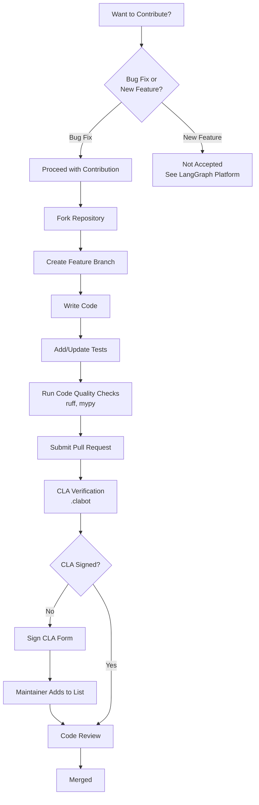
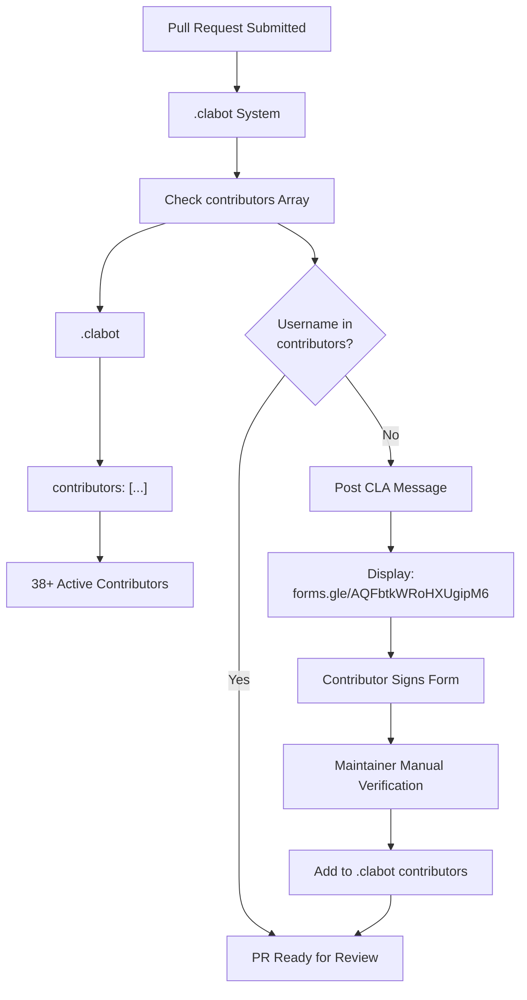
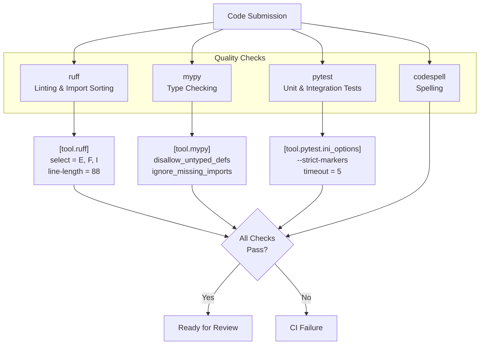
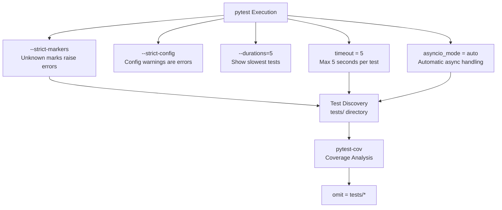
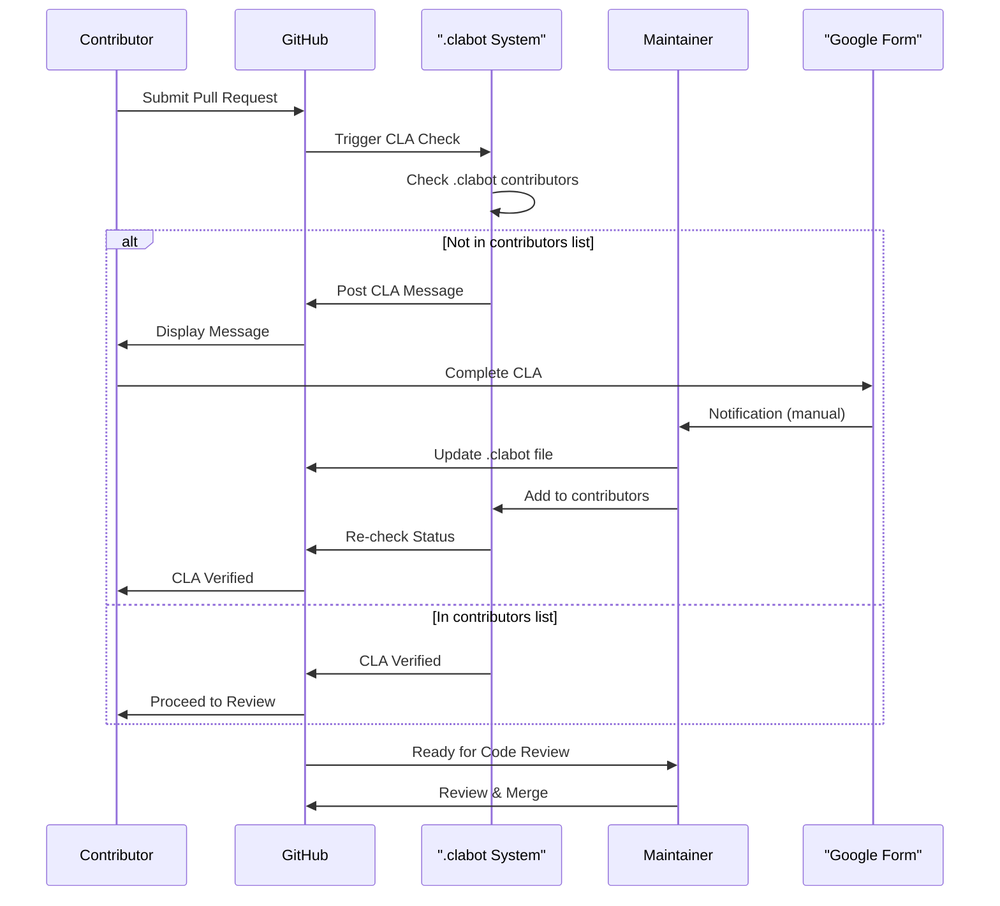
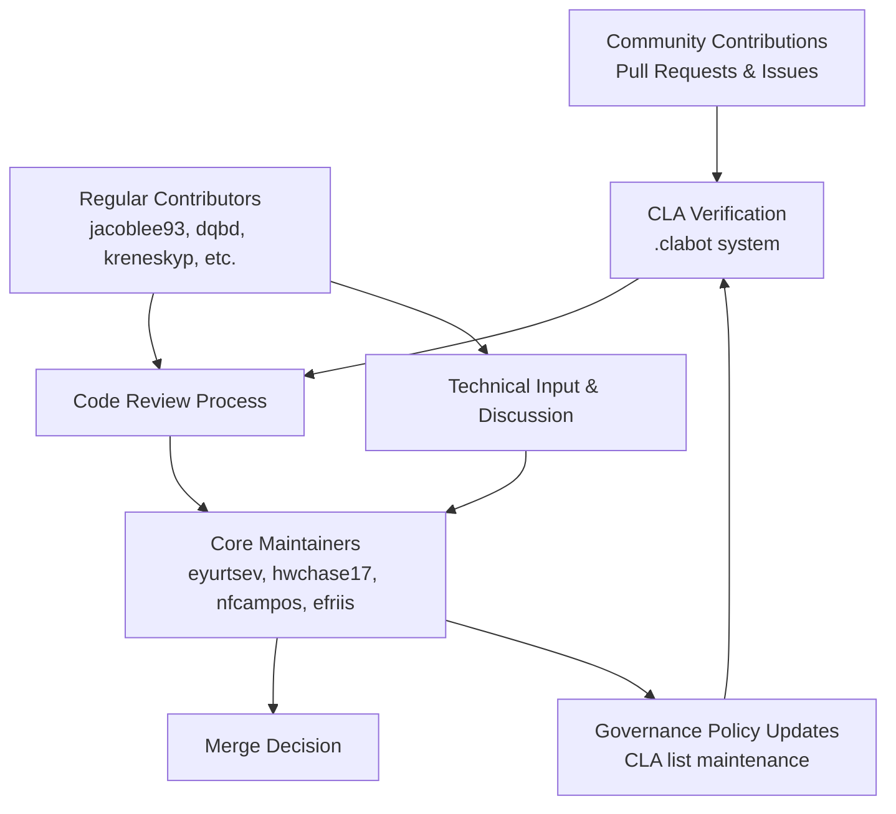

<!-- source: DeepWiki mcp.deepwiki.com · repo langchain-ai/langserve · page 5.3 Contributing · fetched 2026-10-26 -->

# Contributing

<details>
<summary>Relevant source files</summary>

The following files were used as context for generating this wiki page:

- [.clabot](.clabot)
- [MIGRATION.md](MIGRATION.md)
- [README.md](README.md)
- [examples/llm/server.py](examples/llm/server.py)
- [examples/retrieval/server.py](examples/retrieval/server.py)
- [examples/router/server.py](examples/router/server.py)
- [poetry.lock](poetry.lock)
- [pyproject.toml](pyproject.toml)

</details>


## Overview

LangServe is currently in **maintenance mode**. The project accepts bug fixes from the community but does not accept new feature contributions. All contributors must sign a Contributor License Agreement (CLA) before their contributions can be reviewed and merged.



**Project Status**: The LangChain team recommends using LangGraph Platform rather than LangServe for new projects. See the [Migration Guide](https://github.com/langchain-ai/langserve/blob/main/MIGRATION.md) for details.

Sources: [README.md:8-14](), [MIGRATION.md:1-28]()

For information about setting up the development environment, see page 5.1. For details about testing and CI/CD processes, see page 5.2.

## Contributor License Agreement (CLA)

### CLA Requirements

LangServe requires all contributors to sign a Contributor License Agreement before their contributions can be reviewed and merged. This process is managed through an automated system that tracks contributor status and enforces the requirement.

**CLA Enforcement Architecture**



**CLA Configuration**

The CLA enforcement is handled automatically through the `.clabot` configuration file:

| Component | Description | Implementation |
|-----------|-------------|----------------|
| **Contributors Array** | List of GitHub usernames with signed CLAs | `.clabot` `contributors` field |
| **CLA Message** | Automated message sent to new contributors | `.clabot` `message` field |
| **CLA Form** | Individual Contributor License Agreement | `https://forms.gle/AQFbtkWRoHXUgipM6` |
| **Manual Processing** | Maintainer verification and list updates | Manual process noted in message |

The automated message informs contributors: "Thank you for your pull request and welcome to our community. We require contributors to sign our Contributor License Agreement... please complete the Individual Contributor License Agreement here https://forms.gle/AQFbtkWRoHXUgipM6."

Sources: [.clabot:1-4]()

### Existing Contributors

The project maintains a list of contributors who have completed the CLA process in the `.clabot` configuration file. As of the current version, there are 38+ active contributors with signed CLAs, including:

**Core Maintainers**: `eyurtsev`, `hwchase17`, `nfcampos`, `efriis`

**Regular Contributors**: `jacoblee93`, `dqbd`, `kreneskyp`, `adarsh-jha-dev`, `harris`, `baskaryan`, `hinthornw`, `bracesproul`, and 30+ additional community contributors.

The complete list is maintained in [.clabot:2]().

Sources: [.clabot:2]()

## Code Quality Standards

LangServe enforces strict code quality standards through automated tools configured in `pyproject.toml`. All contributions must pass linting, type checking, and testing requirements before they can be merged.

### Code Quality Tools Configuration



**Tool Configuration Reference**

| Tool | Purpose | Configuration Location | Key Settings |
|------|---------|------------------------|--------------|
| **ruff** | Linting and import sorting | [pyproject.toml:55-69]() | `select = ["E", "F", "I"]`, `line-length = 88` |
| **mypy** | Static type checking | [pyproject.toml:71-73]() | `disallow_untyped_defs = "True"`, `ignore_missing_imports = "True"` |
| **pytest** | Test execution | [pyproject.toml:85-99]() | `--strict-markers`, `timeout = 5`, `asyncio_mode = "auto"` |
| **codespell** | Spelling verification | [pyproject.toml:30]() | Default configuration |

Sources: [pyproject.toml:28-30](), [pyproject.toml:55-73](), [pyproject.toml:85-99]()

### Linting with Ruff

Ruff enforces code style and import organization. The configuration includes:

- **pycodestyle (E)**: Enforces PEP 8 style guidelines
- **pyflakes (F)**: Detects programming errors
- **isort (I)**: Organizes imports consistently
- **Line length**: Maximum 88 characters (Black-compatible)

The `known-first-party` setting includes `"langserve"` to properly categorize imports [pyproject.toml:69]().

Sources: [pyproject.toml:55-69]()

### Type Checking with Mypy

MyPy enforces type safety across the codebase with strict settings:

- **`disallow_untyped_defs`**: All functions must have type annotations
- **`ignore_missing_imports`**: Allows external dependencies without type stubs

All new code must include proper type hints for function signatures and return types.

Sources: [pyproject.toml:71-73]()

### Testing Requirements

All contributions must include appropriate tests and pass the existing test suite:

**Pytest Configuration**



**Test Dependencies**: The project uses a comprehensive pytest suite including:
- `pytest` - Core test framework
- `pytest-cov` - Coverage reporting
- `pytest-asyncio` - Async test support
- `pytest-mock` - Mocking support
- `pytest-socket` - Network call prevention
- `pytest-watch` - Auto-rerun on changes
- `pytest-timeout` - Test timeout enforcement

Sources: [pyproject.toml:32-39](), [pyproject.toml:85-99](), [pyproject.toml:75-78]()

## Development Workflow

### Setting Up Development Environment

LangServe uses **Poetry** for dependency management. The development workflow requires Poetry to be installed.

**Installing Poetry**: Follow the [Poetry documentation](https://python-poetry.org/docs) for installation instructions.

Sources: [README.md:89]()

### Running Code Quality Checks Locally

Before submitting a pull request, run all quality checks locally:

**Linting**
```bash
poetry run ruff check .
```

**Type Checking**
```bash
poetry run mypy langserve
```

**Testing**
```bash
poetry run pytest
```

**Spelling**
```bash
poetry run codespell
```

### Development Dependencies

The project organizes dependencies into separate Poetry groups:

| Group | Purpose | Key Dependencies |
|-------|---------|------------------|
| `dev` | Development tools | `jupyterlab`, `fastapi`, `sse-starlette` |
| `lint` | Code quality tools | `ruff`, `codespell` |
| `test` | Testing infrastructure | `pytest`, `pytest-cov`, `pytest-asyncio`, etc. |
| `examples` | Running examples | `openai`, `uvicorn` |

Sources: [pyproject.toml:21-46]()

## Contribution Process

### Step-by-Step Contribution Guide

**1. Fork and Clone**
```bash
git clone https://github.com/YOUR_USERNAME/langserve.git
cd langserve
```

**2. Install Dependencies**
```bash
poetry install --with dev,lint,test
```

**3. Create Feature Branch**
```bash
git checkout -b fix/issue-description
```

**4. Make Changes and Add Tests**
- Write your bug fix
- Add or update tests in the `tests/` directory
- Ensure all tests pass locally

**5. Run Code Quality Checks**
```bash
poetry run ruff check .
poetry run mypy langserve
poetry run pytest
poetry run codespell
```

**6. Commit and Push**
```bash
git commit -am "Fix: description of bug fix"
git push origin fix/issue-description
```

**7. Submit Pull Request**
- Open a pull request on GitHub
- Ensure PR description clearly describes the bug being fixed
- Reference any related issues

**8. CLA Verification**
- If this is your first contribution, the `.clabot` system will post a message
- Complete the CLA form at https://forms.gle/AQFbtkWRoHXUgipM6
- Wait for maintainer to add you to the contributors list

**9. Code Review**
- Address any feedback from maintainers
- Make requested changes and push updates

Sources: [.clabot:1-4](), [README.md:8-14]()

### CLA Process Details



The CLA verification happens automatically on each pull request, but adding new contributors to the list is a manual process performed by maintainers.

Sources: [.clabot:1-4]()

## Project Governance Structure

### Contribution Guidelines Integration

The governance process integrates multiple systems to ensure quality and legal compliance:

| System Component | Purpose | Implementation |
|------------------|---------|----------------|
| `.clabot` Configuration | CLA enforcement and contributor tracking | Automated GitHub integration |
| Contribution Guidelines | Process documentation and standards | Referenced in CLA message |
| Manual Review Process | CLA verification and contributor onboarding | Maintainer-driven workflow |
| GitHub Integration | Automated enforcement and messaging | Pull request automation |

### Governance Decision Making

The project follows a maintainer-driven governance model with the following characteristics:



Sources: [.clabot:2-4]()

### Manual CLA Processing

The CLA process includes a manual verification step that requires maintainer intervention:

1. **CLA Form Submission**: Contributors complete the Individual Contributor License Agreement form
2. **Manual Verification**: Maintainers manually verify the CLA completion
3. **Contributor List Update**: Maintainers add the verified contributor to the `.clabot` contributors array
4. **Automated Re-check**: The system automatically re-evaluates the contributor's status

This manual process ensures that all legal requirements are properly verified before granting contribution privileges.

Sources: [.clabot:3]()