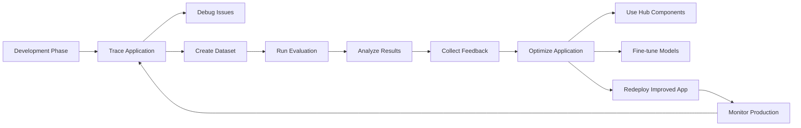

<!-- source: DeepWiki mcp.deepwiki.com · repo langchain-ai/langsmith-cookbook · page 1 Overview · fetched 2026-10-26 -->

# Overview

<details>
<summary>Relevant source files</summary>

The following files were used as context for generating this wiki page:

- [README.md](README.md)
- [introduction/langsmith_introduction.ipynb](introduction/langsmith_introduction.ipynb)
- [introduction/online_evaluation.ipynb](introduction/online_evaluation.ipynb)
- [introduction/summarization.ipynb](introduction/summarization.ipynb)
- [testing-examples/README.md](testing-examples/README.md)
- [testing-examples/rag_eval/online_eval.ipynb](testing-examples/rag_eval/online_eval.ipynb)
- [testing-examples/rag_eval/rag.ipynb](testing-examples/rag_eval/rag.ipynb)

</details>


The LangSmith Cookbook is a practical guide to maximizing [LangSmith](https://smith.langchain.com), a comprehensive tool designed to debug, evaluate, test, and improve LLM applications continuously. While the [standard documentation](https://docs.smith.langchain.com) covers the fundamentals, this repository provides real-world scenarios, common patterns, and practical recipes for implementing LangSmith in your LLM applications.

This repository serves as your hands-on guide to leverage LangSmith's capabilities for tracing, evaluation, testing, feedback collection, and prompt management. The recipes and examples demonstrate practical applications that you can adapt and implement in your own projects.

## Core LangSmith Platform Architecture

```mermaid
graph TB
    LangSmith["LangSmith Platform"] --> Tracing["Tracing"]
    LangSmith --> Evaluation["Testing & Evaluation"]
    LangSmith --> Feedback["Feedback Collection"]
    LangSmith --> Hub["LangChain Hub"]
    LangSmith --> DataExport["Data Export & Fine-tuning"]
    
    Tracing --> REST_API["REST API"]
    Tracing --> TraceableDecorator["@traceable Decorator"]
    Tracing --> RunNaming["Run Naming"]
    
    Evaluation --> RagEval["RAG Evaluation"]
    Evaluation --> AgentEval["Agent Evaluation"]
    Evaluation --> ChatbotEval["Chatbot Evaluation"]
    Evaluation --> ExtractionEval["Extraction Evaluation"]
    Evaluation --> MultimodalEval["Multimodal Evaluation"]
    
    Feedback --> UserFeedback["User Feedback UI"]
    Feedback --> AlgoFeedback["Algorithmic Feedback"]
    Feedback --> RealtimeFeedback["Real-time Feedback"]
    
    Hub --> PromptVersioning["Prompt Versioning"]
    Hub --> RunnablePrompt["Runnable PromptTemplate"]
    
    DataExport --> FineTuning["Fine-tuning Export"]
    DataExport --> LilacCuration["Lilac Dataset Curation"]
    DataExport --> CSVExport["CSV Export"]
```



Sources: [README.md:5-12], [README.md:14-132]

## Cookbook Workflow: From Development to Optimization



Sources: [README.md:5-12], [README.md:14-132]

## Core Capabilities

### Tracing

LangSmith's tracing capabilities allow you to seamlessly debug and improve your LLM applications by monitoring execution flow and capturing intermediate steps. The cookbook provides examples for:

- Tracing without LangChain using the `@traceable` decorator
- Using the REST API for logging LLM and chat model runs
- Customizing run names for better visibility in the UI
- Tracing nested calls within tools
- Displaying trace links in your application

Tracing is fundamental to LangSmith as it enables visibility into the execution flow of your application, helping you identify bottlenecks, errors, and opportunities for improvement.

Sources: [README.md:14-22]

### Testing & Evaluation

LangSmith provides robust evaluation capabilities for benchmarking and testing your LLM systems across different modalities:

- **RAG (Retrieval Augmented Generation)**: Evaluate correctness, handling of dynamic data, and using fixed sources
- **Chatbots**: Test using simulated users and single-turn evaluations
- **Extraction**: Measure similarity between extracted structured content and labels
- **Agents**: Evaluate intermediate steps and tool selection accuracy
- **Multimodal**: Benchmark image classification and other multimodal tasks

The cookbook includes comprehensive examples for each of these evaluation scenarios, enabling you to assess and improve the performance of your LLM applications.

Sources: [README.md:32-86], [testing-examples/README.md:1-40]

### Feedback Collection

LangSmith's feedback collection capabilities help you gather insights to improve your applications:

- User feedback UI implementations (Streamlit, Next.js)
- Algorithmic feedback for monitoring and performance tuning
- Real-time feedback using callbacks

These examples demonstrate how to capture and incorporate feedback to continuously refine your LLM applications.

Sources: [README.md:87-99]

### LangChain Hub Integration

The LangChain Hub integration allows you to efficiently manage LLM components:

- Using prompts from Hub in RAG pipelines
- Version control for prompts to ensure deployment stability
- Streamlining the process of saving and integrating prompts

This section demonstrates how to leverage the Hub for prompt management and versioning.

Sources: [README.md:24-30]

### Data Export & Fine-tuning

LangSmith provides tools for exporting data to optimize LLMs:

- Converting run data to OpenAI's fine-tuning format
- Curating datasets using Lilac to detect near-duplicates and PII
- Exporting test results to CSV for external analysis

These examples show how to leverage your traced data for fine-tuning models and analysis.

Sources: [README.md:111-124]

## Getting Started

To use the LangSmith Cookbook examples, you'll need:

1. A LangSmith API key - sign up at [smith.langchain.com](https://smith.langchain.com)
2. The LangSmith SDK installed:
   ```bash
   pip install langsmith langchain
   ```
3. Configure your environment variables:
   ```bash
   export LANGCHAIN_API_KEY="your_api_key"
   export LANGCHAIN_TRACING_V2=true
   export LANGCHAIN_ENDPOINT="https://api.smith.langchain.com"
   ```

Each recipe in the cookbook provides specific instructions and code examples that you can adapt to your own use cases.

Sources: [README.md:5-12], [testing-examples/rag_eval/rag.ipynb:39-49], [introduction/summarization.ipynb:186-195]

## Cookbook Organization

The cookbook is organized by capability, with dedicated directories for each major feature:

- `tracing-examples/`: Examples for tracing your code
- `testing-examples/`: Examples for testing and evaluation
- `feedback-examples/`: Examples for collecting and using feedback
- `hub-examples/`: Examples for LangChain Hub integration
- `fine-tuning-examples/`: Examples for data export and fine-tuning
- `optimization/`: Examples for optimizing your applications

Each directory contains notebooks and code samples that demonstrate practical applications of LangSmith's capabilities.

Sources: [README.md:14-124]

---

