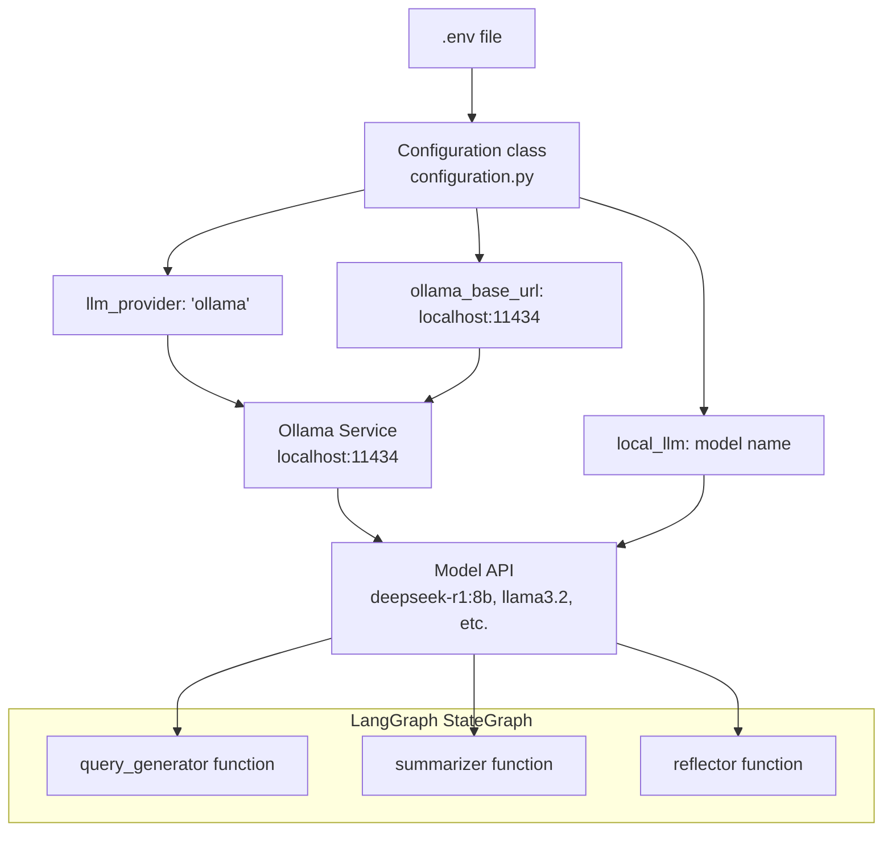
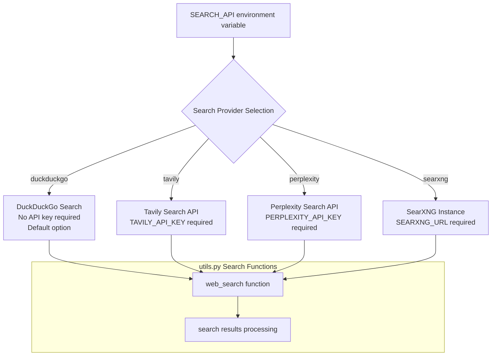
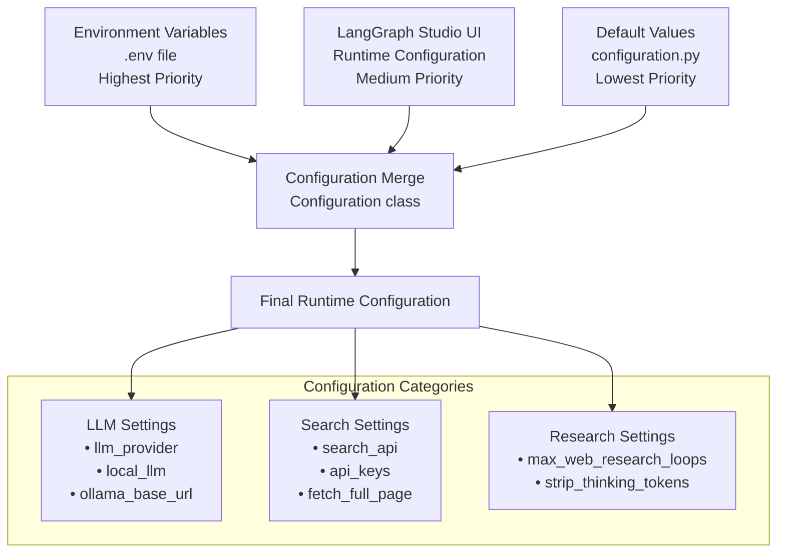
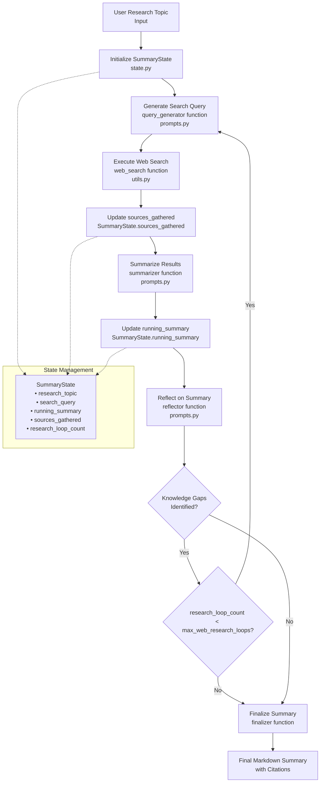

<!-- source: DeepWiki mcp.deepwiki.com · repo langchain-ai/local-deep-researcher · page 6.1 Quick Start · fetched 2026-10-26 -->

# Quick Start

<details>
<summary>Relevant source files</summary>

The following files were used as context for generating this wiki page:

- [.env.example](.env.example)
- [README.md](README.md)

</details>


This guide provides step-by-step instructions for setting up and running the Local Deep Researcher system for the first time. It covers installation, basic configuration, and executing your first research task using the LangGraph Studio interface.

For advanced configuration scenarios including custom search providers and performance optimization, see [Advanced Configuration](#6.2). For comprehensive deployment options including Docker and production scenarios, see [Deployment](#5).

## Prerequisites

Before starting, ensure you have the following installed:

- **Python 3.11** or higher
- **Git** for cloning the repository  
- **Local LLM Runtime**: Either [Ollama](https://ollama.com) or [LMStudio](https://lmstudio.ai)
- **curl** or **uv** package manager (for dependency management)

## Installation

### Repository Setup

Clone the repository and navigate to the project directory:

```bash
git clone https://github.com/langchain-ai/local-deep-researcher.git
cd local-deep-researcher
```

### Environment Configuration

Create your configuration file from the template:

```bash
cp .env.example .env
```

The `.env` file controls all system configuration through environment variables that are automatically loaded via `python-dotenv` as specified in [langgraph.json:4-6]().

**Sources:** [README.md:18-28](), [.env.example:1-17]()

## LLM Provider Configuration

Choose between Ollama or LMStudio as your local LLM provider. The system uses the `Configuration` class from [configuration.py]() to manage these settings with the following priority order:

1. Environment variables (highest priority)
2. LangGraph Studio UI configuration  
3. Default values in `Configuration` class (lowest priority)

### Option 1: Ollama Setup

#### Configure Ollama Service



Download and install Ollama, then pull a compatible model:

```bash
# Download Ollama from https://ollama.com/download
# Pull a model (example: DeepSeek R1 8B)
ollama pull deepseek-r1:8b
```

Update your `.env` file with Ollama configuration:

```bash
LLM_PROVIDER=ollama
OLLAMA_BASE_URL=http://localhost:11434
LOCAL_LLM=deepseek-r1:8b
```

### Option 2: LMStudio Setup

Download and install LMStudio, then configure the OpenAI-compatible API server:

1. Load your preferred model (e.g., `qwen_qwq-32b`)
2. Navigate to "Local Server" tab
3. Start the server with OpenAI-compatible API
4. Note the server URL (default: `http://localhost:1234/v1`)

Update your `.env` file with LMStudio configuration:

```bash
LLM_PROVIDER=lmstudio
LOCAL_LLM=qwen_qwq-32b
LMSTUDIO_BASE_URL=http://localhost:1234/v1
```

**Sources:** [README.md:29-64](), [.env.example:10-14]()

## Search Provider Configuration

The system supports multiple search providers through the `search_api` configuration. DuckDuckGo requires no API key, while others require authentication.



### Search Provider Options

| Provider | API Key Required | Configuration Variables |
|----------|------------------|------------------------|
| DuckDuckGo | No | `SEARCH_API=duckduckgo` |
| Tavily | Yes | `SEARCH_API=tavily`<br/>`TAVILY_API_KEY=tvly-xxxxx` |
| Perplexity | Yes | `SEARCH_API=perplexity`<br/>`PERPLEXITY_API_KEY=pplx-xxxxx` |
| SearXNG | No (self-hosted) | `SEARCH_API=searxng`<br/>`SEARXNG_URL=http://localhost:8888` |

### Basic Configuration (No API Keys)

For immediate testing, use DuckDuckGo (default):

```bash
SEARCH_API=duckduckgo
FETCH_FULL_PAGE=True
MAX_WEB_RESEARCH_LOOPS=3
```

**Sources:** [README.md:66-76](), [.env.example:1-9]()

## Running the System

### Create Virtual Environment (Recommended)

```bash
python -m venv .venv
source .venv/bin/activate  # On Windows: .venv\Scripts\Activate.ps1
```

### Launch LangGraph Server

#### macOS/Linux with uv

```bash
curl -LsSf https://astral.sh/uv/install.sh | sh
uvx --refresh --from "langgraph-cli[inmem]" --with-editable . --python 3.11 langgraph dev
```

#### Windows or Alternative Method

```bash
pip install -e .
pip install -U "langgraph-cli[inmem]"
langgraph dev
```

### Server Startup Verification

When successfully launched, you should see:

```
Ready!
API: http://127.0.0.1:2024
Docs: http://127.0.0.1:2024/docs
LangGraph Studio Web UI: https://smith.langchain.com/studio/?baseUrl=http://127.0.0.1:2024
```

The system runs on port 2024 as specified in [langgraph.json]().

**Sources:** [README.md:81-128]()

## LangGraph Studio Interface

### Accessing the UI

Open the LangGraph Studio Web UI using the provided URL. The interface provides:

- **Configuration Tab**: Runtime configuration overrides
- **Thread Tab**: Research task execution and visualization
- **State Visualization**: Real-time graph state inspection

### Configuration Priority

The configuration system follows this hierarchy:



**Sources:** [README.md:129-136]()

## Your First Research Task

### Basic Research Execution

1. **Open LangGraph Studio** using the provided URL
2. **Navigate to Thread Tab** to start a new research session
3. **Enter Research Topic** (e.g., "Latest developments in quantum computing")
4. **Execute** the research workflow

### Research Workflow Visualization

The system executes an iterative research process:



### Expected Output

The system produces:
- **Markdown Summary**: Comprehensive research summary with citations
- **Source List**: All gathered sources with URLs and metadata
- **Research State**: Complete state history viewable in LangGraph Studio

**Sources:** [README.md:157-177]()

## Common Issues and Solutions

### Model Compatibility

Some models may have difficulty with structured JSON output required by the system. The assistant includes fallback mechanisms for models like [DeepSeek R1 (7B)](https://ollama.com/library/deepseek-llm:7b) as mentioned in [README.md:143-145]().

### Browser Compatibility

For optimal LangGraph Studio experience:
- **Firefox**: Recommended browser
- **Safari**: May show security warnings for mixed HTTPS/HTTP content
- **Chrome**: Generally compatible, disable ad-blocking extensions if issues occur

### Connection Issues

| Issue | Solution |
|-------|----------|
| LLM Provider Not Found | Verify Ollama/LMStudio is running and accessible |
| Search API Errors | Check API keys and rate limits |
| Port 2024 Unavailable | Ensure no other services are using port 2024 |

**Sources:** [README.md:143-156]()

---

